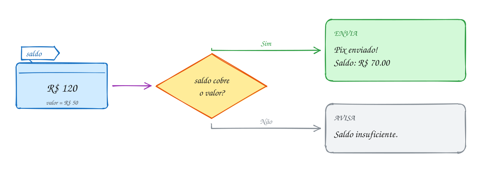
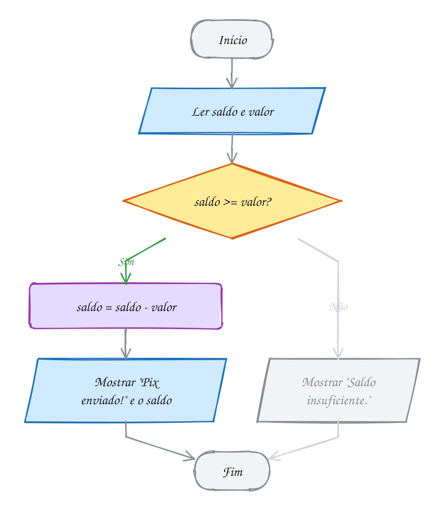
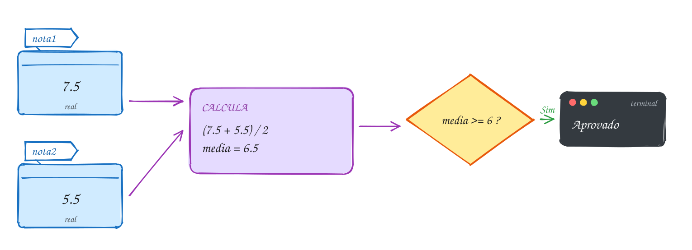
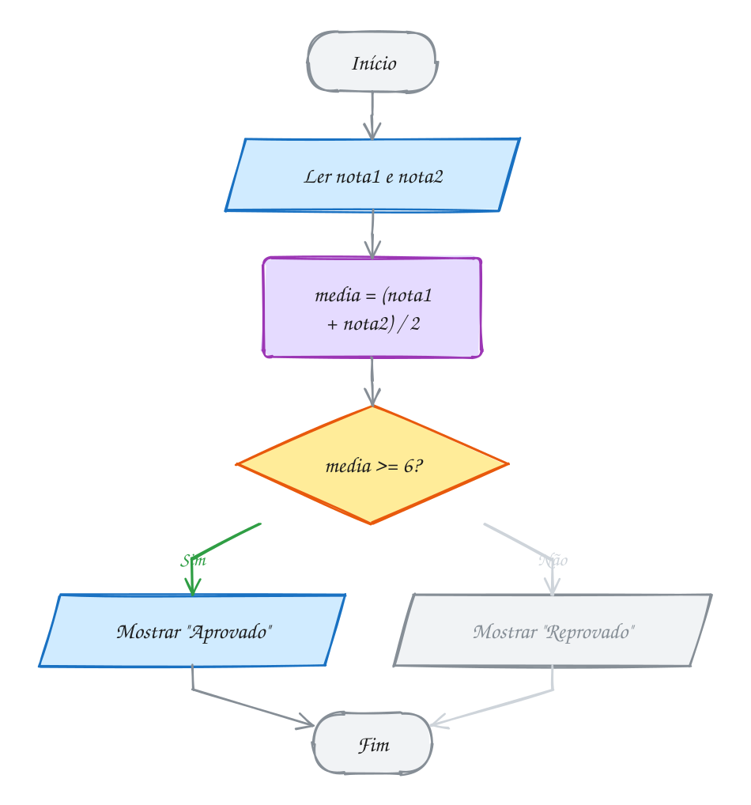
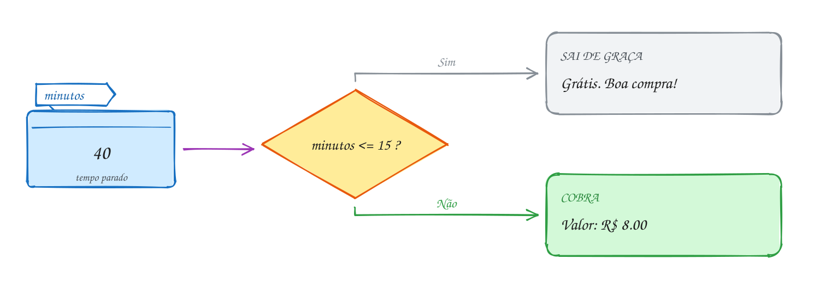
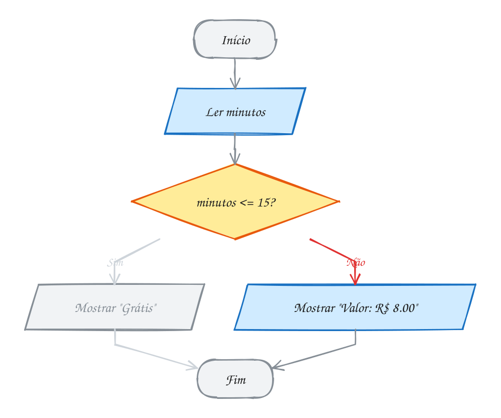
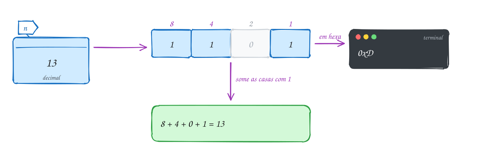
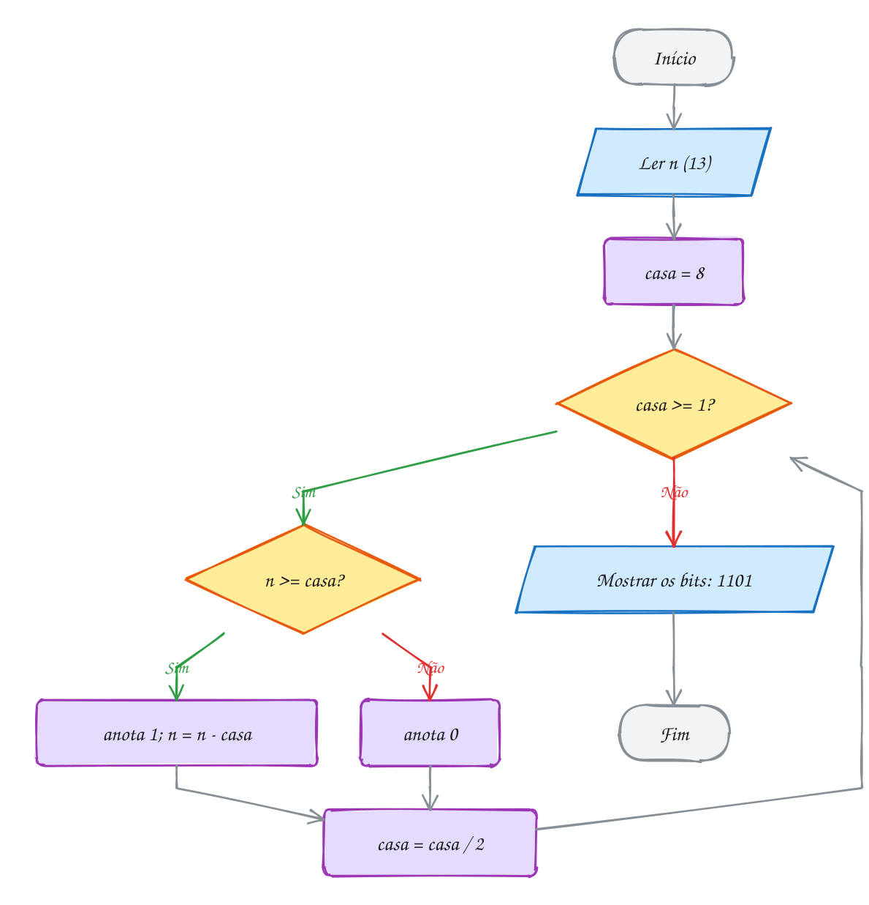
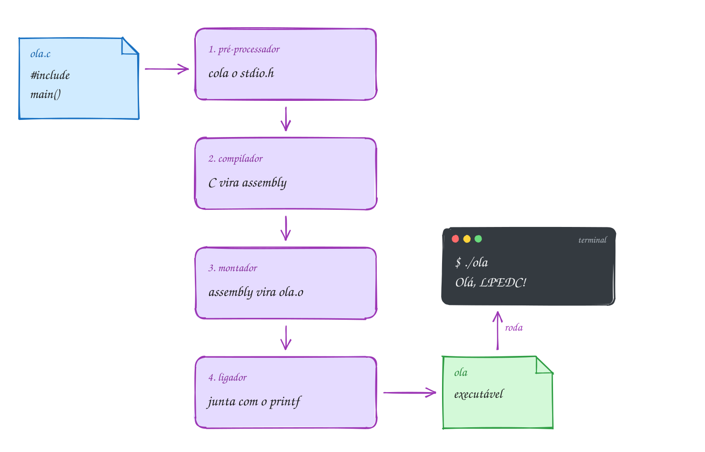
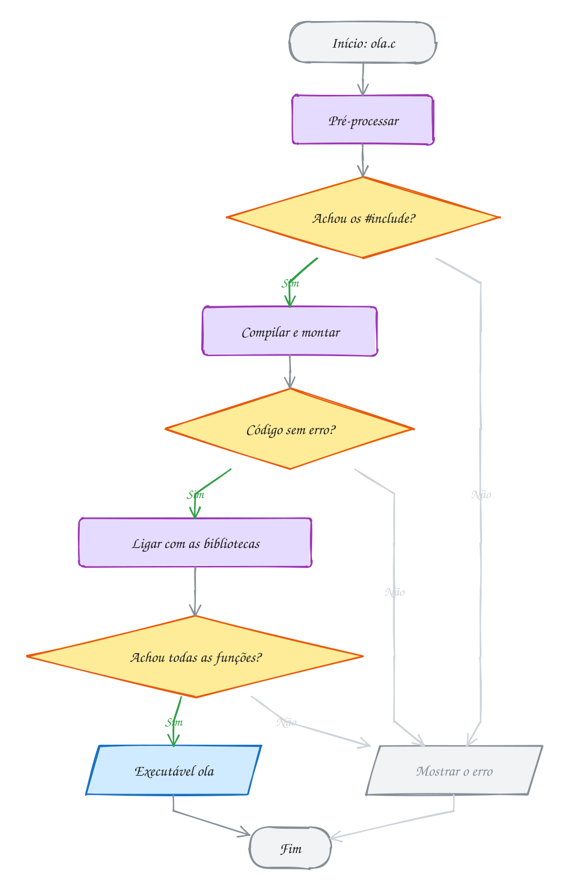

<!-- Gerado por _gerador. Para mudar este arquivo, edite _gerador/modulos/00-logica/ e rode: cd _gerador && npm run gerar -->

# Módulo 00 · Lógica antes do código

Antes de escrever uma linha de C, vale relembrar o que é **programar**: quebrar
um problema em passos tão claros que até uma máquina, que não pensa nada,
consegue seguir.

Você já programa em TypeScript, então muito disto vai soar familiar. A
diferença é o nível. No JS, o Node esconde a memória, os bits e a compilação.
No C, nada fica escondido. Por isso o módulo termina olhando para dentro do
computador: como ele guarda números (binário) e como o seu `.c` vira um
programa que roda.

## O que você vai aprender

- o que é um **algoritmo** e as três peças que montam qualquer programa: sequência, decisão e repetição
- escrever **pseudocódigo** e conferir à mão com o **teste de mesa**
- desenhar e ler **fluxogramas**
- contar em **binário** e **hexadecimal**, e o que são bit e byte
- o caminho do arquivo `.c` até o executável: **pré-processador, compilador, montador e ligador**

## Como estudar cada assunto

1. Leia o texto e olhe o **diagrama da ideia**: é o exemplo desenhado.
2. Leia o código. É o mesmo exemplo, com os mesmos valores.
3. Siga o **fluxograma** com o dedo: é o caminho que o programa faz.
4. Rode os exemplos. Mude um valor, quebre de propósito, rode de novo.
5. Faça os exercícios. ★☆☆ é aquecimento, ★★☆ pede raciocínio, ★★★ é desafio.
   As dicas ficam escondidas: abra só se travar.

No meio de cada assunto tem uma **Pergunta para você**. Responda antes de rodar.

> [!NOTE]
> Neste módulo os exemplos já aparecem em C, mas você **não precisa entender a
> sintaxe ainda**: ela começa no módulo 01. Repare só nos passos. Nos
> exercícios de algoritmo, pseudocódigo e fluxograma, a resposta vai como
> comentário dentro do arquivo `.c`.

## As cores e as formas

Caixa azul é dado entrando ou saindo, roxa é o programa fazendo alguma coisa,
amarela é pergunta. Verde é o caminho que o exemplo segue; cinza, o que ele não
usa.

<p align="center"></p>

## Antes de começar

Você precisa do `gcc` e, para os módulos de memória, do `valgrind`:

```bash
sudo apt install build-essential gdb valgrind   # Ubuntu / Debian
```

Para rodar qualquer arquivo do curso, use o `rodar`, que está na raiz do
projeto. Ele compila com todos os avisos ligados e com o **AddressSanitizer**,
um detetive de erros de memória. Depois roda o programa:

```bash
~/LPEDC/rodar 00-logica/0001-algoritmo/A001.c
```

| # | Assunto | Pasta |
| --- | --- | --- |
| [0001](#0001--algoritmo) | Algoritmo | [`0001-algoritmo/`](0001-algoritmo/) |
| [0002](#0002--pseudocódigo-e-teste-de-mesa) | Pseudocódigo e teste de mesa | [`0002-pseudocodigo/`](0002-pseudocodigo/) |
| [0003](#0003--fluxograma) | Fluxograma | [`0003-fluxograma/`](0003-fluxograma/) |
| [0004](#0004--binário-hexadecimal-bit-e-byte) | Binário, hexadecimal, bit e byte | [`0004-binario/`](0004-binario/) |
| [0005](#0005--do-c-ao-executável) | Do .c ao executável | [`0005-compilacao/`](0005-compilacao/) |

---

## 0001 · Algoritmo

Você abre o app do banco para mandar um Pix de R$ 50 para um amigo. Sem
pensar, segue uma receita: entra na área Pix, digita a chave, digita o valor,
confere e confirma com a senha.

Essa receita é um **algoritmo**: uma sequência **finita** de passos **sem
ambiguidade** que resolve um problema. Todo programa é um algoritmo escrito
numa língua que o computador entende.

Um bom algoritmo tem:

- **entrada**: os dados que chegam (a chave e o valor);
- **processamento**: o que se faz com eles (conferir o saldo, descontar);
- **saída**: o resultado (o comprovante);
- **fim**: ele termina. Um passo a passo que nunca acaba não resolve nada;
- **precisão**: cada passo tem um significado só. "Coloque um pouco de sal"
  não serve para um computador. "Coloque 5 g de sal" serve.

Agora a parte importante. Por mais complicado que seja um programa, ele é
montado com só **três peças**:

1. **sequência**: um passo depois do outro;
2. **decisão**: "se o saldo der, envia; senão, avisa";
3. **repetição**: "enquanto a senha estiver errada, peça de novo".

Isso tem nome: é o teorema de Böhm e Jacopini (1966). Qualquer algoritmo cabe
nessas três estruturas. Os módulos 01, 02 e 03 são, cada um, sobre uma delas.

Vamos ver na prática. Você tem R$ 120 na conta e quer mandar R$ 50. O
algoritmo recebe o saldo e o valor, pergunta se o saldo cobre o valor e, como
cobre, envia e mostra o saldo novo:

<p align="center"></p>

O mesmo algoritmo em C. Não se preocupe com a sintaxe: ela começa no módulo
01. Por enquanto, leia de cima para baixo e repare que cada linha é um passo:

```c
#include <stdio.h>

int main(void) {
    double saldo = 120.0; // entrada: quanto tem na conta
    double valor = 50.0;  // entrada: quanto quer mandar

    printf("Pix de R$ %.2f\n", valor);

    if (saldo >= valor) {                // decisão: o saldo cobre?
        saldo = saldo - valor;           // processamento: desconta
        printf("Pix enviado!\n");        // saída
        printf("Saldo: R$ %.2f\n", saldo);
    } else {
        printf("Saldo insuficiente.\n");
    }
    return 0;
}
// Saída:
// Pix de R$ 50.00
// Pix enviado!
// Saldo: R$ 70.00
```

Repara no fluxograma: é o mesmo caminho. O losango é a decisão, e o exemplo
segue pelo Sim, porque 120 cobre 50:

<p align="center"></p>

> [!WARNING]
> O computador não tem bom senso. Se o algoritmo diz "digite o valor" e não diz
> o que fazer com ele, nada acontece. Se diz "repita até dar certo" e nunca
> muda nada, repete para sempre. Todo passo precisa estar escrito, inclusive o
> que para você é óbvio.

> [!TIP]
> **Por dentro do C:** o processador não sabe o que é "Pix" nem "saldo". Ele
> só sabe fazer coisas minúsculas: copiar um número de um lugar da memória para
> outro, somar, comparar dois números e pular para outra instrução conforme o
> resultado. O `if` do C vira exatamente isso: compara e pula. Programar é
> traduzir o seu algoritmo até chegar nesses passinhos, e quem faz a última
> parte da tradução é o compilador (assunto 0005).

> [!NOTE]
> **Pergunta para você:** e se o valor fosse R$ 150? Por qual caminho o
> fluxograma iria e o que apareceria na tela? Mude `50.0` para `150.0` no
> exemplo A001 e rode para conferir.

### Hora de praticar

Os arquivos ficam em [`0001-algoritmo/`](0001-algoritmo/). Os comandos funcionam de qualquer pasta do terminal. Nos exemplos, rode, mude, quebre e rode de novo. Nos exercícios, a resposta vai dentro do próprio arquivo. ★☆☆ é aquecimento, ★★☆ pede raciocínio e ★★★ é desafio.

**Exemplo A001 · O Pix passo a passo**

```c
#include <stdio.h>

int main(void) {
    double saldo = 120.0; // entrada: quanto tem na conta
    double valor = 50.0;  // entrada: quanto quer mandar

    printf("Pix de R$ %.2f\n", valor);

    if (saldo >= valor) {                // decisão: o saldo cobre?
        saldo = saldo - valor;           // processamento: desconta
        printf("Pix enviado!\n");        // saída
        printf("Saldo: R$ %.2f\n", saldo);
    } else {
        printf("Saldo insuficiente.\n");
    }
    return 0;
}
// Saída:
// Pix de R$ 50.00
// Pix enviado!
// Saldo: R$ 70.00
```

```bash
~/LPEDC/rodar 00-logica/0001-algoritmo/A001.c
```

**Exemplo A002 · O miojo de 3 minutos (as três peças juntas)**

```c
#include <stdio.h>

int main(void) {
    int minutos = 3;

    // sequência: um passo depois do outro
    printf("1. Ferva 500 ml de água\n");
    printf("2. Coloque o macarrão\n");

    // repetição: o mesmo passo, uma vez por minuto
    for (int m = 1; m <= minutos; m++) {
        printf("   ... minuto %d\n", m);
    }

    // decisão: o tempero só entra se a pessoa quiser
    int quer_tempero = 1; // 1 = sim, 0 = não
    if (quer_tempero) {
        printf("3. Misture o tempero\n");
    }
    printf("Pronto!\n");
    return 0;
}
// Saída:
// 1. Ferva 500 ml de água
// 2. Coloque o macarrão
//    ... minuto 1
//    ... minuto 2
//    ... minuto 3
// 3. Misture o tempero
// Pronto!
```

```bash
~/LPEDC/rodar 00-logica/0001-algoritmo/A002.c
```

#### Exercícios

**Exercício E001** · ★☆☆

A lâmpada da sala queimou. Escreva um algoritmo, em passos numerados, para
trocá-la. Pense em tudo: a lâmpada nova, a escada, o interruptor, o teste no
final.

<details>
<summary>Dicas</summary>

1. Comece com "pegar uma lâmpada nova" e termine com "testar".
2. Segurança primeiro: o interruptor fica desligado antes de mexer.
3. Resposta esperada (uma possível): 1. pegar lâmpada nova; 2. desligar o
   interruptor; 3. posicionar a escada; 4. subir; 5. desenroscar a queimada;
   6. enroscar a nova; 7. descer; 8. ligar o interruptor; 9. conferir se acendeu.

</details>

```bash
~/LPEDC/rodar 00-logica/0001-algoritmo/E001.c
```

**Exercício E002** · ★☆☆

Os passos para sacar dinheiro no caixa eletrônico estão embaralhados.
Coloque-os na ordem certa:


```text
a) retirar o dinheiro
b) digitar a senha
c) inserir o cartão
d) escolher "saque"
e) retirar o cartão
f) digitar o valor
```

<details>
<summary>Dicas</summary>

1. O que o banco precisa saber antes de qualquer coisa? Quem é você.
2. A senha confirma quem é você; o valor vem depois de escolher a operação.
3. Resposta esperada: c, b, d, f, e, a (muitos bancos devolvem o cartão antes
   do dinheiro, para ninguém esquecer o cartão na máquina).

</details>

```bash
~/LPEDC/rodar 00-logica/0001-algoritmo/E002.c
```

**Exercício E003** · ★★☆

Escreva o algoritmo de um pedestre atravessando a rua num semáforo. Use uma
decisão (se... senão) e uma repetição (enquanto...).

<details>
<summary>Dicas</summary>

1. A repetição é esperar: "enquanto o sinal de pedestre estiver vermelho...".
2. Mesmo no verde, olhe para os dois lados: é uma decisão.
3. Resposta esperada (uma possível): 1. ir até a faixa; 2. enquanto o sinal
   estiver vermelho, esperar; 3. olhar para os dois lados; 4. se vier carro,
   voltar ao passo 3; senão, atravessar; 5. fim.

</details>

```bash
~/LPEDC/rodar 00-logica/0001-algoritmo/E003.c
```

**Exercício E004** · ★★☆

Esta receita é ótima para gente e péssima para um computador:


```text
1. Misture farinha e ovos.
2. Coloque leite até dar o ponto.
3. Sal a gosto.
4. Asse até ficar bom.
```


Aponte o que é ambíguo em cada passo e reescreva a receita com passos
precisos, que qualquer pessoa (ou máquina) siga do mesmo jeito.

<details>
<summary>Dicas</summary>

1. Ambíguo é tudo que depende de opinião: "o ponto", "a gosto", "bom".
2. Troque opinião por número ou por uma pergunta que tenha resposta sim/não.
3. Resposta esperada (uma possível): 1. misture 2 xícaras de farinha e 3 ovos;
   2. coloque 1 xícara de leite; 3. coloque 1 colher de chá de sal; 4. asse a
   180 °C por 35 minutos (ou: asse até um palito sair seco).

</details>

```bash
~/LPEDC/rodar 00-logica/0001-algoritmo/E004.c
```

**Exercício E005** · ★★★

Um fazendeiro precisa atravessar um rio com um lobo, uma cabra e um repolho.
O barco só leva o fazendeiro e mais uma coisa. Se ficarem sozinhos, o lobo
come a cabra e a cabra come o repolho. Escreva a sequência de travessias que
leva os três para o outro lado sem perder nada.

<details>
<summary>Dicas</summary>

1. A cabra é o problema: ela não pode ficar sozinha com ninguém.
2. Vale levar uma coisa de volta.
3. Resposta esperada (7 travessias): leva a cabra; volta sozinho; leva o
   lobo; volta com a cabra; leva o repolho; volta sozinho; leva a cabra.

</details>

```bash
~/LPEDC/rodar 00-logica/0001-algoritmo/E005.c
```

**Exercício E006** · ★★★

Você tem uma jarra de 5 litros e outra de 3 litros, sem marcas, e uma
torneira. Escreva um algoritmo para deixar exatamente 4 litros na jarra de 5.
Você pode encher uma jarra, esvaziar uma jarra ou despejar de uma na outra
até uma encher ou a outra esvaziar.

<details>
<summary>Dicas</summary>

1. Anote o estado depois de cada passo como (jarra5, jarra3). Começa em (0, 0).
2. Encher a de 5 e despejar na de 3 deixa 2 litros na de 5. Guarde esses 2.
3. Resposta esperada (6 passos): encher a 5 (5,0); despejar na 3 (2,3);
   esvaziar a 3 (2,0); despejar a 5 na 3 (0,2); encher a 5 (5,2);
   despejar a 5 na 3 até encher (4,3). Pronto: 4 litros na jarra de 5.

</details>

```bash
~/LPEDC/rodar 00-logica/0001-algoritmo/E006.c
```

---

## 0002 · Pseudocódigo e teste de mesa

Fim de semestre. Você tirou 7,5 na primeira prova e 5,5 na segunda. Para
passar, a média precisa ser pelo menos 6. Passou?

Antes de ir para o C, dá para escrever a solução numa linguagem "de mentira",
em português, só para organizar o raciocínio. Isso é **pseudocódigo**. Ele não
roda em computador nenhum, e é justamente por isso que é útil: você pensa no
problema sem brigar com ponto e vírgula.

Existe um jeito tradicional de escrever pseudocódigo no Brasil, o **Portugol**
(é o que o VisuAlg usa). As palavras que importam:

| Portugol | O que faz | Em C (vem no módulo 01) |
| --- | --- | --- |
| `var nota1: real` | cria uma variável | `double nota1;` |
| `nota1 <- 7.5` | guarda um valor | `nota1 = 7.5;` |
| `leia(nota1)` | lê do teclado | `scanf("%lf", &nota1);` |
| `escreva("Oi")` | mostra na tela | `printf("Oi");` |
| `se ... entao ... senao ... fimse` | decisão | `if (...) { } else { }` |
| `enquanto ... faca ... fimenquanto` | repetição | `while (...) { }` |

O cálculo da média em Portugol:

```text
algoritmo "media"
var
    nota1, nota2, media: real
inicio
    leia(nota1)              // 7.5
    leia(nota2)              // 5.5
    media <- (nota1 + nota2) / 2
    se media >= 6 entao
        escreva("Aprovado")
    senao
        escreva("Reprovado")
    fimse
fimalgoritmo
```

Escreveu? Agora **confira à mão** antes de confiar. Esse é o **teste de mesa**:
uma tabela com uma coluna para cada variável e uma linha para cada passo. Você
"executa" o algoritmo no papel, como se fosse o computador:

| Passo | nota1 | nota2 | media | Na tela |
| --- | --- | --- | --- | --- |
| `leia(nota1)` | 7.5 | | | |
| `leia(nota2)` | 7.5 | 5.5 | | |
| `media <- ...` | 7.5 | 5.5 | 6.5 | |
| `se media >= 6` | 7.5 | 5.5 | 6.5 | Aprovado |

Vamos ver na prática. As duas notas entram, viram uma média de 6,5, e a
pergunta "média >= 6?" responde Sim:

<p align="center"></p>

O mesmo algoritmo em C. Compare linha por linha com o Portugol:

```c
#include <stdio.h>

int main(void) {
    double nota1 = 7.5;
    double nota2 = 5.5;
    double media = (nota1 + nota2) / 2;

    printf("Média: %.1f\n", media);
    if (media >= 6) {
        printf("Aprovado\n");
    } else {
        printf("Reprovado\n");
    }
    return 0;
}
// Saída:
// Média: 6.5
// Aprovado
```

Repara no fluxograma: o teste de mesa é exatamente seguir esse caminho com o
dedo e anotar o valor de cada variável:

<p align="center"></p>

> [!WARNING]
> Os parênteses mudam tudo. `nota1 + nota2 / 2` calcula `7.5 + 2.75 = 10.25`,
> porque a divisão vem antes da soma, igual na matemática da escola. O teste de
> mesa pega esse erro na hora: 10,25 de média com notas 7,5 e 5,5 não faz
> sentido.

> [!TIP]
> **Por dentro do C:** o teste de mesa não é só coisa de iniciante. É o que o
> **depurador** (`gdb`) faz por você: para o programa linha a linha e mostra o
> valor de cada variável. Cada coluna da sua tabela é, de verdade, um pedacinho
> da memória com nome. No módulo 01 você vai ver que `double` ocupa 8 bytes e
> que a coluna `media` é um endereço como `0x7ffc5a3c`.

> [!NOTE]
> **Pergunta para você:** com notas 6,0 e 5,9, o aluno passa? Faça o teste de
> mesa antes de rodar. Depois troque os valores no exemplo A003 e confira.

### Hora de praticar

Os arquivos ficam em [`0002-pseudocodigo/`](0002-pseudocodigo/). Os comandos funcionam de qualquer pasta do terminal. Nos exemplos, rode, mude, quebre e rode de novo. Nos exercícios, a resposta vai dentro do próprio arquivo. ★☆☆ é aquecimento, ★★☆ pede raciocínio e ★★★ é desafio.

**Exemplo A003 · A média do semestre**

```c
#include <stdio.h>

int main(void) {
    double nota1 = 7.5;
    double nota2 = 5.5;
    double media = (nota1 + nota2) / 2;

    printf("Média: %.1f\n", media);
    if (media >= 6) {
        printf("Aprovado\n");
    } else {
        printf("Reprovado\n");
    }
    return 0;
}
// Saída:
// Média: 6.5
// Aprovado
```

```bash
~/LPEDC/rodar 00-logica/0002-pseudocodigo/A003.c
```

**Exemplo A004 · O programa que faz o próprio teste de mesa**

```c
#include <stdio.h>

// Troca o conteúdo de dois copos usando um terceiro copo vazio.
// A cada passo, o programa mostra uma linha da tabela do teste de mesa.
int main(void) {
    int suco = 1; // copo A tem suco (1)
    int agua = 2; // copo B tem água (2)
    int vazio = 0;

    printf("passo          | suco | agua | vazio\n");
    printf("início         |  %d   |  %d   |  %d\n", suco, agua, vazio);
    vazio = suco;
    printf("vazio <- suco  |  %d   |  %d   |  %d\n", suco, agua, vazio);
    suco = agua;
    printf("suco <- agua   |  %d   |  %d   |  %d\n", suco, agua, vazio);
    agua = vazio;
    printf("agua <- vazio  |  %d   |  %d   |  %d\n", suco, agua, vazio);
    return 0;
}
// Saída:
// passo          | suco | agua | vazio
// início         |  1   |  2   |  0
// vazio <- suco  |  1   |  2   |  1
// suco <- agua   |  2   |  2   |  1
// agua <- vazio  |  2   |  1   |  1
```

```bash
~/LPEDC/rodar 00-logica/0002-pseudocodigo/A004.c
```

#### Exercícios

**Exercício E007** · ★☆☆

Escreva em Portugol um algoritmo que lê o preço de um produto e a
quantidade comprada, e mostra o total a pagar. Faça o teste de mesa com
preço 12.50 e quantidade 4.

<details>
<summary>Dicas</summary>

1. Três variáveis: preco, quantidade e total.
2. leia, leia, total <- preco * quantidade, escreva.
3. Resposta esperada: total = 50.00.

</details>

```bash
~/LPEDC/rodar 00-logica/0002-pseudocodigo/E007.c
```

**Exercício E008** · ★☆☆

Faça o teste de mesa deste pseudocódigo e diga os valores finais de a e b:


```text
a <- 5
b <- 3
a <- a + b
b <- a - b
a <- a - b
```


O que esse algoritmo faz com os valores de a e b?

<details>
<summary>Dicas</summary>

1. Uma linha da tabela por passo; a coluna muda só quando a variável recebe valor.
2. Depois de "a <- a + b", a vale 8.
3. Resposta esperada: a = 3 e b = 5. O algoritmo troca os dois valores sem
   usar uma terceira variável.

</details>

```bash
~/LPEDC/rodar 00-logica/0002-pseudocodigo/E008.c
```

**Exercício E009** · ★★☆

Escreva em Portugol um algoritmo que lê três números e mostra o maior.
Faça o teste de mesa com (4, 9, 2) e com (7, 7, 1).

<details>
<summary>Dicas</summary>

1. Guarde o primeiro numa variável "maior".
2. Compare o segundo com "maior": se for maior, ele vira o novo "maior".
   Faça o mesmo com o terceiro.
3. Resposta esperada: 9 no primeiro teste e 7 no segundo (empate não
   atrapalha: tanto faz qual 7 fica).

</details>

```bash
~/LPEDC/rodar 00-logica/0002-pseudocodigo/E009.c
```

**Exercício E010** · ★★☆

Faça o teste de mesa e diga o que aparece na tela:


```text
soma <- 0
i <- 1
enquanto i <= 4 faca
    soma <- soma + i
    i <- i + 1
fimenquanto
escreva(soma)
```


Quantas vezes a pergunta "i <= 4" é feita?

<details>
<summary>Dicas</summary>

1. Colunas: i, soma e "i <= 4?". Uma linha por volta do laço.
2. A última pergunta é feita com i = 5, e a resposta é Não.
3. Resposta esperada: mostra 10 (1 + 2 + 3 + 4). A pergunta é feita
   5 vezes: 4 respostas Sim e 1 Não.

</details>

```bash
~/LPEDC/rodar 00-logica/0002-pseudocodigo/E010.c
```

**Exercício E011** · ★★★

A loja dá 10% de desconto em compras ACIMA de R$ 200. Este pseudocódigo
tem dois erros. Ache os dois com um teste de mesa (use compras de R$ 300 e
de R$ 150) e corrija.


```text
leia(compra)
se compra < 200 entao
    desconto <- compra * 10
senao
    desconto <- 0
fimse
escreva(compra - desconto)
```

<details>
<summary>Dicas</summary>

1. Com R$ 300 o cliente deveria pagar 270. Quanto o algoritmo cobra?
2. 10% não é "vezes 10".
3. Resposta esperada: a condição está invertida (deve ser compra > 200) e o
   desconto deve ser compra * 0.10 (ou compra * 10 / 100). Corrigido: 300
   paga 270 e 150 paga 150.

</details>

```bash
~/LPEDC/rodar 00-logica/0002-pseudocodigo/E011.c
```

**Exercício E012** · ★★★

O streaming mostra a duração dos filmes em minutos, mas você quer ver em
horas e minutos. Escreva em Portugol um algoritmo que lê os minutos e mostra
"Xh Ymin". Use as operações de divisão inteira (div) e resto (mod).
Teste com 135, 59 e 120.

<details>
<summary>Dicas</summary>

1. Uma hora tem 60 minutos. 135 div 60 = 2.
2. O que sobra depois de tirar as horas inteiras é o resto: 135 mod 60.
3. Resposta esperada: 135 → 2h 15min; 59 → 0h 59min; 120 → 2h 0min.

</details>

```bash
~/LPEDC/rodar 00-logica/0002-pseudocodigo/E012.c
```

---

## 0003 · Fluxograma

No estacionamento do shopping, os primeiros 15 minutos são grátis. Passou
disso, você paga R$ 8. Você ficou 40 minutos. Quanto paga?

Pseudocódigo é texto. O **fluxograma** é o mesmo algoritmo **desenhado**: cada
passo vira uma forma, e as setas mostram a ordem. É ótimo para enxergar
decisões e repetições, porque os caminhos ficam visíveis.

As formas que o curso usa (a legenda do módulo mostra todas):

- **início/fim** (pílula cinza): onde o algoritmo começa e termina;
- **entrada/saída** (paralelogramo azul): ler do teclado ou mostrar na tela;
- **processo** (retângulo roxo): uma conta, guardar um valor;
- **decisão** (losango amarelo): uma pergunta de sim ou não. É a única forma
  com **duas** saídas.

E as regras que mantêm o desenho legível:

1. tem exatamente um início e pelo menos um fim;
2. as setas dizem a ordem; sem seta, não tem passo seguinte;
3. todo losango tem duas saídas, marcadas Sim e Não;
4. uma **repetição** aparece como uma seta que **volta** para um losango
   anterior.

Vamos ver na prática. Os 40 minutos entram, a pergunta "até 15 minutos?"
responde Não, e o caminho vai para a cobrança:

<p align="center"></p>

O mesmo algoritmo em C:

```c
#include <stdio.h>

int main(void) {
    int minutos = 40;

    if (minutos <= 15) {
        printf("Grátis. Boa compra!\n");
    } else {
        printf("Valor: R$ 8.00\n");
    }
    return 0;
}
// Saída:
// Valor: R$ 8.00
```

Agora o fluxograma completo. Repara que o caminho do exemplo sai do losango
pelo **Não**, e o caminho do Sim fica apagado porque, com 40 minutos, ninguém
passa por ele:

<p align="center"></p>

> [!WARNING]
> O erro mais comum é o **losango com uma saída só**: "minutos > 15?" com uma
> seta para "cobrar R$ 8" e nada mais. E quando a resposta é Não? O programa
> fica sem saber para onde ir. Toda pergunta tem duas respostas, e as duas
> precisam de um caminho, nem que seja direto para o Fim.

> [!TIP]
> **Por dentro do C:** o fluxograma é muito parecido com o que o compilador
> monta por dentro. Ele quebra o seu código em **blocos básicos** (trechos sem
> decisão, como os retângulos) ligados por **saltos** (as setas). Um `if` vira
> "compara e, se der falso, pula para o bloco do else". Por isso o fluxograma
> nunca sai de moda: é o desenho do programa do jeito que a máquina enxerga.

> [!NOTE]
> **Pergunta para você:** se a pessoa ficar exatamente 15 minutos, ela paga?
> Siga o fluxograma com o dedo antes de mudar `40` para `15` no exemplo A005 e
> rodar.

### Hora de praticar

Os arquivos ficam em [`0003-fluxograma/`](0003-fluxograma/). Os comandos funcionam de qualquer pasta do terminal. Nos exemplos, rode, mude, quebre e rode de novo. Nos exercícios, a resposta vai dentro do próprio arquivo. ★☆☆ é aquecimento, ★★☆ pede raciocínio e ★★★ é desafio.

**Exemplo A005 · O estacionamento do shopping**

```c
#include <stdio.h>

int main(void) {
    int minutos = 40;

    if (minutos <= 15) {
        printf("Grátis. Boa compra!\n");
    } else {
        printf("Valor: R$ 8.00\n");
    }
    return 0;
}
// Saída:
// Valor: R$ 8.00
```

```bash
~/LPEDC/rodar 00-logica/0003-fluxograma/A005.c
```

**Exemplo A006 · Chamando as senhas (a seta que volta)**

```c
#include <stdio.h>

// No fluxograma, este laço é uma seta que volta para o losango "senha <= 3?".
int main(void) {
    int senha = 1;

    while (senha <= 3) {
        printf("Senha %d, guichê 2\n", senha);
        senha = senha + 1;
    }
    printf("Fim do atendimento\n");
    return 0;
}
// Saída:
// Senha 1, guichê 2
// Senha 2, guichê 2
// Senha 3, guichê 2
// Fim do atendimento
```

```bash
~/LPEDC/rodar 00-logica/0003-fluxograma/A006.c
```

#### Exercícios

**Exercício E013** · ★☆☆

Para cada passo, diga qual forma do fluxograma ele usa (início/fim,
entrada/saída, processo ou decisão):


```text
a) ler a idade
b) idade >= 18?
c) desconto <- preco * 0.1
d) mostrar "Bem-vindo"
e) Fim
f) total <- total + preco
```

<details>
<summary>Dicas</summary>

1. Ler e mostrar são conversas com o mundo de fora.
2. Pergunta com resposta sim/não é sempre losango.
3. Resposta esperada: a) entrada/saída; b) decisão; c) processo;
   d) entrada/saída; e) início/fim; f) processo.

</details>

```bash
~/LPEDC/rodar 00-logica/0003-fluxograma/E013.c
```

**Exercício E014** · ★☆☆

Descreva o fluxograma (forma por forma, na ordem das setas) de um algoritmo
que lê a largura e a altura de um terreno retangular e mostra a área.
Para 12 m por 30 m, qual a saída?

<details>
<summary>Dicas</summary>

1. Não tem decisão: é uma linha reta de formas.
2. Início → entrada → processo → saída → Fim.
3. Resposta esperada: Início; ler largura e altura (paralelogramo);
   area <- largura * altura (retângulo); mostrar area (paralelogramo); Fim.
   Para 12 por 30, mostra 360.

</details>

```bash
~/LPEDC/rodar 00-logica/0003-fluxograma/E014.c
```

**Exercício E015** · ★★☆

Leia o fluxograma, escreva o pseudocódigo equivalente e diga a saída para
n = 7 e para n = 10:


```text
(Início)
   |
/Ler n/
   |
<n mod 2 = 0?> --Sim--> /Mostrar "par"/ ----+
   |                                        |
  Não                                       |
   |                                        |
/Mostrar "ímpar"/ --------------------------+
                                            |
                                         (Fim)
```

<details>
<summary>Dicas</summary>

1. "n mod 2" é o resto da divisão por 2.
2. O losango vira um se ... entao ... senao ... fimse.
3. Resposta esperada: leia(n); se n mod 2 = 0 entao escreva("par") senao
   escreva("ímpar") fimse. Para 7 mostra "ímpar"; para 10 mostra "par".

</details>

```bash
~/LPEDC/rodar 00-logica/0003-fluxograma/E015.c
```

**Exercício E016** · ★★☆

A companhia de luz cobra R$ 0,60 por kWh para quem consome até 100 kWh no
mês. Acima disso, TODO o consumo sai a R$ 0,90 o kWh. Descreva o
fluxograma e calcule a conta para 80 kWh e para 150 kWh.

<details>
<summary>Dicas</summary>

1. Uma decisão: consumo <= 100?
2. Cada saída do losango tem a sua conta; depois as duas se juntam no
   "mostrar valor".
3. Resposta esperada: 80 kWh → 80 * 0,60 = R$ 48,00;
   150 kWh → 150 * 0,90 = R$ 135,00.

</details>

```bash
~/LPEDC/rodar 00-logica/0003-fluxograma/E016.c
```

**Exercício E017** · ★★★

Descreva o fluxograma de um algoritmo que mostra a tabuada do 7, de 7 x 1
até 7 x 10. Use um contador e uma seta que volta.


```text
Saída esperada:
7 x 1 = 7
7 x 2 = 14
...
7 x 10 = 70
```

<details>
<summary>Dicas</summary>

1. Comece com i <- 1 (processo) antes do losango.
2. Losango: i <= 10? No Sim: mostrar a linha e i <- i + 1, e a seta volta
   para o losango. No Não: Fim.
3. Resposta esperada: Início → i <- 1 → <i <= 10?> --Sim--> /mostrar
   7, i, 7*i/ → i <- i + 1 → volta ao losango; --Não--> Fim.
   A pergunta é feita 11 vezes.

</details>

```bash
~/LPEDC/rodar 00-logica/0003-fluxograma/E017.c
```

**Exercício E018** · ★★★

Este fluxograma deveria mostrar 5, 4, 3, 2, 1 e "Já!". Mas ele nunca
termina. Ache o erro e conserte.


```text
(Início)
   |
[n <- 5]
   |
<n > 0?> --Não--> /Mostrar "Já!"/ --> (Fim)
   |   ^
  Sim  |
   |   |
/Mostrar n/
   |   |
   +---+
```

<details>
<summary>Dicas</summary>

1. Faça o teste de mesa: qual o valor de n na segunda volta? E na décima?
2. Alguma forma dentro do laço muda o valor de n?
3. Resposta esperada: falta um processo "n <- n - 1" depois de "Mostrar n",
   antes da seta voltar. Sem ele, n vale 5 para sempre: é um laço infinito.

</details>

```bash
~/LPEDC/rodar 00-logica/0003-fluxograma/E018.c
```

---

## 0004 · Binário, hexadecimal, bit e byte

Já reparou que 255 aparece em todo canto? Cor RGB vai de 0 a 255, cada pedaço
de um IP (`192.168.0.255`) também. Não é coincidência: é o maior número que
cabe em **um byte**.

O computador é feito de bilhões de chavinhas que só têm dois estados: ligada
ou desligada. Cada chavinha guarda um **bit**: 0 ou 1. Oito bits juntos formam
um **byte**. Toda informação, seja número, letra, foto ou o seu programa, vira
uma fileira de bits.

Para contar só com 0 e 1 usamos a **base 2** (binário). Funciona igual à base
10 que você já usa, só que cada casa vale o dobro da casa da direita, em vez de
10 vezes mais:

| casa | 2⁷ | 2⁶ | 2⁵ | 2⁴ | 2³ | 2² | 2¹ | 2⁰ |
| --- | --- | --- | --- | --- | --- | --- | --- | --- |
| vale | 128 | 64 | 32 | 16 | 8 | 4 | 2 | 1 |

**Binário para decimal**: some o valor das casas que têm 1. **Decimal para
binário**: divida por 2 até chegar a 0 e leia os restos de baixo para cima. Ou
pegue as casas da maior para a menor: cabe 8? cabe 4? E assim por diante.

Escrever 32 zeros e uns é cansativo. Por isso existe a **base 16**
(hexadecimal), que usa 0 a 9 e A a F (A = 10, ..., F = 15). Cada dígito
hexadecimal vale **exatamente 4 bits**. Um byte são dois dígitos: `1111 1111`
= `FF` = 255. No C, hexadecimal começa com `0x`: `0xFF`.

Vamos ver na prática. O número 13 em binário: cabe 8 (sobra 5), cabe 4 (sobra
1), não cabe 2, cabe 1. As casas 8, 4 e 1 ficam com 1, e a casa 2 fica com 0:

<p align="center"></p>

O C mostra o mesmo número nas três bases. O laço que monta o binário usa
operadores de bits, que você vai estudar no assunto 0070. Por enquanto, confie
e repare na saída:

```c
#include <stdio.h>

int main(void) {
    int n = 13;

    printf("decimal: %d\n", n);     // %d mostra em base 10
    printf("hexa:    0x%X\n", n);   // %X mostra em base 16

    printf("binário: ");
    for (int casa = 3; casa >= 0; casa--) {
        printf("%d", (n >> casa) & 1); // pega o bit daquela casa
    }
    printf("\n");
    return 0;
}
// Saída:
// decimal: 13
// hexa:    0xD
// binário: 1101
```

Repara no fluxograma: o "decimal para binário" é uma repetição. Pergunta se a
casa cabe, anota 1 ou 0 e vai para a próxima, até acabarem as casas:

<p align="center"></p>

> [!WARNING]
> `10` pode ser dez, dois (em binário) ou dezesseis (em hexadecimal). Sempre
> deixe a base clara. No C: `10` é decimal, `0x10` é hexadecimal (16) e, cuidado,
> `010` é **octal** (8)! Um zero à esquerda muda o valor. Nunca escreva
> `int ddd = 092;`: nem compila, porque 9 não existe em octal.

> [!TIP]
> **Por dentro do C:** um `int` costuma ter 4 bytes (32 bits). O 13 fica na
> memória como `00000000 00000000 00000000 00001101`. E em que ordem os 4 bytes
> ficam? Nos PCs (Intel/AMD) e na maioria dos celulares (ARM), o byte **menos**
> significativo vem primeiro, no endereço menor. Isso se chama
> **little-endian**: na memória, o 13 aparece como `0D 00 00 00`. Você vai
> enxergar isso de verdade no módulo de ponteiros.

> [!NOTE]
> **Pergunta para você:** quanto é `1111` em decimal? E `10000`? Por que
> somar 1 em `1111` dá `10000`? Pense no odômetro do carro passando de 9999
> para 10000.

### Hora de praticar

Os arquivos ficam em [`0004-binario/`](0004-binario/). Os comandos funcionam de qualquer pasta do terminal. Nos exemplos, rode, mude, quebre e rode de novo. Nos exercícios, a resposta vai dentro do próprio arquivo. ★☆☆ é aquecimento, ★★☆ pede raciocínio e ★★★ é desafio.

**Exemplo A007 · O 13 em três bases**

```c
#include <stdio.h>

int main(void) {
    int n = 13;

    printf("decimal: %d\n", n);     // %d mostra em base 10
    printf("hexa:    0x%X\n", n);   // %X mostra em base 16

    printf("binário: ");
    for (int casa = 3; casa >= 0; casa--) {
        printf("%d", (n >> casa) & 1); // pega o bit daquela casa
    }
    printf("\n");
    return 0;
}
// Saída:
// decimal: 13
// hexa:    0xD
// binário: 1101
```

```bash
~/LPEDC/rodar 00-logica/0004-binario/A007.c
```

**Exemplo A008 · O odômetro de um byte**

```c
#include <stdio.h>

// unsigned char ocupa 1 byte: guarda de 0 a 255. Somar 1 em 255 "dá a volta",
// como o odômetro do carro passando de 99999 para 00000.
int main(void) {
    unsigned char byte = 253;

    for (int i = 0; i < 5; i++) {
        printf("%3d = 0x%02X\n", byte, byte);
        byte = byte + 1;
    }
    printf("Um byte tem %d valores possíveis (2 elevado a 8)\n", 1 << 8);
    return 0;
}
// Saída:
// 253 = 0xFD
// 254 = 0xFE
// 255 = 0xFF
//   0 = 0x00
//   1 = 0x01
// Um byte tem 256 valores possíveis (2 elevado a 8)
```

```bash
~/LPEDC/rodar 00-logica/0004-binario/A008.c
```

#### Exercícios

**Exercício E019** · ★☆☆

Converta para decimal, sem calculadora:


```text
a) 1011
b) 11111111
c) 100000
d) 1010101
```

<details>
<summary>Dicas</summary>

1. Escreva o valor de cada casa embaixo dos bits, da direita para a
   esquerda: 1, 2, 4, 8, 16...
2. Some só as casas que têm 1.
3. Resposta esperada: a) 11; b) 255; c) 32; d) 85.

</details>

```bash
~/LPEDC/rodar 00-logica/0004-binario/E019.c
```

**Exercício E020** · ★☆☆

Converta para binário:


```text
a) 6
b) 19
c) 100
d) 64
```

<details>
<summary>Dicas</summary>

1. Método das divisões: divida por 2, anote o resto, repita com o
   quociente até chegar a 0. Leia os restos de baixo para cima.
2. Ou pelas casas: qual a maior potência de 2 que cabe? Tire e repita.
3. Resposta esperada: a) 110; b) 10011; c) 1100100; d) 1000000.

</details>

```bash
~/LPEDC/rodar 00-logica/0004-binario/E020.c
```

**Exercício E021** · ★★☆

Converta cada número hexadecimal para binário e para decimal. Depois
confira escrevendo um printf com %d para cada um.


```text
a) 0x1F
b) 0xFF
c) 0x2A
d) 0x100
```

<details>
<summary>Dicas</summary>

1. Cada dígito hexa vira 4 bits: 1 = 0001, F = 1111, 2 = 0010, A = 1010.
2. Em decimal: dígito da esquerda vezes 16 mais o da direita (0x1F = 16 + 15).
3. Resposta esperada: a) 0001 1111 = 31; b) 1111 1111 = 255;
   c) 0010 1010 = 42; d) 1 0000 0000 = 256.

</details>

```bash
~/LPEDC/rodar 00-logica/0004-binario/E021.c
```

**Exercício E022** · ★★☆

No CSS, a cor laranja do seu site é #FF8800. Ela tem três bytes: vermelho,
verde e azul. Quanto vale cada componente em decimal? E qual cor é #808080?
Escreva um programa que mostre os três componentes de #FF8800 com printf.


```text
Saída esperada:
R = 255, G = 136, B = 0
```

<details>
<summary>Dicas</summary>

1. Separe de dois em dois dígitos: FF, 88, 00.
2. 0x88 = 8 * 16 + 8.
3. Resposta esperada: R = 255, G = 136, B = 0. #808080 é cinza médio
   (128, 128, 128): os três componentes iguais sempre dão um tom de cinza.

</details>

```bash
~/LPEDC/rodar 00-logica/0004-binario/E022.c
```

**Exercício E023** · ★★★

Responda e justifique:


```text
a) Quantos valores diferentes cabem em 1, 4, 8, 16 e 32 bits?
b) Quantos bits são necessários, no mínimo, para numerar 1000 alunos?
c) Um endereço IPv4 tem 4 bytes. Quantos endereços IPv4 existem?
d) Por que um disco de "500 GB" aparece com uns 465 GB no sistema?
```

<details>
<summary>Dicas</summary>

1. Com n bits você tem 2 elevado a n combinações.
2. Procure a menor potência de 2 que é maior ou igual a 1000.
3. O fabricante usa 1 GB = 10^9 bytes; o sistema costuma usar 2^30.
4. Resposta esperada: a) 2, 16, 256, 65.536 e 4.294.967.296; b) 10 bits
   (2^10 = 1024); c) 2^32 = 4.294.967.296; d) 500 * 10^9 / 2^30 ≈ 465,7.

</details>

```bash
~/LPEDC/rodar 00-logica/0004-binario/E023.c
```

**Exercício E024** · ★★★

Some em binário, como se faz conta "de vai um" na escola, mas com
1 + 1 = 10 (zero e vai um):


```text
  1011
+ 0110
------
```


Confira convertendo tudo para decimal. Depois imagine que o computador só
tem 4 bits para guardar o resultado. O que ele guarda e quanto isso vale?

<details>
<summary>Dicas</summary>

1. Da direita para a esquerda: 1+0 = 1; 1+1 = 0 e vai 1; ...
2. 1011 = 11 e 0110 = 6.
3. Resposta esperada: 1011 + 0110 = 10001 (17). Com só 4 bits, o 1 da
   esquerda se perde e sobra 0001 = 1. Isso é um estouro (overflow), o
   mesmo que o A008 mostrou com 255 + 1 = 0.

</details>

```bash
~/LPEDC/rodar 00-logica/0004-binario/E024.c
```

---

## 0005 · Do .c ao executável

No TypeScript, você escreve, roda `tsx arquivo.ts` e pronto. O código é
traduzido na hora, enquanto roda. No C é diferente: antes de rodar, o arquivo
`.c` passa por uma linha de montagem e vira um **executável**, um arquivo com
instruções de máquina que o processador entende direto. Quem faz isso é o
**compilador**, e o nosso é o `gcc`.

A linha de montagem tem quatro estações:

1. **pré-processador** (`gcc -E`): trata as linhas que começam com `#`. O
   `#include <stdio.h>` é literalmente **colar** o conteúdo do arquivo
   `stdio.h` no lugar da linha. O `#define` troca um nome por um texto. Ele não
   entende C: só recorta e cola texto.
2. **compilador** (`gcc -S`): lê o C, confere a gramática e os tipos, otimiza e
   escreve **assembly**, a língua do processador em forma de texto
   (`mov`, `add`, `call`).
3. **montador** (`gcc -c`): transforma o assembly em **código objeto** (`.o`),
   já em binário, mas ainda com buracos: ele sabe que você chamou `printf`, mas
   não sabe onde o `printf` está.
4. **ligador** (*linker*): junta o seu `.o` com as bibliotecas (onde mora o
   `printf`), tapa os buracos e grava o executável.

Na prática você chama tudo de uma vez:

```bash
gcc ola.c -o ola    # as quatro estações
./ola               # roda o executável
```

O `rodar` do curso faz isso por você, com mais cuidado: liga todos os avisos
(`-Wall -Wextra -pedantic`), usa o padrão C17 (`-std=c17`) e ativa o
**AddressSanitizer** (`-fsanitize=address,undefined`), que vigia a memória
enquanto o programa roda.

Vamos ver na prática. O arquivo `ola.c` entra na linha de montagem, passa pelas
quatro estações e sai como o executável `ola`, que mostra a mensagem no
terminal:

<p align="center"></p>

O primeiro programa de todo curso de C. No módulo 01 você vai dissecar cada
linha:

```c
#include <stdio.h>

int main(void) {
    printf("Olá, LPEDC!\n");
    return 0;
}
// Saída:
// Olá, LPEDC!
```

Repara no fluxograma: cada estação pode parar a linha de montagem. Se uma
reclamar, as seguintes nem começam:

<p align="center"></p>

> [!WARNING]
> Saber **qual estação reclamou** é meio caminho para consertar. Arquivo do
> `#include` não encontrado é erro do pré-processador. Falta de `;` ou tipo
> errado é erro do compilador (aparece com o número da linha). `undefined
> reference to 'prinft'` é erro do **ligador**: o código está gramaticalmente
> certo, mas a função não existe em lugar nenhum. E tem o pior tipo: o programa
> compila e só dá errado quando roda.

> [!TIP]
> **Por dentro do C:** rode `gcc -E A009.c | wc -l` e veja que o seu programa
> de 6 linhas vira centenas de linhas depois do pré-processador: é o
> `stdio.h` colado. Rode `gcc -S A009.c` e abra o `A009.s`: você vai achar o
> texto "Olá, LPEDC!" e uma chamada a `puts`, não a `printf`. O compilador
> percebeu que você só queria imprimir um texto fixo com `\n` e trocou por uma
> função mais simples. Ele não traduz palavra por palavra: ele entende e
> melhora o seu código.

> [!NOTE]
> **Pergunta para você:** o executável `ola` gerado no Linux roda no Windows?
> E o `ola.c`? Pense no que cada um contém antes de responder.

### Hora de praticar

Os arquivos ficam em [`0005-compilacao/`](0005-compilacao/). Os comandos funcionam de qualquer pasta do terminal. Nos exemplos, rode, mude, quebre e rode de novo. Nos exercícios, a resposta vai dentro do próprio arquivo. ★☆☆ é aquecimento, ★★☆ pede raciocínio e ★★★ é desafio.

**Exemplo A009 · Olá, LPEDC!**

```c
#include <stdio.h>

int main(void) {
    printf("Olá, LPEDC!\n");
    return 0;
}
// Saída:
// Olá, LPEDC!
//
// Experimente no terminal, dentro desta pasta:
//   gcc -E A009.c | wc -l     quantas linhas depois do pré-processador
//   gcc -S A009.c             gera A009.s (assembly): procure "puts"
//   gcc -c A009.c             gera A009.o (código objeto)
//   gcc A009.o -o ola         liga e gera o executável
//   ./ola
```

```bash
~/LPEDC/rodar 00-logica/0005-compilacao/A009.c
```

**Exemplo A010 · O pré-processador trocando texto**

```c
#include <stdio.h>

#define NOME_DO_CURSO "LPEDC"
#define ANO 2026

// O pré-processador troca NOME_DO_CURSO e ANO pelo texto antes de o
// compilador ver o código. __LINE__ vira o número da linha onde aparece.
int main(void) {
    printf("Curso: %s\n", NOME_DO_CURSO);
    printf("Ano: %d\n", ANO);
    printf("Esta frase está na linha %d do arquivo\n", __LINE__);
    return 0;
}
// Saída:
// Curso: LPEDC
// Ano: 2026
// Esta frase está na linha 13 do arquivo
//
// Veja a troca acontecendo: gcc -E A010.c | tail -8
```

```bash
~/LPEDC/rodar 00-logica/0005-compilacao/A010.c
```

#### Exercícios

**Exercício E025** · ★☆☆

Escreva um programa que mostre três linhas: seu nome, sua cidade e por que
você quer aprender C. Compile e rode de dois jeitos: com o rodar e na mão,
com gcc, gerando um executável chamado "eu".


```text
Saída esperada (com os seus dados):
Nome: Ana
Cidade: Manaus
Quero entender a memória de verdade
```

<details>
<summary>Dicas</summary>

1. Copie o esqueleto do A009 e use três printf, cada um terminando em \n.
2. Na mão: gcc E025.c -o eu e depois ./eu (dentro da pasta do exercício).
3. Resposta esperada: as três linhas, iguais nos dois jeitos.

</details>

```bash
~/LPEDC/rodar 00-logica/0005-compilacao/E025.c
```

**Exercício E026** · ★☆☆

Rode no terminal, dentro desta pasta, e responda como comentário:


```text
gcc -E E026.c | wc -l
gcc -E E026.c | tail -5
```


a) Quantas linhas o arquivo tem depois do pré-processador?
b) De onde veio tanta linha, se o arquivo é pequeno?
c) O que aconteceu com os comentários?

<details>
<summary>Dicas</summary>

1. O wc -l conta linhas.
2. Procure no resultado por "printf": ele está declarado lá dentro.
3. Resposta esperada: a) algumas centenas (uns 700 a 900, depende do
   sistema); b) é o conteúdo do stdio.h e dos arquivos que ele inclui, colado
   no lugar do #include; c) sumiram: o pré-processador apaga os comentários.

</details>

```bash
~/LPEDC/rodar 00-logica/0005-compilacao/E026.c
```

**Exercício E027** · ★★☆

Este programa tem DOIS erros, e cada um aparece numa estação diferente da
linha de montagem. Rode com o rodar, leia as mensagens e responda: qual
estação reclamou de cada erro? Depois conserte.

<details>
<summary>Dicas</summary>

1. Um erro é de gramática do C. O outro é um nome digitado errado.
2. Conserte o primeiro e rode de novo: só então o segundo aparece inteiro.
3. Resposta esperada: falta ";" depois do primeiro printf (compilador:
   "expected ';'"); "prinft" está escrito errado (o compilador só avisa
   "implicit declaration", e o ligador para com "undefined reference to
   prinft"). Consertado, mostra "Linha 1" e "Linha 2".

</details>

```bash
~/LPEDC/rodar 00-logica/0005-compilacao/E027.c
```

**Exercício E028** · ★★☆

Escreva um programa que mostre "Bom dia" (só isso, com \n). Gere o assembly
com "gcc -S E028.c" e abra o arquivo E028.s. Responda:

a) Em que linha aparece o texto "Bom dia"?
b) Que função é chamada: printf ou puts? Por quê?
c) Agora troque por printf("Bom dia %d\n", 7); gere de novo. Mudou?

<details>
<summary>Dicas</summary>

1. O texto fica numa seção de dados, com uma etiqueta como .LC0.
2. Procure a palavra "call".
3. Resposta esperada: a) numa linha .string "Bom dia" (sem o \n);
   b) puts: o texto é fixo e termina em \n, então o compilador troca por
   puts, que é mais simples; c) com o %d ele precisa formatar, então volta a
   chamar printf.

</details>

```bash
~/LPEDC/rodar 00-logica/0005-compilacao/E028.c
```

**Exercício E029** · ★★★

Este programa compila, mas o rodar mostra um AVISO (warning). Rode, leia o
aviso e responda: o que o compilador percebeu? O que este programa mostraria
se o aviso fosse ignorado? Conserte para mostrar "Total: 10".

<details>
<summary>Dicas</summary>

1. Procure a palavra "uninitialized" no aviso.
2. Uma variável criada sem valor guarda o que já estava naquele pedaço de
   memória: lixo.
3. Resposta esperada: "total" é usada sem nunca ter recebido valor
   (-Wuninitialized). Sem conserto, mostraria um número imprevisível. A
   correção é "int total = 0;".

</details>

```bash
~/LPEDC/rodar 00-logica/0005-compilacao/E029.c
```

**Exercício E030** · ★★★

Este programa compila sem nenhum aviso. Mesmo assim, está errado. Rode com
o rodar e leia o relatório do AddressSanitizer. Responda:

a) Em que linha está o erro?
b) Por que o compilador não reclamou?
c) Que tipo de erro é: de compilação, de ligação ou de execução?

Depois conserte para mostrar as 3 notas.

<details>
<summary>Dicas</summary>

1. Procure "stack-buffer-overflow" e o número da linha no relatório.
2. Um vetor de 3 posições tem os índices 0, 1 e 2.
3. Resposta esperada: a) a linha do printf dentro do for, quando i vale 3;
   b) o C não confere limites de vetor: o erro só existe quando o programa
   roda; c) de execução. A correção é "i < 3" no lugar de "i <= 3".

</details>

```bash
~/LPEDC/rodar 00-logica/0005-compilacao/E030.c
```

---

## Desafios do módulo

Problemas para resolver no papel (ou como comentário num arquivo seu). Use
pseudocódigo, fluxograma ou os dois.

**1. O caixa do mercado.** Escreva o pseudocódigo que lê o preço de 3 produtos,
soma, aplica 10% de desconto se o total passar de R$ 100 e mostra o valor a
pagar. Faça o teste de mesa com R$ 40, R$ 35 e R$ 30.

<details><summary>Resposta</summary>

Total 105, passa de 100, desconto de 10,50: paga **R$ 94,50**. A decisão vem
**depois** da soma: primeiro some, depois pergunte.

</details>

**2. Ano bissexto.** Um ano é bissexto se for divisível por 4 e não por 100, ou
se for divisível por 400. Desenhe o fluxograma e teste com 1900, 2000 e 2024.

<details><summary>Resposta</summary>

1900 **não** (divisível por 100 e não por 400), 2000 **sim** (divisível por
400), 2024 **sim**. Dá para fazer com losangos encadeados ou com uma pergunta só
usando E/OU.

</details>

**3. Adivinhe o número.** Uma pessoa pensa num número de 1 a 100 e responde só
"maior", "menor" ou "acertou". Escreva um algoritmo que sempre acerta em, no
máximo, 7 perguntas.

<details><summary>Resposta</summary>

Chute sempre o **meio** do intervalo que sobrou (50, depois 25 ou 75...). Cada
pergunta corta o intervalo pela metade: 100 → 50 → 25 → 13 → 7 → 4 → 2 → 1.
São 7 cortes, porque 2⁷ = 128 ≥ 100. É a **busca binária** (assunto 0095).

</details>

**4. Troco com o mínimo de notas.** Com notas de 100, 50, 20, 10, 5 e 2,
escreva o pseudocódigo que dá um troco de R$ 186 com o menor número de notas.

<details><summary>Resposta</summary>

100 + 50 + 20 + 10 + 2 + 2 + 2 = 186, **7 notas**. A ideia: para cada nota,
da maior para a menor, `quantidade ← troco div nota` e `troco ← troco mod nota`.

</details>

**5. Teste de mesa com repetição.** Faça o teste de mesa:

```text
x ← 1
enquanto x < 50 faça
    x ← x * 3
fimenquanto
escreva(x)
```

<details><summary>Resposta</summary>

x passa por 1, 3, 9, 27, 81. Quando vira 81, a pergunta `81 < 50` é falsa e o
laço para. Mostra **81**. A pergunta foi feita 5 vezes.

</details>

**6. Binário de cabeça.** Sem calculadora: quanto é `0b11001000` em decimal? E
em hexadecimal?

<details><summary>Resposta</summary>

128 + 64 + 8 = **200**. Separando em grupos de 4 bits: `1100` = C e `1000` = 8,
então **0xC8**.

</details>

**7. Quantos bits?** Um sensor mede temperaturas inteiras de -40 °C a 85 °C.
Quantos bits, no mínimo, para guardar qualquer leitura?

<details><summary>Resposta</summary>

São 126 valores diferentes (de -40 a 85). 2⁶ = 64 não basta e 2⁷ = 128 basta:
**7 bits**. Na prática você usaria um byte inteiro (8 bits).

</details>

**8. Qual etapa reclama?** Para cada erro, diga se aparece no pré-processador,
no compilador, no ligador ou só na execução: (a) `#include <stdoi.h>`; (b)
esquecer um `;`; (c) chamar `calcular()` que não existe em lugar nenhum; (d)
dividir por uma variável que vale zero.

<details><summary>Resposta</summary>

(a) **pré-processador**: arquivo não encontrado; (b) **compilador**: erro de
sintaxe; (c) **ligador**: `undefined reference to 'calcular'` (o compilador só
avisa); (d) **execução**: o programa compila, mas quebra ou dá resultado errado
quando roda.

</details>

## Para ler mais

- CARVALHO, V. A. *Lógica de programação*. Colatina: IFES / e-Tec Brasil, 2010.
- LEAL, G. C. L. *Algoritmos e lógica de programação II*. Maringá: Unicesumar, 2016.
- ANTONELLO, R. *Linguagem C*. 1. ed. Disponível em: <http://www.antonello.com.br>.
- FORBELLONE, A. L. V.; EBERSPÄCHER, H. F. *Lógica de programação: a construção de algoritmos e estruturas de dados*. 3. ed. São Paulo: Pearson Prentice Hall, 2005.
- BÖHM, C.; JACOPINI, G. Flow diagrams, Turing machines and languages with only two formation rules. *Communications of the ACM*, v. 9, n. 5, p. 366-371, 1966.
- DEITEL, P.; DEITEL, H. *C: como programar*. 6. ed. São Paulo: Pearson, 2011. Apêndice: sistemas de numeração.
- BACKES, A. *Linguagem C: completa e descomplicada*. Rio de Janeiro: Elsevier, 2013. Cap. 1: a compilação do programa.
- GNU. *Using the GNU Compiler Collection (GCC)*: Overall options. Disponível em: <https://gcc.gnu.org/onlinedocs/gcc/Overall-Options.html>.
