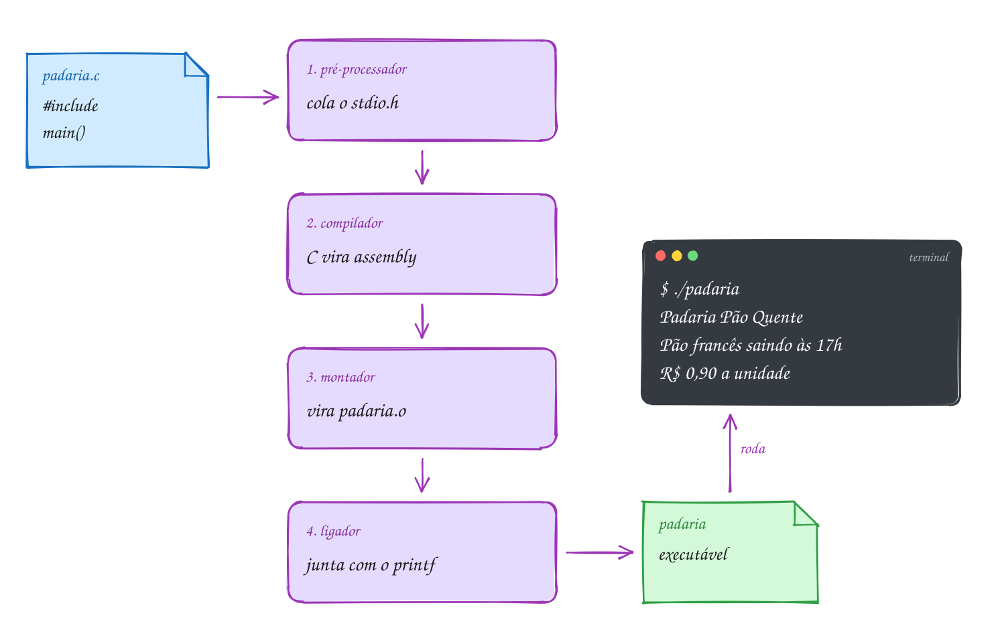
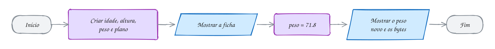
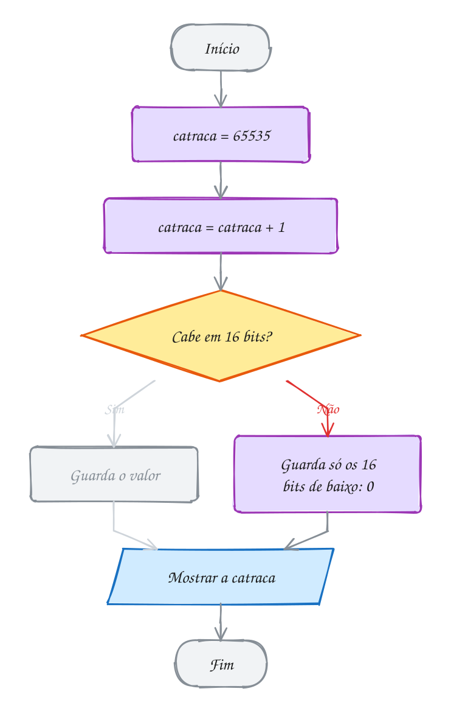
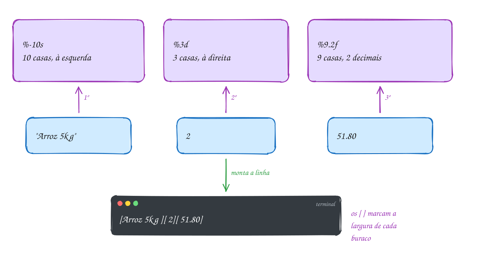
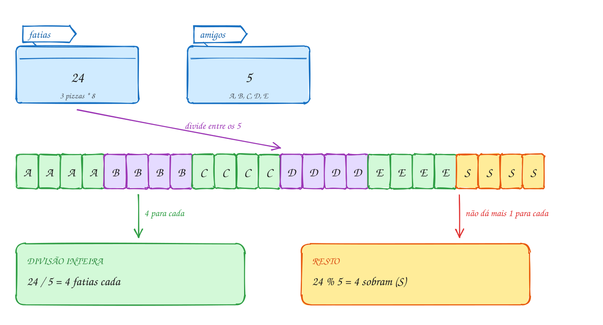
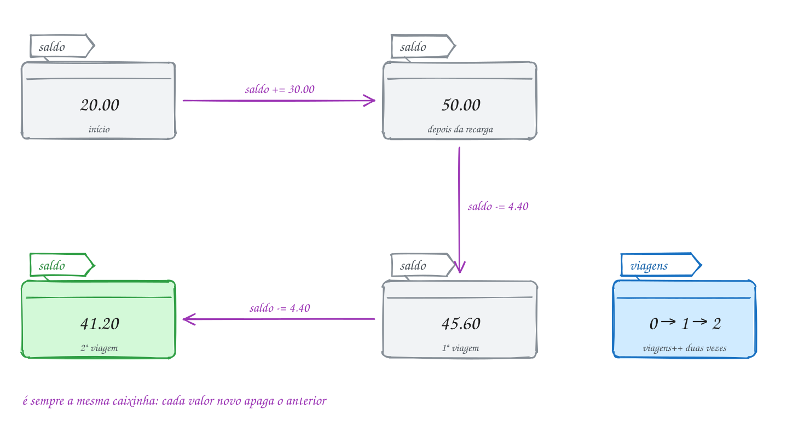
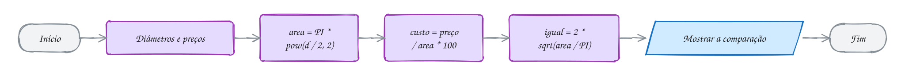
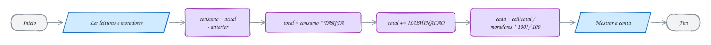

<!-- Gerado por _gerador. Para mudar este arquivo, edite _gerador/modulos/01-fundamentos/ e rode: cd _gerador && npm run gerar -->

# Módulo 01 · Fundamentos de C

Programar é quebrar um problema em passos tão claros que uma máquina, que não
pensa nada, consegue seguir. Essa sequência finita de passos sem ambiguidade
tem nome: **algoritmo**. A receita do bolo, o roteiro do GPS e o passo a passo
para mandar um Pix são algoritmos; um programa é um algoritmo escrito numa
língua que o computador entende.

Quase todo programa segue o mesmo modelo: **entrada → processamento →
saída**. Os dados chegam (o valor da conta, as leituras do relógio de luz), o
programa faz contas com eles e mostra o resultado. E todo algoritmo, por mais
complicado, é montado com só três peças: **sequência** (um passo depois do
outro), **decisão** ("se o saldo cobre, envia") e **repetição** ("enquanto a
senha estiver errada, pergunte de novo"). Este módulo é a primeira peça: a
**estrutura sequencial**. Decisão e repetição vêm nos módulos 02 e 03.

Em C nada fica escondido: cada variável é um pedaço de memória com endereço
e tamanho, cada número tem um limite, e o seu `.c` passa por uma linha de
montagem antes de virar programa. No fim do módulo você escreve programas
completos de entrada, processamento e saída e sabe o que cada linha faz na
memória.

## O que você vai aprender

- o esqueleto de um programa em C e o caminho do `.c` até o executável (pré-processador, compilador, montador, ligador)
- os três tipos de erro: de compilação, de ligação e de execução
- **variáveis**: nome, tipo, valor e endereço; `int`, `float`, `double`, `char` e o `sizeof`
- bit, byte, binário, hexadecimal, os limites de cada tipo e o **overflow**
- constantes com `#define` e `const`, literais e sequências de escape
- mostrar dados com `printf` (largura, precisão, alinhamento) e ler com `scanf` (o `&`, o `%lf`, a sobra no buffer)
- aritmética, divisão inteira, resto e precedência
- conversão automática e **cast**
- operadores compostos, `++` e `--`
- a biblioteca de matemática: `pow`, `sqrt`, `round`, `floor`, `ceil`, `fabs`

## Antes de começar

Você precisa do compilador `gcc` e, para os módulos de memória, do `gdb` e do
`valgrind`. Cada exercício tem uma resolução em `_respostas/01-fundamentos/`.

**Arch Linux** (e derivados, como Manjaro e EndeavourOS):

```bash
sudo pacman -S --needed base-devel gdb valgrind
```

**Debian / Ubuntu** (e derivados, como Mint e Pop!_OS):

```bash
sudo apt install build-essential gdb valgrind
```

**Windows**: use o **WSL** com Ubuntu. No PowerShell como administrador,
rode `wsl --install`, reinicie, abra o Ubuntu e instale com o comando do
Debian/Ubuntu acima. Clone o curso dentro do Linux do WSL (em `~/LPEDC`),
não numa pasta do Windows.

Confira com `gcc --version`. Se aparecer a versão, está pronto.

Para rodar qualquer arquivo do curso, use o **`rodar`**, que está na raiz do
projeto:

```bash
~/LPEDC/rodar 01-fundamentos/0001-primeiro-programa/A001.c
```

Ele compila e executa. O caminho pode ser relativo à pasta atual, relativo
ao LPEDC ou absoluto. O `rodar` usa o padrão C17 (`-std=c17`), liga todos os
avisos (`-Wall -Wextra -pedantic`) e ativa dois detetives: o
**AddressSanitizer**, que flagra erros de memória, e o detector de
**comportamento indefinido**, que flagra coisas como estouro de inteiro. Se o
programa tem um problema desses, ele para com um relatório que aponta a
linha. Os exercícios devem compilar **sem nenhum aviso**.

Programas que leem do teclado esperam você digitar. Para testar sem digitar,
mande a entrada por um cano (`|`): o que vem antes vira o teclado do programa.

```bash
printf '3 4.99\n2\n' | ~/LPEDC/rodar 01-fundamentos/0006-scanf/A011.c
```

> [!NOTE]
> Material antigo de C (e muita apostila por aí) usa `void main`, `conio.h`,
> `getch()`, `system("pause")`, `fflush(stdin)` e `gets`. Nada disso é C
> padrão ou seguro. Quando aparecer, o curso avisa e mostra a alternativa.

| # | Assunto | Pasta |
| --- | --- | --- |
| [0001](#0001--o-primeiro-programa) | O primeiro programa | [`0001-primeiro-programa/`](01-fundamentos/0001-primeiro-programa/) |
| [0002](#0002--variáveis) | Variáveis | [`0002-variaveis/`](01-fundamentos/0002-variaveis/) |
| [0003](#0003--tipos-e-limites) | Tipos e limites | [`0003-tipos-e-limites/`](01-fundamentos/0003-tipos-e-limites/) |
| [0004](#0004--constantes) | Constantes | [`0004-constantes/`](01-fundamentos/0004-constantes/) |
| [0005](#0005--printf) | printf | [`0005-printf/`](01-fundamentos/0005-printf/) |
| [0006](#0006--scanf) | scanf | [`0006-scanf/`](01-fundamentos/0006-scanf/) |
| [0007](#0007--aritmética) | Aritmética | [`0007-aritmetica/`](01-fundamentos/0007-aritmetica/) |
| [0008](#0008--conversão-e-cast) | Conversão e cast | [`0008-conversao/`](01-fundamentos/0008-conversao/) |
| [0009](#0009--atribuição--e---) | Atribuição, ++ e -- | [`0009-atribuicao/`](01-fundamentos/0009-atribuicao/) |
| [0010](#0010--mathh) | math.h | [`0010-math/`](01-fundamentos/0010-math/) |
| [0011](#0011--juntando-tudo) | Juntando tudo | [`0011-juntando-tudo/`](01-fundamentos/0011-juntando-tudo/) |

---

## 0001 · O primeiro programa

A padaria do bairro comprou um painel de LED e pediu um aviso de três linhas:
o nome da padaria, o horário da fornada e o preço do pão. São três linhas
de saída, sem entrada nem conta. Mesmo assim, antes de rodar, o arquivo
passa por uma linha de montagem, e cada linha do código tem um motivo.

Um programa em C é um conjunto de **funções**. Uma delas é especial: a
**`main`**. Quando você roda o executável, o sistema começa por ela. O
esqueleto que você vai escrever em todo exemplo do curso:

| Linha | O que faz |
| --- | --- |
| `// Aviso do painel da padaria` | **comentário**: o compilador ignora; é para quem lê |
| `#include <stdio.h>` | cola aqui o arquivo que **declara** o `printf` |
| `int main(void) {` | começa a `main`: não recebe nada (`void`) e devolve um `int` |
| `printf("...\n");` | mostra um texto na tela; `\n` pula a linha |
| `return 0;` | termina a `main` e devolve 0 ao sistema: "deu tudo certo" |
| `}` | fecha o **bloco** da `main` |

Regras que valem sempre: toda **instrução** termina em `;` (o
`#include` não é instrução, e por isso não leva); as **chaves** `{ }` agrupam
instruções num bloco; o C diferencia maiúsculas de minúsculas (`Main` não é
`main`); comentário de uma linha começa com `//`, e o de várias linhas fica
entre `/*` e `*/`.

### Do .c ao executável

O processador não entende C. Antes de rodar, o arquivo passa por quatro
estações, e quem comanda tudo é o **compilador** `gcc`:

1. **pré-processador**: trata as linhas com `#`. O `#include <stdio.h>`
   **cola** o conteúdo do `stdio.h` no lugar da linha;
2. **compilador**: confere a gramática e os tipos e traduz o C para
   **assembly**, a língua do processador em forma de texto;
3. **montador**: transforma o assembly em **código objeto** (`.o`), já em
   binário, mas com buracos: ele sabe que você chamou `printf`, não onde ele
   está;
4. **ligador** (*linker*): junta o `.o` com a **biblioteca padrão**, onde mora
   o código do `printf`, tapa os buracos e grava o **executável**.

Na mão, as quatro estações saem de um comando só: `gcc padaria.c -o padaria`
e depois `./padaria`. No curso você usa o `~/LPEDC/rodar`, que faz o mesmo
com mais cuidado: liga todos os avisos (`-Wall -Wextra -pedantic`), usa o
padrão C17 e ativa o **AddressSanitizer**, que vigia a memória enquanto o
programa roda.

O `padaria.c` entra na linha de montagem, ganha o
`stdio.h` colado, vira assembly, vira `padaria.o`, é ligado ao `printf` e sai
como o executável `padaria`, que mostra as três linhas no terminal:

<p align="center"></p>

O programa completo:

```c
// Aviso do painel da padaria
#include <stdio.h>

int main(void) {
    printf("Padaria Pão Quente\n");
    printf("Pão francês saindo às 17h\n");
    printf("R$ 0,90 a unidade\n");
    return 0; // 0 = terminou bem
}
// Saída:
// Padaria Pão Quente
// Pão francês saindo às 17h
// R$ 0,90 a unidade
```

Cada estação pode parar a linha de montagem, e cada uma reclama de um jeito.
O exemplo passa por todas sem erro e termina com o programa rodando:

<p align="center"></p>

Saber **quem reclamou** é meio caminho para consertar. Há três tipos de erro:

- **de compilação**: arquivo do `#include` que não existe (pré-processador),
  falta de `;`, `Int` no lugar de `int`. O gcc mostra o arquivo, a linha e a
  coluna, e não gera executável;
- **de ligação**: o código está certo na gramática, mas uma função não existe
  em lugar nenhum. Escreva `prinft` e o ligador para com
  `undefined reference to 'prinft'`;
- **de execução**: compila, roda e mostra o valor errado ou quebra no meio. É o pior tipo, porque o compilador não tem como ver. Os **avisos**
  (*warnings*) do gcc e o AddressSanitizer existem para pegar parte deles.

> [!WARNING]
> O `printf` **não pula linha sozinho**. Sem o
> `\n`, o próximo `printf` continua de onde o cursor parou:
> `printf("Pão"); printf("Quente");` mostra `PãoQuente`. E quando faltar um
> `;`, o gcc avisa `expected ';' before ...` apontando para a linha
> **seguinte**, porque só lá ele percebe que faltou alguma coisa.

> [!TIP]
> **Por dentro do C:** salve o programa da padaria como `padaria.c`, rode
> `gcc -E padaria.c | wc -l` e veja o seu programa de poucas linhas virar
> centenas: é o `stdio.h` colado. Rode `gcc -S padaria.c`, abra o
> `padaria.s` e procure `call`: você acha `puts`, não `printf`. O compilador viu
> que era só texto fixo com `\n` e trocou por uma função mais simples. Dentro
> do executável, cada texto entre aspas fica guardado byte a byte, seguido de
> um byte zero que marca o fim. Acento custa mais: no UTF-8, `ã` ocupa 2
> bytes, então `"Pão"` ocupa 5 (`P`, os dois do `ã`, `o` e o zero). E o
> `return 0` chega ao sistema: logo depois de rodar, `echo $?` mostra 0.

> [!NOTE]
> **Pergunta para você:** se você apagar o `\n` do segundo `printf`, quantas
> linhas aparecem e como fica cada uma? E se escrever `Printf` com P
> maiúsculo, qual estação reclama? Responda e teste no `padaria.c`.

### Hora de praticar

Arquivos em [`0001-primeiro-programa/`](01-fundamentos/0001-primeiro-programa/).

**Exemplo A001 · Quem separa as instruções é o ponto e vírgula**

```c
/*
   Para o compilador, quebra de linha, espaço e recuo são só enfeite.
   O que termina uma instrução é o ; e o que agrupa é o par de chaves.
*/
#include <stdio.h>

int main(void) {
    // duas instruções na mesma linha: o ; separa uma da outra
    printf("Banca do Seu Zé\n"); printf("Frutas e verduras\n");

    // uma instrução espalhada em três linhas: ela só acaba no ;
    printf(
        "Abacaxi: R$ 7,00\n"
    );

    printf("\n"); // um printf só com \n deixa uma linha em branco

    printf("Banana: R$ 5,50 a dúzia\n"); /* comentário de bloco no fim */
    printf(/* comentário até no meio */ "Laranja: R$ 4,00 o kg\n");
    return 0;
}
// Saída:
// Banca do Seu Zé
// Frutas e verduras
// Abacaxi: R$ 7,00
//
// Banana: R$ 5,50 a dúzia
// Laranja: R$ 4,00 o kg
//
// O recuo de 4 espaços também é só para quem lê: apague todos e rode de
// novo. A saída é a mesma. Agora apague o ; do primeiro printf e veja o gcc
// reclamar do printf seguinte, que está na mesma linha.
```

```bash
~/LPEDC/rodar 01-fundamentos/0001-primeiro-programa/A001.c
```

**Exemplo A002 · Um printf, várias linhas (e vários printf, uma linha)**

```c
#include <stdio.h>

/*
   Comentário de bloco: pode ocupar várias linhas.
   Bom para explicar o que o programa faz, no topo do arquivo.
*/
int main(void) {
    // três printf montando UMA linha: sem \n, o cursor fica onde parou
    printf("Cardápio: ");
    printf("café, ");
    printf("pão na chapa\n");

    // um printf só montando TRÊS linhas: cada \n pula uma
    printf("Café: R$ 4,50\nPão na chapa: R$ 6,00\nPingado: R$ 5,00\n");

    // dois textos entre aspas lado a lado viram um só (útil para linhas longas)
    printf("Aberto de segunda a sábado, "
           "das 6h às 20h\n");

    // printf("Esta linha nunca aparece: está comentada\n");
    return 0;
}
// Saída:
// Cardápio: café, pão na chapa
// Café: R$ 4,50
// Pão na chapa: R$ 6,00
// Pingado: R$ 5,00
// Aberto de segunda a sábado, das 6h às 20h
//
// Depois de rodar, digite "echo $?" no terminal: aparece 0, o valor do return.
```

```bash
~/LPEDC/rodar 01-fundamentos/0001-primeiro-programa/A002.c
```

#### Exercícios

**Exercício E001** · ★☆☆

Escreva um programa que mostre o letreiro do ônibus, exatamente assim.
Rode de dois jeitos: com o rodar e na mão, com gcc, gerando um executável
chamado "letreiro".


```text
Saída esperada:
Linha 077 - Terminal Centro
Via Av. Brasil
Tarifa: R$ 4,90
```

**Dicas:**

1. Comece pelo esqueleto do A001: o #include, a main com as chaves e o
   return 0;.
2. Um printf por linha, cada um terminando com \n.
3. Na mão, dentro desta pasta: gcc E001.c -o letreiro e depois ./letreiro.
4. Resposta esperada: as três linhas acima, iguais nos dois jeitos.

```bash
~/LPEDC/rodar 01-fundamentos/0001-primeiro-programa/E001.c
```

**Exercício E002** · ★☆☆

Monte a lista de compras abaixo com estas regras: a primeira linha sai de
TRÊS printf, um para "Bom ", um para "dia" e um para "!"; as outras quatro
linhas (contando a vazia) saem de UM printf só. Deixe também, entre os
dois grupos, um printf("Boa tarde\n"); desligado com //, que não pode
aparecer na saída.


```text
Saída esperada:
Bom dia!
Café
Pão
```


```text
Manteiga
```

**Dicas:**

1. Sem \n, o próximo printf continua na mesma linha: só o terceiro da
   primeira linha leva \n.
2. Dois \n seguidos deixam uma linha vazia.
3. Resposta esperada: printf("Bom "); printf("dia"); printf("!\n");
   // printf("Boa tarde\n"); printf("Café\nPão\n\nManteiga\n"); e as 5
   linhas acima (a 4ª vazia).

```bash
~/LPEDC/rodar 01-fundamentos/0001-primeiro-programa/E002.c
```

**Exercício E003** · ★★☆

Este programa tem QUATRO erros e não compila de propósito. Conserte o
código: rode com o rodar, leia a primeira mensagem, conserte, rode de novo
e repita até sair a saída esperada. A cada rodada, repare qual estação
reclamou: compilador ou ligador.


```text
Saída esperada (depois de consertar):
Farmácia aberta 24h
Plantão: (11) 5555-0199
```

**Dicas:**

1. Comece pelo topo: um comentário que não fecha engole todo o resto.
2. Olhe com atenção as maiúsculas e os nomes das funções. E os ;.
3. Resposta esperada: (1) o /* da primeira linha nunca fecha
   ("unterminated comment"): feche com */; (2) Int com I maiúsculo não é
   tipo ("unknown type name 'Int'"): use int; (3) falta ; depois do
   primeiro printf ("expected ';'"). Esses três são do compilador. (4)
   print não existe: o compilador só avisa "implicit declaration of
   function 'print'", e quem para é o ligador, com "undefined reference
   to 'print'": use printf.

```bash
~/LPEDC/rodar 01-fundamentos/0001-primeiro-programa/E003.c
```

**Exercício E004** · ★★☆

O aviso do cinema foi escrito com pressa: quase tudo numa linha só, sem
recuo, e com um comentário no lugar errado. Ele compila sem aviso, mas
mostra só duas das três linhas. Reorganize o código: uma instrução por
linha, recuo de 4 espaços dentro da main, um comentário de bloco no topo
dizendo o que o programa faz, e o comentário "sala 2" num lugar onde não
engula nada. Rode e confira as três linhas.


```text
Saída esperada:
Cine Estação
Sessão: 19h30 (sala 2)
Ingresso: R$ 28,00
```

**Dicas:**

1. O // desliga tudo o que vem depois dele, até o fim da LINHA, e não até
   o próximo ;.
2. O texto "(sala 2)" tem de ir para dentro das aspas do segundo printf.
3. Resposta esperada: três printf, cada um na sua linha, e as três linhas
   acima. O comentário // pode ficar no fim de uma linha, depois do ;.

```bash
~/LPEDC/rodar 01-fundamentos/0001-primeiro-programa/E004.c
```

**Exercício E005** · ★★★

O número do return chega ao sistema, e é assim que scripts e ferramentas
de CI sabem se um programa deu certo: 0 é sucesso, qualquer outro número
é um código de erro. Escreva o programa de um backup que FALHOU: ele
mostra as duas linhas abaixo e devolve o código 2 ao sistema. Rode assim,
de dentro desta pasta, e confira as três linhas da saída esperada:


```text
~/LPEDC/rodar E005.c; echo "código: $?"
```


```text
Saída esperada:
Backup falhou: disco cheio
Código de saída: 2
código: 2
```


Depois rode ~/LPEDC/rodar E005.c && echo "pode seguir" e confira que o
"pode seguir" NÃO aparece. Por fim, troque para return 258 e rode a
primeira linha de novo: o terminal tem de mostrar "código: 2" outra vez.

**Dicas:**

1. A segunda linha é um printf comum, com o texto fixo. A terceira quem
   escreve é o echo do terminal: o $? guarda o código de saída do último
   comando.
2. O && do terminal só roda o segundo comando se o primeiro devolveu 0.
3. O sistema guarda só 1 byte (8 bits) do código de saída, e um byte vai
   de 0 a 255 (o porquê vem no assunto 0003): 258 dá a volta e vira 2.
4. Resposta esperada: dois printf e return 2;. A saída acima, sem o
   "pode seguir"; com return 258, "código: 2" de novo.

```bash
~/LPEDC/rodar 01-fundamentos/0001-primeiro-programa/E005.c
```

**Exercício E006** · ★★★

O letreiro do ônibus abaixo tem um erro para cada tipo de reclamação: um
que o pré-processador pega, um do compilador, um do ligador e um que
ninguém pega (o programa roda e mostra o valor errado: a tarifa certa é
R$ 4,90). Conserte o código, um erro por vez. A cada rodada, anote qual
estação parou a linha de montagem, e só pare quando a saída for
exatamente a esperada.


```text
Saída esperada (depois de consertar):
Linha 077 - Terminal Centro
Via Av. Brasil
Tarifa: R$ 4,90
```

**Dicas:**

1. O pré-processador só cuida das linhas com #. O compilador para no
   primeiro erro de gramática. O ligador procura funções pelo nome,
   inclusive a main.
2. Depois que tudo compilar, compare a saída com a esperada, letra por
   letra: o compilador não sabe qual é a tarifa certa.
3. Resposta esperada: (1) stdoi.h vira stdio.h ("No such file or
   directory", pré-processador); (2) falta o ; depois do primeiro printf
   ("expected ';'", compilador); (3) Main com M maiúsculo não é a main
   ("undefined reference to `main'", ligador); (4) R$ 9,40 vira R$ 4,90
   (erro de execução, de lógica). E as três linhas acima.

```bash
~/LPEDC/rodar 01-fundamentos/0001-primeiro-programa/E006.c
```

---

## 0002 · Variáveis

Na matrícula da academia, a recepcionista preenche uma ficha: idade 25,
altura 1,75 m, peso 72,5 kg, plano B. Um mês depois, ela apaga o peso e
escreve 71,8. A ficha continua a mesma; só o conteúdo de um campo mudou.

Uma **variável** é um campo dessa ficha: um pedaço da memória com
**nome**, **tipo**, **valor** e **endereço**. O nome é para você. O endereço é
para o computador: o número do primeiro byte que o valor ocupa. O tipo diz
quantos bytes a variável ocupa e como ler esses bytes.

No C, você escolhe o tipo de cada variável. Ele vem **antes** do nome e não
muda nunca mais. Os quatro tipos básicos:

| Tipo | Guarda | Tamanho típico | Exemplo |
| --- | --- | --- | --- |
| `int` | inteiro | 4 bytes | `int idade = 25;` |
| `float` | real, uns 7 dígitos | 4 bytes | `float altura = 1.75;` |
| `double` | real, uns 15 dígitos | 8 bytes | `double peso = 72.5;` |
| `char` | um caractere (um número pequeno) | 1 byte | `char plano = 'B';` |

Esses são os **tipos primitivos** (os livros e a prova também dizem **tipos
simples** ou **dados simples**): cada variável guarda um valor só. Vetores e
structs, que juntam vários valores, são os **dados compostos** (módulos 05 e 08).

**Declarar** é criar a variável: `int idade;`. **Inicializar** é dar o
primeiro valor junto: `int idade = 25;`. Para mostrar o valor, o `printf` usa
um código para cada tipo: `%d` para `int`, `%f` para `float` e `double`, `%c`
para `char`. O `%.1f` limita a uma casa decimal (o `printf` completo vem no
0005).

Guardar um valor novo **apaga** o antigo: depois de `peso = 71.8;`, o 72,5
sumiu para sempre. Ler a variável, ao contrário, não muda nada. E o operador
**`sizeof`** diz quantos bytes um tipo ou uma variável ocupa; para mostrar o
resultado, use `%zu`.

Regras para o nome: letras, dígitos e `_`, sem começar por dígito, sem acento
e sem espaço; `peso` e `Peso` são variáveis diferentes; palavras do C (`int`,
`return`, `float`...) não valem. A convenção do curso é `snake_case`:
`peso_atual`, `valor_total`.

A ficha vira quatro caixinhas, cada uma com seu tipo,
seu tamanho e seu endereço. Depois, o peso recebe um valor novo e o antigo
desaparece:

<p align="center"></p>

A ficha em C:

```c
#include <stdio.h>

int main(void) {
    int idade = 25;       // inteiro
    float altura = 1.75;  // real com uns 7 dígitos
    double peso = 72.5;   // real com uns 15 dígitos
    char plano = 'B';     // um caractere, entre aspas simples

    printf("Idade: %d anos\n", idade);
    printf("Altura: %.2f m\n", altura);
    printf("Peso: %.1f kg\n", peso);
    printf("Plano: %c\n", plano);

    peso = 71.8; // um mês depois: o 72.5 some
    printf("Peso novo: %.1f kg\n", peso);
    printf("Bytes: %zu, %zu, %zu, %zu\n",
           sizeof idade, sizeof altura, sizeof peso, sizeof plano);
    return 0;
}
// Saída:
// Idade: 25 anos
// Altura: 1.75 m
// Peso: 72.5 kg
// Plano: B
// Peso novo: 71.8 kg
// Bytes: 4, 4, 8, 1
```

Criar as variáveis é um passo de processamento (o programa reserva memória),
e a troca do peso é outro. Ainda é sequência pura:

<p align="center"></p>

> [!WARNING]
> Variável criada sem valor não vale zero: vale **lixo**, o que já estava
> naqueles bytes. `int total; printf("%d", total);` pode mostrar 0, 32767 ou
> -1294; o gcc avisa `'total' is used uninitialized`. Inicialize sempre. E o
> separador decimal do C é o **ponto**: `double peso = 72,5;` nem compila, porque
> para o C a vírgula separa duas coisas diferentes.

> [!TIP]
> **Por dentro do C:** `&peso` é o endereço da variável, e o `printf` mostra
> endereços com `%p` (o `(void *)` na frente é exigência do `%p`; você entende
> no módulo de ponteiros). Rode o A004 sem o AddressSanitizer
> (`gcc A004.c -o a && ./a`) e repare: as variáveis ficam **coladas** na
> memória, e a distância entre um endereço e o próximo é o tamanho da
> variável. O `sizeof` não roda nada: o compilador já sabe o tamanho de cada
> tipo e escreve o número direto no executável. Os tamanhos da tabela são os
> de um PC de 64 bits; o padrão do C só garante mínimos, por isso o `sizeof`
> existe.

> [!NOTE]
> **Pergunta para você:** o `char` guarda um número pequeno. O que você acha
> que `printf("%d\n", plano);` mostra? Teste no programa acima.

### Hora de praticar

Arquivos em [`0002-variaveis/`](01-fundamentos/0002-variaveis/).

**Exemplo A003 · A cópia que não acompanha e o float que arredonda**

```c
#include <stdio.h>

int main(void) {
    // = copia o VALOR: depois disso, as duas variáveis seguem separadas
    int pao_manha = 40;
    int pao_tarde = pao_manha;  // a tarde começa com uma cópia: 40
    pao_manha = 25;             // mudar uma não mexe na outra
    printf("Pães de manhã: %d, de tarde: %d\n", pao_manha, pao_tarde);

    // várias variáveis do mesmo tipo numa linha, separadas por vírgula
    char fila = 'C', caixa = '3';
    printf("Fila %c, caixa %c\n", fila, caixa);

    // o float guarda uns 7 dígitos; o double, uns 15
    float premio_float = 12345678.9;
    double premio_double = 12345678.9;
    printf("Prêmio no float:  %.1f\n", premio_float);
    printf("Prêmio no double: %.1f\n", premio_double);
    return 0;
}
// Saída:
// Pães de manhã: 25, de tarde: 40
// Fila C, caixa 3
// Prêmio no float:  12345679.0
// Prêmio no double: 12345678.9
//
// O 12345678.9 tem 9 dígitos: o float não dá conta e guarda o valor mais
// perto que ele consegue representar. Dinheiro e medidas: use double.
```

```bash
~/LPEDC/rodar 01-fundamentos/0002-variaveis/A003.c
```

**Exemplo A004 · Onde moram as variáveis**

```c
#include <stdio.h>

// Cada variável ocupa alguns bytes seguidos da memória. O endereço (&nome)
// é o número do primeiro desses bytes. O %p mostra endereços em hexadecimal.
int main(void) {
    char plano = 'B';
    int idade = 25;
    double peso = 72.5;

    printf("plano: %zu byte  em %p\n", sizeof plano, (void *)&plano);
    printf("idade: %zu bytes em %p\n", sizeof idade, (void *)&idade);
    printf("peso:  %zu bytes em %p\n", sizeof peso, (void *)&peso);

    printf("int: %zu, float: %zu, double: %zu, char: %zu\n",
           sizeof(int), sizeof(float), sizeof(double), sizeof(char));
    return 0;
}
// Saída (os endereços mudam a cada execução):
// plano: 1 byte  em 0x7f2e53c00020
// idade: 4 bytes em 0x7f2e53c00030
// peso:  8 bytes em 0x7f2e53c00040
// int: 4, float: 4, double: 8, char: 1
//
// Com o rodar, o AddressSanitizer deixa uma folga entre as variáveis para
// flagrar quem escreve fora do lugar. Sem ele, elas ficam coladas:
//   gcc A004.c -o a && ./a
//   plano: 1 byte  em 0x7ffccb532f1b
//   idade: 4 bytes em 0x7ffccb532f1c     (logo depois do plano)
//   peso:  8 bytes em 0x7ffccb532f20     (4 bytes depois da idade)
```

```bash
~/LPEDC/rodar 01-fundamentos/0002-variaveis/A004.c
```

#### Exercícios

**Exercício E007** · ★☆☆

No mercado, a etiqueta de um produto tem: código 1042, preço R$ 8.99,
peso 0.5 kg e setor 'H' (hortifrúti). Crie uma variável para cada dado,
com o tipo certo, e mostre a etiqueta:


```text
Saída esperada:
Código: 1042
Preço: R$ 8.99
Peso: 0.5 kg
Setor: H
```

**Dicas:**

1. Código é inteiro (int); preço e peso são reais (double); setor é char.
2. Use %d, %.2f, %.1f e %c no printf.

```bash
~/LPEDC/rodar 01-fundamentos/0002-variaveis/E007.c
```

**Exercício E008** · ★☆☆

O colega começou o pedido de segunda via do boleto, mas escolheu nomes de
variável que o C não aceita, e o programa não compila. Renomeie as
variáveis inválidas (snake_case, sem acento, sem espaço), sem mudar os
valores, até compilar e mostrar a saída abaixo. As variáveis preco e
Preco estão certas: deixe as duas como estão e confira que o programa
mostra valores diferentes para elas.


```text
Saída esperada (depois de consertar):
Via: 2
Valor final: R$ 89.90
Parcelas: 3
Dia útil: S
preco: 10, Preco: 20
```

**Dicas:**

1. Nome só com letras, dígitos e _, sem começar por dígito, sem espaço.
   O - é o sinal de menos. Palavras do C (int, float, return...) são
   reservadas.
2. Troque o nome na declaração E no printf.
3. Resposta esperada: 2via vira via (ou segunda_via), valor-final vira
   valor_final, float vira parcelas (ou qtd_parcelas) e dia util vira
   dia_util. preco e Preco são variáveis diferentes. E as cinco linhas
   acima.

```bash
~/LPEDC/rodar 01-fundamentos/0002-variaveis/E008.c
```

**Exercício E009** · ★★☆

O cadastro de um aluno da autoescola guarda: idade (int, 19), nota da
prova teórica (double, 8.5), nota da prova prática (double, 9.0),
categoria da CNH (char, 'B') e número de aulas feitas (int, 20). Declare
as cinco variáveis e mostre os valores e o sizeof de cada uma, uma por
linha. Depois, mostre mais duas linhas, calculadas pelo programa: o total
de bytes das cinco variáveis (somando os sizeof) e quanto seria o total
se as duas notas fossem float (use sizeof(float) no lugar delas).


```text
Saída esperada:
idade: 19 (4 bytes)
teorica: 8.5 (8 bytes)
pratica: 9.0 (8 bytes)
categoria: B (1 byte)
aulas: 20 (4 bytes)
total: 25 bytes
com float nas notas: 17 bytes
```

**Dicas:**

1. sizeof nome_da_variavel e %zu no printf.
2. O sizeof pode entrar numa soma, direto no printf:
   sizeof idade + sizeof teorica + ...
3. Resposta esperada: as sete linhas acima (4 + 8 + 8 + 1 + 4 = 25 e
   4 + 4 + 4 + 1 + 4 = 17). Na memória pode haver folgas entre as
   variáveis, mas o total de dados é esse.

```bash
~/LPEDC/rodar 01-fundamentos/0002-variaveis/E009.c
```

**Exercício E010** · ★★☆

O operador do placar eletrônico digitou invertido: o programa abaixo
mostra Casa 1 x 3 Visitante, mas o certo é Casa 3 x 1 Visitante. Sem
mudar as duas primeiras linhas da main, acrescente instruções que TROQUEM
os valores de casa e visitante antes do printf.


```text
Saída esperada:
Casa 3 x 1 Visitante
```

**Dicas:**

1. Escrever casa = visitante; apaga o valor antigo de casa. Ele se perde.
2. Use uma terceira variável para guardar um valor enquanto troca, como
   um copo vazio para trocar o suco de dois copos.
3. Resposta esperada: int aux = casa; casa = visitante; visitante = aux;
   e a saída "Casa 3 x 1 Visitante".

```bash
~/LPEDC/rodar 01-fundamentos/0002-variaveis/E010.c
```

**Exercício E011** · ★★★

Este programa tem TRÊS erros e o gcc mostra um aviso para cada um (numa
versão mais nova do gcc, um deles já vira erro). Conserte o código: rode,
leia os avisos, corrija um por vez e rode de novo até não sobrar aviso. O
jogo terminou 2 x 1 para o time da casa, com público de 45000 pessoas.


```text
Saída esperada (depois de consertar):
Placar: 2 x 1
Resultado: V
Público: 45000
```

**Dicas:**

1. Procure as palavras "uninitialized", "pointer" e "format" nos avisos.
2. Aspas simples são um caractere; aspas duplas são um texto.
3. O %d espera int. Que tipo é publico?
4. Resposta esperada: (1) gols_fora não tem valor (lixo; aviso
   "uninitialized"): int gols_fora = 1;. (2) "V" é texto, não caractere
   ("makes integer from pointer"): use 'V'. (3) %d com double ("expects
   argument of type 'int'"): declare publico como int (ou mostre com
   %.0f).

```bash
~/LPEDC/rodar 01-fundamentos/0002-variaveis/E011.c
```

**Exercício E012** · ★★★

Para o C, um char é só um número pequeno: o %c mostra o símbolo que tem
aquele código, e o %d mostra o próprio código. Escreva um programa que
mostre as linhas abaixo usando UMA variável char, que você vai
reaproveitando (declara uma vez e troca o valor). As regras:

- nas linhas 1, 3 e 4, o símbolo e o código saem da mesma variável, uma

```text
vez com %c e outra com %d;
```

- para o B da linha 2, guarde na variável o NÚMERO 66 (nada de 'B');
- para o espaço da linha 4, guarde o número 32 (nada de ' ');
- a última linha mostra lado a lado o caractere '7' e o número 7, os dois

```text
com %d.
```


```text
Saída esperada:
A 65
B
7 55
[ ] 32
'7' vale 55, 7 vale 7
```

**Dicas:**

1. char letra = 'A'; printf("%c %d\n", letra, letra);
2. Depois: letra = 66; e assim por diante. Na tabela ASCII, 'A' é 65, '0'
   é 48 e o espaço é 32.
3. '7' é o caractere sete, de
   código 55; 7 é o número sete. São diferentes.

```bash
~/LPEDC/rodar 01-fundamentos/0002-variaveis/E012.c
```

---

## 0003 · Tipos e limites

A catraca do estádio conta os torcedores num contador de 16 bits. No clássico
de domingo, o Maracanã recebeu 78.838 pessoas. Quando o torcedor número 65.536
passou, o painel voltou a mostrar **zero**. Ninguém errou a conta: o número
não cabia.

Por baixo de tudo, a memória é feita de **bits**: chavinhas que valem 0 ou 1.
Oito bits formam um **byte**. Um número inteiro é guardado em **binário** (base
2), em que cada casa vale o dobro da casa da direita:

| casa | 2⁷ | 2⁶ | 2⁵ | 2⁴ | 2³ | 2² | 2¹ | 2⁰ |
| --- | --- | --- | --- | --- | --- | --- | --- | --- |
| vale | 128 | 64 | 32 | 16 | 8 | 4 | 2 | 1 |

Para ler um binário, some as casas que têm 1: `00001101` é 8 + 4 + 1 = 13.
Com 8 bits todos ligados, `11111111`, você chega a 255. Por isso **um byte vai
de 0 a 255**: são 2⁸ = 256 combinações. Com `n` bits, cabem 2ⁿ valores.

Escrever 16 ou 32 zeros e uns cansa. O atalho é o **hexadecimal** (base 16),
com os dígitos 0 a 9 e A a F (A = 10, ..., F = 15). Cada dígito hexa vale
exatamente 4 bits, então um byte são dois dígitos: `1111 1111` = `FF` = 255.
No C, hexadecimal começa com `0x`: `0xFF`, `0xFFFF`.

Agora os tipos. Cada tipo inteiro tem um tamanho, e o tamanho decide a
**faixa**. Os **modificadores** mudam o `int`: `short` (menor), `long` e
`long long` (maiores) e `unsigned` (sem sinal: troca os negativos por mais
positivos). Sem modificador, o tipo inteiro é **com sinal** (`signed`): `int`
e `signed int` são o mesmo tipo. Só o `char` puro fica a cargo da máquina; no
PC Linux ele tem sinal. Num PC Linux de 64 bits:

| Tipo | Bytes | Faixa |
| --- | --- | --- |
| `char` | 1 | -128 a 127 |
| `unsigned char` | 1 | 0 a 255 |
| `short` | 2 | -32.768 a 32.767 |
| `unsigned short` | 2 | 0 a 65.535 |
| `int` | 4 | cerca de ±2,1 bilhões |
| `unsigned int` | 4 | 0 a cerca de 4,3 bilhões |
| `long` / `long long` | 8 | cerca de ±9,2 quintilhões |

O padrão do C só garante mínimos (o `int` pode ter 2 bytes num
microcontrolador, e o `long` tem 4 bytes no Windows). Então não decore a
tabela: o **`<limits.h>`** traz os limites reais da máquina (`INT_MAX`,
`SHRT_MIN`, `USHRT_MAX`...). E quando o tamanho exato importa, o
**`<stdint.h>`** tem tipos com o número de bits no nome: `int8_t`, `uint16_t`,
`int32_t`, `int64_t`.

Passar do limite é **overflow** (estouro). Num tipo `unsigned`, o C garante o
comportamento: o número dá a volta, como o odômetro do carro passando de 99999
para 00000. A catraca é um `unsigned short` com 65.535,
os 16 bits ligados. Somar 1 dá 65.536, que precisa de 17 bits; o bit de cima
não cabe e some:

<p align="center"></p>

A catraca em C:

```c
#include <stdio.h>
#include <limits.h>

int main(void) {
    unsigned short catraca = 65535; // 16 bits, todos ligados
    printf("Maior unsigned short: %d\n", USHRT_MAX);
    printf("Catraca: %d (0x%X)\n", catraca, catraca);

    catraca = catraca + 1; // 65536 não cabe em 16 bits
    printf("Mais um torcedor: %d\n", catraca);

    int publico = 78838; // int tem 32 bits: sobra espaço
    printf("Público: %d (o int vai até %d)\n", publico, INT_MAX);
    return 0;
}
// Saída:
// Maior unsigned short: 65535
// Catraca: 65535 (0xFFFF)
// Mais um torcedor: 0
// Público: 78838 (o int vai até 2147483647)
```

No fluxograma, quem faz a pergunta "cabe em 16 bits?" é o hardware, e não o
seu programa. Quando não cabe, ele guarda só os 16 bits de baixo, sem avisar:

<p align="center"></p>

> [!WARNING]
> Com `unsigned`, o estouro dá a volta. Com tipos **com sinal** (`int`,
> `long`...), estourar é **comportamento indefinido**: o padrão não diz o que
> acontece, e o compilador pode assumir que nunca acontece.
> `int x = INT_MAX; x = x + 1;` costuma virar -2147483648, mas não conte com
> isso. O `rodar` liga o detector de comportamento indefinido, que acusa
> `runtime error: signed integer overflow`. Escolha um tipo que caiba.

> [!TIP]
> **Por dentro do C:** os negativos são guardados em **complemento de dois**:
> o bit mais à esquerda pesa negativo. Num byte com sinal, ele vale -128, e
> `11111111` é -128 + 127 = -1. Por isso a faixa é assimétrica (-128 a 127):
> não existe "-0". O byte `0xFF` é 255 num `unsigned char` e
> -1 num `char`: os bits são iguais, o tipo decide como ler. A ordem dos bytes
> na memória também é curiosa: nos PCs, o byte menos significativo vem
> primeiro (**little-endian**). O 13 num `int` fica como `0D 00 00 00`.

> [!NOTE]
> **Pergunta para você:** se a catraca começasse em 65.530 e passassem 10
> torcedores, o que o painel mostraria? Mude o programa acima e confira.

### Hora de praticar

Arquivos em [`0003-tipos-e-limites/`](01-fundamentos/0003-tipos-e-limites/).

**Exemplo A005 · O mesmo byte lido de dois jeitos**

```c
#include <stdio.h>
#include <stdint.h>

int main(void) {
    // o freezer marca -10 °C e guarda a temperatura num byte com sinal
    int8_t freezer = -10;
    printf("Freezer: %d °C\n", freezer);

    // o painel recebe os MESMOS 8 bits, mas lê como byte sem sinal
    uint8_t byte_no_cabo = freezer;
    printf("No cabo: 0x%X, que sem sinal vale %d\n", byte_no_cabo, byte_no_cabo);

    // a faixa de cada um: 256 combinações nos dois, deslocadas
    printf("int8_t:  %d a %d\n", INT8_MIN, INT8_MAX);
    printf("uint8_t: 0 a %d\n", UINT8_MAX);

    // -10 e 246 completam juntos 256 (2 elevado a 8)
    printf("%d + %d = %d\n", byte_no_cabo, 10, byte_no_cabo + 10);
    return 0;
}
// Saída:
// Freezer: -10 °C
// No cabo: 0xF6, que sem sinal vale 246
// int8_t:  -128 a 127
// uint8_t: 0 a 255
// 246 + 10 = 256
//
// Os bits são 1111 0110 nos dois casos. O tipo decide se o bit de cima
// vale +128 (sem sinal: 246) ou -128 (com sinal: -128 + 118 = -10).
```

```bash
~/LPEDC/rodar 01-fundamentos/0003-tipos-e-limites/A005.c
```

**Exemplo A006 · A tabela de tamanhos e limites desta máquina**

```c
#include <stdio.h>
#include <limits.h>
#include <stdint.h>

// Cada tipo tem o seu código no printf: %d (int), %u (unsigned),
// %ld (long), %lld (long long), %llu (unsigned long long).
int main(void) {
    printf("char:      %zu byte,  %d a %d\n", sizeof(char), CHAR_MIN, CHAR_MAX);
    printf("u. char:   %zu byte,  0 a %d\n", sizeof(unsigned char), UCHAR_MAX);
    printf("short:     %zu bytes, %d a %d\n", sizeof(short), SHRT_MIN, SHRT_MAX);
    printf("int:       %zu bytes, %d a %d\n", sizeof(int), INT_MIN, INT_MAX);
    printf("u. int:    %zu bytes, 0 a %u\n", sizeof(unsigned int), UINT_MAX);
    printf("long:      %zu bytes, até %ld\n", sizeof(long), LONG_MAX);
    printf("long long: %zu bytes, até %lld\n", sizeof(long long), LLONG_MAX);

    // stdint.h: o número de bits está no nome do tipo
    printf("int8_t: %zu, uint16_t: %zu, int32_t: %zu, int64_t: %zu bytes\n",
           sizeof(int8_t), sizeof(uint16_t), sizeof(int32_t), sizeof(int64_t));
    printf("uint64_t vai até %llu\n", (unsigned long long)UINT64_MAX);

    // hexadecimal no código: 0x na frente; cada dígito vale 4 bits
    printf("0xFF = %d, 0xFFFF = %d, 0x7FFFFFFF = %d\n", 0xFF, 0xFFFF, 0x7FFFFFFF);
    return 0;
}
// Saída (num PC Linux de 64 bits):
// char:      1 byte,  -128 a 127
// u. char:   1 byte,  0 a 255
// short:     2 bytes, -32768 a 32767
// int:       4 bytes, -2147483648 a 2147483647
// u. int:    4 bytes, 0 a 4294967295
// long:      8 bytes, até 9223372036854775807
// long long: 8 bytes, até 9223372036854775807
// int8_t: 1, uint16_t: 2, int32_t: 4, int64_t: 8 bytes
// uint64_t vai até 18446744073709551615
// 0xFF = 255, 0xFFFF = 65535, 0x7FFFFFFF = 2147483647
```

```bash
~/LPEDC/rodar 01-fundamentos/0003-tipos-e-limites/A006.c
```

#### Exercícios

**Exercício E013** · ★☆☆

Converta na mão cada binário para hexadecimal (cada grupo de 4 bits vira
um dígito hexa) e escreva os números no código SÓ em hexadecimal, com 0x
na frente. Quem converte para decimal é o printf, com %d. Na tabela de
quantos valores cabem, use também hexa: 2 elevado a 4 é 0x10.


```text
binários: 0001 0110 e 1111 1111; hexas prontos: 0x1F e 0x100
```


```text
Saída esperada:
0001 0110 = 0x16 = 22
1111 1111 = 0xFF = 255
0x1F = 31
0x100 = 256
4 bits: 16 valores
8 bits: 256 valores
16 bits: 65536 valores
```


(Binário escrito como 0b10110 só virou padrão no C23; o rodar, que segue o
C17, avisa se você usar.)

**Dicas:**

1. 0001 é 1 e 0110 é 6: o primeiro binário é 0x16. 1111 é 15, o F.
2. printf("0001 0110 = 0x16 = %d\n", 0x16); o texto antes do %d é fixo.
3. Com n bits cabem 2 elevado a n valores: em binário é um 1 seguido de n
   zeros, e cada 4 zeros viram um 0 no hexa: 0x10, 0x100 e 0x10000.
4. Resposta esperada: as sete linhas acima (16 + 4 + 2 = 22; 1 * 16 + 15
   = 31).

```bash
~/LPEDC/rodar 01-fundamentos/0003-tipos-e-limites/E013.c
```

**Exercício E014** · ★☆☆

Escolha o MENOR tipo inteiro que guarda cada dado com folga e declare uma
variável para cada um, com o valor indicado. Mostre todas com printf.


```text
a) idade de uma pessoa (34)
b) temperatura mínima em São Joaquim, SC, em graus (-8)
c) população do Brasil (203080756)
d) tamanho de um arquivo de vídeo de 5 GB, em bytes (5368709120)
e) ano de nascimento (1991)
```


```text
Saída esperada:
idade: 34
temperatura: -8
população: 203080756
arquivo: 5368709120 bytes
ano: 1991
```

**Dicas:**

1. Confira os limites na tabela do texto ou rodando o A006.
2. short vai até 32767; int até uns 2,1 bilhões; acima disso, long long.
3. Resposta esperada: a) signed char ou int8_t (até 127) serve; short
   também; b) signed char/int8_t (aceita negativo); c) int (cabe com folga
   até 2,1 bilhões); d) long long ou int64_t (passa de 4,2 bilhões, nem
   unsigned int serve); e) short. Na prática, int é o padrão para
   inteiros pequenos: economize só quando tiver milhões deles.

```bash
~/LPEDC/rodar 01-fundamentos/0003-tipos-e-limites/E014.c
```

**Exercício E015** · ★★☆

Três contadores unsigned, três estouros que dão a volta. O programa abaixo
já tem os valores iniciais. Complete: faça cada conta indicada no
comentário (guardando o resultado na própria variável) e mostre uma
linha por contador, com o valor de antes, a conta, o valor de depois e o
máximo do tipo, tirado do limits.h.


```text
Saída esperada:
brilho: 250 + 10 = 4 (máximo 255)
estoque: 0 - 1 = 4294967295 (máximo 4294967295)
odômetro: 65000 + 1000 = 464 (máximo 65535)
```

**Dicas:**

1. A conta muda a variável. Para mostrar o valor de antes, guarde uma
   cópia numa variável int antes da conta.
2. Os máximos: UCHAR_MAX, UINT_MAX e USHRT_MAX. O unsigned int se mostra
   com %u; o unsigned char e o unsigned short, com %d.
3. Passou do máximo, volta a contar do zero: 260 - 256 = 4 e
   66000 - 65536 = 464. Abaixo de zero, vai para o máximo.

```bash
~/LPEDC/rodar 01-fundamentos/0003-tipos-e-limites/E015.c
```

**Exercício E016** · ★★☆

De quantas maneiras 13 corredores podem cruzar a linha de chegada? É
13! (13 fatorial = 1 * 2 * ... * 13). O programa abaixo parte de 12! e
multiplica por 13. Ele compila sem aviso, mas está errado: rode e leia a
mensagem "runtime error" que aparece. Conserte o código e rode de novo
até sair a saída esperada, sem nenhum runtime error.


```text
Saída esperada (depois de consertar):
13! = 6227020800 maneiras
```

**Dicas:**

1. Quanto vale INT_MAX? E 6227020800?
2. O detector de comportamento indefinido do rodar pegou um estouro de
   int, que é um tipo com sinal.
3. Resposta esperada: 13! não cabe em int (máximo 2147483647): "signed
   integer overflow". Sem o detector, o programa mostraria um número
   errado (1932053504). Conserto: long long fatorial e %lld (ou int64_t).

```bash
~/LPEDC/rodar 01-fundamentos/0003-tipos-e-limites/E016.c
```

**Exercício E017** · ★★★

Muitos sistemas guardam a hora como "segundos desde 1/1/1970" num inteiro
de 32 bits com sinal. Esse contador estoura em 19/01/2038. Escreva um
programa que mostre por quê: o maior int32_t, quantos segundos têm 68 e 69
anos (de 365 dias) e o maior int64_t. Compare os números: 1970 + 68 =
2038, e o contador de 32 bits não aguenta chegar aos 69 anos.


```text
Saída esperada:
int32_t vai até 2147483647
68 anos: 2144448000 segundos
69 anos: 2175984000 segundos
int64_t vai até 9223372036854775807
```

**Dicas:**

1. INT32_MAX e INT64_MAX vêm do stdint.h. Para mostrar o de 64 bits,
   converta para long long e use %lld: (long long)INT64_MAX.
2. Um ano tem 365 * 24 * 60 * 60 = 31536000 segundos, que cabe num int.
   Mas 69 anos já não cabem: se a conta for feita em int, o rodar acusa
   "signed integer overflow". Guarde os segundos de um ano numa variável
   long long: aí a multiplicação por 68 ou 69 já é feita em long long.
3. 2147483647 é 2^31 - 1 (31
   bits para o número e 1 para o sinal); com 64 bits, cabem uns 292
   bilhões de anos.

```bash
~/LPEDC/rodar 01-fundamentos/0003-tipos-e-limites/E017.c
```

**Exercício E018** · ★★★

Complemento de dois na prática. O painel de um freezer recebe a
temperatura num byte. Para cada temperatura (-1, -128, 127 e 0), guarde o
valor num int8_t, copie para um uint8_t e mostre: o valor com sinal, o
valor sem sinal e o byte em hexa. Reaproveite as mesmas duas variáveis
(declare uma vez e troque os valores). Por fim, mostre a faixa do int8_t
com as constantes do stdint.h.


```text
Saída esperada:
-1 -> 255 (0xFF)
-128 -> 128 (0x80)
127 -> 127 (0x7F)
0 -> 0 (0x0)
int8_t: -128 a 127
```

**Dicas:**

1. int8_t com_sinal = -1; uint8_t sem_sinal = com_sinal; e depois
   com_sinal = -128; sem_sinal = com_sinal; e assim por diante.
2. printf("%d -> %d (0x%X)\n", com_sinal, sem_sinal, sem_sinal);
3. Os bits não mudam na cópia: o tipo só decide se o bit de cima vale
   -128 ou +128. Para os negativos, sem sinal = com sinal + 256.
4. A faixa é assimétrica
   porque o zero ocupa uma das combinações sem o bit de cima, e não
   existe -0.

```bash
~/LPEDC/rodar 01-fundamentos/0003-tipos-e-limites/E018.c
```

---

## 0004 · Constantes

A tarifa do ônibus aparece em dez lugares do sistema da empresa: no letreiro,
no cálculo da ida e volta, no recibo, no relatório... Em janeiro ela sobe de
R$ 4,40 para R$ 4,90. Se o valor estiver escrito à mão em cada lugar, alguém
vai esquecer um. O certo é escrever o número **uma vez só**, com um nome.

Todo valor escrito direto no código é um **literal**, e todo literal tem um
tipo, decidido pelo jeito de escrever:

| Literal | Tipo | Observação |
| --- | --- | --- |
| `101` | `int` | inteiro sem ponto |
| `4.90` | `double` | todo real é `double`, a não ser que... |
| `4.90f` | `float` | ...tenha o sufixo `f` |
| `5000000000LL` | `long long` | sufixos `L`, `LL`, `U` |
| `0x1F`, `017` | `int` | hexadecimal (31) e **octal** (15): zero à esquerda muda a base! |
| `1.5e3` | `double` | notação científica: 1,5 × 10³ = 1500 |
| `'A'` | `int` | um caractere: vale o código, 65 |
| `"A"` | texto | aspas duplas: `'A'` seguido do byte zero |

Para dar nome a um valor, o C tem dois jeitos. O **`#define`** é uma ordem
para o pré-processador: `#define TARIFA 4.90` faz um "localizar e substituir"
no arquivo antes de o compilador ver o código. O nome `TARIFA` nunca chega ao
compilador; ele só vê `4.90`. A convenção é escrever em MAIÚSCULAS. Sem `=` e
sem `;`.

O outro jeito é o **`const`**: `const int linha = 101;` cria uma variável de
verdade, com tipo, endereço e tamanho, mas **só de leitura**. Tentar mudar dá
erro de compilação, e por isso o valor precisa vir na própria declaração.

Dentro das aspas, a barra invertida avisa que o próximo caractere não é ele
mesmo: é uma **sequência de escape**. `\n` pula linha, `\t` é tabulação, `\"`
põe aspas dentro do texto, `\\` é a própria barra e `\0` é o byte zero. Para
mostrar `%` no `printf`, escreva `%%` (isso é regra do `printf`, não escape).

Antes da compilação, o pré-processador troca `TARIFA` por `4.90` e `EMPRESA`
pelo nome da viação. A `linha` é uma caixinha com cadeado: tem endereço, mas
ninguém escreve nela:

<p align="center"></p>

O mesmo exemplo em C:

```c
#include <stdio.h>

#define TARIFA 4.90          // muda aqui, muda no programa todo
#define EMPRESA "Viação Sol"

int main(void) {
    const int linha = 101;   // variável só de leitura

    printf("%s\n", EMPRESA);
    printf("Linha %d \"Centro - Bairro\"\n", linha);
    printf("Tarifa: R$ %.2f\n", TARIFA);
    printf("Ida e volta: R$ %.2f\n", 2 * TARIFA); // o compilador vê 2 * 4.90
    return 0;
}
// Saída:
// Viação Sol
// Linha 101 "Centro - Bairro"
// Tarifa: R$ 4.90
// Ida e volta: R$ 9.80
```

O primeiro passo do fluxograma acontece antes de o programa existir: a troca
de texto é feita na compilação, e o executável já nasce só com os números:

<p align="center"></p>

> [!WARNING]
> O `#define` cola **exatamente** o texto que vem depois do nome. Com
> `#define TARIFA 4.90;`, a linha `printf("%.2f\n", 2 * TARIFA);` vira
> `printf("%.2f\n", 2 * 4.90;);` e não compila. Com `#define TARIFA = 4.90`,
> vira `2 * = 4.90`. Nada de `=` nem de `;` no `#define`. E o erro aparece na
> linha em que o nome é **usado**, não na do `#define`, o que confunde.

> [!TIP]
> **Por dentro do C:** salve o programa acima como `tarifa.c`, rode
> `gcc -E tarifa.c | tail -12` e veja: não sobrou nenhum `TARIFA`, só
> `4.90`. Por isso um `#define` não ocupa memória, não tem
> tipo e não aparece no depurador. A `const int linha`, ao contrário, mora na memória:
> `&linha` tem endereço e `sizeof linha` vale 4. E os literais têm tamanho:
> `sizeof(4.90)` é 8 (`double`), `sizeof(4.90f)` é 4 e `sizeof('A')` é 4,
> porque no C um caractere entre aspas simples é um `int`. Já `sizeof("A")`
> é 2: a letra e o byte zero que marca o fim do texto.

> [!NOTE]
> **Pergunta para você:** o pré-processador troca `TARIFA` dentro das aspas?
> O que `printf("TARIFA\n");` mostra? Teste no programa acima.

### Hora de praticar

Arquivos em [`0004-constantes/`](01-fundamentos/0004-constantes/).

**Exemplo A007 · Uma constante feita de outras**

```c
#include <stdio.h>

#define TARIFA_CHEIA 4.90
#define DESCONTO_ESTUDANTE 0.5                          // estudante paga meia
#define TARIFA_MEIA (TARIFA_CHEIA * DESCONTO_ESTUDANTE) // um #define usando outros
#define CIDADE "Belo Horizonte"

int main(void) {
    const double recarga = 50.00; // const: tem tipo, tamanho e endereço

    printf("Ônibus de " CIDADE "\n"); // textos lado a lado viram um só
    printf("Inteira: R$ %.2f\n", TARIFA_CHEIA);
    printf("Meia:    R$ %.2f\n", TARIFA_MEIA);
    printf("Recarga: R$ %.2f\n", recarga);

    // o literal tem tamanho, decidido pelo jeito de escrever
    printf("recarga: %zu bytes; 4.90: %zu; 4.90f: %zu\n",
           sizeof recarga, sizeof 4.90, sizeof 4.90f);
    return 0;
}
// Saída:
// Ônibus de Belo Horizonte
// Inteira: R$ 4.90
// Meia:    R$ 2.45
// Recarga: R$ 50.00
// recarga: 8 bytes; 4.90: 8; 4.90f: 4
//
// Veja o que o compilador recebe: gcc -E A007.c | tail -14
// A linha do printf vira "Ônibus de " "Belo Horizonte" "\n" e a meia vira
// (4.90 * 0.5): os parênteses do #define TARIFA_MEIA vão junto.
```

```bash
~/LPEDC/rodar 01-fundamentos/0004-constantes/A007.c
```

**Exemplo A008 · Escapes e literais em várias bases**

```c
#include <stdio.h>

int main(void) {
    // \t: tabulação (pula para a próxima coluna de 8 em 8)
    printf("Item\tQtd\n");
    printf("Pão\t10\n");
    printf("Leite\t2\n");

    // \\ e \": a barra e as aspas dentro do texto
    printf("Arquivo: C:\\fotos\\praia.jpg\n");
    printf("Ela disse: \"Pix feito!\"\n");
    printf("Desconto de 15%%\n"); // %% mostra um %

    // o mesmo número escrito em três bases
    printf("%d %d %d\n", 31, 0x1F, 037);

    // um caractere é um número: o código na tabela ASCII
    printf("%c = %d, %c = %d\n", 'A', 'A', '0', '0');

    // notação científica: 1.5e3 é 1,5 x 10 elevado a 3
    printf("%.1f\n", 1.5e3);
    return 0;
}
// Saída (o \t alinha "Qtd", "10" e "2" na coluna 9):
// Item    Qtd
// Pão     10
// Leite   2
// Arquivo: C:\fotos\praia.jpg
// Ela disse: "Pix feito!"
// Desconto de 15%
// 31 31 31
// A = 65, 0 = 48
// 1500.0
```

```bash
~/LPEDC/rodar 01-fundamentos/0004-constantes/A008.c
```

#### Exercícios

**Exercício E019** · ★☆☆

Mostre exatamente estas linhas, usando sequências de escape. A segunda
linha tem um \t entre "Saldo:" e o valor.


```text
Saída esperada:
Backup salvo em C:\Users\ana\notas.txt
Saldo:	R$ 120,00
O app avisou: "Pix recebido!"
Rendimento: 100% do CDI
```

**Dicas:**

1. A barra invertida sozinha começa um escape: para mostrá-la, use `\\`.
2. Aspas dentro do texto: `\"`. Porcentagem no printf: `%%`.
3. Resposta esperada: as quatro linhas acima (na segunda, o terminal
   mostra a tabulação como espaços até a coluna 9).

```bash
~/LPEDC/rodar 01-fundamentos/0004-constantes/E019.c
```

**Exercício E020** · ★☆☆

O letreiro do posto mostra o nome e o preço de dois combustíveis. Crie um
#define para o nome do posto e um para cada preço, e mostre o letreiro.
Depois "reajuste" a gasolina para 6.49 mudando uma linha só.


```text
Saída esperada:
Auto Posto Ipê
Gasolina: R$ 6.29
Etanol:   R$ 4.19
```

**Dicas:**

1. #define NOME "Auto Posto Ipê", #define GASOLINA 6.29 ...
2. No printf: %s para o nome e %.2f para os preços.
3. Resposta esperada: as três linhas acima; com o reajuste, a segunda
   vira "Gasolina: R$ 6.49" e só a linha do #define mudou.

```bash
~/LPEDC/rodar 01-fundamentos/0004-constantes/E020.c
```

**Exercício E021** · ★★☆

Este programa não compila de propósito: tem TRÊS erros com constantes.
Rode, leia as mensagens (repare em QUAL linha o gcc aponta) e conserte.


```text
Saída esperada (depois de consertar):
Mensalidade: R$ 89.90
Desconto: R$ 10.00
Vencimento: dia 10
```

**Dicas:**

1. O #define cola exatamente o texto que vem depois do nome, = e ;
   inclusive. O gcc acusa a linha onde o nome é usado.
2. Uma variável const precisa receber o valor na declaração, não depois.
3. Resposta esperada: tire o ; de "#define MENSALIDADE 89.90;"; tire o =
   de "#define DESCONTO = 10.00"; e escreva "const int dia = 10;" numa
   linha só (const não aceita atribuição depois: "assignment of read-only
   variable 'dia'").

```bash
~/LPEDC/rodar 01-fundamentos/0004-constantes/E021.c
```

**Exercício E022** · ★★☆

O jeito de escrever um literal decide o tipo e, às vezes, o valor. Escreva
um programa que mostre, para cada literal abaixo, o valor (com %d para os
inteiros e %.1f para os reais) e o tamanho (sizeof, com %zu). O "0" é
texto: dele, mostre só o tamanho.


```text
10     10.0     10.0f     010     0x10     '0'     "0"     1e3
```


```text
Saída esperada:
10: vale 10, 4 bytes
10.0: vale 10.0, 8 bytes
10.0f: vale 10.0, 4 bytes
010: vale 8, 4 bytes
0x10: vale 16, 4 bytes
'0': vale 48, 4 bytes
"0": 2 bytes
1e3: vale 1000.0, 8 bytes
```

**Dicas:**

1. Sem ponto é int; com ponto é double; o sufixo f faz float.
2. Zero à esquerda é octal; 0x é hexadecimal; aspas simples dão o código
   do caractere (um int); aspas duplas são texto com o byte zero no fim.
3. Para mostrar aspas e apóstrofo no formato: \" e '.
4. Ex.:
   printf("010: vale %d, %zu bytes\n", 010, sizeof 010);

```bash
~/LPEDC/rodar 01-fundamentos/0004-constantes/E022.c
```

**Exercício E023** · ★★★

Alguém quis guardar o pi numa constante e calcular o comprimento de uma
pista circular de raio 10 m (2 * pi * raio). O programa compila sem aviso
nenhum, mas mostra 60 m. Conserte o código de dois jeitos, e deixe os
dois no programa: na primeira linha, com uma const do tipo certo; na
segunda, com um #define PI.


```text
Saída esperada (depois de consertar):
Comprimento (const):  62.83 m
Comprimento (define): 62.83 m
```

**Dicas:**

1. const não muda o tipo: pi continua sendo um int, que guarda só a parte
   inteira de 3.14159. Sobra 2 * 3 * 10 = 60.
2. Com o tipo real, o resultado da conta também é real: troque o %d.
3. Resposta esperada: const double pi = 3.14159; e #define PI 3.14159,
   com %.2f nos dois printf.

```bash
~/LPEDC/rodar 01-fundamentos/0004-constantes/E023.c
```

**Exercício E024** · ★★★

Escreva um programa que mostre as seis linhas abaixo, seguindo as regras
de cada uma:

1. crie #define CIDADE "Recife" e use-o para o Recife; a palavra CIDADE

```text
 do começo da linha fica dentro das aspas do formato;
```

2. crie #define DDD 81 e use-o com %d;
3. os três números saem dos literais 010, 0x10 e 10, com %d;
4. "Oi!" sai de %c%c%c, com o 'O', o código do i escrito em hexa (0x69)

```text
 e o código do ! escrito em decimal (33);
```

5. o % aparece na tela;
6. a barra e o n aparecem de verdade, numa linha só.


```text
Saída esperada:
CIDADE: Recife
DDD 81
8 16 10
Oi!
50% off
a\n b
```

**Dicas:**

1. O pré-processador não mexe no que está dentro das aspas.
2. 0x69 é 6 * 16 + 9 = 105, o i na tabela ASCII.
3. Para o % na tela, %%. Para a barra, \\ (e o n fica sozinho).
4. A primeira:
   printf("CIDADE: %s\n", CIDADE);

```bash
~/LPEDC/rodar 01-fundamentos/0004-constantes/E024.c
```

---

## 0005 · printf

O cupom do mercado sai da impressora com as colunas certinhas: o nome do
produto encostado à esquerda, a quantidade e o preço encostados à direita,
sempre com duas casas decimais. Ninguém conta espaços à mão. Quem faz isso é
o **formato**.

O primeiro argumento do `printf` é a **string de formato**: um texto com
**especificadores** (os `%`) que são buracos a preencher. Os outros
argumentos preenchem os buracos **na ordem**, um para cada `%`. Escrever na
tela é escrever na **saída padrão** (`stdout`); o `fprintf` do módulo 09 usa
o mesmo formato para escrever num arquivo:

| Especificador | Mostra | Exemplo | Sai |
| --- | --- | --- | --- |
| `%d` | `int` em decimal | `printf("%d", 42)` | `42` |
| `%u`, `%ld`, `%lld` | `unsigned`, `long`, `long long` | `printf("%ld", 9L)` | `9` |
| `%f` | `double` ou `float` | `printf("%f", 2.5)` | `2.500000` |
| `%e`, `%g` | real em notação científica / o mais curto | `printf("%e", 1500.0)` | `1.500000e+03` |
| `%c` | um caractere | `printf("%c", 'A')` | `A` |
| `%s` | um texto | `printf("%s", "Pix")` | `Pix` |
| `%x`, `%X`, `%o` | inteiro em hexa e em octal | `printf("%X", 255)` | `FF` |
| `%p` | um endereço | `printf("%p", (void *)&n)` | `0x7ffe...` |
| `%zu` | o resultado do `sizeof` | `printf("%zu", sizeof n)` | `4` |
| `%%` | o próprio `%` | `printf("10%%")` | `10%` |

Entre o `%` e a letra cabem ajustes, nesta ordem:
`%[flags][largura][.precisão]letra`.

- **largura** é o **mínimo** de caracteres: `%6d` de 42 dá `    42`
  (alinhado à direita). Se o valor for maior, sai inteiro, nada é cortado;
- **flags**: `-` alinha à esquerda (`%-6d` dá `42    `), `0` completa com
  zeros (`%06d` dá `000042`), `+` mostra o sinal sempre;
- **precisão**: em real, o número de casas decimais (`%.2f`); em texto, o
  máximo de caracteres (`%.3s` de `"Brasil"` dá `Bra`).

A precisão **arredonda só na tela**: `%.2f` de 7.499 mostra `7.50`, mas a
variável continua valendo 7.499.

A linha do arroz tem três buracos: `%-10s` reserva 10
casas para o nome, encostado à esquerda; `%3d` reserva 3 casas para a
quantidade; `%9.2f` reserva 9 casas para o total, com 2 decimais:

<p align="center"></p>

O cupom inteiro em C:

```c
#include <stdio.h>

int main(void) {
    printf("%-10s %3s %9s\n", "Item", "Qtd", "Total");
    printf("%-10s %3d %9.2f\n", "Arroz 5kg", 2, 51.80);
    printf("%-10s %3d %9.2f\n", "Leite", 12, 71.88);
    printf("%-10s %3d %9.2f\n", "Banana", 1, 7.49);
    printf("%-10s %13.2f\n", "TOTAL", 131.17);
    return 0;
}
// Saída:
// Item       Qtd     Total
// Arroz 5kg    2     51.80
// Leite       12     71.88
// Banana       1      7.49
// TOTAL             131.17
```

Cada `printf` é uma saída, e todas usam o mesmo formato. Para mudar a largura
de uma coluna, basta trocar um número em cada linha:

<p align="center"></p>

> [!WARNING]
> O `printf` **confia** em você: se o especificador não combina com o tipo do
> argumento, ele lê os bytes do jeito errado. `printf("%d", 9.90)` não mostra 9
> nem 10: mostra lixo. `printf("%.2f", 5)` também. Faltar argumento dá no mesmo. O
> `-Wall` do `rodar` avisa (`format '%d' expects argument of type 'int'`).
> Nunca ignore esse aviso. E no `printf` não vai `&`: ele quer o valor, não o
> endereço.

> [!TIP]
> **Por dentro do C:** o `printf` aceita qualquer número de argumentos, mas
> não sabe os tipos deles: só o formato diz como ler cada um. Nessa passagem,
> todo `float` é convertido em `double`, e por isso o `%f` serve para os dois.
> A largura conta **bytes**, não letras: `"Feijão"` tem 6 letras e 7 bytes
> (o `ã` ocupa 2 no UTF-8), então `%-10s` deixa a coluna dele uma casa mais
> curta. E o `printf` devolve quantos bytes escreveu: `printf("Olá\n")` devolve
> 5. O A010 mostra isso.

> [!NOTE]
> **Pergunta para você:** o que `printf("[%5.1f]\n", 3456.78);` mostra? A
> largura 5 corta o número? Teste num programa seu.

### Hora de praticar

Arquivos em [`0005-printf/`](01-fundamentos/0005-printf/).

**Exemplo A009 · O extrato que corta o nome comprido**

```c
#include <stdio.h>

int main(void) {
    // zeros à esquerda: o número da conta tem sempre 6 dígitos
    printf("Conta %06d-%d\n", 4521, 7);

    // %-14.14s: coluna de 14 casas e, se o texto for maior, corta em 14
    // %+9.2f: sinal sempre, para entrada e saída ficarem claras
    printf("%-14.14s %+9.2f\n", "Pix recebido de Mariana", 250.00);
    printf("%-14.14s %+9.2f\n", "Mercado", -87.35);
    printf("%-14.14s %+9.2f\n", "Conta de luz da casa", -142.10);
    printf("%-14s %9.2f\n", "Saldo", 20.55);

    // o mesmo valor com precisões diferentes: só a tela muda
    double juros = 0.0875;
    printf("Juros: %.1f%% ou %.3f%%\n", juros * 100, juros * 100);
    return 0;
}
// Saída:
// Conta 004521-7
// Pix recebido d   +250.00
// Mercado           -87.35
// Conta de luz d   -142.10
// Saldo              20.55
// Juros: 8.8% ou 8.750%
```

```bash
~/LPEDC/rodar 01-fundamentos/0005-printf/A009.c
```

**Exemplo A010 · O mesmo valor em vários formatos**

```c
#include <stdio.h>

int main(void) {
    int n = 255;
    double preco = 3.14159;
    char letra = 'A';

    // inteiros: largura, alinhamento, zeros, sinal e outras bases
    printf("[%d] [%6d] [%-6d] [%06d] [%+d]\n", n, n, n, n, n);
    printf("hexa: %x %X %#x   octal: %o\n", n, n, n, n);

    // reais: casas decimais, largura, científica e o "mais curto"
    printf("[%f] [%.2f] [%8.3f] [%e] [%g]\n", preco, preco, preco, preco, preco);

    // caractere e texto (com precisão, o texto é cortado)
    printf("[%c] [%d] [%s] [%.4s] [%8s]\n", letra, letra, "Brasil", "Brasil", "Brasil");

    // o endereço de uma variável e o próprio %
    printf("n mora em %p; 100%% certo\n", (void *)&n);

    // o printf devolve quantos bytes escreveu
    int bytes = printf("Olá\n");
    printf("O printf anterior escreveu %d bytes\n", bytes);
    return 0;
}
// Saída (o endereço muda a cada execução):
// [255] [   255] [255   ] [000255] [+255]
// hexa: ff FF 0xff   octal: 377
// [3.141590] [3.14] [   3.142] [3.141590e+00] [3.14159]
// [A] [65] [Brasil] [Bras] [  Brasil]
// n mora em 0x7f1c2a400020; 100% certo
// Olá
// O printf anterior escreveu 5 bytes
```

```bash
~/LPEDC/rodar 01-fundamentos/0005-printf/A010.c
```

#### Exercícios

**Exercício E025** · ★☆☆

Mostre o boletim da Júlia com um printf por linha, usando variáveis:
nota 8.75 (mostrada com uma casa), 3 faltas e conceito 'B'.


```text
Saída esperada:
Aluna: Júlia
Nota: 8.8
Faltas: 03
Conceito: B
```

**Dicas:**

1. O nome pode ir direto no formato ou como argumento de um %s.
2. %.1f arredonda para uma casa; %02d completa com zero à esquerda.
3. Resposta esperada: as quatro linhas acima (8.75 vira 8.8 só na tela).

```bash
~/LPEDC/rodar 01-fundamentos/0005-printf/E025.c
```

**Exercício E026** · ★☆☆

Escreva os printf que produzem exatamente as quatro linhas abaixo. Os
argumentos são dados: na linha 1, o 42 quatro vezes; na 2, o 3.14159 três
vezes; na 3, o 'R' e três vezes o "Rio"; na 4, o 26 três vezes. Os
colchetes vão fixos no formato, mas nenhum espaço e nenhum zero dentro
deles pode ser digitado à mão: quem põe é o especificador.


```text
Saída esperada:
[   42][42   ][00042][+42]
[3.1][3.142][    3.14]
[R][Rio][   Rio][Rio   ]
[1a][1A][32]
```

**Dicas:**

1. Largura é o mínimo de casas; sem o -, o valor encosta na direita. O 0
   completa com zeros e o + mostra o sinal.
2. Conte as casas de cada colchete: [    3.14] tem 8.
3. 26 = 16 + 10: em hexa, 1 e A (minúsculo com %x, maiúsculo com %X). Em
   octal (%o), 26 = 3 * 8 + 2.
4. Resposta esperada: printf("[%5d][%-5d][%05d][%+d]\n", 42, 42, 42, 42);
   e, nas outras, %.1f %.3f %8.2f; %c %s %6s %-6s; %x %X %o.

```bash
~/LPEDC/rodar 01-fundamentos/0005-printf/E026.c
```

**Exercício E027** · ★★☆

Monte o painel de preços do posto, com as colunas alinhadas. Guarde cada
preço numa variável double e use largura no formato (nada de contar
espaços à mão). A linha de separação tem 22 sinais de igual.


```text
Saída esperada:
Combustível   Preço/L
======================
Gasolina      R$ 6.29
Etanol        R$ 4.19
Diesel S10    R$ 6.09
GNV           R$ 4.99
```

**Dicas:**

1. A primeira coluna tem 14 casas, encostada à esquerda: %-14s.
2. "Combustível" tem acento: na largura, o printf conta bytes, e o í
   ocupa 2. Para o cabeçalho ficar alinhado, use %-15s só nele, ou escreva
   o cabeçalho direto no texto.
3. Resposta esperada: as seis linhas acima, com "R$" sempre na coluna 15.

```bash
~/LPEDC/rodar 01-fundamentos/0005-printf/E027.c
```

**Exercício E028** · ★★☆

Este programa compila, mas o gcc mostra TRÊS avisos, e a saída sai
errada (números sem sentido). Rode, leia cada aviso e conserte. O pedido
tem 3 pizzas de R$ 45.90, total R$ 137.70.


```text
Saída esperada (depois de consertar):
Pizzas: 3
Preço: R$ 45.90
Total: R$ 137.70
```

**Dicas:**

1. Procure "format" nos avisos: cada um diz o que esperava e o que veio.
2. %d é para int e %f para double. Um % sem argumento lê lixo.
3. Resposta esperada: (1) %d com o double preco: use %.2f; (2) %.2f com o
   int quantidade: use %d; (3) o terceiro printf tem %.2f, mas faltou o
   argumento total.

```bash
~/LPEDC/rodar 01-fundamentos/0005-printf/E028.c
```

**Exercício E029** · ★★★

No CSS, uma cor é escrita como #RRGGBB: três bytes em hexadecimal, sempre
com dois dígitos cada. O azul do botão do seu app tem vermelho 30, verde
144 e azul 255. Guarde os três componentes em variáveis int e mostre a
cor nos dois formatos do CSS.


```text
Saída esperada:
#1E90FF
rgb(30, 144, 255)
```


Teste também com vermelho 0, verde 8 e azul 15: a saída tem de ser
#00080F, sempre com 7 caracteres.

**Dicas:**

1. %X mostra em hexadecimal com letras maiúsculas.
2. Um componente pequeno (8) viraria só "8". A largura 2 com zero à
   esquerda resolve: %02X.
3. Resposta esperada: printf("#%02X%02X%02X\n", r, g, b); mostra #1E90FF
   e, com 0, 8 e 15, #00080F.

```bash
~/LPEDC/rodar 01-fundamentos/0005-printf/E029.c
```

**Exercício E030** · ★★★

Seis linhas, seis pegadinhas. Escreva um programa que mostre exatamente a
saída abaixo usando, como argumento de cada printf, o valor indicado (e
não o texto pronto):


```text
linha 1: 3456.78
linha 2: "Brasília"
linha 3: 2.675, duas vezes
linha 4: 123456.0
linha 5: 0.0001 e 0.00001, com o mesmo especificador nos dois
linhas 6 e 7: "Pão" e o número que o printf do "Pão" devolveu
```


```text
Saída esperada:
[3456.8]
[Bra]
[2.67] [2.67499999999999982236]
[1.234560e+05]
[0.0001] [1e-05]
Pão
[5]
```

**Dicas:**

1. A largura é mínima, nunca corta: [3456.8] sai de %.1f, de %5.1f e até
   de %1.1f. Já a precisão de um %s corta o texto.
2. 2.675 não existe exato em binário: o double guarda 2.67499999...,
   por isso o %.2f mostra 2.67, e não 2.68. Com %.20f você vê o número
   guardado.
3. O %g escolhe o formato mais curto e passa para o científico quando o
   expoente fica menor que -4. O científico de sempre é o %e.
4. O printf devolve quantos BYTES escreveu: int n = printf("Pão\n");
   O ã ocupa 2 bytes no UTF-8.
5. A última vem de
   printf("[%d]\n", n): P, ã (2 bytes), o e o \n somam 5.

```bash
~/LPEDC/rodar 01-fundamentos/0005-printf/E030.c
```

---

## 0006 · scanf

No app do banco, você agenda um Pix: digita o valor, R$ 150,75, e o dia do
mês, 12. O app lê o que você digitou, guarda e confirma. Até aqui os
programas só falavam; agora eles vão **ouvir**. A **entrada** do modelo
entrada → processamento → saída vem do teclado.

Quem lê é o **`scanf`**, o espelho do `printf`. O formato diz o que esperar,
e os outros argumentos dizem **onde guardar**:

```c
scanf("%d", &dia);
```

O `&` é obrigatório: `&dia` é o **endereço** da variável. O `scanf` não quer o
valor de `dia` (que ainda é lixo); ele quer saber em que bytes da memória
escrever o número digitado. No `printf` não vai `&`; no `scanf`, vai em toda
variável simples.

Os especificadores quase repetem os do `printf`, com uma diferença que pega
muita gente: **`double` se lê com `%lf`** e se mostra com `%f`.

| Tipo | Lê com | Mostra com |
| --- | --- | --- |
| `int` | `%d` | `%d` |
| `float` | `%f` | `%f` |
| `double` | `%lf` | `%f` |
| `char` | `%c` (ou `" %c"`) | `%c` |

O que você digita não vai direto para a variável. Vai para um **buffer**, uma
fila de caracteres, e só chega ao programa quando você aperta Enter. O `scanf`
tira da fila só o que o formato pede. `%d` e `%lf` pulam espaços e Enters
antes do número e param no primeiro caractere que não serve. O que sobra
**fica na fila** para a próxima leitura, inclusive o `'\n'` do Enter.

Caracteres comuns no formato precisam aparecer na entrada:
`scanf("%d/%d/%d", &d, &m, &a)` lê `7/9/2026`. E o `scanf` **devolve** quantos
itens conseguiu guardar: 1, 2, 3... ou 0 se o primeiro já falhou, ou `EOF`
(-1) se a entrada acabou. É assim que um programa descobre se a leitura deu
certo. No módulo 02, com o `if`, você vai usar esse número para decidir o que
fazer; por enquanto, mostre e observe.

Acompanhe uma execução: você digita `150.75`, Enter, `12`, Enter. O `%lf` tira
`150.75` da fila e escreve no endereço de `valor`. O `%d` pula o `'\n'` que
sobrou, tira o `12` e escreve em `dia`. O último `'\n'` continua na fila:

<p align="center"></p>

O agendamento em C:

```c
#include <stdio.h>

int main(void) {
    double valor;
    int dia;

    printf("Valor do Pix: R$ ");
    scanf("%lf", &valor);            // %lf: double no scanf
    printf("Dia do mês: ");
    int lidos = scanf("%d", &dia);   // devolve quantos itens leu

    printf("Pix de R$ %.2f agendado para o dia %d\n", valor, dia);
    printf("O último scanf leu %d item\n", lidos);
    return 0;
}
// Exemplo de execução:
// Valor do Pix: R$ 150.75
// Dia do mês: 12
// Pix de R$ 150.75 agendado para o dia 12
// O último scanf leu 1 item
```

Para testar sem digitar, salve o programa como `pix.c` e use o cano (`|`)
apresentado no começo do módulo: `printf '150.75\n12\n' | ~/LPEDC/rodar pix.c`.

No fluxograma, as duas leituras são paralelogramos de entrada, cada uma
guardando o valor numa caixinha. A saída vem depois:

<p align="center"></p>

> [!WARNING]
> Esquecer o `&` é o erro clássico: `scanf("%d", dia)` entrega ao `scanf` o
> lixo que está em `dia` como se fosse um endereço, e ele escreve num lugar
> qualquer da memória. O programa quebra (`Segmentation fault`) ou, pior,
> estraga outra variável. O gcc avisa: `format '%d' expects argument of type
> 'int *', but argument 2 has type 'int'`. Outro clássico: `%f` para ler um
> `double`. Compila com aviso e o número sai errado.

> [!TIP]
> **Por dentro do C:** o `&valor` é um número como `0x7ffe...050`: o
> endereço do primeiro dos 8 bytes do `double`. Com `%lf`, o `scanf` escreve
> 8 bytes ali; com `%f`, escreve só 4, no formato de `float`, e o `double`
> fica com metade dos bytes errada. No `printf` não tem esse problema porque
> todo `float` vira `double` na passagem; no `scanf` vão endereços, e endereço
> não se converte. E o buffer é por linha: enquanto você não aperta Enter, o
> programa nem sabe que você está digitando.

> [!NOTE]
> **Pergunta para você:** se no dia você digitar `doze`, quanto vale `lidos`?
> E o que aparece no lugar do dia? Teste com
> `printf '150.75\ndoze\n' | ~/LPEDC/rodar ...`.

### Hora de praticar

Arquivos em [`0006-scanf/`](01-fundamentos/0006-scanf/).

**Exemplo A011 · Dois valores numa linha e a sobra que atrapalha**

```c
#include <stdio.h>

int main(void) {
    int quantidade = 0;
    double preco = 0.0;
    int parcelas = 1;

    // um scanf, dois valores: o %lf pula o espaço entre eles
    printf("Quantidade e preço (ex.: 3 4.99): ");
    int lidos = scanf("%d%lf", &quantidade, &preco);
    printf("Itens lidos: %d\n", lidos);

    printf("Parcelas: ");
    lidos = scanf("%d", &parcelas);
    printf("Itens lidos: %d\n", lidos);

    printf("%d unidade(s) de R$ %.2f em %d parcela(s)\n", quantidade, preco, parcelas);
    return 0;
}
// Exemplo de execução:
// Quantidade e preço (ex.: 3 4.99): 3 4.99
// Itens lidos: 2
// Parcelas: 2
// Itens lidos: 1
// 3 unidade(s) de R$ 4.99 em 2 parcela(s)
//
// Teste: printf '3 4.99\n2\n' | ~/LPEDC/rodar <este arquivo>
//
// Agora digite "3 4.99 reais" na primeira pergunta:
//   printf '3 4.99 reais\n2\n' | ~/LPEDC/rodar <este arquivo>
// O " reais" fica na fila. O %d das parcelas tropeça no 'r', devolve 0
// ("Itens lidos: 0") e parcelas continua com 1. O 2 nem chega a ser lido.
```

```bash
~/LPEDC/rodar 01-fundamentos/0006-scanf/A011.c
```

**Exemplo A012 · A data da entrega e o tamanho da camiseta**

```c
#include <stdio.h>

int main(void) {
    int dia = 0, mes = 0, ano = 0;
    char tamanho = '?';

    // caracteres fixos no formato precisam ser digitados: aqui, as barras
    printf("Data da entrega (dd/mm/aaaa): ");
    int lidos = scanf("%d/%d/%d", &dia, &mes, &ano);
    printf("Itens lidos: %d\n", lidos);

    // o Enter da linha anterior ficou no buffer. O espaço antes do %c
    // manda pular espaços e Enters; sem ele, o %c pegaria o '\n'
    printf("Tamanho (P, M ou G): ");
    scanf(" %c", &tamanho);

    printf("Entrega em %02d/%02d/%d, camiseta %c\n", dia, mes, ano, tamanho);
    return 0;
}
// Exemplo de execução:
// Data da entrega (dd/mm/aaaa): 7/9/2026
// Itens lidos: 3
// Tamanho (P, M ou G): G
// Entrega em 07/09/2026, camiseta G
//
// Teste: printf '7/9/2026\nG\n' | ~/LPEDC/rodar <este arquivo>
// Agora digite a data com traços (7-9-2026): o scanf para no primeiro "-" e
// lê só 1 item. O "-" fica no buffer, e o %c seguinte pega ele: a saída
// vira "Entrega em 07/00/0, camiseta -".
```

```bash
~/LPEDC/rodar 01-fundamentos/0006-scanf/A012.c
```

#### Exercícios

**Exercício E031** · ★☆☆

Escreva um programa que pergunte a idade (inteiro) e a altura em metros
(real) e responda numa frase só, com a altura em duas casas.


```text
Exemplo de execução:
Idade: 30
Altura (m): 1.75
Você tem 30 anos e 1.75 m de altura.
```


Teste sem digitar: printf '30\n1.75\n' | ~/LPEDC/rodar E031.c

**Dicas:**

1. int idade; double altura; e um scanf para cada um.
2. Para double, o scanf usa %lf. E não esqueça o &.
3. Resposta esperada: com 30 e 1.75, "Você tem 30 anos e 1.75 m de
   altura."

```bash
~/LPEDC/rodar 01-fundamentos/0006-scanf/E031.c
```

**Exercício E032** · ★☆☆

Este programa compila com DOIS avisos e, quando roda, quebra ou mostra
lixo. Rode com printf '42\n80.5\n' | ~/LPEDC/rodar E032.c, leia os avisos
e o relatório do AddressSanitizer, e conserte.


```text
Exemplo de execução (depois de consertar):
Número do calçado: 42
Peso (kg): 80.5
Calçado 42, peso 80.5 kg
```

**Dicas:**

1. Procure "expects argument of type 'int *'" e "'float *'" nos avisos.
2. O scanf precisa do endereço da variável. E o tipo da variável decide
   o especificador.
3. Resposta esperada: faltou o & em scanf("%d", calcado): o scanf usou o
   VALOR de calcado (0) como endereço e tentou escrever no endereço 0
   ("SEGV on unknown address 0x000000000000"); e peso é double, então o
   scanf usa %lf, não %f.

```bash
~/LPEDC/rodar 01-fundamentos/0006-scanf/E032.c
```

**Exercício E033** · ★★☆

O alarme do celular pede a hora no formato hh:mm. Leia a hora e os
minutos com UM scanf só e mostre de dois jeitos. Mostre também quantos
itens o scanf conseguiu ler.


```text
Exemplo de execução:
Alarme (hh:mm): 6:05
Itens lidos: 2
Alarme para 6h05
Alarme para 06:05
```


Depois rode com "6 05" (espaço no lugar dos dois pontos):
printf '6 05\n' | ~/LPEDC/rodar E033.c. O seu programa tem de mostrar
"Itens lidos: 1" e os minutos zerados: "Alarme para 6h00".

**Dicas:**

1. O : no formato tem de aparecer na entrada: "%d:%d".
2. Inicialize as variáveis com 0 para o teste com espaço ficar previsível.
3. Resposta esperada: com 6:05, "Itens lidos: 2", "Alarme para 6h05" e
   "Alarme para 06:05". Com "6 05", o scanf lê o 6, espera um ":" e acha
   um espaço: para ali, lê só 1 item, e os minutos ficam 0 ("Alarme para
   6h00" e "Alarme para 06:00").

```bash
~/LPEDC/rodar 01-fundamentos/0006-scanf/E033.c
```

**Exercício E034** · ★★☆

A lanchonete pergunta quantos lanches e se é para viagem (V) ou para comer
aqui (A). Este programa compila sem aviso, mas não funciona: rode com
printf '3\nV\n' | ~/LPEDC/rodar E034.c e veja a opção sair vazia.
Conserte o código mudando UM caractere e rode de novo com a mesma
entrada.


```text
Saída esperada (depois de consertar), com 3 e V:
Quantidade: Opção (V/A): 3 lanche(s), opção V (código 86)
```

**Dicas:**

1. O código mostrado na saída errada é 10. Que caractere tem código 10?
2. Depois do 3 você apertou Enter. Quem leu esse Enter?
3. Resposta esperada: o %d leu o 3 e deixou o '\n' na fila; o %c, que não
   pula nada, leu o '\n' (código 10). Conserto: scanf(" %c", &opcao), com
   um espaço antes do %c, que manda pular espaços e Enters.

```bash
~/LPEDC/rodar 01-fundamentos/0006-scanf/E034.c
```

**Exercício E035** · ★★★

Escreva um programa que comece com int a = 0, b = 0;, leia os dois com
UM scanf("%d %d", &a, &b), guarde o retorno e mostre "lidos=? a=? b=?".
Rode com cada uma das entradas abaixo e confira a saída de cada uma com a
resposta esperada (a última dica):


```text
printf '7 9\n'   | ~/LPEDC/rodar E035.c
printf '7 x\n'   | ~/LPEDC/rodar E035.c
printf 'x 7\n'   | ~/LPEDC/rodar E035.c
printf '7\n\n9\n' | ~/LPEDC/rodar E035.c
printf ''        | ~/LPEDC/rodar E035.c
```

**Dicas:**

1. O retorno conta só os itens guardados com sucesso, na ordem. No primeiro
   que falha, o scanf para.
2. %d pula espaços e Enters, quantos forem.
3. Entrada vazia é fim de arquivo: o scanf devolve EOF, que vale -1.
4. Resposta esperada: "lidos=2 a=7 b=9"; "lidos=1 a=7 b=0";
   "lidos=0 a=0 b=0"; "lidos=2 a=7 b=9" (os Enters são pulados);
   "lidos=-1 a=0 b=0".

```bash
~/LPEDC/rodar 01-fundamentos/0006-scanf/E035.c
```

**Exercício E036** · ★★★

Bancos de dados e APIs usam a data no formato ISO: aaaa-mm-dd. Leia uma
data no formato brasileiro e mostre no ISO, sempre com mês e dia de dois
dígitos. O programa precisa aceitar qualquer separador: 7/9/2026,
7-9-2026 e 7.9.2026 dão o mesmo resultado.


```text
Exemplo de execução:
Data: 7/9/2026
ISO: 2026-09-07
```

**Dicas:**

1. Para mostrar: %04d-%02d-%02d.
2. O %*c lê um caractere e joga fora, sem guardar em variável nenhuma (e
   sem contar no retorno). Serve para "qualquer separador".
3. Resposta esperada: scanf("%d%*c%d%*c%d", &dia, &mes, &ano); e a saída
   "ISO: 2026-09-07" para as três entradas.

```bash
~/LPEDC/rodar 01-fundamentos/0006-scanf/E036.c
```

---

## 0007 · Aritmética

Sexta à noite, cinco amigos pedem três pizzas de 8 fatias. São 24 fatias:
quantas cada um come, e quantas sobram para a disputa no par ou ímpar? E a
conta de R$ 159, quanto cada um paga? Essa é a parte do **processamento**:
pegar o que entrou e calcular o que vai sair.

Em `24 / 5`, o `/` é o **operador** e o 24 e o 5 são os **operandos**.
Operadores, operandos e parênteses formam uma **expressão**, e toda expressão
tem um valor. Os operadores aritméticos do C são cinco:

| Operador | Faz | Exemplo | Resultado |
| --- | --- | --- | --- |
| `+` `-` | soma, subtração | `24 - 4` | `20` |
| `*` | multiplicação | `3 * 8` | `24` |
| `/` | divisão | `24 / 5` | `4` (!) |
| `%` | resto da divisão | `24 % 5` | `4` |

A pegadinha está no `/`. Quando os **dois** lados são inteiros, a divisão é
**inteira**: o resultado é inteiro e a parte fracionária é jogada fora, sem
arredondar. `24 / 5` dá 4, `7 / 2` dá 3, `2 / 3` dá 0. A conta é feita como na
divisão com resto da escola: 7 dividido por 2 dá 3 e sobra 1. Basta **um** lado ser
real para a divisão ser real: `159.0 / 5` dá 31,8.

O **`%`** (módulo) devolve o resto da divisão inteira e só funciona com
inteiros. Os dois andam juntos: `24 / 5` diz quantas vezes o 5 cabe no 24, e
`24 % 5` diz o que sobrou. Sempre vale `(a / b) * b + a % b == a`. É o par
que separa dígitos (`2026 % 10` é 6), converte segundos em minutos e diz se um
número é par (`n % 2` é 0).

A **precedência** é a da matemática da escola: `*`, `/` e `%` antes de `+` e
`-`. Empate se resolve da esquerda para a direita (essa regra de desempate é a
**associatividade**): `100 / 10 / 2` é
`(100 / 10) / 2`, que dá 5. Parênteses mandam em tudo, e sobrar parêntese não
é defeito: deixa a intenção clara. O C não tem operador de potência; `^` é
outra coisa (assunto 0065). Para potência, use `pow` (assunto 0010) ou
multiplique: `x * x`.

As 24 fatias são divididas entre os cinco, quatro para
cada um. O `/` conta as rodadas completas e o `%` conta as fatias que não
fecham mais uma rodada:

<p align="center"></p>

A divisão das fatias em C:

```c
#include <stdio.h>

int main(void) {
    int pizzas = 3;
    int fatias = pizzas * 8;      // 24
    int amigos = 5;

    int cada = fatias / amigos;   // divisão inteira: 4
    int sobra = fatias % amigos;  // resto: 4

    printf("%d fatias para %d amigos\n", fatias, amigos);
    printf("Cada um come %d, sobram %d\n", cada, sobra);

    double conta = 159.00;
    printf("Cada um paga R$ %.2f\n", conta / amigos); // real / int: divisão real
    printf("Com inteiros: R$ %d\n", 159 / amigos);    // int / int: corta o resto
    return 0;
}
// Saída:
// 24 fatias para 5 amigos
// Cada um come 4, sobram 4
// Cada um paga R$ 31.80
// Com inteiros: R$ 31
```

Cada conta é um retângulo de processamento, e a ordem deles importa: `cada` e
`sobra` só podem ser calculados depois que `fatias` tem valor:

<p align="center"></p>

> [!WARNING]
> A média que dá errado: com `int a = 7, b = 8;`, a linha
> `double media = (a + b) / 2;` guarda **7.0**, não 7,5. A divisão acontece
> entre dois `int` **antes** de o resultado ir para o `double`, e aí os
> decimais já foram embora. Escreva `(a + b) / 2.0`. E cuidado com a
> precedência: `a + b / 2` divide só o `b`. A versão campeã de erro é
> `1 / 2 * x`, que dá sempre zero.

> [!TIP]
> **Por dentro do C:** desde o C99, a divisão inteira corta em direção ao
> zero: `-7 / 2` dá -3 (não -4), e o resto fica com o sinal de quem é
> dividido: `-7 % 3` dá -1. Dividir **inteiro por zero** derruba o programa
> (`Floating point exception`), e o detector do `rodar` acusa `division by
> zero`; com `double`, o resultado vira `inf`. Dividir também custa caro: uma
> soma leva 1 ciclo do processador, uma divisão inteira leva dezenas. Por isso
> o compilador troca `x / 8` por um deslocamento de bits quando pode.

> [!NOTE]
> **Pergunta para você:** quanto vale `2 + 3 * 4 % 5`? Resolva na mão, na
> ordem da precedência, e depois confira com um `printf`.

### Hora de praticar

Arquivos em [`0007-aritmetica/`](01-fundamentos/0007-aritmetica/).

**Exemplo A013 · O final da placa e o rodízio**

```c
#include <stdio.h>

// No rodízio de São Paulo, o dia em que o carro não roda depende do último
// dígito da placa (finais 7 e 8: quinta-feira). Quem separa dígitos é o par
// / e %, com divisores 10, 100, 1000...
int main(void) {
    int placa = 4827;                 // a parte numérica de ABC-4827

    int final = placa % 10;           // o resto por 10 é o último dígito: 7
    int sem_final = placa / 10;       // a divisão por 10 corta o último: 482
    int dois_primeiros = placa / 100; // 48
    int dois_ultimos = placa % 100;   // 27

    printf("Final da placa: %d\n", final);
    printf("Sem o final: %d\n", sem_final);
    printf("Metades: %d e %d\n", dois_primeiros, dois_ultimos);
    printf("Final %% 2 = %d (0 é par, 1 é ímpar)\n", final % 2);

    // a regra que amarra os dois: (a / b) * b + a % b devolve o a
    printf("%d * 100 + %d = %d\n", dois_primeiros, dois_ultimos,
           dois_primeiros * 100 + dois_ultimos);

    // o dígito do meio: corta pela direita com /, isola com %
    printf("Dígito das centenas: %d\n", placa / 100 % 10);
    return 0;
}
// Saída:
// Final da placa: 7
// Sem o final: 482
// Metades: 48 e 27
// Final % 2 = 1 (0 é par, 1 é ímpar)
// 48 * 100 + 27 = 4827
// Dígito das centenas: 8
```

```bash
~/LPEDC/rodar 01-fundamentos/0007-aritmetica/A013.c
```

**Exemplo A014 · Quanto dura o podcast**

```c
#include <stdio.h>

// O app mostra a duração em segundos. Divisão inteira e resto convertem
// para horas, minutos e segundos, sem nenhum número real.
int main(void) {
    int total = 5000; // segundos

    int horas = total / 3600;          // 1 (3600 segundos cabem 1 vez)
    int resto = total % 3600;          // 1400 segundos que sobraram
    int minutos = resto / 60;          // 23
    int segundos = resto % 60;         // 20

    printf("%d s = %dh %02dmin %02ds\n", total, horas, minutos, segundos);

    // precedência: * / % antes de + -, da esquerda para a direita
    printf("%d %d %d\n", 2 + 3 * 4, (2 + 3) * 4, 100 / 10 / 2);

    // com negativos, a divisão corta em direção ao zero
    // e o resto fica com o sinal de quem é dividido
    printf("%d %d %d %d\n", 7 / 2, -7 / 2, 7 % 3, -7 % 3);
    return 0;
}
// Saída:
// 5000 s = 1h 23min 20s
// 14 20 5
// 3 -3 1 -1
```

```bash
~/LPEDC/rodar 01-fundamentos/0007-aritmetica/A014.c
```

#### Exercícios

**Exercício E037** · ★☆☆

Para a festa, você fez 50 brigadeiros e vai embalar em caixas de 12.
Quantas caixas ficam cheias e quantos brigadeiros sobram? E os 7 ingressos
do show a R$ 35 cada, quanto custam juntos? Use variáveis e deixe o
programa fazer as contas.


```text
Saída esperada:
Caixas cheias: 4
Sobram: 2 brigadeiros
Ingressos: R$ 245
```

**Dicas:**

1. Caixas cheias é a divisão inteira; o que sobra é o resto (%).
2. O total dos ingressos é uma multiplicação.
3. Resposta esperada: 50 / 12 = 4, 50 % 12 = 2 e 7 * 35 = 245.

```bash
~/LPEDC/rodar 01-fundamentos/0007-aritmetica/E037.c
```

**Exercício E038** · ★☆☆

Escreva um programa que mostre o valor de cada expressão abaixo, uma por
linha, com a letra na frente. A expressão vai como argumento do printf,
do jeito que está escrita (quem calcula é o C): %d para as inteiras e
%.1f para a real.


```text
a) 7 + 3 * 2          e) -17 / 5
b) (7 + 3) * 2        f) -17 % 5
c) 17 / 5             g) 2 * 3 % 4
d) 17 % 5             h) 17.0 / 5
```


```text
Saída esperada:
a) 13
b) 20
c) 3
d) 2
e) -3
f) -2
g) 2
h) 3.4
```


Antes de rodar, tente chegar a cada valor na mão: é o treino de
precedência.

**Dicas:**

1. * / % antes de + -; empate, da esquerda para a direita.
2. Entre inteiros, a divisão corta a parte fracionária em direção ao zero,
   e o resto tem o sinal de quem é dividido.
3. Resposta esperada: a) 13; b) 20; c) 3; d) 2; e) -3; f) -2; g) 2
   (6 % 4); h) 3.4.

```bash
~/LPEDC/rodar 01-fundamentos/0007-aritmetica/E038.c
```

**Exercício E039** · ★★☆

Escreva o programa que racha a conta do restaurante: lê o valor da conta
e o número de pessoas, soma 10% de serviço e mostra o serviço, o total e
quanto cada um paga.


```text
Exemplo de execução:
Conta: R$ 237.50
Pessoas: 4
Serviço (10%): R$ 23.75
Total: R$ 261.25
Cada um: R$ 65.31
```


Teste: printf '237.50\n4\n' | ~/LPEDC/rodar E039.c

**Dicas:**

1. conta é double (leia com %lf) e pessoas é int.
2. 10% de algo é algo * 10 / 100, ou algo * 0.10.
3. Resposta esperada: serviço 23.75, total 261.25 e cada um 65.31
   (261.25 / 4 = 65.3125, e o %.2f mostra 65.31).

```bash
~/LPEDC/rodar 01-fundamentos/0007-aritmetica/E039.c
```

**Exercício E040** · ★★☆

Este programa compila e roda sem aviso nenhum, mas as duas médias estão
erradas. As notas são 8, 7 e 8; a média certa é 7.67. Descubra os DOIS
erros e conserte.


```text
Saída esperada (depois de consertar):
Média 1: 7.67
Média 2: 7.67
```

**Dicas:**

1. Faça as contas na mão, na ordem em que o C faz.
2. Na média 1, os dois lados da divisão são int. Na média 2, olhe a
   precedência.
3. Resposta esperada: a média 1 mostra 7.00 porque 23 / 3 é divisão
   inteira (7) antes de virar double: use 3.0. A média 2 mostra 17.67
   porque só a terceira nota é dividida (8 + 7 + 8 / 3.0): faltam os
   parênteses em volta da soma.

```bash
~/LPEDC/rodar 01-fundamentos/0007-aritmetica/E040.c
```

**Exercício E041** · ★★★

O kit escolar custa R$ 20 de material mais R$ 5 de frete. Alguém criou um
#define para o preço do kit e calculou o preço de 3 kits e a parcela do
kit em 5 vezes. O programa compila sem aviso, mas as duas contas saem
erradas. Rode, veja os valores e conserte mudando só a linha do #define.


```text
Saída esperada (depois de consertar):
3 kits: R$ 75
Kit em 5x: R$ 5
```

**Dicas:**

1. O #define não calcula nada: ele cola o texto. Escreva cada printf com
   o texto colado e aplique a precedência.
2. Toda macro que é uma conta deve vir entre parênteses.
3. Resposta esperada: antes, "3 kits: R$ 65" (3 * 20 + 5) e "Kit em 5x:
   R$ 21" (20 + 5 / 5). Conserto: #define KIT (20 + 5), e as duas linhas
   acima.

```bash
~/LPEDC/rodar 01-fundamentos/0007-aritmetica/E041.c
```

**Exercício E042** · ★★★

Leia um número de 3 dígitos e mostre ao contrário, usando só / e %
(nada de texto). O programa tem de funcionar também quando o número
termina em zero: com 120, a saída é 021, sempre com três dígitos.


```text
Exemplo de execução:
Número: 472
Ao contrário: 274
```


```text
Exemplo de execução:
Número: 120
Ao contrário: 021
```


Teste: printf '472\n' | ~/LPEDC/rodar E042.c e depois com '120\n'.

**Dicas:**

1. n % 10 é o último dígito; n / 10 % 10 é o do meio; n / 100 é o
   primeiro.
2. Monte o novo número: unidade * 100 + dezena * 10 + centena.
3. Com 120, o número invertido vale 21: zero à esquerda não existe num
   int. Quem põe o zero é o printf: %03d.
4. Resposta esperada: 472 vira 274 e 120 vira 021.

```bash
~/LPEDC/rodar 01-fundamentos/0007-aritmetica/E042.c
```

---

## 0008 · Conversão e cast

Você zerou o hodômetro parcial no último tanque. Agora rodou 523 km e
precisou de 41 litros para encher de novo. Quantos km por litro o carro faz?
A conta é 523 ÷ 41 ≈ 12,76. O C, com dois `int`, responde 12.

Toda expressão em C tem um **valor** e um **tipo**. Com operandos do mesmo
tipo, o resultado tem esse tipo: `int / int` é `int`. Com tipos diferentes,
o C faz uma **conversão automática**: o operando "menor" sobe para o tipo do
"maior" antes da conta. A escada é
`char` → `short` → `int` → `long` → `long long` → `float` → `double`.
`523 / 41.0` vira `523.0 / 41.0` e dá 12,756...

Na **atribuição** é o contrário: o valor vira o tipo da variável da
**esquerda**, caiba ou não. `double d = 12;` guarda 12.0, sem problema.
`int i = 12.76;` guarda 12: a parte fracionária é **cortada**, não
arredondada (e `-9.99` vira -9). Um valor grande demais num tipo pequeno
perde bits. O compilador, com as opções do curso, não avisa nada disso.

Quando você quer escolher a conversão, usa o **cast**: o tipo entre
parênteses na frente do valor, `(double) km`. O cast cria uma **cópia
temporária** convertida; a variável `km` continua `int` para sempre. Ele tem
precedência alta, maior que a de `*` e `/`, então `(double) km / litros`
converte só o `km`, e isso basta, porque aí a divisão já vira real.

O desenho mostra os dois caminhos. Pelo de cima, os dois `int` se dividem, sai 12,
e só então ele vira 12.0, tarde demais. Pelo de baixo, o cast
transforma o 523 em 523.0 antes da divisão, e o resultado é real:

<p align="center"></p>

O consumo do carro em C:

```c
#include <stdio.h>

int main(void) {
    int km = 523;     // rodados desde o último tanque
    int litros = 41;  // para encher de novo

    double errado = km / litros;            // int / int = 12; depois vira 12.0
    double certo = (double) km / litros;    // 523.0 / 41 = 12.756...
    double tarde = (double) (km / litros);  // o cast chegou depois da divisão

    printf("Sem cast:      %.2f km/l\n", errado);
    printf("Com cast:      %.2f km/l\n", certo);
    printf("Cast atrasado: %.2f km/l\n", tarde);

    int inteiro = certo;                    // double -> int: corta, não arredonda
    printf("Num int:       %d km/l\n", inteiro);
    return 0;
}
// Saída:
// Sem cast:      12.00 km/l
// Com cast:      12.76 km/l
// Cast atrasado: 12.00 km/l
// Num int:       12 km/l
```

A pergunta que decide o resultado é "tem um real na divisão?". Quem responde
é o compilador, olhando os tipos, antes de o programa rodar. Graças ao cast,
o exemplo segue pelo Sim:

<p align="center"></p>

> [!WARNING]
> O cast precisa chegar **antes** da divisão. `(double) (km / litros)` parece
> certo, mas os parênteses mandam dividir primeiro: `523 / 41` dá 12 e o cast
> só transforma o 12 em 12.0. O mesmo vale para guardar num `double`:
> `double media = soma / n;` com `soma` e `n` inteiros já perdeu os decimais
> antes do `=`. Converta um dos operandos: `(double) soma / n`.

> [!TIP]
> **Por dentro do C:** um `int` e um `double` com o "mesmo" valor têm bits
> completamente diferentes. O 12 num `int` são 4 bytes `0C 00 00 00`; o 12.0
> num `double` são 8 bytes no formato sinal, expoente e mantissa. Converter
> é uma instrução do processador (`cvtsi2sd` nos PCs), não um rótulo novo. O
> `double` guarda inteiros exatos até 2⁵³; o `float`, só até 2²⁴ = 16.777.216,
> e por isso `float f = 16777217;` vira 16777216. E converter um `double`
> grande demais para `int` é comportamento indefinido: não confie no
> resultado.

> [!NOTE]
> **Pergunta para você:** quanto vale `int x = 7 / 2 * 2.0;`? Faça passo a
> passo, olhando o tipo de cada pedaço, e depois confira.

### Hora de praticar

Arquivos em [`0008-conversao/`](01-fundamentos/0008-conversao/).

**Exemplo A015 · O cast que corta de propósito**

```c
#include <stdio.h>

int main(void) {
    // quantos pacotes cheios de 2.5 kg saem de 18 kg de café?
    double estoque = 18.0, pacote = 2.5;
    int cheios = (int) (estoque / pacote);   // 7.2 vira 7: aqui cortar é o certo
    double sobra = estoque - cheios * pacote; // int * double: a conta é real
    printf("Pacotes cheios: %d\n", cheios);
    printf("Sobram %.1f kg\n", sobra);

    // horas decimais do ponto eletrônico para horas e minutos
    double trabalhadas = 2.75;
    int horas = (int) trabalhadas;                    // 2
    int minutos = (int) ((trabalhadas - horas) * 60); // 0.75 * 60 = 45
    printf("%.2f h = %d h %d min\n", trabalhadas, horas, minutos);

    // o cast pega só o valor logo à direita dele
    printf("(int) 2.75 * 60 = %d\n", (int) 2.75 * 60);     // 2 * 60
    printf("(int) (2.75 * 60) = %d\n", (int) (2.75 * 60)); // 165.0 vira 165
    return 0;
}
// Saída:
// Pacotes cheios: 7
// Sobram 0.5 kg
// 2.75 h = 2 h 45 min
// (int) 2.75 * 60 = 120
// (int) (2.75 * 60) = 165
```

```bash
~/LPEDC/rodar 01-fundamentos/0008-conversao/A015.c
```

**Exemplo A016 · Conversões que acontecem sozinhas**

```c
#include <stdio.h>

int main(void) {
    // na atribuição, o valor vira o tipo da variável da esquerda
    char letra = 65;          // int -> char: o código 65 é 'A'
    int preco = 9.99;         // double -> int: corta para 9
    int negativo = -9.99;     // corta em direção ao zero: -9
    double metade = 7 / 2;    // a divisão inteira vem antes: 3.0
    printf("%c %d %d %.1f\n", letra, preco, negativo, metade);

    // numa conta, o tipo "menor" sobe para o "maior"
    char minuscula = 'g';
    printf("%c\n", minuscula - 32);    // char vira int: 103 - 32 = 71 = 'G'
    printf("%.2f\n", 5 / 2 * 2.0);     // (5 / 2) é 2; 2 * 2.0 = 4.00
    printf("%.2f\n", 5 * 2.0 / 2);     // 5 * 2.0 = 10.0; 10.0 / 2 = 5.00

    // o cast é explícito e cria uma cópia temporária: a variável não muda
    int gols = 7, jogos = 3;
    printf("Média: %.2f gols; gols continua %d\n", (double) gols / jogos, gols);

    // real em binário é aproximado
    float grande = 16777217;           // o float não tem dígitos para tanto
    printf("%.1f\n", grande);
    printf("%.17f\n", 0.1 + 0.2);
    return 0;
}
// Saída:
// A 9 -9 3.0
// G
// 4.00
// 5.00
// Média: 2.33 gols; gols continua 7
// 16777216.0
// 0.30000000000000004
```

```bash
~/LPEDC/rodar 01-fundamentos/0008-conversao/A016.c
```

#### Exercícios

**Exercício E043** · ★☆☆

As notas do simulado são inteiras: 7, 8 e 10. Guarde em três int e mostre
a média com duas casas, usando um cast (sem trocar o tipo das variáveis
e sem escrever 3.0).


```text
Saída esperada:
Média: 8.33
```

**Dicas:**

1. Sem cast, (7 + 8 + 10) / 3 é divisão inteira: dá 8.
2. Converta a soma para double antes de dividir: (double) (a + b + c) / 3.
3. Resposta esperada: "Média: 8.33" (25 / 3 = 8.333...).

```bash
~/LPEDC/rodar 01-fundamentos/0008-conversao/E043.c
```

**Exercício E044** · ★☆☆

Cada linha do programa abaixo tem, no comentário, o valor que a pessoa
QUERIA guardar. Algumas guardam outra coisa. Acrescente um printf para
cada variável (%d para int, %.1f para double, %c para char), rode e
conserte as linhas erradas mexendo só no lado direito do =, sem trocar o
tipo de nenhuma variável, até a saída ficar igual à esperada.


```text
Saída esperada (depois de consertar):
a = 7
b = 3.5
c = 3.5
d = -7
e = B
f = 3.5
g = 3
```

**Dicas:**

1. Na atribuição, o valor vira o tipo da esquerda: real para int corta a
   parte fracionária, em direção ao zero.
2. A conta da direita é feita primeiro, com os tipos dela: 7 / 2 entre
   dois int dá 3, e só depois vira 3.0.
3. Resposta esperada: só b e f estavam erradas (as duas mostravam 3.0).
   Conserto: double b = 7 / 2.0; e double f = (double) 7 / 2; (o cast
   antes da divisão). E as sete linhas acima.

```bash
~/LPEDC/rodar 01-fundamentos/0008-conversao/E044.c
```

**Exercício E045** · ★★☆

Na eleição para síndico, a candidata Marta teve 47 dos 130 votos. Guarde
os dois números em variáveis int e mostre o percentual dela com duas
casas. Depois mostre também o resultado das duas fórmulas que o colega
tentou antes, com as mesmas variáveis e %d, para ver o estrago de cada
uma.


```text
Saída esperada:
Marta: 36.15% dos votos
votos / total * 100 = 0
100 * votos / total = 36
```

**Dicas:**

1. Basta um operando real no lugar certo: 100.0 * votos / total.
2. Faça cada fórmula errada passo a passo, da esquerda para a direita.
3. Em votos / total * 100,
   47 / 130 é 0 (divisão inteira) e 0 * 100 = 0. Em 100 * votos / total,
   4700 / 130 = 36: certo na parte inteira, mas os decimais somem.

```bash
~/LPEDC/rodar 01-fundamentos/0008-conversao/E045.c
```

**Exercício E046** · ★★☆

Na balança do açougue, a picanha custa R$ 45.90 o quilo. O programa
calcula o preço de 600 gramas, mas mostra R$ 0.00. Ele compila sem aviso.
Descubra o erro e conserte sem mudar o tipo de nenhuma variável.


```text
Saída esperada (depois de consertar):
600 g: R$ 27.54
```

**Dicas:**

1. Calcule gramas / 1000 sabendo que os dois são int.
2. Conta da esquerda para a direita: o zero aparece antes da multiplicação.
3. Resposta esperada: 600 / 1000 é divisão inteira e dá 0; 0 * 45.90 = 0.
   Conserto: gramas / 1000.0 * preco_kg (ou multiplicar antes:
   gramas * preco_kg / 1000). Resultado: R$ 27.54.

```bash
~/LPEDC/rodar 01-fundamentos/0008-conversao/E046.c
```

**Exercício E047** · ★★★

Sistemas de pagamento guardam dinheiro em centavos inteiros, para fugir
dos erros dos números reais. Este programa converte R$ 19.99 para
centavos, mas mostra 1998. Rode, acrescente um printf que mostre
valor * 100 com %.15f para ver o número de verdade, e conserte a conta
para mostrar 1999 (sem trocar o tipo das variáveis).


```text
Saída esperada (depois de consertar), na última linha:
R$ 19.99 = 1999 centavos
```

**Dicas:**

1. Mostre valor * 100 com %.15f e veja o número de verdade.
2. Real para int corta, não arredonda: 1998.9999... vira 1998.
3. Somar 0.5 antes de cortar arredonda para o inteiro mais próximo.
4. Resposta esperada: mostra 1998, porque 19.99 não existe exato em
   binário e 19.99 * 100 dá 1998.99999999999977..., que o int corta.
   Conserto: int centavos = valor * 100 + 0.5; (no assunto 0010, a função
   round faz isso).

```bash
~/LPEDC/rodar 01-fundamentos/0008-conversao/E047.c
```

**Exercício E048** · ★★★

Letras são números, e as contas com elas seguem as regras de conversão.
Escreva um programa que comece com char letra = 'g'; e mostre as linhas
abaixo. Regras: tirando a própria letra 'g', só valem os literais 'a',
'A', 1 e 3 (nada de escrever 'G', 71, 7, 'j' ou 32). Na última linha, use
as variáveis double x = 3.7, y = 3.7 e casts para int.


```text
Saída esperada:
Letra: g (código 103)
Maiúscula: G (código 71)
Posição no alfabeto: 7
Três adiante: j
Somando e cortando: 7; cortando e somando: 6
```

**Dicas:**

1. Numa conta, o char vira int: letra - 'a' é a distância da letra até o
   'a' (g está 6 depois do a).
2. Maiúscula: a mesma distância, a partir do 'A'. Mostre o resultado com
   %c e com %d.
3. Somar antes de cortar não é o mesmo que cortar antes de somar:
   (int) (x + y) e (int) x + (int) y.
4. A maiúscula é
   letra - 'a' + 'A'; a posição, letra - 'a' + 1; três adiante,
   letra + 3; e 7.4 cortado dá 7, enquanto 3 + 3 dá 6.

```bash
~/LPEDC/rodar 01-fundamentos/0008-conversao/E048.c
```

---

## 0009 · Atribuição, ++ e --

O bilhete único tem R$ 20,00. Você recarrega R$ 30,00, pega dois ônibus de
R$ 4,40 e o validador conta as viagens. O saldo não é recalculado do zero a
cada passo: ele é **atualizado**, somando ou tirando do valor que já está lá.

No C, `=` quer dizer "guarde o valor da direita na variável da esquerda", e
não o "igual" da matemática. Por isso `saldo = saldo + 30.00` faz sentido: calcula
com o valor antigo e escreve o novo por cima. Do lado esquerdo só pode ficar
algo que tem endereço, uma variável; `30 = saldo` e `saldo + 1 = 5` não
compilam.

Atualizar uma variável é tão comum que tem atalho, os **operadores
compostos**:

| Atalho | Quer dizer | Com `x = 10` |
| --- | --- | --- |
| `x += 3` | `x = x + 3` | 13 |
| `x -= 3` | `x = x - 3` | 7 |
| `x *= 3` | `x = x * 3` | 30 |
| `x /= 3` | `x = x / 3` | 3 (divisão inteira!) |
| `x %= 3` | `x = x % 3` | 1 |

O operador composto age sobre **toda** a expressão da direita, como se ela
estivesse entre parênteses: `x *= y + 1` é `x = x * (y + 1)`, e não
`x * y + 1`.

Para somar ou tirar 1 há atalhos ainda menores: **`++`** e **`--`**. Numa
linha sozinha, `viagens++` e `++viagens` fazem a mesma coisa. A diferença
aparece quando o valor é **usado** na mesma expressão:

- **pós** (`x++`): a expressão vale o valor **antigo**, e depois `x` aumenta;
- **pré** (`++x`): `x` aumenta primeiro, e a expressão vale o valor **novo**.

A atribuição também é uma expressão, e vale o valor guardado. Ela associa **da direita para a esquerda**, ao
contrário dos aritméticos: em `a = b = c = 7`, o C faz `c = 7`,
que vale 7, depois `b = 7` e por fim `a = 7`.

O saldo passa por quatro valores, cada um calculado a
partir do anterior, na mesma caixinha. As viagens sobem de um em um:

<p align="center"></p>

O bilhete único em C:

```c
#include <stdio.h>

int main(void) {
    double saldo = 20.00;
    int viagens = 0;

    saldo += 30.00;   // recarga: saldo = saldo + 30.00
    saldo -= 4.40;    // 1ª viagem
    viagens++;        // viagens = viagens + 1
    saldo -= 4.40;    // 2ª viagem
    viagens++;

    printf("Saldo: R$ %.2f depois de %d viagens\n", saldo, viagens);

    int antes = viagens++;   // pós: usa o 2, depois soma (viagens vira 3)
    int depois = ++viagens;  // pré: soma primeiro (vira 4), depois usa o 4
    printf("antes = %d, depois = %d, viagens = %d\n", antes, depois, viagens);
    return 0;
}
// Saída:
// Saldo: R$ 41.20 depois de 2 viagens
// antes = 2, depois = 4, viagens = 4
```

Cada atualização é um retângulo, e todos mexem nas mesmas duas variáveis. No
módulo 03 esses passos repetidos viram um laço, e o `+=` e o `++` passam a
fazer o papel de contador e acumulador:

<p align="center"></p>

> [!WARNING]
> Nunca altere a mesma variável duas vezes na mesma expressão, nem altere e
> leia ao mesmo tempo. `i = i++;`, `x = x++ + ++x;` e
> `printf("%d %d", n++, n);` são **comportamento indefinido**: o padrão não
> diz em que ordem as partes acontecem, e cada compilador faz de um jeito. O
> `-Wall` avisa
> (`operation on 'i' may be undefined`). Regra prática: use `++` e `--`
> sozinhos na linha, ou num lugar onde a variável apareça uma vez só.

> [!TIP]
> **Por dentro do C:** `x = x + 1`, `x += 1`, `x++` e `++x`, sozinhos numa
> linha, viram **a mesma instrução** de máquina (`add` ou `inc`). Os atalhos
> não deixam o programa mais rápido; eles existem para você escrever o nome
> da variável uma vez só, o que evita errar quando o nome é comprido. A
> diferença entre pré e pós é só qual valor a expressão entrega: no pós, o
> compilador guarda uma cópia do valor antigo antes de somar.

> [!NOTE]
> **Pergunta para você:** com `int x = 5;`, quanto valem `y` e `x` depois de
> `int y = x++ * 2;`? E se fosse `++x * 2`? Responda e teste.

### Hora de praticar

Arquivos em [`0009-atribuicao/`](01-fundamentos/0009-atribuicao/).

**Exemplo A017 · Vagas que descem, senhas que sobem (até de letra)**

```c
#include <stdio.h>

int main(void) {
    // -- conta para baixo: cada carro que entra ocupa uma vaga
    int vagas = 3;
    vagas--;                 // 2
    vagas--;                 // 1
    printf("Vagas livres: %d\n", vagas);

    // ++ num char: o char é número, então ++ vai para a próxima letra
    char fila = 'A';
    int senha = 41;
    printf("Chamando %c%02d\n", fila, senha);
    senha++;
    printf("Chamando %c%02d\n", fila, senha);
    fila++;                  // 'A' (65) vira 'B' (66)
    senha = 1;               // a fila nova recomeça do 1
    printf("Chamando %c%02d\n", fila, senha);

    // /= com int faz divisão inteira: a moeda ímpar some
    int moedas = 25;
    moedas /= 2;
    printf("Cada irmão fica com %d moedas\n", moedas);

    // -= com double: o desconto sai do valor que já está lá
    double conta = 120.00;
    conta -= 15.50;          // cupom
    conta -= conta * 0.10;   // mais 10% sobre o que sobrou
    printf("Conta final: R$ %.2f\n", conta);
    return 0;
}
// Saída:
// Vagas livres: 1
// Chamando A41
// Chamando A42
// Chamando B01
// Cada irmão fica com 12 moedas
// Conta final: R$ 94.05
```

```bash
~/LPEDC/rodar 01-fundamentos/0009-atribuicao/A017.c
```

**Exemplo A018 · Pré, pós e o operador que vale para a conta inteira**

```c
#include <stdio.h>

int main(void) {
    // pós-incremento: a expressão vale o valor ANTIGO
    int x = 5;
    int y = x++;            // y = 5, x = 6
    printf("x++ : y = %d, x = %d\n", y, x);

    // pré-incremento: a expressão vale o valor NOVO
    x = 5;
    y = ++x;                // x = 6, y = 6
    printf("++x : y = %d, x = %d\n", y, x);

    // o operador composto age sobre TUDO o que está à direita
    int pontos = 10, bonus = 3;
    pontos *= bonus + 1;    // pontos = pontos * (bonus + 1) = 40
    printf("pontos = %d\n", pontos);

    // a atribuição também é uma expressão: vale o valor guardado
    int a, b, c;
    a = b = c = 7;          // c = 7, depois b = 7, depois a = 7
    printf("a = %d, b = %d, c = %d\n", a, b, c);

    // os mesmos operadores com double e com resto
    double preco = 80.0;
    preco *= 0.9;           // 10% de desconto: 72.00
    int segundos = 135;
    segundos %= 60;         // sobra 15
    printf("preço = %.2f, segundos = %d\n", preco, segundos);
    return 0;
}
// Saída:
// x++ : y = 5, x = 6
// ++x : y = 6, x = 6
// pontos = 40
// a = 7, b = 7, c = 7
// preço = 72.00, segundos = 15
```

```bash
~/LPEDC/rodar 01-fundamentos/0009-atribuicao/A018.c
```

#### Exercícios

**Exercício E049** · ★☆☆

Refatore: reescreva as cinco linhas marcadas usando os operadores
compostos e o ++, sem mudar o que o programa mostra.


```text
Saída esperada (igual antes e depois):
pontos 110, vidas 2, moedas 40, tempo 45, fase 4
```

**Dicas:**

1. x = x + 10 vira x += 10. Somar 1 vira ++ e tirar 1 vira --.
2. Rode antes e depois: a saída tem de ser a mesma.
3. Resposta esperada: pontos += 10; vidas--; moedas *= 2; tempo /= 2;
   fase++; e a mesma saída.

```bash
~/LPEDC/rodar 01-fundamentos/0009-atribuicao/E049.c
```

**Exercício E050** · ★☆☆

Acrescente um printf depois de cada uma das três últimas linhas,
mostrando a instrução, o valor de x e o valor da variável que acabou de
ser criada, no formato abaixo. Antes de rodar, tente adivinhar cada
número; depois confira com a saída.


```text
Saída esperada:
y = x++ -> x = 6, y = 5
z = ++x -> x = 7, z = 7
w = x-- -> x = 6, w = 7
```

**Dicas:**

1. x++ entrega o valor antigo e depois soma; ++x soma e entrega o novo.
2. O printf vai na linha de baixo, sozinho: printf("y = x++ -> x = %d,
   y = %d\n", x, y);

```bash
~/LPEDC/rodar 01-fundamentos/0009-atribuicao/E050.c
```

**Exercício E051** · ★★☆

O cofrinho digital começa vazio. Use uma variável saldo e os operadores
compostos para registrar o mês, mostrando o saldo depois de cada passo:
guarda R$ 15.00, guarda R$ 20.00, guarda R$ 12.50, tira R$ 30.00 para um
presente e, no fim do mês, rende 1% (multiplique por 1.01). Conte também
quantos depósitos foram feitos, com ++.


```text
Saída esperada:
Depósito 1: R$ 15.00
Depósito 2: R$ 35.00
Depósito 3: R$ 47.50
Presente: R$ 17.50
Rendimento: R$ 17.68
3 depósitos
```

**Dicas:**

1. saldo += ..., saldo -= ..., saldo *= 1.01.
2. Faça depositos++ logo depois de cada depósito e use o valor no printf.
3. Resposta esperada: as seis linhas acima (17.50 * 1.01 = 17.675, que o
   %.2f mostra como 17.68).

```bash
~/LPEDC/rodar 01-fundamentos/0009-atribuicao/E051.c
```

**Exercício E052** · ★★☆

As quatro linhas com operadores compostos rodam em sequência, uma depois
da outra. Acrescente um printf depois de cada uma, mostrando a instrução
e o novo valor de x. Depois, para provar que x = x * 2 + y e
x *= 2 + y são contas diferentes, volte x para 10 e mostre as duas: a
primeira só no printf, sem guardar; a segunda guardando em x.


```text
Saída esperada:
x *= y + 1 -> 40
x -= y - 1 -> 38
x /= y + 1 -> 9
x %= y + 2 -> 4
x * 2 + y = 23
x *= 2 + y -> 50
```

**Dicas:**

1. O composto age sobre toda a expressão da direita: x op= expr é
   x = x op (expr).
2. A divisão é entre int: 38 / 4 dá 9.
3. Para o % aparecer no printf, %%.
4. x *= 2 + y é
   x = x * (2 + y) = 10 * 5, e não 10 * 2 + 3.

```bash
~/LPEDC/rodar 01-fundamentos/0009-atribuicao/E052.c
```

**Exercício E053** · ★★★

Este programa compila, mas o gcc mostra avisos. Pior: cada compilador
pode mostrar uma saída diferente. Rode e leia os avisos. Depois conserte:
reescreva as duas linhas marcadas para ficarem claras e previsíveis, com
a intenção indicada em cada comentário, e rode de novo até não sobrar
aviso.


```text
Saída esperada (depois de consertar):
senha 1235
fila: atendendo 7, próximo 8
```

**Dicas:**

1. Procure "may be undefined" nos avisos.
2. Alterar uma variável e usá-la de novo na mesma expressão não tem ordem
   definida no C. Separe em linhas.
3. Resposta esperada: senha = senha++ e printf com fila++ e fila na mesma
   chamada são comportamento indefinido (-Wsequence-point). Conserto:
   senha++; numa linha só; e no printf, mostre fila e fila + 1 e só depois
   faça fila++.

```bash
~/LPEDC/rodar 01-fundamentos/0009-atribuicao/E053.c
```

**Exercício E054** · ★★★

O placar está invertido de novo: casa = 2 e visitante = 5, e o certo é o
contrário. Desta vez, troque os valores SEM usar uma terceira variável,
só com += e -= (e, se precisar, um = simples).


```text
Saída esperada:
Casa 5 x 2 Visitante
```

**Dicas:**

1. Guarde a soma dos dois numa das variáveis: casa += visitante (casa = 7).
2. Da soma, dá para recuperar cada um tirando o outro.
3. Cuidado na vida real: com valores perto de INT_MAX, a soma estoura o
   int (comportamento indefinido). A versão com variável auxiliar é mais
   segura e mais clara; este truque é só para treinar os compostos.
4. Resposta esperada: casa += visitante; visitante = casa - visitante;
   casa -= visitante; e a saída "Casa 5 x 2 Visitante".

```bash
~/LPEDC/rodar 01-fundamentos/0009-atribuicao/E054.c
```

---

## 0010 · math.h

Na pizzaria, a grande de 35 cm custa R$ 59,90 e a média de 25 cm, R$ 39,90.
Duas médias dão mais pizza que uma grande? A intuição diz que não ("35 é bem
maior que 25"), mas a área cresce com o **quadrado** do raio. Para tirar a
dúvida você precisa de potência, de raiz e de arredondamento, e o C não tem
operador para nada disso.

Quem tem é a biblioteca de matemática, declarada no **`<math.h>`**. Quase todas
as funções recebem e devolvem `double`:

| Função | Faz | Exemplo | Resultado |
| --- | --- | --- | --- |
| `pow(x, y)` | x elevado a y | `pow(2, 10)` | 1024 |
| `sqrt(x)` | raiz quadrada | `sqrt(144)` | 12 |
| `fabs(x)` | valor absoluto de real | `fabs(-7.5)` | 7.5 |
| `floor(x)` | arredonda para **baixo** | `floor(-2.3)` | -3 |
| `ceil(x)` | arredonda para **cima** | `ceil(2.1)` | 3 |
| `round(x)` | para o mais perto (o meio vai para longe do zero) | `round(2.5)` | 3 |
| `fmod(x, y)` | resto de divisão real | `fmod(7.5, 2)` | 1.5 |
| `sin`, `cos`, `tan` | trigonometria, em **radianos** | `cos(0)` | 1 |

Dois avisos. O C padrão não define o pi: o `M_PI` que você vai achar por aí
é extensão e não existe com `-std=c17`; crie o seu com `#define`. E o `abs`
dos inteiros mora em outro lugar, no `<stdlib.h>`; para real, é `fabs`.

Arredondar tem três sabores e eles divergem nos negativos: `floor` sempre
desce na reta (`floor(-2.3)` é -3), `ceil` sempre sobe (`ceil(-2.7)` é -2), e
`round` vai para o inteiro mais perto. E nenhum deles é o cast: `(int) -2.7`
**corta** e dá -2. O `ceil` é o das contas de "quantos preciso comprar": 2,78
latas de tinta viram 3 latas.

Na conta da grande, o diâmetro de 35 vira raio 17,5; `pow` eleva ao
quadrado; vezes pi, dá a área da grande. A mesma conta para as médias, vezes
dois, dá 981,75 cm², um pouco mais que a grande:

<p align="center"></p>

A comparação das pizzas em C:

```c
#include <stdio.h>
#include <math.h>

#define PI 3.14159265358979 // o C padrão não define o pi

int main(void) {
    double diametro_grande = 35.0, diametro_media = 25.0; // cm
    double preco_grande = 59.90, preco_medias = 2 * 39.90;

    double area_grande = PI * pow(diametro_grande / 2, 2);     // pi * r²
    double area_medias = 2 * PI * pow(diametro_media / 2, 2);

    printf("Grande: %.0f cm² por R$ %.2f\n", round(area_grande), preco_grande);
    printf("Duas médias: %.0f cm² por R$ %.2f\n", round(area_medias), preco_medias);
    printf("Diferença: %.1f cm²\n", fabs(area_grande - area_medias));
    printf("R$ por 100 cm²: grande %.2f, médias %.2f\n",
           preco_grande / area_grande * 100, preco_medias / area_medias * 100);

    // a pizza única com a mesma área das duas médias: r = raiz(área / pi)
    double diametro_igual = 2 * sqrt(area_medias / PI);
    printf("Duas médias = uma pizza de %.1f cm\n", diametro_igual);
    return 0;
}
// Saída:
// Grande: 962 cm² por R$ 59.90
// Duas médias: 982 cm² por R$ 79.80
// Diferença: 19.6 cm²
// R$ por 100 cm²: grande 6.23, médias 8.13
// Duas médias = uma pizza de 35.4 cm
```

Duas médias dão um pouco mais de pizza, mas cada 100 cm² da grande sai quase
R$ 2 mais barato.

No fluxograma, as funções entram no meio das contas como qualquer valor:
`pow(...)` e `sqrt(...)` são calculados e o resultado segue na expressão:

<p align="center"></p>

> [!WARNING]
> `pow(27, 1/3)` dá **1**, não 3: `1/3` é divisão inteira e vale 0, e
> qualquer número elevado a 0 é 1. Escreva `1.0 / 3`. Pelo mesmo motivo,
> `ceil(7 / 2)` dá 3, não 4: o `ceil` recebe o 3 já cortado. E `abs(-2.75)`
> com o `abs` dos inteiros dá 2; o `-Wextra` avisa
> (`using integer absolute value function 'abs'`). Para real, `fabs`.

> [!TIP]
> **Por dentro do C:** o `math.h` só **declara** as funções: diz que
> `double sqrt(double)` existe, e é por isso que `sqrt(144)` funciona com um
> `int`: o compilador converte para `double` antes de chamar. O código mora
> na biblioteca `libm`, e quem junta é o ligador com a opção `-lm` (o
> `rodar` já passa). Sem ela, pode aparecer `undefined reference to 'pow'`.
> E o compilador otimiza: `sqrt(x)` vira uma instrução só do processador
> (`sqrtsd`), `pow(x, 2)` vira `x * x`, e `sqrt(2.0)` é calculado na
> compilação, sem chamada nenhuma.

> [!NOTE]
> **Pergunta para você:** quanto dão `round(-2.5)`, `floor(-0.5)` e
> `ceil(-0.5)`? O A020 tem uma tabela parecida para conferir.

### Hora de praticar

Arquivos em [`0010-math/`](01-fundamentos/0010-math/).

**Exemplo A019 · A escada no muro e o posto na estrada**

```c
#include <stdio.h>
#include <math.h>

#define PI 3.14159265358979

int main(void) {
    // sin e cos trabalham em radianos: converta com graus * PI / 180
    double escada = 5.0;            // metros
    double graus = 60.0;            // ângulo da escada com o chão
    double radianos = graus * PI / 180;
    printf("Altura no muro: %.2f m\n", escada * sin(radianos));
    printf("Pé da escada a %.2f m do muro\n", escada * cos(radianos));

    // fmod: o resto de uma divisão entre reais (o % só aceita inteiros)
    double km = 31.0, entre_postos = 7.5;
    double desde_ultimo = fmod(km, entre_postos);   // 31 - 4 * 7.5 = 1.0
    printf("Último posto há %.1f km; próximo em %.1f km\n",
           desde_ultimo, entre_postos - desde_ultimo);

    // fabs: a distância entre dois valores, não importa a ordem da conta
    double tarde = 14.5, madrugada = -3.0;
    printf("Variação no dia: %.1f graus\n", fabs(madrugada - tarde));
    return 0;
}
// Saída:
// Altura no muro: 4.33 m
// Pé da escada a 2.50 m do muro
// Último posto há 1.0 km; próximo em 6.5 km
// Variação no dia: 17.5 graus
```

```bash
~/LPEDC/rodar 01-fundamentos/0010-math/A019.c
```

**Exemplo A020 · Arredondar para cima, para baixo e para o mais perto**

```c
#include <stdio.h>
#include <math.h>

int main(void) {
    printf("    x | floor |  ceil | round | (int)\n");
    printf("%5.1f | %5.0f | %5.0f | %5.0f | %5d\n", 2.4, floor(2.4), ceil(2.4), round(2.4), (int) 2.4);
    printf("%5.1f | %5.0f | %5.0f | %5.0f | %5d\n", 2.5, floor(2.5), ceil(2.5), round(2.5), (int) 2.5);
    printf("%5.1f | %5.0f | %5.0f | %5.0f | %5d\n", -2.5, floor(-2.5), ceil(-2.5), round(-2.5), (int) -2.5);
    printf("%5.1f | %5.0f | %5.0f | %5.0f | %5d\n", -2.6, floor(-2.6), ceil(-2.6), round(-2.6), (int) -2.6);

    // ceil na vida real: quantas latas de tinta para 50 m², se uma cobre 18 m²?
    double area = 50.0, por_lata = 18.0;
    printf("Latas: %.2f -> compre %.0f\n", area / por_lata, ceil(area / por_lata));

    // potência e raiz: pow também tira raiz com expoente fracionário
    printf("pow(2, 10) = %.0f, sqrt(2) = %.4f, raiz cúbica de 27 = %.1f\n",
           pow(2, 10), sqrt(2), pow(27, 1.0 / 3));

    // arredondar para 2 casas de verdade (não só na tela)
    double preco = 7.4567;
    double preco_2casas = round(preco * 100) / 100;
    printf("%.4f vira %.4f\n", preco, preco_2casas);
    return 0;
}
// Saída:
//     x | floor |  ceil | round | (int)
//   2.4 |     2 |     3 |     2 |     2
//   2.5 |     2 |     3 |     3 |     2
//  -2.5 |    -3 |    -2 |    -3 |    -2
//  -2.6 |    -3 |    -2 |    -3 |    -2
// Latas: 2.78 -> compre 3
// pow(2, 10) = 1024, sqrt(2) = 1.4142, raiz cúbica de 27 = 3.0
// 7.4567 vira 7.4600
```

```bash
~/LPEDC/rodar 01-fundamentos/0010-math/A020.c
```

#### Exercícios

**Exercício E055** · ★☆☆

A loja anuncia uma TV com a tela de 121.8 cm de largura e 68.5 cm de
altura. TVs são vendidas pela diagonal, em polegadas (1 polegada = 2.54
cm). Calcule a diagonal com Pitágoras e mostre em cm e em polegadas.


```text
Saída esperada:
Diagonal: 139.74 cm
TV de 55 polegadas
```

**Dicas:**

1. diagonal = raiz(largura² + altura²): sqrt e pow (ou x * x).
2. Divida por 2.54 e mostre sem casas decimais (%.0f).
3. Resposta esperada: 139.74 cm e 55 polegadas (55.02, arredondado).

```bash
~/LPEDC/rodar 01-fundamentos/0010-math/E055.c
```

**Exercício E056** · ★☆☆

Para cada situação, escolha a função do math.h que resolve e escreva um
printf que mostre a linha com o resultado. Os números da conta vão como
argumento da função (quem calcula é o programa). Mostre os resultados com
%.0f, menos o saldo, com %.2f.


```text
a) 13 pessoas, 4 por viagem do elevador: quantas viagens?
b) quem tem 34.9 anos tem quantos anos completos?
c) a nota 6.5 arredondada para o inteiro mais perto
d) o saldo de -42.75, sem o sinal
e) o lado de um quadrado de 144 m²
f) 2 elevado a 10
g) -3.2 graus, arredondado para baixo
```


```text
Saída esperada:
a) 4 viagens
b) 34 anos
c) nota 7
d) R$ 42.75
e) 12 m
f) 1024
g) -4 graus
```

**Dicas:**

1. floor desce na reta numérica; ceil sobe. Com negativo, "descer" é ir
   para mais longe do zero.
2. round leva o meio (x.5) para longe do zero. Em a), cuidado: 13 / 4
   entre dois int já sai cortado; use 13.0 / 4.
3. Resposta esperada: a) ceil(13.0 / 4); b) floor(34.9); c) round(6.5);
   d) fabs(-42.75); e) sqrt(144); f) pow(2, 10); g) floor(-3.2). E as
   sete linhas acima.

```bash
~/LPEDC/rodar 01-fundamentos/0010-math/E056.c
```

**Exercício E057** · ★★☆

Você vai pintar 3 paredes de 4.0 m por 2.7 m, com 2 demãos. Uma lata de
tinta cobre 25 m² e custa R$ 89.90. Lata não se vende pela metade.
Calcule a área total a pintar, quantas latas comprar e quanto vai gastar.


```text
Saída esperada:
Área com 2 demãos: 64.80 m²
Latas: 2.59 -> comprar 3
Total: R$ 269.70
```

**Dicas:**

1. Área: 3 * 4.0 * 2.7 * 2 demãos.
2. ceil arredonda para cima: é a função de "quantos preciso comprar".
3. Resposta esperada: 64.80 m²; 64.8 / 25 = 2.592, então 3 latas;
   3 * 89.90 = R$ 269.70.

```bash
~/LPEDC/rodar 01-fundamentos/0010-math/E057.c
```

**Exercício E058** · ★★☆

Você aplica R$ 1000.00 num investimento que rende 1% ao mês, com juros
compostos (juros sobre juros). O montante depois de n meses é
capital * (1 + taxa) elevado a n. Mostre o montante e o rendimento depois
de 12 e de 24 meses. Para comparar, mostre também quanto teria em 24
meses com juros simples (1% do capital por mês, sem juros sobre juros) e
a diferença entre os dois em 24 meses.


```text
Saída esperada:
12 meses: R$ 1126.83 (rendeu R$ 126.83)
24 meses: R$ 1269.73 (rendeu R$ 269.73)
Juros simples, 24 meses: R$ 1240.00
Diferença: R$ 29.73
```

**Dicas:**

1. A taxa de 1% é 0.01. pow(1 + taxa, 12).
2. Rendimento = montante - capital.
3. Juros simples: capital + capital * taxa * 24.
4. Os compostos rendem também
   sobre o que já rendeu, e essa parte cresce a cada mês.

```bash
~/LPEDC/rodar 01-fundamentos/0010-math/E058.c
```

**Exercício E059** · ★★★

O programa compila com um aviso e mostra três valores errados. Conserte
o código e rode de novo até sair a saída esperada, sem aviso.

- A caixa d'água em forma de cubo tem 27 m³. Qual a aresta? (3 m)
- O termômetro marcou -2.75 °C. Quanto falta para chegar a 0? (2.75)
- São 7 convidados e 2 por mesa. Quantas mesas? (4)


```text
Saída esperada (depois de consertar):
Aresta: 3.00 m
Faltam 2.75 graus
Mesas: 4
```

**Dicas:**

1. Calcule 1/3 e 7/2 sabendo que os dois lados são int.
2. Procure "abs" no aviso do gcc.
3. Resposta esperada: pow(27, 1/3) dá 1, porque 1/3 é 0: use 1.0 / 3.
   abs é a versão para int (do stdlib.h) e corta para 2: use fabs.
   ceil(7 / 2) recebe 3, já cortado: use ceil(7 / 2.0), que dá 4.

```bash
~/LPEDC/rodar 01-fundamentos/0010-math/E059.c
```

**Exercício E060** · ★★★

Do alto de uma laje de 1.5 m, você joga uma bola para cima a 20 m/s.
Desprezando o ar, a altura depois de t segundos é
h(t) = -5t² + 20t + 1.5. Calcule:

a) o instante em que a bola chega ao chão (h = 0), com a fórmula de

```text
 Bhaskara: t = (-b - raiz(delta)) / (2a), com delta = b² - 4ac;
```

b) o instante da altura máxima, t = -b / (2a), e a altura nesse instante.


```text
Saída esperada:
Delta: 430.00
Chega ao chão em 4.07 s
Altura máxima: 21.50 m, em 2.00 s
```

**Dicas:**

1. a = -5, b = 20, c = 1.5, todos double.
2. Com a negativo, das duas raízes a que interessa (t positivo) é a do
   "- raiz(delta)". A outra dá um tempo negativo, antes do lançamento.
3. Resposta esperada: delta = 400 + 30 = 430; t = (-20 - 20.736) / -10 =
   4.07 s; altura máxima em t = 2 s, h(2) = -20 + 40 + 1.5 = 21.50 m.

```bash
~/LPEDC/rodar 01-fundamentos/0010-math/E060.c
```

---

## 0011 · Juntando tudo

Chegou a conta de luz da república. São três moradores, e todo mês alguém
pega o papel, faz a conta no celular e manda no grupo quanto cada um deve.
Dá para fazer melhor: um programa que lê as duas leituras do relógio e o
número de moradores e devolve a conta pronta, com o valor de cada um.

Esse programa usa tudo o que o módulo ensinou, na ordem em que aparece num
programa real:

- **constantes** (`#define`) para a tarifa e a taxa fixa: mudou a tarifa,
  muda uma linha;
- **variáveis** com o tipo certo: leituras do relógio são inteiras (`int`),
  dinheiro é `double`;
- **entrada** com `scanf`, com `&` em cada variável, e o retorno guardado;
- **processamento** com aritmética, um operador composto (`+=`), um **cast**
  para a média não virar divisão inteira e o `ceil` para arredondar o
  centavo para cima (ninguém quer pagar um centavo a menos e deixar a conta
  descoberta);
- **saída** com `printf` alinhado, largura e duas casas.

É o modelo **entrada → processamento → saída** do começo do módulo, e é
**sequência** pura: o programa faz sempre os
mesmos passos, na mesma ordem. Ele não pergunta nada, não confere se a
leitura atual é maior que a anterior, não repete. Isso vem nos módulos 02
(decisão) e 03 (repetição).

Os três valores entram, o consumo vira 257 kWh, a
conta vira R$ 229,24, e a divisão por três, com o centavo arredondado para
cima, dá R$ 76,42 para cada um:

<p align="center"></p>

O programa completo:

```c
#include <stdio.h>
#include <math.h>

#define TARIFA_KWH 0.82    // R$ por kWh
#define ILUMINACAO 18.50   // taxa fixa de iluminação pública
#define DIAS 30

int main(void) {
    int anterior, atual, moradores;

    // entrada
    printf("Leitura anterior (kWh): ");
    scanf("%d", &anterior);
    printf("Leitura atual (kWh): ");
    scanf("%d", &atual);
    printf("Moradores: ");
    int lidos = scanf("%d", &moradores);

    // processamento
    int consumo = atual - anterior;
    double total = consumo * TARIFA_KWH;
    total += ILUMINACAO;
    double por_dia = (double) consumo / DIAS;
    double cada = ceil(total / moradores * 100) / 100; // centavo para cima

    // saída
    printf("\n%-18s %8d kWh\n", "Consumo:", consumo);
    printf("%-18s %8.2f kWh\n", "Por dia:", por_dia);
    printf("%-18s R$ %8.2f\n", "Total da conta:", total);
    printf("%-18s R$ %8.2f\n", "Cada morador:", cada);
    printf("(o último scanf leu %d item)\n", lidos);
    return 0;
}
// Exemplo de execução:
// Leitura anterior (kWh): 45230
// Leitura atual (kWh): 45487
// Moradores: 3
//
// Consumo:                257 kWh
// Por dia:               8.57 kWh
// Total da conta:    R$   229.24
// Cada morador:      R$    76.42
// (o último scanf leu 1 item)
```

### Passo a passo

O teste de mesa com a entrada 45230, 45487 e 3. Cada linha é uma instrução
do processamento; as colunas mostram o valor de cada variável depois dela:

| Instrução | consumo | total | por_dia | cada |
| --- | --- | --- | --- | --- |
| `consumo = atual - anterior` | 257 | | | |
| `total = consumo * TARIFA_KWH` | 257 | 210.74 | | |
| `total += ILUMINACAO` | 257 | 229.24 | | |
| `por_dia = (double) consumo / DIAS` | 257 | 229.24 | 8.5666... | |
| `cada = ceil(total / moradores * 100) / 100` | 257 | 229.24 | 8.5666... | 76.42 |

Na última linha: 229,24 ÷ 3 = 76,4133...; vezes 100 dá 7641,33...; o `ceil`
sobe para 7642; dividido por 100, 76,42. Três vezes 76,42 dá 229,26: sobram
dois centavos, mas a conta fica paga.

Uma leitura, quatro contas e uma saída, sem nenhum losango: assim é todo
programa deste módulo:

<p align="center"></p>

> [!WARNING]
> Sem o cast, `consumo / DIAS` seria `257 / 30` entre dois `int`: daria 8, e
> a média por dia sairia 8.00. E a ordem das contas importa: se o `ceil`
> viesse antes da multiplicação por 100, `ceil(76.4133)` arredondaria para
> R$ 77, e cada um pagaria 58 centavos a mais. Faça o teste de mesa antes de
> confiar numa fórmula.

> [!TIP]
> **Por dentro do C:** este programa ocupa poucas dezenas de bytes de
> variáveis: cinco `int` (4 bytes cada) e três `double` (8 cada), todos na
> mesma região da memória, a **pilha**, que você vai estudar no módulo de
> funções. As constantes do `#define` nem estão lá: viraram números dentro
> das instruções. E o `ceil` vem da `libm`, ligada pelo `-lm`: rode
> `nm -D` no executável e procure `ceil`, `printf` e `scanf`, as funções que o
> ligador deixou para buscar nas bibliotecas na hora de rodar.

> [!NOTE]
> **Pergunta para você:** e se alguém digitar a leitura atual menor que a
> anterior (45487 e depois 45230)? O que o programa mostra? Que pergunta ele
> deveria fazer antes de calcular? Guarde a resposta para o módulo 02.

### Hora de praticar

Arquivos em [`0011-juntando-tudo/`](01-fundamentos/0011-juntando-tudo/).

**Exemplo A021 · Quantas caixas de piso comprar**

```c
#include <stdio.h>
#include <math.h>

#define PERDA 1.10          // 10% a mais para os recortes
#define M2_POR_CAIXA 2.5    // cada caixa cobre 2,5 m²

int main(void) {
    double largura = 0, comprimento = 0, preco_caixa = 0;

    // entrada: o retorno de cada scanf vai somando no total de leituras
    printf("Largura do cômodo (m): ");
    int leituras = scanf("%lf", &largura);
    printf("Comprimento (m): ");
    leituras += scanf("%lf", &comprimento);
    printf("Preço da caixa (R$): ");
    leituras += scanf("%lf", &preco_caixa);

    // processamento
    double area = largura * comprimento;
    double area_compra = area;
    area_compra *= PERDA;
    int caixas = (int) ceil(area_compra / M2_POR_CAIXA); // caixa não vem pela metade
    double total = caixas * preco_caixa;
    double sobra = caixas * M2_POR_CAIXA - area_compra;

    // saída: rótulos com acento direto no formato, porque a largura do %s
    // conta bytes, e cada letra acentuada ocupa 2
    printf("\nÁrea do cômodo:   %8.2f m²\n", area);
    printf("Com 10%% de perda: %8.2f m²\n", area_compra);
    printf("Caixas:           %8d\n", caixas);
    printf("Sobra na última:  %8.2f m²\n", sobra);
    printf("Total (R$):       %8.2f\n", total);
    printf("(leituras certas: %d de 3)\n", leituras);
    return 0;
}
// Exemplo de execução:
// Largura do cômodo (m): 3.2
// Comprimento (m): 4.5
// Preço da caixa (R$): 89.90
//
// Área do cômodo:      14.40 m²
// Com 10% de perda:    15.84 m²
// Caixas:                  7
// Sobra na última:      1.66 m²
// Total (R$):         629.30
// (leituras certas: 3 de 3)
//
// Teste: printf '3.2\n4.5\n89.90\n' | ~/LPEDC/rodar <este arquivo>
// Com uma letra no preço, printf '3.2\n4.5\nabc\n' | ~/LPEDC/rodar <este arquivo>
// mostra "(leituras certas: 2 de 3)" e o total sai 0.00: o preço ficou com
// o valor inicial. No módulo 02, com o if, o programa vai poder parar ali.
```

```bash
~/LPEDC/rodar 01-fundamentos/0011-juntando-tudo/A021.c
```

**Exemplo A022 · Rachando a gasolina da viagem**

```c
#include <stdio.h>
#include <math.h>

#define PRECO_LITRO 6.19

int main(void) {
    double distancia, consumo, pedagio;
    int pessoas;

    printf("Distância (km): ");
    scanf("%lf", &distancia);
    printf("Consumo do carro (km/l): ");
    scanf("%lf", &consumo);
    printf("Pedágios (R$): ");
    scanf("%lf", &pedagio);
    printf("Pessoas no carro: ");
    scanf("%d", &pessoas);

    double litros = distancia / consumo;
    double gasolina = litros * PRECO_LITRO;
    double total = gasolina + pedagio;
    double cada = ceil(total / pessoas); // arredonda para o real de cima

    // a 80 km/h, quanto tempo de estrada? em minutos inteiros
    int minutos = (int) round(distancia / 80 * 60);

    printf("\nLitros: %.1f\n", litros);
    printf("Gasolina: R$ %.2f + pedágios R$ %.2f = R$ %.2f\n", gasolina, pedagio, total);
    printf("Cada um manda um Pix de R$ %.0f\n", cada);
    printf("Tempo a 80 km/h: %dh%02d\n", minutos / 60, minutos % 60);
    return 0;
}
// Exemplo de execução:
// Distância (km): 430
// Consumo do carro (km/l): 12.5
// Pedágios (R$): 47.80
// Pessoas no carro: 4
//
// Litros: 34.4
// Gasolina: R$ 212.94 + pedágios R$ 47.80 = R$ 260.74
// Cada um manda um Pix de R$ 66
// Tempo a 80 km/h: 5h23
//
// Teste: printf '430\n12.5\n47.80\n4\n' | ~/LPEDC/rodar <este arquivo>
```

```bash
~/LPEDC/rodar 01-fundamentos/0011-juntando-tudo/A022.c
```

#### Exercícios

**Exercício E061** · ★☆☆

Escreva a calculadora de IMC (índice de massa corporal): lê o peso em kg
e a altura em metros e mostra o IMC com uma casa. A fórmula é
peso / altura².


```text
Exemplo de execução:
Peso (kg): 72.5
Altura (m): 1.75
IMC: 23.7
```


Teste: printf '72.5\n1.75\n' | ~/LPEDC/rodar E061.c

**Dicas:**

1. double peso, altura; e scanf com %lf.
2. altura² pode ser altura * altura ou pow(altura, 2).
3. Resposta esperada: 72.5 / (1.75 * 1.75) = 23.67..., mostrado como 23.7.
   Cuidado: peso / altura * altura (sem parênteses) dá 72.5.

```bash
~/LPEDC/rodar 01-fundamentos/0011-juntando-tudo/E061.c
```

**Exercício E062** · ★☆☆

O termômetro marcou 36.5 °C. Seu amigo americano quer em Fahrenheit, e a
professora de física quer em Kelvin. Leia a temperatura em Celsius e
mostre nas três escalas. As fórmulas: F = C * 9 / 5 + 32 e
K = C + 273.15. Use uma constante para o 273.15.


```text
Exemplo de execução:
Celsius: 36.5
36.5 °C = 97.7 °F = 309.65 K
```


Teste: printf '36.5\n' | ~/LPEDC/rodar E062.c

**Dicas:**

1. #define ZERO_ABSOLUTO 273.15 (ou const double).
2. Cuidado com 9 / 5 sozinho: entre dois int, vale 1. Com celsius double
   à esquerda (celsius * 9 / 5), a conta já é real. Na dúvida, 9.0 / 5.
3. Resposta esperada: "36.5 °C = 97.7 °F = 309.65 K".

```bash
~/LPEDC/rodar 01-fundamentos/0011-juntando-tudo/E062.c
```

**Exercício E063** · ★★☆

Quanto tempo leva para baixar um jogo? Leia o tamanho em GB e a
velocidade da internet em Mbps (megabits por segundo) e mostre o tempo em
minutos e segundos. Atenção às unidades: 1 GB = 1000 MB, 1 byte = 8 bits.


```text
Exemplo de execução:
Tamanho (GB): 4.7
Internet (Mbps): 100
Tempo: 376 s = 6 min 16 s
```


Teste: printf '4.7\n100\n' | ~/LPEDC/rodar E063.c

**Dicas:**

1. Megabits do arquivo = GB * 1000 * 8. Segundos = megabits / Mbps.
2. Passe os segundos para int (round e depois cast) antes de usar / e %.
3. Resposta esperada: 4.7 * 1000 * 8 = 37600 megabits; / 100 = 376 s;
   376 / 60 = 6 min, 376 % 60 = 16 s.

```bash
~/LPEDC/rodar 01-fundamentos/0011-juntando-tudo/E063.c
```

**Exercício E064** · ★★☆

O celular custa R$ 1299.00 e a loja parcela em 12 vezes com juros de
1.99% ao mês. A parcela fixa (tabela Price) é


```text
parcela = valor * taxa / (1 - (1 + taxa) elevado a -n)
```


Calcule a parcela, arredonde para centavos de verdade (não só na tela) e
mostre o total pago e quanto foi de juros.


```text
Saída esperada:
12x de R$ 122.76
Total: R$ 1473.12
Juros: R$ 174.12
```

**Dicas:**

1. taxa = 0.0199; pow aceita expoente negativo: pow(1 + taxa, -12).
2. Arredondar para centavos: round(parcela * 100) / 100.
3. Resposta esperada: parcela 122.76 (era 122.7577...); total 12 * 122.76
   = 1473.12; juros 1473.12 - 1299.00 = 174.12.

```bash
~/LPEDC/rodar 01-fundamentos/0011-juntando-tudo/E064.c
```

**Exercício E065** · ★★★

Este programa calcula a média da turma no simulado, mas tem CINCO erros
de propósito, de assuntos diferentes do módulo. Ele compila, com uma
porção de avisos, e quebra ao rodar. Conserte um por vez, rodando de novo
a cada conserto, até sair a saída esperada.


```text
Exemplo de execução (depois de consertar):
Soma das notas: 172.5
Alunos: 25
Média: 6.90
Acima da meta em 0.90 ponto
```


Teste: printf '172.5\n25\n' | ~/LPEDC/rodar E065.c

**Dicas:**

1. Leia os avisos: dois são de scanf (o & e o especificador do double) e
   um é de printf.
2. O aviso "statement with no effect" é estranho: escreva a linha da
   diferença com o #define colado, ; inclusive.
3. Com isso resolvido, um erro ainda fica sem aviso: confira o sinal da
   diferença na mão.
4. Resposta esperada: (1) tire o ; de "#define META 6.0;" (a linha virava
   "diferenca = 6.0; - media;"); (2) soma é
   double: scanf("%lf", &soma); (3) faltou o & em scanf("%d", alunos);
   (4) o printf da média usa %d com double: %.2f; (5) META - media dá
   -0.90: a diferença acima da meta é media - META.

```bash
~/LPEDC/rodar 01-fundamentos/0011-juntando-tudo/E065.c
```

**Exercício E066** · ★★★

O app de entregas diz "chega em 135 minutos". Leia a hora atual (hh:mm) e
os minutos de espera e mostre a hora da chegada, no formato hh:mm, e
quantos dias depois de hoje ela cai. Sem if: só aritmética.


```text
Exemplo de execução:
Agora (hh:mm): 22:45
Espera (min): 135
Chega às 01:00, 1 dia(s) depois
```


Teste também 08:10 com 50 minutos (09:00, 0 dias) e 23:59 com 2881
minutos (00:00, 3 dias).

**Dicas:**

1. Converta tudo para minutos desde a meia-noite: hora * 60 + minuto.
2. Some a espera. Um dia tem 1440 minutos: total / 1440 são os dias, e
   total % 1440 é a hora do dia em minutos.
3. Mostre com %02d:%02d.
4. Resposta esperada: 22:45 + 135 = 1365 + 135 = 1500 minutos; 1500 /
   1440 = 1 dia; 1500 % 1440 = 60 minutos = 01:00.

```bash
~/LPEDC/rodar 01-fundamentos/0011-juntando-tudo/E066.c
```

---

## Desafios do módulo

Problemas para resolver com o que o módulo ensinou: variáveis, `scanf`,
aritmética, conversões, `math.h` e `printf`. Nenhum precisa de `if` nem de
laço. Escreva cada um num arquivo seu e rode com o `rodar`.

**1. Troco em moedas.** O caixa da padaria só tem moedas de R$ 1, R$ 0,50,
R$ 0,25, R$ 0,10 e R$ 0,05. Leia um troco em reais (`double`) e mostre quantas
moedas de cada valor entregar, sempre da maior para a menor. Teste com 3.85.

<details><summary>Resposta</summary>

3 de R$ 1, 1 de R$ 0,50, 1 de R$ 0,25, 1 de R$ 0,10 e nenhuma de R$ 0,05: **6
moedas**. O caminho: converta para centavos inteiros **arredondando**
(`(int) round(troco * 100)`, lembre do 19.99 do E047) e, para cada moeda,
`quantidade = centavos / moeda` e `centavos %= moeda`.

</details>

**2. Que dia da semana?** Numere os dias de 0 (domingo) a 6 (sábado). Hoje é
sábado (6). Escreva um programa que leia daqui a quantos dias e mostre o
número do dia da semana que vai ser. Rode com 100 e com 1000.

<details><summary>Resposta</summary>

```text
Daqui a quantos dias? 100
Dia da semana: 1
```

Com 1000 sai `Dia da semana: 5`: **segunda-feira** e **sexta-feira**.
A conta inteira é `(6 + dias) % 7`. O `%` serve para tudo que "dá a volta",
como dias da semana e horas do relógio.

</details>

**3. A senha embaralhada.** Uma empresa embaralha senhas de 4 dígitos assim:
troca cada dígito por `(dígito + 7) % 10` e depois troca o 1º dígito com o
3º e o 2º com o 4º. Leia uma senha, mostre a embaralhada com `%04d` e escreva
o programa que desfaz. Teste com 2026.

<details><summary>Resposta</summary>

2, 0, 2, 6 viram 9, 7, 9, 3 e, com as trocas, **9397**. Para desfazer, troque
as posições de volta e some 3 em cada dígito, com `% 10` (somar 7 e depois 3
dá 10, que o `% 10` zera). Separe os dígitos com `/` e `%` como no E042.

</details>

**4. Até onde o fatorial cabe?** Qual o maior `n` cujo fatorial cabe num
`int`? E num `long long`? Escreva um programa que mostre os fatoriais
multiplicando um por um e use o `rodar` para descobrir onde estoura.

<details><summary>Resposta</summary>

**12!** = 479.001.600 cabe no `int`; 13! = 6.227.020.800 passa de `INT_MAX`.
No `long long`, **20!** = 2.432.902.008.176.640.000 cabe; 21! não. O detector
de comportamento indefinido do `rodar` acusa `signed integer overflow` na
primeira multiplicação que estoura.

</details>

**5. Quanto preciso tirar?** A média final é ponderada: P1 com peso 3, P2 com
peso 4 e P3 com peso 3. Escreva um programa que leia a P1, a P2 e a média
desejada e mostre, com duas casas, quanto precisa tirar na P3. Teste com
5.0, 6.5 e 6.0.

<details><summary>Resposta</summary>

```text
P1, P2 e média desejada: 5.0 6.5 6.0
Precisa tirar na P3: 6.33
```

Média = (3·P1 + 4·P2 + 3·P3) / 10. Isolando: P3 = (média·10 − 3·P1 − 4·P2) / 3
= (60 − 15 − 26) / 3. Use `double` em tudo: com `int`, a divisão final daria 6.

</details>

**6. O voo noturno.** São Paulo está uma hora à frente de Manaus. Escreva um
programa que leia a hora e o minuto de saída de um voo em Manaus (horário de
Manaus) e a duração em minutos, e mostre a hora do pouso no horário de São
Paulo, no formato `hh:mm`, e quantos dias ela avançou. Teste com um voo que
sai às 22:40 e dura 3h50 (230 minutos).

<details><summary>Resposta</summary>

```text
Saída (hh mm) e duração em minutos: 22 40 230
Pouso em São Paulo: 03:30 (+1 dia)
```

Em minutos: 22·60 + 40 = 1360; mais 230 de voo e 60 de fuso = 1650. Os dias
são `1650 / 1440` = 1; o resto, `1650 % 1440` = 210 minutos, vira `210 / 60`
horas e `210 % 60` minutos, mostrados com `%02d`. É a mesma técnica do E066.

</details>

**7. O preço na bomba.** Um posto arredonda o total para o múltiplo de 5
centavos mais próximo. Escreva a conta com `round` e teste com R$ 6.37, R$
6.38 e R$ 152.12.

<details><summary>Resposta</summary>

`round(valor / 0.05) * 0.05`: 6.37 vira **6.35**, 6.38 vira **6.40** e 152.12
vira **152.10**. A ideia vale para qualquer passo: divida pelo passo,
arredonde e multiplique de volta.

</details>

**8. sizeof de cada um.** Escreva um programa que mostre, uma por linha, o
`sizeof` de `char`, de `'a'`, de `"a"`, de `1.0f` e de `1.0`, e no fim o total
das cinco. Rode num PC de 64 bits.

<details><summary>Resposta</summary>

```text
sizeof(char) = 1
sizeof('a')  = 4
sizeof("a")  = 2
sizeof(1.0f) = 4
sizeof(1.0)  = 8
Total: 19
```

As armadilhas: `'a'` é `int` no C (4 bytes) e `"a"` tem o byte zero do fim (2
bytes). O resultado de `sizeof` é do tipo `size_t`: mostre com `%zu`, e para
o `"` dentro do `printf` use a sequência de escape `\"`.

</details>

**9. O cronômetro.** O cronômetro do celular guarda o tempo em milissegundos.
Leia um valor e mostre no formato `mm:ss.mmm`. Teste com 754321.

<details><summary>Resposta</summary>

`754321 / 60000` = 12 minutos; `754321 % 60000` = 34321; `34321 / 1000` = 34
segundos; `34321 % 1000` = 321. Com `printf("%02d:%02d.%03d\n", ...)` sai
**12:34.321**. Sem o `%03d`, 5 milissegundos sairiam como `.5`, que parece
meio segundo.

</details>

**10. Qual dá a volta com garantia?** Coloque os dois trechos abaixo num
`main`, mostre `placar` e `pontos` com `printf` e rode com o `rodar`. Depois
conserte o trecho que o `rodar` acusar, mudando só o tipo da variável, para
que ele mostre o valor certo, sem estourar.

```c
unsigned short placar = 65530;
placar += 10;

int pontos = INT_MAX;
pontos += 1;
```

<details><summary>Resposta</summary>

Na primeira rodada, o `rodar` mostra `runtime error: signed integer overflow:
2147483647 + 1 cannot be represented in type 'int'`. Depois do conserto
(`long long pontos`, mostrado com `%lld`):

```text
placar = 4
pontos = 2147483648
```

O `unsigned short` dá a volta com garantia: 65540 − 65536 = 4. O `int` com
sinal estoura, e isso é **comportamento indefinido**: costuma virar
-2147483648, mas o padrão não garante nada.

</details>

## Lista de exercícios práticos

30 exercícios que misturam os assuntos do módulo, no ritmo da prova do PPGI. Arquivos em [`lista/`](01-fundamentos/lista/); resoluções em `_respostas/01-fundamentos/lista/`.

### ★☆☆ Aquecimento

**Exercício P0101** · ★☆☆ · O plano trimestral da academia

A academia do bairro cobra R$ 119.90 por mês e uma matrícula de R$ 49.90,
paga uma vez só. Escreva um programa que guarde esses dois valores e o número
de meses (3) em variáveis e mostre o resumo do plano trimestral:


```text
Saída esperada:
Mensalidade: R$ 119.90
Meses: 3
Total do plano: R$ 409.60
```

**Dicas:**

1. Preço é double; quantidade de meses é int.
2. O total é mensalidade * meses + matricula. O int vira double sozinho na
   conta.
3. Resposta esperada: Total do plano: R$ 409.60.

```bash
~/LPEDC/rodar 01-fundamentos/lista/P0101.c
```

---

**Exercício P0102** · ★☆☆ · Gasolina até Itacoatiara

De Manaus a Itacoatiara são 176 km pela AM-010. O carro faz 11.5 km por litro
e a gasolina custa R$ 6.79. Escreva um programa que calcule quantos litros a
viagem de ida gasta e quanto custa, com duas casas decimais:


```text
Saída esperada:
Distância: 176 km
Litros: 15.30
Custo da ida: R$ 103.92
```

**Dicas:**

1. litros = distancia / consumo. Como consumo é double, a divisão é real.
2. custo = litros * preco. Guarde o valor inteiro de litros; só o printf
   arredonda para mostrar.
3. Resposta esperada: 15.30 litros e R$ 103.92.

```bash
~/LPEDC/rodar 01-fundamentos/lista/P0102.c
```

---

**Exercício P0103** · ★☆☆ · Minutos do plano de celular

A fatura do celular diz que você falou 437 minutos no mês. Complete o
programa: troque os dois zeros pelas contas certas, usando só / e %, para
mostrar o tempo em horas e minutos:


```text
Saída esperada:
437 minutos = 7 h e 17 min
```

**Dicas:**

1. Uma hora tem 60 minutos. A divisão inteira diz quantas horas cabem.
2. O resto da divisão (%) diz quantos minutos sobram.
3. Resposta esperada: 7 h e 17 min.

```bash
~/LPEDC/rodar 01-fundamentos/lista/P0103.c
```

---

**Exercício P0104** · ★☆☆ · O termômetro importado

O termômetro que veio de fora mostra 98.6 °F. O programa abaixo deveria
converter para Celsius com C = 5 / 9 × (F − 32), mas mostra 0.0. O erro está
na conta, de propósito. Conserte só a linha da conversão:


```text
Saída esperada:
98.6 F = 37.0 C
```

**Dicas:**

1. Calcule na mão quanto vale 5 / 9 em C quando os dois são int.
2. Basta um dos lados ser double: 5.0 / 9 já dá 0.5555...
3. Resposta esperada: 98.6 F = 37.0 C.

```bash
~/LPEDC/rodar 01-fundamentos/lista/P0104.c
```

---

**Exercício P0105** · ★☆☆ · O painel de senhas do banco

O painel do banco está na senha 41. Escreva um programa com int senha = 41;
e, nesta ordem: guarde em chamada o valor de senha++; depois guarde em
proxima o valor de ++senha. Mostre as três variáveis:


```text
Saída esperada:
Chamada: 41
Próxima: 43
Senha no painel: 43
```

**Dicas:**

1. senha++ entrega o valor antigo e só depois soma 1.
2. ++senha soma 1 primeiro e entrega o valor novo.
3. Resposta esperada: 41, 43 e 43.

```bash
~/LPEDC/rodar 01-fundamentos/lista/P0105.c
```

---

**Exercício P0106** · ★☆☆ · Ônibus da excursão

A escola vai levar 158 alunos ao Museu da Amazônia em ônibus de 44 lugares.
Escreva um programa que mostre quantos ônibus saem lotados, quantos alunos vão
no último ônibus e quantos ônibus a escola precisa alugar. Sem if: só / e %.


```text
Saída esperada:
Ônibus lotados: 3
Alunos no último: 26
Ônibus para alugar: 4
```

**Dicas:**

1. Lotados é a divisão inteira; quem sobra é o resto.
2. Para arredondar a divisão para cima sem if, some 43 (lugares - 1) antes de
   dividir: (alunos + lugares - 1) / lugares.
3. Resposta esperada: 3, 26 e 4.

```bash
~/LPEDC/rodar 01-fundamentos/lista/P0106.c
```

---

**Exercício P0107** · ★☆☆ · Os cocos da feira

Na feira, três cocos a R$ 7.99 dão R$ 23.97. O feirante só aceita reais
inteiros e quer ver quatro jeitos de chegar num valor sem centavos. Mostre o
total e o resultado de (int), round, floor e ceil sobre ele:


```text
Saída esperada:
Total: R$ 23.97
(int):  23
round:  24
floor:  23
ceil:   24
```

**Dicas:**

1. round, floor e ceil estão no math.h e devolvem double: mostre com %.0f.
2. O (int) corta a parte decimal, como o floor faz com números positivos.
3. Resposta esperada: 23, 24, 23 e 24.

```bash
~/LPEDC/rodar 01-fundamentos/lista/P0107.c
```

---

**Exercício P0108** · ★☆☆ · O Pix do país inteiro

Suponha que 160 milhões de pessoas façam, cada uma, um Pix de R$ 25 no mesmo
dia. Escreva um programa que mostre o maior int, o total em reais guardado
num long long e quantas vezes o total é maior que o INT_MAX (divisão inteira):


```text
Saída esperada:
Maior int: 2147483647
Total do dia: R$ 4000000000
O total é 1 vez(es) o INT_MAX
```

**Dicas:**

1. INT_MAX vem de limits.h. A conta 160000000 * 25 entre dois int estoura:
   escreva 160000000LL * 25 para a conta já acontecer em long long.
2. long long se mostra com %lld.
3. Resposta esperada: Total do dia: R$ 4000000000.

```bash
~/LPEDC/rodar 01-fundamentos/lista/P0108.c
```

---

**Exercício P0109** · ★☆☆ · Quadro de partidas da rodoviária

O painel da rodoviária mostra destino, horário e preço. Guarde cada hora e
cada minuto em int (9 e 5, 13 e 40, 22 e 0) e monte o quadro com os destinos
alinhados à esquerda em 12 colunas, as horas com dois dígitos e os preços
alinhados à direita em 7 colunas:


```text
Saída esperada:
Destino     Hora   Preço
Manacapuru  09:05   25.50
Iranduba    13:40    9.80
Presidente  22:00  112.00
```

**Dicas:**

1. %-12s alinha o texto à esquerda em 12 colunas; %02d põe o zero na frente.
2. %7.2f ocupa 7 colunas com duas casas.
3. Resposta esperada: as três linhas acima, com 09:05, 13:40 e 22:00.

```bash
~/LPEDC/rodar 01-fundamentos/lista/P0109.c
```

---

**Exercício P0110** · ★☆☆ · Açaí no quilo

A barraca vende açaí no quilo. Escreva um programa que leia o peso em kg e o
preço do quilo e mostre quanto a pessoa paga. Um exemplo de interação:


```text
Saída esperada:
Peso (kg): 1.5
Preço do quilo: 28.00
Total: R$ 42.00
```

**Dicas:**

1. Leia os dois com %lf, num double, e não esqueça o &.
2. O total é peso * preco.
3. Resposta esperada: com 1.5 e 28.00, Total: R$ 42.00.

```bash
~/LPEDC/rodar 01-fundamentos/lista/P0110.c
```

### ★★☆ Para pensar

**Exercício P0111** · ★★☆ · Quanto tempo leva o backup

O backup das fotos da família vai levar 200000 segundos. Escreva um programa
que mostre esse tempo em dias, horas, minutos e segundos, só com / e %:


```text
Saída esperada:
200000 s = 2 dia(s), 7 h, 33 min e 20 s
```

**Dicas:**

1. Um dia tem 86400 s, uma hora 3600 s. Depois de tirar os dias, trabalhe
   com o resto.
2. Faça em cascata: dias = total / 86400; resto = total % 86400; e assim por
   diante.
3. Resposta esperada: 2 dia(s), 7 h, 33 min e 20 s.

```bash
~/LPEDC/rodar 01-fundamentos/lista/P0111.c
```

---

**Exercício P0112** · ★★☆ · Os dígitos do medidor de luz

O medidor de luz da casa marca 4827 kWh. Escreva um programa que separe os
quatro dígitos só com / e % e mostre cada um, a soma e o produto deles:


```text
Saída esperada:
Dígitos: 4 8 2 7
Soma: 21
Produto: 448
```

**Dicas:**

1. O milhar é n / 1000. A centena é n / 100 % 10. A dezena é n / 10 % 10.
2. A unidade é n % 10.
3. Resposta esperada: soma 21 e produto 448.

```bash
~/LPEDC/rodar 01-fundamentos/lista/P0112.c
```

---

**Exercício P0113** · ★★☆ · A média ponderada do concurso

No concurso, a prova objetiva tem peso 2 e a discursiva tem peso 3. Com 6.0 e
8.0, a média deveria ser (6.0 × 2 + 8.0 × 3) / 5 = 7.2, mas o programa abaixo
mostra 16.8. O erro é de precedência e está lá de propósito. Conserte só com
parênteses:


```text
Saída esperada:
Média final: 7.2
```

**Dicas:**

1. Em C, * e / são feitos antes de +. Quem está sendo dividido por 5 hoje?
2. A soma inteira dos pesos tem que acontecer antes da divisão.
3. Resposta esperada: Média final: 7.2.

```bash
~/LPEDC/rodar 01-fundamentos/lista/P0113.c
```

---

**Exercício P0114** · ★★☆ · O barco para Parintins

De Manaus a Parintins o barco percorre 369 km a 25 km/h. Escreva um programa
que calcule o tempo em horas (double), converta para minutos arredondando com
round e mostre em horas e minutos:


```text
Saída esperada:
Tempo: 14.76 h
Em minutos: 886
Chegada em 14 h e 46 min de viagem
```

**Dicas:**

1. horas = 369.0 / 25. Os minutos totais são round(horas * 60), convertidos
   para int com um cast.
2. Depois é / 60 e % 60 nos minutos totais.
3. Resposta esperada: 886 minutos, 14 h e 46 min.

```bash
~/LPEDC/rodar 01-fundamentos/lista/P0114.c
```

---

**Exercício P0115** · ★★☆ · O pace da corrida de rua

Você correu os 10 km da corrida de rua em 52 min e 30 s. Escreva um programa
que mostre o pace (tempo por km) no formato m:ss e a velocidade média em km/h:


```text
Saída esperada:
Tempo total: 3150 s
Pace: 5:15 por km
Velocidade: 11.43 km/h
```

**Dicas:**

1. Passe tudo para segundos: 52 * 60 + 30. O pace em segundos é o total
   dividido pela distância.
2. A velocidade é distancia / (segundos / 3600.0). Use 3600.0 para a divisão
   não ser inteira.
3. Resposta esperada: Pace: 5:15 e 11.43 km/h.

```bash
~/LPEDC/rodar 01-fundamentos/lista/P0115.c
```

---

**Exercício P0116** · ★★☆ · O centavo que sumiu

O caixa da padaria guarda o preço em reais (double) e converte para centavos
inteiros antes de mandar para a maquininha. Com o pão a R$ 4.35, a maquininha
recebe 434 centavos. O programa abaixo tem esse erro de propósito: conserte a
conversão para a maquininha receber 435, e mostre os dois valores:


```text
Saída esperada:
Preço: R$ 4.35
Centavos com (int): 434
Centavos com round: 435
```

**Dicas:**

1. 4.35 não cabe exato em binário: 4.35 * 100 dá 434.99999999999994, e o
   (int) corta tudo depois da vírgula.
2. Arredonde antes de converter: (int)round(preco * 100), com math.h.
3. Resposta esperada: 434 com (int) e 435 com round.

```bash
~/LPEDC/rodar 01-fundamentos/lista/P0116.c
```

---

**Exercício P0117** · ★★☆ · O ângulo dos ponteiros

Num relógio de ponteiros, o das horas anda 30 graus por hora e mais 0.5 grau
por minuto; o dos minutos anda 6 graus por minuto. Escreva um programa que
mostre o ângulo entre os ponteiros às 14:20 e às 9:45, usando fabs:


```text
Saída esperada:
14:20 -> 50.0 graus
09:45 -> 22.5 graus
```

**Dicas:**

1. Ponteiro das horas: 30 * (h % 12) + 0.5 * m. Dos minutos: 6 * m.
2. O ângulo é fabs(horas - minutos). Use 0.5 (double) para a conta não virar
   inteira.
3. Resposta esperada: 50.0 e 22.5 graus.

```bash
~/LPEDC/rodar 01-fundamentos/lista/P0117.c
```

---

**Exercício P0118** · ★★☆ · A playlist da viagem

Três músicas da playlist duram 3:45, 4:12 e 5:03 (minutos:segundos). Guarde
cada minuto e cada segundo num int e mostre a duração total e a média por
música, as duas no formato m:ss:


```text
Saída esperada:
Total: 13:00
Média por música: 4:20
```

**Dicas:**

1. Passe cada música para segundos, some e só depois volte para m:ss.
2. A média em segundos é o total / 3 (divisão inteira).
3. Resposta esperada: Total 13:00 e média 4:20.

```bash
~/LPEDC/rodar 01-fundamentos/lista/P0118.c
```

---

**Exercício P0119** · ★★☆ · A caixa d'água da casa

A caixa d'água cilíndrica tem raio de 0.6 m e altura de 1.2 m. A casa gasta
180 litros por dia. Escreva um programa com const double PI = 3.14159265; que
mostre o volume em m³, a capacidade em litros inteiros (corte com cast), por
quantos dias completos a caixa cheia dura e quantos litros sobram:


```text
Saída esperada:
Volume: 1.3572 m3
Capacidade: 1357 litros
Dura 7 dias completos e sobram 97 litros
```

**Dicas:**

1. Volume do cilindro: PI * r * r * h. Um m³ tem 1000 litros.
2. Com os litros em int, dias = litros / 180 e sobra = litros % 180.
3. Resposta esperada: 1357 litros, 7 dias e 97 litros de sobra.

```bash
~/LPEDC/rodar 01-fundamentos/lista/P0119.c
```

---

**Exercício P0120** · ★★☆ · A média da ida e volta

Você vai de carro ao sítio, 120 km, a 60 km/h, e volta pelos mesmos 120 km a
40 km/h. Muita gente diz que a média foi 50 km/h. Escreva um programa que
calcule o tempo de cada trecho, o tempo total e a velocidade média de verdade
(distância total / tempo total):


```text
Saída esperada:
Ida: 2.0 h
Volta: 3.0 h
Total: 240 km em 5.0 h
Velocidade média: 48.0 km/h
```

**Dicas:**

1. Tempo = distância / velocidade, em double.
2. A média é 240 / 5, não (60 + 40) / 2: você passa mais tempo no trecho
   lento.
3. Resposta esperada: Velocidade média: 48.0 km/h.

```bash
~/LPEDC/rodar 01-fundamentos/lista/P0120.c
```

### ★★★ Desafio

**Exercício P0121** · ★★★ · Os dígitos verificadores do CPF

O CPF tem 9 dígitos e 2 verificadores. O 1º verificador: multiplique os 9
dígitos pelos pesos 10, 9, 8, ..., 2, some e pegue o resto r da divisão por
11; se r < 2 o dígito é 0, senão é 11 − r. O 2º usa os 9 dígitos mais o 1º
verificador, com pesos 11, 10, ..., 2, e a mesma regra. Escreva um programa
que, sem if, calcule os verificadores de 123456789 e mostre o CPF formatado:


```text
Saída esperada:
Soma 1: 210, resto 1, dígito 0
Soma 2: 255, resto 2, dígito 9
CPF: 123.456.789-09
```

**Dicas:**

1. Separe os dígitos com / e % (d1 = n / 100000000, d2 = n / 10000000 % 10,
   ... d9 = n % 10).
2. Truque sem if: (11 - r) % 11 % 10. Com r = 0 dá 0, com r = 1 dá 10 % 10 =
   0, e com r de 2 a 10 dá 11 − r.
3. Para formatar: n / 1000000, n / 1000 % 1000 e n % 1000, com %03d.
4. Resposta esperada: CPF: 123.456.789-09.

```bash
~/LPEDC/rodar 01-fundamentos/lista/P0121.c
```

---

**Exercício P0122** · ★★★ · Em que dia da semana cai a prova

Dá para descobrir o dia da semana de qualquer data só com contas inteiras.
Com a = (14 − mês) / 12, y = ano − a e m = mês + 12a − 2, o dia da semana é
(dia + y + y/4 − y/100 + y/400 + 31m/12) % 7, com 0 = domingo, 1 = segunda,
..., 6 = sábado. Escreva um programa que mostre o número do dia da semana da
prova do PPGI (27/11/2026) e do Natal de 2026 (25/12/2026):


```text
Saída esperada:
27/11/2026 -> dia 5 da semana (0 = domingo)
25/12/2026 -> dia 5 da semana (0 = domingo)
```

**Dicas:**

1. Todas as divisões são inteiras, e é isso que faz a fórmula
   funcionar. O a vale 1 em janeiro e fevereiro e 0 nos outros meses.
2. Repita as contas para a segunda data, com variáveis próprias.
3. Resposta esperada: as duas datas caem numa sexta-feira (5).

```bash
~/LPEDC/rodar 01-fundamentos/lista/P0122.c
```

---

**Exercício P0123** · ★★★ · Quantos dias faltam para a prova

Para contar os dias entre duas datas, transforme cada uma num número de dias
desde uma data fixa e subtraia. Com a = (14 − mês) / 12, y = ano − a e m =
mês + 12a − 3, o número do dia é dia + (153m + 2)/5 + 365y + y/4 − y/100 +
y/400. Escreva um programa que mostre quantos dias há de 15/08/2026 até a
prova, em 27/11/2026, e quantas semanas completas e dias isso dá:


```text
Saída esperada:
De 15/08/2026 a 27/11/2026: 104 dias
São 14 semanas e 6 dias
```

**Dicas:**

1. Calcule o número do dia para cada data, com variáveis separadas, e
   subtraia: o resultado é a distância em dias.
2. Semanas é a diferença / 7; o resto é a diferença % 7.
3. Resposta esperada: 104 dias, 14 semanas e 6 dias.

```bash
~/LPEDC/rodar 01-fundamentos/lista/P0123.c
```

---

**Exercício P0124** · ★★★ · O dígito do código de barras

O código de barras dos produtos (EAN-13) tem 12 dígitos e um verificador.
Multiplique os dígitos, da esquerda para a direita, alternando os pesos 1 e 3;
o verificador é (10 − soma % 10) % 10. Escreva um programa que guarde
789123456789 num long long, calcule o verificador sem if e mostre o código
completo:


```text
Saída esperada:
Soma ponderada: 135
Verificador: 5
Código: 7891234567895
```

**Dicas:**

1. 12 dígitos não cabem num int: use long long e o sufixo LL.
2. O 1º dígito é n / 100000000000 % 10, o último é n % 10. Pesos: 1, 3, 1,
   3, ... (o 1º dígito tem peso 1).
3. O código completo é n * 10 + verificador, mostrado com %lld.
4. Resposta esperada: Código: 7891234567895.

```bash
~/LPEDC/rodar 01-fundamentos/lista/P0124.c
```

---

**Exercício P0125** · ★★★ · O byte escrito com zeros e uns

O manual do sensor diz que o registro de configuração deve receber o byte
10110110. Guarde isso num int como se fosse decimal (int bits = 10110110;),
separe cada "dígito" com / e % por 10, monte o valor de verdade com os pesos
128, 64, ..., 1 e mostre em decimal, hexadecimal e octal:


```text
Saída esperada:
Bits: 10110110
Decimal: 182
Hexadecimal: 0xB6
Octal: 0266
```

**Dicas:**

1. O bit mais à esquerda é bits / 10000000 % 10 e vale 128; o mais à direita
   é bits % 10 e vale 1.
2. %X mostra em hexadecimal maiúsculo e %o em octal.
3. Resposta esperada: 182, 0xB6 e 0266.

```bash
~/LPEDC/rodar 01-fundamentos/lista/P0125.c
```

---

**Exercício P0126** · ★★★ · Previsão da maratona

A fórmula de Riegel prevê o tempo numa prova mais longa a partir de uma mais
curta: T2 = T1 × (D2 / D1) elevado a 1.06. Você correu 10 km em 50 min.
Escreva um programa que preveja o tempo na maratona (42.195 km), arredonde
para segundos inteiros e mostre no formato h:mm:ss, além do pace previsto:


```text
Saída esperada:
Previsão: 13801 s
Maratona em 3:50:01
Pace previsto: 5:27 por km
```

**Dicas:**

1. T1 = 50 * 60 segundos. pow(42.195 / 10, 1.06) vem do math.h.
2. Converta com (int)round(...) e depois use / e % por 3600 e por 60.
3. O pace é o total em segundos / 42.195, cortado para int.
4. Resposta esperada: Maratona em 3:50:01.

```bash
~/LPEDC/rodar 01-fundamentos/lista/P0126.c
```

---

**Exercício P0127** · ★★★ · Fibonacci sem laço

Na sequência de Fibonacci (0, 1, 1, 2, 3, 5, 8, ...), o termo n é o inteiro
mais perto de φⁿ / √5, onde φ = (1 + √5) / 2 é a razão áurea (fórmula de
Binet). Escreva um programa que calcule φ com sqrt e mostre os termos 10, 30
e 40 com pow e round, guardando cada um num long:


```text
Saída esperada:
phi = 1.6180339887
F(10) = 55
F(30) = 832040
F(40) = 102334155
```

**Dicas:**

1. const double raiz5 = sqrt(5.0); e phi = (1 + raiz5) / 2.
2. F(n) = (long)round(pow(phi, n) / raiz5). Mostre long com %ld.
3. Resposta esperada: 55, 832040 e 102334155.

```bash
~/LPEDC/rodar 01-fundamentos/lista/P0127.c
```

---

**Exercício P0128** · ★★★ · De Manaus a Belém em linha reta

A distância em linha reta entre dois pontos da Terra sai da fórmula de
haversine. Com as latitudes e longitudes em radianos, faça
a = sin²(Δlat/2) + cos(lat1)·cos(lat2)·sin²(Δlon/2) e
d = 2 · R · asin(√a), com R = 6371 km. Manaus fica em (−3.1190, −60.0217) e
Belém em (−1.4558, −48.4902), em graus. Escreva um programa, com
#define PI 3.14159265358979, que mostre a distância arredondada para km:


```text
Saída esperada:
Manaus: -3.1190, -60.0217
Belém: -1.4558, -48.4902
Distância: 1294 km
```

**Dicas:**

1. Para converter graus em radianos: graus * PI / 180. sin, cos, asin e
   sqrt estão no math.h.
2. sin² de x é sin(x) * sin(x), ou pow(sin(x), 2).
3. Mostre com %.0f. Resposta esperada: Distância: 1294 km.

```bash
~/LPEDC/rodar 01-fundamentos/lista/P0128.c
```

---

**Exercício P0129** · ★★★ · A data da Páscoa

A data da Páscoa muda todo ano, mas sai de uma receita só de contas inteiras
(algoritmo de Meeus). Para o ano A: a = A % 19, b = A / 100, c = A % 100,
d = b / 4, e = b % 4, f = (b + 8) / 25, g = (b − f + 1) / 3,
h = (19a + b − d − g + 15) % 30, i = c / 4, k = c % 4,
l = (32 + 2e + 2i − h − k) % 7, m = (a + 11h + 22l) / 451,
mês = (h + l − 7m + 114) / 31 e dia = (h + l − 7m + 114) % 31 + 1.
Escreva um programa que mostre a Páscoa de 2026 e de 2027:


```text
Saída esperada:
Páscoa de 2026: 05/04
Páscoa de 2027: 28/03
```

**Dicas:**

1. Siga a receita na ordem, com uma variável para cada letra. Todas as
   divisões são inteiras.
2. Para o segundo ano, repita com outro conjunto de variáveis (ou reaproveite
   as mesmas com atribuição).
3. Resposta esperada: 05/04 em 2026 e 28/03 em 2027.

```bash
~/LPEDC/rodar 01-fundamentos/lista/P0129.c
```

---

**Exercício P0130** · ★★★ · Os quatro bytes de um int

Um int de 4 bytes guarda o número 305419896. Sem nenhum operador de bits, só
com / e % por 256, separe os quatro bytes (do mais significativo para o
menos), mostre cada um em decimal e em hexadecimal com dois dígitos, e depois
remonte o número a partir dos bytes para conferir:


```text
Saída esperada:
Número: 305419896 (0x12345678)
Bytes: 18 52 86 120
Em hexa: 12 34 56 78
Remontado: 305419896
```

**Dicas:**

1. O byte mais baixo é n % 256. O seguinte é n / 256 % 256, depois
   n / 65536 % 256, e o mais alto é n / 16777216.
2. %02X mostra um byte com dois dígitos hexadecimais.
3. Para remontar: b3 * 16777216 + b2 * 65536 + b1 * 256 + b0.
4. Resposta esperada: 18 52 86 120, ou 12 34 56 78 em hexa.

```bash
~/LPEDC/rodar 01-fundamentos/lista/P0130.c
```

## Questões no estilo da prova

Questões objetivas no formato da Prova de Conhecimentos do PPGI: uma
alternativa certa. Resolva no papel antes de abrir o gabarito e, se ficar em
dúvida, copie o trecho para um arquivo e rode com o `rodar`.

**1.** Qual a saída do trecho abaixo?

```c
int a = 7, b = 2;
double m = a / b;
printf("%.1f\n", m);
```

- (A) 3.5
- (B) 3.0
- (C) 4.0
- (D) 3
- (E) o programa não compila: `int` não pode ir para `double`

<details><summary>Gabarito</summary>

**(B).** `a / b` é uma divisão entre dois `int`: dá 3, e só **depois** o 3
vira `double` na atribuição. O `%.1f` mostra `3.0`. Para sair 3.5, um dos
operandos tem que ser real antes da conta: `(double) a / b`. O (D) seria o
`printf` com `%d`, que nem combina com `double`. Veja 0007 e 0008.

</details>

**2.** Quanto vale a expressão `10 - 4 - 3 * 2 % 4` em C?

- (A) 0
- (B) 9
- (C) 3
- (D) 4
- (E) 6

<details><summary>Gabarito</summary>

**(D).** `*` e `%` têm a mesma precedência e associam da esquerda para a
direita: `3 * 2` é 6 e `6 % 4` é 2. Os dois `-` também vão da esquerda para a
direita: `(10 - 4) - 2` é 4. Quem faz `4 - 3` primeiro chega em 9 ou em
outros valores. Veja 0007.

</details>

**3.** Num compilador que segue o C99 ou mais novo, o que mostra
`printf("%d %d\n", -7 / 2, -7 % 3);`?

- (A) -3 -1
- (B) -4 2
- (C) -3 2
- (D) -4 -1
- (E) -3 1

<details><summary>Gabarito</summary>

**(A).** Desde o C99, a divisão inteira corta **em direção ao zero**: -3,5
vira -3. O resto acompanha o sinal do dividendo e mantém a identidade
`(a / b) * b + a % b == a`: `(-7 / 3) * 3 + (-7 % 3)` é `-6 + (-1)`. O par
(-4, 2) seria o arredondamento para baixo da matemática. Veja 0007.

</details>

**4.** Qual a saída?

```c
int x = 5;
int y = x++ + 2;
int z = ++x * 2;
printf("%d %d %d\n", x, y, z);
```

- (A) 6 7 12
- (B) 7 8 14
- (C) 5 7 12
- (D) 7 8 16
- (E) 7 7 14

<details><summary>Gabarito</summary>

**(E).** O pós-incremento `x++` vale o valor **antigo** (5) e só depois `x`
vira 6: `y = 5 + 2 = 7`. O pré-incremento `++x` aumenta primeiro (7) e vale o
valor novo: `z = 7 * 2 = 14`. No fim, `x` é 7. Veja 0009.

</details>

**5.** Numa máquina em que `unsigned char` tem 8 bits, o que este trecho
mostra?

```c
unsigned char c = 250;
c = c + 10;
printf("%d\n", c);
```

- (A) 260
- (B) 255
- (C) 4
- (D) -6
- (E) o comportamento é indefinido

<details><summary>Gabarito</summary>

**(C).** Um `unsigned char` vai de 0 a 255. Para tipos **sem sinal**, o C
garante a volta (aritmética módulo 256): 260 - 256 = 4. Comportamento
indefinido é o estouro de um tipo **com sinal**, como o `int`. O (B) seria
uma saturação, que o C não faz. Veja 0003.

</details>

**6.** Sobre os tipos primitivos do C, considere as afirmações e marque a alternativa CORRETA.

- **I.** `sizeof(char)` vale 1 por definição do padrão, em qualquer máquina.
- **II.** `int` ocupa sempre 4 bytes, por exigência do padrão.
- **III.** `sizeof` é um operador, e não uma função de `<stdlib.h>`.
- **IV.** `unsigned int` ocupa o dobro de bytes de `int`, porque não guarda o sinal.

- (A) Apenas I
- (B) Apenas I e II
- (C) Apenas II e III
- (D) Apenas III e IV
- (E) Apenas I e III

<details><summary>Gabarito</summary>

**(E).** I é verdadeira: `char` é a unidade de medida do `sizeof`. II é falsa: o padrão só exige mínimos (o `int` tem pelo menos 16 bits). III é verdadeira: `sizeof` é resolvido na compilação e não precisa de `#include`. IV é falsa: `unsigned` muda a faixa de valores, não o tamanho. Veja 0002 e 0003.

</details>

**7.** Considere as afirmações sobre operadores e conversões e marque a alternativa CORRETA.

- **I.** Depois de `int x = 10; x *= 2 + 3;`, `x` vale 50.
- **II.** Desde o C99, `-7 / 2` vale -4, porque a divisão inteira arredonda para baixo.
- **III.** Em `y = x++;`, `y` recebe o valor que `x` tinha antes do incremento.
- **IV.** `(double) 7 / 2` vale 3.5, porque o cast age antes da divisão.

- (A) Apenas I e II
- (B) Apenas II e IV
- (C) Apenas I e III
- (D) Apenas I, III e IV
- (E) Apenas II, III e IV

<details><summary>Gabarito</summary>

**(D).** I é verdadeira: `x *= 2 + 3` é `x = x * (2 + 3)`. II é falsa: o C99 corta em direção ao zero e `-7 / 2` vale -3. III é verdadeira: o pós-incremento entrega o valor antigo. IV é verdadeira: o cast tem precedência maior que o `/`, então a divisão já é real. Veja 0007, 0008 e 0009.

</details>

**8.** Qual das expressões abaixo vale **3.5**?

- (A) `(double) (7 / 2)`
- (B) `7 / 2 * 1.0`
- (C) `(double) 7 / 2`
- (D) `(int) 7.0 / 2`
- (E) `7 / (int) 2.0`

<details><summary>Gabarito</summary>

**(C).** O cast tem precedência maior que a divisão: `(double) 7` vira 7.0
**antes** do `/`, e real dividido por inteiro é divisão real. Em (A) e (B) a
divisão inteira `7 / 2` acontece primeiro e o 3 vira 3.0 tarde demais. Em (D)
e (E) os dois operandos são `int`. Veja 0008.

</details>

**9.** Qual a saída?

```c
char ch = 'A' + 2;
printf("%c %d\n", ch, ch);
```

- (A) C 67
- (B) A2 67
- (C) C 65
- (D) não compila: não se soma número com caractere
- (E) B 66

<details><summary>Gabarito</summary>

**(A).** Um `char` é um número pequeno: `'A'` é 65 na tabela ASCII, e
65 + 2 = 67, que é o código de `'C'`. O `%c` mostra o caractere desse código e
o `%d` mostra o próprio número. Veja 0002 (e 0040, no módulo 05).

</details>

## Para ler mais

- BACKES, A. *Linguagem C: completa e descomplicada*. Rio de Janeiro: Elsevier, 2013. Caps. 1 a 3.
- BACKES, A. R. *Linguagem C: descomplicada*. Apostila. Uberlândia: FACOM/UFU, [s.d.].
- DEITEL, P.; DEITEL, H. *C: como programar*. 6. ed. São Paulo: Pearson Prentice Hall, 2011. Caps. 2, 3, 5 e 9.
- CELES, W.; CERQUEIRA, R.; RANGEL, J. L. *Introdução a estruturas de dados: com técnicas de programação em C*. 2. ed. Rio de Janeiro: Elsevier, 2016. Capítulos iniciais: tipos, expressões, entrada e saída.
- HARA, C.; ZOLA, W. *Linguagem C: notas de aula*. Rev. A. L. N. Delgado. Curitiba: UFPR, 2008.
- LEAL, G. C. L. *Algoritmos e lógica de programação II*. Maringá: Unicesumar, 2016. Unidade I.
- CARVALHO, V. A. *Lógica de programação*. Colatina: IFES / e-Tec Brasil, 2010. Aulas 5 a 7.
- ANTONELLO, R. *Linguagem C*. 1. ed. Disponível em: <http://www.antonello.com.br>.
- MARTINS, L. G. A. *Apostila de linguagem C: conceitos básicos*. Uberlândia: FACOM/UFU, [s.d.].
- DORNELLES FILHO, A. A. *Fundamentos de linguagem C*. Caxias do Sul: SENAI-RS, 1997.
- LAGO, S. *Linguagem C*. Apostila, [s.d.].
- UNICAMP. Centro de Computação. *Introdução à linguagem C*: versão 2.0. Campinas: UNICAMP, [s.d.].
- KERNIGHAN, B. W.; RITCHIE, D. M. *The C programming language*. 2. ed. Englewood Cliffs: Prentice Hall, 1988. Caps. 1 e 2.
- ISO/IEC. *ISO/IEC 9899:2018*: Information technology: Programming languages: C. Genebra: ISO, 2018.
- CPPREFERENCE. *C reference*. Disponível em: <https://en.cppreference.com/w/c>.
- KERRISK, M. (org.). *Linux man-pages*: printf(3), scanf(3), math.h(0p). Disponível em: <https://man7.org/linux/man-pages/>.
- GNU. *Using the GNU Compiler Collection (GCC)*: Overall options e Warning options. Disponível em: <https://gcc.gnu.org/onlinedocs/gcc/>.
