<!-- Gerado por _gerador. Para mudar este arquivo, edite _gerador/modulos/01-fundamentos/ e rode: cd _gerador && npm run gerar -->

# Módulo 01 · Fundamentos de C

> [!IMPORTANT]
> **Mundo 1 · Primeiros passos · Rota do jogo: etapa 1 de 29**
>
> **Missão:** compilar o primeiro programa, guardar valores em variáveis e mostrar resultados.
>
> **Vem de:** o começo da rota. **Segue para:** [Módulo 02 · Decisões](02-condicionais.md).
>
> **Checkpoints desta fase:**
> - [ ] Ler os assuntos 0001 a 0011 e refazer os exemplos
> - [ ] Resolver os 4 exercícios de cada assunto, escrevendo o código sozinho
> - [ ] Fechar a lista prática (P0101 a P0130)
> - [ ] Enfrentar os desafios do módulo
> - [ ] Chefão: resolver as questões de prova do módulo sem consultar

Um **algoritmo** é uma sequência finita de passos sem ambiguidade; um programa
é um algoritmo escrito em C. Este módulo cobre a **estrutura sequencial**:
variáveis, tipos e limites, constantes, `printf`, `scanf`, aritmética,
conversões e `math.h`, no modelo entrada → processamento → saída. É o ponto de
partida e não depende de nenhum módulo; o 02 e o 03 constroem sobre ele.

## O que você vai aprender

- o esqueleto de um programa em C e o caminho do `.c` ao executável
- os três tipos de erro: compilação, ligação e execução
- **variáveis**: nome, tipo, valor e endereço; `int`, `float`, `double`, `char` e `sizeof`
- bit, byte, binário, hexadecimal, limites dos tipos e **overflow**
- constantes (`#define`, `const`), literais e sequências de escape
- `printf` (largura, precisão, alinhamento) e `scanf` (o `&`, o `%lf`, o buffer)
- aritmética, divisão inteira, resto e precedência
- conversão automática e **cast**
- operadores compostos, `++` e `--`
- `math.h`: `pow`, `sqrt`, `round`, `floor`, `ceil`, `fabs`

## Antes de começar

Você precisa do `gcc` e, para os módulos de memória, do `gdb` e do
`valgrind`. As resoluções ficam em `_respostas/01-fundamentos/`.

**Arch Linux** (e derivados, como Manjaro e EndeavourOS):

```bash
sudo pacman -S --needed base-devel gdb valgrind
```

**Debian / Ubuntu** (e derivados, como Mint e Pop!_OS):

```bash
sudo apt install build-essential gdb valgrind
```

**Windows**: use o **WSL** com Ubuntu (`wsl --install` no PowerShell como
administrador, reinicie e use o comando do Debian/Ubuntu). Clone o curso
dentro do Linux do WSL (`~/LPEDC`).

Confira com `gcc --version`. Para compilar e rodar um arquivo do curso:

```bash
gcc ~/LPEDC/material/A001.c -o ~/LPEDC/material/A001 && ~/LPEDC/material/A001
```

O `-o` dá o nome do executável. Acrescente antes dele as **flags de estudo**,
`-std=c17 -Wall -Wextra -pedantic -g -fsanitize=address,undefined -lm`: padrão
C17, todos os avisos, o **AddressSanitizer** (erros de memória), o detector de
**comportamento indefinido** e a biblioteca matemática. Os avisos citados nos
módulos aparecem com elas, e os exercícios devem compilar **sem nenhum aviso**.

Para testar sem digitar, use um cano (`|`): o que vem antes vira o teclado do
programa.

```bash
gcc ~/LPEDC/material/A011.c -o ~/LPEDC/material/A011 && printf '3 4.99\n2\n' | ~/LPEDC/material/A011
```

> [!NOTE]
> Material antigo de C usa `void main`, `conio.h`, `getch()`,
> `system("pause")`, `fflush(stdin)` e `gets`. Nada disso é C padrão ou
> seguro; quando aparecer, o curso mostra a alternativa.

| # | Assunto |
| --- | --- |
| [0001](#0001--o-primeiro-programa) | O primeiro programa |
| [0002](#0002--variáveis) | Variáveis |
| [0003](#0003--tipos-e-limites) | Tipos e limites |
| [0004](#0004--constantes) | Constantes |
| [0005](#0005--printf) | printf |
| [0006](#0006--scanf) | scanf |
| [0007](#0007--aritmética) | Aritmética |
| [0008](#0008--conversão-e-cast) | Conversão e cast |
| [0009](#0009--atribuição--e---) | Atribuição, ++ e -- |
| [0010](#0010--mathh) | math.h |
| [0011](#0011--juntando-tudo) | Juntando tudo |

---

## 1. Conceitos gerais

### 0001 · O primeiro programa

- **Programa em C**: um conjunto de **funções**. A execução sempre começa pela
  função **`main`** (KERNIGHAN; RITCHIE, 1988, cap. 1).
- **Instrução**: um comando terminado em `;`. As **chaves** `{ }` agrupam
  instruções num **bloco** (DEITEL; DEITEL, 2011, cap. 2).
- **`#include <stdio.h>`**: traz as declarações de entrada e saída, como a do
  `printf`. Linha com `#` é ordem para o pré-processador, não instrução, e
  não leva `;` (BACKES, 2013, cap. 1).
- **`return 0`**: encerra a `main` e avisa o sistema que deu tudo certo
  (BACKES, 2013, cap. 1).
- **Comentário**: texto que o compilador ignora. `//` vale até o fim da linha;
  `/* ... */` pode ocupar várias linhas (DEITEL; DEITEL, 2011, cap. 2).
- **Do `.c` ao executável**: o `gcc` passa por quatro etapas. O
  **pré-processador** trata as linhas com `#`, o **compilador** traduz para
  assembly, o **montador** gera o código objeto (`.o`) e o **ligador** junta
  o `.o` com a biblioteca padrão (GNU, s.d.).
- **Tipos de erro**: de **compilação** (falta `;`, `Int` no lugar de `int`),
  de **ligação** (função que não existe, como `prinft`) e de **execução**
  (roda, mas dá resultado errado ou quebra) (DEITEL; DEITEL, 2011, cap. 2).

| Linha | Para que serve |
| --- | --- |
| `#include <stdio.h>` | declara o `printf` |
| `int main(void) {` | começa a `main`; não recebe nada e devolve um `int` |
| `printf("...\n");` | mostra texto; `\n` pula a linha |
| `return 0;` | termina com sucesso |
| `}` | fecha o bloco |

> [!WARNING]
> O `printf` não pula linha sozinho: `printf("Pão"); printf("Quente");` mostra
> `PãoQuente`. E o C diferencia maiúsculas: `Main` e `Printf` não existem.

### 0002 · Variáveis

- **Variável**: um lugar na memória com **nome**, **tipo** e **valor**. O
  valor pode mudar durante a execução (DEITEL; DEITEL, 2011, cap. 2).
- **Tipo**: diz quantos bytes a variável ocupa e como ler esses bytes
  (BACKES, 2013).
- **Tipos primitivos**: guardam um valor só (`int`, `float`, `double`,
  `char`). Vetores e structs juntam vários e são **compostos** (módulos 05 e 08)
  (CELES; CERQUEIRA; RANGEL, 2016).
- **Declarar** é criar (`int idade;`); **inicializar** é dar o primeiro valor
  junto (`int idade = 25;`) (BACKES, 2013).
- **Atribuir apaga o valor antigo**; ler a variável não muda nada
  (DEITEL; DEITEL, 2011, cap. 2).
- **`sizeof`**: operador que dá o tamanho em bytes de um tipo ou variável;
  mostre com `%zu` (KERNIGHAN; RITCHIE, 1988, cap. 2).
- **Nome válido**: letras, dígitos e `_`, sem começar por dígito, sem acento e
  sem palavra reservada. `peso` e `Peso` são nomes diferentes
  (KERNIGHAN; RITCHIE, 1988, cap. 2).

| Tipo | Guarda | Tamanho típico | `printf` |
| --- | --- | --- | --- |
| `int` | inteiro | 4 bytes | `%d` |
| `float` | real, uns 7 dígitos | 4 bytes | `%f` |
| `double` | real, uns 15 dígitos | 8 bytes | `%f` |
| `char` | um caractere | 1 byte | `%c` |

> [!WARNING]
> Variável sem valor não vale zero: vale **lixo**, o que já estava na memória.
> Inicialize sempre. E o decimal do C é o **ponto**: `72,5` nem compila.

### 0003 · Tipos e limites

- **Bit e byte**: o bit vale 0 ou 1; oito bits formam um byte. Com `n` bits
  cabem 2ⁿ valores, então um byte vai de 0 a 255 (FEOFILOFF, 2009, ap. C).
- **Binário**: base 2; cada casa vale o dobro da casa à direita.
  `00001101` = 8 + 4 + 1 = 13 (FEOFILOFF, 2009, ap. C).
- **Hexadecimal**: base 16 (0 a 9 e A a F). Cada dígito vale 4 bits; no C
  começa com `0x`: `0xFF` = 255 (DEITEL; DEITEL, 2011).
- **Modificadores**: `short` (menor), `long` e `long long` (maiores) e
  `unsigned` (sem negativos, o dobro de positivos) (BACKES, 2013).
- **`<limits.h>` e `<stdint.h>`**: o padrão só garante tamanhos mínimos. O
  `limits.h` dá os limites reais (`INT_MAX`); o `stdint.h` dá tamanho exato
  (`int32_t`, `uint16_t`) (ISO/IEC, 2018).
- **Overflow**: passar do limite do tipo. Em `unsigned` o valor dá a volta,
  como um odômetro; com sinal é **comportamento indefinido** (ISO/IEC, 2018).
- **Complemento de dois**: forma de guardar negativos. Por isso a faixa é
  assimétrica (-128 a 127 num byte) (FEOFILOFF, 2009, ap. C).

| Tipo (PC Linux 64 bits) | Bytes | Faixa |
| --- | --- | --- |
| `char` | 1 | -128 a 127 |
| `unsigned char` | 1 | 0 a 255 |
| `short` | 2 | -32.768 a 32.767 |
| `unsigned short` | 2 | 0 a 65.535 |
| `int` | 4 | cerca de ±2,1 bilhões |
| `long` / `long long` | 8 | cerca de ±9,2 quintilhões |

> [!WARNING]
> Estouro em tipo com sinal não "dá a volta" de forma garantida:
> `int x = INT_MAX; x = x + 1;` é comportamento indefinido. Com as flags de
> estudo, o gcc acusa `signed integer overflow`. Escolha um tipo que caiba.

### 0004 · Constantes

- **Literal**: valor escrito direto no código. A forma de escrever decide o
  tipo: `101` é `int`, `4.90` é `double`, `4.90f` é `float`
  (BACKES, 2013, cap. 2).
- **Sufixos e bases**: `L`, `LL` e `U` mudam o tipo do inteiro; `0x1F` é
  hexadecimal e `017` é **octal** (zero à esquerda muda a base); `1.5e3` é
  notação científica (KERNIGHAN; RITCHIE, 1988, cap. 2).
- **`'A'` e `"A"`**: aspas simples dão um caractere, que vale o código (65);
  aspas duplas dão um texto, a letra mais o byte zero (DEITEL; DEITEL, 2011).
- **`#define`**: ordem ao pré-processador. Faz um "localizar e substituir"
  antes da compilação, sem tipo e sem memória. Nome em MAIÚSCULAS, sem `=` e
  sem `;` (BACKES, 2013, cap. 2).
- **`const`**: variável de verdade (tipo, endereço, tamanho), mas só de
  leitura. Mudá-la é erro de compilação, então o valor vem na declaração
  (BACKES, 2013, cap. 2).
- **Sequência de escape**: barra invertida dentro das aspas. `\n` pula linha,
  `\t` tabula, `\"` põe aspas, `\\` é a barra, `\0` é o byte zero. Para `%`
  no `printf`, use `%%` (DEITEL; DEITEL, 2011, cap. 9).

| Literal | Tipo | Observação |
| --- | --- | --- |
| `101` | `int` | inteiro sem ponto |
| `4.90` | `double` | todo real é `double`, a não ser que... |
| `4.90f` | `float` | ...tenha o sufixo `f` |
| `5000000000LL` | `long long` | sufixos `L`, `LL`, `U` |
| `0x1F`, `017` | `int` | hexadecimal (31) e **octal** (15): zero à esquerda muda a base! |
| `1.5e3` | `double` | notação científica: 1,5 × 10³ = 1500 |
| `'A'` | `int` | um caractere: vale o código, 65 |
| `"A"` | texto | aspas duplas: `'A'` seguido do byte zero |

> [!WARNING]
> O `#define` cola **exatamente** o texto que vem depois do nome. Com
> `#define TARIFA 4.90;`, `2 * TARIFA` vira `2 * 4.90;` e não compila. O erro
> aparece na linha em que o nome é **usado**, não na do `#define`.

### 0005 · printf

- **String de formato**: o primeiro argumento do `printf`. É um texto com
  **especificadores** (`%d`, `%f`...), buracos que os outros argumentos
  preenchem **na ordem**, um para cada `%` (BACKES, 2013, cap. 2).
- **Saída padrão** (`stdout`): onde o `printf` escreve. O `fprintf` do
  módulo 09 usa o mesmo formato para escrever num arquivo
  (DEITEL; DEITEL, 2011, cap. 9).
- **Forma completa**: `%[flags][largura][.precisão]letra`
  (KERRISK, s.d.).
- **Largura**: o **mínimo** de caracteres, alinhado à direita. `%6d` de 42 dá
  `    42`; valor maior sai inteiro, nada é cortado
  (DEITEL; DEITEL, 2011, cap. 9).
- **Flags**: `-` alinha à esquerda, `0` completa com zeros, `+` mostra sempre
  o sinal (DEITEL; DEITEL, 2011, cap. 9).
- **Precisão**: em real, as casas decimais (`%.2f`); em texto, o máximo de
  caracteres (`%.3s` de `"Brasil"` dá `Bra`). Ela **arredonda só na tela**: a
  variável não muda (DEITEL; DEITEL, 2011, cap. 9).
- **`float` vira `double`** na passagem para o `printf`, por isso `%f` serve
  para os dois. A largura conta **bytes**: o `ã` ocupa 2 no UTF-8
  (KERRISK, s.d.).

| Especificador | Mostra | Exemplo | Sai |
| --- | --- | --- | --- |
| `%d` | `int` em decimal | `printf("%d", 42)` | `42` |
| `%u`, `%ld`, `%lld` | `unsigned`, `long`, `long long` | `printf("%ld", 9L)` | `9` |
| `%f` | `double` ou `float` | `printf("%f", 2.5)` | `2.500000` |
| `%e`, `%g` | real em notação científica / o mais curto | `printf("%e", 1500.0)` | `1.500000e+03` |
| `%c` | um caractere | `printf("%c", 'A')` | `A` |
| `%s` | um texto | `printf("%s", "Pix")` | `Pix` |
| `%x`, `%X`, `%o` | inteiro em hexa e em octal | `printf("%X", 255)` | `FF` |
| `%p` | um endereço | `printf("%p", (void *)&n)` | `0x7ffe...` |
| `%zu` | o resultado do `sizeof` | `printf("%zu", sizeof n)` | `4` |
| `%%` | o próprio `%` | `printf("10%%")` | `10%` |

> [!WARNING]
> O `printf` **confia** no formato. Se o especificador não combina com o tipo,
> lê os bytes do jeito errado: `printf("%d", 9.90)` mostra lixo. O `-Wall`
> avisa (`format '%d' expects argument of type 'int'`). E no `printf` não vai `&`.

### 0006 · scanf

- **`scanf`**: lê do teclado. O formato diz o que esperar e os outros
  argumentos dizem **onde guardar** (BACKES, 2013, cap. 2).

```c
scanf("%d", &dia);
```

- **`&`**: dá o **endereço** da variável, os bytes onde o `scanf` escreve. Vai
  em toda variável simples no `scanf` e nunca no `printf`
  (DEITEL; DEITEL, 2011, cap. 9).
- **`%lf` para `double`**: no `scanf`, `%lf` escreve 8 bytes e `%f` escreve 4,
  no formato de `float`. No `printf` os dois servem, porque lá vai o valor, e
  aqui vai o endereço (DEITEL; DEITEL, 2011).
- **Buffer**: o que você digita entra numa fila e só chega ao programa no
  Enter. `%d` e `%lf` pulam espaços e Enters antes do número e param no
  primeiro caractere inválido. O resto **fica na fila**, inclusive o `'\n'`
  (KERRISK, s.d.).
- **Caracteres no formato** precisam aparecer na entrada:
  `scanf("%d/%d/%d", &d, &m, &a)` lê `7/9/2026` (BACKES, 2013, cap. 2).
- **Retorno**: quantos itens guardou; 0 se o primeiro já falhou; `EOF` (-1)
  se a entrada acabou. O `if` do módulo 02 usa esse número
  (DEITEL; DEITEL, 2011, cap. 9).

| Tipo | Lê com | Mostra com |
| --- | --- | --- |
| `int` | `%d` | `%d` |
| `float` | `%f` | `%f` |
| `double` | `%lf` | `%f` |
| `char` | `%c` (ou `" %c"`) | `%c` |

> [!WARNING]
> Sem o `&`, `scanf("%d", dia)` usa o lixo de `dia` como endereço e escreve
> num lugar qualquer: `Segmentation fault` ou outra variável estragada. O gcc
> avisa (`expects argument of type 'int *'`). Ler `double` com `%f` também
> compila e dá número errado.

### 0007 · Aritmética

- **Expressão**: operadores, operandos e parênteses. Em `24 / 5`, o `/` é o
  **operador** e 24 e 5 são os **operandos**. Toda expressão tem um valor
  (DEITEL; DEITEL, 2011, cap. 2).
- **Divisão inteira**: com **dois** operandos inteiros, o `/` joga fora a
  parte fracionária, sem arredondar. `7 / 2` dá 3 e `2 / 3` dá 0. Basta **um**
  lado real para a divisão ser real: `159.0 / 5` dá 31,8
  (DEITEL; DEITEL, 2011, cap. 2).
- **Resto (`%`)**: o que sobra da divisão inteira; só com inteiros. Sempre vale
  `(a / b) * b + a % b == a`. Separa dígitos (`2026 % 10` é 6) e testa
  paridade (`n % 2`) (DEITEL; DEITEL, 2011, cap. 2).
- **Negativos**: desde o C99, a divisão corta em direção ao zero (`-7 / 2` dá
  -3) e o resto segue o sinal do dividendo (`-7 % 3` dá -1)
  (FEOFILOFF, 2009, ap. C).
- **Precedência**: `*`, `/` e `%` antes de `+` e `-`. No empate, da esquerda
  para a direita (**associatividade**): `100 / 10 / 2` é 5. Parênteses mandam
  em tudo (BACKES, 2013, cap. 3).
- **Potência**: o C não tem operador para ela (`^` é outra coisa, assunto
  0065). Use `pow` (0010) ou `x * x` (DEITEL; DEITEL, 2011, cap. 2).
- **Divisão por zero**: com inteiros, derruba o programa
  (`Floating point exception`); com `double`, dá `inf` (ISO/IEC, 2018).

| Operador | Faz | Exemplo | Resultado |
| --- | --- | --- | --- |
| `+` `-` | soma, subtração | `24 - 4` | `20` |
| `*` | multiplicação | `3 * 8` | `24` |
| `/` | divisão | `24 / 5` | `4` (!) |
| `%` | resto da divisão | `24 % 5` | `4` |

> [!WARNING]
> Com `int a = 7, b = 8;`, `double media = (a + b) / 2;` guarda **7.0**: a
> divisão é entre dois `int` **antes** de ir para o `double`. Escreva
> `(a + b) / 2.0`. E `a + b / 2` divide só o `b`.

### 0008 · Conversão e cast

- **Tipo da expressão**: operandos do mesmo tipo dão resultado desse tipo;
  `int / int` é `int` (DEITEL; DEITEL, 2011).
- **Conversão automática**: com tipos diferentes, o operando "menor" sobe para
  o tipo do "maior". A escada é `char` → `short` → `int` → `long` →
  `long long` → `float` → `double` (DEITEL; DEITEL, 2011).
- **Conversão na atribuição**: o valor vira o tipo da variável da **esquerda**,
  caiba ou não. `int i = 12.76;` guarda 12: a parte fracionária é **cortada**
  (`-9.99` vira -9). Valor grande demais perde bits (BACKES, 2013, cap. 2).
- **Cast**: o tipo entre parênteses antes do valor, `(double) km`. Cria uma
  **cópia temporária** convertida; `km` continua `int`
  (DEITEL; DEITEL, 2011).
- **Precedência do cast**: maior que a de `*` e `/`. `(double) km / litros`
  converte só o `km`, o que basta para a divisão ser real
  (BACKES, 2013, cap. 3).
- **Limites da conversão**: o `float` guarda inteiros exatos só até
  2²⁴ = 16.777.216, e o `double` até 2⁵³. Converter um `double` grande demais
  para `int` é comportamento indefinido (ISO/IEC, 2018).

> [!WARNING]
> O cast precisa chegar **antes** da divisão. Em `(double) (km / litros)`, os
> parênteses mandam dividir primeiro: `523 / 41` dá 12 e o cast só o
> transforma em 12.0. Converta um operando: `(double) soma / n`.

### 0009 · Atribuição, ++ e --

- **Atribuição (`=`)**: guarda o valor da direita na variável da esquerda; não
  é o "igual" da matemática. `saldo = saldo + 30.00` calcula com o valor antigo
  e escreve o novo por cima (BACKES, 2013, cap. 3).
- **Lado esquerdo**: só algo com endereço, uma variável. `30 = saldo` e
  `saldo + 1 = 5` não compilam (BACKES, 2013, cap. 3).
- **Operadores compostos**: `+=`, `-=`, `*=`, `/=`, `%=`. Agem sobre **toda** a
  expressão da direita: `x *= y + 1` é `x = x * (y + 1)`
  (DEITEL; DEITEL, 2011, cap. 3).
- **`++` e `--`**: somam ou tiram 1. Sozinhos na linha, `x++` e `++x` são
  iguais (DEITEL; DEITEL, 2011, cap. 3).
- **Pós e pré**: `x++` vale o valor **antigo** e depois aumenta; `++x` aumenta
  primeiro e vale o valor **novo** (FEOFILOFF, 2009).
- **Atribuição é expressão**: vale o valor guardado e associa da direita para
  a esquerda. Em `a = b = c = 7`, o C faz `c = 7`, depois `b` e por fim `a`
  (DEITEL; DEITEL, 2011, cap. 3).

| Atalho | Quer dizer | Com `x = 10` |
| --- | --- | --- |
| `x += 3` | `x = x + 3` | 13 |
| `x -= 3` | `x = x - 3` | 7 |
| `x *= 3` | `x = x * 3` | 30 |
| `x /= 3` | `x = x / 3` | 3 (divisão inteira!) |
| `x %= 3` | `x = x % 3` | 1 |

> [!WARNING]
> Nunca altere a mesma variável duas vezes na mesma expressão, nem altere e
> leia ao mesmo tempo: `i = i++;` e `printf("%d %d", n++, n);` são
> **comportamento indefinido**. O `-Wall` avisa (`operation on 'i' may be undefined`).

### 0010 · math.h

- **`<math.h>`**: declara a biblioteca de matemática. Quase todas as funções
  recebem e devolvem `double` (DEITEL; DEITEL, 2011, cap. 5).
- **`libm`**: o `math.h` só declara; o código está na `libm`, que o ligador
  junta com `-lm`. Sem ela, aparece `undefined reference to 'pow'`
  (GNU, s.d.).
- **Arredondamentos**: `floor` sempre desce (`floor(-2.3)` é -3), `ceil`
  sempre sobe (`ceil(-2.7)` é -2), `round` vai para o inteiro mais perto. O
  cast **corta**: `(int) -2.7` dá -2. Para "quantas latas comprar", `ceil`:
  2,78 viram 3 (DEITEL; DEITEL, 2011, cap. 5).
- **Sem pi padrão**: o `M_PI` é extensão e não existe com `-std=c17`; crie o
  seu com `#define` (ISO/IEC, 2018).
- **`abs` e `fabs`**: o `abs` é de inteiros e fica no `<stdlib.h>`; para real,
  `fabs` (BACKES, 2013).

| Função | Faz | Exemplo | Resultado |
| --- | --- | --- | --- |
| `pow(x, y)` | x elevado a y | `pow(2, 10)` | 1024 |
| `sqrt(x)` | raiz quadrada | `sqrt(144)` | 12 |
| `fabs(x)` | valor absoluto de real | `fabs(-7.5)` | 7.5 |
| `floor(x)` | arredonda para **baixo** | `floor(-2.3)` | -3 |
| `ceil(x)` | arredonda para **cima** | `ceil(2.1)` | 3 |
| `round(x)` | para o mais perto (o meio vai para longe do zero) | `round(2.5)` | 3 |
| `fmod(x, y)` | resto de divisão real | `fmod(7.5, 2)` | 1.5 |
| `sin`, `cos`, `tan` | trigonometria, em **radianos** | `cos(0)` | 1 |

> [!WARNING]
> `pow(27, 1/3)` dá **1**, não 3: `1/3` é divisão inteira e vale 0. Escreva
> `1.0 / 3`. Do mesmo modo, `ceil(7 / 2)` dá 3, não 4: o `ceil` recebe o 3 já
> cortado.

### 0011 · Juntando tudo

- **Entrada → processamento → saída**: antes de codificar, separe o que o
  programa lê, o que calcula e o que mostra (LEAL, 2016).
- **Estrutura sequencial**: os mesmos passos, sempre na mesma ordem, sem
  decisão nem repetição. Conferir a entrada vem no módulo 02; repetir, no 03
  (CARVALHO, 2010).
- **Teste de mesa**: executar o programa no papel, linha a linha, anotando
  numa tabela o valor de cada variável depois de cada passo
  (CARVALHO, 2010).
- **O que o programa reúne**: `#define` para a tarifa e a taxa; `int` para as
  leituras e `double` para dinheiro; `scanf` com `&` e retorno guardado;
  `+=`, **cast** e `ceil`; `printf` com largura e duas casas.

> [!WARNING]
> Sem o cast, `consumo / DIAS` seria `257 / 30` entre dois `int` e daria 8. A
> ordem também importa: com o `ceil` antes do `* 100`, `ceil(76.4133)` daria
> R$ 77. Faça o teste de mesa antes de confiar numa fórmula.

---

## 2. Exemplos de uso

Cada exemplo compila sozinho. Rode com o comando abaixo dele e compare com a saída no fim do código.

### 0001 · O primeiro programa

Um aviso de três linhas para o painel de LED de uma padaria. O `padaria.c`
passa pelas quatro etapas até virar o executável:

<p align="center"></p>

```c
// Aviso do painel da padaria
#include <stdio.h>

int main(void) {
    printf("Padaria Pão Quente\n");
    printf("Pão francês saindo às 17h\n");
    printf("R$ 0,90 a unidade\n");
    return 0; // 0 = terminou bem
}
// Saída:
// Padaria Pão Quente
// Pão francês saindo às 17h
// R$ 0,90 a unidade
```

Cada etapa pode parar o processo; aqui todas passam:

<p align="center">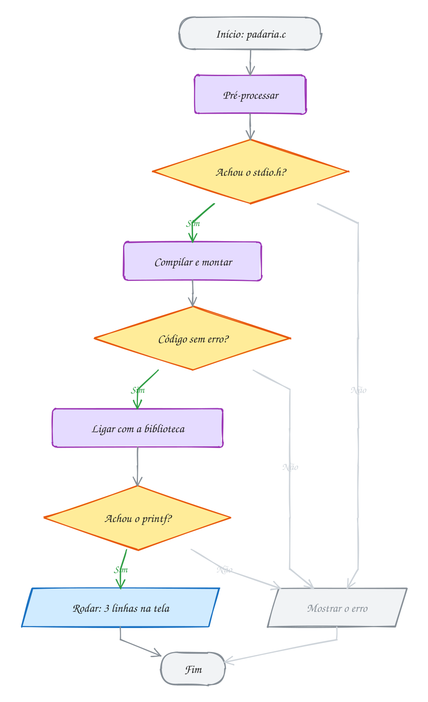</p>

**Exemplo A001 · Quem separa as instruções é o ponto e vírgula**

```c
/*
   Para o compilador, quebra de linha, espaço e recuo são só enfeite.
   O que termina uma instrução é o ; e o que agrupa é o par de chaves.
*/
#include <stdio.h>

int main(void) {
    // duas instruções na mesma linha: o ; separa uma da outra
    printf("Banca do Seu Zé\n"); printf("Frutas e verduras\n");

    // uma instrução espalhada em três linhas: ela só acaba no ;
    printf(
        "Abacaxi: R$ 7,00\n"
    );

    printf("\n"); // um printf só com \n deixa uma linha em branco

    printf("Banana: R$ 5,50 a dúzia\n"); /* comentário de bloco no fim */
    printf(/* comentário até no meio */ "Laranja: R$ 4,00 o kg\n");
    return 0;
}
// Saída:
// Banca do Seu Zé
// Frutas e verduras
// Abacaxi: R$ 7,00
//
// Banana: R$ 5,50 a dúzia
// Laranja: R$ 4,00 o kg
//
// O recuo de 4 espaços também é só para quem lê: apague todos e rode de
// novo. A saída é a mesma. Agora apague o ; do primeiro printf e veja o gcc
// reclamar do printf seguinte, que está na mesma linha.
```

```bash
gcc ~/LPEDC/material/A001.c -o ~/LPEDC/material/A001 && ~/LPEDC/material/A001
```

**Exemplo A002 · Um printf, várias linhas (e vários printf, uma linha)**

```c
#include <stdio.h>

/*
   Comentário de bloco: pode ocupar várias linhas.
   Bom para explicar o que o programa faz, no topo do arquivo.
*/
int main(void) {
    // três printf montando UMA linha: sem \n, o cursor fica onde parou
    printf("Cardápio: ");
    printf("café, ");
    printf("pão na chapa\n");

    // um printf só montando TRÊS linhas: cada \n pula uma
    printf("Café: R$ 4,50\nPão na chapa: R$ 6,00\nPingado: R$ 5,00\n");

    // dois textos entre aspas lado a lado viram um só (útil para linhas longas)
    printf("Aberto de segunda a sábado, "
           "das 6h às 20h\n");

    // printf("Esta linha nunca aparece: está comentada\n");
    return 0;
}
// Saída:
// Cardápio: café, pão na chapa
// Café: R$ 4,50
// Pão na chapa: R$ 6,00
// Pingado: R$ 5,00
// Aberto de segunda a sábado, das 6h às 20h
//
// Depois de rodar, digite "echo $?" no terminal: aparece 0, o valor do return.
```

```bash
gcc ~/LPEDC/material/A002.c -o ~/LPEDC/material/A002 && ~/LPEDC/material/A002
```

### 0002 · Variáveis

A ficha de uma academia: idade, altura, peso e plano. Cada dado vira uma
caixinha com tipo, tamanho e endereço; depois o peso recebe um valor novo:

<p align="center">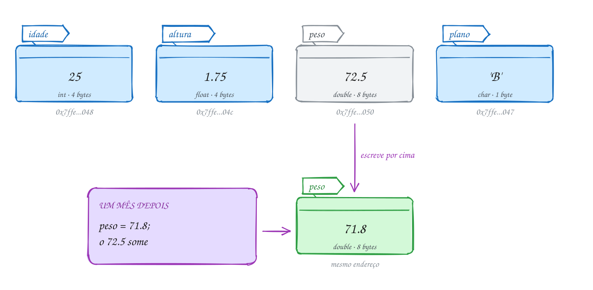</p>

```c
#include <stdio.h>

int main(void) {
    int idade = 25;       // inteiro
    float altura = 1.75;  // real com uns 7 dígitos
    double peso = 72.5;   // real com uns 15 dígitos
    char plano = 'B';     // um caractere, entre aspas simples

    printf("Idade: %d anos\n", idade);
    printf("Altura: %.2f m\n", altura);
    printf("Peso: %.1f kg\n", peso);
    printf("Plano: %c\n", plano);

    peso = 71.8; // um mês depois: o 72.5 some
    printf("Peso novo: %.1f kg\n", peso);
    printf("Bytes: %zu, %zu, %zu, %zu\n",
           sizeof idade, sizeof altura, sizeof peso, sizeof plano);
    return 0;
}
// Saída:
// Idade: 25 anos
// Altura: 1.75 m
// Peso: 72.5 kg
// Plano: B
// Peso novo: 71.8 kg
// Bytes: 4, 4, 8, 1
```

O caminho é sequência pura: criar as variáveis e depois trocar o peso.

<p align="center"></p>

**Exemplo A003 · A cópia que não acompanha e o float que arredonda**

```c
#include <stdio.h>

int main(void) {
    // = copia o VALOR: depois disso, as duas variáveis seguem separadas
    int pao_manha = 40;
    int pao_tarde = pao_manha;  // a tarde começa com uma cópia: 40
    pao_manha = 25;             // mudar uma não mexe na outra
    printf("Pães de manhã: %d, de tarde: %d\n", pao_manha, pao_tarde);

    // várias variáveis do mesmo tipo numa linha, separadas por vírgula
    char fila = 'C', caixa = '3';
    printf("Fila %c, caixa %c\n", fila, caixa);

    // o float guarda uns 7 dígitos; o double, uns 15
    float premio_float = 12345678.9;
    double premio_double = 12345678.9;
    printf("Prêmio no float:  %.1f\n", premio_float);
    printf("Prêmio no double: %.1f\n", premio_double);
    return 0;
}
// Saída:
// Pães de manhã: 25, de tarde: 40
// Fila C, caixa 3
// Prêmio no float:  12345679.0
// Prêmio no double: 12345678.9
//
// O 12345678.9 tem 9 dígitos: o float não dá conta e guarda o valor mais
// perto que ele consegue representar. Dinheiro e medidas: use double.
```

```bash
gcc ~/LPEDC/material/A003.c -o ~/LPEDC/material/A003 && ~/LPEDC/material/A003
```

**Exemplo A004 · Onde moram as variáveis**

```c
#include <stdio.h>

// Cada variável ocupa alguns bytes seguidos da memória. O endereço (&nome)
// é o número do primeiro desses bytes. O %p mostra endereços em hexadecimal.
int main(void) {
    char plano = 'B';
    int idade = 25;
    double peso = 72.5;

    printf("plano: %zu byte  em %p\n", sizeof plano, (void *)&plano);
    printf("idade: %zu bytes em %p\n", sizeof idade, (void *)&idade);
    printf("peso:  %zu bytes em %p\n", sizeof peso, (void *)&peso);

    printf("int: %zu, float: %zu, double: %zu, char: %zu\n",
           sizeof(int), sizeof(float), sizeof(double), sizeof(char));
    return 0;
}
// Saída (os endereços mudam a cada execução):
// plano: 1 byte  em 0x7f2e53c00020
// idade: 4 bytes em 0x7f2e53c00030
// peso:  8 bytes em 0x7f2e53c00040
// int: 4, float: 4, double: 8, char: 1
//
// Com o rodar, o AddressSanitizer deixa uma folga entre as variáveis para
// flagrar quem escreve fora do lugar. Sem ele, elas ficam coladas:
//   gcc A004.c -o a && ./a
//   plano: 1 byte  em 0x7ffccb532f1b
//   idade: 4 bytes em 0x7ffccb532f1c     (logo depois do plano)
//   peso:  8 bytes em 0x7ffccb532f20     (4 bytes depois da idade)
```

```bash
gcc ~/LPEDC/material/A004.c -o ~/LPEDC/material/A004 && ~/LPEDC/material/A004
```

### 0003 · Tipos e limites

A catraca de um estádio conta torcedores num `unsigned short` (16 bits). No
65.536º torcedor, o bit de cima não cabe e o painel volta a zero:

<p align="center">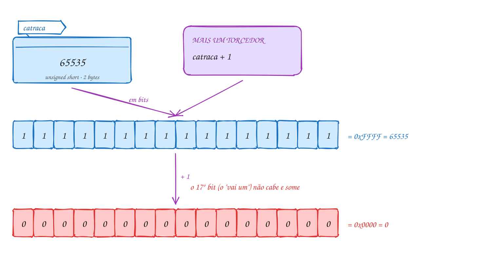</p>

```c
#include <stdio.h>
#include <limits.h>

int main(void) {
    unsigned short catraca = 65535; // 16 bits, todos ligados
    printf("Maior unsigned short: %d\n", USHRT_MAX);
    printf("Catraca: %d (0x%X)\n", catraca, catraca);

    catraca = catraca + 1; // 65536 não cabe em 16 bits
    printf("Mais um torcedor: %d\n", catraca);

    int publico = 78838; // int tem 32 bits: sobra espaço
    printf("Público: %d (o int vai até %d)\n", publico, INT_MAX);
    return 0;
}
// Saída:
// Maior unsigned short: 65535
// Catraca: 65535 (0xFFFF)
// Mais um torcedor: 0
// Público: 78838 (o int vai até 2147483647)
```

Quem decide "cabe em 16 bits?" é o hardware; se não cabe, guarda só os 16
bits de baixo, sem avisar:

<p align="center"></p>

**Exemplo A005 · O mesmo byte lido de dois jeitos**

```c
#include <stdio.h>
#include <stdint.h>

int main(void) {
    // o freezer marca -10 °C e guarda a temperatura num byte com sinal
    int8_t freezer = -10;
    printf("Freezer: %d °C\n", freezer);

    // o painel recebe os MESMOS 8 bits, mas lê como byte sem sinal
    uint8_t byte_no_cabo = freezer;
    printf("No cabo: 0x%X, que sem sinal vale %d\n", byte_no_cabo, byte_no_cabo);

    // a faixa de cada um: 256 combinações nos dois, deslocadas
    printf("int8_t:  %d a %d\n", INT8_MIN, INT8_MAX);
    printf("uint8_t: 0 a %d\n", UINT8_MAX);

    // -10 e 246 completam juntos 256 (2 elevado a 8)
    printf("%d + %d = %d\n", byte_no_cabo, 10, byte_no_cabo + 10);
    return 0;
}
// Saída:
// Freezer: -10 °C
// No cabo: 0xF6, que sem sinal vale 246
// int8_t:  -128 a 127
// uint8_t: 0 a 255
// 246 + 10 = 256
//
// Os bits são 1111 0110 nos dois casos. O tipo decide se o bit de cima
// vale +128 (sem sinal: 246) ou -128 (com sinal: -128 + 118 = -10).
```

```bash
gcc ~/LPEDC/material/A005.c -o ~/LPEDC/material/A005 && ~/LPEDC/material/A005
```

**Exemplo A006 · A tabela de tamanhos e limites desta máquina**

```c
#include <stdio.h>
#include <limits.h>
#include <stdint.h>

// Cada tipo tem o seu código no printf: %d (int), %u (unsigned),
// %ld (long), %lld (long long), %llu (unsigned long long).
int main(void) {
    printf("char:      %zu byte,  %d a %d\n", sizeof(char), CHAR_MIN, CHAR_MAX);
    printf("u. char:   %zu byte,  0 a %d\n", sizeof(unsigned char), UCHAR_MAX);
    printf("short:     %zu bytes, %d a %d\n", sizeof(short), SHRT_MIN, SHRT_MAX);
    printf("int:       %zu bytes, %d a %d\n", sizeof(int), INT_MIN, INT_MAX);
    printf("u. int:    %zu bytes, 0 a %u\n", sizeof(unsigned int), UINT_MAX);
    printf("long:      %zu bytes, até %ld\n", sizeof(long), LONG_MAX);
    printf("long long: %zu bytes, até %lld\n", sizeof(long long), LLONG_MAX);

    // stdint.h: o número de bits está no nome do tipo
    printf("int8_t: %zu, uint16_t: %zu, int32_t: %zu, int64_t: %zu bytes\n",
           sizeof(int8_t), sizeof(uint16_t), sizeof(int32_t), sizeof(int64_t));
    printf("uint64_t vai até %llu\n", (unsigned long long)UINT64_MAX);

    // hexadecimal no código: 0x na frente; cada dígito vale 4 bits
    printf("0xFF = %d, 0xFFFF = %d, 0x7FFFFFFF = %d\n", 0xFF, 0xFFFF, 0x7FFFFFFF);
    return 0;
}
// Saída (num PC Linux de 64 bits):
// char:      1 byte,  -128 a 127
// u. char:   1 byte,  0 a 255
// short:     2 bytes, -32768 a 32767
// int:       4 bytes, -2147483648 a 2147483647
// u. int:    4 bytes, 0 a 4294967295
// long:      8 bytes, até 9223372036854775807
// long long: 8 bytes, até 9223372036854775807
// int8_t: 1, uint16_t: 2, int32_t: 4, int64_t: 8 bytes
// uint64_t vai até 18446744073709551615
// 0xFF = 255, 0xFFFF = 65535, 0x7FFFFFFF = 2147483647
```

```bash
gcc ~/LPEDC/material/A006.c -o ~/LPEDC/material/A006 && ~/LPEDC/material/A006
```

### 0004 · Constantes

A tarifa do ônibus aparece em vários lugares do sistema e muda todo ano: fica
escrita uma vez só, com nome. O pré-processador troca `TARIFA` e `EMPRESA`
pelos valores; a `linha` é uma caixinha com cadeado:

<p align="center">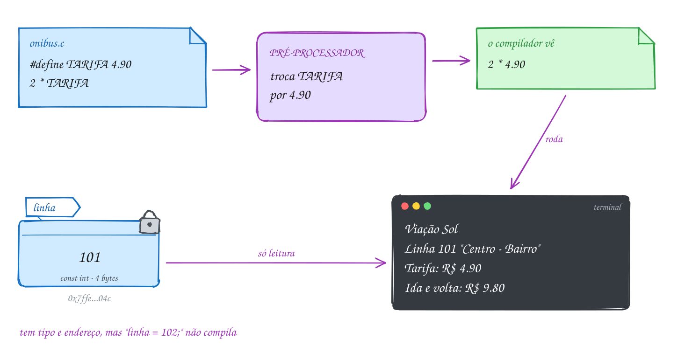</p>

```c
#include <stdio.h>

#define TARIFA 4.90          // muda aqui, muda no programa todo
#define EMPRESA "Viação Sol"

int main(void) {
    const int linha = 101;   // variável só de leitura

    printf("%s\n", EMPRESA);
    printf("Linha %d \"Centro - Bairro\"\n", linha);
    printf("Tarifa: R$ %.2f\n", TARIFA);
    printf("Ida e volta: R$ %.2f\n", 2 * TARIFA); // o compilador vê 2 * 4.90
    return 0;
}
// Saída:
// Viação Sol
// Linha 101 "Centro - Bairro"
// Tarifa: R$ 4.90
// Ida e volta: R$ 9.80
```

A troca de texto acontece na compilação; o executável já nasce só com os
números:

<p align="center">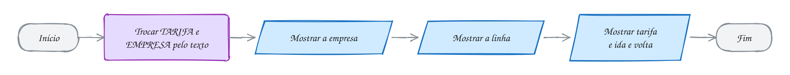</p>

**Exemplo A007 · Uma constante feita de outras**

```c
#include <stdio.h>

#define TARIFA_CHEIA 4.90
#define DESCONTO_ESTUDANTE 0.5                          // estudante paga meia
#define TARIFA_MEIA (TARIFA_CHEIA * DESCONTO_ESTUDANTE) // um #define usando outros
#define CIDADE "Belo Horizonte"

int main(void) {
    const double recarga = 50.00; // const: tem tipo, tamanho e endereço

    printf("Ônibus de " CIDADE "\n"); // textos lado a lado viram um só
    printf("Inteira: R$ %.2f\n", TARIFA_CHEIA);
    printf("Meia:    R$ %.2f\n", TARIFA_MEIA);
    printf("Recarga: R$ %.2f\n", recarga);

    // o literal tem tamanho, decidido pelo jeito de escrever
    printf("recarga: %zu bytes; 4.90: %zu; 4.90f: %zu\n",
           sizeof recarga, sizeof 4.90, sizeof 4.90f);
    return 0;
}
// Saída:
// Ônibus de Belo Horizonte
// Inteira: R$ 4.90
// Meia:    R$ 2.45
// Recarga: R$ 50.00
// recarga: 8 bytes; 4.90: 8; 4.90f: 4
//
// Veja o que o compilador recebe: gcc -E A007.c | tail -14
// A linha do printf vira "Ônibus de " "Belo Horizonte" "\n" e a meia vira
// (4.90 * 0.5): os parênteses do #define TARIFA_MEIA vão junto.
```

```bash
gcc ~/LPEDC/material/A007.c -o ~/LPEDC/material/A007 && ~/LPEDC/material/A007
```

**Exemplo A008 · Escapes e literais em várias bases**

```c
#include <stdio.h>

int main(void) {
    // \t: tabulação (pula para a próxima coluna de 8 em 8)
    printf("Item\tQtd\n");
    printf("Pão\t10\n");
    printf("Leite\t2\n");

    // \\ e \": a barra e as aspas dentro do texto
    printf("Arquivo: C:\\fotos\\praia.jpg\n");
    printf("Ela disse: \"Pix feito!\"\n");
    printf("Desconto de 15%%\n"); // %% mostra um %

    // o mesmo número escrito em três bases
    printf("%d %d %d\n", 31, 0x1F, 037);

    // um caractere é um número: o código na tabela ASCII
    printf("%c = %d, %c = %d\n", 'A', 'A', '0', '0');

    // notação científica: 1.5e3 é 1,5 x 10 elevado a 3
    printf("%.1f\n", 1.5e3);
    return 0;
}
// Saída (o \t alinha "Qtd", "10" e "2" na coluna 9):
// Item    Qtd
// Pão     10
// Leite   2
// Arquivo: C:\fotos\praia.jpg
// Ela disse: "Pix feito!"
// Desconto de 15%
// 31 31 31
// A = 65, 0 = 48
// 1500.0
```

```bash
gcc ~/LPEDC/material/A008.c -o ~/LPEDC/material/A008 && ~/LPEDC/material/A008
```

### 0005 · printf

O cupom do mercado sai com colunas alinhadas. Na linha do arroz, `%-10s`
reserva 10 casas para o nome, `%3d` reserva 3 para a quantidade e `%9.2f`
reserva 9 para o total, com 2 decimais:

<p align="center"></p>

```c
#include <stdio.h>

int main(void) {
    printf("%-10s %3s %9s\n", "Item", "Qtd", "Total");
    printf("%-10s %3d %9.2f\n", "Arroz 5kg", 2, 51.80);
    printf("%-10s %3d %9.2f\n", "Leite", 12, 71.88);
    printf("%-10s %3d %9.2f\n", "Banana", 1, 7.49);
    printf("%-10s %13.2f\n", "TOTAL", 131.17);
    return 0;
}
// Saída:
// Item       Qtd     Total
// Arroz 5kg    2     51.80
// Leite       12     71.88
// Banana       1      7.49
// TOTAL             131.17
```

Cada `printf` é uma saída com o mesmo formato. Para mudar uma coluna, troque
um número em cada linha:

<p align="center">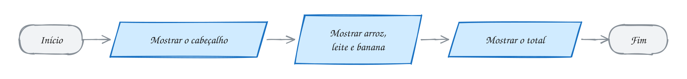</p>

**Exemplo A009 · O extrato que corta o nome comprido**

```c
#include <stdio.h>

int main(void) {
    // zeros à esquerda: o número da conta tem sempre 6 dígitos
    printf("Conta %06d-%d\n", 4521, 7);

    // %-14.14s: coluna de 14 casas e, se o texto for maior, corta em 14
    // %+9.2f: sinal sempre, para entrada e saída ficarem claras
    printf("%-14.14s %+9.2f\n", "Pix recebido de Mariana", 250.00);
    printf("%-14.14s %+9.2f\n", "Mercado", -87.35);
    printf("%-14.14s %+9.2f\n", "Conta de luz da casa", -142.10);
    printf("%-14s %9.2f\n", "Saldo", 20.55);

    // o mesmo valor com precisões diferentes: só a tela muda
    double juros = 0.0875;
    printf("Juros: %.1f%% ou %.3f%%\n", juros * 100, juros * 100);
    return 0;
}
// Saída:
// Conta 004521-7
// Pix recebido d   +250.00
// Mercado           -87.35
// Conta de luz d   -142.10
// Saldo              20.55
// Juros: 8.8% ou 8.750%
```

```bash
gcc ~/LPEDC/material/A009.c -o ~/LPEDC/material/A009 && ~/LPEDC/material/A009
```

**Exemplo A010 · O mesmo valor em vários formatos**

```c
#include <stdio.h>

int main(void) {
    int n = 255;
    double preco = 3.14159;
    char letra = 'A';

    // inteiros: largura, alinhamento, zeros, sinal e outras bases
    printf("[%d] [%6d] [%-6d] [%06d] [%+d]\n", n, n, n, n, n);
    printf("hexa: %x %X %#x   octal: %o\n", n, n, n, n);

    // reais: casas decimais, largura, científica e o "mais curto"
    printf("[%f] [%.2f] [%8.3f] [%e] [%g]\n", preco, preco, preco, preco, preco);

    // caractere e texto (com precisão, o texto é cortado)
    printf("[%c] [%d] [%s] [%.4s] [%8s]\n", letra, letra, "Brasil", "Brasil", "Brasil");

    // o endereço de uma variável e o próprio %
    printf("n mora em %p; 100%% certo\n", (void *)&n);

    // o printf devolve quantos bytes escreveu
    int bytes = printf("Olá\n");
    printf("O printf anterior escreveu %d bytes\n", bytes);
    return 0;
}
// Saída (o endereço muda a cada execução):
// [255] [   255] [255   ] [000255] [+255]
// hexa: ff FF 0xff   octal: 377
// [3.141590] [3.14] [   3.142] [3.141590e+00] [3.14159]
// [A] [65] [Brasil] [Bras] [  Brasil]
// n mora em 0x7f1c2a400020; 100% certo
// Olá
// O printf anterior escreveu 5 bytes
```

```bash
gcc ~/LPEDC/material/A010.c -o ~/LPEDC/material/A010 && ~/LPEDC/material/A010
```

### 0006 · scanf

Um Pix agendado: você digita `150.75`, Enter, `12`, Enter. O `%lf` tira
`150.75` da fila, o `%d` pula o `'\n'` que sobrou e tira o `12`; o último
`'\n'` fica na fila:

<p align="center">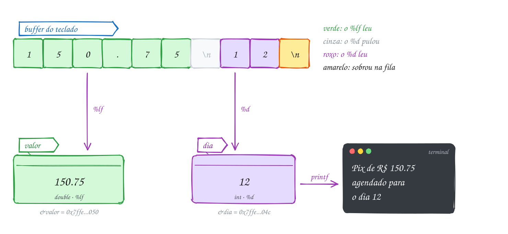</p>

```c
#include <stdio.h>

int main(void) {
    double valor;
    int dia;

    printf("Valor do Pix: R$ ");
    scanf("%lf", &valor);            // %lf: double no scanf
    printf("Dia do mês: ");
    int lidos = scanf("%d", &dia);   // devolve quantos itens leu

    printf("Pix de R$ %.2f agendado para o dia %d\n", valor, dia);
    printf("O último scanf leu %d item\n", lidos);
    return 0;
}
// Exemplo de execução:
// Valor do Pix: R$ 150.75
// Dia do mês: 12
// Pix de R$ 150.75 agendado para o dia 12
// O último scanf leu 1 item
```

Para testar sem digitar: `printf '150.75\n12\n' | ./pix`. As duas leituras
são paralelogramos de entrada, e a saída vem depois:

<p align="center"></p>

**Exemplo A011 · Dois valores numa linha e a sobra que atrapalha**

```c
#include <stdio.h>

int main(void) {
    int quantidade = 0;
    double preco = 0.0;
    int parcelas = 1;

    // um scanf, dois valores: o %lf pula o espaço entre eles
    printf("Quantidade e preço (ex.: 3 4.99): ");
    int lidos = scanf("%d%lf", &quantidade, &preco);
    printf("Itens lidos: %d\n", lidos);

    printf("Parcelas: ");
    lidos = scanf("%d", &parcelas);
    printf("Itens lidos: %d\n", lidos);

    printf("%d unidade(s) de R$ %.2f em %d parcela(s)\n", quantidade, preco, parcelas);
    return 0;
}
// Exemplo de execução:
// Quantidade e preço (ex.: 3 4.99): 3 4.99
// Itens lidos: 2
// Parcelas: 2
// Itens lidos: 1
// 3 unidade(s) de R$ 4.99 em 2 parcela(s)
//
// Teste: printf '3 4.99\n2\n' | ~/LPEDC/rodar <este arquivo>
//
// Agora digite "3 4.99 reais" na primeira pergunta:
//   printf '3 4.99 reais\n2\n' | ~/LPEDC/rodar <este arquivo>
// O " reais" fica na fila. O %d das parcelas tropeça no 'r', devolve 0
// ("Itens lidos: 0") e parcelas continua com 1. O 2 nem chega a ser lido.
```

```bash
gcc ~/LPEDC/material/A011.c -o ~/LPEDC/material/A011 && ~/LPEDC/material/A011
```

**Exemplo A012 · A data da entrega e o tamanho da camiseta**

```c
#include <stdio.h>

int main(void) {
    int dia = 0, mes = 0, ano = 0;
    char tamanho = '?';

    // caracteres fixos no formato precisam ser digitados: aqui, as barras
    printf("Data da entrega (dd/mm/aaaa): ");
    int lidos = scanf("%d/%d/%d", &dia, &mes, &ano);
    printf("Itens lidos: %d\n", lidos);

    // o Enter da linha anterior ficou no buffer. O espaço antes do %c
    // manda pular espaços e Enters; sem ele, o %c pegaria o '\n'
    printf("Tamanho (P, M ou G): ");
    scanf(" %c", &tamanho);

    printf("Entrega em %02d/%02d/%d, camiseta %c\n", dia, mes, ano, tamanho);
    return 0;
}
// Exemplo de execução:
// Data da entrega (dd/mm/aaaa): 7/9/2026
// Itens lidos: 3
// Tamanho (P, M ou G): G
// Entrega em 07/09/2026, camiseta G
//
// Teste: printf '7/9/2026\nG\n' | ~/LPEDC/rodar <este arquivo>
// Agora digite a data com traços (7-9-2026): o scanf para no primeiro "-" e
// lê só 1 item. O "-" fica no buffer, e o %c seguinte pega ele: a saída
// vira "Entrega em 07/00/0, camiseta -".
```

```bash
gcc ~/LPEDC/material/A012.c -o ~/LPEDC/material/A012 && ~/LPEDC/material/A012
```

### 0007 · Aritmética

Cinco amigos dividem três pizzas de 8 fatias e uma conta de R$ 159. O `/`
conta as rodadas completas de fatias e o `%` as que sobram:

<p align="center"></p>

```c
#include <stdio.h>

int main(void) {
    int pizzas = 3;
    int fatias = pizzas * 8;      // 24
    int amigos = 5;

    int cada = fatias / amigos;   // divisão inteira: 4
    int sobra = fatias % amigos;  // resto: 4

    printf("%d fatias para %d amigos\n", fatias, amigos);
    printf("Cada um come %d, sobram %d\n", cada, sobra);

    double conta = 159.00;
    printf("Cada um paga R$ %.2f\n", conta / amigos); // real / int: divisão real
    printf("Com inteiros: R$ %d\n", 159 / amigos);    // int / int: corta o resto
    return 0;
}
// Saída:
// 24 fatias para 5 amigos
// Cada um come 4, sobram 4
// Cada um paga R$ 31.80
// Com inteiros: R$ 31
```

Cada conta é um retângulo, e a ordem importa: `cada` e `sobra` dependem de
`fatias`:

<p align="center"></p>

**Exemplo A013 · O final da placa e o rodízio**

```c
#include <stdio.h>

// No rodízio de São Paulo, o dia em que o carro não roda depende do último
// dígito da placa (finais 7 e 8: quinta-feira). Quem separa dígitos é o par
// / e %, com divisores 10, 100, 1000...
int main(void) {
    int placa = 4827;                 // a parte numérica de ABC-4827

    int final = placa % 10;           // o resto por 10 é o último dígito: 7
    int sem_final = placa / 10;       // a divisão por 10 corta o último: 482
    int dois_primeiros = placa / 100; // 48
    int dois_ultimos = placa % 100;   // 27

    printf("Final da placa: %d\n", final);
    printf("Sem o final: %d\n", sem_final);
    printf("Metades: %d e %d\n", dois_primeiros, dois_ultimos);
    printf("Final %% 2 = %d (0 é par, 1 é ímpar)\n", final % 2);

    // a regra que amarra os dois: (a / b) * b + a % b devolve o a
    printf("%d * 100 + %d = %d\n", dois_primeiros, dois_ultimos,
           dois_primeiros * 100 + dois_ultimos);

    // o dígito do meio: corta pela direita com /, isola com %
    printf("Dígito das centenas: %d\n", placa / 100 % 10);
    return 0;
}
// Saída:
// Final da placa: 7
// Sem o final: 482
// Metades: 48 e 27
// Final % 2 = 1 (0 é par, 1 é ímpar)
// 48 * 100 + 27 = 4827
// Dígito das centenas: 8
```

```bash
gcc ~/LPEDC/material/A013.c -o ~/LPEDC/material/A013 && ~/LPEDC/material/A013
```

**Exemplo A014 · Quanto dura o podcast**

```c
#include <stdio.h>

// O app mostra a duração em segundos. Divisão inteira e resto convertem
// para horas, minutos e segundos, sem nenhum número real.
int main(void) {
    int total = 5000; // segundos

    int horas = total / 3600;          // 1 (3600 segundos cabem 1 vez)
    int resto = total % 3600;          // 1400 segundos que sobraram
    int minutos = resto / 60;          // 23
    int segundos = resto % 60;         // 20

    printf("%d s = %dh %02dmin %02ds\n", total, horas, minutos, segundos);

    // precedência: * / % antes de + -, da esquerda para a direita
    printf("%d %d %d\n", 2 + 3 * 4, (2 + 3) * 4, 100 / 10 / 2);

    // com negativos, a divisão corta em direção ao zero
    // e o resto fica com o sinal de quem é dividido
    printf("%d %d %d %d\n", 7 / 2, -7 / 2, 7 % 3, -7 % 3);
    return 0;
}
// Saída:
// 5000 s = 1h 23min 20s
// 14 20 5
// 3 -3 1 -1
```

```bash
gcc ~/LPEDC/material/A014.c -o ~/LPEDC/material/A014 && ~/LPEDC/material/A014
```

### 0008 · Conversão e cast

Um carro rodou 523 km com 41 litros. Pelo caminho de cima, os dois `int` se
dividem, sai 12 e só então vira 12.0; pelo de baixo, o cast transforma 523 em
523.0 antes da divisão:

<p align="center">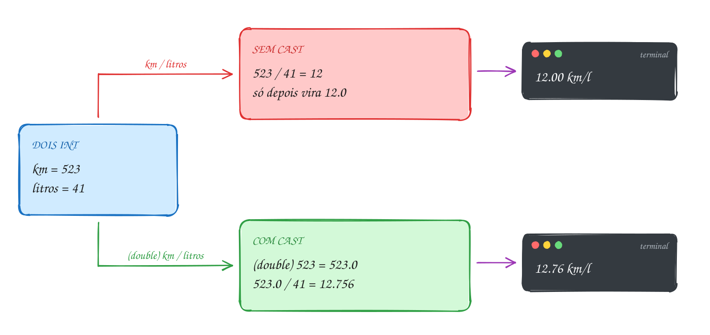</p>

```c
#include <stdio.h>

int main(void) {
    int km = 523;     // rodados desde o último tanque
    int litros = 41;  // para encher de novo

    double errado = km / litros;            // int / int = 12; depois vira 12.0
    double certo = (double) km / litros;    // 523.0 / 41 = 12.756...
    double tarde = (double) (km / litros);  // o cast chegou depois da divisão

    printf("Sem cast:      %.2f km/l\n", errado);
    printf("Com cast:      %.2f km/l\n", certo);
    printf("Cast atrasado: %.2f km/l\n", tarde);

    int inteiro = certo;                    // double -> int: corta, não arredonda
    printf("Num int:       %d km/l\n", inteiro);
    return 0;
}
// Saída:
// Sem cast:      12.00 km/l
// Com cast:      12.76 km/l
// Cast atrasado: 12.00 km/l
// Num int:       12 km/l
```

Quem responde "tem um real na divisão?" é o compilador, pelos tipos. Com o
cast, o exemplo segue pelo Sim:

<p align="center">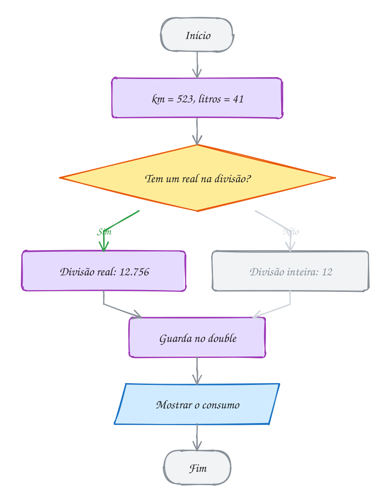</p>

**Exemplo A015 · O cast que corta de propósito**

```c
#include <stdio.h>

int main(void) {
    // quantos pacotes cheios de 2.5 kg saem de 18 kg de café?
    double estoque = 18.0, pacote = 2.5;
    int cheios = (int) (estoque / pacote);   // 7.2 vira 7: aqui cortar é o certo
    double sobra = estoque - cheios * pacote; // int * double: a conta é real
    printf("Pacotes cheios: %d\n", cheios);
    printf("Sobram %.1f kg\n", sobra);

    // horas decimais do ponto eletrônico para horas e minutos
    double trabalhadas = 2.75;
    int horas = (int) trabalhadas;                    // 2
    int minutos = (int) ((trabalhadas - horas) * 60); // 0.75 * 60 = 45
    printf("%.2f h = %d h %d min\n", trabalhadas, horas, minutos);

    // o cast pega só o valor logo à direita dele
    printf("(int) 2.75 * 60 = %d\n", (int) 2.75 * 60);     // 2 * 60
    printf("(int) (2.75 * 60) = %d\n", (int) (2.75 * 60)); // 165.0 vira 165
    return 0;
}
// Saída:
// Pacotes cheios: 7
// Sobram 0.5 kg
// 2.75 h = 2 h 45 min
// (int) 2.75 * 60 = 120
// (int) (2.75 * 60) = 165
```

```bash
gcc ~/LPEDC/material/A015.c -o ~/LPEDC/material/A015 && ~/LPEDC/material/A015
```

**Exemplo A016 · Conversões que acontecem sozinhas**

```c
#include <stdio.h>

int main(void) {
    // na atribuição, o valor vira o tipo da variável da esquerda
    char letra = 65;          // int -> char: o código 65 é 'A'
    int preco = 9.99;         // double -> int: corta para 9
    int negativo = -9.99;     // corta em direção ao zero: -9
    double metade = 7 / 2;    // a divisão inteira vem antes: 3.0
    printf("%c %d %d %.1f\n", letra, preco, negativo, metade);

    // numa conta, o tipo "menor" sobe para o "maior"
    char minuscula = 'g';
    printf("%c\n", minuscula - 32);    // char vira int: 103 - 32 = 71 = 'G'
    printf("%.2f\n", 5 / 2 * 2.0);     // (5 / 2) é 2; 2 * 2.0 = 4.00
    printf("%.2f\n", 5 * 2.0 / 2);     // 5 * 2.0 = 10.0; 10.0 / 2 = 5.00

    // o cast é explícito e cria uma cópia temporária: a variável não muda
    int gols = 7, jogos = 3;
    printf("Média: %.2f gols; gols continua %d\n", (double) gols / jogos, gols);

    // real em binário é aproximado
    float grande = 16777217;           // o float não tem dígitos para tanto
    printf("%.1f\n", grande);
    printf("%.17f\n", 0.1 + 0.2);
    return 0;
}
// Saída:
// A 9 -9 3.0
// G
// 4.00
// 5.00
// Média: 2.33 gols; gols continua 7
// 16777216.0
// 0.30000000000000004
```

```bash
gcc ~/LPEDC/material/A016.c -o ~/LPEDC/material/A016 && ~/LPEDC/material/A016
```

### 0009 · Atribuição, ++ e --

Um bilhete único com R$ 20,00 recebe uma recarga e paga duas viagens. O saldo
passa por quatro valores na mesma caixinha, e as viagens sobem de um em um:

<p align="center"></p>

```c
#include <stdio.h>

int main(void) {
    double saldo = 20.00;
    int viagens = 0;

    saldo += 30.00;   // recarga: saldo = saldo + 30.00
    saldo -= 4.40;    // 1ª viagem
    viagens++;        // viagens = viagens + 1
    saldo -= 4.40;    // 2ª viagem
    viagens++;

    printf("Saldo: R$ %.2f depois de %d viagens\n", saldo, viagens);

    int antes = viagens++;   // pós: usa o 2, depois soma (viagens vira 3)
    int depois = ++viagens;  // pré: soma primeiro (vira 4), depois usa o 4
    printf("antes = %d, depois = %d, viagens = %d\n", antes, depois, viagens);
    return 0;
}
// Saída:
// Saldo: R$ 41.20 depois de 2 viagens
// antes = 2, depois = 4, viagens = 4
```

Cada atualização é um retângulo sobre as mesmas duas variáveis. No módulo 03,
esses passos viram laço, com `+=` e `++` como acumulador e contador:

<p align="center">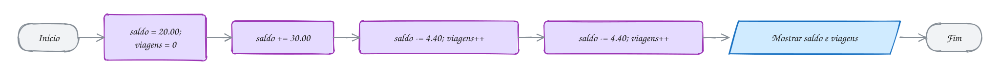</p>

**Exemplo A017 · Vagas que descem, senhas que sobem (até de letra)**

```c
#include <stdio.h>

int main(void) {
    // -- conta para baixo: cada carro que entra ocupa uma vaga
    int vagas = 3;
    vagas--;                 // 2
    vagas--;                 // 1
    printf("Vagas livres: %d\n", vagas);

    // ++ num char: o char é número, então ++ vai para a próxima letra
    char fila = 'A';
    int senha = 41;
    printf("Chamando %c%02d\n", fila, senha);
    senha++;
    printf("Chamando %c%02d\n", fila, senha);
    fila++;                  // 'A' (65) vira 'B' (66)
    senha = 1;               // a fila nova recomeça do 1
    printf("Chamando %c%02d\n", fila, senha);

    // /= com int faz divisão inteira: a moeda ímpar some
    int moedas = 25;
    moedas /= 2;
    printf("Cada irmão fica com %d moedas\n", moedas);

    // -= com double: o desconto sai do valor que já está lá
    double conta = 120.00;
    conta -= 15.50;          // cupom
    conta -= conta * 0.10;   // mais 10% sobre o que sobrou
    printf("Conta final: R$ %.2f\n", conta);
    return 0;
}
// Saída:
// Vagas livres: 1
// Chamando A41
// Chamando A42
// Chamando B01
// Cada irmão fica com 12 moedas
// Conta final: R$ 94.05
```

```bash
gcc ~/LPEDC/material/A017.c -o ~/LPEDC/material/A017 && ~/LPEDC/material/A017
```

**Exemplo A018 · Pré, pós e o operador que vale para a conta inteira**

```c
#include <stdio.h>

int main(void) {
    // pós-incremento: a expressão vale o valor ANTIGO
    int x = 5;
    int y = x++;            // y = 5, x = 6
    printf("x++ : y = %d, x = %d\n", y, x);

    // pré-incremento: a expressão vale o valor NOVO
    x = 5;
    y = ++x;                // x = 6, y = 6
    printf("++x : y = %d, x = %d\n", y, x);

    // o operador composto age sobre TUDO o que está à direita
    int pontos = 10, bonus = 3;
    pontos *= bonus + 1;    // pontos = pontos * (bonus + 1) = 40
    printf("pontos = %d\n", pontos);

    // a atribuição também é uma expressão: vale o valor guardado
    int a, b, c;
    a = b = c = 7;          // c = 7, depois b = 7, depois a = 7
    printf("a = %d, b = %d, c = %d\n", a, b, c);

    // os mesmos operadores com double e com resto
    double preco = 80.0;
    preco *= 0.9;           // 10% de desconto: 72.00
    int segundos = 135;
    segundos %= 60;         // sobra 15
    printf("preço = %.2f, segundos = %d\n", preco, segundos);
    return 0;
}
// Saída:
// x++ : y = 5, x = 6
// ++x : y = 6, x = 6
// pontos = 40
// a = 7, b = 7, c = 7
// preço = 72.00, segundos = 15
```

```bash
gcc ~/LPEDC/material/A018.c -o ~/LPEDC/material/A018 && ~/LPEDC/material/A018
```

### 0010 · math.h

Duas pizzas médias de 25 cm dão mais pizza que uma grande de 35 cm? A área
cresce com o quadrado do raio: o diâmetro vira raio, `pow` eleva ao quadrado
e o resultado vezes pi dá a área:

<p align="center">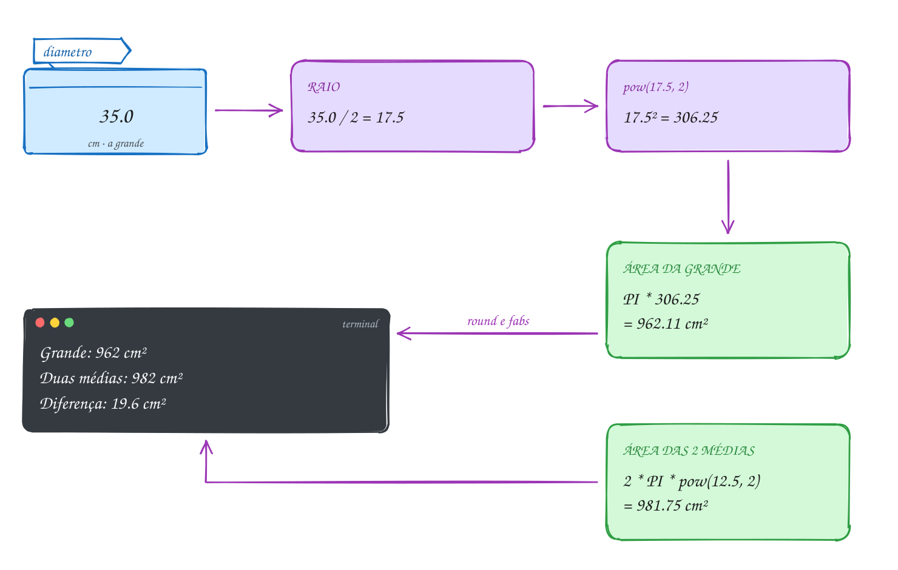</p>

```c
#include <stdio.h>
#include <math.h>

#define PI 3.14159265358979 // o C padrão não define o pi

int main(void) {
    double diametro_grande = 35.0, diametro_media = 25.0; // cm
    double preco_grande = 59.90, preco_medias = 2 * 39.90;

    double area_grande = PI * pow(diametro_grande / 2, 2);     // pi * r²
    double area_medias = 2 * PI * pow(diametro_media / 2, 2);

    printf("Grande: %.0f cm² por R$ %.2f\n", round(area_grande), preco_grande);
    printf("Duas médias: %.0f cm² por R$ %.2f\n", round(area_medias), preco_medias);
    printf("Diferença: %.1f cm²\n", fabs(area_grande - area_medias));
    printf("R$ por 100 cm²: grande %.2f, médias %.2f\n",
           preco_grande / area_grande * 100, preco_medias / area_medias * 100);

    // a pizza única com a mesma área das duas médias: r = raiz(área / pi)
    double diametro_igual = 2 * sqrt(area_medias / PI);
    printf("Duas médias = uma pizza de %.1f cm\n", diametro_igual);
    return 0;
}
// Saída:
// Grande: 962 cm² por R$ 59.90
// Duas médias: 982 cm² por R$ 79.80
// Diferença: 19.6 cm²
// R$ por 100 cm²: grande 6.23, médias 8.13
// Duas médias = uma pizza de 35.4 cm
```

Duas médias dão um pouco mais de pizza, mas cada 100 cm² da grande sai quase
R$ 2 mais barato. No fluxograma, `pow(...)` e `sqrt(...)` entram nas contas
como qualquer valor:

<p align="center"></p>

**Exemplo A019 · A escada no muro e o posto na estrada**

```c
#include <stdio.h>
#include <math.h>

#define PI 3.14159265358979

int main(void) {
    // sin e cos trabalham em radianos: converta com graus * PI / 180
    double escada = 5.0;            // metros
    double graus = 60.0;            // ângulo da escada com o chão
    double radianos = graus * PI / 180;
    printf("Altura no muro: %.2f m\n", escada * sin(radianos));
    printf("Pé da escada a %.2f m do muro\n", escada * cos(radianos));

    // fmod: o resto de uma divisão entre reais (o % só aceita inteiros)
    double km = 31.0, entre_postos = 7.5;
    double desde_ultimo = fmod(km, entre_postos);   // 31 - 4 * 7.5 = 1.0
    printf("Último posto há %.1f km; próximo em %.1f km\n",
           desde_ultimo, entre_postos - desde_ultimo);

    // fabs: a distância entre dois valores, não importa a ordem da conta
    double tarde = 14.5, madrugada = -3.0;
    printf("Variação no dia: %.1f graus\n", fabs(madrugada - tarde));
    return 0;
}
// Saída:
// Altura no muro: 4.33 m
// Pé da escada a 2.50 m do muro
// Último posto há 1.0 km; próximo em 6.5 km
// Variação no dia: 17.5 graus
```

```bash
gcc ~/LPEDC/material/A019.c -o ~/LPEDC/material/A019 -lm && ~/LPEDC/material/A019
```

**Exemplo A020 · Arredondar para cima, para baixo e para o mais perto**

```c
#include <stdio.h>
#include <math.h>

int main(void) {
    printf("    x | floor |  ceil | round | (int)\n");
    printf("%5.1f | %5.0f | %5.0f | %5.0f | %5d\n", 2.4, floor(2.4), ceil(2.4), round(2.4), (int) 2.4);
    printf("%5.1f | %5.0f | %5.0f | %5.0f | %5d\n", 2.5, floor(2.5), ceil(2.5), round(2.5), (int) 2.5);
    printf("%5.1f | %5.0f | %5.0f | %5.0f | %5d\n", -2.5, floor(-2.5), ceil(-2.5), round(-2.5), (int) -2.5);
    printf("%5.1f | %5.0f | %5.0f | %5.0f | %5d\n", -2.6, floor(-2.6), ceil(-2.6), round(-2.6), (int) -2.6);

    // ceil na vida real: quantas latas de tinta para 50 m², se uma cobre 18 m²?
    double area = 50.0, por_lata = 18.0;
    printf("Latas: %.2f -> compre %.0f\n", area / por_lata, ceil(area / por_lata));

    // potência e raiz: pow também tira raiz com expoente fracionário
    printf("pow(2, 10) = %.0f, sqrt(2) = %.4f, raiz cúbica de 27 = %.1f\n",
           pow(2, 10), sqrt(2), pow(27, 1.0 / 3));

    // arredondar para 2 casas de verdade (não só na tela)
    double preco = 7.4567;
    double preco_2casas = round(preco * 100) / 100;
    printf("%.4f vira %.4f\n", preco, preco_2casas);
    return 0;
}
// Saída:
//     x | floor |  ceil | round | (int)
//   2.4 |     2 |     3 |     2 |     2
//   2.5 |     2 |     3 |     3 |     2
//  -2.5 |    -3 |    -2 |    -3 |    -2
//  -2.6 |    -3 |    -2 |    -3 |    -2
// Latas: 2.78 -> compre 3
// pow(2, 10) = 1024, sqrt(2) = 1.4142, raiz cúbica de 27 = 3.0
// 7.4567 vira 7.4600
```

```bash
gcc ~/LPEDC/material/A020.c -o ~/LPEDC/material/A020 -lm && ~/LPEDC/material/A020
```

### 0011 · Juntando tudo

A conta de luz de uma república com três moradores. Entram as duas leituras
do relógio e os moradores; o consumo é 257 kWh, a conta é R$ 229,24 e cada um
paga R$ 76,42, com o centavo para cima:

<p align="center">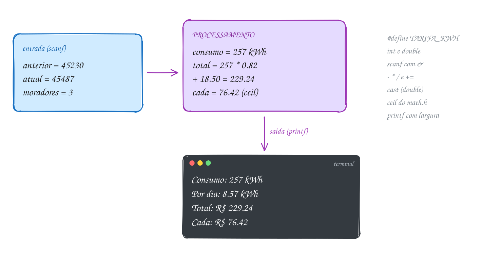</p>

```c
#include <stdio.h>
#include <math.h>

#define TARIFA_KWH 0.82    // R$ por kWh
#define ILUMINACAO 18.50   // taxa fixa de iluminação pública
#define DIAS 30

int main(void) {
    int anterior, atual, moradores;

    // entrada
    printf("Leitura anterior (kWh): ");
    scanf("%d", &anterior);
    printf("Leitura atual (kWh): ");
    scanf("%d", &atual);
    printf("Moradores: ");
    int lidos = scanf("%d", &moradores);

    // processamento
    int consumo = atual - anterior;
    double total = consumo * TARIFA_KWH;
    total += ILUMINACAO;
    double por_dia = (double) consumo / DIAS;
    double cada = ceil(total / moradores * 100) / 100; // centavo para cima

    // saída
    printf("\n%-18s %8d kWh\n", "Consumo:", consumo);
    printf("%-18s %8.2f kWh\n", "Por dia:", por_dia);
    printf("%-18s R$ %8.2f\n", "Total da conta:", total);
    printf("%-18s R$ %8.2f\n", "Cada morador:", cada);
    printf("(o último scanf leu %d item)\n", lidos);
    return 0;
}
// Exemplo de execução:
// Leitura anterior (kWh): 45230
// Leitura atual (kWh): 45487
// Moradores: 3
//
// Consumo:                257 kWh
// Por dia:               8.57 kWh
// Total da conta:    R$   229.24
// Cada morador:      R$    76.42
// (o último scanf leu 1 item)
```

#### Passo a passo

Teste de mesa com a entrada 45230, 45487 e 3; as colunas mostram as variáveis
depois de cada instrução:

| Instrução | consumo | total | por_dia | cada |
| --- | --- | --- | --- | --- |
| `consumo = atual - anterior` | 257 | | | |
| `total = consumo * TARIFA_KWH` | 257 | 210.74 | | |
| `total += ILUMINACAO` | 257 | 229.24 | | |
| `por_dia = (double) consumo / DIAS` | 257 | 229.24 | 8.5666... | |
| `cada = ceil(total / moradores * 100) / 100` | 257 | 229.24 | 8.5666... | 76.42 |

Na última linha: 229,24 ÷ 3 = 76,4133...; vezes 100, 7641,33...; o `ceil`
sobe para 7642; dividido por 100, 76,42. Três vezes 76,42 dá 229,26: sobram
dois centavos, mas a conta fica paga.

Entrada, quatro contas e saída, sem nenhum losango:

<p align="center"></p>

**Exemplo A021 · Quantas caixas de piso comprar**

```c
#include <stdio.h>
#include <math.h>

#define PERDA 1.10          // 10% a mais para os recortes
#define M2_POR_CAIXA 2.5    // cada caixa cobre 2,5 m²

int main(void) {
    double largura = 0, comprimento = 0, preco_caixa = 0;

    // entrada: o retorno de cada scanf vai somando no total de leituras
    printf("Largura do cômodo (m): ");
    int leituras = scanf("%lf", &largura);
    printf("Comprimento (m): ");
    leituras += scanf("%lf", &comprimento);
    printf("Preço da caixa (R$): ");
    leituras += scanf("%lf", &preco_caixa);

    // processamento
    double area = largura * comprimento;
    double area_compra = area;
    area_compra *= PERDA;
    int caixas = (int) ceil(area_compra / M2_POR_CAIXA); // caixa não vem pela metade
    double total = caixas * preco_caixa;
    double sobra = caixas * M2_POR_CAIXA - area_compra;

    // saída: rótulos com acento direto no formato, porque a largura do %s
    // conta bytes, e cada letra acentuada ocupa 2
    printf("\nÁrea do cômodo:   %8.2f m²\n", area);
    printf("Com 10%% de perda: %8.2f m²\n", area_compra);
    printf("Caixas:           %8d\n", caixas);
    printf("Sobra na última:  %8.2f m²\n", sobra);
    printf("Total (R$):       %8.2f\n", total);
    printf("(leituras certas: %d de 3)\n", leituras);
    return 0;
}
// Exemplo de execução:
// Largura do cômodo (m): 3.2
// Comprimento (m): 4.5
// Preço da caixa (R$): 89.90
//
// Área do cômodo:      14.40 m²
// Com 10% de perda:    15.84 m²
// Caixas:                  7
// Sobra na última:      1.66 m²
// Total (R$):         629.30
// (leituras certas: 3 de 3)
//
// Teste: printf '3.2\n4.5\n89.90\n' | ~/LPEDC/rodar <este arquivo>
// Com uma letra no preço, printf '3.2\n4.5\nabc\n' | ~/LPEDC/rodar <este arquivo>
// mostra "(leituras certas: 2 de 3)" e o total sai 0.00: o preço ficou com
// o valor inicial. No módulo 02, com o if, o programa vai poder parar ali.
```

```bash
gcc ~/LPEDC/material/A021.c -o ~/LPEDC/material/A021 -lm && ~/LPEDC/material/A021
```

**Exemplo A022 · Rachando a gasolina da viagem**

```c
#include <stdio.h>
#include <math.h>

#define PRECO_LITRO 6.19

int main(void) {
    double distancia, consumo, pedagio;
    int pessoas;

    printf("Distância (km): ");
    scanf("%lf", &distancia);
    printf("Consumo do carro (km/l): ");
    scanf("%lf", &consumo);
    printf("Pedágios (R$): ");
    scanf("%lf", &pedagio);
    printf("Pessoas no carro: ");
    scanf("%d", &pessoas);

    double litros = distancia / consumo;
    double gasolina = litros * PRECO_LITRO;
    double total = gasolina + pedagio;
    double cada = ceil(total / pessoas); // arredonda para o real de cima

    // a 80 km/h, quanto tempo de estrada? em minutos inteiros
    int minutos = (int) round(distancia / 80 * 60);

    printf("\nLitros: %.1f\n", litros);
    printf("Gasolina: R$ %.2f + pedágios R$ %.2f = R$ %.2f\n", gasolina, pedagio, total);
    printf("Cada um manda um Pix de R$ %.0f\n", cada);
    printf("Tempo a 80 km/h: %dh%02d\n", minutos / 60, minutos % 60);
    return 0;
}
// Exemplo de execução:
// Distância (km): 430
// Consumo do carro (km/l): 12.5
// Pedágios (R$): 47.80
// Pessoas no carro: 4
//
// Litros: 34.4
// Gasolina: R$ 212.94 + pedágios R$ 47.80 = R$ 260.74
// Cada um manda um Pix de R$ 66
// Tempo a 80 km/h: 5h23
//
// Teste: printf '430\n12.5\n47.80\n4\n' | ~/LPEDC/rodar <este arquivo>
```

```bash
gcc ~/LPEDC/material/A022.c -o ~/LPEDC/material/A022 -lm && ~/LPEDC/material/A022
```

---

## 3. Exercícios práticos

Cada exercício é um arquivo em `material/` com o esqueleto, as dicas e o espaço para a resposta. Compile como os exemplos: `gcc ~/LPEDC/material/E007.c -o ~/LPEDC/material/E007 && ~/LPEDC/material/E007`. Resoluções em `_respostas/01-fundamentos/`.

### 0001 · O primeiro programa

**Exercício E001** · ★☆☆

Escreva um programa que mostre o letreiro do ônibus, exatamente assim.
Rode de dois jeitos: com o rodar e na mão, com gcc, gerando um executável
chamado "letreiro".

```text
Saída esperada:
Linha 077 - Terminal Centro
Via Av. Brasil
Tarifa: R$ 4,90
```

**Exercício E003** · ★★☆

Escreva do zero o programa do aviso da farmácia: um comentário de bloco
(/* ... */) no topo com o texto "Aviso da farmácia", o #include necessário
e a main, que mostra as duas linhas abaixo e termina com return 0.

```text
Saída esperada:
Farmácia aberta 24h
Plantão: (11) 5555-0199
```

**Exercício E004** · ★★☆

Escreva o aviso do cinema com o código bem organizado: um comentário de
bloco no topo dizendo o que o programa faz, uma instrução por linha, recuo
de 4 espaços dentro da main e um comentário // sala 2 no fim da linha do
printf da sessão. O programa mostra as três linhas abaixo.

```text
Saída esperada:
Cine Estação
Sessão: 19h30 (sala 2)
Ingresso: R$ 28,00
```

**Exercício E005** · ★★★

Escreva o programa de um backup que FALHOU: ele mostra as duas linhas
abaixo e devolve o código 2 ao sistema com o return da main. Rode de dentro
desta pasta e confira as três linhas da saída esperada:

```text
~/LPEDC/rodar E005.c; echo "código: $?"
```

```text
Saída esperada:
Backup falhou: disco cheio
Código de saída: 2
código: 2
```

### 0002 · Variáveis

**Exercício E007** · ★☆☆

No mercado, a etiqueta de um produto tem: código 1042, preço R$ 8.99,
peso 0.5 kg e setor 'H' (hortifrúti). Crie uma variável para cada dado,
com o tipo certo, e mostre a etiqueta:

```text
Saída esperada:
Código: 1042
Preço: R$ 8.99
Peso: 0.5 kg
Setor: H
```

**Exercício E009** · ★★☆

O cadastro de um aluno da autoescola guarda: idade (int, 19), nota da
prova teórica (double, 8.5), nota da prova prática (double, 9.0),
categoria da CNH (char, 'B') e número de aulas feitas (int, 20). Declare
as cinco variáveis e mostre os valores e o sizeof de cada uma, uma por
linha. Depois, mostre mais duas linhas, calculadas pelo programa: o total
de bytes das cinco variáveis (somando os sizeof) e quanto seria o total
se as duas notas fossem float (use sizeof(float) no lugar delas).

```text
Saída esperada:
idade: 19 (4 bytes)
teorica: 8.5 (8 bytes)
pratica: 9.0 (8 bytes)
categoria: B (1 byte)
aulas: 20 (4 bytes)
total: 25 bytes
com float nas notas: 17 bytes
```

**Exercício E010** · ★★☆

O placar eletrônico foi digitado invertido: casa = 1 e visitante = 3, e o
certo é Casa 3 x 1 Visitante. Escreva um programa com as duas variáveis (int)
que troque os valores usando uma variável auxiliar e mostre o placar
certo.

```text
Saída esperada:
Casa 3 x 1 Visitante
```

**Exercício E012** · ★★★

Para o C, um char é só um número pequeno: o %c mostra o símbolo que tem
aquele código, e o %d mostra o próprio código. Escreva um programa que
mostre as linhas abaixo usando UMA variável char, que você vai
reaproveitando (declara uma vez e troca o valor). As regras:

- nas linhas 1, 3 e 4, o símbolo e o código saem da mesma variável, uma

```text
vez com %c e outra com %d;
```

- para o B da linha 2, guarde na variável o NÚMERO 66 (nada de 'B');
- para o espaço da linha 4, guarde o número 32 (nada de ' ');
- a última linha mostra lado a lado o caractere '7' e o número 7, os dois

```text
com %d.
```

```text
Saída esperada:
A 65
B
7 55
[ ] 32
'7' vale 55, 7 vale 7
```

### 0003 · Tipos e limites

**Exercício E013** · ★☆☆

Converta na mão cada binário para hexadecimal (cada grupo de 4 bits vira
um dígito hexa) e escreva os números no código SÓ em hexadecimal, com 0x
na frente. Quem converte para decimal é o printf, com %d. Na tabela de
quantos valores cabem, use também hexa: 2 elevado a 4 é 0x10.

```text
binários: 0001 0110 e 1111 1111; hexas prontos: 0x1F e 0x100
```

```text
Saída esperada:
0001 0110 = 0x16 = 22
1111 1111 = 0xFF = 255
0x1F = 31
0x100 = 256
4 bits: 16 valores
8 bits: 256 valores
16 bits: 65536 valores
```

(Binário escrito como 0b10110 só virou padrão no C23; o rodar, que segue o
C17, avisa se você usar.)

**Exercício E015** · ★★☆

Três contadores unsigned, três estouros que dão a volta. Escreva um
programa com brilho (unsigned char) = 250, estoque (unsigned int) = 0 e
odometro (unsigned short) = 65000. Some 10 ao brilho, tire 1 do estoque e
some 1000 ao odômetro, guardando o resultado na própria variável. Mostre
uma linha por contador, com o valor de antes, a conta, o valor de depois e o
máximo do tipo, tirado do limits.h.

```text
Saída esperada:
brilho: 250 + 10 = 4 (máximo 255)
estoque: 0 - 1 = 4294967295 (máximo 4294967295)
odômetro: 65000 + 1000 = 464 (máximo 65535)
```

**Exercício E016** · ★★☆

De quantas maneiras 13 corredores podem cruzar a linha de chegada? É
13! (13 fatorial = 1 * 2 * ... * 13). Escreva um programa que guarde
12! = 479001600 numa variável, multiplique por 13 e mostre o resultado.
O resultado passa do limite do int, então escolha o tipo que comporta.

```text
Saída esperada:
13! = 6227020800 maneiras
```

**Exercício E017** · ★★★

Muitos sistemas guardam a hora como "segundos desde 1/1/1970" num inteiro
de 32 bits com sinal. Esse contador estoura em 19/01/2038. Escreva um
programa que mostre por quê: o maior int32_t, quantos segundos têm 68 e 69
anos (de 365 dias) e o maior int64_t. Compare os números: 1970 + 68 =
2038, e o contador de 32 bits não aguenta chegar aos 69 anos.

```text
Saída esperada:
int32_t vai até 2147483647
68 anos: 2144448000 segundos
69 anos: 2175984000 segundos
int64_t vai até 9223372036854775807
```

### 0004 · Constantes

**Exercício E019** · ★☆☆

Mostre exatamente estas linhas, usando sequências de escape. A segunda
linha tem um \t entre "Saldo:" e o valor.

```text
Saída esperada:
Backup salvo em C:\Users\ana\notas.txt
Saldo:	R$ 120,00
O app avisou: "Pix recebido!"
Rendimento: 100% do CDI
```

**Exercício E021** · ★★☆

Escreva um programa com a mensalidade de uma academia. Defina
MENSALIDADE (89.90) e DESCONTO (10.00) com #define, e o dia do vencimento
(10) com const int. Mostre os três valores como abaixo, os reais com duas
casas.

```text
Saída esperada:
Mensalidade: R$ 89.90
Desconto: R$ 10.00
Vencimento: dia 10
```

**Exercício E022** · ★★☆

O jeito de escrever um literal decide o tipo e, às vezes, o valor. Escreva
um programa que mostre, para cada literal abaixo, o valor (com %d para os
inteiros e %.1f para os reais) e o tamanho (sizeof, com %zu). O "0" é
texto: dele, mostre só o tamanho.

```text
10     10.0     10.0f     010     0x10     '0'     "0"     1e3
```

```text
Saída esperada:
10: vale 10, 4 bytes
10.0: vale 10.0, 8 bytes
10.0f: vale 10.0, 4 bytes
010: vale 8, 4 bytes
0x10: vale 16, 4 bytes
'0': vale 48, 4 bytes
"0": 2 bytes
1e3: vale 1000.0, 8 bytes
```

**Exercício E024** · ★★★

Escreva um programa que mostre as seis linhas abaixo, seguindo as regras
de cada uma:

1. crie #define CIDADE "Recife" e use-o para o Recife; a palavra CIDADE

```text
 do começo da linha fica dentro das aspas do formato;
```

2. crie #define DDD 81 e use-o com %d;
3. os três números saem dos literais 010, 0x10 e 10, com %d;
4. "Oi!" sai de %c%c%c, com o 'O', o código do i escrito em hexa (0x69)

```text
 e o código do ! escrito em decimal (33);
```

5. o % aparece na tela;
6. a barra e o n aparecem de verdade, numa linha só.

```text
Saída esperada:
CIDADE: Recife
DDD 81
8 16 10
Oi!
50% off
a\n b
```

### 0005 · printf

**Exercício E025** · ★☆☆

Mostre o boletim da Júlia com um printf por linha, usando variáveis:
nota 8.75 (mostrada com uma casa), 3 faltas e conceito 'B'.

```text
Saída esperada:
Aluna: Júlia
Nota: 8.8
Faltas: 03
Conceito: B
```

**Exercício E027** · ★★☆

Monte o painel de preços do posto, com as colunas alinhadas. Guarde cada
preço numa variável double e use largura no formato (nada de contar
espaços à mão). A linha de separação tem 22 sinais de igual.

```text
Saída esperada:
Combustível   Preço/L
======================
Gasolina      R$ 6.29
Etanol        R$ 4.19
Diesel S10    R$ 6.09
GNV           R$ 4.99
```

**Exercício E028** · ★★☆

O pedido da pizzaria tem 3 pizzas de R$ 45.90. Escreva um programa que
guarde a quantidade (int) e o preço (double), calcule o total e mostre as
três linhas abaixo, com o formato certo para cada tipo.

```text
Saída esperada:
Pizzas: 3
Preço: R$ 45.90
Total: R$ 137.70
```

**Exercício E029** · ★★★

No CSS, uma cor é escrita como #RRGGBB: três bytes em hexadecimal, sempre
com dois dígitos cada. O azul do botão do seu app tem vermelho 30, verde
144 e azul 255. Guarde os três componentes em variáveis int e mostre a
cor nos dois formatos do CSS.

```text
Saída esperada:
#1E90FF
rgb(30, 144, 255)
```

Teste também com vermelho 0, verde 8 e azul 15: a saída tem de ser
#00080F, sempre com 7 caracteres.

### 0006 · scanf

**Exercício E031** · ★☆☆

Escreva um programa que leia a idade (inteiro) e a altura em metros
(real), nessa ordem, sem mostrar perguntas, e responda numa frase só, com a
altura em duas casas.

```text
Entrada:
30
1.75
Saída esperada:
Você tem 30 anos e 1.75 m de altura.
```

**Exercício E033** · ★★☆

O alarme do celular pede a hora no formato hh:mm. Escreva um programa
que comece com hora = 0 e minuto = 0, leia os dois com UM scanf só ("%d:%d")
e guarde o valor que o scanf devolve. Mostre quantos itens ele leu e a hora
de dois jeitos. Teste com 6:05 e com "6 05" (espaço no lugar dos dois
pontos).

```text
Entrada:
6:05
Saída esperada:
Itens lidos: 2
Alarme para 6h05
Alarme para 06:05
```

```text
Entrada:
6 05
Saída esperada:
Itens lidos: 1
Alarme para 6h00
Alarme para 06:00
```

**Exercício E034** · ★★☆

A lanchonete lê a quantidade de lanches (int) e a opção, V para viagem ou
A para comer aqui (char), cada uma em uma linha. Escreva um programa que
leia as duas, sem mostrar perguntas, e mostre a frase abaixo, com o código
numérico do caractere no final.

```text
Entrada:
3
V
Saída esperada:
3 lanche(s), opção V (código 86)
```

**Exercício E035** · ★★★

Escreva um programa que comece com int a = 0, b = 0;, leia os dois com
UM scanf("%d %d", &a, &b), guarde o retorno e mostre "lidos=? a=? b=?".
Teste com as três entradas abaixo.

```text
Entrada:
7 9
Saída esperada:
lidos=2 a=7 b=9
```

```text
Entrada:
7 x
Saída esperada:
lidos=1 a=7 b=0
```

```text
Entrada:
x 7
Saída esperada:
lidos=0 a=0 b=0
```

### 0007 · Aritmética

**Exercício E037** · ★☆☆

Para a festa, você fez 50 brigadeiros e vai embalar em caixas de 12.
Quantas caixas ficam cheias e quantos brigadeiros sobram? E os 7 ingressos
do show a R$ 35 cada, quanto custam juntos? Use variáveis e deixe o
programa fazer as contas.

```text
Saída esperada:
Caixas cheias: 4
Sobram: 2 brigadeiros
Ingressos: R$ 245
```

**Exercício E039** · ★★☆

Escreva o programa que racha a conta do restaurante: lê o valor da conta
e o número de pessoas, sem mostrar perguntas, soma 10% de serviço e mostra
o serviço, o total e quanto cada um paga, tudo em duas casas.

```text
Entrada:
237.50
4
Saída esperada:
Serviço (10%): R$ 23.75
Total: R$ 261.25
Cada um: R$ 65.31
```

**Exercício E040** · ★★☆

Escreva um programa com três notas inteiras: 8, 7 e 8. Calcule a média
como double, de dois jeitos: (1) dividindo a soma por 3.0; (2) convertendo
a soma para double com um cast antes de dividir por 3. Mostre as duas com
duas casas.

```text
Saída esperada:
Média 1: 7.67
Média 2: 7.67
```

**Exercício E042** · ★★★

Leia um número de 3 dígitos, sem mostrar pergunta, e mostre ao contrário,
usando só / e % (nada de texto). O programa tem de funcionar também quando o
número termina em zero: com 120, a saída é 021, sempre com três dígitos.
Teste com 472 e com 120.

```text
Entrada:
472
Saída esperada:
Ao contrário: 274
```

```text
Entrada:
120
Saída esperada:
Ao contrário: 021
```

### 0008 · Conversão e cast

**Exercício E043** · ★☆☆

As notas do simulado são inteiras: 7, 8 e 10. Guarde em três int e mostre
a média com duas casas, usando um cast (sem trocar o tipo das variáveis
e sem escrever 3.0).

```text
Saída esperada:
Média: 8.33
```

**Exercício E045** · ★★☆

Na eleição para síndico, a candidata Marta teve 47 dos 130 votos. Guarde
os dois números em variáveis int e mostre o percentual dela com duas
casas. Depois mostre também o resultado das duas fórmulas que o colega
tentou antes, com as mesmas variáveis e %d, para ver o estrago de cada
uma.

```text
Saída esperada:
Marta: 36.15% dos votos
votos / total * 100 = 0
100 * votos / total = 36
```

**Exercício E046** · ★★☆

Na balança do açougue, a picanha custa R$ 45.90 o quilo. Escreva um
programa com gramas = 600 (int) e preco_kg = 45.90 (double) que calcule e
mostre o preço dessa quantidade. Os tipos das duas variáveis ficam como
estão.

```text
Saída esperada:
600 g: R$ 27.54
```

**Exercício E048** · ★★★

Letras são números, e as contas com elas seguem as regras de conversão.
Escreva um programa que comece com char letra = 'g'; e mostre as linhas
abaixo. Regras: tirando a própria letra 'g', só valem os literais 'a',
'A', 1 e 3 (nada de escrever 'G', 71, 7, 'j' ou 32). Na última linha, use
as variáveis double x = 3.7, y = 3.7 e casts para int.

```text
Saída esperada:
Letra: g (código 103)
Maiúscula: G (código 71)
Posição no alfabeto: 7
Três adiante: j
Somando e cortando: 7; cortando e somando: 6
```

### 0009 · Atribuição, ++ e --

**Exercício E049** · ★☆☆

Escreva um programa com pontos = 100, vidas = 3, moedas = 20, tempo = 90
e fase = 3 (int). Atualize cada um usando só operadores compostos e ++ ou --:
pontos ganha 10, vidas perde 1, moedas dobra, tempo cai pela metade e fase
sobe 1. Mostre tudo numa linha só.

```text
Saída esperada:
pontos 110, vidas 2, moedas 40, tempo 45, fase 4
```

**Exercício E051** · ★★☆

O cofrinho digital começa vazio. Use uma variável saldo e os operadores
compostos para registrar o mês, mostrando o saldo depois de cada passo:
guarda R$ 15.00, guarda R$ 20.00, guarda R$ 12.50, tira R$ 30.00 para um
presente e, no fim do mês, rende 1% (multiplique por 1.01). Conte também
quantos depósitos foram feitos, com ++.

```text
Saída esperada:
Depósito 1: R$ 15.00
Depósito 2: R$ 35.00
Depósito 3: R$ 47.50
Presente: R$ 17.50
Rendimento: R$ 17.68
3 depósitos
```

**Exercício E052** · ★★☆

Escreva um programa com x = 10 e y = 3 (int). Aplique em sequência, uma
depois da outra, x *= y + 1, x -= y - 1, x /= y + 1 e x %= y + 2, mostrando
a instrução e o novo valor de x depois de cada uma. Depois, volte x para 10
e mostre x * 2 + y (só no printf, sem guardar) e x *= 2 + y (guardando em
x), para ver que são contas diferentes.

```text
Saída esperada:
x *= y + 1 -> 40
x -= y - 1 -> 38
x /= y + 1 -> 9
x %= y + 2 -> 4
x * 2 + y = 23
x *= 2 + y -> 50
```

**Exercício E054** · ★★★

O placar está invertido: casa = 2 e visitante = 5, e o certo é o
contrário. Escreva um programa que troque os valores SEM usar uma terceira
variável, só com += e -= (e, se precisar, um = simples), e mostre o
placar certo.

```text
Saída esperada:
Casa 5 x 2 Visitante
```

### 0010 · math.h

**Exercício E055** · ★☆☆

A loja anuncia uma TV com a tela de 121.8 cm de largura e 68.5 cm de
altura. TVs são vendidas pela diagonal, em polegadas (1 polegada = 2.54
cm). Calcule a diagonal com Pitágoras e mostre em cm e em polegadas.

```text
Saída esperada:
Diagonal: 139.74 cm
TV de 55 polegadas
```

```bash
gcc ~/LPEDC/material/E055.c -o ~/LPEDC/material/E055 -lm && ~/LPEDC/material/E055
```

**Exercício E057** · ★★☆

Você vai pintar 3 paredes de 4.0 m por 2.7 m, com 2 demãos. Uma lata de
tinta cobre 25 m² e custa R$ 89.90. Lata não se vende pela metade.
Calcule a área total a pintar, quantas latas comprar e quanto vai gastar.

```text
Saída esperada:
Área com 2 demãos: 64.80 m²
Latas: 2.59 -> comprar 3
Total: R$ 269.70
```

```bash
gcc ~/LPEDC/material/E057.c -o ~/LPEDC/material/E057 -lm && ~/LPEDC/material/E057
```

**Exercício E058** · ★★☆

Você aplica R$ 1000.00 num investimento que rende 1% ao mês, com juros
compostos (juros sobre juros). O montante depois de n meses é
capital * (1 + taxa) elevado a n. Mostre o montante e o rendimento depois
de 12 e de 24 meses. Para comparar, mostre também quanto teria em 24
meses com juros simples (1% do capital por mês, sem juros sobre juros) e
a diferença entre os dois em 24 meses.

```text
Saída esperada:
12 meses: R$ 1126.83 (rendeu R$ 126.83)
24 meses: R$ 1269.73 (rendeu R$ 269.73)
Juros simples, 24 meses: R$ 1240.00
Diferença: R$ 29.73
```

```bash
gcc ~/LPEDC/material/E058.c -o ~/LPEDC/material/E058 -lm && ~/LPEDC/material/E058
```

**Exercício E060** · ★★★

Do alto de uma laje de 1.5 m, você joga uma bola para cima a 20 m/s.
Desprezando o ar, a altura depois de t segundos é
h(t) = -5t² + 20t + 1.5. Calcule:

a) o instante em que a bola chega ao chão (h = 0), com a fórmula de

```text
 Bhaskara: t = (-b - raiz(delta)) / (2a), com delta = b² - 4ac;
```

b) o instante da altura máxima, t = -b / (2a), e a altura nesse instante.

```text
Saída esperada:
Delta: 430.00
Chega ao chão em 4.07 s
Altura máxima: 21.50 m, em 2.00 s
```

```bash
gcc ~/LPEDC/material/E060.c -o ~/LPEDC/material/E060 -lm && ~/LPEDC/material/E060
```

### 0011 · Juntando tudo

**Exercício E061** · ★☆☆

Escreva a calculadora de IMC (índice de massa corporal): lê o peso em kg
e a altura em metros, sem mostrar perguntas, e mostra o IMC com uma casa. A
fórmula é peso / altura².

```text
Entrada:
72.5
1.75
Saída esperada:
IMC: 23.7
```

```bash
gcc ~/LPEDC/material/E061.c -o ~/LPEDC/material/E061 -lm && ~/LPEDC/material/E061
```

**Exercício E063** · ★★☆

Quanto tempo leva para baixar um jogo? Leia o tamanho em GB e a
velocidade da internet em Mbps (megabits por segundo), sem mostrar
perguntas, e mostre o tempo em segundos, e em minutos e segundos. Atenção às
unidades: 1 GB = 1000 MB, 1 byte = 8 bits. Arredonde os segundos totais para
o inteiro mais próximo.

```text
Entrada:
4.7
100
Saída esperada:
Tempo: 376 s = 6 min 16 s
```

```bash
gcc ~/LPEDC/material/E063.c -o ~/LPEDC/material/E063 -lm && ~/LPEDC/material/E063
```

**Exercício E064** · ★★☆

O celular custa R$ 1299.00 e a loja parcela em 12 vezes com juros de
1.99% ao mês. A parcela fixa (tabela Price) é

```text
parcela = valor * taxa / (1 - (1 + taxa) elevado a -n)
```

Calcule a parcela, arredonde para centavos de verdade (não só na tela) e
mostre o total pago e quanto foi de juros.

```text
Saída esperada:
12x de R$ 122.76
Total: R$ 1473.12
Juros: R$ 174.12
```

```bash
gcc ~/LPEDC/material/E064.c -o ~/LPEDC/material/E064 -lm && ~/LPEDC/material/E064
```

**Exercício E066** · ★★★

O app de entregas diz "chega em 135 minutos". Leia a hora atual (hh:mm)
e os minutos de espera, sem mostrar perguntas, e mostre a hora da chegada no
formato hh:mm e quantos dias depois de hoje ela cai. Sem if: só aritmética.
Teste com os três casos abaixo.

```text
Entrada:
22:45
135
Saída esperada:
Chega às 01:00, 1 dia(s) depois
```

```text
Entrada:
08:10
50
Saída esperada:
Chega às 09:00, 0 dia(s) depois
```

```text
Entrada:
23:59
2881
Saída esperada:
Chega às 00:00, 3 dia(s) depois
```

### Lista do módulo

30 exercícios que misturam os assuntos do módulo, no ritmo da prova. Arquivos P0101.c a P0130.c, em `material/`; resoluções em `_respostas/01-fundamentos/lista/`.

#### ★☆☆ Aquecimento

**Exercício P0101** · ★☆☆ · O plano trimestral da academia

A academia do bairro cobra R$ 119.90 por mês e uma matrícula de R$ 49.90,
paga uma vez só. Escreva um programa que guarde esses dois valores e o número
de meses (3) em variáveis e mostre o resumo do plano trimestral:

```text
Saída esperada:
Mensalidade: R$ 119.90
Meses: 3
Total do plano: R$ 409.60
```

---

**Exercício P0102** · ★☆☆ · Gasolina até Itacoatiara

De Manaus a Itacoatiara são 176 km pela AM-010. O carro faz 11.5 km por litro
e a gasolina custa R$ 6.79. Escreva um programa que calcule quantos litros a
viagem de ida gasta e quanto custa, com duas casas decimais:

```text
Saída esperada:
Distância: 176 km
Litros: 15.30
Custo da ida: R$ 103.92
```

**Resposta esperada:** 15.30 litros e R$ 103.92.

---

**Exercício P0103** · ★☆☆ · Minutos do plano de celular

A fatura do celular diz que você falou 437 minutos no mês. Complete o
programa: troque os dois zeros pelas contas certas, usando só / e %, para
mostrar o tempo em horas e minutos:

```text
Saída esperada:
437 minutos = 7 h e 17 min
```

---

**Exercício P0104** · ★☆☆ · O termômetro importado

O termômetro que veio de fora mostra 98.6 °F. O programa abaixo deveria
converter para Celsius com C = 5 / 9 × (F − 32), mas mostra 0.0. O erro está
na conta, de propósito. Conserte só a linha da conversão:

```text
Saída esperada:
98.6 F = 37.0 C
```

---

**Exercício P0105** · ★☆☆ · O painel de senhas do banco

O painel do banco está na senha 41. Escreva um programa com int senha = 41;
e, nesta ordem: guarde em chamada o valor de senha++; depois guarde em
proxima o valor de ++senha. Mostre as três variáveis:

```text
Saída esperada:
Chamada: 41
Próxima: 43
Senha no painel: 43
```

**Resposta esperada:** 41, 43 e 43.

---

**Exercício P0106** · ★☆☆ · Ônibus da excursão

A escola vai levar 158 alunos ao Museu da Amazônia em ônibus de 44 lugares.
Escreva um programa que mostre quantos ônibus saem lotados, quantos alunos vão
no último ônibus e quantos ônibus a escola precisa alugar. Sem if: só / e %.

```text
Saída esperada:
Ônibus lotados: 3
Alunos no último: 26
Ônibus para alugar: 4
```

**Resposta esperada:** 3, 26 e 4.

---

**Exercício P0107** · ★☆☆ · Os cocos da feira

Na feira, três cocos a R$ 7.99 dão R$ 23.97. O feirante só aceita reais
inteiros e quer ver quatro jeitos de chegar num valor sem centavos. Mostre o
total e o resultado de (int), round, floor e ceil sobre ele:

```text
Saída esperada:
Total: R$ 23.97
(int):  23
round:  24
floor:  23
ceil:   24
```

**Resposta esperada:** 23, 24, 23 e 24.

```bash
gcc ~/LPEDC/material/P0107.c -o ~/LPEDC/material/P0107 -lm && ~/LPEDC/material/P0107
```

---

**Exercício P0108** · ★☆☆ · O Pix do país inteiro

Suponha que 160 milhões de pessoas façam, cada uma, um Pix de R$ 25 no mesmo
dia. Escreva um programa que mostre o maior int, o total em reais guardado
num long long e quantas vezes o total é maior que o INT_MAX (divisão inteira):

```text
Saída esperada:
Maior int: 2147483647
Total do dia: R$ 4000000000
O total é 1 vez(es) o INT_MAX
```

---

**Exercício P0109** · ★☆☆ · Quadro de partidas da rodoviária

O painel da rodoviária mostra destino, horário e preço. Guarde cada hora e
cada minuto em int (9 e 5, 13 e 40, 22 e 0) e monte o quadro com os destinos
alinhados à esquerda em 12 colunas, as horas com dois dígitos e os preços
alinhados à direita em 7 colunas:

```text
Saída esperada:
Destino     Hora   Preço
Manacapuru  09:05   25.50
Iranduba    13:40    9.80
Presidente  22:00  112.00
```

**Resposta esperada:** as três linhas acima, com 09:05, 13:40 e 22:00.

---

**Exercício P0110** · ★☆☆ · Açaí no quilo

A barraca vende açaí no quilo. Escreva um programa que leia o peso em kg e o
preço do quilo e mostre quanto a pessoa paga. Um exemplo de interação:

```text
Saída esperada:
Peso (kg): 1.5
Preço do quilo: 28.00
Total: R$ 42.00
```

**Resposta esperada:** com 1.5 e 28.00, Total: R$ 42.00.

#### ★★☆ Para pensar

**Exercício P0111** · ★★☆ · Quanto tempo leva o backup

O backup das fotos da família vai levar 200000 segundos. Escreva um programa
que mostre esse tempo em dias, horas, minutos e segundos, só com / e %:

```text
Saída esperada:
200000 s = 2 dia(s), 7 h, 33 min e 20 s
```

---

**Exercício P0112** · ★★☆ · Os dígitos do medidor de luz

O medidor de luz da casa marca 4827 kWh. Escreva um programa que separe os
quatro dígitos só com / e % e mostre cada um, a soma e o produto deles:

```text
Saída esperada:
Dígitos: 4 8 2 7
Soma: 21
Produto: 448
```

**Resposta esperada:** soma 21 e produto 448.

---

**Exercício P0113** · ★★☆ · A média ponderada do concurso

No concurso, a prova objetiva tem peso 2 e a discursiva tem peso 3. Com 6.0 e
8.0, a média deveria ser (6.0 × 2 + 8.0 × 3) / 5 = 7.2, mas o programa abaixo
mostra 16.8. O erro é de precedência e está lá de propósito. Conserte só com
parênteses:

```text
Saída esperada:
Média final: 7.2
```

---

**Exercício P0114** · ★★☆ · O barco para Parintins

De Manaus a Parintins o barco percorre 369 km a 25 km/h. Escreva um programa
que calcule o tempo em horas (double), converta para minutos arredondando com
round e mostre em horas e minutos:

```text
Saída esperada:
Tempo: 14.76 h
Em minutos: 886
Chegada em 14 h e 46 min de viagem
```

**Resposta esperada:** 886 minutos, 14 h e 46 min.

```bash
gcc ~/LPEDC/material/P0114.c -o ~/LPEDC/material/P0114 -lm && ~/LPEDC/material/P0114
```

---

**Exercício P0115** · ★★☆ · O pace da corrida de rua

Você correu os 10 km da corrida de rua em 52 min e 30 s. Escreva um programa
que mostre o pace (tempo por km) no formato m:ss e a velocidade média em km/h:

```text
Saída esperada:
Tempo total: 3150 s
Pace: 5:15 por km
Velocidade: 11.43 km/h
```

**Resposta esperada:** Pace: 5:15 e 11.43 km/h.

---

**Exercício P0116** · ★★☆ · O centavo que sumiu

O caixa da padaria guarda o preço em reais (double) e converte para centavos
inteiros antes de mandar para a maquininha. Com o pão a R$ 4.35, a maquininha
recebe 434 centavos. O programa abaixo tem esse erro de propósito: conserte a
conversão para a maquininha receber 435, e mostre os dois valores:

```text
Saída esperada:
Preço: R$ 4.35
Centavos com (int): 434
Centavos com round: 435
```

**Resposta esperada:** 434 com (int) e 435 com round.

```bash
gcc ~/LPEDC/material/P0116.c -o ~/LPEDC/material/P0116 -lm && ~/LPEDC/material/P0116
```

---

**Exercício P0117** · ★★☆ · O ângulo dos ponteiros

Num relógio de ponteiros, o das horas anda 30 graus por hora e mais 0.5 grau
por minuto; o dos minutos anda 6 graus por minuto. Escreva um programa que
mostre o ângulo entre os ponteiros às 14:20 e às 9:45, usando fabs:

```text
Saída esperada:
14:20 -> 50.0 graus
09:45 -> 22.5 graus
```

**Resposta esperada:** 50.0 e 22.5 graus.

```bash
gcc ~/LPEDC/material/P0117.c -o ~/LPEDC/material/P0117 -lm && ~/LPEDC/material/P0117
```

---

**Exercício P0118** · ★★☆ · A playlist da viagem

Três músicas da playlist duram 3:45, 4:12 e 5:03 (minutos:segundos). Guarde
cada minuto e cada segundo num int e mostre a duração total e a média por
música, as duas no formato m:ss:

```text
Saída esperada:
Total: 13:00
Média por música: 4:20
```

**Resposta esperada:** Total 13:00 e média 4:20.

---

**Exercício P0119** · ★★☆ · A caixa d'água da casa

A caixa d'água cilíndrica tem raio de 0.6 m e altura de 1.2 m. A casa gasta
180 litros por dia. Escreva um programa com const double PI = 3.14159265; que
mostre o volume em m³, a capacidade em litros inteiros (corte com cast), por
quantos dias completos a caixa cheia dura e quantos litros sobram:

```text
Saída esperada:
Volume: 1.3572 m3
Capacidade: 1357 litros
Dura 7 dias completos e sobram 97 litros
```

**Resposta esperada:** 1357 litros, 7 dias e 97 litros de sobra.

---

**Exercício P0120** · ★★☆ · A média da ida e volta

Você vai de carro ao sítio, 120 km, a 60 km/h, e volta pelos mesmos 120 km a
40 km/h. Muita gente diz que a média foi 50 km/h. Escreva um programa que
calcule o tempo de cada trecho, o tempo total e a velocidade média de verdade
(distância total / tempo total):

```text
Saída esperada:
Ida: 2.0 h
Volta: 3.0 h
Total: 240 km em 5.0 h
Velocidade média: 48.0 km/h
```

#### ★★★ Desafio

**Exercício P0121** · ★★★ · Os dígitos verificadores do CPF

O CPF tem 9 dígitos e 2 verificadores. O 1º verificador: multiplique os 9
dígitos pelos pesos 10, 9, 8, ..., 2, some e pegue o resto r da divisão por
11; se r < 2 o dígito é 0, senão é 11 − r. O 2º usa os 9 dígitos mais o 1º
verificador, com pesos 11, 10, ..., 2, e a mesma regra. Escreva um programa
que, sem if, calcule os verificadores de 123456789 e mostre o CPF formatado:

```text
Saída esperada:
Soma 1: 210, resto 1, dígito 0
Soma 2: 255, resto 2, dígito 9
CPF: 123.456.789-09
```

---

**Exercício P0122** · ★★★ · Em que dia da semana cai a prova

Dá para descobrir o dia da semana de qualquer data só com contas inteiras.
Com a = (14 − mês) / 12, y = ano − a e m = mês + 12a − 2, o dia da semana é
(dia + y + y/4 − y/100 + y/400 + 31m/12) % 7, com 0 = domingo, 1 = segunda,
..., 6 = sábado. Escreva um programa que mostre o número do dia da semana da
prova do PPGI (27/11/2026) e do Natal de 2026 (25/12/2026):

```text
Saída esperada:
27/11/2026 -> dia 5 da semana (0 = domingo)
25/12/2026 -> dia 5 da semana (0 = domingo)
```

**Resposta esperada:** as duas datas caem numa sexta-feira (5).

---

**Exercício P0123** · ★★★ · Quantos dias faltam para a prova

Para contar os dias entre duas datas, transforme cada uma num número de dias
desde uma data fixa e subtraia. Com a = (14 − mês) / 12, y = ano − a e m =
mês + 12a − 3, o número do dia é dia + (153m + 2)/5 + 365y + y/4 − y/100 +
y/400. Escreva um programa que mostre quantos dias há de 15/08/2026 até a
prova, em 27/11/2026, e quantas semanas completas e dias isso dá:

```text
Saída esperada:
De 15/08/2026 a 27/11/2026: 104 dias
São 14 semanas e 6 dias
```

**Resposta esperada:** 104 dias, 14 semanas e 6 dias.

---

**Exercício P0124** · ★★★ · O dígito do código de barras

O código de barras dos produtos (EAN-13) tem 12 dígitos e um verificador.
Multiplique os dígitos, da esquerda para a direita, alternando os pesos 1 e 3;
o verificador é (10 − soma % 10) % 10. Escreva um programa que guarde
789123456789 num long long, calcule o verificador sem if e mostre o código
completo:

```text
Saída esperada:
Soma ponderada: 135
Verificador: 5
Código: 7891234567895
```

---

**Exercício P0125** · ★★★ · O byte escrito com zeros e uns

O manual do sensor diz que o registro de configuração deve receber o byte
10110110. Guarde isso num int como se fosse decimal (int bits = 10110110;),
separe cada "dígito" com / e % por 10, monte o valor de verdade com os pesos
128, 64, ..., 1 e mostre em decimal, hexadecimal e octal:

```text
Saída esperada:
Bits: 10110110
Decimal: 182
Hexadecimal: 0xB6
Octal: 0266
```

**Resposta esperada:** 182, 0xB6 e 0266.

---

**Exercício P0126** · ★★★ · Previsão da maratona

A fórmula de Riegel prevê o tempo numa prova mais longa a partir de uma mais
curta: T2 = T1 × (D2 / D1) elevado a 1.06. Você correu 10 km em 50 min.
Escreva um programa que preveja o tempo na maratona (42.195 km), arredonde
para segundos inteiros e mostre no formato h:mm:ss, além do pace previsto:

```text
Saída esperada:
Previsão: 13801 s
Maratona em 3:50:01
Pace previsto: 5:27 por km
```

```bash
gcc ~/LPEDC/material/P0126.c -o ~/LPEDC/material/P0126 -lm && ~/LPEDC/material/P0126
```

---

**Exercício P0127** · ★★★ · Fibonacci sem laço

Na sequência de Fibonacci (0, 1, 1, 2, 3, 5, 8, ...), o termo n é o inteiro
mais perto de φⁿ / √5, onde φ = (1 + √5) / 2 é a razão áurea (fórmula de
Binet). Escreva um programa que calcule φ com sqrt e mostre os termos 10, 30
e 40 com pow e round, guardando cada um num long:

```text
Saída esperada:
phi = 1.6180339887
F(10) = 55
F(30) = 832040
F(40) = 102334155
```

**Resposta esperada:** 55, 832040 e 102334155.

```bash
gcc ~/LPEDC/material/P0127.c -o ~/LPEDC/material/P0127 -lm && ~/LPEDC/material/P0127
```

---

**Exercício P0128** · ★★★ · De Manaus a Belém em linha reta

A distância em linha reta entre dois pontos da Terra sai da fórmula de
haversine. Com as latitudes e longitudes em radianos, faça
a = sin²(Δlat/2) + cos(lat1)·cos(lat2)·sin²(Δlon/2) e
d = 2 · R · asin(√a), com R = 6371 km. Manaus fica em (−3.1190, −60.0217) e
Belém em (−1.4558, −48.4902), em graus. Escreva um programa, com
#define PI 3.14159265358979, que mostre a distância arredondada para km:

```text
Saída esperada:
Manaus: -3.1190, -60.0217
Belém: -1.4558, -48.4902
Distância: 1294 km
```

```bash
gcc ~/LPEDC/material/P0128.c -o ~/LPEDC/material/P0128 -lm && ~/LPEDC/material/P0128
```

---

**Exercício P0129** · ★★★ · A data da Páscoa

A data da Páscoa muda todo ano, mas sai de uma receita só de contas inteiras
(algoritmo de Meeus). Para o ano A: a = A % 19, b = A / 100, c = A % 100,
d = b / 4, e = b % 4, f = (b + 8) / 25, g = (b − f + 1) / 3,
h = (19a + b − d − g + 15) % 30, i = c / 4, k = c % 4,
l = (32 + 2e + 2i − h − k) % 7, m = (a + 11h + 22l) / 451,
mês = (h + l − 7m + 114) / 31 e dia = (h + l − 7m + 114) % 31 + 1.
Escreva um programa que mostre a Páscoa de 2026 e de 2027:

```text
Saída esperada:
Páscoa de 2026: 05/04
Páscoa de 2027: 28/03
```

**Resposta esperada:** 05/04 em 2026 e 28/03 em 2027.

---

**Exercício P0130** · ★★★ · Os quatro bytes de um int

Um int de 4 bytes guarda o número 305419896. Sem nenhum operador de bits, só
com / e % por 256, separe os quatro bytes (do mais significativo para o
menos), mostre cada um em decimal e em hexadecimal com dois dígitos, e depois
remonte o número a partir dos bytes para conferir:

```text
Saída esperada:
Número: 305419896 (0x12345678)
Bytes: 18 52 86 120
Em hexa: 12 34 56 78
Remontado: 305419896
```

**Resposta esperada:** 18 52 86 120, ou 12 34 56 78 em hexa.

---

### Desafios do módulo

Problemas com variáveis, `scanf`, aritmética, conversões, `math.h` e
`printf`. Nenhum precisa de `if` nem de laço. Escreva cada um num arquivo seu
e compile com as flags de estudo.

**1. Troco em moedas.** O caixa da padaria só tem moedas de R$ 1, R$ 0,50,
R$ 0,25, R$ 0,10 e R$ 0,05. Leia um troco em reais (`double`) e mostre quantas
moedas de cada valor entregar, sempre da maior para a menor. Teste com 3.85.

<details><summary>Resposta</summary>

3 de R$ 1, 1 de R$ 0,50, 1 de R$ 0,25, 1 de R$ 0,10 e nenhuma de R$ 0,05: **6
moedas**. O caminho: converta para centavos inteiros **arredondando**
(`(int) round(troco * 100)`; sem o round, 19.99 * 100 dá 1998.99999... e o cast cortaria para 1998) e, para cada moeda,
`quantidade = centavos / moeda` e `centavos %= moeda`.

</details>

**2. Que dia da semana?** Numere os dias de 0 (domingo) a 6 (sábado). Hoje é
sábado (6). Escreva um programa que leia daqui a quantos dias e mostre o
número do dia da semana que vai ser. Rode com 100 e com 1000.

<details><summary>Resposta</summary>

```text
Daqui a quantos dias? 100
Dia da semana: 1
```

Com 1000 sai `Dia da semana: 5`: **segunda-feira** e **sexta-feira**.
A conta inteira é `(6 + dias) % 7`. O `%` serve para tudo que "dá a volta",
como dias da semana e horas do relógio.

</details>

**3. A senha embaralhada.** Uma empresa embaralha senhas de 4 dígitos assim:
troca cada dígito por `(dígito + 7) % 10` e depois troca o 1º dígito com o
3º e o 2º com o 4º. Leia uma senha, mostre a embaralhada com `%04d` e escreva
o programa que desfaz. Teste com 2026.

<details><summary>Resposta</summary>

2, 0, 2, 6 viram 9, 7, 9, 3 e, com as trocas, **9397**. Para desfazer, troque
as posições de volta e some 3 em cada dígito, com `% 10` (somar 7 e depois 3
dá 10, que o `% 10` zera). Separe os dígitos com `/` e `%` como no E042.

</details>

**4. Até onde o fatorial cabe?** Qual o maior `n` cujo fatorial cabe num
`int`? E num `long long`? Escreva um programa que mostre os fatoriais
multiplicando um por um e use o gcc com as flags de estudo para descobrir onde estoura.

<details><summary>Resposta</summary>

**12!** = 479.001.600 cabe no `int`; 13! = 6.227.020.800 passa de `INT_MAX`.
No `long long`, **20!** = 2.432.902.008.176.640.000 cabe; 21! não. O detector
de comportamento indefinido do gcc com as flags de estudo acusa `signed integer overflow` na
primeira multiplicação que estoura.

</details>

**5. Quanto preciso tirar?** A média final é ponderada: P1 com peso 3, P2 com
peso 4 e P3 com peso 3. Escreva um programa que leia a P1, a P2 e a média
desejada e mostre, com duas casas, quanto precisa tirar na P3. Teste com
5.0, 6.5 e 6.0.

<details><summary>Resposta</summary>

```text
P1, P2 e média desejada: 5.0 6.5 6.0
Precisa tirar na P3: 6.33
```

Média = (3·P1 + 4·P2 + 3·P3) / 10. Isolando: P3 = (média·10 − 3·P1 − 4·P2) / 3
= (60 − 15 − 26) / 3. Use `double` em tudo: com `int`, a divisão final daria 6.

</details>

**6. O voo noturno.** São Paulo está uma hora à frente de Manaus. Escreva um
programa que leia a hora e o minuto de saída de um voo em Manaus (horário de
Manaus) e a duração em minutos, e mostre a hora do pouso no horário de São
Paulo, no formato `hh:mm`, e quantos dias ela avançou. Teste com um voo que
sai às 22:40 e dura 3h50 (230 minutos).

<details><summary>Resposta</summary>

```text
Saída (hh mm) e duração em minutos: 22 40 230
Pouso em São Paulo: 03:30 (+1 dia)
```

Em minutos: 22·60 + 40 = 1360; mais 230 de voo e 60 de fuso = 1650. Os dias
são `1650 / 1440` = 1; o resto, `1650 % 1440` = 210 minutos, vira `210 / 60`
horas e `210 % 60` minutos, mostrados com `%02d`. É a mesma técnica do E066.

</details>

**7. O preço na bomba.** Um posto arredonda o total para o múltiplo de 5
centavos mais próximo. Escreva a conta com `round` e teste com R$ 6.37, R$
6.38 e R$ 152.12.

<details><summary>Resposta</summary>

`round(valor / 0.05) * 0.05`: 6.37 vira **6.35**, 6.38 vira **6.40** e 152.12
vira **152.10**. A ideia vale para qualquer passo: divida pelo passo,
arredonde e multiplique de volta.

</details>

**8. sizeof de cada um.** Escreva um programa que mostre, uma por linha, o
`sizeof` de `char`, de `'a'`, de `"a"`, de `1.0f` e de `1.0`, e no fim o total
das cinco. Rode num PC de 64 bits.

<details><summary>Resposta</summary>

```text
sizeof(char) = 1
sizeof('a')  = 4
sizeof("a")  = 2
sizeof(1.0f) = 4
sizeof(1.0)  = 8
Total: 19
```

As armadilhas: `'a'` é `int` no C (4 bytes) e `"a"` tem o byte zero do fim (2
bytes). O resultado de `sizeof` é do tipo `size_t`: mostre com `%zu`, e para
o `"` dentro do `printf` use a sequência de escape `\"`.

</details>

**9. O cronômetro.** O cronômetro do celular guarda o tempo em milissegundos.
Leia um valor e mostre no formato `mm:ss.mmm`. Teste com 754321.

<details><summary>Resposta</summary>

`754321 / 60000` = 12 minutos; `754321 % 60000` = 34321; `34321 / 1000` = 34
segundos; `34321 % 1000` = 321. Com `printf("%02d:%02d.%03d\n", ...)` sai
**12:34.321**. Sem o `%03d`, 5 milissegundos sairiam como `.5`, que parece
meio segundo.

</details>

**10. Qual dá a volta com garantia?** Coloque os dois trechos abaixo num
`main`, mostre `placar` e `pontos` com `printf` e rode com as flags de estudo. Depois
conserte o trecho que o gcc com as flags de estudo acusar, mudando só o tipo da variável, para
que ele mostre o valor certo, sem estourar.

```c
unsigned short placar = 65530;
placar += 10;

int pontos = INT_MAX;
pontos += 1;
```

<details><summary>Resposta</summary>

Na primeira rodada, o gcc com as flags de estudo mostra `runtime error: signed integer overflow:
2147483647 + 1 cannot be represented in type 'int'`. Depois do conserto
(`long long pontos`, mostrado com `%lld`):

```text
placar = 4
pontos = 2147483648
```

O `unsigned short` dá a volta com garantia: 65540 − 65536 = 4. O `int` com
sinal estoura, e isso é **comportamento indefinido**: costuma virar
-2147483648, mas o padrão não garante nada.

</details>

### Questões do POSCOMP

Questões reais do POSCOMP (SBC) sobre este módulo. O enunciado está no caderno oficial: abra o link, resolva e confira o gabarito.

| Ano | Questão | Assunto | Gabarito | Prova |
| --- | --- | --- | --- | --- |
| 2024 | 45 | Tipos de dados básicos de linguagem | A | [caderno](https://www2.uesb.br/curso/cienciadacomputacao/wp-content/uploads/2026/05/caderno_2024.pdf) |

### Questões no estilo da prova

Questões objetivas no formato da Prova do PPGI, com uma alternativa certa.
Resolva no papel antes do gabarito e, na dúvida, rode o trecho com as flags
de estudo.

**1.** Qual a saída do trecho abaixo?

```c
int a = 7, b = 2;
double m = a / b;
printf("%.1f\n", m);
```

- (A) 3.5
- (B) 3.0
- (C) 4.0
- (D) 3
- (E) o programa não compila: `int` não pode ir para `double`

<details><summary>Gabarito</summary>

**(B).** `a / b` é uma divisão entre dois `int`: dá 3, e só **depois** o 3
vira `double` na atribuição. O `%.1f` mostra `3.0`. Para sair 3.5, um dos
operandos tem que ser real antes da conta: `(double) a / b`. O (D) seria o
`printf` com `%d`, que nem combina com `double`. Veja 0007 e 0008.

</details>

**2.** Quanto vale a expressão `10 - 4 - 3 * 2 % 4` em C?

- (A) 0
- (B) 9
- (C) 3
- (D) 4
- (E) 6

<details><summary>Gabarito</summary>

**(D).** `*` e `%` têm a mesma precedência e associam da esquerda para a
direita: `3 * 2` é 6 e `6 % 4` é 2. Os dois `-` também vão da esquerda para a
direita: `(10 - 4) - 2` é 4. Quem faz `4 - 3` primeiro chega em 9 ou em
outros valores. Veja 0007.

</details>

**3.** Num compilador que segue o C99 ou mais novo, o que mostra
`printf("%d %d\n", -7 / 2, -7 % 3);`?

- (A) -3 -1
- (B) -4 2
- (C) -3 2
- (D) -4 -1
- (E) -3 1

<details><summary>Gabarito</summary>

**(A).** Desde o C99, a divisão inteira corta **em direção ao zero**: -3,5
vira -3. O resto acompanha o sinal do dividendo e mantém a identidade
`(a / b) * b + a % b == a`: `(-7 / 3) * 3 + (-7 % 3)` é `-6 + (-1)`. O par
(-4, 2) seria o arredondamento para baixo da matemática. Veja 0007.

</details>

**4.** Qual a saída?

```c
int x = 5;
int y = x++ + 2;
int z = ++x * 2;
printf("%d %d %d\n", x, y, z);
```

- (A) 6 7 12
- (B) 7 8 14
- (C) 5 7 12
- (D) 7 8 16
- (E) 7 7 14

<details><summary>Gabarito</summary>

**(E).** O pós-incremento `x++` vale o valor **antigo** (5) e só depois `x`
vira 6: `y = 5 + 2 = 7`. O pré-incremento `++x` aumenta primeiro (7) e vale o
valor novo: `z = 7 * 2 = 14`. No fim, `x` é 7. Veja 0009.

</details>

**5.** Numa máquina em que `unsigned char` tem 8 bits, o que este trecho
mostra?

```c
unsigned char c = 250;
c = c + 10;
printf("%d\n", c);
```

- (A) 260
- (B) 255
- (C) 4
- (D) -6
- (E) o comportamento é indefinido

<details><summary>Gabarito</summary>

**(C).** Um `unsigned char` vai de 0 a 255. Para tipos **sem sinal**, o C
garante a volta (aritmética módulo 256): 260 - 256 = 4. Comportamento
indefinido é o estouro de um tipo **com sinal**, como o `int`. O (B) seria
uma saturação, que o C não faz. Veja 0003.

</details>

**6.** Sobre os tipos primitivos do C, considere as afirmações e marque a alternativa CORRETA.

- **I.** `sizeof(char)` vale 1 por definição do padrão, em qualquer máquina.
- **II.** `int` ocupa sempre 4 bytes, por exigência do padrão.
- **III.** `sizeof` é um operador, e não uma função de `<stdlib.h>`.
- **IV.** `unsigned int` ocupa o dobro de bytes de `int`, porque não guarda o sinal.

- (A) Apenas I
- (B) Apenas I e II
- (C) Apenas II e III
- (D) Apenas III e IV
- (E) Apenas I e III

<details><summary>Gabarito</summary>

**(E).** I é verdadeira: `char` é a unidade de medida do `sizeof`. II é falsa: o padrão só exige mínimos (o `int` tem pelo menos 16 bits). III é verdadeira: `sizeof` é resolvido na compilação e não precisa de `#include`. IV é falsa: `unsigned` muda a faixa de valores, não o tamanho. Veja 0002 e 0003.

</details>

**7.** Considere as afirmações sobre operadores e conversões e marque a alternativa CORRETA.

- **I.** Depois de `int x = 10; x *= 2 + 3;`, `x` vale 50.
- **II.** Desde o C99, `-7 / 2` vale -4, porque a divisão inteira arredonda para baixo.
- **III.** Em `y = x++;`, `y` recebe o valor que `x` tinha antes do incremento.
- **IV.** `(double) 7 / 2` vale 3.5, porque o cast age antes da divisão.

- (A) Apenas I e II
- (B) Apenas II e IV
- (C) Apenas I e III
- (D) Apenas I, III e IV
- (E) Apenas II, III e IV

<details><summary>Gabarito</summary>

**(D).** I é verdadeira: `x *= 2 + 3` é `x = x * (2 + 3)`. II é falsa: o C99 corta em direção ao zero e `-7 / 2` vale -3. III é verdadeira: o pós-incremento entrega o valor antigo. IV é verdadeira: o cast tem precedência maior que o `/`, então a divisão já é real. Veja 0007, 0008 e 0009.

</details>

**8.** Qual das expressões abaixo vale **3.5**?

- (A) `(double) (7 / 2)`
- (B) `7 / 2 * 1.0`
- (C) `(double) 7 / 2`
- (D) `(int) 7.0 / 2`
- (E) `7 / (int) 2.0`

<details><summary>Gabarito</summary>

**(C).** O cast tem precedência maior que a divisão: `(double) 7` vira 7.0
**antes** do `/`, e real dividido por inteiro é divisão real. Em (A) e (B) a
divisão inteira `7 / 2` acontece primeiro e o 3 vira 3.0 tarde demais. Em (D)
e (E) os dois operandos são `int`. Veja 0008.

</details>

**9.** Qual a saída?

```c
char ch = 'A' + 2;
printf("%c %d\n", ch, ch);
```

- (A) C 67
- (B) A2 67
- (C) C 65
- (D) não compila: não se soma número com caractere
- (E) B 66

<details><summary>Gabarito</summary>

**(A).** Um `char` é um número pequeno: `'A'` é 65 na tabela ASCII, e
65 + 2 = 67, que é o código de `'C'`. O `%c` mostra o caractere desse código e
o `%d` mostra o próprio número. Veja 0002 (e 0040, no módulo 05).

</details>

## Para ler mais

- BACKES, A. *Linguagem C: completa e descomplicada*. Rio de Janeiro: Elsevier, 2013. Caps. 1 a 3.
- FEOFILOFF, P. *Algoritmos em linguagem C*. Rio de Janeiro: Elsevier, 2009. Apêndice C: números inteiros.
- BACKES, A. R. *Linguagem C: descomplicada*. Apostila. Uberlândia: FACOM/UFU, [s.d.].
- DEITEL, P.; DEITEL, H. *C: como programar*. 6. ed. São Paulo: Pearson Prentice Hall, 2011. Caps. 2, 3, 5 e 9.
- CELES, W.; CERQUEIRA, R.; RANGEL, J. L. *Introdução a estruturas de dados: com técnicas de programação em C*. 2. ed. Rio de Janeiro: Elsevier, 2016. Capítulos iniciais: tipos, expressões, entrada e saída.
- HARA, C.; ZOLA, W. *Linguagem C: notas de aula*. Rev. A. L. N. Delgado. Curitiba: UFPR, 2008.
- LEAL, G. C. L. *Algoritmos e lógica de programação II*. Maringá: Unicesumar, 2016. Unidade I.
- CARVALHO, V. A. *Lógica de programação*. Colatina: IFES / e-Tec Brasil, 2010. Aulas 5 a 7.
- ANTONELLO, R. *Linguagem C*. 1. ed. Disponível em: <http://www.antonello.com.br>.
- MARTINS, L. G. A. *Apostila de linguagem C: conceitos básicos*. Uberlândia: FACOM/UFU, [s.d.].
- DORNELLES FILHO, A. A. *Fundamentos de linguagem C*. Caxias do Sul: SENAI-RS, 1997.
- LAGO, S. *Linguagem C*. Apostila, [s.d.].
- UNICAMP. Centro de Computação. *Introdução à linguagem C*: versão 2.0. Campinas: UNICAMP, [s.d.].
- KERNIGHAN, B. W.; RITCHIE, D. M. *The C programming language*. 2. ed. Englewood Cliffs: Prentice Hall, 1988. Caps. 1 e 2.
- ISO/IEC. *ISO/IEC 9899:2018*: Information technology: Programming languages: C. Genebra: ISO, 2018.
- CPPREFERENCE. *C reference*. Disponível em: <https://en.cppreference.com/w/c>.
- KERRISK, M. (org.). *Linux man-pages*: printf(3), scanf(3), math.h(0p). Disponível em: <https://man7.org/linux/man-pages/>.
- GNU. *Using the GNU Compiler Collection (GCC)*: Overall options e Warning options. Disponível em: <https://gcc.gnu.org/onlinedocs/gcc/>.
