<!-- Gerado por _gerador. Para mudar este arquivo, edite _gerador/modulos/01-fundamentos/ e rode: cd _gerador && npm run gerar -->

# Módulo 01 · Fundamentos de C

Programar é quebrar um problema em passos tão claros que uma máquina, que não
pensa nada, consegue seguir. Essa sequência finita de passos sem ambiguidade
tem nome: **algoritmo**. A receita do bolo, o roteiro do GPS e o passo a passo
para mandar um Pix são algoritmos; um programa é um algoritmo escrito numa
língua que o computador entende.

Quase todo programa segue o mesmo modelo: **entrada → processamento →
saída**. Os dados chegam (o valor da conta, as leituras do relógio de luz), o
programa faz contas com eles e mostra o resultado. E todo algoritmo, por mais
complicado, é montado com só três peças: **sequência** (um passo depois do
outro), **decisão** ("se o saldo cobre, envia") e **repetição** ("enquanto a
senha estiver errada, pergunte de novo"). Este módulo é a primeira peça: a
**estrutura sequencial**. Decisão e repetição vêm nos módulos 02 e 03.

O C é a linguagem ideal para aprender isso de verdade, porque nele nada fica
escondido: cada variável é um pedaço de memória com endereço e
tamanho, cada número tem um limite, e o seu `.c` passa por uma linha de
montagem antes de virar um programa. Ao fim do módulo você vai escrever
programas completos de entrada, processamento e saída, e vai saber
exatamente o que cada linha faz na memória.

## O que você vai aprender

- o esqueleto de um programa em C e o caminho do `.c` até o executável (pré-processador, compilador, montador, ligador)
- os três tipos de erro: de compilação, de ligação e de execução
- **variáveis**: nome, tipo, valor e endereço; `int`, `float`, `double`, `char` e o `sizeof`
- bit, byte, binário, hexadecimal, os limites de cada tipo e o **overflow**
- constantes com `#define` e `const`, literais e sequências de escape
- mostrar dados com `printf` (largura, precisão, alinhamento) e ler com `scanf` (o `&`, o `%lf`, a sobra no buffer)
- aritmética, divisão inteira, resto e precedência
- conversão automática e **cast**
- operadores compostos, `++` e `--`
- a biblioteca de matemática: `pow`, `sqrt`, `round`, `floor`, `ceil`, `fabs`

## Como estudar cada assunto

1. Leia o texto e olhe o **diagrama da ideia**: é o exemplo desenhado.
2. Leia o código. É o mesmo exemplo, com os mesmos valores.
3. Siga o **fluxograma** com o dedo: é o caminho que o programa faz.
4. Rode os exemplos. Mude um valor, quebre de propósito, rode de novo.
5. Faça os exercícios. ★☆☆ é aquecimento, ★★☆ pede raciocínio, ★★★ é
   desafio. As dicas vêm logo abaixo do enunciado: tente antes de ler. A última dica
   sempre traz a resposta esperada, e há uma resolução de cada exercício em
   `_respostas/01-fundamentos/`.

No meio de cada assunto tem uma **Pergunta para você**. Responda antes de rodar.
E não pule o **Por dentro do C**: é onde o curso mostra o que acontece na
memória.

## As cores e as formas

Caixa azul é dado entrando ou saindo, roxa é o programa fazendo alguma coisa,
amarela é pergunta. Verde é o caminho que o exemplo segue e o resultado;
cinza, o que ele não usa; vermelho, erro. No fluxograma, a pílula é o início
e o fim, o paralelogramo é entrada ou saída, o retângulo é processamento e o
losango é decisão.

<p align="center"></p>

## Antes de começar

Você precisa do compilador `gcc` e, para os módulos de memória, do `gdb` e do
`valgrind`.

**Arch Linux** (e derivados, como Manjaro e EndeavourOS):

```bash
sudo pacman -S --needed base-devel gdb valgrind
```

**Debian / Ubuntu** (e derivados, como Mint e Pop!_OS):

```bash
sudo apt install build-essential gdb valgrind
```

**Windows**: use o **WSL** com Ubuntu. No PowerShell como administrador,
rode `wsl --install`, reinicie, abra o Ubuntu e instale com o comando do
Debian/Ubuntu acima. Clone o curso dentro do Linux do WSL (em `~/LPEDC`),
não numa pasta do Windows.

Confira com `gcc --version`. Se aparecer a versão, está pronto.

Para rodar qualquer arquivo do curso, use o **`rodar`**, que está na raiz do
projeto:

```bash
~/LPEDC/rodar 01-fundamentos/0006-primeiro-programa/A011.c
```

Ele compila e já executa. O caminho pode ser relativo à pasta onde você está,
relativo ao LPEDC ou absoluto. Na compilação, o `rodar` usa o padrão C17
(`-std=c17`), liga todos os avisos (`-Wall -Wextra -pedantic`) e ativa dois
detetives: o **AddressSanitizer**, que flagra erros de memória, e o detector
de **comportamento indefinido**, que flagra coisas como estouro de inteiro.
Se o seu programa tem um problema desses, ele para com um relatório dizendo
a linha. Os exercícios devem compilar **sem nenhum aviso**.

Programas que leem do teclado esperam você digitar. Para testar sem digitar,
mande a entrada por um cano (`|`): o que vem antes vira o teclado do programa.

```bash
printf '150.75\n12\n' | ~/LPEDC/rodar 01-fundamentos/0011-scanf/A021.c
```

> [!NOTE]
> Material antigo de C (e muita apostila por aí) usa `void main`, `conio.h`,
> `getch()`, `system("pause")`, `fflush(stdin)` e `gets`. Nada disso é C
> padrão ou seguro. Quando aparecer, o curso avisa e mostra a alternativa.

| # | Assunto | Pasta |
| --- | --- | --- |
| [0006](#0006--o-primeiro-programa) | O primeiro programa | [`0006-primeiro-programa/`](0006-primeiro-programa/) |
| [0007](#0007--variáveis) | Variáveis | [`0007-variaveis/`](0007-variaveis/) |
| [0008](#0008--tipos-e-limites) | Tipos e limites | [`0008-tipos-e-limites/`](0008-tipos-e-limites/) |
| [0009](#0009--constantes) | Constantes | [`0009-constantes/`](0009-constantes/) |
| [0010](#0010--printf) | printf | [`0010-printf/`](0010-printf/) |
| [0011](#0011--scanf) | scanf | [`0011-scanf/`](0011-scanf/) |
| [0012](#0012--aritmética) | Aritmética | [`0012-aritmetica/`](0012-aritmetica/) |
| [0013](#0013--conversão-e-cast) | Conversão e cast | [`0013-conversao/`](0013-conversao/) |
| [0014](#0014--atribuição--e---) | Atribuição, ++ e -- | [`0014-atribuicao/`](0014-atribuicao/) |
| [0015](#0015--mathh) | math.h | [`0015-math/`](0015-math/) |
| [0016](#0016--juntando-tudo) | Juntando tudo | [`0016-juntando-tudo/`](0016-juntando-tudo/) |

---

## 0006 · O primeiro programa

A padaria do bairro comprou um painel de LED e pediu um aviso de três linhas:
o nome da padaria, o horário da fornada e o preço do pão. São três linhas
de saída, sem entrada nem conta: o menor programa útil que existe. Mesmo
assim, antes de rodar, o arquivo passa por uma linha de montagem, e cada
linha do código tem um motivo para estar ali.

Um programa em C é um conjunto de **funções**. Uma delas é especial: a
**`main`**. Quando você roda o executável, o sistema começa por ela. O
esqueleto que você vai escrever em todo exemplo do curso:

| Linha | O que faz |
| --- | --- |
| `// Aviso do painel da padaria` | **comentário**: o compilador ignora; é para quem lê |
| `#include <stdio.h>` | cola aqui o arquivo que **declara** o `printf` |
| `int main(void) {` | começa a `main`: não recebe nada (`void`) e devolve um `int` |
| `printf("...\n");` | mostra um texto na tela; `\n` pula a linha |
| `return 0;` | termina a `main` e devolve 0 ao sistema: "deu tudo certo" |
| `}` | fecha o **bloco** da `main` |

Regras que valem para o resto da vida: toda **instrução** termina em `;` (o
`#include` não é instrução, e por isso não leva); as **chaves** `{ }` agrupam
instruções num bloco; o C diferencia maiúsculas de minúsculas (`Main` não é
`main`); comentário de uma linha começa com `//`, e o de várias linhas fica
entre `/*` e `*/`.

### Do .c ao executável

O processador não entende C. Antes de rodar, o arquivo passa por quatro
estações, e quem comanda tudo é o **compilador** `gcc`:

1. **pré-processador**: trata as linhas com `#`. O `#include <stdio.h>` é
   literalmente **colar** o conteúdo do `stdio.h` no lugar da linha;
2. **compilador**: confere a gramática e os tipos e traduz o C para
   **assembly**, a língua do processador em forma de texto;
3. **montador**: transforma o assembly em **código objeto** (`.o`), já em
   binário, mas com buracos: ele sabe que você chamou `printf`, não onde ele
   está;
4. **ligador** (*linker*): junta o `.o` com a **biblioteca padrão**, onde mora
   o código do `printf`, tapa os buracos e grava o **executável**.

Na mão, as quatro estações saem de um comando só: `gcc padaria.c -o padaria`
e depois `./padaria`. No curso você usa o `~/LPEDC/rodar`, que faz o mesmo
com mais cuidado: liga todos os avisos (`-Wall -Wextra -pedantic`), usa o
padrão C17 e ativa o **AddressSanitizer**, que vigia a memória enquanto o
programa roda.

Vamos ver na prática. O `padaria.c` entra na linha de montagem, ganha o
`stdio.h` colado, vira assembly, vira `padaria.o`, é ligado ao `printf` e sai
como o executável `padaria`, que mostra as três linhas no terminal:

<p align="center">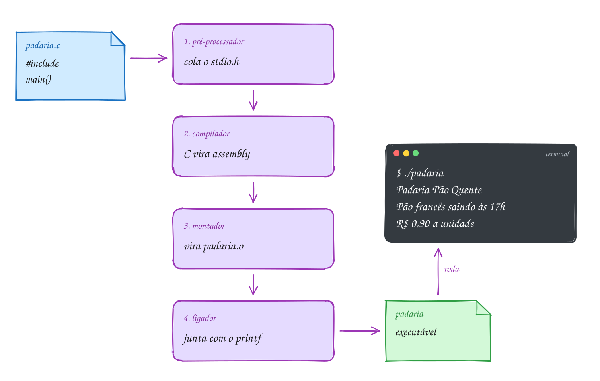</p>

O programa completo:

```c
// Aviso do painel da padaria
#include <stdio.h>

int main(void) {
    printf("Padaria Pão Quente\n");
    printf("Pão francês saindo às 17h\n");
    printf("R$ 0,90 a unidade\n");
    return 0; // 0 = terminou bem
}
// Saída:
// Padaria Pão Quente
// Pão francês saindo às 17h
// R$ 0,90 a unidade
```

Repara no fluxograma: cada estação pode parar a linha de montagem, e cada
uma reclama de um jeito. O caminho do exemplo passa por todas sem erro e
termina com o programa rodando:

<p align="center">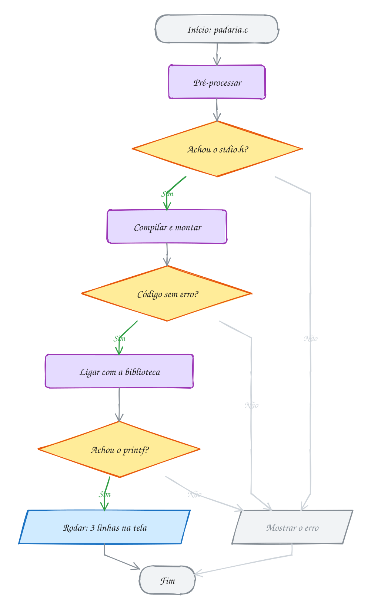</p>

Saber **quem reclamou** é meio caminho para consertar. Há três tipos de erro:

- **de compilação**: arquivo do `#include` que não existe (pré-processador),
  falta de `;`, `Int` no lugar de `int`. O gcc mostra o arquivo, a linha e a
  coluna, e não gera executável;
- **de ligação**: o código está certo na gramática, mas uma função não existe
  em lugar nenhum. Escreva `prinft` e o ligador para com
  `undefined reference to 'prinft'`;
- **de execução**: compila, roda e dá errado: mostra o valor errado ou quebra
  no meio. É o pior tipo, porque o compilador não tem como ver. Os **avisos**
  (*warnings*) do gcc e o AddressSanitizer existem para pegar parte deles.

> [!WARNING]
> O `printf` **não pula linha sozinho**. Sem o
> `\n`, o próximo `printf` continua de onde o cursor parou:
> `printf("Pão"); printf("Quente");` mostra `PãoQuente`. E quando faltar um
> `;`, o gcc avisa `expected ';' before ...` apontando para a linha
> **seguinte**, porque só lá ele percebe que faltou alguma coisa.

> [!TIP]
> **Por dentro do C:** rode `gcc -E A011.c | wc -l` e veja o seu programa de
> poucas linhas virar centenas: é o `stdio.h` colado. Rode `gcc -S A011.c`, abra o
> `A011.s` e procure `call`: você acha `puts`, não `printf`. O compilador viu
> que era só texto fixo com `\n` e trocou por uma função mais simples. Dentro
> do executável, cada texto entre aspas fica guardado byte a byte, seguido de
> um byte zero que marca o fim. Acento custa mais: no UTF-8, `ã` ocupa 2
> bytes, então `"Pão"` ocupa 5 (`P`, os dois do `ã`, `o` e o zero). E o
> `return 0` chega ao sistema: logo depois de rodar, `echo $?` mostra 0.

> [!NOTE]
> **Pergunta para você:** se você apagar o `\n` do segundo `printf`, quantas
> linhas aparecem e como fica cada uma? E se escrever `Printf` com P
> maiúsculo, qual estação reclama? Responda e teste no A011.

### Hora de praticar

Os arquivos ficam em [`0006-primeiro-programa/`](0006-primeiro-programa/). Os comandos funcionam de qualquer pasta do terminal. Nos exemplos, rode, mude, quebre e rode de novo. Nos exercícios, a resposta vai dentro do próprio arquivo. ★☆☆ é aquecimento, ★★☆ pede raciocínio e ★★★ é desafio.

**Exemplo A011 · O aviso da padaria**

```c
// Aviso do painel da padaria
#include <stdio.h>

int main(void) {
    printf("Padaria Pão Quente\n");
    printf("Pão francês saindo às 17h\n");
    printf("R$ 0,90 a unidade\n");
    return 0; // 0 = terminou bem
}
// Saída:
// Padaria Pão Quente
// Pão francês saindo às 17h
// R$ 0,90 a unidade
//
// Experimente no terminal, dentro desta pasta:
//   gcc -E A011.c | wc -l     quantas linhas depois do pré-processador
//   gcc -S A011.c             gera A011.s (assembly): procure "call"
//   gcc -c A011.c             gera A011.o (código objeto)
//   gcc A011.o -o padaria     liga e gera o executável
//   ./padaria
//   echo $?                   mostra o 0 do return
```

```bash
~/LPEDC/rodar 01-fundamentos/0006-primeiro-programa/A011.c
```

**Exemplo A012 · Um printf, várias linhas (e vários printf, uma linha)**

```c
#include <stdio.h>

/*
   Comentário de bloco: pode ocupar várias linhas.
   Bom para explicar o que o programa faz, no topo do arquivo.
*/
int main(void) {
    // três printf montando UMA linha: sem \n, o cursor fica onde parou
    printf("Cardápio: ");
    printf("café, ");
    printf("pão na chapa\n");

    // um printf só montando TRÊS linhas: cada \n pula uma
    printf("Café: R$ 4,50\nPão na chapa: R$ 6,00\nPingado: R$ 5,00\n");

    // dois textos entre aspas lado a lado viram um só (útil para linhas longas)
    printf("Aberto de segunda a sábado, "
           "das 6h às 20h\n");

    // printf("Esta linha nunca aparece: está comentada\n");
    return 0;
}
// Saída:
// Cardápio: café, pão na chapa
// Café: R$ 4,50
// Pão na chapa: R$ 6,00
// Pingado: R$ 5,00
// Aberto de segunda a sábado, das 6h às 20h
//
// Depois de rodar, digite "echo $?" no terminal: aparece 0, o valor do return.
```

```bash
~/LPEDC/rodar 01-fundamentos/0006-primeiro-programa/A012.c
```

#### Exercícios

**Exercício E031** · ★☆☆

Escreva um programa que mostre o letreiro do ônibus, exatamente assim.
Rode de dois jeitos: com o rodar e na mão, com gcc, gerando um executável
chamado "letreiro".


```text
Saída esperada:
Linha 077 - Terminal Centro
Via Av. Brasil
Tarifa: R$ 4,90
```

**Dicas:**

1. Comece pelo esqueleto do A011: o #include, a main com as chaves e o
   return 0;.
2. Um printf por linha, cada um terminando com \n.
3. Na mão, dentro desta pasta: gcc E031.c -o letreiro e depois ./letreiro.
4. Resposta esperada: as três linhas acima, iguais nos dois jeitos.

```bash
~/LPEDC/rodar 01-fundamentos/0006-primeiro-programa/E031.c
```

**Exercício E032** · ★☆☆

Sem rodar, escreva (como comentário) exatamente o que este trecho mostra
na tela. Atenção às linhas em branco. Depois copie o trecho para a main,
rode e confira.


```text
printf("Bom ");
printf("dia");
printf("!\n");
// printf("Boa tarde\n");
printf("Café\nPão\n\nManteiga\n");
```

**Dicas:**

1. Sem \n, o próximo printf continua na mesma linha.
2. A linha que começa com // não roda. Dois \n seguidos deixam uma linha vazia.
3. Resposta esperada: "Bom dia!", "Café", "Pão", uma linha em branco e
   "Manteiga" (5 linhas no total, contando a vazia).

```bash
~/LPEDC/rodar 01-fundamentos/0006-primeiro-programa/E032.c
```

**Exercício E033** · ★★☆

Este programa tem QUATRO erros e não compila de propósito. Rode com o
rodar, leia a primeira mensagem, conserte, rode de novo e repita até
funcionar. Para cada erro, anote o que o gcc disse e qual estação
reclamou: compilador ou ligador.


```text
Saída esperada (depois de consertar):
Farmácia aberta 24h
Plantão: (11) 5555-0199
```

**Dicas:**

1. Comece pelo topo: um comentário que não fecha engole todo o resto.
2. Olhe com atenção as maiúsculas e os nomes das funções. E os ;.
3. Resposta esperada: (1) o /* da primeira linha nunca fecha
   ("unterminated comment"): feche com */; (2) Int com I maiúsculo não é
   tipo ("unknown type name 'Int'"): use int; (3) falta ; depois do
   primeiro printf ("expected ';'"). Esses três são do compilador. (4)
   print não existe: o compilador só avisa "implicit declaration of
   function 'print'", e quem para é o ligador, com "undefined reference
   to 'print'": use printf.

```bash
~/LPEDC/rodar 01-fundamentos/0006-primeiro-programa/E033.c
```

**Exercício E034** · ★★☆

Escreva um programa que mostre só "Bom dia" (com \n). Depois, dentro
desta pasta, rode cada estação separada e responda como comentário:


```text
gcc -E E034.c | wc -l
gcc -S E034.c
gcc -c E034.c
gcc E034.o -o bomdia && ./bomdia
```


a) Quantas linhas o arquivo tem depois do pré-processador? De onde veio

```text
 tanta linha? O que aconteceu com os comentários?
```

b) Abra o E034.s. Que função aparece depois de "call": printf ou puts?
c) Troque o texto por printf("Bom dia %d\n", 7); e gere o .s de novo.

```text
 Mudou? Por quê?
```

d) Que arquivos novos apareceram na pasta, e qual deles roda?

**Dicas:**

1. O wc -l conta linhas. Procure "printf" no resultado do gcc -E.
2. O texto fixo fica numa linha .string do .s, com uma etiqueta como .LC0.
3. Resposta esperada: a) algumas centenas (uns 700 a 900, depende do
   sistema): é o stdio.h colado no lugar do #include; os comentários
   somem; b) puts: o texto é fixo e termina em \n, então o compilador troca
   por uma função mais simples; c) com o %d ele precisa formatar e volta a
   chamar printf; d) E034.s (assembly, texto), E034.o (objeto, binário) e
   bomdia (o executável, o único que roda).

```bash
~/LPEDC/rodar 01-fundamentos/0006-primeiro-programa/E034.c
```

**Exercício E035** · ★★★

O número do return chega ao sistema e é assim que scripts e ferramentas
de CI sabem se um programa deu certo.
Escreva um programa que mostre "Backup concluído" e termine com return 0.
Rode assim, de dentro desta pasta:


```text
~/LPEDC/rodar E035.c; echo $?
~/LPEDC/rodar E035.c && echo "pode seguir"
```


Depois troque para return 3 e rode as duas linhas de novo. Por fim, teste
return 256. Responda como comentário:

a) O que o echo $? mostra com return 0, return 3 e return 256?
b) Com return 3, a mensagem "pode seguir" aparece? Por quê?
c) Por que 256 dá esse resultado?

**Dicas:**

1. O $? guarda o código de saída do último comando.
2. O && do terminal só roda o segundo comando se o primeiro devolveu 0.
3. O sistema guarda só 1 byte (8 bits) do código de saída, e um byte vai
   de 0 a 255 (você vai ver o porquê no assunto 0008).
4. Resposta esperada: a) 0, 3 e 0; b) não: 3 significa erro, e o && para;
   c) só os 8 bits de baixo chegam ao sistema: 256 é 1 0000 0000 em
   binário, e os 8 bits de baixo são todos zero.

```bash
~/LPEDC/rodar 01-fundamentos/0006-primeiro-programa/E035.c
```

**Exercício E036** · ★★★

Para cada situação, diga quem reclama: o pré-processador, o compilador, o
ligador, ou ninguém (o erro só aparece quando o programa roda). Depois
provoque cada uma no seu E031 e confira a mensagem.


```text
a) #include <stdoi.h>
b) printf("Linha 077\n")   (sem o ponto e vírgula)
c) int Main(void) { ... }  (M maiúsculo)
d) prinft("Via Av. Brasil\n");
e) printf("Tarifa: R$ 9,40\n"); quando a tarifa certa é R$ 4,90
f) o } final apagado
```

**Dicas:**

1. O pré-processador só cuida das linhas com #.
2. O ligador procura funções pelo nome, inclusive a main.
3. O compilador confere a gramática, mas não sabe qual é a tarifa certa.
4. Resposta esperada: a) pré-processador ("stdoi.h: No such file or
   directory"); b) compilador ("expected ';'"); c) ligador: o código
   compila, mas não existe main ("undefined reference to `main'"); d)
   ligador ("undefined reference to `prinft'", depois do aviso de
   "implicit declaration"); e) ninguém: compila, roda e mostra o valor
   errado, um erro de execução (de lógica); f) compilador ("expected
   declaration or statement at end of input").

```bash
~/LPEDC/rodar 01-fundamentos/0006-primeiro-programa/E036.c
```

---

## 0007 · Variáveis

Na matrícula da academia, a recepcionista preenche uma ficha: idade 25,
altura 1,75 m, peso 72,5 kg, plano B. Um mês depois, ela apaga o peso e
escreve 71,8. A ficha continua a mesma; só o conteúdo de um campo mudou.

Uma **variável** é exatamente um campo dessa ficha: um pedaço da memória com
**nome**, **tipo**, **valor** e **endereço**. O nome é para você. O endereço é
para o computador: é o número do primeiro byte onde o valor mora. O tipo diz
quantos bytes a variável ocupa e como ler esses bytes.

No C, você escolhe o tipo de cada variável. Ele vem **antes** do nome e não
muda nunca mais. Os quatro tipos básicos:

| Tipo | Guarda | Tamanho típico | Exemplo |
| --- | --- | --- | --- |
| `int` | inteiro | 4 bytes | `int idade = 25;` |
| `float` | real, uns 7 dígitos | 4 bytes | `float altura = 1.75;` |
| `double` | real, uns 15 dígitos | 8 bytes | `double peso = 72.5;` |
| `char` | um caractere (um número pequeno) | 1 byte | `char plano = 'B';` |

**Declarar** é criar a variável: `int idade;`. **Inicializar** é dar o
primeiro valor junto: `int idade = 25;`. Para mostrar o valor, o `printf` usa
um código para cada tipo: `%d` para `int`, `%f` para `float` e `double`, `%c`
para `char`. O `%.1f` limita a uma casa decimal (o `printf` completo vem no
0010).

Guardar um valor novo **apaga** o antigo: depois de `peso = 71.8;`, o 72,5
sumiu para sempre. Ler a variável, ao contrário, não muda nada. E o operador
**`sizeof`** diz quantos bytes um tipo ou uma variável ocupa; para mostrar o
resultado, use `%zu`.

Regras para o nome: letras, dígitos e `_`, sem começar por dígito, sem acento
e sem espaço; `peso` e `Peso` são variáveis diferentes; palavras do C (`int`,
`return`, `float`...) não valem. A convenção do curso é `snake_case`:
`peso_atual`, `valor_total`.

Vamos ver na prática. A ficha vira quatro caixinhas, cada uma com seu tipo,
seu tamanho e seu endereço. Depois, o peso recebe um valor novo e o antigo
desaparece:

<p align="center">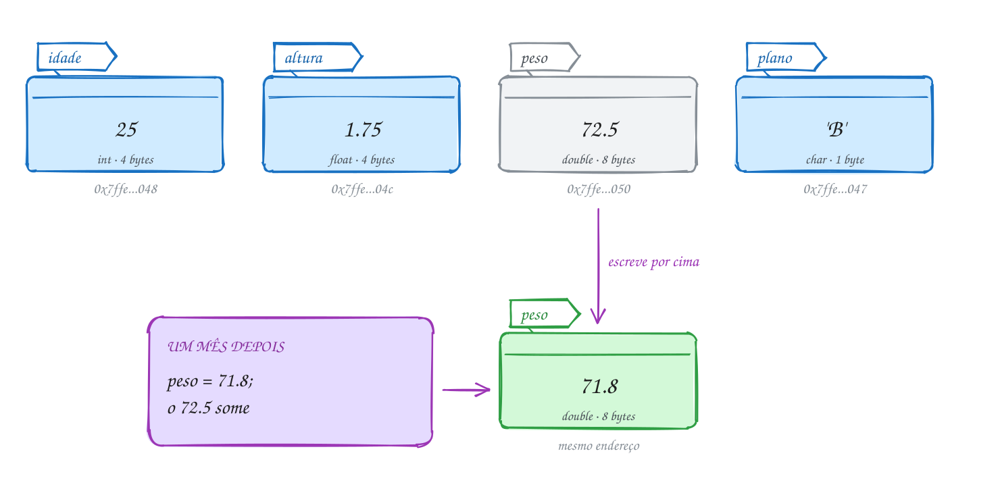</p>

O mesmo exemplo em C:

```c
#include <stdio.h>

int main(void) {
    int idade = 25;       // inteiro
    float altura = 1.75;  // real com uns 7 dígitos
    double peso = 72.5;   // real com uns 15 dígitos
    char plano = 'B';     // um caractere, entre aspas simples

    printf("Idade: %d anos\n", idade);
    printf("Altura: %.2f m\n", altura);
    printf("Peso: %.1f kg\n", peso);
    printf("Plano: %c\n", plano);

    peso = 71.8; // um mês depois: o 72.5 some
    printf("Peso novo: %.1f kg\n", peso);
    printf("Bytes: %zu, %zu, %zu, %zu\n",
           sizeof idade, sizeof altura, sizeof peso, sizeof plano);
    return 0;
}
// Saída:
// Idade: 25 anos
// Altura: 1.75 m
// Peso: 72.5 kg
// Plano: B
// Peso novo: 71.8 kg
// Bytes: 4, 4, 8, 1
```

Repara no fluxograma: criar as variáveis é um passo de processamento (o
programa reserva memória), e a troca do peso é outro. Ainda é sequência pura,
um passo depois do outro:

<p align="center">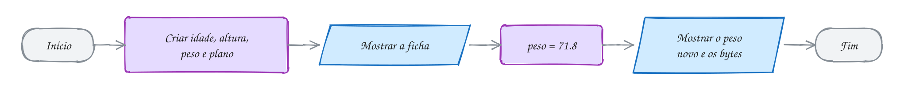</p>

> [!WARNING]
> Variável criada sem valor não vale zero: vale **lixo**, o que já estava
> naqueles bytes. `int total; printf("%d", total);` pode mostrar 0, 32767 ou
> -1294; o gcc avisa `'total' is used uninitialized`. Inicialize sempre. E o
> separador decimal do C é o **ponto**: `double peso = 72,5;` nem compila, porque
> para o C a vírgula separa duas coisas diferentes.

> [!TIP]
> **Por dentro do C:** `&peso` é o endereço da variável, e o `printf` mostra
> endereços com `%p` (o `(void *)` na frente é exigência do `%p`; você entende
> no módulo de ponteiros). Rode o A014 sem o AddressSanitizer
> (`gcc A014.c -o a && ./a`) e repare: as variáveis ficam **coladas** na
> memória, e a distância entre um endereço e o próximo é o tamanho da
> variável. O `sizeof` não roda nada: o compilador já sabe o tamanho de cada
> tipo e escreve o número direto no executável. Os tamanhos da tabela são os
> de um PC de 64 bits; o padrão do C só garante mínimos, por isso o `sizeof`
> existe.

> [!NOTE]
> **Pergunta para você:** o `char` guarda um número pequeno. O que você acha
> que `printf("%d\n", plano);` mostra? Teste no A013.

### Hora de praticar

Os arquivos ficam em [`0007-variaveis/`](0007-variaveis/). Os comandos funcionam de qualquer pasta do terminal. Nos exemplos, rode, mude, quebre e rode de novo. Nos exercícios, a resposta vai dentro do próprio arquivo. ★☆☆ é aquecimento, ★★☆ pede raciocínio e ★★★ é desafio.

**Exemplo A013 · A ficha da academia**

```c
#include <stdio.h>

int main(void) {
    int idade = 25;       // inteiro
    float altura = 1.75;  // real com uns 7 dígitos
    double peso = 72.5;   // real com uns 15 dígitos
    char plano = 'B';     // um caractere, entre aspas simples

    printf("Idade: %d anos\n", idade);
    printf("Altura: %.2f m\n", altura);
    printf("Peso: %.1f kg\n", peso);
    printf("Plano: %c\n", plano);

    peso = 71.8; // um mês depois: o 72.5 some
    printf("Peso novo: %.1f kg\n", peso);
    printf("Bytes: %zu, %zu, %zu, %zu\n",
           sizeof idade, sizeof altura, sizeof peso, sizeof plano);
    return 0;
}
// Saída:
// Idade: 25 anos
// Altura: 1.75 m
// Peso: 72.5 kg
// Plano: B
// Peso novo: 71.8 kg
// Bytes: 4, 4, 8, 1
```

```bash
~/LPEDC/rodar 01-fundamentos/0007-variaveis/A013.c
```

**Exemplo A014 · Onde moram as variáveis**

```c
#include <stdio.h>

// Cada variável ocupa alguns bytes seguidos da memória. O endereço (&nome)
// é o número do primeiro desses bytes. O %p mostra endereços em hexadecimal.
int main(void) {
    char plano = 'B';
    int idade = 25;
    double peso = 72.5;

    printf("plano: %zu byte  em %p\n", sizeof plano, (void *)&plano);
    printf("idade: %zu bytes em %p\n", sizeof idade, (void *)&idade);
    printf("peso:  %zu bytes em %p\n", sizeof peso, (void *)&peso);

    printf("int: %zu, float: %zu, double: %zu, char: %zu\n",
           sizeof(int), sizeof(float), sizeof(double), sizeof(char));
    return 0;
}
// Saída (os endereços mudam a cada execução):
// plano: 1 byte  em 0x7f2e53c00020
// idade: 4 bytes em 0x7f2e53c00030
// peso:  8 bytes em 0x7f2e53c00040
// int: 4, float: 4, double: 8, char: 1
//
// Com o rodar, o AddressSanitizer deixa uma folga entre as variáveis para
// flagrar quem escreve fora do lugar. Sem ele, elas ficam coladas:
//   gcc A014.c -o a && ./a
//   plano: 1 byte  em 0x7ffccb532f1b
//   idade: 4 bytes em 0x7ffccb532f1c     (logo depois do plano)
//   peso:  8 bytes em 0x7ffccb532f20     (4 bytes depois da idade)
```

```bash
~/LPEDC/rodar 01-fundamentos/0007-variaveis/A014.c
```

#### Exercícios

**Exercício E037** · ★☆☆

No mercado, a etiqueta de um produto tem: código 1042, preço R$ 8.99,
peso 0.5 kg e setor 'H' (hortifrúti). Crie uma variável para cada dado,
com o tipo certo, e mostre a etiqueta:


```text
Saída esperada:
Código: 1042
Preço: R$ 8.99
Peso: 0.5 kg
Setor: H
```

**Dicas:**

1. Código é inteiro (int); preço e peso são reais (double); setor é char.
2. Use %d, %.2f, %.1f e %c no printf.
3. Resposta esperada: as quatro linhas acima.

```bash
~/LPEDC/rodar 01-fundamentos/0007-variaveis/E037.c
```

**Exercício E038** · ★☆☆

Quais destes nomes de variável o C aceita? Para cada inválido, diga o
motivo. Depois tente declarar alguns (int nome = 0;) e veja o erro do gcc.


```text
preco_kg    2via       _total      valor-final   Preco
float       nota1      média       qtd$          dia util
```


E mais uma: preco e Preco podem existir no mesmo programa? São a mesma
variável?

**Dicas:**

1. Só letras, dígitos e _, sem começar por dígito, sem acento, sem espaço.
2. Palavras do próprio C (int, float, return...) são reservadas.
3. Resposta esperada: válidos: preco_kg, _total, Preco, nota1. Inválidos:
   2via (começa com dígito), valor-final (o - é subtração), float (palavra
   reservada), média (acento), qtd$ ($ não faz parte do padrão; o gcc
   aceita como extensão, mas não use) e dia util (espaço). preco e Preco
   podem coexistir e são variáveis diferentes. Evite começar nomes com _:
   é válido, mas o compilador e a biblioteca usam esses nomes.

```bash
~/LPEDC/rodar 01-fundamentos/0007-variaveis/E038.c
```

**Exercício E039** · ★★☆

O cadastro de um aluno da autoescola guarda: idade (int, 19), nota da
prova teórica (double, 8.5), nota da prova prática (double, 9.0),
categoria da CNH (char, 'B') e número de aulas feitas (int, 20). Declare as cinco variáveis e
mostre os valores e o sizeof de cada uma, uma por linha, no formato:


```text
Saída esperada:
idade: 19 (4 bytes)
teorica: 8.5 (8 bytes)
pratica: 9.0 (8 bytes)
categoria: B (1 byte)
aulas: 20 (4 bytes)
```


Depois responda, sem rodar: quantos bytes as cinco variáveis ocupam
juntas? Se você trocasse as duas notas para float, quanto economizaria?

**Dicas:**

1. sizeof nome_da_variavel e %zu no printf.
2. Some os tamanhos: 4 + 8 + 8 + 1 + 4.
3. Resposta esperada: as cinco linhas acima; juntas ocupam 25 bytes; com
   float nas notas seriam 17 bytes (8 a menos). Na memória pode haver
   folgas entre as variáveis, mas o total de dados é esse.

```bash
~/LPEDC/rodar 01-fundamentos/0007-variaveis/E039.c
```

**Exercício E040** · ★★☆

O operador do placar eletrônico digitou invertido: o programa abaixo
mostra Casa 1 x 3 Visitante, mas o certo é Casa 3 x 1 Visitante. Sem
mudar as duas primeiras linhas da main, acrescente instruções que TROQUEM
os valores de casa e visitante antes do printf.


```text
Saída esperada:
Casa 3 x 1 Visitante
```

**Dicas:**

1. Escrever casa = visitante; apaga o valor antigo de casa. Ele se perde.
2. Use uma terceira variável para guardar um valor enquanto troca, como
   um copo vazio para trocar o suco de dois copos.
3. Resposta esperada: int aux = casa; casa = visitante; visitante = aux;
   e a saída "Casa 3 x 1 Visitante".

```bash
~/LPEDC/rodar 01-fundamentos/0007-variaveis/E040.c
```

**Exercício E041** · ★★★

Este programa tem TRÊS erros e o gcc mostra um aviso para cada um (numa
versão mais nova do gcc, um deles já vira erro). Rode, leia os avisos, diga
o que cada um quer dizer e conserte. O jogo terminou 2 x 1 para o time da
casa, com público de 45000 pessoas.


```text
Saída esperada (depois de consertar):
Placar: 2 x 1
Resultado: V
Público: 45000
```

**Dicas:**

1. Procure as palavras "uninitialized", "pointer" e "format" nos avisos.
2. Aspas simples são um caractere; aspas duplas são um texto.
3. O %d espera int. Que tipo é publico?
4. Resposta esperada: (1) gols_fora não tem valor (lixo; aviso
   "uninitialized"): int gols_fora = 1;. (2) "V" é texto, não caractere
   ("makes integer from pointer"): use 'V'. (3) %d com double ("expects
   argument of type 'int'"): declare publico como int (ou mostre com
   %.0f).

```bash
~/LPEDC/rodar 01-fundamentos/0007-variaveis/E041.c
```

**Exercício E042** · ★★★

Para o C, um char é só um número pequeno, e o %c mostra o símbolo que
tem aquele código. Sem rodar, escreva o que cada printf mostra:


```text
char letra = 'A';
printf("%c %d\n", letra, letra);
letra = 66;
printf("%c\n", letra);
char digito = '7';
printf("%c %d\n", digito, digito);
char espaco = ' ';
printf("[%c] %d\n", espaco, espaco);
```


Depois copie para a main, rode e confira. Pergunta final: '7' e 7 são a
mesma coisa?

**Dicas:**

1. Na tabela ASCII, 'A' é 65 e as letras seguem em ordem.
2. Os dígitos também têm códigos: '0' é 48, '1' é 49, e assim por diante.
3. Resposta esperada: "A 65", "B", "7 55", "[ ] 32". '7' é o caractere
   sete, de código 55; 7 é o número sete. São diferentes.

```bash
~/LPEDC/rodar 01-fundamentos/0007-variaveis/E042.c
```

---

## 0008 · Tipos e limites

A catraca do estádio conta os torcedores num contador de 16 bits. No clássico
de domingo, o Maracanã recebeu 78.838 pessoas. Quando o torcedor número 65.536
passou, o painel voltou a mostrar **zero**. Ninguém errou a conta: o número
simplesmente não cabia.

Por baixo de tudo, a memória é feita de **bits**: chavinhas que valem 0 ou 1.
Oito bits formam um **byte**. Um número inteiro é guardado em **binário** (base
2), em que cada casa vale o dobro da casa da direita:

| casa | 2⁷ | 2⁶ | 2⁵ | 2⁴ | 2³ | 2² | 2¹ | 2⁰ |
| --- | --- | --- | --- | --- | --- | --- | --- | --- |
| vale | 128 | 64 | 32 | 16 | 8 | 4 | 2 | 1 |

Para ler um binário, some as casas que têm 1: `00001101` é 8 + 4 + 1 = 13.
Com 8 bits todos ligados, `11111111`, você chega a 255. Por isso **um byte vai
de 0 a 255**: são 2⁸ = 256 combinações. Com `n` bits, cabem 2ⁿ valores.

Escrever 16 ou 32 zeros e uns cansa. O atalho é o **hexadecimal** (base 16),
com os dígitos 0 a 9 e A a F (A = 10, ..., F = 15). Cada dígito hexa vale
exatamente 4 bits, então um byte são dois dígitos: `1111 1111` = `FF` = 255.
No C, hexadecimal começa com `0x`: `0xFF`, `0xFFFF`.

Agora os tipos. Cada tipo inteiro tem um tamanho, e o tamanho decide a
**faixa**. Os **modificadores** mudam o `int`: `short` (menor), `long` e
`long long` (maiores) e `unsigned` (sem sinal: troca os negativos por mais
positivos). Num PC Linux de 64 bits:

| Tipo | Bytes | Faixa |
| --- | --- | --- |
| `char` | 1 | -128 a 127 |
| `unsigned char` | 1 | 0 a 255 |
| `short` | 2 | -32.768 a 32.767 |
| `unsigned short` | 2 | 0 a 65.535 |
| `int` | 4 | cerca de ±2,1 bilhões |
| `unsigned int` | 4 | 0 a cerca de 4,3 bilhões |
| `long` / `long long` | 8 | cerca de ±9,2 quintilhões |

O padrão do C só garante mínimos (o `int` pode ter 2 bytes num
microcontrolador, e o `long` tem 4 bytes no Windows). Por isso não decore a
tabela: o **`<limits.h>`** traz os limites reais da máquina (`INT_MAX`,
`SHRT_MIN`, `USHRT_MAX`...). E quando o tamanho exato importa, o
**`<stdint.h>`** tem tipos com o número de bits no nome: `int8_t`, `uint16_t`,
`int32_t`, `int64_t`.

Passar do limite é **overflow** (estouro). Num tipo `unsigned`, o C garante o
comportamento: o número dá a volta, como o odômetro do carro passando de 99999
para 00000. Vamos ver na prática. A catraca é um `unsigned short` com 65.535,
os 16 bits ligados. Somar 1 dá 65.536, que precisa de 17 bits; o bit de cima
não cabe e some:

<p align="center">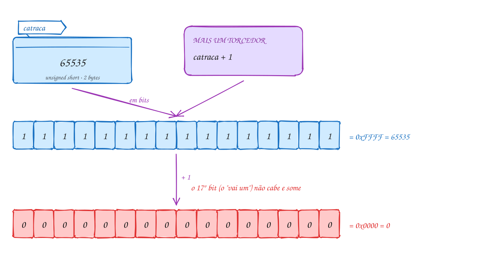</p>

O mesmo exemplo em C:

```c
#include <stdio.h>
#include <limits.h>

int main(void) {
    unsigned short catraca = 65535; // 16 bits, todos ligados
    printf("Maior unsigned short: %d\n", USHRT_MAX);
    printf("Catraca: %d (0x%X)\n", catraca, catraca);

    catraca = catraca + 1; // 65536 não cabe em 16 bits
    printf("Mais um torcedor: %d\n", catraca);

    int publico = 78838; // int tem 32 bits: sobra espaço
    printf("Público: %d (o int vai até %d)\n", publico, INT_MAX);
    return 0;
}
// Saída:
// Maior unsigned short: 65535
// Catraca: 65535 (0xFFFF)
// Mais um torcedor: 0
// Público: 78838 (o int vai até 2147483647)
```

Repara no fluxograma: a pergunta "cabe em 16 bits?" quem faz não é o seu
programa, é o próprio hardware. Quando não cabe, ele guarda só os 16 bits de
baixo, sem avisar ninguém:

<p align="center">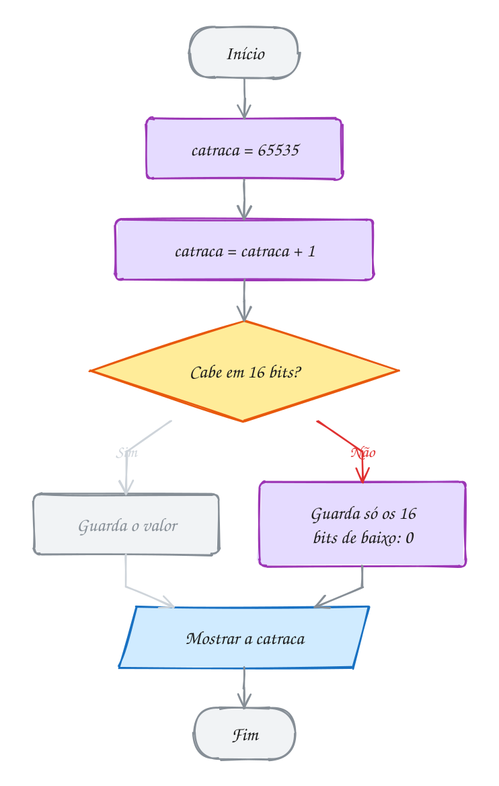</p>

> [!WARNING]
> Com `unsigned`, o estouro dá a volta. Com tipos **com sinal** (`int`,
> `long`...), estourar é **comportamento indefinido**: o padrão não diz o que
> acontece, e o compilador pode assumir que nunca acontece.
> `int x = INT_MAX; x = x + 1;` costuma virar -2147483648, mas não conte com
> isso. O `rodar` liga o detector de comportamento indefinido, que acusa
> `runtime error: signed integer overflow`. Escolha um tipo que caiba.

> [!TIP]
> **Por dentro do C:** os negativos são guardados em **complemento de dois**:
> o bit mais à esquerda pesa negativo. Num byte com sinal, ele vale -128, e
> `11111111` é -128 + 127 = -1. Por isso a faixa é assimétrica (-128 a 127):
> não existe "-0". E por isso o mesmo byte `0xFF` é 255 num `unsigned char` e
> -1 num `char`: os bits são iguais, o tipo decide como ler. A ordem dos bytes
> na memória também é curiosa: nos PCs, o byte menos significativo vem
> primeiro (**little-endian**). O 13 num `int` fica como `0D 00 00 00`.

> [!NOTE]
> **Pergunta para você:** se a catraca começasse em 65.530 e passassem 10
> torcedores, o que o painel mostraria? Mude o A015 e confira.

### Hora de praticar

Os arquivos ficam em [`0008-tipos-e-limites/`](0008-tipos-e-limites/). Os comandos funcionam de qualquer pasta do terminal. Nos exemplos, rode, mude, quebre e rode de novo. Nos exercícios, a resposta vai dentro do próprio arquivo. ★☆☆ é aquecimento, ★★☆ pede raciocínio e ★★★ é desafio.

**Exemplo A015 · A catraca que voltou a zero**

```c
#include <stdio.h>
#include <limits.h>

int main(void) {
    unsigned short catraca = 65535; // 16 bits, todos ligados
    printf("Maior unsigned short: %d\n", USHRT_MAX);
    printf("Catraca: %d (0x%X)\n", catraca, catraca);

    catraca = catraca + 1; // 65536 não cabe em 16 bits
    printf("Mais um torcedor: %d\n", catraca);

    int publico = 78838; // int tem 32 bits: sobra espaço
    printf("Público: %d (o int vai até %d)\n", publico, INT_MAX);
    return 0;
}
// Saída:
// Maior unsigned short: 65535
// Catraca: 65535 (0xFFFF)
// Mais um torcedor: 0
// Público: 78838 (o int vai até 2147483647)
```

```bash
~/LPEDC/rodar 01-fundamentos/0008-tipos-e-limites/A015.c
```

**Exemplo A016 · A tabela de tamanhos e limites desta máquina**

```c
#include <stdio.h>
#include <limits.h>
#include <stdint.h>

// Cada tipo tem o seu código no printf: %d (int), %u (unsigned),
// %ld (long), %lld (long long), %llu (unsigned long long).
int main(void) {
    printf("char:      %zu byte,  %d a %d\n", sizeof(char), CHAR_MIN, CHAR_MAX);
    printf("u. char:   %zu byte,  0 a %d\n", sizeof(unsigned char), UCHAR_MAX);
    printf("short:     %zu bytes, %d a %d\n", sizeof(short), SHRT_MIN, SHRT_MAX);
    printf("int:       %zu bytes, %d a %d\n", sizeof(int), INT_MIN, INT_MAX);
    printf("u. int:    %zu bytes, 0 a %u\n", sizeof(unsigned int), UINT_MAX);
    printf("long:      %zu bytes, até %ld\n", sizeof(long), LONG_MAX);
    printf("long long: %zu bytes, até %lld\n", sizeof(long long), LLONG_MAX);

    // stdint.h: o número de bits está no nome do tipo
    printf("int8_t: %zu, uint16_t: %zu, int32_t: %zu, int64_t: %zu bytes\n",
           sizeof(int8_t), sizeof(uint16_t), sizeof(int32_t), sizeof(int64_t));
    printf("uint64_t vai até %llu\n", (unsigned long long)UINT64_MAX);

    // hexadecimal no código: 0x na frente; cada dígito vale 4 bits
    printf("0xFF = %d, 0xFFFF = %d, 0x7FFFFFFF = %d\n", 0xFF, 0xFFFF, 0x7FFFFFFF);
    return 0;
}
// Saída (num PC Linux de 64 bits):
// char:      1 byte,  -128 a 127
// u. char:   1 byte,  0 a 255
// short:     2 bytes, -32768 a 32767
// int:       4 bytes, -2147483648 a 2147483647
// u. int:    4 bytes, 0 a 4294967295
// long:      8 bytes, até 9223372036854775807
// long long: 8 bytes, até 9223372036854775807
// int8_t: 1, uint16_t: 2, int32_t: 4, int64_t: 8 bytes
// uint64_t vai até 18446744073709551615
// 0xFF = 255, 0xFFFF = 65535, 0x7FFFFFFF = 2147483647
```

```bash
~/LPEDC/rodar 01-fundamentos/0008-tipos-e-limites/A016.c
```

#### Exercícios

**Exercício E043** · ★☆☆

Sem calculadora, responda como comentário:


```text
a) 00010110 em decimal
b) 11111111 em decimal e em hexadecimal
c) 0x1F e 0x100 em decimal
d) quantos valores diferentes cabem em 4, 8 e 16 bits
```


Depois confira os hexadecimais com printf: printf("%d\n", 0x1F); mostra
o valor em decimal. (Binário escrito como 0b10110 só virou padrão no C23;
o rodar, que segue o C17, avisa se você usar.)

**Dicas:**

1. Some as casas que têm 1: 128, 64, 32, 16, 8, 4, 2, 1.
2. Cada dígito hexa vale 4 bits: 0x1F é 1 * 16 + 15.
3. Com n bits cabem 2 elevado a n valores.
4. Resposta esperada: a) 16 + 4 + 2 = 22; b) 255 e 0xFF; c) 31 e 256;
   d) 16, 256 e 65.536.

```bash
~/LPEDC/rodar 01-fundamentos/0008-tipos-e-limites/E043.c
```

**Exercício E044** · ★☆☆

Escolha o MENOR tipo inteiro que guarda cada dado com folga e declare uma
variável para cada um, com o valor indicado. Mostre todas com printf.


```text
a) idade de uma pessoa (34)
b) temperatura mínima em São Joaquim, SC, em graus (-8)
c) população do Brasil (203080756)
d) tamanho de um arquivo de vídeo de 5 GB, em bytes (5368709120)
e) ano de nascimento (1991)
```


```text
Saída esperada:
idade: 34
temperatura: -8
população: 203080756
arquivo: 5368709120 bytes
ano: 1991
```

**Dicas:**

1. Confira os limites na tabela do texto ou rodando o A016.
2. short vai até 32767; int até uns 2,1 bilhões; acima disso, long long.
3. Resposta esperada: a) signed char ou int8_t (até 127) serve; short
   também; b) signed char/int8_t (aceita negativo); c) int (cabe com folga
   até 2,1 bilhões); d) long long ou int64_t (passa de 4,2 bilhões, nem
   unsigned int serve); e) short. Na prática, int é o padrão para
   inteiros pequenos: economize só quando tiver milhões deles.

```bash
~/LPEDC/rodar 01-fundamentos/0008-tipos-e-limites/E044.c
```

**Exercício E045** · ★★☆

Os três contadores abaixo são unsigned, então o estouro dá a volta.
Sem rodar, escreva o que cada printf mostra:


```text
unsigned char brilho = 250;      // LED, de 0 a 255
brilho = brilho + 10;
printf("%d\n", brilho);
```


```text
unsigned int estoque = 0;
estoque = estoque - 1;           // vendeu um que não tinha
printf("%u\n", estoque);
```


```text
unsigned short odometro = 65000; // km, num painel de 16 bits
odometro = odometro + 1000;
printf("%d\n", odometro);
```


Depois copie para a main, rode e confira.

**Dicas:**

1. Passou do máximo, volta a contar do zero: faça a conta e tire 2^n
   (256 para 8 bits, 65536 para 16, 4294967296 para 32).
2. Abaixo de zero, dá a volta para o máximo: 0 - 1 vira o maior valor.
3. Resposta esperada: 4 (260 - 256), 4294967295 (o maior unsigned int) e
   464 (66000 - 65536).

```bash
~/LPEDC/rodar 01-fundamentos/0008-tipos-e-limites/E045.c
```

**Exercício E046** · ★★☆

De quantas maneiras 13 corredores podem cruzar a linha de chegada? É
13! (13 fatorial = 1 * 2 * ... * 13). O programa abaixo parte de 12! e
multiplica por 13. Ele compila sem aviso, mas está errado: rode e leia a
mensagem "runtime error" que aparece. Explique o problema e conserte.


```text
Saída esperada (depois de consertar):
13! = 6227020800 maneiras
```

**Dicas:**

1. Quanto vale INT_MAX? E 6227020800?
2. O detector de comportamento indefinido do rodar pegou um estouro de
   int, que é um tipo com sinal.
3. Resposta esperada: 13! não cabe em int (máximo 2147483647): "signed
   integer overflow". Sem o detector, o programa mostraria um número
   errado (1932053504). Conserto: long long fatorial e %lld (ou int64_t).

```bash
~/LPEDC/rodar 01-fundamentos/0008-tipos-e-limites/E046.c
```

**Exercício E047** · ★★★

Dois estouros que viraram notícia:

- Em 2014, o clipe "Gangnam Style" passou de 2.147.483.647 visualizações

```text
e o YouTube teve de trocar o tipo do contador.
```

- Muitos sistemas guardam a hora como "segundos desde 1/1/1970" num

```text
inteiro de 32 bits com sinal. Esse contador estoura em 19/01/2038.
```


Escreva um programa que mostre o maior int32_t e o maior int64_t, usando
as constantes do stdint.h. Responda como comentário:

a) Por que o número do YouTube é exatamente esse?
b) Por que 2038? (um ano tem uns 31,5 milhões de segundos)
c) Com int64_t, o problema some? Quantos anos cabem?


```text
Saída esperada:
int32_t vai até 2147483647
int64_t vai até 9223372036854775807
```

**Dicas:**

1. INT32_MAX e INT64_MAX. Para mostrar o de 64 bits, converta para long
   long e use %lld: (long long)INT64_MAX.
2. 2147483647 é 2^31 - 1: 31 bits para o número e 1 para o sinal.
3. Resposta esperada: a) é o INT32_MAX, o maior int de 32 bits com sinal;
   b) 2147483647 / 31,5 milhões dá uns 68 anos, e 1970 + 68 = 2038;
   c) some na prática: 2^63 segundos são uns 292 bilhões de anos.

```bash
~/LPEDC/rodar 01-fundamentos/0008-tipos-e-limites/E047.c
```

**Exercício E048** · ★★★

Sem rodar, preveja a saída num PC Linux de 64 bits. Depois copie para a
main (com os #include) e confira.


```text
printf("%d\n", SCHAR_MAX);
printf("%d\n", SCHAR_MIN);
printf("%d\n", UCHAR_MAX);
printf("%d\n", SHRT_MIN);
printf("%u\n", UINT_MAX);
printf("%zu %zu\n", sizeof(long), sizeof(long long));
printf("%d\n", 0x7F + 0x01);
```


Responda também:
a) Por que o menor valor tem um número a mais que o maior (-128 e 127)?
b) Num PC com Windows, o sizeof(long) daria o mesmo? Que tipo você usa

```text
 quando precisa de exatamente 64 bits em qualquer sistema?
```

**Dicas:**

1. SCHAR é signed char (1 byte com sinal); UCHAR, unsigned char.
2. Complemento de dois: o bit de cima pesa negativo (-128 num byte).
3. Resposta esperada: 127, -128, 255, -32768, 4294967295, "8 8" e 128.
   a) o zero ocupa uma das combinações do lado positivo, e não existe -0:
   sobram 128 negativos e 127 positivos. b) não: no Windows o long tem 4
   bytes; use int64_t (ou long long, que tem pelo menos 64 bits).

```bash
~/LPEDC/rodar 01-fundamentos/0008-tipos-e-limites/E048.c
```

---

## 0009 · Constantes

A tarifa do ônibus aparece em dez lugares do sistema da empresa: no letreiro,
no cálculo da ida e volta, no recibo, no relatório... Em janeiro ela sobe de
R$ 4,40 para R$ 4,90. Se o valor estiver escrito à mão em cada lugar, alguém
vai esquecer um. O certo é escrever o número **uma vez só**, com um nome.

Todo valor escrito direto no código é um **literal**, e todo literal tem um
tipo, decidido pelo jeito de escrever:

| Literal | Tipo | Observação |
| --- | --- | --- |
| `101` | `int` | inteiro sem ponto |
| `4.90` | `double` | todo real é `double`, a não ser que... |
| `4.90f` | `float` | ...tenha o sufixo `f` |
| `5000000000LL` | `long long` | sufixos `L`, `LL`, `U` |
| `0x1F`, `017` | `int` | hexadecimal (31) e **octal** (15): zero à esquerda muda a base! |
| `1.5e3` | `double` | notação científica: 1,5 × 10³ = 1500 |
| `'A'` | `int` | um caractere: vale o código, 65 |
| `"A"` | texto | aspas duplas: `'A'` seguido do byte zero |

Para dar nome a um valor, o C tem dois jeitos. O **`#define`** é uma ordem
para o pré-processador: `#define TARIFA 4.90` faz um "localizar e substituir"
no arquivo antes de o compilador ver o código. O nome `TARIFA` nunca chega ao
compilador; ele só vê `4.90`. A convenção é escrever em MAIÚSCULAS. Sem `=` e
sem `;`.

O outro jeito é o **`const`**: `const int linha = 101;` cria uma variável de
verdade, com tipo, endereço e tamanho, mas **só de leitura**. Tentar mudar dá
erro de compilação, e por isso o valor precisa vir na própria declaração.

Dentro das aspas, a barra invertida avisa que o próximo caractere não é ele
mesmo: é uma **sequência de escape**. `\n` pula linha, `\t` é tabulação, `\"`
põe aspas dentro do texto, `\\` é a própria barra e `\0` é o byte zero. Para
mostrar `%` no `printf`, escreva `%%` (isso é regra do `printf`, não escape).

Vamos ver na prática. O pré-processador troca `TARIFA` por `4.90` e `EMPRESA`
pelo nome da viação. A `linha` é uma caixinha com cadeado: tem endereço, mas
ninguém escreve nela:

<p align="center">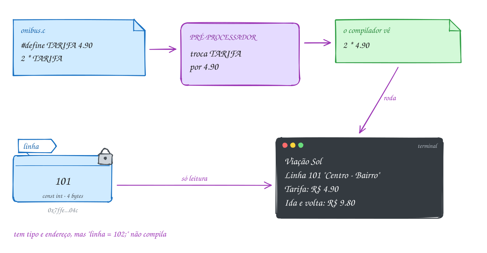</p>

O mesmo exemplo em C:

```c
#include <stdio.h>

#define TARIFA 4.90          // muda aqui, muda no programa todo
#define EMPRESA "Viação Sol"

int main(void) {
    const int linha = 101;   // variável só de leitura

    printf("%s\n", EMPRESA);
    printf("Linha %d \"Centro - Bairro\"\n", linha);
    printf("Tarifa: R$ %.2f\n", TARIFA);
    printf("Ida e volta: R$ %.2f\n", 2 * TARIFA); // o compilador vê 2 * 4.90
    return 0;
}
// Saída:
// Viação Sol
// Linha 101 "Centro - Bairro"
// Tarifa: R$ 4.90
// Ida e volta: R$ 9.80
```

Repara no fluxograma: o primeiro passo acontece antes de o programa existir.
A troca de texto é feita na compilação; quando o executável roda, ele só tem
os números:

<p align="center">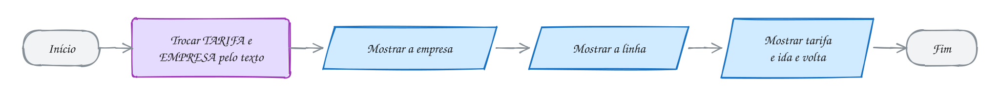</p>

> [!WARNING]
> O `#define` cola **exatamente** o texto que vem depois do nome. Com
> `#define TARIFA 4.90;`, a linha `printf("%.2f\n", 2 * TARIFA);` vira
> `printf("%.2f\n", 2 * 4.90;);` e não compila. Com `#define TARIFA = 4.90`,
> vira `2 * = 4.90`. Nada de `=` nem de `;` no `#define`. E o erro aparece na
> linha onde o nome é **usado**, não na linha do `#define`, o que confunde.

> [!TIP]
> **Por dentro do C:** rode `gcc -E A017.c | tail -12` e veja: não sobrou
> nenhum `TARIFA`, só `4.90`. Por isso um `#define` não ocupa memória, não tem
> tipo e não aparece no depurador. Já a `const int linha` mora na memória:
> `&linha` tem endereço e `sizeof linha` vale 4. E os literais têm tamanho:
> `sizeof(4.90)` é 8 (`double`), `sizeof(4.90f)` é 4 e `sizeof('A')` é 4,
> porque no C um caractere entre aspas simples é um `int`. Já `sizeof("A")`
> é 2: a letra e o byte zero que marca o fim do texto.

> [!NOTE]
> **Pergunta para você:** o pré-processador troca `TARIFA` dentro das aspas?
> O que `printf("TARIFA\n");` mostra? Teste no A017.

### Hora de praticar

Os arquivos ficam em [`0009-constantes/`](0009-constantes/). Os comandos funcionam de qualquer pasta do terminal. Nos exemplos, rode, mude, quebre e rode de novo. Nos exercícios, a resposta vai dentro do próprio arquivo. ★☆☆ é aquecimento, ★★☆ pede raciocínio e ★★★ é desafio.

**Exemplo A017 · A tarifa num lugar só**

```c
#include <stdio.h>

#define TARIFA 4.90          // muda aqui, muda no programa todo
#define EMPRESA "Viação Sol"

int main(void) {
    const int linha = 101;   // variável só de leitura

    printf("%s\n", EMPRESA);
    printf("Linha %d \"Centro - Bairro\"\n", linha);
    printf("Tarifa: R$ %.2f\n", TARIFA);
    printf("Ida e volta: R$ %.2f\n", 2 * TARIFA); // o compilador vê 2 * 4.90
    return 0;
}
// Saída:
// Viação Sol
// Linha 101 "Centro - Bairro"
// Tarifa: R$ 4.90
// Ida e volta: R$ 9.80
//
// Veja a troca acontecendo: gcc -E A017.c | tail -12
// Tente escrever linha = 102; dentro da main e leia o erro do gcc.
```

```bash
~/LPEDC/rodar 01-fundamentos/0009-constantes/A017.c
```

**Exemplo A018 · Escapes e literais em várias bases**

```c
#include <stdio.h>

int main(void) {
    // \t: tabulação (pula para a próxima coluna de 8 em 8)
    printf("Item\tQtd\n");
    printf("Pão\t10\n");
    printf("Leite\t2\n");

    // \\ e \": a barra e as aspas dentro do texto
    printf("Arquivo: C:\\fotos\\praia.jpg\n");
    printf("Ela disse: \"Pix feito!\"\n");
    printf("Desconto de 15%%\n"); // %% mostra um %

    // o mesmo número escrito em três bases
    printf("%d %d %d\n", 31, 0x1F, 037);

    // um caractere é um número: o código na tabela ASCII
    printf("%c = %d, %c = %d\n", 'A', 'A', '0', '0');

    // notação científica: 1.5e3 é 1,5 x 10 elevado a 3
    printf("%.1f\n", 1.5e3);
    return 0;
}
// Saída (o \t alinha "Qtd", "10" e "2" na coluna 9):
// Item    Qtd
// Pão     10
// Leite   2
// Arquivo: C:\fotos\praia.jpg
// Ela disse: "Pix feito!"
// Desconto de 15%
// 31 31 31
// A = 65, 0 = 48
// 1500.0
```

```bash
~/LPEDC/rodar 01-fundamentos/0009-constantes/A018.c
```

#### Exercícios

**Exercício E049** · ★☆☆

Mostre exatamente estas linhas, usando sequências de escape. A segunda
linha tem um \t entre "Saldo:" e o valor.


```text
Saída esperada:
Backup salvo em C:\Users\ana\notas.txt
Saldo:	R$ 120,00
O app avisou: "Pix recebido!"
Rendimento: 100% do CDI
```

**Dicas:**

1. A barra invertida sozinha começa um escape: para mostrá-la, use `\\`.
2. Aspas dentro do texto: `\"`. Porcentagem no printf: `%%`.
3. Resposta esperada: as quatro linhas acima (na segunda, o terminal
   mostra a tabulação como espaços até a coluna 9).

```bash
~/LPEDC/rodar 01-fundamentos/0009-constantes/E049.c
```

**Exercício E050** · ★☆☆

O letreiro do posto mostra o nome e o preço de dois combustíveis. Crie um
#define para o nome do posto e um para cada preço, e mostre o letreiro.
Depois "reajuste" a gasolina para 6.49 mudando uma linha só.


```text
Saída esperada:
Auto Posto Ipê
Gasolina: R$ 6.29
Etanol:   R$ 4.19
```

**Dicas:**

1. #define NOME "Auto Posto Ipê", #define GASOLINA 6.29 ...
2. No printf: %s para o nome e %.2f para os preços.
3. Resposta esperada: as três linhas acima; com o reajuste, a segunda
   vira "Gasolina: R$ 6.49" e só a linha do #define mudou.

```bash
~/LPEDC/rodar 01-fundamentos/0009-constantes/E050.c
```

**Exercício E051** · ★★☆

Este programa não compila de propósito: tem TRÊS erros com constantes.
Rode, leia as mensagens (repare em QUAL linha o gcc aponta) e conserte.


```text
Saída esperada (depois de consertar):
Mensalidade: R$ 89.90
Desconto: R$ 10.00
Vencimento: dia 10
```

**Dicas:**

1. O #define cola exatamente o texto que vem depois do nome, = e ;
   inclusive. O gcc acusa a linha onde o nome é usado.
2. Uma variável const precisa receber o valor na declaração, não depois.
3. Resposta esperada: tire o ; de "#define MENSALIDADE 89.90;"; tire o =
   de "#define DESCONTO = 10.00"; e escreva "const int dia = 10;" numa
   linha só (const não aceita atribuição depois: "assignment of read-only
   variable 'dia'").

```bash
~/LPEDC/rodar 01-fundamentos/0009-constantes/E051.c
```

**Exercício E052** · ★★☆

Para cada literal, diga o tipo e o valor. Depois escreva um programa que
mostre o sizeof de cada um (com %zu) para confirmar os tipos.


```text
10     10.0     10.0f     010     0x10     '0'     "0"     1e3
```


```text
Saída esperada:
10: 4 bytes
10.0: 8 bytes
10.0f: 4 bytes
010: 4 bytes
0x10: 4 bytes
'0': 4 bytes
"0": 2 bytes
1e3: 8 bytes
```

**Dicas:**

1. Sem ponto é int; com ponto é double; o sufixo f faz float.
2. Zero à esquerda é octal; 0x é hexadecimal; aspas simples dão o código
   do caractere (um int); aspas duplas são texto com o byte zero no fim.
3. Resposta esperada: 10 int (10); 10.0 double (10); 10.0f float (10);
   010 int (8, octal); 0x10 int (16); '0' int (48, o código do caractere
   zero); "0" texto de 2 bytes ('0' e '\0'); 1e3 double (1000).

```bash
~/LPEDC/rodar 01-fundamentos/0009-constantes/E052.c
```

**Exercício E053** · ★★★

Alguém quis guardar o pi numa constante e calcular o comprimento de uma
pista circular de raio 10 m. O programa compila sem aviso nenhum. Sem
rodar, diga o que ele mostra e por quê. Depois conserte de dois jeitos:
com const e com #define.


```text
const int pi = 3.14159;
int raio = 10;
printf("Comprimento: %d m\n", 2 * pi * raio);
```


```text
Saída esperada (depois de consertar):
Comprimento: 62.83 m
```

**Dicas:**

1. const não muda o tipo: pi continua sendo um int.
2. Um int guarda só a parte inteira de 3.14159.
3. Resposta esperada: mostra "Comprimento: 60 m", porque pi virou 3 (a
   parte depois da vírgula foi jogada fora em silêncio). Consertos:
   const double pi = 3.14159; ou #define PI 3.14159, com %.2f no printf.

```bash
~/LPEDC/rodar 01-fundamentos/0009-constantes/E053.c
```

**Exercício E054** · ★★★

Sem rodar, preveja cada linha da saída. Depois copie para um programa e
confira.


```text
#define CIDADE "Recife"
#define DDD 81
```


```text
printf("CIDADE: %s\n", CIDADE);
printf("DDD %d\n", DDD);
printf("%d %d %d\n", 010, 0x10, 10);
printf("%c%c%c\n", 'O', 0x69, 33);
printf("50%% off\n");
printf("a\\n b\n");
```

**Dicas:**

1. O pré-processador não mexe no que está dentro das aspas.
2. 0x69 é 6 * 16 + 9; na tabela ASCII, 105 é 'i' e 33 é '!'.
3. Em `"a\\n b"`, o `\\` vira uma barra e o n fica sozinho.
4. Resposta esperada: "CIDADE: Recife", "DDD 81", "8 16 10", "Oi!",
   "50% off" e "a\n b" (com a barra e o n de verdade, numa linha só).

```bash
~/LPEDC/rodar 01-fundamentos/0009-constantes/E054.c
```

---

## 0010 · printf

O cupom do mercado sai da impressora com as colunas certinhas: o nome do
produto encostado à esquerda, a quantidade e o preço encostados à direita,
sempre com duas casas decimais. Ninguém conta espaços à mão. Quem faz isso é
o **formato**.

O primeiro argumento do `printf` é a **string de formato**: um texto com
**especificadores** (os `%`) que são buracos a preencher. Os outros
argumentos preenchem os buracos **na ordem**, um para cada `%`:

| Especificador | Mostra | Exemplo | Sai |
| --- | --- | --- | --- |
| `%d` | `int` em decimal | `printf("%d", 42)` | `42` |
| `%u`, `%ld`, `%lld` | `unsigned`, `long`, `long long` | `printf("%ld", 9L)` | `9` |
| `%f` | `double` ou `float` | `printf("%f", 2.5)` | `2.500000` |
| `%e`, `%g` | real em notação científica / o mais curto | `printf("%e", 1500.0)` | `1.500000e+03` |
| `%c` | um caractere | `printf("%c", 'A')` | `A` |
| `%s` | um texto | `printf("%s", "Pix")` | `Pix` |
| `%x`, `%X`, `%o` | inteiro em hexa e em octal | `printf("%X", 255)` | `FF` |
| `%p` | um endereço | `printf("%p", (void *)&n)` | `0x7ffe...` |
| `%zu` | o resultado do `sizeof` | `printf("%zu", sizeof n)` | `4` |
| `%%` | o próprio `%` | `printf("10%%")` | `10%` |

Entre o `%` e a letra cabem ajustes, nesta ordem:
`%[flags][largura][.precisão]letra`.

- **largura** é o **mínimo** de caracteres: `%6d` de 42 dá `    42`
  (alinhado à direita). Se o valor for maior, sai inteiro, nada é cortado;
- **flags**: `-` alinha à esquerda (`%-6d` dá `42    `), `0` completa com
  zeros (`%06d` dá `000042`), `+` mostra o sinal sempre;
- **precisão**: em real, o número de casas decimais (`%.2f`); em texto, o
  máximo de caracteres (`%.3s` de `"Brasil"` dá `Bra`).

A precisão **arredonda só na tela**: `%.2f` de 7.499 mostra `7.50`, mas a
variável continua valendo 7.499.

Vamos ver na prática. A linha do arroz tem três buracos: `%-10s` reserva 10
casas para o nome, encostado à esquerda; `%3d` reserva 3 casas para a
quantidade; `%9.2f` reserva 9 casas para o total, com 2 decimais:

<p align="center">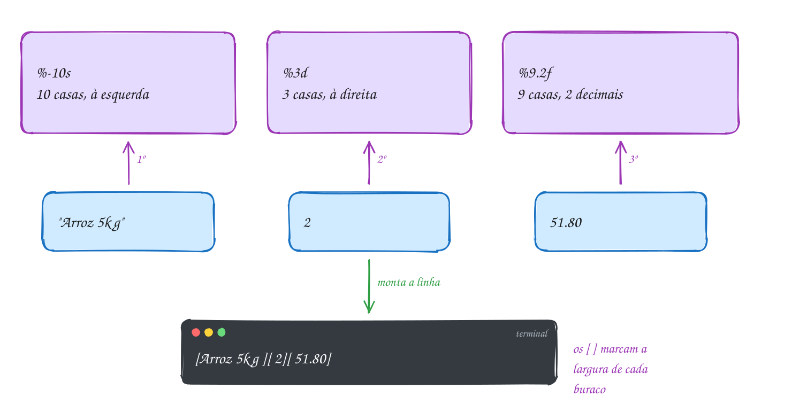</p>

O cupom inteiro em C:

```c
#include <stdio.h>

int main(void) {
    printf("%-10s %3s %9s\n", "Item", "Qtd", "Total");
    printf("%-10s %3d %9.2f\n", "Arroz 5kg", 2, 51.80);
    printf("%-10s %3d %9.2f\n", "Leite", 12, 71.88);
    printf("%-10s %3d %9.2f\n", "Banana", 1, 7.49);
    printf("%-10s %13.2f\n", "TOTAL", 131.17);
    return 0;
}
// Saída:
// Item       Qtd     Total
// Arroz 5kg    2     51.80
// Leite       12     71.88
// Banana       1      7.49
// TOTAL             131.17
```

Repara no fluxograma: cada `printf` é uma saída, e todas usam o mesmo
formato. Mudar a largura de uma coluna é mudar um número só, em cada linha:

<p align="center">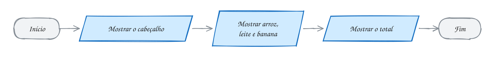</p>

> [!WARNING]
> O `printf` **confia** em você: se o especificador não combina com o tipo do
> argumento, ele lê os bytes do jeito errado. `printf("%d", 9.90)` não mostra 9
> nem 10: mostra lixo. `printf("%.2f", 5)` também. Faltar argumento é igual. O
> `-Wall` do `rodar` avisa (`format '%d' expects argument of type 'int'`).
> Nunca ignore esse aviso. E no `printf` não vai `&`: ele quer o valor, não o
> endereço.

> [!TIP]
> **Por dentro do C:** o `printf` aceita qualquer número de argumentos, mas
> não sabe os tipos deles: só o formato diz como ler cada um. Nessa passagem,
> todo `float` é convertido em `double`, e por isso o `%f` serve para os dois.
> A largura conta **bytes**, não letras: `"Feijão"` tem 6 letras e 7 bytes
> (o `ã` ocupa 2 no UTF-8), então `%-10s` deixa a coluna dele uma casa mais
> curta. E o `printf` devolve quantos bytes escreveu: `printf("Olá\n")` devolve
> 5. O A020 mostra isso.

> [!NOTE]
> **Pergunta para você:** o que `printf("[%5.1f]\n", 3456.78);` mostra? A
> largura 5 corta o número? Teste num programa seu.

### Hora de praticar

Os arquivos ficam em [`0010-printf/`](0010-printf/). Os comandos funcionam de qualquer pasta do terminal. Nos exemplos, rode, mude, quebre e rode de novo. Nos exercícios, a resposta vai dentro do próprio arquivo. ★☆☆ é aquecimento, ★★☆ pede raciocínio e ★★★ é desafio.

**Exemplo A019 · O cupom alinhado do mercado**

```c
#include <stdio.h>

int main(void) {
    printf("%-10s %3s %9s\n", "Item", "Qtd", "Total");
    printf("%-10s %3d %9.2f\n", "Arroz 5kg", 2, 51.80);
    printf("%-10s %3d %9.2f\n", "Leite", 12, 71.88);
    printf("%-10s %3d %9.2f\n", "Banana", 1, 7.49);
    printf("%-10s %13.2f\n", "TOTAL", 131.17);
    return 0;
}
// Saída:
// Item       Qtd     Total
// Arroz 5kg    2     51.80
// Leite       12     71.88
// Banana       1      7.49
// TOTAL             131.17
```

```bash
~/LPEDC/rodar 01-fundamentos/0010-printf/A019.c
```

**Exemplo A020 · O mesmo valor em vários formatos**

```c
#include <stdio.h>

int main(void) {
    int n = 255;
    double preco = 3.14159;
    char letra = 'A';

    // inteiros: largura, alinhamento, zeros, sinal e outras bases
    printf("[%d] [%6d] [%-6d] [%06d] [%+d]\n", n, n, n, n, n);
    printf("hexa: %x %X %#x   octal: %o\n", n, n, n, n);

    // reais: casas decimais, largura, científica e o "mais curto"
    printf("[%f] [%.2f] [%8.3f] [%e] [%g]\n", preco, preco, preco, preco, preco);

    // caractere e texto (com precisão, o texto é cortado)
    printf("[%c] [%d] [%s] [%.4s] [%8s]\n", letra, letra, "Brasil", "Brasil", "Brasil");

    // o endereço de uma variável e o próprio %
    printf("n mora em %p; 100%% certo\n", (void *)&n);

    // o printf devolve quantos bytes escreveu
    int bytes = printf("Olá\n");
    printf("O printf anterior escreveu %d bytes\n", bytes);
    return 0;
}
// Saída (o endereço muda a cada execução):
// [255] [   255] [255   ] [000255] [+255]
// hexa: ff FF 0xff   octal: 377
// [3.141590] [3.14] [   3.142] [3.141590e+00] [3.14159]
// [A] [65] [Brasil] [Bras] [  Brasil]
// n mora em 0x7f1c2a400020; 100% certo
// Olá
// O printf anterior escreveu 5 bytes
```

```bash
~/LPEDC/rodar 01-fundamentos/0010-printf/A020.c
```

#### Exercícios

**Exercício E055** · ★☆☆

Mostre o boletim da Júlia com um printf por linha, usando variáveis:
nota 8.75 (mostrada com uma casa), 3 faltas e conceito 'B'.


```text
Saída esperada:
Aluna: Júlia
Nota: 8.8
Faltas: 03
Conceito: B
```

**Dicas:**

1. O nome pode ir direto no formato ou como argumento de um %s.
2. %.1f arredonda para uma casa; %02d completa com zero à esquerda.
3. Resposta esperada: as quatro linhas acima (8.75 vira 8.8 só na tela).

```bash
~/LPEDC/rodar 01-fundamentos/0010-printf/E055.c
```

**Exercício E056** · ★☆☆

Sem rodar, escreva exatamente o que cada linha mostra (os colchetes ajudam
a ver os espaços). Depois copie para a main e confira.


```text
printf("[%5d][%-5d][%05d][%+d]\n", 42, 42, 42, 42);
printf("[%.1f][%.3f][%8.2f]\n", 3.14159, 3.14159, 3.14159);
printf("[%c][%s][%6s][%-6s]\n", 'R', "Rio", "Rio", "Rio");
printf("[%x][%X][%o]\n", 26, 26, 26);
```

**Dicas:**

1. Largura é o mínimo de casas; sem o -, o valor encosta na direita.
2. 26 = 16 + 10: em hexa, 1 e A. Em octal, 26 = 3 * 8 + 2.
3. Resposta esperada:
   [   42][42   ][00042][+42]
   [3.1][3.142][    3.14]
   [R][Rio][   Rio][Rio   ]
   [1a][1A][32]

```bash
~/LPEDC/rodar 01-fundamentos/0010-printf/E056.c
```

**Exercício E057** · ★★☆

Monte o painel de preços do posto, com as colunas alinhadas. Guarde cada
preço numa variável double e use largura no formato (nada de contar
espaços à mão). A linha de separação tem 22 sinais de igual.


```text
Saída esperada:
Combustível   Preço/L
======================
Gasolina      R$ 6.29
Etanol        R$ 4.19
Diesel S10    R$ 6.09
GNV           R$ 4.99
```

**Dicas:**

1. A primeira coluna tem 14 casas, encostada à esquerda: %-14s.
2. "Combustível" tem acento: na largura, o printf conta bytes, e o í
   ocupa 2. Para o cabeçalho ficar alinhado, use %-15s só nele, ou escreva
   o cabeçalho direto no texto.
3. Resposta esperada: as seis linhas acima, com "R$" sempre na coluna 15.

```bash
~/LPEDC/rodar 01-fundamentos/0010-printf/E057.c
```

**Exercício E058** · ★★☆

Este programa compila, mas o gcc mostra TRÊS avisos, e a saída sai
errada (números sem sentido). Rode, leia cada aviso e conserte. O pedido
tem 3 pizzas de R$ 45.90, total R$ 137.70.


```text
Saída esperada (depois de consertar):
Pizzas: 3
Preço: R$ 45.90
Total: R$ 137.70
```

**Dicas:**

1. Procure "format" nos avisos: cada um diz o que esperava e o que veio.
2. %d é para int e %f para double. Um % sem argumento lê lixo.
3. Resposta esperada: (1) %d com o double preco: use %.2f; (2) %.2f com o
   int quantidade: use %d; (3) o terceiro printf tem %.2f, mas faltou o
   argumento total.

```bash
~/LPEDC/rodar 01-fundamentos/0010-printf/E058.c
```

**Exercício E059** · ★★★

No CSS, uma cor é escrita como #RRGGBB: três bytes em hexadecimal, sempre
com dois dígitos cada. O azul do botão do seu app tem vermelho 30, verde
144 e azul 255. Guarde os três componentes em variáveis int e mostre a
cor nos dois formatos do CSS.


```text
Saída esperada:
#1E90FF
rgb(30, 144, 255)
```


Teste também com vermelho 0, verde 8 e azul 15: a saída tem de ser
#00080F, sempre com 7 caracteres.

**Dicas:**

1. %X mostra em hexadecimal com letras maiúsculas.
2. Um componente pequeno (8) viraria só "8". A largura 2 com zero à
   esquerda resolve: %02X.
3. Resposta esperada: printf("#%02X%02X%02X\n", r, g, b); mostra #1E90FF
   e, com 0, 8 e 15, #00080F.

```bash
~/LPEDC/rodar 01-fundamentos/0010-printf/E059.c
```

**Exercício E060** · ★★★

Seis linhas, seis pegadinhas. Sem rodar, preveja a saída de cada uma e
explique. Depois rode e confira.


```text
printf("[%5.1f]\n", 3456.78);
printf("[%.3s]\n", "Brasília");
printf("[%.2f]\n", 2.675);
printf("[%e]\n", 123456.0);
printf("[%g] [%g]\n", 0.0001, 0.00001);
int n = printf("Pão\n");
printf("[%d]\n", n);
```

**Dicas:**

1. A largura é mínima, nunca corta. A precisão de um %s corta.
2. 2.675 não existe exato em binário: o double guarda 2.67499999...
3. O %g escolhe o formato mais curto e passa para o científico quando o
   número fica pequeno demais (expoente menor que -4).
4. O printf devolve quantos BYTES escreveu: o ã ocupa 2.
5. Resposta esperada: [3456.8]; [Bra]; [2.67] (e não 2.68); [1.234560e+05];
   [0.0001] [1e-05]; "Pão" e depois [5] (P, ã com 2 bytes, o e o \n).

```bash
~/LPEDC/rodar 01-fundamentos/0010-printf/E060.c
```

---

## 0011 · scanf

No app do banco, você agenda um Pix: digita o valor, R$ 150,75, e o dia do
mês, 12. O app lê o que você digitou, guarda e confirma. Até aqui os
programas só falavam; agora eles vão **ouvir**. A **entrada** do modelo
entrada → processamento → saída vem do teclado.

Quem lê é o **`scanf`**, o espelho do `printf`. O formato diz o que esperar,
e os outros argumentos dizem **onde guardar**:

```c
scanf("%d", &dia);
```

O `&` é obrigatório: `&dia` é o **endereço** da variável. O `scanf` não quer o
valor de `dia` (que ainda é lixo); ele quer saber em que bytes da memória
escrever o número digitado. No `printf` não vai `&`; no `scanf`, vai em toda
variável simples.

Os especificadores quase repetem os do `printf`, com uma diferença que pega
todo mundo: **`double` se lê com `%lf`** e se mostra com `%f`.

| Tipo | Lê com | Mostra com |
| --- | --- | --- |
| `int` | `%d` | `%d` |
| `float` | `%f` | `%f` |
| `double` | `%lf` | `%f` |
| `char` | `%c` (ou `" %c"`) | `%c` |

O que você digita não vai direto para a variável. Vai para um **buffer**, uma
fila de caracteres, e só chega ao programa quando você aperta Enter. O `scanf`
tira da fila só o que o formato pede. `%d` e `%lf` pulam espaços e Enters
antes do número e param no primeiro caractere que não serve. O que sobra
**fica na fila** para a próxima leitura, inclusive o `'\n'` do Enter.

Caracteres comuns no formato precisam aparecer na entrada:
`scanf("%d/%d/%d", &d, &m, &a)` lê `7/9/2026`. E o `scanf` **devolve** quantos
itens conseguiu guardar: 1, 2, 3... ou 0 se o primeiro já falhou, ou `EOF`
(-1) se a entrada acabou. É assim que um programa descobre se a leitura deu
certo. No módulo 02, com o `if`, você vai usar esse número para decidir o que
fazer; por enquanto, mostre e observe.

Vamos ver na prática. Você digita `150.75`, Enter, `12`, Enter. O `%lf` tira
`150.75` da fila e escreve no endereço de `valor`. O `%d` pula o `'\n'` que
sobrou, tira o `12` e escreve em `dia`. O último `'\n'` continua na fila:

<p align="center">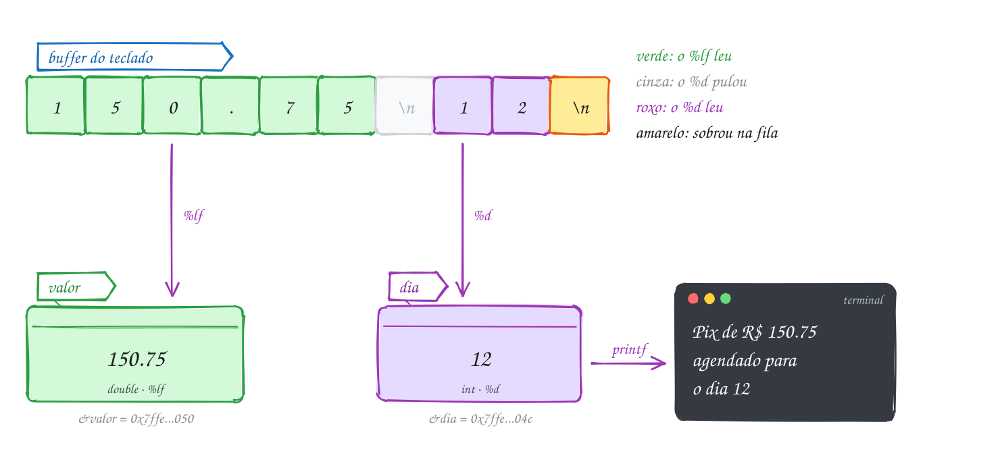</p>

O mesmo exemplo em C:

```c
#include <stdio.h>

int main(void) {
    double valor;
    int dia;

    printf("Valor do Pix: R$ ");
    scanf("%lf", &valor);            // %lf: double no scanf
    printf("Dia do mês: ");
    int lidos = scanf("%d", &dia);   // devolve quantos itens leu

    printf("Pix de R$ %.2f agendado para o dia %d\n", valor, dia);
    printf("O último scanf leu %d item\n", lidos);
    return 0;
}
// Exemplo de execução:
// Valor do Pix: R$ 150.75
// Dia do mês: 12
// Pix de R$ 150.75 agendado para o dia 12
// O último scanf leu 1 item
```

Para testar sem digitar, mande a entrada por um cano:
`printf '150.75\n12\n' | ~/LPEDC/rodar 01-fundamentos/0011-scanf/A021.c`. O
que vem antes do `|` vira o teclado do programa.

Repara no fluxograma: as duas leituras são paralelogramos de entrada, cada
uma guardando o valor numa caixinha, e só depois vem a saída:

<p align="center"></p>

> [!WARNING]
> Esquecer o `&` é o erro clássico: `scanf("%d", dia)` entrega ao `scanf` o
> lixo que está em `dia` como se fosse um endereço, e ele escreve num lugar
> qualquer da memória. O programa quebra (`Segmentation fault`) ou, pior,
> estraga outra variável. O gcc avisa: `format '%d' expects argument of type
> 'int *', but argument 2 has type 'int'`. Outro clássico: `%f` para ler um
> `double`. Compila com aviso e o número sai errado.

> [!TIP]
> **Por dentro do C:** o `&valor` é um número como `0x7ffe...050`: o
> endereço do primeiro dos 8 bytes do `double`. Com `%lf`, o `scanf` escreve
> 8 bytes ali; com `%f`, escreve só 4, no formato de `float`, e o `double`
> fica com metade dos bytes errada. No `printf` não tem esse problema porque
> todo `float` vira `double` na passagem; no `scanf` vão endereços, e endereço
> não se converte. E o buffer é por linha: enquanto você não aperta Enter, o
> programa nem sabe que você está digitando.

> [!NOTE]
> **Pergunta para você:** se no dia você digitar `doze`, quanto vale `lidos`?
> E o que aparece no lugar do dia? Teste com
> `printf '150.75\ndoze\n' | ~/LPEDC/rodar ...`.

### Hora de praticar

Os arquivos ficam em [`0011-scanf/`](0011-scanf/). Os comandos funcionam de qualquer pasta do terminal. Nos exemplos, rode, mude, quebre e rode de novo. Nos exercícios, a resposta vai dentro do próprio arquivo. ★☆☆ é aquecimento, ★★☆ pede raciocínio e ★★★ é desafio.

**Exemplo A021 · O Pix agendado**

```c
#include <stdio.h>

int main(void) {
    double valor;
    int dia;

    printf("Valor do Pix: R$ ");
    scanf("%lf", &valor);            // %lf: double no scanf
    printf("Dia do mês: ");
    int lidos = scanf("%d", &dia);   // devolve quantos itens leu

    printf("Pix de R$ %.2f agendado para o dia %d\n", valor, dia);
    printf("O último scanf leu %d item\n", lidos);
    return 0;
}
// Exemplo de execução:
// Valor do Pix: R$ 150.75
// Dia do mês: 12
// Pix de R$ 150.75 agendado para o dia 12
// O último scanf leu 1 item
//
// Para testar sem digitar: printf '150.75\n12\n' | ~/LPEDC/rodar <este arquivo>
```

```bash
~/LPEDC/rodar 01-fundamentos/0011-scanf/A021.c
```

**Exemplo A022 · A data da entrega e o tamanho da camiseta**

```c
#include <stdio.h>

int main(void) {
    int dia = 0, mes = 0, ano = 0;
    char tamanho = '?';

    // caracteres fixos no formato precisam ser digitados: aqui, as barras
    printf("Data da entrega (dd/mm/aaaa): ");
    int lidos = scanf("%d/%d/%d", &dia, &mes, &ano);
    printf("Itens lidos: %d\n", lidos);

    // o Enter da linha anterior ficou no buffer. O espaço antes do %c
    // manda pular espaços e Enters; sem ele, o %c pegaria o '\n'
    printf("Tamanho (P, M ou G): ");
    scanf(" %c", &tamanho);

    printf("Entrega em %02d/%02d/%d, camiseta %c\n", dia, mes, ano, tamanho);
    return 0;
}
// Exemplo de execução:
// Data da entrega (dd/mm/aaaa): 7/9/2026
// Itens lidos: 3
// Tamanho (P, M ou G): G
// Entrega em 07/09/2026, camiseta G
//
// Teste: printf '7/9/2026\nG\n' | ~/LPEDC/rodar <este arquivo>
// Agora digite a data com traços (7-9-2026): o scanf para no primeiro "-" e
// lê só 1 item. O "-" fica no buffer, e o %c seguinte pega ele: a saída
// vira "Entrega em 07/00/0, camiseta -".
```

```bash
~/LPEDC/rodar 01-fundamentos/0011-scanf/A022.c
```

#### Exercícios

**Exercício E061** · ★☆☆

Escreva um programa que pergunte a idade (inteiro) e a altura em metros
(real) e responda numa frase só, com a altura em duas casas.


```text
Exemplo de execução:
Idade: 30
Altura (m): 1.75
Você tem 30 anos e 1.75 m de altura.
```


Teste sem digitar: printf '30\n1.75\n' | ~/LPEDC/rodar E061.c

**Dicas:**

1. int idade; double altura; e um scanf para cada um.
2. Para double, o scanf usa %lf. E não esqueça o &.
3. Resposta esperada: com 30 e 1.75, "Você tem 30 anos e 1.75 m de
   altura."

```bash
~/LPEDC/rodar 01-fundamentos/0011-scanf/E061.c
```

**Exercício E062** · ★☆☆

Este programa compila com DOIS avisos e, quando roda, quebra ou mostra
lixo. Rode com printf '42\n80.5\n' | ~/LPEDC/rodar E062.c, leia os avisos
e o relatório do AddressSanitizer, e conserte.


```text
Exemplo de execução (depois de consertar):
Número do calçado: 42
Peso (kg): 80.5
Calçado 42, peso 80.5 kg
```

**Dicas:**

1. Procure "expects argument of type 'int *'" e "'float *'" nos avisos.
2. O scanf precisa do endereço da variável. E o tipo da variável decide
   o especificador.
3. Resposta esperada: faltou o & em scanf("%d", calcado): o scanf usou o
   VALOR de calcado (0) como endereço e tentou escrever no endereço 0
   ("SEGV on unknown address 0x000000000000"); e peso é double, então o
   scanf usa %lf, não %f.

```bash
~/LPEDC/rodar 01-fundamentos/0011-scanf/E062.c
```

**Exercício E063** · ★★☆

O alarme do celular pede a hora no formato hh:mm. Leia a hora e os
minutos com UM scanf só e mostre de dois jeitos. Mostre também quantos
itens o scanf conseguiu ler.


```text
Exemplo de execução:
Alarme (hh:mm): 6:05
Itens lidos: 2
Alarme para 6h05
Alarme para 06:05
```


Depois rode digitando "6 05" (com espaço no lugar dos dois pontos). O que
acontece com os itens lidos e com os minutos? Por quê?

**Dicas:**

1. O : no formato tem de aparecer na entrada: "%d:%d".
2. Inicialize as variáveis com 0 para o teste com espaço ficar previsível.
3. Resposta esperada: com 6:05, "Itens lidos: 2", "Alarme para 6h05" e
   "Alarme para 06:05". Com "6 05", o scanf lê o 6, espera um ":" e acha
   um espaço: para ali, lê só 1 item, e os minutos ficam 0.

```bash
~/LPEDC/rodar 01-fundamentos/0011-scanf/E063.c
```

**Exercício E064** · ★★☆

A lanchonete pergunta quantos lanches e se é para viagem (V) ou para comer
aqui (A). Este programa compila sem aviso, mas não funciona: rode com
printf '3\nV\n' | ~/LPEDC/rodar E064.c e veja a opção sair vazia. Explique
o que aconteceu e conserte mudando UM caractere.


```text
Saída esperada (depois de consertar), com 3 e V:
Quantidade: Opção (V/A): 3 lanche(s), opção V (código 86)
```

**Dicas:**

1. O código mostrado na saída errada é 10. Que caractere tem código 10?
2. Depois do 3 você apertou Enter. Quem leu esse Enter?
3. Resposta esperada: o %d leu o 3 e deixou o '\n' na fila; o %c, que não
   pula nada, leu o '\n' (código 10). Conserto: scanf(" %c", &opcao), com
   um espaço antes do %c, que manda pular espaços e Enters.

```bash
~/LPEDC/rodar 01-fundamentos/0011-scanf/E064.c
```

**Exercício E065** · ★★★

Escreva um programa que comece com int a = 0, b = 0;, leia os dois com
UM scanf("%d %d", &a, &b), guarde o retorno e mostre "lidos=? a=? b=?".
Antes de testar, preveja o resultado para cada entrada:


```text
printf '7 9\n'   | ~/LPEDC/rodar E065.c
printf '7 x\n'   | ~/LPEDC/rodar E065.c
printf 'x 7\n'   | ~/LPEDC/rodar E065.c
printf '7\n\n9\n' | ~/LPEDC/rodar E065.c
printf ''        | ~/LPEDC/rodar E065.c
```

**Dicas:**

1. O retorno conta só os itens guardados com sucesso, na ordem. No primeiro
   que falha, o scanf para.
2. %d pula espaços e Enters, quantos forem.
3. Entrada vazia é fim de arquivo: o scanf devolve EOF, que vale -1.
4. Resposta esperada: "lidos=2 a=7 b=9"; "lidos=1 a=7 b=0";
   "lidos=0 a=0 b=0"; "lidos=2 a=7 b=9" (os Enters são pulados);
   "lidos=-1 a=0 b=0".

```bash
~/LPEDC/rodar 01-fundamentos/0011-scanf/E065.c
```

**Exercício E066** · ★★★

Bancos de dados e APIs usam a data no formato ISO: aaaa-mm-dd. Leia uma
data no formato brasileiro e mostre no ISO, sempre com mês e dia de dois
dígitos. O programa precisa aceitar qualquer separador: 7/9/2026,
7-9-2026 e 7.9.2026 dão o mesmo resultado.


```text
Exemplo de execução:
Data: 7/9/2026
ISO: 2026-09-07
```

**Dicas:**

1. Para mostrar: %04d-%02d-%02d.
2. O %*c lê um caractere e joga fora, sem guardar em variável nenhuma (e
   sem contar no retorno). Serve para "qualquer separador".
3. Resposta esperada: scanf("%d%*c%d%*c%d", &dia, &mes, &ano); e a saída
   "ISO: 2026-09-07" para as três entradas.

```bash
~/LPEDC/rodar 01-fundamentos/0011-scanf/E066.c
```

---

## 0012 · Aritmética

Sexta à noite, cinco amigos pedem três pizzas de 8 fatias. São 24 fatias:
quantas cada um come, e quantas sobram para a disputa no par ou ímpar? E a
conta de R$ 159, quanto cada um paga? Essa é a parte do **processamento**:
pegar o que entrou e calcular o que vai sair.

Os operadores aritméticos do C são cinco:

| Operador | Faz | Exemplo | Resultado |
| --- | --- | --- | --- |
| `+` `-` | soma, subtração | `24 - 4` | `20` |
| `*` | multiplicação | `3 * 8` | `24` |
| `/` | divisão | `24 / 5` | `4` (!) |
| `%` | resto da divisão | `24 % 5` | `4` |

A pegadinha está no `/`. Quando os **dois** lados são inteiros, a divisão é
**inteira**: o resultado é inteiro e a parte fracionária é jogada fora, sem
arredondar. `24 / 5` dá 4, `7 / 2` dá 3, `2 / 3` dá 0. A conta é feita como na
divisão com resto da escola: 7 dividido por 2 dá 3 e sobra 1. Basta **um** lado ser
real para a divisão ser real: `159.0 / 5` dá 31,8.

O **`%`** (módulo) devolve o resto da divisão inteira e só funciona com
inteiros. Os dois andam juntos: `24 / 5` diz quantas vezes o 5 cabe no 24, e
`24 % 5` diz o que sobrou. Sempre vale `(a / b) * b + a % b == a`. É o par
que separa dígitos (`2026 % 10` é 6), converte segundos em minutos e diz se um
número é par (`n % 2` é 0).

A **precedência** é a da matemática da escola: `*`, `/` e `%` antes de `+` e
`-`. Empate se resolve da esquerda para a direita: `100 / 10 / 2` é
`(100 / 10) / 2`, que dá 5. Parênteses mandam em tudo, e sobrar parêntese não
é defeito: deixa a intenção clara. O C não tem operador de potência; `^` é
outra coisa (assunto 0070). Para potência, use `pow` (assunto 0015) ou
multiplique: `x * x`.

Vamos ver na prática. As 24 fatias são divididas entre os cinco, quatro para
cada um. O `/` conta as rodadas completas e o `%` conta as fatias que não
fecham mais uma rodada:

<p align="center">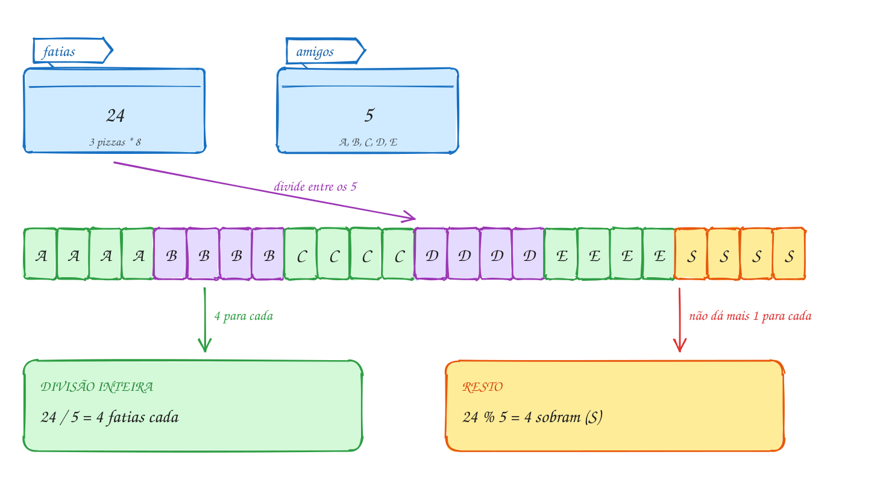</p>

O mesmo exemplo em C:

```c
#include <stdio.h>

int main(void) {
    int pizzas = 3;
    int fatias = pizzas * 8;      // 24
    int amigos = 5;

    int cada = fatias / amigos;   // divisão inteira: 4
    int sobra = fatias % amigos;  // resto: 4

    printf("%d fatias para %d amigos\n", fatias, amigos);
    printf("Cada um come %d, sobram %d\n", cada, sobra);

    double conta = 159.00;
    printf("Cada um paga R$ %.2f\n", conta / amigos); // real / int: divisão real
    printf("Com inteiros: R$ %d\n", 159 / amigos);    // int / int: corta o resto
    return 0;
}
// Saída:
// 24 fatias para 5 amigos
// Cada um come 4, sobram 4
// Cada um paga R$ 31.80
// Com inteiros: R$ 31
```

Repara no fluxograma: cada conta é um retângulo de processamento, um depois
do outro. A ordem importa: `cada` e `sobra` só podem ser calculados depois
que `fatias` tem valor:

<p align="center"></p>

> [!WARNING]
> A média que dá errado: com `int a = 7, b = 8;`, a linha
> `double media = (a + b) / 2;` guarda **7.0**, não 7,5. A divisão acontece
> entre dois `int` **antes** de o resultado ir para o `double`, e aí os
> decimais já foram embora. Escreva `(a + b) / 2.0`. E cuidado com a
> precedência: `a + b / 2` divide só o `b`. A versão campeã de erro é
> `1 / 2 * x`, que dá sempre zero.

> [!TIP]
> **Por dentro do C:** desde o C99, a divisão inteira corta em direção ao
> zero: `-7 / 2` dá -3 (não -4), e o resto fica com o sinal de quem é
> dividido: `-7 % 3` dá -1. Dividir **inteiro por zero** derruba o programa
> (`Floating point exception`), e o detector do `rodar` acusa `division by
> zero`; com `double`, o resultado vira `inf`. Dividir também custa caro: uma
> soma leva 1 ciclo do processador, uma divisão inteira leva dezenas. Por isso
> o compilador troca `x / 8` por um deslocamento de bits quando pode. Você
> escreve a conta clara, e ele cuida da velocidade.

> [!NOTE]
> **Pergunta para você:** quanto vale `2 + 3 * 4 % 5`? Resolva na mão, na
> ordem da precedência, e depois confira com um `printf`.

### Hora de praticar

Os arquivos ficam em [`0012-aritmetica/`](0012-aritmetica/). Os comandos funcionam de qualquer pasta do terminal. Nos exemplos, rode, mude, quebre e rode de novo. Nos exercícios, a resposta vai dentro do próprio arquivo. ★☆☆ é aquecimento, ★★☆ pede raciocínio e ★★★ é desafio.

**Exemplo A023 · Rachando a pizza**

```c
#include <stdio.h>

int main(void) {
    int pizzas = 3;
    int fatias = pizzas * 8;      // 24
    int amigos = 5;

    int cada = fatias / amigos;   // divisão inteira: 4
    int sobra = fatias % amigos;  // resto: 4

    printf("%d fatias para %d amigos\n", fatias, amigos);
    printf("Cada um come %d, sobram %d\n", cada, sobra);

    double conta = 159.00;
    printf("Cada um paga R$ %.2f\n", conta / amigos); // real / int: divisão real
    printf("Com inteiros: R$ %d\n", 159 / amigos);    // int / int: corta o resto
    return 0;
}
// Saída:
// 24 fatias para 5 amigos
// Cada um come 4, sobram 4
// Cada um paga R$ 31.80
// Com inteiros: R$ 31
```

```bash
~/LPEDC/rodar 01-fundamentos/0012-aritmetica/A023.c
```

**Exemplo A024 · Quanto dura o podcast**

```c
#include <stdio.h>

// O app mostra a duração em segundos. Divisão inteira e resto convertem
// para horas, minutos e segundos, sem nenhum número real.
int main(void) {
    int total = 5000; // segundos

    int horas = total / 3600;          // 1 (3600 segundos cabem 1 vez)
    int resto = total % 3600;          // 1400 segundos que sobraram
    int minutos = resto / 60;          // 23
    int segundos = resto % 60;         // 20

    printf("%d s = %dh %02dmin %02ds\n", total, horas, minutos, segundos);

    // precedência: * / % antes de + -, da esquerda para a direita
    printf("%d %d %d\n", 2 + 3 * 4, (2 + 3) * 4, 100 / 10 / 2);

    // com negativos, a divisão corta em direção ao zero
    // e o resto fica com o sinal de quem é dividido
    printf("%d %d %d %d\n", 7 / 2, -7 / 2, 7 % 3, -7 % 3);
    return 0;
}
// Saída:
// 5000 s = 1h 23min 20s
// 14 20 5
// 3 -3 1 -1
```

```bash
~/LPEDC/rodar 01-fundamentos/0012-aritmetica/A024.c
```

#### Exercícios

**Exercício E067** · ★☆☆

Para a festa, você fez 50 brigadeiros e vai embalar em caixas de 12.
Quantas caixas ficam cheias e quantos brigadeiros sobram? E os 7 ingressos
do show a R$ 35 cada, quanto custam juntos? Use variáveis e deixe o
programa fazer as contas.


```text
Saída esperada:
Caixas cheias: 4
Sobram: 2 brigadeiros
Ingressos: R$ 245
```

**Dicas:**

1. Caixas cheias é a divisão inteira; o que sobra é o resto (%).
2. O total dos ingressos é uma multiplicação.
3. Resposta esperada: 50 / 12 = 4, 50 % 12 = 2 e 7 * 35 = 245.

```bash
~/LPEDC/rodar 01-fundamentos/0012-aritmetica/E067.c
```

**Exercício E068** · ★☆☆

Sem rodar, calcule cada expressão. Depois confira com um printf para cada
uma (%d para as inteiras e %.1f para a real).


```text
a) 7 + 3 * 2          e) -17 / 5
b) (7 + 3) * 2        f) -17 % 5
c) 17 / 5             g) 2 * 3 % 4
d) 17 % 5             h) 17.0 / 5
```

**Dicas:**

1. * / % antes de + -; empate, da esquerda para a direita.
2. Entre inteiros, a divisão corta a parte fracionária em direção ao zero,
   e o resto tem o sinal de quem é dividido.
3. Resposta esperada: a) 13; b) 20; c) 3; d) 2; e) -3; f) -2; g) 2
   (6 % 4); h) 3.4.

```bash
~/LPEDC/rodar 01-fundamentos/0012-aritmetica/E068.c
```

**Exercício E069** · ★★☆

Escreva o programa que racha a conta do restaurante: lê o valor da conta
e o número de pessoas, soma 10% de serviço e mostra o serviço, o total e
quanto cada um paga.


```text
Exemplo de execução:
Conta: R$ 237.50
Pessoas: 4
Serviço (10%): R$ 23.75
Total: R$ 261.25
Cada um: R$ 65.31
```


Teste: printf '237.50\n4\n' | ~/LPEDC/rodar E069.c

**Dicas:**

1. conta é double (leia com %lf) e pessoas é int.
2. 10% de algo é algo * 10 / 100, ou algo * 0.10.
3. Resposta esperada: serviço 23.75, total 261.25 e cada um 65.31
   (261.25 / 4 = 65.3125, e o %.2f mostra 65.31).

```bash
~/LPEDC/rodar 01-fundamentos/0012-aritmetica/E069.c
```

**Exercício E070** · ★★☆

Este programa compila e roda sem aviso nenhum, mas as duas médias estão
erradas. As notas são 8, 7 e 8; a média certa é 7.67. Descubra os DOIS
erros e conserte.


```text
Saída esperada (depois de consertar):
Média 1: 7.67
Média 2: 7.67
```

**Dicas:**

1. Faça as contas na mão, na ordem em que o C faz.
2. Na média 1, os dois lados da divisão são int. Na média 2, olhe a
   precedência.
3. Resposta esperada: a média 1 mostra 7.00 porque 23 / 3 é divisão
   inteira (7) antes de virar double: use 3.0. A média 2 mostra 17.67
   porque só a terceira nota é dividida (8 + 7 + 8 / 3.0): faltam os
   parênteses em volta da soma.

```bash
~/LPEDC/rodar 01-fundamentos/0012-aritmetica/E070.c
```

**Exercício E071** · ★★★

O kit escolar custa R$ 20 de material mais R$ 5 de frete. Alguém criou um
#define para o preço do kit e calculou o preço de 3 kits. Sem rodar, diga
o que o programa mostra e por quê. Depois conserte mudando só o #define.


```text
Saída esperada (depois de consertar):
3 kits: R$ 75
```

**Dicas:**

1. O #define não calcula nada: ele cola o texto. Escreva a linha do printf
   com o texto colado e aplique a precedência.
2. Toda macro que é uma conta deve vir entre parênteses.
3. Resposta esperada: mostra "3 kits: R$ 65", porque 3 * KIT vira
   3 * 20 + 5 = 65. Conserto: #define KIT (20 + 5).

```bash
~/LPEDC/rodar 01-fundamentos/0012-aritmetica/E071.c
```

**Exercício E072** · ★★★

Leia um número de 3 dígitos e mostre ao contrário, usando só / e %
(nada de texto). Depois teste com 120: o que aparece? Como mostrar 021?


```text
Exemplo de execução:
Número: 472
Ao contrário: 274
```


Teste: printf '472\n' | ~/LPEDC/rodar E072.c

**Dicas:**

1. n % 10 é o último dígito; n / 10 % 10 é o do meio; n / 100 é o
   primeiro.
2. Monte o novo número: unidade * 100 + dezena * 10 + centena.
3. Resposta esperada: 472 vira 274. Com 120, o número invertido vale 21
   (zero à esquerda não existe num int); para mostrar 021, use %03d.

```bash
~/LPEDC/rodar 01-fundamentos/0012-aritmetica/E072.c
```

---

## 0013 · Conversão e cast

Você zerou o hodômetro parcial no último tanque. Agora rodou 523 km e
precisou de 41 litros para encher de novo. Quantos km por litro o carro faz?
A conta é 523 ÷ 41 ≈ 12,76. O C, com dois `int`, responde 12.

Toda expressão em C tem um **valor** e um **tipo**. Com operandos do mesmo
tipo, o resultado tem esse tipo: `int / int` é `int`. Com tipos diferentes,
o C faz uma **conversão automática**: o operando "menor" sobe para o tipo do
"maior" antes da conta. A escada é
`char` → `short` → `int` → `long` → `long long` → `float` → `double`.
`523 / 41.0` vira `523.0 / 41.0` e dá 12,756...

Na **atribuição** é o contrário: o valor vira o tipo da variável da
**esquerda**, caiba ou não. `double d = 12;` guarda 12.0, sem problema.
`int i = 12.76;` guarda 12: a parte fracionária é **cortada**, não
arredondada (e `-9.99` vira -9). Um valor grande demais num tipo pequeno
perde bits. O compilador, com as opções do curso, não avisa nada disso.

Quando você quer escolher a conversão, usa o **cast**: o tipo entre
parênteses na frente do valor, `(double) km`. O cast cria uma **cópia
temporária** convertida; a variável `km` continua `int` para sempre. Ele tem
precedência alta, maior que a de `*` e `/`, então `(double) km / litros`
converte só o `km`, e isso basta, porque aí a divisão já vira real.

Resumo: no C, o tipo de cada pedaço da conta decide o resultado. Antes de
confiar numa conta, pergunte de que tipo é cada operando.

Vamos ver na prática. Pelo caminho de cima, os dois `int` se dividem, sai 12,
e só então ele vira 12.0, tarde demais. Pelo caminho de baixo, o cast
transforma o 523 em 523.0 antes da divisão, e o resultado é real:

<p align="center">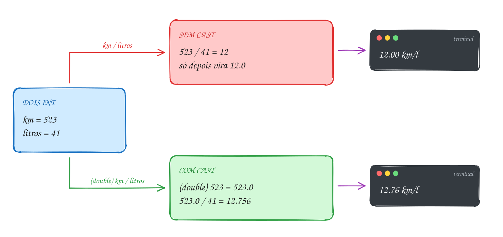</p>

O mesmo exemplo em C:

```c
#include <stdio.h>

int main(void) {
    int km = 523;     // rodados desde o último tanque
    int litros = 41;  // para encher de novo

    double errado = km / litros;            // int / int = 12; depois vira 12.0
    double certo = (double) km / litros;    // 523.0 / 41 = 12.756...
    double tarde = (double) (km / litros);  // o cast chegou depois da divisão

    printf("Sem cast:      %.2f km/l\n", errado);
    printf("Com cast:      %.2f km/l\n", certo);
    printf("Cast atrasado: %.2f km/l\n", tarde);

    int inteiro = certo;                    // double -> int: corta, não arredonda
    printf("Num int:       %d km/l\n", inteiro);
    return 0;
}
// Saída:
// Sem cast:      12.00 km/l
// Com cast:      12.76 km/l
// Cast atrasado: 12.00 km/l
// Num int:       12 km/l
```

Repara no fluxograma: a pergunta que decide o resultado é "tem um real na
divisão?". Ela é respondida pelo compilador, olhando os tipos, antes de o
programa rodar. O exemplo segue pelo Sim, graças ao cast:

<p align="center">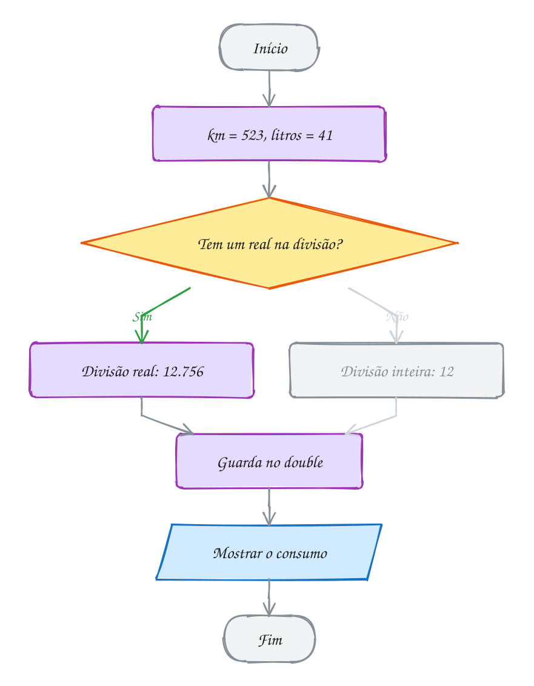</p>

> [!WARNING]
> O cast precisa chegar **antes** da divisão. `(double) (km / litros)` parece
> certo, mas os parênteses mandam dividir primeiro: `523 / 41` dá 12 e o cast
> só transforma o 12 em 12.0. O mesmo vale para guardar num `double`:
> `double media = soma / n;` com `soma` e `n` inteiros já perdeu os decimais
> antes do `=`. Converta um dos operandos: `(double) soma / n`.

> [!TIP]
> **Por dentro do C:** um `int` e um `double` com o "mesmo" valor têm bits
> completamente diferentes. O 12 num `int` são 4 bytes `0C 00 00 00`; o 12.0
> num `double` são 8 bytes no formato sinal, expoente e mantissa. Converter
> é uma instrução do processador (`cvtsi2sd` nos PCs), não um rótulo novo. O
> `double` guarda inteiros exatos até 2⁵³; o `float`, só até 2²⁴ = 16.777.216,
> e por isso `float f = 16777217;` vira 16777216. E converter um `double`
> grande demais para `int` é comportamento indefinido: não confie no
> resultado.

> [!NOTE]
> **Pergunta para você:** quanto vale `int x = 7 / 2 * 2.0;`? Faça passo a
> passo, olhando o tipo de cada pedaço, e depois confira.

### Hora de praticar

Os arquivos ficam em [`0013-conversao/`](0013-conversao/). Os comandos funcionam de qualquer pasta do terminal. Nos exemplos, rode, mude, quebre e rode de novo. Nos exercícios, a resposta vai dentro do próprio arquivo. ★☆☆ é aquecimento, ★★☆ pede raciocínio e ★★★ é desafio.

**Exemplo A025 · O consumo do carro**

```c
#include <stdio.h>

int main(void) {
    int km = 523;     // rodados desde o último tanque
    int litros = 41;  // para encher de novo

    double errado = km / litros;            // int / int = 12; depois vira 12.0
    double certo = (double) km / litros;    // 523.0 / 41 = 12.756...
    double tarde = (double) (km / litros);  // o cast chegou depois da divisão

    printf("Sem cast:      %.2f km/l\n", errado);
    printf("Com cast:      %.2f km/l\n", certo);
    printf("Cast atrasado: %.2f km/l\n", tarde);

    int inteiro = certo;                    // double -> int: corta, não arredonda
    printf("Num int:       %d km/l\n", inteiro);
    return 0;
}
// Saída:
// Sem cast:      12.00 km/l
// Com cast:      12.76 km/l
// Cast atrasado: 12.00 km/l
// Num int:       12 km/l
```

```bash
~/LPEDC/rodar 01-fundamentos/0013-conversao/A025.c
```

**Exemplo A026 · Conversões que acontecem sozinhas**

```c
#include <stdio.h>

int main(void) {
    // na atribuição, o valor vira o tipo da variável da esquerda
    char letra = 65;          // int -> char: o código 65 é 'A'
    int preco = 9.99;         // double -> int: corta para 9
    int negativo = -9.99;     // corta em direção ao zero: -9
    double metade = 7 / 2;    // a divisão inteira vem antes: 3.0
    printf("%c %d %d %.1f\n", letra, preco, negativo, metade);

    // numa conta, o tipo "menor" sobe para o "maior"
    char minuscula = 'g';
    printf("%c\n", minuscula - 32);    // char vira int: 103 - 32 = 71 = 'G'
    printf("%.2f\n", 5 / 2 * 2.0);     // (5 / 2) é 2; 2 * 2.0 = 4.00
    printf("%.2f\n", 5 * 2.0 / 2);     // 5 * 2.0 = 10.0; 10.0 / 2 = 5.00

    // o cast é explícito e cria uma cópia temporária: a variável não muda
    int gols = 7, jogos = 3;
    printf("Média: %.2f gols; gols continua %d\n", (double) gols / jogos, gols);

    // real em binário é aproximado
    float grande = 16777217;           // o float não tem dígitos para tanto
    printf("%.1f\n", grande);
    printf("%.17f\n", 0.1 + 0.2);
    return 0;
}
// Saída:
// A 9 -9 3.0
// G
// 4.00
// 5.00
// Média: 2.33 gols; gols continua 7
// 16777216.0
// 0.30000000000000004
```

```bash
~/LPEDC/rodar 01-fundamentos/0013-conversao/A026.c
```

#### Exercícios

**Exercício E073** · ★☆☆

As notas do simulado são inteiras: 7, 8 e 10. Guarde em três int e mostre
a média com duas casas, usando um cast (sem trocar o tipo das variáveis
e sem escrever 3.0).


```text
Saída esperada:
Média: 8.33
```

**Dicas:**

1. Sem cast, (7 + 8 + 10) / 3 é divisão inteira: dá 8.
2. Converta a soma para double antes de dividir: (double) (a + b + c) / 3.
3. Resposta esperada: "Média: 8.33" (25 / 3 = 8.333...).

```bash
~/LPEDC/rodar 01-fundamentos/0013-conversao/E073.c
```

**Exercício E074** · ★☆☆

Sem rodar, diga o valor guardado em cada variável. Depois mostre todas
com printf (%d para int, %.1f para double, %c para char) e confira.


```text
int a = 7.9;
double b = 7 / 2;
double c = 7 / 2.0;
int d = -7.9;
char e = 66;
double f = (double) (7 / 2);
int g = (int) 3.999;
```

**Dicas:**

1. Na atribuição, o valor vira o tipo da esquerda: real para int corta a
   parte fracionária, em direção ao zero.
2. A conta da direita é feita primeiro, com os tipos dela.
3. Resposta esperada: a = 7; b = 3.0; c = 3.5; d = -7; e = 'B';
   f = 3.0; g = 3.

```bash
~/LPEDC/rodar 01-fundamentos/0013-conversao/E074.c
```

**Exercício E075** · ★★☆

Na eleição para síndico, a candidata Marta teve 47 dos 130 votos. Mostre
o percentual dela com duas casas. Depois responda: por que a fórmula
"votos / total * 100" com dois int dá 0? E por que "100 * votos / total"
dá 36 e não 36.15?


```text
Saída esperada:
Marta: 36.15% dos votos
```

**Dicas:**

1. Basta um operando real no lugar certo: 100.0 * votos / total.
2. Faça cada fórmula errada passo a passo, da esquerda para a direita.
3. Resposta esperada: 36.15%. Em votos / total * 100, 47 / 130 é 0 (divisão
   inteira) e 0 * 100 = 0. Em 100 * votos / total, 4700 / 130 = 36: certo
   na parte inteira, mas os decimais somem.

```bash
~/LPEDC/rodar 01-fundamentos/0013-conversao/E075.c
```

**Exercício E076** · ★★☆

Na balança do açougue, a picanha custa R$ 45.90 o quilo. O programa
calcula o preço de 600 gramas, mas mostra R$ 0.00. Ele compila sem aviso.
Descubra o erro e conserte sem mudar o tipo de nenhuma variável.


```text
Saída esperada (depois de consertar):
600 g: R$ 27.54
```

**Dicas:**

1. Calcule gramas / 1000 sabendo que os dois são int.
2. Conta da esquerda para a direita: o zero aparece antes da multiplicação.
3. Resposta esperada: 600 / 1000 é divisão inteira e dá 0; 0 * 45.90 = 0.
   Conserto: gramas / 1000.0 * preco_kg (ou multiplicar antes:
   gramas * preco_kg / 1000). Resultado: R$ 27.54.

```bash
~/LPEDC/rodar 01-fundamentos/0013-conversao/E076.c
```

**Exercício E077** · ★★★

Sistemas de pagamento guardam dinheiro em centavos inteiros, para fugir
dos erros dos números reais. Este programa converte R$ 19.99 para
centavos. Sem rodar, quanto você espera? Rode. Explique o que aconteceu e
conserte para mostrar 1999.


```text
Saída esperada (depois de consertar):
R$ 19.99 = 1999 centavos
```

**Dicas:**

1. Mostre valor * 100 com %.15f e veja o número de verdade.
2. Real para int corta, não arredonda: 1998.9999... vira 1998.
3. Somar 0.5 antes de cortar arredonda para o inteiro mais próximo.
4. Resposta esperada: mostra 1998, porque 19.99 não existe exato em
   binário e 19.99 * 100 dá 1998.99999999999977..., que o int corta.
   Conserto: int centavos = valor * 100 + 0.5; (no assunto 0015, a função
   round faz isso).

```bash
~/LPEDC/rodar 01-fundamentos/0013-conversao/E077.c
```

**Exercício E078** · ★★★

Sem rodar, preveja cada linha. Pense no tipo de cada pedaço da conta.


```text
char c = 'a';
printf("%c %d\n", c - 32, c - 32);
printf("%d\n", 'z' - 'a');
unsigned char u = 250;
u = u + 10;
printf("%d\n", u);
printf("%.1f\n", 5 / 2 * 2.0);
printf("%.1f\n", 2.0 * 5 / 2);
int i = 3.7 + 3.7;
printf("%d\n", i);
printf("%d\n", (int) 3.7 + (int) 3.7);
```

**Dicas:**

1. char vira int nas contas: 'a' é 97.
2. 250 + 10 é feito em int (260); guardar num unsigned char dá a volta.
3. Somar antes de cortar não é o mesmo que cortar antes de somar.
4. Resposta esperada: "A 65"; 25; 4; 4.0; 5.0; 7 (7.4 cortado); 6 (3 + 3).

```bash
~/LPEDC/rodar 01-fundamentos/0013-conversao/E078.c
```

---

## 0014 · Atribuição, ++ e --

O bilhete único tem R$ 20,00. Você recarrega R$ 30,00, pega dois ônibus de
R$ 4,40 e o validador conta as viagens. O saldo não é recalculado do zero a
cada passo: ele é **atualizado**, somando ou tirando do valor que já está lá.

O `=` do C não é o "igual" da matemática: é "guarde o valor da direita na
variável da esquerda". Por isso `saldo = saldo + 30.00` faz sentido: calcula
com o valor antigo e escreve o novo por cima. Do lado esquerdo só pode ficar
algo que tem endereço, uma variável; `30 = saldo` e `saldo + 1 = 5` não
compilam.

Atualizar uma variável é tão comum que tem atalho, os **operadores
compostos**:

| Atalho | Quer dizer | Com `x = 10` |
| --- | --- | --- |
| `x += 3` | `x = x + 3` | 13 |
| `x -= 3` | `x = x - 3` | 7 |
| `x *= 3` | `x = x * 3` | 30 |
| `x /= 3` | `x = x / 3` | 3 (divisão inteira!) |
| `x %= 3` | `x = x % 3` | 1 |

O operador composto age sobre **toda** a expressão da direita, como se ela
estivesse entre parênteses: `x *= y + 1` é `x = x * (y + 1)`, e não
`x * y + 1`.

Para somar ou tirar 1 há atalhos ainda menores: **`++`** e **`--`**. Numa
linha sozinha, `viagens++` e `++viagens` fazem a mesma coisa. A diferença
aparece quando o valor é **usado** na mesma expressão:

- **pós** (`x++`): a expressão vale o valor **antigo**, e depois `x` aumenta;
- **pré** (`++x`): `x` aumenta primeiro, e a expressão vale o valor **novo**.

E um detalhe que explica muita coisa: a atribuição também é uma expressão, e
vale o valor guardado. Por isso `a = b = c = 7` funciona: o C faz `c = 7`,
que vale 7, depois `b = 7` e por fim `a = 7`.

Vamos ver na prática. O saldo passa por quatro valores, cada um calculado a
partir do anterior, na mesma caixinha. As viagens sobem de um em um:

<p align="center">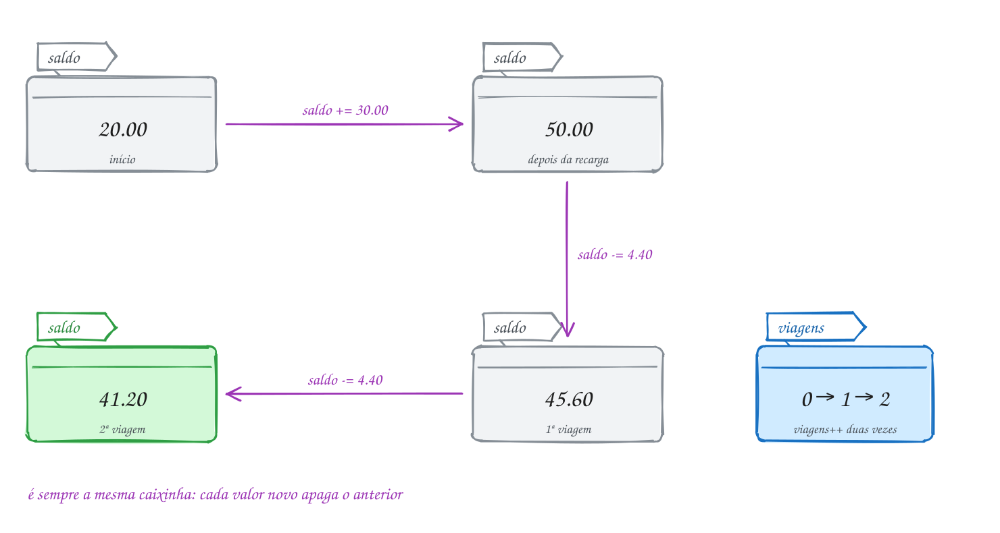</p>

O mesmo exemplo em C:

```c
#include <stdio.h>

int main(void) {
    double saldo = 20.00;
    int viagens = 0;

    saldo += 30.00;   // recarga: saldo = saldo + 30.00
    saldo -= 4.40;    // 1ª viagem
    viagens++;        // viagens = viagens + 1
    saldo -= 4.40;    // 2ª viagem
    viagens++;

    printf("Saldo: R$ %.2f depois de %d viagens\n", saldo, viagens);

    int antes = viagens++;   // pós: usa o 2, depois soma (viagens vira 3)
    int depois = ++viagens;  // pré: soma primeiro (vira 4), depois usa o 4
    printf("antes = %d, depois = %d, viagens = %d\n", antes, depois, viagens);
    return 0;
}
// Saída:
// Saldo: R$ 41.20 depois de 2 viagens
// antes = 2, depois = 4, viagens = 4
```

Repara no fluxograma: cada atualização é um retângulo, e todos mexem nas
mesmas duas variáveis. No módulo 03 esses passos repetidos vão virar uma
repetição; o `+=` e o `++` são o coração de todo contador e acumulador:

<p align="center">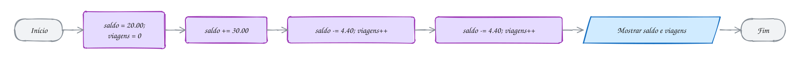</p>

> [!WARNING]
> Nunca altere a mesma variável duas vezes na mesma expressão, nem altere e
> leia ao mesmo tempo. `i = i++;`, `x = x++ + ++x;` e
> `printf("%d %d", n++, n);` são **comportamento indefinido**: o padrão não
> diz em que ordem as partes acontecem, e cada compilador faz de um jeito. O
> `-Wall` avisa
> (`operation on 'i' may be undefined`). Regra prática: use `++` e `--`
> sozinhos na linha, ou num lugar onde a variável apareça uma vez só.

> [!TIP]
> **Por dentro do C:** `x = x + 1`, `x += 1`, `x++` e `++x`, sozinhos numa
> linha, viram **a mesma instrução** de máquina (`add` ou `inc`). Os atalhos
> não deixam o programa mais rápido; eles existem para você escrever o nome
> da variável uma vez só, o que evita errar quando o nome é comprido. A
> diferença entre pré e pós é só qual valor a expressão entrega: no pós, o
> compilador guarda uma cópia do valor antigo antes de somar.

> [!NOTE]
> **Pergunta para você:** com `int x = 5;`, quanto valem `y` e `x` depois de
> `int y = x++ * 2;`? E se fosse `++x * 2`? Responda e teste.

### Hora de praticar

Os arquivos ficam em [`0014-atribuicao/`](0014-atribuicao/). Os comandos funcionam de qualquer pasta do terminal. Nos exemplos, rode, mude, quebre e rode de novo. Nos exercícios, a resposta vai dentro do próprio arquivo. ★☆☆ é aquecimento, ★★☆ pede raciocínio e ★★★ é desafio.

**Exemplo A027 · O bilhete único**

```c
#include <stdio.h>

int main(void) {
    double saldo = 20.00;
    int viagens = 0;

    saldo += 30.00;   // recarga: saldo = saldo + 30.00
    saldo -= 4.40;    // 1ª viagem
    viagens++;        // viagens = viagens + 1
    saldo -= 4.40;    // 2ª viagem
    viagens++;

    printf("Saldo: R$ %.2f depois de %d viagens\n", saldo, viagens);

    int antes = viagens++;   // pós: usa o 2, depois soma (viagens vira 3)
    int depois = ++viagens;  // pré: soma primeiro (vira 4), depois usa o 4
    printf("antes = %d, depois = %d, viagens = %d\n", antes, depois, viagens);
    return 0;
}
// Saída:
// Saldo: R$ 41.20 depois de 2 viagens
// antes = 2, depois = 4, viagens = 4
```

```bash
~/LPEDC/rodar 01-fundamentos/0014-atribuicao/A027.c
```

**Exemplo A028 · Pré, pós e o operador que vale para a conta inteira**

```c
#include <stdio.h>

int main(void) {
    // pós-incremento: a expressão vale o valor ANTIGO
    int x = 5;
    int y = x++;            // y = 5, x = 6
    printf("x++ : y = %d, x = %d\n", y, x);

    // pré-incremento: a expressão vale o valor NOVO
    x = 5;
    y = ++x;                // x = 6, y = 6
    printf("++x : y = %d, x = %d\n", y, x);

    // o operador composto age sobre TUDO o que está à direita
    int pontos = 10, bonus = 3;
    pontos *= bonus + 1;    // pontos = pontos * (bonus + 1) = 40
    printf("pontos = %d\n", pontos);

    // a atribuição também é uma expressão: vale o valor guardado
    int a, b, c;
    a = b = c = 7;          // c = 7, depois b = 7, depois a = 7
    printf("a = %d, b = %d, c = %d\n", a, b, c);

    // os mesmos operadores com double e com resto
    double preco = 80.0;
    preco *= 0.9;           // 10% de desconto: 72.00
    int segundos = 135;
    segundos %= 60;         // sobra 15
    printf("preço = %.2f, segundos = %d\n", preco, segundos);
    return 0;
}
// Saída:
// x++ : y = 5, x = 6
// ++x : y = 6, x = 6
// pontos = 40
// a = 7, b = 7, c = 7
// preço = 72.00, segundos = 15
```

```bash
~/LPEDC/rodar 01-fundamentos/0014-atribuicao/A028.c
```

#### Exercícios

**Exercício E079** · ★☆☆

Refatore: reescreva as cinco linhas marcadas usando os operadores
compostos e o ++, sem mudar o que o programa mostra.


```text
Saída esperada (igual antes e depois):
pontos 110, vidas 2, moedas 40, tempo 45, fase 4
```

**Dicas:**

1. x = x + 10 vira x += 10. Somar 1 vira ++ e tirar 1 vira --.
2. Rode antes e depois: a saída tem de ser a mesma.
3. Resposta esperada: pontos += 10; vidas--; moedas *= 2; tempo /= 2;
   fase++; e a mesma saída.

```bash
~/LPEDC/rodar 01-fundamentos/0014-atribuicao/E079.c
```

**Exercício E080** · ★☆☆

Sem rodar, faça o teste de mesa: uma tabela com uma coluna para cada
variável e uma linha para cada instrução. Qual o valor final de x, y, z
e w? Depois copie para a main, mostre os quatro e confira.


```text
int x = 5;
int y = x++;
int z = ++x;
int w = x--;
```

**Dicas:**

1. x++ entrega o valor antigo e depois soma; ++x soma e entrega o novo.
2. Siga uma linha por vez: depois de y = x++, quanto vale x?
3. Resposta esperada: y = 5 (x vira 6); z = 7 (x vira 7 antes); w = 7
   (x vira 6 depois). Final: x = 6, y = 5, z = 7, w = 7.

```bash
~/LPEDC/rodar 01-fundamentos/0014-atribuicao/E080.c
```

**Exercício E081** · ★★☆

O cofrinho digital começa vazio. Use uma variável saldo e os operadores
compostos para registrar o mês, mostrando o saldo depois de cada passo:
guarda R$ 15.00, guarda R$ 20.00, guarda R$ 12.50, tira R$ 30.00 para um
presente e, no fim do mês, rende 1% (multiplique por 1.01). Conte também
quantos depósitos foram feitos, com ++.


```text
Saída esperada:
Depósito 1: R$ 15.00
Depósito 2: R$ 35.00
Depósito 3: R$ 47.50
Presente: R$ 17.50
Rendimento: R$ 17.68
3 depósitos
```

**Dicas:**

1. saldo += ..., saldo -= ..., saldo *= 1.01.
2. Faça depositos++ logo depois de cada depósito e use o valor no printf.
3. Resposta esperada: as seis linhas acima (17.50 * 1.01 = 17.675, que o
   %.2f mostra como 17.68).

```bash
~/LPEDC/rodar 01-fundamentos/0014-atribuicao/E081.c
```

**Exercício E082** · ★★☆

Sem rodar, diga o valor de x depois de cada linha (as linhas rodam em
sequência, uma depois da outra). Depois confira com um printf após cada
uma.


```text
int x = 10, y = 3;
x *= y + 1;
x -= y - 1;
x /= y + 1;
x %= y + 2;
```


Por fim, responda: x = x * 2 + y pode ser escrito como x *= 2 + y? Por
quê?

**Dicas:**

1. O composto age sobre toda a expressão da direita: x op= expr é
   x = x op (expr).
2. A divisão é entre int.
3. Resposta esperada: 40 (10 * 4), 38 (40 - 2), 9 (38 / 4), 4 (9 % 5).
   Não: x *= 2 + y é x = x * (2 + y), outra conta.

```bash
~/LPEDC/rodar 01-fundamentos/0014-atribuicao/E082.c
```

**Exercício E083** · ★★★

Este programa compila, mas o gcc mostra avisos. Pior: cada compilador
pode mostrar uma saída diferente. Rode, leia os avisos e explique por que
essas linhas não têm resposta certa. Depois reescreva para ficar claro e
previsível, com a intenção indicada em cada comentário.


```text
Saída esperada (depois de consertar):
senha 1235
fila: atendendo 7, próximo 8
```

**Dicas:**

1. Procure "may be undefined" nos avisos.
2. Alterar uma variável e usá-la de novo na mesma expressão não tem ordem
   definida no C. Separe em linhas.
3. Resposta esperada: senha = senha++ e printf com fila++ e fila na mesma
   chamada são comportamento indefinido (-Wsequence-point). Conserto:
   senha++; numa linha só; e no printf, mostre fila e fila + 1 e só depois
   faça fila++.

```bash
~/LPEDC/rodar 01-fundamentos/0014-atribuicao/E083.c
```

**Exercício E084** · ★★★

O placar está invertido de novo: casa = 2 e visitante = 5, e o certo é o
contrário. Desta vez, troque os valores SEM usar uma terceira variável,
só com += e -= (e, se precisar, um = simples).


```text
Saída esperada:
Casa 5 x 2 Visitante
```


Depois responda: por que este truque é perigoso com valores muito
grandes, perto de INT_MAX?

**Dicas:**

1. Guarde a soma dos dois numa das variáveis: casa += visitante (casa = 7).
2. Da soma, dá para recuperar cada um tirando o outro.
3. Resposta esperada: casa += visitante; visitante = casa - visitante;
   casa -= visitante; e a saída "Casa 5 x 2 Visitante". Com valores
   grandes, a soma pode passar de INT_MAX: estouro de int, comportamento
   indefinido. A versão com variável auxiliar é mais segura e mais clara.

```bash
~/LPEDC/rodar 01-fundamentos/0014-atribuicao/E084.c
```

---

## 0015 · math.h

Na pizzaria, a grande de 35 cm custa R$ 59,90 e a média de 25 cm, R$ 39,90.
Duas médias dão mais pizza que uma grande? A intuição diz que não ("35 é bem
maior que 25"), mas a área cresce com o **quadrado** do raio. Para tirar a
dúvida você precisa de potência, de raiz e de arredondamento, e o C não tem
operador para nada disso.

Quem tem é a biblioteca de matemática, declarada no **`<math.h>`**. Quase todas
as funções recebem e devolvem `double`:

| Função | Faz | Exemplo | Resultado |
| --- | --- | --- | --- |
| `pow(x, y)` | x elevado a y | `pow(2, 10)` | 1024 |
| `sqrt(x)` | raiz quadrada | `sqrt(144)` | 12 |
| `fabs(x)` | valor absoluto de real | `fabs(-7.5)` | 7.5 |
| `floor(x)` | arredonda para **baixo** | `floor(-2.3)` | -3 |
| `ceil(x)` | arredonda para **cima** | `ceil(2.1)` | 3 |
| `round(x)` | para o mais perto (o meio vai para longe do zero) | `round(2.5)` | 3 |
| `fmod(x, y)` | resto de divisão real | `fmod(7.5, 2)` | 1.5 |
| `sin`, `cos`, `tan` | trigonometria, em **radianos** | `cos(0)` | 1 |

Dois avisos. O C padrão não define o pi: o `M_PI` que você vai achar por aí
é extensão e não existe com `-std=c17`; crie o seu com `#define`. E o `abs`
dos inteiros mora em outro lugar, no `<stdlib.h>`; para real, é `fabs`.

Arredondar tem três sabores e eles divergem nos negativos: `floor` sempre
desce na reta (`floor(-2.3)` é -3), `ceil` sempre sobe (`ceil(-2.7)` é -2), e
`round` vai para o inteiro mais perto. E nenhum deles é o cast: `(int) -2.7`
**corta** e dá -2. O `ceil` é o das contas de "quantos preciso comprar": 2,78
latas de tinta viram 3 latas.

Vamos ver na prática. O diâmetro de 35 vira raio 17,5; `pow` eleva ao
quadrado; vezes pi, dá a área da grande. A mesma conta para as médias, vezes
dois, dá 981,75 cm², um pouco mais que a grande:

<p align="center">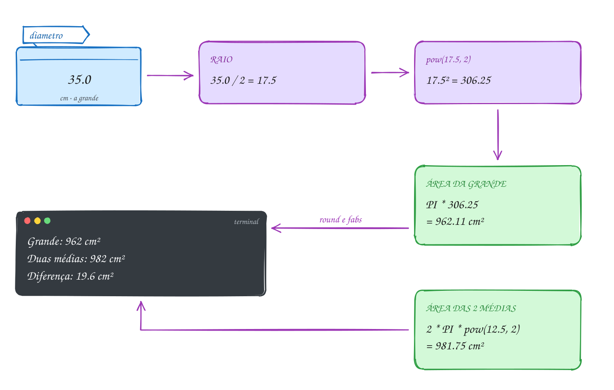</p>

O mesmo exemplo em C:

```c
#include <stdio.h>
#include <math.h>

#define PI 3.14159265358979 // o C padrão não define o pi

int main(void) {
    double diametro_grande = 35.0, diametro_media = 25.0; // cm
    double preco_grande = 59.90, preco_medias = 2 * 39.90;

    double area_grande = PI * pow(diametro_grande / 2, 2);     // pi * r²
    double area_medias = 2 * PI * pow(diametro_media / 2, 2);

    printf("Grande: %.0f cm² por R$ %.2f\n", round(area_grande), preco_grande);
    printf("Duas médias: %.0f cm² por R$ %.2f\n", round(area_medias), preco_medias);
    printf("Diferença: %.1f cm²\n", fabs(area_grande - area_medias));
    printf("R$ por 100 cm²: grande %.2f, médias %.2f\n",
           preco_grande / area_grande * 100, preco_medias / area_medias * 100);

    // a pizza única com a mesma área das duas médias: r = raiz(área / pi)
    double diametro_igual = 2 * sqrt(area_medias / PI);
    printf("Duas médias = uma pizza de %.1f cm\n", diametro_igual);
    return 0;
}
// Saída:
// Grande: 962 cm² por R$ 59.90
// Duas médias: 982 cm² por R$ 79.80
// Diferença: 19.6 cm²
// R$ por 100 cm²: grande 6.23, médias 8.13
// Duas médias = uma pizza de 35.4 cm
```

Moral da pizza: duas médias dão um pouco mais de pizza, mas cada 100 cm² da
grande sai quase R$ 2 mais barato.

Repara no fluxograma: as funções entram no meio das contas como qualquer
valor. `pow(...)` e `sqrt(...)` são calculados e o resultado segue na
expressão, como num processamento comum:

<p align="center">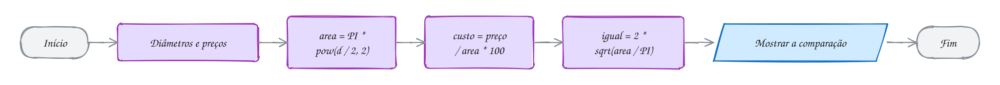</p>

> [!WARNING]
> `pow(27, 1/3)` dá **1**, não 3: `1/3` é divisão inteira e vale 0, e
> qualquer número elevado a 0 é 1. Escreva `1.0 / 3`. Pelo mesmo motivo,
> `ceil(7 / 2)` dá 3, não 4: o `ceil` recebe o 3 já cortado. E `abs(-2.75)`
> com o `abs` dos inteiros dá 2; o `-Wextra` avisa
> (`using integer absolute value function 'abs'`). Para real, `fabs`.

> [!TIP]
> **Por dentro do C:** o `math.h` só **declara** as funções: diz que
> `double sqrt(double)` existe, e é por isso que `sqrt(144)` funciona com um
> `int`: o compilador converte para `double` antes de chamar. O código mora
> na biblioteca `libm`, e quem junta é o ligador com a opção `-lm` (o
> `rodar` já passa). Sem ela, pode aparecer `undefined reference to 'pow'`.
> E o compilador é esperto: `sqrt(x)` vira uma instrução só do processador
> (`sqrtsd`), `pow(x, 2)` vira `x * x`, e `sqrt(2.0)` é calculado na
> compilação, sem chamada nenhuma.

> [!NOTE]
> **Pergunta para você:** quanto dão `round(-2.5)`, `floor(-0.5)` e
> `ceil(-0.5)`? O A030 tem uma tabela parecida para conferir.

### Hora de praticar

Os arquivos ficam em [`0015-math/`](0015-math/). Os comandos funcionam de qualquer pasta do terminal. Nos exemplos, rode, mude, quebre e rode de novo. Nos exercícios, a resposta vai dentro do próprio arquivo. ★☆☆ é aquecimento, ★★☆ pede raciocínio e ★★★ é desafio.

**Exemplo A029 · Uma pizza grande ou duas médias?**

```c
#include <stdio.h>
#include <math.h>

#define PI 3.14159265358979 // o C padrão não define o pi

int main(void) {
    double diametro_grande = 35.0, diametro_media = 25.0; // cm
    double preco_grande = 59.90, preco_medias = 2 * 39.90;

    double area_grande = PI * pow(diametro_grande / 2, 2);     // pi * r²
    double area_medias = 2 * PI * pow(diametro_media / 2, 2);

    printf("Grande: %.0f cm² por R$ %.2f\n", round(area_grande), preco_grande);
    printf("Duas médias: %.0f cm² por R$ %.2f\n", round(area_medias), preco_medias);
    printf("Diferença: %.1f cm²\n", fabs(area_grande - area_medias));
    printf("R$ por 100 cm²: grande %.2f, médias %.2f\n",
           preco_grande / area_grande * 100, preco_medias / area_medias * 100);

    // a pizza única com a mesma área das duas médias: r = raiz(área / pi)
    double diametro_igual = 2 * sqrt(area_medias / PI);
    printf("Duas médias = uma pizza de %.1f cm\n", diametro_igual);
    return 0;
}
// Saída:
// Grande: 962 cm² por R$ 59.90
// Duas médias: 982 cm² por R$ 79.80
// Diferença: 19.6 cm²
// R$ por 100 cm²: grande 6.23, médias 8.13
// Duas médias = uma pizza de 35.4 cm
```

```bash
~/LPEDC/rodar 01-fundamentos/0015-math/A029.c
```

**Exemplo A030 · Arredondar para cima, para baixo e para o mais perto**

```c
#include <stdio.h>
#include <math.h>

int main(void) {
    printf("    x | floor |  ceil | round | (int)\n");
    printf("%5.1f | %5.0f | %5.0f | %5.0f | %5d\n", 2.4, floor(2.4), ceil(2.4), round(2.4), (int) 2.4);
    printf("%5.1f | %5.0f | %5.0f | %5.0f | %5d\n", 2.5, floor(2.5), ceil(2.5), round(2.5), (int) 2.5);
    printf("%5.1f | %5.0f | %5.0f | %5.0f | %5d\n", -2.5, floor(-2.5), ceil(-2.5), round(-2.5), (int) -2.5);
    printf("%5.1f | %5.0f | %5.0f | %5.0f | %5d\n", -2.6, floor(-2.6), ceil(-2.6), round(-2.6), (int) -2.6);

    // ceil na vida real: quantas latas de tinta para 50 m², se uma cobre 18 m²?
    double area = 50.0, por_lata = 18.0;
    printf("Latas: %.2f -> compre %.0f\n", area / por_lata, ceil(area / por_lata));

    // potência e raiz: pow também tira raiz com expoente fracionário
    printf("pow(2, 10) = %.0f, sqrt(2) = %.4f, raiz cúbica de 27 = %.1f\n",
           pow(2, 10), sqrt(2), pow(27, 1.0 / 3));

    // arredondar para 2 casas de verdade (não só na tela)
    double preco = 7.4567;
    double preco_2casas = round(preco * 100) / 100;
    printf("%.4f vira %.4f\n", preco, preco_2casas);
    return 0;
}
// Saída:
//     x | floor |  ceil | round | (int)
//   2.4 |     2 |     3 |     2 |     2
//   2.5 |     2 |     3 |     3 |     2
//  -2.5 |    -3 |    -2 |    -3 |    -2
//  -2.6 |    -3 |    -2 |    -3 |    -2
// Latas: 2.78 -> compre 3
// pow(2, 10) = 1024, sqrt(2) = 1.4142, raiz cúbica de 27 = 3.0
// 7.4567 vira 7.4600
```

```bash
~/LPEDC/rodar 01-fundamentos/0015-math/A030.c
```

#### Exercícios

**Exercício E085** · ★☆☆

A loja anuncia uma TV com a tela de 121.8 cm de largura e 68.5 cm de
altura. TVs são vendidas pela diagonal, em polegadas (1 polegada = 2.54
cm). Calcule a diagonal com Pitágoras e mostre em cm e em polegadas.


```text
Saída esperada:
Diagonal: 139.74 cm
TV de 55 polegadas
```

**Dicas:**

1. diagonal = raiz(largura² + altura²): sqrt e pow (ou x * x).
2. Divida por 2.54 e mostre sem casas decimais (%.0f).
3. Resposta esperada: 139.74 cm e 55 polegadas (55.02, arredondado).

```bash
~/LPEDC/rodar 01-fundamentos/0015-math/E085.c
```

**Exercício E086** · ★☆☆

Sem rodar, diga o resultado de cada chamada. Depois mostre todas com
%.2f e confira. Atenção especial aos negativos.


```text
floor(3.7)   ceil(3.2)    round(2.5)   round(-2.5)
floor(-3.2)  ceil(-3.7)   fabs(-7.25)  sqrt(144)
pow(2, 10)   pow(9, 0.5)  fmod(10, 3)
```

**Dicas:**

1. floor desce na reta numérica; ceil sobe. Com negativo, "descer" é ir
   para mais longe do zero.
2. round leva o meio (x.5) para longe do zero.
3. Resposta esperada: 3.00, 4.00, 3.00, -3.00, -4.00, -3.00, 7.25, 12.00,
   1024.00, 3.00 (raiz de 9) e 1.00.

```bash
~/LPEDC/rodar 01-fundamentos/0015-math/E086.c
```

**Exercício E087** · ★★☆

Você vai pintar 3 paredes de 4.0 m por 2.7 m, com 2 demãos. Uma lata de
tinta cobre 25 m² e custa R$ 89.90. Lata não se vende pela metade.
Calcule a área total a pintar, quantas latas comprar e quanto vai gastar.


```text
Saída esperada:
Área com 2 demãos: 64.80 m²
Latas: 2.59 -> comprar 3
Total: R$ 269.70
```

**Dicas:**

1. Área: 3 * 4.0 * 2.7 * 2 demãos.
2. ceil arredonda para cima: é a função de "quantos preciso comprar".
3. Resposta esperada: 64.80 m²; 64.8 / 25 = 2.592, então 3 latas;
   3 * 89.90 = R$ 269.70.

```bash
~/LPEDC/rodar 01-fundamentos/0015-math/E087.c
```

**Exercício E088** · ★★☆

Você aplica R$ 1000.00 num investimento que rende 1% ao mês, com juros
compostos (juros sobre juros). O montante depois de n meses é
capital * (1 + taxa) elevado a n. Mostre o montante e o rendimento depois
de 12 e de 24 meses.


```text
Saída esperada:
12 meses: R$ 1126.83 (rendeu R$ 126.83)
24 meses: R$ 1269.73 (rendeu R$ 269.73)
```


Depois responda: com juros simples (1% de R$ 1000 por mês, sem juros
sobre juros), quanto teria em 24 meses? Por que a diferença cresce com o
tempo?

**Dicas:**

1. A taxa de 1% é 0.01. pow(1 + taxa, 12).
2. Rendimento = montante - capital.
3. Resposta esperada: R$ 1126.83 e R$ 1269.73. Com juros simples, R$ 1240
   em 24 meses: os compostos rendem também sobre o que já rendeu, e essa
   parte cresce a cada mês.

```bash
~/LPEDC/rodar 01-fundamentos/0015-math/E088.c
```

**Exercício E089** · ★★★

Três contas, três erros. O programa compila com um aviso e mostra três
valores errados. Explique cada erro e conserte.

- A caixa d'água em forma de cubo tem 27 m³. Qual a aresta? (3 m)
- O termômetro marcou -2.75 °C. Quanto falta para chegar a 0? (2.75)
- São 7 convidados e 2 por mesa. Quantas mesas? (4)


```text
Saída esperada (depois de consertar):
Aresta: 3.00 m
Faltam 2.75 graus
Mesas: 4
```

**Dicas:**

1. Calcule 1/3 e 7/2 sabendo que os dois lados são int.
2. Procure "abs" no aviso do gcc.
3. Resposta esperada: pow(27, 1/3) dá 1, porque 1/3 é 0: use 1.0 / 3.
   abs é a versão para int (do stdlib.h) e corta para 2: use fabs.
   ceil(7 / 2) recebe 3, já cortado: use ceil(7 / 2.0), que dá 4.

```bash
~/LPEDC/rodar 01-fundamentos/0015-math/E089.c
```

**Exercício E090** · ★★★

Do alto de uma laje de 1.5 m, você joga uma bola para cima a 20 m/s.
Desprezando o ar, a altura depois de t segundos é
h(t) = -5t² + 20t + 1.5. Calcule:

a) o instante em que a bola chega ao chão (h = 0), com a fórmula de

```text
 Bhaskara: t = (-b - raiz(delta)) / (2a), com delta = b² - 4ac;
```

b) o instante da altura máxima, t = -b / (2a), e a altura nesse instante.


```text
Saída esperada:
Delta: 430.00
Chega ao chão em 4.07 s
Altura máxima: 21.50 m, em 2.00 s
```

**Dicas:**

1. a = -5, b = 20, c = 1.5, todos double.
2. Com a negativo, das duas raízes a que interessa (t positivo) é a do
   "- raiz(delta)". A outra dá um tempo negativo, antes do lançamento.
3. Resposta esperada: delta = 400 + 30 = 430; t = (-20 - 20.736) / -10 =
   4.07 s; altura máxima em t = 2 s, h(2) = -20 + 40 + 1.5 = 21.50 m.

```bash
~/LPEDC/rodar 01-fundamentos/0015-math/E090.c
```

---

## 0016 · Juntando tudo

Chegou a conta de luz da república. São três moradores, e todo mês alguém
pega o papel, faz a conta no celular e manda no grupo quanto cada um deve.
Dá para fazer melhor: um programa que lê as duas leituras do relógio e o
número de moradores e devolve a conta pronta, com o valor de cada um.

Esse programa usa tudo o que o módulo ensinou, na ordem em que um programa
de verdade usa:

- **constantes** (`#define`) para a tarifa e a taxa fixa: mudou a tarifa,
  muda uma linha;
- **variáveis** com o tipo certo: leituras do relógio são inteiras (`int`),
  dinheiro é `double`;
- **entrada** com `scanf`, com `&` em cada variável, e o retorno guardado;
- **processamento** com aritmética, um operador composto (`+=`), um **cast**
  para a média não virar divisão inteira e o `ceil` para arredondar o
  centavo para cima (ninguém quer pagar um centavo a menos e deixar a conta
  descoberta);
- **saída** com `printf` alinhado, largura e duas casas.

É o modelo **entrada → processamento → saída** do começo do módulo, agora
com programa de verdade. E é **sequência** pura: o programa faz sempre os
mesmos passos, na mesma ordem. Ele não pergunta nada, não confere se a
leitura atual é maior que a anterior, não repete. Isso vem nos módulos 02
(decisão) e 03 (repetição).

Vamos ver na prática. As três leituras entram, o consumo vira 257 kWh, a
conta vira R$ 229,24, e a divisão por três, com o centavo arredondado para
cima, dá R$ 76,42 para cada um:

<p align="center">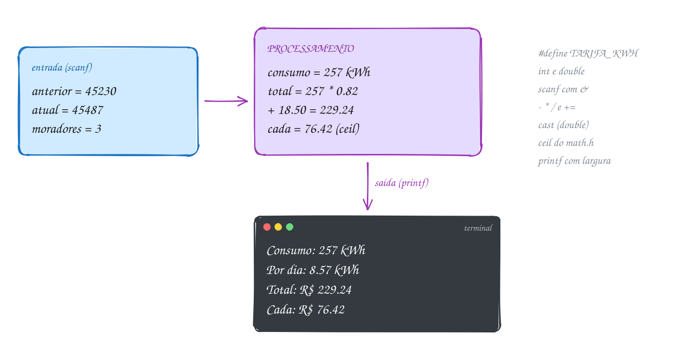</p>

O programa completo:

```c
#include <stdio.h>
#include <math.h>

#define TARIFA_KWH 0.82    // R$ por kWh
#define ILUMINACAO 18.50   // taxa fixa de iluminação pública
#define DIAS 30

int main(void) {
    int anterior, atual, moradores;

    // entrada
    printf("Leitura anterior (kWh): ");
    scanf("%d", &anterior);
    printf("Leitura atual (kWh): ");
    scanf("%d", &atual);
    printf("Moradores: ");
    int lidos = scanf("%d", &moradores);

    // processamento
    int consumo = atual - anterior;
    double total = consumo * TARIFA_KWH;
    total += ILUMINACAO;
    double por_dia = (double) consumo / DIAS;
    double cada = ceil(total / moradores * 100) / 100; // centavo para cima

    // saída
    printf("\n%-18s %8d kWh\n", "Consumo:", consumo);
    printf("%-18s %8.2f kWh\n", "Por dia:", por_dia);
    printf("%-18s R$ %8.2f\n", "Total da conta:", total);
    printf("%-18s R$ %8.2f\n", "Cada morador:", cada);
    printf("(o último scanf leu %d item)\n", lidos);
    return 0;
}
// Exemplo de execução:
// Leitura anterior (kWh): 45230
// Leitura atual (kWh): 45487
// Moradores: 3
//
// Consumo:                257 kWh
// Por dia:               8.57 kWh
// Total da conta:    R$   229.24
// Cada morador:      R$    76.42
// (o último scanf leu 1 item)
```

### Passo a passo

O teste de mesa com a entrada 45230, 45487 e 3. Cada linha é uma instrução
do processamento; as colunas mostram o valor de cada variável depois dela:

| Instrução | consumo | total | por_dia | cada |
| --- | --- | --- | --- | --- |
| `consumo = atual - anterior` | 257 | | | |
| `total = consumo * TARIFA_KWH` | 257 | 210.74 | | |
| `total += ILUMINACAO` | 257 | 229.24 | | |
| `por_dia = (double) consumo / DIAS` | 257 | 229.24 | 8.5666... | |
| `cada = ceil(total / moradores * 100) / 100` | 257 | 229.24 | 8.5666... | 76.42 |

Na última linha: 229,24 ÷ 3 = 76,4133...; vezes 100 dá 7641,33...; o `ceil`
sobe para 7642; dividido por 100, 76,42. Três vezes 76,42 dá 229,26: sobram
dois centavos, mas a conta fica paga.

Repara no fluxograma: uma leitura, quatro contas e uma saída, sem nenhum
losango. É o retrato de todo programa deste módulo:

<p align="center">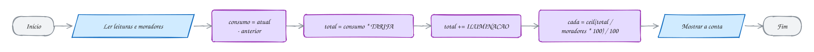</p>

> [!WARNING]
> Sem o cast, `consumo / DIAS` seria `257 / 30` entre dois `int`: daria 8, e
> a média por dia sairia 8.00. E a ordem das contas importa: se o `ceil`
> viesse antes da multiplicação por 100, `ceil(76.4133)` arredondaria para
> R$ 77, e cada um pagaria 58 centavos a mais. Faça o teste de mesa antes de
> confiar numa fórmula.

> [!TIP]
> **Por dentro do C:** este programa ocupa poucas dezenas de bytes de
> variáveis: cinco `int` (4 bytes cada) e três `double` (8 cada), todos na
> mesma região da memória, a **pilha**, que você vai estudar no módulo de
> funções. As constantes do `#define` nem estão lá: viraram números dentro
> das instruções. E o `ceil` vem da `libm`, ligada pelo `-lm`: rode
> `nm -D` no executável e procure `ceil`, `printf` e `scanf`, as funções que o
> ligador deixou para buscar nas bibliotecas na hora de rodar.

> [!NOTE]
> **Pergunta para você:** e se alguém digitar a leitura atual menor que a
> anterior (45487 e depois 45230)? O que o programa mostra? Que pergunta ele
> deveria fazer antes de calcular? Guarde a resposta para o módulo 02.

### Hora de praticar

Os arquivos ficam em [`0016-juntando-tudo/`](0016-juntando-tudo/). Os comandos funcionam de qualquer pasta do terminal. Nos exemplos, rode, mude, quebre e rode de novo. Nos exercícios, a resposta vai dentro do próprio arquivo. ★☆☆ é aquecimento, ★★☆ pede raciocínio e ★★★ é desafio.

**Exemplo A031 · A conta de luz da república**

```c
#include <stdio.h>
#include <math.h>

#define TARIFA_KWH 0.82    // R$ por kWh
#define ILUMINACAO 18.50   // taxa fixa de iluminação pública
#define DIAS 30

int main(void) {
    int anterior, atual, moradores;

    // entrada
    printf("Leitura anterior (kWh): ");
    scanf("%d", &anterior);
    printf("Leitura atual (kWh): ");
    scanf("%d", &atual);
    printf("Moradores: ");
    int lidos = scanf("%d", &moradores);

    // processamento
    int consumo = atual - anterior;
    double total = consumo * TARIFA_KWH;
    total += ILUMINACAO;
    double por_dia = (double) consumo / DIAS;
    double cada = ceil(total / moradores * 100) / 100; // centavo para cima

    // saída
    printf("\n%-18s %8d kWh\n", "Consumo:", consumo);
    printf("%-18s %8.2f kWh\n", "Por dia:", por_dia);
    printf("%-18s R$ %8.2f\n", "Total da conta:", total);
    printf("%-18s R$ %8.2f\n", "Cada morador:", cada);
    printf("(o último scanf leu %d item)\n", lidos);
    return 0;
}
// Exemplo de execução:
// Leitura anterior (kWh): 45230
// Leitura atual (kWh): 45487
// Moradores: 3
//
// Consumo:                257 kWh
// Por dia:               8.57 kWh
// Total da conta:    R$   229.24
// Cada morador:      R$    76.42
// (o último scanf leu 1 item)
//
// Teste: printf '45230\n45487\n3\n' | ~/LPEDC/rodar <este arquivo>
```

```bash
~/LPEDC/rodar 01-fundamentos/0016-juntando-tudo/A031.c
```

**Exemplo A032 · Rachando a gasolina da viagem**

```c
#include <stdio.h>
#include <math.h>

#define PRECO_LITRO 6.19

int main(void) {
    double distancia, consumo, pedagio;
    int pessoas;

    printf("Distância (km): ");
    scanf("%lf", &distancia);
    printf("Consumo do carro (km/l): ");
    scanf("%lf", &consumo);
    printf("Pedágios (R$): ");
    scanf("%lf", &pedagio);
    printf("Pessoas no carro: ");
    scanf("%d", &pessoas);

    double litros = distancia / consumo;
    double gasolina = litros * PRECO_LITRO;
    double total = gasolina + pedagio;
    double cada = ceil(total / pessoas); // arredonda para o real de cima

    // a 80 km/h, quanto tempo de estrada? em minutos inteiros
    int minutos = (int) round(distancia / 80 * 60);

    printf("\nLitros: %.1f\n", litros);
    printf("Gasolina: R$ %.2f + pedágios R$ %.2f = R$ %.2f\n", gasolina, pedagio, total);
    printf("Cada um manda um Pix de R$ %.0f\n", cada);
    printf("Tempo a 80 km/h: %dh%02d\n", minutos / 60, minutos % 60);
    return 0;
}
// Exemplo de execução:
// Distância (km): 430
// Consumo do carro (km/l): 12.5
// Pedágios (R$): 47.80
// Pessoas no carro: 4
//
// Litros: 34.4
// Gasolina: R$ 212.94 + pedágios R$ 47.80 = R$ 260.74
// Cada um manda um Pix de R$ 66
// Tempo a 80 km/h: 5h23
//
// Teste: printf '430\n12.5\n47.80\n4\n' | ~/LPEDC/rodar <este arquivo>
```

```bash
~/LPEDC/rodar 01-fundamentos/0016-juntando-tudo/A032.c
```

#### Exercícios

**Exercício E091** · ★☆☆

Escreva a calculadora de IMC (índice de massa corporal): lê o peso em kg
e a altura em metros e mostra o IMC com uma casa. A fórmula é
peso / altura².


```text
Exemplo de execução:
Peso (kg): 72.5
Altura (m): 1.75
IMC: 23.7
```


Teste: printf '72.5\n1.75\n' | ~/LPEDC/rodar E091.c

**Dicas:**

1. double peso, altura; e scanf com %lf.
2. altura² pode ser altura * altura ou pow(altura, 2).
3. Resposta esperada: 72.5 / (1.75 * 1.75) = 23.67..., mostrado como 23.7.
   Cuidado: peso / altura * altura (sem parênteses) dá 72.5.

```bash
~/LPEDC/rodar 01-fundamentos/0016-juntando-tudo/E091.c
```

**Exercício E092** · ★☆☆

O termômetro marcou 36.5 °C. Seu amigo americano quer em Fahrenheit, e a
professora de física quer em Kelvin. Leia a temperatura em Celsius e
mostre nas três escalas. As fórmulas: F = C * 9 / 5 + 32 e
K = C + 273.15. Use uma constante para o 273.15.


```text
Exemplo de execução:
Celsius: 36.5
36.5 °C = 97.7 °F = 309.65 K
```


Teste: printf '36.5\n' | ~/LPEDC/rodar E092.c

**Dicas:**

1. #define ZERO_ABSOLUTO 273.15 (ou const double).
2. Cuidado com 9 / 5 sozinho: entre dois int, vale 1. Com celsius double
   à esquerda (celsius * 9 / 5), a conta já é real. Na dúvida, 9.0 / 5.
3. Resposta esperada: "36.5 °C = 97.7 °F = 309.65 K".

```bash
~/LPEDC/rodar 01-fundamentos/0016-juntando-tudo/E092.c
```

**Exercício E093** · ★★☆

Quanto tempo leva para baixar um jogo? Leia o tamanho em GB e a
velocidade da internet em Mbps (megabits por segundo) e mostre o tempo em
minutos e segundos. Atenção às unidades: 1 GB = 1000 MB, 1 byte = 8 bits.


```text
Exemplo de execução:
Tamanho (GB): 4.7
Internet (Mbps): 100
Tempo: 376 s = 6 min 16 s
```


Teste: printf '4.7\n100\n' | ~/LPEDC/rodar E093.c

**Dicas:**

1. Megabits do arquivo = GB * 1000 * 8. Segundos = megabits / Mbps.
2. Passe os segundos para int (round e depois cast) antes de usar / e %.
3. Resposta esperada: 4.7 * 1000 * 8 = 37600 megabits; / 100 = 376 s;
   376 / 60 = 6 min, 376 % 60 = 16 s.

```bash
~/LPEDC/rodar 01-fundamentos/0016-juntando-tudo/E093.c
```

**Exercício E094** · ★★☆

O celular custa R$ 1299.00 e a loja parcela em 12 vezes com juros de
1.99% ao mês. A parcela fixa (tabela Price) é


```text
parcela = valor * taxa / (1 - (1 + taxa) elevado a -n)
```


Calcule a parcela, arredonde para centavos de verdade (não só na tela) e
mostre o total pago e quanto foi de juros.


```text
Saída esperada:
12x de R$ 122.76
Total: R$ 1473.12
Juros: R$ 174.12
```

**Dicas:**

1. taxa = 0.0199; pow aceita expoente negativo: pow(1 + taxa, -12).
2. Arredondar para centavos: round(parcela * 100) / 100.
3. Resposta esperada: parcela 122.76 (era 122.7577...); total 12 * 122.76
   = 1473.12; juros 1473.12 - 1299.00 = 174.12.

```bash
~/LPEDC/rodar 01-fundamentos/0016-juntando-tudo/E094.c
```

**Exercício E095** · ★★★

Este programa calcula a média da turma no simulado, mas tem CINCO erros
de propósito, de assuntos diferentes do módulo. Ele compila, com uma
porção de avisos, e quebra ao rodar. Conserte um por vez, rodando de novo
a cada conserto, até sair a saída esperada.


```text
Exemplo de execução (depois de consertar):
Soma das notas: 172.5
Alunos: 25
Média: 6.90
Acima da meta em 0.90 ponto
```


Teste: printf '172.5\n25\n' | ~/LPEDC/rodar E095.c

**Dicas:**

1. Leia os avisos: dois são de scanf (o & e o especificador do double) e
   um é de printf.
2. O aviso "statement with no effect" é estranho: escreva a linha da
   diferença com o #define colado, ; inclusive.
3. Com isso resolvido, um erro ainda fica sem aviso: confira o sinal da
   diferença na mão.
4. Resposta esperada: (1) tire o ; de "#define META 6.0;" (a linha virava
   "diferenca = 6.0; - media;"); (2) soma é
   double: scanf("%lf", &soma); (3) faltou o & em scanf("%d", alunos);
   (4) o printf da média usa %d com double: %.2f; (5) META - media dá
   -0.90: a diferença acima da meta é media - META.

```bash
~/LPEDC/rodar 01-fundamentos/0016-juntando-tudo/E095.c
```

**Exercício E096** · ★★★

O app de entregas diz "chega em 135 minutos". Leia a hora atual (hh:mm) e
os minutos de espera e mostre a hora da chegada, no formato hh:mm, e
quantos dias depois de hoje ela cai. Sem if: só aritmética.


```text
Exemplo de execução:
Agora (hh:mm): 22:45
Espera (min): 135
Chega às 01:00, 1 dia(s) depois
```


Teste também 08:10 com 50 minutos (09:00, 0 dias) e 23:59 com 2881
minutos (00:00, 3 dias).

**Dicas:**

1. Converta tudo para minutos desde a meia-noite: hora * 60 + minuto.
2. Some a espera. Um dia tem 1440 minutos: total / 1440 são os dias, e
   total % 1440 é a hora do dia em minutos.
3. Mostre com %02d:%02d.
4. Resposta esperada: 22:45 + 135 = 1365 + 135 = 1500 minutos; 1500 /
   1440 = 1 dia; 1500 % 1440 = 60 minutos = 01:00.

```bash
~/LPEDC/rodar 01-fundamentos/0016-juntando-tudo/E096.c
```

---

## Desafios do módulo

Problemas para resolver com o que o módulo ensinou: variáveis, `scanf`,
aritmética, conversões, `math.h` e `printf`. Nenhum precisa de `if` nem de
laço. Escreva cada um num arquivo seu e rode com o `rodar`.

**1. Troco em moedas.** O caixa da padaria só tem moedas de R$ 1, R$ 0,50,
R$ 0,25, R$ 0,10 e R$ 0,05. Leia um troco em reais (`double`) e mostre quantas
moedas de cada valor entregar, sempre da maior para a menor. Teste com 3.85.

<details><summary>Resposta</summary>

3 de R$ 1, 1 de R$ 0,50, 1 de R$ 0,25, 1 de R$ 0,10 e nenhuma de R$ 0,05: **6
moedas**. O caminho: converta para centavos inteiros **arredondando**
(`(int) round(troco * 100)`, lembre do 19.99 do E077) e, para cada moeda,
`quantidade = centavos / moeda` e `centavos %= moeda`.

</details>

**2. Que dia da semana?** Numere os dias de 0 (domingo) a 6 (sábado). Hoje é
sábado. Que dia da semana será daqui a 100 dias? E daqui a 1000?

<details><summary>Resposta</summary>

`(6 + 100) % 7` dá 1: **segunda-feira**. `(6 + 1000) % 7` dá 5: **sexta-feira**.
O `%` é perfeito para tudo que "dá a volta": dias da semana, horas do
relógio, posições numa roda.

</details>

**3. A senha embaralhada.** Uma empresa embaralha senhas de 4 dígitos assim:
troca cada dígito por `(dígito + 7) % 10` e depois troca o 1º dígito com o
3º e o 2º com o 4º. Leia uma senha, mostre a embaralhada com `%04d` e escreva
o programa que desfaz. Teste com 2026.

<details><summary>Resposta</summary>

2, 0, 2, 6 viram 9, 7, 9, 3 e, com as trocas, **9397**. Para desfazer, troque
as posições de volta e some 3 em cada dígito, com `% 10` (somar 7 e depois 3
dá 10, que o `% 10` zera). Separe os dígitos com `/` e `%` como no E072.

</details>

**4. Até onde o fatorial cabe?** Qual o maior `n` cujo fatorial cabe num
`int`? E num `long long`? Escreva um programa que mostre os fatoriais
multiplicando um por um e use o `rodar` para descobrir onde estoura.

<details><summary>Resposta</summary>

**12!** = 479.001.600 cabe no `int`; 13! = 6.227.020.800 passa de `INT_MAX`.
No `long long`, **20!** = 2.432.902.008.176.640.000 cabe; 21! não. O detector
de comportamento indefinido do `rodar` acusa `signed integer overflow` na
primeira multiplicação que estoura.

</details>

**5. Quanto preciso tirar?** A média final é ponderada: P1 com peso 3, P2 com
peso 4 e P3 com peso 3. Você tirou 5,0 na P1 e 6,5 na P2. Quanto precisa
tirar na P3 para ficar com média 6,0?

<details><summary>Resposta</summary>

Média = (3·P1 + 4·P2 + 3·P3) / 10. Isolando: P3 = (6,0·10 − 3·5,0 − 4·6,5) / 3
= (60 − 15 − 26) / 3 = **6,33**. Use `double` em tudo: com `int`, a divisão
final daria 6.

</details>

**6. O voo noturno.** Um voo sai de Manaus às 22:40 (horário de Manaus) e dura
3h50. São Paulo está uma hora à frente de Manaus. A que horas, no horário de
São Paulo, ele pousa?

<details><summary>Resposta</summary>

Em minutos: 22·60 + 40 = 1360; mais 230 de voo e 60 de fuso = 1650;
`1650 % 1440` = 210 minutos = **03:30**, no dia seguinte (`1650 / 1440` = 1).
É a mesma técnica do E096.

</details>

**7. O preço na bomba.** Um posto arredonda o total para o múltiplo de 5
centavos mais próximo. Escreva a conta com `round` e teste com R$ 6.37, R$
6.38 e R$ 152.12.

<details><summary>Resposta</summary>

`round(valor / 0.05) * 0.05`: 6.37 vira **6.35**, 6.38 vira **6.40** e 152.12
vira **152.10**. A ideia vale para qualquer passo: divida pelo passo,
arredonde e multiplique de volta.

</details>

**8. sizeof de cabeça.** Sem rodar: quanto vale
`sizeof(char) + sizeof('a') + sizeof("a") + sizeof(1.0f) + sizeof(1.0)` num
PC de 64 bits?

<details><summary>Resposta</summary>

1 + 4 + 2 + 4 + 8 = **19**. As armadilhas: `'a'` é `int` no C (4 bytes) e
`"a"` tem o byte zero do fim (2 bytes). O resultado é do tipo `size_t`:
mostre com `%zu`.

</details>

**9. O cronômetro.** O cronômetro do celular guarda o tempo em milissegundos.
Leia um valor e mostre no formato `mm:ss.mmm`. Teste com 754321.

<details><summary>Resposta</summary>

`754321 / 60000` = 12 minutos; `754321 % 60000` = 34321; `34321 / 1000` = 34
segundos; `34321 % 1000` = 321. Com `printf("%02d:%02d.%03d\n", ...)` sai
**12:34.321**. Sem o `%03d`, 5 milissegundos sairiam como `.5`, que parece
meio segundo.

</details>

**10. Qual dá a volta com garantia?** Preveja o que acontece em cada trecho e
diga qual deles o C garante:

```c
unsigned short placar = 65530;
placar += 10;

int pontos = INT_MAX;
pontos += 1;
```

<details><summary>Resposta</summary>

O `unsigned short` dá a volta com garantia: 65540 − 65536 = **4**. O `int`
com sinal estoura, e isso é **comportamento indefinido**: costuma virar
-2147483648, mas o padrão não garante nada, e o `rodar` acusa
`signed integer overflow`.

</details>

## Para ler mais

- BACKES, A. *Linguagem C: completa e descomplicada*. Rio de Janeiro: Elsevier, 2013. Caps. 1 a 3.
- BACKES, A. R. *Linguagem C: descomplicada*. Apostila. Uberlândia: FACOM/UFU, [s.d.].
- DEITEL, P.; DEITEL, H. *C: como programar*. 6. ed. São Paulo: Pearson Prentice Hall, 2011. Caps. 2, 3, 5 e 9.
- HARA, C.; ZOLA, W. *Linguagem C: notas de aula*. Rev. A. L. N. Delgado. Curitiba: UFPR, 2008.
- LEAL, G. C. L. *Algoritmos e lógica de programação II*. Maringá: Unicesumar, 2016. Unidade I.
- CARVALHO, V. A. *Lógica de programação*. Colatina: IFES / e-Tec Brasil, 2010. Aulas 5 a 7.
- ANTONELLO, R. *Linguagem C*. 1. ed. Disponível em: <http://www.antonello.com.br>.
- MARTINS, L. G. A. *Apostila de linguagem C: conceitos básicos*. Uberlândia: FACOM/UFU, [s.d.].
- DORNELLES FILHO, A. A. *Fundamentos de linguagem C*. Caxias do Sul: SENAI-RS, 1997.
- LAGO, S. *Linguagem C*. Apostila, [s.d.].
- UNICAMP. Centro de Computação. *Introdução à linguagem C*: versão 2.0. Campinas: UNICAMP, [s.d.].
- KERNIGHAN, B. W.; RITCHIE, D. M. *The C programming language*. 2. ed. Englewood Cliffs: Prentice Hall, 1988. Caps. 1 e 2.
- ISO/IEC. *ISO/IEC 9899:2018*: Information technology: Programming languages: C. Genebra: ISO, 2018.
- CPPREFERENCE. *C reference*. Disponível em: <https://en.cppreference.com/w/c>.
- KERRISK, M. (org.). *Linux man-pages*: printf(3), scanf(3), math.h(0p). Disponível em: <https://man7.org/linux/man-pages/>.
- GNU. *Using the GNU Compiler Collection (GCC)*: Overall options e Warning options. Disponível em: <https://gcc.gnu.org/onlinedocs/gcc/>.
