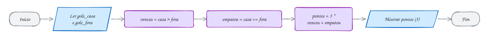
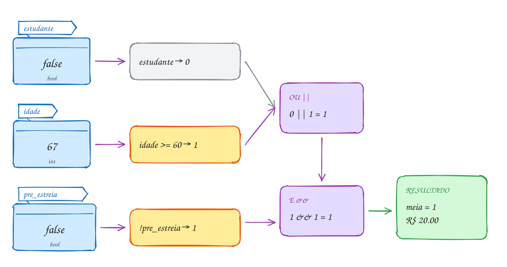
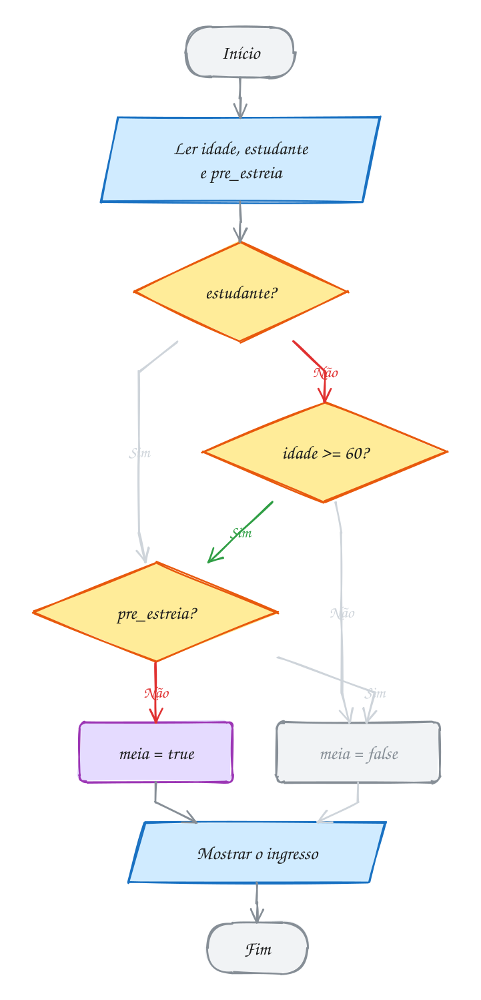
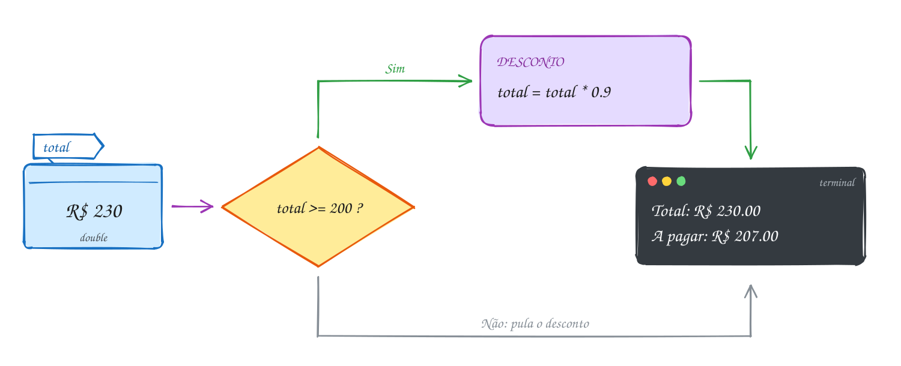
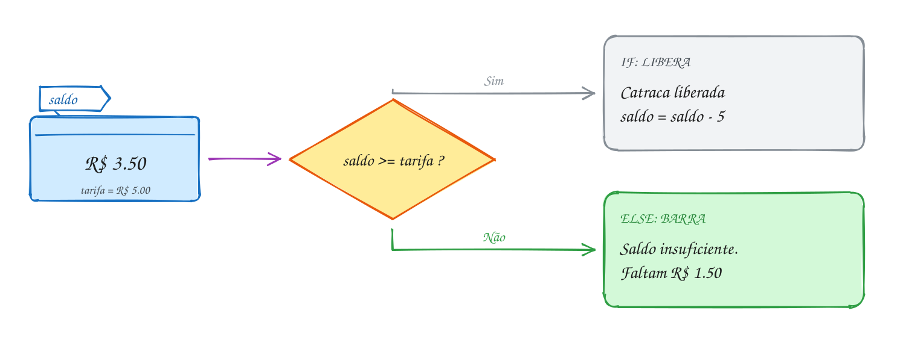
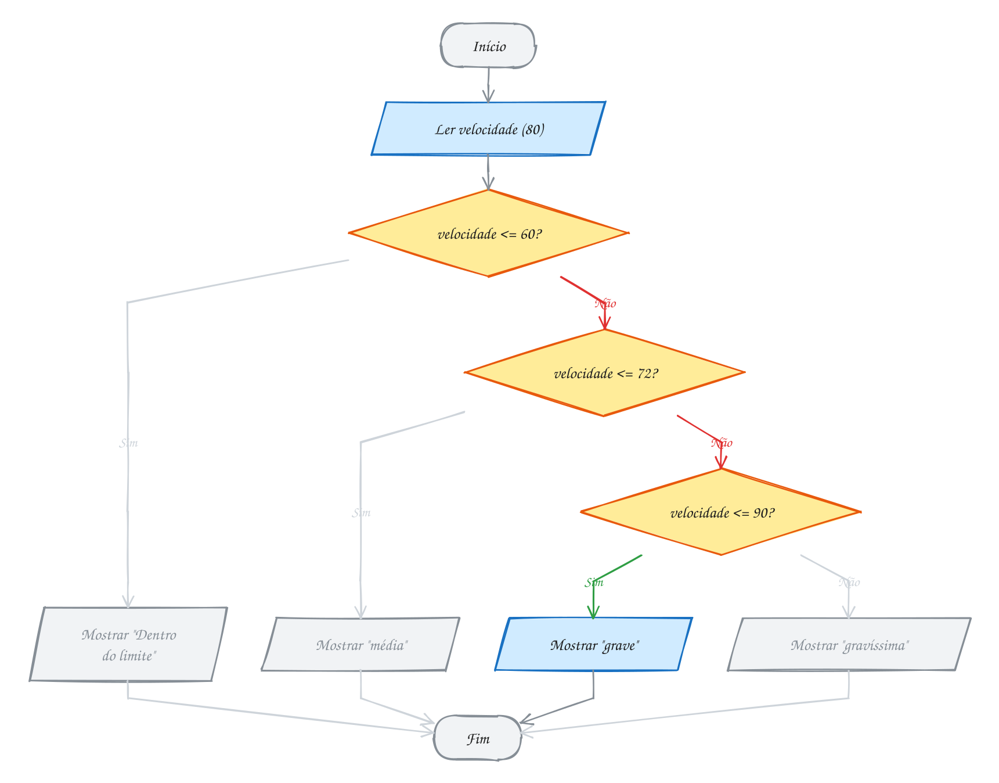
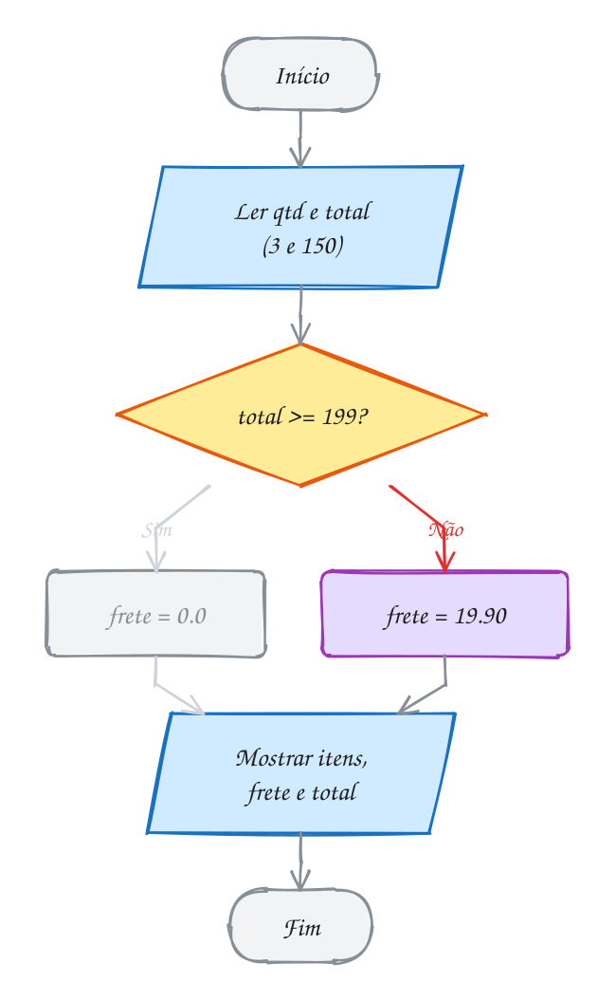
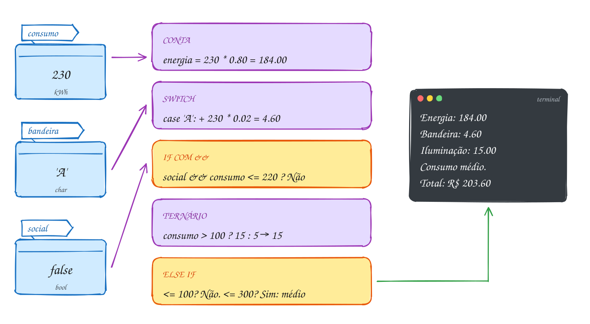
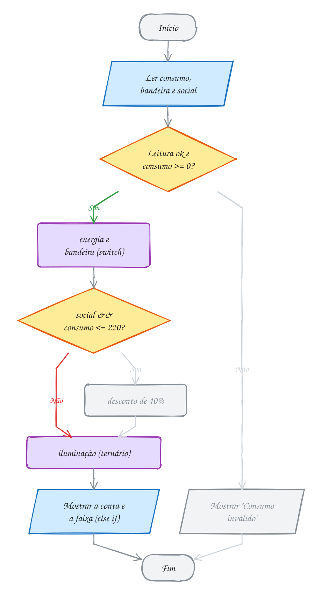

<!-- Gerado por _gerador. Para mudar este arquivo, edite _gerador/modulos/02-condicionais/ e rode: cd _gerador && npm run gerar -->

# Módulo 02 · Decisões

Até aqui, todo programa descia de cima para baixo, sempre pelo mesmo caminho.
Agora ele **escolhe**: cobrar ou não o frete, liberar ou barrar a catraca,
achar a faixa da multa. É a segunda das três peças de qualquer algoritmo.

A sintaxe é curta: `if`, `else`, `switch` e o ternário. O importante é o que
está por baixo: no C, a verdade é um **número**, 0 é falso e todo o resto é
verdade. Daí vêm pegadinhas como `=` no lugar de `==`, que compila, roda e
estraga a variável em silêncio.

Os focos do módulo são escrever decisões claras e **desconfiar** das que
parecem certas. Os avisos do compilador ajudam: com as flags de estudo, quase
toda pegadinha deste módulo dispara um.

Progressão: o módulo usa do 01 as variáveis, o `scanf` e seu retorno, a
aritmética (em especial o `%`) e o `math.h`. Ele prepara o 03, em que uma
decisão passa a controlar uma repetição.

## O que você vai aprender

- **operadores relacionais** e a verdade em C: comparação vale 0 ou 1; `bool` de `<stdbool.h>`
- **operadores lógicos** `&&`, `||` e `!`, tabela-verdade, **curto-circuito** e De Morgan
- o **`if`**, as chaves e a armadilha do `;` depois da condição
- o **`if/else`** e a pegadinha do `=` no lugar de `==`
- **`else if`**, `if` aninhado e o **else pendurado**
- o **operador ternário**, a decisão que devolve um valor
- o **`switch`**, o `break` e o **fall-through**
- um programa que lê dados, valida a entrada e decide

## Antes de começar

Nos fluxogramas, o caminho verde mostra por onde o exemplo passou.

> [!TIP]
> Teste **cada caminho** e, principalmente, os **valores de fronteira**: se a
> regra é "a partir de R$ 200", teste 199,99, 200 e 200,01. A maioria dos
> erros de decisão é a troca de `>` por `>=`.

Você precisa conhecer o módulo 01: variáveis, `printf`, `scanf` (e seu
retorno), operadores aritméticos (em especial o `%`) e `math.h`. Os exercícios
com teclado aceitam entrada por pipe, o que facilita testar vários casos:

```bash
gcc ~/LPEDC/02-condicionais/0014-if/A028.c -o ~/LPEDC/02-condicionais/0014-if/A028 && printf '12.90 8.50\n' | ~/LPEDC/02-condicionais/0014-if/A028
```

Os exercícios "ache o erro" trazem o código quebrado **de propósito** e mostram
avisos ao compilar; o enunciado diz quando é o caso. Nos demais, vale a regra:
**zero avisos**.

| # | Assunto | Pasta |
| --- | --- | --- |
| [0012](#0012--relacionais-e-a-verdade-em-c) | Relacionais e a verdade em C | [`0012-relacionais/`](02-condicionais/0012-relacionais/) |
| [0013](#0013--lógicos-e-ou-não) | Lógicos: E, OU, NÃO | [`0013-logicos/`](02-condicionais/0013-logicos/) |
| [0014](#0014--if) | if | [`0014-if/`](02-condicionais/0014-if/) |
| [0015](#0015--ifelse-e-o--no-lugar-do-) | if/else e o = no lugar do == | [`0015-if-else/`](02-condicionais/0015-if-else/) |
| [0016](#0016--else-if-if-aninhado-e-o-else-pendurado) | else if, if aninhado e o else pendurado | [`0016-else-if/`](02-condicionais/0016-else-if/) |
| [0017](#0017--ternário-condição--a--b) | Ternário: condição ? a : b | [`0017-ternario/`](02-condicionais/0017-ternario/) |
| [0018](#0018--switch-case-break-e-fall-through) | switch, case, break e fall-through | [`0018-switch/`](02-condicionais/0018-switch/) |
| [0019](#0019--juntando-tudo-a-conta-de-luz) | Juntando tudo: a conta de luz | [`0019-juntando-tudo/`](02-condicionais/0019-juntando-tudo/) |

---

## 0012 · Relacionais e a verdade em C

Domingo, fim de jogo: mandante 2 x 1 visitante. A tabela do campeonato faz
três perguntas de sim ou não: o mandante fez mais gols? Empatou? Fez menos?
E soma 3, 1 ou 0 ponto.

Toda decisão começa numa **comparação**. O C tem seis **operadores
relacionais**:

| Operador | Pergunta | Com o placar 2 x 1 |
| --- | --- | --- |
| `>` | maior que? | `2 > 1` vale 1 |
| `<` | menor que? | `2 < 1` vale 0 |
| `>=` | maior ou igual? | `2 >= 1` vale 1 |
| `<=` | menor ou igual? | `2 <= 1` vale 0 |
| `==` | igual? (dois sinais!) | `2 == 1` vale 0 |
| `!=` | diferente? | `2 != 1` vale 1 |

No C, uma comparação dá um **`int`**: **1** se é verdade e **0** se é mentira.
Dá para imprimir com `%d`, somar e multiplicar.

No sentido inverso, **0 é falso e qualquer outro valor é verdadeiro**: 1, 42,
-3 e 0.5 contam como verdade. Isso será usado a partir do `if` (0014).

O C99 criou o `_Bool` e o cabeçalho **`<stdbool.h>`**, com os nomes
**`bool`**, **`true`** (vale 1) e **`false`** (vale 0). Use `bool` para
respostas de sim ou não. Ele é rígido: `bool b = 42;` guarda **1**, porque
todo valor diferente de zero vira `true`.

Três erros de escrita: `=<`, `=>` e `<>` não existem (o símbolo vem antes do
`=`, e diferente é `!=`); `= =` com espaço também não; e `=` sozinho é
**atribuição**, não comparação. Leia `=` como "recebe" e `==` como "é igual
a". O estrago dessa troca fica para o 0015.

Os dois placares viram três perguntas, e cada resposta é 0 ou 1. A tabela usa
esses números direto na conta dos pontos:

<p align="center"></p>

O placar em C não tem nenhum `if`: a verdade vira número e entra na conta:

```c
#include <stdbool.h>
#include <stdio.h>

int main(void) {
    int gols_casa = 2;
    int gols_fora = 1;

    printf("casa >  fora? %d\n", gols_casa > gols_fora);
    printf("casa == fora? %d\n", gols_casa == gols_fora);
    printf("casa <  fora? %d\n", gols_casa < gols_fora);

    bool venceu = gols_casa > gols_fora;   // guarda a resposta: true
    bool empatou = gols_casa == gols_fora; // false

    int pontos = 3 * venceu + empatou;     // 3 * 1 + 0
    printf("Pontos do mandante: %d\n", pontos);
    return 0;
}
// Saída:
// casa >  fora? 1
// casa == fora? 0
// casa <  fora? 0
// Pontos do mandante: 3
```

O fluxograma não tem losango: comparar não é decidir, apenas **calcula** uma
resposta e a guarda numa caixinha. Quem escolhe o caminho é o `if` (0014):

<p align="center"></p>

> [!WARNING]
> **Não compare `float` ou `double` com `==`.** `printf("%d", 0.1 + 0.2 ==
> 0.3);` mostra **0**: 0,1 não tem representação exata em binário, e a soma
> dá 0.30000000000000004. Pergunte se os valores estão **perto o bastante**:
> `fabs(a - b) < 1e-9`. Para dinheiro, o mais seguro é guardar **centavos**
> num `int`.

> [!NOTE]
> **Pergunta para você:** quanto vale `7 > 3 > 1`? Lembre que o C avalia da
> esquerda para a direita e que `7 > 3` já virou um número. Responda antes de
> colocar num `printf` com `%d`.

### Hora de praticar

Arquivos em [`0012-relacionais/`](02-condicionais/0012-relacionais/).

**Exemplo A023 · A nota no limite e a contagem sem if**

```c
#include <stdbool.h>
#include <stdio.h>

int main(void) {
    double nota_ana = 7.0; // bem no limite da média
    double nota_bia = 6.9;
    double nota_caio = 8.5;

    // > e >= só discordam num caso: quando os dois lados são iguais
    printf("7.0 >  7? %d\n", nota_ana > 7);
    printf("7.0 >= 7? %d\n", nota_ana >= 7);

    bool ana = nota_ana >= 7;
    bool bia = nota_bia >= 7;
    bool caio = nota_caio >= 7;

    // cada bool vale 0 ou 1: somar conta quantos passaram
    int aprovados = ana + bia + caio;
    printf("Aprovados: %d de 3\n", aprovados);
    printf("Todos passaram? %d\n", aprovados == 3);
    printf("Alguém ficou de fora? %d\n", aprovados != 3);
    return 0;
}
// Saída:
// 7.0 >  7? 0
// 7.0 >= 7? 1
// Aprovados: 2 de 3
// Todos passaram? 0
// Alguém ficou de fora? 1
```

```bash
gcc ~/LPEDC/02-condicionais/0012-relacionais/A023.c -o ~/LPEDC/02-condicionais/0012-relacionais/A023 && ~/LPEDC/02-condicionais/0012-relacionais/A023
```

**Exemplo A024 · Zero é falso, o resto é verdade**

```c
#include <math.h>
#include <stdbool.h>
#include <stdio.h>

int main(void) {
    int saldo = 250;
    bool tem_saldo = saldo; // 250 não é zero: vira true (1)
    bool zerado = 0;        // só o zero é falso
    bool negativo = -3;     // negativo também é verdade

    printf("tem_saldo = %d\n", tem_saldo);
    printf("zerado = %d\n", zerado);
    printf("negativo = %d\n", negativo);
    printf("sizeof(bool) = %zu byte\n", sizeof(bool));

    // char também é número: 'A' vale 65 e 'a' vale 97
    printf("'A' < 'a'? %d\n", 'A' < 'a');

    // número com vírgula: nunca compare com ==
    double soma = 0.1 + 0.2;
    printf("0.1 + 0.2 == 0.3? %d\n", soma == 0.3);
    printf("perto o bastante? %d\n", fabs(soma - 0.3) < 1e-9);
    return 0;
}
// Saída:
// tem_saldo = 1
// zerado = 0
// negativo = 1
// sizeof(bool) = 1 byte
// 'A' < 'a'? 1
// 0.1 + 0.2 == 0.3? 0
// perto o bastante? 1
```

```bash
gcc ~/LPEDC/02-condicionais/0012-relacionais/A024.c -o ~/LPEDC/02-condicionais/0012-relacionais/A024 -lm && ~/LPEDC/02-condicionais/0012-relacionais/A024
```

#### Exercícios

**Exercício E067** · ★☆☆

No posto, a regra de bolso diz que o etanol compensa quando custa no
máximo 70% do preço da gasolina. Leia os dois preços e guarde a resposta
num bool. Mostre o bool com %d (sem if: só a comparação).


```text
Etanol: 4.19
Gasolina: 6.09
Etanol compensa? 1
```

**Dicas:**

1. 70% da gasolina é gasolina * 0.7.
2. bool compensa = etanol <= gasolina * 0.7; (não esqueça o stdbool.h).
3. Resposta esperada: com 4.19 e 6.09 mostra 1 (o limite é 4.263); com
   4.59 e 6.09 mostra 0.

```bash
gcc ~/LPEDC/02-condicionais/0012-relacionais/E067.c -o ~/LPEDC/02-condicionais/0012-relacionais/E067 && ~/LPEDC/02-condicionais/0012-relacionais/E067
```

**Exercício E068** · ★☆☆

Leia a idade de dois irmãos e mostre as seis comparações entre elas, uma
por linha, cada uma com o 0 ou o 1 que o C devolve (sem if):


```text
Idades: 12 9
12 >  9? 1
12 <  9? 0
12 >= 9? 1
12 <= 9? 0
12 == 9? 0
12 != 9? 1
```

**Dicas:**

1. Leia as duas idades com um scanf só: scanf("%d %d", &a, &b).
2. Cada linha é um printf com %d para a idade e outro %d para a
   comparação: printf("%d >  %d? %d\n", a, b, a > b);
3. Resposta esperada: 12 9 → 1 0 1 0 0 1 (de cima para baixo);
   7 7 → 0 0 1 1 1 0.

```bash
gcc ~/LPEDC/02-condicionais/0012-relacionais/E068.c -o ~/LPEDC/02-condicionais/0012-relacionais/E068 && ~/LPEDC/02-condicionais/0012-relacionais/E068
```

**Exercício E069** · ★★☆

A loja cobra frete de R$ 24.90, mas só quando a compra é menor que
R$ 199.00. Complete a linha do frete SEM usar if: use o 0 ou 1 de uma
comparação dentro da conta.


```text
Total da compra: R$ 150
Frete: R$ 24.90
A pagar: R$ 174.90
```

**Dicas:**

1. (total < 199) vale 1 quando o frete é cobrado e 0 quando não é.
2. Multiplique essa comparação pelo valor do frete.
3. Resposta esperada: 150 → frete 24.90, paga 174.90; 210 → frete 0.00,
   paga 210.00.

```bash
gcc ~/LPEDC/02-condicionais/0012-relacionais/E069.c -o ~/LPEDC/02-condicionais/0012-relacionais/E069 && ~/LPEDC/02-condicionais/0012-relacionais/E069
```

**Exercício E070** · ★★☆

A bala custa R$ 0,70 e a criança pagou com sete moedas de 10 centavos. O
programa abaixo diz que ela NÃO pagou o valor exato. Rode, acrescente um
printf que mostre pago com 20 casas e conserte de dois jeitos, mostrando
as duas linhas: (a) com uma tolerância usando fabs; (b) trabalhando com
centavos em int.

**Dicas:**

1. (a) fabs(pago - preco) < 1e-9; (b) int preco = 70; int pago = 7 * 10;
2. Resposta esperada: o printf mostra 0.70000000000000006661 (0.1 não é
   exato em binário), diferente de 0.7. Consertado, os dois jeitos
   mostram "Pagou o valor exato? 1".

```bash
gcc ~/LPEDC/02-condicionais/0012-relacionais/E070.c -o ~/LPEDC/02-condicionais/0012-relacionais/E070 -lm && ~/LPEDC/02-condicionais/0012-relacionais/E070
```

**Exercício E071** · ★★★

O sistema da gincana confere se a nota digitada vale (de 0 a 10) e se os
três jurados deram a mesma nota. Quem escreveu copiou a matemática:
0 <= nota <= 10 e j1 == j2 == j3. Compila, com avisos (de propósito), e
erra. Rode com as entradas abaixo, leia os avisos e conserte as duas
linhas SEM usar && (ele só chega no 0013): use o fato de que cada
comparação vale 0 ou 1.


```text
Nota: 15
Jurados: 7 7 7
Nota válida? 0
Unanimidade? 1
```

**Dicas:**

1. O C avalia da esquerda para a direita: 0 <= nota <= 10 é
   (0 <= nota) <= 10, e o 0 ou 1 da esquerda é sempre <= 10.
2. "As duas coisas são verdade" é o mesmo que "o produto das duas vale
   1": (0 <= nota) * (nota <= 10).
3. Resposta esperada: valida = (nota >= 0) * (nota <= 10);
   unanime = (j1 == j2) * (j2 == j3). Testes: 15 e 7 7 7 → 0 e 1;
   8 e 7 7 9 → 1 e 0; 10 e 2 2 2 → 1 e 1. Sem o conserto, 15 e 7 7 7
   mostram 1 e 0.

```bash
gcc ~/LPEDC/02-condicionais/0012-relacionais/E071.c -o ~/LPEDC/02-condicionais/0012-relacionais/E071 && ~/LPEDC/02-condicionais/0012-relacionais/E071
```

**Exercício E072** · ★★★

Desconto progressivo, sem nenhum if: compras a partir de R$ 100 ganham
5%; a partir de R$ 300, ganham mais 5% (10% no total). Leia o total,
calcule a porcentagem só com comparações e mostre:


```text
Total: R$ 150.00
Desconto: 5%
A pagar: R$ 142.50
```

**Dicas:**

1. Cada faixa alcançada soma 5: 5 * (total >= 100) + 5 * (total >= 300).
2. Para mostrar o símbolo de porcentagem no printf, escreva %%.
3. Resposta esperada: 80 → 0%, paga 80.00; 150 → 5%, paga 142.50;
   400 → 10%, paga 360.00.

```bash
gcc ~/LPEDC/02-condicionais/0012-relacionais/E072.c -o ~/LPEDC/02-condicionais/0012-relacionais/E072 && ~/LPEDC/02-condicionais/0012-relacionais/E072
```

---

## 0013 · Lógicos: E, OU, NÃO

Bilheteria do cinema. Paga meia quem é estudante **ou** tem 60 anos ou mais,
**e** a sessão **não** é pré-estreia. São três respostas de sim ou não,
ligadas por E, OU e NÃO.

Os **operadores lógicos** juntam comparações:

- `a && b` (**E**): verdade só se as duas forem verdade;
- `a || b` (**OU**): verdade se pelo menos uma for verdade;
- `!a` (**NÃO**): inverte. `!1` vale 0 e `!0` vale 1.

A **tabela-verdade** mostra todas as combinações. Como no 0012, o resultado é
um `int` 0 ou 1:

| `a` | `b` | `a && b` | `a \|\| b` | `!a` |
| --- | --- | --- | --- | --- |
| 0 | 0 | 0 | 0 | 1 |
| 0 | 1 | 0 | 1 | 1 |
| 1 | 0 | 0 | 1 | 0 |
| 1 | 1 | 1 | 1 | 0 |

Na escola, 18 ≤ idade ≤ 65. No C, intervalo é um E de duas comparações:
`idade >= 18 && idade <= 65`. `18 <= idade <= 65` compila, mas compara o 0 ou
1 da primeira parte com 65 (veja o 0012).

**Precedência**, da mais forte para a mais fraca: `!` (e o menos unário), os
aritméticos, os relacionais (`<` `>` `<=` `>=`), a igualdade (`==` `!=`), o
`&&` e por último o `||`. Por isso `x > 0 && x < 10` dispensa parênteses, e
`a || b && c` é `a || (b && c)`. Na dúvida, use parênteses: mostram a
intenção.

No **curto-circuito**, o C avalia da esquerda para a direita e **para assim
que sabe a resposta**, garantido pelo padrão. Em `a && b`, se `a` é falso, o
`b` nem é calculado. Em `a || b`, se `a` é verdade, o `b` é pulado. Isso
protege contas perigosas: `convidados != 0 && fatias / convidados > 3` nunca
divide por zero. Ponha à esquerda o teste mais barato ou o que mais dá falso.

As **leis de De Morgan** negam uma condição composta: o NÃO entra nos
parênteses e troca E por OU. `!(a && b)` é `!a || !b`, e `!(a || b)` é
`!a && !b`. "Não é (estudante ou idoso)" é "não é estudante e não é idoso".

No exemplo, uma pessoa de 67 anos, não estudante, numa sessão comum. O OU dá
verdade pela idade, o NÃO da pré-estreia dá verdade, e o E fecha com
meia-entrada:

<p align="center"></p>

A bilheteria em C:

```c
#include <stdbool.h>
#include <stdio.h>

int main(void) {
    int idade = 67;
    bool estudante = false;
    bool pre_estreia = false;

    // os parênteses são obrigatórios aqui: && vem antes de ||
    bool meia = (estudante || idade >= 60) && !pre_estreia;

    printf("Meia-entrada? %d\n", meia);
    printf("Ingresso: R$ %.2f\n", 40.0 - meia * 20.0);
    return 0;
}
// Saída:
// Meia-entrada? 1
// Ingresso: R$ 20.00
```

O C avalia como no fluxograma, uma pergunta de cada vez. Como `estudante` é
falso, olha a idade; se fosse verdade, pularia direto para a pré-estreia. É o
curto-circuito desenhado.

<p align="center"></p>

> [!WARNING]
> **`&` não é `&&`.** O `&` simples é o E **bit a bit** (assunto 0065): não tem
> curto-circuito e sua precedência é **menor** que a do `==`. Em
> `if (x & 1 == 0)`, o C calcula `x & (1 == 0)`, ou seja `x & 0`, **sempre
> 0**. O certo é `(x & 1) == 0` ou, mais claro, `x % 2 == 0`. O mesmo vale
> para `|` e `||`. O `-Wall` avisa: "suggest parentheses".

> [!NOTE]
> **Pergunta para você:** se a pessoa fosse estudante, a comparação
> `idade >= 60` seria feita? E se a sessão fosse pré-estreia, a idade mudaria
> alguma coisa? Siga o fluxograma e depois mude os valores no código acima.

### Hora de praticar

Arquivos em [`0013-logicos/`](02-condicionais/0013-logicos/).

**Exemplo A025 · Dentro, fora e "só um dos dois"**

```c
#include <stdbool.h>
#include <stdio.h>

int main(void) {
    int hora = 22;

    // dentro da faixa: um E de duas comparações
    bool comercial = hora >= 8 && hora < 18;
    // fora da faixa: um OU. É o NÃO do de cima, aberto por De Morgan:
    // !(hora >= 8 && hora < 18) vira hora < 8 || hora >= 18
    bool fora = hora < 8 || hora >= 18;
    printf("Horário comercial? %d\n", comercial);
    printf("Fora do horário?   %d\n", fora);

    // o C não tem um "OU exclusivo" lógico, mas com bool o != faz o papel:
    // verdade quando exatamente um dos dois é verdade
    bool cupom = true;
    bool primeira_compra = true;
    bool um_desconto_so = cupom != primeira_compra;
    bool algum_desconto = cupom || primeira_compra;
    printf("Algum desconto?    %d\n", algum_desconto);
    printf("Só um desconto?    %d\n", um_desconto_so);
    return 0;
}
// Saída:
// Horário comercial? 0
// Fora do horário?   1
// Algum desconto?    1
// Só um desconto?    0
```

```bash
gcc ~/LPEDC/02-condicionais/0013-logicos/A025.c -o ~/LPEDC/02-condicionais/0013-logicos/A025 && ~/LPEDC/02-condicionais/0013-logicos/A025
```

**Exemplo A026 · O curto-circuito protege a divisão**

```c
#include <stdbool.h>
#include <stdio.h>

int main(void) {
    int fatias = 24;
    int convidados = 0; // ninguém confirmou ainda

    // convidados != 0 deu falso: o && para ali e a divisão nem acontece
    bool sobra = convidados != 0 && fatias / convidados > 3;
    printf("Sobra pizza? %d\n", sobra);

    // o lado direito do || só roda se o esquerdo for falso
    int chamadas = 0;
    bool muita = fatias > 10 || ++chamadas > 0;
    printf("muita = %d, chamadas = %d\n", muita, chamadas);

    // De Morgan: !(a || b) é o mesmo que !a && !b
    bool chovendo = false;
    bool frio = true;
    printf("!(chovendo || frio) = %d\n", !(chovendo || frio));
    printf("!chovendo && !frio  = %d\n", !chovendo && !frio);
    return 0;
}
// Saída:
// Sobra pizza? 0
// muita = 1, chamadas = 0
// !(chovendo || frio) = 0
// !chovendo && !frio  = 0
```

```bash
gcc ~/LPEDC/02-condicionais/0013-logicos/A026.c -o ~/LPEDC/02-condicionais/0013-logicos/A026 && ~/LPEDC/02-condicionais/0013-logicos/A026
```

#### Exercícios

**Exercício E073** · ★☆☆

Monte a tabela-verdade no terminal. Para cada uma das quatro combinações
de a e b (0 0, 0 1, 1 0, 1 1), dê os valores às duas variáveis e mostre
uma linha com a, b, a && b, a || b e !a, calculados pelo programa (nada de
digitar os resultados no printf).


```text
a b | E OU NAO
0 0 | 0 0  1
0 1 | 0 1  1
1 0 | 0 1  0
1 1 | 1 1  0
```

**Dicas:**

1. Declare bool a, b; e, antes de cada linha, faça a = ...; b = ...;
2. Use sempre o mesmo printf:
   printf("%d %d | %d %d  %d\n", a, b, a && b, a || b, !a);
3. A coluna do E só tem 1 na última
   linha; a do OU só tem 0 na primeira.

```bash
gcc ~/LPEDC/02-condicionais/0013-logicos/E073.c -o ~/LPEDC/02-condicionais/0013-logicos/E073 && ~/LPEDC/02-condicionais/0013-logicos/E073
```

**Exercício E074** · ★☆☆

A geladeira de vacinas do posto de saúde precisa ficar entre 2 °C e 8 °C,
incluindo os extremos. Leia a temperatura (pode ter vírgula) e mostre se
está na faixa e se o alarme deve tocar (o alarme é o contrário da faixa).


```text
Temperatura: 5
Dentro da faixa? 1
Alarme? 0
```

**Dicas:**

1. "Entre 2 e 8" no C é temp >= 2 && temp <= 8. Nada de 2 <= temp <= 8.
2. O alarme é !dentro.
3. Resposta esperada: 5 → 1 e 0; 9.5 → 0 e 1; 2 → 1 e 0.

```bash
gcc ~/LPEDC/02-condicionais/0013-logicos/E074.c -o ~/LPEDC/02-condicionais/0013-logicos/E074 && ~/LPEDC/02-condicionais/0013-logicos/E074
```

**Exercício E075** · ★★☆

Um ano é bissexto quando é divisível por 4 e não por 100, ou quando é
divisível por 400. Leia o ano e calcule a resposta numa ÚNICA expressão,
guardada num bool (sem if).


```text
Ano: 2024
Bissexto? 1
```

**Dicas:**

1. "Divisível por 4" é ano % 4 == 0; "não divisível por 100" é
   ano % 100 != 0.
2. (divisível por 4 E não por 100) OU divisível por 400. Use parênteses
   para deixar claro, mesmo que o && já venha antes do ||.
3. Resposta esperada: 1900 → 0; 2000 → 1; 2023 → 0; 2024 → 1.

```bash
gcc ~/LPEDC/02-condicionais/0013-logicos/E075.c -o ~/LPEDC/02-condicionais/0013-logicos/E075 && ~/LPEDC/02-condicionais/0013-logicos/E075
```

**Exercício E076** · ★★☆

Na portaria do show, a regra está escrita com um NÃO na frente de tudo.
Use De Morgan para reescrever "barrado" sem o ! do lado de fora dos
parênteses e mostre as duas versões lado a lado, para provar que dão o
mesmo resultado.


```text
Idade: 16
Tem ingresso (1 = sim, 0 = não): 1
barrado (original):  1
barrado (De Morgan): 1
```

**Dicas:**

1. !(a && b) vira !a || !b.
2. !(idade >= 18) é idade < 18. E !tem_ingresso fica como está.
3. Resposta esperada: barrado = idade < 18 || !tem_ingresso.
   Testes: 20 e 1 → 0; 16 e 1 → 1; 30 e 0 → 1.

```bash
gcc ~/LPEDC/02-condicionais/0013-logicos/E076.c -o ~/LPEDC/02-condicionais/0013-logicos/E076 && ~/LPEDC/02-condicionais/0013-logicos/E076
```

**Exercício E077** · ★★★

O app do banco mostra se o gasto médio por dia passou de R$ 100. Com uma
conta nova, sem nenhum dia registrado, o programa abaixo quebra: o
sanitizer acusa "division by zero". Rode com 900 0 e veja o erro. Depois:
(a) conserte a linha do gasto_alto usando o curto-circuito do &&, sem if;
(b) complete a linha do alerta, que deve ser verdade quando não há dias
registrados OU quando o gasto é alto. Ela também não pode dividir por zero.


```text
Gasto total e dias: 900 6
Gasto alto? 1
Alerta? 1
```

**Dicas:**

1. No &&, se o lado esquerdo é falso, o direito nem é calculado. Ponha a
   pergunta que protege (dias != 0) na frente da divisão.
2. No ||, se o lado esquerdo é verdade, o direito é pulado: comece com
   dias == 0.
3. Resposta esperada: gasto_alto = dias != 0 && gasto / dias > 100;
   alerta = dias == 0 || gasto / dias > 100. Testes: 900 6 → 1 e 1;
   900 0 → 0 e 1 (sem erro); 300 5 → 0 e 0.

```bash
gcc ~/LPEDC/02-condicionais/0013-logicos/E077.c -o ~/LPEDC/02-condicionais/0013-logicos/E077 && ~/LPEDC/02-condicionais/0013-logicos/E077
```

**Exercício E078** · ★★★

Este programa deveria dizer se o número é par e se está entre 10 e 20
(sem incluir os extremos). Ele compila, mas com dois avisos, e erra.
Teste com 14 (deveria dar 1 e 1) e com 25 (deveria dar 0 e 0). Conserte
as duas linhas e rode de novo com 14, 25 e 20. Lembrete: n & 1 pega o
último bit de n em binário: 0 para par, 1 para ímpar (o & bit a bit vem
no assunto 0065).

**Dicas:**

1. Leia os avisos do gcc: eles apontam exatamente as duas linhas.
2. Na tabela de precedência, o == fica ACIMA do &. E 10 < n < 20 é
   (10 < n) < 20.
3. Resposta esperada: n & 1 == 0 é n & (1 == 0), que é n & 0, sempre 0;
   o certo é (n & 1) == 0. 10 < n < 20 compara 0 ou 1 com 20, sempre 1;
   o certo é n > 10 && n < 20. Consertado: 14 → 1 e 1; 25 → 0 e 0;
   20 → 1 e 0.

```bash
gcc ~/LPEDC/02-condicionais/0013-logicos/E078.c -o ~/LPEDC/02-condicionais/0013-logicos/E078 && ~/LPEDC/02-condicionais/0013-logicos/E078
```

---

## 0014 · if

No caixa do mercado, a placa avisa: compras a partir de R$ 200 ganham 10% de
desconto. Sua compra deu R$ 230. Só se a resposta for sim, a moça faz um
passo a mais.

Esse "só se" é o **`if`**:

```c
if (condição) {
    // só roda quando a condição é verdadeira
}
// daqui em diante roda sempre
```

A **condição** fica entre parênteses e pode ser qualquer expressão numérica:
uma comparação (`total >= 200`), uma combinação lógica
(`idade >= 18 && tem_cnh`) ou uma variável sozinha. Vale a regra do 0012:
**zero é falso, o resto é verdade**. `if (saldo)` equivale a
`if (saldo != 0)`, e `if (!saldo)` a `if (saldo == 0)`.

O **bloco** entre chaves aceita quantas instruções quiser. Sem chaves, o `if`
controla **uma** instrução só, a primeira depois dele:

```c
if (total >= 200)
    total = total * 0.9;   // depende do if
printf("Pronto\n");        // NÃO depende, apesar de qualquer recuo
```

O recuo é só para quem lê; o compilador o ignora. Uma segunda linha "dentro"
do `if` sem chaves roda sempre. Por isso o curso manda **usar chaves sempre**,
mesmo com uma linha só.

O `if` sozinho não tem "senão": com a condição falsa, o bloco é pulado e o
programa segue. É a **seleção simples**: um passo extra ou nada.

No exemplo, entram R$ 230, a resposta é Sim, o desconto acontece e o valor
final é R$ 207. Se fosse Não, a seta cinza iria direto ao final:

<p align="center"></p>

O desconto em C (`%%` mostra um `%` no `printf`):

```c
#include <stdio.h>

int main(void) {
    double total = 230.0;

    printf("Total: R$ %.2f\n", total);
    if (total >= 200) {
        total = total * 0.9; // 10% de desconto
        printf("Desconto de 10%% aplicado!\n");
    }
    printf("A pagar: R$ %.2f\n", total);
    return 0;
}
// Saída:
// Total: R$ 230.00
// Desconto de 10% aplicado!
// A pagar: R$ 207.00
```

A saída Não do losango não faz nada: vai direto ao "Mostrar", onde o Sim chega
depois do desconto:

<p align="center"></p>

> [!WARNING]
> **O `;` depois do `if` mata a condição.** Em `if (total >= 200);`, o ponto e
> vírgula é uma **instrução vazia** e vira o corpo do `if`. O bloco `{ ... }`
> seguinte fica solto e roda **sempre**: compila sem erro e todo mundo ganha
> desconto. O `-Wextra` avisa ("suggest braces around empty body"). No fim da
> linha do `if` nunca vai `;`.

> [!NOTE]
> **Pergunta para você:** e se a compra der exatamente R$ 200,00? E R$ 199,99?
> Responda olhando o `>=` e depois troque `230.0` no código acima para conferir.

### Hora de praticar

Arquivos em [`0014-if/`](02-condicionais/0014-if/).

**Exemplo A027 · Avisos independentes no painel do carro**

```c
#include <stdbool.h>
#include <stdio.h>

// Três if seguidos, sem else: cada pergunta é feita, não importa o que as
// outras responderam. Pode acender nenhum aviso, um, dois ou os três.
int main(void) {
    int combustivel = 12; // porcentagem do tanque
    bool porta_aberta = true;
    int km_revisao = 0;   // quilômetros até a próxima revisão

    if (combustivel < 15) {
        printf("Aviso: tanque na reserva (%d%%).\n", combustivel);
    }
    if (porta_aberta) { // a variável sozinha: verdade se não for zero
        printf("Aviso: porta aberta.\n");
    }
    if (!km_revisao) {  // o mesmo que km_revisao == 0
        printf("Aviso: hora da revisão.\n");
    }
    printf("Boa viagem!\n");
    return 0;
}
// Saída:
// Aviso: tanque na reserva (12%).
// Aviso: porta aberta.
// Aviso: hora da revisão.
// Boa viagem!
```

```bash
gcc ~/LPEDC/02-condicionais/0014-if/A027.c -o ~/LPEDC/02-condicionais/0014-if/A027 && ~/LPEDC/02-condicionais/0014-if/A027
```

**Exemplo A028 · Dois preços em ordem**

```c
#include <stdio.h>

// Um if com um bloco de três instruções: a troca só acontece se precisar.
int main(void) {
    double preco1, preco2;

    printf("Dois preços: ");
    if (scanf("%lf %lf", &preco1, &preco2) != 2) { // leu os dois números?
        printf("Entrada inválida\n");
        return 1;
    }

    if (preco1 > preco2) {
        double aux = preco1; // guarda o primeiro antes de perder
        preco1 = preco2;
        preco2 = aux;
    }
    printf("Mais barato: R$ %.2f\n", preco1);
    printf("Mais caro:   R$ %.2f\n", preco2);
    return 0;
}
// Dois preços: 12.90 8.50
// Mais barato: R$ 8.50
// Mais caro:   R$ 12.90
```

```bash
gcc ~/LPEDC/02-condicionais/0014-if/A028.c -o ~/LPEDC/02-condicionais/0014-if/A028 && ~/LPEDC/02-condicionais/0014-if/A028
```

#### Exercícios

**Exercício E079** · ★☆☆

Leia a temperatura de uma pessoa e mostre sempre o valor lido. Só se ela
passar de 37.5, mostre também o aviso de febre.


```text
Temperatura: 38.2
Temperatura: 38.2 °C
Febre! Procure um médico.
```

**Dicas:**

1. Um printf antes do if (roda sempre) e outro dentro dele.
2. "Passar de" é >, não >=.
3. Resposta esperada: 38.2 → as duas linhas; 36.5 → só
   "Temperatura: 36.5 °C"; 37.5 → só a primeira linha também.

```bash
gcc ~/LPEDC/02-condicionais/0014-if/E079.c -o ~/LPEDC/02-condicionais/0014-if/E079 && ~/LPEDC/02-condicionais/0014-if/E079
```

**Exercício E080** · ★☆☆

O professor deu 1 ponto de bônus para a turma, mas a nota máxima continua
sendo 10. Leia a nota da prova, some o bônus e, se passar de 10, corte
para 10. Mostre com uma casa decimal.


```text
Nota da prova: 9.5
Nota final: 10.0
```

**Dicas:**

1. Primeiro some o bônus. Depois pergunte.
2. Dentro do if, uma atribuição só: nota = 10.
3. Resposta esperada: 9.5 → 10.0; 7.2 → 8.2; 9.0 → 10.0.

```bash
gcc ~/LPEDC/02-condicionais/0014-if/E080.c -o ~/LPEDC/02-condicionais/0014-if/E080 && ~/LPEDC/02-condicionais/0014-if/E080
```

**Exercício E081** · ★★☆

O cinema quer barrar menores de 18 anos neste filme. Mas o programa
abaixo mostra "Entrada proibida" até para quem tem 25 anos. Rode com 25,
leia o aviso do compilador (ele existe de propósito), conserte e rode de
novo com 25 e com 15.

**Dicas:**

1. Olhe com atenção o fim da linha do if.
2. O que fica sendo o corpo do if? E o bloco entre chaves, de quem é?
3. Resposta esperada: o ";" depois de if (idade < 18) é uma instrução
   vazia e vira o corpo do if; o bloco embaixo roda sempre. Tirando o ";",
   25 mostra só "Bom filme!" e 15 mostra as duas mensagens.

```bash
gcc ~/LPEDC/02-condicionais/0014-if/E081.c -o ~/LPEDC/02-condicionais/0014-if/E081 && ~/LPEDC/02-condicionais/0014-if/E081
```

**Exercício E082** · ★★☆

Três lojas deram orçamento para a mesma geladeira. Leia os três valores
(inteiros, em reais) e mostre o MAIOR, usando só if (sem else).


```text
Orçamentos: 3200 3790 3450
Maior orçamento: R$ 3790
```

**Dicas:**

1. Comece supondo que o primeiro é o maior: int maior = a;
2. Depois, um if para cada um dos outros: se for maior que "maior",
   ele passa a ser o maior.
3. Resposta esperada: 3200 3790 3450 → 3790; 5000 4100 4999 → 5000;
   10 20 30 → 30.

```bash
gcc ~/LPEDC/02-condicionais/0014-if/E082.c -o ~/LPEDC/02-condicionais/0014-if/E082 && ~/LPEDC/02-condicionais/0014-if/E082
```

**Exercício E083** · ★★★

O controle de estoque da padaria tem duas regras: com menos de 10 pães,
mostra "Estoque baixo." e "Pedir mais pão."; com 0 pão, mostra também
"Esgotado!" e "Desligar a vitrine.". O recuo do programa abaixo promete
isso, mas o compilador não olha recuo: com 40 pães aparecem duas linhas
que não deviam. Rode com 40, leia os avisos (o código está quebrado de
propósito) e conserte. Depois, acrescente uma terceira regra: com mais de
100 pães, mostre quantos passaram do ideal.


```text
Pães no estoque: 130
Excesso: 30 pães acima do ideal.
Estoque: 130
```

**Dicas:**

1. Sem chaves, o if manda só na primeira instrução depois dele.
2. Ponha chaves em todos os if. A regra nova é outro if solto, com
   estoque - 100 no printf.
3. Resposta esperada: 40 → só "Estoque: 40"; 6 → "Estoque baixo.",
   "Pedir mais pão." e "Estoque: 6"; 0 → as quatro mensagens e
   "Estoque: 0"; 130 → a linha do excesso e "Estoque: 130".

```bash
gcc ~/LPEDC/02-condicionais/0014-if/E083.c -o ~/LPEDC/02-condicionais/0014-if/E083 && ~/LPEDC/02-condicionais/0014-if/E083
```

**Exercício E084** · ★★★

A conta de água da cidade funciona assim: até 10 m³, paga a tarifa mínima
de R$ 45.00. Cada m³ acima de 10 custa R$ 6.20. E, se o consumo passar de
30 m³, a conta inteira ganha 15% de multa por desperdício. Leia o consumo
(inteiro) e mostre a conta. Use só if, sem else.


```text
Consumo (m³): 18
Conta: R$ 94.60
```

**Dicas:**

1. Comece com valor = 45.00, que todo mundo paga.
2. Primeiro if: se consumo > 10, some (consumo - 10) * 6.20. Segundo if:
   se consumo > 30, multiplique o valor por 1.15. A ordem importa.
3. Resposta esperada: 8 → R$ 45.00; 18 → R$ 94.60; 35 → R$ 230.00.

```bash
gcc ~/LPEDC/02-condicionais/0014-if/E084.c -o ~/LPEDC/02-condicionais/0014-if/E084 && ~/LPEDC/02-condicionais/0014-if/E084
```

---

## 0015 · if/else e o = no lugar do ==

Catraca do metrô. Você encosta o cartão: tem saldo para a tarifa de R$ 5,00?
Se tem, libera e desconta. Se não, barra e mostra quanto falta. Uma das duas
**sempre** acontece.

O `if` do 0014 fazia um passo a mais ou nada. Agora são **dois caminhos**, e
o segundo é o **`else`** ("senão"):

```c
if (condição) {
    // caminho do Sim
} else {
    // caminho do Não
}
```

É a **seleção dupla**: exatamente um dos blocos roda, nunca os dois e nunca
nenhum. O `else` **não tem condição**: é "todo o resto". `else (saldo < 5)` é
erro; outra pergunta vira um novo `if` (0016).

Valem as mesmas regras de chaves: sem chaves, o `else` controla uma instrução
só. O `;` do 0014 agora costuma dar erro de compilação: em
`if (c); { ... } else { ... }`, o `else` fica sem `if`.

O compilador **não** pega a pegadinha mais famosa do C: `=` (atribuição) no
lugar de `==` (comparação). Atribuição também é expressão e vale o valor
atribuído. Então `if (saldo = 0)` **guarda 0 no saldo** e testa esse 0, que é
falso; `if (opcao = 1)` guarda 1 e é sempre verdade. O programa compila e erra
em silêncio.

O `-Wall` avisa: "suggest parentheses around assignment used as truth value".
**Nunca ignore um warning**: código bom compila com zero avisos.

No exemplo, o cartão tem R$ 3,50 e a tarifa é R$ 5,00. A resposta é Não, e o
caminho de baixo é o que vale:

<p align="center"></p>

O metrô em C:

```c
#include <stdio.h>

int main(void) {
    double saldo = 3.50;
    double tarifa = 5.00;

    if (saldo >= tarifa) {
        saldo = saldo - tarifa;
        printf("Catraca liberada. Saldo: R$ %.2f\n", saldo);
    } else {
        printf("Saldo insuficiente.\n");
        printf("Faltam R$ %.2f\n", tarifa - saldo);
    }
    return 0;
}
// Saída:
// Saldo insuficiente.
// Faltam R$ 1.50
```

O caminho verde sai pelo Não. Cada lado do losango tem seu bloco, e os dois se
reencontram no Fim, sem passar pelos dois:

<p align="center"></p>

> [!WARNING]
> **`=` no lugar de `==`.** Com `if (saldo = 0)`, o saldo vira zero e o `else`
> roda sempre. Com `if (tentativas = 3)`, o cartão é bloqueado na primeira
> tentativa. Dois truques: (1) compile com `-Wall` e trate aviso como erro;
> (2) escreva a constante à esquerda, `if (0 == saldo)`: se faltar um `=`,
> `0 = saldo` não compila.

> [!NOTE]
> **Pergunta para você:** se o saldo fosse exatamente R$ 5,00, o que
> apareceria, e com quanto o cartão ficaria? E se você trocasse `>=` por `>`?
> Pense antes de mudar o código acima.

### Hora de praticar

Arquivos em [`0015-if-else/`](02-condicionais/0015-if-else/).

**Exemplo A029 · O estacionamento e a constante à esquerda**

```c
#include <stdio.h>

int main(void) {
    int horas = 5;
    int vagas_livres = 0;
    double valor;

    // os dois caminhos guardam o resultado na mesma variável
    if (horas <= 3) {
        valor = 12.0;                      // preço fechado até 3 horas
    } else {
        valor = 12.0 + (horas - 3) * 4.0;  // R$ 4 por hora a mais
    }
    printf("%d horas: R$ %.2f\n", horas, valor); // roda depois de qualquer lado

    // constante à esquerda: se esquecer um =, "0 = vagas_livres" nem compila
    if (0 == vagas_livres) {
        printf("Placa na entrada: LOTADO\n");
    } else {
        printf("Placa na entrada: %d vagas\n", vagas_livres);
    }
    return 0;
}
// Saída:
// 5 horas: R$ 20.00
// Placa na entrada: LOTADO
```

```bash
gcc ~/LPEDC/02-condicionais/0015-if-else/A029.c -o ~/LPEDC/02-condicionais/0015-if-else/A029 && ~/LPEDC/02-condicionais/0015-if-else/A029
```

**Exemplo A030 · Par ou ímpar no palitinho**

```c
#include <stdio.h>

int main(void) {
    int dedos_ana = 3;  // Ana pediu par
    int dedos_beto = 4; // Beto pediu ímpar
    int soma = dedos_ana + dedos_beto;

    printf("Soma: %d\n", soma);
    if (soma % 2 == 0) { // resto 0 na divisão por 2: par
        printf("Deu par. Ana ganhou!\n");
    } else {             // sem condição: é todo o resto
        printf("Deu ímpar. Beto ganhou!\n");
    }
    return 0;
}
// Saída:
// Soma: 7
// Deu ímpar. Beto ganhou!
```

```bash
gcc ~/LPEDC/02-condicionais/0015-if-else/A030.c -o ~/LPEDC/02-condicionais/0015-if-else/A030 && ~/LPEDC/02-condicionais/0015-if-else/A030
```

#### Exercícios

**Exercício E085** · ★☆☆

Leia a idade. Se for 18 ou mais, mostre "Maior de idade."; senão, mostre
quantos anos faltam para os 18.


```text
Idade: 16
Faltam 2 ano(s) para a maioridade.
```

**Dicas:**

1. O que falta é 18 - idade.
2. Um if (idade >= 18) com else.
3. Resposta esperada: 16 → "Faltam 2 ano(s) para a maioridade.";
   18 → "Maior de idade."; 40 → "Maior de idade.".

```bash
gcc ~/LPEDC/02-condicionais/0015-if-else/E085.c -o ~/LPEDC/02-condicionais/0015-if-else/E085 && ~/LPEDC/02-condicionais/0015-if-else/E085
```

**Exercício E086** · ★☆☆

A empresa vai dar aumento: quem ganha até R$ 2000 (inclusive) recebe 10%;
quem ganha mais, 6%. Leia o salário e mostre o novo.


```text
Salário: 1800
Novo salário: R$ 1980.00
```

**Dicas:**

1. "Até 2000, inclusive" é salario <= 2000.
2. Em cada ramo, multiplique por 1.10 ou por 1.06.
3. Resposta esperada: 1800 → 1980.00; 2000 → 2200.00; 2500 → 2650.00.

```bash
gcc ~/LPEDC/02-condicionais/0015-if-else/E086.c -o ~/LPEDC/02-condicionais/0015-if-else/E086 && ~/LPEDC/02-condicionais/0015-if-else/E086
```

**Exercício E087** · ★★☆

O caixa eletrônico bloqueia o cartão na 3ª senha errada. Mas este programa
bloqueia logo na primeira! Rode com 1, leia o aviso do compilador e repare
nos DOIS estragos que o erro causa (a mensagem e a última linha).
Conserte e rode de novo com 1 e com 3.

**Dicas:**

1. Compare o "Tentativas registradas" com o número que você digitou.
2. Quantos sinais de igual tem a condição do if?
3. Resposta esperada: "tentativas = 3" guarda 3 na variável (estrago 1)
   e o if testa esse 3, que é sempre verdade (estrago 2). Com ==, a
   entrada 1 mostra "Senha errada. Restam 2 tentativa(s)." e
   "Tentativas registradas: 1"; a entrada 3 mostra "Cartão bloqueado.".

```bash
gcc ~/LPEDC/02-condicionais/0015-if-else/E087.c -o ~/LPEDC/02-condicionais/0015-if-else/E087 && ~/LPEDC/02-condicionais/0015-if-else/E087
```

**Exercício E088** · ★★☆

No empréstimo consignado, a parcela não pode passar de 35% do salário.
Leia o salário e o valor da parcela. Mostre o limite e se o empréstimo
foi aprovado ou negado.


```text
Salário: 3000
Parcela: 1200
Limite da parcela: R$ 1050.00
Negado: a parcela passa do limite.
```

**Dicas:**

1. limite = salario * 0.35. Mostre o limite antes do if.
2. Parcela igual ao limite ainda é aprovada: use <=.
3. Resposta esperada: 3000 e 1200 → limite 1050.00, negado;
   3000 e 900 → limite 1050.00, "Aprovado!".

```bash
gcc ~/LPEDC/02-condicionais/0015-if-else/E088.c -o ~/LPEDC/02-condicionais/0015-if-else/E088 && ~/LPEDC/02-condicionais/0015-if-else/E088
```

**Exercício E089** · ★★★

Na entrada do estacionamento, o totem confere se há vaga e, se houver,
se o motorista é mensalista (entra direto) ou não (retira o ticket). O
programa abaixo tem o = no lugar do == em DOIS if aninhados (quebrado de
propósito). Rode com 12 0: ele chama um avulso de mensalista e ainda zera
as vagas. Conserte os dois testes escrevendo a constante à esquerda
(0 == vagas), para que um = esquecido vire erro de compilação.


```text
Vagas livres e mensalista (1 = sim, 0 = não): 12 0
Retire o ticket. Cancela aberta.
Vagas livres: 12
```

**Dicas:**

1. vagas = 0 guarda 0 e testa 0 (sempre falso); mensalista = 1 guarda 1
   e testa 1 (sempre verdade).
2. Teste a sua versão trocando um == por = de propósito: com a constante
   à esquerda, o gcc recusa ("lvalue required"). Depois desfaça.
3. Resposta esperada: if (0 == vagas) e if (1 == mensalista). Testes:
   12 0 → ticket e "Vagas livres: 12"; 12 1 → "Bem-vindo, mensalista.
   Cancela aberta." e 12; 0 1 → "Lotado." e "Vagas livres: 0".

```bash
gcc ~/LPEDC/02-condicionais/0015-if-else/E089.c -o ~/LPEDC/02-condicionais/0015-if-else/E089 && ~/LPEDC/02-condicionais/0015-if-else/E089
```

**Exercício E090** · ★★★

Bhaskara. Leia os coeficientes a, b e c de ax² + bx + c = 0 (suponha
a diferente de zero). Calcule delta = b² - 4ac. Se delta for negativo,
mostre "Sem raízes reais."; senão, calcule e mostre as duas raízes.


```text
Coeficientes a b c: 1 -5 6
x1 = 3.00
x2 = 2.00
```

**Dicas:**

1. sqrt está no math.h (assunto 0010). O rodar já liga com -lm.
2. x1 = (-b + sqrt(delta)) / (2 * a). Os parênteses em volta de 2 * a
   são obrigatórios.
3. Resposta esperada: 1 -5 6 → 3.00 e 2.00; 1 -4 4 → 2.00 e 2.00;
   1 2 5 → "Sem raízes reais."; 2 -3 -2 → 2.00 e -0.50.

```bash
gcc ~/LPEDC/02-condicionais/0015-if-else/E090.c -o ~/LPEDC/02-condicionais/0015-if-else/E090 -lm && ~/LPEDC/02-condicionais/0015-if-else/E090
```

---

## 0016 · else if, if aninhado e o else pendurado

Radar na avenida, limite de 60 km/h, e você passou a 80. O Código de Trânsito
tem **faixas**: até 20% acima do limite é infração média, de 20% a 50% é
grave, acima de 50% é gravíssima. São quatro caminhos, e só um vale.

Para mais de dois caminhos, encadeie perguntas com **`else if`**:

```c
if (velocidade <= 60) {
    // dentro do limite
} else if (velocidade <= 72) {
    // média
} else if (velocidade <= 90) {
    // grave
} else {
    // gravíssima
}
```

O C testa **de cima para baixo** e **para no primeiro Sim**; os demais testes
não são feitos. Por isso, ao chegar em `velocidade <= 72`, já se sabe que a
velocidade passou de 60: não precisa escrever
`velocidade > 60 && velocidade <= 72`.

Logo, **a ordem importa**. Se o primeiro teste fosse `velocidade <= 90`, os 65
km/h cairiam lá e virariam "grave". Percorra as faixas sempre num sentido, da
menor para a maior. O `else` final é opcional e pega "o que sobrou".

O **`if` aninhado** é um `if` dentro do bloco de outro. Serve quando a segunda
pergunta só faz sentido se a primeira deu Sim: "o usuário existe? Se existe,
a senha confere?". O `else if` é um caso particular dele, sem a escada de
recuos; não é palavra-chave, é um `else` cuja única instrução é um `if`.

Os 80 km/h passam em ordem: 80 <= 60? Não. <= 72? Não. <= 90? Sim, e a busca
para ali:

<p align="center"></p>

O radar em C. As faixas são calculadas a partir do limite da via, para valer
em qualquer avenida:

```c
#include <stdio.h>

int main(void) {
    int limite = 60;
    int velocidade = 80;
    int faixa_media = limite + limite / 5; // 72: até 20% acima
    int faixa_grave = limite + limite / 2; // 90: até 50% acima

    if (velocidade <= limite) {
        printf("Dentro do limite. Boa viagem!\n");
    } else if (velocidade <= faixa_media) {
        printf("Infração média: R$ 130.16\n");
    } else if (velocidade <= faixa_grave) {
        printf("Infração grave: R$ 195.23\n");
    } else {
        printf("Infração gravíssima: R$ 880.41\n");
    }
    return 0;
}
// Saída:
// Infração grave: R$ 195.23
```

O fluxograma é uma escada de losangos, cada um no Não do anterior. O caminho
verde desce pelos Nãos até o primeiro Sim; os de baixo não são visitados:

<p align="center"></p>

> [!WARNING]
> **O `else` pendurado.** Sem chaves, um `else` pertence ao `if` **mais
> próximo** que ainda não tem `else`, não importa o recuo:
>
> ```c
> if (pessoas > 0)
>     if (pessoas == 1)
>         printf("Mesa para um.\n");
> else
>     printf("Restaurante vazio.\n");
> ```
>
> O recuo sugere que o `else` é do primeiro `if`, mas ele é do segundo. Com 4
> pessoas, aparece "Restaurante vazio."; com 0, nada aparece. O `-Wall` avisa
> ("suggest explicit braces to avoid ambiguous 'else'"). A cura: **chaves**
> em volta do `if` de dentro.

> [!NOTE]
> **Pergunta para você:** a 72 km/h, qual mensagem aparece? E a 90 km/h?
> Os limites das faixas usam `<=`. Depois confira mudando a velocidade no código acima.

### Hora de praticar

Arquivos em [`0016-else-if/`](02-condicionais/0016-else-if/).

**Exemplo A031 · FizzBuzz e a ordem que importa**

```c
#include <stdio.h>

// Aqui as condições não são faixas: um número pode cumprir várias ao mesmo
// tempo. Como o else if para no primeiro Sim, a mais exigente vem primeiro.
int main(void) {
    int n = 15; // divisível por 3 e por 5

    printf("Ordem certa:  ");
    if (n % 3 == 0 && n % 5 == 0) {
        printf("FizzBuzz\n");
    } else if (n % 3 == 0) {
        printf("Fizz\n");
    } else if (n % 5 == 0) {
        printf("Buzz\n");
    } else {
        printf("%d\n", n);
    }

    printf("Ordem errada: ");
    if (n % 3 == 0) { // 15 já para aqui: o FizzBuzz nunca é testado
        printf("Fizz\n");
    } else if (n % 5 == 0) {
        printf("Buzz\n");
    } else if (n % 3 == 0 && n % 5 == 0) {
        printf("FizzBuzz\n");
    } else {
        printf("%d\n", n);
    }
    return 0;
}
// Saída:
// Ordem certa:  FizzBuzz
// Ordem errada: Fizz
```

```bash
gcc ~/LPEDC/02-condicionais/0016-else-if/A031.c -o ~/LPEDC/02-condicionais/0016-else-if/A031 && ~/LPEDC/02-condicionais/0016-else-if/A031
```

**Exemplo A032 · Login com if aninhado**

```c
#include <stdbool.h>
#include <stdio.h>

// A pergunta da senha só faz sentido se o usuário existir: um if dentro do
// outro. As chaves deixam claro de qual if é cada else.
int main(void) {
    bool usuario_existe = true;
    int senha_certa = 4821;
    int senha_digitada = 4812; // dois dígitos trocados

    if (usuario_existe) {
        if (senha_digitada == senha_certa) {
            printf("Bem-vindo!\n");
        } else {
            printf("Senha errada.\n");
        }
    } else {
        printf("Usuário não encontrado.\n");
    }
    return 0;
}
// Saída:
// Senha errada.
```

```bash
gcc ~/LPEDC/02-condicionais/0016-else-if/A032.c -o ~/LPEDC/02-condicionais/0016-else-if/A032 && ~/LPEDC/02-condicionais/0016-else-if/A032
```

#### Exercícios

**Exercício E091** · ★☆☆

O plano de saúde cobra por faixa de idade: até 18 anos, R$ 150; de 19 a
38, R$ 280; de 39 a 58, R$ 520; de 59 em diante, R$ 900. Leia a idade e
mostre a mensalidade usando uma cadeia de else if.


```text
Idade: 45
Mensalidade: R$ 520.00
```

**Dicas:**

1. Teste em ordem crescente: idade <= 18, depois idade <= 38...
2. Quando chega no segundo teste, você já sabe que a idade passou de 18.
3. Resposta esperada: 10 → 150.00; 18 → 150.00; 19 → 280.00;
   45 → 520.00; 59 → 900.00.

```bash
gcc ~/LPEDC/02-condicionais/0016-else-if/E091.c -o ~/LPEDC/02-condicionais/0016-else-if/E091 && ~/LPEDC/02-condicionais/0016-else-if/E091
```

**Exercício E092** · ★☆☆

Leia o saldo da conta (pode ter centavos) e mostre uma de três mensagens:
"Conta no azul.", "Conta no vermelho." ou "Conta zerada.".


```text
Saldo: -35.80
Conta no vermelho.
```

**Dicas:**

1. Três caminhos: if, else if, else.
2. Qual caso sobra para o else, sem precisar de teste?
3. Resposta esperada: 120.50 → azul; -35.80 → vermelho; 0 → zerada.

```bash
gcc ~/LPEDC/02-condicionais/0016-else-if/E092.c -o ~/LPEDC/02-condicionais/0016-else-if/E092 && ~/LPEDC/02-condicionais/0016-else-if/E092
```

**Exercício E093** · ★★☆

O assistente do celular lê duas respostas: você vai sair (1 ou 0)? Vai
chover (1 ou 0)? Quem vai sair e vê chuva deve ler "Leve o guarda-chuva.";
quem NÃO vai sair deve ler "Fique em casa e descanse."; todo mundo lê
"Bom dia!" no fim. O recuo do programa abaixo promete isso, mas o else
pendurado tem outro dono (o código está quebrado de propósito e o gcc
avisa). Rode com 0 1, 1 0 e 1 1, veja a saída errada e conserte com
chaves.


```text
Vai sair? Vai chover? 0 1
Fique em casa e descanse.
Bom dia!
```

**Dicas:**

1. Sem chaves, o else pertence ao if mais próximo que ainda não tem else:
   o if (chuva).
2. Ponha chaves em volta do if de dentro (e, de quebra, em todos os
   blocos).
3. Resposta esperada, depois do conserto: 0 1 → "Fique em casa e
   descanse." e "Bom dia!"; 1 0 → só "Bom dia!"; 1 1 → "Leve o
   guarda-chuva." e "Bom dia!". Antes do conserto, 0 1 mostrava só
   "Bom dia!" e 1 0 mandava ficar em casa.

```bash
gcc ~/LPEDC/02-condicionais/0016-else-if/E093.c -o ~/LPEDC/02-condicionais/0016-else-if/E093 && ~/LPEDC/02-condicionais/0016-else-if/E093
```

**Exercício E094** · ★★☆

O conceito deveria ser A (nota 9 ou mais), B (7 ou mais), C (5 ou mais)
ou D (abaixo de 5). Mas quem tirou 9.5 recebeu C. O programa compila sem
nenhum aviso: o erro é de lógica. Ache, conserte e rode com as quatro
notas da resposta esperada.

**Dicas:**

1. Com 9.5, qual é a primeira condição verdadeira?
2. O else if para no primeiro Sim. Uma nota alta também é >= 5.
3. Resposta esperada: as condições estão na ordem errada; teste primeiro
   >= 9, depois >= 7, depois >= 5. Consertado: 9.5 → A; 7.0 → B;
   5.5 → C; 3.0 → D.

```bash
gcc ~/LPEDC/02-condicionais/0016-else-if/E094.c -o ~/LPEDC/02-condicionais/0016-else-if/E094 && ~/LPEDC/02-condicionais/0016-else-if/E094
```

**Exercício E095** · ★★★

Leia três medidas inteiras (em cm). Primeiro diga se elas formam um
triângulo: cada lado tem que ser menor que a soma dos outros dois. Se
formarem, classifique: equilátero (3 lados iguais), isósceles (só 2
iguais) ou escaleno (todos diferentes).


```text
Lados: 5 5 8
Triângulo isósceles.
```

**Dicas:**

1. Não forma se a >= b + c ou b >= a + c ou c >= a + b.
2. Depois, teste o equilátero ANTES do isósceles (todo equilátero também
   tem dois lados iguais).
3. Resposta esperada: 5 5 5 → equilátero; 5 5 8 → isósceles;
   3 4 5 → escaleno; 1 2 3 → "Não forma triângulo." (1 + 2 não passa de 3).

```bash
gcc ~/LPEDC/02-condicionais/0016-else-if/E095.c -o ~/LPEDC/02-condicionais/0016-else-if/E095 && ~/LPEDC/02-condicionais/0016-else-if/E095
```

**Exercício E096** · ★★★

Imposto progressivo (tabela simplificada, inspirada no IR). Cada alíquota
vale só para a PARTE do salário que cai na faixa:


```text
até R$ 2000.00            isento
de 2000.01 a 3000.00      7.5%
de 3000.01 a 4500.00      15%
acima de 4500.00          22.5%
```


Leia o salário e mostre o imposto. Com R$ 5000: os primeiros 2000 não
pagam; os 1000 seguintes pagam 75.00; os 1500 seguintes pagam 225.00; os
500 que passam de 4500 pagam 112.50. Total: R$ 412.50.


```text
Salário: 5000
Imposto: R$ 412.50
```

**Dicas:**

1. Uma cadeia de else if escolhe a faixa mais alta que o salário alcança.
2. As faixas de baixo, quando cheias, valem um valor fixo: a faixa de 7.5%
   cheia dá 75.00 e a de 15% cheia dá 225.00. Some só a parte da última.
3. Resposta esperada: 1800 → 0.00; 2500 → 37.50; 3500 → 150.00;
   5000 → 412.50.

```bash
gcc ~/LPEDC/02-condicionais/0016-else-if/E096.c -o ~/LPEDC/02-condicionais/0016-else-if/E096 && ~/LPEDC/02-condicionais/0016-else-if/E096
```

---

## 0017 · Ternário: condição ? a : b

Carrinho da loja on-line: "3 itens", "Frete: R$ 19,90". Com um item só,
"1 item". Se a compra passar de R$ 199, o frete é zero. São decisões de um
valor só, e um `if/else` de cinco linhas para cada uma polui o código.

O **operador ternário** (o único do C com três partes) resolve isso:

```c
condição ? valor_se_verdade : valor_se_falso
```

Ao contrário do `if`, o ternário é uma **expressão**: **devolve um valor**.
Por isso cabe à direita de uma atribuição, dentro de um `printf`, no meio de
uma conta.

```c
double frete = total >= 199 ? 0.0 : 19.90;   // escolhe um valor
printf("%s\n", qtd == 1 ? "item" : "itens"); // escolhe um texto
```

O C avalia a condição e depois **só um** dos lados, como no curto-circuito do
0013: `b != 0 ? a / b : 0` nunca divide por zero.

Com o ternário, você conhece quase todos os operadores do C. A tabela vai do
mais forte ao mais fraco; a **associatividade** desempata operadores da mesma
linha (a tabela completa, com bits e ponteiros, está no 0170):

| Operadores | Associatividade |
| --- | --- |
| `x++` `x--` (pós) | esquerda → direita |
| `!` `-x` `++x` `--x` `(tipo)` `sizeof` | direita → esquerda |
| `*` `/` `%` | esquerda → direita |
| `+` `-` | esquerda → direita |
| `<` `<=` `>` `>=` | esquerda → direita |
| `==` `!=` | esquerda → direita |
| `&&` | esquerda → direita |
| `\|\|` | esquerda → direita |
| `?:` | direita → esquerda |
| `=` `+=` `-=` `*=` `/=` `%=` | direita → esquerda |

Os dois lados viram um **tipo comum**: em `n > 0 ? n : 0.5`, com `n` inteiro,
o resultado é `double` mesmo quando sai o `n`. Mantenha os dois lados do mesmo
tipo.

Use o ternário para escolher **um valor** entre dois, com condição curta. Se
cada lado faz várias coisas, ou os ternários se aninham, volte ao `if/else`.

No carrinho, entram R$ 150, "passou de 199?" é Não, e o ternário devolve 19.90
para a caixinha `frete`:

<p align="center"></p>

Em C, um ternário escolhe o frete e outro, a palavra:

```c
#include <stdio.h>

int main(void) {
    int qtd = 3;
    double total = 150.0;

    double frete = total >= 199 ? 0.0 : 19.90;

    printf("%d %s no carrinho\n", qtd, qtd == 1 ? "item" : "itens");
    printf("Frete: R$ %.2f\n", frete);
    printf("Total: R$ %.2f\n", total + frete);
    return 0;
}
// Saída:
// 3 itens no carrinho
// Frete: R$ 19.90
// Total: R$ 169.90
```

O desenho é um `if/else` em que cada lado só guarda um valor na mesma
variável. Nesse formato, um ternário resolve em uma linha:

<p align="center"></p>

> [!WARNING]
> **O ternário tem precedência baixíssima**: só ganha da atribuição e da
> vírgula. Em `double preco = 40 - estudante ? 20 : 0;`, o C entende
> `(40 - estudante) ? 20 : 0`; como `40 - estudante` nunca é zero, o preço
> sai **20 para todo mundo**. O certo é `40 - (estudante ? 20 : 0)`. No meio
> de uma conta, ponha o ternário inteiro entre parênteses.

> [!NOTE]
> **Pergunta para você:** com `qtd = 1` e `total = 199.0`, quais são as três
> linhas da saída? Pense nos dois ternários antes de mudar o código acima.

### Hora de praticar

Arquivos em [`0017-ternario/`](02-condicionais/0017-ternario/).

**Exemplo A033 · O ternário que protege a divisão**

```c
#include <stdio.h>

int main(void) {
    int vendido = 0; // o food truck ainda não abriu
    int dias = 0;

    // só um dos lados é calculado: com dias == 0, a divisão nem acontece
    double media = dias != 0 ? (double) vendido / dias : 0.0;
    printf("Média por dia: R$ %.2f\n", media);
    printf("Situação: %s\n", dias != 0 ? "funcionando" : "ainda não abriu");

    // os dois lados viram um tipo comum: int com double dá double
    int pedidos = 3;
    printf("Fator: %.1f\n", pedidos > 0 ? pedidos : 0.5); // sai 3.0, não 3

    // no meio de uma conta, o ternário vai entre parênteses
    double taxa = 5.0 + (pedidos > 2 ? 2.5 : 0.0);
    printf("Taxa de entrega: R$ %.2f\n", taxa);
    return 0;
}
// Saída:
// Média por dia: R$ 0.00
// Situação: ainda não abriu
// Fator: 3.0
// Taxa de entrega: R$ 7.50
```

```bash
gcc ~/LPEDC/02-condicionais/0017-ternario/A033.c -o ~/LPEDC/02-condicionais/0017-ternario/A033 && ~/LPEDC/02-condicionais/0017-ternario/A033
```

**Exemplo A034 · Maior, distância do zero e verdade em texto**

```c
#include <stdbool.h>
#include <stdio.h>

int main(void) {
    int preco_a = 14;
    int preco_b = 31;
    int temperatura = -3;
    bool chuva = true;

    int maior = preco_a > preco_b ? preco_a : preco_b;
    int distancia = temperatura < 0 ? -temperatura : temperatura;

    printf("Maior preço: R$ %d\n", maior);
    printf("Distância do zero: %d graus\n", distancia);
    printf("Vai chover? %s\n", chuva ? "true" : "false"); // texto no lugar de 1 ou 0

    // ternário dentro de ternário: funciona, mas já começa a pesar
    printf("Temperatura %s\n",
           temperatura > 0 ? "positiva" : temperatura < 0 ? "negativa" : "zero");
    return 0;
}
// Saída:
// Maior preço: R$ 31
// Distância do zero: 3 graus
// Vai chover? true
// Temperatura negativa
```

```bash
gcc ~/LPEDC/02-condicionais/0017-ternario/A034.c -o ~/LPEDC/02-condicionais/0017-ternario/A034 && ~/LPEDC/02-condicionais/0017-ternario/A034
```

#### Exercícios

**Exercício E097** · ★☆☆

Refatore: troque o if/else abaixo por UMA linha com o operador ternário.
A saída tem que continuar igual.


```text
Idade: 15
Ingresso: R$ 20.00
```

**Dicas:**

1. O formato é: variavel = condição ? valor1 : valor2;
2. A declaração pode ir junto: double preco = ...;
3. Resposta esperada: double preco = idade >= 18 ? 40.0 : 20.0;
   15 → 20.00; 30 → 40.00.

```bash
gcc ~/LPEDC/02-condicionais/0017-ternario/E097.c -o ~/LPEDC/02-condicionais/0017-ternario/E097 && ~/LPEDC/02-condicionais/0017-ternario/E097
```

**Exercício E098** · ★☆☆

O aplicativo de mensagens mostra "1 mensagem nova" ou "5 mensagens novas".
Leia a quantidade e mostre a frase certa com UM printf e ternários.


```text
Quantidade: 5
5 mensagens novas
```

**Dicas:**

1. Duas palavras mudam: mensagem/mensagens e nova/novas.
2. printf("%d %s %s\n", n, n == 1 ? ... : ..., n == 1 ? ... : ...);
3. Resposta esperada: 1 → "1 mensagem nova"; 5 → "5 mensagens novas";
   0 → "0 mensagens novas".

```bash
gcc ~/LPEDC/02-condicionais/0017-ternario/E098.c -o ~/LPEDC/02-condicionais/0017-ternario/E098 && ~/LPEDC/02-condicionais/0017-ternario/E098
```

**Exercício E099** · ★★☆

Leia dois inteiros, a e b, e mostre quatro linhas, cada resultado saído
de UM ternário (nada de if): a distância entre os dois (o maior menos o
menor); se a soma é "par" ou "ímpar"; o menor dos dois; e se a é
divisível por b. Com b igual a 0, a última linha mostra "não dá para
dividir por zero", sem calcular o resto.


```text
Dois números: 2 5
Distância: 3
Soma: ímpar
Menor: 2
2 por 5: não divisível
```

**Dicas:**

1. Distância: a > b ? a - b : b - a. Soma: (a + b) % 2 ? "ímpar" : "par".
2. Na última linha, um ternário dentro do "senão" do outro:
   b == 0 ? "não dá para dividir por zero" : a % b == 0 ? ... : ...
   Como o ternário só calcula um lado, a % 0 nunca acontece.
3. Resposta esperada: 2 5 → 3, ímpar, 2, não divisível;
   12 4 → 8, par, 4, divisível; 7 0 → 7, ímpar, 0,
   não dá para dividir por zero.

```bash
gcc ~/LPEDC/02-condicionais/0017-ternario/E099.c -o ~/LPEDC/02-condicionais/0017-ternario/E099 && ~/LPEDC/02-condicionais/0017-ternario/E099
```

**Exercício E100** · ★★☆

Leia três notas inteiras de jurados e mostre a maior, usando só o operador
ternário (nada de if).


```text
Notas: 7 10 9
Maior nota: 10
```

**Dicas:**

1. Faça em dois passos: o maior entre a e b, depois o maior entre esse
   resultado e c.
2. int maior = a > b ? a : b;  e depois  maior = c > maior ? c : maior;
3. Resposta esperada: 7 10 9 → 10; 8 3 5 → 8; 4 6 9 → 9.

```bash
gcc ~/LPEDC/02-condicionais/0017-ternario/E100.c -o ~/LPEDC/02-condicionais/0017-ternario/E100 && ~/LPEDC/02-condicionais/0017-ternario/E100
```

**Exercício E101** · ★★★

O total da compra deveria ser o subtotal mais o frete (R$ 19.90 abaixo de
R$ 199, grátis a partir disso). Com subtotal 150, o programa mostra
"Total: R$ 0.00"! Compila sem nenhum aviso. Conserte a linha do total
com parênteses e rode de novo com 150 e com 250.

**Dicas:**

1. Quem é feito primeiro: o +, o >= ou o ?: ?
2. Monte os parênteses que o C coloca sozinho.
3. Resposta esperada: o C lê (subtotal + subtotal >= 199) ? 0.0 : 19.90,
   e 300 >= 199 dá 0.0. O certo é
   subtotal + (subtotal >= 199 ? 0.0 : 19.90). Consertado: 150 → 169.90;
   250 → 250.00.

```bash
gcc ~/LPEDC/02-condicionais/0017-ternario/E101.c -o ~/LPEDC/02-condicionais/0017-ternario/E101 && ~/LPEDC/02-condicionais/0017-ternario/E101
```

**Exercício E102** · ★★★

Converta uma hora do formato 24 h (0 a 23) para o formato de 12 h com AM e
PM, usando ternários. Meia-noite é 12 AM e meio-dia é 12 PM. Se a hora não
estiver entre 0 e 23, mostre "Hora inválida." (pode usar um if para isso).


```text
Hora (0 a 23): 13
1 PM
```

**Dicas:**

1. AM vai de 0 a 11; PM de 12 a 23: hora < 12 ? "AM" : "PM".
2. O número é hora % 12, exceto quando isso dá 0: aí é 12.
3. Resposta esperada: 0 → 12 AM; 9 → 9 AM; 12 → 12 PM; 13 → 1 PM;
   23 → 11 PM; 24 → Hora inválida.

```bash
gcc ~/LPEDC/02-condicionais/0017-ternario/E102.c -o ~/LPEDC/02-condicionais/0017-ternario/E102 && ~/LPEDC/02-condicionais/0017-ternario/E102
```

---

## 0018 · switch, case, break e fall-through

Na lanchonete, o cardápio tem número: 1 é X-Burger, 2 é X-Salada, 3 é Misto
quente. Você diz "um 2", e o atendente só procura **qual número é igual** ao
que você falou, sem testar faixas.

Para "qual destes valores exatos?", o C tem o **`switch`**, a **seleção
múltipla** (nome usado pelo Deitel e pela prova):

```c
switch (codigo) {
case 1:
    // código igual a 1
    break;
case 2:
    // código igual a 2
    break;
default:
    // nenhum dos anteriores
}
```

O `switch` calcula a expressão uma vez e **pula direto** para o `case` de mesmo
valor. O **`default`** pega o que não casou com nenhum `case` (opcional, mas
vale tratar o inválido).

As regras são mais rígidas que as do `if`:

- a expressão tem que ser **inteira**: `int`, `char` (que é número) ou
  parecido. `double` e string (`switch (nome)` com texto) não compilam;
- cada `case` leva uma **constante** conhecida na compilação (`case 2:`,
  `case 'S':`); `case x:` e `case > 10:` não valem;
- dois `case` não podem ter o mesmo valor.

O `case` é só um **rótulo**, um ponto de entrada. Depois de entrar, o C executa
**tudo para baixo**, atravessando os outros `case`, até um **`break`** ou o
fim do `switch`. Isso é o **fall-through** ("cair através"); o `break` manda
sair do `switch`.

Às vezes o fall-through é desejado: `case` empilhados sem código entre eles
dividem o mesmo trecho (`case 'S': case 's':` aceita maiúscula e minúscula).
Se for de propósito e houver código no meio, avise com o comentário
`// fall through` (o `gcc` o reconhece).

No pedido do desenho, o código 2 entra, o `switch` pula direto para o
`case 2`, sem testar o 1 nem o 3, e o `break` sai antes do `case 3`:

<p align="center"></p>

O pedido em C:

```c
#include <stdio.h>

int main(void) {
    int codigo = 2;
    int quantidade = 2;
    double preco = 0;

    switch (codigo) {
    case 1:
        printf("X-Burger\n");
        preco = 15.00;
        break;
    case 2:
        printf("X-Salada\n");
        preco = 18.00;
        break; // sem ele, cairia no case 3
    case 3:
        printf("Misto quente\n");
        preco = 9.00;
        break;
    default:
        printf("Código inválido\n");
    }
    printf("Total: R$ %.2f\n", quantidade * preco);
    return 0;
}
// Saída:
// X-Salada
// Total: R$ 36.00
```

O losango do `switch` tem **várias** saídas, uma por `case` e uma para o
`default`; as setas levam o valor no lugar de Sim e Não:

<p align="center"></p>

> [!WARNING]
> **Esquecer o `break`.** Sem o `break` do `case 2`, pedir X-Salada mostra
> "X-Salada", "Misto quente" e o preço fica **9.00**: o `case 3` também rodou
> e sobrescreveu o preço. O compilador não vê erro. O `-Wextra` ajuda
> (`-Wimplicit-fallthrough`: "this statement may fall through"). Escreva o
> `break` logo depois do `case`, antes do miolo.

> [!TIP]
> Como os `case` são constantes, com valores próximos (1, 2, 3...) o
> compilador monta uma **tabela de saltos** e vai direto ao `case` em um passo
> só, mais rápido que uma escada de `else if`.

> [!NOTE]
> **Pergunta para você:** com `codigo = 7`, o que aparece? E o total? Pense
> no valor inicial de `preco` antes de mudar o código acima.

### Hora de praticar

Arquivos em [`0018-switch/`](02-condicionais/0018-switch/).

**Exemplo A035 · Faixas de nota com a divisão inteira**

```c
#include <stdio.h>

// O switch só compara com valores exatos. Para usar faixas, transforme a
// faixa num número: 87 / 10 dá 8 na divisão inteira.
int main(void) {
    int nota = 87; // de 0 a 100
    char conceito;

    switch (nota / 10) {
    case 10: // 100 também é A
    case 9:
        conceito = 'A';
        break;
    case 8:
        conceito = 'B';
        break;
    case 7:
        conceito = 'C';
        break;
    default: // de 0 a 69
        conceito = 'D';
    }
    printf("Nota %d: conceito %c\n", nota, conceito);

    // char também é número: dá para fazer switch numa letra
    switch (conceito) {
    case 'A':
    case 'B':
        printf("Parabéns!\n");
        break;
    case 'C':
        printf("Passou raspando.\n");
        break;
    default:
        printf("Vai para a recuperação.\n");
    }
    return 0;
}
// Saída:
// Nota 87: conceito B
// Parabéns!
```

```bash
gcc ~/LPEDC/02-condicionais/0018-switch/A035.c -o ~/LPEDC/02-condicionais/0018-switch/A035 && ~/LPEDC/02-condicionais/0018-switch/A035
```

**Exemplo A036 · Quantos dias tem o mês**

```c
#include <stdbool.h>
#include <stdio.h>

// Vários case empilhados dividem o mesmo código: é o fall-through do bem.
int main(void) {
    int mes = 2;
    int ano = 2024;
    int dias;

    switch (mes) {
    case 1:
    case 3:
    case 5:
    case 7:
    case 8:
    case 10:
    case 12:
        dias = 31;
        break;
    case 4:
    case 6:
    case 9:
    case 11:
        dias = 30;
        break;
    case 2: { // as chaves abrem um bloco: em C17, um rótulo não pode vir
              // colado numa declaração
        bool bissexto = (ano % 4 == 0 && ano % 100 != 0) || ano % 400 == 0;
        dias = bissexto ? 29 : 28;
        break;
    }
    default:
        dias = 0; // mês que não existe
    }

    if (dias == 0) {
        printf("Mês inválido.\n");
    } else {
        printf("O mês %d de %d tem %d dias.\n", mes, ano, dias);
    }
    return 0;
}
// Saída:
// O mês 2 de 2024 tem 29 dias.
```

```bash
gcc ~/LPEDC/02-condicionais/0018-switch/A036.c -o ~/LPEDC/02-condicionais/0018-switch/A036 && ~/LPEDC/02-condicionais/0018-switch/A036
```

#### Exercícios

**Exercício E103** · ★☆☆

Leia um número de 1 a 7 e mostre o dia da semana (1 é domingo, 7 é
sábado). Qualquer outro número mostra "Dia inválido.". Use switch.


```text
Dia (1 a 7): 4
Quarta-feira
```

**Dicas:**

1. Um case para cada número, cada um com seu printf e seu break.
2. O default cuida do inválido.
3. Resposta esperada: 1 → Domingo; 4 → Quarta-feira; 7 → Sábado;
   9 → Dia inválido.

```bash
gcc ~/LPEDC/02-condicionais/0018-switch/E103.c -o ~/LPEDC/02-condicionais/0018-switch/E103 && ~/LPEDC/02-condicionais/0018-switch/E103
```

**Exercício E104** · ★☆☆

O aumento depende da classe do funcionário: A ganha 10%, B ganha 15% e C
ganha 20%. A classe pode vir em maiúscula ou minúscula. Leia o salário e a
classe e mostre o novo salário; para outra letra, "Classe inválida.".


```text
Salário: 1000
Classe (A, B ou C): b
Novo salário: R$ 1150.00
```

**Dicas:**

1. Leia a letra com scanf(" %c", &classe): o espaço antes do %c pula o
   Enter que sobrou da leitura do salário.
2. Empilhe os case: case 'B': case 'b': fazem a mesma coisa.
3. Resposta esperada: 1000 e b → 1150.00; 2000 e A → 2200.00;
   1500 e c → 1800.00; 1000 e D → Classe inválida.

```bash
gcc ~/LPEDC/02-condicionais/0018-switch/E104.c -o ~/LPEDC/02-condicionais/0018-switch/E104 && ~/LPEDC/02-condicionais/0018-switch/E104
```

**Exercício E105** · ★★☆

O atendimento por telefone do banco tem um menu de teclas: 1 → "Consultar
saldo."; 2 → "Segunda via da fatura."; 9 → "Transferindo para um
atendente..."; 0 → "Repetindo o menu.". Qualquer outra tecla mostra
"Opção inválida." e, em seguida, também repete o menu. Escreva com UM
switch em que o default fica no meio, logo antes do case 0, e cai nele
de propósito (sem repetir o printf do menu).


```text
Tecla: 7
Opção inválida.
Repetindo o menu.
```

**Dicas:**

1. O default não precisa ser o último: o switch pula para ele quando
   nenhum case bate, esteja onde estiver.
2. Ordem dos rótulos: case 1, case 2, case 9, default, case 0. Todos com
   break, menos o default; no lugar do break dele, escreva o comentário
   "// fall through" (o gcc entende e não avisa).
3. Resposta esperada: 1 → "Consultar saldo."; 2 → "Segunda via da
   fatura."; 9 → "Transferindo para um atendente..."; 0 → só "Repetindo
   o menu."; 7 → "Opção inválida." e "Repetindo o menu.".

```bash
gcc ~/LPEDC/02-condicionais/0018-switch/E105.c -o ~/LPEDC/02-condicionais/0018-switch/E105 && ~/LPEDC/02-condicionais/0018-switch/E105
```

**Exercício E106** · ★★☆

Calculadora de bolso. Leia uma conta no formato "número operador número"
(por exemplo, 20 / 4) e mostre o resultado com duas casas. Aceite + - * /
e trate dois erros: divisão por zero e operador desconhecido.


```text
Conta: 20 / 4
= 5.00
```

**Dicas:**

1. scanf("%lf %c %lf", &a, &op, &b) lê os três pedaços. Confira se o
   retorno é 3.
2. Dentro do case '/', um if para o divisor zero.
3. Resposta esperada: 20 / 4 → = 5.00; 7 * 1.5 → = 10.50;
   3 - 8 → = -5.00; 7 / 0 → Divisão por zero.; 2 ^ 3 → Operador inválido.

```bash
gcc ~/LPEDC/02-condicionais/0018-switch/E106.c -o ~/LPEDC/02-condicionais/0018-switch/E106 && ~/LPEDC/02-condicionais/0018-switch/E106
```

**Exercício E107** · ★★★

A pizzaria mostra o preço da pizza escolhida. Mas quem pede muçarela vê
os quatro textos, inclusive "Opção inválida.". Rode com M, leia os avisos
do compilador (eles são a pista) e conserte. Depois melhore: aceite também
as letras minúsculas.


```text
Pizza (M, C ou P): m
Muçarela: R$ 45.00
```

**Dicas:**

1. O que faz a execução sair de um switch?
2. Para as minúsculas, empilhe: case 'M': case 'm':
3. Resposta esperada: falta um break no fim de cada case (o
   -Wimplicit-fallthrough avisa "this statement may fall through").
   Consertado: M ou m → só "Muçarela: R$ 45.00"; P → só
   "Portuguesa: R$ 55.00"; X → só "Opção inválida.".

```bash
gcc ~/LPEDC/02-condicionais/0018-switch/E107.c -o ~/LPEDC/02-condicionais/0018-switch/E107 && ~/LPEDC/02-condicionais/0018-switch/E107
```

**Exercício E108** · ★★★

Fall-through de propósito. O lava-rápido tem três pacotes, e cada um
inclui os de baixo: o 1 é só lavagem (R$ 30); o 2 é aspiração (R$ 15) +
lavagem; o 3 é cera (R$ 25) + aspiração + lavagem. Leia o pacote, liste os
serviços e mostre o total, usando UM switch em que o case 3 cai no 2 e o 2
cai no 1.


```text
Pacote (1 a 3): 3
Cera: R$ 25.00
Aspiração: R$ 15.00
Lavagem: R$ 30.00
Total: R$ 70.00
```

**Dicas:**

1. Comece com total = 0. Cada case mostra o seu serviço e soma o preço.
2. Ponha os case na ordem 3, 2, 1; só o 1 tem break. Escreva o comentário
   "// fall through" no lugar de cada break que falta: o gcc entende e
   não avisa.
3. Resposta esperada: 3 → R$ 70.00; 2 → aspiração e lavagem, R$ 45.00;
   1 → só lavagem, R$ 30.00; 4 → "Pacote inválido.".

```bash
gcc ~/LPEDC/02-condicionais/0018-switch/E108.c -o ~/LPEDC/02-condicionais/0018-switch/E108 && ~/LPEDC/02-condicionais/0018-switch/E108
```

---

## 0019 · Juntando tudo: a conta de luz

A conta de luz do módulo 01 voltou, agora com decisões. O valor depende do
consumo, da **bandeira** do mês (verde, amarela ou vermelha), da **tarifa
social**, de uma taxa de iluminação que muda com o consumo, e um carimbo diz
se o consumo foi baixo, médio ou alto.

Cada decisão pede uma ferramenta do módulo:

| Decisão | Ferramenta | Por quê |
| --- | --- | --- |
| a bandeira é V, A ou R? | `switch` | valores exatos de um `char` |
| tem tarifa social **e** consumo até 220 kWh? | `if` com `&&` | duas condições juntas, um passo a mais ou nada |
| iluminação: R$ 15 acima de 100 kWh, senão R$ 5 | ternário | escolhe **um valor** entre dois |
| consumo baixo, médio ou alto? | `else if` | faixas, testadas em ordem |
| a leitura deu certo e o consumo não é negativo? | `if` com `\|\|` | barra a entrada ruim logo no começo |

A última linha cuida da entrada: quem lê do teclado precisa desconfiar de
quem digita. O `scanf` devolve **quantos valores leu** (0006): se pediu um
número e veio "abc", devolve 0. A primeira decisão do programa é essa: com
entrada inválida, avisa e sai com `return 1` (o código de erro que o terminal
enxerga; `echo $?` o mostra). Esse padrão é a **cláusula de guarda**: trate o
caso ruim primeiro e o resto fica reto, sem um `else` gigante.

As tarifas são simplificadas: energia a R$ 0,80 por kWh, bandeira amarela com
R$ 0,02 a mais por kWh, vermelha com R$ 0,05, desconto social de 40%.

No exemplo, consumo de 230 kWh, bandeira amarela, sem tarifa social. Cada
decisão do módulo entra uma vez, e o total sai no terminal:

<p align="center"></p>

O programa lê os três dados; o comentário no fim mostra uma execução:

```c
#include <stdbool.h>
#include <stdio.h>

int main(void) {
    int consumo, resposta;
    char bandeira;

    printf("Consumo do mês (kWh): ");
    if (scanf("%d", &consumo) != 1 || consumo < 0) { // guarda
        printf("Consumo inválido.\n");
        return 1;
    }
    printf("Bandeira (V, A ou R): ");
    if (scanf(" %c", &bandeira) != 1) {
        printf("Bandeira inválida.\n");
        return 1;
    }
    printf("Tarifa social (1 = sim, 0 = não): ");
    if (scanf("%d", &resposta) != 1) {
        printf("Resposta inválida.\n");
        return 1;
    }
    bool social = resposta;

    double adicional; // por kWh, conforme a bandeira
    switch (bandeira) {
    case 'V':
    case 'v':
        adicional = 0.0;
        break;
    case 'A':
    case 'a':
        adicional = 0.02;
        break;
    case 'R':
    case 'r':
        adicional = 0.05;
        break;
    default:
        printf("Bandeira inválida.\n");
        return 1;
    }

    double energia = consumo * 0.80;
    double extra = consumo * adicional;
    double desconto = 0.0;
    if (social && consumo <= 220) {
        desconto = (energia + extra) * 0.40;
    }
    double iluminacao = consumo > 100 ? 15.0 : 5.0;
    double total = energia + extra - desconto + iluminacao;

    printf("Energia: R$ %.2f\n", energia);
    printf("Bandeira: R$ %.2f\n", extra);
    if (desconto > 0) {
        printf("Desconto social: -R$ %.2f\n", desconto);
    }
    printf("Iluminação pública: R$ %.2f\n", iluminacao);

    if (consumo <= 100) {
        printf("Consumo baixo.\n");
    } else if (consumo <= 300) {
        printf("Consumo médio.\n");
    } else {
        printf("Consumo alto.\n");
    }
    printf("Total: R$ %.2f\n", total);
    return 0;
}
// Consumo do mês (kWh): 230
// Bandeira (V, A ou R): A
// Tarifa social (1 = sim, 0 = não): 0
// Energia: R$ 184.00
// Bandeira: R$ 4.60
// Iluminação pública: R$ 15.00
// Consumo médio.
// Total: R$ 203.60
```

A guarda tem uma saída direta para o Fim. Depois dela, o caminho é quase reto,
com um único desvio opcional para o desconto:

<p align="center"></p>

> [!WARNING]
> **A ordem dos passos é parte da regra.** O desconto social vale sobre a
> energia **e** a bandeira, não sobre a iluminação. Somar a iluminação antes
> dos 40% muda a conta sem erro algum. Faça um **teste de mesa** com um caso
> que passe por todos os ramos (150 kWh, verde, com tarifa social:
> 120 + 0 - 48 + 15 = **R$ 87.00**) e confira com a saída.

> [!NOTE]
> **Pergunta para você:** com 400 kWh, bandeira vermelha e tarifa social,
> quanto dá a conta? O desconto entra? Faça a conta no papel e depois rode o
> código acima com essa entrada.

### Hora de praticar

Arquivos em [`0019-juntando-tudo/`](02-condicionais/0019-juntando-tudo/).

**Exemplo A037 · A situação no fim do semestre**

```c
#include <stdbool.h>
#include <stdio.h>

int main(void) {
    double nota1 = 6.5;
    double nota2 = 8.0;
    int frequencia = 80; // porcentagem de presença

    // guarda: dado impossível sai logo
    if (nota1 < 0 || nota1 > 10 || nota2 < 0 || nota2 > 10 ||
        frequencia < 0 || frequencia > 100) {
        printf("Dados inválidos.\n");
        return 1;
    }

    double media = (nota1 + nota2) / 2;
    bool presente = frequencia >= 75;
    printf("Média: %.2f\n", media);
    printf("Frequência: %d%% (%s)\n", frequencia, presente ? "ok" : "abaixo de 75%");

    if (!presente) { // a falta reprova antes de olhar a nota
        printf("Reprovado por falta.\n");
    } else if (media >= 7) {
        printf("Aprovado.\n");
    } else if (media >= 4) {
        printf("Recuperação: precisa de %.2f na prova final.\n", 10 - media);
    } else {
        printf("Reprovado por nota.\n");
    }

    switch ((int) media) { // o cast corta as casas: 7.25 vira 7
    case 10:
    case 9:
        printf("Menção: excelente\n");
        break;
    case 8:
    case 7:
        printf("Menção: bom\n");
        break;
    default:
        printf("Menção: precisa melhorar\n");
    }
    return 0;
}
// Saída:
// Média: 7.25
// Frequência: 80% (ok)
// Aprovado.
// Menção: bom
```

```bash
gcc ~/LPEDC/02-condicionais/0019-juntando-tudo/A037.c -o ~/LPEDC/02-condicionais/0019-juntando-tudo/A037 && ~/LPEDC/02-condicionais/0019-juntando-tudo/A037
```

**Exemplo A038 · Pedra, papel e tesoura**

```c
#include <stdbool.h>
#include <stdio.h>

// P = pedra, A = papel, T = tesoura. Pedra quebra tesoura, tesoura corta
// papel, papel embrulha pedra.
int main(void) {
    char j1 = 'P';
    char j2 = 'T';

    bool valida1 = j1 == 'P' || j1 == 'A' || j1 == 'T';
    bool valida2 = j2 == 'P' || j2 == 'A' || j2 == 'T';
    if (!valida1 || !valida2) { // guarda: jogada que não existe
        printf("Jogada inválida.\n");
        return 1;
    }

    printf("Jogador 1: %s\n", j1 == 'P' ? "pedra" : j1 == 'A' ? "papel" : "tesoura");
    printf("Jogador 2: %s\n", j2 == 'P' ? "pedra" : j2 == 'A' ? "papel" : "tesoura");

    bool vence1 = (j1 == 'P' && j2 == 'T') ||
                  (j1 == 'T' && j2 == 'A') ||
                  (j1 == 'A' && j2 == 'P');

    if (j1 == j2) {
        printf("Empate!\n");
    } else if (vence1) {
        printf("Jogador 1 venceu!\n");
    } else {
        printf("Jogador 2 venceu!\n");
    }
    return 0;
}
// Saída:
// Jogador 1: pedra
// Jogador 2: tesoura
// Jogador 1 venceu!
```

```bash
gcc ~/LPEDC/02-condicionais/0019-juntando-tudo/A038.c -o ~/LPEDC/02-condicionais/0019-juntando-tudo/A038 && ~/LPEDC/02-condicionais/0019-juntando-tudo/A038
```

#### Exercícios

**Exercício E109** · ★☆☆

Leia o peso (kg) e a altura (m), calcule o IMC = peso / altura² e mostre a
classificação: abaixo de 18.5, "Abaixo do peso"; abaixo de 25, "Peso
normal"; abaixo de 30, "Sobrepeso"; senão, "Obesidade". Se a leitura
falhar ou a altura não for positiva, mostre "Dados inválidos." e saia com
return 1.


```text
Peso e altura: 70 1.75
IMC: 22.86
Peso normal
```

**Dicas:**

1. Guarda primeiro: if (scanf(...) != 2 || altura <= 0).
2. Depois, uma cadeia de else if em ordem crescente.
3. Resposta esperada: 70 1.75 → 22.86, Peso normal; 50 1.70 → 17.30,
   Abaixo do peso; 95 1.80 → 29.32, Sobrepeso; 70 0 → Dados inválidos.

```bash
gcc ~/LPEDC/02-condicionais/0019-juntando-tudo/E109.c -o ~/LPEDC/02-condicionais/0019-juntando-tudo/E109 && ~/LPEDC/02-condicionais/0019-juntando-tudo/E109
```

**Exercício E110** · ★☆☆

O caixa eletrônico tem saldo de R$ 500 na conta e só notas de 10. Leia o
valor do saque (inteiro) e responda com UMA das mensagens, nesta ordem de
prioridade: "Valor inválido." (zero ou negativo); "O caixa só tem notas
de 10." (não é múltiplo de 10); "Saldo insuficiente." (passa do saldo);
ou o saque feito, com o saldo que sobra.


```text
Valor do saque: 120
Saque de R$ 120. Saldo: R$ 380
```

**Dicas:**

1. Uma cadeia de if / else if / else, com os erros primeiro.
2. "Não é múltiplo de 10" é saque % 10 != 0.
3. Resposta esperada: 120 → saque feito, saldo 380; 125 → notas de 10;
   600 → saldo insuficiente; -20 → valor inválido; 500 → saldo 0.

```bash
gcc ~/LPEDC/02-condicionais/0019-juntando-tudo/E110.c -o ~/LPEDC/02-condicionais/0019-juntando-tudo/E110 && ~/LPEDC/02-condicionais/0019-juntando-tudo/E110
```

**Exercício E111** · ★★☆

Leia uma data no formato dia/mês/ano e diga se ela existe. O mês vai de 1
a 12; o dia vai de 1 até o número de dias do mês, e fevereiro tem 29 dias
nos anos bissextos.


```text
Data (dd/mm/aaaa): 29/02/2023
Data inválida.
```

**Dicas:**

1. scanf("%d/%d/%d", &dia, &mes, &ano) lê as barras também. Confira o
   retorno (3).
2. Um switch descobre quantos dias tem o mês (com case empilhados, como no
   A036) e um default marca o mês inválido. Depois, um if confere o dia.
3. Resposta esperada: 29/02/2023 → inválida; 29/02/2024 → válida;
   31/04/2025 → inválida; 15/13/2025 → inválida; 31/12/2025 → válida.

```bash
gcc ~/LPEDC/02-condicionais/0019-juntando-tudo/E111.c -o ~/LPEDC/02-condicionais/0019-juntando-tudo/E111 && ~/LPEDC/02-condicionais/0019-juntando-tudo/E111
```

**Exercício E112** · ★★☆

Complete o programa do pedágio. Moto (1) paga R$ 6.00; carro (2) paga
R$ 12.00; caminhão (3) paga R$ 12.00 por eixo. No horário de pico (das 17h
às 19h59), a tarifa sobe 20%. Siga os TODO.


```text
Categoria (1 moto, 2 carro, 3 caminhão): 2
Hora (0 a 23): 18
Horário de pico? sim
Tarifa: R$ 14.40
```

**Dicas:**

1. No case 3, leia o número de eixos antes de calcular (declare
   int eixos lá no começo do main, junto com categoria).
2. pico = hora >= 17 && hora < 20; e depois
   tarifa = pico ? tarifa * 1.2 : tarifa;
3. Resposta esperada: carro às 18h → 14.40; caminhão com 4 eixos às 10h
   → 48.00; moto às 19h → 7.20; categoria 5 → "Categoria inválida.".

```bash
gcc ~/LPEDC/02-condicionais/0019-juntando-tudo/E112.c -o ~/LPEDC/02-condicionais/0019-juntando-tudo/E112 && ~/LPEDC/02-condicionais/0019-juntando-tudo/E112
```

**Exercício E113** · ★★★

O cinema cobra R$ 30. Menores de 12 e pessoas de 60 ou mais pagam meia.
Na terça ('T'), o ingresso tem R$ 10 de desconto; no sábado ('S'), custa
R$ 5 a mais; nos outros dias, preço normal. Idade 0 é inválida. E, por
fim, quem é menor de 18 recebe um aviso no sábado; quem tem 18 ou mais
recebe "Boa sessão!".

Este programa tem QUATRO erros, todos pegadinhas do módulo. Rode, leia os
avisos do compilador, ache e conserte os quatro.

**Dicas:**

1. Os quatro: um sinal de igual, um ponto e vírgula, uma palavra que falta
   no switch e um else que mudou de dono.
2. Conserte um de cada vez e rode de novo. Teste com 30 T, 8 S e 65 Q.
3. Resposta esperada: if (idade = 0) → ==; o ";" depois do if da meia;
   falta break no case 'T'; o else é do if (dia == 'S'), precisa de
   chaves no if de dentro. Consertado: 30 T → R$ 20.00 e "Boa sessão!";
   8 S → R$ 20.00 e o aviso; 65 Q → R$ 15.00 e "Boa sessão!";
   0 → "Idade inválida.".

```bash
gcc ~/LPEDC/02-condicionais/0019-juntando-tudo/E113.c -o ~/LPEDC/02-condicionais/0019-juntando-tudo/E113 && ~/LPEDC/02-condicionais/0019-juntando-tudo/E113
```

**Exercício E114** · ★★★

Dia seguinte. Leia uma data válida e mostre a data do dia seguinte, com
dois dígitos no dia e no mês. Cuidado com as viradas: fim de mês, fim de
ano e fevereiro de ano bissexto.


```text
Data (dd/mm/aaaa): 28/02/2024
Dia seguinte: 29/02/2024
```

**Dicas:**

1. Descubra quantos dias tem o mês (switch, como no A036).
2. Se dia < dias_do_mes, só soma 1 no dia. Senão, o dia vira 1 e o mês
   avança; e se o mês era 12, ele vira 1 e o ano avança. Use %02d.
3. Resposta esperada: 28/02/2024 → 29/02/2024; 28/02/2025 → 01/03/2025;
   30/04/2025 → 01/05/2025; 31/12/2025 → 01/01/2026;
   15/08/2025 → 16/08/2025.

```bash
gcc ~/LPEDC/02-condicionais/0019-juntando-tudo/E114.c -o ~/LPEDC/02-condicionais/0019-juntando-tudo/E114 && ~/LPEDC/02-condicionais/0019-juntando-tudo/E114
```

---

## Desafios do módulo

Problemas extras, só com decisões (sem laços). Escreva cada um num arquivo
seu, compile com as flags de estudo e teste todos os caminhos.

**1. Maior e menor de quatro.** Leia quatro números inteiros e mostre o maior
e o menor, usando só `if` (sem `else`). Conte as comparações com uma variável
`comparacoes`, somando 1 antes de cada `if`, e mostre o total. Depois
acrescente ao mesmo programa uma segunda versão que ache o maior e o menor
com só 4 comparações e mostre a contagem dela também. Teste com 7 2 9 4.

<details><summary>Resposta</summary>

```text
Quatro números: 7 2 9 4
Direto: maior 9, menor 2, 6 comparações
Em pares: maior 9, menor 2, 4 comparações
```

O jeito direto (`maior = a`, depois um `if` para cada outro número, e o mesmo
para o menor) faz 6 comparações. A versão de 4 compara em pares (a com b, c
com d): o maior de cada par disputa o maior e o menor de cada par disputa o
menor. Zere `comparacoes` antes da segunda versão.

</details>

**2. Três números em ordem.** Leia três inteiros e mostre em ordem
crescente. Use trocas com uma variável auxiliar, como no A028.

<details><summary>Resposta</summary>

Com 8, 3, 5 → **3 5 8**. Bastam três `if` com troca, nesta ordem: se `a > b`,
troca a e b; se `b > c`, troca b e c; se `a > b` de novo, troca a e b. Depois
disso `a <= b <= c`. Teste também com números repetidos (5, 5, 1).

</details>

**3. Bhaskara completo.** Estenda o E090: se `a` for 0, avise que não é
equação do 2º grau (e resolva a do 1º grau, se `b` não for 0); se delta for
zero, mostre uma raiz só; se for positivo, as duas; se for negativo, "Sem
raízes reais".

<details><summary>Resposta</summary>

0 2 -8 → "não é do 2º grau", x = **4.00**; 1 -6 9 → raiz única **3.00**;
1 -3 -4 → **4.00** e **-1.00**; 1 0 1 → sem raízes reais. Cuidado com o
`delta == 0` em `double`: com coeficientes inteiros ele funciona, mas com
valores quebrados prefira `fabs(delta) < 1e-9`.

</details>

**4. Conceito por switch.** Leia uma nota inteira de 0 a 100 e mostre o
conceito: 90 a 100 é A, 80 a 89 é B, 70 a 79 é C, 60 a 69 é D e abaixo de 60
é F. A regra: use `switch`, sem nenhum `if` (fora a validação da faixa).

<details><summary>Resposta</summary>

O truque é `switch (nota / 10)`: a divisão inteira transforma 87 em 8. Os
casos ficam `case 10: case 9:` → A (fall-through empilhado: 100 / 10 é 10),
`case 8:` → B, `case 7:` → C, `case 6:` → D e `default:` → F. 100 → A,
87 → B, 60 → D, 59 → F.

</details>

**5. Bom dia, boa tarde, boa noite.** Leia a hora (0 a 23) e cumprimente: de
5h a 11h59 "Bom dia", de 12h a 17h59 "Boa tarde", senão "Boa noite". No mesmo
programa, faça duas versões, uma com `else if` e outra com ternários
encadeados dentro de um `printf("%s")`, e mostre as duas respostas, uma por
linha, para conferir que batem. Rode com 4, 5, 12 e 18.

<details><summary>Resposta</summary>

```text
Hora: 12
else if:  Boa tarde
ternário: Boa tarde
```

4 → Boa noite; 5 → Bom dia; 18 → Boa noite, nas duas linhas. "Boa
noite" cobre duas faixas separadas (0 a 4 e 18 a 23): com `else if`
começando por `hora >= 5 && hora < 12`, ela cai naturalmente no `else`. O
ternário encadeado fica `cond1 ? "Bom dia" : cond2 ? "Boa tarde" : "Boa
noite"`: compacto, mas só vale quando cabe numa linha curta.

</details>

**6. Quem chegou primeiro?** Leia dois horários no formato `hh:mm` (com
`scanf("%d:%d", ...)`) e diga qual é mais cedo e quantos minutos separam um
do outro. Valide as horas (0 a 23) e os minutos (0 a 59).

<details><summary>Resposta</summary>

Converta tudo para minutos desde a meia-noite: `h * 60 + m`. 08:45 e 10:20 →
525 e 620: o primeiro é mais cedo, **95 minutos** de diferença. Comparar
horas e minutos separados também funciona, mas exige `if` aninhado
(`h1 < h2 || (h1 == h2 && m1 < m2)`).

</details>

**7. De Morgan na prática.** Simplifique, sem mudar o resultado, a condição
`!(nota < 5 || faltas > 15) && !(trancou != 0)`. Depois escreva um programa
que imprima as duas versões para alguns valores e prove que batem.

<details><summary>Resposta</summary>

`!(nota < 5 || faltas > 15)` vira `nota >= 5 && faltas <= 15`, e
`!(trancou != 0)` vira `trancou == 0`. Resultado:
`nota >= 5 && faltas <= 15 && trancou == 0`. Em português: aprovado é quem
tem nota, frequência e não trancou.

</details>

**8. O else que trocou de dono.** Sem mudar nenhuma linha, só acrescentando
chaves, faça este trecho mostrar exatamente o que se pede em cada caso:

```c
if (x > 0)
if (y > 0)
printf("A ");
else
printf("B ");
printf("C\n");
```

(a) com x = 1 e y = -1, mostrar só "C"; (b) com x = -1 e y = 1, mostrar
"B C"; (c) com x = 1 e y = 1, mostrar "A C".

<details><summary>Resposta</summary>

Sem chaves, o `else` é do `if (y > 0)`: (b) mostraria só "C". Colocando
chaves em volta do `if (y > 0) printf("A ");`, o `else` passa para o
`if (x > 0)`: (a) "C", (b) "B C", (c) "A C". As três condições pedem a mesma
versão.

</details>

**9. Jogo de dados.** Dois dados foram lançados (leia os dois valores, de 1 a
6). Na primeira jogada do craps: soma 7 ou 11 vence; soma 2, 3 ou 12 perde;
qualquer outra soma vira o "ponto". Mostre o resultado com um `switch` na
soma.

<details><summary>Resposta</summary>

`case 7: case 11:` → vence; `case 2: case 3: case 12:` → perde;
`default:` → "Ponto: %d". 3 e 4 → soma 7, vence; 1 e 1 → 2, perde; 4 e 6 →
10, ponto 10. Valide antes os dados (1 a 6) com uma guarda: valor 0 ou 7 não
existe num dado.

</details>

**10. Signo pela data.** Leia dia e mês de nascimento e mostre o signo. Cada
signo começa num dia de um mês e termina no mês seguinte (Áries: 21/03 a
19/04; Touro: 20/04 a 20/05; e assim por diante).

<details><summary>Resposta</summary>

Um `switch (mes)` com um `if` dentro de cada `case`: em abril, por exemplo,
`dia <= 19` é Áries, senão Touro. 25/04 → **Touro**; 10/04 → **Áries**. São
12 `case`, cada um com um ternário ou `if/else`. Valide a data antes (o E111
já faz isso).

</details>

## Lista de exercícios práticos

30 exercícios que misturam os assuntos do módulo, no ritmo da prova do PPGI. Arquivos em [`lista/`](02-condicionais/lista/); resoluções em `_respostas/02-condicionais/lista/`.

### ★☆☆ Aquecimento

**Exercício P0201** · ★☆☆ · O rodízio de placas

No rodízio de carros, o último dígito da placa decide o dia em que o carro não
roda: 1 e 2 na segunda, 3 e 4 na terça, 5 e 6 na quarta, 7 e 8 na quinta, 9
e 0 na sexta. A placa do seu carro termina em 4827. Escreva um programa que
pegue o último dígito com % e use um switch com case empilhados para mostrar
o dia:


```text
Saída esperada:
Final da placa: 7
Rodízio na quinta-feira
```

**Dicas:**

1. O último dígito é numero % 10.
2. Empilhe os case sem break entre eles: case 7: case 8: printf(...);
   break;
3. Resposta esperada: Rodízio na quinta-feira.

```bash
gcc ~/LPEDC/02-condicionais/lista/P0201.c -o ~/LPEDC/02-condicionais/lista/P0201 && ~/LPEDC/02-condicionais/lista/P0201
```

---

**Exercício P0202** · ★☆☆ · A multa da biblioteca

A biblioteca cobra R$ 1.50 por dia de atraso na devolução. Escreva um
programa que leia quantos dias o livro atrasou e mostre a multa; se não
atrasou (0 dias), mostre "Sem multa." Um exemplo de interação:


```text
Saída esperada:
Dias de atraso: 4
Multa: R$ 6.00
```

**Dicas:**

1. Um if com a condição dias > 0 e um else.
2. A multa é dias * 1.50.
3. Resposta esperada: com 4 dias, Multa: R$ 6.00; com 0, Sem multa.

```bash
gcc ~/LPEDC/02-condicionais/lista/P0202.c -o ~/LPEDC/02-condicionais/lista/P0202 && ~/LPEDC/02-condicionais/lista/P0202
```

---

**Exercício P0203** · ★☆☆ · O ingresso do sócio-torcedor

No jogo do Manaus FC, o ingresso custa R$ 60.00, e sócio-torcedor paga
metade. Escreva um programa com duas variáveis bool, carla_socia = true e
beto_socio = false, e calcule o preço de cada um com o operador ternário
(nenhum if):


```text
Saída esperada:
Carla paga R$ 30.00
Beto paga R$ 60.00
```

**Dicas:**

1. bool, true e false vêm de stdbool.h.
2. double preco = socio ? 60.00 / 2 : 60.00;
3. Resposta esperada: R$ 30.00 e R$ 60.00.

```bash
gcc ~/LPEDC/02-condicionais/lista/P0203.c -o ~/LPEDC/02-condicionais/lista/P0203 && ~/LPEDC/02-condicionais/lista/P0203
```

---

**Exercício P0204** · ★☆☆ · A bandeira da conta de luz

A conta de luz custa R$ 0.80 por kWh, mais um adicional por bandeira a cada
100 kWh: verde ('V') R$ 0.00, amarela ('A') R$ 1.885, vermelha 1 ('R')
R$ 4.463 e vermelha 2 ('P') R$ 7.877. Neste mês a casa gastou 220 kWh com
bandeira amarela. Escreva um programa com char bandeira = 'A'; que escolha o
adicional com um switch e mostre a conta:


```text
Saída esperada:
Consumo: 220 kWh
Adicional da bandeira: R$ 4.15
Total: R$ 180.15
```

**Dicas:**

1. Os case de um switch em char usam aspas simples: case 'A':.
2. O adicional é consumo / 100.0 * valor_da_bandeira.
3. Resposta esperada: Total: R$ 180.15.

```bash
gcc ~/LPEDC/02-condicionais/lista/P0204.c -o ~/LPEDC/02-condicionais/lista/P0204 && ~/LPEDC/02-condicionais/lista/P0204
```

---

**Exercício P0205** · ★☆☆ · Pode doar sangue?

Para doar sangue, a pessoa precisa ter de 16 a 69 anos e pesar pelo menos
50 kg. Escreva um programa com os dados de duas pessoas, Ana (17 anos, 52 kg)
e Rui (72 anos, 80 kg), que guarde a resposta de cada uma numa variável bool
e mostre "sim" ou "não":


```text
Saída esperada:
Ana pode doar? sim
Rui pode doar? não
```

**Dicas:**

1. bool ana_pode = idade >= 16 && idade <= 69 && peso >= 50;
2. Para mostrar, use o ternário: ana_pode ? "sim" : "não", com %s.
3. Resposta esperada: Ana sim, Rui não.

```bash
gcc ~/LPEDC/02-condicionais/lista/P0205.c -o ~/LPEDC/02-condicionais/lista/P0205 && ~/LPEDC/02-condicionais/lista/P0205
```

---

**Exercício P0206** · ★☆☆ · O Pix que passou do saldo

Você tem R$ 150.00 na conta e mandou um Pix de R$ 200.00 usando o cheque
especial. Escreva um programa que desconte o Pix do saldo e, se o saldo
ficou negativo, mostre o saldo e os juros de 8% sobre o que ficou devendo;
senão, mostre só o saldo:


```text
Saída esperada:
Saldo: R$ -50.00
Você entrou no cheque especial.
Juros do mês: R$ 4.00
```

**Dicas:**

1. saldo = saldo - pix; depois, if (saldo < 0).
2. O que a pessoa deve é -saldo. Os juros são -saldo * 0.08.
3. Resposta esperada: Juros do mês: R$ 4.00.

```bash
gcc ~/LPEDC/02-condicionais/lista/P0206.c -o ~/LPEDC/02-condicionais/lista/P0206 && ~/LPEDC/02-condicionais/lista/P0206
```

---

**Exercício P0207** · ★☆☆ · O radar da avenida

O radar da avenida marca 60 km/h. Até 60, nada acontece. Acima de 60 até 72
(20% a mais), a infração é média: R$ 130.16. Acima de 72 até 90 (50% a mais),
é grave: R$ 195.23. Acima de 90, gravíssima: R$ 880.41. Escreva um programa
que leia a velocidade (inteira) e mostre a infração com else if:


```text
Saída esperada:
Velocidade (km/h): 75
Infração grave: R$ 195.23
```

**Dicas:**

1. Teste do menor para o maior: if (v <= 60) ... else if (v <= 72) ...
2. Num else if, você já sabe que as condições de cima falharam: não precisa
   repetir v > 60.
3. Resposta esperada: com 75, Infração grave: R$ 195.23.

```bash
gcc ~/LPEDC/02-condicionais/lista/P0207.c -o ~/LPEDC/02-condicionais/lista/P0207 && ~/LPEDC/02-condicionais/lista/P0207
```

---

**Exercício P0208** · ★☆☆ · A recarga do cartão do ônibus

A máquina de recarga pede quantas passagens de R$ 4.50 você quer. Se a
pessoa digitar algo que não é número, o scanf não lê nada. Escreva um
programa que confira o retorno do scanf: se não for 1, mostre "Entrada
inválida." e termine com return 1; se for, mostre o valor da recarga.
Duas interações:


```text
Saída esperada:
Quantas passagens? abc
Entrada inválida.
```


```text
Quantas passagens? 10
Recarga: R$ 45.00
```

**Dicas:**

1. if (scanf("%d", &passagens) != 1) { ... return 1; }
2. Para testar: printf 'abc\n' | ./rodar arquivo.c e depois com 10.
3. Resposta esperada: "Entrada inválida." com abc; R$ 45.00 com 10.

```bash
gcc ~/LPEDC/02-condicionais/lista/P0208.c -o ~/LPEDC/02-condicionais/lista/P0208 && ~/LPEDC/02-condicionais/lista/P0208
```

---

**Exercício P0209** · ★☆☆ · O troco que não bate

O caixa somou duas moedas de R$ 0.10 e R$ 0.20 e comparou com R$ 0.30 usando
==. O programa abaixo diz que o troco está errado, mas a conta está certa: o
problema é a comparação de double, e ela está assim de propósito. Conserte o
if: considere iguais os valores que diferem menos de 0.000001 (use fabs):


```text
Saída esperada:
Soma: 0.30000000000000004
Troco certo.
```

**Dicas:**

1. 0.1 e 0.2 não cabem exatos em binário: a soma fica um pouquinho acima de
   0.3. Por isso o == falha.
2. if (fabs(soma - esperado) < 0.000001), com math.h.
3. Resposta esperada: Troco certo.

```bash
gcc ~/LPEDC/02-condicionais/lista/P0209.c -o ~/LPEDC/02-condicionais/lista/P0209 -lm && ~/LPEDC/02-condicionais/lista/P0209
```

---

**Exercício P0210** · ★☆☆ · O drone na área liberada

O drone de filmagem só pode voar no retângulo liberado pela prefeitura, que
vai de x = 0 a x = 200 e de y = 0 a y = 120 (metros), bordas incluídas.
Escreva um programa que diga, para o drone em (150, 130) e depois em
(200, 45), se ele está dentro ou fora da área:


```text
Saída esperada:
Drone em (150, 130): fora da área
Drone em (200, 45): dentro da área
```

**Dicas:**

1. Dentro quer dizer x >= 0 && x <= 200 && y >= 0 && y <= 120.
2. Repita o teste para a segunda posição, ou reaproveite as variáveis x e y.
3. Resposta esperada: fora, depois dentro (200 está na borda, e a borda vale).

```bash
gcc ~/LPEDC/02-condicionais/lista/P0210.c -o ~/LPEDC/02-condicionais/lista/P0210 && ~/LPEDC/02-condicionais/lista/P0210
```

### ★★☆ Para pensar

**Exercício P0211** · ★★☆ · A nota do jurado do meio

No festival de quadrilha, três jurados dão notas e vale a nota do meio (a
mediana): nem a maior, nem a menor. Os jurados deram 7.5, 9.0 e 8.0.
Escreva um programa que descubra a nota do meio com if e else if, sem
ordenar nada:


```text
Saída esperada:
Notas: 7.5 9.0 8.0
Nota do meio: 8.0
```

**Dicas:**

1. a é a do meio quando (a >= b && a <= c) || (a <= b && a >= c).
2. Teste a, depois b; se nenhum dos dois for o do meio, é c.
3. Resposta esperada: Nota do meio: 8.0.

```bash
gcc ~/LPEDC/02-condicionais/lista/P0211.c -o ~/LPEDC/02-condicionais/lista/P0211 && ~/LPEDC/02-condicionais/lista/P0211
```

---

**Exercício P0212** · ★★☆ · A integração do ônibus

A passagem custa R$ 4.50, e a segunda viagem é de graça se começar até 120
minutos depois da primeira. Você embarcou às 07:40 e pegou o segundo ônibus
às 09:25. Escreva um programa que converta os dois horários para minutos
desde a meia-noite, calcule o intervalo e mostre quanto a segunda viagem
custa:


```text
Saída esperada:
Intervalo: 105 min
Integração: a segunda viagem sai por R$ 0.00
```

**Dicas:**

1. minutos = hora * 60 + minuto, para cada embarque.
2. if (intervalo <= 120) a viagem é grátis; senão, paga R$ 4.50.
3. Resposta esperada: 105 min, R$ 0.00.

```bash
gcc ~/LPEDC/02-condicionais/lista/P0212.c -o ~/LPEDC/02-condicionais/lista/P0212 && ~/LPEDC/02-condicionais/lista/P0212
```

---

**Exercício P0213** · ★★☆ · A divisão por zero do estoque

A loja quer avisar quando o pedido é maior que o dobro do estoque. O programa
abaixo testa pedido / estoque >= 2 e, com estoque zerado, divide por zero e
quebra. O bug está lá de propósito. Conserte só a condição, usando o
curto-circuito do &&, para que a divisão nunca aconteça com estoque 0:


```text
Saída esperada:
Estoque: 0, pedido: 5
Sem estoque: avise o cliente.
```

**Dicas:**

1. Em a && b, se a for falso, o C nem calcula b.
2. Ponha estoque > 0 ANTES da divisão: estoque > 0 && pedido / estoque >= 2.
3. Resposta esperada: Sem estoque: avise o cliente.

```bash
gcc ~/LPEDC/02-condicionais/lista/P0213.c -o ~/LPEDC/02-condicionais/lista/P0213 && ~/LPEDC/02-condicionais/lista/P0213
```

---

**Exercício P0214** · ★★☆ · O financiamento aprovado

O programa abaixo aprova o financiamento com três if aninhados: renda de pelo
menos R$ 3000, idade de 18 a 65 anos e nome limpo. Ele funciona, mas é
difícil de ler. Refatore: troque os três if por um if só, com && e ||, e um
else. A saída tem que continuar a mesma:


```text
Saída esperada:
Renda: R$ 4200.00, idade: 34, nome limpo: 1
Financiamento aprovado.
```

**Dicas:**

1. As três condições têm que valer ao mesmo tempo: junte com &&.
2. Os três else do original mostram a mesma mensagem: no novo, um else só.
3. Resposta esperada: Financiamento aprovado.

```bash
gcc ~/LPEDC/02-condicionais/lista/P0214.c -o ~/LPEDC/02-condicionais/lista/P0214 && ~/LPEDC/02-condicionais/lista/P0214
```

---

**Exercício P0215** · ★★☆ · Que horas são em Manaus?

O Brasil tem quatro fusos: Fernando de Noronha ('F', uma hora a mais que
Brasília), Brasília ('B'), Manaus ('M', uma a menos) e Acre ('A', duas a
menos). O jogo começa às 23:30 de Brasília. Escreva um programa que leia a
letra do fuso e mostre a hora local, com um switch para achar a diferença e
% 24 para a hora não passar de 23 nem ficar negativa:


```text
Saída esperada:
Fuso (F, B, M ou A): F
Hora local: 00:30
```

**Dicas:**

1. Leia a letra com scanf(" %c", &fuso). O espaço antes do %c pula o Enter
   e os espaços que sobraram.
2. hora_local = (23 + diferenca + 24) % 24. O + 24 evita resto negativo.
3. Resposta esperada: F dá 00:30; M dá 22:30; A dá 21:30.

```bash
gcc ~/LPEDC/02-condicionais/lista/P0215.c -o ~/LPEDC/02-condicionais/lista/P0215 && ~/LPEDC/02-condicionais/lista/P0215
```

---

**Exercício P0216** · ★★☆ · O cupom da loja virtual

A regra da promoção é: o cupom vale para cliente VIP ou para compra acima de
R$ 100, mas em qualquer caso só se o cupom não estiver vencido. O programa
abaixo dá desconto para um VIP com cupom vencido, porque o && é feito antes
do ||. O erro está lá de propósito: conserte a condição com parênteses:


```text
Saída esperada:
Compra: R$ 80.00, VIP: 1, cupom vencido: 1
Cupom recusado.
```

**Dicas:**

1. vip || compra > 100 && !vencido é lido como vip || (compra > 100 &&
   !vencido).
2. Agrupe o que vem antes do "mas": (vip || compra > 100) && !vencido.
3. Resposta esperada: Cupom recusado.

```bash
gcc ~/LPEDC/02-condicionais/lista/P0216.c -o ~/LPEDC/02-condicionais/lista/P0216 && ~/LPEDC/02-condicionais/lista/P0216
```

---

**Exercício P0217** · ★★☆ · A bandeira 2 do táxi

O táxi cobra R$ 5.50 de bandeirada mais o km rodado: R$ 3.20 na bandeira 1 e
R$ 3.84 na bandeira 2. A bandeira 2 vale aos domingos (dia 0) e, em qualquer
dia, das 20h às 6h (hora >= 20 ou hora < 6). Escreva um programa para uma
corrida de 8.5 km numa quarta-feira (dia 3) às 21h:


```text
Saída esperada:
Bandeira 2
Corrida de 8.5 km: R$ 38.14
```

**Dicas:**

1. int bandeira = (dia == 0 || hora >= 20 || hora < 6) ? 2 : 1;
2. Depois, o preço por km sai de outro ternário (ou de um if).
3. Resposta esperada: Bandeira 2, R$ 38.14.

```bash
gcc ~/LPEDC/02-condicionais/lista/P0217.c -o ~/LPEDC/02-condicionais/lista/P0217 && ~/LPEDC/02-condicionais/lista/P0217
```

---

**Exercício P0218** · ★★☆ · O ícone da bateria

O celular mostra a bateria como "cheia" (80% ou mais), "ok" (de 20% a 79%) ou
"baixa" (menos de 20%). Escreva um programa que classifique 95, 47 e 12 por
cento usando um ternário encadeado (um ternário dentro do outro), sem if:


```text
Saída esperada:
95%: cheia
47%: ok
12%: baixa
```

**Dicas:**

1. nivel >= 80 ? "cheia" : (nivel >= 20 ? "ok" : "baixa").
2. Guarde cada resultado num const char *, ou ponha o ternário direto no
   printf com %s.
3. Resposta esperada: cheia, ok e baixa.

```bash
gcc ~/LPEDC/02-condicionais/lista/P0218.c -o ~/LPEDC/02-condicionais/lista/P0218 && ~/LPEDC/02-condicionais/lista/P0218
```

---

**Exercício P0219** · ★★☆ · Pedra, papel, tesoura, lagarto, Spock

Numere as jogadas assim: 0 pedra, 1 Spock, 2 papel, 3 lagarto, 4 tesoura.
Nessa ordem, cada jogada vence as duas que vêm antes dela, dando a volta: se
d = (a − b + 5) % 5, então d = 0 é empate, d = 1 ou 2 o jogador A vence, e
d = 3 ou 4 o B vence. Escreva um programa que leia as duas jogadas e mostre
o resultado com um switch em d:


```text
Saída esperada:
Jogada de A (0 a 4): 4
Jogada de B (0 a 4): 3
A vence!
```

**Dicas:**

1. O + 5 evita resto negativo quando b é maior que a.
2. No switch, empilhe case 1: case 2: para A e case 3: case 4: para B.
3. Confira antes se as jogadas estão entre 0 e 4.
4. Resposta esperada: 4 (tesoura) contra 3 (lagarto): A vence!

```bash
gcc ~/LPEDC/02-condicionais/lista/P0219.c -o ~/LPEDC/02-condicionais/lista/P0219 && ~/LPEDC/02-condicionais/lista/P0219
```

---

**Exercício P0220** · ★★☆ · Poupança ou CDB?

Você tem R$ 5000.00 para guardar por 6 meses. A poupança rende 0.5% ao mês e
não paga imposto. O CDB rende 0.9% ao mês, mas paga 22.5% de imposto sobre o
rendimento. Escreva um programa que calcule o rendimento líquido de cada um
(juros compostos com pow) e diga qual vale mais:


```text
Saída esperada:
Poupança: R$ 151.89
CDB: R$ 214.02
Melhor opção: CDB
```

**Dicas:**

1. Rendimento bruto = valor * pow(1 + taxa, meses) - valor.
2. No CDB, o líquido é bruto * (1 - 0.225).
3. Resposta esperada: Melhor opção: CDB.

```bash
gcc ~/LPEDC/02-condicionais/lista/P0220.c -o ~/LPEDC/02-condicionais/lista/P0220 -lm && ~/LPEDC/02-condicionais/lista/P0220
```

### ★★★ Desafio

**Exercício P0221** · ★★★ · Que dia do ano é a prova

A prova do PPGI é em 27/11/2026. Escreva um programa que descubra que dia do
ano é essa data (1º de janeiro é o dia 1) com um switch no mês que usa o
fall-through de propósito: comece no case do mês anterior ao da data e vá
somando os dias de cada mês até janeiro. Mostre também quantos dias faltam
para o ano acabar:


```text
Saída esperada:
27/11/2026 é o dia 331 do ano
Faltam 34 dias para o ano acabar
```

**Dicas:**

1. Comece com total = dia. Faça switch (mes - 1): case 11: total += 30;
   case 10: total += 31; ... case 1: total += 31; sem break, com o
   comentário // fall through para o gcc não avisar.
2. Fevereiro soma 28, ou 29 se o ano for bissexto (ano % 4 == 0 && ano % 100
   != 0) || ano % 400 == 0.
3. Faltam (dias do ano) - total, e o ano tem 365 ou 366 dias.
4. Resposta esperada: dia 331, faltam 34 dias.

```bash
gcc ~/LPEDC/02-condicionais/lista/P0221.c -o ~/LPEDC/02-condicionais/lista/P0221 && ~/LPEDC/02-condicionais/lista/P0221
```

---

**Exercício P0222** · ★★★ · A data por extenso

O sistema da secretaria quer a data por extenso, com o dia da semana. Escreva
um programa que leia uma data no formato dd/mm/aaaa, confira se o scanf leu
os três números e se o mês vai de 1 a 12, descubra o dia da semana com a
fórmula (a = (14 − mês) / 12, y = ano − a, m = mês + 12a − 2, semana = (dia
+ y + y/4 − y/100 + y/400 + 31m/12) % 7, com 0 = domingo) e mostre tudo por
extenso, com um switch para o mês e outro para o dia da semana:


```text
Saída esperada:
Data (dd/mm/aaaa): 27/11/2026
27 de novembro de 2026, sexta-feira
```

**Dicas:**

1. scanf("%d/%d/%d", &dia, &mes, &ano) devolve 3 quando deu tudo certo.
2. Cada switch só faz printf("janeiro"), printf("fevereiro")... e break.
3. Com 07/09/2026: 7 de setembro de 2026, segunda-feira.
4. Resposta esperada: 27 de novembro de 2026, sexta-feira.

```bash
gcc ~/LPEDC/02-condicionais/lista/P0222.c -o ~/LPEDC/02-condicionais/lista/P0222 && ~/LPEDC/02-condicionais/lista/P0222
```

---

**Exercício P0223** · ★★★ · O placar do set de vôlei

Um set de vôlei acaba quando um time chega a 25 pontos com pelo menos 2 de
vantagem; se empatar em 24, o jogo segue até alguém abrir 2 (26 × 24, 27 ×
25...). Escreva um programa que leia o placar dos times A e B e diga se o set
está em andamento, quem venceu, ou se o placar é impossível (negativo, ou
acima de 25 com mais de 2 de diferença, como 27 × 20, porque o set teria
acabado antes). Três interações:


```text
Saída esperada:
Placar (A B): 25 23
Set do time A (25 x 23)
```


```text
Placar (A B): 25 24
Set em andamento
```


```text
Placar (A B): 27 20
Placar impossível
```

**Dicas:**

1. Calcule o maior, o menor e a diferença com ternários; depois decida só
   olhando para eles.
2. Ordem dos testes: negativo → impossível; maior < 25 ou diferença < 2 →
   em andamento; maior > 25 e diferença > 2 → impossível; senão, acabou.
3. O vencedor é A se a > b, senão B.
4. Resposta esperada: as três saídas acima.

```bash
gcc ~/LPEDC/02-condicionais/lista/P0223.c -o ~/LPEDC/02-condicionais/lista/P0223 && ~/LPEDC/02-condicionais/lista/P0223
```

---

**Exercício P0224** · ★★★ · O desempate do campeonato

No campeonato, a classificação desempata nesta ordem: pontos, vitórias, saldo
de gols (gols pró − gols contra) e gols pró. Se tudo empatar, vale o sorteio.
O Manaus FC fez 58 pontos, 17 vitórias, 50 gols pró e 31 contra. O Amazonas
FC fez 58 pontos, 17 vitórias, 54 gols pró e 35 contra. Escreva um programa
que diga quem fica na frente e qual critério decidiu:


```text
Saída esperada:
Manaus FC: 58 pts, 17 V, saldo 19, 50 GP
Amazonas FC: 58 pts, 17 V, saldo 19, 54 GP
Na frente: Amazonas FC (critério: gols pró)
```

**Dicas:**

1. Uma cadeia de else if: primeiro if (p1 != p2), depois if (v1 != v2), e
   assim por diante. Cada ramo diz quem ganhou com um ternário.
2. Calcule o saldo antes da cadeia.
3. Resposta esperada: Na frente: Amazonas FC (critério: gols pró).

```bash
gcc ~/LPEDC/02-condicionais/lista/P0224.c -o ~/LPEDC/02-condicionais/lista/P0224 && ~/LPEDC/02-condicionais/lista/P0224
```

---

**Exercício P0225** · ★★★ · Choque de horários na agenda

A agenda precisa avisar quando dois compromissos se sobrepõem. Escreva um
programa que leia o início e o fim de dois compromissos no formato hh:mm e
mostre se há conflito e de quantos minutos. Encostar (um acaba às 10:00 e o
outro começa às 10:00) não é conflito. Duas interações:


```text
Saída esperada:
Compromisso 1 (início fim): 14:00 15:30
Compromisso 2 (início fim): 15:00 16:00
Conflito de 30 minutos
```


```text
Compromisso 1 (início fim): 09:00 10:00
Compromisso 2 (início fim): 10:00 11:00
Sem conflito
```

**Dicas:**

1. Leia com scanf("%d:%d %d:%d", ...) e passe tudo para minutos.
2. A sobreposição começa no maior dos inícios e termina no menor dos fins.
   Use ternários para achar os dois.
3. Se fim_comum > inicio_comum, há conflito de (fim_comum - inicio_comum)
   minutos.
4. Resposta esperada: 30 minutos no primeiro caso; sem conflito no segundo.

```bash
gcc ~/LPEDC/02-condicionais/lista/P0225.c -o ~/LPEDC/02-condicionais/lista/P0225 && ~/LPEDC/02-condicionais/lista/P0225
```

---

**Exercício P0226** · ★★★ · O caixa eletrônico com poucas notas

O caixa eletrônico tem só 2 notas de R$ 50, 10 de R$ 20 e 3 de R$ 10.
Escreva um programa que leia o valor do saque e pague com as notas maiores
primeiro, sem passar do que existe de cada uma. Se não der para pagar o
valor exato, mostre "Sem notas para esse valor." Sem laço: para cada nota,
use = menor entre (resto / nota) e as notas que existem. Duas interações:


```text
Saída esperada:
Saque: 290
2 x R$ 50
9 x R$ 20
1 x R$ 10
```


```text
Saque: 380
Sem notas para esse valor.
```

**Dicas:**

1. int usa50 = resto / 50 < 2 ? resto / 50 : 2; e depois resto -= usa50 * 50.
2. No fim, se o resto não for 0, faltaram notas.
3. Mostre só as notas que forem usadas (quantidade maior que 0).
4. Resposta esperada: 2 x 50, 9 x 20 e 1 x 10 para 290; sem notas para 380.

```bash
gcc ~/LPEDC/02-condicionais/lista/P0226.c -o ~/LPEDC/02-condicionais/lista/P0226 && ~/LPEDC/02-condicionais/lista/P0226
```

---

**Exercício P0227** · ★★★ · O ano em algarismos romanos

A placa da praça mostra o ano da fundação em algarismos romanos. Escreva um
programa que leia um ano de 1 a 3999 e mostre em romanos. Sem laço: separe
milhar, centena, dezena e unidade com / e %, e use um switch para cada casa
(as centenas usam C, D e M; as dezenas, X, L e C; as unidades, I, V e X):


```text
Saída esperada:
Ano (1 a 3999): 2026
MMXXVI
```

**Dicas:**

1. O milhar só vai de 0 a 3: M, MM ou MMM.
2. Em cada casa os 10 casos seguem o mesmo molde: 4 é IV, 9 é IX; com as
   letras da casa: 40 é XL, 900 é CM.
3. Confira o retorno do scanf e a faixa de 1 a 3999.
4. Com 1999: MCMXCIX. Resposta esperada para 2026: MMXXVI.

```bash
gcc ~/LPEDC/02-condicionais/lista/P0227.c -o ~/LPEDC/02-condicionais/lista/P0227 && ~/LPEDC/02-condicionais/lista/P0227
```

---

**Exercício P0228** · ★★★ · O saque-aniversário do FGTS

No saque-aniversário, o valor liberado depende do saldo, numa tabela de
alíquota mais parcela fixa:


```text
até R$ 500.00             50%  + R$ 0.00
de 500.01 a 1000.00       40%  + R$ 50.00
de 1000.01 a 5000.00      30%  + R$ 150.00
de 5000.01 a 10000.00     20%  + R$ 650.00
de 10000.01 a 15000.00    15%  + R$ 1150.00
de 15000.01 a 20000.00    10%  + R$ 1900.00
acima de 20000.00          5%  + R$ 2900.00
```


Escreva um programa que leia o saldo, confira a leitura e se o saldo não é
negativo, e mostre a faixa, a alíquota e o valor do saque:


```text
Saída esperada:
Saldo do FGTS: 3200.00
Faixa 3: 30% + R$ 150.00
Saque liberado: R$ 1110.00
```

**Dicas:**

1. Uma cadeia de else if, do menor limite para o maior, guardando faixa,
   aliquota e parcela em variáveis.
2. Faça a conta só uma vez, depois da cadeia: saldo * aliquota + parcela.
3. Para mostrar o %, use %% no printf.
4. Resposta esperada: com 3200.00, Saque liberado: R$ 1110.00.

```bash
gcc ~/LPEDC/02-condicionais/lista/P0228.c -o ~/LPEDC/02-condicionais/lista/P0228 && ~/LPEDC/02-condicionais/lista/P0228
```

---

**Exercício P0229** · ★★★ · A tarifa do aplicativo de corrida

O aplicativo de corrida calcula assim: R$ 4.00 fixos, mais R$ 1.80 por km e
R$ 0.35 por minuto. A tarifa dinâmica multiplica tudo por 1.5 quando está
chovendo ou quando é sexta (5) ou sábado (6) a partir das 22h. A corrida
nunca sai por menos de R$ 9.00. Por fim, o cupom dá 10% de desconto, mas no
máximo R$ 8.00. Escreva o programa para uma corrida de 10 km e 20 minutos,
num sábado às 23h, sem chuva, com cupom:


```text
Saída esperada:
Preço base: R$ 29.00
Dinâmica: sim (x1.5)
Antes do cupom: R$ 43.50
Desconto do cupom: R$ 4.35
Total: R$ 39.15
```

**Dicas:**

1. bool dinamica = chovendo || ((dia == 5 || dia == 6) && hora >= 22); os
   parênteses importam.
2. Aplique na ordem: dinâmica, mínimo de R$ 9.00, cupom.
3. O desconto é preco * 0.10, mas se passar de 8.00 vira 8.00 (um ternário
   resolve).
4. Resposta esperada: Total: R$ 39.15.

```bash
gcc ~/LPEDC/02-condicionais/lista/P0229.c -o ~/LPEDC/02-condicionais/lista/P0229 && ~/LPEDC/02-condicionais/lista/P0229
```

---

**Exercício P0230** · ★★★ · A senha de 4 dígitos do app

O app do banco recusa senhas fracas de 4 dígitos (0000 a 9999). A senha é
fraca se tiver os quatro dígitos iguais (7777), se for uma sequência
crescente (1234, 3456) ou decrescente (9876), ou se parecer um ano entre
1950 e 2026. Escreva um programa que leia a senha como int, separe os
dígitos com / e % e diga se ela é aceita ou qual regra ela quebrou (a
primeira que falhar, nessa ordem). Três interações:


```text
Saída esperada:
Senha: 1234
Senha fraca: sequência crescente
```


```text
Senha: 1987
Senha fraca: parece um ano
```


```text
Senha: 4071
Senha aceita
```

**Dicas:**

1. d1 = s / 1000, d2 = s / 100 % 10, d3 = s / 10 % 10, d4 = s % 10.
2. Crescente: d2 == d1 + 1 && d3 == d2 + 1 && d4 == d3 + 1.
3. Confira primeiro se o scanf leu e se a senha está entre 0 e 9999.
4. Resposta esperada: as três saídas acima.

```bash
gcc ~/LPEDC/02-condicionais/lista/P0230.c -o ~/LPEDC/02-condicionais/lista/P0230 && ~/LPEDC/02-condicionais/lista/P0230
```

## Questões no estilo da prova

Questões objetivas no formato da Prova do PPGI, com uma alternativa certa.
Resolva no papel antes do gabarito. Vários trechos fazem o `-Wall` reclamar de
propósito: é a pegadinha.

**1.** Qual a saída?

```c
int x = 0, y = 0, z;
z = x++ && y++;
printf("%d %d %d\n", x, y, z);
```

- (A) 1 1 0
- (B) 0 0 0
- (C) 1 0 0
- (D) 1 1 1
- (E) 0 1 0

<details><summary>Gabarito</summary>

**(C).** `x++` vale o valor antigo de `x`, 0 (falso), e `x` vira 1. Como o
lado esquerdo do `&&` deu falso, o **curto-circuito** pula o lado direito: o
`y++` nunca roda. O resultado do `&&` é 0. Veja 0013 (e 0009 para o `x++`).

</details>

**2.** Qual o valor de `t` no fim?

```c
int op = 2, t = 0;
switch (op) {
case 1: t += 1;
case 2: t += 2;
case 3: t += 3; break;
default: t += 10;
}
```

- (A) 2
- (B) 15
- (C) 3
- (D) 6
- (E) 5

<details><summary>Gabarito</summary>

**(E).** O `switch` pula direto para o `case 2` (o `case 1` não roda) e, sem
`break`, **cai** no `case 3`: 2 + 3 = 5. O `break` do `case 3` sai antes do
`default`. Veja 0018.

</details>

**3.** O que o trecho mostra?

```c
int a = 5, b = 3;
if (a > 10)
    if (b > 2) printf("X");
else printf("Y");
printf("Z\n");
```

- (A) YZ
- (B) Z
- (C) XZ
- (D) XYZ
- (E) Y

<details><summary>Gabarito</summary>

**(B).** É o **else pendurado**: o `else` pertence ao `if` mais próximo que
ainda não tem `else`, o `if (b > 2)`, não importa o recuo. Como `a > 10` é
falso, o `if` de fora pula tudo, inclusive o `else`. Só o `Z` aparece. O gcc
avisa: `suggest explicit braces to avoid ambiguous 'else'`. Veja 0016.

</details>

**4.** Qual a saída?

```c
int n = 0;
if (n = 5) printf("sim"); else printf("nao");
printf(" %d\n", n);
```

- (A) sim 5
- (B) nao 0
- (C) sim 0
- (D) nao 5
- (E) não compila: `=` não pode aparecer dentro do `if`

<details><summary>Gabarito</summary>

**(A).** `n = 5` é uma **atribuição**, não uma comparação: guarda 5 em `n` e
vale 5, que é diferente de zero, logo verdadeiro. Compila (com aviso
`suggest parentheses around assignment used as truth value`). Veja 0015.

</details>

**5.** Com `int k = 15;`, quanto vale `10 < k < 12`?

- (A) 0, porque 15 não está entre 10 e 12
- (B) 15
- (C) não compila
- (D) 1
- (E) o valor é indefinido

<details><summary>Gabarito</summary>

**(D).** O C lê da esquerda para a direita: `10 < k` vale 1 (verdade), e
depois `1 < 12` também vale 1. O intervalo se escreve com um E:
`k > 10 && k < 12`, que daria 0. Veja 0012 e 0013.

</details>

**6.** Sobre o comando `switch` em C, considere as afirmações e marque a alternativa CORRETA.

- **I.** Sem `break`, a execução continua no `case` seguinte.
- **II.** A expressão do `switch` pode ser um `float`.
- **III.** O rótulo `default` precisa ser o último do bloco.
- **IV.** Os rótulos `case` têm que ser constantes inteiras (ou `char`) distintas.

- (A) Apenas I e III
- (B) Apenas I e IV
- (C) Apenas II e III
- (D) Apenas II e IV
- (E) Apenas III e IV

<details><summary>Gabarito</summary>

**(B).** I e IV são verdadeiras: é a queda entre `case`s, e os rótulos são constantes inteiras que não se repetem. II é falsa: o `switch` só aceita expressão inteira (`char` entra porque é inteiro). III é falsa: o `default` pode estar em qualquer posição, e o `switch` pula para ele quando nenhum `case` bate. Veja 0018.

</details>

**7.** Considere as afirmações abaixo e marque a alternativa CORRETA.

- **I.** `!(a > 0 && b <= 5)` é equivalente a `a <= 0 || b > 5`.
- **II.** Em `x && y++`, se `x` vale 0, o `y++` não é executado.
- **III.** Para `a` e `b` inteiros diferentes de zero, `a & b` e `a && b` sempre dão o mesmo resultado.
- **IV.** `if (n = 5)` é erro de compilação em C.

- (A) Apenas I
- (B) Apenas II e III
- (C) Apenas I e II
- (D) Apenas I, II e IV
- (E) Apenas III e IV

<details><summary>Gabarito</summary>

**(C).** I é verdadeira (De Morgan: nega cada comparação e troca `&&` por `||`). II é verdadeira: o curto-circuito pula o lado direito quando o esquerdo já decide. III é falsa: `2 & 4` é 0, e `2 && 4` é 1. IV é falsa: a atribuição dentro do `if` compila, só gera aviso. Veja 0013, 0015 e 0065.

</details>

**8.** Qual a saída?

```c
int p = 2, s = 4;
printf("%d %d\n", p & s, p && s);
```

- (A) 1 1
- (B) 6 1
- (C) 2 4
- (D) 0 0
- (E) 0 1

<details><summary>Gabarito</summary>

**(E).** `&` é o E **bit a bit**: `010 & 100` não tem nenhum bit ligado em
comum, dá 0. `&&` é o E **lógico**: 2 e 4 são diferentes de zero, os dois
são verdade, dá 1. O 6 seria o `|` bit a bit. Veja 0013 (o aviso) e 0065.

</details>

**9.** O que o trecho mostra?

```c
char c = 'b';
switch (c) {
default: printf("D");
case 'a': printf("A"); break;
case 'c': printf("C");
}
```

- (A) D
- (B) nada, porque o `default` tem que ser o último
- (C) DAC
- (D) DA
- (E) não compila: `char` não pode ir num `switch`

<details><summary>Gabarito</summary>

**(D).** Nenhum `case` vale `'b'`, então o `switch` pula para o `default`,
**onde quer que ele esteja**. Sem `break`, cai no `case 'a'`, mostra `A` e o
`break` sai. `char` é número, então vale no `switch`. Veja 0018.

</details>

**10.** O que o trecho mostra numa máquina comum (IEEE 754)?

```c
float f = 0.1f;
if (f == 0.1) printf("igual\n"); else printf("diferente\n");
```

- (A) diferente
- (B) igual
- (C) depende de o `if` ter chaves
- (D) não compila: `float` não se compara com `double`
- (E) igual, porque o `float` vira `double` antes da comparação

<details><summary>Gabarito</summary>

**(A).** O 0.1 não tem representação exata em binário. O `0.1f` guarda a
aproximação de 24 bits; o `0.1` (sem `f`) é um `double`, com 53 bits. O
`float` é convertido para `double` sim, mas a aproximação dele continua
diferente da do `double`. Compare reais com uma tolerância:
`fabs(f - 0.1) < 1e-6`. Veja 0012.

</details>

## Para ler mais

- DEITEL, P.; DEITEL, H. *C: como programar*. 6. ed. São Paulo: Pearson Prentice Hall, 2011. Cap. 3 (seleção com `if` e `if...else`) e cap. 4 (`switch` e operadores lógicos).
- CELES, W.; CERQUEIRA, R.; RANGEL, J. L. *Introdução a estruturas de dados: com técnicas de programação em C*. 2. ed. Rio de Janeiro: Elsevier, 2016. Capítulo de controle de fluxo: `if`, `switch` e operadores lógicos.
- BACKES, A. *Linguagem C: completa e descomplicada*. Rio de Janeiro: Elsevier, 2013. Cap. 3 (operadores) e cap. 4 (comandos de controle condicional).
- BACKES, A. R. *Linguagem C: descomplicada*. Uberlândia: FACOM/UFU, [s.d.]. Apostila. Capítulos de operadores e de condicionais.
- HARA, C.; ZOLA, W. *Linguagem C: notas de aula*. Curitiba: UFPR, 2008.
- CARVALHO, V. A. *Lógica de programação*. Colatina: IFES / e-Tec Brasil, 2010.
- LEAL, G. C. L. *Algoritmos e lógica de programação II*. Maringá: Unicesumar, 2016.
- ANTONELLO, R. *Linguagem C*. 1. ed. Disponível em: <http://www.antonello.com.br>.
- LAGO, S. *Linguagem C*. Apostila. São Paulo, [s.d.].
- MARTINS, L. G. A. *Apostila de linguagem C: conceitos básicos*. Uberlândia: FACOM/UFU, [s.d.].
- DORNELLES F., A. A. *Fundamentos de linguagem C*. Caxias do Sul: SENAI-RS, 1997.
- KERNIGHAN, B. W.; RITCHIE, D. M. *The C programming language*. 2. ed. Englewood Cliffs: Prentice Hall, 1988. Seções 2.6 (relacionais e lógicos), 2.11 (expressões condicionais) e 3.1 a 3.4 (`if-else`, `else-if`, `switch`).
- CPPREFERENCE. *if statement*; *switch statement*; *Operator precedence*. Disponível em: <https://en.cppreference.com/w/c/language>.
- GNU. *Using the GNU Compiler Collection (GCC)*: Warning Options (`-Wparentheses`, `-Wempty-body`, `-Wimplicit-fallthrough`, `-Wdangling-else`). Disponível em: <https://gcc.gnu.org/onlinedocs/gcc/Warning-Options.html>.
