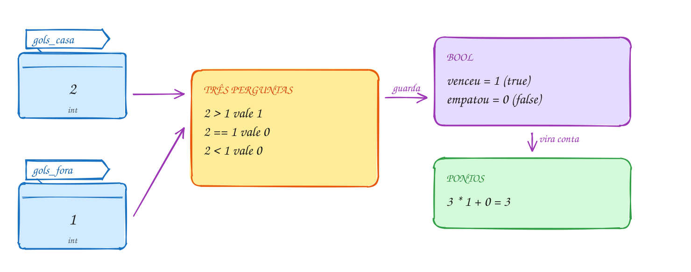
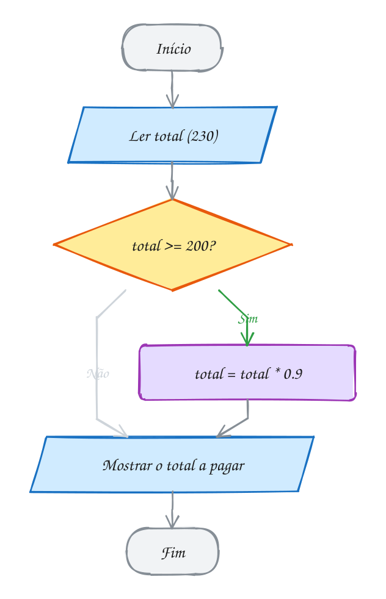
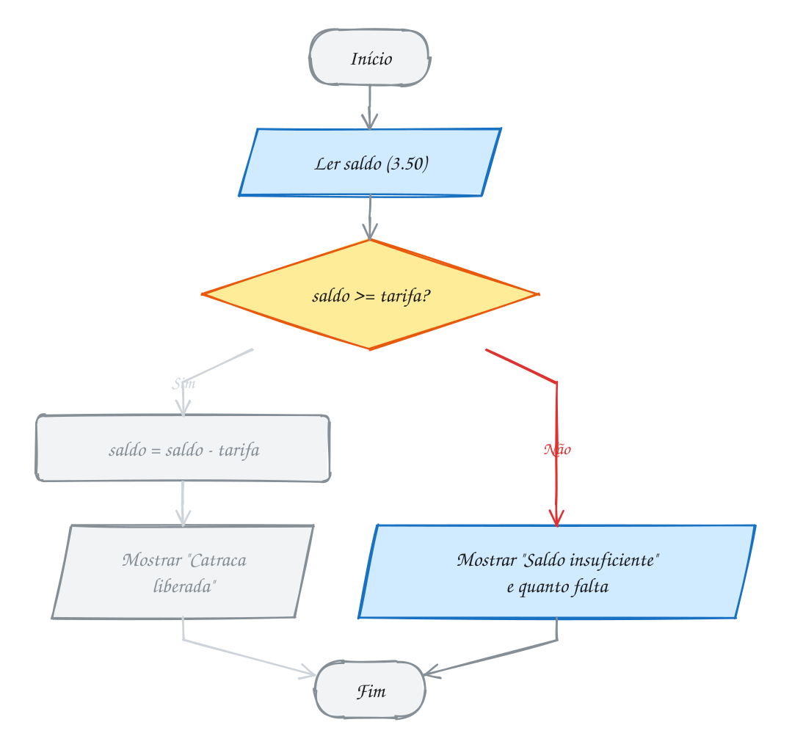
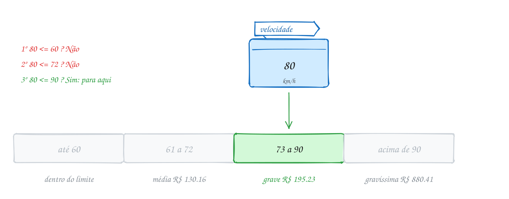
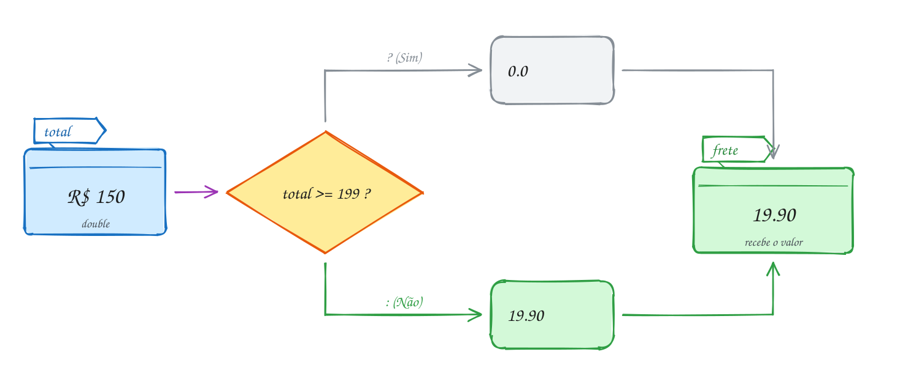
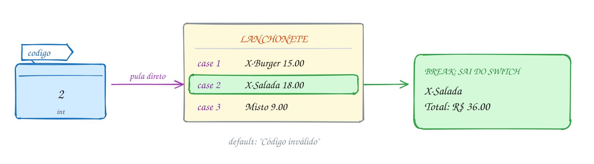
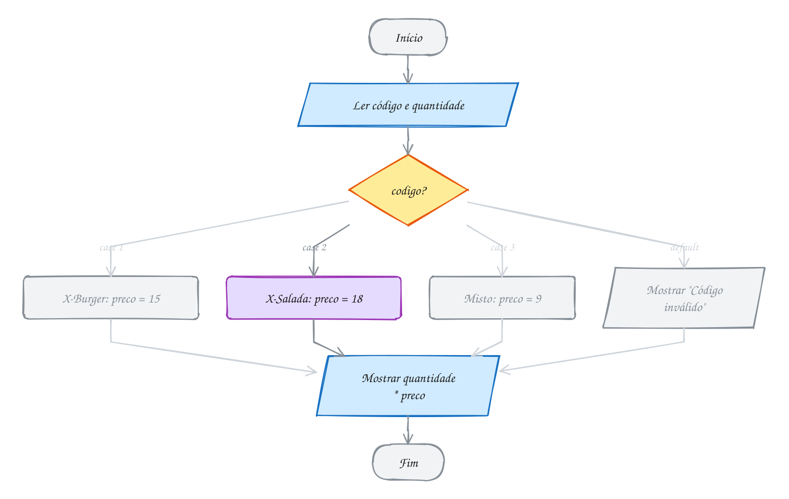

<!-- Gerado por _gerador. Para mudar este arquivo, edite _gerador/modulos/02-condicionais/ e rode: cd _gerador && npm run gerar -->

# Módulo 02 · Decisões

> [!IMPORTANT]
> **Mundo 1 · Primeiros passos · Rota do jogo: etapa 2 de 29**
>
> **Missão:** fazer o programa escolher caminhos com `if`, `else` e `switch`.
>
> **Vem de:** [Módulo 01 · Fundamentos de C](01-fundamentos.md). **Segue para:** [Módulo 03 · Laços](03-repeticoes.md).
>
> **Checkpoints desta fase:**
> - [ ] Ler os assuntos 0012 a 0019 e refazer os exemplos
> - [ ] Resolver os 4 exercícios de cada assunto, escrevendo o código sozinho
> - [ ] Fechar a lista prática (P0201 a P0230)
> - [ ] Enfrentar os desafios do módulo
> - [ ] Chefão: resolver as questões de prova do módulo sem consultar

A segunda peça de todo algoritmo: o programa **escolhe** um caminho. O módulo
cobre relacionais e lógicos, `if`, `if/else`, `else if`, o ternário e o
`switch`, com as pegadinhas que compilam e erram em silêncio. Depende do
módulo 01 (variáveis, `scanf` e seu retorno, `%`, `math.h`) e prepara o 03.

## O que você vai aprender

- **operadores relacionais** e a verdade em C: comparação vale 0 ou 1; `bool` de `<stdbool.h>`
- **operadores lógicos** `&&`, `||` e `!`, tabela-verdade, **curto-circuito** e De Morgan
- o **`if`**, as chaves e a armadilha do `;` depois da condição
- o **`if/else`** e a pegadinha do `=` no lugar de `==`
- **`else if`**, `if` aninhado e o **else pendurado**
- o **operador ternário**, a decisão que devolve um valor
- o **`switch`**, o `break` e o **fall-through**
- um programa que lê dados, valida a entrada e decide

## Antes de começar

Nos fluxogramas, o caminho verde mostra por onde o exemplo passou.

> [!TIP]
> Teste **cada caminho** e os **valores de fronteira**: se a regra é "a partir
> de R$ 200", teste 199,99, 200 e 200,01. A maioria dos erros de decisão é a
> troca de `>` por `>=`.

Os exercícios com teclado aceitam entrada por pipe, o que facilita testar
vários casos:

```bash
gcc ~/LPEDC/material/A028.c -o ~/LPEDC/material/A028 && printf '12.90 8.50\n' | ~/LPEDC/material/A028
```

Os exercícios "ache o erro" trazem código quebrado **de propósito** e mostram
avisos; o enunciado avisa quando é o caso. Nos demais, **zero avisos**.

| # | Assunto |
| --- | --- |
| [0012](#0012--relacionais-e-a-verdade-em-c) | Relacionais e a verdade em C |
| [0013](#0013--lógicos-e-ou-não) | Lógicos: E, OU, NÃO |
| [0014](#0014--if) | if |
| [0015](#0015--ifelse-e-o--no-lugar-do-) | if/else e o = no lugar do == |
| [0016](#0016--else-if-if-aninhado-e-o-else-pendurado) | else if, if aninhado e o else pendurado |
| [0017](#0017--ternário-condição--a--b) | Ternário: condição ? a : b |
| [0018](#0018--switch-case-break-e-fall-through) | switch, case, break e fall-through |
| [0019](#0019--juntando-tudo-a-conta-de-luz) | Juntando tudo: a conta de luz |

---

## 1. Conceitos gerais

### 0012 · Relacionais e a verdade em C

- **Operadores relacionais**: `>`, `<`, `>=`, `<=`, `==` (igual, dois sinais)
  e `!=` (diferente). Toda decisão começa numa comparação
  (DEITEL; DEITEL, 2011, cap. 2).
- **Comparação vale número**: um `int`, **1** se é verdade e **0** se é
  mentira. Dá para mostrar com `%d`, somar e multiplicar
  (KERNIGHAN; RITCHIE, 1988, cap. 2).
- **Verdade em C**: na condição, **0 é falso e qualquer outro valor é
  verdadeiro** (1, 42, -3, 0.5). `if (num)` é `if (num != 0)`
  (BACKES, 2013, cap. 3).
- **`bool`**: o `<stdbool.h>` do C99 dá `bool`, `true` (1) e `false` (0). Todo
  valor diferente de zero vira `true`: `bool b = 42;` guarda 1
  (BACKES, 2013, cap. 3).
- **Erros de escrita**: `=<`, `=>` e `<>` não existem; `= =` com espaço também
  não. `=` sozinho é **atribuição**: leia `=` como "recebe" e `==` como "é
  igual a" (DEITEL; DEITEL, 2011, cap. 2).

| Operador | Pergunta | Com o placar 2 x 1 |
| --- | --- | --- |
| `>` | maior que? | `2 > 1` vale 1 |
| `<` | menor que? | `2 < 1` vale 0 |
| `>=` | maior ou igual? | `2 >= 1` vale 1 |
| `<=` | menor ou igual? | `2 <= 1` vale 0 |
| `==` | igual? (dois sinais!) | `2 == 1` vale 0 |
| `!=` | diferente? | `2 != 1` vale 1 |

> [!WARNING]
> **Não compare `float` ou `double` com `==`.** `0.1 + 0.2 == 0.3` vale **0**:
> a soma dá 0.30000000000000004. Pergunte se estão perto o bastante,
> `fabs(a - b) < 1e-9`, ou guarde dinheiro em **centavos** num `int`.

### 0013 · Lógicos: E, OU, NÃO

- **Operadores lógicos**: `a && b` (**E**) é verdade só se as duas forem;
  `a || b` (**OU**) é verdade se pelo menos uma for; `!a` (**NÃO**) inverte. O
  resultado é um `int` 0 ou 1 (DEITEL; DEITEL, 2011, cap. 4).
- **Intervalo**: 18 ≤ idade ≤ 65 vira `idade >= 18 && idade <= 65`. Escrever
  `18 <= idade <= 65` compila, mas compara o 0 ou 1 da primeira parte com 65
  (BACKES, 2013, cap. 3).
- **Precedência**, da mais forte para a mais fraca: `!`, aritméticos,
  relacionais, igualdade, `&&` e por último `||`. `a || b && c` é
  `a || (b && c)` (KERNIGHAN; RITCHIE, 1988, cap. 2).
- **Curto-circuito**: o C avalia da esquerda para a direita e **para assim que
  sabe a resposta**. Em `a && b`, se `a` é falso, `b` nem é calculado; em
  `a || b`, se `a` é verdade, `b` é pulado. Assim,
  `n != 0 && total / n > 3` nunca divide por zero (DEITEL; DEITEL, 2011, cap. 4).
- **De Morgan**: o NÃO entra nos parênteses e troca E por OU. `!(a && b)` é
  `!a || !b`, e `!(a || b)` é `!a && !b` (DEITEL; DEITEL, 2011, cap. 4).

| `a` | `b` | `a && b` | `a \|\| b` | `!a` |
| --- | --- | --- | --- | --- |
| 0 | 0 | 0 | 0 | 1 |
| 0 | 1 | 0 | 1 | 1 |
| 1 | 0 | 0 | 1 | 0 |
| 1 | 1 | 1 | 1 | 0 |

> [!WARNING]
> **`&` não é `&&`.** O `&` é o E **bit a bit** (0065): sem curto-circuito e
> com precedência **menor** que a do `==`. `if (x & 1 == 0)` vira
> `x & (1 == 0)`, sempre 0. O `-Wall` avisa: "suggest parentheses".

### 0014 · if

- **`if`**: a **seleção simples**. Com a condição verdadeira, roda o bloco;
  com ela falsa, pula o bloco e segue. Um passo extra ou nada
  (DEITEL; DEITEL, 2011, cap. 3).

```c
if (condição) {
    // só roda quando a condição é verdadeira
}
// daqui em diante roda sempre
```

- **Condição**: entre parênteses, qualquer expressão numérica: comparação,
  combinação lógica ou variável sozinha. Zero é falso, o resto é verdade:
  `if (saldo)` é `if (saldo != 0)` (BACKES, 2013, cap. 4).
- **Bloco**: as chaves agrupam quantas instruções quiser. Sem chaves, o `if`
  controla **uma** instrução só, a primeira depois dele
  (BACKES, 2013, cap. 4).

```c
if (total >= 200)
    total = total * 0.9;   // depende do if
printf("Pronto\n");        // NÃO depende, apesar de qualquer recuo
```

- **Recuo**: só para quem lê; o compilador o ignora. Por isso o curso usa
  **chaves sempre**, mesmo com uma linha só (KERNIGHAN; RITCHIE, 1988, cap. 3).

> [!WARNING]
> **O `;` depois do `if` mata a condição.** Em `if (total >= 200);`, o `;` é
> uma **instrução vazia** e vira o corpo; o bloco seguinte roda **sempre**. O
> `-Wextra` avisa ("suggest braces around empty body").

### 0015 · if/else e o = no lugar do ==

- **`if/else`**: a **seleção dupla**. Exatamente um dos dois blocos roda,
  nunca os dois e nunca nenhum (DEITEL; DEITEL, 2011, cap. 3).

```c
if (condição) {
    // caminho do Sim
} else {
    // caminho do Não
}
```

- **`else` sem condição**: é "todo o resto". `else (saldo < 5)` é erro; outra
  pergunta vira um novo `if` (0016) (BACKES, 2013, cap. 4).
- **Chaves e `;`**: sem chaves, o `else` controla uma instrução só. Em
  `if (c); { ... } else { ... }`, o `else` fica sem `if` e não compila
  (DEITEL; DEITEL, 2011, cap. 3).
- **Atribuição é expressão**: vale o valor guardado. Por isso `if (saldo = 0)`
  **guarda 0** e testa esse 0, que é falso; `if (opcao = 1)` é sempre verdade
  (DEITEL; DEITEL, 2011, cap. 4).
- **Avisos**: o `-Wall` acusa "suggest parentheses around assignment used as
  truth value". Código bom compila com zero avisos (GNU, s.d.).

> [!WARNING]
> **`=` no lugar de `==`** compila e erra em silêncio: com `if (saldo = 0)`, o
> saldo vira zero e o `else` roda sempre. Compile com `-Wall` ou escreva a
> constante à esquerda: `0 = saldo` não compila.

### 0016 · else if, if aninhado e o else pendurado

- **`else if`**: encadeia perguntas para mais de dois caminhos; só um vale
  (DEITEL; DEITEL, 2011, cap. 3).

```c
if (velocidade <= 60) {
    // dentro do limite
} else if (velocidade <= 72) {
    // média
} else if (velocidade <= 90) {
    // grave
} else {
    // gravíssima
}
```

- **Primeiro Sim**: o C testa de cima para baixo e **para no primeiro Sim**.
  Ao chegar em `velocidade <= 72`, já se sabe que passou de 60: não precisa
  de `velocidade > 60 &&` (BACKES, 2013, cap. 4).
- **A ordem importa**: com `velocidade <= 90` no topo, 65 km/h viraria
  "grave". Percorra as faixas num sentido só. O `else` final é opcional e pega
  o que sobrou (DEITEL; DEITEL, 2011, cap. 3).
- **`if` aninhado**: um `if` dentro do bloco de outro, para a pergunta que só
  faz sentido depois de um Sim. O `else if` não é palavra-chave: é um `else`
  cuja única instrução é um `if` (KERNIGHAN; RITCHIE, 1988, cap. 3).
- **Else pendurado**: sem chaves, o `else` pertence ao `if` **mais próximo**
  que ainda não tem `else`, não importa o recuo (BACKES, 2013, cap. 4).

> [!WARNING]
> **O `else` pendurado.** O recuo engana:
>
> ```c
> if (pessoas > 0)
>     if (pessoas == 1)
>         printf("Mesa para um.\n");
> else
>     printf("Restaurante vazio.\n");
> ```
>
> O `else` é do segundo `if`: com 4 pessoas aparece "Restaurante vazio.". O
> `-Wall` avisa; a cura são **chaves** em volta do `if` de dentro.

### 0017 · Ternário: condição ? a : b

- **Operador ternário**: o único do C com três partes. Escolhe um entre dois
  valores (DEITEL; DEITEL, 2011, cap. 3).

```c
condição ? valor_se_verdade : valor_se_falso
```

- **É expressão**: ao contrário do `if`, **devolve um valor**. Cabe à direita
  de uma atribuição, num `printf` ou no meio de uma conta
  (BACKES, 2013, cap. 4).

```c
double frete = total >= 199 ? 0.0 : 19.90;   // escolhe um valor
printf("%s\n", qtd == 1 ? "item" : "itens"); // escolhe um texto
```

- **Só um lado roda**: o C avalia a condição e depois um dos lados, como no
  curto-circuito. `b != 0 ? a / b : 0` nunca divide por zero
  (KERNIGHAN; RITCHIE, 1988, cap. 2).
- **Tipo comum**: os dois lados viram o mesmo tipo. Em `n > 0 ? n : 0.5`, com
  `n` inteiro, o resultado é `double` (KERNIGHAN; RITCHIE, 1988, cap. 2).
- **Associatividade**: desempata operadores da mesma linha da tabela, do mais
  forte ao mais fraco (a completa, com bits e ponteiros, está no 0170)
  (CPPREFERENCE, s.d.).
- **Quando usar**: para escolher **um valor**, com condição curta. Se cada lado
  faz várias coisas, ou os ternários se aninham, volte ao `if/else`.

| Operadores | Associatividade |
| --- | --- |
| `x++` `x--` (pós) | esquerda → direita |
| `!` `-x` `++x` `--x` `(tipo)` `sizeof` | direita → esquerda |
| `*` `/` `%` | esquerda → direita |
| `+` `-` | esquerda → direita |
| `<` `<=` `>` `>=` | esquerda → direita |
| `==` `!=` | esquerda → direita |
| `&&` | esquerda → direita |
| `\|\|` | esquerda → direita |
| `?:` | direita → esquerda |
| `=` `+=` `-=` `*=` `/=` `%=` | direita → esquerda |

> [!WARNING]
> **O ternário tem precedência baixíssima.** `40 - estudante ? 20 : 0` é
> `(40 - estudante) ? 20 : 0`, que dá 20 para todo mundo. Escreva
> `40 - (estudante ? 20 : 0)`: no meio de uma conta, ternário entre parênteses.

### 0018 · switch, case, break e fall-through

- **`switch`**: a **seleção múltipla**. Calcula a expressão uma vez e **pula
  direto** para o `case` de mesmo valor; o **`default`** pega o que não casou
  (DEITEL; DEITEL, 2011, cap. 4).

```c
switch (codigo) {
case 1:
    // código igual a 1
    break;
case 2:
    // código igual a 2
    break;
default:
    // nenhum dos anteriores
}
```

- **Expressão inteira**: `int`, `char` ou parecido. `double` e texto não
  compilam (DEITEL; DEITEL, 2011, cap. 4).
- **`case` constante**: valor conhecido na compilação (`case 2:`,
  `case 'S':`); `case x:` e `case > 10:` não valem, nem dois `case` iguais
  (KERNIGHAN; RITCHIE, 1988, cap. 3).
- **Fall-through**: o `case` é só um **rótulo** de entrada. Depois de entrar,
  o C executa **tudo para baixo**, atravessando os outros `case`, até um
  **`break`** ou o fim do `switch` (BACKES, 2013, cap. 4).
- **Fall-through de propósito**: `case` empilhados dividem o mesmo trecho
  (`case 'S': case 's':`). Com código no meio, avise com `// fall through`,
  que o gcc reconhece (GNU, s.d.).

> [!WARNING]
> **Esquecer o `break`.** Sem o do `case 2`, pedir X-Salada mostra também
> "Misto quente" e o preço vira **9.00**. O compilador não vê erro; o
> `-Wextra` avisa ("this statement may fall through").

### 0019 · Juntando tudo: a conta de luz

- **Escolher a ferramenta**: valores exatos pedem `switch`; duas condições
  juntas, `if` com `&&`; um valor entre dois, ternário; faixas, `else if`
  (DEITEL; DEITEL, 2011, cap. 4).
- **Validar a entrada**: o `scanf` devolve quantos valores leu; com "abc" no
  lugar de um número, devolve 0. Confira antes de usar
  (BACKES, 2013, cap. 2).
- **Cláusula de guarda**: trate o caso ruim primeiro, avise e saia com
  `return 1` (o código de erro que `echo $?` mostra). O resto fica reto, sem
  um `else` gigante.
- **Tarifas simplificadas**: R$ 0,80 por kWh; bandeira amarela com R$ 0,02 a
  mais por kWh e vermelha com R$ 0,05; desconto social de 40%.

| Decisão | Ferramenta | Por quê |
| --- | --- | --- |
| a bandeira é V, A ou R? | `switch` | valores exatos de um `char` |
| tem tarifa social **e** consumo até 220 kWh? | `if` com `&&` | duas condições juntas, um passo a mais ou nada |
| iluminação: R$ 15 acima de 100 kWh, senão R$ 5 | ternário | escolhe **um valor** entre dois |
| consumo baixo, médio ou alto? | `else if` | faixas, testadas em ordem |
| a leitura deu certo e o consumo não é negativo? | `if` com `\|\|` | barra a entrada ruim logo no começo |

> [!WARNING]
> **A ordem dos passos é parte da regra.** O desconto vale sobre energia e
> bandeira, não sobre a iluminação. Teste um caso que passe por todos os
> ramos: 150 kWh, verde, social dá 120 + 0 - 48 + 15 = **R$ 87.00**.

---

## 2. Exemplos de uso

Cada exemplo compila sozinho. Rode com o comando abaixo dele e compare com a saída no fim do código.

### 0012 · Relacionais e a verdade em C

Fim de jogo, mandante 2 x 1 visitante. Os dois placares viram três perguntas,
cada resposta é 0 ou 1, e a tabela usa esses números direto na conta dos
pontos:

<p align="center"></p>

```c
#include <stdbool.h>
#include <stdio.h>

int main(void) {
    int gols_casa = 2;
    int gols_fora = 1;

    printf("casa >  fora? %d\n", gols_casa > gols_fora);
    printf("casa == fora? %d\n", gols_casa == gols_fora);
    printf("casa <  fora? %d\n", gols_casa < gols_fora);

    bool venceu = gols_casa > gols_fora;   // guarda a resposta: true
    bool empatou = gols_casa == gols_fora; // false

    int pontos = 3 * venceu + empatou;     // 3 * 1 + 0
    printf("Pontos do mandante: %d\n", pontos);
    return 0;
}
// Saída:
// casa >  fora? 1
// casa == fora? 0
// casa <  fora? 0
// Pontos do mandante: 3
```

O fluxograma não tem losango: comparar só **calcula** uma resposta e a guarda.
Quem escolhe o caminho é o `if` (0014):

<p align="center"></p>

**Exemplo A023 · A nota no limite e a contagem sem if**

```c
#include <stdbool.h>
#include <stdio.h>

int main(void) {
    double nota_ana = 7.0; // bem no limite da média
    double nota_bia = 6.9;
    double nota_caio = 8.5;

    // > e >= só discordam num caso: quando os dois lados são iguais
    printf("7.0 >  7? %d\n", nota_ana > 7);
    printf("7.0 >= 7? %d\n", nota_ana >= 7);

    bool ana = nota_ana >= 7;
    bool bia = nota_bia >= 7;
    bool caio = nota_caio >= 7;

    // cada bool vale 0 ou 1: somar conta quantos passaram
    int aprovados = ana + bia + caio;
    printf("Aprovados: %d de 3\n", aprovados);
    printf("Todos passaram? %d\n", aprovados == 3);
    printf("Alguém ficou de fora? %d\n", aprovados != 3);
    return 0;
}
// Saída:
// 7.0 >  7? 0
// 7.0 >= 7? 1
// Aprovados: 2 de 3
// Todos passaram? 0
// Alguém ficou de fora? 1
```

```bash
gcc ~/LPEDC/material/A023.c -o ~/LPEDC/material/A023 && ~/LPEDC/material/A023
```

**Exemplo A024 · Zero é falso, o resto é verdade**

```c
#include <math.h>
#include <stdbool.h>
#include <stdio.h>

int main(void) {
    int saldo = 250;
    bool tem_saldo = saldo; // 250 não é zero: vira true (1)
    bool zerado = 0;        // só o zero é falso
    bool negativo = -3;     // negativo também é verdade

    printf("tem_saldo = %d\n", tem_saldo);
    printf("zerado = %d\n", zerado);
    printf("negativo = %d\n", negativo);
    printf("sizeof(bool) = %zu byte\n", sizeof(bool));

    // char também é número: 'A' vale 65 e 'a' vale 97
    printf("'A' < 'a'? %d\n", 'A' < 'a');

    // número com vírgula: nunca compare com ==
    double soma = 0.1 + 0.2;
    printf("0.1 + 0.2 == 0.3? %d\n", soma == 0.3);
    printf("perto o bastante? %d\n", fabs(soma - 0.3) < 1e-9);
    return 0;
}
// Saída:
// tem_saldo = 1
// zerado = 0
// negativo = 1
// sizeof(bool) = 1 byte
// 'A' < 'a'? 1
// 0.1 + 0.2 == 0.3? 0
// perto o bastante? 1
```

```bash
gcc ~/LPEDC/material/A024.c -o ~/LPEDC/material/A024 -lm && ~/LPEDC/material/A024
```

### 0013 · Lógicos: E, OU, NÃO

No cinema, paga meia quem é estudante **ou** tem 60 anos ou mais, **e** a
sessão **não** é pré-estreia. Para uma pessoa de 67 anos, não estudante, numa
sessão comum, o OU dá verdade pela idade, o NÃO dá verdade e o E fecha com
meia-entrada:

<p align="center"></p>

```c
#include <stdbool.h>
#include <stdio.h>

int main(void) {
    int idade = 67;
    bool estudante = false;
    bool pre_estreia = false;

    // os parênteses são obrigatórios aqui: && vem antes de ||
    bool meia = (estudante || idade >= 60) && !pre_estreia;

    printf("Meia-entrada? %d\n", meia);
    printf("Ingresso: R$ %.2f\n", 40.0 - meia * 20.0);
    return 0;
}
// Saída:
// Meia-entrada? 1
// Ingresso: R$ 20.00
```

O C pergunta uma coisa de cada vez: como `estudante` é falso, olha a idade; se
fosse verdade, pularia direto para a pré-estreia. É o curto-circuito
desenhado:

<p align="center"></p>

**Exemplo A025 · Dentro, fora e "só um dos dois"**

```c
#include <stdbool.h>
#include <stdio.h>

int main(void) {
    int hora = 22;

    // dentro da faixa: um E de duas comparações
    bool comercial = hora >= 8 && hora < 18;
    // fora da faixa: um OU. É o NÃO do de cima, aberto por De Morgan:
    // !(hora >= 8 && hora < 18) vira hora < 8 || hora >= 18
    bool fora = hora < 8 || hora >= 18;
    printf("Horário comercial? %d\n", comercial);
    printf("Fora do horário?   %d\n", fora);

    // o C não tem um "OU exclusivo" lógico, mas com bool o != faz o papel:
    // verdade quando exatamente um dos dois é verdade
    bool cupom = true;
    bool primeira_compra = true;
    bool um_desconto_so = cupom != primeira_compra;
    bool algum_desconto = cupom || primeira_compra;
    printf("Algum desconto?    %d\n", algum_desconto);
    printf("Só um desconto?    %d\n", um_desconto_so);
    return 0;
}
// Saída:
// Horário comercial? 0
// Fora do horário?   1
// Algum desconto?    1
// Só um desconto?    0
```

```bash
gcc ~/LPEDC/material/A025.c -o ~/LPEDC/material/A025 && ~/LPEDC/material/A025
```

**Exemplo A026 · O curto-circuito protege a divisão**

```c
#include <stdbool.h>
#include <stdio.h>

int main(void) {
    int fatias = 24;
    int convidados = 0; // ninguém confirmou ainda

    // convidados != 0 deu falso: o && para ali e a divisão nem acontece
    bool sobra = convidados != 0 && fatias / convidados > 3;
    printf("Sobra pizza? %d\n", sobra);

    // o lado direito do || só roda se o esquerdo for falso
    int chamadas = 0;
    bool muita = fatias > 10 || ++chamadas > 0;
    printf("muita = %d, chamadas = %d\n", muita, chamadas);

    // De Morgan: !(a || b) é o mesmo que !a && !b
    bool chovendo = false;
    bool frio = true;
    printf("!(chovendo || frio) = %d\n", !(chovendo || frio));
    printf("!chovendo && !frio  = %d\n", !chovendo && !frio);
    return 0;
}
// Saída:
// Sobra pizza? 0
// muita = 1, chamadas = 0
// !(chovendo || frio) = 0
// !chovendo && !frio  = 0
```

```bash
gcc ~/LPEDC/material/A026.c -o ~/LPEDC/material/A026 && ~/LPEDC/material/A026
```

### 0014 · if

No mercado, compras a partir de R$ 200 ganham 10% de desconto. Entram
R$ 230, a resposta é Sim e o valor final é R$ 207; com Não, a seta cinza iria
direto ao final (`%%` mostra um `%` no `printf`):

<p align="center"></p>

```c
#include <stdio.h>

int main(void) {
    double total = 230.0;

    printf("Total: R$ %.2f\n", total);
    if (total >= 200) {
        total = total * 0.9; // 10% de desconto
        printf("Desconto de 10%% aplicado!\n");
    }
    printf("A pagar: R$ %.2f\n", total);
    return 0;
}
// Saída:
// Total: R$ 230.00
// Desconto de 10% aplicado!
// A pagar: R$ 207.00
```

A saída Não do losango não faz nada: vai direto ao "Mostrar", onde o Sim chega
depois do desconto:

<p align="center"></p>

**Exemplo A027 · Avisos independentes no painel do carro**

```c
#include <stdbool.h>
#include <stdio.h>

// Três if seguidos, sem else: cada pergunta é feita, não importa o que as
// outras responderam. Pode acender nenhum aviso, um, dois ou os três.
int main(void) {
    int combustivel = 12; // porcentagem do tanque
    bool porta_aberta = true;
    int km_revisao = 0;   // quilômetros até a próxima revisão

    if (combustivel < 15) {
        printf("Aviso: tanque na reserva (%d%%).\n", combustivel);
    }
    if (porta_aberta) { // a variável sozinha: verdade se não for zero
        printf("Aviso: porta aberta.\n");
    }
    if (!km_revisao) {  // o mesmo que km_revisao == 0
        printf("Aviso: hora da revisão.\n");
    }
    printf("Boa viagem!\n");
    return 0;
}
// Saída:
// Aviso: tanque na reserva (12%).
// Aviso: porta aberta.
// Aviso: hora da revisão.
// Boa viagem!
```

```bash
gcc ~/LPEDC/material/A027.c -o ~/LPEDC/material/A027 && ~/LPEDC/material/A027
```

**Exemplo A028 · Dois preços em ordem**

```c
#include <stdio.h>

// Um if com um bloco de três instruções: a troca só acontece se precisar.
int main(void) {
    double preco1, preco2;

    printf("Dois preços: ");
    if (scanf("%lf %lf", &preco1, &preco2) != 2) { // leu os dois números?
        printf("Entrada inválida\n");
        return 1;
    }

    if (preco1 > preco2) {
        double aux = preco1; // guarda o primeiro antes de perder
        preco1 = preco2;
        preco2 = aux;
    }
    printf("Mais barato: R$ %.2f\n", preco1);
    printf("Mais caro:   R$ %.2f\n", preco2);
    return 0;
}
// Dois preços: 12.90 8.50
// Mais barato: R$ 8.50
// Mais caro:   R$ 12.90
```

```bash
gcc ~/LPEDC/material/A028.c -o ~/LPEDC/material/A028 && ~/LPEDC/material/A028
```

### 0015 · if/else e o = no lugar do ==

Na catraca do metrô, o cartão tem R$ 3,50 e a tarifa é R$ 5,00. A resposta é
Não, e o caminho de baixo é o que vale:

<p align="center"></p>

```c
#include <stdio.h>

int main(void) {
    double saldo = 3.50;
    double tarifa = 5.00;

    if (saldo >= tarifa) {
        saldo = saldo - tarifa;
        printf("Catraca liberada. Saldo: R$ %.2f\n", saldo);
    } else {
        printf("Saldo insuficiente.\n");
        printf("Faltam R$ %.2f\n", tarifa - saldo);
    }
    return 0;
}
// Saída:
// Saldo insuficiente.
// Faltam R$ 1.50
```

Cada lado do losango tem seu bloco, e os dois se reencontram no Fim:

<p align="center"></p>

**Exemplo A029 · O estacionamento e a constante à esquerda**

```c
#include <stdio.h>

int main(void) {
    int horas = 5;
    int vagas_livres = 0;
    double valor;

    // os dois caminhos guardam o resultado na mesma variável
    if (horas <= 3) {
        valor = 12.0;                      // preço fechado até 3 horas
    } else {
        valor = 12.0 + (horas - 3) * 4.0;  // R$ 4 por hora a mais
    }
    printf("%d horas: R$ %.2f\n", horas, valor); // roda depois de qualquer lado

    // constante à esquerda: se esquecer um =, "0 = vagas_livres" nem compila
    if (0 == vagas_livres) {
        printf("Placa na entrada: LOTADO\n");
    } else {
        printf("Placa na entrada: %d vagas\n", vagas_livres);
    }
    return 0;
}
// Saída:
// 5 horas: R$ 20.00
// Placa na entrada: LOTADO
```

```bash
gcc ~/LPEDC/material/A029.c -o ~/LPEDC/material/A029 && ~/LPEDC/material/A029
```

**Exemplo A030 · Par ou ímpar no palitinho**

```c
#include <stdio.h>

int main(void) {
    int dedos_ana = 3;  // Ana pediu par
    int dedos_beto = 4; // Beto pediu ímpar
    int soma = dedos_ana + dedos_beto;

    printf("Soma: %d\n", soma);
    if (soma % 2 == 0) { // resto 0 na divisão por 2: par
        printf("Deu par. Ana ganhou!\n");
    } else {             // sem condição: é todo o resto
        printf("Deu ímpar. Beto ganhou!\n");
    }
    return 0;
}
// Saída:
// Soma: 7
// Deu ímpar. Beto ganhou!
```

```bash
gcc ~/LPEDC/material/A030.c -o ~/LPEDC/material/A030 && ~/LPEDC/material/A030
```

### 0016 · else if, if aninhado e o else pendurado

O radar da avenida tem limite de 60 km/h e você passou a 80. As faixas saem
do limite: 80 <= 60? Não. <= 72? Não. <= 90? Sim, e a busca para ali:

<p align="center"></p>

```c
#include <stdio.h>

int main(void) {
    int limite = 60;
    int velocidade = 80;
    int faixa_media = limite + limite / 5; // 72: até 20% acima
    int faixa_grave = limite + limite / 2; // 90: até 50% acima

    if (velocidade <= limite) {
        printf("Dentro do limite. Boa viagem!\n");
    } else if (velocidade <= faixa_media) {
        printf("Infração média: R$ 130.16\n");
    } else if (velocidade <= faixa_grave) {
        printf("Infração grave: R$ 195.23\n");
    } else {
        printf("Infração gravíssima: R$ 880.41\n");
    }
    return 0;
}
// Saída:
// Infração grave: R$ 195.23
```

O fluxograma é uma escada de losangos, cada um no Não do anterior; os de baixo
do primeiro Sim não são visitados:

<p align="center"></p>

**Exemplo A031 · FizzBuzz e a ordem que importa**

```c
#include <stdio.h>

// Aqui as condições não são faixas: um número pode cumprir várias ao mesmo
// tempo. Como o else if para no primeiro Sim, a mais exigente vem primeiro.
int main(void) {
    int n = 15; // divisível por 3 e por 5

    printf("Ordem certa:  ");
    if (n % 3 == 0 && n % 5 == 0) {
        printf("FizzBuzz\n");
    } else if (n % 3 == 0) {
        printf("Fizz\n");
    } else if (n % 5 == 0) {
        printf("Buzz\n");
    } else {
        printf("%d\n", n);
    }

    printf("Ordem errada: ");
    if (n % 3 == 0) { // 15 já para aqui: o FizzBuzz nunca é testado
        printf("Fizz\n");
    } else if (n % 5 == 0) {
        printf("Buzz\n");
    } else if (n % 3 == 0 && n % 5 == 0) {
        printf("FizzBuzz\n");
    } else {
        printf("%d\n", n);
    }
    return 0;
}
// Saída:
// Ordem certa:  FizzBuzz
// Ordem errada: Fizz
```

```bash
gcc ~/LPEDC/material/A031.c -o ~/LPEDC/material/A031 && ~/LPEDC/material/A031
```

**Exemplo A032 · Login com if aninhado**

```c
#include <stdbool.h>
#include <stdio.h>

// A pergunta da senha só faz sentido se o usuário existir: um if dentro do
// outro. As chaves deixam claro de qual if é cada else.
int main(void) {
    bool usuario_existe = true;
    int senha_certa = 4821;
    int senha_digitada = 4812; // dois dígitos trocados

    if (usuario_existe) {
        if (senha_digitada == senha_certa) {
            printf("Bem-vindo!\n");
        } else {
            printf("Senha errada.\n");
        }
    } else {
        printf("Usuário não encontrado.\n");
    }
    return 0;
}
// Saída:
// Senha errada.
```

```bash
gcc ~/LPEDC/material/A032.c -o ~/LPEDC/material/A032 && ~/LPEDC/material/A032
```

### 0017 · Ternário: condição ? a : b

No carrinho da loja, o frete é zero acima de R$ 199. Entram R$ 150, "passou
de 199?" é Não, e o ternário devolve 19.90 para a caixinha `frete`:

<p align="center"></p>

```c
#include <stdio.h>

int main(void) {
    int qtd = 3;
    double total = 150.0;

    double frete = total >= 199 ? 0.0 : 19.90;

    printf("%d %s no carrinho\n", qtd, qtd == 1 ? "item" : "itens");
    printf("Frete: R$ %.2f\n", frete);
    printf("Total: R$ %.2f\n", total + frete);
    return 0;
}
// Saída:
// 3 itens no carrinho
// Frete: R$ 19.90
// Total: R$ 169.90
```

O desenho é um `if/else` em que cada lado só guarda um valor na mesma
variável; um ternário resolve isso em uma linha:

<p align="center"></p>

**Exemplo A033 · O ternário que protege a divisão**

```c
#include <stdio.h>

int main(void) {
    int vendido = 0; // o food truck ainda não abriu
    int dias = 0;

    // só um dos lados é calculado: com dias == 0, a divisão nem acontece
    double media = dias != 0 ? (double) vendido / dias : 0.0;
    printf("Média por dia: R$ %.2f\n", media);
    printf("Situação: %s\n", dias != 0 ? "funcionando" : "ainda não abriu");

    // os dois lados viram um tipo comum: int com double dá double
    int pedidos = 3;
    printf("Fator: %.1f\n", pedidos > 0 ? pedidos : 0.5); // sai 3.0, não 3

    // no meio de uma conta, o ternário vai entre parênteses
    double taxa = 5.0 + (pedidos > 2 ? 2.5 : 0.0);
    printf("Taxa de entrega: R$ %.2f\n", taxa);
    return 0;
}
// Saída:
// Média por dia: R$ 0.00
// Situação: ainda não abriu
// Fator: 3.0
// Taxa de entrega: R$ 7.50
```

```bash
gcc ~/LPEDC/material/A033.c -o ~/LPEDC/material/A033 && ~/LPEDC/material/A033
```

**Exemplo A034 · Maior, distância do zero e verdade em texto**

```c
#include <stdbool.h>
#include <stdio.h>

int main(void) {
    int preco_a = 14;
    int preco_b = 31;
    int temperatura = -3;
    bool chuva = true;

    int maior = preco_a > preco_b ? preco_a : preco_b;
    int distancia = temperatura < 0 ? -temperatura : temperatura;

    printf("Maior preço: R$ %d\n", maior);
    printf("Distância do zero: %d graus\n", distancia);
    printf("Vai chover? %s\n", chuva ? "true" : "false"); // texto no lugar de 1 ou 0

    // ternário dentro de ternário: funciona, mas já começa a pesar
    printf("Temperatura %s\n",
           temperatura > 0 ? "positiva" : temperatura < 0 ? "negativa" : "zero");
    return 0;
}
// Saída:
// Maior preço: R$ 31
// Distância do zero: 3 graus
// Vai chover? true
// Temperatura negativa
```

```bash
gcc ~/LPEDC/material/A034.c -o ~/LPEDC/material/A034 && ~/LPEDC/material/A034
```

### 0018 · switch, case, break e fall-through

Na lanchonete, 1 é X-Burger, 2 é X-Salada, 3 é Misto quente. O código 2
entra, o `switch` pula direto para o `case 2`, sem testar o 1 nem o 3, e o
`break` sai antes do `case 3`:

<p align="center"></p>

```c
#include <stdio.h>

int main(void) {
    int codigo = 2;
    int quantidade = 2;
    double preco = 0;

    switch (codigo) {
    case 1:
        printf("X-Burger\n");
        preco = 15.00;
        break;
    case 2:
        printf("X-Salada\n");
        preco = 18.00;
        break; // sem ele, cairia no case 3
    case 3:
        printf("Misto quente\n");
        preco = 9.00;
        break;
    default:
        printf("Código inválido\n");
    }
    printf("Total: R$ %.2f\n", quantidade * preco);
    return 0;
}
// Saída:
// X-Salada
// Total: R$ 36.00
```

O losango do `switch` tem **várias** saídas, uma por `case` e uma para o
`default`; as setas levam o valor no lugar de Sim e Não:

<p align="center"></p>

**Exemplo A035 · Faixas de nota com a divisão inteira**

```c
#include <stdio.h>

// O switch só compara com valores exatos. Para usar faixas, transforme a
// faixa num número: 87 / 10 dá 8 na divisão inteira.
int main(void) {
    int nota = 87; // de 0 a 100
    char conceito;

    switch (nota / 10) {
    case 10: // 100 também é A
    case 9:
        conceito = 'A';
        break;
    case 8:
        conceito = 'B';
        break;
    case 7:
        conceito = 'C';
        break;
    default: // de 0 a 69
        conceito = 'D';
    }
    printf("Nota %d: conceito %c\n", nota, conceito);

    // char também é número: dá para fazer switch numa letra
    switch (conceito) {
    case 'A':
    case 'B':
        printf("Parabéns!\n");
        break;
    case 'C':
        printf("Passou raspando.\n");
        break;
    default:
        printf("Vai para a recuperação.\n");
    }
    return 0;
}
// Saída:
// Nota 87: conceito B
// Parabéns!
```

```bash
gcc ~/LPEDC/material/A035.c -o ~/LPEDC/material/A035 && ~/LPEDC/material/A035
```

**Exemplo A036 · Quantos dias tem o mês**

```c
#include <stdbool.h>
#include <stdio.h>

// Vários case empilhados dividem o mesmo código: é o fall-through do bem.
int main(void) {
    int mes = 2;
    int ano = 2024;
    int dias;

    switch (mes) {
    case 1:
    case 3:
    case 5:
    case 7:
    case 8:
    case 10:
    case 12:
        dias = 31;
        break;
    case 4:
    case 6:
    case 9:
    case 11:
        dias = 30;
        break;
    case 2: { // as chaves abrem um bloco: em C17, um rótulo não pode vir
              // colado numa declaração
        bool bissexto = (ano % 4 == 0 && ano % 100 != 0) || ano % 400 == 0;
        dias = bissexto ? 29 : 28;
        break;
    }
    default:
        dias = 0; // mês que não existe
    }

    if (dias == 0) {
        printf("Mês inválido.\n");
    } else {
        printf("O mês %d de %d tem %d dias.\n", mes, ano, dias);
    }
    return 0;
}
// Saída:
// O mês 2 de 2024 tem 29 dias.
```

```bash
gcc ~/LPEDC/material/A036.c -o ~/LPEDC/material/A036 && ~/LPEDC/material/A036
```

### 0019 · Juntando tudo: a conta de luz

A conta de luz do módulo 01 volta com decisões. Com 230 kWh, bandeira amarela
e sem tarifa social, cada decisão do módulo entra uma vez:

<p align="center"></p>

```c
#include <stdbool.h>
#include <stdio.h>

int main(void) {
    int consumo, resposta;
    char bandeira;

    printf("Consumo do mês (kWh): ");
    if (scanf("%d", &consumo) != 1 || consumo < 0) { // guarda
        printf("Consumo inválido.\n");
        return 1;
    }
    printf("Bandeira (V, A ou R): ");
    if (scanf(" %c", &bandeira) != 1) {
        printf("Bandeira inválida.\n");
        return 1;
    }
    printf("Tarifa social (1 = sim, 0 = não): ");
    if (scanf("%d", &resposta) != 1) {
        printf("Resposta inválida.\n");
        return 1;
    }
    bool social = resposta;

    double adicional; // por kWh, conforme a bandeira
    switch (bandeira) {
    case 'V':
    case 'v':
        adicional = 0.0;
        break;
    case 'A':
    case 'a':
        adicional = 0.02;
        break;
    case 'R':
    case 'r':
        adicional = 0.05;
        break;
    default:
        printf("Bandeira inválida.\n");
        return 1;
    }

    double energia = consumo * 0.80;
    double extra = consumo * adicional;
    double desconto = 0.0;
    if (social && consumo <= 220) {
        desconto = (energia + extra) * 0.40;
    }
    double iluminacao = consumo > 100 ? 15.0 : 5.0;
    double total = energia + extra - desconto + iluminacao;

    printf("Energia: R$ %.2f\n", energia);
    printf("Bandeira: R$ %.2f\n", extra);
    if (desconto > 0) {
        printf("Desconto social: -R$ %.2f\n", desconto);
    }
    printf("Iluminação pública: R$ %.2f\n", iluminacao);

    if (consumo <= 100) {
        printf("Consumo baixo.\n");
    } else if (consumo <= 300) {
        printf("Consumo médio.\n");
    } else {
        printf("Consumo alto.\n");
    }
    printf("Total: R$ %.2f\n", total);
    return 0;
}
// Consumo do mês (kWh): 230
// Bandeira (V, A ou R): A
// Tarifa social (1 = sim, 0 = não): 0
// Energia: R$ 184.00
// Bandeira: R$ 4.60
// Iluminação pública: R$ 15.00
// Consumo médio.
// Total: R$ 203.60
```

A guarda tem uma saída direta para o Fim. Depois dela, o caminho é quase reto,
com um único desvio opcional para o desconto:

<p align="center"></p>

**Exemplo A037 · A situação no fim do semestre**

```c
#include <stdbool.h>
#include <stdio.h>

int main(void) {
    double nota1 = 6.5;
    double nota2 = 8.0;
    int frequencia = 80; // porcentagem de presença

    // guarda: dado impossível sai logo
    if (nota1 < 0 || nota1 > 10 || nota2 < 0 || nota2 > 10 ||
        frequencia < 0 || frequencia > 100) {
        printf("Dados inválidos.\n");
        return 1;
    }

    double media = (nota1 + nota2) / 2;
    bool presente = frequencia >= 75;
    printf("Média: %.2f\n", media);
    printf("Frequência: %d%% (%s)\n", frequencia, presente ? "ok" : "abaixo de 75%");

    if (!presente) { // a falta reprova antes de olhar a nota
        printf("Reprovado por falta.\n");
    } else if (media >= 7) {
        printf("Aprovado.\n");
    } else if (media >= 4) {
        printf("Recuperação: precisa de %.2f na prova final.\n", 10 - media);
    } else {
        printf("Reprovado por nota.\n");
    }

    switch ((int) media) { // o cast corta as casas: 7.25 vira 7
    case 10:
    case 9:
        printf("Menção: excelente\n");
        break;
    case 8:
    case 7:
        printf("Menção: bom\n");
        break;
    default:
        printf("Menção: precisa melhorar\n");
    }
    return 0;
}
// Saída:
// Média: 7.25
// Frequência: 80% (ok)
// Aprovado.
// Menção: bom
```

```bash
gcc ~/LPEDC/material/A037.c -o ~/LPEDC/material/A037 && ~/LPEDC/material/A037
```

**Exemplo A038 · Pedra, papel e tesoura**

```c
#include <stdbool.h>
#include <stdio.h>

// P = pedra, A = papel, T = tesoura. Pedra quebra tesoura, tesoura corta
// papel, papel embrulha pedra.
int main(void) {
    char j1 = 'P';
    char j2 = 'T';

    bool valida1 = j1 == 'P' || j1 == 'A' || j1 == 'T';
    bool valida2 = j2 == 'P' || j2 == 'A' || j2 == 'T';
    if (!valida1 || !valida2) { // guarda: jogada que não existe
        printf("Jogada inválida.\n");
        return 1;
    }

    printf("Jogador 1: %s\n", j1 == 'P' ? "pedra" : j1 == 'A' ? "papel" : "tesoura");
    printf("Jogador 2: %s\n", j2 == 'P' ? "pedra" : j2 == 'A' ? "papel" : "tesoura");

    bool vence1 = (j1 == 'P' && j2 == 'T') ||
                  (j1 == 'T' && j2 == 'A') ||
                  (j1 == 'A' && j2 == 'P');

    if (j1 == j2) {
        printf("Empate!\n");
    } else if (vence1) {
        printf("Jogador 1 venceu!\n");
    } else {
        printf("Jogador 2 venceu!\n");
    }
    return 0;
}
// Saída:
// Jogador 1: pedra
// Jogador 2: tesoura
// Jogador 1 venceu!
```

```bash
gcc ~/LPEDC/material/A038.c -o ~/LPEDC/material/A038 && ~/LPEDC/material/A038
```

---

## 3. Exercícios práticos

Cada exercício é um arquivo em `material/` com o esqueleto, as dicas e o espaço para a resposta. Compile como os exemplos: `gcc ~/LPEDC/material/E007.c -o ~/LPEDC/material/E007 && ~/LPEDC/material/E007`. Resoluções em `_respostas/02-condicionais/`.

### 0012 · Relacionais e a verdade em C

**Exercício E067** · ★☆☆

No posto, a regra de bolso diz que o etanol compensa quando custa no
máximo 70% do preço da gasolina. Leia o preço do etanol e o da gasolina, nessa
ordem e sem mostrar perguntas, e guarde a resposta num bool. Mostre o bool com
%d (sem if: só a comparação).

```text
Entrada:
4.19
6.09
Saída esperada:
Etanol compensa? 1
```

**Exercício E069** · ★★☆

A loja cobra frete de R$ 24.90, mas só quando a compra é menor que
R$ 199.00. Leia o total da compra, sem mostrar pergunta, e calcule o frete SEM
usar if: multiplique 24.90 pelo 0 ou 1 de uma comparação. Mostre o frete e o
valor a pagar.

```text
Entrada:
150
Saída esperada:
Frete: R$ 24.90
A pagar: R$ 174.90
```

**Exercício E070** · ★★☆

A bala custa R$ 0,70 e a criança pagou com sete moedas de 10 centavos.
Escreva um programa com preco = 0.7 e pago = 0.1 * 7 (double). Mostre pago
com 20 casas e responda "Pagou o valor exato?" de dois jeitos: (a) comparando
os doubles com uma tolerância de 1e-9, usando fabs; (b) trabalhando com
centavos em int (70 e 7 * 10).

```text
Saída esperada:
pago = 0.70000000000000006661
Pagou o valor exato? 1
Pagou o valor exato? 1
```

```bash
gcc ~/LPEDC/material/E070.c -o ~/LPEDC/material/E070 -lm && ~/LPEDC/material/E070
```

**Exercício E072** · ★★★

Desconto progressivo, sem nenhum if: compras a partir de R$ 100 ganham
5%; a partir de R$ 300, ganham mais 5% (10% no total). Leia o total, sem
mostrar pergunta, calcule a porcentagem só com comparações e mostre o total,
o desconto e o valor a pagar.

```text
Entrada:
150
Saída esperada:
Total: R$ 150.00
Desconto: 5%
A pagar: R$ 142.50
```

### 0013 · Lógicos: E, OU, NÃO

**Exercício E073** · ★☆☆

Monte a tabela-verdade no terminal. Para cada uma das quatro combinações
de a e b (0 0, 0 1, 1 0, 1 1), dê os valores às duas variáveis e mostre
uma linha com a, b, a && b, a || b e !a, calculados pelo programa (nada de
digitar os resultados no printf). Primeiro vem a linha de títulos.

```text
Saída esperada:
a b | E OU NAO
0 0 | 0 0  1
0 1 | 0 1  1
1 0 | 0 1  0
1 1 | 1 1  0
```

**Exercício E075** · ★★☆

Um ano é bissexto quando é divisível por 4 e não por 100, ou quando é
divisível por 400. Leia o ano, sem mostrar pergunta, e calcule a resposta numa
ÚNICA expressão, guardada num bool (sem if). Mostre o bool com %d.

```text
Entrada:
2024
Saída esperada:
Bissexto? 1
```

**Exercício E076** · ★★☆

Na portaria do show, a regra do "barrado" é !(idade >= 18 && tem_ingresso).
Leia a idade e depois 1 ou 0 para "tem ingresso", sem mostrar perguntas.
Calcule o barrado de duas formas: a original e uma reescrita por De Morgan, sem
o ! do lado de fora de parênteses. Mostre as duas lado a lado.

```text
Entrada:
16
1
Saída esperada:
barrado (original):  1
barrado (De Morgan): 1
```

**Exercício E077** · ★★★

O app do banco mostra se o gasto médio por dia passou de R$ 100. Leia o
gasto total e o número de dias (dois inteiros, em um scanf), sem mostrar
pergunta. gasto_alto é verdade quando a média (gasto / dias) passa de 100;
alerta é verdade quando não há dias registrados OU quando o gasto é alto.
Conta nova tem 0 dias: o programa não pode dividir por zero em nenhuma das
duas linhas. Sem if. Teste com 900 6 e com 900 0.

```text
Entrada:
900 6
Saída esperada:
Gasto alto? 1
Alerta? 1
```

```text
Entrada:
900 0
Saída esperada:
Gasto alto? 0
Alerta? 1
```

### 0014 · if

**Exercício E079** · ★☆☆

Leia a temperatura de uma pessoa, sem mostrar pergunta, e mostre sempre
o valor lido. Só se ela passar de 37.5, mostre também o aviso de febre.

```text
Entrada:
38.2
Saída esperada:
Temperatura: 38.2 °C
Febre! Procure um médico.
```

**Exercício E081** · ★★☆

O cinema barra menores de 18 anos neste filme. Leia a idade, sem mostrar
pergunta. Se for menor que 18, mostre "Entrada proibida para menores.". Para
todo mundo, mostre "Bom filme!" no final. Teste com 25 e com 15.

```text
Entrada:
25
Saída esperada:
Bom filme!
```

```text
Entrada:
15
Saída esperada:
Entrada proibida para menores.
Bom filme!
```

**Exercício E082** · ★★☆

Três lojas deram orçamento para a mesma geladeira. Leia os três valores
(inteiros, em reais, na mesma linha) e mostre o MAIOR, usando só if (sem
else).

```text
Entrada:
3200 3790 3450
Saída esperada:
Maior orçamento: R$ 3790
```

**Exercício E084** · ★★★

A conta de água da cidade funciona assim: até 10 m³, paga a tarifa mínima
de R$ 45.00. Cada m³ acima de 10 custa R$ 6.20. E, se o consumo passar de
30 m³, a conta inteira ganha 15% de multa por desperdício. Leia o consumo
(inteiro), sem mostrar pergunta, e mostre a conta. Use só if, sem else.

```text
Entrada:
18
Saída esperada:
Conta: R$ 94.60
```

### 0015 · if/else e o = no lugar do ==

**Exercício E085** · ★☆☆

Leia a idade, sem mostrar pergunta. Se for 18 ou mais, mostre "Maior de
idade."; senão, mostre quantos anos faltam para os 18.

```text
Entrada:
16
Saída esperada:
Faltam 2 ano(s) para a maioridade.
```

**Exercício E087** · ★★☆

O caixa eletrônico bloqueia o cartão na 3ª senha errada. Leia quantas
senhas erradas já foram digitadas, sem mostrar pergunta. Se forem 3, mostre
"Cartão bloqueado."; senão, mostre quantas tentativas restam (3 menos o
valor lido). No fim, para qualquer caso, mostre quantas tentativas foram
registradas. Teste com 1 e com 3.

```text
Entrada:
1
Saída esperada:
Senha errada. Restam 2 tentativa(s).
Tentativas registradas: 1
```

```text
Entrada:
3
Saída esperada:
Cartão bloqueado.
Tentativas registradas: 3
```

**Exercício E088** · ★★☆

No empréstimo consignado, a parcela não pode passar de 35% do salário.
Leia o salário e o valor da parcela, nessa ordem e sem mostrar perguntas.
Mostre o limite e se o empréstimo foi aprovado ("Aprovado!") ou negado.

```text
Entrada:
3000
1200
Saída esperada:
Limite da parcela: R$ 1050.00
Negado: a parcela passa do limite.
```

**Exercício E090** · ★★★

Bhaskara. Leia os coeficientes a, b e c de ax² + bx + c = 0 (suponha
a diferente de zero), sem mostrar pergunta. Calcule delta = b² - 4ac. Se
delta for negativo, mostre "Sem raízes reais."; senão, calcule e mostre as
duas raízes com duas casas (x1 com a raiz do delta somada, x2 subtraída).

```text
Entrada:
1 -5 6
Saída esperada:
x1 = 3.00
x2 = 2.00
```

```bash
gcc ~/LPEDC/material/E090.c -o ~/LPEDC/material/E090 -lm && ~/LPEDC/material/E090
```

### 0016 · else if, if aninhado e o else pendurado

**Exercício E091** · ★☆☆

O plano de saúde cobra por faixa de idade: até 18 anos, R$ 150; de 19 a
38, R$ 280; de 39 a 58, R$ 520; de 59 em diante, R$ 900. Leia a idade, sem
mostrar pergunta, e mostre a mensalidade usando uma cadeia de else if.

```text
Entrada:
45
Saída esperada:
Mensalidade: R$ 520.00
```

**Exercício E093** · ★★☆

O assistente do celular lê duas respostas, cada uma 1 ou 0: você vai sair?
Vai chover? Quem vai sair e vê chuva lê "Leve o guarda-chuva."; quem NÃO vai
sair lê "Fique em casa e descanse."; quem vai sair sem chuva não lê nenhum
dos dois. Todo mundo lê "Bom dia!" no fim. Leia as duas respostas em um
scanf, sem mostrar pergunta, e use chaves em todos os blocos. Teste com
0 1, 1 0 e 1 1.

```text
Entrada:
0 1
Saída esperada:
Fique em casa e descanse.
Bom dia!
```

```text
Entrada:
1 0
Saída esperada:
Bom dia!
```

```text
Entrada:
1 1
Saída esperada:
Leve o guarda-chuva.
Bom dia!
```

**Exercício E094** · ★★☆

Leia a nota (real), sem mostrar pergunta, e mostre o conceito: A para
9 ou mais, B para 7 ou mais, C para 5 ou mais, D para abaixo de 5. Use uma
cadeia de else if. Teste com 9.5, 7.2, 5 e 3.

```text
Entrada:
9.5
Saída esperada:
Conceito A
```

```text
Entrada:
7.2
Saída esperada:
Conceito B
```

```text
Entrada:
5
Saída esperada:
Conceito C
```

```text
Entrada:
3
Saída esperada:
Conceito D
```

**Exercício E095** · ★★★

Leia três medidas inteiras (em cm), na mesma linha. Primeiro diga se
elas formam um triângulo: cada lado tem que ser menor que a soma dos outros
dois ("Não forma triângulo." se não). Se formarem, classifique: equilátero (3
lados iguais), isósceles (só 2 iguais) ou escaleno (todos diferentes).

```text
Entrada:
5 5 8
Saída esperada:
Triângulo isósceles.
```

### 0017 · Ternário: condição ? a : b

**Exercício E097** · ★☆☆

O ingresso do cinema custa R$ 40.00 para quem tem 18 anos ou mais e
R$ 20.00 para os menores. Leia a idade, sem mostrar pergunta, e guarde o
preço numa variável double em UMA linha, com o operador ternário (sem if).
Mostre o preço com duas casas.

```text
Entrada:
15
Saída esperada:
Ingresso: R$ 20.00
```

**Exercício E099** · ★★☆

Leia dois inteiros, a e b, sem mostrar pergunta, e mostre quatro linhas,
cada resultado saído de UM ternário (nada de if): a distância entre os dois
(o maior menos o menor); se a soma é "par" ou "ímpar"; o menor dos dois; e se
a é "divisível" ou "não divisível" por b. Com b igual a 0, a última linha
mostra "não dá para dividir por zero", sem calcular o resto. Teste com 2 5.

```text
Entrada:
2 5
Saída esperada:
Distância: 3
Soma: ímpar
Menor: 2
2 por 5: não divisível
```

**Exercício E100** · ★★☆

Leia três notas inteiras de jurados, na mesma linha, e mostre a maior,
usando só o operador ternário (nada de if).

```text
Entrada:
7 10 9
Saída esperada:
Maior nota: 10
```

**Exercício E102** · ★★★

Converta uma hora do formato 24 h (0 a 23) para o formato de 12 h com AM e
PM, usando ternários. Meia-noite é 12 AM e meio-dia é 12 PM. Se a hora não
estiver entre 0 e 23, mostre "Hora inválida." (pode usar um if para isso).
Teste com 13, 0 e 12.

```text
Entrada:
13
Saída esperada:
1 PM
```

```text
Entrada:
0
Saída esperada:
12 AM
```

```text
Entrada:
12
Saída esperada:
12 PM
```

### 0018 · switch, case, break e fall-through

**Exercício E103** · ★☆☆

Leia um número de 1 a 7, sem mostrar pergunta, e mostre o dia da semana
(1 é domingo, 7 é sábado). Qualquer outro número mostra "Dia inválido.". Use
switch.

```text
Entrada:
4
Saída esperada:
Quarta-feira
```

**Exercício E105** · ★★☆

O atendimento por telefone do banco tem um menu de teclas: 1 mostra
"Consultar saldo."; 2 mostra "Segunda via da fatura."; 9 mostra "Transferindo
para um atendente..."; 0 mostra "Repetindo o menu.". Qualquer outra tecla mostra
"Opção inválida." e, em seguida, também repete o menu. Escreva com UM switch
em que o default fica no meio, logo antes do case 0, e cai nele de propósito
(sem repetir o printf do menu). Leia a tecla sem mostrar pergunta. Teste com 7.

```text
Entrada:
7
Saída esperada:
Opção inválida.
Repetindo o menu.
```

**Exercício E106** · ★★☆

Calculadora de bolso. Leia uma conta no formato "número operador número"
(por exemplo, 20 / 4), sem mostrar pergunta, e mostre o resultado com duas
casas depois de "= ". Aceite + - * / e trate dois erros: "Divisão por zero." e
"Operador inválido.".

```text
Entrada:
20 / 4
Saída esperada:
= 5.00
```

**Exercício E107** · ★★★

A pizzaria mostra o preço da pizza escolhida. Leia uma letra, sem mostrar
pergunta: M é Muçarela (R$ 45.00), C é Calabresa (R$ 50.00) e P é Portuguesa
(R$ 55.00), em maiúscula ou minúscula. Use switch e mostre só a linha da pizza
escolhida. Qualquer outra letra mostra "Opção inválida.". Teste com m, P e x.

```text
Entrada:
m
Saída esperada:
Muçarela: R$ 45.00
```

```text
Entrada:
P
Saída esperada:
Portuguesa: R$ 55.00
```

```text
Entrada:
x
Saída esperada:
Opção inválida.
```

### 0019 · Juntando tudo: a conta de luz

**Exercício E109** · ★☆☆

Leia o peso (kg) e a altura (m), na mesma linha, calcule o IMC = peso /
altura² e mostre o IMC com duas casas e a classificação: abaixo de 18.5,
"Abaixo do peso"; abaixo de 25, "Peso normal"; abaixo de 30, "Sobrepeso"; senão,
"Obesidade". Se a leitura falhar ou a altura não for positiva, mostre "Dados
inválidos." e saia com return 1.

```text
Entrada:
70 1.75
Saída esperada:
IMC: 22.86
Peso normal
```

**Exercício E111** · ★★☆

Leia uma data no formato dia/mês/ano e diga se ela existe ("Data
válida." ou "Data inválida."). O mês vai de 1 a 12; o dia vai de 1 até o
número de dias do mês, e fevereiro tem 29 dias nos anos bissextos. Teste
com 29/02/2023 e com 29/02/2024.

```text
Entrada:
29/02/2023
Saída esperada:
Data inválida.
```

```text
Entrada:
29/02/2024
Saída esperada:
Data válida.
```

**Exercício E112** · ★★☆

Escreva o programa do pedágio. Leia a categoria: 1 moto paga R$ 6.00; 2
carro paga R$ 12.00; 3 caminhão paga R$ 12.00 por eixo (nesse caso, leia
também o número de eixos). Outra categoria mostra "Categoria inválida." e
termina com return 1. Depois leia a hora (0 a 23). No horário de pico (das 17h
às 19h59), a tarifa sobe 20% (use um ternário). Não mostre perguntas.
Mostre se é horário de pico ("sim" ou "não") e a tarifa. Teste com carro às
18h e com caminhão de 4 eixos às 10h.

```text
Entrada:
2
18
Saída esperada:
Horário de pico? sim
Tarifa: R$ 14.40
```

```text
Entrada:
3
4
10
Saída esperada:
Horário de pico? não
Tarifa: R$ 48.00
```

**Exercício E114** · ★★★

Dia seguinte. Leia uma data válida no formato dia/mês/ano e mostre a
data do dia seguinte, com dois dígitos no dia e no mês. Cuidado com as
viradas: fim de mês, fim de ano e fevereiro de ano bissexto. Teste com
28/02/2024 e com 31/12/2023.

```text
Entrada:
28/02/2024
Saída esperada:
Dia seguinte: 29/02/2024
```

```text
Entrada:
31/12/2023
Saída esperada:
Dia seguinte: 01/01/2024
```

### Lista do módulo

30 exercícios que misturam os assuntos do módulo, no ritmo da prova. Arquivos P0201.c a P0230.c, em `material/`; resoluções em `_respostas/02-condicionais/lista/`.

#### ★☆☆ Aquecimento

**Exercício P0201** · ★☆☆ · O rodízio de placas

No rodízio de carros, o último dígito da placa decide o dia em que o carro não
roda: 1 e 2 na segunda, 3 e 4 na terça, 5 e 6 na quarta, 7 e 8 na quinta, 9
e 0 na sexta. A placa do seu carro termina em 4827. Escreva um programa que
pegue o último dígito com % e use um switch com case empilhados para mostrar
o dia:

```text
Saída esperada:
Final da placa: 7
Rodízio na quinta-feira
```

---

**Exercício P0202** · ★☆☆ · A multa da biblioteca

A biblioteca cobra R$ 1.50 por dia de atraso na devolução. Escreva um
programa que leia quantos dias o livro atrasou e mostre a multa; se não
atrasou (0 dias), mostre "Sem multa." Um exemplo de interação:

```text
Saída esperada:
Dias de atraso: 4
Multa: R$ 6.00
```

**Resposta esperada:** com 4 dias, Multa: R$ 6.00; com 0, Sem multa.

---

**Exercício P0203** · ★☆☆ · O ingresso do sócio-torcedor

No jogo do Manaus FC, o ingresso custa R$ 60.00, e sócio-torcedor paga
metade. Escreva um programa com duas variáveis bool, carla_socia = true e
beto_socio = false, e calcule o preço de cada um com o operador ternário
(nenhum if):

```text
Saída esperada:
Carla paga R$ 30.00
Beto paga R$ 60.00
```

**Resposta esperada:** R$ 30.00 e R$ 60.00.

---

**Exercício P0204** · ★☆☆ · A bandeira da conta de luz

A conta de luz custa R$ 0.80 por kWh, mais um adicional por bandeira a cada
100 kWh: verde ('V') R$ 0.00, amarela ('A') R$ 1.885, vermelha 1 ('R')
R$ 4.463 e vermelha 2 ('P') R$ 7.877. Neste mês a casa gastou 220 kWh com
bandeira amarela. Escreva um programa com char bandeira = 'A'; que escolha o
adicional com um switch e mostre a conta:

```text
Saída esperada:
Consumo: 220 kWh
Adicional da bandeira: R$ 4.15
Total: R$ 180.15
```

---

**Exercício P0205** · ★☆☆ · Pode doar sangue?

Para doar sangue, a pessoa precisa ter de 16 a 69 anos e pesar pelo menos
50 kg. Escreva um programa com os dados de duas pessoas, Ana (17 anos, 52 kg)
e Rui (72 anos, 80 kg), que guarde a resposta de cada uma numa variável bool
e mostre "sim" ou "não":

```text
Saída esperada:
Ana pode doar? sim
Rui pode doar? não
```

**Resposta esperada:** Ana sim, Rui não.

---

**Exercício P0206** · ★☆☆ · O Pix que passou do saldo

Você tem R$ 150.00 na conta e mandou um Pix de R$ 200.00 usando o cheque
especial. Escreva um programa que desconte o Pix do saldo e, se o saldo
ficou negativo, mostre o saldo e os juros de 8% sobre o que ficou devendo;
senão, mostre só o saldo:

```text
Saída esperada:
Saldo: R$ -50.00
Você entrou no cheque especial.
Juros do mês: R$ 4.00
```

---

**Exercício P0207** · ★☆☆ · O radar da avenida

O radar da avenida marca 60 km/h. Até 60, nada acontece. Acima de 60 até 72
(20% a mais), a infração é média: R$ 130.16. Acima de 72 até 90 (50% a mais),
é grave: R$ 195.23. Acima de 90, gravíssima: R$ 880.41. Escreva um programa
que leia a velocidade (inteira) e mostre a infração com else if:

```text
Saída esperada:
Velocidade (km/h): 75
Infração grave: R$ 195.23
```

**Resposta esperada:** com 75, Infração grave: R$ 195.23.

---

**Exercício P0208** · ★☆☆ · A recarga do cartão do ônibus

A máquina de recarga pede quantas passagens de R$ 4.50 você quer. Se a
pessoa digitar algo que não é número, o scanf não lê nada. Escreva um
programa que confira o retorno do scanf: se não for 1, mostre "Entrada
inválida." e termine com return 1; se for, mostre o valor da recarga.
Duas interações:

```text
Saída esperada:
Quantas passagens? abc
Entrada inválida.
```

```text
Quantas passagens? 10
Recarga: R$ 45.00
```

**Resposta esperada:** "Entrada inválida." com abc; R$ 45.00 com 10.

---

**Exercício P0209** · ★☆☆ · O troco que não bate

O caixa somou duas moedas de R$ 0.10 e R$ 0.20 e comparou com R$ 0.30 usando
==. O programa abaixo diz que o troco está errado, mas a conta está certa: o
problema é a comparação de double, e ela está assim de propósito. Conserte o
if: considere iguais os valores que diferem menos de 0.000001 (use fabs):

```text
Saída esperada:
Soma: 0.30000000000000004
Troco certo.
```

```bash
gcc ~/LPEDC/material/P0209.c -o ~/LPEDC/material/P0209 -lm && ~/LPEDC/material/P0209
```

---

**Exercício P0210** · ★☆☆ · O drone na área liberada

O drone de filmagem só pode voar no retângulo liberado pela prefeitura, que
vai de x = 0 a x = 200 e de y = 0 a y = 120 (metros), bordas incluídas.
Escreva um programa que diga, para o drone em (150, 130) e depois em
(200, 45), se ele está dentro ou fora da área:

```text
Saída esperada:
Drone em (150, 130): fora da área
Drone em (200, 45): dentro da área
```

**Resposta esperada:** fora, depois dentro (200 está na borda, e a borda vale).

#### ★★☆ Para pensar

**Exercício P0211** · ★★☆ · A nota do jurado do meio

No festival de quadrilha, três jurados dão notas e vale a nota do meio (a
mediana): nem a maior, nem a menor. Os jurados deram 7.5, 9.0 e 8.0.
Escreva um programa que descubra a nota do meio com if e else if, sem
ordenar nada:

```text
Saída esperada:
Notas: 7.5 9.0 8.0
Nota do meio: 8.0
```

---

**Exercício P0212** · ★★☆ · A integração do ônibus

A passagem custa R$ 4.50, e a segunda viagem é de graça se começar até 120
minutos depois da primeira. Você embarcou às 07:40 e pegou o segundo ônibus
às 09:25. Escreva um programa que converta os dois horários para minutos
desde a meia-noite, calcule o intervalo e mostre quanto a segunda viagem
custa:

```text
Saída esperada:
Intervalo: 105 min
Integração: a segunda viagem sai por R$ 0.00
```

**Resposta esperada:** 105 min, R$ 0.00.

---

**Exercício P0213** · ★★☆ · A divisão por zero do estoque

A loja quer avisar quando o pedido é maior que o dobro do estoque. O programa
abaixo testa pedido / estoque >= 2 e, com estoque zerado, divide por zero e
quebra. O bug está lá de propósito. Conserte só a condição, usando o
curto-circuito do &&, para que a divisão nunca aconteça com estoque 0:

```text
Saída esperada:
Estoque: 0, pedido: 5
Sem estoque: avise o cliente.
```

---

**Exercício P0214** · ★★☆ · O financiamento aprovado

O programa abaixo aprova o financiamento com três if aninhados: renda de pelo
menos R$ 3000, idade de 18 a 65 anos e nome limpo. Ele funciona, mas é
difícil de ler. Refatore: troque os três if por um if só, com && e ||, e um
else. A saída tem que continuar a mesma:

```text
Saída esperada:
Renda: R$ 4200.00, idade: 34, nome limpo: 1
Financiamento aprovado.
```

---

**Exercício P0215** · ★★☆ · Que horas são em Manaus?

O Brasil tem quatro fusos: Fernando de Noronha ('F', uma hora a mais que
Brasília), Brasília ('B'), Manaus ('M', uma a menos) e Acre ('A', duas a
menos). O jogo começa às 23:30 de Brasília. Escreva um programa que leia a
letra do fuso e mostre a hora local, com um switch para achar a diferença e
% 24 para a hora não passar de 23 nem ficar negativa:

```text
Saída esperada:
Fuso (F, B, M ou A): F
Hora local: 00:30
```

**Resposta esperada:** F dá 00:30; M dá 22:30; A dá 21:30.

---

**Exercício P0216** · ★★☆ · O cupom da loja virtual

A regra da promoção é: o cupom vale para cliente VIP ou para compra acima de
R$ 100, mas em qualquer caso só se o cupom não estiver vencido. O programa
abaixo dá desconto para um VIP com cupom vencido, porque o && é feito antes
do ||. O erro está lá de propósito: conserte a condição com parênteses:

```text
Saída esperada:
Compra: R$ 80.00, VIP: 1, cupom vencido: 1
Cupom recusado.
```

---

**Exercício P0217** · ★★☆ · A bandeira 2 do táxi

O táxi cobra R$ 5.50 de bandeirada mais o km rodado: R$ 3.20 na bandeira 1 e
R$ 3.84 na bandeira 2. A bandeira 2 vale aos domingos (dia 0) e, em qualquer
dia, das 20h às 6h (hora >= 20 ou hora < 6). Escreva um programa para uma
corrida de 8.5 km numa quarta-feira (dia 3) às 21h:

```text
Saída esperada:
Bandeira 2
Corrida de 8.5 km: R$ 38.14
```

**Resposta esperada:** Bandeira 2, R$ 38.14.

---

**Exercício P0218** · ★★☆ · O ícone da bateria

O celular mostra a bateria como "cheia" (80% ou mais), "ok" (de 20% a 79%) ou
"baixa" (menos de 20%). Escreva um programa que classifique 95, 47 e 12 por
cento usando um ternário encadeado (um ternário dentro do outro), sem if:

```text
Saída esperada:
95%: cheia
47%: ok
12%: baixa
```

**Resposta esperada:** cheia, ok e baixa.

---

**Exercício P0219** · ★★☆ · Pedra, papel, tesoura, lagarto, Spock

Numere as jogadas assim: 0 pedra, 1 Spock, 2 papel, 3 lagarto, 4 tesoura.
Nessa ordem, cada jogada vence as duas que vêm antes dela, dando a volta: se
d = (a − b + 5) % 5, então d = 0 é empate, d = 1 ou 2 o jogador A vence, e
d = 3 ou 4 o B vence. Escreva um programa que leia as duas jogadas e mostre
o resultado com um switch em d:

```text
Saída esperada:
Jogada de A (0 a 4): 4
Jogada de B (0 a 4): 3
A vence!
```

**Resposta esperada:** 4 (tesoura) contra 3 (lagarto): A vence!

---

**Exercício P0220** · ★★☆ · Poupança ou CDB?

Você tem R$ 5000.00 para guardar por 6 meses. A poupança rende 0.5% ao mês e
não paga imposto. O CDB rende 0.9% ao mês, mas paga 22.5% de imposto sobre o
rendimento. Escreva um programa que calcule o rendimento líquido de cada um
(juros compostos com pow) e diga qual vale mais:

```text
Saída esperada:
Poupança: R$ 151.89
CDB: R$ 214.02
Melhor opção: CDB
```

```bash
gcc ~/LPEDC/material/P0220.c -o ~/LPEDC/material/P0220 -lm && ~/LPEDC/material/P0220
```

#### ★★★ Desafio

**Exercício P0221** · ★★★ · Que dia do ano é a prova

A prova do PPGI é em 27/11/2026. Escreva um programa que descubra que dia do
ano é essa data (1º de janeiro é o dia 1) com um switch no mês que usa o
fall-through de propósito: comece no case do mês anterior ao da data e vá
somando os dias de cada mês até janeiro. Mostre também quantos dias faltam
para o ano acabar:

```text
Saída esperada:
27/11/2026 é o dia 331 do ano
Faltam 34 dias para o ano acabar
```

**Resposta esperada:** dia 331, faltam 34 dias.

---

**Exercício P0222** · ★★★ · A data por extenso

O sistema da secretaria quer a data por extenso, com o dia da semana. Escreva
um programa que leia uma data no formato dd/mm/aaaa, confira se o scanf leu
os três números e se o mês vai de 1 a 12, descubra o dia da semana com a
fórmula (a = (14 − mês) / 12, y = ano − a, m = mês + 12a − 2, semana = (dia
+ y + y/4 − y/100 + y/400 + 31m/12) % 7, com 0 = domingo) e mostre tudo por
extenso, com um switch para o mês e outro para o dia da semana:

```text
Saída esperada:
Data (dd/mm/aaaa): 27/11/2026
27 de novembro de 2026, sexta-feira
```

---

**Exercício P0223** · ★★★ · O placar do set de vôlei

Um set de vôlei acaba quando um time chega a 25 pontos com pelo menos 2 de
vantagem; se empatar em 24, o jogo segue até alguém abrir 2 (26 × 24, 27 ×
25...). Escreva um programa que leia o placar dos times A e B e diga se o set
está em andamento, quem venceu, ou se o placar é impossível (negativo, ou
acima de 25 com mais de 2 de diferença, como 27 × 20, porque o set teria
acabado antes). Três interações:

```text
Saída esperada:
Placar (A B): 25 23
Set do time A (25 x 23)
```

```text
Placar (A B): 25 24
Set em andamento
```

```text
Placar (A B): 27 20
Placar impossível
```

**Resposta esperada:** as três saídas acima.

---

**Exercício P0224** · ★★★ · O desempate do campeonato

No campeonato, a classificação desempata nesta ordem: pontos, vitórias, saldo
de gols (gols pró − gols contra) e gols pró. Se tudo empatar, vale o sorteio.
O Manaus FC fez 58 pontos, 17 vitórias, 50 gols pró e 31 contra. O Amazonas
FC fez 58 pontos, 17 vitórias, 54 gols pró e 35 contra. Escreva um programa
que diga quem fica na frente e qual critério decidiu:

```text
Saída esperada:
Manaus FC: 58 pts, 17 V, saldo 19, 50 GP
Amazonas FC: 58 pts, 17 V, saldo 19, 54 GP
Na frente: Amazonas FC (critério: gols pró)
```

---

**Exercício P0225** · ★★★ · Choque de horários na agenda

A agenda precisa avisar quando dois compromissos se sobrepõem. Escreva um
programa que leia o início e o fim de dois compromissos no formato hh:mm e
mostre se há conflito e de quantos minutos. Encostar (um acaba às 10:00 e o
outro começa às 10:00) não é conflito. Duas interações:

```text
Saída esperada:
Compromisso 1 (início fim): 14:00 15:30
Compromisso 2 (início fim): 15:00 16:00
Conflito de 30 minutos
```

```text
Compromisso 1 (início fim): 09:00 10:00
Compromisso 2 (início fim): 10:00 11:00
Sem conflito
```

**Resposta esperada:** 30 minutos no primeiro caso; sem conflito no segundo.

---

**Exercício P0226** · ★★★ · O caixa eletrônico com poucas notas

O caixa eletrônico tem só 2 notas de R$ 50, 10 de R$ 20 e 3 de R$ 10.
Escreva um programa que leia o valor do saque e pague com as notas maiores
primeiro, sem passar do que existe de cada uma. Se não der para pagar o
valor exato, mostre "Sem notas para esse valor." Sem laço: para cada nota,
use = menor entre (resto / nota) e as notas que existem. Duas interações:

```text
Saída esperada:
Saque: 290
2 x R$ 50
9 x R$ 20
1 x R$ 10
```

```text
Saque: 380
Sem notas para esse valor.
```

**Resposta esperada:** 2 x 50, 9 x 20 e 1 x 10 para 290; sem notas para 380.

---

**Exercício P0227** · ★★★ · O ano em algarismos romanos

A placa da praça mostra o ano da fundação em algarismos romanos. Escreva um
programa que leia um ano de 1 a 3999 e mostre em romanos. Sem laço: separe
milhar, centena, dezena e unidade com / e %, e use um switch para cada casa
(as centenas usam C, D e M; as dezenas, X, L e C; as unidades, I, V e X):

```text
Saída esperada:
Ano (1 a 3999): 2026
MMXXVI
```

---

**Exercício P0228** · ★★★ · O saque-aniversário do FGTS

No saque-aniversário, o valor liberado depende do saldo, numa tabela de
alíquota mais parcela fixa:

```text
até R$ 500.00             50%  + R$ 0.00
de 500.01 a 1000.00       40%  + R$ 50.00
de 1000.01 a 5000.00      30%  + R$ 150.00
de 5000.01 a 10000.00     20%  + R$ 650.00
de 10000.01 a 15000.00    15%  + R$ 1150.00
de 15000.01 a 20000.00    10%  + R$ 1900.00
acima de 20000.00          5%  + R$ 2900.00
```

Escreva um programa que leia o saldo, confira a leitura e se o saldo não é
negativo, e mostre a faixa, a alíquota e o valor do saque:

```text
Saída esperada:
Saldo do FGTS: 3200.00
Faixa 3: 30% + R$ 150.00
Saque liberado: R$ 1110.00
```

**Resposta esperada:** com 3200.00, Saque liberado: R$ 1110.00.

---

**Exercício P0229** · ★★★ · A tarifa do aplicativo de corrida

O aplicativo de corrida calcula assim: R$ 4.00 fixos, mais R$ 1.80 por km e
R$ 0.35 por minuto. A tarifa dinâmica multiplica tudo por 1.5 quando está
chovendo ou quando é sexta (5) ou sábado (6) a partir das 22h. A corrida
nunca sai por menos de R$ 9.00. Por fim, o cupom dá 10% de desconto, mas no
máximo R$ 8.00. Escreva o programa para uma corrida de 10 km e 20 minutos,
num sábado às 23h, sem chuva, com cupom:

```text
Saída esperada:
Preço base: R$ 29.00
Dinâmica: sim (x1.5)
Antes do cupom: R$ 43.50
Desconto do cupom: R$ 4.35
Total: R$ 39.15
```

---

**Exercício P0230** · ★★★ · A senha de 4 dígitos do app

O app do banco recusa senhas fracas de 4 dígitos (0000 a 9999). A senha é
fraca se tiver os quatro dígitos iguais (7777), se for uma sequência
crescente (1234, 3456) ou decrescente (9876), ou se parecer um ano entre
1950 e 2026. Escreva um programa que leia a senha como int, separe os
dígitos com / e % e diga se ela é aceita ou qual regra ela quebrou (a
primeira que falhar, nessa ordem). Três interações:

```text
Saída esperada:
Senha: 1234
Senha fraca: sequência crescente
```

```text
Senha: 1987
Senha fraca: parece um ano
```

```text
Senha: 4071
Senha aceita
```

**Resposta esperada:** as três saídas acima.

---

### Desafios do módulo

Problemas extras, só com decisões (sem laços). Escreva cada um num arquivo
seu, compile com as flags de estudo e teste todos os caminhos.

**1. Maior e menor de quatro.** Leia quatro números inteiros e mostre o maior
e o menor, usando só `if` (sem `else`). Conte as comparações com uma variável
`comparacoes`, somando 1 antes de cada `if`, e mostre o total. Depois
acrescente ao mesmo programa uma segunda versão que ache o maior e o menor
com só 4 comparações e mostre a contagem dela também. Teste com 7 2 9 4.

<details><summary>Resposta</summary>

```text
Quatro números: 7 2 9 4
Direto: maior 9, menor 2, 6 comparações
Em pares: maior 9, menor 2, 4 comparações
```

O jeito direto (`maior = a`, depois um `if` para cada outro número, e o mesmo
para o menor) faz 6 comparações. A versão de 4 compara em pares (a com b, c
com d): o maior de cada par disputa o maior e o menor de cada par disputa o
menor. Zere `comparacoes` antes da segunda versão.

</details>

**2. Três números em ordem.** Leia três inteiros e mostre em ordem
crescente. Use trocas com uma variável auxiliar, como no A028.

<details><summary>Resposta</summary>

Com 8, 3, 5 → **3 5 8**. Bastam três `if` com troca, nesta ordem: se `a > b`,
troca a e b; se `b > c`, troca b e c; se `a > b` de novo, troca a e b. Depois
disso `a <= b <= c`. Teste também com números repetidos (5, 5, 1).

</details>

**3. Bhaskara completo.** Estenda o E090: se `a` for 0, avise que não é
equação do 2º grau (e resolva a do 1º grau, se `b` não for 0); se delta for
zero, mostre uma raiz só; se for positivo, as duas; se for negativo, "Sem
raízes reais".

<details><summary>Resposta</summary>

0 2 -8 → "não é do 2º grau", x = **4.00**; 1 -6 9 → raiz única **3.00**;
1 -3 -4 → **4.00** e **-1.00**; 1 0 1 → sem raízes reais. Cuidado com o
`delta == 0` em `double`: com coeficientes inteiros ele funciona, mas com
valores quebrados prefira `fabs(delta) < 1e-9`.

</details>

**4. Conceito por switch.** Leia uma nota inteira de 0 a 100 e mostre o
conceito: 90 a 100 é A, 80 a 89 é B, 70 a 79 é C, 60 a 69 é D e abaixo de 60
é F. A regra: use `switch`, sem nenhum `if` (fora a validação da faixa).

<details><summary>Resposta</summary>

O truque é `switch (nota / 10)`: a divisão inteira transforma 87 em 8. Os
casos ficam `case 10: case 9:` → A (fall-through empilhado: 100 / 10 é 10),
`case 8:` → B, `case 7:` → C, `case 6:` → D e `default:` → F. 100 → A,
87 → B, 60 → D, 59 → F.

</details>

**5. Bom dia, boa tarde, boa noite.** Leia a hora (0 a 23) e cumprimente: de
5h a 11h59 "Bom dia", de 12h a 17h59 "Boa tarde", senão "Boa noite". No mesmo
programa, faça duas versões, uma com `else if` e outra com ternários
encadeados dentro de um `printf("%s")`, e mostre as duas respostas, uma por
linha, para conferir que batem. Rode com 4, 5, 12 e 18.

<details><summary>Resposta</summary>

```text
Hora: 12
else if:  Boa tarde
ternário: Boa tarde
```

4 → Boa noite; 5 → Bom dia; 18 → Boa noite, nas duas linhas. "Boa
noite" cobre duas faixas separadas (0 a 4 e 18 a 23): com `else if`
começando por `hora >= 5 && hora < 12`, ela cai naturalmente no `else`. O
ternário encadeado fica `cond1 ? "Bom dia" : cond2 ? "Boa tarde" : "Boa
noite"`: compacto, mas só vale quando cabe numa linha curta.

</details>

**6. Quem chegou primeiro?** Leia dois horários no formato `hh:mm` (com
`scanf("%d:%d", ...)`) e diga qual é mais cedo e quantos minutos separam um
do outro. Valide as horas (0 a 23) e os minutos (0 a 59).

<details><summary>Resposta</summary>

Converta tudo para minutos desde a meia-noite: `h * 60 + m`. 08:45 e 10:20 →
525 e 620: o primeiro é mais cedo, **95 minutos** de diferença. Comparar
horas e minutos separados também funciona, mas exige `if` aninhado
(`h1 < h2 || (h1 == h2 && m1 < m2)`).

</details>

**7. De Morgan na prática.** Simplifique, sem mudar o resultado, a condição
`!(nota < 5 || faltas > 15) && !(trancou != 0)`. Depois escreva um programa
que imprima as duas versões para alguns valores e prove que batem.

<details><summary>Resposta</summary>

`!(nota < 5 || faltas > 15)` vira `nota >= 5 && faltas <= 15`, e
`!(trancou != 0)` vira `trancou == 0`. Resultado:
`nota >= 5 && faltas <= 15 && trancou == 0`. Em português: aprovado é quem
tem nota, frequência e não trancou.

</details>

**8. O else que trocou de dono.** Sem mudar nenhuma linha, só acrescentando
chaves, faça este trecho mostrar exatamente o que se pede em cada caso:

```c
if (x > 0)
if (y > 0)
printf("A ");
else
printf("B ");
printf("C\n");
```

(a) com x = 1 e y = -1, mostrar só "C"; (b) com x = -1 e y = 1, mostrar
"B C"; (c) com x = 1 e y = 1, mostrar "A C".

<details><summary>Resposta</summary>

Sem chaves, o `else` é do `if (y > 0)`: (b) mostraria só "C". Colocando
chaves em volta do `if (y > 0) printf("A ");`, o `else` passa para o
`if (x > 0)`: (a) "C", (b) "B C", (c) "A C". As três condições pedem a mesma
versão.

</details>

**9. Jogo de dados.** Dois dados foram lançados (leia os dois valores, de 1 a
6). Na primeira jogada do craps: soma 7 ou 11 vence; soma 2, 3 ou 12 perde;
qualquer outra soma vira o "ponto". Mostre o resultado com um `switch` na
soma.

<details><summary>Resposta</summary>

`case 7: case 11:` → vence; `case 2: case 3: case 12:` → perde;
`default:` → "Ponto: %d". 3 e 4 → soma 7, vence; 1 e 1 → 2, perde; 4 e 6 →
10, ponto 10. Valide antes os dados (1 a 6) com uma guarda: valor 0 ou 7 não
existe num dado.

</details>

**10. Signo pela data.** Leia dia e mês de nascimento e mostre o signo. Cada
signo começa num dia de um mês e termina no mês seguinte (Áries: 21/03 a
19/04; Touro: 20/04 a 20/05; e assim por diante).

<details><summary>Resposta</summary>

Um `switch (mes)` com um `if` dentro de cada `case`: em abril, por exemplo,
`dia <= 19` é Áries, senão Touro. 25/04 → **Touro**; 10/04 → **Áries**. São
12 `case`, cada um com um ternário ou `if/else`. Valide a data antes (o E111
já faz isso).

</details>

### Questões do POSCOMP

Questões reais do POSCOMP (SBC) sobre este módulo. O enunciado está no caderno oficial: abra o link, resolva e confira o gabarito.

| Ano | Questão | Assunto | Gabarito | Prova |
| --- | --- | --- | --- | --- |
| 2019 | 33 | Estruturas de seleção em programação | A | [caderno](https://www.sbc.org.br/wp-content/uploads/2025/02/0518.002_Exame_POSCOMP_2019.pdf) |
| 2024 | 47 | Escolha de instrução condicional encadeada | D | [caderno](https://www2.uesb.br/curso/cienciadacomputacao/wp-content/uploads/2026/05/caderno_2024.pdf) |
| 2025 | 45 | Comando de seleção simples if | a conferir no gabarito oficial | [caderno](https://www2.uesb.br/curso/cienciadacomputacao/wp-content/uploads/2026/05/caderno_2025.pdf) |

O gabarito oficial de 2025 não estava disponível quando este material foi montado.

### Questões no estilo da prova

Questões objetivas no formato da Prova do PPGI, com uma alternativa certa.
Resolva no papel antes do gabarito. Vários trechos fazem o `-Wall` reclamar de
propósito: é a pegadinha.

**1.** Qual a saída?

```c
int x = 0, y = 0, z;
z = x++ && y++;
printf("%d %d %d\n", x, y, z);
```

- (A) 1 1 0
- (B) 0 0 0
- (C) 1 0 0
- (D) 1 1 1
- (E) 0 1 0

<details><summary>Gabarito</summary>

**(C).** `x++` vale o valor antigo de `x`, 0 (falso), e `x` vira 1. Como o
lado esquerdo do `&&` deu falso, o **curto-circuito** pula o lado direito: o
`y++` nunca roda. O resultado do `&&` é 0. Veja 0013 (e 0009 para o `x++`).

</details>

**2.** Qual o valor de `t` no fim?

```c
int op = 2, t = 0;
switch (op) {
case 1: t += 1;
case 2: t += 2;
case 3: t += 3; break;
default: t += 10;
}
```

- (A) 2
- (B) 15
- (C) 3
- (D) 6
- (E) 5

<details><summary>Gabarito</summary>

**(E).** O `switch` pula direto para o `case 2` (o `case 1` não roda) e, sem
`break`, **cai** no `case 3`: 2 + 3 = 5. O `break` do `case 3` sai antes do
`default`. Veja 0018.

</details>

**3.** O que o trecho mostra?

```c
int a = 5, b = 3;
if (a > 10)
    if (b > 2) printf("X");
else printf("Y");
printf("Z\n");
```

- (A) YZ
- (B) Z
- (C) XZ
- (D) XYZ
- (E) Y

<details><summary>Gabarito</summary>

**(B).** É o **else pendurado**: o `else` pertence ao `if` mais próximo que
ainda não tem `else`, o `if (b > 2)`, não importa o recuo. Como `a > 10` é
falso, o `if` de fora pula tudo, inclusive o `else`. Só o `Z` aparece. O gcc
avisa: `suggest explicit braces to avoid ambiguous 'else'`. Veja 0016.

</details>

**4.** Qual a saída?

```c
int n = 0;
if (n = 5) printf("sim"); else printf("nao");
printf(" %d\n", n);
```

- (A) sim 5
- (B) nao 0
- (C) sim 0
- (D) nao 5
- (E) não compila: `=` não pode aparecer dentro do `if`

<details><summary>Gabarito</summary>

**(A).** `n = 5` é uma **atribuição**, não uma comparação: guarda 5 em `n` e
vale 5, que é diferente de zero, logo verdadeiro. Compila (com aviso
`suggest parentheses around assignment used as truth value`). Veja 0015.

</details>

**5.** Com `int k = 15;`, quanto vale `10 < k < 12`?

- (A) 0, porque 15 não está entre 10 e 12
- (B) 15
- (C) não compila
- (D) 1
- (E) o valor é indefinido

<details><summary>Gabarito</summary>

**(D).** O C lê da esquerda para a direita: `10 < k` vale 1 (verdade), e
depois `1 < 12` também vale 1. O intervalo se escreve com um E:
`k > 10 && k < 12`, que daria 0. Veja 0012 e 0013.

</details>

**6.** Sobre o comando `switch` em C, considere as afirmações e marque a alternativa CORRETA.

- **I.** Sem `break`, a execução continua no `case` seguinte.
- **II.** A expressão do `switch` pode ser um `float`.
- **III.** O rótulo `default` precisa ser o último do bloco.
- **IV.** Os rótulos `case` têm que ser constantes inteiras (ou `char`) distintas.

- (A) Apenas I e III
- (B) Apenas I e IV
- (C) Apenas II e III
- (D) Apenas II e IV
- (E) Apenas III e IV

<details><summary>Gabarito</summary>

**(B).** I e IV são verdadeiras: é a queda entre `case`s, e os rótulos são constantes inteiras que não se repetem. II é falsa: o `switch` só aceita expressão inteira (`char` entra porque é inteiro). III é falsa: o `default` pode estar em qualquer posição, e o `switch` pula para ele quando nenhum `case` bate. Veja 0018.

</details>

**7.** Considere as afirmações abaixo e marque a alternativa CORRETA.

- **I.** `!(a > 0 && b <= 5)` é equivalente a `a <= 0 || b > 5`.
- **II.** Em `x && y++`, se `x` vale 0, o `y++` não é executado.
- **III.** Para `a` e `b` inteiros diferentes de zero, `a & b` e `a && b` sempre dão o mesmo resultado.
- **IV.** `if (n = 5)` é erro de compilação em C.

- (A) Apenas I
- (B) Apenas II e III
- (C) Apenas I e II
- (D) Apenas I, II e IV
- (E) Apenas III e IV

<details><summary>Gabarito</summary>

**(C).** I é verdadeira (De Morgan: nega cada comparação e troca `&&` por `||`). II é verdadeira: o curto-circuito pula o lado direito quando o esquerdo já decide. III é falsa: `2 & 4` é 0, e `2 && 4` é 1. IV é falsa: a atribuição dentro do `if` compila, só gera aviso. Veja 0013, 0015 e 0065.

</details>

**8.** Qual a saída?

```c
int p = 2, s = 4;
printf("%d %d\n", p & s, p && s);
```

- (A) 1 1
- (B) 6 1
- (C) 2 4
- (D) 0 0
- (E) 0 1

<details><summary>Gabarito</summary>

**(E).** `&` é o E **bit a bit**: `010 & 100` não tem nenhum bit ligado em
comum, dá 0. `&&` é o E **lógico**: 2 e 4 são diferentes de zero, os dois
são verdade, dá 1. O 6 seria o `|` bit a bit. Veja 0013 (o aviso) e 0065.

</details>

**9.** O que o trecho mostra?

```c
char c = 'b';
switch (c) {
default: printf("D");
case 'a': printf("A"); break;
case 'c': printf("C");
}
```

- (A) D
- (B) nada, porque o `default` tem que ser o último
- (C) DAC
- (D) DA
- (E) não compila: `char` não pode ir num `switch`

<details><summary>Gabarito</summary>

**(D).** Nenhum `case` vale `'b'`, então o `switch` pula para o `default`,
**onde quer que ele esteja**. Sem `break`, cai no `case 'a'`, mostra `A` e o
`break` sai. `char` é número, então vale no `switch`. Veja 0018.

</details>

**10.** O que o trecho mostra numa máquina comum (IEEE 754)?

```c
float f = 0.1f;
if (f == 0.1) printf("igual\n"); else printf("diferente\n");
```

- (A) diferente
- (B) igual
- (C) depende de o `if` ter chaves
- (D) não compila: `float` não se compara com `double`
- (E) igual, porque o `float` vira `double` antes da comparação

<details><summary>Gabarito</summary>

**(A).** O 0.1 não tem representação exata em binário. O `0.1f` guarda a
aproximação de 24 bits; o `0.1` (sem `f`) é um `double`, com 53 bits. O
`float` é convertido para `double` sim, mas a aproximação dele continua
diferente da do `double`. Compare reais com uma tolerância:
`fabs(f - 0.1) < 1e-6`. Veja 0012.

</details>

## Para ler mais

- DEITEL, P.; DEITEL, H. *C: como programar*. 6. ed. São Paulo: Pearson Prentice Hall, 2011. Cap. 3 (seleção com `if` e `if...else`) e cap. 4 (`switch` e operadores lógicos).
- CELES, W.; CERQUEIRA, R.; RANGEL, J. L. *Introdução a estruturas de dados: com técnicas de programação em C*. 2. ed. Rio de Janeiro: Elsevier, 2016. Capítulo de controle de fluxo: `if`, `switch` e operadores lógicos.
- BACKES, A. *Linguagem C: completa e descomplicada*. Rio de Janeiro: Elsevier, 2013. Cap. 3 (operadores) e cap. 4 (comandos de controle condicional).
- BACKES, A. R. *Linguagem C: descomplicada*. Uberlândia: FACOM/UFU, [s.d.]. Apostila. Capítulos de operadores e de condicionais.
- HARA, C.; ZOLA, W. *Linguagem C: notas de aula*. Curitiba: UFPR, 2008.
- CARVALHO, V. A. *Lógica de programação*. Colatina: IFES / e-Tec Brasil, 2010.
- LEAL, G. C. L. *Algoritmos e lógica de programação II*. Maringá: Unicesumar, 2016.
- ANTONELLO, R. *Linguagem C*. 1. ed. Disponível em: <http://www.antonello.com.br>.
- LAGO, S. *Linguagem C*. Apostila. São Paulo, [s.d.].
- MARTINS, L. G. A. *Apostila de linguagem C: conceitos básicos*. Uberlândia: FACOM/UFU, [s.d.].
- DORNELLES F., A. A. *Fundamentos de linguagem C*. Caxias do Sul: SENAI-RS, 1997.
- KERNIGHAN, B. W.; RITCHIE, D. M. *The C programming language*. 2. ed. Englewood Cliffs: Prentice Hall, 1988. Seções 2.6 (relacionais e lógicos), 2.11 (expressões condicionais) e 3.1 a 3.4 (`if-else`, `else-if`, `switch`).
- CPPREFERENCE. *if statement*; *switch statement*; *Operator precedence*. Disponível em: <https://en.cppreference.com/w/c/language>.
- GNU. *Using the GNU Compiler Collection (GCC)*: Warning Options (`-Wparentheses`, `-Wempty-body`, `-Wimplicit-fallthrough`, `-Wdangling-else`). Disponível em: <https://gcc.gnu.org/onlinedocs/gcc/Warning-Options.html>.
