<!-- Gerado por _gerador. Para mudar este arquivo, edite _gerador/modulos/02-condicionais/ e rode: cd _gerador && npm run gerar -->

# Módulo 02 · Decisões

Até aqui, todo programa do curso descia de cima para baixo, linha por linha,
sempre pelo mesmo caminho. Agora ele passa a **escolher**: cobrar ou não o
frete, liberar ou barrar a catraca, achar a faixa certa da multa. Essa é a
segunda das três peças de qualquer algoritmo (sequência, decisão e
repetição).

A sintaxe é curta: `if`, `else`, `switch` e o ternário. O que importa é o que
está por baixo. No C não existe
um tipo "verdadeiro ou falso" de nascença: a verdade é um **número**, 0 é
falso e qualquer outra coisa é verdade. Daí vêm pegadinhas,
como um `=` no lugar de `==` que compila, roda e estraga a variável em
silêncio.

Por isso o módulo tem dois focos: escrever decisões claras e **desconfiar**
de decisões que parecem certas. Os avisos do compilador viram aliados: o
`rodar` liga todos, e quase toda pegadinha deste módulo dispara um.

## O que você vai aprender

- os **operadores relacionais** e a verdade em C: comparação vale 0 ou 1, e `bool` de `<stdbool.h>`
- os **operadores lógicos** `&&`, `||` e `!`, a tabela-verdade, o **curto-circuito** e as leis de De Morgan
- o **`if`**, as chaves e a armadilha do `;` depois da condição
- o **`if/else`** e a pegadinha mais famosa do C: `=` no lugar de `==`
- **`else if`**, `if` aninhado e o **else pendurado**
- o **operador ternário**, a decisão que devolve um valor
- o **`switch`**, o `break` e o **fall-through** (o acidental e o de propósito)
- juntar tudo num programa que lê dados, valida a entrada e decide

## Como estudar cada assunto

1. Leia o texto e olhe o **diagrama da ideia**: é o exemplo desenhado.
2. Leia o código. É o mesmo exemplo, com os mesmos valores.
3. Siga o **fluxograma** com o dedo: é o caminho que o programa faz. Em
   decisões, o caminho verde mostra por onde o exemplo passou.
4. Rode os exemplos. Mude um valor para cair no outro ramo, quebre de
   propósito, rode de novo.
5. Faça os exercícios. ★☆☆ é aquecimento, ★★☆ pede raciocínio, ★★★ é desafio.
   As dicas vêm logo abaixo do enunciado: tente antes de ler.

No meio de cada assunto tem uma **Pergunta para você**. Responda antes de rodar.

> [!TIP]
> Para testar uma decisão de verdade, rode o programa **uma vez para cada
> caminho** e, principalmente, nos **valores de fronteira**: se a regra é
> "a partir de R$ 200", teste 199,99, 200 e 200,01. A maioria dos erros de
> decisão mora na troca de um `>` por um `>=`.

## As cores e as formas

Caixa azul é dado entrando ou saindo, roxa é o programa fazendo alguma coisa,
amarela é pergunta. Verde é o caminho que o exemplo segue; cinza, o que ele não
usa.

<p align="center"></p>

## Antes de começar

Você precisa estar à vontade com o módulo 01: variáveis, `printf`, `scanf`
(e o valor que ele devolve), os operadores aritméticos, em especial o `%`, e
o `math.h`. Os exercícios que leem do teclado aceitam a entrada por um pipe,
o que facilita testar vários casos seguidos:

```bash
printf '12.90 8.50\n' | ~/LPEDC/rodar 02-condicionais/0014-if/A028.c
```

Alguns exercícios do tipo "ache o erro" trazem o código quebrado **de
propósito** e por isso mostram avisos ao compilar. O enunciado sempre diz
quando é o caso. Fora deles, a regra do curso vale: código bom compila com
**zero avisos**.

| # | Assunto | Pasta |
| --- | --- | --- |
| [0012](#0012--relacionais-e-a-verdade-em-c) | Relacionais e a verdade em C | [`0012-relacionais/`](0012-relacionais/) |
| [0013](#0013--lógicos-e-ou-não) | Lógicos: E, OU, NÃO | [`0013-logicos/`](0013-logicos/) |
| [0014](#0014--if) | if | [`0014-if/`](0014-if/) |
| [0015](#0015--ifelse-e-o--no-lugar-do-) | if/else e o = no lugar do == | [`0015-if-else/`](0015-if-else/) |
| [0016](#0016--else-if-if-aninhado-e-o-else-pendurado) | else if, if aninhado e o else pendurado | [`0016-else-if/`](0016-else-if/) |
| [0017](#0017--ternário-condição--a--b) | Ternário: condição ? a : b | [`0017-ternario/`](0017-ternario/) |
| [0018](#0018--switch-case-break-e-fall-through) | switch, case, break e fall-through | [`0018-switch/`](0018-switch/) |
| [0019](#0019--juntando-tudo-a-conta-de-luz) | Juntando tudo: a conta de luz | [`0019-juntando-tudo/`](0019-juntando-tudo/) |

---

## 0012 · Relacionais e a verdade em C

Domingo, fim de jogo: mandante 2 x 1 visitante. A tabela do campeonato não
quer saber de lances bonitos. Ela faz três perguntas de sim ou não: o mandante
fez mais gols? Empatou? Fez menos? E soma 3, 1 ou 0 ponto.

Toda decisão de um programa começa assim: uma **comparação**. O C tem seis
**operadores relacionais**:

| Operador | Pergunta | Com o placar 2 x 1 |
| --- | --- | --- |
| `>` | maior que? | `2 > 1` vale 1 |
| `<` | menor que? | `2 < 1` vale 0 |
| `>=` | maior ou igual? | `2 >= 1` vale 1 |
| `<=` | menor ou igual? | `2 <= 1` vale 0 |
| `==` | igual? (dois sinais!) | `2 == 1` vale 0 |
| `!=` | diferente? | `2 != 1` vale 1 |

Repare na última coluna. No C, uma comparação não dá um valor de tipo
especial: dá um **`int`**: **1** quando é verdade e **0**
quando é mentira. Dá para imprimir com `%d`, somar, multiplicar.

E o caminho de volta é ainda mais solto: para o C, **0 é falso e qualquer
outro valor é verdadeiro**. 1, 42, -3 e 0.5 contam como verdade. Só o zero é
falso. Você vai usar isso o tempo todo a partir do `if` (assunto 0014).

Durante muito tempo o C não teve um tipo para verdadeiro e falso: usava `int`
mesmo. O C99 criou o `_Bool` e o cabeçalho **`<stdbool.h>`**, que dá os nomes
amigáveis **`bool`**, **`true`** (vale 1) e **`false`** (vale 0). Use `bool`
sempre que a variável for uma resposta de sim ou não: o nome do tipo já conta
a intenção.

Cuidado com três detalhes de escrita: `=<`, `=>` e `<>` não existem (o
símbolo vem sempre antes do `=`, e diferente é `!=`); `= =` com espaço também
não; e `=` sozinho é **atribuição**, não comparação. Leia `=` como "recebe" e
`==` como "é igual a". O estrago que essa troca faz fica para o 0015.

Vamos ver na prática. Os dois placares entram, viram três perguntas, e cada
resposta é um 0 ou um 1. A tabela usa esses números direto na conta dos
pontos:

<p align="center">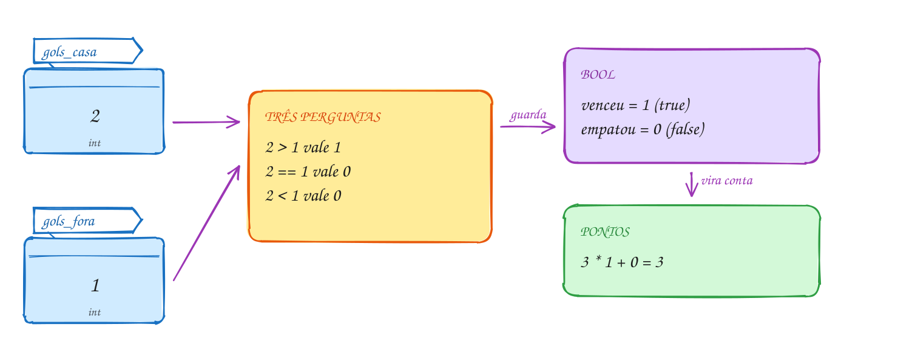</p>

O mesmo exemplo em C. Não tem nenhum `if`: a verdade vira número e entra na
conta:

```c
#include <stdbool.h>
#include <stdio.h>

int main(void) {
    int gols_casa = 2;
    int gols_fora = 1;

    printf("casa >  fora? %d\n", gols_casa > gols_fora);
    printf("casa == fora? %d\n", gols_casa == gols_fora);
    printf("casa <  fora? %d\n", gols_casa < gols_fora);

    bool venceu = gols_casa > gols_fora;   // guarda a resposta: true
    bool empatou = gols_casa == gols_fora; // false

    int pontos = 3 * venceu + empatou;     // 3 * 1 + 0
    printf("Pontos do mandante: %d\n", pontos);
    return 0;
}
// Saída:
// casa >  fora? 1
// casa == fora? 0
// casa <  fora? 0
// Pontos do mandante: 3
```

Repara no fluxograma: não tem losango. Comparar não é decidir. A comparação
só **calcula** uma resposta e guarda numa caixinha, como qualquer conta. Quem
escolhe um caminho é o `if`, que vem daqui a dois assuntos:

<p align="center">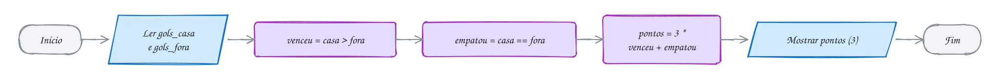</p>

> [!WARNING]
> **Não compare `float` ou `double` com `==`.** Rode `printf("%d", 0.1 + 0.2
> == 0.3);` e veja um **0**. O motivo: 0,1 não tem representação exata em
> binário, e a soma fica em 0.30000000000000004. Para números
> com vírgula, pergunte se estão **perto o bastante**:
> `fabs(a - b) < 1e-9`. Para dinheiro, a saída mais segura é guardar
> **centavos** num `int`.

> [!TIP]
> **Por dentro do C:** o processador não tem uma instrução "maior que" que
> devolve verdadeiro. Ele faz uma subtração de mentira (`cmp`), que só acende
> umas chavinhas de estado (deu zero? deu negativo?). Para guardar a resposta
> num `bool`, o compilador usa uma instrução como `setg`, que escreve 1 ou 0
> num byte. Por isso `sizeof(bool)` é 1. E o `bool` é rígido: `bool b = 42;`
> guarda **1**, porque qualquer valor diferente de zero vira `true` na
> conversão. Num `int`, o 42 ficaria 42.

> [!NOTE]
> **Pergunta para você:** quanto vale `7 > 3 > 1`? Lembre que o C avalia da
> esquerda para a direita e que `7 > 3` já virou um número. Responda antes de
> colocar num `printf` com `%d`.

### Hora de praticar

Os arquivos ficam em [`0012-relacionais/`](0012-relacionais/). Os comandos funcionam de qualquer pasta do terminal. Nos exemplos, rode, mude, quebre e rode de novo. Nos exercícios, a resposta vai dentro do próprio arquivo. ★☆☆ é aquecimento, ★★☆ pede raciocínio e ★★★ é desafio.

**Exemplo A023 · A nota no limite e a contagem sem if**

```c
#include <stdbool.h>
#include <stdio.h>

int main(void) {
    double nota_ana = 7.0; // bem no limite da média
    double nota_bia = 6.9;
    double nota_caio = 8.5;

    // > e >= só discordam num caso: quando os dois lados são iguais
    printf("7.0 >  7? %d\n", nota_ana > 7);
    printf("7.0 >= 7? %d\n", nota_ana >= 7);

    bool ana = nota_ana >= 7;
    bool bia = nota_bia >= 7;
    bool caio = nota_caio >= 7;

    // cada bool vale 0 ou 1: somar conta quantos passaram
    int aprovados = ana + bia + caio;
    printf("Aprovados: %d de 3\n", aprovados);
    printf("Todos passaram? %d\n", aprovados == 3);
    printf("Alguém ficou de fora? %d\n", aprovados != 3);
    return 0;
}
// Saída:
// 7.0 >  7? 0
// 7.0 >= 7? 1
// Aprovados: 2 de 3
// Todos passaram? 0
// Alguém ficou de fora? 1
```

```bash
~/LPEDC/rodar 02-condicionais/0012-relacionais/A023.c
```

**Exemplo A024 · Zero é falso, o resto é verdade**

```c
#include <math.h>
#include <stdbool.h>
#include <stdio.h>

int main(void) {
    int saldo = 250;
    bool tem_saldo = saldo; // 250 não é zero: vira true (1)
    bool zerado = 0;        // só o zero é falso
    bool negativo = -3;     // negativo também é verdade

    printf("tem_saldo = %d\n", tem_saldo);
    printf("zerado = %d\n", zerado);
    printf("negativo = %d\n", negativo);
    printf("sizeof(bool) = %zu byte\n", sizeof(bool));

    // char também é número: 'A' vale 65 e 'a' vale 97
    printf("'A' < 'a'? %d\n", 'A' < 'a');

    // número com vírgula: nunca compare com ==
    double soma = 0.1 + 0.2;
    printf("0.1 + 0.2 == 0.3? %d\n", soma == 0.3);
    printf("perto o bastante? %d\n", fabs(soma - 0.3) < 1e-9);
    return 0;
}
// Saída:
// tem_saldo = 1
// zerado = 0
// negativo = 1
// sizeof(bool) = 1 byte
// 'A' < 'a'? 1
// 0.1 + 0.2 == 0.3? 0
// perto o bastante? 1
```

```bash
~/LPEDC/rodar 02-condicionais/0012-relacionais/A024.c
```

#### Exercícios

**Exercício E067** · ★☆☆

No posto, a regra de bolso diz que o etanol compensa quando custa no
máximo 70% do preço da gasolina. Leia os dois preços e guarde a resposta
num bool. Mostre o bool com %d (sem if: só a comparação).


```text
Etanol: 4.19
Gasolina: 6.09
Etanol compensa? 1
```

**Dicas:**

1. 70% da gasolina é gasolina * 0.7.
2. bool compensa = etanol <= gasolina * 0.7; (não esqueça o stdbool.h).
3. Resposta esperada: com 4.19 e 6.09 mostra 1 (o limite é 4.263); com
   4.59 e 6.09 mostra 0.

```bash
~/LPEDC/rodar 02-condicionais/0012-relacionais/E067.c
```

**Exercício E068** · ★☆☆

Leia a idade de dois irmãos e mostre as seis comparações entre elas, uma
por linha, cada uma com o 0 ou o 1 que o C devolve (sem if):


```text
Idades: 12 9
12 >  9? 1
12 <  9? 0
12 >= 9? 1
12 <= 9? 0
12 == 9? 0
12 != 9? 1
```

**Dicas:**

1. Leia as duas idades com um scanf só: scanf("%d %d", &a, &b).
2. Cada linha é um printf com %d para a idade e outro %d para a
   comparação: printf("%d >  %d? %d\n", a, b, a > b);
3. Resposta esperada: 12 9 → 1 0 1 0 0 1 (de cima para baixo);
   7 7 → 0 0 1 1 1 0.

```bash
~/LPEDC/rodar 02-condicionais/0012-relacionais/E068.c
```

**Exercício E069** · ★★☆

A loja cobra frete de R$ 24.90, mas só quando a compra é menor que
R$ 199.00. Complete a linha do frete SEM usar if: use o 0 ou 1 de uma
comparação dentro da conta.


```text
Total da compra: R$ 150
Frete: R$ 24.90
A pagar: R$ 174.90
```

**Dicas:**

1. (total < 199) vale 1 quando o frete é cobrado e 0 quando não é.
2. Multiplique essa comparação pelo valor do frete.
3. Resposta esperada: 150 → frete 24.90, paga 174.90; 210 → frete 0.00,
   paga 210.00.

```bash
~/LPEDC/rodar 02-condicionais/0012-relacionais/E069.c
```

**Exercício E070** · ★★☆

A bala custa R$ 0,70 e a criança pagou com sete moedas de 10 centavos. O
programa abaixo diz que ela NÃO pagou o valor exato. Rode, acrescente um
printf que mostre pago com 20 casas e conserte de dois jeitos, mostrando
as duas linhas: (a) com uma tolerância usando fabs; (b) trabalhando com
centavos em int.

**Dicas:**

1. Mostre pago com printf("%.20f") e veja o que tem lá dentro.
2. (a) fabs(pago - preco) < 1e-9; (b) int preco = 70; int pago = 7 * 10;
3. Resposta esperada: o printf mostra 0.70000000000000006661 (0.1 não é
   exato em binário), diferente de 0.7. Consertado, os dois jeitos
   mostram "Pagou o valor exato? 1".

```bash
~/LPEDC/rodar 02-condicionais/0012-relacionais/E070.c
```

**Exercício E071** · ★★★

O sistema da gincana confere se a nota digitada vale (de 0 a 10) e se os
três jurados deram a mesma nota. Quem escreveu copiou a matemática:
0 <= nota <= 10 e j1 == j2 == j3. Compila, com avisos (de propósito), e
erra. Rode com as entradas abaixo, leia os avisos e conserte as duas
linhas SEM usar && (ele só chega no 0013): use o fato de que cada
comparação vale 0 ou 1.


```text
Nota: 15
Jurados: 7 7 7
Nota válida? 0
Unanimidade? 1
```

**Dicas:**

1. O C avalia da esquerda para a direita: 0 <= nota <= 10 é
   (0 <= nota) <= 10, e o 0 ou 1 da esquerda é sempre <= 10.
2. "As duas coisas são verdade" é o mesmo que "o produto das duas vale
   1": (0 <= nota) * (nota <= 10).
3. Resposta esperada: valida = (nota >= 0) * (nota <= 10);
   unanime = (j1 == j2) * (j2 == j3). Testes: 15 e 7 7 7 → 0 e 1;
   8 e 7 7 9 → 1 e 0; 10 e 2 2 2 → 1 e 1. Sem o conserto, 15 e 7 7 7
   mostram 1 e 0.

```bash
~/LPEDC/rodar 02-condicionais/0012-relacionais/E071.c
```

**Exercício E072** · ★★★

Desconto progressivo, sem nenhum if: compras a partir de R$ 100 ganham
5%; a partir de R$ 300, ganham mais 5% (10% no total). Leia o total,
calcule a porcentagem só com comparações e mostre:


```text
Total: R$ 150.00
Desconto: 5%
A pagar: R$ 142.50
```

**Dicas:**

1. Cada faixa alcançada soma 5: 5 * (total >= 100) + 5 * (total >= 300).
2. Para mostrar o símbolo de porcentagem no printf, escreva %%.
3. Resposta esperada: 80 → 0%, paga 80.00; 150 → 5%, paga 142.50;
   400 → 10%, paga 360.00.

```bash
~/LPEDC/rodar 02-condicionais/0012-relacionais/E072.c
```

---

## 0013 · Lógicos: E, OU, NÃO

Bilheteria do cinema. A regra da meia-entrada diz: paga meia quem é
estudante **ou** tem 60 anos ou mais, **e** a sessão **não** é pré-estreia.
Uma pergunta só não resolve. São três respostas de sim ou não, costuradas com
E, OU e NÃO.

Os **operadores lógicos** juntam comparações:

- `a && b` (**E**): verdade só se as duas forem verdade;
- `a || b` (**OU**): verdade se pelo menos uma for verdade;
- `!a` (**NÃO**): inverte. `!1` vale 0 e `!0` vale 1.

A **tabela-verdade** mostra todas as combinações. Como no assunto 0012, o
resultado é sempre um `int` 0 ou 1:

| `a` | `b` | `a && b` | `a \|\| b` | `!a` |
| --- | --- | --- | --- | --- |
| 0 | 0 | 0 | 0 | 1 |
| 0 | 1 | 0 | 1 | 1 |
| 1 | 0 | 0 | 1 | 0 |
| 1 | 1 | 1 | 1 | 0 |

Na escola você escrevia 18 ≤ idade ≤ 65. No C, intervalo é sempre um E de duas
comparações: `idade >= 18 && idade <= 65`. Escrever `18 <= idade <= 65` compila,
mas compara o 0 ou 1 da primeira parte com 65 (lembra do 0012?).

**Precedência**, da mais forte para a mais fraca: `!` (junto com o menos
unário), depois os aritméticos, os relacionais (`<` `>` `<=` `>=`), a
igualdade (`==` `!=`), o `&&` e por último o `||`. Por isso
`x > 0 && x < 10` dispensa parênteses. Mas `a || b && c` é `a || (b && c)`:
o E vem antes do OU. Na dúvida, ponha parênteses. Eles não custam nada e
contam a sua intenção.

E tem o **curto-circuito**. O C avalia da esquerda para a
direita e **para assim que sabe a resposta**. Em `a && b`, se `a` é falso, o
`b` nem é calculado: falso E qualquer coisa é falso. Em `a || b`, se `a` é
verdade, o `b` é pulado. Isso protege contas perigosas:
`convidados != 0 && fatias / convidados > 3` nunca divide por zero.

Por fim, as **leis de De Morgan**, para negar uma condição composta: o NÃO
entra nos parênteses e troca E por OU. `!(a && b)` é `!a || !b`, e
`!(a || b)` é `!a && !b`. "Não é (estudante ou idoso)" é o mesmo que "não é
estudante e não é idoso".

Vamos ver na prática. Uma pessoa de 67 anos, que não é estudante, numa sessão
comum. O OU dá verdade pela idade, o NÃO da pré-estreia dá verdade, e o E
fecha com meia-entrada:

<p align="center">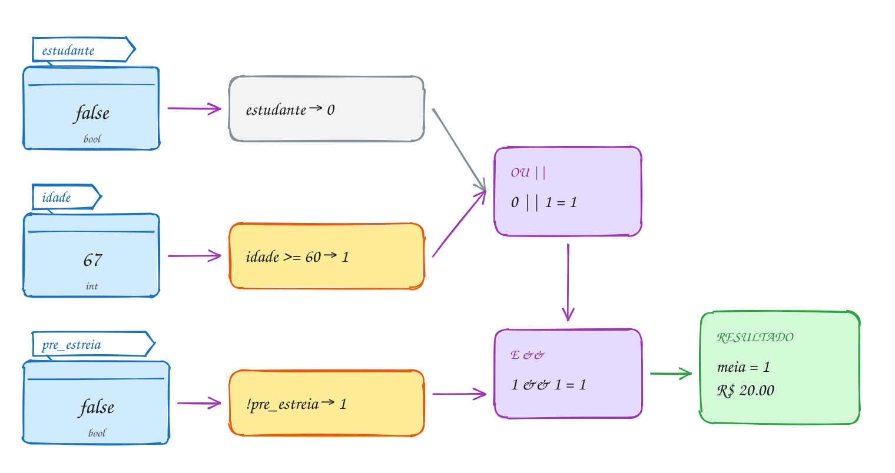</p>

O mesmo exemplo em C:

```c
#include <stdbool.h>
#include <stdio.h>

int main(void) {
    int idade = 67;
    bool estudante = false;
    bool pre_estreia = false;

    // os parênteses são obrigatórios aqui: && vem antes de ||
    bool meia = (estudante || idade >= 60) && !pre_estreia;

    printf("Meia-entrada? %d\n", meia);
    printf("Ingresso: R$ %.2f\n", 40.0 - meia * 20.0);
    return 0;
}
// Saída:
// Meia-entrada? 1
// Ingresso: R$ 20.00
```

Repara no fluxograma: é assim que o C avalia a expressão, uma pergunta de cada
vez. Como `estudante` é falso, ele precisa olhar a idade. Se fosse verdade,
pularia direto para a pré-estreia: isso é o curto-circuito desenhado:

<p align="center">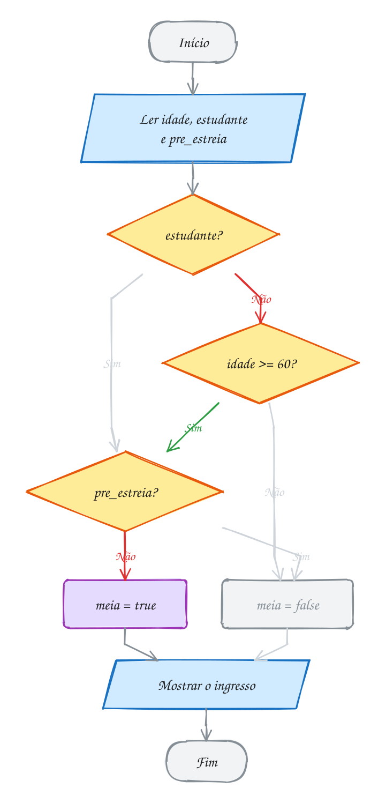</p>

> [!WARNING]
> **`&` não é `&&`.** O `&` simples é o E **bit a bit** (assunto 0065): não tem
> curto-circuito e, pior, tem precedência **menor** que o `==`. Quem escreve
> `if (x & 1 == 0)` para testar se `x` é par ganha `x & (1 == 0)`, que é
> `x & 0`, que é **sempre 0**. O certo é `(x & 1) == 0` ou, mais claro,
> `x % 2 == 0`. O mesmo vale para `|` e `||`. O `-Wall` avisa: "suggest
> parentheses". Leia os avisos.

> [!TIP]
> **Por dentro do C:** o `&&` e o `||` não viram uma instrução de "E". Viram
> **saltos**. `a && b` é compilado como "calcula `a`; se deu zero, pula para o
> resultado 0; senão, calcula `b`". É literalmente o fluxograma acima, e é por
> isso que o curto-circuito é garantido pelo padrão do C. Uma consequência
> prática: em `a && b`, ponha à esquerda o teste mais barato ou o que mais
> costuma dar falso. Ele poupa o resto.

> [!NOTE]
> **Pergunta para você:** se a pessoa fosse estudante, a comparação
> `idade >= 60` seria feita? E se a sessão fosse pré-estreia, a idade mudaria
> alguma coisa? Siga o fluxograma e depois mude os valores no código acima.

### Hora de praticar

Os arquivos ficam em [`0013-logicos/`](0013-logicos/). Os comandos funcionam de qualquer pasta do terminal. Nos exemplos, rode, mude, quebre e rode de novo. Nos exercícios, a resposta vai dentro do próprio arquivo. ★☆☆ é aquecimento, ★★☆ pede raciocínio e ★★★ é desafio.

**Exemplo A025 · Dentro, fora e "só um dos dois"**

```c
#include <stdbool.h>
#include <stdio.h>

int main(void) {
    int hora = 22;

    // dentro da faixa: um E de duas comparações
    bool comercial = hora >= 8 && hora < 18;
    // fora da faixa: um OU. É o NÃO do de cima, aberto por De Morgan:
    // !(hora >= 8 && hora < 18) vira hora < 8 || hora >= 18
    bool fora = hora < 8 || hora >= 18;
    printf("Horário comercial? %d\n", comercial);
    printf("Fora do horário?   %d\n", fora);

    // o C não tem um "OU exclusivo" lógico, mas com bool o != faz o papel:
    // verdade quando exatamente um dos dois é verdade
    bool cupom = true;
    bool primeira_compra = true;
    bool um_desconto_so = cupom != primeira_compra;
    bool algum_desconto = cupom || primeira_compra;
    printf("Algum desconto?    %d\n", algum_desconto);
    printf("Só um desconto?    %d\n", um_desconto_so);
    return 0;
}
// Saída:
// Horário comercial? 0
// Fora do horário?   1
// Algum desconto?    1
// Só um desconto?    0
```

```bash
~/LPEDC/rodar 02-condicionais/0013-logicos/A025.c
```

**Exemplo A026 · O curto-circuito protege a divisão**

```c
#include <stdbool.h>
#include <stdio.h>

int main(void) {
    int fatias = 24;
    int convidados = 0; // ninguém confirmou ainda

    // convidados != 0 deu falso: o && para ali e a divisão nem acontece
    bool sobra = convidados != 0 && fatias / convidados > 3;
    printf("Sobra pizza? %d\n", sobra);

    // o lado direito do || só roda se o esquerdo for falso
    int chamadas = 0;
    bool muita = fatias > 10 || ++chamadas > 0;
    printf("muita = %d, chamadas = %d\n", muita, chamadas);

    // De Morgan: !(a || b) é o mesmo que !a && !b
    bool chovendo = false;
    bool frio = true;
    printf("!(chovendo || frio) = %d\n", !(chovendo || frio));
    printf("!chovendo && !frio  = %d\n", !chovendo && !frio);
    return 0;
}
// Saída:
// Sobra pizza? 0
// muita = 1, chamadas = 0
// !(chovendo || frio) = 0
// !chovendo && !frio  = 0
```

```bash
~/LPEDC/rodar 02-condicionais/0013-logicos/A026.c
```

#### Exercícios

**Exercício E073** · ★☆☆

Monte a tabela-verdade no terminal. Para cada uma das quatro combinações
de a e b (0 0, 0 1, 1 0, 1 1), dê os valores às duas variáveis e mostre
uma linha com a, b, a && b, a || b e !a, calculados pelo programa (nada de
digitar os resultados no printf).


```text
a b | E OU NAO
0 0 | 0 0  1
0 1 | 0 1  1
1 0 | 0 1  0
1 1 | 1 1  0
```

**Dicas:**

1. Declare bool a, b; e, antes de cada linha, faça a = ...; b = ...;
2. Use sempre o mesmo printf:
   printf("%d %d | %d %d  %d\n", a, b, a && b, a || b, !a);
3. Resposta esperada: a tabela acima. A coluna do E só tem 1 na última
   linha; a do OU só tem 0 na primeira.

```bash
~/LPEDC/rodar 02-condicionais/0013-logicos/E073.c
```

**Exercício E074** · ★☆☆

A geladeira de vacinas do posto de saúde precisa ficar entre 2 °C e 8 °C,
incluindo os extremos. Leia a temperatura (pode ter vírgula) e mostre se
está na faixa e se o alarme deve tocar (o alarme é o contrário da faixa).


```text
Temperatura: 5
Dentro da faixa? 1
Alarme? 0
```

**Dicas:**

1. "Entre 2 e 8" no C é temp >= 2 && temp <= 8. Nada de 2 <= temp <= 8.
2. O alarme é !dentro.
3. Resposta esperada: 5 → 1 e 0; 9.5 → 0 e 1; 2 → 1 e 0.

```bash
~/LPEDC/rodar 02-condicionais/0013-logicos/E074.c
```

**Exercício E075** · ★★☆

Um ano é bissexto quando é divisível por 4 e não por 100, ou quando é
divisível por 400. Leia o ano e calcule a resposta numa ÚNICA expressão,
guardada num bool (sem if).


```text
Ano: 2024
Bissexto? 1
```

**Dicas:**

1. "Divisível por 4" é ano % 4 == 0; "não divisível por 100" é
   ano % 100 != 0.
2. (divisível por 4 E não por 100) OU divisível por 400. Use parênteses
   para deixar claro, mesmo que o && já venha antes do ||.
3. Resposta esperada: 1900 → 0; 2000 → 1; 2023 → 0; 2024 → 1.

```bash
~/LPEDC/rodar 02-condicionais/0013-logicos/E075.c
```

**Exercício E076** · ★★☆

Na portaria do show, a regra está escrita com um NÃO na frente de tudo.
Use De Morgan para reescrever "barrado" sem o ! do lado de fora dos
parênteses e mostre as duas versões lado a lado, para provar que dão o
mesmo resultado.


```text
Idade: 16
Tem ingresso (1 = sim, 0 = não): 1
barrado (original):  1
barrado (De Morgan): 1
```

**Dicas:**

1. !(a && b) vira !a || !b.
2. !(idade >= 18) é idade < 18. E !tem_ingresso fica como está.
3. Resposta esperada: barrado = idade < 18 || !tem_ingresso.
   Testes: 20 e 1 → 0; 16 e 1 → 1; 30 e 0 → 1.

```bash
~/LPEDC/rodar 02-condicionais/0013-logicos/E076.c
```

**Exercício E077** · ★★★

O app do banco mostra se o gasto médio por dia passou de R$ 100. Com uma
conta nova, sem nenhum dia registrado, o programa abaixo quebra: o
sanitizer acusa "division by zero". Rode com 900 0 e veja o erro. Depois:
(a) conserte a linha do gasto_alto usando o curto-circuito do &&, sem if;
(b) complete a linha do alerta, que deve ser verdade quando não há dias
registrados OU quando o gasto é alto. Ela também não pode dividir por zero.


```text
Gasto total e dias: 900 6
Gasto alto? 1
Alerta? 1
```

**Dicas:**

1. No &&, se o lado esquerdo é falso, o direito nem é calculado. Ponha a
   pergunta que protege (dias != 0) na frente da divisão.
2. No ||, se o lado esquerdo é verdade, o direito é pulado: comece com
   dias == 0.
3. Resposta esperada: gasto_alto = dias != 0 && gasto / dias > 100;
   alerta = dias == 0 || gasto / dias > 100. Testes: 900 6 → 1 e 1;
   900 0 → 0 e 1 (sem erro); 300 5 → 0 e 0.

```bash
~/LPEDC/rodar 02-condicionais/0013-logicos/E077.c
```

**Exercício E078** · ★★★

Este programa deveria dizer se o número é par e se está entre 10 e 20
(sem incluir os extremos). Ele compila, mas com dois avisos, e erra.
Teste com 14 (deveria dar 1 e 1) e com 25 (deveria dar 0 e 0). Conserte
as duas linhas e rode de novo com 14, 25 e 20. Lembrete: n & 1 pega o
último bit de n em binário: 0 para par, 1 para ímpar (o & bit a bit vem
no assunto 0065).

**Dicas:**

1. Leia os avisos do gcc: eles apontam exatamente as duas linhas.
2. Na tabela de precedência, o == fica ACIMA do &. E 10 < n < 20 é
   (10 < n) < 20.
3. Resposta esperada: n & 1 == 0 é n & (1 == 0), que é n & 0, sempre 0;
   o certo é (n & 1) == 0. 10 < n < 20 compara 0 ou 1 com 20, sempre 1;
   o certo é n > 10 && n < 20. Consertado: 14 → 1 e 1; 25 → 0 e 0;
   20 → 1 e 0.

```bash
~/LPEDC/rodar 02-condicionais/0013-logicos/E078.c
```

---

## 0014 · if

No caixa do mercado, a placa avisa: compras a partir de R$ 200 ganham 10% de
desconto. Sua compra deu R$ 230. A moça do caixa faz uma pergunta e, só se a
resposta for sim, faz um passo a mais. Se for não, a vida segue sem desconto.

Esse "só se" é o **`if`**. No C, a sintaxe é esta:

```c
if (condição) {
    // só roda quando a condição é verdadeira
}
// daqui em diante roda sempre
```

A **condição** vai sempre entre parênteses. Ela pode ser qualquer expressão
que dê um número: uma comparação (`total >= 200`), uma combinação lógica
(`idade >= 18 && tem_cnh`) ou até uma variável sozinha. Vale a regra do 0012:
**zero é falso, o resto é verdade**. `if (saldo)` é o mesmo que
`if (saldo != 0)`, e `if (!saldo)` é o mesmo que `if (saldo == 0)`.

O **bloco** entre chaves pode ter quantas instruções você quiser. Sem chaves, o
`if` manda em **uma** instrução só, a primeira depois dele:

```c
if (total >= 200)
    total = total * 0.9;   // depende do if
printf("Pronto\n");        // NÃO depende, apesar de qualquer recuo
```

O recuo (indentação) é só para quem lê. O compilador ignora espaços. Isso
engana muita gente quando acrescenta uma segunda linha "dentro" do `if` sem
chaves e ela roda sempre. Por isso o conselho do curso: **use chaves sempre**,
mesmo com uma linha só. Abra e feche as chaves antes de escrever o miolo.

Repare que o `if` sozinho não tem um "senão". Quando a condição é falsa, o
bloco é pulado e o programa continua na linha seguinte. É o que chamamos de
**seleção simples**: fazer um passo extra ou não fazer nada.

Vamos ver na prática. Os R$ 230 entram, a pergunta responde Sim, o desconto
acontece e o valor final sai com R$ 207. Se a resposta fosse Não, a seta
cinza levaria direto para o final, sem passar pelo desconto:

<p align="center">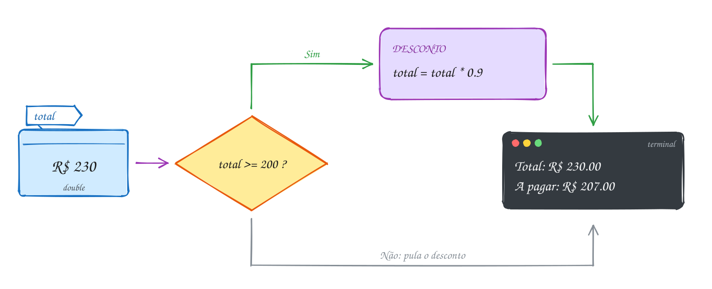</p>

O mesmo exemplo em C. O `%%` dentro do `printf` mostra um `%`:

```c
#include <stdio.h>

int main(void) {
    double total = 230.0;

    printf("Total: R$ %.2f\n", total);
    if (total >= 200) {
        total = total * 0.9; // 10% de desconto
        printf("Desconto de 10%% aplicado!\n");
    }
    printf("A pagar: R$ %.2f\n", total);
    return 0;
}
// Saída:
// Total: R$ 230.00
// Desconto de 10% aplicado!
// A pagar: R$ 207.00
```

Repara no fluxograma: o losango tem duas saídas, como sempre, mas a do Não
não faz nada. Ela vai direto para o "Mostrar", o mesmo ponto onde o caminho do
Sim chega depois do desconto:

<p align="center">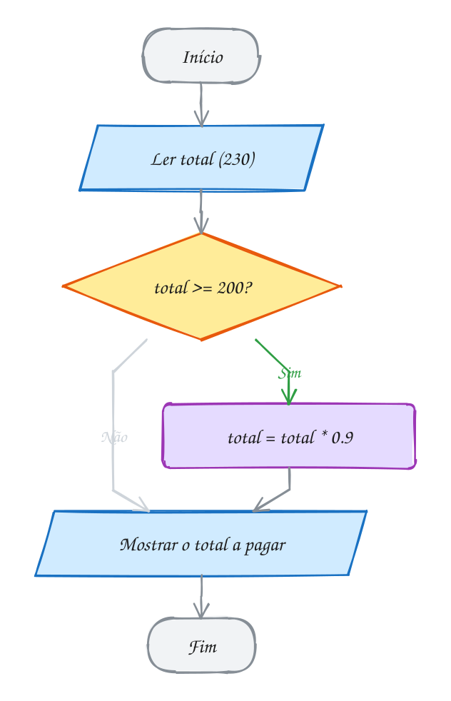</p>

> [!WARNING]
> **O `;` depois do `if` mata a condição.** Em `if (total >= 200);` o
> ponto e vírgula é uma **instrução vazia**: ela é o corpo do `if`. O bloco
> `{ ... }` que vem embaixo vira um bloco solto, que roda **sempre**. Compila
> sem erro, e todo mundo ganha desconto. O `-Wextra` do `rodar` avisa
> ("suggest braces around empty body"). No fim da linha do `if` nunca vai
> `;`: ou vem `{`, ou vem a instrução.

> [!TIP]
> **Por dentro do C:** o `if` vira duas instruções de máquina. Primeiro um
> `cmp` compara `total` com 200. Depois vem um salto condicional que faz o
> **contrário** do que você escreveu: "se for **menor**, pula o bloco". Quando
> a condição é verdadeira, o processador simplesmente não pula e cai dentro do
> bloco. Salve o código acima num arquivo, rode `gcc -S` nele e procure um
> `jb`, `jl` ou parecido logo depois do `comisd` ou `cmp`. O `if` é só isso: comparar e, talvez, pular.

> [!NOTE]
> **Pergunta para você:** e se a compra der exatamente R$ 200,00? E R$ 199,99?
> Responda olhando o `>=` e depois troque `230.0` no código acima para conferir.

### Hora de praticar

Os arquivos ficam em [`0014-if/`](0014-if/). Os comandos funcionam de qualquer pasta do terminal. Nos exemplos, rode, mude, quebre e rode de novo. Nos exercícios, a resposta vai dentro do próprio arquivo. ★☆☆ é aquecimento, ★★☆ pede raciocínio e ★★★ é desafio.

**Exemplo A027 · Avisos independentes no painel do carro**

```c
#include <stdbool.h>
#include <stdio.h>

// Três if seguidos, sem else: cada pergunta é feita, não importa o que as
// outras responderam. Pode acender nenhum aviso, um, dois ou os três.
int main(void) {
    int combustivel = 12; // porcentagem do tanque
    bool porta_aberta = true;
    int km_revisao = 0;   // quilômetros até a próxima revisão

    if (combustivel < 15) {
        printf("Aviso: tanque na reserva (%d%%).\n", combustivel);
    }
    if (porta_aberta) { // a variável sozinha: verdade se não for zero
        printf("Aviso: porta aberta.\n");
    }
    if (!km_revisao) {  // o mesmo que km_revisao == 0
        printf("Aviso: hora da revisão.\n");
    }
    printf("Boa viagem!\n");
    return 0;
}
// Saída:
// Aviso: tanque na reserva (12%).
// Aviso: porta aberta.
// Aviso: hora da revisão.
// Boa viagem!
```

```bash
~/LPEDC/rodar 02-condicionais/0014-if/A027.c
```

**Exemplo A028 · Dois preços em ordem**

```c
#include <stdio.h>

// Um if com um bloco de três instruções: a troca só acontece se precisar.
int main(void) {
    double preco1, preco2;

    printf("Dois preços: ");
    if (scanf("%lf %lf", &preco1, &preco2) != 2) { // leu os dois números?
        printf("Entrada inválida\n");
        return 1;
    }

    if (preco1 > preco2) {
        double aux = preco1; // guarda o primeiro antes de perder
        preco1 = preco2;
        preco2 = aux;
    }
    printf("Mais barato: R$ %.2f\n", preco1);
    printf("Mais caro:   R$ %.2f\n", preco2);
    return 0;
}
// Dois preços: 12.90 8.50
// Mais barato: R$ 8.50
// Mais caro:   R$ 12.90
```

```bash
~/LPEDC/rodar 02-condicionais/0014-if/A028.c
```

#### Exercícios

**Exercício E079** · ★☆☆

Leia a temperatura de uma pessoa e mostre sempre o valor lido. Só se ela
passar de 37.5, mostre também o aviso de febre.


```text
Temperatura: 38.2
Temperatura: 38.2 °C
Febre! Procure um médico.
```

**Dicas:**

1. Um printf antes do if (roda sempre) e outro dentro dele.
2. "Passar de" é >, não >=.
3. Resposta esperada: 38.2 → as duas linhas; 36.5 → só
   "Temperatura: 36.5 °C"; 37.5 → só a primeira linha também.

```bash
~/LPEDC/rodar 02-condicionais/0014-if/E079.c
```

**Exercício E080** · ★☆☆

O professor deu 1 ponto de bônus para a turma, mas a nota máxima continua
sendo 10. Leia a nota da prova, some o bônus e, se passar de 10, corte
para 10. Mostre com uma casa decimal.


```text
Nota da prova: 9.5
Nota final: 10.0
```

**Dicas:**

1. Primeiro some o bônus. Depois pergunte.
2. Dentro do if, uma atribuição só: nota = 10.
3. Resposta esperada: 9.5 → 10.0; 7.2 → 8.2; 9.0 → 10.0.

```bash
~/LPEDC/rodar 02-condicionais/0014-if/E080.c
```

**Exercício E081** · ★★☆

O cinema quer barrar menores de 18 anos neste filme. Mas o programa
abaixo mostra "Entrada proibida" até para quem tem 25 anos. Rode com 25,
leia o aviso do compilador (ele existe de propósito), conserte e rode de
novo com 25 e com 15.

**Dicas:**

1. Olhe com atenção o fim da linha do if.
2. O que fica sendo o corpo do if? E o bloco entre chaves, de quem é?
3. Resposta esperada: o ";" depois de if (idade < 18) é uma instrução
   vazia e vira o corpo do if; o bloco embaixo roda sempre. Tirando o ";",
   25 mostra só "Bom filme!" e 15 mostra as duas mensagens.

```bash
~/LPEDC/rodar 02-condicionais/0014-if/E081.c
```

**Exercício E082** · ★★☆

Três lojas deram orçamento para a mesma geladeira. Leia os três valores
(inteiros, em reais) e mostre o MAIOR, usando só if (sem else).


```text
Orçamentos: 3200 3790 3450
Maior orçamento: R$ 3790
```

**Dicas:**

1. Comece supondo que o primeiro é o maior: int maior = a;
2. Depois, um if para cada um dos outros: se for maior que "maior",
   ele passa a ser o maior.
3. Resposta esperada: 3200 3790 3450 → 3790; 5000 4100 4999 → 5000;
   10 20 30 → 30.

```bash
~/LPEDC/rodar 02-condicionais/0014-if/E082.c
```

**Exercício E083** · ★★★

O controle de estoque da padaria tem duas regras: com menos de 10 pães,
mostra "Estoque baixo." e "Pedir mais pão."; com 0 pão, mostra também
"Esgotado!" e "Desligar a vitrine.". O recuo do programa abaixo promete
isso, mas o compilador não olha recuo: com 40 pães aparecem duas linhas
que não deviam. Rode com 40, leia os avisos (o código está quebrado de
propósito) e conserte. Depois, acrescente uma terceira regra: com mais de
100 pães, mostre quantos passaram do ideal.


```text
Pães no estoque: 130
Excesso: 30 pães acima do ideal.
Estoque: 130
```

**Dicas:**

1. Sem chaves, o if manda só na primeira instrução depois dele.
2. Ponha chaves em todos os if. A regra nova é outro if solto, com
   estoque - 100 no printf.
3. Resposta esperada: 40 → só "Estoque: 40"; 6 → "Estoque baixo.",
   "Pedir mais pão." e "Estoque: 6"; 0 → as quatro mensagens e
   "Estoque: 0"; 130 → a linha do excesso e "Estoque: 130".

```bash
~/LPEDC/rodar 02-condicionais/0014-if/E083.c
```

**Exercício E084** · ★★★

A conta de água da cidade funciona assim: até 10 m³, paga a tarifa mínima
de R$ 45.00. Cada m³ acima de 10 custa R$ 6.20. E, se o consumo passar de
30 m³, a conta inteira ganha 15% de multa por desperdício. Leia o consumo
(inteiro) e mostre a conta. Use só if, sem else.


```text
Consumo (m³): 18
Conta: R$ 94.60
```

**Dicas:**

1. Comece com valor = 45.00, que todo mundo paga.
2. Primeiro if: se consumo > 10, some (consumo - 10) * 6.20. Segundo if:
   se consumo > 30, multiplique o valor por 1.15. A ordem importa.
3. Resposta esperada: 8 → R$ 45.00; 18 → R$ 94.60; 35 → R$ 230.00.

```bash
~/LPEDC/rodar 02-condicionais/0014-if/E084.c
```

---

## 0015 · if/else e o = no lugar do ==

Catraca do metrô, horário de pico. Você encosta o cartão e a máquina decide em
um instante: tem saldo para a tarifa de R$ 5,00? Se tem, libera e desconta.
Se não tem, barra e mostra quanto falta. Não existe uma terceira opção, e uma
das duas **sempre** acontece.

O `if` do 0014 fazia um passo a mais ou nada. Agora são **dois caminhos**, e o
segundo é o **`else`** ("senão"):

```c
if (condição) {
    // caminho do Sim
} else {
    // caminho do Não
}
```

É a **seleção dupla**: exatamente um dos dois blocos roda, nunca os dois e
nunca nenhum. Repare que o `else` **não tem condição**. Ele é "todo o resto".
Escrever `else (saldo < 5)` é erro: se você precisa de outra pergunta, ela vira
um novo `if` (assunto 0016).

As regras de chaves são as mesmas: sem chaves, o `else` também manda em uma
instrução só. E o `;` depois do `if` do 0014 agora costuma virar erro de
compilação: em `if (c); { ... } else { ... }`, o bloco fica solto e o `else`
fica sem `if` para se apoiar. Pelo menos esse o compilador pega.

O que o compilador **não** pega sozinho é a pegadinha mais famosa do C: usar
`=` (atribuição) no lugar de `==` (comparação). No C, uma atribuição também é
uma expressão e tem valor: o valor atribuído. Então `if (saldo = 0)` não
pergunta nada. Ele **guarda 0 no saldo** e testa esse 0, que é falso. E
`if (opcao = 1)` guarda 1 e testa 1, que é sempre verdade. O programa compila,
roda e faz besteira em silêncio.

O compilador não recusa esse código, mas avisa se você pedir. Quem grita
é o `-Wall`: "suggest parentheses around assignment used as truth value". O
`rodar` liga esse aviso. **Nunca ignore um warning**: no curso, código bom
compila com zero avisos.

Vamos ver na prática. O cartão tem R$ 3,50, a tarifa é R$ 5,00. A pergunta
responde Não, e desta vez o caminho que vale é o de baixo:

<p align="center">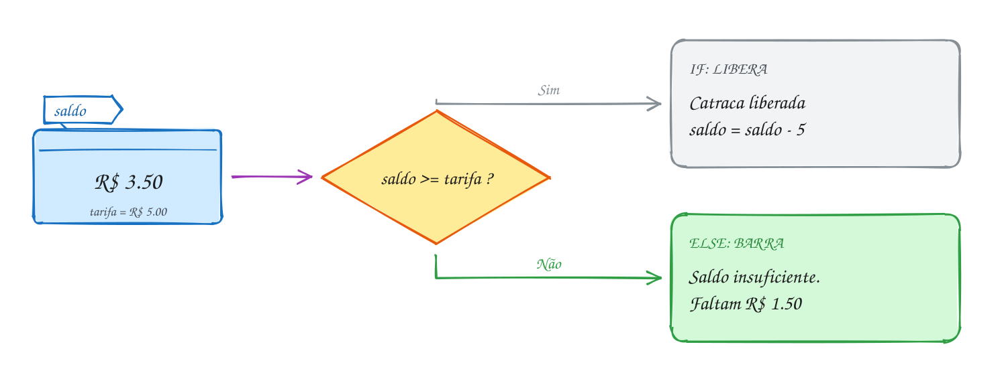</p>

O mesmo exemplo em C:

```c
#include <stdio.h>

int main(void) {
    double saldo = 3.50;
    double tarifa = 5.00;

    if (saldo >= tarifa) {
        saldo = saldo - tarifa;
        printf("Catraca liberada. Saldo: R$ %.2f\n", saldo);
    } else {
        printf("Saldo insuficiente.\n");
        printf("Faltam R$ %.2f\n", tarifa - saldo);
    }
    return 0;
}
// Saída:
// Saldo insuficiente.
// Faltam R$ 1.50
```

Repara no fluxograma: o caminho verde sai pelo Não. Cada lado do losango tem
o seu bloco, e os dois se encontram de novo no Fim. Não há como passar pelos
dois:

<p align="center">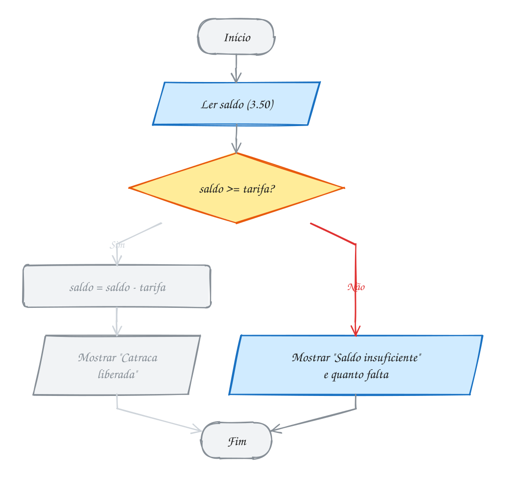</p>

> [!WARNING]
> **`=` no lugar de `==`.** Com `if (saldo = 0)`, o saldo vira zero e o `else`
> roda sempre. Com `if (tentativas = 3)`, o cartão é bloqueado na primeira
> tentativa. Leia `=` como "recebe" e `==` como "é igual a". Dois truques
> ajudam: (1) compile com `-Wall` e trate aviso como erro; (2) quando um lado é
> constante, escreva a constante à esquerda: `if (0 == saldo)`. Se você
> esquecer um `=`, `0 = saldo` não compila, porque não dá para guardar nada
> dentro do número 0.

> [!TIP]
> **Por dentro do C:** o `if/else` vira **dois** saltos. O primeiro é o do
> `if`: "se a condição for falsa, pula para o bloco do `else`". O segundo fica
> no fim do bloco do `if`: um salto incondicional (`jmp`) que **pula por cima**
> do `else`, para os dois caminhos não se misturarem. E o `=` dentro do `if`?
> Para o compilador, `if (x = 0)` é "guarda 0 em `x`, depois compara `x` com 0".
> É código perfeitamente legal, por isso só dá aviso, não erro.

> [!NOTE]
> **Pergunta para você:** se o saldo fosse exatamente R$ 5,00, o que
> apareceria, e com quanto o cartão ficaria? E se você trocasse `>=` por `>`?
> Pense antes de mudar o código acima.

### Hora de praticar

Os arquivos ficam em [`0015-if-else/`](0015-if-else/). Os comandos funcionam de qualquer pasta do terminal. Nos exemplos, rode, mude, quebre e rode de novo. Nos exercícios, a resposta vai dentro do próprio arquivo. ★☆☆ é aquecimento, ★★☆ pede raciocínio e ★★★ é desafio.

**Exemplo A029 · O estacionamento e a constante à esquerda**

```c
#include <stdio.h>

int main(void) {
    int horas = 5;
    int vagas_livres = 0;
    double valor;

    // os dois caminhos guardam o resultado na mesma variável
    if (horas <= 3) {
        valor = 12.0;                      // preço fechado até 3 horas
    } else {
        valor = 12.0 + (horas - 3) * 4.0;  // R$ 4 por hora a mais
    }
    printf("%d horas: R$ %.2f\n", horas, valor); // roda depois de qualquer lado

    // constante à esquerda: se esquecer um =, "0 = vagas_livres" nem compila
    if (0 == vagas_livres) {
        printf("Placa na entrada: LOTADO\n");
    } else {
        printf("Placa na entrada: %d vagas\n", vagas_livres);
    }
    return 0;
}
// Saída:
// 5 horas: R$ 20.00
// Placa na entrada: LOTADO
```

```bash
~/LPEDC/rodar 02-condicionais/0015-if-else/A029.c
```

**Exemplo A030 · Par ou ímpar no palitinho**

```c
#include <stdio.h>

int main(void) {
    int dedos_ana = 3;  // Ana pediu par
    int dedos_beto = 4; // Beto pediu ímpar
    int soma = dedos_ana + dedos_beto;

    printf("Soma: %d\n", soma);
    if (soma % 2 == 0) { // resto 0 na divisão por 2: par
        printf("Deu par. Ana ganhou!\n");
    } else {             // sem condição: é todo o resto
        printf("Deu ímpar. Beto ganhou!\n");
    }
    return 0;
}
// Saída:
// Soma: 7
// Deu ímpar. Beto ganhou!
```

```bash
~/LPEDC/rodar 02-condicionais/0015-if-else/A030.c
```

#### Exercícios

**Exercício E085** · ★☆☆

Leia a idade. Se for 18 ou mais, mostre "Maior de idade."; senão, mostre
quantos anos faltam para os 18.


```text
Idade: 16
Faltam 2 ano(s) para a maioridade.
```

**Dicas:**

1. O que falta é 18 - idade.
2. Um if (idade >= 18) com else.
3. Resposta esperada: 16 → "Faltam 2 ano(s) para a maioridade.";
   18 → "Maior de idade."; 40 → "Maior de idade.".

```bash
~/LPEDC/rodar 02-condicionais/0015-if-else/E085.c
```

**Exercício E086** · ★☆☆

A empresa vai dar aumento: quem ganha até R$ 2000 (inclusive) recebe 10%;
quem ganha mais, 6%. Leia o salário e mostre o novo.


```text
Salário: 1800
Novo salário: R$ 1980.00
```

**Dicas:**

1. "Até 2000, inclusive" é salario <= 2000.
2. Em cada ramo, multiplique por 1.10 ou por 1.06.
3. Resposta esperada: 1800 → 1980.00; 2000 → 2200.00; 2500 → 2650.00.

```bash
~/LPEDC/rodar 02-condicionais/0015-if-else/E086.c
```

**Exercício E087** · ★★☆

O caixa eletrônico bloqueia o cartão na 3ª senha errada. Mas este programa
bloqueia logo na primeira! Rode com 1, leia o aviso do compilador e repare
nos DOIS estragos que o erro causa (a mensagem e a última linha).
Conserte e rode de novo com 1 e com 3.

**Dicas:**

1. Compare o "Tentativas registradas" com o número que você digitou.
2. Quantos sinais de igual tem a condição do if?
3. Resposta esperada: "tentativas = 3" guarda 3 na variável (estrago 1)
   e o if testa esse 3, que é sempre verdade (estrago 2). Com ==, a
   entrada 1 mostra "Senha errada. Restam 2 tentativa(s)." e
   "Tentativas registradas: 1"; a entrada 3 mostra "Cartão bloqueado.".

```bash
~/LPEDC/rodar 02-condicionais/0015-if-else/E087.c
```

**Exercício E088** · ★★☆

No empréstimo consignado, a parcela não pode passar de 35% do salário.
Leia o salário e o valor da parcela. Mostre o limite e se o empréstimo
foi aprovado ou negado.


```text
Salário: 3000
Parcela: 1200
Limite da parcela: R$ 1050.00
Negado: a parcela passa do limite.
```

**Dicas:**

1. limite = salario * 0.35. Mostre o limite antes do if.
2. Parcela igual ao limite ainda é aprovada: use <=.
3. Resposta esperada: 3000 e 1200 → limite 1050.00, negado;
   3000 e 900 → limite 1050.00, "Aprovado!".

```bash
~/LPEDC/rodar 02-condicionais/0015-if-else/E088.c
```

**Exercício E089** · ★★★

Na entrada do estacionamento, o totem confere se há vaga e, se houver,
se o motorista é mensalista (entra direto) ou não (retira o ticket). O
programa abaixo tem o = no lugar do == em DOIS if aninhados (quebrado de
propósito). Rode com 12 0: ele chama um avulso de mensalista e ainda zera
as vagas. Conserte os dois testes escrevendo a constante à esquerda
(0 == vagas), para que um = esquecido vire erro de compilação.


```text
Vagas livres e mensalista (1 = sim, 0 = não): 12 0
Retire o ticket. Cancela aberta.
Vagas livres: 12
```

**Dicas:**

1. vagas = 0 guarda 0 e testa 0 (sempre falso); mensalista = 1 guarda 1
   e testa 1 (sempre verdade).
2. Teste a sua versão trocando um == por = de propósito: com a constante
   à esquerda, o gcc recusa ("lvalue required"). Depois desfaça.
3. Resposta esperada: if (0 == vagas) e if (1 == mensalista). Testes:
   12 0 → ticket e "Vagas livres: 12"; 12 1 → "Bem-vindo, mensalista.
   Cancela aberta." e 12; 0 1 → "Lotado." e "Vagas livres: 0".

```bash
~/LPEDC/rodar 02-condicionais/0015-if-else/E089.c
```

**Exercício E090** · ★★★

Bhaskara. Leia os coeficientes a, b e c de ax² + bx + c = 0 (suponha
a diferente de zero). Calcule delta = b² - 4ac. Se delta for negativo,
mostre "Sem raízes reais."; senão, calcule e mostre as duas raízes.


```text
Coeficientes a b c: 1 -5 6
x1 = 3.00
x2 = 2.00
```

**Dicas:**

1. sqrt está no math.h (assunto 0010). O rodar já liga com -lm.
2. x1 = (-b + sqrt(delta)) / (2 * a). Os parênteses em volta de 2 * a
   são obrigatórios.
3. Resposta esperada: 1 -5 6 → 3.00 e 2.00; 1 -4 4 → 2.00 e 2.00;
   1 2 5 → "Sem raízes reais."; 2 -3 -2 → 2.00 e -0.50.

```bash
~/LPEDC/rodar 02-condicionais/0015-if-else/E090.c
```

---

## 0016 · else if, if aninhado e o else pendurado

Radar na avenida, limite de 60 km/h, e você passou a 80. O Código de Trânsito
não tem só "multou ou não multou". Ele tem **faixas**: até 20% acima do limite
é infração média, de 20% a 50% é grave, acima de 50% é gravíssima. São quatro
caminhos possíveis, e só um vale.

Para mais de dois caminhos, você encadeia perguntas com **`else if`**:

```c
if (velocidade <= 60) {
    // dentro do limite
} else if (velocidade <= 72) {
    // média
} else if (velocidade <= 90) {
    // grave
} else {
    // gravíssima
}
```

O C testa **de cima para baixo** e **para no primeiro Sim**. Os outros testes
nem são feitos. Isso simplifica cada condição: quando o programa chega no
`velocidade <= 72`, ele já sabe que a velocidade passou de 60, porque senão
teria parado antes. Não precisa escrever `velocidade > 60 && velocidade <= 72`.

A consequência é que **a ordem importa**. Se o primeiro teste fosse
`velocidade <= 90`, os 65 km/h cairiam lá e virariam "grave". Comece pela
faixa mais restrita, ou percorra as faixas em ordem, sempre num sentido só. O
`else` do final é opcional e pega "tudo o que sobrou".

Existe outro jeito de montar decisões: o **`if` aninhado**, um `if` dentro do
bloco de outro. Ele serve quando a segunda pergunta só faz sentido se a
primeira deu Sim: "o usuário existe? Se existe, a senha confere?". O `else if`
é um caso particular disso, só que escrito sem a escada de recuos.

Vamos ver na prática. Os 80 km/h passam pelas perguntas em ordem: 80 é menor
ou igual a 60? Não. A 72? Não. A 90? Sim, e a busca para ali:

<p align="center">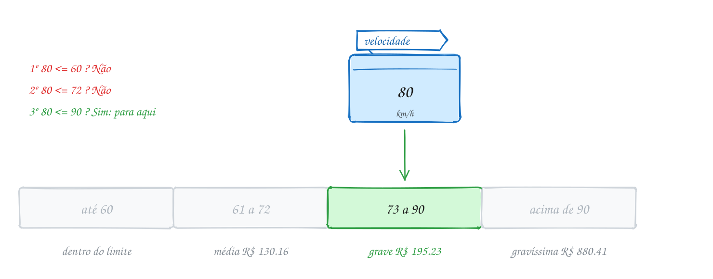</p>

O mesmo exemplo em C. Os limites das faixas são calculados a partir do limite
da via, para valerem em qualquer avenida:

```c
#include <stdio.h>

int main(void) {
    int limite = 60;
    int velocidade = 80;
    int faixa_media = limite + limite / 5; // 72: até 20% acima
    int faixa_grave = limite + limite / 2; // 90: até 50% acima

    if (velocidade <= limite) {
        printf("Dentro do limite. Boa viagem!\n");
    } else if (velocidade <= faixa_media) {
        printf("Infração média: R$ 130.16\n");
    } else if (velocidade <= faixa_grave) {
        printf("Infração grave: R$ 195.23\n");
    } else {
        printf("Infração gravíssima: R$ 880.41\n");
    }
    return 0;
}
// Saída:
// Infração grave: R$ 195.23
```

Repara no fluxograma: é uma escada de losangos, cada um pendurado no Não do
anterior. O caminho verde desce pelos Nãos até o primeiro Sim, e os
losangos de baixo nunca são visitados:

<p align="center">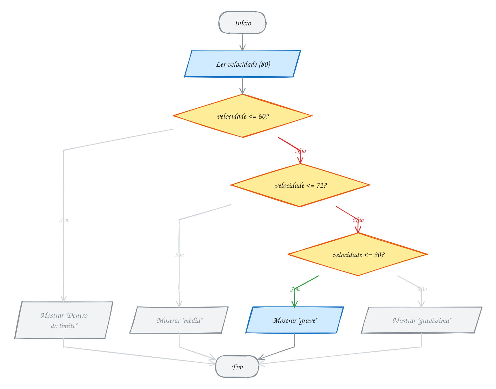</p>

> [!WARNING]
> **O `else` pendurado.** Sem chaves, um `else` pertence ao `if` **mais
> próximo** que ainda não tem `else`, não importa o recuo. Veja:
>
> ```c
> if (pessoas > 0)
>     if (pessoas == 1)
>         printf("Mesa para um.\n");
> else
>     printf("Restaurante vazio.\n");
> ```
>
> O recuo diz que o `else` é do primeiro `if`, mas ele é do segundo. Com 4
> pessoas, aparece "Restaurante vazio."; com 0, não aparece nada. O `-Wall`
> avisa ("suggest explicit braces to avoid ambiguous 'else'"). A cura é a de
> sempre: **chaves**. Com `{ }` em volta do `if` de dentro, o `else` vai para
> onde você quer.

> [!TIP]
> **Por dentro do C:** `else if` **não é uma palavra-chave**. É um `else`
> comum cuja única instrução é um `if`. Para o compilador, a escada acima é um
> `if` dentro do `else` de outro `if`, dentro do `else` de outro. Só a
> formatação é que deixa tudo alinhado. Em máquina, cada degrau é um `cmp` e um
> salto: com 80 km/h, o processador faz três comparações; com 50 km/h, só uma.
> Por isso, quando uma faixa é muito mais comum que as outras, testar ela
> primeiro economiza trabalho.

> [!NOTE]
> **Pergunta para você:** a 72 km/h, qual mensagem aparece? E a 90 km/h?
> Repare que os limites das faixas usam `<=`. Depois confira mudando a velocidade no código acima.

### Hora de praticar

Os arquivos ficam em [`0016-else-if/`](0016-else-if/). Os comandos funcionam de qualquer pasta do terminal. Nos exemplos, rode, mude, quebre e rode de novo. Nos exercícios, a resposta vai dentro do próprio arquivo. ★☆☆ é aquecimento, ★★☆ pede raciocínio e ★★★ é desafio.

**Exemplo A031 · FizzBuzz e a ordem que importa**

```c
#include <stdio.h>

// Aqui as condições não são faixas: um número pode cumprir várias ao mesmo
// tempo. Como o else if para no primeiro Sim, a mais exigente vem primeiro.
int main(void) {
    int n = 15; // divisível por 3 e por 5

    printf("Ordem certa:  ");
    if (n % 3 == 0 && n % 5 == 0) {
        printf("FizzBuzz\n");
    } else if (n % 3 == 0) {
        printf("Fizz\n");
    } else if (n % 5 == 0) {
        printf("Buzz\n");
    } else {
        printf("%d\n", n);
    }

    printf("Ordem errada: ");
    if (n % 3 == 0) { // 15 já para aqui: o FizzBuzz nunca é testado
        printf("Fizz\n");
    } else if (n % 5 == 0) {
        printf("Buzz\n");
    } else if (n % 3 == 0 && n % 5 == 0) {
        printf("FizzBuzz\n");
    } else {
        printf("%d\n", n);
    }
    return 0;
}
// Saída:
// Ordem certa:  FizzBuzz
// Ordem errada: Fizz
```

```bash
~/LPEDC/rodar 02-condicionais/0016-else-if/A031.c
```

**Exemplo A032 · Login com if aninhado**

```c
#include <stdbool.h>
#include <stdio.h>

// A pergunta da senha só faz sentido se o usuário existir: um if dentro do
// outro. As chaves deixam claro de qual if é cada else.
int main(void) {
    bool usuario_existe = true;
    int senha_certa = 4821;
    int senha_digitada = 4812; // dois dígitos trocados

    if (usuario_existe) {
        if (senha_digitada == senha_certa) {
            printf("Bem-vindo!\n");
        } else {
            printf("Senha errada.\n");
        }
    } else {
        printf("Usuário não encontrado.\n");
    }
    return 0;
}
// Saída:
// Senha errada.
```

```bash
~/LPEDC/rodar 02-condicionais/0016-else-if/A032.c
```

#### Exercícios

**Exercício E091** · ★☆☆

O plano de saúde cobra por faixa de idade: até 18 anos, R$ 150; de 19 a
38, R$ 280; de 39 a 58, R$ 520; de 59 em diante, R$ 900. Leia a idade e
mostre a mensalidade usando uma cadeia de else if.


```text
Idade: 45
Mensalidade: R$ 520.00
```

**Dicas:**

1. Teste em ordem crescente: idade <= 18, depois idade <= 38...
2. Quando chega no segundo teste, você já sabe que a idade passou de 18.
3. Resposta esperada: 10 → 150.00; 18 → 150.00; 19 → 280.00;
   45 → 520.00; 59 → 900.00.

```bash
~/LPEDC/rodar 02-condicionais/0016-else-if/E091.c
```

**Exercício E092** · ★☆☆

Leia o saldo da conta (pode ter centavos) e mostre uma de três mensagens:
"Conta no azul.", "Conta no vermelho." ou "Conta zerada.".


```text
Saldo: -35.80
Conta no vermelho.
```

**Dicas:**

1. Três caminhos: if, else if, else.
2. Qual caso sobra para o else, sem precisar de teste?
3. Resposta esperada: 120.50 → azul; -35.80 → vermelho; 0 → zerada.

```bash
~/LPEDC/rodar 02-condicionais/0016-else-if/E092.c
```

**Exercício E093** · ★★☆

O assistente do celular lê duas respostas: você vai sair (1 ou 0)? Vai
chover (1 ou 0)? Quem vai sair e vê chuva deve ler "Leve o guarda-chuva.";
quem NÃO vai sair deve ler "Fique em casa e descanse."; todo mundo lê
"Bom dia!" no fim. O recuo do programa abaixo promete isso, mas o else
pendurado tem outro dono (o código está quebrado de propósito e o gcc
avisa). Rode com 0 1, 1 0 e 1 1, veja a saída errada e conserte com
chaves.


```text
Vai sair? Vai chover? 0 1
Fique em casa e descanse.
Bom dia!
```

**Dicas:**

1. Sem chaves, o else pertence ao if mais próximo que ainda não tem else:
   o if (chuva).
2. Ponha chaves em volta do if de dentro (e, de quebra, em todos os
   blocos).
3. Resposta esperada, depois do conserto: 0 1 → "Fique em casa e
   descanse." e "Bom dia!"; 1 0 → só "Bom dia!"; 1 1 → "Leve o
   guarda-chuva." e "Bom dia!". Antes do conserto, 0 1 mostrava só
   "Bom dia!" e 1 0 mandava ficar em casa.

```bash
~/LPEDC/rodar 02-condicionais/0016-else-if/E093.c
```

**Exercício E094** · ★★☆

O conceito deveria ser A (nota 9 ou mais), B (7 ou mais), C (5 ou mais)
ou D (abaixo de 5). Mas quem tirou 9.5 recebeu C. O programa compila sem
nenhum aviso: o erro é de lógica. Ache, conserte e rode com as quatro
notas da resposta esperada.

**Dicas:**

1. Com 9.5, qual é a primeira condição verdadeira?
2. O else if para no primeiro Sim. Uma nota alta também é >= 5.
3. Resposta esperada: as condições estão na ordem errada; teste primeiro
   >= 9, depois >= 7, depois >= 5. Consertado: 9.5 → A; 7.0 → B;
   5.5 → C; 3.0 → D.

```bash
~/LPEDC/rodar 02-condicionais/0016-else-if/E094.c
```

**Exercício E095** · ★★★

Leia três medidas inteiras (em cm). Primeiro diga se elas formam um
triângulo: cada lado tem que ser menor que a soma dos outros dois. Se
formarem, classifique: equilátero (3 lados iguais), isósceles (só 2
iguais) ou escaleno (todos diferentes).


```text
Lados: 5 5 8
Triângulo isósceles.
```

**Dicas:**

1. Não forma se a >= b + c ou b >= a + c ou c >= a + b.
2. Depois, teste o equilátero ANTES do isósceles (todo equilátero também
   tem dois lados iguais).
3. Resposta esperada: 5 5 5 → equilátero; 5 5 8 → isósceles;
   3 4 5 → escaleno; 1 2 3 → "Não forma triângulo." (1 + 2 não passa de 3).

```bash
~/LPEDC/rodar 02-condicionais/0016-else-if/E095.c
```

**Exercício E096** · ★★★

Imposto progressivo (tabela simplificada, inspirada no IR). Cada alíquota
vale só para a PARTE do salário que cai na faixa:


```text
até R$ 2000.00            isento
de 2000.01 a 3000.00      7.5%
de 3000.01 a 4500.00      15%
acima de 4500.00          22.5%
```


Leia o salário e mostre o imposto. Com R$ 5000: os primeiros 2000 não
pagam; os 1000 seguintes pagam 75.00; os 1500 seguintes pagam 225.00; os
500 que passam de 4500 pagam 112.50. Total: R$ 412.50.


```text
Salário: 5000
Imposto: R$ 412.50
```

**Dicas:**

1. Uma cadeia de else if escolhe a faixa mais alta que o salário alcança.
2. As faixas de baixo, quando cheias, valem um valor fixo: a faixa de 7.5%
   cheia dá 75.00 e a de 15% cheia dá 225.00. Some só a parte da última.
3. Resposta esperada: 1800 → 0.00; 2500 → 37.50; 3500 → 150.00;
   5000 → 412.50.

```bash
~/LPEDC/rodar 02-condicionais/0016-else-if/E096.c
```

---

## 0017 · Ternário: condição ? a : b

Carrinho da loja on-line: "3 itens", "Frete: R$ 19,90". Se fosse um item só,
apareceria "1 item", no singular. E se a compra passasse de R$ 199, o frete
seria zero. São decisões minúsculas, de um valor só, e escrever um `if/else`
de cinco linhas para cada uma polui o código.

Para isso existe o **operador ternário** (o único do C com três partes):

```c
condição ? valor_se_verdade : valor_se_falso
```

A diferença para o
`if` é que o ternário é uma **expressão**: ele **devolve um valor**. Por isso
cabe onde um `if` não cabe: do lado direito de uma atribuição, dentro de um
`printf`, no meio de uma conta.

```c
double frete = total >= 199 ? 0.0 : 19.90;   // escolhe um valor
printf("%s\n", qtd == 1 ? "item" : "itens"); // escolhe um texto
```

O C garante a ordem: primeiro avalia a condição e depois **só um** dos dois
lados. O outro nem é calculado, como no curto-circuito do 0013. Então
`b != 0 ? a / b : 0` nunca divide por zero.

Os dois lados viram um **tipo comum**. Em `n > 0 ? n : 0.5`, com `n` inteiro,
o resultado é `double` mesmo quando sai o `n`. Mantenha os dois lados do mesmo
tipo e você não terá surpresa no `printf`.

Quando usar? Para escolher **um valor** entre dois, com uma condição curta. Se
cada lado faz várias coisas, ou se você começa a encadear ternários dentro de
ternários, volte para o `if/else`. Código esperto que ninguém entende é pior
que código longo.

Vamos ver na prática. Os R$ 150 entram, a pergunta "passou de 199?" responde
Não, e o ternário devolve 19.90, que vai direto para a caixinha `frete`:

<p align="center">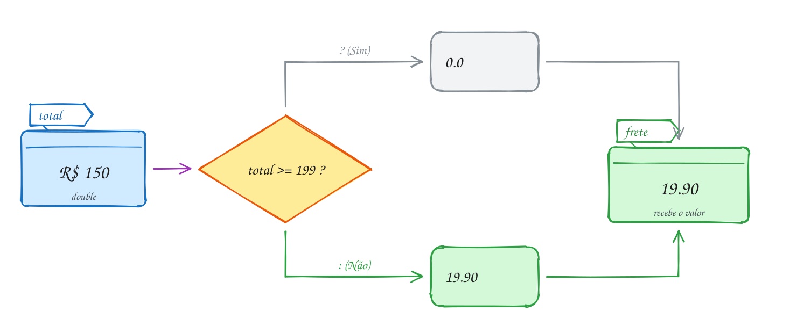</p>

O mesmo exemplo em C. Dois ternários: um escolhe o frete, o outro escolhe a
palavra:

```c
#include <stdio.h>

int main(void) {
    int qtd = 3;
    double total = 150.0;

    double frete = total >= 199 ? 0.0 : 19.90;

    printf("%d %s no carrinho\n", qtd, qtd == 1 ? "item" : "itens");
    printf("Frete: R$ %.2f\n", frete);
    printf("Total: R$ %.2f\n", total + frete);
    return 0;
}
// Saída:
// 3 itens no carrinho
// Frete: R$ 19.90
// Total: R$ 169.90
```

Repara no fluxograma: é o mesmo desenho de um `if/else` em que cada lado só
guarda um valor na mesma variável. Sempre que você vir esse formato, um
ternário resolve em uma linha:

<p align="center">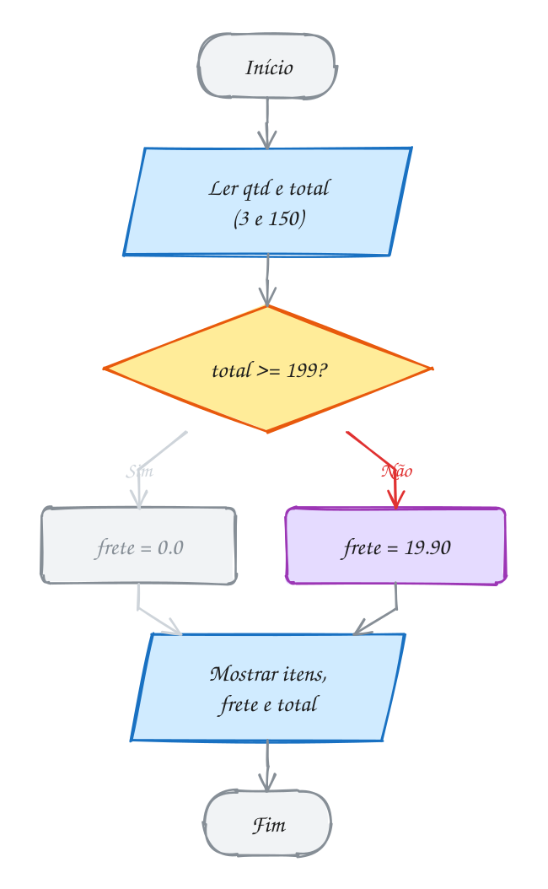</p>

> [!WARNING]
> **O ternário tem precedência baixíssima**: só ganha da atribuição e da
> vírgula. Em `double preco = 40 - estudante ? 20 : 0;` o C entende
> `(40 - estudante) ? 20 : 0`. Como `40 - estudante` nunca é zero, o preço
> sai **20 para todo mundo**. O certo é `40 - (estudante ? 20 : 0)`. Regra
> prática: quando o ternário aparece no meio de uma conta, coloque o ternário
> inteiro entre parênteses.

> [!TIP]
> **Por dentro do C:** um `if` vira um salto, e saltos têm um custo escondido.
> O processador moderno tenta **adivinhar** para onde o salto vai e já vai
> adiantando o trabalho. Quando erra, joga tudo fora. Para escolhas simples
> como `x > y ? x : y`, o `gcc -O2` costuma gerar uma instrução sem salto
> nenhum, a `cmov` ("copia se"): calcula a condição e copia o valor certo, sem
> adivinhar nada. Ternário e `if/else` simples geram o mesmo código: escolha
> pelo que fica mais legível.

> [!NOTE]
> **Pergunta para você:** com `qtd = 1` e `total = 199.0`, quais são as três
> linhas da saída? Pense nos dois ternários antes de mudar o código acima.

### Hora de praticar

Os arquivos ficam em [`0017-ternario/`](0017-ternario/). Os comandos funcionam de qualquer pasta do terminal. Nos exemplos, rode, mude, quebre e rode de novo. Nos exercícios, a resposta vai dentro do próprio arquivo. ★☆☆ é aquecimento, ★★☆ pede raciocínio e ★★★ é desafio.

**Exemplo A033 · O ternário que protege a divisão**

```c
#include <stdio.h>

int main(void) {
    int vendido = 0; // o food truck ainda não abriu
    int dias = 0;

    // só um dos lados é calculado: com dias == 0, a divisão nem acontece
    double media = dias != 0 ? (double) vendido / dias : 0.0;
    printf("Média por dia: R$ %.2f\n", media);
    printf("Situação: %s\n", dias != 0 ? "funcionando" : "ainda não abriu");

    // os dois lados viram um tipo comum: int com double dá double
    int pedidos = 3;
    printf("Fator: %.1f\n", pedidos > 0 ? pedidos : 0.5); // sai 3.0, não 3

    // no meio de uma conta, o ternário vai entre parênteses
    double taxa = 5.0 + (pedidos > 2 ? 2.5 : 0.0);
    printf("Taxa de entrega: R$ %.2f\n", taxa);
    return 0;
}
// Saída:
// Média por dia: R$ 0.00
// Situação: ainda não abriu
// Fator: 3.0
// Taxa de entrega: R$ 7.50
```

```bash
~/LPEDC/rodar 02-condicionais/0017-ternario/A033.c
```

**Exemplo A034 · Maior, distância do zero e verdade em texto**

```c
#include <stdbool.h>
#include <stdio.h>

int main(void) {
    int preco_a = 14;
    int preco_b = 31;
    int temperatura = -3;
    bool chuva = true;

    int maior = preco_a > preco_b ? preco_a : preco_b;
    int distancia = temperatura < 0 ? -temperatura : temperatura;

    printf("Maior preço: R$ %d\n", maior);
    printf("Distância do zero: %d graus\n", distancia);
    printf("Vai chover? %s\n", chuva ? "true" : "false"); // texto no lugar de 1 ou 0

    // ternário dentro de ternário: funciona, mas já começa a pesar
    printf("Temperatura %s\n",
           temperatura > 0 ? "positiva" : temperatura < 0 ? "negativa" : "zero");
    return 0;
}
// Saída:
// Maior preço: R$ 31
// Distância do zero: 3 graus
// Vai chover? true
// Temperatura negativa
```

```bash
~/LPEDC/rodar 02-condicionais/0017-ternario/A034.c
```

#### Exercícios

**Exercício E097** · ★☆☆

Refatore: troque o if/else abaixo por UMA linha com o operador ternário.
A saída tem que continuar igual.


```text
Idade: 15
Ingresso: R$ 20.00
```

**Dicas:**

1. O formato é: variavel = condição ? valor1 : valor2;
2. A declaração pode ir junto: double preco = ...;
3. Resposta esperada: double preco = idade >= 18 ? 40.0 : 20.0;
   15 → 20.00; 30 → 40.00.

```bash
~/LPEDC/rodar 02-condicionais/0017-ternario/E097.c
```

**Exercício E098** · ★☆☆

O aplicativo de mensagens mostra "1 mensagem nova" ou "5 mensagens novas".
Leia a quantidade e mostre a frase certa com UM printf e ternários.


```text
Quantidade: 5
5 mensagens novas
```

**Dicas:**

1. Duas palavras mudam: mensagem/mensagens e nova/novas.
2. printf("%d %s %s\n", n, n == 1 ? ... : ..., n == 1 ? ... : ...);
3. Resposta esperada: 1 → "1 mensagem nova"; 5 → "5 mensagens novas";
   0 → "0 mensagens novas".

```bash
~/LPEDC/rodar 02-condicionais/0017-ternario/E098.c
```

**Exercício E099** · ★★☆

Leia dois inteiros, a e b, e mostre quatro linhas, cada resultado saído
de UM ternário (nada de if): a distância entre os dois (o maior menos o
menor); se a soma é "par" ou "ímpar"; o menor dos dois; e se a é
divisível por b. Com b igual a 0, a última linha mostra "não dá para
dividir por zero", sem calcular o resto.


```text
Dois números: 2 5
Distância: 3
Soma: ímpar
Menor: 2
2 por 5: não divisível
```

**Dicas:**

1. Distância: a > b ? a - b : b - a. Soma: (a + b) % 2 ? "ímpar" : "par".
2. Na última linha, um ternário dentro do "senão" do outro:
   b == 0 ? "não dá para dividir por zero" : a % b == 0 ? ... : ...
   Como o ternário só calcula um lado, a % 0 nunca acontece.
3. Resposta esperada: 2 5 → 3, ímpar, 2, não divisível;
   12 4 → 8, par, 4, divisível; 7 0 → 7, ímpar, 0,
   não dá para dividir por zero.

```bash
~/LPEDC/rodar 02-condicionais/0017-ternario/E099.c
```

**Exercício E100** · ★★☆

Leia três notas inteiras de jurados e mostre a maior, usando só o operador
ternário (nada de if).


```text
Notas: 7 10 9
Maior nota: 10
```

**Dicas:**

1. Faça em dois passos: o maior entre a e b, depois o maior entre esse
   resultado e c.
2. int maior = a > b ? a : b;  e depois  maior = c > maior ? c : maior;
3. Resposta esperada: 7 10 9 → 10; 8 3 5 → 8; 4 6 9 → 9.

```bash
~/LPEDC/rodar 02-condicionais/0017-ternario/E100.c
```

**Exercício E101** · ★★★

O total da compra deveria ser o subtotal mais o frete (R$ 19.90 abaixo de
R$ 199, grátis a partir disso). Com subtotal 150, o programa mostra
"Total: R$ 0.00"! Compila sem nenhum aviso. Conserte a linha do total
com parênteses e rode de novo com 150 e com 250.

**Dicas:**

1. Quem é feito primeiro: o +, o >= ou o ?: ?
2. Monte os parênteses que o C coloca sozinho.
3. Resposta esperada: o C lê (subtotal + subtotal >= 199) ? 0.0 : 19.90,
   e 300 >= 199 dá 0.0. O certo é
   subtotal + (subtotal >= 199 ? 0.0 : 19.90). Consertado: 150 → 169.90;
   250 → 250.00.

```bash
~/LPEDC/rodar 02-condicionais/0017-ternario/E101.c
```

**Exercício E102** · ★★★

Converta uma hora do formato 24 h (0 a 23) para o formato de 12 h com AM e
PM, usando ternários. Meia-noite é 12 AM e meio-dia é 12 PM. Se a hora não
estiver entre 0 e 23, mostre "Hora inválida." (pode usar um if para isso).


```text
Hora (0 a 23): 13
1 PM
```

**Dicas:**

1. AM vai de 0 a 11; PM de 12 a 23: hora < 12 ? "AM" : "PM".
2. O número é hora % 12, exceto quando isso dá 0: aí é 12.
3. Resposta esperada: 0 → 12 AM; 9 → 9 AM; 12 → 12 PM; 13 → 1 PM;
   23 → 11 PM; 24 → Hora inválida.

```bash
~/LPEDC/rodar 02-condicionais/0017-ternario/E102.c
```

---

## 0018 · switch, case, break e fall-through

Na lanchonete, o cardápio tem número: 1 é X-Burger, 2 é X-Salada, 3 é Misto
quente. Você não diz "quero um pão com hambúrguer, alface e tomate". Diz "um
2". O atendente não testa faixa nenhuma: só procura **qual número é igual** ao
que você falou.

Quando a decisão é "qual destes valores exatos?", o C tem o **`switch`**:

```c
switch (codigo) {
case 1:
    // código igual a 1
    break;
case 2:
    // código igual a 2
    break;
default:
    // nenhum dos anteriores
}
```

O `switch` calcula a expressão entre parênteses uma vez e **pula direto** para
o `case` com o mesmo valor. O **`default`** pega o que não casou com nenhum
`case` (é opcional, mas quase sempre vale a pena tratar o inválido).

As regras são mais rígidas que as do `if`, e é bom saber por quê:

- a expressão tem que ser **inteira**: `int`, `char` (que é número) ou
  parecido. Nada de `double`, e nada de string: `switch (nome)`
  com um texto não compila;
- cada `case` leva uma **constante** conhecida na compilação (`case 2:`,
  `case 'S':`). Não dá para escrever `case x:` nem `case > 10:`;
- dois `case` não podem ter o mesmo valor.

E a regra mais importante: o `case` é só um **rótulo**, um ponto de entrada.
Depois de entrar, o C executa **tudo para baixo**, atravessando os outros
`case`, até achar um **`break`** (ou o fim do `switch`). Isso é o
**fall-through** ("cair através"). O `break` é o que diz "pronto, saia do
`switch`".

O fall-through às vezes é o que você quer. Vários `case` empilhados, sem nada
entre eles, dividem o mesmo código: `case 'S': case 's':` aceita maiúscula e
minúscula. Quando é de propósito e tem código no meio, avise quem lê com um
comentário `// fall through` (o `gcc` reconhece esse comentário e não reclama).

Vamos ver na prática. O código 2 entra, o `switch` pula direto para o
`case 2`, sem testar o 1 nem o 3, e o `break` sai antes do `case 3`:

<p align="center">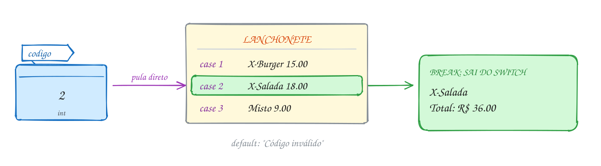</p>

O mesmo exemplo em C:

```c
#include <stdio.h>

int main(void) {
    int codigo = 2;
    int quantidade = 2;
    double preco = 0;

    switch (codigo) {
    case 1:
        printf("X-Burger\n");
        preco = 15.00;
        break;
    case 2:
        printf("X-Salada\n");
        preco = 18.00;
        break; // sem ele, cairia no case 3
    case 3:
        printf("Misto quente\n");
        preco = 9.00;
        break;
    default:
        printf("Código inválido\n");
    }
    printf("Total: R$ %.2f\n", quantidade * preco);
    return 0;
}
// Saída:
// X-Salada
// Total: R$ 36.00
```

Repara no fluxograma: o losango do `switch` tem **várias** saídas, uma para
cada `case` e uma para o `default`. Por isso as setas levam o valor no lugar
de Sim e Não:

<p align="center">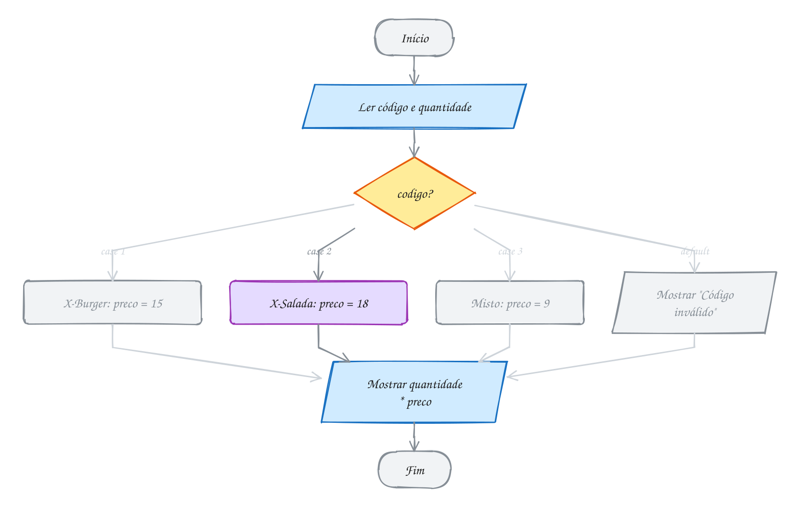</p>

> [!WARNING]
> **Esquecer o `break`.** Tire o `break` do `case 2` e peça um X-Salada: a
> saída vira "X-Salada", "Misto quente" e o preço fica **9.00**, porque o
> `case 3` também rodou e sobrescreveu o preço. O compilador não vê erro
> nenhum: para ele, você pediu isso. O `-Wextra` do `rodar` ajuda
> (`-Wimplicit-fallthrough`: "this statement may fall through"). Regra de
> bolso: escreva o `break` logo depois de escrever o `case`, antes do miolo.

> [!TIP]
> **Por dentro do C:** é por causa das constantes que o `switch` pode ser
> mais rápido que uma escada de `else if`. Quando os `case` são números
> próximos (1, 2, 3, 4...), o compilador monta uma **tabela de saltos**: um
> vetor com o endereço do código de cada `case`. Em vez de comparar um por um,
> ele usa o valor como índice da tabela e pula direto, em **um passo só**,
> tenha o `switch` 3 ou 300 casos. Com valores espalhados (1, 500, 90000), ele
> volta a comparar. E o fall-through? É só não ter um salto no fim do bloco:
> o código do próximo `case` está logo ali embaixo na memória.

> [!NOTE]
> **Pergunta para você:** com `codigo = 7`, o que aparece? E o total? Pense
> no valor inicial de `preco` antes de mudar o código acima.

### Hora de praticar

Os arquivos ficam em [`0018-switch/`](0018-switch/). Os comandos funcionam de qualquer pasta do terminal. Nos exemplos, rode, mude, quebre e rode de novo. Nos exercícios, a resposta vai dentro do próprio arquivo. ★☆☆ é aquecimento, ★★☆ pede raciocínio e ★★★ é desafio.

**Exemplo A035 · Faixas de nota com a divisão inteira**

```c
#include <stdio.h>

// O switch só compara com valores exatos. Para usar faixas, transforme a
// faixa num número: 87 / 10 dá 8 na divisão inteira.
int main(void) {
    int nota = 87; // de 0 a 100
    char conceito;

    switch (nota / 10) {
    case 10: // 100 também é A
    case 9:
        conceito = 'A';
        break;
    case 8:
        conceito = 'B';
        break;
    case 7:
        conceito = 'C';
        break;
    default: // de 0 a 69
        conceito = 'D';
    }
    printf("Nota %d: conceito %c\n", nota, conceito);

    // char também é número: dá para fazer switch numa letra
    switch (conceito) {
    case 'A':
    case 'B':
        printf("Parabéns!\n");
        break;
    case 'C':
        printf("Passou raspando.\n");
        break;
    default:
        printf("Vai para a recuperação.\n");
    }
    return 0;
}
// Saída:
// Nota 87: conceito B
// Parabéns!
```

```bash
~/LPEDC/rodar 02-condicionais/0018-switch/A035.c
```

**Exemplo A036 · Quantos dias tem o mês**

```c
#include <stdbool.h>
#include <stdio.h>

// Vários case empilhados dividem o mesmo código: é o fall-through do bem.
int main(void) {
    int mes = 2;
    int ano = 2024;
    int dias;

    switch (mes) {
    case 1:
    case 3:
    case 5:
    case 7:
    case 8:
    case 10:
    case 12:
        dias = 31;
        break;
    case 4:
    case 6:
    case 9:
    case 11:
        dias = 30;
        break;
    case 2: { // as chaves abrem um bloco: em C17, um rótulo não pode vir
              // colado numa declaração
        bool bissexto = (ano % 4 == 0 && ano % 100 != 0) || ano % 400 == 0;
        dias = bissexto ? 29 : 28;
        break;
    }
    default:
        dias = 0; // mês que não existe
    }

    if (dias == 0) {
        printf("Mês inválido.\n");
    } else {
        printf("O mês %d de %d tem %d dias.\n", mes, ano, dias);
    }
    return 0;
}
// Saída:
// O mês 2 de 2024 tem 29 dias.
```

```bash
~/LPEDC/rodar 02-condicionais/0018-switch/A036.c
```

#### Exercícios

**Exercício E103** · ★☆☆

Leia um número de 1 a 7 e mostre o dia da semana (1 é domingo, 7 é
sábado). Qualquer outro número mostra "Dia inválido.". Use switch.


```text
Dia (1 a 7): 4
Quarta-feira
```

**Dicas:**

1. Um case para cada número, cada um com seu printf e seu break.
2. O default cuida do inválido.
3. Resposta esperada: 1 → Domingo; 4 → Quarta-feira; 7 → Sábado;
   9 → Dia inválido.

```bash
~/LPEDC/rodar 02-condicionais/0018-switch/E103.c
```

**Exercício E104** · ★☆☆

O aumento depende da classe do funcionário: A ganha 10%, B ganha 15% e C
ganha 20%. A classe pode vir em maiúscula ou minúscula. Leia o salário e a
classe e mostre o novo salário; para outra letra, "Classe inválida.".


```text
Salário: 1000
Classe (A, B ou C): b
Novo salário: R$ 1150.00
```

**Dicas:**

1. Leia a letra com scanf(" %c", &classe): o espaço antes do %c pula o
   Enter que sobrou da leitura do salário.
2. Empilhe os case: case 'B': case 'b': fazem a mesma coisa.
3. Resposta esperada: 1000 e b → 1150.00; 2000 e A → 2200.00;
   1500 e c → 1800.00; 1000 e D → Classe inválida.

```bash
~/LPEDC/rodar 02-condicionais/0018-switch/E104.c
```

**Exercício E105** · ★★☆

O atendimento por telefone do banco tem um menu de teclas: 1 → "Consultar
saldo."; 2 → "Segunda via da fatura."; 9 → "Transferindo para um
atendente..."; 0 → "Repetindo o menu.". Qualquer outra tecla mostra
"Opção inválida." e, em seguida, também repete o menu. Escreva com UM
switch em que o default fica no meio, logo antes do case 0, e cai nele
de propósito (sem repetir o printf do menu).


```text
Tecla: 7
Opção inválida.
Repetindo o menu.
```

**Dicas:**

1. O default não precisa ser o último: o switch pula para ele quando
   nenhum case bate, esteja onde estiver.
2. Ordem dos rótulos: case 1, case 2, case 9, default, case 0. Todos com
   break, menos o default; no lugar do break dele, escreva o comentário
   "// fall through" (o gcc entende e não avisa).
3. Resposta esperada: 1 → "Consultar saldo."; 2 → "Segunda via da
   fatura."; 9 → "Transferindo para um atendente..."; 0 → só "Repetindo
   o menu."; 7 → "Opção inválida." e "Repetindo o menu.".

```bash
~/LPEDC/rodar 02-condicionais/0018-switch/E105.c
```

**Exercício E106** · ★★☆

Calculadora de bolso. Leia uma conta no formato "número operador número"
(por exemplo, 20 / 4) e mostre o resultado com duas casas. Aceite + - * /
e trate dois erros: divisão por zero e operador desconhecido.


```text
Conta: 20 / 4
= 5.00
```

**Dicas:**

1. scanf("%lf %c %lf", &a, &op, &b) lê os três pedaços. Confira se o
   retorno é 3.
2. Dentro do case '/', um if para o divisor zero.
3. Resposta esperada: 20 / 4 → = 5.00; 7 * 1.5 → = 10.50;
   3 - 8 → = -5.00; 7 / 0 → Divisão por zero.; 2 ^ 3 → Operador inválido.

```bash
~/LPEDC/rodar 02-condicionais/0018-switch/E106.c
```

**Exercício E107** · ★★★

A pizzaria mostra o preço da pizza escolhida. Mas quem pede muçarela vê
os quatro textos, inclusive "Opção inválida.". Rode com M, leia os avisos
do compilador (eles são a pista) e conserte. Depois melhore: aceite também
as letras minúsculas.


```text
Pizza (M, C ou P): m
Muçarela: R$ 45.00
```

**Dicas:**

1. O que faz a execução sair de um switch?
2. Para as minúsculas, empilhe: case 'M': case 'm':
3. Resposta esperada: falta um break no fim de cada case (o
   -Wimplicit-fallthrough avisa "this statement may fall through").
   Consertado: M ou m → só "Muçarela: R$ 45.00"; P → só
   "Portuguesa: R$ 55.00"; X → só "Opção inválida.".

```bash
~/LPEDC/rodar 02-condicionais/0018-switch/E107.c
```

**Exercício E108** · ★★★

Fall-through de propósito. O lava-rápido tem três pacotes, e cada um
inclui os de baixo: o 1 é só lavagem (R$ 30); o 2 é aspiração (R$ 15) +
lavagem; o 3 é cera (R$ 25) + aspiração + lavagem. Leia o pacote, liste os
serviços e mostre o total, usando UM switch em que o case 3 cai no 2 e o 2
cai no 1.


```text
Pacote (1 a 3): 3
Cera: R$ 25.00
Aspiração: R$ 15.00
Lavagem: R$ 30.00
Total: R$ 70.00
```

**Dicas:**

1. Comece com total = 0. Cada case mostra o seu serviço e soma o preço.
2. Ponha os case na ordem 3, 2, 1; só o 1 tem break. Escreva o comentário
   "// fall through" no lugar de cada break que falta: o gcc entende e
   não avisa.
3. Resposta esperada: 3 → R$ 70.00; 2 → aspiração e lavagem, R$ 45.00;
   1 → só lavagem, R$ 30.00; 4 → "Pacote inválido.".

```bash
~/LPEDC/rodar 02-condicionais/0018-switch/E108.c
```

---

## 0019 · Juntando tudo: a conta de luz

Chegou a conta de luz, e ela é um festival de decisões. O valor depende do
consumo, da **bandeira** do mês (verde, amarela ou vermelha), de você ter ou
não **tarifa social**, de uma taxa de iluminação que muda com o consumo, e
ainda vem um carimbo dizendo se o seu consumo foi baixo, médio ou alto.

Cada pedaço pede uma ferramenta diferente do módulo, e escolher a certa é
metade do trabalho:

| Decisão | Ferramenta | Por quê |
| --- | --- | --- |
| a bandeira é V, A ou R? | `switch` | valores exatos de um `char` |
| tem tarifa social **e** consumo até 220 kWh? | `if` com `&&` | duas condições juntas, um passo a mais ou nada |
| iluminação: R$ 15 acima de 100 kWh, senão R$ 5 | ternário | escolhe **um valor** entre dois |
| consumo baixo, médio ou alto? | `else if` | faixas, testadas em ordem |
| a leitura deu certo e o consumo não é negativo? | `if` com `\|\|` | barra a entrada ruim logo no começo |

Repare na última linha. Um programa que lê do teclado precisa desconfiar de
quem digita. O `scanf` devolve **quantos valores conseguiu ler** (assunto
0006): se você pediu um número e a pessoa digitou "abc", ele devolve 0. A
primeira decisão do programa é essa: se a entrada não presta, avisa e sai com
`return 1` (o código de erro que o terminal enxerga). Esse padrão tem nome:
**cláusula de guarda**. Trate o caso ruim primeiro e o resto do código fica
reto, sem um `else` gigante.

As tarifas do exemplo são simplificadas, mas a estrutura é a de uma conta de
verdade: energia a R$ 0,80 por kWh, bandeira amarela com R$ 0,02 a mais por
kWh, vermelha com R$ 0,05, desconto social de 40%.

Vamos ver na prática. Consumo de 230 kWh, bandeira amarela, sem tarifa social.
Cada decisão do módulo entra em cena uma vez, e o total sai no terminal:

<p align="center">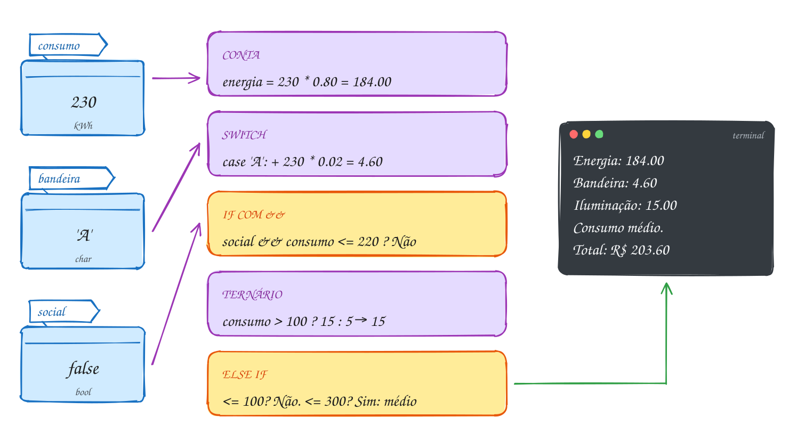</p>

O programa completo. Ele lê os três dados, e o comentário no fim mostra uma
execução:

```c
#include <stdbool.h>
#include <stdio.h>

int main(void) {
    int consumo, resposta;
    char bandeira;

    printf("Consumo do mês (kWh): ");
    if (scanf("%d", &consumo) != 1 || consumo < 0) { // guarda
        printf("Consumo inválido.\n");
        return 1;
    }
    printf("Bandeira (V, A ou R): ");
    if (scanf(" %c", &bandeira) != 1) {
        printf("Bandeira inválida.\n");
        return 1;
    }
    printf("Tarifa social (1 = sim, 0 = não): ");
    if (scanf("%d", &resposta) != 1) {
        printf("Resposta inválida.\n");
        return 1;
    }
    bool social = resposta;

    double adicional; // por kWh, conforme a bandeira
    switch (bandeira) {
    case 'V':
    case 'v':
        adicional = 0.0;
        break;
    case 'A':
    case 'a':
        adicional = 0.02;
        break;
    case 'R':
    case 'r':
        adicional = 0.05;
        break;
    default:
        printf("Bandeira inválida.\n");
        return 1;
    }

    double energia = consumo * 0.80;
    double extra = consumo * adicional;
    double desconto = 0.0;
    if (social && consumo <= 220) {
        desconto = (energia + extra) * 0.40;
    }
    double iluminacao = consumo > 100 ? 15.0 : 5.0;
    double total = energia + extra - desconto + iluminacao;

    printf("Energia: R$ %.2f\n", energia);
    printf("Bandeira: R$ %.2f\n", extra);
    if (desconto > 0) {
        printf("Desconto social: -R$ %.2f\n", desconto);
    }
    printf("Iluminação pública: R$ %.2f\n", iluminacao);

    if (consumo <= 100) {
        printf("Consumo baixo.\n");
    } else if (consumo <= 300) {
        printf("Consumo médio.\n");
    } else {
        printf("Consumo alto.\n");
    }
    printf("Total: R$ %.2f\n", total);
    return 0;
}
// Consumo do mês (kWh): 230
// Bandeira (V, A ou R): A
// Tarifa social (1 = sim, 0 = não): 0
// Energia: R$ 184.00
// Bandeira: R$ 4.60
// Iluminação pública: R$ 15.00
// Consumo médio.
// Total: R$ 203.60
```

Repara no fluxograma: a primeira decisão é a guarda, com uma saída direta
para o Fim. Depois dela, o caminho é quase uma linha reta, com um único
desvio opcional para o desconto. É assim que um programa bem organizado se
parece por fora:

<p align="center">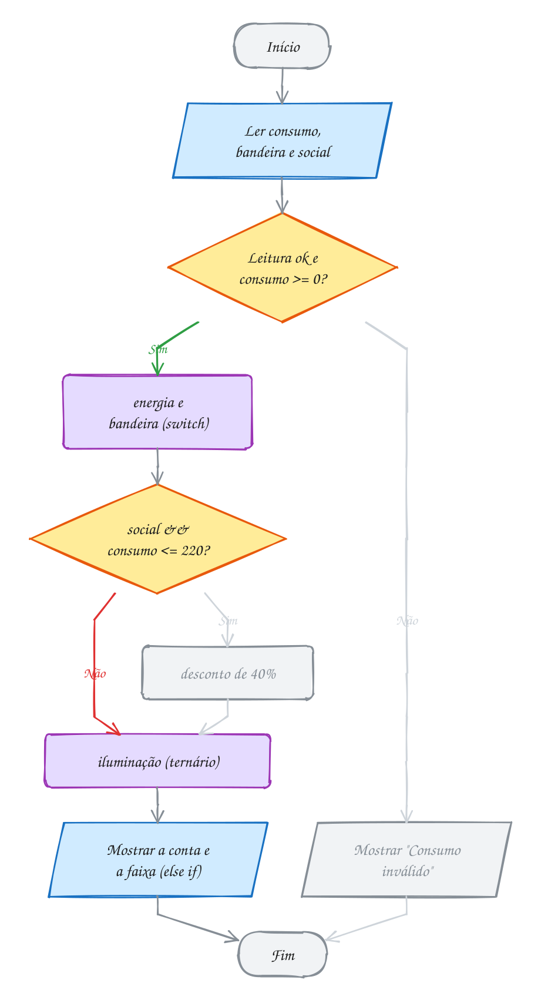</p>

> [!WARNING]
> **A ordem dos passos é parte da regra.** O desconto social vale sobre a
> energia **e** a bandeira, mas não sobre a iluminação. Se você somar a
> iluminação antes de calcular os 40%, a conta muda e ninguém percebe, porque
> o programa compila e roda. Antes de escrever, faça um **teste de mesa** com
> um caso que passa por todos os ramos (150 kWh, verde, com tarifa social:
> 120 + 0 - 48 + 15 = **R$ 87.00**) e confira com a saída.

> [!TIP]
> **Por dentro do C:** o `return 1` da guarda não é enfeite. O valor que o
> `main` devolve vira o **código de saída** do processo. No terminal,
> `echo $?` logo depois de rodar mostra 0 (deu certo) ou 1 (deu erro). Scripts
> e ferramentas como o `make` usam esse número para decidir se continuam.
> Repare também que o `switch` aqui tem um `default` com `return`: assim o
> compilador sabe que `adicional` sempre recebe um valor antes de ser usado.
> Tire o `return` e o `gcc -O2 -Wall` avisa que ela pode ser usada sem valor.

> [!NOTE]
> **Pergunta para você:** com 400 kWh, bandeira vermelha e tarifa social,
> quanto dá a conta? O desconto entra? Faça a conta no papel e depois rode o
> código acima com essa entrada.

### Hora de praticar

Os arquivos ficam em [`0019-juntando-tudo/`](0019-juntando-tudo/). Os comandos funcionam de qualquer pasta do terminal. Nos exemplos, rode, mude, quebre e rode de novo. Nos exercícios, a resposta vai dentro do próprio arquivo. ★☆☆ é aquecimento, ★★☆ pede raciocínio e ★★★ é desafio.

**Exemplo A037 · A situação no fim do semestre**

```c
#include <stdbool.h>
#include <stdio.h>

int main(void) {
    double nota1 = 6.5;
    double nota2 = 8.0;
    int frequencia = 80; // porcentagem de presença

    // guarda: dado impossível sai logo
    if (nota1 < 0 || nota1 > 10 || nota2 < 0 || nota2 > 10 ||
        frequencia < 0 || frequencia > 100) {
        printf("Dados inválidos.\n");
        return 1;
    }

    double media = (nota1 + nota2) / 2;
    bool presente = frequencia >= 75;
    printf("Média: %.2f\n", media);
    printf("Frequência: %d%% (%s)\n", frequencia, presente ? "ok" : "abaixo de 75%");

    if (!presente) { // a falta reprova antes de olhar a nota
        printf("Reprovado por falta.\n");
    } else if (media >= 7) {
        printf("Aprovado.\n");
    } else if (media >= 4) {
        printf("Recuperação: precisa de %.2f na prova final.\n", 10 - media);
    } else {
        printf("Reprovado por nota.\n");
    }

    switch ((int) media) { // o cast corta as casas: 7.25 vira 7
    case 10:
    case 9:
        printf("Menção: excelente\n");
        break;
    case 8:
    case 7:
        printf("Menção: bom\n");
        break;
    default:
        printf("Menção: precisa melhorar\n");
    }
    return 0;
}
// Saída:
// Média: 7.25
// Frequência: 80% (ok)
// Aprovado.
// Menção: bom
```

```bash
~/LPEDC/rodar 02-condicionais/0019-juntando-tudo/A037.c
```

**Exemplo A038 · Pedra, papel e tesoura**

```c
#include <stdbool.h>
#include <stdio.h>

// P = pedra, A = papel, T = tesoura. Pedra quebra tesoura, tesoura corta
// papel, papel embrulha pedra.
int main(void) {
    char j1 = 'P';
    char j2 = 'T';

    bool valida1 = j1 == 'P' || j1 == 'A' || j1 == 'T';
    bool valida2 = j2 == 'P' || j2 == 'A' || j2 == 'T';
    if (!valida1 || !valida2) { // guarda: jogada que não existe
        printf("Jogada inválida.\n");
        return 1;
    }

    printf("Jogador 1: %s\n", j1 == 'P' ? "pedra" : j1 == 'A' ? "papel" : "tesoura");
    printf("Jogador 2: %s\n", j2 == 'P' ? "pedra" : j2 == 'A' ? "papel" : "tesoura");

    bool vence1 = (j1 == 'P' && j2 == 'T') ||
                  (j1 == 'T' && j2 == 'A') ||
                  (j1 == 'A' && j2 == 'P');

    if (j1 == j2) {
        printf("Empate!\n");
    } else if (vence1) {
        printf("Jogador 1 venceu!\n");
    } else {
        printf("Jogador 2 venceu!\n");
    }
    return 0;
}
// Saída:
// Jogador 1: pedra
// Jogador 2: tesoura
// Jogador 1 venceu!
```

```bash
~/LPEDC/rodar 02-condicionais/0019-juntando-tudo/A038.c
```

#### Exercícios

**Exercício E109** · ★☆☆

Leia o peso (kg) e a altura (m), calcule o IMC = peso / altura² e mostre a
classificação: abaixo de 18.5, "Abaixo do peso"; abaixo de 25, "Peso
normal"; abaixo de 30, "Sobrepeso"; senão, "Obesidade". Se a leitura
falhar ou a altura não for positiva, mostre "Dados inválidos." e saia com
return 1.


```text
Peso e altura: 70 1.75
IMC: 22.86
Peso normal
```

**Dicas:**

1. Guarda primeiro: if (scanf(...) != 2 || altura <= 0).
2. Depois, uma cadeia de else if em ordem crescente.
3. Resposta esperada: 70 1.75 → 22.86, Peso normal; 50 1.70 → 17.30,
   Abaixo do peso; 95 1.80 → 29.32, Sobrepeso; 70 0 → Dados inválidos.

```bash
~/LPEDC/rodar 02-condicionais/0019-juntando-tudo/E109.c
```

**Exercício E110** · ★☆☆

O caixa eletrônico tem saldo de R$ 500 na conta e só notas de 10. Leia o
valor do saque (inteiro) e responda com UMA das mensagens, nesta ordem de
prioridade: "Valor inválido." (zero ou negativo); "O caixa só tem notas
de 10." (não é múltiplo de 10); "Saldo insuficiente." (passa do saldo);
ou o saque feito, com o saldo que sobra.


```text
Valor do saque: 120
Saque de R$ 120. Saldo: R$ 380
```

**Dicas:**

1. Uma cadeia de if / else if / else, com os erros primeiro.
2. "Não é múltiplo de 10" é saque % 10 != 0.
3. Resposta esperada: 120 → saque feito, saldo 380; 125 → notas de 10;
   600 → saldo insuficiente; -20 → valor inválido; 500 → saldo 0.

```bash
~/LPEDC/rodar 02-condicionais/0019-juntando-tudo/E110.c
```

**Exercício E111** · ★★☆

Leia uma data no formato dia/mês/ano e diga se ela existe. O mês vai de 1
a 12; o dia vai de 1 até o número de dias do mês, e fevereiro tem 29 dias
nos anos bissextos.


```text
Data (dd/mm/aaaa): 29/02/2023
Data inválida.
```

**Dicas:**

1. scanf("%d/%d/%d", &dia, &mes, &ano) lê as barras também. Confira o
   retorno (3).
2. Um switch descobre quantos dias tem o mês (com case empilhados, como no
   A036) e um default marca o mês inválido. Depois, um if confere o dia.
3. Resposta esperada: 29/02/2023 → inválida; 29/02/2024 → válida;
   31/04/2025 → inválida; 15/13/2025 → inválida; 31/12/2025 → válida.

```bash
~/LPEDC/rodar 02-condicionais/0019-juntando-tudo/E111.c
```

**Exercício E112** · ★★☆

Complete o programa do pedágio. Moto (1) paga R$ 6.00; carro (2) paga
R$ 12.00; caminhão (3) paga R$ 12.00 por eixo. No horário de pico (das 17h
às 19h59), a tarifa sobe 20%. Siga os TODO.


```text
Categoria (1 moto, 2 carro, 3 caminhão): 2
Hora (0 a 23): 18
Horário de pico? sim
Tarifa: R$ 14.40
```

**Dicas:**

1. No case 3, leia o número de eixos antes de calcular (declare
   int eixos lá no começo do main, junto com categoria).
2. pico = hora >= 17 && hora < 20; e depois
   tarifa = pico ? tarifa * 1.2 : tarifa;
3. Resposta esperada: carro às 18h → 14.40; caminhão com 4 eixos às 10h
   → 48.00; moto às 19h → 7.20; categoria 5 → "Categoria inválida.".

```bash
~/LPEDC/rodar 02-condicionais/0019-juntando-tudo/E112.c
```

**Exercício E113** · ★★★

O cinema cobra R$ 30. Menores de 12 e pessoas de 60 ou mais pagam meia.
Na terça ('T'), o ingresso tem R$ 10 de desconto; no sábado ('S'), custa
R$ 5 a mais; nos outros dias, preço normal. Idade 0 é inválida. E, por
fim, quem é menor de 18 recebe um aviso no sábado; quem tem 18 ou mais
recebe "Boa sessão!".

Este programa tem QUATRO erros, todos pegadinhas do módulo. Rode, leia os
avisos do compilador, ache e conserte os quatro.

**Dicas:**

1. Os quatro: um sinal de igual, um ponto e vírgula, uma palavra que falta
   no switch e um else que mudou de dono.
2. Conserte um de cada vez e rode de novo. Teste com 30 T, 8 S e 65 Q.
3. Resposta esperada: if (idade = 0) → ==; o ";" depois do if da meia;
   falta break no case 'T'; o else é do if (dia == 'S'), precisa de
   chaves no if de dentro. Consertado: 30 T → R$ 20.00 e "Boa sessão!";
   8 S → R$ 20.00 e o aviso; 65 Q → R$ 15.00 e "Boa sessão!";
   0 → "Idade inválida.".

```bash
~/LPEDC/rodar 02-condicionais/0019-juntando-tudo/E113.c
```

**Exercício E114** · ★★★

Dia seguinte. Leia uma data válida e mostre a data do dia seguinte, com
dois dígitos no dia e no mês. Cuidado com as viradas: fim de mês, fim de
ano e fevereiro de ano bissexto.


```text
Data (dd/mm/aaaa): 28/02/2024
Dia seguinte: 29/02/2024
```

**Dicas:**

1. Descubra quantos dias tem o mês (switch, como no A036).
2. Se dia < dias_do_mes, só soma 1 no dia. Senão, o dia vira 1 e o mês
   avança; e se o mês era 12, ele vira 1 e o ano avança. Use %02d.
3. Resposta esperada: 28/02/2024 → 29/02/2024; 28/02/2025 → 01/03/2025;
   30/04/2025 → 01/05/2025; 31/12/2025 → 01/01/2026;
   15/08/2025 → 16/08/2025.

```bash
~/LPEDC/rodar 02-condicionais/0019-juntando-tudo/E114.c
```

---

## Desafios do módulo

Problemas extras para fechar o módulo. Escreva cada um num arquivo seu, rode
com o `rodar` e teste todos os caminhos. Nada de laços ainda: só decisões.

**1. Maior e menor de quatro.** Leia quatro números inteiros e mostre o maior
e o menor, usando só `if` (sem `else`). Conte as comparações com uma variável
`comparacoes`, somando 1 antes de cada `if`, e mostre o total. Depois
acrescente ao mesmo programa uma segunda versão que ache o maior e o menor
com só 4 comparações e mostre a contagem dela também. Teste com 7 2 9 4.

<details><summary>Resposta</summary>

```text
Quatro números: 7 2 9 4
Direto: maior 9, menor 2, 6 comparações
Em pares: maior 9, menor 2, 4 comparações
```

O jeito direto (`maior = a`, depois um `if` para cada outro número, e o mesmo
para o menor) faz 6 comparações. A versão de 4 compara em pares (a com b, c
com d): o maior de cada par disputa o maior e o menor de cada par disputa o
menor. Zere `comparacoes` antes da segunda versão.

</details>

**2. Três números em ordem.** Leia três inteiros e mostre em ordem
crescente. Use trocas com uma variável auxiliar, como no A028.

<details><summary>Resposta</summary>

Com 8, 3, 5 → **3 5 8**. Bastam três `if` com troca, nesta ordem: se `a > b`,
troca a e b; se `b > c`, troca b e c; se `a > b` de novo, troca a e b. Depois
disso `a <= b <= c`. Teste também com números repetidos (5, 5, 1).

</details>

**3. Bhaskara completo.** Estenda o E090: se `a` for 0, avise que não é
equação do 2º grau (e resolva a do 1º grau, se `b` não for 0); se delta for
zero, mostre uma raiz só; se for positivo, as duas; se for negativo, "Sem
raízes reais".

<details><summary>Resposta</summary>

0 2 -8 → "não é do 2º grau", x = **4.00**; 1 -6 9 → raiz única **3.00**;
1 -3 -4 → **4.00** e **-1.00**; 1 0 1 → sem raízes reais. Cuidado com o
`delta == 0` em `double`: com coeficientes inteiros ele funciona, mas com
valores quebrados prefira `fabs(delta) < 1e-9`.

</details>

**4. Conceito por switch.** Leia uma nota inteira de 0 a 100 e mostre o
conceito: 90 a 100 é A, 80 a 89 é B, 70 a 79 é C, 60 a 69 é D e abaixo de 60
é F. A regra: use `switch`, sem nenhum `if` (fora a validação da faixa).

<details><summary>Resposta</summary>

O truque é `switch (nota / 10)`: a divisão inteira transforma 87 em 8. Os
casos ficam `case 10: case 9:` → A (fall-through empilhado: 100 / 10 é 10),
`case 8:` → B, `case 7:` → C, `case 6:` → D e `default:` → F. 100 → A,
87 → B, 60 → D, 59 → F.

</details>

**5. Bom dia, boa tarde, boa noite.** Leia a hora (0 a 23) e cumprimente: de
5h a 11h59 "Bom dia", de 12h a 17h59 "Boa tarde", senão "Boa noite". No mesmo
programa, faça duas versões, uma com `else if` e outra com ternários
encadeados dentro de um `printf("%s")`, e mostre as duas respostas, uma por
linha, para conferir que batem. Rode com 4, 5, 12 e 18.

<details><summary>Resposta</summary>

```text
Hora: 12
else if:  Boa tarde
ternário: Boa tarde
```

4 → Boa noite; 5 → Bom dia; 18 → Boa noite, nas duas linhas. Repare que "Boa
noite" cobre duas faixas separadas (0 a 4 e 18 a 23): com `else if`
começando por `hora >= 5 && hora < 12`, ela cai naturalmente no `else`. O
ternário encadeado fica `cond1 ? "Bom dia" : cond2 ? "Boa tarde" : "Boa
noite"`: compacto, mas só vale quando cabe numa linha curta.

</details>

**6. Quem chegou primeiro?** Leia dois horários no formato `hh:mm` (com
`scanf("%d:%d", ...)`) e diga qual é mais cedo e quantos minutos separam um
do outro. Valide as horas (0 a 23) e os minutos (0 a 59).

<details><summary>Resposta</summary>

Converta tudo para minutos desde a meia-noite: `h * 60 + m`. 08:45 e 10:20 →
525 e 620: o primeiro é mais cedo, **95 minutos** de diferença. Comparar
horas e minutos separados também funciona, mas exige `if` aninhado
(`h1 < h2 || (h1 == h2 && m1 < m2)`). Converter para uma unidade só é um truque
que você vai usar muito.

</details>

**7. De Morgan na prática.** Simplifique, sem mudar o resultado, a condição
`!(nota < 5 || faltas > 15) && !(trancou != 0)`. Depois escreva um programa
que imprima as duas versões para alguns valores e prove que batem.

<details><summary>Resposta</summary>

`!(nota < 5 || faltas > 15)` vira `nota >= 5 && faltas <= 15`, e
`!(trancou != 0)` vira `trancou == 0`. Resultado:
`nota >= 5 && faltas <= 15 && trancou == 0`. Em português: aprovado é quem
tem nota, frequência e não trancou.

</details>

**8. O else que trocou de dono.** Sem mudar nenhuma linha, só acrescentando
chaves, faça este trecho mostrar exatamente o que se pede em cada caso:

```c
if (x > 0)
if (y > 0)
printf("A ");
else
printf("B ");
printf("C\n");
```

(a) com x = 1 e y = -1, mostrar só "C"; (b) com x = -1 e y = 1, mostrar
"B C"; (c) com x = 1 e y = 1, mostrar "A C".

<details><summary>Resposta</summary>

Sem chaves, o `else` é do `if (y > 0)`: (b) mostraria só "C". Colocando
chaves em volta do `if (y > 0) printf("A ");`, o `else` passa para o
`if (x > 0)`: (a) "C", (b) "B C", (c) "A C". As três condições pedem a mesma
versão.

</details>

**9. Jogo de dados.** Dois dados foram lançados (leia os dois valores, de 1 a
6). Na primeira jogada do craps: soma 7 ou 11 vence; soma 2, 3 ou 12 perde;
qualquer outra soma vira o "ponto". Mostre o resultado com um `switch` na
soma.

<details><summary>Resposta</summary>

`case 7: case 11:` → vence; `case 2: case 3: case 12:` → perde;
`default:` → "Ponto: %d". 3 e 4 → soma 7, vence; 1 e 1 → 2, perde; 4 e 6 →
10, ponto 10. Valide antes os dados (1 a 6) com uma guarda: valor 0 ou 7 não
existe num dado.

</details>

**10. Signo pela data.** Leia dia e mês de nascimento e mostre o signo. Cada
signo começa num dia de um mês e termina no mês seguinte (Áries: 21/03 a
19/04; Touro: 20/04 a 20/05; e assim por diante).

<details><summary>Resposta</summary>

Um `switch (mes)` com um `if` dentro de cada `case`: em abril, por exemplo,
`dia <= 19` é Áries, senão Touro. 25/04 → **Touro**; 10/04 → **Áries**. São
12 `case`, cada um com um ternário ou `if/else`. Valide a data antes (o E111
já faz isso).

</details>

## Para ler mais

- DEITEL, P.; DEITEL, H. *C: como programar*. 6. ed. São Paulo: Pearson Prentice Hall, 2011. Cap. 3 (seleção com `if` e `if...else`) e cap. 4 (`switch` e operadores lógicos).
- BACKES, A. *Linguagem C: completa e descomplicada*. Rio de Janeiro: Elsevier, 2013. Cap. 3 (operadores) e cap. 4 (comandos de controle condicional).
- BACKES, A. R. *Linguagem C: descomplicada*. Uberlândia: FACOM/UFU, [s.d.]. Apostila. Capítulos de operadores e de condicionais.
- HARA, C.; ZOLA, W. *Linguagem C: notas de aula*. Curitiba: UFPR, 2008.
- CARVALHO, V. A. *Lógica de programação*. Colatina: IFES / e-Tec Brasil, 2010.
- LEAL, G. C. L. *Algoritmos e lógica de programação II*. Maringá: Unicesumar, 2016.
- ANTONELLO, R. *Linguagem C*. 1. ed. Disponível em: <http://www.antonello.com.br>.
- LAGO, S. *Linguagem C*. Apostila. São Paulo, [s.d.].
- MARTINS, L. G. A. *Apostila de linguagem C: conceitos básicos*. Uberlândia: FACOM/UFU, [s.d.].
- DORNELLES F., A. A. *Fundamentos de linguagem C*. Caxias do Sul: SENAI-RS, 1997.
- KERNIGHAN, B. W.; RITCHIE, D. M. *The C programming language*. 2. ed. Englewood Cliffs: Prentice Hall, 1988. Seções 2.6 (relacionais e lógicos), 2.11 (expressões condicionais) e 3.1 a 3.4 (`if-else`, `else-if`, `switch`).
- CPPREFERENCE. *if statement*; *switch statement*; *Operator precedence*. Disponível em: <https://en.cppreference.com/w/c/language>.
- GNU. *Using the GNU Compiler Collection (GCC)*: Warning Options (`-Wparentheses`, `-Wempty-body`, `-Wimplicit-fallthrough`, `-Wdangling-else`). Disponível em: <https://gcc.gnu.org/onlinedocs/gcc/Warning-Options.html>.
