<!-- Gerado por _gerador. Para mudar este arquivo, edite _gerador/modulos/03-repeticoes/ e rode: cd _gerador && npm run gerar -->

# Módulo 03 · Laços

> [!IMPORTANT]
> **Mundo 1 · Primeiros passos · Rota do jogo: etapa 3 de 29**
>
> **Missão:** repetir tarefas com `while`, `do...while` e `for`.
>
> **Vem de:** [Módulo 02 · Decisões](02-condicionais.md). **Segue para:** [Módulo 04 · Funções e modularização](04-funcoes.md).
>
> **Checkpoints desta fase:**
> - [ ] Ler os assuntos 0020 a 0027 e refazer os exemplos
> - [ ] Resolver os 4 exercícios de cada assunto, escrevendo o código sozinho
> - [ ] Fechar a lista prática (P0301 a P0330)
> - [ ] Enfrentar os desafios do módulo
> - [ ] Chefão: resolver as questões de prova do módulo sem consultar

A terceira peça de todo algoritmo: a **repetição**. O módulo cobre `while`,
`do...while`, `for`, `break` e `continue`, laços aninhados, os padrões de laço
(contador, acumulador, maior/menor, flag e sentinela) e números aleatórios.
Depende do módulo 01 (`scanf` e seu retorno) e do 02 (`if`, `switch`,
ternário e `bool`); prepara o 04, de funções.

## O que você vai aprender

- repetir com **`while`** quando não sabe quantas voltas vai dar, e evitar o laço infinito
- usar **`do...while`** para validar entrada e montar menus
- contar com **`for`**: início, condição, passo e o erro por um
- sair de um laço com **`break`** e pular uma volta com **`continue`**
- aninhar laços: tabelas, mapas e desenhos com `*`, e o custo da multiplicação
- os cinco **padrões de laço**: contador, acumulador, maior/menor, flag e sentinela
- sortear números com **`rand`**, **`srand`** e **`time`**, e por que a semente importa

## Antes de começar

Ainda não há funções (módulo 04) nem vetores (módulo 05): tudo cabe no `main`.
Para não digitar a entrada a cada teste, mande-a pelo `printf` do terminal,
um valor por linha:

```bash
gcc ~/LPEDC/material/A049.c -o ~/LPEDC/material/A049 && printf '28\n31\n36\n25\n30\n999\n' | ~/LPEDC/material/A049
```

Se um programa travar num laço infinito, `Ctrl+C` encerra. Nos fluxogramas,
toda repetição é uma seta que **volta**: conte quantas vezes você passa por
ela.

| # | Assunto |
| --- | --- |
| [0020](#0020--while) | While |
| [0021](#0021--do-while) | Do-while |
| [0022](#0022--for) | For |
| [0023](#0023--break-e-continue) | Break e continue |
| [0024](#0024--laços-aninhados) | Laços aninhados |
| [0025](#0025--padrões-de-laço) | Padrões de laço |
| [0026](#0026--aleatórios) | Aleatórios |
| [0027](#0027--juntando-tudo) | Juntando tudo |

---

## 1. Conceitos gerais

### 0020 · While

- **Repetição**: rodar o mesmo trecho várias vezes. Cada passada pelo corpo é
  uma **iteração** (ou volta) (DEITEL; DEITEL, 2011, cap. 3).
- **`while`** ("enquanto"): **pergunta**, roda o corpo, volta e pergunta de
  novo. Com a resposta falsa, segue depois da `}` (BACKES, 2013, cap. 5).

```c
while (condição) {
    // corpo: roda enquanto a condição for verdadeira
}
```

- **Teste no início** (pré-teste): como a pergunta vem antes, o corpo pode
  rodar **zero vezes** (BACKES, 2013, cap. 5).
- **Quando usar**: não se sabe quantas voltas vão ocorrer, mas se sabe quando
  parar (CARVALHO, 2010).
- **Três peças**: a variável da pergunta tem valor **antes** do laço; a
  pergunta usa essa variável; o corpo **muda** essa variável rumo ao fim
  (DEITEL; DEITEL, 2011, cap. 3).
- **Laço infinito**: sem a terceira peça, a pergunta dá sempre a mesma
  resposta. No terminal, `Ctrl+C` encerra (BACKES, 2013, cap. 5).

> [!WARNING]
> Um `;` logo depois do `while` acaba com o laço: `while (saldo < meta);` tem
> corpo **vazio** e o programa trava. Sem chaves, só a **primeira** linha
> repete, seja qual for o recuo. Use chaves sempre.

### 0021 · Do-while

- **`do...while`**: **faz primeiro e pergunta depois**. Roda o corpo e testa;
  se a condição é verdadeira, volta ao começo do corpo
  (DEITEL; DEITEL, 2011, cap. 4).

```c
do {
    // corpo: roda pelo menos uma vez
} while (condição);   // o ; no fim é obrigatório
```

- **Teste no fim** (pós-teste): o corpo roda **uma ou mais vezes**, nunca
  zero. Dispensa inventar um valor inválido só para entrar no laço
  (CARVALHO, 2010).
- **`;` obrigatório** depois do `while (...)` final (BACKES, 2013, cap. 5).
- **`repita ... até`**: no pseudocódigo da prova, a condição é de **parar**.
  `repita ... até x > 10` vira `do { ... } while (!(x > 10));`, que é
  `while (x <= 10)` (DORNELLES F., 1997).
- **Quando usar**: a primeira volta é obrigatória. Validação de entrada, menu
  (o A042 faz um caixa eletrônico) e "jogar de novo?"
  (BACKES, 2013, cap. 5).
- **Condição de validação**: descreve o valor **inválido**, o que faz repetir:
  `parcelas < 1 || parcelas > 12` (DEITEL; DEITEL, 2011, cap. 3).

> [!WARNING]
> A condição é de **continuar**, não de parar. Com
> `while (parcelas >= 1 && parcelas <= 12)`, o programa repete com o 4 e
> aceita o 15. Para inverter um `&&`, use De Morgan (0013): `!a || !b`.

### 0022 · For

- **Laço com contador**: tem começo, condição e passo. Com `while`, o contador
  aparece em três lugares, e esquecer o passo dá laço infinito
  (DEITEL; DEITEL, 2011, cap. 4).

```c
int parcela = 1;              // começa
while (parcela <= 6) {        // pergunta
    printf("Parcela %d\n", parcela);
    parcela++;                // passo, lá no fim do corpo
}
```

- **`for`**: junta início, condição e passo numa linha
  (BACKES, 2013, cap. 5).

```c
for (int parcela = 1; parcela <= 6; parcela++) {
    printf("Parcela %d\n", parcela);
}
```

- **Ordem de execução**: o **início** roda uma vez; a **condição** é testada
  antes de cada volta; depois vem o **corpo**; o **passo** roda no fim da
  volta e volta para a condição (CARVALHO, 2010).
- **`for` e `while`**: o `for` é o `while` reorganizado. Use `for` com
  contador de começo, fim e passo conhecidos; `while` quando só se sabe a
  condição de parada (KERNIGHAN; RITCHIE, 1988, cap. 3).
- **Variações**: o `int` declarado no `for` só existe no laço (C99). O passo
  pode ser qualquer conta (`c += 10`, `x *= 3`), o contador pode ser `char` e
  a vírgula permite duas variáveis (A044). Partes vazias valem, mas os dois
  `;` não: `for (;;)` é laço infinito (BACKES, 2013, cap. 5).
- **Quantas voltas**: `for (i = a; i < b; i++)` dá `b - a`; com `<=`,
  `b - a + 1` (DEITEL; DEITEL, 2011, cap. 4).

> [!WARNING]
> **Erro por um** (*off-by-one*): `for (int p = 1; p < 6; p++)` mostra 5
> parcelas. Pergunte qual é o **primeiro** e o **último** valor que passa. E
> contador é sempre inteiro: `for (double x = 0.1; x != 1.0; x += 0.1)` nunca
> termina.

### 0023 · Break e continue

- **`break`**: sai do laço **na hora** e segue depois da `}`. É o mesmo
  `break` do `switch` (0018) (DEITEL; DEITEL, 2011, cap. 4).
- **`continue`**: abandona só a **volta atual**; o resto do corpo é pulado. No
  `for`, o passo (`i++`) ainda roda antes da pergunta; no `while`, o salto vai
  direto para a pergunta (DEITEL; DEITEL, 2011, cap. 4).
- **Dentro de um `if`**: os dois quase sempre aparecem assim, "se acontecer
  tal coisa, saia" ou "pule" (BACKES, 2013, cap. 5).
- **`while (1)`** (ou `for (;;)`): condição sempre verdadeira, com um `break`
  no meio do corpo. Serve quando o motivo de parar só aparece **depois** de
  ler o dado (KERNIGHAN; RITCHIE, 1988, cap. 3).
- **Por que parou?** Depois de um laço com `break`, às vezes é preciso saber
  se saiu pela condição ou pelo `break`. O A046 testa um primo assim.
- **Só o mais interno**: `break` e `continue` valem para o laço mais próximo.
  O C não tem `break` com rótulo; existe o `goto`, que deve ser evitado
  (BACKES, 2013, cap. 5).

> [!WARNING]
> `continue` num `while` pode pular o passo. Em
> `while (i < 10) { if (i == 5) continue; printf("%d", i); i++; }`, o `i`
> fica 5 para sempre. No `for`, o mesmo código funciona, porque o `i++` está
> no cabeçalho.

### 0024 · Laços aninhados

- **Laço aninhado**: o corpo de um laço contém outro laço inteiro. A cada
  volta do laço **de fora**, o **de dentro** roda do começo ao fim, como os
  ponteiros de horas e minutos (BACKES, 2013, cap. 5).
- **Recomeço**: o contador de dentro volta ao início a cada volta de fora. No
  `for`, é automático; no `while`, você zera à mão (o E142 mostra o estrago)
  (BACKES, 2013, cap. 5).
- **Voltas**: o corpo de dentro roda (voltas de fora) × (voltas de dentro)
  vezes: 4 × 5 = 20 (DEITEL; DEITEL, 2011, cap. 4).
- **Limite dependente**: o de dentro pode usar o contador de fora. Com
  `for (int col = 1; col <= linha; col++)`, sai um triângulo (A048)
  (DEITEL; DEITEL, 2011, cap. 4).
- **Custo**: a conta é uma **multiplicação**. Comparar 1.000 clientes com
  1.000 pedidos dá 1 milhão de comparações, o **O(n²)** do módulo de análise
  (CELES; CERQUEIRA; RANGEL, 2016).
- **Nomes**: `fileira` e `poltrona`, `linha` e `coluna`. Com `i` e `j`, é
  fácil trocar um pelo outro sem perceber.

> [!WARNING]
> O `printf("\n")` no lugar errado muda o desenho: dentro do laço de dentro,
> sai uma poltrona por linha; fora dos dois, tudo numa linha. Pergunte: isto
> acontece uma vez por poltrona, por fileira ou no programa?

### 0025 · Padrões de laço

- **Padrão de laço**: um uso de variável já resolvido milhares de vezes. A
  variável ganha valor **antes** do laço, muda **dentro** e é usada **depois**
  (DEITEL; DEITEL, 2011, cap. 3).
- **Contador e acumulador**: o contador soma 1 a cada volta; o acumulador soma
  o valor lido. Ambos começam em 0; o acumulador de **produto** começa em 1
  (DEITEL; DEITEL, 2011, cap. 3).
- **Maior e menor**: começam com o **primeiro valor lido**, nunca com 0
  (BACKES, 2013, cap. 5).
- **Flag**: um `bool` que só sobe. Sem `else flag = false`, senão um valor
  comum depois do especial apaga a resposta (LEAL, 2016).
- **Sentinela**: valor que **não pode** ser dado real e só manda parar; não
  entra em conta nenhuma (DEITEL; DEITEL, 2011, cap. 3).
- **Leitura antecipada**: lê **antes** do laço e no **fim** do corpo, para a
  pergunta do `while` olhar sempre um valor recém-lido
  (DEITEL; DEITEL, 2011, cap. 3).
- **Média**: `(double) soma / dias`, e só com `dias > 0`. Com 0 / 0, o `double`
  dá `nan` e o `int` derruba o programa. O acumulador também estoura: para
  dinheiro, some **centavos** num `long long` (DEITEL; DEITEL, 2011).

| Padrão | Antes do laço | Dentro do laço | Depois |
| --- | --- | --- | --- |
| **contador** | `dias = 0` | `dias++` | quantos foram |
| **acumulador** | `soma = 0` (produto: `= 1`) | `soma += temp` | total, média |
| **maior/menor** | o **primeiro** valor | `if (temp > maior) maior = temp` | o recorde |
| **flag** | `calorao = false` | `if (temp >= 35) calorao = true` | aconteceu ou não? |
| **sentinela** | ler o primeiro valor | ler o próximo, no fim | (o laço para nela) |

> [!WARNING]
> `maior = 0` falha no inverno: com máximas de -3, -1 e -4 °C, o programa diz
> que o dia mais quente teve 0 °C. Comece com o **primeiro valor lido** ou com
> `INT_MIN` (e `INT_MAX` para o menor), de `<limits.h>`.

### 0026 · Aleatórios

- **Pseudoaleatório**: o computador é determinístico. Ele calcula uma
  sequência por uma conta fixa, cada número a partir do anterior, que parece
  aleatória (DEITEL; DEITEL, 2011, cap. 5).
- **`rand()`**, de `<stdlib.h>`: devolve o próximo número, de 0 até
  **`RAND_MAX`**. O padrão garante pelo menos 32767; na glibc, 2147483647
  (CPPREFERENCE, s.d.).
- **`srand(semente)`**: escolhe onde a sequência começa. A mesma **semente**
  dá sempre a mesma sequência; sem `srand`, vale `srand(1)`
  (LINUX MAN-PAGES PROJECT, s.d.).
- **Faixa**: `1 + rand() % 6` dá de 1 a 6; de `a` até `b`,
  `a + rand() % (b - a + 1)` (DEITEL; DEITEL, 2011, cap. 5).
- **Semente fixa** (`srand(2022)`): os mesmos números a cada execução, bom para
  testar e depurar; os exemplos do curso usam assim
  (DEITEL; DEITEL, 2011, cap. 5).
- **Semente do relógio** (`srand(time(NULL))`, com `<time.h>`): os segundos
  desde 1º/1/1970 mudam a cada execução. Um jogo real usa este
  (DEITEL; DEITEL, 2011, cap. 5).
- **Não é cofre**: o `rand` nunca serve para senha ou token; quem descobre a
  semente prevê tudo (LINUX MAN-PAGES PROJECT, s.d.).

> [!WARNING]
> `srand(time(NULL))` **dentro** do laço reinicia a sequência com a mesma
> semente a cada volta, no mesmo segundo, e o dado "sorteia" 4, 4, 4... O
> `srand` vai uma vez, no começo do `main`; quem sorteia é o `rand`.

### 0027 · Juntando tudo

- **Craps**: jogo de dois dados. No **primeiro** lançamento, soma 7 ou 11
  ganha e 2, 3 ou 12 perde; qualquer outra soma vira o **ponto**. Depois,
  relança até repetir o ponto (ganha) ou tirar 7 (perde)
  (DEITEL; DEITEL, 2011, cap. 5).
- **Peças do módulo**: sorteio com `rand` (0026), `switch` com casos agrupados
  no primeiro lançamento (0018), `while` nos relançamentos (0020) e um
  contador de lançamentos (0025).
- **Variável de situação**: funciona como flag. `0` continua, `1` ganhou, `-1`
  perdeu; só o corpo do laço sabe o que saiu, então só ele a muda
  (DEITEL; DEITEL, 2011, cap. 5).
- **Número mágico**: `1`, `-1` e `0` exigem lembrar o significado. No módulo
  08, o `enum` dá nomes a eles (`GANHOU`, `PERDEU`, `CONTINUA`).
- **Repetição de código**: o sorteio `1 + rand() % 6` aparece quatro vezes. No
  módulo 04 ele vira a função `lancar()`.

> [!WARNING]
> Confira se o laço **termina**. Com `while (soma != ponto)` e sem o 7, o jogo
> nunca perde e o programa está errado sem dar erro. Antes de escrever um
> `while`, diga **todas** as formas de sair dele e confira cada uma.

---

## 2. Exemplos de uso

Cada exemplo compila sozinho. Rode com o comando abaixo dele e compare com a saída no fim do código.

### 0020 · While

Um celular de R$ 1.000, guardando R$ 150 por mês. "saldo < 1000?" responde
Sim sete vezes, com um depósito a cada Sim; na oitava, com R$ 1.050, responde
Não:

<p align="center">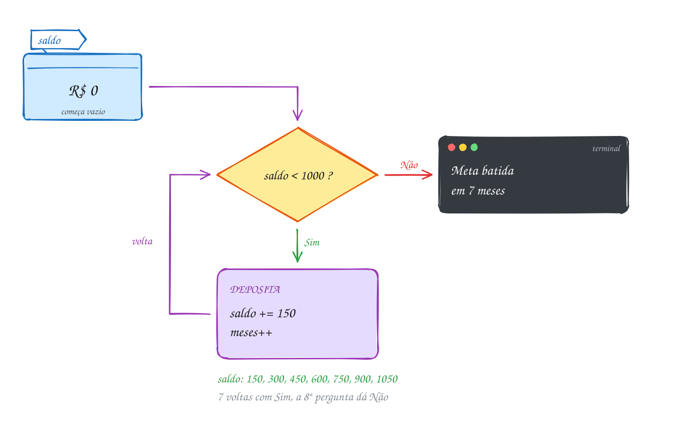</p>

```c
#include <stdio.h>

int main(void) {
    double meta = 1000.0;    // o celular custa R$ 1000
    double deposito = 150.0; // quanto você guarda por mês
    double saldo = 0.0;
    int meses = 0;

    while (saldo < meta) {   // pergunta ANTES de cada volta
        saldo = saldo + deposito;
        meses++;
        printf("Mês %d: R$ %.2f\n", meses, saldo);
    }

    printf("Meta batida em %d meses. Sobra R$ %.2f\n", meses, saldo - meta);
    return 0;
}
// Saída:
// Mês 1: R$ 150.00
// Mês 2: R$ 300.00
// Mês 3: R$ 450.00
// Mês 4: R$ 600.00
// Mês 5: R$ 750.00
// Mês 6: R$ 900.00
// Mês 7: R$ 1050.00
// Meta batida em 7 meses. Sobra R$ 50.00
```

#### Passo a passo

No teste de mesa (uma linha por pergunta, uma coluna por variável), são **8
perguntas** para **7 voltas**: a última dá Não.

| Pergunta | saldo antes | `saldo < 1000?` | saldo depois | meses |
| --- | --- | --- | --- | --- |
| 1ª | 0 | Sim | 150 | 1 |
| 2ª | 150 | Sim | 300 | 2 |
| ... | ... | Sim | ... | ... |
| 7ª | 900 | Sim | 1050 | 7 |
| 8ª | 1050 | **Não** | (sai) | 7 |

A seta de "Mostrar mês e saldo" **volta para o losango**: assim a repetição
aparece. O caminho verde passa várias vezes pelo Sim e uma pelo Não:

<p align="center">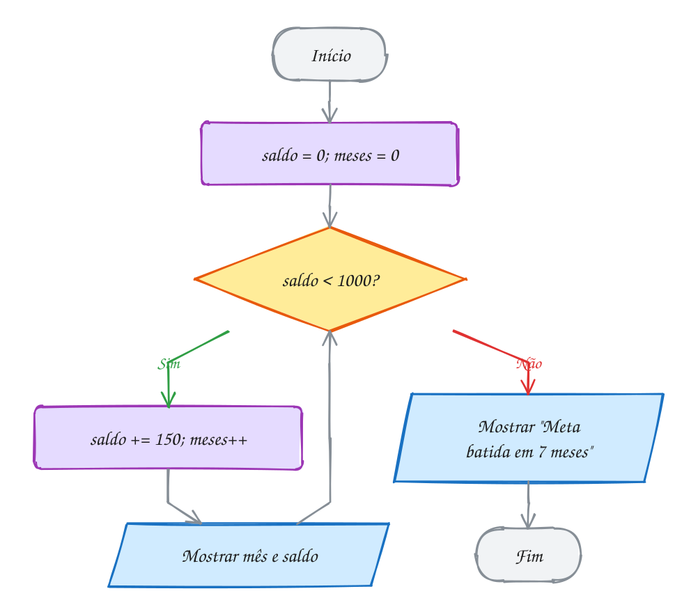</p>

**Exemplo A039 · Dividindo pizzas sem usar a divisão**

```c
#include <stdio.h>

int main(void) {
    // 47 fatias para 5 amigos: quantas cada um come e quantas sobram?
    int fatias = 47;
    int amigos = 5;
    int sobra = fatias;
    int rodadas = 0;          // cada rodada dá 1 fatia para cada amigo

    while (sobra >= amigos) { // ainda dá uma rodada completa?
        sobra = sobra - amigos;
        rodadas++;
    }
    printf("%d fatias para %d amigos: %d para cada, sobram %d\n",
           fatias, amigos, rodadas, sobra);
    printf("Conferindo com / e %%: %d e %d\n", fatias / amigos, fatias % amigos);

    // caso de borda: menos fatias que amigos. A pergunta já começa falsa
    fatias = 3;
    sobra = fatias;
    rodadas = 0;
    while (sobra >= amigos) { // 3 >= 5? Não: o corpo roda ZERO vezes
        sobra = sobra - amigos;
        rodadas++;
    }
    printf("%d fatias para %d amigos: %d para cada, sobram %d\n",
           fatias, amigos, rodadas, sobra);
    return 0;
}
// Saída:
// 47 fatias para 5 amigos: 9 para cada, sobram 2
// Conferindo com / e %: 9 e 2
// 3 fatias para 5 amigos: 0 para cada, sobram 3
```

```bash
gcc ~/LPEDC/material/A039.c -o ~/LPEDC/material/A039 && ~/LPEDC/material/A039
```

**Exemplo A040 · Desmontando um número, dígito por dígito**

```c
#include <stdio.h>

int main(void) {
    int numero = 4093;
    int resto = numero;   // cópia que vai sendo "comida"
    int quantidade = 0;
    int soma = 0;

    printf("Dígitos de %d, da direita para a esquerda:", numero);
    while (resto > 0) {
        int digito = resto % 10; // o último dígito
        printf(" %d", digito);
        soma = soma + digito;
        quantidade++;
        resto = resto / 10;      // tira o último dígito
    }
    printf("\n");

    printf("Quantidade: %d\n", quantidade);
    printf("Soma: %d\n", soma);
    return 0;
}
// Saída:
// Dígitos de 4093, da direita para a esquerda: 3 9 0 4
// Quantidade: 4
// Soma: 16
```

```bash
gcc ~/LPEDC/material/A040.c -o ~/LPEDC/material/A040 && ~/LPEDC/material/A040
```

### 0021 · Do-while

A geladeira de R$ 1.200 em 1 a 12 parcelas. A pessoa digita 0, 15 e 4: os
dois primeiros caem fora da faixa e o programa pergunta de novo; o 4 passa. O
`if` em volta do `scanf` confere se chegou um número (0006):

<p align="center">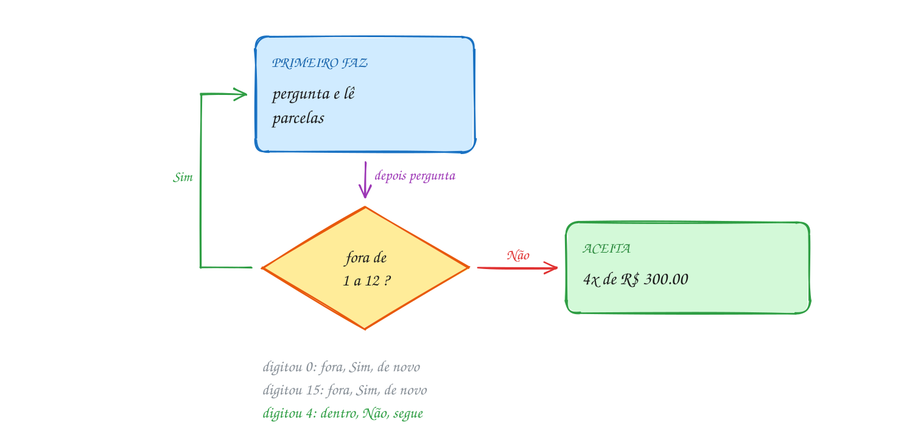</p>

```c
#include <stdio.h>

int main(void) {
    double preco = 1200.0; // a geladeira
    int parcelas;

    do {
        printf("Em quantas parcelas (1 a 12)? ");
        if (scanf("%d", &parcelas) != 1) { // letra no lugar de número
            printf("\nIsso não é um número.\n");
            return 1;
        }
    } while (parcelas < 1 || parcelas > 12); // repete ENQUANTO for inválido

    printf("%dx de R$ %.2f\n", parcelas, preco / parcelas);
    return 0;
}
// Em quantas parcelas (1 a 12)? 0
// Em quantas parcelas (1 a 12)? 15
// Em quantas parcelas (1 a 12)? 4
// 4x de R$ 300.00
```

A leitura vem **antes** do losango, e a seta do Sim volta ao começo do corpo.
No `while` o losango abria o laço; aqui ele fecha:

<p align="center">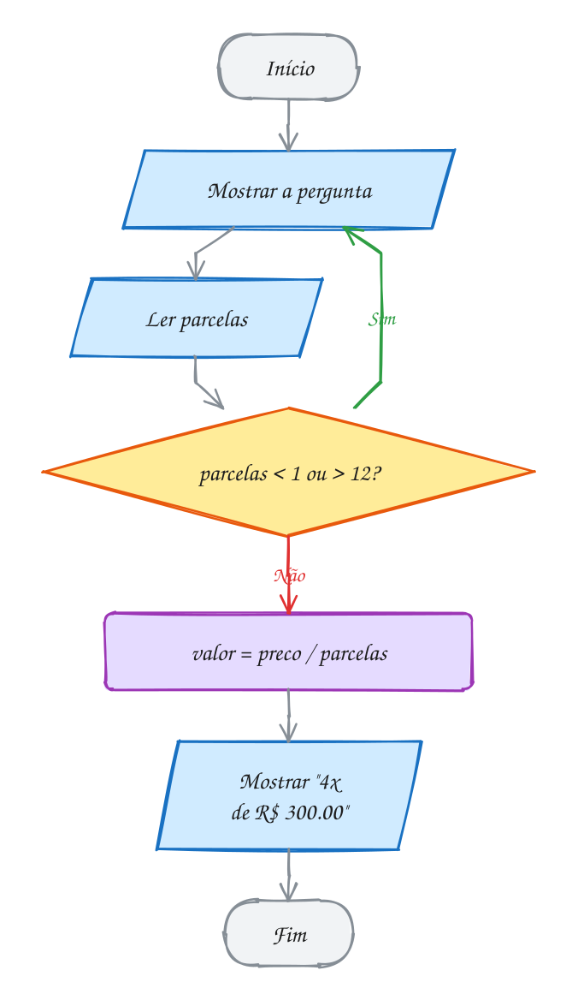</p>

**Exemplo A041 · Quantos dígitos tem o zero?**

```c
#include <stdio.h>

int main(void) {
    int numero = 0;
    int resto, digitos;

    // com while: pergunta antes, e 0 > 0 já é falso
    resto = numero;
    digitos = 0;
    while (resto > 0) {
        resto = resto / 10;
        digitos++;
    }
    printf("while:    %d tem %d dígitos\n", numero, digitos);

    // com do-while: conta o primeiro dígito antes de perguntar
    resto = numero;
    digitos = 0;
    do {
        resto = resto / 10;
        digitos++;
    } while (resto > 0);
    printf("do-while: %d tem %d dígito\n", numero, digitos);

    // para números maiores que zero, os dois concordam
    numero = 2026;
    resto = numero;
    digitos = 0;
    do {
        resto = resto / 10;
        digitos++;
    } while (resto > 0);
    printf("do-while: %d tem %d dígitos\n", numero, digitos);
    return 0;
}
// Saída:
// while:    0 tem 0 dígitos
// do-while: 0 tem 1 dígito
// do-while: 2026 tem 4 dígitos
```

```bash
gcc ~/LPEDC/material/A041.c -o ~/LPEDC/material/A041 && ~/LPEDC/material/A041
```

**Exemplo A042 · O menu do caixa eletrônico**

```c
#include <stdio.h>

int main(void) {
    double saldo = 500.0;
    double valor;
    int opcao;

    do {
        printf("1 Saldo | 2 Sacar | 0 Sair: ");
        if (scanf("%d", &opcao) != 1) {
            opcao = 0; // entrada que não é número: encerra
        }

        switch (opcao) {
        case 1:
            printf("Saldo: R$ %.2f\n", saldo);
            break;
        case 2:
            printf("Valor do saque: ");
            if (scanf("%lf", &valor) == 1 && valor > 0 && valor <= saldo) {
                saldo = saldo - valor;
                printf("Retire R$ %.2f\n", valor);
            } else {
                printf("Saque recusado.\n");
            }
            break;
        case 0:
            printf("Até logo!\n");
            break;
        default:
            printf("Opção inválida.\n");
        }
    } while (opcao != 0); // o menu aparece pelo menos uma vez

    return 0;
}
// 1 Saldo | 2 Sacar | 0 Sair: 1
// Saldo: R$ 500.00
// 1 Saldo | 2 Sacar | 0 Sair: 2
// Valor do saque: 120
// Retire R$ 120.00
// 1 Saldo | 2 Sacar | 0 Sair: 2
// Valor do saque: 900
// Saque recusado.
// 1 Saldo | 2 Sacar | 0 Sair: 7
// Opção inválida.
// 1 Saldo | 2 Sacar | 0 Sair: 1
// Saldo: R$ 380.00
// 1 Saldo | 2 Sacar | 0 Sair: 0
// Até logo!
```

```bash
gcc ~/LPEDC/material/A042.c -o ~/LPEDC/material/A042 && ~/LPEDC/material/A042
```

### 0022 · For

Uma TV de R$ 1.800 em 6 parcelas. O carnê começa com `parcela = 1` uma vez
só, pergunta "parcela <= 6?", roda o corpo, dá o passo e volta à pergunta; na
sétima, a resposta é Não:

<p align="center">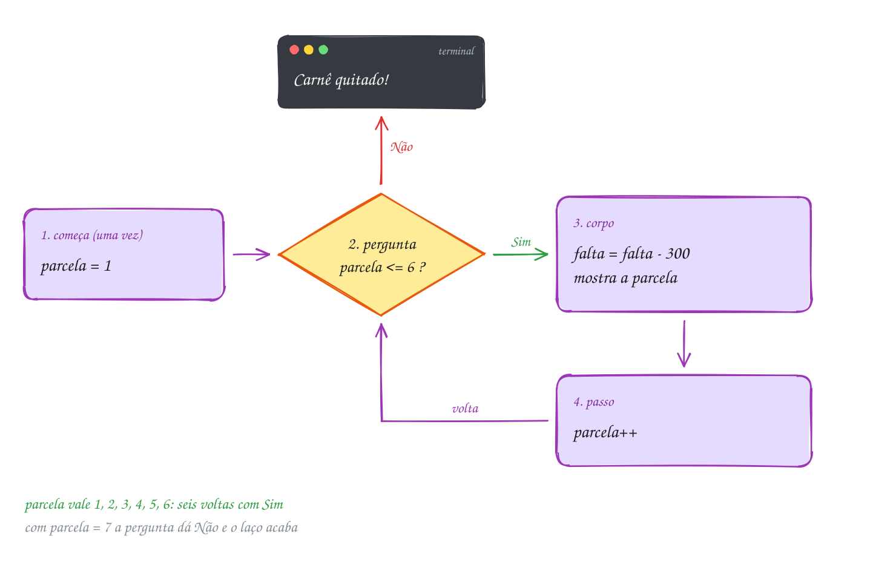</p>

```c
#include <stdio.h>

int main(void) {
    double preco = 1800.0;
    int total_parcelas = 6;
    double valor = preco / total_parcelas;
    double falta = preco;

    for (int parcela = 1; parcela <= total_parcelas; parcela++) {
        falta = falta - valor;
        printf("Parcela %d/%d: R$ %.2f (falta R$ %.2f)\n",
               parcela, total_parcelas, valor, falta);
    }
    printf("Carnê quitado!\n");
    return 0;
}
// Saída:
// Parcela 1/6: R$ 300.00 (falta R$ 1500.00)
// Parcela 2/6: R$ 300.00 (falta R$ 1200.00)
// Parcela 3/6: R$ 300.00 (falta R$ 900.00)
// Parcela 4/6: R$ 300.00 (falta R$ 600.00)
// Parcela 5/6: R$ 300.00 (falta R$ 300.00)
// Parcela 6/6: R$ 300.00 (falta R$ 0.00)
// Carnê quitado!
```

O fluxograma é igual ao de um `while`: o passo `parcela++` fica no fim do
corpo, e a seta sai dele de volta ao losango:

<p align="center">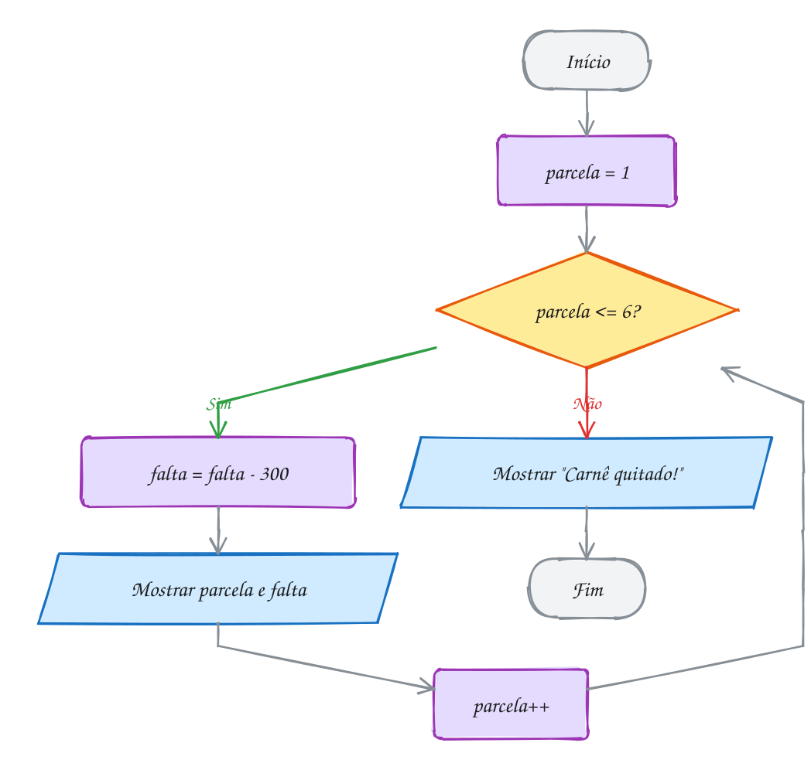</p>

**Exemplo A043 · Postes e vãos: o erro por um na cerca**

```c
#include <stdio.h>

int main(void) {
    int comprimento = 30; // a cerca tem 30 metros
    int espaco = 5;       // um poste a cada 5 metros
    int postes = 0;
    int vaos = 0;

    // postes: do metro 0 ATÉ o metro 30, inclusive (<=)
    printf("Postes nos metros:");
    for (int metro = 0; metro <= comprimento; metro += espaco) {
        printf(" %d", metro);
        postes++;
    }
    printf("\n");

    // vãos: cada vão começa num poste, menos no último (<)
    for (int metro = 0; metro < comprimento; metro += espaco) {
        vaos++;
    }

    printf("Postes: %d | Vãos: %d\n", postes, vaos);
    printf("Pela conta: %d vãos, %d postes\n",
           comprimento / espaco, comprimento / espaco + 1);
    return 0;
}
// Saída:
// Postes nos metros: 0 5 10 15 20 25 30
// Postes: 7 | Vãos: 6
// Pela conta: 6 vãos, 7 postes
```

```bash
gcc ~/LPEDC/material/A043.c -o ~/LPEDC/material/A043 && ~/LPEDC/material/A043
```

**Exemplo A044 · De 10 em 10, para trás e com letras**

```c
#include <stdio.h>

int main(void) {
    // passo de 10: tabela de temperatura
    for (int c = 0; c <= 40; c += 10) {
        double f = c * 1.8 + 32;
        printf("%2d °C = %5.1f °F\n", c, f);
    }

    // para trás: contagem regressiva do réveillon
    for (int s = 5; s >= 1; s--) {
        printf("%d... ", s);
    }
    printf("Feliz Ano Novo!\n");

    // char também é número: as fileiras do ônibus
    for (char fileira = 'A'; fileira <= 'F'; fileira++) {
        printf("%c ", fileira);
    }
    printf("\n");

    // duas variáveis com vírgula: uma sobe, a outra desce
    for (int i = 1, j = 9; i < j; i++, j--) {
        printf("(%d,%d) ", i, j);
    }
    printf("\n");
    return 0;
}
// Saída:
//  0 °C =  32.0 °F
// 10 °C =  50.0 °F
// 20 °C =  68.0 °F
// 30 °C =  86.0 °F
// 40 °C = 104.0 °F
// 5... 4... 3... 2... 1... Feliz Ano Novo!
// A B C D E F 
// (1,9) (2,8) (3,7) (4,6)
```

```bash
gcc ~/LPEDC/material/A044.c -o ~/LPEDC/material/A044 && ~/LPEDC/material/A044
```

### 0023 · Break e continue

No caixa do mercado entram 12,90, uma leitura com erro (-1), 8,50, 4,00 e, para
fechar, 0. O -1 cai no `continue` e volta direto à leitura, sem passar pela
soma; o 0 cai no `break` e sai do laço:

<p align="center">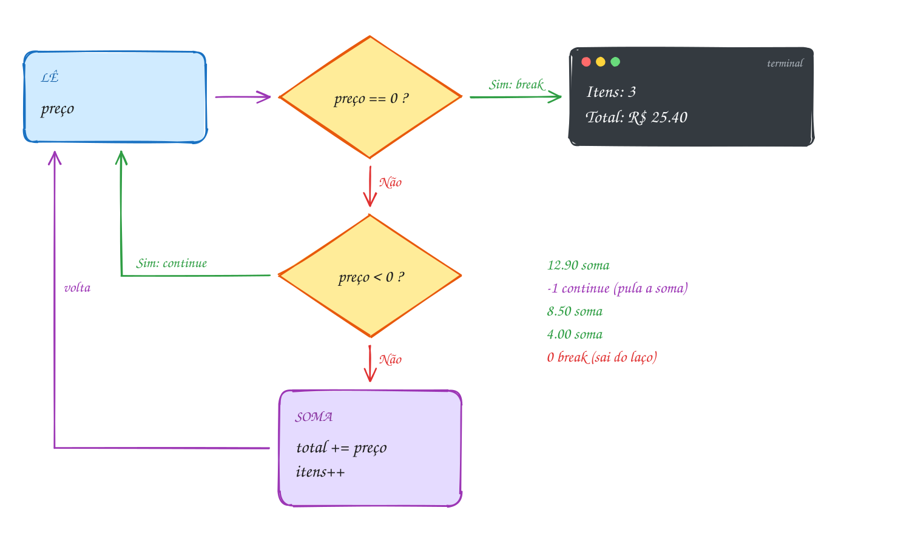</p>

```c
#include <stdio.h>

int main(void) {
    double preco;
    double total = 0.0;
    int itens = 0;
    int ignorados = 0;

    while (1) { // "para sempre": quem decide a saída é o break
        printf("Preço (0 encerra): ");
        if (scanf("%lf", &preco) != 1) {
            break;          // entrada acabou ou não é número
        }
        if (preco == 0) {
            break;          // fim da compra: sai do laço
        }
        if (preco < 0) {
            printf("  leitura inválida, passe de novo\n");
            ignorados++;
            continue;       // pula o resto e volta para o while
        }
        total = total + preco;
        itens++;
    }

    printf("Itens: %d | Ignorados: %d\n", itens, ignorados);
    printf("Total: R$ %.2f\n", total);
    return 0;
}
// Preço (0 encerra): 12.90
// Preço (0 encerra): -1
//   leitura inválida, passe de novo
// Preço (0 encerra): 8.50
// Preço (0 encerra): 4.00
// Preço (0 encerra): 0
// Itens: 3 | Ignorados: 1
// Total: R$ 25.40
```

O laço tem **duas** setas de volta para "Ler preço": a do `continue`, que pula
a soma, e a do fim normal do corpo. A **única** saída é o Sim de
"preço == 0?", o `break`:

<p align="center">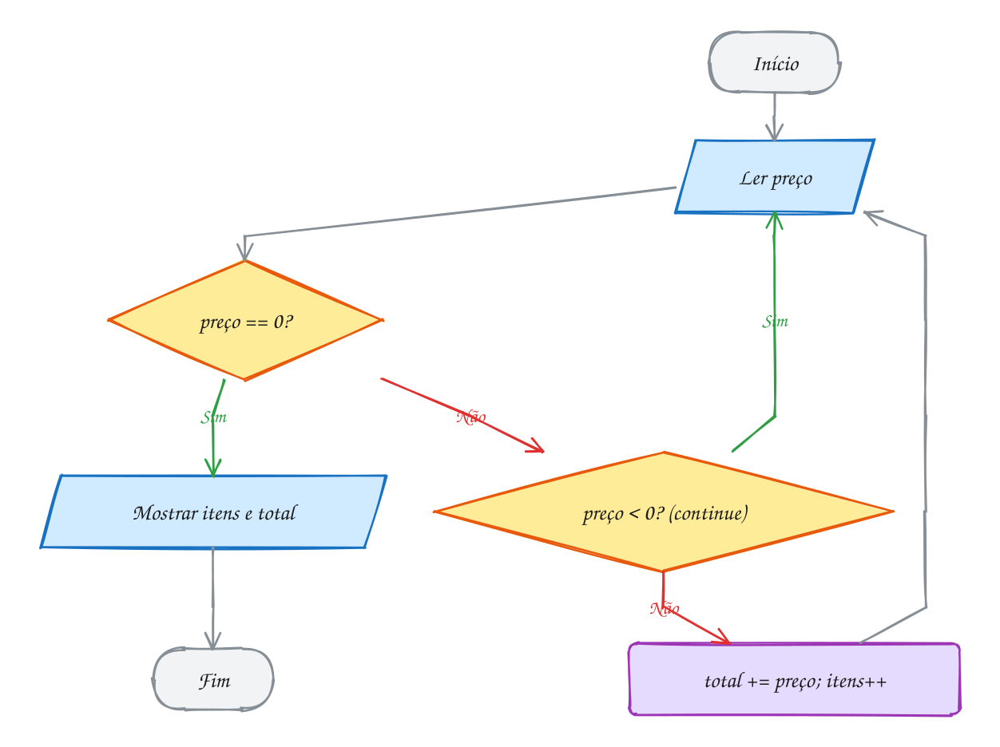</p>

**Exemplo A045 · Poltronas da excursão: continue com o passo no topo**

```c
#include <stdio.h>

int main(void) {
    int alunos = 10;    // a excursão leva 10 alunos
    int poltrona = 0;   // última poltrona olhada
    int reservadas = 0;

    // a sala tem 20 poltronas; as de número múltiplo de 5 estão quebradas
    printf("Poltronas reservadas:");
    while (poltrona < 20) {
        poltrona++;               // o passo vem PRIMEIRO: o continue não o pula
        if (poltrona % 5 == 0) {
            continue;             // quebrada: volta para a pergunta do while
        }
        printf(" %d", poltrona);
        reservadas++;
        if (reservadas == alunos) {
            break;                // todo mundo sentado: para de procurar
        }
    }
    printf("\n");

    printf("Reservadas: %d | Última poltrona olhada: %d\n", reservadas, poltrona);
    return 0;
}
// Saída:
// Poltronas reservadas: 1 2 3 4 6 7 8 9 11 12
// Reservadas: 10 | Última poltrona olhada: 12
```

```bash
gcc ~/LPEDC/material/A045.c -o ~/LPEDC/material/A045 && ~/LPEDC/material/A045
```

**Exemplo A046 · É primo? Para no primeiro divisor**

```c
#include <stdio.h>

int main(void) {
    int n = 91;
    int divisor;
    int testes = 0;

    for (divisor = 2; divisor < n; divisor++) {
        testes++;
        if (n % divisor == 0) {
            break; // achou um divisor: não precisa testar o resto
        }
    }

    // por que o laço parou? pela condição ou pelo break?
    if (divisor == n) {
        printf("%d é primo (%d testes)\n", n, testes);
    } else {
        printf("%d = %d x %d, não é primo (%d testes)\n", n, divisor, n / divisor, testes);
    }

    // continue: só os números de 1 a 15 que não são múltiplos de 3
    for (int i = 1; i <= 15; i++) {
        if (i % 3 == 0) {
            continue; // pula o printf, mas o i++ do for ainda roda
        }
        printf("%d ", i);
    }
    printf("\n");
    return 0;
}
// Saída:
// 91 = 7 x 13, não é primo (6 testes)
// 1 2 4 5 7 8 10 11 13 14
```

```bash
gcc ~/LPEDC/material/A046.c -o ~/LPEDC/material/A046 && ~/LPEDC/material/A046
```

### 0024 · Laços aninhados

O mapa de um cinema com 4 fileiras (A a D) de 5 poltronas. O desenho congela
o meio do caminho: a fileira A já saiu inteira, a B está na poltrona 3, e a C
e a D esperam o laço de fora. O `printf("\n")` fica **entre** os dois laços:

<p align="center">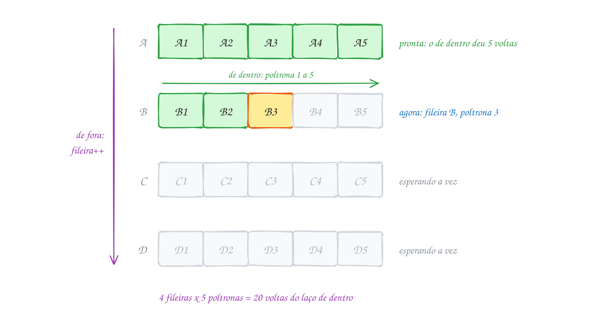</p>

```c
#include <stdio.h>

int main(void) {
    int lugares = 0;

    for (char fileira = 'A'; fileira <= 'D'; fileira++) {    // laço de fora
        for (int poltrona = 1; poltrona <= 5; poltrona++) {  // laço de dentro
            printf("%c%d ", fileira, poltrona);
            lugares++;
        }
        printf("\n"); // acabou a fileira: pula linha
    }
    printf("Total: %d lugares\n", lugares);
    return 0;
}
// Saída:
// A1 A2 A3 A4 A5 
// B1 B2 B3 B4 B5 
// C1 C2 C3 C4 C5 
// D1 D2 D3 D4 D5 
// Total: 20 lugares
```

São dois losangos, cada um com sua seta de volta; a volta pequena fica
**dentro** da grande. Logo depois do Sim de fora vem `poltrona = 1`: ali o
laço de dentro recomeça:

<p align="center">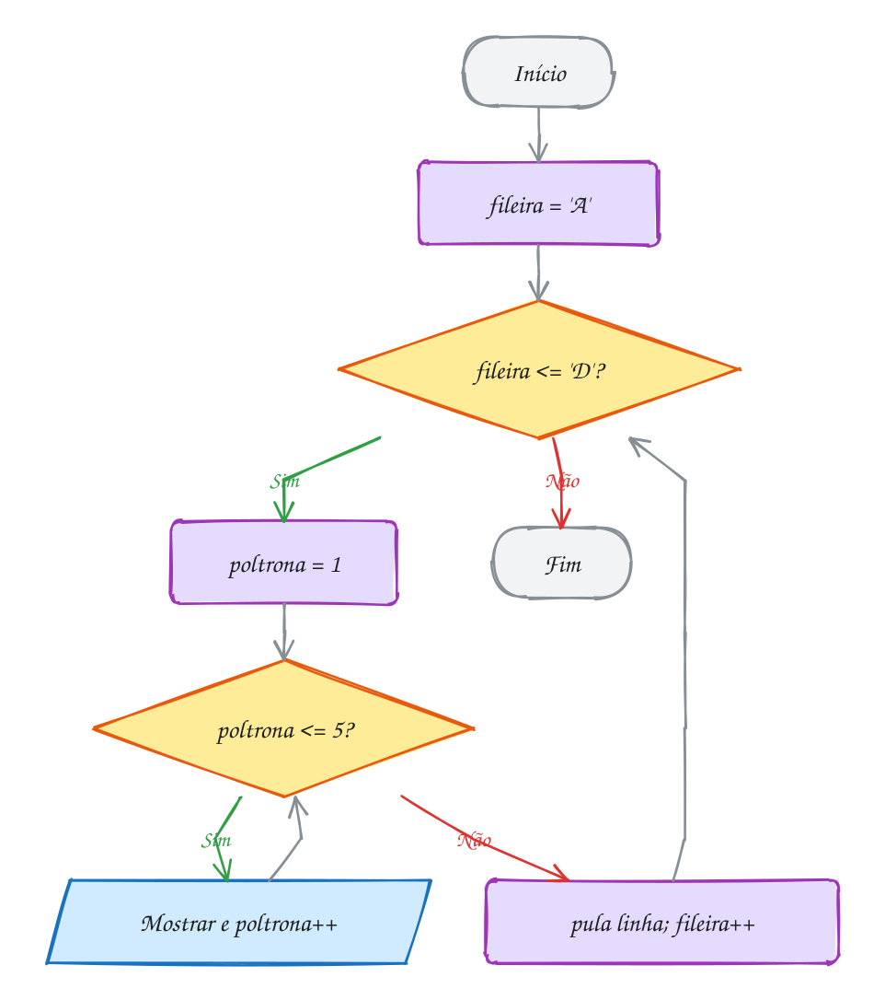</p>

**Exemplo A047 · As horas capicua do relógio digital**

```c
#include <stdio.h>

int main(void) {
    int voltas = 0;
    int capicuas = 0;

    // de 00:00 a 23:59: o minuto dá a volta inteira a cada hora
    for (int hora = 0; hora <= 23; hora++) {           // laço de fora
        for (int minuto = 0; minuto <= 59; minuto++) { // laço de dentro
            voltas++;
            // hh:mm se lê igual de trás para frente: 12:21, 05:50...
            if (hora / 10 == minuto % 10 && hora % 10 == minuto / 10) {
                printf("%02d:%02d ", hora, minuto);
                capicuas++;
                if (capicuas % 8 == 0) {
                    printf("\n");
                }
            }
        }
    }

    printf("Horários testados: %d (24 x 60)\n", voltas);
    printf("Capicuas: %d\n", capicuas);
    return 0;
}
// Saída:
// 00:00 01:10 02:20 03:30 04:40 05:50 10:01 11:11 
// 12:21 13:31 14:41 15:51 20:02 21:12 22:22 23:32 
// Horários testados: 1440 (24 x 60)
// Capicuas: 16
```

```bash
gcc ~/LPEDC/material/A047.c -o ~/LPEDC/material/A047 && ~/LPEDC/material/A047
```

**Exemplo A048 · Triângulos de asteriscos: o de dentro depende do de fora**

```c
#include <stdio.h>

int main(void) {
    int altura = 5;

    // linha 1 tem 1 asterisco, linha 2 tem 2... o limite de dentro é "linha"
    for (int linha = 1; linha <= altura; linha++) {
        for (int col = 1; col <= linha; col++) {
            printf("*");
        }
        printf("\n");
    }

    printf("\n");

    // de cabeça para baixo: espaços à esquerda, depois os asteriscos
    for (int linha = altura; linha >= 1; linha--) {
        for (int esp = 1; esp <= altura - linha; esp++) {
            printf(" ");
        }
        for (int col = 1; col <= linha; col++) {
            printf("*");
        }
        printf("\n");
    }
    return 0;
}
// Saída:
// *
// **
// ***
// ****
// *****
//
// *****
//  ****
//   ***
//    **
//     *
```

```bash
gcc ~/LPEDC/material/A048.c -o ~/LPEDC/material/A048 && ~/LPEDC/material/A048
```

### 0025 · Padrões de laço

As máximas de cinco dias: 28, 31, 36, 25 e 30 °C, e 999 como sentinela (uma
temperatura pode ser 0 ou negativa). Cada valor atualiza as caixinhas; o 999
só manda parar:

<p align="center">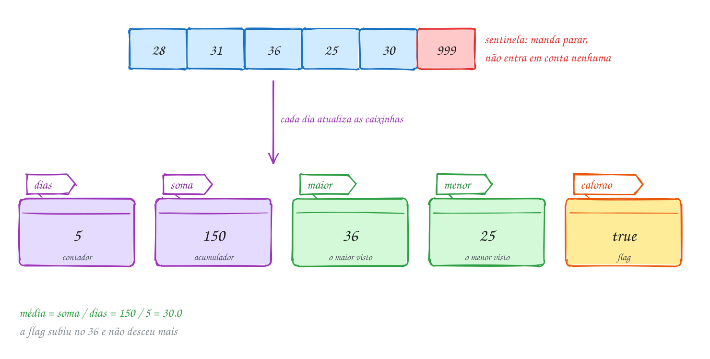</p>

```c
#include <stdbool.h>
#include <stdio.h>

int main(void) {
    const int FIM = 999;          // sentinela: nenhuma temperatura real vale 999
    int temp;
    int dias = 0;                 // contador
    int soma = 0;                 // acumulador
    int maior = 0, menor = 0;     // só valem depois do 1º dia
    bool calorao = false;         // flag: algum dia passou de 35?

    printf("Máxima do dia (999 encerra): ");
    if (scanf("%d", &temp) != 1) {
        temp = FIM;
    }
    while (temp != FIM) {
        dias++;
        soma += temp;
        if (dias == 1 || temp > maior) {
            maior = temp;
        }
        if (dias == 1 || temp < menor) {
            menor = temp;
        }
        if (temp >= 35) {
            calorao = true;       // levanta a flag e não abaixa mais
        }
        printf("Máxima do dia (999 encerra): ");
        if (scanf("%d", &temp) != 1) {
            temp = FIM;
        }
    }

    if (dias == 0) {
        printf("Nenhum dia lido.\n");
        return 0;
    }
    printf("Dias: %d\n", dias);
    printf("Média: %.1f °C\n", (double) soma / dias);
    printf("Maior: %d °C | Menor: %d °C\n", maior, menor);
    printf("Teve dia de 35 °C ou mais? %s\n", calorao ? "sim" : "não");
    return 0;
}
// Máxima do dia (999 encerra): 28
// Máxima do dia (999 encerra): 31
// Máxima do dia (999 encerra): 36
// Máxima do dia (999 encerra): 25
// Máxima do dia (999 encerra): 30
// Máxima do dia (999 encerra): 999
// Dias: 5
// Média: 30.0 °C
// Maior: 36 °C | Menor: 25 °C
// Teve dia de 35 °C ou mais? sim
```

Há **duas** caixas de leitura: "Ler temp", antes do losango, e "Ler a próxima
temp", no fim do corpo, de onde sai a seta de volta:

<p align="center">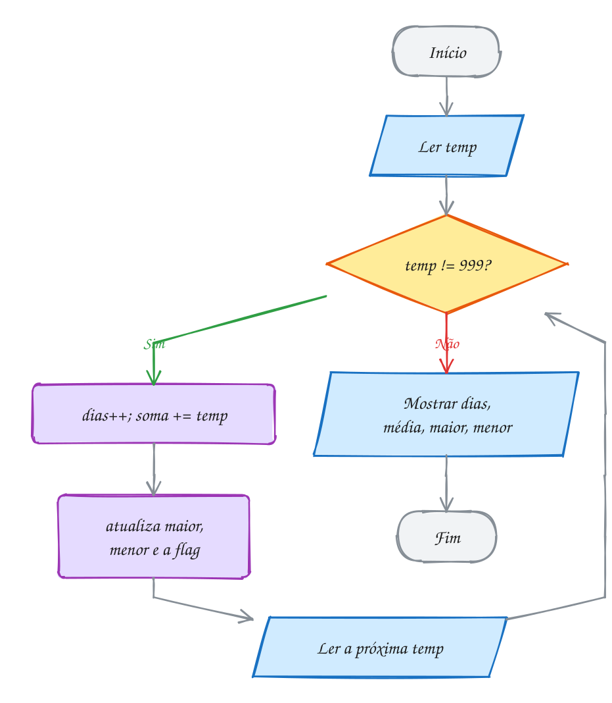</p>

**Exemplo A049 · Inverno na serra: maior e menor com INT_MIN e INT_MAX**

```c
#include <limits.h>
#include <stdbool.h>
#include <stdio.h>

int main(void) {
    const int FIM = 999;      // sentinela
    int temp;
    int dias = 0;             // contador
    int soma = 0;             // acumulador
    int geada = 0;            // contador com condição: dias com máxima <= 0
    int maior = INT_MIN;      // qualquer temperatura ganha do menor int
    int menor = INT_MAX;      // qualquer temperatura perde do maior int
    bool esquentou = false;   // flag: algum dia passou de 0 °C?

    // ler e testar a sentinela na própria pergunta do while
    printf("Máxima do dia (999 encerra): ");
    while (scanf("%d", &temp) == 1 && temp != FIM) {
        dias++;
        soma += temp;
        if (temp > maior) {
            maior = temp;     // sem o "dias == 1 ||": INT_MIN cuida disso
        }
        if (temp < menor) {
            menor = temp;
        }
        if (temp <= 0) {
            geada++;
        } else {
            esquentou = true;
        }
        printf("Máxima do dia (999 encerra): ");
    }

    if (dias == 0) {
        printf("Nenhum dia lido.\n");
        return 0;
    }
    printf("Dias: %d | Com máxima até 0 °C: %d\n", dias, geada);
    printf("Média: %.1f °C\n", (double) soma / dias);
    printf("Maior: %d °C | Menor: %d °C\n", maior, menor);
    printf("Algum dia acima de 0 °C? %s\n", esquentou ? "sim" : "não");
    return 0;
}
// Máxima do dia (999 encerra): -3
// Máxima do dia (999 encerra): -1
// Máxima do dia (999 encerra): -4
// Máxima do dia (999 encerra): 999
// Dias: 3 | Com máxima até 0 °C: 3
// Média: -2.7 °C
// Maior: -1 °C | Menor: -4 °C
// Algum dia acima de 0 °C? não
```

```bash
gcc ~/LPEDC/material/A049.c -o ~/LPEDC/material/A049 && ~/LPEDC/material/A049
```

**Exemplo A050 · Os divisores de 28: contar, somar e levantar uma flag**

```c
#include <stdbool.h>
#include <stdio.h>

int main(void) {
    int n = 28;
    int quantos = 0;      // contador: começa em 0
    int soma = 0;         // acumulador de soma: começa em 0
    long produto = 1;     // acumulador de produto: começa em 1!

    printf("Divisores de %d:", n);
    for (int d = 1; d <= n; d++) {
        if (n % d == 0) {
            printf(" %d", d);
            quantos++;
            if (d < n) {
                soma += d; // só os divisores próprios (menores que n)
            }
            produto *= d;
        }
    }
    printf("\n");

    bool perfeito = (soma == n); // a flag pode nascer de uma comparação
    printf("Quantos: %d\n", quantos);
    printf("Soma dos próprios: %d\n", soma);
    printf("Produto de todos: %ld\n", produto);
    printf("%d é perfeito? %s\n", n, perfeito ? "sim" : "não");
    return 0;
}
// Saída:
// Divisores de 28: 1 2 4 7 14 28
// Quantos: 6
// Soma dos próprios: 28
// Produto de todos: 21952
// 28 é perfeito? sim
```

```bash
gcc ~/LPEDC/material/A050.c -o ~/LPEDC/material/A050 && ~/LPEDC/material/A050
```

### 0026 · Aleatórios

No jogo de tabuleiro, só sai da prisão quem tira **dupla**. A semente 2022
entra no gerador, o `% 6 + 1` vira cada número numa face, e na quarta jogada
sai 4 e 4. A saída é a da glibc (Linux); em outro sistema, a sequência muda:

<p align="center">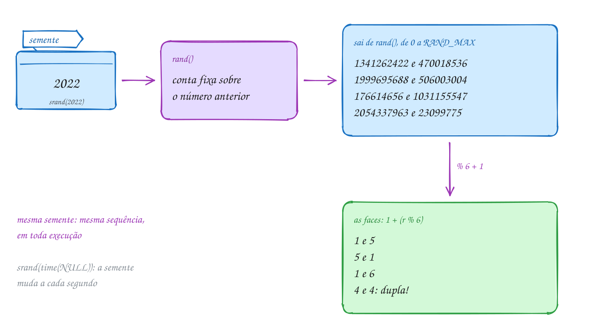</p>

```c
#include <stdio.h>
#include <stdlib.h> // rand e srand

int main(void) {
    srand(2022); // semente fixa: a mesma sequência a cada execução

    int dado1, dado2;
    int jogadas = 0;

    do {
        dado1 = 1 + rand() % 6; // rand() % 6 vai de 0 a 5; + 1 vira 1 a 6
        dado2 = 1 + rand() % 6;
        jogadas++;
        printf("Jogada %d: %d e %d\n", jogadas, dado1, dado2);
    } while (dado1 != dado2);

    printf("Dupla de %d na jogada %d. Saiu da prisão!\n", dado1, jogadas);
    return 0;
}
// Saída (glibc, Linux; em outro sistema a sequência pode ser outra):
// Jogada 1: 1 e 5
// Jogada 2: 5 e 1
// Jogada 3: 1 e 6
// Jogada 4: 4 e 4
// Dupla de 4 na jogada 4. Saiu da prisão!
```

O `srand` fica **fora** do laço e roda uma vez; o sorteio fica dentro, e a
seta do Sim volta do losango para ele:

<p align="center">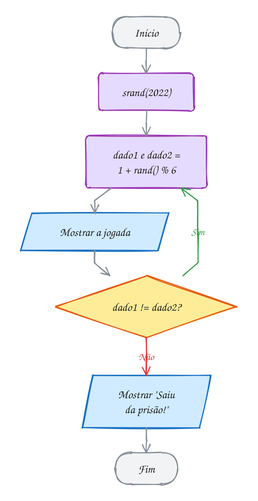</p>

**Exemplo A051 · Mesma semente, mesmo sorteio**

```c
#include <stdio.h>
#include <stdlib.h>

int main(void) {
    // bingo da quermesse: 5 bolas de 1 a 75 (a + rand() % (b - a + 1))
    srand(2026);
    printf("Semente 2026:        ");
    for (int i = 0; i < 5; i++) {
        printf("%3d", 1 + rand() % 75);
    }
    printf("\n");

    // a mesma semente de novo: a sequência recomeça do mesmo ponto
    srand(2026);
    printf("Semente 2026 de novo:");
    for (int i = 0; i < 5; i++) {
        printf("%3d", 1 + rand() % 75);
    }
    printf("\n");

    // outra semente: outra sequência
    srand(2027);
    printf("Semente 2027:        ");
    for (int i = 0; i < 5; i++) {
        printf("%3d", 1 + rand() % 75);
    }
    printf("\n");
    return 0;
}
// Saída (glibc, Linux; em outro sistema os números podem ser outros,
// mas as duas primeiras linhas continuam iguais entre si):
// Semente 2026:         38 73 74 70 62
// Semente 2026 de novo: 38 73 74 70 62
// Semente 2027:         54 29  7  5 53
```

```bash
gcc ~/LPEDC/material/A051.c -o ~/LPEDC/material/A051 && ~/LPEDC/material/A051
```

**Exemplo A052 · 6000 lançamentos: o dado é honesto?**

```c
#include <stdio.h>
#include <stdlib.h>
#include <time.h> // time

int main(void) {
    srand(42); // semente fixa, para a saída abaixo ser reproduzível
    // srand((unsigned) time(NULL)); // use esta linha para variar a cada execução

    int um = 0, dois = 0, tres = 0, quatro = 0, cinco = 0, seis = 0;
    int total = 6000;

    for (int i = 0; i < total; i++) {
        switch (1 + rand() % 6) {
        case 1: um++; break;
        case 2: dois++; break;
        case 3: tres++; break;
        case 4: quatro++; break;
        case 5: cinco++; break;
        default: seis++;
        }
    }

    printf("Face 1: %4d (%.1f%%)\n", um, 100.0 * um / total);
    printf("Face 2: %4d (%.1f%%)\n", dois, 100.0 * dois / total);
    printf("Face 3: %4d (%.1f%%)\n", tres, 100.0 * tres / total);
    printf("Face 4: %4d (%.1f%%)\n", quatro, 100.0 * quatro / total);
    printf("Face 5: %4d (%.1f%%)\n", cinco, 100.0 * cinco / total);
    printf("Face 6: %4d (%.1f%%)\n", seis, 100.0 * seis / total);
    return 0;
}
// Saída (glibc, Linux, semente 42):
// Face 1:  976 (16.3%)
// Face 2: 1001 (16.7%)
// Face 3:  978 (16.3%)
// Face 4: 1026 (17.1%)
// Face 5: 1024 (17.1%)
// Face 6:  995 (16.6%)
```

```bash
gcc ~/LPEDC/material/A052.c -o ~/LPEDC/material/A052 && ~/LPEDC/material/A052
```

### 0027 · Juntando tudo

Com a semente 21, o primeiro lançamento dá 3 + 6 = 9, que vira o ponto. O
jogo relança: 8, depois 5 (nada acontece), depois 9. Saiu o ponto antes do 7:
ganhou no quarto lançamento:

<p align="center">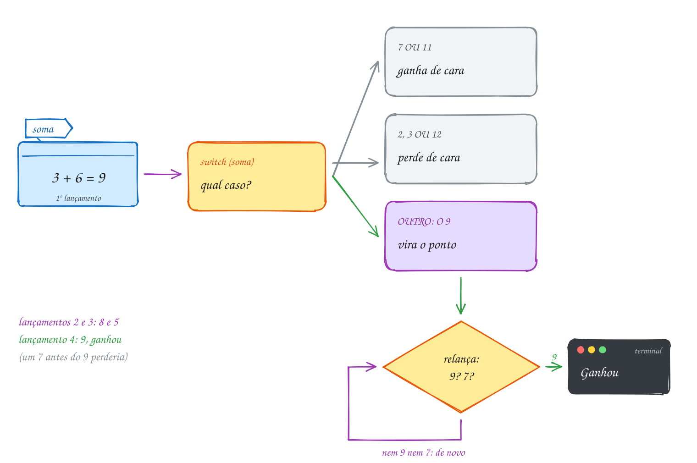</p>

```c
#include <stdio.h>
#include <stdlib.h>

int main(void) {
    srand(21); // semente fixa: a rodada abaixo se repete (glibc)

    int d1 = 1 + rand() % 6;
    int d2 = 1 + rand() % 6;
    int soma = d1 + d2;
    int lancamentos = 1;
    int ponto = 0;
    int situacao; // 1 = ganhou, -1 = perdeu, 0 = continua

    printf("Lançamento %d: %d + %d = %d\n", lancamentos, d1, d2, soma);
    switch (soma) {
    case 7:
    case 11:
        situacao = 1;          // natural: ganha de cara
        break;
    case 2:
    case 3:
    case 12:
        situacao = -1;         // craps: perde de cara
        break;
    default:
        situacao = 0;          // virou o ponto
        ponto = soma;
        printf("Ponto: %d. Agora precisa repetir o %d antes de um 7.\n", ponto, ponto);
    }

    while (situacao == 0) {
        d1 = 1 + rand() % 6;
        d2 = 1 + rand() % 6;
        soma = d1 + d2;
        lancamentos++;
        printf("Lançamento %d: %d + %d = %d\n", lancamentos, d1, d2, soma);
        if (soma == ponto) {
            situacao = 1;
        } else if (soma == 7) {
            situacao = -1;
        }
    }

    printf("%s em %d lançamentos.\n", situacao == 1 ? "Ganhou" : "Perdeu", lancamentos);
    return 0;
}
// Saída (glibc, Linux):
// Lançamento 1: 3 + 6 = 9
// Ponto: 9. Agora precisa repetir o 9 antes de um 7.
// Lançamento 2: 3 + 5 = 8
// Lançamento 3: 1 + 4 = 5
// Lançamento 4: 4 + 5 = 9
// Ganhou em 4 lançamentos.
```

O A054 vai além: menu com `do...while`, aposta validada e uma banca de R$ 100.
No fluxograma, as perguntas do primeiro lançamento acontecem **uma vez**; o
laço começa em "soma = novo lançamento" e volta pelo Não de "soma == 7?":

<p align="center">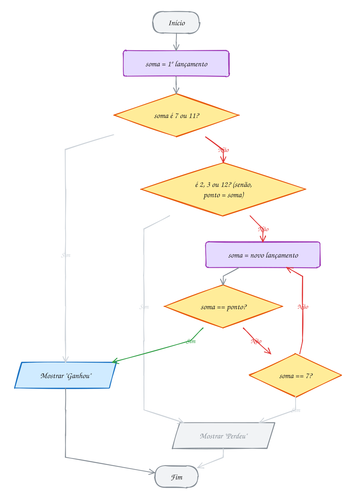</p>

**Exemplo A053 · As 36 jogadas do primeiro lançamento, sem sortear**

```c
#include <stdio.h>

int main(void) {
    int natural = 0, craps = 0, ponto = 0;

    // em vez de sortear, passa por TODAS as combinações dos dois dados
    printf("d1\\d2  1  2  3  4  5  6\n");
    for (int d1 = 1; d1 <= 6; d1++) {
        printf("%5d", d1);
        for (int d2 = 1; d2 <= 6; d2++) {
            int soma = d1 + d2;
            printf("%3d", soma);
            switch (soma) {
            case 7:
            case 11:
                natural++;  // ganha de cara
                break;
            case 2:
            case 3:
            case 12:
                craps++;    // perde de cara
                break;
            default:
                ponto++;    // o jogo continua
            }
        }
        printf("\n");
    }

    int total = natural + craps + ponto;
    printf("Ganha de cara (7 ou 11):    %2d de %d (%.1f%%)\n",
           natural, total, 100.0 * natural / total);
    printf("Perde de cara (2, 3 ou 12): %2d de %d (%.1f%%)\n",
           craps, total, 100.0 * craps / total);
    printf("Vira ponto:                 %2d de %d (%.1f%%)\n",
           ponto, total, 100.0 * ponto / total);
    return 0;
}
// Saída:
// d1\d2  1  2  3  4  5  6
//     1  2  3  4  5  6  7
//     2  3  4  5  6  7  8
//     3  4  5  6  7  8  9
//     4  5  6  7  8  9 10
//     5  6  7  8  9 10 11
//     6  7  8  9 10 11 12
// Ganha de cara (7 ou 11):     8 de 36 (22.2%)
// Perde de cara (2, 3 ou 12):  4 de 36 (11.1%)
// Vira ponto:                 24 de 36 (66.7%)
```

```bash
gcc ~/LPEDC/material/A053.c -o ~/LPEDC/material/A053 && ~/LPEDC/material/A053
```

**Exemplo A054 · Craps com banca, apostas e menu**

```c
#include <stdio.h>
#include <stdlib.h>

int main(void) {
    srand(4); // troque por srand(time(NULL)) para jogar de verdade

    int banca = 100;
    int opcao;
    int rodadas = 0, vitorias = 0;

    do {
        printf("\nBanca: R$ %d | 1 Jogar | 0 Sair: ", banca);
        if (scanf("%d", &opcao) != 1) {
            opcao = 0;
        }
        if (opcao != 1) {
            continue; // 0 (ou qualquer outra coisa) vai para o teste e sai
        }

        int aposta;
        do { // validação: de 1 até o que tem na banca
            printf("Aposta (1 a %d): ", banca);
            if (scanf("%d", &aposta) != 1) {
                return 1;
            }
        } while (aposta < 1 || aposta > banca);

        // a rodada: o mesmo algoritmo do texto, sem os printf de cada lance
        int soma = (1 + rand() % 6) + (1 + rand() % 6);
        int lancamentos = 1;
        int ponto = soma;
        int situacao = 0;
        if (soma == 7 || soma == 11) {
            situacao = 1;
        } else if (soma == 2 || soma == 3 || soma == 12) {
            situacao = -1;
        }
        while (situacao == 0) {
            soma = (1 + rand() % 6) + (1 + rand() % 6);
            lancamentos++;
            if (soma == ponto) {
                situacao = 1;
            } else if (soma == 7) {
                situacao = -1;
            }
        }

        rodadas++;
        if (situacao == 1) {
            banca += aposta;
            vitorias++;
            printf("Ganhou no %dº lançamento! +R$ %d\n", lancamentos, aposta);
        } else {
            banca -= aposta;
            printf("Perdeu no %dº lançamento. -R$ %d\n", lancamentos, aposta);
        }
    } while (opcao != 0 && banca > 0);

    if (banca == 0) {
        printf("\nA banca quebrou.\n");
    }
    printf("Rodadas: %d | Vitórias: %d | Saiu com R$ %d\n", rodadas, vitorias, banca);
    return 0;
}
// Saída (glibc, Linux), com as entradas 1, 20, 1, 50, 1, 500, 30 e 0:
//
// Banca: R$ 100 | 1 Jogar | 0 Sair: 1
// Aposta (1 a 100): 20
// Ganhou no 2º lançamento! +R$ 20
//
// Banca: R$ 120 | 1 Jogar | 0 Sair: 1
// Aposta (1 a 120): 50
// Ganhou no 4º lançamento! +R$ 50
//
// Banca: R$ 170 | 1 Jogar | 0 Sair: 1
// Aposta (1 a 170): 500
// Aposta (1 a 170): 30
// Perdeu no 3º lançamento. -R$ 30
//
// Banca: R$ 140 | 1 Jogar | 0 Sair: 0
// Rodadas: 3 | Vitórias: 2 | Saiu com R$ 140
```

```bash
gcc ~/LPEDC/material/A054.c -o ~/LPEDC/material/A054 && ~/LPEDC/material/A054
```

---

## 3. Exercícios práticos

Cada exercício é um arquivo em `material/` com o esqueleto, as dicas e o espaço para a resposta. Compile como os exemplos: `gcc ~/LPEDC/material/E007.c -o ~/LPEDC/material/E007 && ~/LPEDC/material/E007`. Resoluções em `_respostas/03-repeticoes/`.

### 0020 · While

**Exercício E116** · ★☆☆

Escreva um programa que mostre, com um while, os múltiplos de 7 menores que
50, todos na mesma linha e separados por espaço.

```text
Saída esperada:
7 14 21 28 35 42 49
```

**Exercício E117** · ★★☆

A caixa d'água tem 1000 litros e a casa gasta 180 litros por dia. Escreva um
programa com um while que diz para quantos dias COMPLETOS a água dura e
quantos litros sobram depois deles. Use as variáveis litros, consumo e dias.

```text
Saída esperada:
Dá para 5 dias. Sobram 100 litros.
```

**Exercício E118** · ★★☆

Você aplica R$ 1000.00 num investimento que rende 1% ao mês (juros sobre
juros: todo mês o saldo é multiplicado por 1.01). Em quantos meses o saldo
passa de R$ 1500.00? Mostre os meses e o saldo final com 2 casas.

```text
Saída esperada:
Passou de R$ 1500.00 em 41 meses.
Saldo: R$ 1503.75
```

**Exercício E120** · ★★★

Escreva um programa com três laços while, um depois do outro, cada um numa
linha da saída. A linha começa com a letra do trecho, mostra os valores que o
corpo imprime e termina com o número de voltas e o valor final da variável
(use um contador por trecho):

```text
A: int i = 0; while (i++ < 5) mostra i
B: int n = 100; while (n > 1) divide n por 3 e mostra o n novo
C: int k = 10; while (k < 10) soma 1 em k
```

```text
Saída esperada:
A: 1 2 3 4 5 | voltas 5, i final 6
B: 33 11 3 1 | voltas 4, n final 1
C: | voltas 0, k final 10
```

### 0021 · Do-while

**Exercício E122** · ★☆☆

Escreva um programa com três trechos, um por linha de saída. Cada linha
mostra os valores impressos pelo trecho e termina com o valor final da
variável:

```text
A: n = 10; while (n < 5) mostra n e soma 1
B: m = 10; do { mostra m e soma 1 } while (m < 5);
C: k = 10; o mesmo que o B, mas escrito com while (sem do-while)
```

```text
Saída esperada:
| A terminou com n = 10
10 | B terminou com m = 11
10 | C terminou com k = 11
```

**Exercício E123** · ★★☆

No caixa da padaria, a atendente digita o preço de cada item e o sistema
pergunta "Mais algum item? (s/n)". Escreva o programa com do-while: lê um
preço ("Preço:"), soma, pergunta e repete enquanto a resposta for s ou S.
No fim, mostra quantos itens e o total com 2 casas.
Cada pedido de leitura termina com quebra de linha (\n).

```text
Entrada:
12.50
s
7.00
S
3.25
n
```

```text
Saída esperada:
Preço:
Mais algum item? (s/n)
Preço:
Mais algum item? (s/n)
Preço:
Mais algum item? (s/n)
Itens: 3
Total: R$ 22.75
```

**Exercício E124** · ★★☆

O totem do cinema oferece 3 sessões. Escreva o programa com do-while que
pergunta "Sessão (1, 2 ou 3):" e repete a pergunta enquanto a opção for
inválida. Quando a opção for válida, mostra "Sessão N escolhida.".
Cada pedido de leitura termina com quebra de linha (\n).

```text
Entrada:
7
2
```

```text
Saída esperada:
Sessão (1, 2 ou 3):
Sessão (1, 2 ou 3):
Sessão 2 escolhida.
```

**Exercício E125** · ★★★

A senha do cartão é 4321 e a pessoa tem 3 tentativas. Escreva o programa: lê
a senha com do-while ("Senha:"), conta as tentativas e para quando acertar
OU quando acabarem as tentativas. No fim, diz "Senha correta na tentativa N."
ou, se errou as três, "Cartão bloqueado.".
Cada pedido de leitura termina com quebra de linha (\n).

```text
Entrada:
1111
2222
4321
```

```text
Saída esperada:
Senha:
Senha:
Senha:
Senha correta na tentativa 3.
```

Com as entradas 1111, 2222 e 3333, a última linha da saída é "Cartão bloqueado.".

### 0022 · For

**Exercício E128** · ★☆☆

Escreva um programa com os quatro laços abaixo, um depois do outro. Cada
um mostra os valores de x numa linha que começa com a letra do laço e, no
fim da linha, quantas voltas ele deu (use um contador para cada laço):

```text
a) for (int x = 3; x <= 20; x += 4)
b) for (int x = 50; x > 30; x -= 6)
c) for (int x = 1; x >= 10; x++)
d) for (int x = 1; x < 100; x *= 3)
```

```text
Saída esperada:
a) 3 7 11 15 19 (5 voltas)
b) 50 44 38 32 (4 voltas)
c) (0 voltas)
d) 1 3 9 27 81 (5 voltas)
```

**Exercício E129** · ★★☆

Você aplica R$ 2000.00 num CDB que rende 0,8% ao mês. Mostre o saldo mês a
mês durante 12 meses (todo mês o saldo é multiplicado por 1.008). No fim,
mostre o resultado da fórmula dos juros compostos,
saldo = 2000 * 1.008 elevado a 12, usando pow (assunto 0010).

```text
Saída esperada:
Mês  1: R$ 2016.00
Mês  2: R$ 2032.13
Mês  3: R$ 2048.39
Mês  4: R$ 2064.77
Mês  5: R$ 2081.29
Mês  6: R$ 2097.94
Mês  7: R$ 2114.72
Mês  8: R$ 2131.64
Mês  9: R$ 2148.70
Mês 10: R$ 2165.88
Mês 11: R$ 2183.21
Mês 12: R$ 2200.68
Pela fórmula: R$ 2200.68
```

```bash
gcc ~/LPEDC/material/E129.c -o ~/LPEDC/material/E129 -lm && ~/LPEDC/material/E129
```

**Exercício E130** · ★★☆

O treino manda fazer 5 séries de flexões. Escreva um programa com um for que
mostra "Série 1" até "Série 5", uma por linha.

```text
Saída esperada:
Série 1
Série 2
Série 3
Série 4
Série 5
```

**Exercício E131** · ★★★

Dá para calcular pi com uma soma infinita (série de Leibniz):

```text
pi = 4/1 - 4/3 + 4/5 - 4/7 + 4/9 - ...
```

Escreva um programa com um for que soma os primeiros 1000 termos e mostra o
resultado com 6 casas.

```text
Saída esperada:
pi ~ 3.140593
```

### 0023 · Break e continue

**Exercício E134** · ★☆☆

Escreva um programa com um for de i = 1 a 10 que mostra os valores de i numa
linha, mas pula (continue) os múltiplos de 4 e para (break) quando i for 7.
No fim da linha, mostra quantas vezes o continue aconteceu. Na linha
seguinte, repita o laço com um contador novo, mas agora o break testa i == 8.

```text
Saída esperada:
1 2 3 5 6 (continue: 1 vez)
1 2 3 5 6 7 9 10 (continue: 2 vezes)
```

**Exercício E135** · ★★☆

O elevador aguenta 600 kg e até 8 pessoas. As pessoas entram uma a uma; o
programa lê o peso de cada uma ("Peso da pessoa N:", no máximo 8 leituras)
e, se a próxima passar do limite de peso, ela espera e ninguém mais entra
("A pessoa N (P kg) espera o próximo."). No fim, mostra quantas entraram e o
peso total.
Cada pedido de leitura termina com quebra de linha (\n).

```text
Entrada:
80
95
110
70
120
90
60
```

```text
Saída esperada:
Peso da pessoa 1:
Peso da pessoa 2:
Peso da pessoa 3:
Peso da pessoa 4:
Peso da pessoa 5:
Peso da pessoa 6:
Peso da pessoa 7:
A pessoa 7 (60 kg) espera o próximo.
Entraram 6 pessoas, 565 kg.
```

**Exercício E136** · ★★☆

Um sensor manda até 5 códigos: 1 = normal, 2 = alerta, 9 = desligou. Escreva
o programa que lê os códigos com um for e um switch e mostra "normal",
"alerta" ou "sensor desligou" (qualquer outro: "código desconhecido"). O
laço tem que parar de ler no 9. No fim, mostra "Leituras: N".

```text
Entrada:
1
2
9
1
2
```

```text
Saída esperada:
normal
alerta
sensor desligou
Leituras: 3
```

**Exercício E138** · ★★★

Escreva um programa que lê notas ("Nota (-1 encerra):") e calcula a média,
sem usar break nem continue: use uma variável bool (assunto 0012) na
condição do while e if/else no corpo. Nota negativa (ou entrada inválida)
encerra; nota maior que 10 é ignorada e mostra "  nota X ignorada" (1 casa);
as demais entram na soma. Se houve alguma nota válida, mostra a média.
Cada pedido de leitura termina com quebra de linha (\n).

```text
Entrada:
8
12
6.5
9
-1
```

```text
Saída esperada:
Nota (-1 encerra):
Nota (-1 encerra):
  nota 12.0 ignorada
Nota (-1 encerra):
Nota (-1 encerra):
Nota (-1 encerra):
Média de 3 notas: 7.83
```

### 0024 · Laços aninhados

**Exercício E140** · ★☆☆

Escreva dois laços for aninhados: para i de 1 a 3, a linha i mostra os
produtos i * j com j de 1 até i. Use um contador de quantas vezes o printf
de dentro rodou e mostre-o depois dos dois laços.

```text
Saída esperada:
1
2 4
3 6 9
printf de dentro: 6 vezes
```

**Exercício E141** · ★★☆

Monte a tábua de multiplicação de 1 a 9 como uma tabela, com cabeçalho e
margem. Cada número ocupa 4 posições (%4d).

```text
Saída esperada:
  x |   1   2   3   4   5   6   7   8   9
----+------------------------------------
  1 |   1   2   3   4   5   6   7   8   9
  2 |   2   4   6   8  10  12  14  16  18
  3 |   3   6   9  12  15  18  21  24  27
  4 |   4   8  12  16  20  24  28  32  36
  5 |   5  10  15  20  25  30  35  40  45
  6 |   6  12  18  24  30  36  42  48  54
  7 |   7  14  21  28  35  42  49  56  63
  8 |   8  16  24  32  40  48  56  64  72
  9 |   9  18  27  36  45  54  63  72  81
```

**Exercício E142** · ★★☆

A escola quer a lista de chamada de 3 turmas com 4 alunos cada, uma turma
por linha, no formato T1-A1 T1-A2 ... Escreva o programa com dois while
aninhados (um para a turma, outro para o aluno).

```text
Saída esperada:
T1-A1 T1-A2 T1-A3 T1-A4
T2-A1 T2-A2 T2-A3 T2-A4
T3-A1 T3-A2 T3-A3 T3-A4
```

**Exercício E143** · ★★★

Desenhe uma pirâmide centralizada com a altura lida do teclado ("Altura:",
aceite de 1 a 20; confira o retorno do scanf).
Cada pedido de leitura termina com quebra de linha (\n).

```text
Entrada:
5
```

```text
Saída esperada:
Altura:
    *
   ***
  *****
 *******
*********
```

### 0025 · Padrões de laço

**Exercício E145** · ★☆☆

Leia as 5 notas de um aluno com um for ("Nota N:"). Mostre a soma, a média
(1 casa) e em quantas provas ele tirou 6 ou mais.
Cada pedido de leitura termina com quebra de linha (\n).

```text
Entrada:
7
4.5
8
6
9.5
```

```text
Saída esperada:
Nota 1:
Nota 2:
Nota 3:
Nota 4:
Nota 5:
Soma: 35.0
Média: 7.0
Provas com 6 ou mais: 4
```

**Exercício E147** · ★★☆

Você anotou o preço da gasolina em 6 postos do caminho. Leia os 6 preços
("Posto N:") e mostre o mais barato e o mais caro, com o NÚMERO do posto de
cada um, e a diferença entre eles.
Cada pedido de leitura termina com quebra de linha (\n).

```text
Entrada:
5.89
6.09
5.79
5.99
6.19
5.85
```

```text
Saída esperada:
Posto 1:
Posto 2:
Posto 3:
Posto 4:
Posto 5:
Posto 6:
Mais barato: posto 3 (R$ 5.79)
Mais caro: posto 5 (R$ 6.19)
Diferença: R$ 0.40 por litro
```

**Exercício E148** · ★★☆

A lanchonete anota o resultado de cada dia em reais (negativo é prejuízo) e
digita 9999 para encerrar; o 9999 não conta como dia. Escreva o programa que
lê os valores e mostra quantos dias foram, a média (2 casas) e o melhor dia.

```text
Entrada:
-30
-10
-45
9999
```

```text
Saída esperada:
Dias: 3
Média: -28.33
Melhor dia: -10
```

**Exercício E149** · ★★★

Campeonato de skate: 8 notas de 0 a 100. Leia cada nota UMA vez ("Nota N:",
sem guardar todas: vetores só no módulo 05) e mostre a maior e a segunda
maior. Se duas pessoas empatarem no topo, a segunda maior é igual à maior.
Cada pedido de leitura termina com quebra de linha (\n).

```text
Entrada:
72
95
88
95
60
81
99
70
```

```text
Saída esperada:
Nota 1:
Nota 2:
Nota 3:
Nota 4:
Nota 5:
Nota 6:
Nota 7:
Nota 8:
1º lugar: 99
2º lugar: 95
```

### 0026 · Aleatórios

**Exercício E152** · ★☆☆

Simule 20 lançamentos de uma moeda: mostre C (cara) ou K (coroa) para cada
um, na mesma linha, e no fim quantas caras e quantas coroas saíram. Use
srand(time(NULL)) para o resultado mudar a cada execução.

```text
Saída esperada (exemplo, a sua muda a cada execução):
C K K C C K C K K K C C K C K K C C K C
Caras: 10 | Coroas: 10
```

**Exercício E153** · ★★☆

O jogo clássico: o programa sorteia um número de 1 a 100 (com
srand(time(NULL))) e a pessoa tenta adivinhar ("Palpite: "). A cada palpite,
diz "Mais alto." ou "Mais baixo.". No acerto, mostra "Acertou em N
tentativas!". Se o scanf falhar (letra ou fim da entrada), o jogo encerra
mostrando o número sorteado.

```text
Saída esperada (exemplo, digitando 50, 25 e 37; o número sorteado muda a cada vez):
Palpite: 50
Mais baixo.
Palpite: 25
Mais alto.
Palpite: 37
Acertou em 3 tentativas!
```

**Exercício E154** · ★★☆

Escreva um programa que sorteia 10 lançamentos de um dado e mostra os 10
números na mesma linha. Os números têm que variar de um lançamento para o
outro e ficar sempre entre 1 e 6. Use srand(time(NULL)) uma vez só.

```text
Saída esperada (exemplo, a sua muda a cada execução):
4 1 6 3 3 5 2 6 1 4
```

**Exercício E155** · ★★★

Dá para estimar pi jogando dardos. Sorteie um ponto (x, y) com x e y entre
0 e 1: ele cai num quadrado de lado 1. O quarto de círculo de raio 1 ocupa
pi/4 desse quadrado. Então, com muitos pontos:

```text
pi ~ 4 x (pontos dentro do círculo) / (total de pontos)
```

Sorteie 1 000 000 de pontos (com srand(42)) e mostre a estimativa com 4
casas. Um ponto está dentro se x * x + y * y <= 1.

```text
Saída esperada:
Dentro do círculo: 784696 de 1000000
pi ~ 3.1388
```

### 0027 · Juntando tudo

**Exercício E157** · ★☆☆

No craps, o 7 é o número mais perigoso (e o mais comum). Lance dois dados
36 000 vezes (com srand(time(NULL))) e conte quantas vezes a soma deu 7 e
quantas deu 2. Mostre as contagens e as porcentagens com 1 casa.

```text
Saída esperada (exemplo, os números mudam a cada execução):
Soma 7: 6043 (16.8%)
Soma 2: 1012 (2.8%)
```

**Exercício E159** · ★★☆

Um número de 3 dígitos é de Armstrong quando a soma dos cubos dos dígitos
dá o próprio número: 153 = 1 + 125 + 27. Mostre todos os números de
Armstrong de 100 a 999 e quantos são.

```text
Saída esperada:
153 370 371 407
Encontrados: 4
```

**Exercício E160** · ★★☆

O controle de estoque da cantina começa com 20 salgados. Escreva o menu com
do-while e switch ("1 Vender | 2 Repor | 0 Sair:"): 1 pergunta "Quantos?"
e vende (se a quantidade for inválida ou maior que o estoque, mostra "Venda
recusada."); 2 repõe uma caixa de 10 e mostra "Repôs 10."; 0 sai; qualquer
outra mostra "Opção inválida.". No fim, mostra o estoque e o total vendido.
Cada pedido de leitura termina com quebra de linha (\n).

```text
Entrada:
1
5
1
3
0
```

```text
Saída esperada:
1 Vender | 2 Repor | 0 Sair:
Quantos?
1 Vender | 2 Repor | 0 Sair:
Quantos?
1 Vender | 2 Repor | 0 Sair:
Estoque: 12 | Vendidos: 8
```

**Exercício E161** · ★★★

O jogo dos 21 palitos: na mesa há 21 palitos. Você e o computador se
revezam, cada um tirando 1, 2 ou 3. Quem tirar o ÚLTIMO palito perde. Você
começa. Sua jogada é lida com do-while ("Você tira:") e só vale de 1 a 3 e
no máximo o que sobrou. O computador tira (palitos - 1) % 4 (se der 0, tira
1). A cada jogada, mostre quantos palitos sobraram; no fim, quem perdeu.
Cada pedido de leitura termina com quebra de linha (\n).

```text
Entrada:
3
3
2
1
2
1
```

```text
Saída esperada:
Você tira:
Sobram 18. O computador tira 1. Sobram 17.
Você tira:
Sobram 14. O computador tira 1. Sobram 13.
Você tira:
Sobram 11. O computador tira 2. Sobram 9.
Você tira:
Sobram 8. O computador tira 3. Sobram 5.
Você tira:
Sobram 3. O computador tira 2. Sobram 1.
Você tira:
Sobram 0. Você tirou o último palito. Perdeu!
```

### Lista do módulo

30 exercícios que misturam os assuntos do módulo, no ritmo da prova. Arquivos P0301.c a P0330.c, em `material/`; resoluções em `_respostas/03-repeticoes/lista/`.

#### ★☆☆ Aquecimento

**Exercício P0301** · ★☆☆ · A tabela do pão francês

A padaria quer colar no balcão uma tabela com o preço de 1 a 8 pães, a
R$ 0.85 cada. Escreva um programa com um for que mostre a tabela, com a
quantidade em 2 colunas e o preço em 5:

```text
Saída esperada:
 1 pão(es): R$  0.85
 2 pão(es): R$  1.70
 3 pão(es): R$  2.55
 4 pão(es): R$  3.40
 5 pão(es): R$  4.25
 6 pão(es): R$  5.10
 7 pão(es): R$  5.95
 8 pão(es): R$  6.80
```

**Resposta esperada:** de R$ 0.85 a R$ 6.80.

---

**Exercício P0302** · ★☆☆ · O desafio do cofrinho

No desafio do cofrinho, você guarda R$ 1 no dia 1, R$ 2 no dia 2, e assim
por diante, um real a mais por dia. Escreva um programa com while que mostre
quanto há no cofrinho ao fim dos dias 10, 20 e 30, e o total final:

```text
Saída esperada:
Dia 10: R$ 55
Dia 20: R$ 210
Dia 30: R$ 465
Total em 30 dias: R$ 465
```

---

**Exercício P0303** · ★☆☆ · As filas possíveis no banco

De quantas maneiras 10 pessoas podem formar uma fila? É 10! (10 × 9 × ... ×
1). Escreva um programa com for que calcule 10! e 20!, num unsigned long long
(o 20! já não cabe num int de jeito nenhum):

```text
Saída esperada:
10! = 3628800
20! = 2432902008176640000
```

**Resposta esperada:** 3628800 e 2432902008176640000.

---

**Exercício P0304** · ★☆☆ · Os dígitos do protocolo

O atendimento deu o protocolo 2026110903. Escreva um programa com while que
conte quantos dígitos ele tem e some esses dígitos, tirando um por vez com %
e / por 10. O número não cabe num int: use long long.

```text
Saída esperada:
Protocolo: 2026110903
Dígitos: 10
Soma dos dígitos: 24
```

**Resposta esperada:** 10 dígitos, soma 24.

---

**Exercício P0305** · ★☆☆ · O tamanho do açaí

A tela do quiosque pede o tamanho do açaí: 1 (300 ml, R$ 12.00), 2 (500 ml,
R$ 18.00) ou 3 (700 ml, R$ 24.00). Escreva um programa com do...while que
repita a pergunta até a pessoa digitar 1, 2 ou 3, e depois mostre o preço.
Um exemplo de interação, em que a pessoa errou duas vezes:

```text
Saída esperada:
Tamanho (1, 2 ou 3): 0
Opção inválida.
Tamanho (1, 2 ou 3): 5
Opção inválida.
Tamanho (1, 2 ou 3): 2
Açaí de 500 ml: R$ 18.00
```

**Resposta esperada:** com 0, 5 e 2, Açaí de 500 ml: R$ 18.00.

---

**Exercício P0306** · ★☆☆ · Os números da sorte da promoção

Na promoção do mercado, ganham brinde os cupons cujo número, de 1 a 99, é
múltiplo de 3 ou de 5. Escreva um programa que conte quantos números de 1 a
99 ganham brinde e some esses números:

```text
Saída esperada:
Cupons premiados: 46
Soma dos números: 2318
```

**Resposta esperada:** 46 cupons, soma 2318.

---

**Exercício P0307** · ★☆☆ · A fofoca no grupo da família

Uma fofoca começa com 1 pessoa. A cada rodada, cada pessoa que sabe conta
para outras 2, então quem sabe triplica (1, 3, 9, 27...). Escreva um programa
com while que mostre cada rodada e pare na primeira em que mais de 1 milhão
de pessoas já saibam:

```text
Saída esperada:
Rodada 1: 3 pessoas
Rodada 2: 9 pessoas
Rodada 3: 27 pessoas
Rodada 4: 81 pessoas
Rodada 5: 243 pessoas
Rodada 6: 729 pessoas
Rodada 7: 2187 pessoas
Rodada 8: 6561 pessoas
Rodada 9: 19683 pessoas
Rodada 10: 59049 pessoas
Rodada 11: 177147 pessoas
Rodada 12: 531441 pessoas
Rodada 13: 1594323 pessoas
Passou de 1 milhão na rodada 13
```

---

**Exercício P0308** · ★☆☆ · O jogo do PIM

No jogo do PIM, a turma conta de 1 em diante, mas todo múltiplo de 4, e todo
número que termina em 4, vira "PIM". Escreva um programa que mostre a
contagem de 1 a 20, um número por linha, trocando esses números por PIM:

```text
Saída esperada:
1
2
3
PIM
5
6
7
PIM
9
10
11
PIM
13
PIM
15
PIM
17
18
19
PIM
```

**Resposta esperada:** PIM no 4, 8, 12, 14, 16 e 20.

---

**Exercício P0309** · ★☆☆ · O mapa da sala de cinema

A sala pequena do cinema tem as fileiras A a E e 6 cadeiras em cada. Escreva
um programa com dois for, um dentro do outro, que mostre o mapa dos
assentos. Use um char para a fileira: 'A' + 1 é 'B', porque char é número.

```text
Saída esperada:
A1 A2 A3 A4 A5 A6
B1 B2 B3 B4 B5 B6
C1 C2 C3 C4 C5 C6
D1 D2 D3 D4 D5 D6
E1 E2 E3 E4 E5 E6
```

**Resposta esperada:** 5 linhas de 6 assentos, de A1 a E6.

---

**Exercício P0310** · ★☆☆ · A parcela que sobrou

A geladeira foi parcelada em 10 vezes de R$ 189.90, mas o programa abaixo
mostra 11 parcelas e um total errado. O erro está no for, de propósito.
Conserte o laço para mostrar as 10 parcelas e o total certo:

```text
Saída esperada:
Parcela 1: R$ 189.90
Parcela 2: R$ 189.90
Parcela 3: R$ 189.90
Parcela 4: R$ 189.90
Parcela 5: R$ 189.90
Parcela 6: R$ 189.90
Parcela 7: R$ 189.90
Parcela 8: R$ 189.90
Parcela 9: R$ 189.90
Parcela 10: R$ 189.90
Total: R$ 1899.00
```

**Resposta esperada:** 10 parcelas, Total: R$ 1899.00.

#### ★★☆ Para pensar

**Exercício P0311** · ★★☆ · O pedido de trás para frente

O sistema da loja grava o número do pedido invertido para embaralhar a
etiqueta. Escreva um programa com while que inverta o pedido 120345 (o
resultado é 543021) e confira se o número é igual ao seu inverso (capicua).
Faça o mesmo com 12321:

```text
Saída esperada:
120345 invertido: 543021 (não é capicua)
12321 invertido: 12321 (é capicua)
```

**Resposta esperada:** 543021 e 12321.

---

**Exercício P0312** · ★★☆ · Os dois ônibus no mesmo ponto

No terminal, o ônibus 101 sai a cada 12 minutos e o 202 a cada 18. Os dois
saíram juntos às 06:00. Escreva um programa que descubra, com um laço, daqui
a quantos minutos eles saem juntos de novo (o MMC de 12 e 18), e mostre os
três próximos horários em que isso acontece:

```text
Saída esperada:
Saem juntos a cada 36 minutos
06:36
07:12
07:48
```

**Resposta esperada:** 36 minutos; 06:36, 07:12 e 07:48.

---

**Exercício P0313** · ★★☆ · Os números amigos

Dois números são amigos quando a soma dos divisores próprios de um (os
divisores menores que ele) dá o outro, e vice-versa. Escreva um programa que
some os divisores próprios de 220 e de 284 com um laço e diga se eles são
amigos:

```text
Saída esperada:
Divisores de 220 somam 284
Divisores de 284 somam 220
220 e 284 são amigos
```

**Resposta esperada:** 284 e 220, são amigos.

---

**Exercício P0314** · ★★☆ · O próximo ano primo

2026 não é primo (é par). Escreva um programa que ache o primeiro ano primo
depois de 2026 e o último ano primo antes de 2026. Para testar se n é primo,
basta tentar os divisores d com d * d <= n, e dá para parar no primeiro que
dividir (break):

```text
Saída esperada:
Próximo ano primo: 2027
Último ano primo antes de 2026: 2017
```

**Resposta esperada:** 2027 e 2017.

---

**Exercício P0315** · ★★☆ · A dívida do rotativo

Uma dívida de R$ 1000.00 no rotativo do cartão cresce 14% ao mês (juros sobre
juros). Escreva um programa com while que mostre o saldo mês a mês até a
dívida passar do dobro, e diga em quantos meses isso aconteceu:

```text
Saída esperada:
Mês 1: R$ 1140.00
Mês 2: R$ 1299.60
Mês 3: R$ 1481.54
Mês 4: R$ 1688.96
Mês 5: R$ 1925.41
Mês 6: R$ 2194.97
A dívida dobrou em 6 meses
```

---

**Exercício P0316** · ★★☆ · O triângulo de Floyd

No triângulo de Floyd, os números naturais vão enchendo as linhas: a linha 1
tem um número, a linha 2 tem dois, e assim por diante. Escreva um programa
com laços aninhados que mostre as 5 primeiras linhas, cada número com %3d, e
a soma da última linha:

```text
Saída esperada:
  1
  2  3
  4  5  6
  7  8  9 10
 11 12 13 14 15
Soma da linha 5: 65
```

---

**Exercício P0317** · ★★☆ · A eleição do síndico

Na assembleia, cada morador digita o voto: 1 para a Marta, 2 para o Jorge e
qualquer outro número positivo é nulo. O 0 encerra a votação (sentinela).
Escreva um programa que conte os votos e mostre o resultado, o percentual de
nulos e quem venceu (ou se deu empate). Um exemplo de interação, com os
votos 1 2 1 7 1 2 0:

```text
Saída esperada:
Voto (0 encerra): Voto (0 encerra): Voto (0 encerra): Voto (0 encerra): Voto (0 encerra): Voto (0 encerra): Voto (0 encerra):
Marta: 3
Jorge: 2
Nulos: 1 (16.7%)
Vencedor: Marta
```

**Resposta esperada:** Marta 3, Jorge 2, Nulos 1 (16.7%), Vencedor: Marta.

---

**Exercício P0318** · ★★☆ · A soma que demora a crescer

A soma 1 + 1/2 + 1/3 + 1/4 + ... cresce para sempre, mas bem devagar.
Escreva um programa com while que descubra quantos termos são precisos para
a soma passar de 3, e depois de 5, e mostre a soma em cada caso:

```text
Saída esperada:
Passa de 3 com 11 termos (soma 3.0199)
Passa de 5 com 83 termos (soma 5.0021)
```

**Resposta esperada:** 11 termos e 83 termos.

---

**Exercício P0319** · ★★☆ · O desconto por quantidade

A distribuidora de água dá 2% de desconto por galão comprado, até o máximo de
15%. O galão custa R$ 12.00. Escreva um programa que mostre a tabela de 1 a
10 galões, com o desconto e o total de cada linha:

```text
Saída esperada:
 1 galão(ões):  2% -> R$  11.76
 2 galão(ões):  4% -> R$  23.04
 3 galão(ões):  6% -> R$  33.84
 4 galão(ões):  8% -> R$  44.16
 5 galão(ões): 10% -> R$  54.00
 6 galão(ões): 12% -> R$  63.36
 7 galão(ões): 14% -> R$  72.24
 8 galão(ões): 15% -> R$  81.60
 9 galão(ões): 15% -> R$  91.80
10 galão(ões): 15% -> R$ 102.00
```

**Resposta esperada:** a tabela acima, terminando em R$ 102.00.

---

**Exercício P0320** · ★★☆ · A média da turma que dá errado

O programa abaixo deveria somar as 5 notas do simulado (7, 9, 6, 8 e 10) e
mostrar a média 8.0, mas mostra 2.0. São dois erros de acumulador, de
propósito: um zera a soma no lugar errado e o outro faz a divisão inteira.
Conserte os dois:

```text
Saída esperada:
Soma: 40
Média: 8.0
```

**Resposta esperada:** Soma: 40, Média: 8.0.

#### ★★★ Desafio

**Exercício P0321** · ★★★ · O calendário de qualquer mês

Escreva um programa que leia o mês e o ano e mostre o calendário daquele mês,
com a semana começando no domingo e cada dia em 3 posições (%3d). O programa
descobre sozinho em que dia da semana cai o dia 1, com a fórmula (a = (14 −
mês) / 12, y = ano − a, m = mês + 12a − 2, semana = (1 + y + y/4 − y/100 +
y/400 + 31m/12) % 7), e quantos dias o mês tem, com bissexto para fevereiro.
Repita a leitura até o mês valer de 1 a 12. No fim, mostre quantos sábados e
domingos o mês tem:

```text
Saída esperada:
Mês e ano: 2 2028
  D  S  T  Q  Q  S  S
          1  2  3  4  5
  6  7  8  9 10 11 12
 13 14 15 16 17 18 19
 20 21 22 23 24 25 26
 27 28 29
Fins de semana: 8 dias
```

**Resposta esperada:** fevereiro de 2028 começa na terça e tem 29 dias; 8 dias de fim de semana.

---

**Exercício P0322** · ★★★ · De decimal para qualquer base

Escreva um programa que leia um número inteiro positivo e uma base de 2 a 16
e mostre o número naquela base, com os dígitos de 10 a 15 como A a F. Ainda
não há vetores, então você não pode guardar os restos para mostrar ao
contrário: em vez disso, ache a maior potência da base que cabe no número e
vá descendo, mostrando um dígito por potência. Repita a pergunta da base até
ela valer de 2 a 16. Duas interações:

```text
Saída esperada:
Número e base: 2026 16
2026 na base 16: 7EA
```

```text
Número e base: 2026 2
2026 na base 2: 11111101010
```

**Resposta esperada:** 7EA na base 16; 11111101010 na base 2; 2026 na base 8 é 3752.

---

**Exercício P0323** · ★★★ · Validação de CPF com laço

Escreva um programa que leia um CPF de 11 dígitos, só números, num long long,
e diga se ele é válido. Separe os dígitos com um laço. Regras: CPF com os 11
dígitos iguais é inválido; o 1º verificador vem dos 9 primeiros dígitos com
pesos de 10 a 2; o 2º vem dos 10 primeiros com pesos de 11 a 2; em cada um,
r = soma % 11 e o dígito é 0 se r < 2, senão 11 − r. Três interações:

```text
Saída esperada:
CPF (11 dígitos): 11144477735
CPF válido
```

```text
CPF (11 dígitos): 11144477734
CPF inválido: o 2º dígito deveria ser 5
```

```text
CPF (11 dígitos): 22222222222
CPF inválido: dígitos todos iguais
```

**Resposta esperada:** as três saídas acima.

---

**Exercício P0324** · ★★★ · Os primos até 10 000

Sem vetor, não dá para montar o crivo de Eratóstenes, mas dá para testar cada
número com a versão econômica: descarte os pares (fora o 2) e tente só os
divisores ímpares d com d * d <= n. Escreva um programa que conte os primos
até 10 000, mostre o maior deles e o maior buraco entre dois primos
seguidos (e quais são eles):

```text
Saída esperada:
Primos até 10000: 1229
Maior primo: 9973
Maior buraco: 36, entre 9551 e 9587
```

**Resposta esperada:** 1229 primos, maior 9973, buraco de 36 entre 9551 e 9587.

---

**Exercício P0325** · ★★★ · A rotina de Kaprekar

Pegue um número de 4 dígitos que não tenha os quatro iguais. Ordene os
dígitos do maior para o menor e do menor para o maior, e subtraia. Repita com
o resultado (mantendo zeros à esquerda, como em 0378). Em no máximo 7 passos
você chega em 6174 e fica lá para sempre. Escreva um programa que mostre os
passos a partir de 3524. Ainda sem vetor, para ordenar os dígitos, ande pelos
valores de 9 a 0 e, para cada valor, conte quantas vezes ele aparece:

```text
Saída esperada:
5432 - 2345 = 3087
8730 - 0378 = 8352
8532 - 2358 = 6174
Chegou em 6174 em 3 passos
```

**Resposta esperada:** 3 passos até 6174.

---

**Exercício P0326** · ★★★ · A tabela do empréstimo

Você pegou R$ 1200.00 emprestado em 6 parcelas iguais, com juros de 2% ao
mês (tabela Price). A parcela é P = V · i / (1 − (1 + i)^−n). Todo mês, os
juros são i vezes o saldo devedor, e o resto da parcela amortiza a dívida.
Escreva um programa que mostre a tabela mês a mês e, no fim, o total pago e
o total de juros:

```text
Saída esperada:
Parcela: R$ 214.23
Mês  Juros   Amortização  Saldo
 1   24.00      190.23   1009.77
 2   20.20      194.04    815.73
 3   16.31      197.92    617.82
 4   12.36      201.87    415.94
 5    8.32      205.91    210.03
 6    4.20      210.03      0.00
Total pago: R$ 1285.39
Total de juros: R$ 85.39
```

```bash
gcc ~/LPEDC/material/P0326.c -o ~/LPEDC/material/P0326 -lm && ~/LPEDC/material/P0326
```

---

**Exercício P0327** · ★★★ · O juro escondido no parcelamento

A loja anuncia uma TV de R$ 1000.00 "em 10 vezes de R$ 120.00". Qual é o juro
mensal escondido? Não há fórmula direta, mas dá para achar por bissecção: a
parcela P(i) = V · i / (1 − (1 + i)^−n) cresce com i. Comece com a taxa entre
0.0001 e 1 (0,01% e 100%), teste o meio, e jogue fora a metade em que a
resposta não está, até o intervalo ficar menor que 0.0000001. Mostre a taxa
e quantas voltas foram precisas:

```text
Saída esperada:
Taxa mensal: 3.46%
Voltas da bissecção: 24
Conferindo: parcela de R$ 120.00
```

```bash
gcc ~/LPEDC/material/P0327.c -o ~/LPEDC/material/P0327 -lm && ~/LPEDC/material/P0327
```

---

**Exercício P0328** · ★★★ · As datas palíndromas do século

A data 12/02/2021, escrita como 12022021, se lê igual de trás para frente.
Escreva um programa que ache todas as datas palíndromas (ddmmaaaa) de 2000 a
2099. Para cada ano, inverta os 4 dígitos: os dois primeiros do inverso são o
dia, os dois últimos são o mês. Mostre só as datas que existem de verdade
(mês de 1 a 12, dia dentro do mês, fevereiro com bissexto) e quantas são:

```text
Saída esperada:
10/02/2001
20/02/2002
01/02/2010
11/02/2011
21/02/2012
02/02/2020
12/02/2021
22/02/2022
03/02/2030
13/02/2031
23/02/2032
04/02/2040
14/02/2041
24/02/2042
05/02/2050
15/02/2051
25/02/2052
06/02/2060
16/02/2061
26/02/2062
07/02/2070
17/02/2071
27/02/2072
08/02/2080
18/02/2081
28/02/2082
09/02/2090
19/02/2091
29/02/2092
Datas palíndromas no século: 29
```

**Resposta esperada:** 29 datas, de 10/02/2001 a 29/02/2092.

---

**Exercício P0329** · ★★★ · Monty Hall no programa de auditório

No programa de auditório, há 3 portas e um carro atrás de uma delas. Você
escolhe uma porta; o apresentador, que sabe onde está o carro, abre outra
porta com um bode; e pergunta se você quer trocar. Escreva uma simulação com
rand de 1 000 000 de rodadas que conte quantas vezes você ganharia ficando e
quantas ganharia trocando, e mostre os percentuais sem casas decimais:

```text
Saída esperada:
Rodadas: 1000000
Ficando: 33% de vitórias
Trocando: 67% de vitórias
```

**Resposta esperada:** 33% ficando, 67% trocando.

---

**Exercício P0330** · ★★★ · O triângulo de Pascal

No triângulo de Pascal, cada número é a soma dos dois de cima. Sem vetor, dá
para calcular cada linha da esquerda para a direita: o primeiro é 1, e o
próximo é c = c * (n − k) / (k + 1), onde n é o número da linha (começando
em 0) e k a posição. Escreva um programa que mostre as 7 primeiras linhas,
centralizadas (2 espaços por linha que falta), cada número com %4d, e a soma
de cada linha:

```text
Saída esperada:
               1   (soma 1)
             1   1   (soma 2)
           1   2   1   (soma 4)
         1   3   3   1   (soma 8)
       1   4   6   4   1   (soma 16)
     1   5  10  10   5   1   (soma 32)
   1   6  15  20  15   6   1   (soma 64)
```

**Resposta esperada:** a última linha é 1 6 15 20 15 6 1, soma 64.

---

### Desafios do módulo

Problemas extras, do médio ao difícil. Crie um arquivo seu para cada um e
compile com as flags de estudo.

**1. Os primos até 100.** Mostre todos os números primos de 2 a 100 e quantos
são. Para cada candidato, teste os divisores com um laço de dentro e saia dele
com `break` no primeiro divisor encontrado.

<details><summary>Resposta</summary>

São **25** primos, de 2 a **97**. Para ficar rápido, o laço de dentro só
precisa ir até a raiz do número: `for (d = 2; d * d <= n; d++)`. Se `n` tem
um divisor maior que a raiz, tem também um menor, que já foi testado.

</details>

**2. Fibonacci passa de mil.** A sequência começa com 1, 1, e cada termo é a
soma dos dois anteriores. Escreva um programa que mostre os termos numa linha
até o primeiro maior que 1000 e, na linha de baixo, esse termo e a posição
dele, contando as posições numa variável.

<details><summary>Resposta</summary>

```text
1 1 2 3 5 8 13 21 34 55 89 144 233 377 610 987 1597
Primeiro acima de 1000: 1597 (posição 17)
```

É um `while (b <= 1000)`: você sabe quando parar, mas não quantas voltas são.
O truque é guardar os dois últimos: `prox = a + b; a = b; b = prox;`. A
posição começa em 2 (os dois primeiros 1 já estão contados) e sobe a cada
volta.

</details>

**3. O MDC de Euclides.** O maior divisor comum de dois números não muda se
você trocar o par `(a, b)` por `(b, a % b)`. Repita até `b` virar 0: o MDC é o
`a` que sobrou. Calcule o MDC de 1071 e 462 e conte as voltas.

<details><summary>Resposta</summary>

(1071, 462) → (462, 147) → (147, 21) → (21, 0). MDC = **21**, em **3**
voltas. O laço precisa de uma variável auxiliar: `resto = a % b; a = b; b =
resto;`. Esse algoritmo tem mais de 2.300 anos e ainda é o que se usa.

</details>

**4. Decimal para binário.** Leia um inteiro de 0 a 255 e mostre os 8 bits,
do mais significativo para o menos. Teste com 200.

<details><summary>Resposta</summary>

200 → **11001000**. Um `for` com a potência começando em 128 e dividindo por
2 a cada volta: se `n >= potencia`, mostra 1 e subtrai; senão, mostra 0. Pelo
caminho do `% 2` os bits saem ao contrário (do último para o primeiro), e
sem vetor não dá para guardar e inverter.

</details>

**5. A raiz quadrada de Herão.** Para calcular a raiz de `n`, comece com
`x = n` e repita `x = (x + n / x) / 2` até a diferença entre dois valores
seguidos ficar menor que 0,000000001. Calcule a raiz de 2 e conte as voltas.
Compare com `sqrt(2)`.

<details><summary>Resposta</summary>

**1.414213562** em **5** voltas (2 → 1,5 → 1,41667 → 1,41421569 →
1,41421356...). O número de casas certas praticamente dobra a cada volta. É um
`do...while` (calcula, depois compara com o anterior) e usa `fabs` de
`<math.h>` para a diferença.

</details>

**6. O losango.** Leia um número ímpar `n` (repita até ser ímpar, com
`do...while`) e desenhe um losango de asteriscos com `n` linhas. Com `n = 5`:

```text
  *
 ***
*****
 ***
  *
```

<details><summary>Resposta</summary>

São duas pirâmides: a de cima com `(n + 1) / 2` linhas, crescendo (como no
exercício E143), e a de baixo com as linhas restantes, encolhendo. Em cada
linha, primeiro os espaços, depois os asteriscos. Para `n = 9`, a linha do
meio tem 9 asteriscos.

</details>

**7. O craps tem truque?** Jogue 100 000 rodadas de craps (o algoritmo da
rodada do assunto 0027, sem os `printf`, dentro de um `for`) e calcule a porcentagem de
vitórias e a média de lançamentos por rodada.

<details><summary>Resposta</summary>

Perto de **49,3%** de vitórias e **3,4** lançamentos por rodada (na glibc
com semente 2026: 49,24% e 3,37). A conta exata dá 244/495, ou 49,29%. A casa
ganha 1,4% de todo o dinheiro apostado, no longo prazo. A simulação é um laço
de rodadas com o laço de relançamentos dentro: os contadores da rodada
recomeçam a cada volta de fora.

</details>

**8. Triplas pitagóricas.** Ache todas as triplas `a < b < c`, com `c` até 30,
tais que `a² + b² = c²`. Use três laços aninhados (força bruta) e conte quantas
são.

<details><summary>Resposta</summary>

São **11**: (3, 4, 5), (5, 12, 13), (6, 8, 10), (7, 24, 25), (8, 15, 17),
(9, 12, 15), (10, 24, 26), (12, 16, 20), (15, 20, 25), (18, 24, 30) e (20, 21,
29). Começando o laço de `b` em `a + 1` e o de `c` em `b + 1`, cada tripla
aparece uma vez só. Dá para tirar o terceiro laço: calcule `c * c` e teste se
é um quadrado perfeito.

</details>

**9. Contando setes.** Escreva um programa que conte quantas vezes o dígito 7
aparece quando você escreve todos os números de 1 a 1000, e mostre o total.

<details><summary>Resposta</summary>

```text
Setes de 1 a 1000: 300
```

Um laço de 1 a 1000 e, dentro, um `while` que desmonta uma **cópia** do número
com `% 10` e `/ 10` (como o A040), contando os dígitos 7. Se você desmontar o
próprio contador do `for`, o laço nunca termina. Para conferir: o 7 aparece
100 vezes na casa das unidades, 100 na das dezenas e 100 na das centenas.

</details>

**10. O computador adivinha.** Inverta o jogo do E153: você pensa num número
de 1 a 1000, e o computador chuta. A cada chute você responde 1 (mais alto),
2 (mais baixo) ou 0 (acertou). Escreva esse jogo. Depois, para achar o pior
caso, troque você por um laço que testa cada número secreto de 1 a 1000 e
calcula a resposta sozinho: conte os chutes de cada número e mostre o maior
número de chutes, o primeiro secreto que precisou dele e quantos secretos
precisaram dele.

<details><summary>Resposta</summary>

```text
Pior caso: 10 chutes (primeiro número assim: 2)
Números que precisam de 10 chutes: 489
```

O computador guarda o intervalo possível (`menor = 1`, `maior = 1000`), chuta
sempre o meio, `(menor + maior) / 2`, e corta metade a cada resposta: com 1,
`menor = chute + 1`; com 2, `maior = chute - 1`. No máximo 10 chutes, porque
2¹⁰ = 1024 ≥ 1000. É a **busca binária**, que volta no assunto 0090.

</details>

### Questões do POSCOMP

Questões reais do POSCOMP (SBC) sobre este módulo. O enunciado está no caderno oficial: abra o link, resolva e confira o gabarito.

| Ano | Questão | Assunto | Gabarito | Prova |
| --- | --- | --- | --- | --- |
| 2024 | 25 | Instruções de repetição while, do-while, for | B | [caderno](https://www2.uesb.br/curso/cienciadacomputacao/wp-content/uploads/2026/05/caderno_2024.pdf) |
| 2025 | 46 | Laço for com iterações conhecidas | a conferir no gabarito oficial | [caderno](https://www2.uesb.br/curso/cienciadacomputacao/wp-content/uploads/2026/05/caderno_2025.pdf) |

O gabarito oficial de 2025 não estava disponível quando este material foi montado.

### Questões no estilo da prova

Questões objetivas no formato da prova do PPGI: uma alternativa certa. Faça o
teste de mesa: uma linha por volta, com o valor de cada variável.

**1.** Quantas vezes o corpo do laço executa, e quanto vale `i` no fim?

```c
int i = 10, cont = 0;
while (i > 0) {
    i -= 3;
    cont++;
}
```

- (A) 3 vezes; `i` vale 1
- (B) 3 vezes; `i` vale 0
- (C) 4 vezes; `i` vale 0
- (D) 4 vezes; `i` vale -2
- (E) 10 vezes; `i` vale 0

<details><summary>Gabarito</summary>

**(D).** `i` passa por 10, 7, 4 e 1, sempre positivo na pergunta: 4 voltas.
Na última, 1 - 3 dá -2, e aí `i > 0` é falso. O `i` nunca vale 0. Veja 0020.

</details>

**2.** Sobre as estruturas de repetição do C, considere as afirmações e marque a alternativa CORRETA.

- **I.** O `do...while` executa o corpo pelo menos uma vez.
- **II.** `for (;;)` é um erro de compilação, porque falta a condição.
- **III.** O `continue` encerra o laço por completo.
- **IV.** O `break` dentro do laço mais interno de dois laços aninhados encerra só esse laço interno.

- (A) Apenas I e IV
- (B) Apenas I e II
- (C) Apenas II e III
- (D) Apenas III e IV
- (E) Apenas I, III e IV

<details><summary>Gabarito</summary>

**(A).** I é verdadeira: o teste fica no fim. II é falsa: condição omitida vale verdadeiro, e `for (;;)` é o laço infinito clássico. III é falsa: o `continue` só pula para a próxima volta. IV é verdadeira: o `break` sai do laço mais próximo. Veja 0021, 0022 e 0023.

</details>

**3.** Qual a saída?

```c
int j;
for (j = 0; j < 5; j++);
    printf("%d\n", j);
```

- (A) 0 1 2 3 4, um por linha
- (B) 4
- (C) 5
- (D) 0 1 2 3 4 5, um por linha
- (E) nada

<details><summary>Gabarito</summary>

**(C).** O `;` logo depois do `for` é um **corpo vazio**: o laço só conta de
0 até 5 e acaba. O `printf`, apesar do recuo, está fora do laço e roda uma vez,
com `j` valendo 5 (o valor que fez a condição falhar). Veja 0022.

</details>

**4.** Quantas vezes `c++` executa?

```c
int c = 0;
for (int a = 0; a < 4; a++)
    for (int b = a; b < 4; b++)
        c++;
```

- (A) 16
- (B) 4
- (C) 6
- (D) 8
- (E) 10

<details><summary>Gabarito</summary>

**(E).** O laço de dentro começa em `a`: roda 4, 3, 2 e 1 vezes, para `a`
igual a 0, 1, 2 e 3. A soma 4 + 3 + 2 + 1 é 10, ou `n (n + 1) / 2` com
`n = 4`. O 16 seria com `b` começando sempre em 0. Veja 0024.

</details>

**5.** Qual o valor de `s` no fim?

```c
int s = 0;
for (int k = 1; k <= 10; k++) {
    if (k % 3 == 0) continue;
    if (k > 7) break;
    s += k;
}
```

- (A) 55
- (B) 19
- (C) 28
- (D) 12
- (E) 37

<details><summary>Gabarito</summary>

**(B).** O `continue` pula os múltiplos de 3 (3 e 6) e vai para o `k++`. O
`break` encerra o laço no `k = 8`. Somam 1 + 2 + 4 + 5 + 7 = 19. O 28 seria a
soma de 1 a 7 sem o `continue`. Veja 0023.

</details>

**6.** Qual valor o pseudocódigo escreve?

```text
x ← 1
repita
    x ← x * 2
até x > 20
escreva x
```

- (A) 16
- (B) 20
- (C) 2
- (D) 32
- (E) 64

<details><summary>Gabarito</summary>

**(D).** `x` passa por 2, 4, 8, 16 e 32. O `repita ... até` testa no fim e
**para** quando a condição fica verdadeira: só com 32 o `x > 20` vale. Em C,
fica `do { x = x * 2; } while (!(x > 20));`. Veja 0021.

</details>

**7.** Qual a saída?

```c
int k = 0;
while (k++ < 3)
    printf("%d ", k);
printf("| %d\n", k);
```

- (A) `1 2 3 | 4`
- (B) `0 1 2 | 3`
- (C) `1 2 3 | 3`
- (D) `0 1 2 3 | 4`
- (E) `1 2 | 3`

<details><summary>Gabarito</summary>

**(A).** O `k++` compara o valor **antigo** e só depois soma 1. As
comparações são 0 < 3, 1 < 3 e 2 < 3 (verdade), e dentro do corpo o `k` já
vale 1, 2 e 3. A quarta comparação, 3 < 3, é falsa, mas o `k++` roda mesmo
assim: `k` termina em 4. Veja 0020 e 0009.

</details>

**8.** Quantas vezes o corpo do laço executa?

```c
for (unsigned u = 3; u >= 0; u--)
    printf("%u\n", u);
```

- (A) 3
- (B) 4
- (C) 0
- (D) 5
- (E) infinitas vezes

<details><summary>Gabarito</summary>

**(E).** Um `unsigned` nunca é negativo, então `u >= 0` é **sempre**
verdade. Depois do 0, `u--` dá a volta para o maior `unsigned` (4294967295
com 32 bits) e o laço segue. O `-Wextra` avisa: `comparison of unsigned
expression in '>= 0' is always true`. Veja 0022 e 0003.

</details>

**9.** Considere as afirmações sobre laços e marque a alternativa CORRETA.

- **I.** Com `n = 0`, um `for (int i = 0; i < n; i++)` executa o corpo zero vezes, e um `do...while` equivalente o executa uma vez.
- **II.** Dois `for` aninhados, ambos de 0 a `n - 1`, executam o corpo interno `n * n` vezes.
- **III.** Um `;` logo depois do `)` do `for` é erro de compilação.
- **IV.** A variável declarada no cabeçalho, em `for (int i = 0; ...)`, continua visível depois do laço.

- (A) Apenas I
- (B) Apenas I e II
- (C) Apenas II e IV
- (D) Apenas I, II e III
- (E) Apenas III e IV

<details><summary>Gabarito</summary>

**(B).** I e II são verdadeiras. III é falsa: o `;` compila e vira corpo vazio, e o `printf` seguinte roda uma vez só (veja a questão 3). IV é falsa: desde o C99, `i` morre no fim do `for`. Veja 0020, 0021, 0022 e 0024.

</details>

## Para ler mais

- DEITEL, P.; DEITEL, H. *C: como programar*. 6. ed. São Paulo: Pearson Prentice Hall, 2011. Cap. 3 e 4: estruturas de repetição; cap. 5: geração de números aleatórios e o jogo de craps.
- CELES, W.; CERQUEIRA, R.; RANGEL, J. L. *Introdução a estruturas de dados: com técnicas de programação em C*. 2. ed. Rio de Janeiro: Elsevier, 2016. Capítulo de controle de fluxo: `while`, `do-while`, `for`, `break` e `continue`.
- BACKES, A. *Linguagem C: completa e descomplicada*. Rio de Janeiro: Elsevier, 2013. Cap. 5: comandos de repetição.
- BACKES, A. R. *Linguagem C: descomplicada*. Apostila. Uberlândia: FACOM/UFU. Cap. 5.
- HARA, C.; ZOLA, W. *Linguagem C: notas de aula*. Curitiba: UFPR, 2008.
- LEAL, G. C. L. *Algoritmos e lógica de programação II*. Maringá: Unicesumar, 2016.
- CARVALHO, V. A. *Lógica de programação*. Colatina: IFES / e-Tec Brasil, 2010.
- ANTONELLO, R. *Linguagem C*. 1. ed. Disponível em: <http://www.antonello.com.br>.
- MARTINS, L. G. A. *Apostila de linguagem C: conceitos básicos*. Uberlândia: FACOM/UFU.
- DORNELLES F., A. A. *Fundamentos de linguagem C*. Caxias do Sul: SENAI-RS, 1997.
- KERNIGHAN, B. W.; RITCHIE, D. M. *The C programming language*. 2. ed. Englewood Cliffs: Prentice Hall, 1988. Seções 3.5 a 3.8: laços, break, continue e goto.
- CPPREFERENCE. *rand*. Disponível em: <https://en.cppreference.com/w/c/numeric/random/rand>.
- LINUX MAN-PAGES PROJECT. *rand(3)*. Disponível em: <https://man7.org/linux/man-pages/man3/rand.3.html>.
