<!-- Gerado por _gerador. Para mudar este arquivo, edite _gerador/modulos/03-repeticoes/ e rode: cd _gerador && npm run gerar -->

# Módulo 03 · Laços

Sequência e decisão você já tem. Falta a terceira peça, a que dá trabalho de
verdade ao computador: a **repetição**. Somar 10 preços, validar uma senha
até acertar, desenhar uma tabela, sortear dados até sair dupla. Sem laço,
você copiaria o mesmo código dez, cem, mil vezes. Com laço, escreve uma vez e
diz **quando parar**.

O C tem cinco palavras para repetir: `while`, `do...while`, `for`, `break` e
`continue`. Nenhuma percorre uma coleção sozinha: aqui todo laço é "na mão", com contador e condição. Isso
obriga a pensar no que importa: onde o laço começa, o que muda a cada volta e
qual pergunta faz ele terminar. Errar qualquer uma das três dá o laço
infinito ou a volta a mais, os dois bugs mais comuns da programação.

O módulo fecha com os **padrões de laço** (contador, acumulador, maior e
menor, flag e sentinela), que você vai usar pelo resto do curso, e com
números **aleatórios**, para os laços terem alguma graça: jogos de dados e
simulações.

## O que você vai aprender

- repetir com **`while`** quando não sabe quantas voltas vai dar, e evitar o laço infinito
- usar **`do...while`** para validar entrada e montar menus
- contar com **`for`**: início, condição, passo e o erro por um
- sair de um laço com **`break`** e pular uma volta com **`continue`**
- aninhar laços: tabelas, mapas e desenhos com `*`, e o custo da multiplicação
- os cinco **padrões de laço**: contador, acumulador, maior/menor, flag e sentinela
- sortear números com **`rand`**, **`srand`** e **`time`**, e por que a semente importa

## Como estudar cada assunto

1. Leia o texto e olhe o **diagrama da ideia**: é o exemplo desenhado.
2. Leia o código. É o mesmo exemplo, com os mesmos valores.
3. Siga o **fluxograma** com o dedo. Neste módulo, toda repetição aparece como
   uma seta que **volta** para trás. Conte quantas vezes você passa por ela.
4. Rode os exemplos. Mude um valor, quebre de propósito, rode de novo.
5. Faça os exercícios. ★☆☆ é aquecimento, ★★☆ pede raciocínio, ★★★ é desafio.
   As dicas vêm logo abaixo do enunciado: tente antes de ler.

No meio de cada assunto tem uma **Pergunta para você**. Responda antes de rodar.

## As cores e as formas

Caixa azul é dado entrando ou saindo, roxa é o programa fazendo alguma coisa,
amarela é pergunta. Verde é o caminho que o exemplo segue; cinza, o que ele não
usa.

<p align="center"></p>

## Antes de começar

Você vai usar `scanf` com o retorno conferido (assunto 0006), `if`, `switch`
e o ternário (módulo 02) e `bool` de `<stdbool.h>` (assunto 0012). Os
exercícios só usam o que já foi visto: ainda não há funções (módulo 04) nem
vetores (módulo 05), então tudo cabe no `main`.

Vários exemplos leem do teclado. Para não digitar tudo de novo a cada teste,
mande a entrada pelo `printf` do terminal, um valor por linha:

```bash
printf '28\n31\n36\n25\n30\n999\n' | ~/LPEDC/rodar 03-repeticoes/0025-padroes-de-laco/A049.c
```

E se um programa travar num laço infinito, `Ctrl+C` encerra.

| # | Assunto | Pasta |
| --- | --- | --- |
| [0020](#0020--while) | While | [`0020-while/`](0020-while/) |
| [0021](#0021--do-while) | Do-while | [`0021-do-while/`](0021-do-while/) |
| [0022](#0022--for) | For | [`0022-for/`](0022-for/) |
| [0023](#0023--break-e-continue) | Break e continue | [`0023-break-continue/`](0023-break-continue/) |
| [0024](#0024--laços-aninhados) | Laços aninhados | [`0024-lacos-aninhados/`](0024-lacos-aninhados/) |
| [0025](#0025--padrões-de-laço) | Padrões de laço | [`0025-padroes-de-laco/`](0025-padroes-de-laco/) |
| [0026](#0026--aleatórios) | Aleatórios | [`0026-aleatorios/`](0026-aleatorios/) |
| [0027](#0027--juntando-tudo) | Juntando tudo | [`0027-juntando-tudo/`](0027-juntando-tudo/) |

---

## 0020 · While

Você quer um celular de R$ 1.000 e consegue guardar R$ 150 por mês. Em
quantos meses compra? Dá para fazer a conta de cabeça, mas repare no jeito
que você pensa: "guardo, confiro se já deu; se não deu, guardo de novo".

Esse "de novo" é a terceira peça de todo algoritmo, depois da sequência e da
decisão: a **repetição**. Em C, a forma mais simples de repetir é o **`while`** ("enquanto"):

```c
while (condição) {
    // corpo: roda enquanto a condição for verdadeira
}
```

A ordem é sempre a mesma: **pergunta**, roda o corpo, volta e **pergunta de
novo**. Quando a resposta for falsa, o programa pula o corpo e segue na linha
depois da `}`. Cada passada pelo corpo se chama **iteração** (ou volta).

Como a pergunta vem **antes**, o corpo pode rodar **zero vezes**: se o saldo
já começasse em R$ 1.200, o laço nem entraria. E vale a regra de
sempre no C: a condição é um número, e qualquer valor
diferente de zero conta como verdadeiro (assunto 0012).

O `while` serve quando você **não sabe quantas voltas** vai dar. Você sabe
quando parar ("quando o saldo chegar na meta"), mas não sabe em que volta isso
acontece. Para isso, três coisas precisam existir:

1. a variável da pergunta tem um valor **antes** do laço (`saldo = 0`);
2. a pergunta usa essa variável (`saldo < meta`);
3. o corpo **muda** essa variável, chegando mais perto de parar
   (`saldo = saldo + deposito`).

Esqueça a terceira e você tem um **laço infinito**: a pergunta dá sempre a
mesma resposta, e o programa nunca sai dali. No terminal, `Ctrl+C` encerra.

Vamos ver na prática. O saldo começa vazio, a pergunta "saldo < 1000?" responde
Sim sete vezes seguidas e, a cada Sim, entra um depósito e o programa volta à
pergunta. Na oitava vez, com R$ 1.050, a resposta é Não:

<p align="center">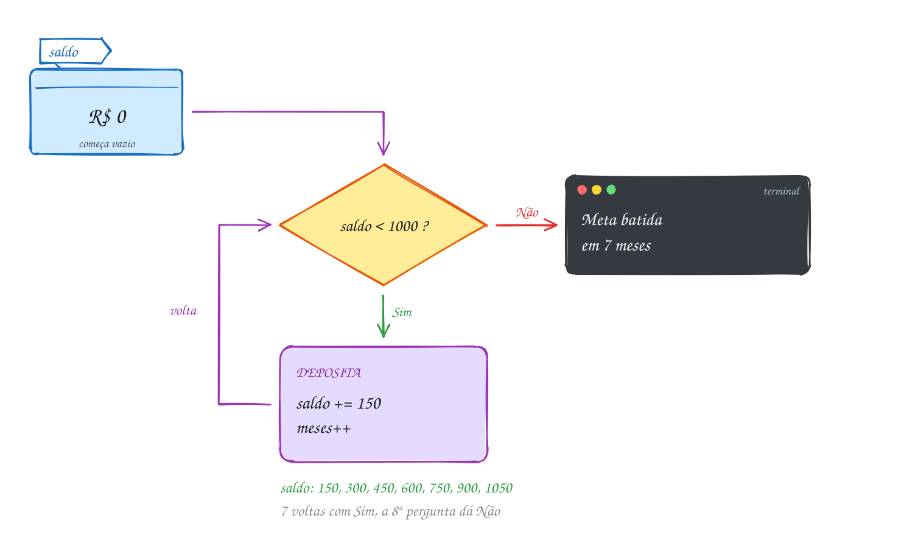</p>

O mesmo cofrinho em C:

```c
#include <stdio.h>

int main(void) {
    double meta = 1000.0;    // o celular custa R$ 1000
    double deposito = 150.0; // quanto você guarda por mês
    double saldo = 0.0;
    int meses = 0;

    while (saldo < meta) {   // pergunta ANTES de cada volta
        saldo = saldo + deposito;
        meses++;
        printf("Mês %d: R$ %.2f\n", meses, saldo);
    }

    printf("Meta batida em %d meses. Sobra R$ %.2f\n", meses, saldo - meta);
    return 0;
}
// Saída:
// Mês 1: R$ 150.00
// Mês 2: R$ 300.00
// Mês 3: R$ 450.00
// Mês 4: R$ 600.00
// Mês 5: R$ 750.00
// Mês 6: R$ 900.00
// Mês 7: R$ 1050.00
// Meta batida em 7 meses. Sobra R$ 50.00
```

### Passo a passo

O teste de mesa (uma linha por pergunta, uma coluna por variável) mostra tudo. Repare que são **8
perguntas** para **7 voltas**: a última pergunta é a que dá Não.

| Pergunta | saldo antes | `saldo < 1000?` | saldo depois | meses |
| --- | --- | --- | --- | --- |
| 1ª | 0 | Sim | 150 | 1 |
| 2ª | 150 | Sim | 300 | 2 |
| ... | ... | Sim | ... | ... |
| 7ª | 900 | Sim | 1050 | 7 |
| 8ª | 1050 | **Não** | (sai) | 7 |

Repara no fluxograma: a seta que sai de "Mostrar mês e saldo" **volta para o
losango**. É assim que uma repetição aparece no desenho. O caminho verde passa
pelo Sim várias vezes e só uma vez pelo Não:

<p align="center">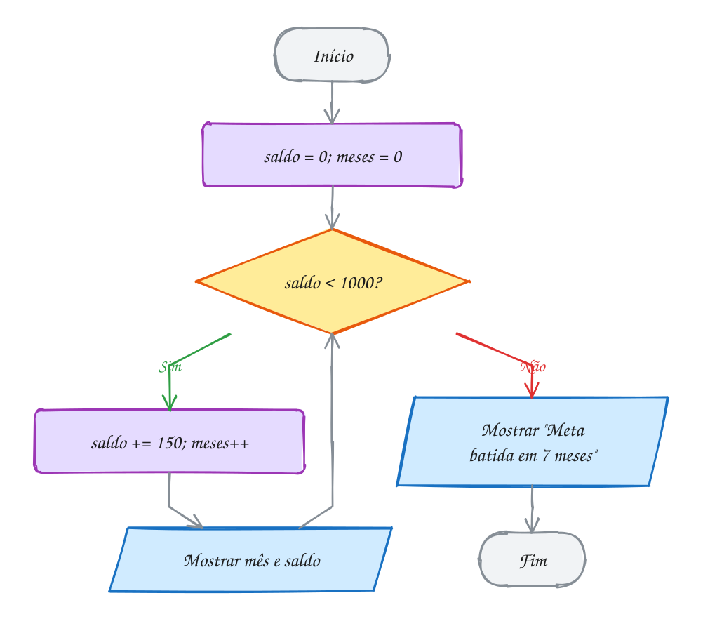</p>

> [!WARNING]
> Um `;` logo depois do `while` acaba com o laço: `while (saldo < meta);`
> é um laço com o corpo **vazio**. O `{ ... }` que vem depois vira um bloco
> solto que nunca é alcançado, porque o saldo nunca muda e a pergunta dá Sim
> para sempre: o programa trava. Parecido: sem chaves, só a **primeira** linha
> depois do `while` repete, por mais que a indentação diga outra coisa. O gcc
> avisa os dois casos com `-Wmisleading-indentation` (o `rodar` liga esse
> aviso). Use chaves sempre.

> [!TIP]
> **Por dentro do C:** o processador não tem "while". O compilador traduz o
> laço em duas instruções de **salto**: no topo, "compara saldo com meta e, se
> não for menor, pula para depois do laço"; no fim do corpo, "pula de volta para
> o topo". Cada volta custa uma comparação e um salto, quase nada. Por isso o
> laço infinito trava a máquina em 100% de um núcleo: ele é só um salto para
> trás que nunca deixa de acontecer.

> [!NOTE]
> **Pergunta para você:** se o depósito fosse R$ 200, quantas voltas o laço
> daria e quanto sobraria? E se o saldo começasse em R$ 1.000? Responda pelo
> teste de mesa e depois mude os valores no código acima e rode.

### Hora de praticar

Os arquivos ficam em [`0020-while/`](0020-while/). Os comandos funcionam de qualquer pasta do terminal. Nos exemplos, rode, mude, quebre e rode de novo. Nos exercícios, a resposta vai dentro do próprio arquivo. ★☆☆ é aquecimento, ★★☆ pede raciocínio e ★★★ é desafio.

**Exemplo A039 · Dividindo pizzas sem usar a divisão**

```c
#include <stdio.h>

int main(void) {
    // 47 fatias para 5 amigos: quantas cada um come e quantas sobram?
    int fatias = 47;
    int amigos = 5;
    int sobra = fatias;
    int rodadas = 0;          // cada rodada dá 1 fatia para cada amigo

    while (sobra >= amigos) { // ainda dá uma rodada completa?
        sobra = sobra - amigos;
        rodadas++;
    }
    printf("%d fatias para %d amigos: %d para cada, sobram %d\n",
           fatias, amigos, rodadas, sobra);
    printf("Conferindo com / e %%: %d e %d\n", fatias / amigos, fatias % amigos);

    // caso de borda: menos fatias que amigos. A pergunta já começa falsa
    fatias = 3;
    sobra = fatias;
    rodadas = 0;
    while (sobra >= amigos) { // 3 >= 5? Não: o corpo roda ZERO vezes
        sobra = sobra - amigos;
        rodadas++;
    }
    printf("%d fatias para %d amigos: %d para cada, sobram %d\n",
           fatias, amigos, rodadas, sobra);
    return 0;
}
// Saída:
// 47 fatias para 5 amigos: 9 para cada, sobram 2
// Conferindo com / e %: 9 e 2
// 3 fatias para 5 amigos: 0 para cada, sobram 3
```

```bash
~/LPEDC/rodar 03-repeticoes/0020-while/A039.c
```

**Exemplo A040 · Desmontando um número, dígito por dígito**

```c
#include <stdio.h>

int main(void) {
    int numero = 4093;
    int resto = numero;   // cópia que vai sendo "comida"
    int quantidade = 0;
    int soma = 0;

    printf("Dígitos de %d, da direita para a esquerda:", numero);
    while (resto > 0) {
        int digito = resto % 10; // o último dígito
        printf(" %d", digito);
        soma = soma + digito;
        quantidade++;
        resto = resto / 10;      // tira o último dígito
    }
    printf("\n");

    printf("Quantidade: %d\n", quantidade);
    printf("Soma: %d\n", soma);
    return 0;
}
// Saída:
// Dígitos de 4093, da direita para a esquerda: 3 9 0 4
// Quantidade: 4
// Soma: 16
```

```bash
~/LPEDC/rodar 03-repeticoes/0020-while/A040.c
```

#### Exercícios

**Exercício E115** · ★☆☆

O micro-ondas faz a contagem regressiva e apita no fim. Escreva um programa
que começa com tempo = 5 e, com um while, mostra a contagem até 1. Depois do
laço, mostra o apito:


```text
5...
4...
3...
2...
1...
Pi! Pi! Pi!
```

**Dicas:**

1. A pergunta do while é "ainda tem tempo?": tempo > 0.
2. Dentro do laço: mostre o tempo e depois diminua (tempo-- ou tempo = tempo - 1).
3. Resposta esperada: a saída acima. O laço roda 5 vezes; quando tempo vira 0,
   a pergunta dá falso e o programa segue para o apito.

```bash
~/LPEDC/rodar 03-repeticoes/0020-while/E115.c
```

**Exercício E116** · ★☆☆

Complete as três lacunas para mostrar os múltiplos de 7 menores que 50,
na mesma linha. Depois escreva o programa completo no arquivo e rode.


```text
int multiplo = ____;
while (________) {
    printf("%d ", multiplo);
    ________;
}
printf("\n");
```


```text
Saída esperada:
7 14 21 28 35 42 49
```

**Dicas:**

1. Lacuna 1: o primeiro múltiplo positivo de 7.
2. Lacuna 3 é o passo: o próximo múltiplo está 7 à frente.
3. Resposta esperada: multiplo = 7; multiplo < 50; multiplo = multiplo + 7
   (ou multiplo += 7). São 7 números; quando multiplo vira 56, o laço para.

```bash
~/LPEDC/rodar 03-repeticoes/0020-while/E116.c
```

**Exercício E117** · ★★☆

A caixa d'água tem 1000 litros e a casa gasta 180 litros por dia. O programa
abaixo deveria dizer quantos dias COMPLETOS a água dura e quanto sobra, mas
mostra:


```text
Dá para 6 dias. Sobram -80 litros.
```


O código com o erro está logo abaixo; ele roda, mas dá a resposta errada.
Conserte e rode de novo até aparecer a resposta certa. Se ajudar, ponha um
printf dentro do laço mostrando litros e dias a cada volta.

**Dicas:**

1. No 6º dia, quanta água havia antes de gastar? Dava para o dia inteiro?
2. A pergunta do while precisa ser "tem água para MAIS UM dia inteiro?".
3. Resposta esperada: troque "litros > 0" por "litros >= consumo". Saída:
   "Dá para 5 dias. Sobram 100 litros."

```bash
~/LPEDC/rodar 03-repeticoes/0020-while/E117.c
```

**Exercício E118** · ★★☆

Você aplica R$ 1000.00 num investimento que rende 1% ao mês (juros sobre
juros: todo mês o saldo é multiplicado por 1.01). Em quantos meses o saldo
passa de R$ 1500.00? Mostre os meses e o saldo final com 2 casas.


```text
Saída esperada:
Passou de R$ 1500.00 em 41 meses.
Saldo: R$ 1503.75
```

**Dicas:**

1. Você não sabe quantas voltas o laço vai dar: é trabalho para o while.
2. Condição: saldo <= 1500. Corpo: saldo = saldo * 1.01; meses++.
3. Resposta esperada: 41 meses e R$ 1503.75. (No mês 40 o saldo ainda é
   R$ 1488.86.)

```bash
~/LPEDC/rodar 03-repeticoes/0020-while/E118.c
```

**Exercício E119** · ★★★

A conjectura de Collatz: pegue um inteiro positivo. Se for par, divida por
2; se for ímpar, multiplique por 3 e some 1. Repita até chegar em 1. Ninguém
provou que sempre chega, mas até hoje sempre chegou.

Leia n do teclado (confira o retorno do scanf e recuse n < 1), mostre a
sequência, quantos passos foram e o maior valor que apareceu:


```text
Digite n: 6
6 3 10 5 16 8 4 2 1
Passos: 8
Maior valor: 16
```

**Dicas:**

1. O laço é "while (n != 1)". Dentro dele, um if/else (ou o ternário).
2. Guarde o maior numa variável que começa com o próprio n e compare a cada
   passo. Use long para não estourar com números grandes.
3. Resposta esperada: 6 → 8 passos, maior 16. Teste também com 27: são 111
   passos e o maior valor é 9232. Com 1, são 0 passos.

```bash
~/LPEDC/rodar 03-repeticoes/0020-while/E119.c
```

**Exercício E120** · ★★★

Os três laços abaixo já estão no main do arquivo (cada um entre um printf
com a letra do trecho e um printf("|\n")):


```text
// trecho A               // trecho B             // trecho C
int i = 0;                int n = 100;            int k = 10;
while (i++ < 5) {         while (n > 1) {         while (k < 10) {
    printf("%d ", i);         n = n / 3;              k++;
}                         }                       }
```


Estenda o programa para ele contar e mostrar o que cada laço fez: crie um
contador de voltas para cada trecho (voltas_a, voltas_b e voltas_c,
começando em 0, somando 1 dentro do corpo) e, no fim de cada trecho, mostre
o contador e o valor final da variável da pergunta. No trecho B, mostre
também o valor de n depois de cada divisão. Rode e confira:


```text
Saída esperada:
A: 1 2 3 4 5 | voltas 5, i final 6
B: 33 11 3 1 | voltas 4, n final 1
C: | voltas 0, k final 10
```

**Dicas:**

1. Trecho A: i++ compara o valor ANTIGO e só depois soma 1 (assunto 0009).
   Isso vale também na última pergunta, a que dá falso: por isso i termina
   em 6, com 5 voltas.
2. Trecho B: divisão inteira. 100 / 3 = 33. O printf de n vai logo depois
   da linha n = n / 3.
3. Resposta esperada: a saída acima. No trecho C o corpo roda zero vezes,
   porque o while pergunta antes: 10 < 10 já é falso.

```bash
~/LPEDC/rodar 03-repeticoes/0020-while/E120.c
```

---

## 0021 · Do-while

A geladeira custa R$ 1.200 e o app pergunta: "em quantas parcelas (1 a 12)?".
Você digita 15, ele recusa e pergunta de novo. Repare num detalhe: antes da
primeira resposta, não há nada para conferir. A pergunta **tem** que aparecer
pelo menos uma vez.

Com o `while`, a pergunta vem antes do corpo. Para usá-lo aqui, você teria que
inventar um valor inválido só para entrar no laço (`parcelas = 0`). Funciona,
mas é um truque. O **`do...while`** resolve sem truque: ele **faz primeiro e
pergunta depois**.

```c
do {
    // corpo: roda pelo menos uma vez
} while (condição);   // o ; no fim é obrigatório
```

A ordem: roda o corpo, testa a condição; se der verdadeiro, volta para o
começo do corpo. Por isso o corpo roda **uma ou mais vezes**, nunca zero.

O lugar natural dele é onde a primeira volta é obrigatória:

- **validação de entrada**: pergunte, e repita enquanto a resposta for
  inválida;
- **menu**: mostre as opções, execute a escolhida e repita até a pessoa
  escolher "sair" (o exemplo A042 faz um caixa eletrônico);
- **"jogar de novo?"**: a primeira partida sempre acontece.

A condição do `do...while` descreve quando **repetir**, não quando parar.
Numa validação, ela descreve o valor **inválido**: `parcelas < 1 || parcelas >
12`.

Vamos ver na prática. A pessoa digita 0, depois 15, depois 4. As duas
primeiras respostas caem fora da faixa, a pergunta "fora de 1 a 12?" responde
Sim e o programa volta para pedir de novo. O 4 está dentro, a resposta é Não e
o programa segue:

<p align="center">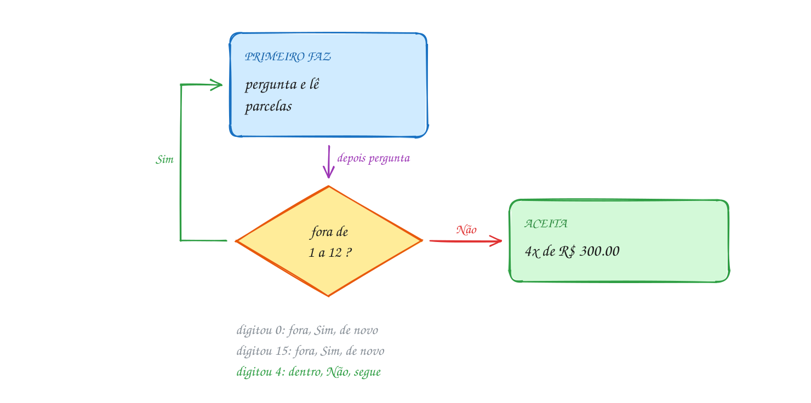</p>

O mesmo app em C. O `if` em volta do `scanf` confere se chegou mesmo um número
(assunto 0006):

```c
#include <stdio.h>

int main(void) {
    double preco = 1200.0; // a geladeira
    int parcelas;

    do {
        printf("Em quantas parcelas (1 a 12)? ");
        if (scanf("%d", &parcelas) != 1) { // letra no lugar de número
            printf("\nIsso não é um número.\n");
            return 1;
        }
    } while (parcelas < 1 || parcelas > 12); // repete ENQUANTO for inválido

    printf("%dx de R$ %.2f\n", parcelas, preco / parcelas);
    return 0;
}
// Em quantas parcelas (1 a 12)? 0
// Em quantas parcelas (1 a 12)? 15
// Em quantas parcelas (1 a 12)? 4
// 4x de R$ 300.00
```

Repara no fluxograma: a leitura vem **antes** do losango. A seta do Sim sai do
losango e volta para o começo do corpo, "Mostrar a pergunta". No `while` (assunto
0020) a seta voltava para o losango porque a pergunta abria o laço; aqui ela
fecha. O caminho verde passa três vezes pelo losango: duas pelo Sim e uma pelo
Não:

<p align="center">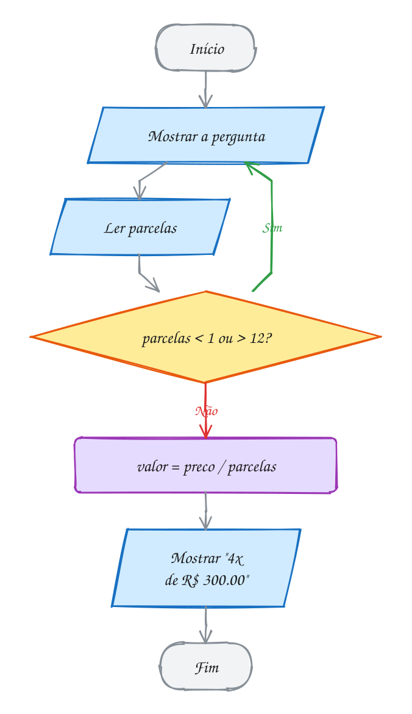</p>

> [!WARNING]
> A condição é de **continuar**, não de parar. Quem pensa "o laço termina
> quando as parcelas estiverem certas" escreve `while (parcelas >= 1 &&
> parcelas <= 12)`, e o programa fica ao contrário: repete com o 4 e aceita o
> 15. Leia sempre em voz alta: "faça isso **enquanto** ...". Para inverter uma
> condição com `&&`, use De Morgan (assunto 0013): o contrário de `a && b` é
> `!a || !b`.

> [!TIP]
> **Por dentro do C:** o `do...while` é o laço mais barato para a máquina: o
> corpo, uma comparação e **um** salto condicional para trás. Tanto que o gcc,
> com otimização ligada, costuma reescrever o seu `while` como "um `if` na
> entrada e um `do...while` dentro" (*loop rotation*). A pergunta do topo vira
> um teste único, e cada volta economiza um salto.

> [!NOTE]
> **Pergunta para você:** e se você apagar o `if` em volta do `scanf` e digitar
> `x`? O `scanf` não consegue ler um número, devolve 0, deixa o `x` no buffer e
> não muda `parcelas`. O que acontece na próxima volta? Preveja e depois teste
> no código acima (se travar, `Ctrl+C`).

### Hora de praticar

Os arquivos ficam em [`0021-do-while/`](0021-do-while/). Os comandos funcionam de qualquer pasta do terminal. Nos exemplos, rode, mude, quebre e rode de novo. Nos exercícios, a resposta vai dentro do próprio arquivo. ★☆☆ é aquecimento, ★★☆ pede raciocínio e ★★★ é desafio.

**Exemplo A041 · Quantos dígitos tem o zero?**

```c
#include <stdio.h>

int main(void) {
    int numero = 0;
    int resto, digitos;

    // com while: pergunta antes, e 0 > 0 já é falso
    resto = numero;
    digitos = 0;
    while (resto > 0) {
        resto = resto / 10;
        digitos++;
    }
    printf("while:    %d tem %d dígitos\n", numero, digitos);

    // com do-while: conta o primeiro dígito antes de perguntar
    resto = numero;
    digitos = 0;
    do {
        resto = resto / 10;
        digitos++;
    } while (resto > 0);
    printf("do-while: %d tem %d dígito\n", numero, digitos);

    // para números maiores que zero, os dois concordam
    numero = 2026;
    resto = numero;
    digitos = 0;
    do {
        resto = resto / 10;
        digitos++;
    } while (resto > 0);
    printf("do-while: %d tem %d dígitos\n", numero, digitos);
    return 0;
}
// Saída:
// while:    0 tem 0 dígitos
// do-while: 0 tem 1 dígito
// do-while: 2026 tem 4 dígitos
```

```bash
~/LPEDC/rodar 03-repeticoes/0021-do-while/A041.c
```

**Exemplo A042 · O menu do caixa eletrônico**

```c
#include <stdio.h>

int main(void) {
    double saldo = 500.0;
    double valor;
    int opcao;

    do {
        printf("1 Saldo | 2 Sacar | 0 Sair: ");
        if (scanf("%d", &opcao) != 1) {
            opcao = 0; // entrada que não é número: encerra
        }

        switch (opcao) {
        case 1:
            printf("Saldo: R$ %.2f\n", saldo);
            break;
        case 2:
            printf("Valor do saque: ");
            if (scanf("%lf", &valor) == 1 && valor > 0 && valor <= saldo) {
                saldo = saldo - valor;
                printf("Retire R$ %.2f\n", valor);
            } else {
                printf("Saque recusado.\n");
            }
            break;
        case 0:
            printf("Até logo!\n");
            break;
        default:
            printf("Opção inválida.\n");
        }
    } while (opcao != 0); // o menu aparece pelo menos uma vez

    return 0;
}
// 1 Saldo | 2 Sacar | 0 Sair: 1
// Saldo: R$ 500.00
// 1 Saldo | 2 Sacar | 0 Sair: 2
// Valor do saque: 120
// Retire R$ 120.00
// 1 Saldo | 2 Sacar | 0 Sair: 2
// Valor do saque: 900
// Saque recusado.
// 1 Saldo | 2 Sacar | 0 Sair: 7
// Opção inválida.
// 1 Saldo | 2 Sacar | 0 Sair: 1
// Saldo: R$ 380.00
// 1 Saldo | 2 Sacar | 0 Sair: 0
// Até logo!
```

```bash
~/LPEDC/rodar 03-repeticoes/0021-do-while/A042.c
```

#### Exercícios

**Exercício E121** · ★☆☆

O sistema da escola só aceita notas de 0 a 10. Escreva um programa que lê
uma nota (double) com do-while e repete a pergunta enquanto a nota estiver
fora da faixa. No fim, mostra a nota aceita com 1 casa:


```text
Nota (0 a 10): -1
Nota (0 a 10): 11
Nota (0 a 10): 8.5
Nota aceita: 8.5
```

**Dicas:**

1. A pergunta e a leitura ficam DENTRO do do { }.
2. A condição do while descreve a nota inválida: nota < 0 || nota > 10.
3. Resposta esperada: com -1, 11 e 8.5, a pergunta aparece 3 vezes e o
   programa mostra "Nota aceita: 8.5". Notas 0 e 10 são aceitas de primeira.

```bash
~/LPEDC/rodar 03-repeticoes/0021-do-while/E121.c
```

**Exercício E122** · ★☆☆

Os trechos A e B abaixo já estão no main do arquivo e são quase iguais:


```text
// trecho A                     // trecho B
int n = 10;                     int m = 10;
while (n < 5) {                 do {
    printf("%d ", n);               printf("%d ", m);
    n++;                            m++;
}                               } while (m < 5);
printf("| A terminou com n = %d\n", n);   (e o mesmo para m no B)
```


Acrescente um trecho C, com a variável k começando em 10, que mostre
exatamente o mesmo que o B, mas usando while (sem do-while). Rode e confira:


```text
Saída esperada:
| A terminou com n = 10
10 | B terminou com m = 11
10 | C terminou com k = 11
```

**Dicas:**

1. O while pergunta antes de entrar; o do-while entra e pergunta depois.
   10 < 5 é falso logo na primeira pergunta.
2. Para o while rodar o corpo pelo menos uma vez, escreva uma cópia do
   corpo ANTES do laço.
3. Resposta esperada: a saída acima. O trecho C fica: int k = 10;
   printf("%d ", k); k++; while (k < 5) { printf("%d ", k); k++; } e o
   printf final.

```bash
~/LPEDC/rodar 03-repeticoes/0021-do-while/E122.c
```

**Exercício E123** · ★★☆

No caixa da padaria, a atendente digita o preço de cada item e o sistema
pergunta se tem mais algum. Escreva o programa: lê um preço, soma, pergunta
"Mais algum item? (s/n)" e repete enquanto a resposta for s ou S. No fim,
mostra quantos itens e o total:


```text
Preço: 12.50
Mais algum item? (s/n) s
Preço: 7.00
Mais algum item? (s/n) S
Preço: 3.25
Mais algum item? (s/n) n
Itens: 3
Total: R$ 22.75
```

**Dicas:**

1. Sempre tem pelo menos um item: é a cara do do-while.
2. Para ler um caractere pulando o Enter que sobrou no buffer, use
   scanf(" %c", &resposta) com um espaço antes do %c (assunto 0006).
3. Resposta esperada: com 12.50, 7.00 e 3.25, mostra "Itens: 3" e
   "Total: R$ 22.75". A condição é resposta == 's' || resposta == 'S'.

```bash
~/LPEDC/rodar 03-repeticoes/0021-do-while/E123.c
```

**Exercício E124** · ★★☆

O totem do cinema oferece 3 sessões e deveria repetir a pergunta enquanto a
opção fosse inválida. Mas, rodando com


```text
printf '7\n2\n' | ~/LPEDC/rodar 03-repeticoes/0021-do-while/E124.c
```


ele aceita o 7 de primeira. O código com o erro está logo abaixo.
Conserte a condição e rode de novo com a mesma entrada: agora o 7 tem que
ser recusado e o 2 aceito.

**Dicas:**

1. Existe algum número que é, ao mesmo tempo, menor que 1 e maior que 3?
2. Releia a lei de De Morgan (assunto 0013): o contrário de
   "opcao >= 1 && opcao <= 3" é...
3. Resposta esperada: a condição "opcao < 1 && opcao > 3" é sempre falsa,
   então o laço nunca repete. O certo é "opcao < 1 || opcao > 3". Com 7 e
   2, o totem pergunta duas vezes e mostra "Sessão 2 escolhida.".

```bash
~/LPEDC/rodar 03-repeticoes/0021-do-while/E124.c
```

**Exercício E125** · ★★★

A senha do cartão é 4321 e a pessoa tem 3 tentativas. Escreva o programa:
lê a senha com do-while, conta as tentativas e para quando acertar OU
quando acabarem as tentativas. No fim, diz o que aconteceu:


```text
Senha: 1111
Senha: 2222
Senha: 4321
Senha correta na tentativa 3.
```


Com 1111, 2222 e 3333, a saída termina com "Cartão bloqueado.".

**Dicas:**

1. A condição de repetir tem duas partes: errou E ainda tem tentativa.
2. Depois do laço, você não sabe por qual motivo ele parou. Pergunte de
   novo: a última senha lida é a certa?
3. Resposta esperada: "} while (senha != 4321 && tentativas < 3);" e,
   depois, um if (senha == 4321). Acertando de primeira, mostra
   "Senha correta na tentativa 1.".

```bash
~/LPEDC/rodar 03-repeticoes/0021-do-while/E125.c
```

**Exercício E126** · ★★★

O app da clínica pede a data da consulta em 2026. Escreva um programa que lê
o mês (repete até ser de 1 a 12) e depois o dia (repete até ser válido
PARA AQUELE MÊS; 2026 não é bissexto, então fevereiro tem 28 dias):


```text
Mês: 13
Mês: 2
Dia (1 a 28): 30
Dia (1 a 28): 29
Dia (1 a 28): 28
Consulta em 28/02/2026
```

**Dicas:**

1. São dois do-while, um depois do outro. Entre eles, descubra quantos dias
   tem o mês (um switch com fall-through resolve: assunto 0018).
2. Meses de 30 dias: 4, 6, 9 e 11. Fevereiro: 28. Os outros: 31.
3. Resposta esperada: com 13, 2, 30, 29, 28 mostra "Consulta em
   28/02/2026". Use %02d para o zero na frente. Com mês 4, o dia 31 é
   recusado.

```bash
~/LPEDC/rodar 03-repeticoes/0021-do-while/E126.c
```

---

## 0022 · For

Você comprou uma TV de R$ 1.800 em 6 parcelas de R$ 300 e quer ver o carnê
inteiro: parcela 1, parcela 2... até a 6. Aqui você **sabe** quantas voltas são,
antes de começar.

Dá para fazer com `while`, mas repare em quantos lugares o contador aparece:

```c
int parcela = 1;              // começa
while (parcela <= 6) {        // pergunta
    printf("Parcela %d\n", parcela);
    parcela++;                // passo, lá no fim do corpo
}
```

Três peças espalhadas: começo, pergunta e passo. Esqueça o `parcela++` lá
embaixo e você ganha um laço infinito. O **`for`** junta as três numa linha só:

```c
for (int parcela = 1; parcela <= 6; parcela++) {
    printf("Parcela %d\n", parcela);
}
```

A ordem em que as partes rodam não é a ordem em que estão escritas:

1. **início** (`int parcela = 1`): roda **uma vez**, antes de tudo;
2. **condição** (`parcela <= 6`): testada antes de cada volta; falsa, o laço
   acaba;
3. **corpo**: o que está entre as chaves;
4. **passo** (`parcela++`): roda **no fim** de cada volta, e então volta para
   a condição.

O `for` é exatamente o `while` de cima, reorganizado. O compilador trata os
dois do mesmo jeito. Use `for` quando há um **contador** com começo, fim e
passo conhecidos; `while` quando você só sabe a condição de parada.

O `int parcela` declarado dentro do `for` só existe
dentro do laço (C99 em diante). O passo pode ser qualquer conta: `c += 10`,
`s--`, `x *= 3`. O contador pode ser `char`, porque `char` é número. E a
vírgula permite duas variáveis: `for (int i = 1, j = 9; i < j; i++, j--)`. O
exemplo A044 mostra tudo isso. Qualquer parte pode ficar vazia, mas os dois
`;` são obrigatórios: `for (;;)` é um laço infinito de propósito.

Quantas voltas? `for (i = a; i < b; i++)` dá `b - a` voltas. Com `<=`, dá
`b - a + 1`. De 1 a 6 com `<=`: 6 voltas.

Vamos ver na prática. O carnê começa com `parcela = 1` uma vez só, pergunta
"parcela <= 6?", roda o corpo, dá o passo e volta para a pergunta. Na sétima
pergunta, com `parcela = 7`, a resposta é Não:

<p align="center">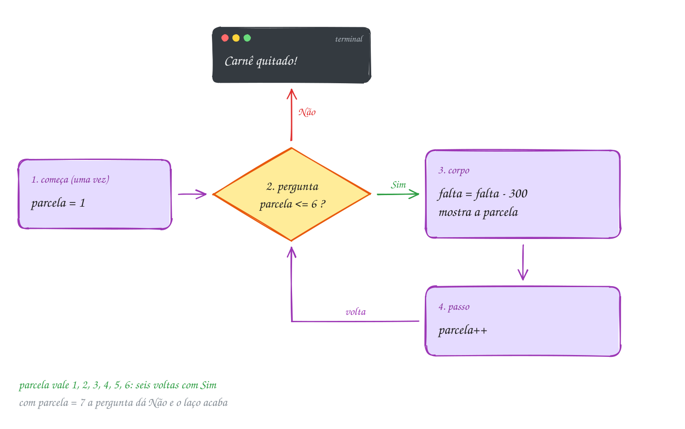</p>

O carnê em C:

```c
#include <stdio.h>

int main(void) {
    double preco = 1800.0;
    int total_parcelas = 6;
    double valor = preco / total_parcelas;
    double falta = preco;

    for (int parcela = 1; parcela <= total_parcelas; parcela++) {
        falta = falta - valor;
        printf("Parcela %d/%d: R$ %.2f (falta R$ %.2f)\n",
               parcela, total_parcelas, valor, falta);
    }
    printf("Carnê quitado!\n");
    return 0;
}
// Saída:
// Parcela 1/6: R$ 300.00 (falta R$ 1500.00)
// Parcela 2/6: R$ 300.00 (falta R$ 1200.00)
// Parcela 3/6: R$ 300.00 (falta R$ 900.00)
// Parcela 4/6: R$ 300.00 (falta R$ 600.00)
// Parcela 5/6: R$ 300.00 (falta R$ 300.00)
// Parcela 6/6: R$ 300.00 (falta R$ 0.00)
// Carnê quitado!
```

Repara no fluxograma: ele é igual ao de um `while`. O `for` não inventa forma
nova; ele só arruma o código. O passo `parcela++` fica no fim do corpo, e a
seta sai dele e volta para o losango:

<p align="center">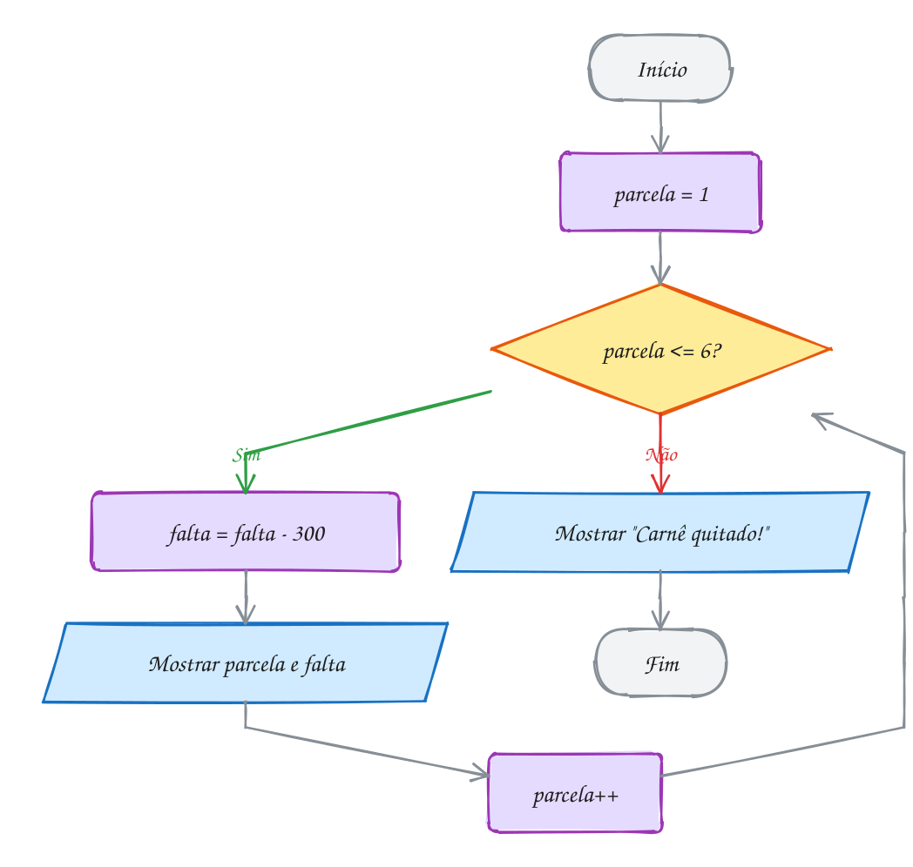</p>

> [!WARNING]
> O erro mais comum do `for` é o **erro por um** (*off-by-one*): uma volta a
> mais ou a menos. `for (int p = 1; p < 6; p++)` mostra só 5 parcelas;
> `for (int p = 0; p <= 6; p++)` mostra 7. Antes de rodar, faça duas perguntas:
> qual é o **primeiro** valor do contador e qual é o **último** que passa pela
> condição? Outro clássico: controlar o laço com `double`.
> `for (double x = 0.1; x != 1.0; x += 0.1)` nunca termina, porque 0,1 não é
> exato em binário e `x` pula o 1,0. Contador é sempre inteiro.

> [!TIP]
> **Por dentro do C:** compile o `for` e o `while` equivalente com `gcc -S` e
> compare o assembly: é o mesmo. O contador nem chega a ocupar memória: com
> otimização, o gcc o guarda num **registrador**, uma gaveta dentro do próprio
> processador. Com `-O2`, ele pode até **desenrolar** o laço (escrever o corpo
> várias vezes seguidas para economizar saltos) quando sabe quantas voltas são.
> É mais um motivo para usar `for` com contador: o compilador entende a sua
> intenção.

> [!NOTE]
> **Pergunta para você:** quantas vezes roda `for (int i = 10; i > 0; i -= 3)`
> e com quais valores de `i`? E qual valor faz a condição dar falso? Responda
> no papel e depois coloque um `printf` no corpo para conferir.

### Hora de praticar

Os arquivos ficam em [`0022-for/`](0022-for/). Os comandos funcionam de qualquer pasta do terminal. Nos exemplos, rode, mude, quebre e rode de novo. Nos exercícios, a resposta vai dentro do próprio arquivo. ★☆☆ é aquecimento, ★★☆ pede raciocínio e ★★★ é desafio.

**Exemplo A043 · Postes e vãos: o erro por um na cerca**

```c
#include <stdio.h>

int main(void) {
    int comprimento = 30; // a cerca tem 30 metros
    int espaco = 5;       // um poste a cada 5 metros
    int postes = 0;
    int vaos = 0;

    // postes: do metro 0 ATÉ o metro 30, inclusive (<=)
    printf("Postes nos metros:");
    for (int metro = 0; metro <= comprimento; metro += espaco) {
        printf(" %d", metro);
        postes++;
    }
    printf("\n");

    // vãos: cada vão começa num poste, menos no último (<)
    for (int metro = 0; metro < comprimento; metro += espaco) {
        vaos++;
    }

    printf("Postes: %d | Vãos: %d\n", postes, vaos);
    printf("Pela conta: %d vãos, %d postes\n",
           comprimento / espaco, comprimento / espaco + 1);
    return 0;
}
// Saída:
// Postes nos metros: 0 5 10 15 20 25 30
// Postes: 7 | Vãos: 6
// Pela conta: 6 vãos, 7 postes
```

```bash
~/LPEDC/rodar 03-repeticoes/0022-for/A043.c
```

**Exemplo A044 · De 10 em 10, para trás e com letras**

```c
#include <stdio.h>

int main(void) {
    // passo de 10: tabela de temperatura
    for (int c = 0; c <= 40; c += 10) {
        double f = c * 1.8 + 32;
        printf("%2d °C = %5.1f °F\n", c, f);
    }

    // para trás: contagem regressiva do réveillon
    for (int s = 5; s >= 1; s--) {
        printf("%d... ", s);
    }
    printf("Feliz Ano Novo!\n");

    // char também é número: as fileiras do ônibus
    for (char fileira = 'A'; fileira <= 'F'; fileira++) {
        printf("%c ", fileira);
    }
    printf("\n");

    // duas variáveis com vírgula: uma sobe, a outra desce
    for (int i = 1, j = 9; i < j; i++, j--) {
        printf("(%d,%d) ", i, j);
    }
    printf("\n");
    return 0;
}
// Saída:
//  0 °C =  32.0 °F
// 10 °C =  50.0 °F
// 20 °C =  68.0 °F
// 30 °C =  86.0 °F
// 40 °C = 104.0 °F
// 5... 4... 3... 2... 1... Feliz Ano Novo!
// A B C D E F 
// (1,9) (2,8) (3,7) (4,6)
```

```bash
~/LPEDC/rodar 03-repeticoes/0022-for/A044.c
```

#### Exercícios

**Exercício E127** · ★☆☆

Escreva a tabuada do 8 com um for, alinhando os números com %2d:


```text
8 x  1 =  8
8 x  2 = 16
...
8 x 10 = 80
```

**Dicas:**

1. O contador vai de 1 a 10: for (int i = 1; i <= 10; i++).
2. printf("8 x %2d = %2d\n", i, 8 * i);
3. Resposta esperada: 10 linhas, da "8 x  1 =  8" até a "8 x 10 = 80".

```bash
~/LPEDC/rodar 03-repeticoes/0022-for/E127.c
```

**Exercício E128** · ★☆☆

Escreva um programa com os quatro laços abaixo, um depois do outro. Cada
um mostra os valores de x numa linha que começa com a letra do laço e, no
fim da linha, quantas voltas ele deu (use um contador para cada laço):


```text
a) for (int x = 3; x <= 20; x += 4)
b) for (int x = 50; x > 30; x -= 6)
c) for (int x = 1; x >= 10; x++)
d) for (int x = 1; x < 100; x *= 3)
```


```text
Saída esperada:
a) 3 7 11 15 19 (5 voltas)
b) 50 44 38 32 (4 voltas)
c) (0 voltas)
d) 1 3 9 27 81 (5 voltas)
```

**Dicas:**

1. Antes de cada laço: printf("a) ") e voltas = 0. No corpo:
   printf("%d ", x) e voltas++. Depois: printf("(%d voltas)\n", voltas).
2. O laço c pergunta "1 >= 10?" logo de cara: o corpo nunca roda.
3. Resposta esperada: a saída acima. O passo pode ser qualquer conta, não
   só +1: no d, x é multiplicado por 3 a cada volta.

```bash
~/LPEDC/rodar 03-repeticoes/0022-for/E128.c
```

**Exercício E129** · ★★☆

Você aplica R$ 2000.00 num CDB que rende 0,8% ao mês. Mostre o saldo mês a
mês durante 12 meses (todo mês o saldo é multiplicado por 1.008). No fim,
confira o resultado com a fórmula dos juros compostos,
saldo = 2000 * 1.008 elevado a 12, usando pow (assunto 0010):


```text
Mês  1: R$ 2016.00
Mês  2: R$ 2032.13
...
Mês 12: R$ 2200.68
Pela fórmula: R$ 2200.68
```

**Dicas:**

1. Aqui você sabe quantas voltas são (12): é trabalho para o for.
2. Inclua <math.h>; o rodar já liga com -lm.
3. Resposta esperada: R$ 2200.68 nos dois cálculos. O laço é a fórmula
   "desenrolada": multiplicar 12 vezes por 1.008 é elevar a 12.

```bash
~/LPEDC/rodar 03-repeticoes/0022-for/E129.c
```

**Exercício E130** · ★★☆

O treino manda fazer 5 séries de flexões e o programa deveria mostrar
"Série 1" até "Série 5". Ele compila com um AVISO e mostra só:


```text
Série 6
```


O código com o erro está logo abaixo. Rode, leia o aviso do gcc e conserte:
o programa tem que compilar sem aviso e mostrar Série 1 até Série 5.

**Dicas:**

1. O aviso fala em "misleading indentation": a indentação engana.
2. Olhe o fim da linha do for. Um ; sozinho é um comando vazio.
3. Resposta esperada: o ";" logo depois do for vira o corpo do laço (vazio).
   O laço gira 5 vezes sem fazer nada, i termina em 6 e o bloco { } roda
   uma vez só, depois. Tirando o ";", mostra Série 1 a Série 5.

```bash
~/LPEDC/rodar 03-repeticoes/0022-for/E130.c
```

**Exercício E131** · ★★★

Dá para calcular pi com uma soma infinita (série de Leibniz):


```text
pi = 4/1 - 4/3 + 4/5 - 4/7 + 4/9 - ...
```


Escreva um programa que soma os primeiros 1000 termos e mostra o resultado
com 6 casas. Depois troque para 10 e para 100000 termos e veja a
aproximação melhorar (devagar).


```text
Saída esperada (1000 termos):
pi ~ 3.140593
```

**Dicas:**

1. O termo k (começando em 0) tem denominador 2 * k + 1.
2. O sinal alterna: k par soma, k ímpar subtrai. O ternário ajuda:
   (k % 2 == 0) ? 4.0 : -4.0. Use 4.0, não 4: divisão inteira estraga tudo.
3. Resposta esperada: 1000 termos → 3.140593; 10 termos → 3.041840;
   100000 termos → 3.141583.

```bash
~/LPEDC/rodar 03-repeticoes/0022-for/E131.c
```

**Exercício E132** · ★★★

O laço abaixo usa a vírgula para controlar duas variáveis. Escreva um
programa que roda esse laço e, logo depois, o MESMO laço reescrito com
while, com a mesma saída. Nos dois, acrescente um contador de voltas e
mostre-o na linha do "Fim":


```text
int i, j;
for (i = 0, j = 20; i < j; i += 3, j -= 2) {
    printf("i = %2d, j = %2d\n", i, j);
}
printf("Fim: i = %d, j = %d\n", i, j);
```


```text
Saída esperada (a do for; a do while vem logo depois, igual):
i =  0, j = 20
i =  3, j = 18
i =  6, j = 16
i =  9, j = 14
Fim: i = 12, j = 12, voltas = 4
```

**Dicas:**

1. A vírgula separa duas inicializações e dois passos; a condição é uma só.
2. No while, as inicializações vão antes do laço e os dois passos vão no
   FIM do corpo, depois do printf. Zere o contador antes de cada laço.
3. Resposta esperada: 4 linhas e "Fim: i = 12, j = 12, voltas = 4", duas
   vezes. Com while: i = 0; j = 20; while (i < j) { printf(...);
   voltas++; i += 3; j -= 2; }.

```bash
~/LPEDC/rodar 03-repeticoes/0022-for/E132.c
```

---

## 0023 · Break e continue

No caixa do mercado, a atendente passa os produtos um a um. Às vezes o leitor
falha e marca um preço negativo: ela ignora e passa de novo. Quando a compra
acaba, ela digita 0 e fecha a conta. Dois atalhos dentro da mesma repetição:
"pula este" e "para tudo".

Em C, esses atalhos são o **`break`** e o **`continue`**:

- **`break`**: sai do laço **na hora**. O programa segue na primeira linha
  depois da `}` do laço. É o mesmo `break` do `switch` (assunto 0018).
- **`continue`**: abandona só a **volta atual**. O resto do corpo é pulado e o
  laço segue para a próxima pergunta. No `for`, o passo (`i++`) ainda roda
  antes da pergunta; no `while`, o salto vai direto para a pergunta.

Os dois quase sempre aparecem dentro de um `if`: "se acontecer tal coisa,
saia" ou "se acontecer tal coisa, pule".

Com o `break`, aparece um laço muito comum: o **`while (1)`** (ou `for (;;)`).
A condição é sempre verdadeira, e quem decide a saída é um `break` no meio do
corpo. Isso é útil quando o motivo para parar só aparece **depois** de ler o
dado, como no caixa: você lê o preço e só então descobre que é 0.

Depois de um laço com `break`, às vezes você precisa saber **por que** ele
parou: pela condição ou pelo `break`? O exemplo A046 testa se um número é
primo assim: se o laço chegou ao fim sem achar divisor, é primo.

Vamos ver na prática. A compra tem 12,90, uma leitura com erro (-1), 8,50,
4,00 e, para fechar, 0. O -1 cai no `continue` e volta direto para a leitura,
sem passar pela soma. O 0 cai no `break` e sai do laço:

<p align="center">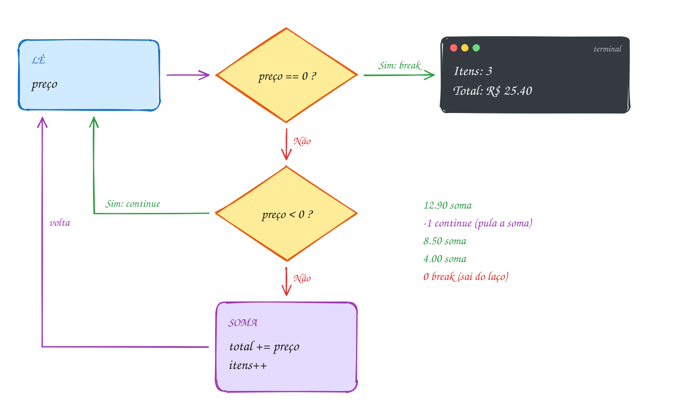</p>

O caixa em C:

```c
#include <stdio.h>

int main(void) {
    double preco;
    double total = 0.0;
    int itens = 0;
    int ignorados = 0;

    while (1) { // "para sempre": quem decide a saída é o break
        printf("Preço (0 encerra): ");
        if (scanf("%lf", &preco) != 1) {
            break;          // entrada acabou ou não é número
        }
        if (preco == 0) {
            break;          // fim da compra: sai do laço
        }
        if (preco < 0) {
            printf("  leitura inválida, passe de novo\n");
            ignorados++;
            continue;       // pula o resto e volta para o while
        }
        total = total + preco;
        itens++;
    }

    printf("Itens: %d | Ignorados: %d\n", itens, ignorados);
    printf("Total: R$ %.2f\n", total);
    return 0;
}
// Preço (0 encerra): 12.90
// Preço (0 encerra): -1
//   leitura inválida, passe de novo
// Preço (0 encerra): 8.50
// Preço (0 encerra): 4.00
// Preço (0 encerra): 0
// Itens: 3 | Ignorados: 1
// Total: R$ 25.40
```

Repara no fluxograma: o laço tem **duas** setas de volta para "Ler preço". Uma
sai direto do losango "preço < 0?" pelo Sim: é o `continue`, que pula a soma.
A outra sai do fim normal do corpo. E tem **uma** saída, o Sim de
"preço == 0?", que é o `break`:

<p align="center">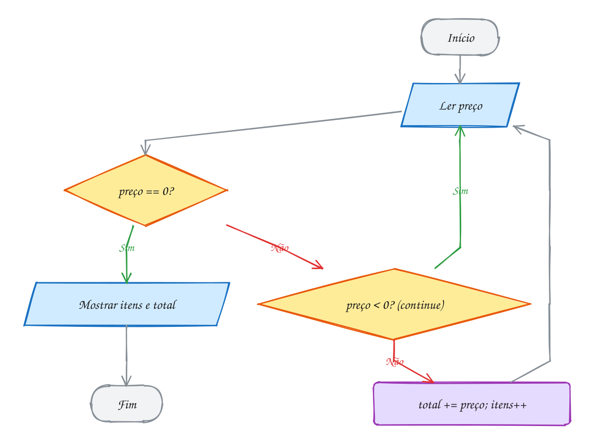</p>

> [!WARNING]
> `continue` num `while` pode pular o passo. Em
> `while (i < 10) { if (i == 5) continue; printf("%d", i); i++; }`, quando `i`
> chega a 5, o `continue` volta para a pergunta **sem** passar pelo `i++`. O
> `i` fica 5 para sempre: laço infinito. No `for`, o mesmo código funciona,
> porque o passo `i++` fica no cabeçalho e roda mesmo com `continue`. É a única
> diferença real entre um `for` e o `while` equivalente.

> [!TIP]
> **Por dentro do C:** `break` e `continue` são saltos com destino fixo. O
> `break` vira "pule para depois do laço"; o `continue`, "pule para o passo"
> (no `for`) ou "pule para a pergunta" (no `while`). Eles valem só para o laço
> **mais interno**. Não existe `break` com rótulo para sair de dois laços de
> uma vez. O C tem o `goto rotulo;`, que salta para qualquer ponto da
> mesma função. Evite: ele só é aceito, em código de verdade, para sair de
> vários laços de uma vez ou para pular para a limpeza no fim de uma função.

> [!NOTE]
> **Pergunta para você:** se o primeiro preço digitado for 0, o que aparece na
> tela? E se o primeiro for uma letra? Siga o código com o dedo e depois
> teste: salve o código acima como `caixa.c` e rode
> `printf '0\n' | ~/LPEDC/rodar caixa.c`.

### Hora de praticar

Os arquivos ficam em [`0023-break-continue/`](0023-break-continue/). Os comandos funcionam de qualquer pasta do terminal. Nos exemplos, rode, mude, quebre e rode de novo. Nos exercícios, a resposta vai dentro do próprio arquivo. ★☆☆ é aquecimento, ★★☆ pede raciocínio e ★★★ é desafio.

**Exemplo A045 · Poltronas da excursão: continue com o passo no topo**

```c
#include <stdio.h>

int main(void) {
    int alunos = 10;    // a excursão leva 10 alunos
    int poltrona = 0;   // última poltrona olhada
    int reservadas = 0;

    // a sala tem 20 poltronas; as de número múltiplo de 5 estão quebradas
    printf("Poltronas reservadas:");
    while (poltrona < 20) {
        poltrona++;               // o passo vem PRIMEIRO: o continue não o pula
        if (poltrona % 5 == 0) {
            continue;             // quebrada: volta para a pergunta do while
        }
        printf(" %d", poltrona);
        reservadas++;
        if (reservadas == alunos) {
            break;                // todo mundo sentado: para de procurar
        }
    }
    printf("\n");

    printf("Reservadas: %d | Última poltrona olhada: %d\n", reservadas, poltrona);
    return 0;
}
// Saída:
// Poltronas reservadas: 1 2 3 4 6 7 8 9 11 12
// Reservadas: 10 | Última poltrona olhada: 12
```

```bash
~/LPEDC/rodar 03-repeticoes/0023-break-continue/A045.c
```

**Exemplo A046 · É primo? Para no primeiro divisor**

```c
#include <stdio.h>

int main(void) {
    int n = 91;
    int divisor;
    int testes = 0;

    for (divisor = 2; divisor < n; divisor++) {
        testes++;
        if (n % divisor == 0) {
            break; // achou um divisor: não precisa testar o resto
        }
    }

    // por que o laço parou? pela condição ou pelo break?
    if (divisor == n) {
        printf("%d é primo (%d testes)\n", n, testes);
    } else {
        printf("%d = %d x %d, não é primo (%d testes)\n", n, divisor, n / divisor, testes);
    }

    // continue: só os números de 1 a 15 que não são múltiplos de 3
    for (int i = 1; i <= 15; i++) {
        if (i % 3 == 0) {
            continue; // pula o printf, mas o i++ do for ainda roda
        }
        printf("%d ", i);
    }
    printf("\n");
    return 0;
}
// Saída:
// 91 = 7 x 13, não é primo (6 testes)
// 1 2 4 5 7 8 10 11 13 14
```

```bash
~/LPEDC/rodar 03-repeticoes/0023-break-continue/A046.c
```

#### Exercícios

**Exercício E133** · ★☆☆

Muito prédio não tem 13º andar: o painel do elevador pula do 12 para o 14.
Mostre os botões do painel de 1 a 20, na mesma linha, pulando o 13 com um
continue:


```text
1 2 3 4 5 6 7 8 9 10 11 12 14 15 16 17 18 19 20
```

**Dicas:**

1. Um for de 1 a 20. Dentro, antes do printf, um if que testa o 13.
2. O continue pula o printf, mas o andar++ do for ainda acontece.
3. Resposta esperada: a linha acima, com 19 números.

```bash
~/LPEDC/rodar 03-repeticoes/0023-break-continue/E133.c
```

**Exercício E134** · ★☆☆

O laço abaixo já está no main do arquivo:


```text
for (int i = 1; i <= 10; i++) {
    if (i % 4 == 0) {
        continue;
    }
    if (i == 7) {
        break;
    }
    printf("%d ", i);
}
printf("\n");
```


Estenda o programa:

1. acrescente um contador de quantas vezes o continue aconteceu e mostre-o

```text
 no fim da linha;
```

2. logo depois, escreva uma cópia do laço (com o seu contador) em que o

```text
 break testa i == 8 em vez de i == 7.
```


```text
Saída esperada:
1 2 3 5 6 (continue: 1 vez)
1 2 3 5 6 7 9 10 (continue: 2 vezes)
```

**Dicas:**

1. continue pula só esta volta; break acaba com o laço. O contador soma 1
   logo antes do continue, dentro do mesmo if.
2. Na cópia, o 8 é múltiplo de 4: quem chega primeiro nele, o continue ou
   o break?
3. Resposta esperada: a saída acima. Com i == 8, o break nunca acontece,
   porque o continue pega o 8 antes; o laço vai até o 10 e pula o 4 e o 8.

```bash
~/LPEDC/rodar 03-repeticoes/0023-break-continue/E134.c
```

**Exercício E135** · ★★☆

O elevador aguenta 600 kg e até 8 pessoas. As pessoas entram uma a uma; o
programa lê o peso de cada uma (no máximo 8 leituras) e, se a próxima
passar do limite de peso, ela espera e ninguém mais entra:


```text
Peso da pessoa 1: 80
Peso da pessoa 2: 95
Peso da pessoa 3: 110
Peso da pessoa 4: 70
Peso da pessoa 5: 120
Peso da pessoa 6: 90
Peso da pessoa 7: 60
A pessoa 7 (60 kg) espera o próximo.
Entraram 6 pessoas, 565 kg.
```

**Dicas:**

1. Um for de 1 a 8 cuida do limite de pessoas; o break cuida do peso.
2. Teste ANTES de somar: if (total + peso > 600) { avisa; break; }
3. Resposta esperada: com os pesos acima, entram 6 pessoas e 565 kg. Com
   oito pessoas de 50 kg, entram as 8 (400 kg) e ninguém espera.

```bash
~/LPEDC/rodar 03-repeticoes/0023-break-continue/E135.c
```

**Exercício E136** · ★★☆

Um sensor manda até 5 códigos: 1 = normal, 2 = alerta, 9 = desligou. Quando
chega o 9, o programa deveria parar de ler. Mas rodando com


```text
printf '1\n2\n9\n1\n2\n' | ~/LPEDC/rodar 03-repeticoes/0023-break-continue/E136.c
```


ele continua lendo depois do 9. O código com o erro está logo abaixo.
Conserte para o laço parar no 9 e rode de novo com a mesma entrada.

**Dicas:**

1. Dentro de um switch, de quem o break está saindo?
2. Depois do switch, ainda dentro do for, você pode testar o código de novo.
3. Resposta esperada: o break do "case 9" sai só do switch (o mais interno),
   não do for. Conserto: depois do switch, "if (codigo == 9) break;" (ou
   trocar o switch por if/else if). Corrigido, mostra normal, alerta,
   "sensor desligou" e "Leituras: 3".

```bash
~/LPEDC/rodar 03-repeticoes/0023-break-continue/E136.c
```

**Exercício E137** · ★★★

Caça ao número: qual é o MENOR número de 4 dígitos que é múltiplo de 7 e
cuja soma dos dígitos é 20? Escreva um programa que testa de 1000 em
diante, usa continue para descartar quem não é múltiplo de 7 e break assim
que achar a resposta. Mostre também quantos múltiplos de 7 foram testados:


```text
Achei: 1379 (1 + 3 + 7 + 9 = 20)
Múltiplos de 7 testados: 55
```

**Dicas:**

1. Os dígitos de um número de 4 dígitos: n / 1000, n / 100 % 10,
   n / 10 % 10 e n % 10.
2. Conte os testados DEPOIS do continue: só quem passou pelo filtro.
3. Resposta esperada: 1379 = 7 x 197, e foram testados 55 múltiplos de 7
   (1001, 1008, ..., 1379).

```bash
~/LPEDC/rodar 03-repeticoes/0023-break-continue/E137.c
```

**Exercício E138** · ★★★

Tem gente que acha que break e continue deixam o laço difícil de ler,
porque a saída fica escondida no meio do corpo. Refatore o programa abaixo
para NÃO usar break nem continue: use uma variável bool (assunto 0012) na
condição do while e if/else no corpo. A saída tem que ser a mesma.


```text
double soma = 0.0, nota;
int contadas = 0;
while (1) {
    printf("Nota (-1 encerra): ");
    if (scanf("%lf", &nota) != 1) break;
    if (nota < 0) break;
    if (nota > 10) {
        printf("  nota %.1f ignorada\n", nota);
        continue;
    }
    soma += nota;
    contadas++;
}
if (contadas > 0) {
    printf("Média de %d notas: %.2f\n", contadas, soma / contadas);
}
```


Teste com 8, 12, 6.5, 9 e -1.

**Dicas:**

1. bool continuar = true; while (continuar) { ... }
2. Onde havia break, faça continuar = false. Onde havia continue, use um
   else para que a soma não aconteça.
3. Resposta esperada: "  nota 12.0 ignorada" e "Média de 3 notas: 7.83".

```bash
~/LPEDC/rodar 03-repeticoes/0023-break-continue/E138.c
```

---

## 0024 · Laços aninhados

Uma sala de cinema pequena tem 4 fileiras (A a D) com 5 poltronas cada. Para
imprimir o mapa, você percorre a fileira A da poltrona 1 à 5, desce para a B e
faz tudo de novo, e assim por diante. É uma repetição **dentro** de outra.

Isso é um **laço aninhado**: o corpo de um laço contém outro laço inteiro. A
regra que faz tudo funcionar:

> a cada volta do laço **de fora**, o laço **de dentro** roda **do começo ao
> fim**.

Pense no relógio: o ponteiro dos minutos dá uma volta completa a cada hora
que passa. O de fora é o das horas, e o de dentro é o dos minutos.

Três consequências práticas:

- o contador de dentro **recomeça** a cada volta de fora. No `for`, isso é
  automático: o `int poltrona = 1` do cabeçalho roda de novo a cada vez. Com
  `while`, você precisa zerar à mão (o exercício E142 mostra o estrago quando
  esquece);
- o corpo de dentro roda **(voltas de fora) x (voltas de dentro)** vezes: 4 x
  5 = 20 no cinema;
- o limite de dentro pode **depender** do contador de fora. Com
  `for (int col = 1; col <= linha; col++)`, a linha 1 tem 1 asterisco, a
  linha 2 tem 2, e sai um triângulo (exemplo A048).

Use nomes que digam quem é quem: `fileira` e `poltrona`, `linha` e `coluna`.
Com `i` e `j`, a troca de um pelo outro é um erro difícil de ver.

Vamos ver na prática. O desenho congela o mapa no meio do caminho: a fileira A
já saiu inteira (o laço de dentro deu suas 5 voltas), a B está na poltrona 3, e
a C e a D ainda esperam a vez do laço de fora:

<p align="center">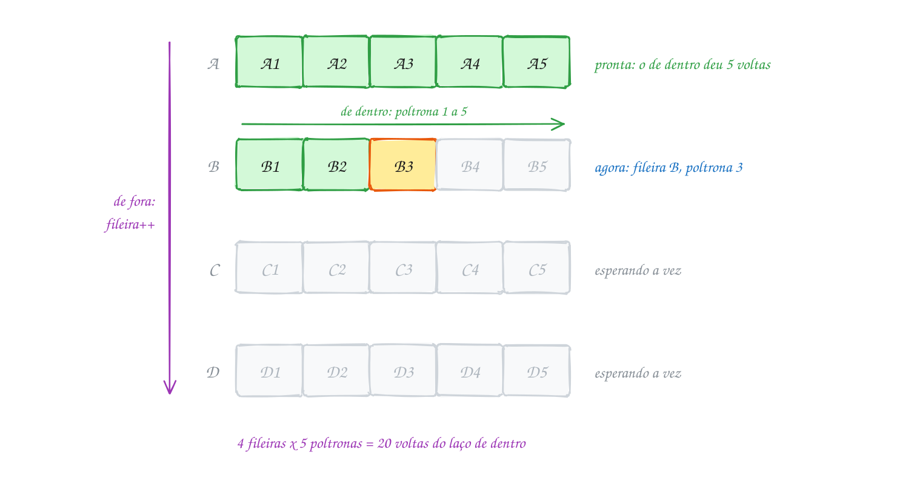</p>

O mapa em C. O `printf("\n")` fica **entre** os dois laços: depois que o de
dentro termina a fileira, antes de o de fora passar para a próxima:

```c
#include <stdio.h>

int main(void) {
    int lugares = 0;

    for (char fileira = 'A'; fileira <= 'D'; fileira++) {    // laço de fora
        for (int poltrona = 1; poltrona <= 5; poltrona++) {  // laço de dentro
            printf("%c%d ", fileira, poltrona);
            lugares++;
        }
        printf("\n"); // acabou a fileira: pula linha
    }
    printf("Total: %d lugares\n", lugares);
    return 0;
}
// Saída:
// A1 A2 A3 A4 A5 
// B1 B2 B3 B4 B5 
// C1 C2 C3 C4 C5 
// D1 D2 D3 D4 D5 
// Total: 20 lugares
```

Repara no fluxograma: são dois losangos, cada um com a sua seta de volta. A
volta pequena (de "Mostrar e poltrona++" para "poltrona <= 5?") fica **dentro** da
volta grande (de "pula linha" para "fileira <= 'D'?"). E logo depois do Sim de
fora vem `poltrona = 1`: é ali que o laço de dentro recomeça:

<p align="center">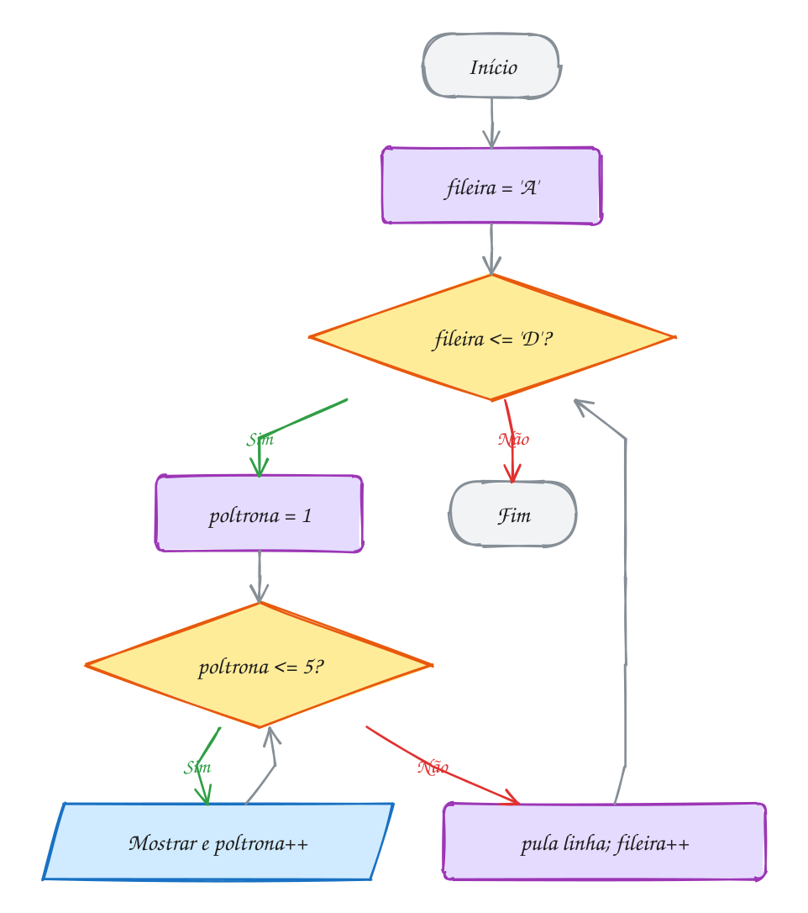</p>

> [!WARNING]
> O `printf("\n")` no lugar errado muda o desenho inteiro. Dentro do laço de
> dentro, sai uma poltrona por linha (20 linhas). Fora dos dois laços, sai tudo
> numa linha só. Antes de escrever, pergunte: isto acontece **uma vez por
> poltrona**, **uma vez por fileira** ou **uma vez no programa todo**? A
> resposta diz em qual nível o comando fica. Lembre também que `break` sai só
> do laço **mais interno** (assunto 0023).

> [!TIP]
> **Por dentro do C:** o custo de um laço aninhado é a **multiplicação**. Com 4
> x 5 são 20 voltas, nada. Mas compare uma lista de 1.000 clientes com outra de
> 1.000 pedidos, cada um contra cada um: 1.000 x 1.000 = 1 milhão de
> comparações. Com 100 mil de cada lado, 10 bilhões, e o programa que levava um
> segundo passa a levar horas. É o que o módulo de análise vai chamar de
> **O(n²)**. Sempre que vir um laço dentro de outro, faça a conta.

> [!NOTE]
> **Pergunta para você:** se o laço de dentro fosse
> `for (int poltrona = 1; poltrona <= fileira - 'A' + 1; poltrona++)`, quantas
> poltronas teria cada fileira e quantos lugares no total? Lembre que `char` é
> número: `'C' - 'A'` vale 2. Desenhe o mapa no papel e depois troque o laço
> de dentro no código acima e rode.

### Hora de praticar

Os arquivos ficam em [`0024-lacos-aninhados/`](0024-lacos-aninhados/). Os comandos funcionam de qualquer pasta do terminal. Nos exemplos, rode, mude, quebre e rode de novo. Nos exercícios, a resposta vai dentro do próprio arquivo. ★☆☆ é aquecimento, ★★☆ pede raciocínio e ★★★ é desafio.

**Exemplo A047 · As horas capicua do relógio digital**

```c
#include <stdio.h>

int main(void) {
    int voltas = 0;
    int capicuas = 0;

    // de 00:00 a 23:59: o minuto dá a volta inteira a cada hora
    for (int hora = 0; hora <= 23; hora++) {           // laço de fora
        for (int minuto = 0; minuto <= 59; minuto++) { // laço de dentro
            voltas++;
            // hh:mm se lê igual de trás para frente: 12:21, 05:50...
            if (hora / 10 == minuto % 10 && hora % 10 == minuto / 10) {
                printf("%02d:%02d ", hora, minuto);
                capicuas++;
                if (capicuas % 8 == 0) {
                    printf("\n");
                }
            }
        }
    }

    printf("Horários testados: %d (24 x 60)\n", voltas);
    printf("Capicuas: %d\n", capicuas);
    return 0;
}
// Saída:
// 00:00 01:10 02:20 03:30 04:40 05:50 10:01 11:11 
// 12:21 13:31 14:41 15:51 20:02 21:12 22:22 23:32 
// Horários testados: 1440 (24 x 60)
// Capicuas: 16
```

```bash
~/LPEDC/rodar 03-repeticoes/0024-lacos-aninhados/A047.c
```

**Exemplo A048 · Triângulos de asteriscos: o de dentro depende do de fora**

```c
#include <stdio.h>

int main(void) {
    int altura = 5;

    // linha 1 tem 1 asterisco, linha 2 tem 2... o limite de dentro é "linha"
    for (int linha = 1; linha <= altura; linha++) {
        for (int col = 1; col <= linha; col++) {
            printf("*");
        }
        printf("\n");
    }

    printf("\n");

    // de cabeça para baixo: espaços à esquerda, depois os asteriscos
    for (int linha = altura; linha >= 1; linha--) {
        for (int esp = 1; esp <= altura - linha; esp++) {
            printf(" ");
        }
        for (int col = 1; col <= linha; col++) {
            printf("*");
        }
        printf("\n");
    }
    return 0;
}
// Saída:
// *
// **
// ***
// ****
// *****
//
// *****
//  ****
//   ***
//    **
//     *
```

```bash
~/LPEDC/rodar 03-repeticoes/0024-lacos-aninhados/A048.c
```

#### Exercícios

**Exercício E139** · ★☆☆

O pedreiro quer ver como vai ficar a calçada: 3 fileiras de 8 ladrilhos.
Desenhe com dois for aninhados, usando printf("#") uma vez só no código:


```text
########
########
########
```

**Dicas:**

1. O laço de fora conta as fileiras (3); o de dentro, os ladrilhos (8).
2. O printf("\n") fica DEPOIS do laço de dentro, ainda dentro do de fora.
3. Resposta esperada: o desenho acima. O printf("#") roda 3 x 8 = 24 vezes.

```bash
~/LPEDC/rodar 03-repeticoes/0024-lacos-aninhados/E139.c
```

**Exercício E140** · ★☆☆

O par de laços abaixo já está no main do arquivo:


```text
for (int i = 1; i <= 3; i++) {
    for (int j = 1; j <= i; j++) {
        printf("%d ", i * j);
    }
    printf("\n");
}
```


Estenda o programa: acrescente um contador que soma 1 cada vez que o printf
de dentro roda e, depois dos dois laços, mostre quantas vezes foi:


```text
Saída esperada:
1
2 4
3 6 9
printf de dentro: 6 vezes
```


Depois troque o limite do laço de fora para 4 e rode de novo.

**Dicas:**

1. O contador começa em 0 antes dos laços e soma 1 logo depois do printf
   de dentro, no mesmo nível dele.
2. Para cada i, o laço de dentro roda i vezes: 1, depois 2, depois 3.
3. Resposta esperada: a saída acima (1 + 2 + 3 = 6). Com i até 4, aparece a
   linha "4 8 12 16" e o contador vai a 10.

```bash
~/LPEDC/rodar 03-repeticoes/0024-lacos-aninhados/E140.c
```

**Exercício E141** · ★★☆

Monte a tábua de multiplicação de 1 a 9 como uma tabela, com cabeçalho e
margem. Cada número ocupa 4 posições (%4d):


```text
  x |   1   2   3   4   5   6   7   8   9
----+------------------------------------
  1 |   1   2   3   4   5   6   7   8   9
  2 |   2   4   6   8  10  12  14  16  18
...
  9 |   9  18  27  36  45  54  63  72  81
```

**Dicas:**

1. O cabeçalho é um laço sozinho, antes dos aninhados. A linha de traços
   também pode ser um laço (4 traços por coluna).
2. Em cada linha: primeiro a margem printf("%3d |", linha), depois o laço
   de dentro com printf("%4d", linha * coluna).
3. Resposta esperada: a tabela acima; a última linha termina em 81 e a
   diagonal tem os quadrados 1, 4, 9, 16, 25, 36, 49, 64, 81.

```bash
~/LPEDC/rodar 03-repeticoes/0024-lacos-aninhados/E141.c
```

**Exercício E142** · ★★☆

A escola quer a lista de chamada de 3 turmas com 4 alunos cada, uma turma
por linha (T1-A1 T1-A2 ...). O programa abaixo mostra só a primeira turma e
depois duas linhas vazias. O código com o erro está logo abaixo. Conserte
(continue usando while) e rode até aparecer a saída esperada.


```text
Saída esperada depois do conserto:
T1-A1 T1-A2 T1-A3 T1-A4
T2-A1 T2-A2 T2-A3 T2-A4
T3-A1 T3-A2 T3-A3 T3-A4
```

**Dicas:**

1. Quanto vale aluno quando a turma 2 começa?
2. Com for, o "aluno = 1" fica no cabeçalho do laço de dentro e roda toda
   vez. Com while, você precisa fazer isso à mão.
3. Resposta esperada: aluno nunca volta para 1. Depois da turma 1 ele vale
   5, e o while de dentro não roda mais. Conserto: "aluno = 1;" dentro do
   while de fora, logo antes do while de dentro.

```bash
~/LPEDC/rodar 03-repeticoes/0024-lacos-aninhados/E142.c
```

**Exercício E143** · ★★★

Desenhe uma pirâmide centralizada com a altura lida do teclado (aceite de 1
a 20; confira o retorno do scanf). Com altura 5:


```text
Altura: 5
    *
   ***
  *****
 *******
*********
```

**Dicas:**

1. Em cada linha, dois laços seguidos: um de espaços e um de asteriscos.
2. Na linha L (de 1 a altura): altura - L espaços e 2 * L - 1 asteriscos.
3. Resposta esperada: o desenho acima; a base tem 9 asteriscos
   (2 x 5 - 1). Com altura 1, só um "*".

```bash
~/LPEDC/rodar 03-repeticoes/0024-lacos-aninhados/E143.c
```

**Exercício E144** · ★★★

De quantas formas dá para pagar R$ 100 usando só notas de 50, 20 e 10?
Resolva por força bruta: três laços aninhados testam todas as quantidades
possíveis de cada nota e contam as combinações que somam 100. Mostre cada
uma e o total:


```text
 1) 0 de 50 + 0 de 20 + 10 de 10
 2) 0 de 50 + 1 de 20 +  8 de 10
...
10) 2 de 50 + 0 de 20 +  0 de 10
Formas: 10
```

**Dicas:**

1. Notas de 50: de 0 a 2. De 20: de 0 a 5. De 10: de 0 a 10.
2. No laço mais de dentro: if (50 * n50 + 20 * n20 + 10 * n10 == 100).
3. Resposta esperada: 10 formas. Desafio extra: reescreva sem o laço das
   notas de 10. Com n50 e n20 fixos, calcule quantas notas de 10 faltam
   (só vale se o que falta for >= 0) e confira se continuam 10 formas.

```bash
~/LPEDC/rodar 03-repeticoes/0024-lacos-aninhados/E144.c
```

---

## 0025 · Padrões de laço

Fim de semana de calor e você anotou a temperatura máxima de cada dia: 28, 31,
36, 25 e 30 °C. Quantos dias foram? Qual a média? Qual foi o dia mais quente,
e o mais frio? Teve algum dia de 35 °C ou mais?

Cada pergunta dessas é um **padrão de laço**: um jeito de usar uma variável
que já foi resolvido milhares de vezes. Quem programa há tempo reconhece de
longe e escreve sem pensar. São cinco, e todos seguem o mesmo roteiro: a
variável ganha um valor **antes** do laço, é atualizada **dentro** e usada
**depois**.

| Padrão | Antes do laço | Dentro do laço | Depois |
| --- | --- | --- | --- |
| **contador** | `dias = 0` | `dias++` | quantos foram |
| **acumulador** | `soma = 0` (produto: `= 1`) | `soma += temp` | total, média |
| **maior/menor** | o **primeiro** valor | `if (temp > maior) maior = temp` | o recorde |
| **flag** | `calorao = false` | `if (temp >= 35) calorao = true` | aconteceu ou não? |
| **sentinela** | ler o primeiro valor | ler o próximo, no fim | (o laço para nela) |

Alguns detalhes que separam o código certo do quase certo:

- o acumulador de **produto** começa em **1**: começar em 0 zera tudo;
- a **flag** só sobe. Ninguém escreve `else calorao = false`, senão um dia de
  25 °C depois do de 36 apagaria a resposta;
- a **sentinela** é um valor que **não pode** ser um dado de verdade. Temperatura
  pode ser 0 ou negativa, então a sentinela aqui é 999. E ela não entra em
  conta nenhuma: o laço testa antes de contar;
- para a sentinela funcionar, a leitura acontece em dois lugares: uma vez
  **antes** do laço e uma vez no **fim** do corpo. É a **leitura antecipada**:
  a pergunta do `while` sempre olha para um valor recém-lido;
- a média é `(double) soma / dias`, com cast (assunto 0008), e só se `dias >
  0`. Se a primeira coisa digitada for a sentinela, a conta vira 0 / 0: com
  `double`, sai `nan` (*not a number*); com `int`, o programa quebra.

Vamos ver na prática. As cinco temperaturas entram uma a uma e cada uma
atualiza as caixinhas. O 999 não muda nada: só manda parar. No fim, as
caixinhas guardam as respostas:

<p align="center">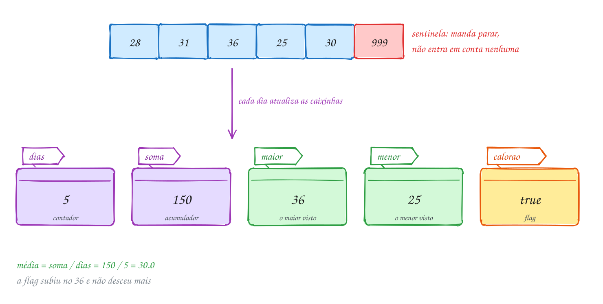</p>

Os cinco padrões juntos em C:

```c
#include <stdbool.h>
#include <stdio.h>

int main(void) {
    const int FIM = 999;          // sentinela: nenhuma temperatura real vale 999
    int temp;
    int dias = 0;                 // contador
    int soma = 0;                 // acumulador
    int maior = 0, menor = 0;     // só valem depois do 1º dia
    bool calorao = false;         // flag: algum dia passou de 35?

    printf("Máxima do dia (999 encerra): ");
    if (scanf("%d", &temp) != 1) {
        temp = FIM;
    }
    while (temp != FIM) {
        dias++;
        soma += temp;
        if (dias == 1 || temp > maior) {
            maior = temp;
        }
        if (dias == 1 || temp < menor) {
            menor = temp;
        }
        if (temp >= 35) {
            calorao = true;       // levanta a flag e não abaixa mais
        }
        printf("Máxima do dia (999 encerra): ");
        if (scanf("%d", &temp) != 1) {
            temp = FIM;
        }
    }

    if (dias == 0) {
        printf("Nenhum dia lido.\n");
        return 0;
    }
    printf("Dias: %d\n", dias);
    printf("Média: %.1f °C\n", (double) soma / dias);
    printf("Maior: %d °C | Menor: %d °C\n", maior, menor);
    printf("Teve dia de 35 °C ou mais? %s\n", calorao ? "sim" : "não");
    return 0;
}
// Máxima do dia (999 encerra): 28
// Máxima do dia (999 encerra): 31
// Máxima do dia (999 encerra): 36
// Máxima do dia (999 encerra): 25
// Máxima do dia (999 encerra): 30
// Máxima do dia (999 encerra): 999
// Dias: 5
// Média: 30.0 °C
// Maior: 36 °C | Menor: 25 °C
// Teve dia de 35 °C ou mais? sim
```

Repara no fluxograma: tem **duas** caixas de leitura. "Ler temp" fica antes do
losango e roda uma vez; "Ler a próxima temp" fica no fim do corpo e é dela que
sai a seta de volta para o losango. Assim, a pergunta "temp != 999?" sempre
olha para o valor que acabou de chegar:

<p align="center">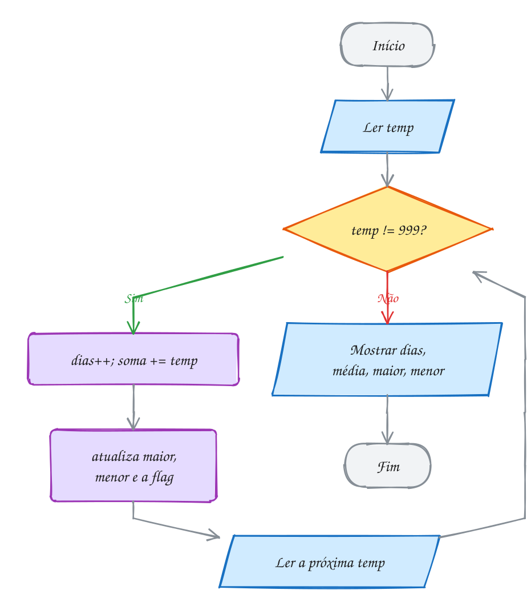</p>

> [!WARNING]
> `maior = 0` parece inofensivo, até chegar o inverno na serra catarinense:
> com máximas de -3, -1 e -4 °C, nenhuma passa de 0, e o programa jura que o
> dia mais quente teve 0 °C, um dia que nunca existiu. O maior (e o menor)
> começa com o **primeiro valor lido**, como no código acima (`dias == 1 ||
> ...`). Outra saída é começar com o pior valor possível: `INT_MIN` para o
> maior e `INT_MAX` para o menor, de `<limits.h>` (assunto 0003).

> [!TIP]
> **Por dentro do C:** o acumulador tem os limites do tipo dele. Some salários
> num `int` e, passando de 2.147.483.647, a soma dá a volta e vira negativa
> (*overflow*, assunto 0003). Com `double`, o perigo é outro: 0,1 não tem
> representação exata em binário, então somar 0,1 dez vezes dá
> 0,9999999999999999, não 1. Para dinheiro, quem faz sistema de verdade
> acumula **centavos** num inteiro grande (`long long`) e só divide por 100 na
> hora de mostrar.

> [!NOTE]
> **Pergunta para você:** se a primeira coisa digitada for 999, o que o A049
> mostra? E se você apagar o `if (dias == 0)`, o que aconteceria na média?
> Preveja e teste com `printf '999\n' | ~/LPEDC/rodar ...`.

### Hora de praticar

Os arquivos ficam em [`0025-padroes-de-laco/`](0025-padroes-de-laco/). Os comandos funcionam de qualquer pasta do terminal. Nos exemplos, rode, mude, quebre e rode de novo. Nos exercícios, a resposta vai dentro do próprio arquivo. ★☆☆ é aquecimento, ★★☆ pede raciocínio e ★★★ é desafio.

**Exemplo A049 · Inverno na serra: maior e menor com INT_MIN e INT_MAX**

```c
#include <limits.h>
#include <stdbool.h>
#include <stdio.h>

int main(void) {
    const int FIM = 999;      // sentinela
    int temp;
    int dias = 0;             // contador
    int soma = 0;             // acumulador
    int geada = 0;            // contador com condição: dias com máxima <= 0
    int maior = INT_MIN;      // qualquer temperatura ganha do menor int
    int menor = INT_MAX;      // qualquer temperatura perde do maior int
    bool esquentou = false;   // flag: algum dia passou de 0 °C?

    // ler e testar a sentinela na própria pergunta do while
    printf("Máxima do dia (999 encerra): ");
    while (scanf("%d", &temp) == 1 && temp != FIM) {
        dias++;
        soma += temp;
        if (temp > maior) {
            maior = temp;     // sem o "dias == 1 ||": INT_MIN cuida disso
        }
        if (temp < menor) {
            menor = temp;
        }
        if (temp <= 0) {
            geada++;
        } else {
            esquentou = true;
        }
        printf("Máxima do dia (999 encerra): ");
    }

    if (dias == 0) {
        printf("Nenhum dia lido.\n");
        return 0;
    }
    printf("Dias: %d | Com máxima até 0 °C: %d\n", dias, geada);
    printf("Média: %.1f °C\n", (double) soma / dias);
    printf("Maior: %d °C | Menor: %d °C\n", maior, menor);
    printf("Algum dia acima de 0 °C? %s\n", esquentou ? "sim" : "não");
    return 0;
}
// Máxima do dia (999 encerra): -3
// Máxima do dia (999 encerra): -1
// Máxima do dia (999 encerra): -4
// Máxima do dia (999 encerra): 999
// Dias: 3 | Com máxima até 0 °C: 3
// Média: -2.7 °C
// Maior: -1 °C | Menor: -4 °C
// Algum dia acima de 0 °C? não
```

```bash
~/LPEDC/rodar 03-repeticoes/0025-padroes-de-laco/A049.c
```

**Exemplo A050 · Os divisores de 28: contar, somar e levantar uma flag**

```c
#include <stdbool.h>
#include <stdio.h>

int main(void) {
    int n = 28;
    int quantos = 0;      // contador: começa em 0
    int soma = 0;         // acumulador de soma: começa em 0
    long produto = 1;     // acumulador de produto: começa em 1!

    printf("Divisores de %d:", n);
    for (int d = 1; d <= n; d++) {
        if (n % d == 0) {
            printf(" %d", d);
            quantos++;
            if (d < n) {
                soma += d; // só os divisores próprios (menores que n)
            }
            produto *= d;
        }
    }
    printf("\n");

    bool perfeito = (soma == n); // a flag pode nascer de uma comparação
    printf("Quantos: %d\n", quantos);
    printf("Soma dos próprios: %d\n", soma);
    printf("Produto de todos: %ld\n", produto);
    printf("%d é perfeito? %s\n", n, perfeito ? "sim" : "não");
    return 0;
}
// Saída:
// Divisores de 28: 1 2 4 7 14 28
// Quantos: 6
// Soma dos próprios: 28
// Produto de todos: 21952
// 28 é perfeito? sim
```

```bash
~/LPEDC/rodar 03-repeticoes/0025-padroes-de-laco/A050.c
```

#### Exercícios

**Exercício E145** · ★☆☆

Leia as 5 notas de um aluno com um for. Mostre a soma, a média (1 casa) e
em quantas provas ele tirou 6 ou mais:


```text
Nota 1: 7
Nota 2: 4.5
Nota 3: 8
Nota 4: 6
Nota 5: 9.5
Soma: 35.0
Média: 7.0
Provas com 6 ou mais: 4
```

**Dicas:**

1. Antes do laço: soma = 0 (acumulador) e acima = 0 (contador).
2. Dentro: soma += nota; if (nota >= 6) acima++;
3. Resposta esperada: soma 35.0, média 7.0 e 4 provas com 6 ou mais (o 6
   conta, porque é ">=").

```bash
~/LPEDC/rodar 03-repeticoes/0025-padroes-de-laco/E145.c
```

**Exercício E146** · ★☆☆

Complete as lacunas do controle de gastos do mês. O valor 0 é a sentinela:
encerra a lista e não conta como gasto. Depois escreva o programa completo
no arquivo e teste.


```text
double gasto, total = ____;
int quantos = ____;
printf("Gasto (0 encerra): ");
scanf("%lf", &gasto);
while (________) {
    total = ________;
    quantos++;
    printf("Gasto (0 encerra): ");
    ________;
}
if (quantos > 0) {
    printf("Total: R$ %.2f em %d gastos\n", total, quantos);
    printf("Média: R$ %.2f\n", ________);
}
```


```text
Com 45.90, 120 e 33.10 e depois 0:
Total: R$ 199.00 em 3 gastos
Média: R$ 66.33
```

**Dicas:**

1. Contador e acumulador começam em 0.
2. A segunda leitura fica no FIM do corpo: é ela que traz o próximo valor
   para a pergunta do while (leitura antecipada).
3. Resposta esperada: 0.0; 0; gasto != 0; total + gasto;
   scanf("%lf", &gasto); total / quantos. Saída: R$ 199.00 em 3 gastos,
   média R$ 66.33.

```bash
~/LPEDC/rodar 03-repeticoes/0025-padroes-de-laco/E146.c
```

**Exercício E147** · ★★☆

Você anotou o preço da gasolina em 6 postos do caminho. Leia os 6 preços e
mostre o mais barato e o mais caro, com o NÚMERO do posto de cada um, e a
diferença entre eles:


```text
Posto 1: 5.89
Posto 2: 6.09
Posto 3: 5.79
Posto 4: 5.99
Posto 5: 6.19
Posto 6: 5.85
Mais barato: posto 3 (R$ 5.79)
Mais caro: posto 5 (R$ 6.19)
Diferença: R$ 0.40 por litro
```

**Dicas:**

1. Além do menor e do maior, guarde a posição de cada um (posto_menor,
   posto_maior). Quando o menor muda, a posição muda junto.
2. Comece menor e maior com o PRIMEIRO preço lido, não com 0.
3. Resposta esperada: posto 3 (5.79), posto 5 (6.19), diferença 0.40.

```bash
~/LPEDC/rodar 03-repeticoes/0025-padroes-de-laco/E147.c
```

**Exercício E148** · ★★☆

A lanchonete anota o resultado de cada dia em reais (negativo é prejuízo) e
digita 9999 para encerrar. Numa semana ruim, com -30, -10, -45 e 9999, o
programa abaixo mostra:


```text
Dias: 4
Média: -21
Melhor dia: 0
```


mas o certo é 3 dias, média -28.33 e melhor dia -10. O código, com TRÊS
erros, está logo abaixo. Teste com


```text
printf -- '-30\n-10\n-45\n9999\n' | ~/LPEDC/rodar 03-repeticoes/0025-padroes-de-laco/E148.c
```


ache os três e conserte.

**Dicas:**

1. O contador conta antes ou depois de saber se é a sentinela?
2. Se todos os dias foram negativos, quem ganha de um "maior" que começa
   em 0? E int dividido por int dá...
3. Resposta esperada: (1) dias++ vem antes do teste da sentinela e conta o
   9999; (2) maior = 0 vence todos os negativos: comece com o primeiro dia;
   (3) soma / dias é divisão inteira: use (double) soma / dias e %.2f.
   Corrigido: "Dias: 3", "Média: -28.33", "Melhor dia: -10".

```bash
~/LPEDC/rodar 03-repeticoes/0025-padroes-de-laco/E148.c
```

**Exercício E149** · ★★★

Campeonato de skate: 8 notas de 0 a 100. Leia cada nota UMA vez (sem
guardar todas: vetores só no módulo 05) e mostre a maior e a segunda maior.
Se duas pessoas empatarem no topo, a segunda maior é igual à maior.


```text
Nota 1: 72
Nota 2: 95
Nota 3: 88
Nota 4: 95
Nota 5: 60
Nota 6: 81
Nota 7: 99
Nota 8: 70
1º lugar: 99
2º lugar: 95
```

**Dicas:**

1. Duas variáveis: primeiro e segundo. Como as notas vão de 0 a 100, dá
   para começar as duas com -1 (um valor impossível).
2. Nota maior que o primeiro: o primeiro antigo desce para segundo, e a
   nota vira o primeiro. Senão, se for maior que o segundo, vira o segundo.
3. Resposta esperada: 99 e 95. Com 50 90 90 10 20 30 40 60, a resposta é
   90 e 90 (empate). Faça o teste de mesa da ordem: se você atualizar o
   primeiro antes de salvar o antigo no segundo, perde o 95.

```bash
~/LPEDC/rodar 03-repeticoes/0025-padroes-de-laco/E149.c
```

**Exercício E150** · ★★★

O app de corrida registra a distância de 6 treinos, em km inteiros. Leia os
6 valores (inteiros) e faça o programa mostrar a resposta de duas perguntas:

a) Os treinos estão em ordem crescente (cada um MAIOR que o anterior)?
b) Qual foi a maior sequência de treinos seguidos em alta?


```text
Treino 1: 3
Treino 2: 5
Treino 3: 8
Treino 4: 2
Treino 5: 4
Treino 6: 9
Em ordem crescente? não
Maior sequência em alta: 3 treinos
```

**Dicas:**

1. Guarde o valor anterior numa variável. A partir do 2º treino, compare
   o atual com o anterior. No fim de cada volta, anterior = atual.
2. Flag: bool crescente = true no começo; vira false na primeira descida
   (ou empate) e nunca mais volta. Para (b), um contador da sequência atual,
   que zera (volta a 1) quando a alta acaba, e um "maior" que guarda o
   recorde.
3. Resposta esperada: com 3 5 8 2 4 9, "não" e 3 treinos (3 5 8 ou 2 4 9).
   Com 1 2 3 4 5 6: "sim" e 6. Com 5 5 5 5 5 5: "não" e 1.

```bash
~/LPEDC/rodar 03-repeticoes/0025-padroes-de-laco/E150.c
```

---

## 0026 · Aleatórios

No jogo de tabuleiro, você caiu na prisão. Para sair, precisa tirar **dupla**
nos dois dados: os dois com o mesmo número. Joga, não sai, joga de novo. É um
`do...while` (assunto 0021) com um ingrediente novo: o resultado de cada volta
é sorteado.

Computador não sorteia de verdade. Ele é uma máquina determinística: a mesma
entrada dá sempre a mesma saída. O que ele faz é gerar números
**pseudoaleatórios**: uma sequência calculada por uma conta fixa, em que cada
número sai do anterior, e que parece aleatória para quem olha.

Em C, as peças ficam em `<stdlib.h>`:

- **`rand()`** devolve o próximo número da sequência, de 0 até **`RAND_MAX`**.
  O padrão garante `RAND_MAX` de pelo menos 32767; na glibc (Linux), ele vale
  2147483647;
- **`srand(semente)`** escolhe por onde a sequência começa. A mesma
  **semente** dá sempre a mesma sequência.

Para trazer o número para a faixa que você quer, use o resto da divisão
(assunto 0007): `rand() % 6` dá de 0 a 5, e `1 + rand() % 6` dá de 1 a 6.
Para uma faixa qualquer de `a` até `b`, a fórmula é
`a + rand() % (b - a + 1)`.

E a semente? Depende do que você quer:

- **semente fixa** (`srand(2022)`): o programa sorteia sempre os mesmos
  números. Parece inútil, mas é ouro para **testar** e **depurar**: o erro que
  apareceu volta a aparecer. Os exemplos deste curso usam semente fixa para a
  saída do comentário bater com a sua;
- **semente do relógio** (`srand(time(NULL))`, com `<time.h>`): `time(NULL)`
  devolve quantos segundos se passaram desde 1º de janeiro de 1970. Cada
  execução começa num segundo diferente e sorteia números diferentes. É o que
  um jogo de verdade usa.

Sem nenhum `srand`, é como se o programa tivesse chamado `srand(1)`: a mesma
sequência sempre.

Vamos ver na prática. A semente 2022 entra no gerador, que vai cuspindo
números enormes, cada um calculado a partir do anterior. O `% 6 + 1`
transforma cada número numa face, e os pares de faces são as jogadas. Na
quarta, sai 4 e 4:

<p align="center">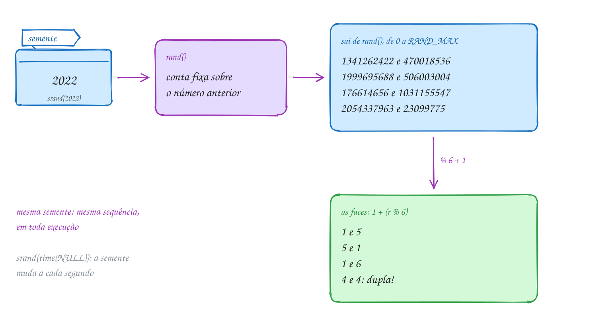</p>

O mesmo jogo em C. Atenção: a sequência exata depende da biblioteca. A saída
abaixo é a da glibc (Linux); no macOS ou no Windows, a semente 2022 dá outros
números:

```c
#include <stdio.h>
#include <stdlib.h> // rand e srand

int main(void) {
    srand(2022); // semente fixa: a mesma sequência a cada execução

    int dado1, dado2;
    int jogadas = 0;

    do {
        dado1 = 1 + rand() % 6; // rand() % 6 vai de 0 a 5; + 1 vira 1 a 6
        dado2 = 1 + rand() % 6;
        jogadas++;
        printf("Jogada %d: %d e %d\n", jogadas, dado1, dado2);
    } while (dado1 != dado2);

    printf("Dupla de %d na jogada %d. Saiu da prisão!\n", dado1, jogadas);
    return 0;
}
// Saída (glibc, Linux; em outro sistema a sequência pode ser outra):
// Jogada 1: 1 e 5
// Jogada 2: 5 e 1
// Jogada 3: 1 e 6
// Jogada 4: 4 e 4
// Dupla de 4 na jogada 4. Saiu da prisão!
```

Repara no fluxograma: o `srand` fica **fora** do laço, antes de tudo, e roda
uma vez só. O sorteio fica dentro, e a seta do Sim volta do losango para ele.
No exemplo, o caminho passa três vezes pelo Sim e, na quarta jogada, pelo Não:

<p align="center">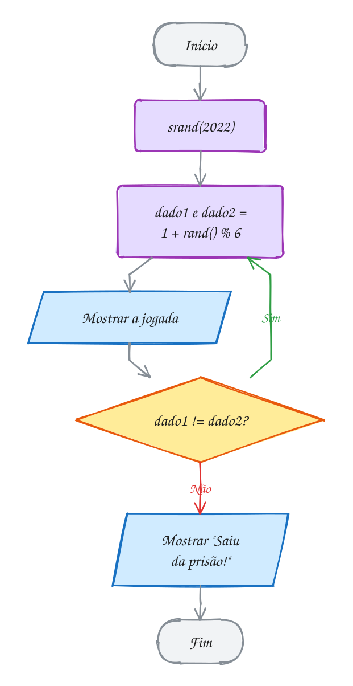</p>

> [!WARNING]
> O erro clássico é chamar `srand(time(NULL))` **dentro** do laço. O laço
> inteiro roda em milissegundos, dentro do mesmo segundo, então toda volta
> reinicia a sequência com a **mesma** semente, e o `rand()` devolve sempre o
> mesmo primeiro número: o dado "sorteia" 4, 4, 4, 4... O `srand` vai uma vez
> só, no começo do `main`. Outro tropeço: `srand` não devolve nada (é `void`).
> Quem sorteia é o `rand`.

> [!TIP]
> **Por dentro do C:** o padrão do C mostra, como exemplo, um gerador que é só
> uma conta: `proximo = proximo * 1103515245 + 12345`, e o resultado é um
> pedaço desse número. Cada `rand()` faz a conta uma vez, e a semente é o
> primeiro `proximo`. A glibc usa uma receita um pouco mais elaborada, mas a
> ideia é a mesma, e por isso a sequência se repete com a mesma semente. Dois
> avisos: o `%` favorece um pouquinho os números baixos quando `RAND_MAX + 1`
> não é múltiplo da faixa (o **viés do módulo**, desprezível para dados e
> jogos); e `rand` **nunca** serve para senha, token ou criptografia, porque
> quem descobre a semente prevê tudo. Para isso existe `getrandom` (Linux) ou
> uma biblioteca de criptografia.

> [!NOTE]
> **Pergunta para você:** rode o A051 duas vezes. A saída muda? Agora troque
> o primeiro `srand(2026)` por `srand(time(NULL))` (e inclua `<time.h>`). O
> que muda na primeira linha, o que continua igual nas outras duas, e o que
> acontece se você rodar duas vezes dentro do mesmo segundo?

### Hora de praticar

Os arquivos ficam em [`0026-aleatorios/`](0026-aleatorios/). Os comandos funcionam de qualquer pasta do terminal. Nos exemplos, rode, mude, quebre e rode de novo. Nos exercícios, a resposta vai dentro do próprio arquivo. ★☆☆ é aquecimento, ★★☆ pede raciocínio e ★★★ é desafio.

**Exemplo A051 · Mesma semente, mesmo sorteio**

```c
#include <stdio.h>
#include <stdlib.h>

int main(void) {
    // bingo da quermesse: 5 bolas de 1 a 75 (a + rand() % (b - a + 1))
    srand(2026);
    printf("Semente 2026:        ");
    for (int i = 0; i < 5; i++) {
        printf("%3d", 1 + rand() % 75);
    }
    printf("\n");

    // a mesma semente de novo: a sequência recomeça do mesmo ponto
    srand(2026);
    printf("Semente 2026 de novo:");
    for (int i = 0; i < 5; i++) {
        printf("%3d", 1 + rand() % 75);
    }
    printf("\n");

    // outra semente: outra sequência
    srand(2027);
    printf("Semente 2027:        ");
    for (int i = 0; i < 5; i++) {
        printf("%3d", 1 + rand() % 75);
    }
    printf("\n");
    return 0;
}
// Saída (glibc, Linux; em outro sistema os números podem ser outros,
// mas as duas primeiras linhas continuam iguais entre si):
// Semente 2026:         38 73 74 70 62
// Semente 2026 de novo: 38 73 74 70 62
// Semente 2027:         54 29  7  5 53
```

```bash
~/LPEDC/rodar 03-repeticoes/0026-aleatorios/A051.c
```

**Exemplo A052 · 6000 lançamentos: o dado é honesto?**

```c
#include <stdio.h>
#include <stdlib.h>
#include <time.h> // time

int main(void) {
    srand(42); // semente fixa, para a saída abaixo ser reproduzível
    // srand((unsigned) time(NULL)); // use esta linha para variar a cada execução

    int um = 0, dois = 0, tres = 0, quatro = 0, cinco = 0, seis = 0;
    int total = 6000;

    for (int i = 0; i < total; i++) {
        switch (1 + rand() % 6) {
        case 1: um++; break;
        case 2: dois++; break;
        case 3: tres++; break;
        case 4: quatro++; break;
        case 5: cinco++; break;
        default: seis++;
        }
    }

    printf("Face 1: %4d (%.1f%%)\n", um, 100.0 * um / total);
    printf("Face 2: %4d (%.1f%%)\n", dois, 100.0 * dois / total);
    printf("Face 3: %4d (%.1f%%)\n", tres, 100.0 * tres / total);
    printf("Face 4: %4d (%.1f%%)\n", quatro, 100.0 * quatro / total);
    printf("Face 5: %4d (%.1f%%)\n", cinco, 100.0 * cinco / total);
    printf("Face 6: %4d (%.1f%%)\n", seis, 100.0 * seis / total);
    return 0;
}
// Saída (glibc, Linux, semente 42):
// Face 1:  976 (16.3%)
// Face 2: 1001 (16.7%)
// Face 3:  978 (16.3%)
// Face 4: 1026 (17.1%)
// Face 5: 1024 (17.1%)
// Face 6:  995 (16.6%)
```

```bash
~/LPEDC/rodar 03-repeticoes/0026-aleatorios/A052.c
```

#### Exercícios

**Exercício E151** · ★☆☆

Escreva a expressão com rand() que sorteia cada faixa abaixo. Para testar,
faça um for que mostra 10 sorteios de cada uma (com srand(1) no começo) e
confira se nenhum número sai da faixa:


```text
a) um dado: 1 a 6
b) um dígito: 0 a 9
c) a idade de um sorteado entre 10 e 20 anos
d) uma variação de temperatura de -5 a 5
e) só os pares de 2 a 20
```

**Dicas:**

1. rand() % n dá de 0 a n - 1. Somando a, a faixa começa em a.
2. Para a faixa de a até b: a + rand() % (b - a + 1).
3. Resposta esperada: a) 1 + rand() % 6; b) rand() % 10;
   c) 10 + rand() % 11; d) -5 + rand() % 11; e) 2 + 2 * (rand() % 10)
   (sorteia de 0 a 9 e transforma em 2, 4, ..., 20).

```bash
~/LPEDC/rodar 03-repeticoes/0026-aleatorios/E151.c
```

**Exercício E152** · ★☆☆

Simule 20 lançamentos de uma moeda: mostre C (cara) ou K (coroa) para cada
um, na mesma linha, e no fim quantas caras e quantas coroas saíram. Use
srand(time(NULL)) para o resultado mudar a cada execução:


```text
Exemplo de saída (a sua vai ser diferente):
C K K C C K C K K K C C K C K K C C K C
Caras: 10 | Coroas: 10
```

**Dicas:**

1. rand() % 2 dá 0 ou 1. Combine: 0 é cara, 1 é coroa.
2. Um contador basta: coroas = 20 - caras.
3. Resposta esperada: 20 letras e duas contagens que somam 20. Rode
   várias vezes: dá perto de 10 a 10, mas raramente exato.

```bash
~/LPEDC/rodar 03-repeticoes/0026-aleatorios/E152.c
```

**Exercício E153** · ★★☆

O jogo clássico: o programa sorteia um número de 1 a 100 (com
srand(time(NULL))) e a pessoa tenta adivinhar. A cada palpite, ele diz
"Mais alto" ou "Mais baixo". No acerto, mostra quantas tentativas foram.
Se o scanf falhar (letra ou fim da entrada), o jogo encerra mostrando o
número sorteado.


```text
Exemplo (o número sorteado muda a cada vez):
Palpite: 50
Mais baixo.
Palpite: 25
Mais alto.
Palpite: 37
Acertou em 3 tentativas!
```

**Dicas:**

1. Sorteie uma vez só, antes do laço. O laço repete enquanto o palpite for
   diferente do segredo (do-while combina bem).
2. Para testar sem depender da sorte, troque time(NULL) por uma semente
   fixa enquanto desenvolve, e depois volte.
3. Resposta esperada: o jogo funciona para qualquer sorteio. Chutando
   sempre o meio do intervalo que sobrou, você acerta em no máximo 7
   tentativas, porque 2 elevado a 7 = 128 >= 100.

```bash
~/LPEDC/rodar 03-repeticoes/0026-aleatorios/E153.c
```

**Exercício E154** · ★★☆

O programa abaixo deveria sortear 10 lançamentos de um dado. Rode e repare:
sai o mesmo número 10 vezes, e às vezes esse número é 0. São DOIS erros.
O código com os erros está logo abaixo. Conserte os dois e rode algumas
vezes: os 10 números têm que variar e ficar sempre entre 1 e 6.

**Dicas:**

1. Quantas vezes o srand roda? E quanto vale time(NULL) nas 10 voltas, que
   acontecem dentro do mesmo segundo?
2. Qual a faixa de rand() % 6?
3. Resposta esperada: (1) o srand(time(NULL)) está dentro do laço: a cada
   volta a sequência recomeça com a mesma semente (o segundo atual) e o
   rand devolve o mesmo primeiro número. O srand vai uma vez só, antes do
   laço. (2) rand() % 6 vai de 0 a 5; o dado é 1 + rand() % 6.

```bash
~/LPEDC/rodar 03-repeticoes/0026-aleatorios/E154.c
```

**Exercício E155** · ★★★

Dá para estimar pi jogando dardos. Sorteie um ponto (x, y) com x e y entre
0 e 1: ele cai num quadrado de lado 1. O quarto de círculo de raio 1 ocupa
pi/4 desse quadrado. Então, com muitos pontos:


```text
pi ~ 4 x (pontos dentro do círculo) / (total de pontos)
```


Sorteie 1 000 000 de pontos (com srand(42)) e mostre a estimativa com 4
casas. Um ponto está dentro se x * x + y * y <= 1.

**Dicas:**

1. Um double entre 0 e 1: (double) rand() / RAND_MAX. Sem o cast, a divisão
   é inteira e dá quase sempre 0.
2. Use 4.0 na conta final, pelo mesmo motivo.
3. Resposta esperada: algo perto de 3.14. Na glibc (Linux) com semente
   42: "Dentro do círculo: 784696 de 1000000" e "pi ~ 3.1388". Com 100
   pontos, o erro é bem maior: teste.

```bash
~/LPEDC/rodar 03-repeticoes/0026-aleatorios/E155.c
```

**Exercício E156** · ★★★

Quantos lançamentos de um dado, em média, até sair 6 três vezes SEGUIDAS?
A matemática diz 258 (6 + 36 + 216). Confira por simulação: repita o
experimento 10 000 vezes (com srand(2026)) e mostre a média de lançamentos
e o pior caso:


```text
Média: 257.2 lançamentos
Pior caso: 2860 lançamentos
```

**Dicas:**

1. Laço de fora: os 10 000 experimentos. Laço de dentro: lança enquanto
   seguidos < 3.
2. Tirou 6: seguidos++. Qualquer outra face: seguidos = 0. Os contadores
   do experimento (seguidos e lancamentos) recomeçam a cada volta de fora.
3. Resposta esperada: média perto de 258 (na glibc com semente 2026,
   257.2, e pior caso 2860). Use long para a soma de todos os lançamentos.

```bash
~/LPEDC/rodar 03-repeticoes/0026-aleatorios/E156.c
```

---

## 0027 · Juntando tudo

Todo filme de cassino tem a mesa de **craps**: alguém sopra os dados, joga e
a mesa inteira grita. As regras cabem em três linhas:

1. no **primeiro** lançamento de dois dados, soma 7 ou 11 **ganha** na hora;
   2, 3 ou 12 **perde** na hora;
2. qualquer outra soma (4, 5, 6, 8, 9 ou 10) vira o **ponto**;
3. daí em diante, você relança até tirar o ponto de novo (**ganha**) ou um 7
   (**perde**). As outras somas não fazem nada.

É o programa do módulo porque usa quase tudo o que veio até aqui: sorteio com
`rand` (assunto 0026), um `switch` com casos agrupados para o primeiro
lançamento (assunto 0018), um `while` para os relançamentos, com uma variável
de situação que funciona como flag (assuntos 0020 e 0025), e um contador de
lançamentos.

O `while` dos relançamentos é do tipo "não sei quantas voltas": pode acabar
no segundo lançamento ou no trigésimo. E a condição dele não é sobre os
dados, e sim sobre a **situação**: `0` continua, `1` ganhou, `-1` perdeu.
Quem muda a situação é o corpo do laço, que é o único lugar que sabe o que
saiu.

Repare num incômodo do código: o sorteio `1 + rand() % 6` aparece quatro
vezes. No módulo 04 ele vira uma **função** `lancar()` e o programa encolhe.
Por enquanto, a repetição de código é o preço de não ter funções ainda.

Vamos ver na prática. Com a semente 21, o primeiro lançamento dá 3 + 6 = 9. O
`switch` não acha o 9 em nenhum caso especial, e ele vira o ponto. O jogo
relança: 8, depois 5 (nada acontece), depois 9. Saiu o ponto antes do 7:
ganhou no quarto lançamento:

<p align="center">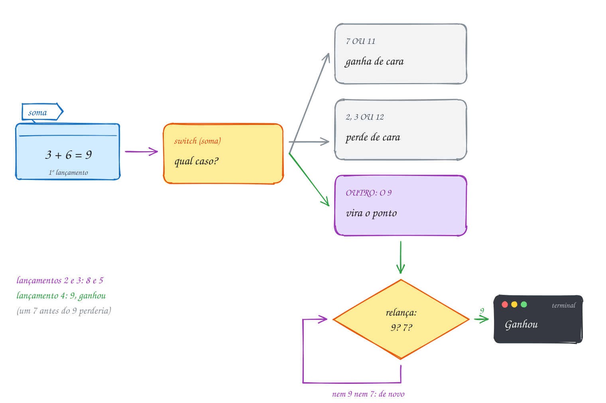</p>

A rodada em C:

```c
#include <stdio.h>
#include <stdlib.h>

int main(void) {
    srand(21); // semente fixa: a rodada abaixo se repete (glibc)

    int d1 = 1 + rand() % 6;
    int d2 = 1 + rand() % 6;
    int soma = d1 + d2;
    int lancamentos = 1;
    int ponto = 0;
    int situacao; // 1 = ganhou, -1 = perdeu, 0 = continua

    printf("Lançamento %d: %d + %d = %d\n", lancamentos, d1, d2, soma);
    switch (soma) {
    case 7:
    case 11:
        situacao = 1;          // natural: ganha de cara
        break;
    case 2:
    case 3:
    case 12:
        situacao = -1;         // craps: perde de cara
        break;
    default:
        situacao = 0;          // virou o ponto
        ponto = soma;
        printf("Ponto: %d. Agora precisa repetir o %d antes de um 7.\n", ponto, ponto);
    }

    while (situacao == 0) {
        d1 = 1 + rand() % 6;
        d2 = 1 + rand() % 6;
        soma = d1 + d2;
        lancamentos++;
        printf("Lançamento %d: %d + %d = %d\n", lancamentos, d1, d2, soma);
        if (soma == ponto) {
            situacao = 1;
        } else if (soma == 7) {
            situacao = -1;
        }
    }

    printf("%s em %d lançamentos.\n", situacao == 1 ? "Ganhou" : "Perdeu", lancamentos);
    return 0;
}
// Saída (glibc, Linux):
// Lançamento 1: 3 + 6 = 9
// Ponto: 9. Agora precisa repetir o 9 antes de um 7.
// Lançamento 2: 3 + 5 = 8
// Lançamento 3: 1 + 4 = 5
// Lançamento 4: 4 + 5 = 9
// Ganhou em 4 lançamentos.
```

O exemplo A054 vai além: põe a rodada dentro de um menu com `do...while`,
valida a aposta com outro `do...while` e controla uma banca de R$ 100 até você
sair ou quebrar. É o mesmo algoritmo, embrulhado em mais dois laços.

Repara no fluxograma: as duas primeiras perguntas (7 ou 11? 2, 3 ou 12?) só
acontecem **uma vez**. O laço começa em "soma = novo lançamento", e a seta de
volta sai do Não de "soma == 7?". As duas saídas do laço vão para os mesmos
"Ganhou" e "Perdeu" do primeiro lançamento:

<p align="center">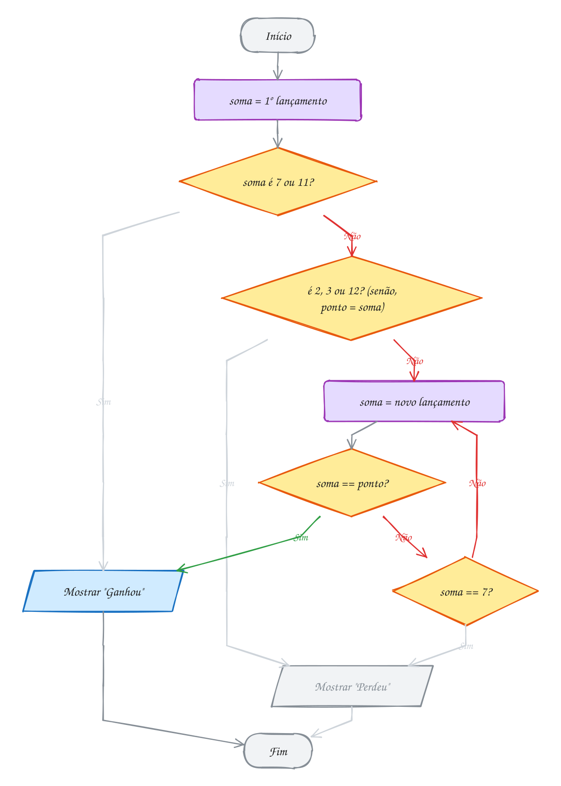</p>

> [!WARNING]
> Num jogo com sorteio, o erro mais traiçoeiro é o laço que **pode** não
> terminar. Aqui ele sempre termina, porque a cada lançamento existe chance de
> sair o ponto ou o 7. Mas troque a condição para `while (soma != ponto)` e
> esqueça o 7: o jogo nunca perde, e o programa está errado sem dar erro
> nenhum. Antes de escrever um `while`, diga em voz alta **todas** as formas
> de sair dele, e confira se cada uma está na condição ou num `break`.

> [!TIP]
> **Por dentro do C:** a variável `situacao` guarda um código numérico (`1`,
> `-1`, `0`), e quem lê o código precisa lembrar o que cada número quer dizer.
> É um "número mágico". No módulo 08, o `enum` dá nome a esses valores
> (`GANHOU`, `PERDEU`, `CONTINUA`), mas por baixo continuam sendo `int`: o
> compilador troca cada nome pelo número, e o programa gerado é idêntico. O
> nome existe só para você.

> [!NOTE]
> **Pergunta para você:** qual é a chance de ganhar no craps? Antes de chutar,
> pense: no primeiro lançamento, o 7 e o 11 juntos saem em 8 de 36
> combinações (o A053 conta todas elas). Depois, rode uma versão do código
> acima que joga 100 000 rodadas sem os `printf` e conta as vitórias (é o desafio 7 do módulo). A resposta é um
> pouco menos de 50%, e é daí que o cassino tira o lucro.

### Hora de praticar

Os arquivos ficam em [`0027-juntando-tudo/`](0027-juntando-tudo/). Os comandos funcionam de qualquer pasta do terminal. Nos exemplos, rode, mude, quebre e rode de novo. Nos exercícios, a resposta vai dentro do próprio arquivo. ★☆☆ é aquecimento, ★★☆ pede raciocínio e ★★★ é desafio.

**Exemplo A053 · As 36 jogadas do primeiro lançamento, sem sortear**

```c
#include <stdio.h>

int main(void) {
    int natural = 0, craps = 0, ponto = 0;

    // em vez de sortear, passa por TODAS as combinações dos dois dados
    printf("d1\\d2  1  2  3  4  5  6\n");
    for (int d1 = 1; d1 <= 6; d1++) {
        printf("%5d", d1);
        for (int d2 = 1; d2 <= 6; d2++) {
            int soma = d1 + d2;
            printf("%3d", soma);
            switch (soma) {
            case 7:
            case 11:
                natural++;  // ganha de cara
                break;
            case 2:
            case 3:
            case 12:
                craps++;    // perde de cara
                break;
            default:
                ponto++;    // o jogo continua
            }
        }
        printf("\n");
    }

    int total = natural + craps + ponto;
    printf("Ganha de cara (7 ou 11):    %2d de %d (%.1f%%)\n",
           natural, total, 100.0 * natural / total);
    printf("Perde de cara (2, 3 ou 12): %2d de %d (%.1f%%)\n",
           craps, total, 100.0 * craps / total);
    printf("Vira ponto:                 %2d de %d (%.1f%%)\n",
           ponto, total, 100.0 * ponto / total);
    return 0;
}
// Saída:
// d1\d2  1  2  3  4  5  6
//     1  2  3  4  5  6  7
//     2  3  4  5  6  7  8
//     3  4  5  6  7  8  9
//     4  5  6  7  8  9 10
//     5  6  7  8  9 10 11
//     6  7  8  9 10 11 12
// Ganha de cara (7 ou 11):     8 de 36 (22.2%)
// Perde de cara (2, 3 ou 12):  4 de 36 (11.1%)
// Vira ponto:                 24 de 36 (66.7%)
```

```bash
~/LPEDC/rodar 03-repeticoes/0027-juntando-tudo/A053.c
```

**Exemplo A054 · Craps com banca, apostas e menu**

```c
#include <stdio.h>
#include <stdlib.h>

int main(void) {
    srand(4); // troque por srand(time(NULL)) para jogar de verdade

    int banca = 100;
    int opcao;
    int rodadas = 0, vitorias = 0;

    do {
        printf("\nBanca: R$ %d | 1 Jogar | 0 Sair: ", banca);
        if (scanf("%d", &opcao) != 1) {
            opcao = 0;
        }
        if (opcao != 1) {
            continue; // 0 (ou qualquer outra coisa) vai para o teste e sai
        }

        int aposta;
        do { // validação: de 1 até o que tem na banca
            printf("Aposta (1 a %d): ", banca);
            if (scanf("%d", &aposta) != 1) {
                return 1;
            }
        } while (aposta < 1 || aposta > banca);

        // a rodada: o mesmo algoritmo do texto, sem os printf de cada lance
        int soma = (1 + rand() % 6) + (1 + rand() % 6);
        int lancamentos = 1;
        int ponto = soma;
        int situacao = 0;
        if (soma == 7 || soma == 11) {
            situacao = 1;
        } else if (soma == 2 || soma == 3 || soma == 12) {
            situacao = -1;
        }
        while (situacao == 0) {
            soma = (1 + rand() % 6) + (1 + rand() % 6);
            lancamentos++;
            if (soma == ponto) {
                situacao = 1;
            } else if (soma == 7) {
                situacao = -1;
            }
        }

        rodadas++;
        if (situacao == 1) {
            banca += aposta;
            vitorias++;
            printf("Ganhou no %dº lançamento! +R$ %d\n", lancamentos, aposta);
        } else {
            banca -= aposta;
            printf("Perdeu no %dº lançamento. -R$ %d\n", lancamentos, aposta);
        }
    } while (opcao != 0 && banca > 0);

    if (banca == 0) {
        printf("\nA banca quebrou.\n");
    }
    printf("Rodadas: %d | Vitórias: %d | Saiu com R$ %d\n", rodadas, vitorias, banca);
    return 0;
}
// Saída (glibc, Linux), com as entradas 1, 20, 1, 50, 1, 500, 30 e 0:
//
// Banca: R$ 100 | 1 Jogar | 0 Sair: 1
// Aposta (1 a 100): 20
// Ganhou no 2º lançamento! +R$ 20
//
// Banca: R$ 120 | 1 Jogar | 0 Sair: 1
// Aposta (1 a 120): 50
// Ganhou no 4º lançamento! +R$ 50
//
// Banca: R$ 170 | 1 Jogar | 0 Sair: 1
// Aposta (1 a 170): 500
// Aposta (1 a 170): 30
// Perdeu no 3º lançamento. -R$ 30
//
// Banca: R$ 140 | 1 Jogar | 0 Sair: 0
// Rodadas: 3 | Vitórias: 2 | Saiu com R$ 140
```

```bash
~/LPEDC/rodar 03-repeticoes/0027-juntando-tudo/A054.c
```

#### Exercícios

**Exercício E157** · ★☆☆

No craps, o 7 é o número mais perigoso (e o mais comum). Lance dois dados
36 000 vezes (com srand(time(NULL))) e conte quantas vezes a soma deu 7 e
quantas deu 2. Mostre as contagens e as porcentagens com 1 casa:


```text
Exemplo de saída (os números mudam a cada execução):
Soma 7: 6043 (16.8%)
Soma 2: 1012 (2.8%)
```

**Dicas:**

1. Some dois sorteios separados: (1 + rand() % 6) + (1 + rand() % 6). Não
   use 2 + rand() % 11: isso daria a mesma chance para todas as somas.
2. Porcentagem: 100.0 * contagem / 36000.
3. Resposta esperada: o 7 sai perto de 6000 vezes (1/6, 16.7%), porque 6 das
   36 combinações dão 7. O 2 sai perto de 1000 (1/36, 2.8%): só 1 + 1.

```bash
~/LPEDC/rodar 03-repeticoes/0027-juntando-tudo/E157.c
```

**Exercício E158** · ★☆☆

Um juiz de craps sem dados: em vez de sortear, o programa lê a soma de cada
lançamento do teclado. O começo (o primeiro lançamento e o switch, igual ao
do texto, com scanf no lugar do sorteio) já está pronto no arquivo. Complete o while dos relançamentos: ele lê a próxima soma,
conta o lançamento e decide (o ponto ganha, o 7 perde, o resto não faz
nada). Depois teste com as seis sequências:


```text
printf '5\n8\n4\n6\n5\n' | ~/LPEDC/rodar 03-repeticoes/0027-juntando-tudo/E158.c
```


```text
a) 5, 8, 4, 6, 5
b) 6, 9, 7
c) 12
d) 11
e) 4, 4
f) 10, 2, 3, 12, 7
```


```text
Saída esperada para a sequência a:
Soma: Soma: Soma: Soma: Soma: Ganhou no 5º lançamento (ponto 5).
```

**Dicas:**

1. O while repete enquanto situacao == 0. Dentro: printf("Soma: "), scanf
   (se falhar, return 1), lancamentos++ e um if/else if.
2. Do segundo lançamento em diante, só duas somas importam: o ponto
   (situacao = 1) e o 7 (situacao = -1). 2, 3 e 12 não fazem mais nada.
3. Resposta esperada: a) ganha no 5º (ponto 5); b) perde no 3º (ponto 6);
   c) perde no 1º; d) ganha no 1º; e) ganha no 2º (ponto 4); f) perde no
   5º (ponto 10; o 2, o 3 e o 12 depois do ponto não contam).

```bash
~/LPEDC/rodar 03-repeticoes/0027-juntando-tudo/E158.c
```

**Exercício E159** · ★★☆

Um número de 3 dígitos é de Armstrong quando a soma dos cubos dos dígitos
dá o próprio número: 153 = 1 + 125 + 27. Mostre todos os números de
Armstrong de 100 a 999 e quantos são:


```text
153 370 371 407
Encontrados: 4
```

**Dicas:**

1. Um for de 100 a 999. Dentro, separe os dígitos: n / 100, n / 10 % 10 e
   n % 10 (ou um while que tira um dígito por volta, como no A040).
2. Cubo: d * d * d. Não precisa de pow, que trabalha com double.
3. Resposta esperada: 153 370 371 407, e 4 encontrados.

```bash
~/LPEDC/rodar 03-repeticoes/0027-juntando-tudo/E159.c
```

**Exercício E160** · ★★☆

O controle de estoque da cantina começa com 20 salgados. No menu, 1 vende
(lê a quantidade), 2 repõe uma caixa de 10 e 0 sai, mostrando o estoque e o
total vendido. Com as entradas 1, 5, 1, 3 e 0 (duas vendas e sair), o
certo é:


```text
Estoque: 12 | Vendidos: 8
```


mas o programa abaixo mostra "Estoque: 32 | Vendidos: 0", e o rodar dá um
aviso. O código, com DOIS erros, está logo abaixo. Teste com


```text
printf '1\n5\n1\n3\n0\n' | ~/LPEDC/rodar 03-repeticoes/0027-juntando-tudo/E160.c
```


leia o aviso, ache os dois erros e conserte.

**Dicas:**

1. O aviso fala em "fall through": o que acontece no fim do case 1?
2. Em qual linha o total vendido volta para zero? Quantas vezes ela roda?
3. Resposta esperada: (1) falta break no fim do case 1, então toda venda
   também repõe 10 (assunto 0018); (2) "vendidos = 0;" está dentro do laço
   e zera o acumulador a cada volta, inclusive na volta do 0. Ele vai para
   antes do do-while. Corrigido: "Estoque: 12 | Vendidos: 8".

```bash
~/LPEDC/rodar 03-repeticoes/0027-juntando-tudo/E160.c
```

**Exercício E161** · ★★★

O jogo dos 21 palitos: na mesa há 21 palitos. Você e o computador se
revezam, cada um tirando 1, 2 ou 3. Quem tirar o ÚLTIMO palito perde. Você
começa. Escreva o jogo:

- sua jogada é lida com do-while e só vale de 1 a 3 e no máximo o que

```text
sobrou na mesa;
```

- o computador joga com a estratégia vencedora: tira

```text
(palitos - 1) % 4; se isso der 0, tira 1;
```

- a cada jogada, mostre quantos palitos sobraram; no fim, quem perdeu.


```text
Você tira: 3
Sobram 18. O computador tira 1. Sobram 17.
Você tira: 3
Sobram 14. O computador tira 1. Sobram 13.
...
Você tira: 1
Sobram 0. Você tirou o último palito. Perdeu!
```

**Dicas:**

1. Um laço principal enquanto houver palitos. Dentro: sua vez; se zerou,
   você perdeu (break); senão, a vez do computador; se zerou, ele perdeu.
2. A estratégia deixa sempre 1, 5, 9, 13, 17 na mesa para você. Faça o
   teste de mesa: de 17, tire o que quiser, o computador volta para 13.
3. Resposta esperada: começando com 21 e você jogando primeiro, o
   computador sempre vence. Com as jogadas 3, 3, 3, 3, 3 e 1, a mesa fica
   18/17, 14/13, 10/9, 6/5, 2/1 e 0, e você perde.

```bash
~/LPEDC/rodar 03-repeticoes/0027-juntando-tudo/E161.c
```

**Exercício E162** · ★★★

Imprima o calendário de outubro de 2026. O mês tem 31 dias e o dia 1 cai
numa quinta-feira. A semana começa no domingo, e cada dia ocupa 3 posições
(%3d):


```text
  D  S  T  Q  Q  S  S
              1  2  3
  4  5  6  7  8  9 10
 11 12 13 14 15 16 17
 18 19 20 21 22 23 24
 25 26 27 28 29 30 31
```


Depois mude para fevereiro de 2026 (28 dias, começa num domingo) mexendo só
em duas variáveis.

**Dicas:**

1. Duas variáveis bastam: dias_no_mes = 31 e primeiro = 4 (domingo = 0,
   segunda = 1, ..., quinta = 4).
2. Antes do dia 1, um laço imprime "primeiro" vezes três espaços. Depois,
   um for de 1 a 31; pule linha quando a coluna chegar no sábado:
   (primeiro + dia) % 7 == 0.
3. Resposta esperada: o desenho acima, 5 semanas, terminando no sábado 31.
   Fevereiro de 2026 (primeiro = 0, 28 dias) fica com 4 linhas cheias.

```bash
~/LPEDC/rodar 03-repeticoes/0027-juntando-tudo/E162.c
```

---

## Desafios do módulo

Problemas extras, misturando os assuntos do módulo, do médio ao difícil. Crie
um arquivo seu para cada um e rode com o `rodar`.

**1. Os primos até 100.** Mostre todos os números primos de 2 a 100 e quantos
são. Para cada candidato, teste os divisores com um laço de dentro e saia dele
com `break` no primeiro divisor encontrado.

<details><summary>Resposta</summary>

São **25** primos, de 2 a **97**. Para ficar rápido, o laço de dentro só
precisa ir até a raiz do número: `for (d = 2; d * d <= n; d++)`. Se `n` tem
um divisor maior que a raiz, tem também um menor, que já foi testado.

</details>

**2. Fibonacci passa de mil.** A sequência começa com 1, 1, e cada termo é a
soma dos dois anteriores. Qual é o primeiro termo maior que 1000, e qual é a
posição dele?

<details><summary>Resposta</summary>

**1597**, o **17º** termo (1, 1, 2, 3, 5, 8, 13, 21, 34, 55, 89, 144, 233,
377, 610, 987, 1597). É um `while`: você sabe quando parar, mas não quantas
voltas são. O truque é guardar os dois últimos: `prox = a + b; a = b; b =
prox;`.

</details>

**3. O MDC de Euclides.** O maior divisor comum de dois números não muda se
você trocar o par `(a, b)` por `(b, a % b)`. Repita até `b` virar 0: o MDC é o
`a` que sobrou. Calcule o MDC de 1071 e 462 e conte as voltas.

<details><summary>Resposta</summary>

(1071, 462) → (462, 147) → (147, 21) → (21, 0). MDC = **21**, em **3**
voltas. O laço precisa de uma variável auxiliar: `resto = a % b; a = b; b =
resto;`. Esse algoritmo tem mais de 2.300 anos e ainda é o que se usa.

</details>

**4. Decimal para binário.** Leia um inteiro de 0 a 255 e mostre os 8 bits,
do mais significativo para o menos. Teste com 200.

<details><summary>Resposta</summary>

200 → **11001000**. Um `for` com a potência começando em 128 e dividindo por
2 a cada volta: se `n >= potencia`, mostra 1 e subtrai; senão, mostra 0. Pelo
caminho do `% 2` os bits saem ao contrário (do último para o primeiro), e
sem vetor não dá para guardar e inverter.

</details>

**5. A raiz quadrada de Herão.** Para calcular a raiz de `n`, comece com
`x = n` e repita `x = (x + n / x) / 2` até a diferença entre dois valores
seguidos ficar menor que 0,000000001. Calcule a raiz de 2 e conte as voltas.
Compare com `sqrt(2)`.

<details><summary>Resposta</summary>

**1.414213562** em **5** voltas (2 → 1,5 → 1,41667 → 1,41421569 →
1,41421356...). O número de casas certas praticamente dobra a cada volta. É um
`do...while` (calcula, depois compara com o anterior) e usa `fabs` de
`<math.h>` para a diferença.

</details>

**6. O losango.** Leia um número ímpar `n` (repita até ser ímpar, com
`do...while`) e desenhe um losango de asteriscos com `n` linhas. Com `n = 5`:

```text
  *
 ***
*****
 ***
  *
```

<details><summary>Resposta</summary>

São duas pirâmides: a de cima com `(n + 1) / 2` linhas, crescendo (como no
exercício E143), e a de baixo com as linhas restantes, encolhendo. Em cada
linha, primeiro os espaços, depois os asteriscos. Para `n = 9`, a linha do
meio tem 9 asteriscos.

</details>

**7. O craps tem truque?** Jogue 100 000 rodadas de craps (o algoritmo da
rodada do assunto 0027, sem os `printf`, dentro de um `for`) e calcule a porcentagem de
vitórias e a média de lançamentos por rodada.

<details><summary>Resposta</summary>

Perto de **49,3%** de vitórias e **3,4** lançamentos por rodada (na glibc
com semente 2026: 49,24% e 3,37). A conta exata dá 244/495, ou 49,29%. A casa
ganha 1,4% de todo o dinheiro apostado, no longo prazo. A simulação é um laço
de rodadas com o laço de relançamentos dentro: os contadores da rodada
recomeçam a cada volta de fora.

</details>

**8. Triplas pitagóricas.** Ache todas as triplas `a < b < c`, com `c` até 30,
tais que `a² + b² = c²`. Use três laços aninhados (força bruta) e conte quantas
são.

<details><summary>Resposta</summary>

São **11**: (3, 4, 5), (5, 12, 13), (6, 8, 10), (7, 24, 25), (8, 15, 17),
(9, 12, 15), (10, 24, 26), (12, 16, 20), (15, 20, 25), (18, 24, 30) e (20, 21,
29). Começando o laço de `b` em `a + 1` e o de `c` em `b + 1`, cada tripla
aparece uma vez só. Dá para tirar o terceiro laço: calcule `c * c` e teste se
é um quadrado perfeito.

</details>

**9. Quantos setes?** Escrevendo todos os números de 1 a 1000, quantas vezes
você escreve o dígito 7?

<details><summary>Resposta</summary>

**300** vezes. Um laço de 1 a 1000 e, dentro, um `while` que desmonta o número
com `% 10` e `/ 10` (como o A040), contando os dígitos 7. Conferindo de
cabeça: o 7 aparece 100 vezes na casa das unidades, 100 na das dezenas e 100
na das centenas.

</details>

**10. O computador adivinha.** Inverta o jogo do E153: você pensa num número
de 1 a 1000, e o computador chuta. A cada chute você responde 1 (mais alto),
2 (mais baixo) ou 0 (acertou). Quantos chutes ele precisa, no pior caso?

<details><summary>Resposta</summary>

Com a estratégia certa, no máximo **10**, porque 2¹⁰ = 1024 ≥ 1000. O
computador guarda o intervalo possível (`menor = 1`, `maior = 1000`), chuta
sempre o meio, `(menor + maior) / 2`, e corta metade a cada resposta. É a
**busca binária**, que volta no assunto 0090.

</details>

## Para ler mais

- DEITEL, P.; DEITEL, H. *C: como programar*. 6. ed. São Paulo: Pearson Prentice Hall, 2011. Cap. 3 e 4: estruturas de repetição; cap. 5: geração de números aleatórios e o jogo de craps.
- BACKES, A. *Linguagem C: completa e descomplicada*. Rio de Janeiro: Elsevier, 2013. Cap. 5: comandos de repetição.
- BACKES, A. R. *Linguagem C: descomplicada*. Apostila. Uberlândia: FACOM/UFU. Cap. 5.
- HARA, C.; ZOLA, W. *Linguagem C: notas de aula*. Curitiba: UFPR, 2008.
- LEAL, G. C. L. *Algoritmos e lógica de programação II*. Maringá: Unicesumar, 2016.
- CARVALHO, V. A. *Lógica de programação*. Colatina: IFES / e-Tec Brasil, 2010.
- ANTONELLO, R. *Linguagem C*. 1. ed. Disponível em: <http://www.antonello.com.br>.
- MARTINS, L. G. A. *Apostila de linguagem C: conceitos básicos*. Uberlândia: FACOM/UFU.
- DORNELLES F., A. A. *Fundamentos de linguagem C*. Caxias do Sul: SENAI-RS, 1997.
- KERNIGHAN, B. W.; RITCHIE, D. M. *The C programming language*. 2. ed. Englewood Cliffs: Prentice Hall, 1988. Seções 3.5 a 3.8: laços, break, continue e goto.
- CPPREFERENCE. *rand*. Disponível em: <https://en.cppreference.com/w/c/numeric/random/rand>.
- LINUX MAN-PAGES PROJECT. *rand(3)*. Disponível em: <https://man7.org/linux/man-pages/man3/rand.3.html>.
