<!-- Gerado por _gerador. Para mudar este arquivo, edite _gerador/modulos/04-funcoes/ e rode: cd _gerador && npm run gerar -->

# Módulo 04 · Funções e modularização

> [!IMPORTANT]
> **Mundo 1 · Primeiros passos · Rota do jogo: etapa 4 de 29**
>
> **Missão:** dividir o programa em funções, entender escopo e pilha de chamadas e usar recursão.
>
> **Vem de:** [Módulo 03 · Laços](03-repeticoes.md). **Segue para:** [Módulo 05 · Vetores, matrizes e strings](05-vetores-e-strings.md).
>
> **Checkpoints desta fase:**
> - [ ] Ler os assuntos 0028 a 0036 e refazer os exemplos
> - [ ] Resolver os 4 exercícios de cada assunto, escrevendo o código sozinho
> - [ ] Fechar a lista prática (P0401 a P0430)
> - [ ] Enfrentar os desafios do módulo
> - [ ] Chefão: resolver as questões de prova do módulo sem consultar

Até aqui, todo programa foi um `main` só. Com duzentas linhas, o mesmo cálculo
aparece copiado em três lugares, um conserto esquece uma cópia e ninguém acha
mais nada. Este módulo ensina a **dividir**: dar nome a cada tarefa, escrever
uma vez e chamar quantas vezes precisar.

O C faz isso com funções e módulos (`.h` e `.c`). Você também vê **o que
acontece por baixo** de cada chamada: a cópia dos argumentos, o quadro na
pilha, o endereço de volta, a variável que some no `return`. Com essa imagem, a
**recursão** é só mais uma chamada.

No fim, o programa deixa de ser um arquivo só: você monta **módulos**, compila
cada parte separada e deixa o ligador juntar tudo. É o formato das estruturas de
dados da segunda metade do curso.

## O que você vai aprender

- definir, chamar e declarar funções, com **protótipo** e `return`
- a **passagem por valor**: por que a função recebe uma cópia, e o `void`
- **escopo** e **tempo de vida**: local, global e `static`
- a **pilha de chamadas**: o quadro de cada chamada e o stack overflow
- **recursão**: caso base, caso recursivo e como confiar na função
- o custo da recursão no Fibonacci e os casos em que ela compensa: Hanói e Euclides
- **módulos** com `.h` e `.c`, include guards e compilação separada
- **macros** e `#ifdef`, e as armadilhas da troca de texto

## Antes de começar

Nos desenhos de pilha e recursão, cada caixa empilhada é o quadro de uma
chamada, e a de cima é a que está rodando.

Este módulo usa os módulos 01 a 03: tipos, `printf` e `scanf`, `if`, `switch` e
laços (o craps do 0027 ganha a função `lancar()`). Ele prepara o módulo 05:
vetores ainda **não** aparecem aqui, então os exemplos usam números soltos.

Dois assuntos ficam melhores com o depurador `gdb`, que mostra a pilha com o
comando `bt`:

```bash
sudo pacman -S gdb          # Arch Linux
sudo apt install gdb        # Debian / Ubuntu
```

Nos assuntos 0034 e 0036, a pasta tem arquivos de apoio (`conversao.h` e
`conversao.c`, `cardapio.h` e `cardapio.c`). O comando do exemplo compila esses
`.c` junto; o texto mostra também o `gcc` para fazer isso à mão.

| # | Assunto |
| --- | --- |
| [0028](#0028--funções) | Funções |
| [0029](#0029--parâmetros-e-passagem-por-valor) | Parâmetros e passagem por valor |
| [0030](#0030--escopo-e-tempo-de-vida) | Escopo e tempo de vida |
| [0031](#0031--a-pilha-de-chamadas) | A pilha de chamadas |
| [0032](#0032--recursão) | Recursão |
| [0033](#0033--recursão-na-prática-fibonacci-hanói-e-euclides) | Recursão na prática: Fibonacci, Hanói e Euclides |
| [0034](#0034--módulos-h-c-e-compilação-separada) | Módulos: .h, .c e compilação separada |
| [0035](#0035--pré-processador-macros-e-ifdef) | Pré-processador: macros e #ifdef |
| [0036](#0036--juntando-tudo-o-caixa-da-lanchonete) | Juntando tudo: o caixa da lanchonete |

---

## 0028 · Funções

O app de corrida mostra o preço antes de você confirmar: R$ 5,00 de bandeirada
mais R$ 2,50 por quilômetro. Ninguém escreveu a fórmula mil vezes: escreveu
**uma vez**, deu um nome e chama quando precisa.

Isso é uma **função**: um pedaço de código com nome, que recebe dados, faz uma
tarefa e devolve um resultado. Você já usa funções (`printf`, `scanf`, `sqrt`),
escritas por outras pessoas. Agora escreve as suas.

A forma geral em C:

```c
tipo_de_retorno nome(tipo parametro1, tipo parametro2) {
    // corpo
    return valor;
}
```

- o **tipo de retorno** diz o que a função devolve (`int`, `double`...). Se
  não devolve nada, é `void`;
- os **parâmetros** são as variáveis que recebem os dados de quem chama, cada
  uma com seu tipo: `double a, double b`, nunca `double a, b`;
- o **`return`** devolve o valor e **encerra a função na hora**. O que vem
  depois, naquele caminho, não roda.

Termos dos livros e da prova: toda função é uma **sub-rotina** (ou
subprograma). A que devolve valor é a **função**; a `void`, que só executa uma
tarefa, é o **procedimento**. No C as duas se escrevem igual. Dividir o
programa em sub-rotinas é a **modularização**.

O compilador lê o arquivo **de cima para baixo**, uma vez. Se o `main` chama
`preco_corrida` antes de ele ver a função, não sabe o tipo de retorno nem os
parâmetros. A solução é o **protótipo**: o cabeçalho da função com `;` no fim,
antes do `main`. É uma promessa: "essa função existe, recebe um `double` e
devolve um `double`; a definição vem depois".

Quando o `main` chama `preco_corrida(4.0)`, o 4.0 é copiado para o parâmetro
`km`, a função calcula `5.00 + 2.50 * 4.0`, devolve 15.00, e o `main` continua
de onde parou, com o resultado:

<p align="center">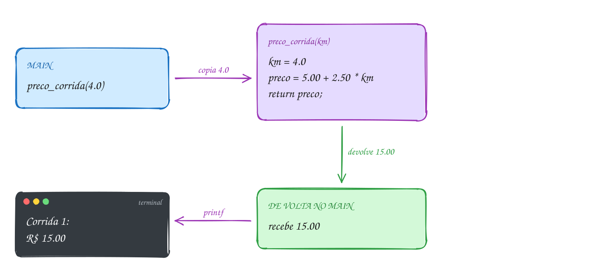</p>

O app em C, com as três corridas:

```c
#include <stdio.h>

// protótipo: avisa o compilador que a função existe e como chamá-la
double preco_corrida(double km);

int main(void) {
    printf("Corrida 1: R$ %.2f\n", preco_corrida(4.0));
    printf("Corrida 2: R$ %.2f\n", preco_corrida(10.0));
    printf("Corrida 3: R$ %.2f\n", preco_corrida(2.5));
    return 0;
}

// definição: bandeirada de R$ 5.00 mais R$ 2.50 por km
double preco_corrida(double km) {
    double preco = 5.00 + 2.50 * km;
    return preco; // devolve o valor para quem chamou
}
// Saída:
// Corrida 1: R$ 15.00
// Corrida 2: R$ 30.00
// Corrida 3: R$ 11.25
```

A chamada é um desvio: o programa sai do `main`, executa o corpo da função e
**volta ao mesmo ponto**, trazendo o valor. Isso se repete a cada corrida:

<p align="center">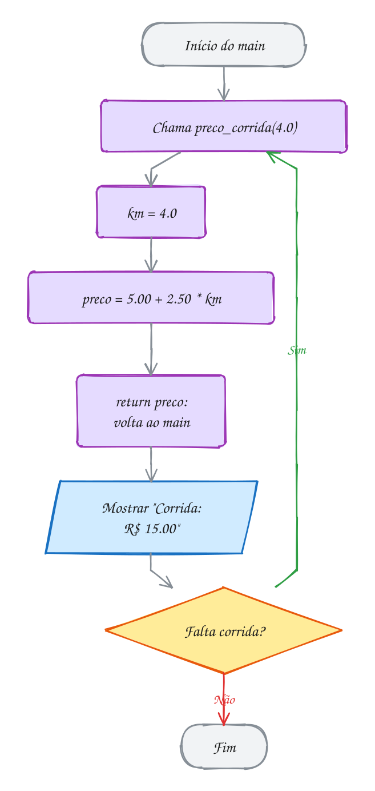</p>

Três termos: a **definição** é o corpo inteiro
(`double preco_corrida(double km) { ... }`); a **chamada** é o uso
(`preco_corrida(4.0)`); o **protótipo** é só o cabeçalho com `;`. O valor
passado na chamada (`4.0`) é o **argumento**; a variável que o recebe (`km`) é
o **parâmetro**.

Uma função boa faz **uma** tarefa, e o nome diz qual. Se não acha um nome
curto, ela faz coisas demais: quebre em duas. `preco_corrida` não usa
`printf`: quem mostra o resultado é o `main`. Assim a função serve para a tela,
para um arquivo ou para outra conta.

> [!WARNING]
> Chamar a função antes de ela aparecer no arquivo, sem protótipo. O gcc 13
> avisa `implicit declaration of function 'preco_corrida'`, e o gcc 14 recusa
> compilar. No C antigo, o compilador **supunha** retorno `int`, e o `double`
> voltava como lixo. Outro erro clássico: esquecer o `return` numa função que
> não é `void`. O `-Wall` avisa `control reaches end of non-void function`, e
> quem chamou recebe um valor qualquer.

> [!NOTE]
> **Pergunta para você:** o que mostra
> `printf("%.2f\n", preco_corrida(preco_corrida(0.0)));`? Resolva de dentro
> para fora, antes de rodar.

### Hora de praticar

**Exemplo A055 · A conta de luz: funções que chamam funções**

```c
#include <stdio.h>

int consumo(int leitura_anterior, int leitura_atual);
double tarifa(int kwh);
double valor_conta(int kwh);

int main(void) {
    int janeiro = consumo(4210, 4390);
    int fevereiro = consumo(4390, 4625);

    printf("Janeiro: %d kWh, R$ %.2f\n", janeiro, valor_conta(janeiro));
    printf("Fevereiro: %d kWh, R$ %.2f\n", fevereiro, valor_conta(fevereiro));

    // a chamada de dentro roda primeiro e o resultado vira o argumento
    printf("Março: R$ %.2f\n", valor_conta(consumo(4625, 4720)));

    // o retorno serve até como condição de um if
    if (valor_conta(fevereiro) > 150.00) {
        printf("Fevereiro passou de R$ 150.00\n");
    }
    return 0;
}

int consumo(int leitura_anterior, int leitura_atual) {
    return leitura_atual - leitura_anterior;
}

// quem gasta mais paga mais caro por kWh
double tarifa(int kwh) {
    if (kwh <= 100) {
        return 0.60;
    }
    return 0.80;
}

// valor_conta não sabe a tarifa: ela pergunta para outra função
double valor_conta(int kwh) {
    double iluminacao_publica = 12.00;
    return kwh * tarifa(kwh) + iluminacao_publica;
}
// Saída:
// Janeiro: 180 kWh, R$ 156.00
// Fevereiro: 235 kWh, R$ 200.00
// Março: R$ 69.00
// Fevereiro passou de R$ 150.00
```

```bash
gcc ~/LPEDC/material/A055.c -o ~/LPEDC/material/A055 && ~/LPEDC/material/A055
```

**Exemplo A056 · Funções que só fazem e funções que respondem**

```c
#include <stdio.h>

void cabecalho(void);
double menor(double a, double b);

int main(void) {
    double posto_a = 5.89;
    double posto_b = 5.79;
    double posto_c = 5.95;

    cabecalho(); // void: só faz, não devolve nada
    double mais_barato = menor(menor(posto_a, posto_b), posto_c);
    printf("Mais barato: R$ %.2f\n", mais_barato);
    printf("Encher 40 litros: R$ %.2f\n", 40 * mais_barato);
    return 0;
}

void cabecalho(void) {
    printf("=== Gasolina hoje ===\n");
}

double menor(double a, double b) {
    if (a < b) {
        return a; // o return encerra a função na hora
    }
    return b; // só chega aqui se a >= b
}
// Saída:
// === Gasolina hoje ===
// Mais barato: R$ 5.79
// Encher 40 litros: R$ 231.60
```

```bash
gcc ~/LPEDC/material/A056.c -o ~/LPEDC/material/A056 && ~/LPEDC/material/A056
```

#### Exercícios

**Exercício E163** · ★☆☆

Você vai trocar o piso de dois cômodos e precisa da área de cada um. Escreva
a função "double area_comodo(double largura, double comprimento)" e use-a no
main para a sala (4.0 x 3.5) e o quarto (3.0 x 3.0). Mostre também a soma.
O main não pode ter nenhuma multiplicação: a conta fica só na função.


```text
Saída esperada:
Sala: 14.00 m2
Quarto: 9.00 m2
Total: 23.00 m2
```

```bash
gcc ~/LPEDC/material/E163.c -o ~/LPEDC/material/E163 && ~/LPEDC/material/E163
```

**Exercício E165** · ★★☆

Um ano é bissexto se for divisível por 4 e não por 100, ou se for divisível
por 400. Escreva "bool eh_bissexto(int ano)" e use-a num laço para mostrar
os anos bissextos de 2000 a 2030 e quantos são.


```text
Saída esperada:
2000 2004 2008 2012 2016 2020 2024 2028
Bissextos: 8
```

```bash
gcc ~/LPEDC/material/E165.c -o ~/LPEDC/material/E165 && ~/LPEDC/material/E165
```

**Exercício E166** · ★★☆

O estacionamento do shopping cobra R$ 5.00 pelas primeiras 2 horas e mais
R$ 2.00 por hora ou fração depois disso, com teto de R$ 20.00 por dia.
Escreva "double tarifa(double horas)" e calcule o valor de três carros
(1.5 h, 3.2 h e 12 h) e o total do dia.


```text
Saída esperada:
Carro 1 (1.5 h): R$ 5.00
Carro 2 (3.2 h): R$ 9.00
Carro 3 (12.0 h): R$ 20.00
Total do dia: R$ 34.00
```

```bash
gcc ~/LPEDC/material/E166.c -o ~/LPEDC/material/E166 -lm && ~/LPEDC/material/E166
```

**Exercício E167** · ★★★

A função ajusta, já pronta no arquivo, tem três return. Só o primeiro que
for alcançado vale: os testes de baixo nem são feitos.

Escreva "int passos(int n)", que aplica ajusta em n repetidas vezes até
n chegar a 1, mostrando cada valor no caminho, e devolve quantas vezes
aplicou. No main, use passos para 7, 14 e 30 e mostre o total de cada um,
e mostre também ajusta(dobro(7)), resolvida de dentro para fora.


```text
Saída esperada:
7: 8 4 2 1 (4 passos)
14: 4 2 1 (3 passos)
30: 20 10 5 6 3 4 2 1 (8 passos)
ajusta(dobro(7)) = 4
```

```bash
gcc ~/LPEDC/material/E167.c -o ~/LPEDC/material/E167 && ~/LPEDC/material/E167
```

---

## 0029 · Parâmetros e passagem por valor

Você fotografa o boleto e manda no grupo da família. Sua tia rabisca "pago!" na
foto. O boleto de papel, na sua gaveta, continua igual: ela mexeu numa
**cópia**.

Toda chamada de função em C funciona assim. Em `reajustar(mensalidade, 10)`, o
C **calcula o valor** de cada argumento e **copia** esse valor para o
parâmetro. O parâmetro da definição é o **parâmetro formal**; o valor da
chamada é o **argumento** (ou parâmetro real). Isso é a **passagem por valor**,
a única do C: a passagem **por referência** dos livros se faz passando um
endereço (assunto 0046). O parâmetro é uma variável nova, local da função, que
nasce com a cópia. A função pode mudá-lo à vontade: a variável de quem chamou
não é afetada.

A função recebe **só o número**. `reajustar(mensalidade, 10)`,
`reajustar(120.00, 10)` e `reajustar(100 + 20, 5 * 2)` são idênticas para ela:
chega 120.00 e chega 10. Ela não sabe de onde o valor veio e não tem como
alterar a variável original.

Para mandar um resultado de volta, use o `return`, e quem chamou tem que
**guardar** o retorno: `mensalidade = reajustar(...)`. Ignorar o retorno é
permitido (você faz isso com o `printf`, que devolve quantos caracteres
escreveu), mas o resultado se perde.

No exemplo, a academia reajusta a mensalidade de R$ 120,00 em 10%. Há duas
caixinhas chamadas `mensalidade`, em lugares diferentes da memória: a do
`main` e a cópia da função. A função muda só a dela para 132.00:

<p align="center">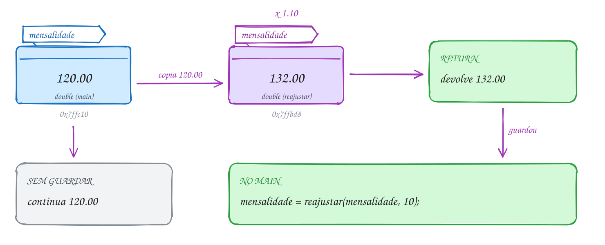</p>

O código mostra as duas situações: primeiro ignorando o retorno, depois
guardando:

```c
#include <stdio.h>

double reajustar(double mensalidade, double percentual);

int main(void) {
    double mensalidade = 120.00;

    printf("Antes: %.2f\n", mensalidade);
    reajustar(mensalidade, 10); // o resultado é jogado fora
    printf("Depois: %.2f\n", mensalidade); // continua 120.00

    mensalidade = reajustar(mensalidade, 10); // agora guarda o retorno
    printf("Guardando o retorno: %.2f\n", mensalidade);
    return 0;
}

// mensalidade aqui é uma CÓPIA: outra variável, com o mesmo nome
double reajustar(double mensalidade, double percentual) {
    mensalidade = mensalidade * (1 + percentual / 100);
    printf("Dentro: %.2f\n", mensalidade);
    return mensalidade;
}
// Saída:
// Antes: 120.00
// Dentro: 132.00
// Depois: 120.00
// Dentro: 132.00
// Guardando o retorno: 132.00
```

O valor sai do `main` por cópia e só volta pelo `return`. A pergunta "guardou
o retorno?" decide se o `main` fica sabendo do reajuste:

<p align="center">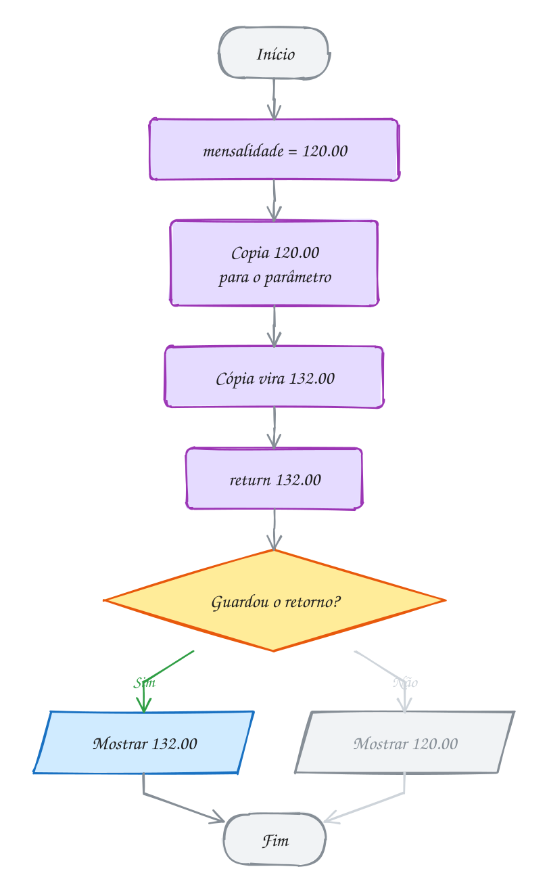</p>

Mais três regras sobre parâmetros:

- **conversão automática**: se o tipo do argumento não bate, o C converte para
  o do parâmetro, como numa atribuição. Um `int` vira `double` sem problema;
  um `2.9` passado a um `int` vira `2`, sem aviso;
- **`void` na lista**: `void linha(void)` diz "não recebe nada", e `linha(5)`
  é erro de compilação. Já `void linha()`, no C17, quer dizer "não declaro o
  que recebe": o compilador aceita `linha(5)` calado. Escreva sempre `(void)`.
  (No C23 os dois são iguais, mas há muito código C17.)
- **um tipo por parâmetro** (`double total, int vezes`), e a ordem importa: o
  primeiro argumento vai para o primeiro parâmetro.

> [!WARNING]
> A função que "deveria" mudar a variável e não muda. Em
> `void trocar(int a, int b)`, a troca ocorre entre as cópias e nada acontece
> no `main`. Do mesmo modo, `void f(int n) { n++; }` não muda o seu `n`. Para a
> função mexer numa variável sua, passe o **endereço** dela. É o que o `&` do
> `scanf` faz, e o assunto 0046 explica.

> [!NOTE]
> **Pergunta para você:** se você trocar o nome do parâmetro de `mensalidade`
> para `valor` (e ajustar o corpo da função), alguma linha da saída muda? Por
> quê?

### Hora de praticar

**Exemplo A057 · O parâmetro casa pela posição, não pelo nome**

```c
#include <stdio.h>

double com_desconto(double preco, double percentual);
void contagem(int segundos);

int main(void) {
    double preco = 80.00;
    double percentual = 25;

    // certo: o 1º argumento vai para o 1º parâmetro, o 2º para o 2º
    printf("Certo: R$ %.2f\n", com_desconto(preco, percentual));

    // trocado: os nomes iguais não ajudam, o C só olha a ordem
    printf("Trocado: R$ %.2f\n", com_desconto(percentual, preco));

    // literal e expressão também servem: a função recebe só o valor
    printf("Literal: R$ %.2f\n", com_desconto(200, 10 + 5));

    int tempo = 3;
    contagem(tempo);
    printf("No main, tempo continua %d\n", tempo);
    return 0;
}

double com_desconto(double preco, double percentual) {
    return preco - preco * percentual / 100;
}

// o parâmetro é uma variável de trabalho: pode diminuir até zero
void contagem(int segundos) {
    while (segundos > 0) {
        printf("%d... ", segundos);
        segundos--;
    }
    printf("já!\n");
}
// Saída:
// Certo: R$ 60.00
// Trocado: R$ 5.00
// Literal: R$ 170.00
// 3... 2... 1... já!
// No main, tempo continua 3
```

```bash
gcc ~/LPEDC/material/A057.c -o ~/LPEDC/material/A057 && ~/LPEDC/material/A057
```

**Exemplo A058 · void, conversão e expressões como argumento**

```c
#include <stdio.h>

void mostrar_parcelas(double total, int vezes);
void linha(void);

int main(void) {
    double celular = 1800.00;

    linha();
    mostrar_parcelas(celular, 3);       // os tipos batem
    mostrar_parcelas(900, 2);           // 900 (int) vira 900.0 (double)
    mostrar_parcelas(celular * 0.9, 4); // a expressão é calculada antes
    mostrar_parcelas(celular, 2.9);     // 2.9 vira 2: a parte decimal some
    linha();
    // linha(5); // erro: linha foi declarada com (void), não aceita argumento
    return 0;
}

void mostrar_parcelas(double total, int vezes) {
    printf("%d x R$ %.2f\n", vezes, total / vezes);
}

void linha(void) {
    printf("--------------------\n");
}
// Saída:
// --------------------
// 3 x R$ 600.00
// 2 x R$ 450.00
// 4 x R$ 405.00
// 2 x R$ 900.00
// --------------------
```

```bash
gcc ~/LPEDC/material/A058.c -o ~/LPEDC/material/A058 && ~/LPEDC/material/A058
```

#### Exercícios

**Exercício E169** · ★☆☆

No app do cartão fidelidade, a promoção dobra os pontos. Escreva
"int dobrar_pontos(int pontos)", que dobra o próprio parâmetro, mostra
"dentro: <valor>" e devolve o valor dobrado. No main, comece com
pontos = 150 e faça, nesta ordem:


```text
1. chame dobrar_pontos(pontos) SEM guardar o retorno e mostre "main: ...";
2. chame de novo, agora com pontos = dobrar_pontos(pontos), e mostre
   "main: ..." outra vez.
```


```text
Saída esperada:
dentro: 300
main: 150
dentro: 300
main: 300
```

```bash
gcc ~/LPEDC/material/E169.c -o ~/LPEDC/material/E169 && ~/LPEDC/material/E169
```

**Exercício E171** · ★★☆

Escreva as funções "int menor(int a, int b)" e "int maior(int a, int b)",
que devolvem o valor (sem ponteiros). No main, com a = 9 e b = 6, mostre as
duas notas em ordem crescente usando as duas funções no printf.


```text
Saída esperada:
Em ordem: 6 e 9
```

```bash
gcc ~/LPEDC/material/E171.c -o ~/LPEDC/material/E171 && ~/LPEDC/material/E171
```

**Exercício E172** · ★★☆

Você aplica R$ 1000.00 num investimento que rende 1% ao mês. Escreva
"double montante(double capital, double taxa, int meses)" que usa o próprio
parâmetro capital como acumulador: a cada mês, capital = capital * (1 + taxa / 100).
No main, mostre o montante depois de 12 e de 24 meses e prove que a
variável do main não mudou.


```text
Saída esperada:
12 meses: R$ 1126.83
24 meses: R$ 1269.73
No main, capital continua R$ 1000.00
```

```bash
gcc ~/LPEDC/material/E172.c -o ~/LPEDC/material/E172 && ~/LPEDC/material/E172
```

**Exercício E174** · ★★★

Um número é capicua (palíndromo) quando se lê igual de trás para frente:
1221, 343. Escreva:


```text
int inverter(int n)        devolve n com os dígitos invertidos (123 -> 321);
                           use o próprio n como variável de trabalho
bool eh_capicua(int n)     usa inverter
```


No main, mostre inverter(12345), prove que a variável do main não mudou e
conte as capicuas de 100 a 999.


```text
Saída esperada:
inverter(12345) = 54321
No main, numero continua 12345
Capicuas de 100 a 999: 90
```

```bash
gcc ~/LPEDC/material/E174.c -o ~/LPEDC/material/E174 && ~/LPEDC/material/E174
```

---

## 0030 · Escopo e tempo de vida

No banco, o painel chama a senha 101, depois a 102, depois a 103: ele
**lembra** onde parou. O atendente zera a conversa a cada cliente: não guarda
nada do anterior. Programa precisa das duas coisas, e o C tem uma ferramenta
para cada.

Toda variável tem duas propriedades:

- **escopo**: **onde** no código o nome pode ser usado;
- **tempo de vida**: **quando** a variável existe na memória.

São três tipos:

| Tipo | Onde declara | Escopo | Tempo de vida |
| --- | --- | --- | --- |
| **local** (automática) | dentro de `{ }` | só aquele bloco | nasce ao entrar no bloco, morre ao sair |
| **global** | fora de qualquer função | do ponto da declaração até o fim do arquivo | o programa todo |
| **`static` local** | dentro de `{ }`, com `static` | só aquele bloco | o programa todo |

A `static` local tem escopo de local (ninguém de fora a enxerga) e tempo de
vida de global. A linha `static int senha = 100;` roda **uma vez**, antes de o
programa começar. Nas chamadas seguintes, a variável continua com o valor que
tinha.

Parâmetros são locais da função, e a variável do `for (int i = 0; ...)` é
local do laço. Se um bloco interno declara um nome que já existe fora, o de
dentro **esconde** o de fora até o bloco acabar: vale a declaração mais
próxima.

A função `chamar` tem três contadores: a global `atendidos`, a `static`
`senha` e a local `vezes`. As duas primeiras ficam numa região da memória que
dura o programa inteiro; a local fica no espaço da chamada e some quando a
função retorna. Depois de três chamadas:

<p align="center">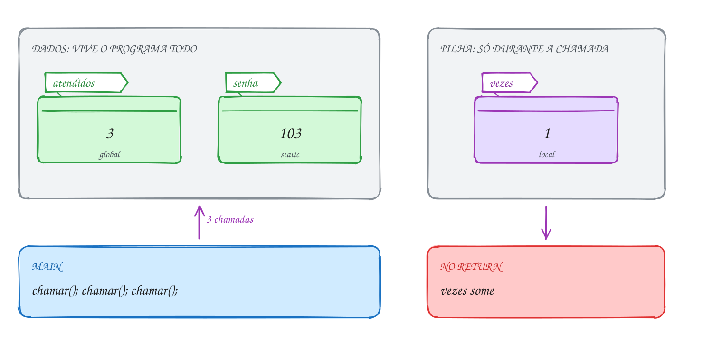</p>

No código, `vezes` mostra sempre 1, enquanto os outros dois avançam:

```c
#include <stdio.h>

int atendidos = 0; // global: vive o programa todo, todo mundo enxerga

int chamar(void) {
    static int senha = 100; // static: inicializada uma vez só, guarda o valor
    int vezes = 0;          // local: nasce de novo a cada chamada

    senha++;
    vezes++;
    atendidos++;
    printf("Senha %d | vezes: %d | atendidos: %d\n", senha, vezes, atendidos);
    return senha;
}

int main(void) {
    chamar();
    chamar();
    int ultima = chamar();
    printf("Última senha chamada: %d\n", ultima);
    return 0;
}
// Saída:
// Senha 101 | vezes: 1 | atendidos: 1
// Senha 102 | vezes: 1 | atendidos: 2
// Senha 103 | vezes: 1 | atendidos: 3
// Última senha chamada: 103
```

A cada chamada, a local nasce de novo com 0, e a `static` já espera com o
valor anterior. Não existe passo "criar senha" dentro da repetição:

<p align="center">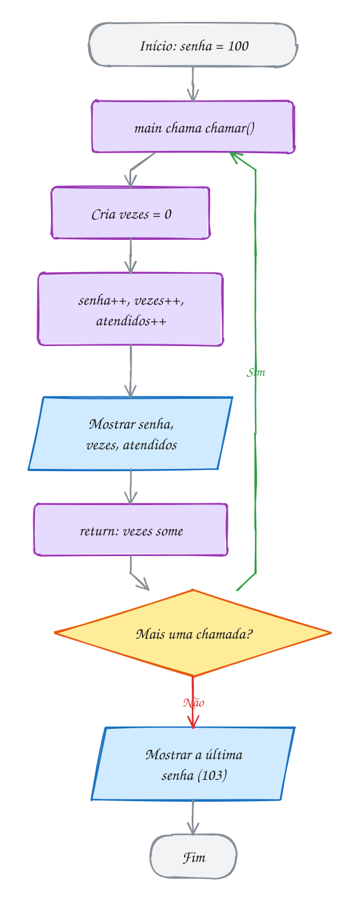</p>

As globais funcionam, mas cobram caro. **Qualquer** função do arquivo pode
mudar `atendidos`, então, quando o valor sai errado, o culpado pode estar em
qualquer lugar, e a mesma chamada pode dar resultados diferentes conforme o
que outra função fez antes. Prefira parâmetro e `return`; use global só para o
que é do programa todo.

`static` **fora** de função muda outra coisa: uma global `static int total;`
vive o programa todo, mas só pode ser usada **naquele arquivo**. Isso faz
sentido no assunto 0034, com mais de um `.c`.

> [!WARNING]
> `static int senha = 100;` não volta a valer 100 a cada chamada: a
> inicialização acontece uma vez, antes do `main`. O oposto também engana: uma
> local **sem** inicialização (`int total;`) começa com lixo, não com 0.
> Globais e `static` sem valor começam em 0; locais, não. E esconder nomes
> (`int nivel` dentro e fora) compila sem aviso com `-Wall`: só o `-Wshadow`
> reclama.

> [!TIP]
> Globais e `static` ficam numa região fixa da memória, gravada no executável
> (`.data`) ou zerada ao carregar (`.bss`). As locais ficam na **pilha**, que
> é o próximo assunto.

> [!NOTE]
> **Pergunta para você:** se você tirar o `static` de `senha`, quais números
> aparecem nas três linhas? E se, em vez disso, você mover `int vezes = 0;`
> para fora da função?

### Hora de praticar

**Exemplo A059 · A função que lembra o recorde**

```c
#include <stdbool.h>
#include <stdio.h>

// devolve true quando a temperatura bate o recorde do dia
bool novo_recorde(int temperatura) {
    static bool primeira = true; // true só até a primeira chamada
    static int recorde = 0;      // o maior valor visto até agora

    if (primeira || temperatura > recorde) {
        primeira = false;
        recorde = temperatura;
        return true;
    }
    return false;
}

void leitura(int hora, int temperatura) {
    printf("%2dh: %d °C", hora, temperatura);
    if (novo_recorde(temperatura)) {
        printf(" (recorde!)");
    }
    printf("\n");
}

int main(void) {
    leitura(6, 19);  // a primeira leitura é sempre recorde
    leitura(9, 24);
    leitura(12, 22); // 22 < 24: a static lembra do 24
    leitura(15, 30);
    leitura(18, 27);
    // printf("%d\n", recorde); // erro: recorde só existe dentro da função
    return 0;
}
// Saída:
//  6h: 19 °C (recorde!)
//  9h: 24 °C (recorde!)
// 12h: 22 °C
// 15h: 30 °C (recorde!)
// 18h: 27 °C
```

```bash
gcc ~/LPEDC/material/A059.c -o ~/LPEDC/material/A059 && ~/LPEDC/material/A059
```

**Exemplo A060 · Três variáveis com o mesmo nome**

```c
#include <stdio.h>

int nivel = 1; // global

void mostrar_global(void) {
    printf("na função: %d\n", nivel); // aqui só existe a global
}

int main(void) {
    printf("antes: %d\n", nivel); // ainda não há local: vê a global
    int nivel = 2;                // esconde a global daqui para baixo
    printf("main: %d\n", nivel);
    {
        int nivel = 3; // esconde a do main, só dentro deste bloco
        printf("bloco: %d\n", nivel);
    }
    printf("main de novo: %d\n", nivel);
    mostrar_global();

    for (int i = 0; i < 2; i++) {
        int dobro = i * 2; // i e dobro só existem dentro do for
        printf("i = %d, dobro = %d\n", i, dobro);
    }
    // printf("%d\n", i); // erro: 'i' undeclared
    return 0;
}
// Saída:
// antes: 1
// main: 2
// bloco: 3
// main de novo: 2
// na função: 1
// i = 0, dobro = 0
// i = 1, dobro = 2
```

```bash
gcc ~/LPEDC/material/A060.c -o ~/LPEDC/material/A060 && ~/LPEDC/material/A060
```

#### Exercícios

**Exercício E175** · ★☆☆

O cartão fidelidade da farmácia tem 100 pontos guardados (uma global) e a
compra de hoje vale 30 pontos (uma local do main com o MESMO nome). Escreva:


```text
int pontos = 100;                 global: o saldo do cartão
void extrato(void)                mostra "extrato: <pontos>"
void somar_na_global(int valor)   soma valor nos pontos do cartão
```


No main, chame extrato, declare "int pontos = 30;", mostre "compra de hoje",
chame somar_na_global(pontos), chame extrato de novo e mostre a compra de
hoje outra vez.


```text
Saída esperada:
extrato: 100
compra de hoje: 30
extrato: 130
compra de hoje: 30
```

```bash
gcc ~/LPEDC/material/E175.c -o ~/LPEDC/material/E175 && ~/LPEDC/material/E175
```

**Exercício E177** · ★★☆

Escreva "double preco_item(int i)", que devolve o preço do item i da compra
(1: 12.50, 2: 8.00, 3: 30.00, 4: 4.75). No main, use um for de 1 a 4 para
somar os quatro itens numa variável total e mostre o total depois do laço.


```text
Saída esperada:
Total: R$ 55.25
```

```bash
gcc ~/LPEDC/material/E177.c -o ~/LPEDC/material/E177 && ~/LPEDC/material/E177
```

**Exercício E178** · ★★☆

O vale-refeição começa com R$ 300.00, guardados numa variável LOCAL do main
(nada de global). Escreva "double gastar(double saldo, double valor)", que
recebe o saldo e devolve o saldo novo, já descontada uma taxa de R$ 1.00 por
gasto. O main guarda o retorno na própria variável: gasta R$ 45.00 e R$ 32.50
e mostra o saldo; depois gasta R$ 18.00 e mostra o saldo de novo.


```text
Saída esperada:
Saldo: R$ 220.50
Saldo: R$ 201.50
```

```bash
gcc ~/LPEDC/material/E178.c -o ~/LPEDC/material/E178 && ~/LPEDC/material/E178
```

**Exercício E179** · ★★★

Quatro variáveis chamadas x, cada uma com escopo e tempo de vida
diferentes. Escreva o programa a partir destas regras:


```text
int x = 10;     global
void a(void)    tem uma local x = 1; mostra "a: <x>", soma 1, mostra " -> <x>"
int b(void)     tem uma static x = 5; mostra "b: <x>", soma 5, mostra
                " -> <x>" e devolve o x novo
void c(void)    não declara x: mostra "c: <x>", dobra, mostra " -> <x>"
```


O main tem a própria local x = 20 e mostra "main: 20"; abre um bloco com
outra x = 30 e mostra "bloco: 30"; chama a, b e c duas vezes, nessa ordem,
somando numa local os dois retornos de b; mostra "main: <x>" e a soma.


```text
Saída esperada:
main: 20
bloco: 30
a: 1 -> 2
b: 5 -> 10
c: 10 -> 20
a: 1 -> 2
b: 10 -> 15
c: 20 -> 40
main: 20
soma dos b: 25
```

```bash
gcc ~/LPEDC/material/E179.c -o ~/LPEDC/material/E179 && ~/LPEDC/material/E179
```

---

## 0031 · A pilha de chamadas

Quando um programa em C quebra dentro do `gdb`, o comando `bt` mostra algo
assim:

```text
#0  calcular_taxa (valor=0) at pedido.c:12
#1  fechar_pedido () at pedido.c:30
#2  main () at pedido.c:5
```

Isso é um **stack trace** (ou *backtrace*): a **pilha de chamadas** no momento
do erro. A função de cima estava rodando; foi chamada pela de baixo, que foi
chamada pela de baixo dela.

A cada chamada, o programa reserva um pedaço de memória só para ela: o
**quadro** (*stack frame*, ou registro de ativação). Nele ficam:

- os **parâmetros**, com as cópias dos argumentos;
- as **variáveis locais** da função;
- o **endereço de retorno**: o ponto de quem chamou onde o programa continua
  quando a função acaba.

Os quadros se empilham como pratos. Chamou, empilha um quadro no **topo**.
Retornou, o quadro do topo sai, e o de baixo continua de onde parou. A última
função a começar é a primeira a terminar: **último a entrar, primeiro a sair**
(LIFO, de *last in, first out*). Só o quadro do topo roda; os outros esperam um
retorno.

Por isso a local "some" no `return`: seu quadro foi desempilhado. Pelo mesmo
motivo, uma função não enxerga as variáveis de quem a chamou: estão noutro
quadro, mais embaixo.

Num pedido de R$ 50,00, o `main` chama `total_com_entrega`, que chama
`taxa_entrega`. No ponto mais fundo há três quadros. Quando `taxa_entrega`
devolve 7.90, seu quadro sai, e `total_com_entrega` volta a rodar com o valor:

<p align="center">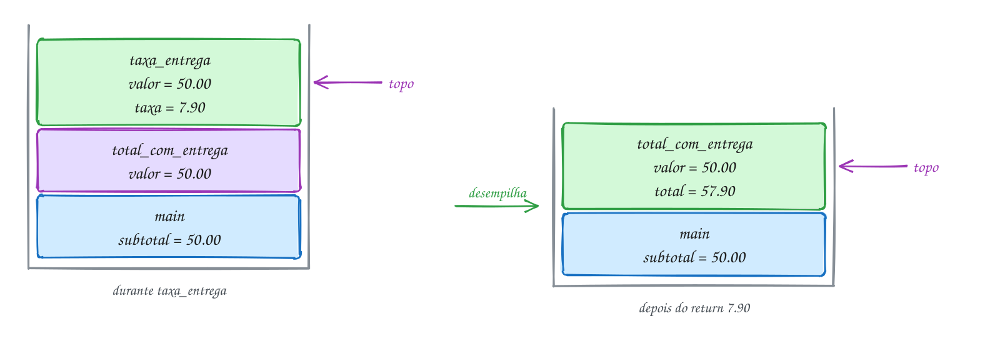</p>

O código imprime "entra" e "sai" em cada função, com recuo, e a pilha aparece
na saída:

```c
#include <stdio.h>

double taxa_entrega(double valor) {
    printf("    entra taxa_entrega(%.2f)\n", valor);
    double taxa = valor < 80.00 ? 7.90 : 0.00;
    printf("    sai taxa_entrega -> %.2f\n", taxa);
    return taxa;
}

double total_com_entrega(double valor) {
    printf("  entra total_com_entrega(%.2f)\n", valor);
    double total = valor + taxa_entrega(valor);
    printf("  sai total_com_entrega -> %.2f\n", total);
    return total;
}

int main(void) {
    double subtotal = 50.00;

    printf("entra main\n");
    double total = total_com_entrega(subtotal);
    printf("Total: R$ %.2f\n", total);
    return 0;
}
// Saída:
// entra main
//   entra total_com_entrega(50.00)
//     entra taxa_entrega(50.00)
//     sai taxa_entrega -> 7.90
//   sai total_com_entrega -> 57.90
// Total: R$ 57.90
```

No fluxograma, as chamadas empilham na descida e os retornos desempilham na
ordem contrária. A decisão da taxa ocorre no topo, dentro de `taxa_entrega`,
enquanto as outras duas funções esperam:

<p align="center">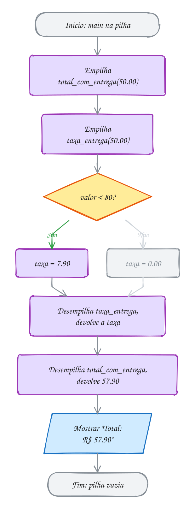</p>

### Passo a passo

A pilha em cada momento, de baixo para cima (o topo é o último):

| Momento | Pilha (base → topo) | Quem roda |
| --- | --- | --- |
| início | `main` (subtotal = 50.00) | `main` |
| chamou `total_com_entrega(50.00)` | `main` → `total_com_entrega` (valor = 50.00) | `total_com_entrega` |
| chamou `taxa_entrega(50.00)` | `main` → `total_com_entrega` → `taxa_entrega` (valor = 50.00, taxa = 7.90) | `taxa_entrega` |
| `taxa_entrega` devolveu 7.90 | `main` → `total_com_entrega` (total = 57.90) | `total_com_entrega` |
| `total_com_entrega` devolveu 57.90 | `main` (total = 57.90) | `main` |

Há **dois** `valor`, um em cada quadro, e cada função mexe só no seu. E dois
`total`: o do `main` e o de `total_com_entrega`.

> [!WARNING]
> Usar uma local sem inicializar e achar que "começa limpa". O quadro novo
> ocupa o pedaço de memória que um quadro antigo acabou de liberar, e ninguém o
> apaga. Uma `int soma;` pode nascer com o valor que uma local de outra função
> deixou ali. Às vezes o programa "funciona" por sorte e quebra quando você
> muda outra coisa. O `-Wall` avisa `may be used uninitialized`.

> [!TIP]
> A pilha tem tamanho fixo (no Linux, 8 MB por padrão; confira com
> `ulimit -s`). Se passar do limite, o sistema mata o programa: é o **stack
> overflow** (no Linux, `Segmentation fault`). Dá para empilhar centenas de
> milhares de chamadas, mas não infinitas.

> [!NOTE]
> **Pergunta para você:** mude o subtotal para 95.00. Quantos quadros a pilha
> chega a ter? O que muda na saída?

### Hora de praticar

**Exemplo A061 · O valor que desce a pilha, quadro por quadro**

```c
#include <stdio.h>

// topo da pilha: não chama ninguém, só devolve
double tarifa_base(void) {
    double valor = 5.00;
    printf("      tarifa_base devolve %.2f\n", valor);
    return valor;
}

double com_integracao(void) {
    double valor = 1.50; // outro "valor": cada quadro tem o seu
    printf("    com_integracao espera (o seu valor é %.2f)\n", valor);
    valor = valor + tarifa_base();
    printf("    com_integracao devolve %.2f\n", valor);
    return valor;
}

double meia_passagem(void) {
    double valor = 0.50;
    printf("  meia_passagem espera (o seu valor é %.2f)\n", valor);
    valor = com_integracao() * valor;
    printf("  meia_passagem devolve %.2f\n", valor);
    return valor;
}

int main(void) {
    double valor = 0; // o do main fica parado esperando lá embaixo

    printf("main espera\n");
    valor = meia_passagem();
    printf("main recebe %.2f\n", valor);
    return 0;
}
// Saída:
// main espera
//   meia_passagem espera (o seu valor é 0.50)
//     com_integracao espera (o seu valor é 1.50)
//       tarifa_base devolve 5.00
//     com_integracao devolve 6.50
//   meia_passagem devolve 3.25
// main recebe 3.25
```

```bash
gcc ~/LPEDC/material/A061.c -o ~/LPEDC/material/A061 && ~/LPEDC/material/A061
```

**Exemplo A062 · A mesma função volta para lugares diferentes**

```c
#include <stdio.h>

void recuo(int nivel) {
    for (int i = 0; i < nivel; i++) {
        printf("  ");
    }
}

void validar_cartao(int nivel) {
    recuo(nivel);
    printf("validar_cartao (topo da pilha)\n");
}

void pagar(int nivel) {
    recuo(nivel);
    printf("entra pagar\n");
    validar_cartao(nivel + 1); // volta para cá...
    recuo(nivel);
    printf("sai pagar\n");
}

void cadastrar(int nivel) {
    recuo(nivel);
    printf("entra cadastrar\n");
    validar_cartao(nivel + 1); // ...e, desta vez, para cá
    recuo(nivel);
    printf("sai cadastrar\n");
}

int main(void) {
    printf("main\n");
    cadastrar(1);
    pagar(1);
    printf("main termina\n");
    return 0;
}
// Saída:
// main
//   entra cadastrar
//     validar_cartao (topo da pilha)
//   sai cadastrar
//   entra pagar
//     validar_cartao (topo da pilha)
//   sai pagar
// main termina
```

```bash
gcc ~/LPEDC/material/A062.c -o ~/LPEDC/material/A062 && ~/LPEDC/material/A062
```

#### Exercícios

**Exercício E181** · ★☆☆

Faça o programa do IMC mostrar a pilha enquanto roda. Escreva:


```text
double quadrado(double x)                  devolve x * x
double imc(double peso, double altura)     devolve peso / quadrado(altura)
```


Cada função mostra uma linha ao entrar (com os parâmetros) e outra ao sair
(com o valor que devolve), recuada 2 espaços a mais que a de quem a chamou.
O main calcula imc(72.0, 1.80), guarda numa local e mostra o resultado.


```text
Saída esperada:
main chama imc
  entra imc(peso = 72.0, altura = 1.80)
    entra quadrado(x = 1.80)
    sai quadrado -> 3.24
  sai imc -> 22.2
IMC: 22.2
```

```bash
gcc ~/LPEDC/material/E181.c -o ~/LPEDC/material/E181 && ~/LPEDC/material/E181
```

**Exercício E183** · ★★☆

Monte o rastro de uma compra online. Escreva quatro funções que se chamam em
cadeia: finalizar_compra chama pagar, que chama antifraude, que chama
consultar_banco. Cada uma recebe o nível (int nivel) e passa nivel + 1 para
a próxima. Use uma função "void recuo(int nivel)", que mostra 2 espaços por
nível, para a saída ficar assim:


```text
Saída esperada:
entra finalizar_compra
  entra pagar
    entra antifraude
      consultar_banco: aprovado
    sai antifraude
  sai pagar
sai finalizar_compra
```

```bash
gcc ~/LPEDC/material/E183.c -o ~/LPEDC/material/E183 && ~/LPEDC/material/E183
```

**Exercício E184** · ★★☆

Cada quadro da pilha tem as suas variáveis, mesmo com nomes iguais. Escreva:


```text
int dobro_mais_um(int n)  r = n * 2; n = r + 1; devolve n
int processa(int n)       r = dobro_mais_um(n); devolve r + n
main                      n = 5; r = processa(n)
```


Cada função mostra n e r como na saída (dobro_mais_um na entrada e na saída;
processa antes e depois de devolver; main no fim).


```text
Saída esperada:
dobro_mais_um entra: n = 5
dobro_mais_um sai: n = 11, r = 10
processa: n = 5, r = 11
processa devolve 16
main: n = 5, r = 16
```

```bash
gcc ~/LPEDC/material/E184.c -o ~/LPEDC/material/E184 && ~/LPEDC/material/E184
```

**Exercício E186** · ★★★

Meça a altura da pilha. Use duas globais, "altura" e "maior_altura". Toda
função, ao entrar, chama entrar() (que soma 1 em altura e atualiza
maior_altura) e, antes de sair, chama sair() (que diminui 1). O main também
conta: ele chama entrar() no começo.

Monte estas chamadas: main chama checkout e frete; checkout chama
cupom e pagamento; pagamento chama antifraude; frete não chama ninguém.
No fim, o main mostra a maior altura e a altura atual (antes do sair dele).


```text
Saída esperada:
Maior altura: 4
Altura agora: 1
```

```bash
gcc ~/LPEDC/material/E186.c -o ~/LPEDC/material/E186 && ~/LPEDC/material/E186
```

---

## 0032 · Recursão

Cinco amigos vão ao cinema e querem saber de quantos jeitos podem sentar nas
cinco cadeiras. O primeiro tem 5 escolhas. Depois que ele senta, o problema é
**igual, mas menor**: de quantos jeitos 4 pessoas sentam em 4 cadeiras? E assim
até sobrar 1 pessoa, com 1 jeito. A resposta é 5 × 4 × 3 × 2 × 1 = 120, o
**fatorial** de 5.

O raciocínio foi: "para resolver o de 5, resolvo o de 4 e multiplico por 5".
Uma função que resolve o problema chamando **a si mesma** com uma versão menor
dele é uma **função recursiva**. Ela tem duas partes:

- o **caso base**: o problema pequeno o bastante para responder direto, sem
  chamar ninguém (1 pessoa: 1 jeito);
- o **caso recursivo**: reduz o problema a um menor e usa a resposta dele
  (`n * fatorial(n - 1)`).

Regra que não pode falhar: cada chamada tem que chegar **mais perto** do caso
base. Senão a função chama a si mesma para sempre.

**Confie na função.** Ao escrever o caso recursivo, não siga as chamadas de
cabeça. Suponha que `fatorial(n - 1)` já funciona e pergunte: com essa resposta
na mão, como monto a de `n`? Depois confira o caso base. Com os dois certos, a
função está certa.

Cada chamada recursiva é comum, com **seu próprio quadro** na pilha (assunto
0031). `fatorial(5)` empilha `fatorial(4)`, que empilha `fatorial(3)`... São
cinco quadros de `fatorial` ao mesmo tempo, cada um com seu `n`, todos
parados, menos o do topo.

Na **ida**, a pilha cresce até `fatorial(1)`, o caso base, que devolve 1 sem
chamar ninguém. Na **volta**, cada quadro recebe a resposta de cima, multiplica
e devolve ao de baixo: 1, 2, 6, 24, 120:

<p align="center">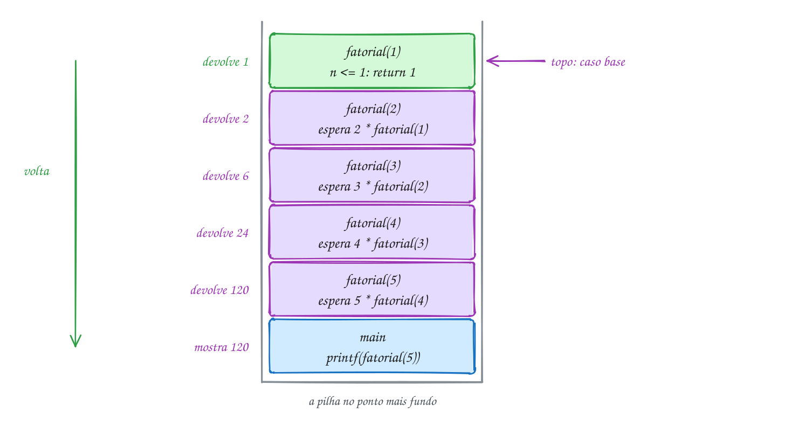</p>

O código é quase a definição matemática:

```c
#include <stdio.h>

int fatorial(int n) {
    if (n <= 1) {
        return 1; // caso base: resolve direto, sem chamar ninguém
    }
    return n * fatorial(n - 1); // caso recursivo: um problema menor
}

int main(void) {
    printf("5 amigos: %d jeitos\n", fatorial(5));
    printf("12 amigos: %d jeitos\n", fatorial(12)); // o maior que cabe num int
    return 0;
}
// Saída:
// 5 amigos: 120 jeitos
// 12 amigos: 479001600 jeitos
```

Não há `for` nem `while`, mas o fluxograma tem duas voltas. A primeira é a ida
(empilha de novo com `n - 1` até o caso base); a segunda é a volta (cada quadro
em espera multiplica e sai):

<p align="center">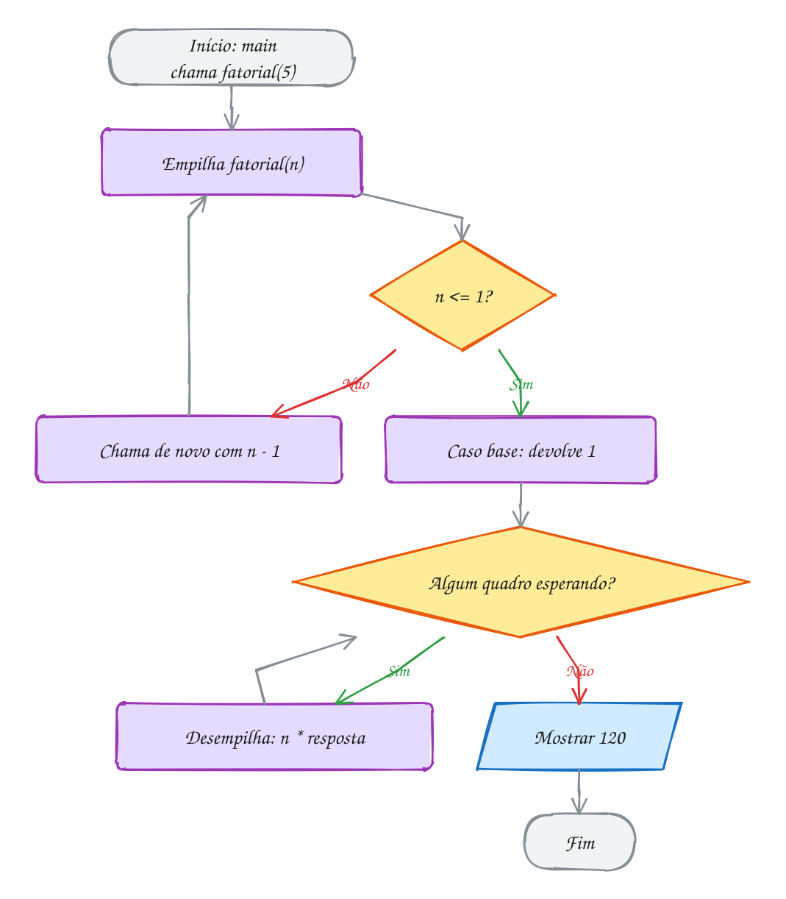</p>

### Passo a passo

O teste de mesa de `fatorial(5)`. As chamadas descem; os retornos sobem, de
baixo para cima da tabela:

| Chamada | n | `n <= 1`? | Espera | Devolve |
| --- | --- | --- | --- | --- |
| `fatorial(5)` | 5 | Não | `5 * fatorial(4)` | 5 × 24 = **120** |
| `fatorial(4)` | 4 | Não | `4 * fatorial(3)` | 4 × 6 = 24 |
| `fatorial(3)` | 3 | Não | `3 * fatorial(2)` | 3 × 2 = 6 |
| `fatorial(2)` | 2 | Não | `2 * fatorial(1)` | 2 × 1 = 2 |
| `fatorial(1)` | 1 | Sim | nada | 1 |

Recursão e laço resolvem os mesmos problemas: todo `for` vira recursão e toda
recursão vira laço (às vezes com muito trabalho). O fatorial com `for` é mais
simples e mais barato. A recursão compensa quando o problema **é** recursivo
por natureza: pastas dentro de pastas, árvores, "divide ao meio e resolve cada
metade".

> [!WARNING]
> Caso base que nunca chega. Com `if (n == 1)` no lugar de `if (n <= 1)`,
> `fatorial(0)` chama `fatorial(-1)`, `fatorial(-2)`... e nunca para. O mesmo
> ocorre se você esquecer de diminuir (`fatorial(n)` em vez de
> `fatorial(n - 1)`). Cada chamada empilha um quadro, a pilha acaba e o
> programa morre com **stack overflow**: o AddressSanitizer mostra
> `stack-overflow`, e sem ele aparece só `Segmentation fault`.

> [!TIP]
> A recursão gasta memória proporcional à **profundidade**: `fatorial(5)` usa
> 5 quadros de uma vez; um laço usaria um. Outro limite é o tipo: 12! =
> 479.001.600 cabe num `int` de 32 bits, mas 13! = 6.227.020.800 dá overflow (o
> `-fsanitize=undefined`, nas flags de estudo, acusa).

> [!NOTE]
> **Pergunta para você:** quanto vale `fatorial(0)` com o código acima? E
> quantos quadros de `fatorial` a chamada `fatorial(12)` empilha no ponto mais
> fundo?

### Hora de praticar

**Exemplo A063 · Em quantos meses a dívida dobra**

```c
#include <stdio.h>

// o caso base não é um contador chegando a zero: é uma condição
int meses_para_chegar(double divida, double meta, double juros) {
    if (divida >= meta) {
        return 0; // caso base: já chegou, não falta nenhum mês
    }
    // um mês de juros e o mesmo problema, um pouco mais perto da meta
    return 1 + meses_para_chegar(divida * (1 + juros / 100), meta, juros);
}

int main(void) {
    printf("Cartão (12%% ao mês): %d meses\n", meses_para_chegar(1000, 2000, 12));
    printf("Empréstimo (3%% ao mês): %d meses\n", meses_para_chegar(1000, 2000, 3));
    // caso de borda: a meta já foi batida, nenhuma chamada recursiva
    printf("Já dobrou: %d meses\n", meses_para_chegar(2500, 2000, 3));
    return 0;
}
// Saída:
// Cartão (12% ao mês): 7 meses
// Empréstimo (3% ao mês): 24 meses
// Já dobrou: 0 meses
```

```bash
gcc ~/LPEDC/material/A063.c -o ~/LPEDC/material/A063 && ~/LPEDC/material/A063
```

**Exemplo A064 · Imprimir antes ou depois da chamada**

```c
#include <stdio.h>

// imprime e depois chama: os números saem na ida
void regressiva(int n) {
    if (n == 0) {
        printf("Feliz Ano Novo!\n");
        return;
    }
    printf("%d... ", n);
    regressiva(n - 1);
}

// chama e depois imprime: os números saem na volta
void crescente(int n) {
    if (n == 0) {
        return;
    }
    crescente(n - 1);
    printf("%d ", n);
}

int main(void) {
    regressiva(5);
    crescente(5);
    printf("\n");
    return 0;
}
// Saída:
// 5... 4... 3... 2... 1... Feliz Ano Novo!
// 1 2 3 4 5
```

```bash
gcc ~/LPEDC/material/A064.c -o ~/LPEDC/material/A064 && ~/LPEDC/material/A064
```

#### Exercícios

**Exercício E187** · ★☆☆

Num torneio de vôlei de praia, cada dupla que chega cumprimenta todas as que
já estão lá. Com 12 duplas, são 0 + 1 + 2 + ... + 11 cumprimentos. Escreva
"int soma_ate(int n)", recursiva, que devolve 1 + 2 + ... + n, sem nenhum
laço, e use-a para responder.


```text
Saída esperada:
soma_ate(4) = 10
soma_ate(100) = 5050
Cumprimentos com 12 duplas: 66
```

```bash
gcc ~/LPEDC/material/E187.c -o ~/LPEDC/material/E187 && ~/LPEDC/material/E187
```

**Exercício E189** · ★★☆

Escreva "void eco(int n, int nivel)", recursiva, que mostra "ida n" antes
da chamada recursiva, "fundo" no caso base (n == 0) e "volta n" depois da
chamada. Cada linha é recuada 2 espaços por nível: o main chama eco(3, 0),
e cada chamada recursiva passa nivel + 1. Use uma função "void recuo(int
nivel)" para os espaços.


```text
Saída esperada:
ida 3
  ida 2
    ida 1
      fundo
    volta 1
  volta 2
volta 3
```

```bash
gcc ~/LPEDC/material/E189.c -o ~/LPEDC/material/E189 && ~/LPEDC/material/E189
```

**Exercício E190** · ★★☆

Escreva "void binario(int n)", recursiva, que mostra n em binário. A conta
de dividir por 2 dá os bits de trás para frente (o último resto é o primeiro
bit); a recursão resolve isso de graça se você imprimir na volta.


```text
Saída esperada:
13 = 1101
255 = 11111111
2026 = 11111101010
```

```bash
gcc ~/LPEDC/material/E190.c -o ~/LPEDC/material/E190 && ~/LPEDC/material/E190
```

**Exercício E192** · ★★★

A calculadora velha da loja só sabe somar e subtrair. Escreva
"int multiplicar(int a, int b)", recursiva, que só usa + e - (nada de *),
e que funciona com b positivo, zero e NEGATIVO.


```text
Saída esperada:
7 x 4 = 28
7 x -3 = -21
-5 x 6 = -30
9 x 0 = 0
```

```bash
gcc ~/LPEDC/material/E192.c -o ~/LPEDC/material/E192 && ~/LPEDC/material/E192
```

---

## 0033 · Recursão na prática: Fibonacci, Hanói e Euclides

A escada do prédio tem 4 degraus, e você sobe de 1 em 1 ou pulando 2. De
quantos jeitos dá para subir? Pense no último passo: você veio do degrau 3 (um
passo) ou do 2 (um pulo). Os jeitos de chegar ao 4 são os do 3 **mais** os do
2. Cada resposta é a soma das duas anteriores: 1, 2, 3, 5... São 5 jeitos.

Essa é a sequência de **Fibonacci**: 0, 1, 1, 2, 3, 5, 8, 13, 21... Cada termo
é a soma dos dois anteriores, e os dois primeiros são dados. A definição já é
recursiva:

- `fib(0) = 0` e `fib(1) = 1` (dois casos base);
- `fib(n) = fib(n - 1) + fib(n - 2)` (o caso recursivo, com **duas**
  chamadas).

A escada de 4 degraus é `fib(5) = 5`. O código tem três linhas e funciona, mas
custa caro. Cada chamada de `fib` gera mais duas, que não se comunicam:
`fib(5)` calcula `fib(3)` duas vezes e `fib(2)` três, refazendo o trabalho do
zero. As chamadas quase dobram a cada `n` a mais: o crescimento é
**exponencial**.

A **árvore de chamadas** de `fib(5)` tem 15 nós, um por chamada (o número no
círculo é o `n`). Os dois nós amarelos são `fib(3)`: o mesmo cálculo, com tudo
o que vem embaixo, feito duas vezes. A pilha nunca passa de 5 quadros de `fib`,
porque o programa desce um galho de cada vez:

<p align="center">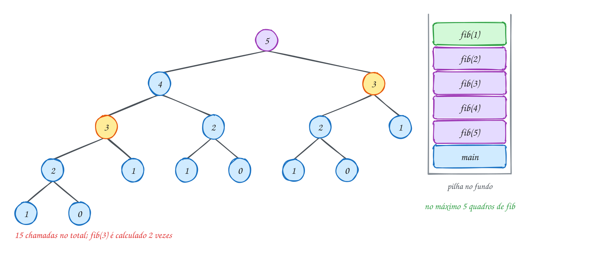</p>

O programa conta as chamadas com uma global:

```c
#include <stdio.h>

long chamadas = 0; // conta quantas vezes fib foi chamada

int fib(int n) {
    chamadas++;
    if (n < 2) {
        return n; // fib(0) = 0 e fib(1) = 1
    }
    return fib(n - 1) + fib(n - 2); // duas chamadas por vez
}

int main(void) {
    for (int n = 5; n <= 30; n += 5) {
        chamadas = 0;
        int resultado = fib(n);
        printf("fib(%d) = %d, com %ld chamadas\n", n, resultado, chamadas);
    }
    return 0;
}
// Saída:
// fib(5) = 5, com 15 chamadas
// fib(10) = 55, com 177 chamadas
// fib(15) = 610, com 1973 chamadas
// fib(20) = 6765, com 21891 chamadas
// fib(25) = 75025, com 242785 chamadas
// fib(30) = 832040, com 2692537 chamadas
```

Quase 2,7 milhões de chamadas para `fib(30)`. Um laço com duas variáveis
(`anterior` e `atual`) faz a conta em 30 passos. Para `fib(50)`, a versão
recursiva levaria minutos; o laço, microssegundos. Quando as chamadas **repetem
trabalho**, desconfie.

No fluxograma, o caso recursivo tem duas chamadas em sequência. A segunda só
começa quando a primeira voltou com a resposta inteira:

<p align="center">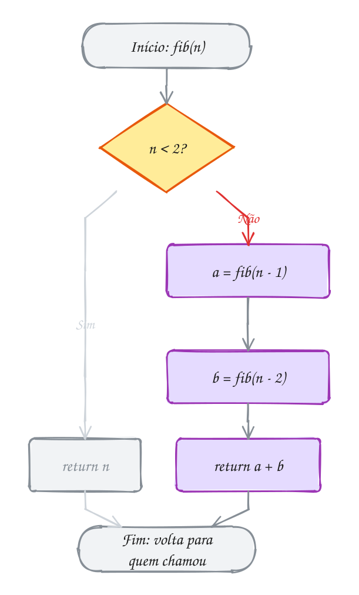</p>

### Quando a recursão é a melhor ideia: Hanói

A **Torre de Hanói** tem três estacas (A, B e C) e discos de tamanhos
diferentes em A, o maior embaixo. Leve todos para C, um disco por vez, sem pôr
um maior sobre um menor. Parece difícil até você pensar recursivamente. Para
mover `n` discos de A para C:

1. mova os `n - 1` de cima de A para B (usando C de apoio);
2. mova o disco maior de A para C;
3. mova os `n - 1` de B para C (usando A de apoio).

Os passos 1 e 3 são o mesmo problema com um disco a menos e com as estacas
trocadas de papel. Por isso a função recebe as três estacas como parâmetro. O
exemplo A066 resolve 3 discos em 7 movimentos. Com `n` discos são `2ⁿ - 1`
movimentos, e não existe jeito mais curto: aqui a recursão não desperdiça
nada.

### Passo a passo: o MDC de Euclides

O **máximo divisor comum** tem uma recursão de 2.300 anos: o MDC de `a` e `b` é
o MDC de `b` e `a % b`; quando o segundo vira 0, o primeiro é a resposta. Em C:
`return b == 0 ? a : mdc(b, a % b);`. O teste de mesa de `mdc(1071, 462)`:

| Chamada | a | b | a % b |
| --- | --- | --- | --- |
| `mdc(1071, 462)` | 1071 | 462 | 147 |
| `mdc(462, 147)` | 462 | 147 | 21 |
| `mdc(147, 21)` | 147 | 21 | 0 |
| `mdc(21, 0)` | 21 | 0 | caso base: devolve **21** |

Quatro chamadas para números na casa do milhar: o resto cai muito rápido.
Euclides faz **uma** chamada por vez e encolhe depressa, por isso sai barato.

> [!WARNING]
> Fibonacci recursivo serve para aprender recursão e custo, não para calcular.
> Outra pegadinha: `fib(47)` não cabe num `int` de 32 bits (dá 2.971.215.073,
> acima de 2.147.483.647). Com `unsigned` vai até `fib(47)`, com `long long`
> até `fib(92)`.

> [!TIP]
> A árvore mostra o **tempo** e a pilha mostra a **memória**. O tempo de
> `fib(n)` é proporcional ao número de nós da árvore, que cresce como 1,618ⁿ.
> A memória é a altura da árvore: no máximo `n` quadros ao mesmo tempo, porque
> quando um galho termina, seus quadros saem da pilha e o espaço é reaproveitado
> pelo galho seguinte. Por isso `fib(40)` demora, mas não estoura a pilha.

> [!NOTE]
> **Pergunta para você:** quantas vezes `fib(1)` é chamada dentro de
> `fib(5)`? Conte na árvore antes de alterar o programa para contar.

### Hora de praticar

**Exemplo A065 · Fibonacci sem recalcular: a recursão que carrega o par**

```c
#include <stdio.h>

long chamadas = 0;

// a e b são dois vizinhos da sequência; a cada chamada o par anda uma casa
long long fib_par(int n, long long a, long long b) {
    chamadas++;
    if (n == 0) {
        return a; // caso base: andou tudo, a é a resposta
    }
    return fib_par(n - 1, b, a + b); // UMA chamada só, não duas
}

long long fib(int n) {
    return fib_par(n, 0, 1); // começa no par (fib(0), fib(1))
}

int main(void) {
    for (int n = 10; n <= 30; n += 10) {
        chamadas = 0;
        long long resultado = fib(n);
        printf("fib(%d) = %lld, com %ld chamadas\n", n, resultado, chamadas);
    }

    chamadas = 0;
    long long grande = fib(90); // com duas chamadas por vez, não terminaria hoje
    printf("fib(90) = %lld, com %ld chamadas\n", grande, chamadas);
    return 0;
}
// Saída:
// fib(10) = 55, com 11 chamadas
// fib(20) = 6765, com 21 chamadas
// fib(30) = 832040, com 31 chamadas
// fib(90) = 2880067194370816120, com 91 chamadas
```

```bash
gcc ~/LPEDC/material/A065.c -o ~/LPEDC/material/A065 && ~/LPEDC/material/A065
```

**Exemplo A066 · Torre de Hanói e o MDC de Euclides**

```c
#include <stdio.h>

int movimentos = 0;

// leva n discos da estaca origem para a destino, usando a auxiliar
void hanoi(int n, char origem, char destino, char auxiliar) {
    if (n == 0) {
        return; // nada para mover
    }
    hanoi(n - 1, origem, auxiliar, destino); // tira os n-1 de cima do caminho
    movimentos++;
    printf("%d. disco %d: %c -> %c\n", movimentos, n, origem, destino);
    hanoi(n - 1, auxiliar, destino, origem); // põe os n-1 em cima do maior
}

// Euclides: mdc(a, b) = mdc(b, a % b), até b virar 0
int mdc(int a, int b) {
    if (b == 0) {
        return a;
    }
    return mdc(b, a % b);
}

int main(void) {
    hanoi(3, 'A', 'C', 'B');
    printf("Total: %d movimentos\n", movimentos);
    printf("mdc(1071, 462) = %d\n", mdc(1071, 462));
    return 0;
}
// Saída:
// 1. disco 1: A -> C
// 2. disco 2: A -> B
// 3. disco 1: C -> B
// 4. disco 3: A -> C
// 5. disco 1: B -> A
// 6. disco 2: B -> C
// 7. disco 1: A -> C
// Total: 7 movimentos
// mdc(1071, 462) = 21
```

```bash
gcc ~/LPEDC/material/A066.c -o ~/LPEDC/material/A066 && ~/LPEDC/material/A066
```

#### Exercícios

**Exercício E193** · ★☆☆

A receita pede 84 g de farinha para 36 g de açúcar. Escreva o MDC de
Euclides, recursivo, "int mdc(int a, int b)", e use-o para simplificar a
proporção 84/36. Teste também com 1000/625.


```text
Saída esperada:
mdc(84, 36) = 12 -> 84/36 = 7/3
mdc(1000, 625) = 125 -> 1000/625 = 8/5
```

```bash
gcc ~/LPEDC/material/E193.c -o ~/LPEDC/material/E193 && ~/LPEDC/material/E193
```

**Exercício E195** · ★★☆

Escreva "int fib_rapido(int n)" SEM recursão, com um laço e duas variáveis
(anterior e atual). Mostre fib(10), fib(40) e fib(46), o maior que cabe num
int.


```text
Saída esperada:
fib(10) = 55
fib(40) = 102334155
fib(46) = 1836311903
```

```bash
gcc ~/LPEDC/material/E195.c -o ~/LPEDC/material/E195 && ~/LPEDC/material/E195
```

**Exercício E196** · ★★☆

Meça o desperdício do Fibonacci recursivo. Copie o fib do texto (o de duas
chamadas por vez) e acrescente três globais:


```text
chamadas      quantas vezes fib foi chamada, no total
repetidas     quantas dessas chamadas foram com n == 2
maior_altura  o maior número de quadros de fib na pilha ao mesmo tempo
```


Para a altura, use uma quarta global, altura: some 1 ao entrar em fib e
tire 1 logo antes de cada return. Mostre tudo para fib(6).


```text
Saída esperada:
fib(6) = 8
chamadas: 25
fib(2) calculado 5 vezes
maior altura: 6
```

```bash
gcc ~/LPEDC/material/E196.c -o ~/LPEDC/material/E196 && ~/LPEDC/material/E196
```

**Exercício E197** · ★★★

Exponenciação rápida. Para calcular 3^13 dá para multiplicar 3 por ele mesmo
12 vezes, mas existe um atalho: se o expoente é par, x^e = (x^(e/2))²; se é
ímpar, x^e = x * x^(e-1). Escreva duas funções recursivas que contam as
multiplicações numa global:


```text
long long pot_lenta(long long x, int e)    x * pot_lenta(x, e - 1)
long long pot_rapida(long long x, int e)   o atalho acima
```


Mostre o resultado e o número de multiplicações de cada uma para 3^13 e 2^60.


```text
Saída esperada:
lenta:  3^13 = 1594323 (13 multiplicações)
rápida: 3^13 = 1594323 (6 multiplicações)
lenta:  2^60 = 1152921504606846976 (60 multiplicações)
rápida: 2^60 = 1152921504606846976 (9 multiplicações)
```

```bash
gcc ~/LPEDC/material/E197.c -o ~/LPEDC/material/E197 && ~/LPEDC/material/E197
```

---

## 0034 · Módulos: .h, .c e compilação separada

Quando várias partes de um programa precisam converter quilômetros em milhas,
ninguém cola a conversão em cada uma. Ela mora num lugar só, e quem precisa a
usa. No C, esse lugar é um **módulo**: um par de arquivos.

- **`conversao.h`** (o *header*, cabeçalho): a **interface**. Diz **o que** o
  módulo oferece: protótipos das funções, constantes, tipos. É o contrato que
  quem usa precisa conhecer.
- **`conversao.c`**: a **implementação**. Diz **como**: o corpo das funções e
  tudo o que é interno. Inclui o próprio `.h`, para o compilador conferir que a
  implementação bate com o contrato.

Quem quer usar escreve `#include "conversao.h"`. O `#include` só **cola** o
texto do arquivo ali, e com ele o compilador conhece os protótipos e confere
cada chamada. Com aspas, o arquivo é procurado primeiro na pasta do seu `.c`;
com `< >`, só nas pastas do sistema.

Cada `.c` é compilado **sozinho**, sem saber dos outros, e vira um **arquivo
objeto** (`.o`). Ao ver `km_para_milhas(100)` em `viagem.c`, o compilador só
sabe que a função existe (o protótipo prometeu) e deixa um buraco com o nome
dela. Quem tapa o buraco é o **ligador** (*linker*), que junta os `.o` e
procura cada nome. Isso é a **compilação separada**:

```bash
gcc -std=c17 -Wall -Wextra -c conversao.c       # gera conversao.o
gcc -std=c17 -Wall -Wextra -c viagem.c            # gera viagem.o
gcc viagem.o conversao.o -o viagem                # o ligador junta
gcc -std=c17 -Wall -Wextra viagem.c conversao.c -o viagem   # ou tudo de uma vez
```

Num projeto grande, mudar um `.c` recompila só ele e liga de novo. No curso, o
gcc com as flags de estudo compila junto todo `.c` de apoio da pasta (todo
arquivo que não se chama `A000.c` ou `E000.c`).

O `conversao.h` é incluído pelos dois `.c`. Cada um vira um `.o`, e o ligador
junta os dois no executável `viagem`:

<p align="center">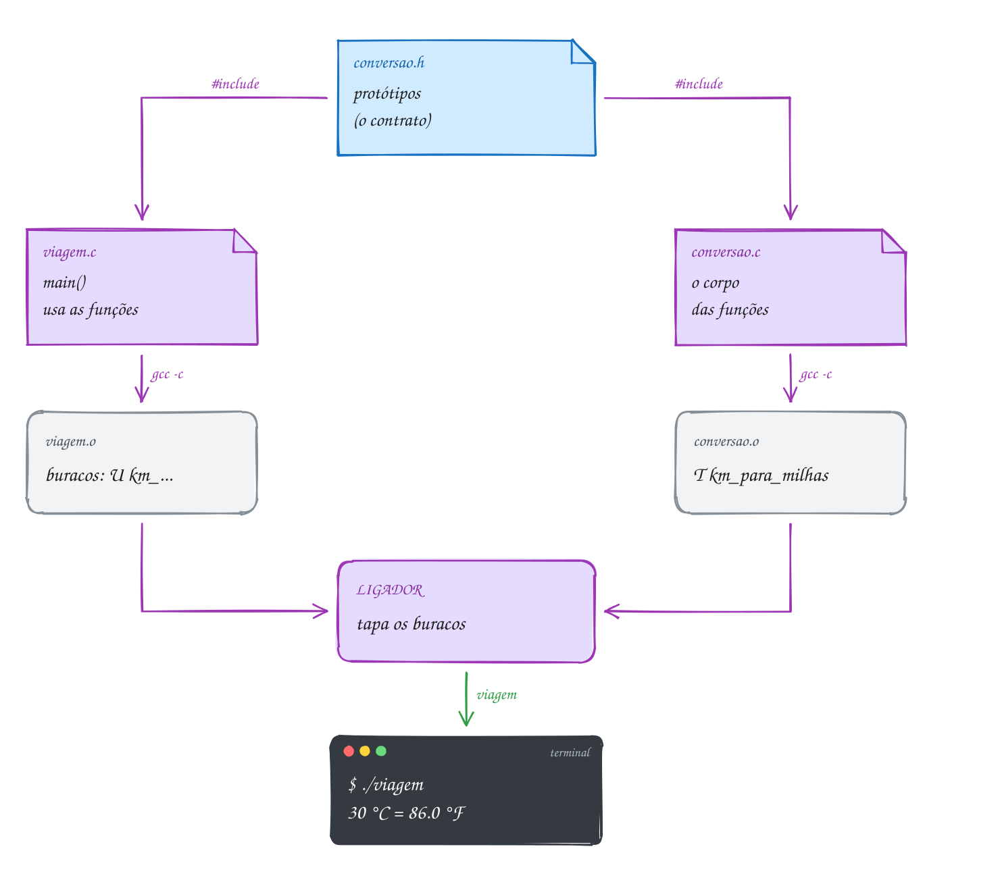</p>

O módulo fica na pasta do assunto. O `conversao.h`:

```c
// conversao.h · a interface do módulo: O QUE ele oferece
#ifndef CONVERSAO_H
#define CONVERSAO_H

double celsius_para_fahrenheit(double celsius);
double km_para_milhas(double km);
double reais_para_dolares(double reais, double cotacao);
int conversoes_feitas(void);

#endif
```

O `conversao.c` tem o corpo das quatro funções, um contador `static` e uma
função auxiliar `static` (abra o arquivo na pasta). O programa que usa só
precisa do `.h` (chame-o de `viagem.c`):

```c
#include <stdio.h>

#include "conversao.h" // aspas: procura primeiro na pasta deste arquivo

int main(void) {
    printf("30 °C = %.1f °F\n", celsius_para_fahrenheit(30));
    printf("100 km = %.1f milhas\n", km_para_milhas(100));
    printf("R$ 1000.00 = US$ %.2f\n", reais_para_dolares(1000, 5.40));
    return 0;
}
// Compilando à mão (o gcc com as flags de estudo faz isso sozinho):
//   gcc -std=c17 -Wall -Wextra viagem.c conversao.c -o viagem
// Saída:
// 30 °C = 86.0 °F
// 100 km = 62.1 milhas
// R$ 1000.00 = US$ 185.19
```

Cada `.c` passa pelo compilador separado, e o erro de "função que não existe"
só aparece no fim, no ligador:

<p align="center">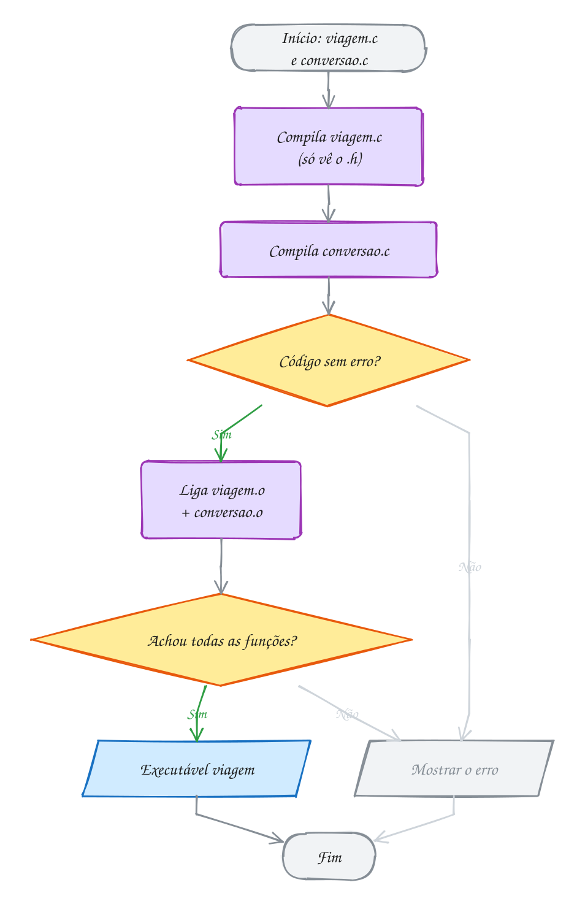</p>

Três peças fecham o assunto:

- **include guard**: `#ifndef CONVERSAO_H` / `#define CONVERSAO_H` / `#endif`
  faz o conteúdo do `.h` entrar **uma vez** por `.c`, mesmo incluído duas vezes
  (direto e por dentro de outro `.h`). Na primeira vez, `CONVERSAO_H` não
  existe: o texto entra e o nome é definido. Na segunda, o nome já existe e o
  texto é pulado. Use o nome do arquivo em maiúsculas.
- **`static` fora de função** esconde do resto do programa: o `contador` e a
  `contar` de `conversao.c` não existem para os outros arquivos. Assim o módulo
  muda por dentro sem quebrar quem o usa.
- **`extern`** declara uma global **definida** noutro arquivo: `extern int
  limite;` no `.h`, `int limite = 10;` em **um** `.c` só. Use com moderação:
  global compartilhada entre arquivos é global de novo.

> [!WARNING]
> Pôr o **corpo** de uma função no `.h`. Se dois `.c` incluem esse `.h`, a
> função existe duas vezes e o ligador reclama `multiple definition of`. O
> include guard **não** salva: ele evita repetição dentro de um `.c`, não entre
> arquivos. No `.h` vão protótipos, `#define` e, mais adiante, tipos. E nunca
> escreva `#include "conversao.c"`: funciona por acaso no começo e quebra
> quando o projeto cresce.

> [!NOTE]
> **Pergunta para você:** se você apagar o `#include "conversao.h"` do
> `viagem.c`, o programa compila? O que o gcc avisa? E se você apagar só o
> `conversao.c` da linha do `gcc`?

### Hora de praticar

**Exemplo A067 · O .h incluído duas vezes e o protótipo que converte**

```c
#include <stdio.h>

#include "0034-conversao.h"
#include "0034-conversao.h" // de propósito: o include guard faz esta virar nada

int main(void) {
    int trecho = 42;      // int
    int orcamento = 2700; // int

    // o protótipo do .h diz que os parâmetros são double:
    // o compilador converte 42 em 42.0 antes de chamar
    printf("Maratona: %d km = %.1f milhas\n", trecho, km_para_milhas(trecho));
    printf("Orçamento: R$ %d = US$ %.2f\n", orcamento,
           reais_para_dolares(orcamento, 5.40));

    // a função do módulo vira peça de uma conta maior
    double ida_e_volta = 2 * km_para_milhas(trecho);
    printf("Ida e volta: %.1f milhas\n", ida_e_volta);
    printf("Conversões feitas: %d\n", conversoes_feitas());
    return 0;
}
// Para ver o guard trabalhando: gcc -E A067.c | grep -c km_para_milhas
// dá 3: o protótipo aparece uma vez só, mais as duas linhas do main.
// Saída:
// Maratona: 42 km = 26.1 milhas
// Orçamento: R$ 2700 = US$ 500.00
// Ida e volta: 52.2 milhas
// Conversões feitas: 3
```

```bash
gcc ~/LPEDC/material/A067.c ~/LPEDC/material/0034-conversao.c -o ~/LPEDC/material/A067 && ~/LPEDC/material/A067
```

**Exemplo A068 · O módulo guarda segredos**

```c
#include <stdio.h>

#include "0034-conversao.h"

int main(void) {
    double maxima = 0;

    for (int dia = 1; dia <= 3; dia++) {
        double f = celsius_para_fahrenheit(20 + dia * 5); // 25, 30, 35 °C
        printf("Dia %d: %.1f °F\n", dia, f);
        maxima = f > maxima ? f : maxima;
    }
    printf("Máxima: %.1f °F\n", maxima);
    printf("Conversões feitas: %d\n", conversoes_feitas());

    // contador = 0;    // erro: 'contador' undeclared (é static em conversao.c)
    // contar(1.0);     // erro: contar não está no .h e é static: só existe lá
    return 0;
}
// Saída:
// Dia 1: 77.0 °F
// Dia 2: 86.0 °F
// Dia 3: 95.0 °F
// Máxima: 95.0 °F
// Conversões feitas: 3
```

```bash
gcc ~/LPEDC/material/A068.c ~/LPEDC/material/0034-conversao.c -o ~/LPEDC/material/A068 && ~/LPEDC/material/A068
```

#### Exercícios

**Exercício E199** · ★☆☆

Monte o módulo "frete" num arquivo só, com cada peça no bloco certo. Os
três blocos já estão marcados no esqueleto: "// frete.h" (o que o módulo
oferece), "// main.c" (quem usa) e "// frete.c" (como ele faz).


```text
no frete.h:  o include guard (#ifndef FRETE_H / #define FRETE_H / #endif),
             #define FRETE_GRATIS_ACIMA 200.0 e o protótipo
             double calcular_frete(double valor_compra, double peso_kg,
                                   int distancia_km);
no frete.c:  static double taxa_por_km(int distancia_km), que devolve
             0.20 por km, e o corpo de calcular_frete
no main.c:   o main
```


O frete é grátis quando a compra chega a FRETE_GRATIS_ACIMA; senão, é
R$ 10.00 + R$ 1.50 por kg + a taxa por km. Calcule três pedidos.


```text
Saída esperada:
Pedido 1 (R$ 150.00, 2.0 kg, 30 km): frete R$ 19.00
Pedido 2 (R$ 250.00, 5.0 kg, 100 km): frete R$ 0.00
Pedido 3 (R$ 80.00, 1.0 kg, 12 km): frete R$ 13.90
```

```bash
gcc ~/LPEDC/material/E199.c ~/LPEDC/material/0034-conversao.c -o ~/LPEDC/material/E199 && ~/LPEDC/material/E199
```

**Exercício E201** · ★★☆

O módulo conversao (conversao.h e conversao.c, nesta pasta) converte km em
milhas, mas não faz o contrário. Sem mexer no módulo, escreva NESTE arquivo
"double milhas_para_km(double milhas)" (1 milha = 1.609344 km) e use as
duas funções juntas: a maratona de 26.2 milhas em km; a volta completa
km_para_milhas(milhas_para_km(26.2)); a meia maratona de 13.1 milhas em km;
e quantas conversões o módulo contou (conversoes_feitas).


```text
Saída esperada:
Maratona: 26.2 milhas = 42.2 km
Volta completa: 26.2 milhas
Meia: 13.1 milhas = 21.1 km
Conversões do módulo: 1
```

```bash
gcc ~/LPEDC/material/E201.c ~/LPEDC/material/0034-conversao.c -o ~/LPEDC/material/E201 && ~/LPEDC/material/E201
```

**Exercício E202** · ★★☆

Escreva, num arquivo só, um módulo imitado: o bloco "// desconto.h" com o
protótipo de "double aplicar_desconto(double preco, double percentual)", o
bloco "// main.c" com o main, que mostra o preço de um tênis de R$ 299.90 com
20% de desconto, e o bloco "// desconto.c" com a definição da função
(preco - preco * percentual / 100). O programa tem que compilar e ligar.


```text
Saída esperada:
Tênis: R$ 239.92
```

```bash
gcc ~/LPEDC/material/E202.c ~/LPEDC/material/0034-conversao.c -o ~/LPEDC/material/E202 && ~/LPEDC/material/E202
```

**Exercício E203** · ★★★

Escreva o módulo "placar" de um campeonato entre dois times, num arquivo
só, com os blocos "// placar.h", "// main.c" e "// placar.c". Os dados
moram em globais static no bloco do placar.c: os gols da partida atual de
cada time e os pontos e gols de cada um no campeonato. Ninguém de fora mexe
neles sem passar pelas funções:


```text
void marcar_gol(int time)      time 1 (casa) ou 2 (visitante)
void encerrar_partida(void)    mostra "Partida N: X x Y", dá 3 pontos
                               para quem venceu (1 para cada no empate),
                               soma os gols no campeonato e zera o placar
int pontos(int time)
int gols(int time)             gols no campeonato
```


Uma função static do placar.c, "void anotar(int time)", é a única que mexe
nos gols da partida; marcar_gol só a chama. O main simula: 2 x 1, 0 x 0 e
1 x 3, e mostra a tabela.


```text
Saída esperada:
Partida 1: 2 x 1
Partida 2: 0 x 0
Partida 3: 1 x 3
Casa: 4 pontos, 3 gols
Visitante: 4 pontos, 4 gols
```

```bash
gcc ~/LPEDC/material/E203.c ~/LPEDC/material/0034-conversao.c -o ~/LPEDC/material/E203 && ~/LPEDC/material/E203
```

---

## 0035 · Pré-processador: macros e #ifdef

O "localizar e substituir" do editor troca todo `TAXA` por `0.05` no arquivo,
sem entender nada do texto. O **pré-processador** do C faz o mesmo e roda
**antes** do compilador. Toda linha que começa com `#` é para ele: `#include`
cola um arquivo, `#define` cria uma substituição. Quando o compilador recebe o
código, as diretivas já sumiram.

Você já usa `#define TAXA 0.05` para constantes. Com parâmetros, o `#define`
vira uma **macro**:

```c
#define QUAD(x) ((x) * (x))
```

Cada `QUAD(alguma coisa)` vira `((alguma coisa) * (alguma coisa))`. Parece
função, mas não é: não tem tipo, chamada nem pilha. É **troca de texto**. O
nome e o `(` ficam colados: `QUAD (x)`, com espaço, é uma constante que vale
`(x) ((x) * (x))`.

Troca de texto não respeita a precedência dos operadores. Sem parênteses,
`QUAD_RUIM(lado + 3)` vira `lado + 3 * lado + 3`, e a multiplicação vem
primeiro. A regra: **parênteses em volta de cada parâmetro e da expressão
inteira**.

No exemplo, o terreno tem `lado + 3` metros de lado, com `lado = 2`.
`QUAD_RUIM(lado + 3)` chega ao compilador como `lado + 3 * lado + 3`, que dá
11. A versão com parênteses chega como `((lado + 3) * (lado + 3))` e dá 25:

<p align="center">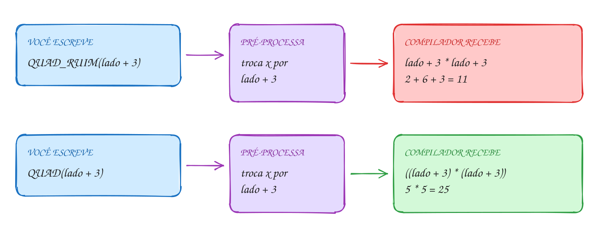</p>

O mesmo exemplo em C, com mais uma armadilha, a da divisão:

```c
#include <stdio.h>

#define QUAD_RUIM(x) x * x       // sem parênteses: perigo
#define QUAD(x) ((x) * (x))      // parênteses no parâmetro E em volta de tudo

int main(void) {
    int lado = 2;

    // terreno quadrado de lado (2 + 3) metros
    printf("QUAD_RUIM(lado + 3) = %d\n", QUAD_RUIM(lado + 3)); // 2 + 3 * 2 + 3
    printf("QUAD(lado + 3)      = %d\n", QUAD(lado + 3));      // ((2 + 3) * (2 + 3))

    // quantos lotes de 5 x 5 cabem em 100 m2?
    printf("100 / QUAD_RUIM(5)  = %d\n", 100 / QUAD_RUIM(5));  // 100 / 5 * 5
    printf("100 / QUAD(5)       = %d\n", 100 / QUAD(5));       // 100 / ((5) * (5))
    return 0;
}
// Saída:
// QUAD_RUIM(lado + 3) = 11
// QUAD(lado + 3)      = 25
// 100 / QUAD_RUIM(5)  = 100
// 100 / QUAD(5)       = 4
```

O pré-processador não sabe nada de C: só procura o nome da macro e troca. Quem
descobre o erro (quando descobre) é o compilador, olhando um código que você
não escreveu:

<p align="center">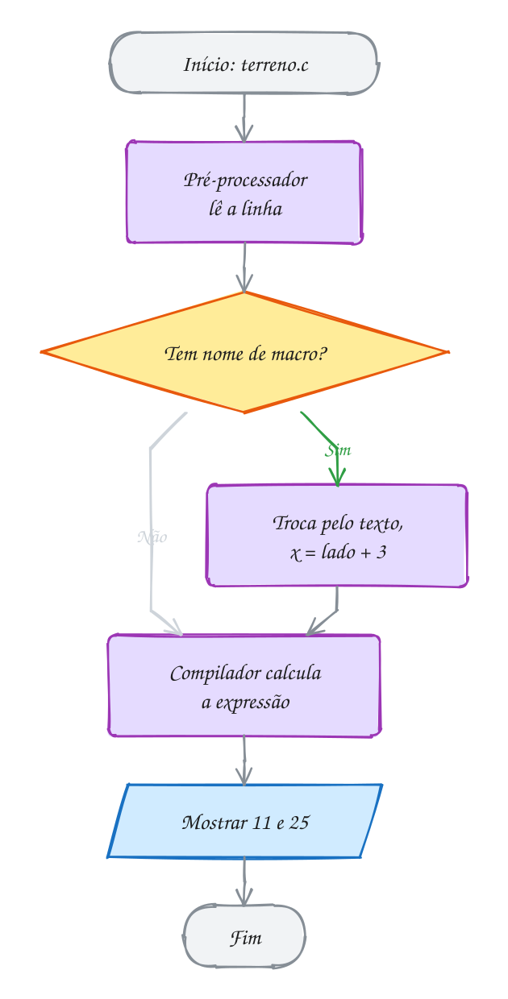</p>

O pré-processador também decide **o que entra** no programa, com a
**compilação condicional**:

```c
#ifdef DEPURAR          // se o nome DEPURAR foi definido...
    printf("[debug] total = %d\n", total);
#endif
```

Com `#define DEPURAR` no topo, a linha entra. Sem ele, nem chega ao
compilador: o executável não guarda vestígio dela. Existem também `#ifndef`
(se **não** foi definido, o do include guard), `#if`, `#elif`, `#else` e
`#undef`. Dá para definir o nome pela linha de comando: `gcc -DDEPURAR
programa.c`. E `#if 0` ... `#endif` desliga um trecho inteiro, mesmo com
comentários `/* */` dentro.

O exemplo A070 usa:

- `__LINE__`, o número da linha, e `__func__`, o nome da função atual: úteis
  em mensagens de depuração;
- `#x` dentro de uma macro, que transforma o argumento em texto:
  `MOSTRAR(7 * 6)` mostra `7 * 6 = 42`, a expressão e o valor numa linha.

> [!WARNING]
> A macro avalia o argumento **cada vez que ele aparece**. Com
> `#define MAIOR(a, b) ((a) > (b) ? (a) : (b))`, `MAIOR(x++, y)` pode
> incrementar `x` **duas vezes**. E não ponha `;` no fim do `#define`:
> `#define TAXA 0.05;` faz `preco * TAXA + 1` virar `preco * 0.05; + 1`. Às
> vezes compila e erra a conta; às vezes o erro aponta para uma linha
> aparentemente perfeita.

> [!TIP]
> Para cálculos, o C moderno prefere funções pequenas: têm checagem de tipos e
> não têm essas armadilhas. Macro fica para o que só ela faz: constantes,
> `#ifdef`, `__LINE__` e `#x`.

> [!NOTE]
> **Pergunta para você:** com `#define DOBRO(x) (x) + (x)`, quanto vale
> `10 * DOBRO(3)`? Os parênteses no parâmetro bastam?

### Hora de praticar

**Exemplo A069 · A macro não tem tipo nem é função**

```c
#include <stdio.h>

#define DIAS_UTEIS 22
#define HORAS_POR_DIA 8
#define HORAS_NO_MES (DIAS_UTEIS * HORAS_POR_DIA) // macro feita de macros

#define MAIOR(a, b) ((a) > (b) ? (a) : (b)) // serve para int, double...

int maior_int(int a, int b) { // a função tem tipo: só int
    return a > b ? a : b;
}

int main(void) {
    double salario = 3520.00;

    printf("Horas no mês: %d\n", HORAS_NO_MES);
    printf("Valor da hora: R$ %.2f\n", salario / HORAS_NO_MES);

    // a macro só cola texto: com double, a comparação é feita em double
    printf("MAIOR(4.75, 4.70)     = %.2f\n", MAIOR(4.75, 4.70));
    // a função converte os argumentos para int antes: 4 e 4
    printf("maior_int(4.75, 4.70) = %d\n", maior_int(4.75, 4.70));

    // com int, as duas concordam
    printf("MAIOR(12, 30) = %d, maior_int(12, 30) = %d\n",
           MAIOR(12, 30), maior_int(12, 30));
    return 0;
}
// Saída:
// Horas no mês: 176
// Valor da hora: R$ 20.00
// MAIOR(4.75, 4.70)     = 4.75
// maior_int(4.75, 4.70) = 4
// MAIOR(12, 30) = 30, maior_int(12, 30) = 30
```

```bash
gcc ~/LPEDC/material/A069.c -o ~/LPEDC/material/A069 && ~/LPEDC/material/A069
```

**Exemplo A070 · Modo depuração com #ifdef**

```c
#include <stdio.h>

#define DEPURAR // apague esta linha e os [debug] somem do programa

#ifdef DEPURAR
#define LOG(msg) printf("[debug] %s, linha %d: %s\n", __func__, __LINE__, msg)
#else
#define LOG(msg) // vira nada
#endif

#define MOSTRAR(expr) printf(#expr " = %d\n", (expr)) // # vira texto

int parcelas(int total, int valor_parcela) {
    LOG("calculando");
    return (total + valor_parcela - 1) / valor_parcela; // arredonda para cima
}

int main(void) {
    LOG("começou");
    MOSTRAR(parcelas(1000, 300));
    MOSTRAR(7 * 6);
    return 0;
}
// Saída:
// [debug] main, linha 21: começou
// [debug] parcelas, linha 16: calculando
// parcelas(1000, 300) = 4
// 7 * 6 = 42
```

```bash
gcc ~/LPEDC/material/A070.c -o ~/LPEDC/material/A070 && ~/LPEDC/material/A070
```

#### Exercícios

**Exercício E206** · ★☆☆

Escreva três macros à prova de precedência e teste com os valores abaixo:


```text
MAIOR(a, b)          o maior dos dois
ABS(x)               o valor absoluto
ENTRE(x, min, max)   1 se min <= x <= max, senão 0
```


```text
Saída esperada:
MAIOR(7, 12) = 12
ABS(-8) = 8
ABS(3 - 10) = 7
ENTRE(15, 10, 20) = 1
ENTRE(25, 10, 20) = 0
100 / ABS(-5 * 2) = 10
```

```bash
gcc ~/LPEDC/material/E206.c -o ~/LPEDC/material/E206 && ~/LPEDC/material/E206
```

**Exercício E207** · ★★☆

Escreva o programa da lanchonete com duas macros: DESCONTO (0.10) e
PRECO_COMBO (25 + 5, à prova de precedência). Com preco = 35.00, mostre o
desconto (preco * DESCONTO) e o valor de dois combos (2.0 * PRECO_COMBO).


```text
Saída esperada:
Desconto: R$ 3.50
Dois combos: R$ 60.00
```

```bash
gcc ~/LPEDC/material/E207.c -o ~/LPEDC/material/E207 && ~/LPEDC/material/E207
```

**Exercício E208** · ★★☆

Escreva um simulador de parcelas com modo de teste. Uma compra de R$ 1000.00
em 4 parcelas com juros de 2% ao mês: cada parcela é o valor original
dividido por 4, mais 2% de juros por mês de espera (a 1ª parcela tem 2%, a
2ª 4%, e assim por diante, juros simples). Mostre o total pago.

Com "#define MODO_TESTE" no topo, mostre também cada parcela, com o prefixo
"[teste]". Sem a linha, só o total. Use #ifdef; nada de if comum.


```text
Saída esperada com MODO_TESTE:
[teste] parcela 1: 255.00
[teste] parcela 2: 260.00
[teste] parcela 3: 265.00
[teste] parcela 4: 270.00
Total: R$ 1050.00
```


```text
Saída esperada sem MODO_TESTE:
Total: R$ 1050.00
```

```bash
gcc ~/LPEDC/material/E208.c -o ~/LPEDC/material/E208 && ~/LPEDC/material/E208
```

**Exercício E209** · ★★★

A macro avalia o argumento cada vez que ele aparece. Escreva a macro
MAIOR(a, b), à prova de precedência, a função "int maior(int a, int b)", a
função "int maior3(int a, int b, int c)" (usa maior) e "int pontos(int p)",
que soma 1 na global chamadas e devolve p. No main, mostre (x = 5, y = 3):
MAIOR(x++, y) e maior(x++, y); MAIOR e maior com pontos(40) e pontos(25);
MAIOR aninhada e maior3 com pontos(7), pontos(19) e pontos(12). Cada linha
mostra m e (x ou chamadas).


```text
Saída esperada:
macro:  m = 6, x = 7
função: m = 5, x = 6
macro:  m = 40, chamadas = 3
função: m = 40, chamadas = 2
macro aninhada: m = 19, chamadas = 7
maior3: m = 19, chamadas = 3
```

```bash
gcc ~/LPEDC/material/E209.c -o ~/LPEDC/material/E209 && ~/LPEDC/material/E209
```

---

## 0036 · Juntando tudo: o caixa da lanchonete

Sexta à noite, fila no food truck. O caixa lança os pedidos pelo código, soma,
põe 10% de serviço, recebe uma nota de R$ 50 e devolve o troco com o menor
número de notas e moedas. Parece um programa só, mas tem um **módulo** com o
cardápio, funções pequenas com **parâmetros** e retorno, um contador
**`static`** escondido, uma **macro** para a taxa e uma função **recursiva**
para o troco.

Antes de escrever, divida: cada tarefa vira uma função com um nome que diz o
que ela faz.

| Peça | Onde | O que usa do módulo |
| --- | --- | --- |
| `mostrar_cardapio`, `preco_centavos`, `mostrar_item` | `cardapio.c` | módulo `.h`/`.c`, `switch` |
| `itens_vendidos` | `cardapio.c` | global `static`: só o módulo mexe |
| `ler_codigo` | `caixa.c` | validação com `do...while` e retorno do `scanf` |
| `proxima_nota` | `caixa.c` | função pura: entra uma nota, sai a seguinte |
| `dar_troco` | `caixa.c` | recursão: caso base "troco zerado" |
| `TAXA_SERVICO` | `caixa.c` | `#define` |

Decisão importante: dinheiro em **centavos**, num `int`. R$ 7,90 vira `790`.
Com `double`, `0.1 + 0.2` não dá exatamente `0.3` (assunto 0012), e o troco
pode sair errado. Para mostrar, `%d.%02d` com `total / 100` e `total % 100`
monta o "42.24". O único `double` é o valor pago, lido do teclado e convertido
com `lround(pago * 100)`.

O troco recursivo lê como uma frase: "se o troco zerou, acabou; se a nota atual
cabe, dê essa nota e resolva o resto; se não cabe, tente a nota seguinte". Cada
chamada chega mais perto do fim, pois o troco ou a nota diminui.

Os pedidos 1, 2 e 3 somam R$ 38,40. Com 10% de serviço, a conta é R$ 42,24.
Pagando R$ 50, o troco de R$ 7,76 sai da recursão como
5 + 2 + 0,50 + 0,25 + 0,01:

<p align="center">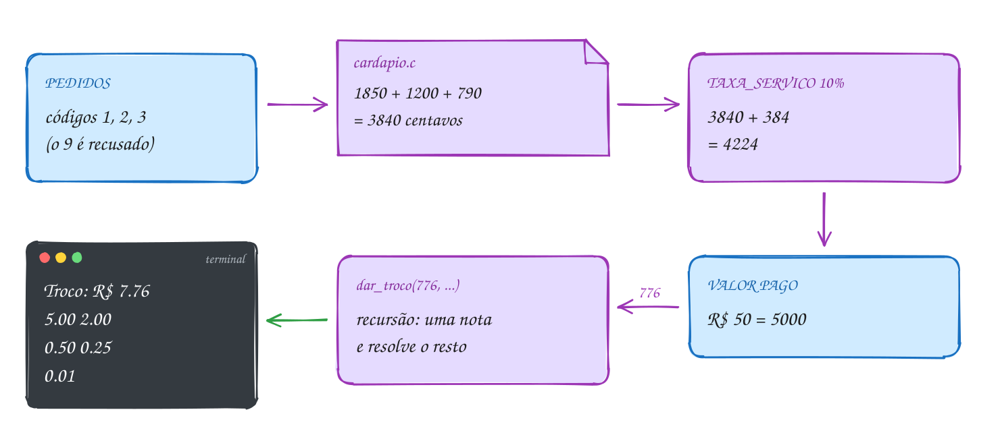</p>

O programa principal, `caixa.c`, usa o módulo do cardápio. O `cardapio.h` e o
`cardapio.c` estão na pasta do assunto (abra os dois):

```c
#include <math.h>
#include <stdio.h>

#include "cardapio.h"

#define TAXA_SERVICO 10 // por cento

// lê um código de 0 a 4; insiste até vir um válido
int ler_codigo(void) {
    int codigo;
    int lidos;
    do {
        printf("Código (0 fecha): ");
        lidos = scanf("%d", &codigo);
        if (lidos != 1) {
            return 0; // entrada acabou ou não é número: fecha a conta
        }
    } while (codigo < 0 || codigo > 4);
    return codigo;
}

// a nota seguinte, da maior para a menor (em centavos)
int proxima_nota(int nota) {
    switch (nota) {
    case 10000: return 5000;
    case 5000: return 2000;
    case 2000: return 1000;
    case 1000: return 500;
    case 500: return 200;
    case 200: return 100;
    case 100: return 50;
    case 50: return 25;
    case 25: return 10;
    case 10: return 5;
    default: return 1;
    }
}

// recursão: dá uma nota e resolve o troco que sobrou
void dar_troco(int centavos, int nota) {
    if (centavos == 0) {
        return; // caso base: troco completo
    }
    if (centavos >= nota) {
        printf("  %d.%02d\n", nota / 100, nota % 100);
        dar_troco(centavos - nota, nota);
    } else {
        dar_troco(centavos, proxima_nota(nota));
    }
}

int main(void) {
    int total = 0;

    mostrar_cardapio();
    for (int codigo = ler_codigo(); codigo != 0; codigo = ler_codigo()) {
        total += preco_centavos(codigo);
        mostrar_item(codigo);
        printf(" adicionado\n");
    }

    int servico = total * TAXA_SERVICO / 100;
    int conta = total + servico;
    printf("%d itens, conta com serviço: R$ %d.%02d\n",
           itens_vendidos(), conta / 100, conta % 100);

    double pago;
    printf("Valor pago: ");
    if (scanf("%lf", &pago) != 1) {
        return 0;
    }
    int troco = (int)lround(pago * 100) - conta;
    if (troco < 0) {
        printf("Faltam R$ %d.%02d\n", -troco / 100, -troco % 100);
        return 0;
    }
    printf("Troco: R$ %d.%02d\n", troco / 100, troco % 100);
    dar_troco(troco, 10000);
    return 0;
}
// Exemplo de uso (o que você digita vem depois dos dois-pontos):
// 1 X-salada   R$ 18.50
// 2 Batata     R$ 12.00
// 3 Suco       R$  7.90
// 4 Açaí       R$ 15.00
// Código (0 fecha): 1
// X-salada adicionado
// Código (0 fecha): 2
// Batata adicionado
// Código (0 fecha): 3
// Suco adicionado
// Código (0 fecha): 9
// Código (0 fecha): 0
// 3 itens, conta com serviço: R$ 42.24
// Valor pago: 50
// Troco: R$ 7.76
//   5.00
//   2.00
//   0.50
//   0.25
//   0.01
// Para testar sem digitar, salve como caixa.c numa pasta sua, com cópias do
// cardapio.h e do cardapio.c, e rode: printf '1\n2\n3\n9\n0\n50\n' | ./caixa
```

O laço dos pedidos termina com o código 0; depois vêm a conta, o pagamento e a
decisão "pagou o suficiente?". O troco, que parece um laço, é a recursão de
`dar_troco`:

<p align="center">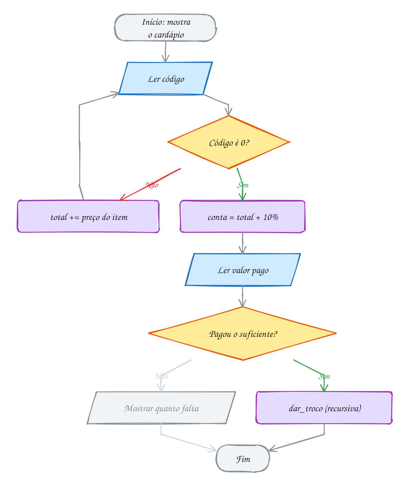</p>

O exemplo A072 mostra a outra vantagem de dividir em funções: **testar cada
peça sozinha**. Com a macro `CONFERIR`, definida no próprio arquivo, ele confere o
preço, o contador `static` e a contagem de notas sem digitar nada. Não precisa
de biblioteca de testes: uma macro de dez linhas resolve.

> [!WARNING]
> Efeito colateral escondido. `preco_centavos` parece só consultar um preço,
> mas também soma 1 no contador de itens vendidos. Chamá-la duas vezes para o
> mesmo pedido (uma para somar, outra para mostrar o preço) conta o item em
> dobro, e nada no nome avisa. É a armadilha das globais em escala menor.
> Quando uma função muda estado, deixe isso no nome (`registrar_pedido`) ou
> separe em duas: uma que consulta e outra que registra.

> [!NOTE]
> **Pergunta para você:** se o cliente pagar exatamente R$ 42,24, quantas
> chamadas de `dar_troco` acontecem? E o que o programa mostra se ele digitar
> 40?

### Hora de praticar

**Exemplo A071 · Rachando a conta da mesa sem perder centavo**

```c
#include <stdio.h>

#include "0036-cardapio.h"

#define TAXA_SERVICO 10 // por cento

void mostrar_reais(int centavos) {
    printf("R$ %d.%02d", centavos / 100, centavos % 100);
}

// lança um item e devolve o preço (0 se o código não existe)
int pedir(int codigo) {
    int preco = preco_centavos(codigo);
    if (preco == 0) {
        printf("código %d não existe\n", codigo);
        return 0;
    }
    mostrar_item(codigo);
    printf(": ");
    mostrar_reais(preco);
    printf("\n");
    return preco;
}

// quanto a pessoa número "pessoa" (1, 2, ...) paga:
// a divisão inteira deixa uma sobra, e as primeiras pagam 1 centavo a mais
int parte(int conta, int pessoas, int pessoa) {
    int base = conta / pessoas;
    int sobra = conta % pessoas;
    if (pessoa <= sobra) {
        return base + 1;
    }
    return base;
}

// recursiva: soma as partes da pessoa "de" até a última, para conferir
int soma_partes(int conta, int pessoas, int de) {
    if (de > pessoas) {
        return 0; // caso base: não sobrou ninguém
    }
    return parte(conta, pessoas, de) + soma_partes(conta, pessoas, de + 1);
}

int main(void) {
    int total = 0;
    total += pedir(1); // uma linha por pedido: assim a ordem na tela é garantida
    total += pedir(1);
    total += pedir(2);
    total += pedir(7);
    total += pedir(4);
    int conta = total + total * TAXA_SERVICO / 100;

    printf("%d itens, com serviço: ", itens_vendidos());
    mostrar_reais(conta);
    printf("\n");

    int pessoas = 3;
    for (int p = 1; p <= pessoas; p++) {
        printf("Pessoa %d paga ", p);
        mostrar_reais(parte(conta, pessoas, p));
        printf("\n");
    }
    printf("Conferindo: ");
    mostrar_reais(soma_partes(conta, pessoas, 1));
    printf("\n");
    return 0;
}
// Saída:
// X-salada: R$ 18.50
// X-salada: R$ 18.50
// Batata: R$ 12.00
// código 7 não existe
// Açaí: R$ 15.00
// 4 itens, com serviço: R$ 70.40
// Pessoa 1 paga R$ 23.47
// Pessoa 2 paga R$ 23.47
// Pessoa 3 paga R$ 23.46
// Conferindo: R$ 70.40
```

```bash
gcc ~/LPEDC/material/A071.c ~/LPEDC/material/0036-cardapio.c -o ~/LPEDC/material/A071 && ~/LPEDC/material/A071
```

**Exemplo A072 · Testando as peças do caixa**

```c
#include <stdio.h>

#include "0036-cardapio.h"

int falhas = 0;

#define CONFERIR(cond)                                          \
    do {                                                        \
        if (cond) {                                             \
            printf("ok: %s\n", #cond);                          \
        } else {                                                \
            printf("FALHOU: %s (linha %d)\n", #cond, __LINE__); \
            falhas++;                                           \
        }                                                       \
    } while (0)

int proxima_nota(int nota) {
    switch (nota) {
    case 10000: return 5000;
    case 5000: return 2000;
    case 2000: return 1000;
    case 1000: return 500;
    case 500: return 200;
    case 200: return 100;
    case 100: return 50;
    case 50: return 25;
    case 25: return 10;
    case 10: return 5;
    default: return 1;
    }
}

// quantas notas e moedas o troco usa (recursiva, igual a dar_troco)
int contar_notas(int centavos, int nota) {
    if (centavos == 0) {
        return 0;
    }
    if (centavos >= nota) {
        return 1 + contar_notas(centavos - nota, nota);
    }
    return contar_notas(centavos, proxima_nota(nota));
}

int main(void) {
    CONFERIR(preco_centavos(1) == 1850);
    CONFERIR(preco_centavos(9) == 0);
    CONFERIR(itens_vendidos() == 1); // o código 9 não conta
    CONFERIR(proxima_nota(10000) == 5000);
    CONFERIR(contar_notas(776, 10000) == 5);  // 5 + 2 + 0.50 + 0.25 + 0.01
    CONFERIR(contar_notas(18600, 10000) == 6); // 100 + 50 + 20 + 10 + 5 + 1
    printf("Falhas: %d\n", falhas);
    return 0;
}
// Saída:
// ok: preco_centavos(1) == 1850
// ok: preco_centavos(9) == 0
// ok: itens_vendidos() == 1
// ok: proxima_nota(10000) == 5000
// ok: contar_notas(776, 10000) == 5
// ok: contar_notas(18600, 10000) == 6
// Falhas: 0
```

```bash
gcc ~/LPEDC/material/A072.c ~/LPEDC/material/0036-cardapio.c -o ~/LPEDC/material/A072 && ~/LPEDC/material/A072
```

#### Exercícios

**Exercício E212** · ★☆☆

Escreva "double imc(double peso, double altura)" e "void mostrar_imc(int
pessoa, double peso, double altura)", que mostra o IMC com 1 casa e a
classificação (abaixo de 18.5, normal abaixo de 25, senão acima). O main só
faz três chamadas: 70.0 kg e 1.75 m; 85.0 kg e 1.75 m; 52.0 kg e 1.72 m.


```text
Saída esperada:
Pessoa 1: IMC 22.9 (normal)
Pessoa 2: IMC 27.8 (acima)
Pessoa 3: IMC 17.6 (abaixo)
```

```bash
gcc ~/LPEDC/material/E212.c ~/LPEDC/material/0036-cardapio.c -o ~/LPEDC/material/E212 && ~/LPEDC/material/E212
```

**Exercício E213** · ★★☆

O app de hábitos mostra "dia 291 de 365". Escreva três funções que se
apoiam umas nas outras:


```text
bool eh_bissexto(int ano)
int dias_no_mes(int mes, int ano)          usa eh_bissexto para fevereiro
int dia_do_ano(int dia, int mes, int ano)  soma os meses anteriores
```


```text
Saída esperada:
18/10/2026: dia 291 de 365
01/03/2024: dia 61 de 366
31/12/2024: dia 366 de 366
29/02/2023: data inválida
```

```bash
gcc ~/LPEDC/material/E213.c ~/LPEDC/material/0036-cardapio.c -o ~/LPEDC/material/E213 && ~/LPEDC/material/E213
```

**Exercício E214** · ★★☆

Tudo do módulo num programa só. Escreva as peças e o main:


```text
#define DOBRO(x)            o dobro, à prova de precedência
int total = 0;              global
int proximo_id(void)        static id começando em 10; soma 1 e devolve
int soma_ate(int n)         recursiva: 0 + 1 + ... + n; soma 1 na global
                            total a cada chamada
int altera(int total)       põe 99 no parâmetro e devolve
```


O main mostra, nesta ordem: um id; a soma de mais dois ids; soma_ate(4); a
global total; chama altera(total) sem guardar o retorno e mostra a global
de novo; e por fim DOBRO(total + 1).


```text
Saída esperada:
id: 11
dois ids somados: 25
soma_ate(4) = 10
chamadas: 5
depois de altera: 5
DOBRO(total + 1) = 12
```

```bash
gcc ~/LPEDC/material/E214.c ~/LPEDC/material/0036-cardapio.c -o ~/LPEDC/material/E214 && ~/LPEDC/material/E214
```

**Exercício E215** · ★★★

Generalize o binário recursivo (E190) para qualquer base de 2 a 16. Escreva:


```text
char digito(int valor)          0..9 viram '0'..'9'; 10..15 viram 'A'..'F'
void em_base(int n, int base)   recursiva, imprime n na base
void mostrar(int n, int base)   imprime "n na base b: ..." e pula linha;
                                recusa base fora de 2..16
```


```text
Saída esperada:
255 na base 16: FF
255 na base 2: 11111111
2026 na base 8: 3752
2026 na base 16: 7EA
46655 na base 6: 555555
10 na base 20: base inválida
```

```bash
gcc ~/LPEDC/material/E215.c ~/LPEDC/material/0036-cardapio.c -o ~/LPEDC/material/E215 && ~/LPEDC/material/E215
```

---

## Desafios do módulo

Problemas do médio ao difícil, para resolver num arquivo seu.

**1. Dígito verificador.** Escreva `int digito_mod11(int numero)` para números
de até 9 dígitos: multiplique os dígitos, do último para o primeiro, por 2, 3,
4, 5..., some tudo, calcule `11 - soma % 11` e, se der 10 ou 11, use 0. Qual é
o dígito de 261533?

<details><summary>Resposta</summary>

Do fim para o começo: 3×2 + 3×3 + 5×4 + 1×5 + 6×6 + 2×7 = 6 + 9 + 20 + 5 + 36 +
14 = 90. 90 % 11 = 2, e 11 - 2 = **9**. Caminho: um `while (numero > 0)` que
pega `numero % 10`, multiplica pelo peso e faz `numero /= 10`, com o peso
subindo a cada volta.

</details>

**2. Potência recursiva com expoente negativo.** Estenda `potencia(base,
expoente)` para `double` e expoente negativo: `2^-3` vale 0,125. Use recursão
nos dois sentidos.

<details><summary>Resposta</summary>

Três casos: expoente 0 devolve 1; expoente positivo devolve `base *
potencia(base, e - 1)`; expoente negativo devolve `1 / potencia(base, -e)`. O
último caso chama o positivo uma vez só, e a recursão continua convergindo
para 0. `potencia(2, -3)` = **0.125**.

</details>

**3. Collatz.** Começando de n, se for par divida por 2, se for ímpar faça
`3n + 1`, até chegar a 1. Escreva `int passos(int n)` recursiva. Quantos passos
para 27? E qual n até 100 tem mais passos?

<details><summary>Resposta</summary>

`passos(1) = 0`; senão `1 + passos(próximo)`. 27 leva **111 passos** (e passa
por 9232 no caminho). Até 100, o campeão é o **97**, com 118 passos. Ninguém
provou que toda sequência chega a 1: a recursão só termina porque, até hoje,
sempre terminou.

</details>

**4. Contador de chamadas por função.** Sem globais, faça três funções,
`int pix(bool so_ler)`, `int boleto(bool so_ler)` e `int cartao(bool so_ler)`,
saberem quantas vezes já foram chamadas: cada uma soma 1 no seu contador e
devolve o valor, mas com `so_ler` verdadeiro só devolve, sem somar. Escreva
`void relatorio(void)` que mostra os três números. No `main`, chame `pix` 3
vezes, `boleto` 1 e `cartao` 2, chame `relatorio`, chame `pix` mais uma vez e
chame `relatorio` de novo.

<details><summary>Resposta</summary>

```text
pix: 3, boleto: 1, cartao: 2
pix: 4, boleto: 1, cartao: 2
```

Um `static int vezes = 0;` em cada função guarda a contagem entre as
chamadas, mas `relatorio` não enxerga o `static` de outra função: por isso o
parâmetro "só consultar", que devolve o contador sem somar. As chamadas de
`relatorio` não mudam nada, e a segunda linha mostra isso. Outra saída seria
um módulo com contadores `static` de arquivo e funções de consulta, como o
`conversoes_feitas` do assunto 0034.

</details>

**5. Ackermann.** `A(0, n) = n + 1`; `A(m, 0) = A(m - 1, 1)`; `A(m, n) = A(m - 1,
A(m, n - 1))`. Calcule `A(2, 3)` e conte as chamadas. Tente `A(3, 6)`.

<details><summary>Resposta</summary>

`A(2, 3)` = **9**, com 44 chamadas. `A(3, 6)` = 509, com mais de 170 mil
chamadas. É uma função que sempre termina, mas cresce mais rápido que qualquer
exponencial; `A(4, 2)` já tem 19.729 dígitos. Use `long long` no contador.

</details>

**6. A pilha de mdc.** Acrescente ao `mdc` recursivo de Euclides um parâmetro
`int nivel`: cada chamada mostra `mdc(a, b)` recuado dois espaços por nível
e, no caso base, devolve quantos quadros de `mdc` estavam empilhados no ponto
mais fundo (`nivel + 1`). Mostre a pilha e os quadros de `mdc(100, 75)` e de
`mdc(89, 55)`.

<details><summary>Resposta</summary>

```text
mdc(100, 75)
  mdc(75, 25)
    mdc(25, 0)
Quadros: 3
```

`mdc(89, 55)` desce em escada por (55, 34), (34, 21), (21, 13), (13, 8),
(8, 5), (5, 3), (3, 2), (2, 1) e (1, 0) e termina com `Quadros: 10`. Números
de Fibonacci consecutivos são o pior caso de Euclides. O recuo é um `for` de
0 a `nivel` mostrando dois espaços antes do `printf`, e a chamada recursiva
passa `nivel + 1`.

</details>

**7. Macro de troca.** Escreva `#define TROCAR(a, b) int t = a; a = b; b =
t;` e use num `if (x > y) TROCAR(x, y);` sem chaves: rode com as flags de estudo e veja
o `gcc` recusar. Conserte a macro para que esta função compile e funcione,
sem mexer nela:

```c
void ordena(int x, int y) {
    if (x > y)
        TROCAR(x, y);
    else
        printf("já em ordem: ");
    printf("%d %d\n", x, y);
}
```

Chame `ordena(9, 4)` e `ordena(1, 5)`.

<details><summary>Resposta</summary>

A versão ingênua dá `error: expected expression before 'int'`: só a primeira
instrução da macro fica no `if`, e uma declaração não pode ser o corpo de um
`if` sem chaves. Com a forma segura, `#define TROCAR(a, b) do { int t_ = (a);
(a) = (b); (b) = t_; } while (0)`:

```text
4 9
já em ordem: 1 5
```

Só com chaves (`{ ... }`) o `;` depois de `TROCAR(x, y)` fecharia o `if` e
deixaria o `else` órfão; o `do { } while (0)` engole esse `;`. Aqui a
macro **consegue** trocar e uma função não conseguiria: ela não recebe
cópias, ela é colada no lugar.

</details>

**8. Módulo de temperatura.** Crie `clima.h` e `clima.c` com `void
registrar(double celsius)`, `double media(void)`, `double maxima(void)` e
`int leituras(void)`, guardando tudo em `static` de arquivo. Registre 22.5,
31.0, 18.0 e 27.5. Escreva também o comando `gcc`.

<details><summary>Resposta</summary>

Média **24.75**, máxima **31.0**, 4 leituras. Guarde soma, máximo e contador
(não precisa guardar cada leitura). Na primeira leitura, o máximo recebe o
valor direto. Comando: `gcc -std=c17 -Wall -Wextra main.c clima.c -o clima`.

</details>

**9. Números de Catalan.** C(0) = 1 e C(n) = soma de C(i) × C(n - 1 - i) para i
de 0 a n - 1. Eles contam, por exemplo, de quantos jeitos dá para pôr
parênteses numa conta. Calcule de C(0) a C(10) recursivamente e conte as
chamadas de C(10).

<details><summary>Resposta</summary>

1, 1, 2, 5, 14, 42, 132, 429, 1430, 4862, **16796**. C(10) faz 59.049
chamadas (3¹⁰): cada C(n) chama todos os menores, duas vezes cada. É Fibonacci
piorado; com vetores (módulo 05) você guarda os resultados e faz em 55 somas.

</details>

**10. Imprimir com separador de milhar.** Escreva `void milhar(int n)`
recursiva que mostra 1234567 como `1.234.567` e 45 como `45`.

<details><summary>Resposta</summary>

Se `n < 1000`, mostre `n` e pare. Senão, chame `milhar(n / 1000)` e depois
mostre `.%03d` com `n % 1000`. O `%03d` garante os zeros: 1000005 vira
`1.000.005`, não `1.0.5`. É o mesmo padrão do binário recursivo: imprimir na
volta.

</details>

## Questões do POSCOMP

Questões reais do POSCOMP (SBC) sobre este módulo. O enunciado está no caderno oficial: abra o link, resolva e confira o gabarito.

| Ano | Questão | Assunto | Gabarito | Prova |
| --- | --- | --- | --- | --- |
| 2019 | 24 | Definição de procedimento recursivo | C | [caderno](https://www.sbc.org.br/wp-content/uploads/2025/02/0518.002_Exame_POSCOMP_2019.pdf) |
| 2019 | 38 | Programação descendente e modularização | E | [caderno](https://www.sbc.org.br/wp-content/uploads/2025/02/0518.002_Exame_POSCOMP_2019.pdf) |
| 2024 | 34 | Função recursiva sobre string em C | A | [caderno](https://www2.uesb.br/curso/cienciadacomputacao/wp-content/uploads/2026/05/caderno_2024.pdf) |
| 2025 | 16 | Definição recursiva de fatorial, valor de f(4) | a conferir no gabarito oficial | [caderno](https://www2.uesb.br/curso/cienciadacomputacao/wp-content/uploads/2026/05/caderno_2025.pdf) |

O gabarito oficial de 2025 não estava disponível quando este material foi montado.


## Lista de exercícios práticos

30 exercícios que misturam os assuntos do módulo, no ritmo da prova do PPGI. Arquivos P0401.c a P0430.c, em `material/`; resoluções em `_respostas/04-funcoes/lista/`.

### ★☆☆ Aquecimento

**Exercício P0401** · ★☆☆ · O desconto do Pix

A loja dá 10% de desconto para quem paga no Pix. Escreva a função
"double preco_pix(double preco)", que devolve o preço com o desconto, e use
no main para três produtos: tênis de R$ 299.90, mochila de R$ 159.00 e boné
de R$ 59.90:


```text
Saída esperada:
Tênis: R$ 299.90 -> R$ 269.91 no Pix
Mochila: R$ 159.00 -> R$ 143.10 no Pix
Boné: R$ 59.90 -> R$ 53.91 no Pix
```

**Dicas:**

1. A função recebe o preço, calcula preco * 0.90 e devolve com return.
2. Defina a função antes do main (ou escreva o protótipo antes do main).
3. Resposta esperada: R$ 269.91, R$ 143.10 e R$ 53.91.

```bash
gcc ~/LPEDC/material/P0401.c -o ~/LPEDC/material/P0401 && ~/LPEDC/material/P0401
```

---

**Exercício P0402** · ★☆☆ · O artilheiro do campeonato

Três atacantes disputam a artilharia: Duda com 12 gols, Léo com 17 e Bia com
15. Escreva a função "int maior(int a, int b)" e, sem escrever outra função,
use maior duas vezes, uma dentro da outra, para achar o maior dos três:


```text
Saída esperada:
Gols: 12, 17 e 15
Artilheiro com 17 gols
```

**Dicas:**

1. maior(a, b) devolve a se a > b, senão b.
2. maior(maior(duda, leo), bia): o valor que uma chamada devolve vira o
   argumento da outra.
3. Resposta esperada: Artilheiro com 17 gols.

```bash
gcc ~/LPEDC/material/P0402.c -o ~/LPEDC/material/P0402 && ~/LPEDC/material/P0402
```

---

**Exercício P0403** · ★☆☆ · As ordens de largada

De quantas maneiras os carros podem se alinhar no grid de largada? Com n
carros, são n! maneiras. Escreva a função recursiva "long long
fatorial(int n)" (0! = 1 é o caso base; n! = n × (n − 1)! é o caso recursivo)
e mostre o resultado para 5, 10 e 15 carros:


```text
Saída esperada:
5 carros: 120 maneiras
10 carros: 3628800 maneiras
15 carros: 1307674368000 maneiras
```

**Dicas:**

1. if (n == 0) return 1; return n * fatorial(n - 1);
2. Use long long e %lld: 15! não cabe num int.
3. Resposta esperada: 120, 3628800 e 1307674368000.

```bash
gcc ~/LPEDC/material/P0403.c -o ~/LPEDC/material/P0403 && ~/LPEDC/material/P0403
```

---

**Exercício P0404** · ★☆☆ · O reajuste que não chegou

O programa abaixo chama aplicar_reajuste para dar 5% de aumento ao salário
de R$ 2400.00, mas o salário continua igual depois da chamada. O erro está
lá de propósito: a função recebe uma cópia. Conserte trocando a função por
"double com_reajuste(double salario)", que devolve o novo valor, e guarde o
retorno no main:


```text
Saída esperada:
Antes: R$ 2400.00
Depois: R$ 2520.00
```

**Dicas:**

1. Em C, o parâmetro é uma variável nova, que recebe uma cópia do argumento.
   Mudar a cópia não muda o original.
2. salario = com_reajuste(salario); no main.
3. Resposta esperada: Depois: R$ 2520.00.

```bash
gcc ~/LPEDC/material/P0404.c -o ~/LPEDC/material/P0404 && ~/LPEDC/material/P0404
```

---

**Exercício P0405** · ★☆☆ · O protótipo esquecido

O programa abaixo não compila, de propósito: o main chama area_terreno antes
de o compilador saber que ela existe. Conserte sem mudar a ordem das funções,
só acrescentando o protótipo no lugar certo. O terreno tem 12.5 m por 30 m:


```text
Saída esperada:
Área do terreno: 375.0 m2
```

**Dicas:**

1. O protótipo é a primeira linha da função terminada em ponto e vírgula.
2. Ele vai antes do main, depois dos #include.
3. Resposta esperada: Área do terreno: 375.0 m2.

```bash
gcc ~/LPEDC/material/P0405.c -o ~/LPEDC/material/P0405 && ~/LPEDC/material/P0405
```

---

**Exercício P0406** · ★☆☆ · O recorde do fliperama

O fliperama guarda o recorde da máquina. Escreva "int recorde(int pontos)",
que recebe os pontos de uma partida e devolve o maior valor visto até agora,
guardado numa variável static local (sem global). Chame com as partidas de
1200, 3400, 2100 e 5000 pontos:


```text
Saída esperada:
Partida com 1200 -> recorde 1200
Partida com 3400 -> recorde 3400
Partida com 2100 -> recorde 3400
Partida com 5000 -> recorde 5000
```

**Dicas:**

1. static int melhor = 0; dentro da função: ela é criada uma vez só e
   lembra o valor entre as chamadas.
2. Se pontos > melhor, atualize; depois devolva melhor.
3. Resposta esperada: 1200, 3400, 3400 e 5000.

```bash
gcc ~/LPEDC/material/P0406.c -o ~/LPEDC/material/P0406 && ~/LPEDC/material/P0406
```

---

**Exercício P0407** · ★☆☆ · A pirâmide de latas

O repositor do mercado monta uma pirâmide de latas: a base tem n latas, a
fileira de cima tem n − 1, e assim até 1 lata no topo. Escreva a função
recursiva "int latas(int n)", que devolve o total de latas de uma pirâmide
com base n, e mostre para bases de 1, 4 e 10:


```text
Saída esperada:
Base 1: 1 lata(s)
Base 4: 10 lata(s)
Base 10: 55 lata(s)
```

**Dicas:**

1. Caso base: uma pirâmide de base 1 tem 1 lata.
2. Caso recursivo: a base tem n latas, e em cima dela está uma pirâmide de
   base n - 1.
3. Resposta esperada: 1, 10 e 55.

```bash
gcc ~/LPEDC/material/P0407.c -o ~/LPEDC/material/P0407 && ~/LPEDC/material/P0407
```

---

**Exercício P0408** · ★☆☆ · Quantos dígitos tem

Escreva a função recursiva "int digitos(int n)", que conta quantos dígitos
tem um número positivo, sem laço: um número menor que 10 tem 1 dígito; os
outros têm 1 dígito a mais que n / 10. Teste com 7, 2026 e 1000000:


```text
Saída esperada:
7 tem 1 dígito(s)
2026 tem 4 dígito(s)
1000000 tem 7 dígito(s)
```

**Dicas:**

1. if (n < 10) return 1;
2. return 1 + digitos(n / 10);
3. Resposta esperada: 1, 4 e 7.

```bash
gcc ~/LPEDC/material/P0408.c -o ~/LPEDC/material/P0408 && ~/LPEDC/material/P0408
```

---

**Exercício P0409** · ★☆☆ · Qual pizza compensa?

A pizza broto tem 25 cm de diâmetro e custa R$ 30.00; a grande tem 35 cm e
custa R$ 50.00. Escreva as macros "#define PI 3.14159265" e
"#define AREA_CIRCULO(r) (PI * (r) * (r))" e mostre o preço por cm² de cada
uma (o raio é o diâmetro / 2), com 4 casas, e qual compensa mais:


```text
Saída esperada:
Broto: R$ 0.0611 por cm2
Grande: R$ 0.0520 por cm2
Compensa mais: grande
```

**Dicas:**

1. Os parênteses em volta de r importam: AREA_CIRCULO(35 / 2.0) tem que
   virar PI * (35 / 2.0) * (35 / 2.0).
2. Preço por cm² é preço / área. Quem tem o menor valor compensa mais.
3. Resposta esperada: R$ 0.0611 e R$ 0.0520; compensa a grande.

```bash
gcc ~/LPEDC/material/P0409.c -o ~/LPEDC/material/P0409 && ~/LPEDC/material/P0409
```

---

**Exercício P0410** · ★☆☆ · A barra de progresso do download

Escreva a função "void barra(int percentual)", que desenha uma barra de 10
posições: cada 10% vira um '#', o resto vira '.', e no fim vem o percentual.
Chame com 0, 30, 75 e 100:


```text
Saída esperada:
[..........] 0%
[###.......] 30%
[#######...] 75%
[##########] 100%
```

**Dicas:**

1. cheios = percentual / 10 (divisão inteira: 75 dá 7).
2. Um for de 1 a 10: se i <= cheios mostra '#', senão '.'.
3. Resposta esperada: as quatro barras acima.

```bash
gcc ~/LPEDC/material/P0410.c -o ~/LPEDC/material/P0410 && ~/LPEDC/material/P0410
```

### ★★☆ Para pensar

**Exercício P0411** · ★★☆ · O número do pedido ao contrário

Escreva a função recursiva "int inverte(int n, int acumulado)", que devolve
n com os dígitos ao contrário, sem laço. A ideia é carregar o resultado
parcial num parâmetro: a cada chamada, o último dígito de n passa para o fim
de acumulado. O main chama inverte(n, 0). Teste com 12345, 1200 e 7:


```text
Saída esperada:
12345 -> 54321
1200 -> 21
7 -> 7
```

**Dicas:**

1. Caso base: if (n == 0) return acumulado;
2. Caso recursivo: return inverte(n / 10, acumulado * 10 + n % 10);
3. Os zeros do fim de 1200 viram zeros à esquerda, que não aparecem: 21.
4. Resposta esperada: 54321, 21 e 7.

```bash
gcc ~/LPEDC/material/P0411.c -o ~/LPEDC/material/P0411 && ~/LPEDC/material/P0411
```

---

**Exercício P0412** · ★★☆ · Três linhas de ônibus no terminal

No terminal, a linha 300 sai a cada 12 minutos, a 450 a cada 18 e a 640 a
cada 30. As três saíram juntas às 06:00. Escreva o "int mdc(int a, int b)"
recursivo de Euclides, o "int mmc(int a, int b)" que usa o mdc, e descubra
quando as três saem juntas de novo:


```text
Saída esperada:
mdc(12, 18) = 6
mmc(12, 18) = 36
As três saem juntas a cada 180 minutos
Próxima saída juntas: 09:00
```

**Dicas:**

1. mdc(a, 0) = a; mdc(a, b) = mdc(b, a % b).
2. mmc(a, b) = a / mdc(a, b) * b. Dividir antes de multiplicar evita
   estourar o int.
3. Para três números: mmc(mmc(12, 18), 30).
4. Resposta esperada: a cada 180 minutos, às 09:00.

```bash
gcc ~/LPEDC/material/P0412.c -o ~/LPEDC/material/P0412 && ~/LPEDC/material/P0412
```

---

**Exercício P0413** · ★★☆ · Quantas chamadas custa uma combinação

De quantas formas dá para escolher k pessoas de um grupo de n? É a
combinação C(n, k), e ela tem uma definição recursiva: C(n, 0) = C(n, n) = 1
e C(n, k) = C(n − 1, k − 1) + C(n − 1, k). Escreva essa função recursiva e
conte, com uma variável global, quantas chamadas ela faz para C(5, 2),
C(10, 5) e C(20, 10) (zere o contador antes de cada uma):


```text
Saída esperada:
C(5, 2) = 10 com 19 chamadas
C(10, 5) = 252 com 503 chamadas
C(20, 10) = 184756 com 369511 chamadas
```

**Dicas:**

1. A primeira linha da função é chamadas++;.
2. As chamadas são sempre 2 × C(n, k) − 1, porque cada folha da recursão
   devolve 1.
3. Para C(60, 6), a combinação da Mega-Sena, seriam mais de 100 milhões de
   chamadas: não rode.
4. Resposta esperada: 19, 503 e 369511 chamadas.

```bash
gcc ~/LPEDC/material/P0413.c -o ~/LPEDC/material/P0413 && ~/LPEDC/material/P0413
```

---

**Exercício P0414** · ★★☆ · Subindo a escada da arquibancada

Na arquibancada, você sobe 1, 2 ou 3 degraus por passo. De quantas formas
diferentes dá para subir uma escada de n degraus? Escreva a função recursiva
"int formas(int n)": para chegar ao degrau n, o último passo saiu de n − 1,
n − 2 ou n − 3. Mostre o resultado para 1 a 10 degraus:


```text
Saída esperada:
1 degrau(s): 1 forma(s)
2 degrau(s): 2 forma(s)
3 degrau(s): 4 forma(s)
4 degrau(s): 7 forma(s)
5 degrau(s): 13 forma(s)
6 degrau(s): 24 forma(s)
7 degrau(s): 44 forma(s)
8 degrau(s): 81 forma(s)
9 degrau(s): 149 forma(s)
10 degrau(s): 274 forma(s)
```

**Dicas:**

1. Dois casos base: formas(0) = 1 (já chegou: um jeito, ficar parado) e
   formas de número negativo = 0 (passou da escada).
2. Caso recursivo: formas(n - 1) + formas(n - 2) + formas(n - 3).
3. Resposta esperada: 274 formas para 10 degraus.

```bash
gcc ~/LPEDC/material/P0414.c -o ~/LPEDC/material/P0414 && ~/LPEDC/material/P0414
```

---

**Exercício P0415** · ★★☆ · O app de treinos refatorado

O programa abaixo mostra a duração de três treinos, mas repete a mesma conta
três vezes. Refatore: escreva "int minutos(int hora, int minuto)", que
converte um horário em minutos desde a meia-noite, e "void mostrar(int
duracao)", que mostra a duração em h e min. O main deve ficar curto, e a
saída tem que continuar a mesma:


```text
Saída esperada:
Treino 1: 1 h 15 min
Treino 2: 0 h 50 min
Treino 3: 2 h 5 min
Total: 4 h 10 min
```

**Dicas:**

1. A duração de um treino é minutos(fim) - minutos(início).
2. mostrar recebe a duração e faz o / 60 e o % 60.
3. Resposta esperada: a mesma saída do programa original.

```bash
gcc ~/LPEDC/material/P0415.c -o ~/LPEDC/material/P0415 && ~/LPEDC/material/P0415
```

---

**Exercício P0416** · ★★☆ · A média da temperatura ao longo do dia

A estação meteorológica manda uma leitura de cada vez. Escreva "double
media_ate_agora(double leitura)", que devolve a média de todas as leituras
recebidas até aquela chamada, guardando a soma e a contagem em variáveis
static locais. Chame com 30.0, 32.0, 28.0 e 34.0 graus:


```text
Saída esperada:
Leitura 30.0 -> média 30.0
Leitura 32.0 -> média 31.0
Leitura 28.0 -> média 30.0
Leitura 34.0 -> média 31.0
```

**Dicas:**

1. static double soma = 0.0; static int quantas = 0; dentro da função.
2. A cada chamada: some, conte, e devolva soma / quantas.
3. Resposta esperada: 30.0, 31.0, 30.0 e 31.0.

```bash
gcc ~/LPEDC/material/P0416.c -o ~/LPEDC/material/P0416 && ~/LPEDC/material/P0416
```

---

**Exercício P0417** · ★★☆ · A pilha da potência na tela

Escreva a potência recursiva "int potencia(int base, int exp, int nivel)"
(base^0 = 1; base^exp = base × base^(exp − 1)) que mostra a pilha de
chamadas: ao entrar, mostra a chamada com 2 espaços por nível; ao voltar,
mostra o resultado no mesmo recuo. O main chama potencia(2, 4, 0):


```text
Saída esperada:
potencia(2, 4)
  potencia(2, 3)
    potencia(2, 2)
      potencia(2, 1)
        potencia(2, 0) = 1
      = 2
    = 4
  = 8
= 16
Resultado: 16
```

**Dicas:**

1. Uma função auxiliar "void recuo(int nivel)" mostra 2 * nivel espaços com
   um for.
2. No caso base, mostre a chamada já com o "= 1" na mesma linha.
3. Cada chamada recursiva vai com nivel + 1. Depois que ela volta, mostre
   "= resultado".
4. Resposta esperada: o desenho acima, Resultado: 16.

```bash
gcc ~/LPEDC/material/P0417.c -o ~/LPEDC/material/P0417 && ~/LPEDC/material/P0417
```

---

**Exercício P0418** · ★★☆ · O imposto de cada estado

A mesma loja virtual compila uma versão do sistema para cada estado. Escreva
o programa com "#define ESTADO 1" no topo e, com #if, #elif e #else, defina
ICMS como 0.20 para o Amazonas (1), 0.18 para São Paulo (2) e 0.17 para os
outros, e NOME_ESTADO com o nome. Escreva também a macro MOSTRAR(expr), que
mostra o texto da expressão (com #expr) e o valor dela. Para um produto de
R$ 100.00:


```text
Saída esperada:
Estado: Amazonas
preco * (1 + ICMS) = 120.00
preco * ICMS = 20.00
```

**Dicas:**

1. #if ESTADO == 1 ... #define ICMS 0.20 ... #elif ESTADO == 2 ... #else
   ... #endif.
2. #define MOSTRAR(expr) printf("%s = %.2f\n", #expr, (expr)). O #expr vira
   o texto da expressão, entre aspas.
3. Troque ESTADO para 2 e a saída vira 118.00 e 18.00, sem mexer em mais
   nada.
4. Resposta esperada: 120.00 e 20.00 com ESTADO 1.

```bash
gcc ~/LPEDC/material/P0418.c -o ~/LPEDC/material/P0418 && ~/LPEDC/material/P0418
```

---

**Exercício P0419** · ★★☆ · O número da numerologia

A numerologia soma os dígitos da data de nascimento até sobrar um dígito só:
27111990 → 30 → 3. Escreva "int soma_digitos(int n)", recursiva, e "int
reduz(int n)", também recursiva, que mostra cada passo e devolve o dígito
final: se n já tem um dígito, ele é a resposta; senão, reduz a soma dos
dígitos. Teste com 27111990 e com 2026:


```text
Saída esperada:
27111990 -> 30 -> 3
2026 -> 10 -> 1
```

**Dicas:**

1. soma_digitos(n): se n < 10 devolve n; senão n % 10 + soma_digitos(n /
   10).
2. reduz(n): mostra n; se n < 10, quebra a linha e devolve n; senão mostra
   " -> " e devolve reduz(soma_digitos(n)).
3. Resposta esperada: 3 e 1.

```bash
gcc ~/LPEDC/material/P0419.c -o ~/LPEDC/material/P0419 && ~/LPEDC/material/P0419
```

---

**Exercício P0420** · ★★☆ · O maior dígito que sumiu

A função recursiva abaixo deveria devolver o maior dígito de um número, mas
para 9123 devolve 3. O erro está no caso base, de propósito. Conserte só o
caso base e confira com os três testes:


```text
Saída esperada:
Maior dígito de 9123: 9
Maior dígito de 4718: 8
Maior dígito de 5: 5
```

**Dicas:**

1. Siga a recursão na mão para 9123: quem é o último a responder, e o que
   ele responde?
2. Um número de um dígito só é o seu próprio maior dígito.
3. Resposta esperada: 9, 8 e 5.

```bash
gcc ~/LPEDC/material/P0420.c -o ~/LPEDC/material/P0420 && ~/LPEDC/material/P0420
```

### ★★★ Desafio

**Exercício P0421** · ★★★ · Hanói com 4 discos e a conta de cada disco

Resolva a Torre de Hanói com 4 discos, das hastes A para C, usando B de
apoio. Escreva "void hanoi(int n, char origem, char destino, char apoio)",
recursiva, e "void mover(int disco, char de, char para)", que numera e mostra
cada movimento e conta quantas vezes cada disco se moveu (sem vetor: quatro
contadores e um switch). No fim, mostre o total e a conta de cada disco:


```text
Saída esperada:
 1: disco 1 de A para B
 2: disco 2 de A para C
 3: disco 1 de B para C
 4: disco 3 de A para B
 5: disco 1 de C para A
 6: disco 2 de C para B
 7: disco 1 de A para B
 8: disco 4 de A para C
 9: disco 1 de B para C
10: disco 2 de B para A
11: disco 1 de C para A
12: disco 3 de B para C
13: disco 1 de A para B
14: disco 2 de A para C
15: disco 1 de B para C
Total: 15 movimentos
Disco 1: 8, disco 2: 4, disco 3: 2, disco 4: 1
```

**Dicas:**

1. hanoi(n): se n == 0, nada; senão hanoi(n - 1, origem, apoio, destino),
   mover(n, origem, destino), hanoi(n - 1, apoio, destino, origem).
2. Os contadores podem ser globais ou static dentro de mover; o total é a
   soma deles.
3. O disco k se move 2^(4 - k) vezes, e o total é 2^4 - 1.
4. Resposta esperada: 15 movimentos; 8, 4, 2 e 1.

```bash
gcc ~/LPEDC/material/P0421.c -o ~/LPEDC/material/P0421 && ~/LPEDC/material/P0421
```

---

**Exercício P0422** · ★★★ · De volta para a base 10

O sistema antigo grava números em outras bases, escritos com os dígitos de 0
a 9 como se fossem decimais (2026 na base 8 vem como 3752). Escreva a função
recursiva "long long para_decimal(long long digitos, int base)", que
converte para a base 10 olhando o último dígito e o resto do número, e
devolve -1 se algum dígito não existir naquela base. Teste com os quatro
casos abaixo:


```text
Saída esperada:
11111101010 na base 2 = 2026
3752 na base 8 = 2026
2210001 na base 3 = 2026
1289 na base 8 = inválido
```

**Dicas:**

1. O último dígito é digitos % 10; o resto do número é digitos / 10, que
   vale (resto convertido) × base.
2. Caso base: digitos == 0 devolve 0. Se o último dígito for >= base,
   devolva -1; se a chamada para o resto devolver -1, devolva -1 também.
3. 11111101010 não cabe num int: use long long e o sufixo LL.
4. Resposta esperada: 2026 nos três primeiros; inválido no último.

```bash
gcc ~/LPEDC/material/P0422.c -o ~/LPEDC/material/P0422 && ~/LPEDC/material/P0422
```

---

**Exercício P0423** · ★★★ · Os verificadores do CNPJ

O CNPJ tem 12 dígitos e 2 verificadores, com uma regra parecida com a do CPF.
Para cada verificador, multiplique os dígitos, da DIREITA para a esquerda,
pelos pesos 2, 3, 4, ..., 9, voltando a 2 depois do 9; com r = soma % 11, o
dígito é 0 se r < 2, senão 11 − r. O 1º usa os 12 primeiros dígitos; o 2º
usa os 12 mais o 1º verificador. Escreva "int verificador(long long n)",
"bool todos_iguais(long long cnpj)" e "bool cnpj_valido(long long cnpj)", e
teste três CNPJs de 14 dígitos:


```text
Saída esperada:
11222333000181: válido
11222333000182: inválido
11111111111111: inválido
```

**Dicas:**

1. Em verificador, ande de n % 10 para a esquerda com n /= 10, e o peso faz
   peso = peso == 9 ? 2 : peso + 1.
2. Em cnpj_valido: base = cnpj / 100; dv1 = verificador(base); dv2 =
   verificador(base * 10 + dv1); confira com cnpj % 100.
3. todos_iguais compara cada dígito com o último.
4. Resposta esperada: válido, inválido, inválido.

```bash
gcc ~/LPEDC/material/P0423.c -o ~/LPEDC/material/P0423 && ~/LPEDC/material/P0423
```

---

**Exercício P0424** · ★★★ · Goldbach nos anos pares

A conjectura de Goldbach diz que todo par maior que 2 é a soma de dois
primos. Ninguém provou, mas ninguém achou exceção. Escreva "bool
eh_primo(int n)", "int menor_parcela(int n)" (o menor primo p tal que n − p
também é primo) e "int formas(int n)" (quantos pares p ≤ q de primos somam
n). Mostre a decomposição com a menor parcela para os anos pares de 2020 a
2030 e de quantas formas dá para escrever 2026:


```text
Saída esperada:
2020 = 3 + 2017
2022 = 5 + 2017
2024 = 7 + 2017
2026 = 23 + 2003
2028 = 11 + 2017
2030 = 3 + 2027
2026 pode ser escrito de 32 formas
```

**Dicas:**

1. eh_primo: menor que 2 não é; teste divisores d com d * d <= n.
2. menor_parcela: para p de 2 em diante, devolva o primeiro p com eh_primo(p)
   && eh_primo(n - p).
3. formas: conte os p de 2 até n / 2 que funcionam.

```bash
gcc ~/LPEDC/material/P0424.c -o ~/LPEDC/material/P0424 && ~/LPEDC/material/P0424
```

---

**Exercício P0425** · ★★★ · O prazo de 10 dias úteis

O protocolo foi aberto numa quinta, 19/11/2026, e o prazo é de 10 dias úteis,
contados a partir do dia seguinte. Não contam sábados, domingos nem os
feriados nacionais fixos (01/01, 21/04, 01/05, 07/09, 12/10, 02/11, 15/11,
20/11 e 25/12). Sem vetor e sem struct, guarde cada data num int no formato
aaaammdd (20261119). Escreva "int proximo_dia(int data)", "int
dia_semana(int data)" (0 = domingo), "bool feriado(int data)" e mostre o
prazo final e quantos dias foram pulados:


```text
Saída esperada:
Protocolo: 19/11/2026
Prazo final: 04/12/2026
Pulados: 4 dia(s) de fim de semana e 1 feriado(s)
```

**Dicas:**

1. Para desmontar: ano = data / 10000, mes = data / 100 % 100, dia = data %
   100. Para montar: ano * 10000 + mes * 100 + dia.
2. proximo_dia precisa de "int dias_no_mes(int mes, int ano)", com
   bissexto. Quando o dia passa do fim do mês, vira 1 e o mês avança (e o
   ano, em dezembro).
3. Para o dia da semana: a = (14 − mês) / 12, y = ano − a, m = mês + 12a − 2
   e (dia + y + y/4 − y/100 + y/400 + 31m/12) % 7.
4. O feriado só olha mes * 100 + dia: 1120 é 20/11.
5. Resposta esperada: Prazo final: 04/12/2026; 4 dias de fim de semana e 1
   feriado.

```bash
gcc ~/LPEDC/material/P0425.c -o ~/LPEDC/material/P0425 && ~/LPEDC/material/P0425
```

---

**Exercício P0426** · ★★★ · De quantas formas dar o troco

O caixa tem moedas de 1, 5, 10, 25 e 50 centavos e de R$ 1. De quantas
formas diferentes dá para formar R$ 1,00 (100 centavos)? Escreva "int
moeda(int i)", que devolve o valor da moeda i (0 é a de 100, 5 é a de 1), e a
função recursiva "int formas(int valor, int i)", que conta as formas usando
só as moedas de i em diante: ou você usa a moeda i (e continua podendo usar),
ou desiste dela de vez. Conte também as chamadas:


```text
Saída esperada:
R$ 0,10: 4 forma(s), 43 chamada(s)
R$ 0,25: 13 forma(s), 251 chamada(s)
R$ 1,00: 293 forma(s), 15501 chamada(s)
```

**Dicas:**

1. Casos base: valor == 0 é 1 forma (deu certo); valor < 0, ou acabaram as
   moedas (i == 6), é 0.
2. Caso recursivo: formas(valor - moeda(i), i) + formas(valor, i + 1).
3. Zere o contador global antes de cada valor.
4. Resposta esperada: 4, 13 e 293 formas.

```bash
gcc ~/LPEDC/material/P0426.c -o ~/LPEDC/material/P0426 && ~/LPEDC/material/P0426
```

---

**Exercício P0427** · ★★★ · As marcas da régua

Uma régua tem marcas de tamanhos diferentes: a do meio é a maior, as do meio
de cada metade são um pouco menores, e assim por diante. Isso é recursão
pura: a régua de ordem n é uma régua de ordem n − 1, uma marca de tamanho n e
outra régua de ordem n − 1. Escreva "void regua(int n)" e "void marca(int
tamanho)", e mostre a régua de ordem 4 (uma marca por linha) e quantas vezes
regua foi chamada:


```text
Saída esperada:
-
--
-
---
-
--
-
----
-
--
-
---
-
--
-
Chamadas de regua: 31
```

**Dicas:**

1. Caso base: regua(0) não faz nada.
2. Caso recursivo: regua(n - 1); marca(n); regua(n - 1);.
3. A estrutura é a mesma da Torre de Hanói: as marcas são 2^n − 1 e as
   chamadas são 2^(n + 1) − 1.
4. Resposta esperada: 15 marcas e 31 chamadas.

```bash
gcc ~/LPEDC/material/P0427.c -o ~/LPEDC/material/P0427 && ~/LPEDC/material/P0427
```

---

**Exercício P0428** · ★★★ · O cheque por extenso

O cheque precisa do valor por extenso. Escreva "void extenso(int n)", para
números de 0 a 999999, dividida em funções menores: uma para as unidades,
uma para 10 a 19, uma para as dezenas, uma para "até 99" e outra para "até
999". Cuidado com as regras do português: 100 é "cem", mas 101 é "cento e
um"; 1000 é "mil", não "um mil"; e entre o milhar e o resto vai " e " quando
o resto é menor que 100 ou é uma centena redonda (2026, 2100), e só espaço
nos outros casos (2150). Teste com estes valores:


```text
Saída esperada:
0: zero
15: quinze
100: cem
101: cento e um
1000: mil
2026: dois mil e vinte e seis
2100: dois mil e cem
2150: dois mil cento e cinquenta
123456: cento e vinte e três mil quatrocentos e cinquenta e seis
999999: novecentos e noventa e nove mil novecentos e noventa e nove
```

**Dicas:**

1. Cada função de nomes é um switch que só faz printf("um"), printf("dois")...
2. ate_99(n): se n < 10, unidade; se n < 20, de 10 a 19; senão, a dezena
   e, se n % 10 > 0, " e " e a unidade.
3. ate_999(n): se n == 100, "cem"; senão a centena (cento, duzentos...) e,
   se sobrar algo, " e " e ate_99 do resto.
4. extenso(n): milhar = n / 1000 e resto = n % 1000; milhar 1 é só "mil".

```bash
gcc ~/LPEDC/material/P0428.c -o ~/LPEDC/material/P0428 && ~/LPEDC/material/P0428
```

---

**Exercício P0429** · ★★★ · Os números felizes

Troque um número pela soma dos quadrados dos seus dígitos e repita: 2026 →
4 + 0 + 4 + 36 = 44 → 32 → 13 → 10 → 1. Quem chega em 1 é um número feliz.
Quem não é feliz cai, mais cedo ou mais tarde, no ciclo que passa pelo 4 (4
→ 16 → 37 → 58 → 89 → 145 → 42 → 20 → 4). Escreva "int
soma_quadrados(int n)", recursiva, e "bool feliz(int n)", também recursiva
(sem laço). Mostre o caminho de 2026, os números felizes de 1 a 50 e quantos
são:


```text
Saída esperada:
2026 -> 44 -> 32 -> 13 -> 10 -> 1
Felizes até 50: 1 7 10 13 19 23 28 31 32 44 49
Total: 11
```

**Dicas:**

1. soma_quadrados(0) = 0; senão (n % 10)² + soma_quadrados(n / 10).
2. feliz(n): se n == 1, true; se n == 4, false; senão feliz(soma_quadrados(n)).
3. Para o caminho, escreva "void caminho(int n)", que mostra n e, se não
   for 1 nem 4, mostra " -> " e chama caminho(soma_quadrados(n)).
4. Resposta esperada: 11 números felizes até 50.

```bash
gcc ~/LPEDC/material/P0429.c -o ~/LPEDC/material/P0429 && ~/LPEDC/material/P0429
```

---

**Exercício P0430** · ★★★ · A fatoração em primos

Todo inteiro maior que 1 se escreve de um jeito só como produto de primos:
360 = 2³ × 3² × 5. Escreva, sem laço, três funções recursivas: "int
expoente(int n, int d)" (quantas vezes d divide n), "int sem_fator(int n,
int d)" (n depois de tirar todos os fatores d) e "void fatorar(int n, int
d)", que mostra a fatoração tentando os divisores d = 2, 3, 4, ... Fatore
360, 2026, 1024 e 9973:


```text
Saída esperada:
360 = 2^3 x 3^2 x 5
2026 = 2 x 1013
1024 = 2^10
9973 = 9973
```

**Dicas:**

1. expoente(n, d): se n % d != 0, devolve 0; senão 1 + expoente(n / d, d).
   sem_fator é parecida, devolvendo o n que sobrou.
2. fatorar(n, d): se n == 1, acabou. Se d * d > n, o que sobrou é primo:
   mostre n. Se d não divide n, tente d + 1. Se divide, mostre d (com ^e se
   e > 1) e continue com sem_fator(n, d) e d + 1.
3. O " x " entre os fatores aparece antes de cada fator que não é o
   primeiro: passe essa informação num parâmetro a mais, ou mostre o " x "
   antes da chamada recursiva quando ainda sobrar algo.

```bash
gcc ~/LPEDC/material/P0430.c -o ~/LPEDC/material/P0430 && ~/LPEDC/material/P0430
```

## Questões no estilo da prova

Questões objetivas no formato da prova do PPGI: uma alternativa certa. Nas de
recursão, desenhe a pilha: um quadro por chamada, com os parâmetros e o que
cada uma devolve.

**1.** Sobre funções e escopo em C, considere as afirmações e marque a alternativa CORRETA.

- **I.** Alterar um parâmetro `int` dentro da função não altera a variável original do chamador.
- **II.** Toda função recursiva precisa de um caso base alcançável para terminar.
- **III.** Uma variável local `static` perde o valor ao fim de cada chamada.
- **IV.** Uma variável local com o mesmo nome de uma global esconde a global dentro do bloco.

- (A) Apenas I e II
- (B) Apenas II e IV
- (C) Apenas I e IV
- (D) Apenas I, II e IV
- (E) Todas, de I a IV

<details><summary>Gabarito</summary>

**(D).** I é verdadeira: a passagem é por valor e o parâmetro é uma cópia. II é verdadeira: sem caso base, a recursão empilha quadros até estourar a pilha. III é falsa: a `static` local guarda o valor entre as chamadas. IV é verdadeira: é o sombreamento. Veja 0029, 0030 e 0032.

</details>

**2.** Qual a saída?

```c
int conta(void) {
    static int c = 0;
    c++;
    return c;
}

int main(void) {
    conta();
    conta();
    printf("%d\n", conta() + conta());
    return 0;
}
```

- (A) 2
- (B) 3
- (C) 4
- (D) 5
- (E) 7

<details><summary>Gabarito</summary>

**(E).** A variável `static` local é inicializada **uma vez só** e guarda o
valor entre as chamadas. As duas primeiras deixam `c` em 2; as duas do
`printf` devolvem 3 e 4. Sem o `static`, toda chamada devolveria 1 e a saída
seria 2. Veja 0030.

</details>

**3.** Qual a saída?

```c
int x = 1;

void f(void) {
    x = x + 10;
}

int main(void) {
    int x = 5;
    {
        int x = 7;
        x++;
    }
    f();
    printf("%d\n", x);
    return 0;
}
```

- (A) 5
- (B) 8
- (C) 11
- (D) 15
- (E) 16

<details><summary>Gabarito</summary>

**(A).** Há três variáveis `x`. O `x` do bloco interno (7, depois 8) morre na
`}`. O `f` mexe no `x` **global**, que vira 11. O `printf` do `main` enxerga o
`x` local do `main`, que **esconde** o global e continua 5. Veja 0030.

</details>

**4.** Quanto vale `g(7)`?

```c
int g(int n) {
    if (n <= 1)
        return 1;
    return n + g(n - 2);
}
```

- (A) 28
- (B) 15
- (C) 16
- (D) 13
- (E) a recursão nunca termina

<details><summary>Gabarito</summary>

**(C).** `g(7) = 7 + g(5) = 7 + 5 + g(3) = 7 + 5 + 3 + g(1)`, e `g(1)` é o
caso base, 1. Total: 16. O 15 esquece o 1 do caso base; o 28 seria a soma de
1 a 7. Como `n` desce de 2 em 2, o `n <= 1` (e não `n == 0`) é o que garante
a parada também para `n` par. Veja 0032.

</details>

**5.** O que `p(3)` mostra?

```c
void p(int n) {
    if (n == 0)
        return;
    printf("%d", n);
    p(n - 1);
    printf("%d", n);
}
```

- (A) 321
- (B) 123321
- (C) 321321
- (D) 321123
- (E) 3210123

<details><summary>Gabarito</summary>

**(D).** O primeiro `printf` roda na **ida**, antes da chamada: 3, 2, 1. O
segundo roda na **volta**, quando cada quadro retoma depois que a chamada de
baixo terminou, do mais fundo para o mais raso: 1, 2, 3. O `p(0)` não mostra
nada. Veja 0031 e 0032.

</details>

**6.** Com a função abaixo, quantas chamadas a `fib` acontecem ao todo para
calcular `fib(5)`, contando a primeira?

```c
int fib(int n) {
    if (n < 2)
        return n;
    return fib(n - 1) + fib(n - 2);
}
```

- (A) 5
- (B) 15
- (C) 8
- (D) 9
- (E) 32

<details><summary>Gabarito</summary>

**(B).** Chamando `C(n)` o número de chamadas: `C(0) = C(1) = 1` e
`C(n) = 1 + C(n - 1) + C(n - 2)`. Fica `C(2) = 3`, `C(3) = 5`, `C(4) = 9` e
`C(5) = 15`. O 5 é o **valor** de `fib(5)`, não o número de chamadas. Esse
crescimento exponencial é o que a memoização resolve (assunto 0138). Veja
0033.

</details>

**7.** Qual a saída?

```c
#define AREA(l) l * l

int main(void) {
    printf("%d\n", 100 / AREA(5));
    return 0;
}
```

- (A) 100
- (B) 4
- (C) 20
- (D) 25
- (E) não compila

<details><summary>Gabarito</summary>

**(A).** O pré-processador só troca texto: a linha vira `100 / 5 * 5`. Com
`/` e `*` empatados, vale a esquerda primeiro: `(100 / 5) * 5`, que é 100. A
macro certa leva parênteses em volta de tudo e de cada parâmetro:
`#define AREA(l) ((l) * (l))`, e aí sairia 4. Veja 0035.

</details>

**8.** Sobre sub-rotinas em C, considere as afirmações e marque a alternativa CORRETA.

- **I.** Uma função com retorno `void` faz o papel de procedimento: executa uma tarefa e não devolve valor.
- **II.** O C tem passagem por referência nativa: basta declarar o parâmetro com `&`.
- **III.** Uma função recursiva é sempre mais rápida que a versão com laço.
- **IV.** Uma variável global declarada com `static` fica invisível para os outros arquivos `.c`.

- (A) Apenas II e III
- (B) Apenas I e II
- (C) Apenas III e IV
- (D) Apenas I e III
- (E) Apenas I e IV

<details><summary>Gabarito</summary>

**(E).** I é verdadeira. II é falsa: o C só passa por valor, e a "referência" se faz com ponteiro. III é falsa: cada chamada custa um quadro na pilha. IV é verdadeira: `static` numa global esconde o nome dos outros arquivos. Veja 0028, 0029 e 0034.

</details>

**9.** Qual o valor devolvido por `mdc(84, 36)` e quantas chamadas a `mdc`
acontecem ao todo?

```c
int mdc(int a, int b) {
    return b == 0 ? a : mdc(b, a % b);
}
```

- (A) 6, com 3 chamadas
- (B) 12, com 2 chamadas
- (C) 12, com 3 chamadas
- (D) 4, com 4 chamadas
- (E) 12, com 4 chamadas

<details><summary>Gabarito</summary>

**(C).** As chamadas são `mdc(84, 36)`, `mdc(36, 12)` (porque 84 % 36 = 12)
e `mdc(12, 0)` (porque 36 % 12 = 0), que é o caso base e devolve 12. É o
algoritmo de Euclides. Veja 0033.

</details>

## Questões de provas do PPGI

Questões reais das provas de conhecimento do PPGI/UFAM, na íntegra e com o gabarito oficial. Resolva no papel, em 3 minutos por questão, e só depois abra o gabarito.

**Edital 032/2016 · Questão 02**

Quantas vezes o símbolo '#' é impresso pela função teste quando chamada com parâmetro 5 (teste(5))?

```c
void teste (int i) {
  if (i > 1) {
    teste (i/2);
    teste (i/2);
  }
  printf( "#"); /*imprime símbolo # na tela */
}
```

- a) 3
- b) 4
- c) 7
- d) 8
- e) Nenhuma das alternativas anteriores

<details><summary>Gabarito</summary>

**C.** T(1)=1, T(2)=3, T(3)=3 (3/2=1), T(5)=2·T(2)+1=7; conferido em C. Assunto 0032.

</details>

**Edital 053/2016 · Questão 02**

Sobre as funções abaixo,

```c
Função I
int fatorial(int i) {
  if (i <= 1) {
    return 1;
  } else {
    fatorial(i-1);
  }
}

Função II
void fatorial() {
  int fat[0] = 1;
  for (int j=1; ; j++) {
    fat[j] = j * fat[j-1];
  }
}
```

Assinale a alternativa CORRETA:

- a) Somente a função I é recursiva.
- b) Ambas as funções são recursivas.
- c) Somente a função II é recursiva.
- d) A função I não é recursivo e a função II é orientada a objeto.
- e) Ambas as funções não são recursivas.

<details><summary>Gabarito</summary>

**A.** A função I chama a si mesma (mesmo sem return); a II só tem laço. Assunto 0032.

</details>

**Edital 055/2017 · Questão 01**

Considere a função em pseudocódigo a seguir:

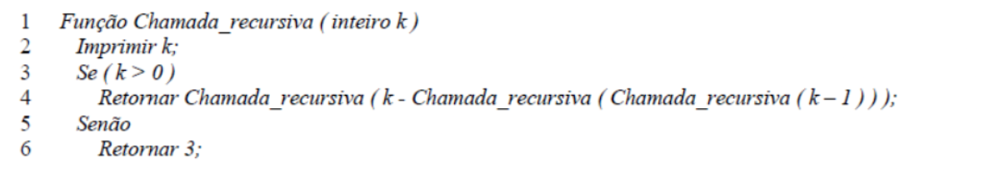

Marque a alternativa CORRETA.
A execução da função Chamada_recursiva(1) faz com que o algoritmo execute indefinidamente. Para este caso, os cinco primeiros valores impressos são:

- A) 1, 0, 3, 1 e 0.
- B) 1, 0, 3, 1 e 2.
- C) 1, 0, 3, 2 e 0.
- D) 1, 0, 3, 2 e 3.
- E) 1, 0, 3, 2 e 1.

<details><summary>Gabarito</summary>

**E.** Assunto 0032.

</details>

**Edital 023/2018 · Questão 11**

Considere o algoritmo a seguir que define a função recursiva "f".

```
função f(n){
  se n igual a 1 então retorne 0
  se n igual a 2 então retorne 1
  setorne f(n-1) + f(n-2)
}
```

Qual o valor retornado pela função "f" ao ser invocada passando o valor 4 como argumento?

- a) 0
- b) 1
- c) 2
- d) 3
- e) 4

<details><summary>Gabarito</summary>

**C.** f(4)=f(3)+f(2)=(1+0)+1=2. Assunto 0032.

</details>

**Edital 033/2019 · Questão 07**

Qual estrutura de dados é comumente usada para implementar recursão?

- a) Queue (fila)
- b) Stack (pilha)
- c) Array (vetor)
- d) Lista
- e) Matriz

<details><summary>Gabarito</summary>

**B.** Recursão usa a pilha de chamadas. Assunto 0031.

</details>

**Edital 060/2019 · Questão 10**

Qual das seguintes estruturas de dados é mais usada para implementar recursão?

- a) Heap binário
- b) Hash table
- c) Fila
- d) Árvore de busca
- e) Pilha

<details><summary>Gabarito</summary>

**E.** Recursão usa a pilha. Assunto 0031.

</details>


## Para ler mais

- DEITEL, P.; DEITEL, H. *C: como programar*. 6. ed. São Paulo: Pearson Prentice Hall, 2011. Cap. 5: funções, classes de armazenamento, escopo e recursão; cap. 13: o pré-processador.
- CELES, W.; CERQUEIRA, R.; RANGEL, J. L. *Introdução a estruturas de dados: com técnicas de programação em C*. 2. ed. Rio de Janeiro: Elsevier, 2016. Capítulos de funções, pilha de execução, recursão e pré-processador.
- CORMEN, T. H.; LEISERSON, C. E.; RIVEST, R. L.; STEIN, C. *Algoritmos: teoria e prática*. 4. ed. Rio de Janeiro: GEN LTC, 2024. Cap. 2 e 4: algoritmos recursivos e divisão e conquista.
- ZIVIANI, N. *Projeto de algoritmos com implementações em Pascal e C*. 3. ed. São Paulo: Cengage Learning, 2010. Cap. 2: paradigmas de projeto de algoritmos, recursividade.
- BACKES, A. *Linguagem C: completa e descomplicada*. Rio de Janeiro: Elsevier, 2013. Cap. 9: funções e recursão; cap. 13: classes de armazenamento e pré-processador.
- BACKES, A. R. *Linguagem C: descomplicada*. Uberlândia: UFU, [s.d.]. Apostila. Funções, recursão e diretivas.
- MARTINS, L. G. A. *Apostila de linguagem C: conceitos básicos*. Uberlândia: Faculdade de Computação, UFU, [s.d.].
- HARA, C.; ZOLA, W. *Linguagem C: notas de aula*. Curitiba: UFPR, 2008.
- ROCHA, A. M. A.; BORGES, A. R. O. S. *Programação, estruturas de dados e algoritmos em C*. Aveiro: Universidade de Aveiro, [s.d.]. Programação modular e recursividade.
- FEOFILOFF, P. *Algoritmos em linguagem C*. Rio de Janeiro: Elsevier, 2009. Cap. 5: recursão e algoritmos recursivos.
- TENENBAUM, A. M.; LANGSAM, Y.; AUGENSTEIN, M. J. *Estruturas de dados usando C*. São Paulo: Makron Books, 1995. Cap. 3: recursividade.
- LAUREANO, M. *Estrutura de dados com algoritmos e C*. Rio de Janeiro: Brasport, 2008. Recursividade.
- LAGO, S. *Linguagem C*. Apostila. [S.l.: s.n., s.d.]. Macros e funções.
- KERNIGHAN, B. W.; RITCHIE, D. M. *C: a linguagem de programação padrão ANSI*. Rio de Janeiro: Campus, 1989. Cap. 4: funções e estrutura de programas.
- CPPREFERENCE. *C language: functions, storage duration and the preprocessor*. Disponível em: <https://en.cppreference.com/w/c/language>.
- GNU. *The C Preprocessor*. Disponível em: <https://gcc.gnu.org/onlinedocs/cpp/>.
- GDB. *Debugging with GDB*: Backtraces. Disponível em: <https://sourceware.org/gdb/current/onlinedocs/gdb/Backtrace.html>.
