<!-- Gerado por _gerador. Para mudar este arquivo, edite _gerador/modulos/04-funcoes/ e rode: cd _gerador && npm run gerar -->

# Módulo 04 · Funções e modularização

Até aqui, todo programa foi um `main` só, de cima para baixo. Funciona para
vinte linhas. Com duzentas, o mesmo cálculo aparece copiado em três lugares,
um conserto esquece uma das cópias e ninguém mais acha nada. Este módulo é
sobre **dividir**: dar nome a cada tarefa, escrever uma vez e chamar quantas
vezes precisar.

No C, isso se faz com funções e com módulos (`.h` e `.c`). E dá para ver **o
que acontece por baixo** de cada chamada: a cópia dos argumentos, o quadro que
nasce na pilha, o endereço de volta, a variável que some no `return`. Com essa
imagem na cabeça, a **recursão** deixa de ser mágica e vira só mais uma
chamada.

No fim, o programa sai de um arquivo só: você monta **módulos** com `.h` e
`.c`, compila cada parte separada e deixa o ligador juntar tudo. É o mesmo
formato das estruturas de dados da segunda metade do curso.

## O que você vai aprender

- definir, chamar e declarar funções, com **protótipo** e `return`
- a **passagem por valor**: por que a função recebe uma cópia, e o `void`
- **escopo** e **tempo de vida**: local, global e `static`
- a **pilha de chamadas**: o quadro de cada chamada e o stack overflow
- **recursão**: caso base, caso recursivo e como confiar na função
- o custo da recursão no Fibonacci, e onde ela brilha: Hanói e Euclides
- **módulos** com `.h` e `.c`, include guards e compilação separada
- **macros** e `#ifdef`, e as armadilhas da troca de texto

## Como estudar cada assunto

1. Leia o texto e olhe o **diagrama da ideia**: é o exemplo desenhado.
2. Leia o código. É o mesmo exemplo, com os mesmos valores.
3. Siga o **fluxograma** com o dedo: é o caminho que o programa faz.
4. Rode os exemplos. Mude um valor, quebre de propósito, rode de novo.
5. Faça os exercícios. ★☆☆ é aquecimento, ★★☆ pede raciocínio, ★★★ é desafio.
   As dicas vêm logo abaixo do enunciado: tente antes de ler.

No meio de cada assunto tem uma **Pergunta para você**. Responda antes de rodar.

## As cores e as formas

Caixa azul é dado entrando ou saindo, roxa é o programa fazendo alguma coisa,
amarela é pergunta. Verde é o caminho que o exemplo segue; cinza, o que ele não
usa; vermelho, erro. Nos assuntos de pilha e recursão, cada caixa empilhada é
o quadro de uma chamada, e o de cima é quem está rodando.

<p align="center"></p>

## Antes de começar

Você precisa dos módulos 01 a 03: tipos, `printf` e `scanf`, `if`, `switch` e
laços. Vetores ainda **não** aparecem aqui (são o módulo 05), então todos os
exemplos trabalham com números soltos.

Dois assuntos ficam melhores com o depurador `gdb`, que mostra a pilha de
chamadas com o comando `bt`:

```bash
sudo pacman -S gdb          # Arch Linux
sudo apt install gdb        # Debian / Ubuntu
```

Nos assuntos 0034 e 0036, a pasta tem arquivos de apoio (`conversao.h` e
`conversao.c`, `cardapio.h` e `cardapio.c`). O `rodar` compila esses `.c`
junto com o exemplo, sozinho. O texto mostra também o comando `gcc` para fazer
isso à mão.

| # | Assunto | Pasta |
| --- | --- | --- |
| [0028](#0028--funções) | Funções | [`0028-funcoes/`](0028-funcoes/) |
| [0029](#0029--parâmetros-e-passagem-por-valor) | Parâmetros e passagem por valor | [`0029-parametros/`](0029-parametros/) |
| [0030](#0030--escopo-e-tempo-de-vida) | Escopo e tempo de vida | [`0030-escopo/`](0030-escopo/) |
| [0031](#0031--a-pilha-de-chamadas) | A pilha de chamadas | [`0031-pilha-de-chamadas/`](0031-pilha-de-chamadas/) |
| [0032](#0032--recursão) | Recursão | [`0032-recursao/`](0032-recursao/) |
| [0033](#0033--recursão-na-prática-fibonacci-hanói-e-euclides) | Recursão na prática: Fibonacci, Hanói e Euclides | [`0033-recursao-na-pratica/`](0033-recursao-na-pratica/) |
| [0034](#0034--módulos-h-c-e-compilação-separada) | Módulos: .h, .c e compilação separada | [`0034-modulos/`](0034-modulos/) |
| [0035](#0035--pré-processador-macros-e-ifdef) | Pré-processador: macros e #ifdef | [`0035-preprocessador/`](0035-preprocessador/) |
| [0036](#0036--juntando-tudo-o-caixa-da-lanchonete) | Juntando tudo: o caixa da lanchonete | [`0036-juntando-tudo/`](0036-juntando-tudo/) |

---

## 0028 · Funções

Você abre o app de corrida e ele mostra o preço antes de você confirmar: R$
5,00 de bandeirada mais R$ 2,50 por quilômetro. O app faz essa conta para
cada corrida pedida, o dia inteiro. Ninguém escreveu a fórmula mil vezes:
escreveu **uma vez**, deu um nome, e chama sempre que precisa.

Isso é uma **função**: um pedaço de código com nome, que recebe dados, faz uma
tarefa e devolve um resultado. Você já usa funções desde o primeiro dia:
`printf`, `scanf` e `sqrt` foram escritas por outra pessoa. Agora você escreve
as suas.

A forma geral em C:

```c
tipo_de_retorno nome(tipo parametro1, tipo parametro2) {
    // corpo
    return valor;
}
```

- o **tipo de retorno** diz o que a função devolve (`int`, `double`...). Se
  ela não devolve nada, o tipo é `void`;
- os **parâmetros** são as variáveis que recebem os dados de quem chama. Cada
  um com o seu tipo: `double a, double b`, nunca `double a, b`;
- o **`return`** devolve o valor e **encerra a função na hora**. O que vem
  depois dele, naquele caminho, não roda.

No C, o tipo vem antes do nome e é obrigatório, tanto no retorno quanto em
cada parâmetro.

Tem mais um detalhe: o compilador do C lê o arquivo **de cima para
baixo**, uma vez só. Se o `main` chama `preco_corrida` antes de o compilador
ter visto essa função, ele não sabe que tipo ela devolve nem quantos
parâmetros recebe. A solução é o **protótipo**: o cabeçalho da função com `;`
no fim, colocado antes do `main`. É uma promessa: "essa função existe, recebe
um `double` e devolve um `double`; a definição vem depois".

Vamos ver na prática. O `main` chama `preco_corrida(4.0)`: o valor 4.0 é
copiado para o parâmetro `km`, a função calcula `5.00 + 2.50 * 4.0`, devolve
15.00, e o `main` continua de onde parou, já com o resultado na mão:

<p align="center">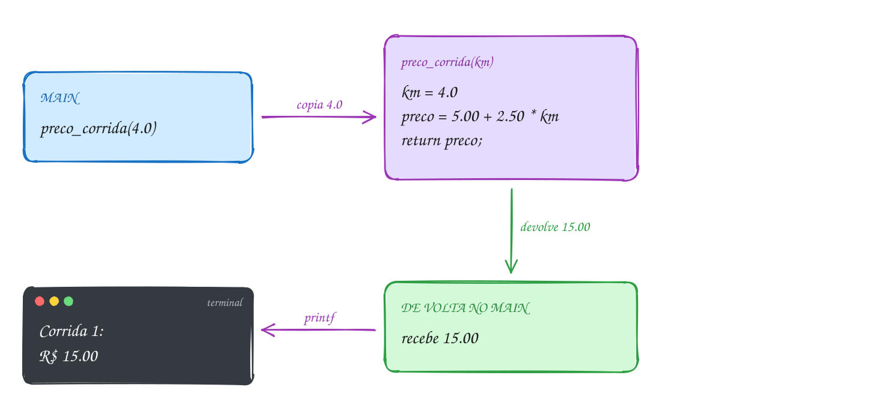</p>

O mesmo exemplo em C, com as três corridas:

```c
#include <stdio.h>

// protótipo: avisa o compilador que a função existe e como chamá-la
double preco_corrida(double km);

int main(void) {
    printf("Corrida 1: R$ %.2f\n", preco_corrida(4.0));
    printf("Corrida 2: R$ %.2f\n", preco_corrida(10.0));
    printf("Corrida 3: R$ %.2f\n", preco_corrida(2.5));
    return 0;
}

// definição: bandeirada de R$ 5.00 mais R$ 2.50 por km
double preco_corrida(double km) {
    double preco = 5.00 + 2.50 * km;
    return preco; // devolve o valor para quem chamou
}
// Saída:
// Corrida 1: R$ 15.00
// Corrida 2: R$ 30.00
// Corrida 3: R$ 11.25
```

Repara no fluxograma: a chamada é um desvio. O programa sai do `main`, executa
o corpo da função e **volta para o mesmo ponto**, trazendo o valor. Isso se
repete a cada corrida:

<p align="center">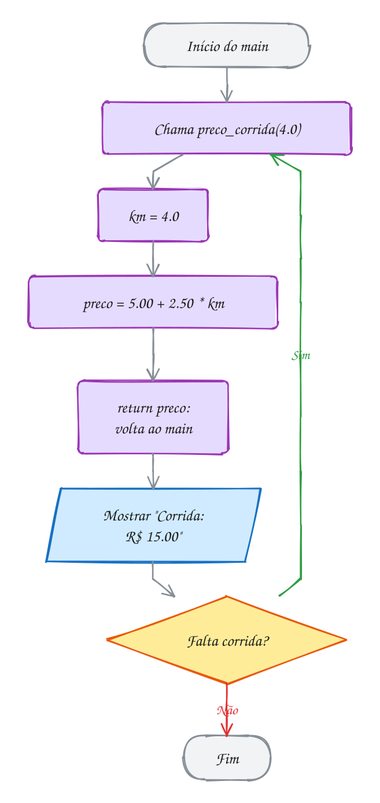</p>

Três vocabulários que você vai ver o tempo todo: a **definição** é o corpo
inteiro (`double preco_corrida(double km) { ... }`); a **chamada** é o uso
(`preco_corrida(4.0)`); o **protótipo** é só o cabeçalho com `;`. O valor que
você passa na chamada (`4.0`) se chama **argumento**; a variável que o recebe
(`km`) é o **parâmetro**.

Uma função boa faz **uma** tarefa, e o nome diz qual. Se você não acha um nome
curto, ela está fazendo coisas demais: quebre em duas. E repare que
`preco_corrida` não usa `printf`. Quem mostra o resultado é o `main`. Uma
função que só calcula serve para a tela, para um arquivo ou para outra conta.

> [!WARNING]
> Chamar a função antes de ela aparecer no arquivo, sem protótipo. O gcc 13
> avisa `implicit declaration of function 'preco_corrida'`, e o gcc 14 já
> recusa compilar. No C antigo, o compilador **inventava** que a função
> devolvia `int`: o `double` voltava como lixo. Outro erro clássico é
> esquecer o `return` numa função que não é `void`: o `-Wall` avisa
> `control reaches end of non-void function`, e quem chamou recebe um valor
> qualquer. Leve os dois avisos a sério.

> [!TIP]
> **Por dentro do C:** o código de `preco_corrida` existe **uma vez só** na
> memória, não importa quantas vezes você chama. A chamada vira a instrução
> `call` do processador, que guarda o endereço de volta e pula para a função;
> o `return` vira `ret`, que pula de volta. No Linux de 64 bits, o argumento
> `double` vai num registrador do processador (`xmm0`) e o resultado volta
> pelo mesmo registrador. Salve o código acima como `corrida.c`, rode
> `gcc -S corrida.c` e procure `call preco_corrida` no arquivo `corrida.s`.

> [!NOTE]
> **Pergunta para você:** o que mostra
> `printf("%.2f\n", preco_corrida(preco_corrida(0.0)));`? Resolva de dentro
> para fora, antes de rodar.

### Hora de praticar

Os arquivos ficam em [`0028-funcoes/`](0028-funcoes/). Os comandos funcionam de qualquer pasta do terminal. Nos exemplos, rode, mude, quebre e rode de novo. Nos exercícios, a resposta vai dentro do próprio arquivo. ★☆☆ é aquecimento, ★★☆ pede raciocínio e ★★★ é desafio.

**Exemplo A055 · A conta de luz: funções que chamam funções**

```c
#include <stdio.h>

int consumo(int leitura_anterior, int leitura_atual);
double tarifa(int kwh);
double valor_conta(int kwh);

int main(void) {
    int janeiro = consumo(4210, 4390);
    int fevereiro = consumo(4390, 4625);

    printf("Janeiro: %d kWh, R$ %.2f\n", janeiro, valor_conta(janeiro));
    printf("Fevereiro: %d kWh, R$ %.2f\n", fevereiro, valor_conta(fevereiro));

    // a chamada de dentro roda primeiro e o resultado vira o argumento
    printf("Março: R$ %.2f\n", valor_conta(consumo(4625, 4720)));

    // o retorno serve até como condição de um if
    if (valor_conta(fevereiro) > 150.00) {
        printf("Fevereiro passou de R$ 150.00\n");
    }
    return 0;
}

int consumo(int leitura_anterior, int leitura_atual) {
    return leitura_atual - leitura_anterior;
}

// quem gasta mais paga mais caro por kWh
double tarifa(int kwh) {
    if (kwh <= 100) {
        return 0.60;
    }
    return 0.80;
}

// valor_conta não sabe a tarifa: ela pergunta para outra função
double valor_conta(int kwh) {
    double iluminacao_publica = 12.00;
    return kwh * tarifa(kwh) + iluminacao_publica;
}
// Saída:
// Janeiro: 180 kWh, R$ 156.00
// Fevereiro: 235 kWh, R$ 200.00
// Março: R$ 69.00
// Fevereiro passou de R$ 150.00
```

```bash
~/LPEDC/rodar 04-funcoes/0028-funcoes/A055.c
```

**Exemplo A056 · Funções que só fazem e funções que respondem**

```c
#include <stdio.h>

void cabecalho(void);
double menor(double a, double b);

int main(void) {
    double posto_a = 5.89;
    double posto_b = 5.79;
    double posto_c = 5.95;

    cabecalho(); // void: só faz, não devolve nada
    double mais_barato = menor(menor(posto_a, posto_b), posto_c);
    printf("Mais barato: R$ %.2f\n", mais_barato);
    printf("Encher 40 litros: R$ %.2f\n", 40 * mais_barato);
    return 0;
}

void cabecalho(void) {
    printf("=== Gasolina hoje ===\n");
}

double menor(double a, double b) {
    if (a < b) {
        return a; // o return encerra a função na hora
    }
    return b; // só chega aqui se a >= b
}
// Saída:
// === Gasolina hoje ===
// Mais barato: R$ 5.79
// Encher 40 litros: R$ 231.60
```

```bash
~/LPEDC/rodar 04-funcoes/0028-funcoes/A056.c
```

#### Exercícios

**Exercício E163** · ★☆☆

Você vai trocar o piso de dois cômodos e precisa da área de cada um. Escreva
a função "double area_comodo(double largura, double comprimento)" e use-a no
main para a sala (4.0 x 3.5) e o quarto (3.0 x 3.0). Mostre também a soma.
O main não pode ter nenhuma multiplicação: a conta fica só na função.


```text
Saída esperada:
Sala: 14.00 m2
Quarto: 9.00 m2
Total: 23.00 m2
```

**Dicas:**

1. Escreva o protótipo antes do main e a definição depois, como no texto.
2. Dá para somar as duas chamadas direto: area_comodo(4.0, 3.5) + area_comodo(3.0, 3.0).
3. Resposta esperada: sala 14.00, quarto 9.00, total 23.00.

```bash
~/LPEDC/rodar 04-funcoes/0028-funcoes/E163.c
```

**Exercício E164** · ★☆☆

O cronômetro da corrida de rua mostra o tempo em horas, minutos e segundos,
mas o ranking ordena por segundos. O main do arquivo já tem as três
chamadas de "total_segundos", comentadas para o esqueleto compilar.
Complete o programa: escreva o protótipo (antes do main) e a definição
(depois do main) e só então tire as barras das três chamadas.


```text
Saída esperada:
Ana: 5415 s
Bia: 3600 s
Caio: 4999 s
```

**Dicas:**

1. Pelo uso, a função recebe três int e devolve um int.
2. Uma hora tem 3600 segundos; um minuto, 60.
3. Resposta esperada: int total_segundos(int h, int m, int s) devolvendo
   h * 3600 + m * 60 + s. Ana 5415, Bia 3600, Caio 4999.

```bash
~/LPEDC/rodar 04-funcoes/0028-funcoes/E164.c
```

**Exercício E165** · ★★☆

Um ano é bissexto se for divisível por 4 e não por 100, ou se for divisível
por 400. Escreva "bool eh_bissexto(int ano)" e use-a num laço para mostrar
os anos bissextos de 2000 a 2030 e quantos são.


```text
Saída esperada:
2000 2004 2008 2012 2016 2020 2024 2028
Bissextos: 8
```

**Dicas:**

1. A regra cabe num return só: return (ano % 4 == 0 && ano % 100 != 0) || ano % 400 == 0;
2. No main, um for de 2000 a 2030 com um if (eh_bissexto(ano)) e um contador.
3. Resposta esperada: 8 anos. 2000 entra (divisível por 400); 1900, se
   estivesse no intervalo, não entraria.

```bash
~/LPEDC/rodar 04-funcoes/0028-funcoes/E165.c
```

**Exercício E166** · ★★☆

O estacionamento do shopping cobra R$ 5.00 pelas primeiras 2 horas e mais
R$ 2.00 por hora ou fração depois disso, com teto de R$ 20.00 por dia.
Escreva "double tarifa(double horas)" e calcule o valor de três carros
(1.5 h, 3.2 h e 12 h) e o total do dia.


```text
Saída esperada:
Carro 1 (1.5 h): R$ 5.00
Carro 2 (3.2 h): R$ 9.00
Carro 3 (12.0 h): R$ 20.00
Total do dia: R$ 34.00
```

**Dicas:**

1. "Hora ou fração" é arredondar para cima: ceil(horas - 2) dá as horas extras.
2. Use dois return: um para até 2 horas e outro para o resto. No resto,
   se a conta passar de 20, devolva 20.
3. Resposta esperada: 3.2 h são 2 h + 1.2 h extra, que viram 2 horas
   cobradas: 5 + 4 = 9. Com 12 h a conta daria 25, mas o teto é 20. Total 34.

```bash
~/LPEDC/rodar 04-funcoes/0028-funcoes/E166.c
```

**Exercício E167** · ★★★

A função ajusta, já pronta no arquivo, tem três return. Só o primeiro que
for alcançado vale: os testes de baixo nem são feitos.

Escreva "int passos(int n)", que aplica ajusta em n repetidas vezes até
n chegar a 1, mostrando cada valor no caminho, e devolve quantas vezes
aplicou. No main, use passos para 7, 14 e 30 e mostre o total de cada um,
e mostre também ajusta(dobro(7)), resolvida de dentro para fora.


```text
Saída esperada:
7: 8 4 2 1 (4 passos)
14: 4 2 1 (3 passos)
30: 20 10 5 6 3 4 2 1 (8 passos)
ajusta(dobro(7)) = 4
```

**Dicas:**

1. Dentro de passos, um while (n != 1) com n = ajusta(n), um printf e um
   contador. O parâmetro n é uma cópia: pode mudar à vontade.
2. O main mostra "7: ", chama passos(7) e depois mostra "(%d passos)" com o
   retorno. Guarde o retorno numa variável antes do printf, para os números
   do caminho saírem antes do total.
3. Resposta esperada: a saída acima. Em dobro, o printf depois do return
   nunca roda: o return encerra a função na hora.

```bash
~/LPEDC/rodar 04-funcoes/0028-funcoes/E167.c
```

**Exercício E168** · ★★★

Um número é perfeito quando é igual à soma dos seus divisores menores que
ele: 6 = 1 + 2 + 3. Escreva duas funções que trabalham juntas:


```text
int soma_divisores(int n)   soma os divisores de n menores que n
bool eh_perfeito(int n)     usa soma_divisores para responder
```


Use-as para mostrar todos os números perfeitos de 2 a 10000 e, para cada
um, a soma que prova isso.


```text
Saída esperada:
6 = soma dos divisores 6
28 = soma dos divisores 28
496 = soma dos divisores 496
8128 = soma dos divisores 8128
```

**Dicas:**

1. soma_divisores testa d de 1 até n / 2: se n % d == 0, soma d.
2. eh_perfeito cabe numa linha: return soma_divisores(n) == n;
3. Resposta esperada: 6, 28, 496 e 8128. São tão raros que o próximo é
   33550336. Desafio extra: teste d só até a raiz de n (d * d <= n),
   somando d e n / d de uma vez, e conte numa variável quantas vezes o %
   roda em cada versão para n = 8128 (4064 contra 90).

```bash
~/LPEDC/rodar 04-funcoes/0028-funcoes/E168.c
```

---

## 0029 · Parâmetros e passagem por valor

Você tira foto do boleto e manda no grupo da família. Sua tia rabisca a foto,
escreve "pago!" em cima. O boleto de papel, na sua gaveta, continua igual: ela
mexeu numa **cópia**.

Em C, toda chamada de função funciona assim. Quando você escreve
`reajustar(mensalidade, 10)`, o C **calcula o valor** de cada argumento e
**copia** esse valor para o parâmetro. Isso se chama **passagem por valor**. O
parâmetro é uma variável nova, local da função, que nasce já com a cópia. A
função pode mudar o parâmetro à vontade: a variável de quem chamou nem fica
sabendo.

Repare que a função recebe **só o número**. Para ela, `reajustar(mensalidade,
10)`, `reajustar(120.00, 10)` e `reajustar(100 + 20, 5 * 2)` são idênticas: chega
120.00 e chega 10. Ela não sabe de onde o valor veio nem onde mora a variável
original. Por isso não tem como alterá-la.

Se a função precisa mandar um resultado de volta, o caminho é o `return`. E
quem chamou tem que **guardar** o retorno: `mensalidade = reajustar(...)`.
Chamar e ignorar o retorno é permitido (você faz isso com o `printf`, que
devolve quantos caracteres escreveu), mas aí o resultado se perde.

Vamos ver na prática. A academia reajusta a mensalidade de R$ 120,00 em 10%.
Há duas caixinhas chamadas `mensalidade`, em lugares diferentes da memória: a
do `main` e a cópia da função. A função muda só a dela para 132.00:

<p align="center">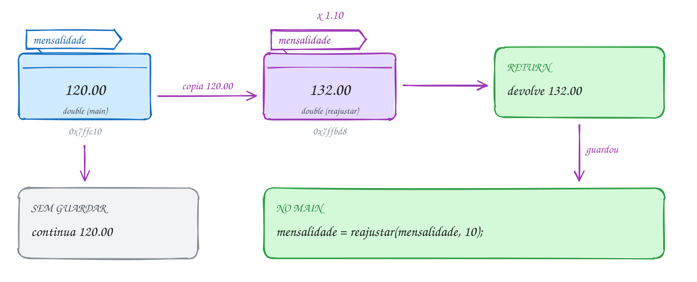</p>

O código mostra as duas situações: primeiro ignorando o retorno, depois
guardando:

```c
#include <stdio.h>

double reajustar(double mensalidade, double percentual);

int main(void) {
    double mensalidade = 120.00;

    printf("Antes: %.2f\n", mensalidade);
    reajustar(mensalidade, 10); // o resultado é jogado fora
    printf("Depois: %.2f\n", mensalidade); // continua 120.00

    mensalidade = reajustar(mensalidade, 10); // agora guarda o retorno
    printf("Guardando o retorno: %.2f\n", mensalidade);
    return 0;
}

// mensalidade aqui é uma CÓPIA: outra variável, com o mesmo nome
double reajustar(double mensalidade, double percentual) {
    mensalidade = mensalidade * (1 + percentual / 100);
    printf("Dentro: %.2f\n", mensalidade);
    return mensalidade;
}
// Saída:
// Antes: 120.00
// Dentro: 132.00
// Depois: 120.00
// Dentro: 132.00
// Guardando o retorno: 132.00
```

Repara no fluxograma: o valor sai do `main` por cópia e só volta pelo
`return`. A pergunta "guardou o retorno?" decide se o `main` fica sabendo do
reajuste:

<p align="center">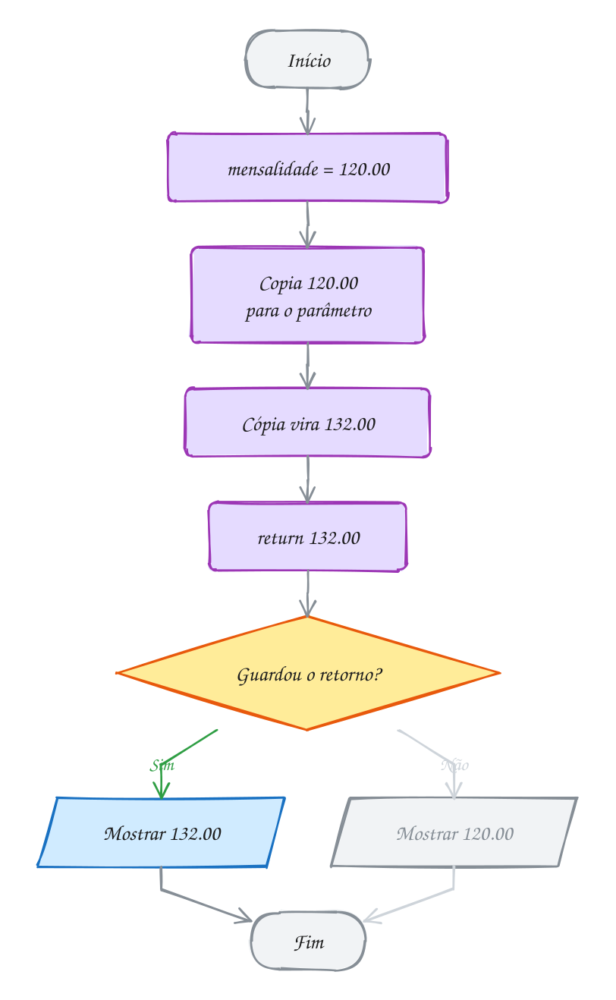</p>

Mais três regras sobre parâmetros:

- **conversão automática**: se o tipo do argumento não bate, o C converte para
  o tipo do parâmetro, como numa atribuição. Um `int` vira `double` sem
  problema; um `2.9` passado para um `int` vira `2`, sem aviso;
- **`void` na lista**: `void linha(void)` diz "não recebe nada", e
  `linha(5)` vira erro de compilação. Já `void linha()`, com os parênteses
  vazios, no C17 quer dizer "não vou dizer o que recebe": o compilador aceita
  `linha(5)` calado. Escreva sempre `(void)`. (No C23 os dois viraram a mesma
  coisa, mas você vai ver muito código C17.)
- **um tipo por parâmetro**: `double total, int vezes`. E a ordem importa: o
  primeiro argumento vai para o primeiro parâmetro, sempre.

> [!WARNING]
> A função que "deveria" mudar a variável e não muda. O exemplo clássico é
> `void trocar(int a, int b)` que troca `a` e `b` lá dentro: no `main`, nada
> acontece, porque a troca foi entre as cópias. Do
> mesmo jeito, `void f(int n) { n++; }` não muda o seu `n`. No C, para a função
> mexer numa variável sua, você precisa passar o **endereço** dela. É o que o
> `&` do `scanf` faz, e você vai entender de vez no assunto 0046.

> [!TIP]
> **Por dentro do C:** a cópia é literal. O `main` põe o valor 120.00 num
> registrador (`xmm0`) e a função começa copiando esse registrador para o
> seu próprio espaço na memória, num endereço diferente do da variável do
> `main`. Copiar um `double` custa quase nada: são 8 bytes. Mais para a
> frente, quando você passar uma `struct` grande por valor, a cópia inteira
> vai acontecer a cada chamada, e aí vale a pena passar o endereço.

> [!NOTE]
> **Pergunta para você:** se você trocar o nome do parâmetro de `mensalidade`
> para `valor` (e ajustar o corpo da função), alguma linha da saída muda? Por
> quê?

### Hora de praticar

Os arquivos ficam em [`0029-parametros/`](0029-parametros/). Os comandos funcionam de qualquer pasta do terminal. Nos exemplos, rode, mude, quebre e rode de novo. Nos exercícios, a resposta vai dentro do próprio arquivo. ★☆☆ é aquecimento, ★★☆ pede raciocínio e ★★★ é desafio.

**Exemplo A057 · O parâmetro casa pela posição, não pelo nome**

```c
#include <stdio.h>

double com_desconto(double preco, double percentual);
void contagem(int segundos);

int main(void) {
    double preco = 80.00;
    double percentual = 25;

    // certo: o 1º argumento vai para o 1º parâmetro, o 2º para o 2º
    printf("Certo: R$ %.2f\n", com_desconto(preco, percentual));

    // trocado: os nomes iguais não ajudam, o C só olha a ordem
    printf("Trocado: R$ %.2f\n", com_desconto(percentual, preco));

    // literal e expressão também servem: a função recebe só o valor
    printf("Literal: R$ %.2f\n", com_desconto(200, 10 + 5));

    int tempo = 3;
    contagem(tempo);
    printf("No main, tempo continua %d\n", tempo);
    return 0;
}

double com_desconto(double preco, double percentual) {
    return preco - preco * percentual / 100;
}

// o parâmetro é uma variável de trabalho: pode diminuir até zero
void contagem(int segundos) {
    while (segundos > 0) {
        printf("%d... ", segundos);
        segundos--;
    }
    printf("já!\n");
}
// Saída:
// Certo: R$ 60.00
// Trocado: R$ 5.00
// Literal: R$ 170.00
// 3... 2... 1... já!
// No main, tempo continua 3
```

```bash
~/LPEDC/rodar 04-funcoes/0029-parametros/A057.c
```

**Exemplo A058 · void, conversão e expressões como argumento**

```c
#include <stdio.h>

void mostrar_parcelas(double total, int vezes);
void linha(void);

int main(void) {
    double celular = 1800.00;

    linha();
    mostrar_parcelas(celular, 3);       // os tipos batem
    mostrar_parcelas(900, 2);           // 900 (int) vira 900.0 (double)
    mostrar_parcelas(celular * 0.9, 4); // a expressão é calculada antes
    mostrar_parcelas(celular, 2.9);     // 2.9 vira 2: a parte decimal some
    linha();
    // linha(5); // erro: linha foi declarada com (void), não aceita argumento
    return 0;
}

void mostrar_parcelas(double total, int vezes) {
    printf("%d x R$ %.2f\n", vezes, total / vezes);
}

void linha(void) {
    printf("--------------------\n");
}
// Saída:
// --------------------
// 3 x R$ 600.00
// 2 x R$ 450.00
// 4 x R$ 405.00
// 2 x R$ 900.00
// --------------------
```

```bash
~/LPEDC/rodar 04-funcoes/0029-parametros/A058.c
```

#### Exercícios

**Exercício E169** · ★☆☆

No app do cartão fidelidade, a promoção dobra os pontos. Escreva
"int dobrar_pontos(int pontos)", que dobra o próprio parâmetro, mostra
"dentro: <valor>" e devolve o valor dobrado. No main, comece com
pontos = 150 e faça, nesta ordem:


```text
1. chame dobrar_pontos(pontos) SEM guardar o retorno e mostre "main: ...";
2. chame de novo, agora com pontos = dobrar_pontos(pontos), e mostre
   "main: ..." outra vez.
```


```text
Saída esperada:
dentro: 300
main: 150
dentro: 300
main: 300
```

**Dicas:**

1. Dentro da função: pontos = pontos * 2; printf(...); return pontos;
2. O "pontos" da função e o "pontos" do main são duas variáveis: mudar uma
   não muda a outra.
3. Resposta esperada: a saída acima. Na primeira chamada, o 300 volta pelo
   return e é jogado fora; só na segunda ele chega ao main.

```bash
~/LPEDC/rodar 04-funcoes/0029-parametros/E169.c
```

**Exercício E170** · ★☆☆

Escreva "void repetir(char simbolo, int vezes)", que mostra o símbolo
"vezes" vezes e pula a linha. Use-a para montar o cupom da padaria abaixo.
O main só pode chamar repetir e printf.


```text
Saída esperada:
====================
PADARIA PÃO QUENTE
--------------------
5 pães      R$ 4.50
1 leite     R$ 5.20
--------------------
Total       R$ 9.70
====================
```

**Dicas:**

1. Dentro da função, um for de 1 até vezes com printf("%c", simbolo).
2. A função é void: não tem return com valor.
3. Resposta esperada: repetir('=', 20) na primeira e na última linha,
   repetir('-', 20) nas linhas do meio.

```bash
~/LPEDC/rodar 04-funcoes/0029-parametros/E170.c
```

**Exercício E171** · ★★☆

O programa abaixo deveria mostrar as duas notas em ordem crescente, mas
mostra "Em ordem: 9 e 6": a troca dentro de ordenar não chega ao main.
Conserte e rode até aparecer "Em ordem: 6 e 9". Você ainda não pode usar
ponteiros: troque "ordenar" por duas funções que devolvem valor, "menor" e
"maior", e use as duas no printf.

**Dicas:**

1. Uma função em C devolve um valor só, pelo return. A troca dentro de
   ordenar acontece nas cópias.
2. printf("Em ordem: %d e %d\n", menor(a, b), maior(a, b));
3. Resposta esperada: "Em ordem: 6 e 9". A troca de verdade, com a função
   mexendo nas variáveis do main, precisa de ponteiros (assunto 0046).

```bash
~/LPEDC/rodar 04-funcoes/0029-parametros/E171.c
```

**Exercício E172** · ★★☆

Você aplica R$ 1000.00 num investimento que rende 1% ao mês. Escreva
"double montante(double capital, double taxa, int meses)" que usa o próprio
parâmetro capital como acumulador: a cada mês, capital = capital * (1 + taxa / 100).
No main, mostre o montante depois de 12 e de 24 meses e prove que a
variável do main não mudou.


```text
Saída esperada:
12 meses: R$ 1126.83
24 meses: R$ 1269.73
No main, capital continua R$ 1000.00
```

**Dicas:**

1. O parâmetro é uma variável local como outra qualquer: pode mudar à vontade.
2. Um for de 1 até meses, multiplicando, e no fim return capital.
3. Resposta esperada: 1126.83 e 1269.73; o capital do main continua 1000.00,
   porque a função mexeu só na cópia.

```bash
~/LPEDC/rodar 04-funcoes/0029-parametros/E172.c
```

**Exercício E173** · ★★★

O boletim abaixo calcula a média de duas notas inteiras, mas mostra
"media(7, 8) = 7.0". Cada argumento é convertido para o tipo do parâmetro,
e o valor do return é convertido para o tipo da função: o problema está
numa dessas conversões. Rode e veja.

Depois:

```text
1. conserte media sem mudar os tipos dos parâmetros (continuam int);
2. escreva "int arredondar(double x)", que arredonda para o inteiro mais
   próximo (x >= 0), sem math.h, e tire as barras das duas linhas
   comentadas do main.
```

A linha de metade(7.9) não muda: ela mostra outra conversão acontecendo.


```text
Saída esperada:
metade(7.9) = 3
media(7, 8) = 7.5
media(9, 10) = 9.5
arredondar(7.5) = 8
arredondar(media(6, 7)) = 7
```

**Dicas:**

1. Em media, a e b são int: (a + b) / 2 é divisão inteira, e só depois o
   resultado vira double. Basta um dos lados da divisão ser double: 2.0.
2. arredondar: some 0.5 e deixe a conversão para int cortar a parte
   decimal: return x + 0.5; (o return converte para int sozinho).
3. Resposta esperada: a saída acima. 7.9 entra num parâmetro int e vira 7
   antes da conta: 7 / 2 = 3. media(6, 7) = 6.5, e 6.5 + 0.5 = 7.0 vira 7.

```bash
~/LPEDC/rodar 04-funcoes/0029-parametros/E173.c
```

**Exercício E174** · ★★★

Um número é capicua (palíndromo) quando se lê igual de trás para frente:
1221, 343. Escreva:


```text
int inverter(int n)        devolve n com os dígitos invertidos (123 -> 321);
                           use o próprio n como variável de trabalho
bool eh_capicua(int n)     usa inverter
```


No main, mostre inverter(12345), prove que a variável do main não mudou e
conte as capicuas de 100 a 999.


```text
Saída esperada:
inverter(12345) = 54321
No main, numero continua 12345
Capicuas de 100 a 999: 90
```

**Dicas:**

1. Para inverter: enquanto n > 0, invertido = invertido * 10 + n % 10 e
   n = n / 10.
2. eh_capicua cabe numa linha: return inverter(n) == n;
3. Resposta esperada: 54321, 12345 e 90 capicuas (9 escolhas para o primeiro
   dígito, que também é o último, vezes 10 para o do meio).

```bash
~/LPEDC/rodar 04-funcoes/0029-parametros/E174.c
```

---

## 0030 · Escopo e tempo de vida

No banco, o painel chama a senha 101, depois a 102, depois a 103. Ele
**lembra** onde parou. Já o atendente que te chama zera a conversa a cada
cliente: não guarda nada da pessoa anterior. Programa precisa das duas
coisas, e o C dá ferramentas diferentes para cada uma.

Toda variável tem duas propriedades que é bom separar na cabeça:

- **escopo**: **onde** no código o nome pode ser usado;
- **tempo de vida**: **quando** a variável existe na memória.

São três tipos que você vai usar o tempo todo:

| Tipo | Onde declara | Escopo | Tempo de vida |
| --- | --- | --- | --- |
| **local** | dentro de `{ }` | só aquele bloco | nasce ao entrar no bloco, morre ao sair |
| **global** | fora de qualquer função | do ponto da declaração até o fim do arquivo | o programa todo |
| **`static` local** | dentro de `{ }`, com `static` | só aquele bloco | o programa todo |

A `static` local é a mais curiosa: o **escopo** é de local (ninguém de fora
enxerga), mas o **tempo de vida** é de global. A linha `static int senha =
100;` roda **uma vez só**, antes de o programa começar. Nas chamadas
seguintes, a variável continua lá, com o valor que tinha.

Parâmetros são locais da função, e a variável do `for (int i = 0; ...)` é
local do laço. Se um bloco interno declara um nome que já existe fora, o de
dentro **esconde** o de fora até o bloco acabar. Vale sempre a declaração mais
próxima.

Vamos ver na prática. A função `chamar` tem três contadores: a global
`atendidos`, a `static` `senha` e a local `vezes`. As duas primeiras moram
numa região da memória que dura o programa inteiro; a local mora no espaço da
chamada e some quando a função retorna. Depois de três chamadas, fica assim:

<p align="center">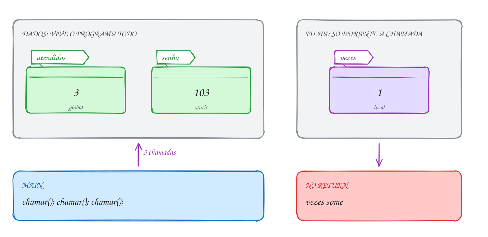</p>

No código, repare que `vezes` mostra 1 sempre, enquanto os outros dois
avançam:

```c
#include <stdio.h>

int atendidos = 0; // global: vive o programa todo, todo mundo enxerga

int chamar(void) {
    static int senha = 100; // static: inicializada uma vez só, guarda o valor
    int vezes = 0;          // local: nasce de novo a cada chamada

    senha++;
    vezes++;
    atendidos++;
    printf("Senha %d | vezes: %d | atendidos: %d\n", senha, vezes, atendidos);
    return senha;
}

int main(void) {
    chamar();
    chamar();
    int ultima = chamar();
    printf("Última senha chamada: %d\n", ultima);
    return 0;
}
// Saída:
// Senha 101 | vezes: 1 | atendidos: 1
// Senha 102 | vezes: 1 | atendidos: 2
// Senha 103 | vezes: 1 | atendidos: 3
// Última senha chamada: 103
```

Repara no fluxograma: a cada chamada, a local é criada de novo com 0, e a
`static` já está esperando com o valor anterior. Não existe um passo
"criar senha" dentro da repetição:

<p align="center">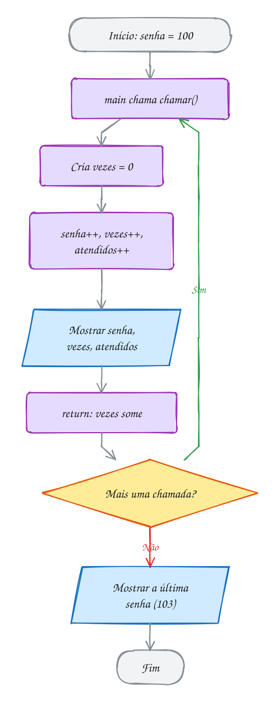</p>

E as globais? Funcionam, mas cobram caro. **Qualquer** função do arquivo pode
mudar `atendidos`, então, quando o valor sai errado, o culpado pode estar em
qualquer lugar. A mesma chamada pode dar resultados diferentes conforme o que
outra função fez antes. Prefira passar por parâmetro e devolver com `return`;
use global só para algo que é de fato do programa todo.

Uma última peça: `static` **fora** de função muda outra coisa. Uma global
`static int total;` continua vivendo o programa todo, mas só pode ser usada
**naquele arquivo**. Isso vai fazer sentido no assunto 0034, quando o programa
tiver mais de um `.c`.

> [!WARNING]
> Achar que `static int senha = 100;` volta a valer 100 a cada chamada. Não
> volta: a inicialização acontece uma vez, antes do `main`. O oposto também
> engana: uma local **sem** inicialização (`int total;`) não começa em 0, começa
> com o lixo que estava naquele pedaço da memória. Globais e `static` sem
> valor começam em 0; locais, não. E esconder nomes (`int nivel` dentro e
> fora) compila sem nenhum aviso com `-Wall`: só o `-Wshadow` reclama.

> [!TIP]
> **Por dentro do C:** a memória do programa tem regiões. Globais e `static`
> com valor inicial ficam na seção **`.data`**, gravada dentro do próprio
> executável; as que começam em zero ficam na **`.bss`**, que o sistema zera ao
> carregar o programa. As locais ficam na **pilha**, um espaço reaproveitado a
> cada chamada (o próximo assunto). Salve o código acima como `senhas.c`, rode
> `gcc -c senhas.c` e depois `nm senhas.o`:
> aparecem `atendidos` (B, na `.bss`) e `senha.0` (d, na `.data`). A `vezes`
> nem aparece: ela não tem lugar fixo.

> [!NOTE]
> **Pergunta para você:** se você tirar o `static` de `senha`, quais números
> aparecem nas três linhas? E se, em vez disso, você mover `int vezes = 0;` para
> fora da função?

### Hora de praticar

Os arquivos ficam em [`0030-escopo/`](0030-escopo/). Os comandos funcionam de qualquer pasta do terminal. Nos exemplos, rode, mude, quebre e rode de novo. Nos exercícios, a resposta vai dentro do próprio arquivo. ★☆☆ é aquecimento, ★★☆ pede raciocínio e ★★★ é desafio.

**Exemplo A059 · A função que lembra o recorde**

```c
#include <stdbool.h>
#include <stdio.h>

// devolve true quando a temperatura bate o recorde do dia
bool novo_recorde(int temperatura) {
    static bool primeira = true; // true só até a primeira chamada
    static int recorde = 0;      // o maior valor visto até agora

    if (primeira || temperatura > recorde) {
        primeira = false;
        recorde = temperatura;
        return true;
    }
    return false;
}

void leitura(int hora, int temperatura) {
    printf("%2dh: %d °C", hora, temperatura);
    if (novo_recorde(temperatura)) {
        printf(" (recorde!)");
    }
    printf("\n");
}

int main(void) {
    leitura(6, 19);  // a primeira leitura é sempre recorde
    leitura(9, 24);
    leitura(12, 22); // 22 < 24: a static lembra do 24
    leitura(15, 30);
    leitura(18, 27);
    // printf("%d\n", recorde); // erro: recorde só existe dentro da função
    return 0;
}
// Saída:
//  6h: 19 °C (recorde!)
//  9h: 24 °C (recorde!)
// 12h: 22 °C
// 15h: 30 °C (recorde!)
// 18h: 27 °C
```

```bash
~/LPEDC/rodar 04-funcoes/0030-escopo/A059.c
```

**Exemplo A060 · Três variáveis com o mesmo nome**

```c
#include <stdio.h>

int nivel = 1; // global

void mostrar_global(void) {
    printf("na função: %d\n", nivel); // aqui só existe a global
}

int main(void) {
    printf("antes: %d\n", nivel); // ainda não há local: vê a global
    int nivel = 2;                // esconde a global daqui para baixo
    printf("main: %d\n", nivel);
    {
        int nivel = 3; // esconde a do main, só dentro deste bloco
        printf("bloco: %d\n", nivel);
    }
    printf("main de novo: %d\n", nivel);
    mostrar_global();

    for (int i = 0; i < 2; i++) {
        int dobro = i * 2; // i e dobro só existem dentro do for
        printf("i = %d, dobro = %d\n", i, dobro);
    }
    // printf("%d\n", i); // erro: 'i' undeclared
    return 0;
}
// Saída:
// antes: 1
// main: 2
// bloco: 3
// main de novo: 2
// na função: 1
// i = 0, dobro = 0
// i = 1, dobro = 2
```

```bash
~/LPEDC/rodar 04-funcoes/0030-escopo/A060.c
```

#### Exercícios

**Exercício E175** · ★☆☆

O cartão fidelidade da farmácia tem 100 pontos guardados (uma global) e a
compra de hoje vale 30 pontos (uma local do main com o MESMO nome). Escreva:


```text
int pontos = 100;                 global: o saldo do cartão
void extrato(void)                mostra "extrato: <pontos>"
void somar_na_global(int valor)   soma valor nos pontos do cartão
```


No main, chame extrato, declare "int pontos = 30;", mostre "compra de hoje",
chame somar_na_global(pontos), chame extrato de novo e mostre a compra de
hoje outra vez.


```text
Saída esperada:
extrato: 100
compra de hoje: 30
extrato: 130
compra de hoje: 30
```

**Dicas:**

1. Dentro de extrato e de somar_na_global só existe a global: as funções
   não enxergam nada do main.
2. No main, depois de "int pontos = 30;", o nome pontos é a local: ela
   esconde a global daí para baixo.
3. Resposta esperada: a saída acima. somar_na_global recebe uma cópia do 30
   e soma na global; a local do main nem fica sabendo.

```bash
~/LPEDC/rodar 04-funcoes/0030-escopo/E175.c
```

**Exercício E176** · ★☆☆

O site da sua loja quer contar as visitas. Escreva "int registrar_visita(void)"
que soma 1 a um contador static e devolve o número da visita. Chame 4 vezes
num for, mostrando "Visita nº ...".

Para ver a diferença, escreva também "int registrar_sem_static(void)",
igual à primeira mas SEM o static, chame 4 vezes noutro for e mostre os
quatro retornos numa linha só.


```text
Saída esperada:
Visita nº 1
Visita nº 2
Visita nº 3
Visita nº 4
Sem static: 1 1 1 1
```

**Dicas:**

1. static int visitas = 0; dentro da primeira função; int visitas = 0; na
   segunda.
2. Sem static, a variável nasce com 0 em toda chamada e morre no return.
3. Resposta esperada: a saída acima. A static guarda o valor entre as
   chamadas; a local recomeça sempre.

```bash
~/LPEDC/rodar 04-funcoes/0030-escopo/E176.c
```

**Exercício E177** · ★★☆

Este programa deveria somar os quatro itens da compra (R$ 12.50, R$ 8.00,
R$ 30.00 e R$ 4.75) e mostrar "Total: R$ 55.25". Ele compila sem aviso, mas
mostra "Total: R$ 4.75". O erro é de escopo e tempo de vida: descubra
qual variável nasce no lugar errado, conserte e rode até aparecer o total
certo.

**Dicas:**

1. Em que momento a variável total nasce? Quantas vezes?
2. Uma variável declarada dentro do corpo do for é criada de novo a cada volta.
3. Resposta esperada: total é local do corpo do for: nasce com 0 a cada volta
   e só guarda o último item. Declare "double total = 0;" antes do for e
   mostre depois do laço: Total: R$ 55.25.

```bash
~/LPEDC/rodar 04-funcoes/0030-escopo/E177.c
```

**Exercício E178** · ★★☆

O vale-refeição abaixo foi escrito com uma variável global, e a função que
deveria só calcular um preço cobra uma "taxa escondida" de R$ 1.00 na
global. Os gastos são R$ 45.00 e R$ 32.50, então o certo seria
300 - 45 - 1 - 32.50 - 1 = R$ 220.50. Rode: aqui ele mostra R$ 222.50.

Refatore: tire a global, troque as duas funções por
"double gastar(double saldo, double valor)", que recebe o saldo e devolve o
saldo novo, já com a taxa, e faça o main guardar o retorno numa local.
Depois acrescente um terceiro gasto de R$ 18.00 e mostre o saldo de novo.


```text
Saída esperada:
Saldo: R$ 220.50
Saldo: R$ 201.50
```

**Dicas:**

1. Em "saldo = saldo - preco_com_taxa(valor);" o compilador pode ler o
   saldo ANTES de a função tirar a taxa, e depois grava por cima: a taxa
   some. O C não define essa ordem. Global mudada no meio de uma conta é
   bug esperando para acontecer.
2. Na versão nova, gastar devolve saldo - valor - 1.00, e o main faz
   saldo = gastar(saldo, 45.00). O saldo vira uma local do main.
3. Resposta esperada: 220.50 e, depois do gasto de 18.00 (mais 1.00 de
   taxa), 201.50. Sem global, a taxa fica visível na função que a cobra.

```bash
~/LPEDC/rodar 04-funcoes/0030-escopo/E178.c
```

**Exercício E179** · ★★★

Quatro variáveis chamadas x, cada uma com escopo e tempo de vida
diferentes. Escreva o programa a partir destas regras:


```text
int x = 10;     global
void a(void)    tem uma local x = 1; mostra "a: <x>", soma 1, mostra " -> <x>"
int b(void)     tem uma static x = 5; mostra "b: <x>", soma 5, mostra
                " -> <x>" e devolve o x novo
void c(void)    não declara x: mostra "c: <x>", dobra, mostra " -> <x>"
```


O main tem a própria local x = 20 e mostra "main: 20"; abre um bloco com
outra x = 30 e mostra "bloco: 30"; chama a, b e c duas vezes, nessa ordem,
somando numa local os dois retornos de b; mostra "main: <x>" e a soma.


```text
Saída esperada:
main: 20
bloco: 30
a: 1 -> 2
b: 5 -> 10
c: 10 -> 20
a: 1 -> 2
b: 10 -> 15
c: 20 -> 40
main: 20
soma dos b: 25
```

**Dicas:**

1. A local de a recomeça em 1 a cada chamada; a static de b continua de
   onde parou; c mexe na global, porque é a única x que ela enxerga.
2. O main não enxerga a static de b: o único jeito de saber o valor dela
   lá fora é pelo return.
3. Resposta esperada: a saída acima. A x do main nunca muda, e a global
   termina valendo 40.

```bash
~/LPEDC/rodar 04-funcoes/0030-escopo/E179.c
```

**Exercício E180** · ★★★

Monte o seu próprio sorteador de dado, sem rand. Ele guarda um "estado" que
muda a cada sorteio:


```text
estado = (estado * 1103515245 + 12345) % 2147483648
dado   = estado / 65536 % 6 + 1
```


Escreva:


```text
void semear(unsigned int semente)   põe a semente no estado
int jogar_dado(void)                avança o estado e devolve de 1 a 6
```


As duas funções precisam enxergar o MESMO estado, e o main não pode mexer
nele direto. Por isso ele é uma global static (static fora de função). Use
unsigned int para o estado.

No main, semeie com 2026, jogue 10 vezes; semeie com 2026 de novo e jogue 10
vezes. As duas linhas têm que ser iguais.


```text
Saída esperada:
5 1 2 3 3 6 3 2 4 1
5 1 2 3 3 6 3 2 4 1
```

**Dicas:**

1. static unsigned int estado = 1; fora das funções, logo depois dos includes.
2. Com unsigned int, a multiplicação que passa do limite dá a volta (não é
   erro, ao contrário do int com sinal). A conta "% 2147483648" mantém o
   estado em 31 bits.
3. Resposta esperada: as duas linhas iguais, como acima. Mesma semente,
   mesma sequência: é assim que o rand e o srand funcionam por dentro.

```bash
~/LPEDC/rodar 04-funcoes/0030-escopo/E180.c
```

---

## 0031 · A pilha de chamadas

Quando um programa em C quebra dentro do `gdb`, o comando `bt` mostra algo
assim:

```text
#0  calcular_taxa (valor=0) at pedido.c:12
#1  fechar_pedido () at pedido.c:30
#2  main () at pedido.c:5
```

Isso é um **stack trace** (ou *backtrace*): a **pilha de chamadas** impressa no
momento do erro. A função de cima estava rodando; ela foi chamada pela de
baixo, que foi chamada pela de baixo dela. O C mostra essa pilha sem esconder
nada.

Cada vez que uma função é chamada, o programa reserva um pedaço de memória só
para aquela chamada: o **quadro** (em inglês, *stack frame*, ou registro de
ativação). Nele ficam:

- os **parâmetros**, com as cópias dos argumentos;
- as **variáveis locais** da função;
- o **endereço de retorno**: em que ponto de quem chamou o programa continua
  quando a função acabar.

Os quadros se empilham como pratos. Chamou, empilha um quadro no **topo**.
Retornou, o quadro do topo sai, e o de baixo continua de onde parou. A última
função a começar é sempre a primeira a terminar: **último a entrar, primeiro a
sair** (LIFO, de *last in, first out*). Só o quadro do topo está rodando; os
outros estão parados, esperando um retorno.

É por isso que local "some" no `return`: o quadro dela foi desempilhado. E é
por isso que uma função não enxerga as variáveis de quem a chamou: elas estão
noutro quadro, mais embaixo.

Vamos ver na prática. Um pedido de R$ 50,00: o `main` chama
`total_com_entrega`, que chama `taxa_entrega`. No momento mais fundo há três
quadros na pilha. Quando `taxa_entrega` devolve 7.90, o quadro dela sai, e
`total_com_entrega` volta a rodar, já com o valor:

<p align="center">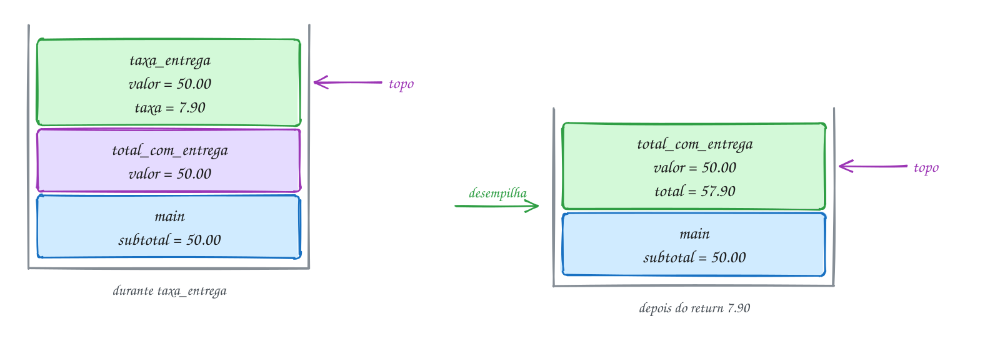</p>

O código imprime "entra" e "sai" em cada função, com recuo, e a pilha aparece
na saída:

```c
#include <stdio.h>

double taxa_entrega(double valor) {
    printf("    entra taxa_entrega(%.2f)\n", valor);
    double taxa = valor < 80.00 ? 7.90 : 0.00;
    printf("    sai taxa_entrega -> %.2f\n", taxa);
    return taxa;
}

double total_com_entrega(double valor) {
    printf("  entra total_com_entrega(%.2f)\n", valor);
    double total = valor + taxa_entrega(valor);
    printf("  sai total_com_entrega -> %.2f\n", total);
    return total;
}

int main(void) {
    double subtotal = 50.00;

    printf("entra main\n");
    double total = total_com_entrega(subtotal);
    printf("Total: R$ %.2f\n", total);
    return 0;
}
// Saída:
// entra main
//   entra total_com_entrega(50.00)
//     entra taxa_entrega(50.00)
//     sai taxa_entrega -> 7.90
//   sai total_com_entrega -> 57.90
// Total: R$ 57.90
```

Repara no fluxograma: as chamadas empilham na descida, e os retornos
desempilham na ordem contrária. A decisão da taxa acontece lá no topo, dentro
de `taxa_entrega`, enquanto as outras duas funções esperam paradas:

<p align="center">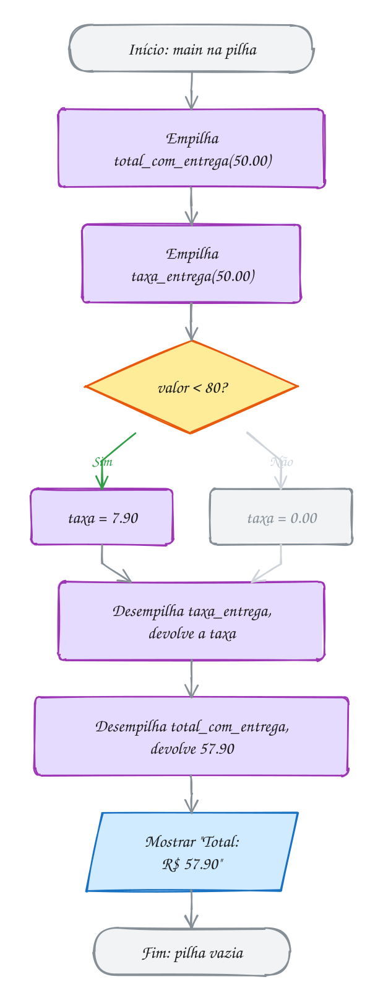</p>

### Passo a passo

A pilha em cada momento, de baixo para cima (o topo é o último):

| Momento | Pilha (base → topo) | Quem roda |
| --- | --- | --- |
| início | `main` (subtotal = 50.00) | `main` |
| chamou `total_com_entrega(50.00)` | `main` → `total_com_entrega` (valor = 50.00) | `total_com_entrega` |
| chamou `taxa_entrega(50.00)` | `main` → `total_com_entrega` → `taxa_entrega` (valor = 50.00, taxa = 7.90) | `taxa_entrega` |
| `taxa_entrega` devolveu 7.90 | `main` → `total_com_entrega` (total = 57.90) | `total_com_entrega` |
| `total_com_entrega` devolveu 57.90 | `main` (total = 57.90) | `main` |

Repara que existem **dois** `valor`, um em cada quadro, e cada função mexe só
no seu. E dois `total`: o do `main` e o de `total_com_entrega`.

> [!WARNING]
> Usar uma local sem inicializar e achar que ela "começa limpa". O quadro
> novo ocupa o mesmo pedaço de memória que um quadro antigo acabou de
> liberar, e ninguém apaga nada. Uma `int soma;` pode nascer com o valor que
> uma local de outra função deixou ali. Às vezes o programa até "funciona",
> por sorte, e quebra quando você muda outra coisa. O `-Wall` avisa
> `may be used uninitialized`: não ignore.

> [!TIP]
> **Por dentro do C:** a pilha é uma região de memória de tamanho fixo (no
> Linux, 8 MB por padrão; confira com `ulimit -s`) e cresce **para baixo**,
> dos endereços altos para os baixos. Um registrador do processador, o `rsp`,
> aponta para o topo. Empilhar um quadro é só subtrair do `rsp`; desempilhar
> é somar. Por isso chamar função é tão barato. Se a pilha passar do limite,
> o sistema mata o programa: é o **stack overflow** (no Linux, aparece como
> `Segmentation fault`). Com 8 MB e quadros de algumas dezenas de bytes, dá
> para empilhar centenas de milhares de chamadas, mas não infinitas. No
> `gdb`, o comando `bt` (*backtrace*) imprime a pilha, como no começo deste
> assunto.

> [!NOTE]
> **Pergunta para você:** mude o subtotal para 95.00. Quantos quadros a pilha
> chega a ter? O que muda na saída?

### Hora de praticar

Os arquivos ficam em [`0031-pilha-de-chamadas/`](0031-pilha-de-chamadas/). Os comandos funcionam de qualquer pasta do terminal. Nos exemplos, rode, mude, quebre e rode de novo. Nos exercícios, a resposta vai dentro do próprio arquivo. ★☆☆ é aquecimento, ★★☆ pede raciocínio e ★★★ é desafio.

**Exemplo A061 · O valor que desce a pilha, quadro por quadro**

```c
#include <stdio.h>

// topo da pilha: não chama ninguém, só devolve
double tarifa_base(void) {
    double valor = 5.00;
    printf("      tarifa_base devolve %.2f\n", valor);
    return valor;
}

double com_integracao(void) {
    double valor = 1.50; // outro "valor": cada quadro tem o seu
    printf("    com_integracao espera (o seu valor é %.2f)\n", valor);
    valor = valor + tarifa_base();
    printf("    com_integracao devolve %.2f\n", valor);
    return valor;
}

double meia_passagem(void) {
    double valor = 0.50;
    printf("  meia_passagem espera (o seu valor é %.2f)\n", valor);
    valor = com_integracao() * valor;
    printf("  meia_passagem devolve %.2f\n", valor);
    return valor;
}

int main(void) {
    double valor = 0; // o do main fica parado esperando lá embaixo

    printf("main espera\n");
    valor = meia_passagem();
    printf("main recebe %.2f\n", valor);
    return 0;
}
// Saída:
// main espera
//   meia_passagem espera (o seu valor é 0.50)
//     com_integracao espera (o seu valor é 1.50)
//       tarifa_base devolve 5.00
//     com_integracao devolve 6.50
//   meia_passagem devolve 3.25
// main recebe 3.25
```

```bash
~/LPEDC/rodar 04-funcoes/0031-pilha-de-chamadas/A061.c
```

**Exemplo A062 · A mesma função volta para lugares diferentes**

```c
#include <stdio.h>

void recuo(int nivel) {
    for (int i = 0; i < nivel; i++) {
        printf("  ");
    }
}

void validar_cartao(int nivel) {
    recuo(nivel);
    printf("validar_cartao (topo da pilha)\n");
}

void pagar(int nivel) {
    recuo(nivel);
    printf("entra pagar\n");
    validar_cartao(nivel + 1); // volta para cá...
    recuo(nivel);
    printf("sai pagar\n");
}

void cadastrar(int nivel) {
    recuo(nivel);
    printf("entra cadastrar\n");
    validar_cartao(nivel + 1); // ...e, desta vez, para cá
    recuo(nivel);
    printf("sai cadastrar\n");
}

int main(void) {
    printf("main\n");
    cadastrar(1);
    pagar(1);
    printf("main termina\n");
    return 0;
}
// Saída:
// main
//   entra cadastrar
//     validar_cartao (topo da pilha)
//   sai cadastrar
//   entra pagar
//     validar_cartao (topo da pilha)
//   sai pagar
// main termina
```

```bash
~/LPEDC/rodar 04-funcoes/0031-pilha-de-chamadas/A062.c
```

#### Exercícios

**Exercício E181** · ★☆☆

Faça o programa do IMC mostrar a pilha enquanto roda. Escreva:


```text
double quadrado(double x)                  devolve x * x
double imc(double peso, double altura)     devolve peso / quadrado(altura)
```


Cada função mostra uma linha ao entrar (com os parâmetros) e outra ao sair
(com o valor que devolve), recuada 2 espaços a mais que a de quem a chamou.
O main calcula imc(72.0, 1.80), guarda numa local e mostra o resultado.


```text
Saída esperada:
main chama imc
  entra imc(peso = 72.0, altura = 1.80)
    entra quadrado(x = 1.80)
    sai quadrado -> 3.24
  sai imc -> 22.2
IMC: 22.2
```

**Dicas:**

1. Os espaços do recuo podem ir direto no texto do printf.
2. Em imc, guarde o retorno de quadrado numa local antes de dividir; assim
   a linha "sai imc" pode mostrar o resultado.
3. Resposta esperada: a saída acima. Na hora em que quadrado roda, a pilha
   tem três quadros: main (esperando), imc (esperando) e quadrado no topo.

```bash
~/LPEDC/rodar 04-funcoes/0031-pilha-de-chamadas/E181.c
```

**Exercício E182** · ★☆☆

Escreva três funções void, a, b e c, que se chamam assim:


```text
c mostra "c (vez N)", em que N conta quantas vezes c já rodou;
b mostra "b começa", chama c e mostra "b termina";
a mostra "a começa", chama b, chama c e mostra "a termina".
```


O main chama a e depois c.


```text
Saída esperada:
a começa
b começa
c (vez 1)
b termina
c (vez 2)
a termina
c (vez 3)
```

**Dicas:**

1. Uma função só continua depois que a função que ela chamou retornou: por
   isso "b termina" vem depois do c.
2. O contador de c é uma static int vezes = 0; dentro dela (assunto 0030).
3. Resposta esperada: a saída acima. O ponto mais fundo é main -> a -> b
   -> c: quatro quadros na pilha ao mesmo tempo.

```bash
~/LPEDC/rodar 04-funcoes/0031-pilha-de-chamadas/E182.c
```

**Exercício E183** · ★★☆

Monte o rastro de uma compra online. Escreva quatro funções que se chamam em
cadeia: finalizar_compra chama pagar, que chama antifraude, que chama
consultar_banco. Cada uma recebe o nível (int nivel) e passa nivel + 1 para
a próxima. Use uma função "void recuo(int nivel)", que mostra 2 espaços por
nível, para a saída ficar assim:


```text
Saída esperada:
entra finalizar_compra
  entra pagar
    entra antifraude
      consultar_banco: aprovado
    sai antifraude
  sai pagar
sai finalizar_compra
```

**Dicas:**

1. O main chama finalizar_compra(0).
2. Cada função: recuo, "entra", chama a próxima com nivel + 1, recuo, "sai".
   consultar_banco só imprime a linha dela.
3. Resposta esperada: a saída acima. O recuo é a altura da pilha naquela hora.

```bash
~/LPEDC/rodar 04-funcoes/0031-pilha-de-chamadas/E183.c
```

**Exercício E184** · ★★☆

Cada quadro tem as suas variáveis, mesmo com nomes iguais: aqui são três
"n" e três "r". Estenda o programa abaixo com printfs que mostrem n e r em
cada quadro: na entrada e na saída de dobro_mais_um e na saída de processa
(o valor que ela devolve). Não mude nenhuma conta.


```text
Saída esperada:
dobro_mais_um entra: n = 5
dobro_mais_um sai: n = 11, r = 10
processa: n = 5, r = 11
processa devolve 16
main: n = 5, r = 16
```

**Dicas:**

1. Em dobro_mais_um, o printf de entrada vem antes de "int r"; o de saída,
   logo antes do return.
2. Em processa, guarde r + n numa local antes do return para poder
   mostrar o valor.
3. Resposta esperada: a saída acima. O n de dobro_mais_um vira 11, mas é o
   n do quadro dela: o de processa continua 5, e o do main também.

```bash
~/LPEDC/rodar 04-funcoes/0031-pilha-de-chamadas/E184.c
```

**Exercício E185** · ★★★

Um programa de notas travou com divisão por zero. No gdb, o comando bt
(backtrace) mostrou a pilha do topo (#0) para a base:


```text
#0  dividir (a=27, b=0) at notas.c:4
#1  media (soma=27, quantidade=0) at notas.c:9
#2  relatorio (turma=3, soma=27, quantidade=0) at notas.c:15
#3  main () at notas.c:22
```


Reconstrua o programa com essa mesma pilha, mas sem o erro:


```text
double dividir(int a, int b)        devolve a / b com casas decimais e
                                    mostra a pilha naquele momento
double media(int soma, int quantidade)
                                    devolve 0 quando quantidade é 0, sem
                                    chamar dividir
void relatorio(int turma, int soma, int quantidade)
                                    mostra "Turma N: média X"
```


dividir também conta numa static quantas divisões já fez e mostra o número
na linha da pilha. O main chama relatorio(3, 27, 3) e relatorio(3, 27, 0).


```text
Saída esperada:
  [divisão 1, pilha: main -> relatorio -> media -> dividir]
Turma 3: média 9.0
Turma 3: média 0.0
```

**Dicas:**

1. Com a e b int, use (double)a / b para não perder as casas decimais.
2. dividir só faz a conta que pediram: quem conhece o sentido de
   "quantidade" é media, então a conferência do zero fica lá.
3. Resposta esperada: a saída acima. Na segunda chamada, media devolve 0
   antes de chamar dividir, e por isso só aparece uma linha de pilha.

```bash
~/LPEDC/rodar 04-funcoes/0031-pilha-de-chamadas/E185.c
```

**Exercício E186** · ★★★

Meça a altura da pilha. Use duas globais, "altura" e "maior_altura". Toda
função, ao entrar, chama entrar() (que soma 1 em altura e atualiza
maior_altura) e, antes de sair, chama sair() (que diminui 1). O main também
conta: ele chama entrar() no começo.

Monte estas chamadas: main chama checkout e frete; checkout chama
cupom e pagamento; pagamento chama antifraude; frete não chama ninguém.
No fim, o main mostra a maior altura e a altura atual (antes do sair dele).


```text
Saída esperada:
Maior altura: 4
Altura agora: 1
```

**Dicas:**

1. void entrar(void) { altura++; if (altura > maior_altura) maior_altura = altura; }
2. O caminho mais fundo é main -> checkout -> pagamento -> antifraude.
   entrar e sair também são funções, mas não se contam (é só um contador seu).
3. Resposta esperada: maior altura 4, altura no fim 1 (só o main). Se
   alguma função esquecer o sair(), a altura no fim passa de 1: é assim que
   se caça esse tipo de erro.

```bash
~/LPEDC/rodar 04-funcoes/0031-pilha-de-chamadas/E186.c
```

---

## 0032 · Recursão

Cinco amigos vão ao cinema e querem saber de quantos jeitos dá para sentar nas
cinco cadeiras. O primeiro tem 5 escolhas. Depois que ele senta, o problema
virou outro, **igual mas menor**: de quantos jeitos 4 pessoas sentam em 4
cadeiras? E assim vai, até sobrar 1 pessoa, que só tem 1 jeito. A resposta é
5 × 4 × 3 × 2 × 1 = 120, o **fatorial** de 5.

Repare no raciocínio: "para resolver o de 5, eu resolvo o de 4 e multiplico
por 5". Uma função que resolve o problema chamando **a si mesma** com uma
versão menor do problema é uma **função recursiva**. Ela tem sempre duas
partes:

- o **caso base**: o problema pequeno o bastante para responder direto, sem
  chamar ninguém (1 pessoa: 1 jeito);
- o **caso recursivo**: reduz o problema a um menor e usa a resposta dele
  (`n * fatorial(n - 1)`).

E uma regra que não pode falhar: cada chamada tem que chegar **mais perto** do
caso base. Se não chega, a função chama a si mesma para sempre.

Um jeito bom de pensar é **confiar na função**. Ao escrever o caso recursivo,
não tente seguir as chamadas de cabeça. Suponha que `fatorial(n - 1)` já
funciona e pergunte só: com essa resposta na mão, como eu monto a de `n`?
Depois confira o caso base. Se os dois estão certos, a função está certa.

Não tem mágica: cada chamada é uma chamada comum, com o **seu próprio quadro**
na pilha (assunto 0031). `fatorial(5)` empilha `fatorial(4)`, que empilha
`fatorial(3)`... São cinco quadros de `fatorial` ao mesmo tempo, cada um com o
seu `n`, e todos parados esperando, menos o do topo.

Vamos ver na prática. Na **ida**, a pilha cresce até `fatorial(1)`, que é o
caso base e devolve 1 sem chamar ninguém. Na **volta**, cada quadro recebe a
resposta de cima, faz a sua multiplicação e devolve para o de baixo: 1, 2, 6,
24, 120:

<p align="center">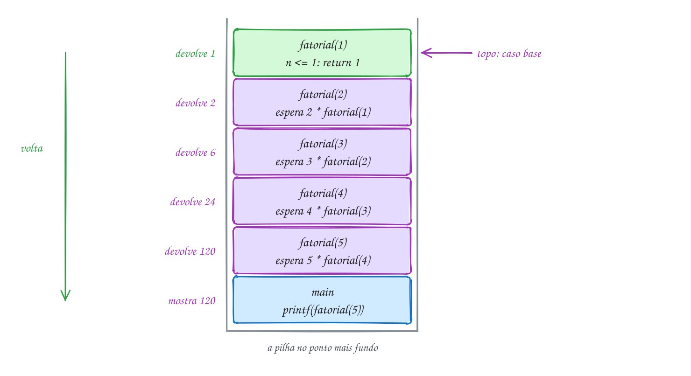</p>

O código é quase a definição matemática:

```c
#include <stdio.h>

int fatorial(int n) {
    if (n <= 1) {
        return 1; // caso base: resolve direto, sem chamar ninguém
    }
    return n * fatorial(n - 1); // caso recursivo: um problema menor
}

int main(void) {
    printf("5 amigos: %d jeitos\n", fatorial(5));
    printf("12 amigos: %d jeitos\n", fatorial(12)); // o maior que cabe num int
    return 0;
}
// Saída:
// 5 amigos: 120 jeitos
// 12 amigos: 479001600 jeitos
```

Repara no fluxograma: não existe `for` nem `while` no código, mas existem
duas voltas. A primeira é a ida (empilha de novo com `n - 1` até o caso
base); a segunda é a volta (cada quadro esperando faz a sua multiplicação e
sai):

<p align="center">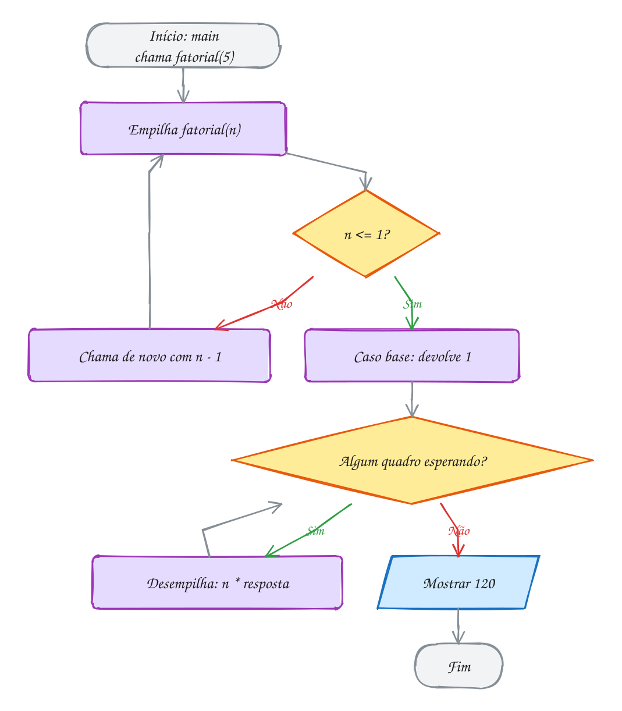</p>

### Passo a passo

O teste de mesa de `fatorial(5)`. As chamadas descem; os retornos sobem, de
baixo para cima da tabela:

| Chamada | n | `n <= 1`? | Espera | Devolve |
| --- | --- | --- | --- | --- |
| `fatorial(5)` | 5 | Não | `5 * fatorial(4)` | 5 × 24 = **120** |
| `fatorial(4)` | 4 | Não | `4 * fatorial(3)` | 4 × 6 = 24 |
| `fatorial(3)` | 3 | Não | `3 * fatorial(2)` | 3 × 2 = 6 |
| `fatorial(2)` | 2 | Não | `2 * fatorial(1)` | 2 × 1 = 2 |
| `fatorial(1)` | 1 | Sim | nada | 1 |

Recursão e laço resolvem os mesmos problemas: todo `for` vira recursão e toda
recursão vira laço (às vezes com bastante trabalho). O fatorial com `for` é
até mais simples e mais barato. A recursão brilha quando o problema **é**
recursivo por natureza: pastas dentro de pastas, árvores, "divide ao meio e
resolve cada metade".

> [!WARNING]
> Caso base que nunca chega. Com `if (n == 1)` no lugar de `if (n <= 1)`,
> `fatorial(0)` chama `fatorial(-1)`, que chama `fatorial(-2)`... e nunca para.
> O mesmo acontece se você esquecer de diminuir (`fatorial(n)` em vez de
> `fatorial(n - 1)`). Cada chamada empilha um quadro, a pilha acaba e o
> programa morre com **stack overflow**: o AddressSanitizer mostra
> `stack-overflow`, e sem ele aparece só `Segmentation fault`.

> [!TIP]
> **Por dentro do C:** cada `fatorial` empilha um quadro com o `n`, o
> endereço de retorno e espaço para a conta pendente. Por isso a recursão
> gasta memória proporcional à **profundidade**: `fatorial(5)` usa 5 quadros
> de uma vez; um laço usaria um só. Outro limite é o tipo: 12! = 479.001.600
> cabe num `int` de 32 bits, mas 13! = 6.227.020.800 já não cabe e dá
> overflow (o `-fsanitize=undefined` do `rodar` acusa). Curiosidade: com
> `gcc -O2`, o compilador às vezes transforma a recursão em laço sozinho.

> [!NOTE]
> **Pergunta para você:** quanto vale `fatorial(0)` com o código acima? E
> quantos quadros de `fatorial` a chamada `fatorial(12)` empilha no ponto mais
> fundo?

### Hora de praticar

Os arquivos ficam em [`0032-recursao/`](0032-recursao/). Os comandos funcionam de qualquer pasta do terminal. Nos exemplos, rode, mude, quebre e rode de novo. Nos exercícios, a resposta vai dentro do próprio arquivo. ★☆☆ é aquecimento, ★★☆ pede raciocínio e ★★★ é desafio.

**Exemplo A063 · Em quantos meses a dívida dobra**

```c
#include <stdio.h>

// o caso base não é um contador chegando a zero: é uma condição
int meses_para_chegar(double divida, double meta, double juros) {
    if (divida >= meta) {
        return 0; // caso base: já chegou, não falta nenhum mês
    }
    // um mês de juros e o mesmo problema, um pouco mais perto da meta
    return 1 + meses_para_chegar(divida * (1 + juros / 100), meta, juros);
}

int main(void) {
    printf("Cartão (12%% ao mês): %d meses\n", meses_para_chegar(1000, 2000, 12));
    printf("Empréstimo (3%% ao mês): %d meses\n", meses_para_chegar(1000, 2000, 3));
    // caso de borda: a meta já foi batida, nenhuma chamada recursiva
    printf("Já dobrou: %d meses\n", meses_para_chegar(2500, 2000, 3));
    return 0;
}
// Saída:
// Cartão (12% ao mês): 7 meses
// Empréstimo (3% ao mês): 24 meses
// Já dobrou: 0 meses
```

```bash
~/LPEDC/rodar 04-funcoes/0032-recursao/A063.c
```

**Exemplo A064 · Imprimir antes ou depois da chamada**

```c
#include <stdio.h>

// imprime e depois chama: os números saem na ida
void regressiva(int n) {
    if (n == 0) {
        printf("Feliz Ano Novo!\n");
        return;
    }
    printf("%d... ", n);
    regressiva(n - 1);
}

// chama e depois imprime: os números saem na volta
void crescente(int n) {
    if (n == 0) {
        return;
    }
    crescente(n - 1);
    printf("%d ", n);
}

int main(void) {
    regressiva(5);
    crescente(5);
    printf("\n");
    return 0;
}
// Saída:
// 5... 4... 3... 2... 1... Feliz Ano Novo!
// 1 2 3 4 5
```

```bash
~/LPEDC/rodar 04-funcoes/0032-recursao/A064.c
```

#### Exercícios

**Exercício E187** · ★☆☆

Num torneio de vôlei de praia, cada dupla que chega cumprimenta todas as que
já estão lá. Com 12 duplas, são 0 + 1 + 2 + ... + 11 cumprimentos. Escreva
"int soma_ate(int n)", recursiva, que devolve 1 + 2 + ... + n, sem nenhum
laço, e use-a para responder.


```text
Saída esperada:
soma_ate(4) = 10
soma_ate(100) = 5050
Cumprimentos com 12 duplas: 66
```

**Dicas:**

1. Caso base: soma_ate(0) vale 0 (ou soma_ate(1) vale 1).
2. Caso recursivo: soma_ate(n) = n + soma_ate(n - 1).
3. Resposta esperada: 10, 5050 e 66 (soma_ate(11)).

```bash
~/LPEDC/rodar 04-funcoes/0032-recursao/E187.c
```

**Exercício E188** · ★☆☆

Complete a função potencia, recursiva, sem laço e sem pow. Hoje ela só
devolve 0 para o programa compilar. Use: base elevado a 0 é 1; base elevado
a e é base vezes base elevado a (e - 1).


```text
Saída esperada:
2^10 = 1024
3^4 = 81
7^0 = 1
```

**Dicas:**

1. O caso base é expoente == 0.
2. O caso recursivo devolve base * potencia(base, expoente - 1).
3. Resposta esperada: 1024, 81 e 1. Para 2^10, a pilha chega a 11 quadros
   de potencia (expoentes de 10 até 0).

```bash
~/LPEDC/rodar 04-funcoes/0032-recursao/E188.c
```

**Exercício E189** · ★★☆

Escreva "void eco(int n, int nivel)", recursiva, que mostra "ida n" antes
da chamada recursiva, "fundo" no caso base (n == 0) e "volta n" depois da
chamada. Cada linha é recuada 2 espaços por nível: o main chama eco(3, 0),
e cada chamada recursiva passa nivel + 1. Use uma função "void recuo(int
nivel)" para os espaços.


```text
Saída esperada:
ida 3
  ida 2
    ida 1
      fundo
    volta 1
  volta 2
volta 3
```

**Dicas:**

1. recuo: um for de 0 até nivel - 1 com printf("  ").
2. eco: if (n == 0) { recuo; "fundo"; return; } depois recuo, "ida",
   eco(n - 1, nivel + 1), recuo, "volta".
3. Resposta esperada: a saída acima. O printf da volta só roda depois que a
   chamada de dentro terminou, e cada quadro lembra o seu n e o seu nivel.

```bash
~/LPEDC/rodar 04-funcoes/0032-recursao/E189.c
```

**Exercício E190** · ★★☆

Escreva "void binario(int n)", recursiva, que mostra n em binário. A conta
de dividir por 2 dá os bits de trás para frente (o último resto é o primeiro
bit); a recursão resolve isso de graça se você imprimir na volta.


```text
Saída esperada:
13 = 1101
255 = 11111111
2026 = 11111101010
```

**Dicas:**

1. Caso base: se n < 2, mostre n e pare.
2. Caso recursivo: primeiro binario(n / 2), depois printf("%d", n % 2).
3. Resposta esperada: 1101, 11111111 e 11111101010. Se você imprimir antes
   de chamar, sai 1011 para o 13: os bits ao contrário.

```bash
~/LPEDC/rodar 04-funcoes/0032-recursao/E190.c
```

**Exercício E191** · ★★★

Esta função deveria somar os dígitos de um número (2026 -> 10), mas tem
DOIS erros. O rodar mostra dois avisos, um para cada erro; leia os dois.
Se você rodar mesmo assim, o programa morre com stack-overflow. Conserte
os dois erros e rode até aparecer "2026 -> 10" e "99999 -> 45", sem
nenhum aviso.

**Dicas:**

1. Leia o aviso "suggest parentheses around assignment": o que n = 0 faz
   dentro do if? Quanto vale essa expressão?
2. Leia "control reaches end of non-void function": a conta do caso
   recursivo é feita e jogada fora. Quem chamou recebe o quê?
3. Resposta esperada: (1) "n = 0" atribui 0 a n e vale 0 (falso): o caso
   base nunca é aceito, e a chamada seguinte é soma_digitos(0) de novo, para
   sempre. O certo é n == 0. (2) Falta o return na linha do caso recursivo.
   Consertado: 2026 -> 10 e 99999 -> 45.

```bash
~/LPEDC/rodar 04-funcoes/0032-recursao/E191.c
```

**Exercício E192** · ★★★

A calculadora velha da loja só sabe somar e subtrair. Escreva
"int multiplicar(int a, int b)", recursiva, que só usa + e - (nada de *),
e que funciona com b positivo, zero e NEGATIVO.


```text
Saída esperada:
7 x 4 = 28
7 x -3 = -21
-5 x 6 = -30
9 x 0 = 0
```

**Dicas:**

1. Para b > 0: a * b = a + a * (b - 1). Caso base: b == 0 dá 0.
2. Com b negativo, b - 1 se afasta do zero e a recursão nunca para. Para
   b < 0, ande para o outro lado: a * b = a * (b + 1) - a.
3. Resposta esperada: 28, -21, -30 e 0. São três ramos: b == 0, b > 0 e
   b < 0. Em todos, b chega mais perto de 0 a cada chamada.

```bash
~/LPEDC/rodar 04-funcoes/0032-recursao/E192.c
```

---

## 0033 · Recursão na prática: Fibonacci, Hanói e Euclides

A escada do prédio tem 4 degraus, e você sobe de 1 em 1 ou pulando 2 de uma
vez. De quantos jeitos dá para subir? Pense no último passo: ou você chegou
vindo do degrau 3 (com um passo de 1), ou do degrau 2 (com um pulo de 2).
Então os jeitos de chegar ao 4 são os jeitos de chegar ao 3 **mais** os
jeitos de chegar ao 2. Cada resposta é a soma das duas anteriores: 1, 2, 3,
5... São 5 jeitos.

Essa é a sequência de **Fibonacci**: 0, 1, 1, 2, 3, 5, 8, 13, 21... Cada
termo é a soma dos dois anteriores, e os dois primeiros são dados. A definição
já vem recursiva:

- `fib(0) = 0` e `fib(1) = 1` (dois casos base);
- `fib(n) = fib(n - 1) + fib(n - 2)` (o caso recursivo, com **duas**
  chamadas).

A escada de 4 degraus é `fib(5) = 5`. O código sai em três linhas e funciona.
O problema é o custo. Cada chamada de `fib` gera mais duas, e elas não
conversam entre si: `fib(5)` calcula `fib(3)` duas vezes, `fib(2)` três
vezes, e o trabalho se repete do zero cada vez. O número de chamadas cresce
quase dobrando a cada `n` a mais: é **exponencial**.

Vamos ver na prática. A **árvore de chamadas** de `fib(5)` tem 15 nós, um para
cada chamada (o número no círculo é o `n`). Os dois nós amarelos são
`fib(3)`: o mesmo cálculo, com tudo o que vem embaixo dele, feito duas vezes. Mas repare na pilha: ela nunca passa de 5 quadros de `fib`, porque
o programa desce um galho de cada vez:

<p align="center">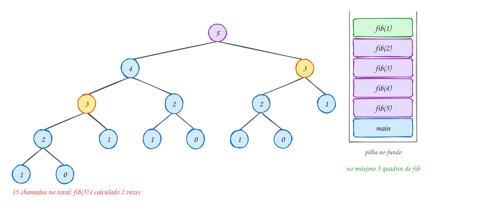</p>

O programa conta as chamadas com uma global:

```c
#include <stdio.h>

long chamadas = 0; // conta quantas vezes fib foi chamada

int fib(int n) {
    chamadas++;
    if (n < 2) {
        return n; // fib(0) = 0 e fib(1) = 1
    }
    return fib(n - 1) + fib(n - 2); // duas chamadas por vez
}

int main(void) {
    for (int n = 5; n <= 30; n += 5) {
        chamadas = 0;
        int resultado = fib(n);
        printf("fib(%d) = %d, com %ld chamadas\n", n, resultado, chamadas);
    }
    return 0;
}
// Saída:
// fib(5) = 5, com 15 chamadas
// fib(10) = 55, com 177 chamadas
// fib(15) = 610, com 1973 chamadas
// fib(20) = 6765, com 21891 chamadas
// fib(25) = 75025, com 242785 chamadas
// fib(30) = 832040, com 2692537 chamadas
```

Quase 2,7 milhões de chamadas para achar `fib(30)`. Um laço com duas variáveis
(`anterior` e `atual`) faz a mesma conta em 30 passos. Para `fib(50)`, a
versão recursiva levaria minutos; o laço, microssegundos. A lição: recursão
elegante não é recursão barata. Quando as chamadas **repetem trabalho**,
desconfie.

Repara no fluxograma: o caso recursivo tem duas chamadas, uma depois da outra.
A segunda só começa quando a primeira voltou com a resposta inteira:

<p align="center">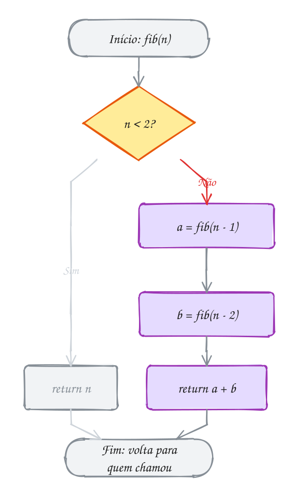</p>

### Quando a recursão é a melhor ideia: Hanói

A **Torre de Hanói** tem três estacas (A, B e C) e discos de tamanhos
diferentes empilhados em A, o maior embaixo. Leve todos para C, movendo um
disco por vez e nunca pondo um maior sobre um menor. Parece difícil até você
pensar recursivamente. Para mover `n` discos de A para C:

1. mova os `n - 1` de cima de A para B (usando C de apoio);
2. mova o disco maior de A para C;
3. mova os `n - 1` de B para C (usando A de apoio).

Os passos 1 e 3 são o mesmo problema com um disco a menos, e com os papéis das
estacas trocados. Por isso a função recebe as três estacas como parâmetro. O
exemplo A066 resolve 3 discos em 7 movimentos. Com `n` discos são `2ⁿ - 1`
movimentos, e não existe jeito mais curto: aqui a recursão não desperdiça
nada.

### Passo a passo: o MDC de Euclides

O **máximo divisor comum** de dois números tem uma recursão de 2.300 anos: o
MDC de `a` e `b` é o mesmo que o MDC de `b` e `a % b`; quando o segundo vira
0, o primeiro é a resposta. Em C: `return b == 0 ? a : mdc(b, a % b);`. O
teste de mesa de `mdc(1071, 462)`:

| Chamada | a | b | a % b |
| --- | --- | --- | --- |
| `mdc(1071, 462)` | 1071 | 462 | 147 |
| `mdc(462, 147)` | 462 | 147 | 21 |
| `mdc(147, 21)` | 147 | 21 | 0 |
| `mdc(21, 0)` | 21 | 0 | caso base: devolve **21** |

Quatro chamadas para números na casa do milhar: o resto cai muito rápido.
Euclides é recursão com **uma** chamada só e que encolhe depressa: barata.

> [!WARNING]
> Usar Fibonacci recursivo "de verdade" num programa. Ele serve para aprender
> recursão e custo, não para calcular. Outra pegadinha: `fib(47)` já não cabe
> num `int` de 32 bits (dá 2.971.215.073, acima de 2.147.483.647). Com
> `unsigned` vai até `fib(47)`, com `long long` até `fib(92)`.

> [!TIP]
> **Por dentro do C:** a árvore mostra o **tempo** e a pilha mostra a
> **memória**. O tempo de `fib(n)` é proporcional ao número de nós da árvore,
> que cresce como 1,618ⁿ (a razão áurea aparece aqui). A memória é só a
> altura da árvore: no máximo `n` quadros ao mesmo tempo, porque quando um
> galho termina, os quadros dele saem da pilha e o espaço é reaproveitado
> pelo galho seguinte. Por isso `fib(40)` demora, mas não estoura a pilha.

> [!NOTE]
> **Pergunta para você:** quantas vezes `fib(1)` é chamada dentro de
> `fib(5)`? Conte na árvore antes de alterar o programa para contar.

### Hora de praticar

Os arquivos ficam em [`0033-recursao-na-pratica/`](0033-recursao-na-pratica/). Os comandos funcionam de qualquer pasta do terminal. Nos exemplos, rode, mude, quebre e rode de novo. Nos exercícios, a resposta vai dentro do próprio arquivo. ★☆☆ é aquecimento, ★★☆ pede raciocínio e ★★★ é desafio.

**Exemplo A065 · Fibonacci sem recalcular: a recursão que carrega o par**

```c
#include <stdio.h>

long chamadas = 0;

// a e b são dois vizinhos da sequência; a cada chamada o par anda uma casa
long long fib_par(int n, long long a, long long b) {
    chamadas++;
    if (n == 0) {
        return a; // caso base: andou tudo, a é a resposta
    }
    return fib_par(n - 1, b, a + b); // UMA chamada só, não duas
}

long long fib(int n) {
    return fib_par(n, 0, 1); // começa no par (fib(0), fib(1))
}

int main(void) {
    for (int n = 10; n <= 30; n += 10) {
        chamadas = 0;
        long long resultado = fib(n);
        printf("fib(%d) = %lld, com %ld chamadas\n", n, resultado, chamadas);
    }

    chamadas = 0;
    long long grande = fib(90); // com duas chamadas por vez, não terminaria hoje
    printf("fib(90) = %lld, com %ld chamadas\n", grande, chamadas);
    return 0;
}
// Saída:
// fib(10) = 55, com 11 chamadas
// fib(20) = 6765, com 21 chamadas
// fib(30) = 832040, com 31 chamadas
// fib(90) = 2880067194370816120, com 91 chamadas
```

```bash
~/LPEDC/rodar 04-funcoes/0033-recursao-na-pratica/A065.c
```

**Exemplo A066 · Torre de Hanói e o MDC de Euclides**

```c
#include <stdio.h>

int movimentos = 0;

// leva n discos da estaca origem para a destino, usando a auxiliar
void hanoi(int n, char origem, char destino, char auxiliar) {
    if (n == 0) {
        return; // nada para mover
    }
    hanoi(n - 1, origem, auxiliar, destino); // tira os n-1 de cima do caminho
    movimentos++;
    printf("%d. disco %d: %c -> %c\n", movimentos, n, origem, destino);
    hanoi(n - 1, auxiliar, destino, origem); // põe os n-1 em cima do maior
}

// Euclides: mdc(a, b) = mdc(b, a % b), até b virar 0
int mdc(int a, int b) {
    if (b == 0) {
        return a;
    }
    return mdc(b, a % b);
}

int main(void) {
    hanoi(3, 'A', 'C', 'B');
    printf("Total: %d movimentos\n", movimentos);
    printf("mdc(1071, 462) = %d\n", mdc(1071, 462));
    return 0;
}
// Saída:
// 1. disco 1: A -> C
// 2. disco 2: A -> B
// 3. disco 1: C -> B
// 4. disco 3: A -> C
// 5. disco 1: B -> A
// 6. disco 2: B -> C
// 7. disco 1: A -> C
// Total: 7 movimentos
// mdc(1071, 462) = 21
```

```bash
~/LPEDC/rodar 04-funcoes/0033-recursao-na-pratica/A066.c
```

#### Exercícios

**Exercício E193** · ★☆☆

A receita pede 84 g de farinha para 36 g de açúcar. Escreva o MDC de
Euclides, recursivo, "int mdc(int a, int b)", e use-o para simplificar a
proporção 84/36. Teste também com 1000/625.


```text
Saída esperada:
mdc(84, 36) = 12 -> 84/36 = 7/3
mdc(1000, 625) = 125 -> 1000/625 = 8/5
```

**Dicas:**

1. Caso base: b == 0 devolve a. Caso recursivo: mdc(b, a % b).
2. Para simplificar, divida os dois números pelo MDC.
3. Resposta esperada: 12 e 7/3; 125 e 8/5.

```bash
~/LPEDC/rodar 04-funcoes/0033-recursao-na-pratica/E193.c
```

**Exercício E194** · ★☆☆

Quantos movimentos a Torre de Hanói precisa? Para mover n discos você move
n - 1, depois 1, depois n - 1 de novo. Escreva
"unsigned long long movimentos(int n)", recursiva, com movimentos(0) = 0, e
mostre o resultado para 3, 10, 20 e 64 discos.


```text
Saída esperada:
3 discos: 7
10 discos: 1023
20 discos: 1048575
64 discos: 18446744073709551615
```

**Dicas:**

1. movimentos(n) = 2 * movimentos(n - 1) + 1. Repare: UMA chamada só, não duas.
2. O resultado para 64 é 2^64 - 1: não cabe em long long (que vai até
   2^63 - 1), por isso o unsigned. Mostre com %llu.
3. Resposta esperada: 7, 1023, 1048575 e 18446744073709551615. A um
   movimento por segundo, os 64 discos levariam uns 585 bilhões de anos.

```bash
~/LPEDC/rodar 04-funcoes/0033-recursao-na-pratica/E194.c
```

**Exercício E195** · ★★☆

Escreva "int fib_rapido(int n)" SEM recursão, com um laço e duas variáveis
(anterior e atual). Mostre fib(10), fib(40) e fib(46), o maior que cabe num
int. Depois coloque o fib recursivo do texto no mesmo arquivo, calcule
fib(40) com ele e compare o tempo (no olho mesmo).


```text
Saída esperada:
fib(10) = 55
fib(40) = 102334155
fib(46) = 1836311903
```

**Dicas:**

1. Comece com anterior = 0 e atual = 1. A cada volta: proximo = anterior +
   atual; anterior = atual; atual = proximo.
2. Cuidado com fib(0): devolva 0 antes do laço.
3. Resposta esperada: 55, 102334155 e 1836311903. O laço faz 46 somas; o
   recursivo faz mais de 300 milhões de chamadas só para fib(40).

```bash
~/LPEDC/rodar 04-funcoes/0033-recursao-na-pratica/E195.c
```

**Exercício E196** · ★★☆

Meça o desperdício do Fibonacci recursivo. Copie o fib do texto (o de duas
chamadas por vez) e acrescente três globais:


```text
chamadas      quantas vezes fib foi chamada, no total
repetidas     quantas dessas chamadas foram com n == 2
maior_altura  o maior número de quadros de fib na pilha ao mesmo tempo
```


Para a altura, use uma quarta global, altura: some 1 ao entrar em fib e
tire 1 logo antes de cada return. Mostre tudo para fib(6).


```text
Saída esperada:
fib(6) = 8
chamadas: 25
fib(2) calculado 5 vezes
maior altura: 6
```

**Dicas:**

1. Ao entrar: chamadas++; altura++; if (altura > maior_altura)
   maior_altura = altura; e if (n == 2) repetidas++.
2. Para tirar 1 da altura antes de devolver, guarde o resultado numa
   local: int r = fib(n - 1) + fib(n - 2); altura--; return r;
3. Resposta esperada: a saída acima. O caminho mais fundo é fib(6),
   fib(5), fib(4), fib(3), fib(2), fib(1): 6 quadros. A altura cresce
   devagar (n), mas as chamadas crescem muito rápido.

```bash
~/LPEDC/rodar 04-funcoes/0033-recursao-na-pratica/E196.c
```

**Exercício E197** · ★★★

Exponenciação rápida. Para calcular 3^13 dá para multiplicar 3 por ele mesmo
12 vezes, mas existe um atalho: se o expoente é par, x^e = (x^(e/2))²; se é
ímpar, x^e = x * x^(e-1). Escreva duas funções recursivas que contam as
multiplicações numa global:


```text
long long pot_lenta(long long x, int e)    x * pot_lenta(x, e - 1)
long long pot_rapida(long long x, int e)   o atalho acima
```


Mostre o resultado e o número de multiplicações de cada uma para 3^13 e 2^60.


```text
Saída esperada:
lenta:  3^13 = 1594323 (13 multiplicações)
rápida: 3^13 = 1594323 (6 multiplicações)
lenta:  2^60 = 1152921504606846976 (60 multiplicações)
rápida: 2^60 = 1152921504606846976 (9 multiplicações)
```

**Dicas:**

1. Caso base das duas: e == 0 devolve 1 (sem multiplicar).
2. Na rápida, com e par, calcule metade = pot_rapida(x, e / 2) UMA vez e
   devolva metade * metade. Chamar pot_rapida duas vezes joga fora o ganho.
3. Resposta esperada: a saída acima. A lenta faz e multiplicações; a rápida,
   no máximo umas 2 vezes log2(e). É o mesmo truque de "cortar ao meio" da
   busca binária.

```bash
~/LPEDC/rodar 04-funcoes/0033-recursao-na-pratica/E197.c
```

**Exercício E198** · ★★★

Esta Torre de Hanói compila sem aviso e faz 7 movimentos, mas está errada.
Siga os movimentos com três pilhas de moedas (ou no papel) e ache o primeiro
movimento ilegal (disco maior sobre um menor). Conserte e rode até a saída
ficar igual à do A066.

**Dicas:**

1. No passo 1 da receita, os n - 1 discos vão para a estaca AUXILIAR.
   Confira para onde a primeira chamada recursiva manda.
2. Siga os dois primeiros movimentos: onde está o disco 1 quando o disco 2
   se move? E no movimento 3, tem algum disco em B?
3. Resposta esperada: a primeira chamada recursiva repete a ordem das
   estacas, hanoi(n - 1, origem, destino, auxiliar), e manda os n - 1 discos
   para o destino, justo onde o maior vai cair. Já no movimento 2 o disco 2
   cai sobre o disco 1 (ilegal), e no 3 o programa tira um disco de B, que
   está vazia. O certo é hanoi(n - 1, origem, auxiliar, destino).

```bash
~/LPEDC/rodar 04-funcoes/0033-recursao-na-pratica/E198.c
```

---

## 0034 · Módulos: .h, .c e compilação separada

Quando várias partes de um programa precisam converter quilômetros em milhas,
ninguém cola o código da conversão em cada uma delas. Ele mora num lugar só, e
quem precisa usa. No C, esse lugar é um **módulo**: um par de arquivos.

- **`conversao.h`** (o *header*, cabeçalho): a **interface**. Diz **o que** o
  módulo oferece: os protótipos das funções, as constantes, os tipos. É o
  contrato que quem usa precisa conhecer.
- **`conversao.c`**: a **implementação**. Diz **como**: o corpo das funções e
  tudo o que é interno do módulo. Ele inclui o próprio `.h`, para o
  compilador conferir que a implementação bate com o contrato.

Quem quer usar escreve `#include "conversao.h"`. Lembre que o `#include` só
**cola** o texto do arquivo ali. Com o `.h` colado, o compilador conhece os
protótipos e confere cada chamada. Com aspas, o arquivo é procurado primeiro
na pasta do seu `.c`; com `< >`, só nas pastas do sistema.

Cada `.c` é compilado **sozinho**, sem saber que os outros existem. O
compilador transforma cada um num **arquivo objeto** (`.o`). Quando ele vê a
chamada `km_para_milhas(100)` em `viagem.c`, só sabe que a função existe (o
protótipo prometeu), e deixa um buraco com o nome dela. Quem tapa o buraco é o
**ligador** (*linker*), que junta os `.o` e procura cada nome. Isso é a
**compilação separada**:

```bash
gcc -std=c17 -Wall -Wextra -c conversao.c       # gera conversao.o
gcc -std=c17 -Wall -Wextra -c viagem.c            # gera viagem.o
gcc viagem.o conversao.o -o viagem                # o ligador junta
gcc -std=c17 -Wall -Wextra viagem.c conversao.c -o viagem   # ou tudo de uma vez
```

Num projeto grande, mudar um `.c` recompila só ele e liga de novo, em vez de
recompilar tudo. O `rodar` do curso compila junto todo `.c` de apoio que
estiver na pasta (todo arquivo que não se chama `A000.c` ou `E000.c`).

Vamos ver na prática. O `conversao.h` é incluído pelos dois `.c`. Cada um vira
um `.o` separado, e o ligador junta os dois no executável `viagem`:

<p align="center">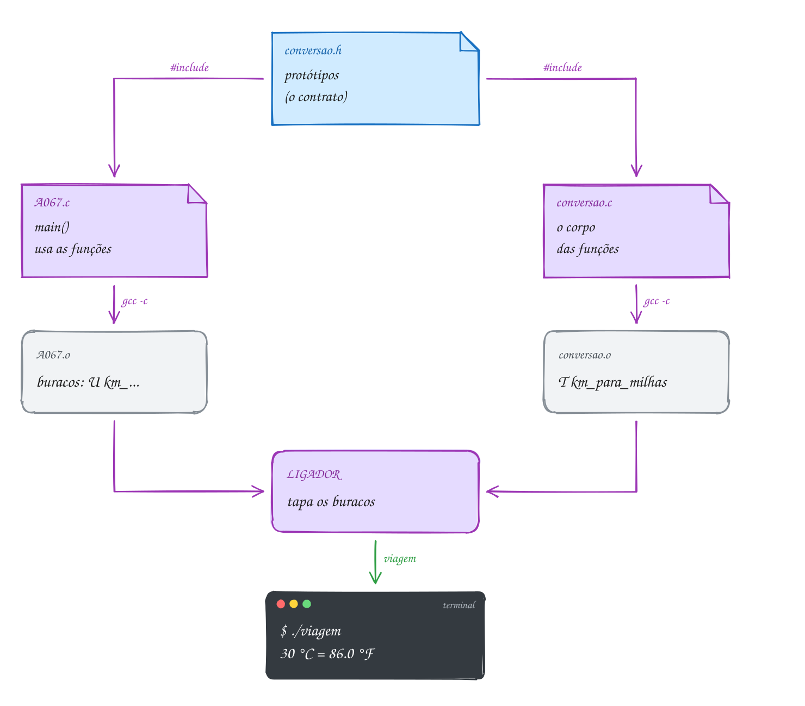</p>

O módulo fica na pasta do assunto. O `conversao.h`:

```c
// conversao.h · a interface do módulo: O QUE ele oferece
#ifndef CONVERSAO_H
#define CONVERSAO_H

double celsius_para_fahrenheit(double celsius);
double km_para_milhas(double km);
double reais_para_dolares(double reais, double cotacao);
int conversoes_feitas(void);

#endif
```

O `conversao.c` tem o corpo das quatro funções, um contador `static` e uma
função auxiliar `static` (abra o arquivo na pasta). E o programa que usa só
precisa do `.h` (chame este arquivo de `viagem.c`):

```c
#include <stdio.h>

#include "conversao.h" // aspas: procura primeiro na pasta deste arquivo

int main(void) {
    printf("30 °C = %.1f °F\n", celsius_para_fahrenheit(30));
    printf("100 km = %.1f milhas\n", km_para_milhas(100));
    printf("R$ 1000.00 = US$ %.2f\n", reais_para_dolares(1000, 5.40));
    return 0;
}
// Compilando à mão (o rodar faz isso sozinho):
//   gcc -std=c17 -Wall -Wextra viagem.c conversao.c -o viagem
// Saída:
// 30 °C = 86.0 °F
// 100 km = 62.1 milhas
// R$ 1000.00 = US$ 185.19
```

Repara no fluxograma: cada `.c` passa pelo compilador separado, e o erro de
"função que não existe" só aparece no fim, no ligador:

<p align="center">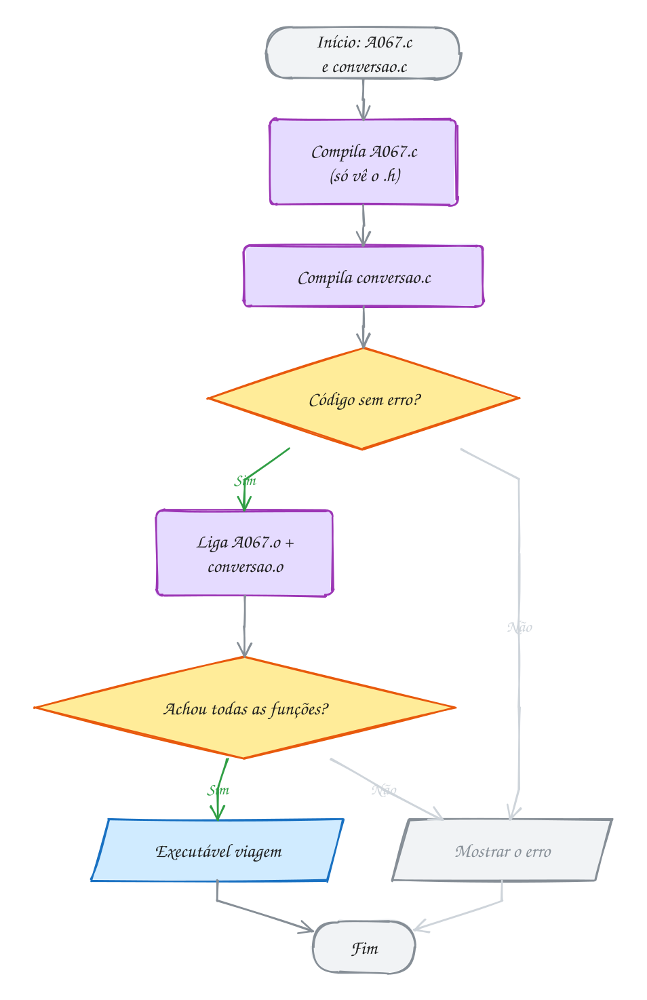</p>

Três peças fecham o assunto:

- **include guard**: o trio `#ifndef CONVERSAO_H` / `#define CONVERSAO_H` /
  `#endif` faz o conteúdo do `.h` entrar **uma vez só** por `.c`, mesmo que
  ele seja incluído duas vezes (direto e por dentro de outro `.h`). Na
  primeira vez, `CONVERSAO_H` não existe: o texto entra e o nome é definido.
  Na segunda, o nome já existe e o texto é pulado. Use o nome do arquivo em
  maiúsculas.
- **`static` fora de função** esconde do resto do programa: o `contador` e a
  `contar` de `conversao.c` não existem para os outros arquivos. É o
  `private` do C, e é o que deixa o módulo mudar por dentro sem quebrar quem
  usa.
- **`extern`** declara uma global que foi **definida** noutro arquivo:
  `extern int limite;` no `.h`, `int limite = 10;` em **um** `.c` só. Use com
  moderação: global compartilhada entre arquivos é global de novo.

> [!WARNING]
> Pôr o **corpo** de uma função no `.h`. Se dois `.c` incluem esse `.h`, a
> função existe duas vezes e o ligador reclama `multiple definition of`. O
> include guard **não** salva: ele evita repetição dentro de um mesmo `.c`,
> não entre arquivos diferentes. No `.h` vão protótipos, `#define` e, mais
> para a frente, tipos. E nunca escreva `#include "conversao.c"`: funciona
> por acaso no começo e quebra assim que o projeto cresce.

> [!TIP]
> **Por dentro do C:** rode `gcc -c conversao.c` e depois `nm conversao.o`. As
> funções públicas aparecem com `T` (maiúsculo: visível para os outros); a
> `contar`, com `t`, e o `contador`, com `b` (minúsculos: `static`, só deste
> arquivo). Agora `gcc -c viagem.c` e `nm viagem.o`: as três conversões aparecem
> com `U`, de *undefined*. São os buracos que o ligador tapa. O `.h` não gera
> nada sozinho: ele só existe para o compilador.

> [!NOTE]
> **Pergunta para você:** se você apagar o `#include "conversao.h"` do
> `viagem.c`, o programa compila? O que o gcc avisa? E se você apagar só o
> `conversao.c` da linha do `gcc`?

### Hora de praticar

Os arquivos ficam em [`0034-modulos/`](0034-modulos/). Os comandos funcionam de qualquer pasta do terminal. Nos exemplos, rode, mude, quebre e rode de novo. Nos exercícios, a resposta vai dentro do próprio arquivo. ★☆☆ é aquecimento, ★★☆ pede raciocínio e ★★★ é desafio.

**Exemplo A067 · O .h incluído duas vezes e o protótipo que converte**

```c
#include <stdio.h>

#include "conversao.h"
#include "conversao.h" // de propósito: o include guard faz esta virar nada

int main(void) {
    int trecho = 42;      // int
    int orcamento = 2700; // int

    // o protótipo do .h diz que os parâmetros são double:
    // o compilador converte 42 em 42.0 antes de chamar
    printf("Maratona: %d km = %.1f milhas\n", trecho, km_para_milhas(trecho));
    printf("Orçamento: R$ %d = US$ %.2f\n", orcamento,
           reais_para_dolares(orcamento, 5.40));

    // a função do módulo vira peça de uma conta maior
    double ida_e_volta = 2 * km_para_milhas(trecho);
    printf("Ida e volta: %.1f milhas\n", ida_e_volta);
    printf("Conversões feitas: %d\n", conversoes_feitas());
    return 0;
}
// Para ver o guard trabalhando: gcc -E A067.c | grep -c km_para_milhas
// dá 3: o protótipo aparece uma vez só, mais as duas linhas do main.
// Saída:
// Maratona: 42 km = 26.1 milhas
// Orçamento: R$ 2700 = US$ 500.00
// Ida e volta: 52.2 milhas
// Conversões feitas: 3
```

```bash
~/LPEDC/rodar 04-funcoes/0034-modulos/A067.c
```

**Exemplo A068 · O módulo guarda segredos**

```c
#include <stdio.h>

#include "conversao.h"

int main(void) {
    double maxima = 0;

    for (int dia = 1; dia <= 3; dia++) {
        double f = celsius_para_fahrenheit(20 + dia * 5); // 25, 30, 35 °C
        printf("Dia %d: %.1f °F\n", dia, f);
        maxima = f > maxima ? f : maxima;
    }
    printf("Máxima: %.1f °F\n", maxima);
    printf("Conversões feitas: %d\n", conversoes_feitas());

    // contador = 0;    // erro: 'contador' undeclared (é static em conversao.c)
    // contar(1.0);     // erro: contar não está no .h e é static: só existe lá
    return 0;
}
// Saída:
// Dia 1: 77.0 °F
// Dia 2: 86.0 °F
// Dia 3: 95.0 °F
// Máxima: 95.0 °F
// Conversões feitas: 3
```

```bash
~/LPEDC/rodar 04-funcoes/0034-modulos/A068.c
```

#### Exercícios

**Exercício E199** · ★☆☆

Monte o módulo "frete" num arquivo só, com cada peça no bloco certo. Os
três blocos já estão marcados no esqueleto: "// frete.h" (o que o módulo
oferece), "// main.c" (quem usa) e "// frete.c" (como ele faz).


```text
no frete.h:  o include guard (#ifndef FRETE_H / #define FRETE_H / #endif),
             #define FRETE_GRATIS_ACIMA 200.0 e o protótipo
             double calcular_frete(double valor_compra, double peso_kg,
                                   int distancia_km);
no frete.c:  static double taxa_por_km(int distancia_km), que devolve
             0.20 por km, e o corpo de calcular_frete
no main.c:   o main
```


O frete é grátis quando a compra chega a FRETE_GRATIS_ACIMA; senão, é
R$ 10.00 + R$ 1.50 por kg + a taxa por km. Calcule três pedidos.


```text
Saída esperada:
Pedido 1 (R$ 150.00, 2.0 kg, 30 km): frete R$ 19.00
Pedido 2 (R$ 250.00, 5.0 kg, 100 km): frete R$ 0.00
Pedido 3 (R$ 80.00, 1.0 kg, 12 km): frete R$ 13.90
```

**Dicas:**

1. O .h diz O QUE o módulo oferece; o .c diz COMO. A taxa_por_km é
   static: quem usa o módulo nem sabe que ela existe.
2. Para não repetir o printf três vezes, escreva no main.c uma função
   void mostrar_pedido(int numero, double valor, double peso, int km).
3. Resposta esperada: 10 + 3 + 6 = 19.00; 250 >= 200, frete grátis;
   10 + 1.50 + 2.40 = 13.90.

```bash
~/LPEDC/rodar 04-funcoes/0034-modulos/E199.c
```

**Exercício E200** · ★☆☆

Use o módulo conversao.h, que está nesta pasta, para mostrar uma tabela de
temperaturas de 0 °C a 40 °C, de 10 em 10. Não escreva nenhuma fórmula: use
celsius_para_fahrenheit. No fim, mostre quantas conversões o módulo contou.
O rodar compila o conversao.c junto, sozinho.


```text
Saída esperada:
0 °C = 32.0 °F
10 °C = 50.0 °F
20 °C = 68.0 °F
30 °C = 86.0 °F
40 °C = 104.0 °F
Conversões: 5
```

**Dicas:**

1. O include já está aí embaixo. Um for de 0 a 40, somando 10.
2. conversoes_feitas() devolve o contador que mora escondido no conversao.c.
3. Resposta esperada: a tabela acima e "Conversões: 5". À mão, o comando
   seria: gcc -std=c17 -Wall -Wextra E200.c conversao.c -o tabela

```bash
~/LPEDC/rodar 04-funcoes/0034-modulos/E200.c
```

**Exercício E201** · ★★☆

O módulo conversao (conversao.h e conversao.c, nesta pasta) converte km em
milhas, mas não faz o contrário. Sem mexer no módulo, escreva NESTE arquivo
"double milhas_para_km(double milhas)" (1 milha = 1.609344 km) e use as
duas funções juntas:


```text
1. a maratona de 26.2 milhas em km;
2. a volta completa: km_para_milhas(milhas_para_km(26.2)) tem que dar
   26.2 de novo;
3. a meia maratona de 13.1 milhas em km;
4. quantas conversões o módulo contou.
```


Antes de terminar, tente escrever "contador++;" dentro da sua função, rode,
leia o erro e apague a linha.


```text
Saída esperada:
Maratona: 26.2 milhas = 42.2 km
Volta completa: 26.2 milhas
Meia: 13.1 milhas = 21.1 km
Conversões do módulo: 1
```

**Dicas:**

1. O include do módulo já está aí embaixo; o rodar compila o conversao.c
   junto, sozinho.
2. O contador é static dentro do conversao.c: o seu arquivo não enxerga
   esse nome ('contador' undeclared). Só as funções do módulo contam.
3. Resposta esperada: a saída acima. O módulo contou 1: só a chamada de
   km_para_milhas passa pelo contador; a sua função é de fora.

```bash
~/LPEDC/rodar 04-funcoes/0034-modulos/E201.c
```

**Exercício E202** · ★★☆

Este programa NÃO gera o executável, de propósito. Ele imita um módulo num
arquivo só: o protótipo em cima (como se viesse de um desconto.h) e a
definição embaixo (como se estivesse no desconto.c). Rode e leia a
mensagem: quem reclama aqui é o ligador, não o compilador. Conserte e rode
até aparecer "Tênis: R$ 239.92".

**Dicas:**

1. Procure "undefined reference" na mensagem.
2. Compare letra por letra o nome do protótipo com o nome da definição.
3. Resposta esperada: o ligador ("undefined reference to
   aplicar_desconto"). O compilador confere cada chamada contra o protótipo,
   e o protótipo existe, então ele confia e deixa o buraco. A definição se
   chama aplica_desconto: é outra função, e ninguém definiu
   aplicar_desconto. Acertando o nome: "Tênis: R$ 239.92".

```bash
~/LPEDC/rodar 04-funcoes/0034-modulos/E202.c
```

**Exercício E203** · ★★★

Escreva o módulo "placar" de um campeonato entre dois times, num arquivo
só, com os blocos "// placar.h", "// main.c" e "// placar.c". Os dados
moram em globais static no bloco do placar.c: os gols da partida atual de
cada time e os pontos e gols de cada um no campeonato. Ninguém de fora mexe
neles sem passar pelas funções:


```text
void marcar_gol(int time)      time 1 (casa) ou 2 (visitante)
void encerrar_partida(void)    mostra "Partida N: X x Y", dá 3 pontos
                               para quem venceu (1 para cada no empate),
                               soma os gols no campeonato e zera o placar
int pontos(int time)
int gols(int time)             gols no campeonato
```


Uma função static do placar.c, "void anotar(int time)", é a única que mexe
nos gols da partida; marcar_gol só a chama. O main simula: 2 x 1, 0 x 0 e
1 x 3, e mostra a tabela.


```text
Saída esperada:
Partida 1: 2 x 1
Partida 2: 0 x 0
Partida 3: 1 x 3
Casa: 4 pontos, 3 gols
Visitante: 4 pontos, 4 gols
```

**Dicas:**

1. Quatro globais static para o campeonato (pontos_casa, pontos_visitante,
   gols_casa, gols_visitante), duas para a partida atual e uma para o
   número da partida. Todas começam em 0.
2. O bloco do placar.h tem o include guard e os quatro protótipos públicos;
   o protótipo de anotar NÃO vai lá. Como o main vem antes do placar.c, os
   protótipos do bloco de cima bastam para ele.
3. Resposta esperada: a saída acima. Casa: vitória (3) + empate (1);
   visitante: empate (1) + vitória (3).

```bash
~/LPEDC/rodar 04-funcoes/0034-modulos/E203.c
```

**Exercício E204** · ★★★

Escreva o módulo "cofrinho" num arquivo só, já organizado como se fosse
virar cofrinho.h e cofrinho.c: um bloco de protótipos em cima (marcado
"// cofrinho.h"), o main, e embaixo a implementação (marcada
"// cofrinho.c"). A interface:


```text
void depositar(double valor);   ignora valores <= 0
bool sacar(double valor);       só saca se tiver saldo; devolve se deu certo
double saldo(void);
int operacoes(void);            quantos depósitos e saques DERAM CERTO
```


O saldo e o contador ficam em globais static na parte do cofrinho.c. O main
faz: deposita 50, deposita -10, saca 30, saca 100, deposita 25.


```text
Saída esperada:
Saque de 30.00: ok
Saque de 100.00: sem saldo
Saldo: R$ 45.00
Operações: 3
```


O bloco "// cofrinho.h" tem que estar pronto para virar arquivo: com o
include guard COFRINHO_H em volta dos protótipos.

**Dicas:**

1. static double saldo_atual = 0; e static int contador = 0; no bloco de baixo.
   Para usar os nomes no main, os protótipos de cima bastam.
2. Cuidado: a função se chama saldo, então a variável precisa de outro nome.
3. Resposta esperada: a saída acima (o depósito de -10 e o saque de 100 não
   contam). No bloco do .h: #ifndef COFRINHO_H, #define COFRINHO_H, os
   quatro protótipos e #endif. No bloco do .c: as duas variáveis static e
   os corpos das funções.

```bash
~/LPEDC/rodar 04-funcoes/0034-modulos/E204.c
```

---

## 0035 · Pré-processador: macros e #ifdef

Sabe o "localizar e substituir" do VS Code? Troca todo `TAXA` por `0.05` no
arquivo inteiro, sem entender nada do que está escrito. O **pré-processador**
do C é exatamente isso, e roda **antes** do compilador. Toda linha que começa
com `#` é para ele: `#include` cola um arquivo, `#define` cria uma
substituição. Quando o compilador recebe o código, as diretivas já sumiram.

Você já usa `#define TAXA 0.05` para constantes. Mas o `#define` também aceita
parâmetros, e aí vira uma **macro**:

```c
#define QUAD(x) ((x) * (x))
```

Onde aparecer `QUAD(alguma coisa)`, o pré-processador escreve
`((alguma coisa) * (alguma coisa))`. Parece uma função, mas não é: não tem
tipo, não tem chamada, não tem pilha. É **troca de texto**. O nome e o `(`
ficam colados: `QUAD (x)` com espaço já é outra coisa (uma constante que vale
`(x) ((x) * (x))`).

E troca de texto não respeita a precedência dos operadores. Sem parênteses,
`QUAD_RUIM(lado + 3)` vira `lado + 3 * lado + 3`, e a multiplicação vem
primeiro. A regra que resolve: **parênteses em volta de cada parâmetro e em
volta da expressão inteira**.

Vamos ver na prática. O terreno tem `lado + 3` metros de lado, com `lado = 2`.
O texto `QUAD_RUIM(lado + 3)` passa pelo pré-processador e chega ao compilador
como `lado + 3 * lado + 3`, que dá 11. A versão com parênteses chega como
`((lado + 3) * (lado + 3))` e dá 25:

<p align="center">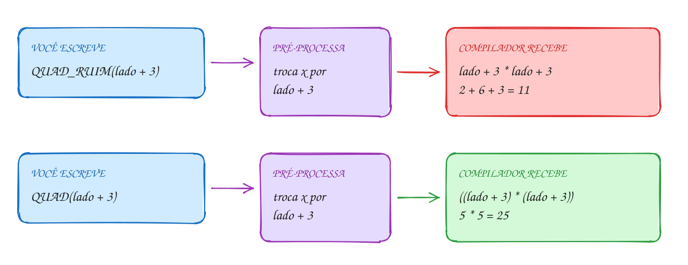</p>

O mesmo exemplo em C, com mais uma armadilha, a da divisão:

```c
#include <stdio.h>

#define QUAD_RUIM(x) x * x       // sem parênteses: perigo
#define QUAD(x) ((x) * (x))      // parênteses no parâmetro E em volta de tudo

int main(void) {
    int lado = 2;

    // terreno quadrado de lado (2 + 3) metros
    printf("QUAD_RUIM(lado + 3) = %d\n", QUAD_RUIM(lado + 3)); // 2 + 3 * 2 + 3
    printf("QUAD(lado + 3)      = %d\n", QUAD(lado + 3));      // ((2 + 3) * (2 + 3))

    // quantos lotes de 5 x 5 cabem em 100 m2?
    printf("100 / QUAD_RUIM(5)  = %d\n", 100 / QUAD_RUIM(5));  // 100 / 5 * 5
    printf("100 / QUAD(5)       = %d\n", 100 / QUAD(5));       // 100 / ((5) * (5))
    return 0;
}
// Saída:
// QUAD_RUIM(lado + 3) = 11
// QUAD(lado + 3)      = 25
// 100 / QUAD_RUIM(5)  = 100
// 100 / QUAD(5)       = 4
```

Repara no fluxograma: o pré-processador não pergunta nada sobre o C. Ele só
procura o nome da macro e troca. Quem descobre o erro (quando descobre) é o
compilador, olhando um código que você nem escreveu:

<p align="center">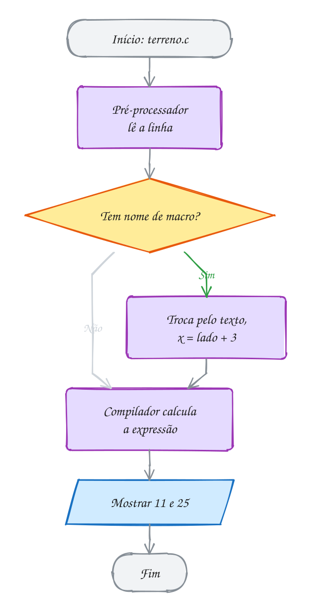</p>

O pré-processador também decide **o que entra** no programa, com a
**compilação condicional**:

```c
#ifdef DEPURAR          // se o nome DEPURAR foi definido...
    printf("[debug] total = %d\n", total);
#endif
```

Com `#define DEPURAR` no topo, a linha entra. Sem ele, ela nem chega ao
compilador: o executável fica sem nenhum vestígio dela. Existem também
`#ifndef` (se **não** foi definido, o mesmo do include guard), `#if`, `#elif`,
`#else` e `#undef`. Dá para definir o nome pela linha de comando, sem mexer no
código: `gcc -DDEPURAR programa.c`. Um truque útil: `#if 0` ... `#endif` desliga
um trecho inteiro, mesmo que ele tenha comentários `/* */` dentro.

Ferramentas que o exemplo A070 usa:

- `__LINE__` vira o número da linha, e `__func__` o nome da função atual. Os
  dois são ótimos em mensagens de depuração.
- `#x` dentro de uma macro transforma o argumento em texto: `MOSTRAR(7 * 6)`
  mostra `7 * 6 = 42`: a expressão e o valor numa linha só, sem repetir nada.

> [!WARNING]
> A macro avalia o argumento **cada vez que ele aparece**. Com
> `#define MAIOR(a, b) ((a) > (b) ? (a) : (b))`, a chamada `MAIOR(x++, y)`
> pode incrementar `x` **duas vezes**. E não ponha `;` no fim do `#define`:
> `#define TAXA 0.05;` faz `preco * TAXA + 1` virar `preco * 0.05; + 1`. Às
> vezes compila e faz a conta errada; às vezes dá um erro que aponta para uma
> linha que parece perfeita.

> [!TIP]
> **Por dentro do C:** salve o código acima como `terreno.c`, rode
> `gcc -E terreno.c | tail -12` e veja o que o compilador recebe de verdade:
> `printf(..., lado + 3 * lado + 3)`, sem
> nenhuma macro. Por isso macro não aparece no depurador e não tem endereço.
> Para cálculos, o C moderno prefere funções pequenas: com `gcc -O2`, o
> compilador costuma copiar o corpo de uma função curta direto no lugar da
> chamada (isso se chama *inlining*), e você ganha a mesma velocidade com
> conferência de tipos e sem as armadilhas. Macro fica para o que só ela
> faz: constantes, `#ifdef`, `__LINE__` e `#x`.

> [!NOTE]
> **Pergunta para você:** com `#define DOBRO(x) (x) + (x)`, quanto vale
> `10 * DOBRO(3)`? Os parênteses no parâmetro bastam?

### Hora de praticar

Os arquivos ficam em [`0035-preprocessador/`](0035-preprocessador/). Os comandos funcionam de qualquer pasta do terminal. Nos exemplos, rode, mude, quebre e rode de novo. Nos exercícios, a resposta vai dentro do próprio arquivo. ★☆☆ é aquecimento, ★★☆ pede raciocínio e ★★★ é desafio.

**Exemplo A069 · A macro não tem tipo nem é função**

```c
#include <stdio.h>

#define DIAS_UTEIS 22
#define HORAS_POR_DIA 8
#define HORAS_NO_MES (DIAS_UTEIS * HORAS_POR_DIA) // macro feita de macros

#define MAIOR(a, b) ((a) > (b) ? (a) : (b)) // serve para int, double...

int maior_int(int a, int b) { // a função tem tipo: só int
    return a > b ? a : b;
}

int main(void) {
    double salario = 3520.00;

    printf("Horas no mês: %d\n", HORAS_NO_MES);
    printf("Valor da hora: R$ %.2f\n", salario / HORAS_NO_MES);

    // a macro só cola texto: com double, a comparação é feita em double
    printf("MAIOR(4.75, 4.70)     = %.2f\n", MAIOR(4.75, 4.70));
    // a função converte os argumentos para int antes: 4 e 4
    printf("maior_int(4.75, 4.70) = %d\n", maior_int(4.75, 4.70));

    // com int, as duas concordam
    printf("MAIOR(12, 30) = %d, maior_int(12, 30) = %d\n",
           MAIOR(12, 30), maior_int(12, 30));
    return 0;
}
// Saída:
// Horas no mês: 176
// Valor da hora: R$ 20.00
// MAIOR(4.75, 4.70)     = 4.75
// maior_int(4.75, 4.70) = 4
// MAIOR(12, 30) = 30, maior_int(12, 30) = 30
```

```bash
~/LPEDC/rodar 04-funcoes/0035-preprocessador/A069.c
```

**Exemplo A070 · Modo depuração com #ifdef**

```c
#include <stdio.h>

#define DEPURAR // apague esta linha e os [debug] somem do programa

#ifdef DEPURAR
#define LOG(msg) printf("[debug] %s, linha %d: %s\n", __func__, __LINE__, msg)
#else
#define LOG(msg) // vira nada
#endif

#define MOSTRAR(expr) printf(#expr " = %d\n", (expr)) // # vira texto

int parcelas(int total, int valor_parcela) {
    LOG("calculando");
    return (total + valor_parcela - 1) / valor_parcela; // arredonda para cima
}

int main(void) {
    LOG("começou");
    MOSTRAR(parcelas(1000, 300));
    MOSTRAR(7 * 6);
    return 0;
}
// Saída:
// [debug] main, linha 21: começou
// [debug] parcelas, linha 16: calculando
// parcelas(1000, 300) = 4
// 7 * 6 = 42
```

```bash
~/LPEDC/rodar 04-funcoes/0035-preprocessador/A070.c
```

#### Exercícios

**Exercício E205** · ★☆☆

Rode o programa abaixo: a segunda linha mostra 16, mas 3 vezes o dobro de
4 é 24. Conserte a macro DOBRO, sem mexer no main. Depois escreva a macro
TRIPLO(x), já à prova de precedência, e tire as barras da última linha.


```text
Saída esperada:
DOBRO(4) = 8
3 * DOBRO(4) = 24
METADE(10 + 4) = 7
100 + TAXA * 2 = 120
TRIPLO(2 + 1) = 9
```

**Dicas:**

1. Escreva a troca de texto à mão: 3 * DOBRO(4) vira 3 * 4 + 4. A
   multiplicação vem antes da soma.
2. Parênteses em cada parâmetro e em volta de tudo, como em METADE.
3. Resposta esperada: a saída acima, com #define DOBRO(x) ((x) + (x)) e
   #define TRIPLO(x) ((x) * 3). Sem os parênteses no x, TRIPLO(2 + 1)
   viraria 2 + 1 * 3 = 5.

```bash
~/LPEDC/rodar 04-funcoes/0035-preprocessador/E205.c
```

**Exercício E206** · ★☆☆

Escreva três macros à prova de precedência e teste com os valores abaixo:


```text
MAIOR(a, b)          o maior dos dois
ABS(x)               o valor absoluto
ENTRE(x, min, max)   1 se min <= x <= max, senão 0
```


```text
Saída esperada:
MAIOR(7, 12) = 12
ABS(-8) = 8
ABS(3 - 10) = 7
ENTRE(15, 10, 20) = 1
ENTRE(25, 10, 20) = 0
100 / ABS(-5 * 2) = 10
```

**Dicas:**

1. Use o ternário: ((a) > (b) ? (a) : (b)).
2. Parênteses em cada parâmetro e em volta de tudo. O último teste quebra se
   faltar o par de fora.
3. Resposta esperada: a saída acima. ABS(x) fica ((x) < 0 ? -(x) : (x)).

```bash
~/LPEDC/rodar 04-funcoes/0035-preprocessador/E206.c
```

**Exercício E207** · ★★☆

O sistema da lanchonete tem dois erros, os dois nos #define. Um deles impede
a compilação; o outro compila e dá a conta errada. Rode, leia o erro (que
aponta para uma linha que parece certa), conserte os dois e rode até a
saída ficar certa.


```text
Saída certa:
Desconto: R$ 3.50
Dois combos: R$ 60.00
```

**Dicas:**

1. O que vem depois do nome, no #define, é colado INTEIRO no lugar, inclusive
   um ";" perdido.
2. 2 * PRECO_COMBO vira 2 * 25 + 5.
3. Resposta esperada: tirar o ";" de "#define DESCONTO 0.10;" (dentro do
   printf ele vira "preco * 0.10;", e o compilador reclama de um ")"
   esperado) e escrever "#define PRECO_COMBO (25 + 5)": sem os parênteses,
   dois combos davam 55.00.

```bash
~/LPEDC/rodar 04-funcoes/0035-preprocessador/E207.c
```

**Exercício E208** · ★★☆

Escreva um simulador de parcelas com modo de teste. Uma compra de R$ 1000.00
em 4 parcelas com juros de 2% ao mês: cada parcela é o valor original
dividido por 4, mais 2% de juros por mês de espera (a 1ª parcela tem 2%, a
2ª 4%, e assim por diante, juros simples). Mostre o total pago.

Com "#define MODO_TESTE" no topo, mostre também cada parcela, com o prefixo
"[teste]". Sem a linha, só o total. Use #ifdef; nada de if comum.


```text
Saída esperada com MODO_TESTE:
[teste] parcela 1: 255.00
[teste] parcela 2: 260.00
[teste] parcela 3: 265.00
[teste] parcela 4: 270.00
Total: R$ 1050.00
```


```text
Saída esperada sem MODO_TESTE:
Total: R$ 1050.00
```

**Dicas:**

1. Parcela k: 250 * (1 + 0.02 * k).
2. O printf do teste fica entre #ifdef MODO_TESTE e #endif, dentro do for.
3. Resposta esperada: as duas saídas acima. Sem MODO_TESTE, o printf do teste
   nem chega ao compilador: rode gcc -E e confira.

```bash
~/LPEDC/rodar 04-funcoes/0035-preprocessador/E208.c
```

**Exercício E209** · ★★★

A macro avalia o argumento cada vez que ele aparece. Rode o programa: nas
linhas da macro, x anda duas vezes e pontos é chamada a mais.

Conserte sem apagar a macro MAIOR:

```text
1. nas duas linhas marcadas "macro:", guarde cada argumento numa variável
   ANTES de usar a macro, para elas mostrarem o mesmo que as da função;
2. escreva "int maior3(int a, int b, int c)" usando a função maior e
   acrescente a última linha da saída. A linha "macro aninhada" fica como
   está, para comparar.
```


```text
Saída esperada:
macro:  m = 5, x = 6
função: m = 5, x = 6
macro:  m = 40, chamadas = 2
função: m = 40, chamadas = 2
macro aninhada: m = 19, chamadas = 7
maior3: m = 19, chamadas = 3
```

**Dicas:**

1. Expanda MAIOR(x++, y) à mão: ((x++) > (y) ? (x++) : (y)). Com a
   comparação verdadeira, x++ roda duas vezes. Com int a = x++; antes,
   a macro recebe só o nome a.
2. Na função, cada argumento é avaliado uma vez, antes da chamada.
   maior3 cabe numa linha: return maior(maior(a, b), c);
3. Resposta esperada: a saída acima. Na macro aninhada, o MAIOR de dentro
   é colado duas vezes no de fora: 3 + 1 + 3 = 7 chamadas de pontos.

```bash
~/LPEDC/rodar 04-funcoes/0035-preprocessador/E209.c
```

**Exercício E210** · ★★★

Monte um mini-framework de testes em C. Escreva a macro CONFERIR(cond), que mostra
"ok: <cond>" se a condição for verdadeira e "FALHOU: <cond> (linha N)" se
for falsa, contando as falhas numa global. Use #cond para virar texto e
__LINE__ para a linha. Teste a função "double com_desconto(double preco)",
que dá 10% de desconto acima de R$ 100 (inclusive). No fim, mostre o número
de falhas.

Escreva os cinco testes abaixo, nesta ordem. O último está errado de
propósito, para você ver a falha:


```text
Saída esperada (o número da linha depende do seu arquivo):
ok: com_desconto(50) == 50
ok: com_desconto(100) == 90
ok: com_desconto(200) == 180
ok: com_desconto(0) == 0
FALHOU: com_desconto(150) == 150 (linha 42)
Falhas: 1
```

**Dicas:**

1. Uma macro de várias linhas termina cada linha com "\". Dá para escrever
   numa linha só: #define CONFERIR(cond) if (cond) printf(...); else { ... }
2. Aquele if solto dentro da macro quebra se alguém usar CONFERIR num
   if/else sem chaves. O jeito profissional é embrulhar num
   do { ... } while (0).
3. Resposta esperada: 4 ok, 1 falha (com 150 o certo é 135). É o que o
   assert.h faz: assert(cond) para o programa com o texto e a linha da
   condição que falhou.

```bash
~/LPEDC/rodar 04-funcoes/0035-preprocessador/E210.c
```

---

## 0036 · Juntando tudo: o caixa da lanchonete

Sexta à noite, fila no food truck. O caixa lança os pedidos pelo código, soma,
põe os 10% de serviço, recebe uma nota de R$ 50 e devolve o troco com o menor
número de notas e moedas. Parece um programa só, mas olhe as peças: um
**módulo** com o cardápio, funções pequenas com **parâmetros** e retorno, um
contador **`static`** escondido, uma **macro** para a taxa e uma função
**recursiva** para o troco. É o módulo inteiro trabalhando junto.

Antes de escrever, divida. Cada tarefa vira uma função com um nome que diz o
que ela faz:

| Peça | Onde | O que usa do módulo |
| --- | --- | --- |
| `mostrar_cardapio`, `preco_centavos`, `mostrar_item` | `cardapio.c` | módulo `.h`/`.c`, `switch` |
| `itens_vendidos` | `cardapio.c` | global `static`: só o módulo mexe |
| `ler_codigo` | `caixa.c` | validação com `do...while` e retorno do `scanf` |
| `proxima_nota` | `caixa.c` | função pura: entra uma nota, sai a seguinte |
| `dar_troco` | `caixa.c` | recursão: caso base "troco zerado" |
| `TAXA_SERVICO` | `caixa.c` | `#define` |

Uma decisão importante: dinheiro em **centavos**, num `int`. R$ 7,90 vira
`790`. Com `double`, `0.1 + 0.2` não dá exatamente `0.3`, e o troco de
centavos pode sair errado. Na hora de mostrar, `%d.%02d` com `total / 100` e
`total % 100` monta o "42.24". O único `double` é o valor pago, lido do
teclado e convertido com `lround(pago * 100)`.

O troco é recursivo e lê como uma frase: "se o troco zerou, acabou; se a nota
atual cabe, dê essa nota e resolva o resto; se não cabe, tente a nota
seguinte". Cada chamada chega mais perto do fim, porque ou o troco diminui ou
a nota diminui.

Vamos ver na prática. Os pedidos 1, 2 e 3 somam R$ 38,40. Com 10% de serviço,
a conta é R$ 42,24. Pagando R$ 50, o troco de R$ 7,76 sai da recursão como
5 + 2 + 0,50 + 0,25 + 0,01:

<p align="center">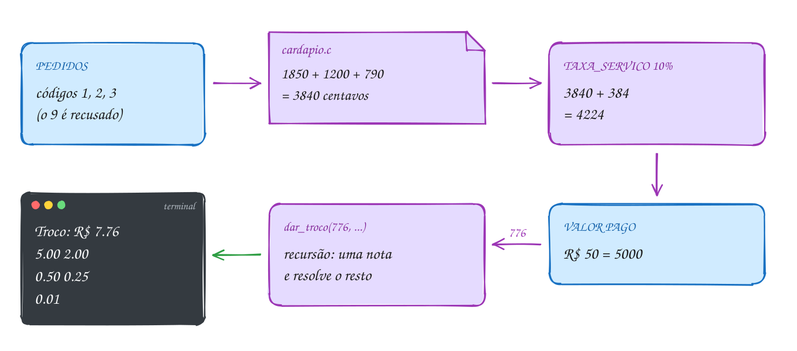</p>

O programa principal, `caixa.c`, usa o módulo do cardápio. O `cardapio.h` e o
`cardapio.c` estão na pasta do assunto (abra os dois):

```c
#include <math.h>
#include <stdio.h>

#include "cardapio.h"

#define TAXA_SERVICO 10 // por cento

// lê um código de 0 a 4; insiste até vir um válido
int ler_codigo(void) {
    int codigo;
    int lidos;
    do {
        printf("Código (0 fecha): ");
        lidos = scanf("%d", &codigo);
        if (lidos != 1) {
            return 0; // entrada acabou ou não é número: fecha a conta
        }
    } while (codigo < 0 || codigo > 4);
    return codigo;
}

// a nota seguinte, da maior para a menor (em centavos)
int proxima_nota(int nota) {
    switch (nota) {
    case 10000: return 5000;
    case 5000: return 2000;
    case 2000: return 1000;
    case 1000: return 500;
    case 500: return 200;
    case 200: return 100;
    case 100: return 50;
    case 50: return 25;
    case 25: return 10;
    case 10: return 5;
    default: return 1;
    }
}

// recursão: dá uma nota e resolve o troco que sobrou
void dar_troco(int centavos, int nota) {
    if (centavos == 0) {
        return; // caso base: troco completo
    }
    if (centavos >= nota) {
        printf("  %d.%02d\n", nota / 100, nota % 100);
        dar_troco(centavos - nota, nota);
    } else {
        dar_troco(centavos, proxima_nota(nota));
    }
}

int main(void) {
    int total = 0;

    mostrar_cardapio();
    for (int codigo = ler_codigo(); codigo != 0; codigo = ler_codigo()) {
        total += preco_centavos(codigo);
        mostrar_item(codigo);
        printf(" adicionado\n");
    }

    int servico = total * TAXA_SERVICO / 100;
    int conta = total + servico;
    printf("%d itens, conta com serviço: R$ %d.%02d\n",
           itens_vendidos(), conta / 100, conta % 100);

    double pago;
    printf("Valor pago: ");
    if (scanf("%lf", &pago) != 1) {
        return 0;
    }
    int troco = (int)lround(pago * 100) - conta;
    if (troco < 0) {
        printf("Faltam R$ %d.%02d\n", -troco / 100, -troco % 100);
        return 0;
    }
    printf("Troco: R$ %d.%02d\n", troco / 100, troco % 100);
    dar_troco(troco, 10000);
    return 0;
}
// Exemplo de uso (o que você digita vem depois dos dois-pontos):
// 1 X-salada   R$ 18.50
// 2 Batata     R$ 12.00
// 3 Suco       R$  7.90
// 4 Açaí       R$ 15.00
// Código (0 fecha): 1
// X-salada adicionado
// Código (0 fecha): 2
// Batata adicionado
// Código (0 fecha): 3
// Suco adicionado
// Código (0 fecha): 9
// Código (0 fecha): 0
// 3 itens, conta com serviço: R$ 42.24
// Valor pago: 50
// Troco: R$ 7.76
//   5.00
//   2.00
//   0.50
//   0.25
//   0.01
// Para testar sem digitar, salve como caixa.c numa pasta sua, com cópias do
// cardapio.h e do cardapio.c, e rode: printf '1\n2\n3\n9\n0\n50\n' | ~/LPEDC/rodar caixa.c
```

Repara no fluxograma: o laço dos pedidos termina com o código 0; depois vêm a
conta, o pagamento e a decisão "pagou o suficiente?". O troco, que parece um
laço, é a recursão de `dar_troco`:

<p align="center">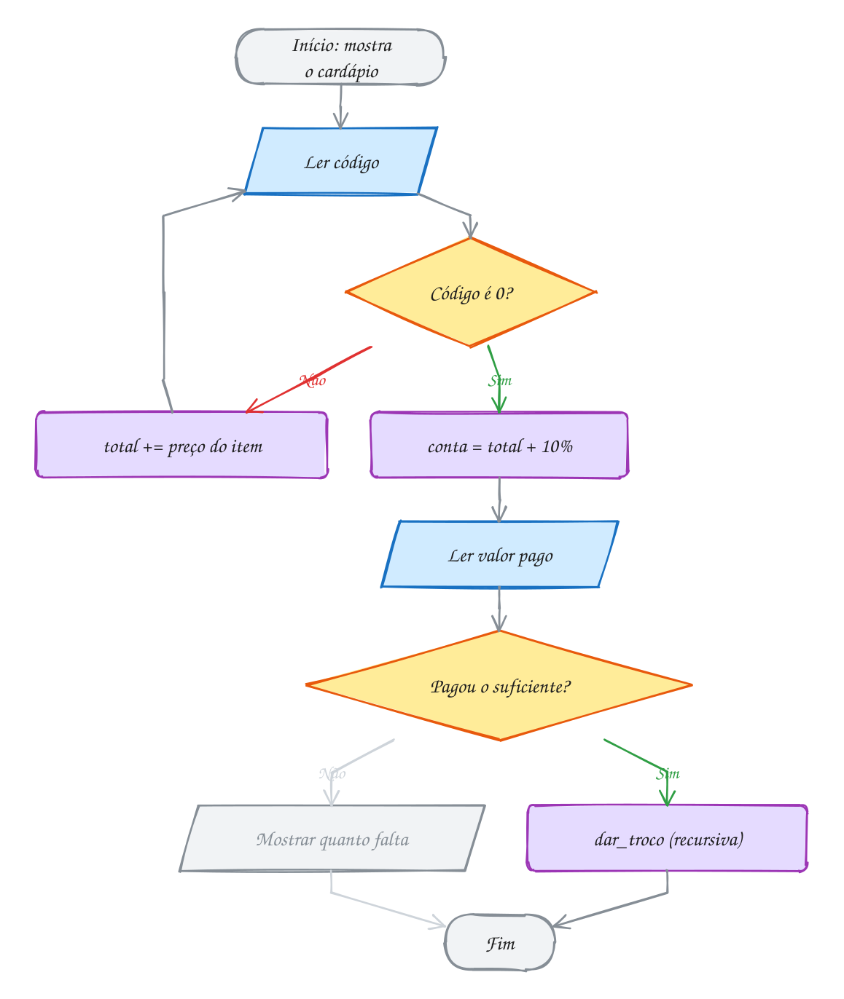</p>

O exemplo A072 mostra o outro lado de dividir em funções: dá para **testar
cada peça sozinha**. Com a macro `CONFERIR` (a do exercício E210), ele confere
o preço, o contador `static` e a contagem de notas sem digitar nada. Não
precisa de biblioteca de testes: uma macro de dez linhas resolve.

> [!WARNING]
> Efeito colateral escondido. `preco_centavos` parece só consultar um preço,
> mas também soma 1 no contador de itens vendidos. Se alguém chamar a função
> duas vezes para o mesmo pedido (uma para somar, outra para mostrar o
> preço), o item é contado em dobro, e nada no nome avisa. É a armadilha das
> globais em escala menor. Quando uma função muda estado, deixe isso no nome
> (`registrar_pedido`) ou separe em duas: uma que consulta e outra que
> registra.

> [!TIP]
> **Por dentro do C:** no troco de R$ 7,76, a pilha chega a 17 quadros de
> `dar_troco` ao mesmo tempo: 1 da primeira chamada, 5 das notas dadas, 11
> das trocas de nota (de 100 para 50, de 50 para 20...). Nenhum sai antes
> do caso base. Repare que a chamada recursiva é a última coisa que cada
> `dar_troco` faz: isso se chama **recursão de cauda**, e com `-O2` o `gcc`
> transforma tudo num laço, com um quadro só. Já o `cardapio.o` exporta 4 símbolos (`T`) e esconde o
> `vendidos` (`b`): confira com `nm`.

> [!NOTE]
> **Pergunta para você:** se o cliente pagar exatamente R$ 42,24, quantas
> chamadas de `dar_troco` acontecem? E o que o programa mostra se ele digitar
> 40?

### Hora de praticar

Os arquivos ficam em [`0036-juntando-tudo/`](0036-juntando-tudo/). Os comandos funcionam de qualquer pasta do terminal. Nos exemplos, rode, mude, quebre e rode de novo. Nos exercícios, a resposta vai dentro do próprio arquivo. ★☆☆ é aquecimento, ★★☆ pede raciocínio e ★★★ é desafio.

**Exemplo A071 · Rachando a conta da mesa sem perder centavo**

```c
#include <stdio.h>

#include "cardapio.h"

#define TAXA_SERVICO 10 // por cento

void mostrar_reais(int centavos) {
    printf("R$ %d.%02d", centavos / 100, centavos % 100);
}

// lança um item e devolve o preço (0 se o código não existe)
int pedir(int codigo) {
    int preco = preco_centavos(codigo);
    if (preco == 0) {
        printf("código %d não existe\n", codigo);
        return 0;
    }
    mostrar_item(codigo);
    printf(": ");
    mostrar_reais(preco);
    printf("\n");
    return preco;
}

// quanto a pessoa número "pessoa" (1, 2, ...) paga:
// a divisão inteira deixa uma sobra, e as primeiras pagam 1 centavo a mais
int parte(int conta, int pessoas, int pessoa) {
    int base = conta / pessoas;
    int sobra = conta % pessoas;
    if (pessoa <= sobra) {
        return base + 1;
    }
    return base;
}

// recursiva: soma as partes da pessoa "de" até a última, para conferir
int soma_partes(int conta, int pessoas, int de) {
    if (de > pessoas) {
        return 0; // caso base: não sobrou ninguém
    }
    return parte(conta, pessoas, de) + soma_partes(conta, pessoas, de + 1);
}

int main(void) {
    int total = 0;
    total += pedir(1); // uma linha por pedido: assim a ordem na tela é garantida
    total += pedir(1);
    total += pedir(2);
    total += pedir(7);
    total += pedir(4);
    int conta = total + total * TAXA_SERVICO / 100;

    printf("%d itens, com serviço: ", itens_vendidos());
    mostrar_reais(conta);
    printf("\n");

    int pessoas = 3;
    for (int p = 1; p <= pessoas; p++) {
        printf("Pessoa %d paga ", p);
        mostrar_reais(parte(conta, pessoas, p));
        printf("\n");
    }
    printf("Conferindo: ");
    mostrar_reais(soma_partes(conta, pessoas, 1));
    printf("\n");
    return 0;
}
// Saída:
// X-salada: R$ 18.50
// X-salada: R$ 18.50
// Batata: R$ 12.00
// código 7 não existe
// Açaí: R$ 15.00
// 4 itens, com serviço: R$ 70.40
// Pessoa 1 paga R$ 23.47
// Pessoa 2 paga R$ 23.47
// Pessoa 3 paga R$ 23.46
// Conferindo: R$ 70.40
```

```bash
~/LPEDC/rodar 04-funcoes/0036-juntando-tudo/A071.c
```

**Exemplo A072 · Testando as peças do caixa**

```c
#include <stdio.h>

#include "cardapio.h"

int falhas = 0;

#define CONFERIR(cond)                                          \
    do {                                                        \
        if (cond) {                                             \
            printf("ok: %s\n", #cond);                          \
        } else {                                                \
            printf("FALHOU: %s (linha %d)\n", #cond, __LINE__); \
            falhas++;                                           \
        }                                                       \
    } while (0)

int proxima_nota(int nota) {
    switch (nota) {
    case 10000: return 5000;
    case 5000: return 2000;
    case 2000: return 1000;
    case 1000: return 500;
    case 500: return 200;
    case 200: return 100;
    case 100: return 50;
    case 50: return 25;
    case 25: return 10;
    case 10: return 5;
    default: return 1;
    }
}

// quantas notas e moedas o troco usa (recursiva, igual a dar_troco)
int contar_notas(int centavos, int nota) {
    if (centavos == 0) {
        return 0;
    }
    if (centavos >= nota) {
        return 1 + contar_notas(centavos - nota, nota);
    }
    return contar_notas(centavos, proxima_nota(nota));
}

int main(void) {
    CONFERIR(preco_centavos(1) == 1850);
    CONFERIR(preco_centavos(9) == 0);
    CONFERIR(itens_vendidos() == 1); // o código 9 não conta
    CONFERIR(proxima_nota(10000) == 5000);
    CONFERIR(contar_notas(776, 10000) == 5);  // 5 + 2 + 0.50 + 0.25 + 0.01
    CONFERIR(contar_notas(18600, 10000) == 6); // 100 + 50 + 20 + 10 + 5 + 1
    printf("Falhas: %d\n", falhas);
    return 0;
}
// Saída:
// ok: preco_centavos(1) == 1850
// ok: preco_centavos(9) == 0
// ok: itens_vendidos() == 1
// ok: proxima_nota(10000) == 5000
// ok: contar_notas(776, 10000) == 5
// ok: contar_notas(18600, 10000) == 6
// Falhas: 0
```

```bash
~/LPEDC/rodar 04-funcoes/0036-juntando-tudo/A072.c
```

#### Exercícios

**Exercício E211** · ★☆☆

Escreva "int ler_inteiro_entre(int min, int max)", que pede um número e
insiste até ele estar entre min e max. Se o scanf falhar (entrada acabou ou
não é número), devolva min. Use-a para ler uma nota de 0 a 10 e uma
quantidade de 1 a 5, e mostre as duas.


```text
Exemplo de uso:
Valor entre 0 e 10: 15
Valor entre 0 e 10: 8
Valor entre 1 e 5: 0
Valor entre 1 e 5: 3
Nota 8, quantidade 3
```


Para testar sem digitar:

```text
printf '15\n8\n0\n3\n' | ~/LPEDC/rodar 04-funcoes/0036-juntando-tudo/E211.c
```

**Dicas:**

1. do { printf(...); lidos = scanf("%d", &valor); if (lidos != 1) return min; }
   while (valor < min || valor > max);
2. A mensagem usa os parâmetros: printf("Valor entre %d e %d: ", min, max).
3. Resposta esperada: com a entrada acima, "Nota 8, quantidade 3". A mesma
   função serve para as duas leituras: é para isso que parâmetros existem.

```bash
~/LPEDC/rodar 04-funcoes/0036-juntando-tudo/E211.c
```

**Exercício E212** · ★☆☆

Refatore o programa abaixo: a mesma conta e a mesma classificação aparecem
três vezes. Crie "double imc(double peso, double altura)" e
"void mostrar_imc(int pessoa, double peso, double altura)", e deixe o main
com três chamadas. A saída não pode mudar.


```text
Saída esperada:
Pessoa 1: IMC 22.9 (normal)
Pessoa 2: IMC 27.8 (acima)
Pessoa 3: IMC 17.6 (abaixo)
```

**Dicas:**

1. Copie um bloco, troque os números pelos parâmetros, e apague os outros dois.
2. mostrar_imc chama imc. Quem decide "abaixo/normal/acima" pode ser uma
   terceira função, se você quiser.
3. Resposta esperada: a mesma saída, com o main de três linhas. Se a regra
   mudar (o limite de 25 virar 24.9), agora você muda num lugar só.

```bash
~/LPEDC/rodar 04-funcoes/0036-juntando-tudo/E212.c
```

**Exercício E213** · ★★☆

O app de hábitos mostra "dia 291 de 365". Escreva três funções que se
apoiam umas nas outras:


```text
bool eh_bissexto(int ano)
int dias_no_mes(int mes, int ano)          usa eh_bissexto para fevereiro
int dia_do_ano(int dia, int mes, int ano)  soma os meses anteriores
```


```text
Saída esperada:
18/10/2026: dia 291 de 365
01/03/2024: dia 61 de 366
31/12/2024: dia 366 de 366
29/02/2023: data inválida
```

**Dicas:**

1. dias_no_mes com switch: 4, 6, 9 e 11 têm 30; 2 tem 28 ou 29; o resto, 31.
2. dia_do_ano: um for de 1 até mes - 1 somando dias_no_mes, mais o dia.
   Para "data inválida", confira dia <= dias_no_mes(mes, ano) antes.
3. Resposta esperada: 291, 61, 366 e inválida (2023 não é bissexto).

```bash
~/LPEDC/rodar 04-funcoes/0036-juntando-tudo/E213.c
```

**Exercício E214** · ★★☆

Tudo do módulo num programa só. Escreva as peças e o main:


```text
#define DOBRO(x)            o dobro, à prova de precedência
int total = 0;              global
int proximo_id(void)        static id começando em 10; soma 1 e devolve
int soma_ate(int n)         recursiva: 0 + 1 + ... + n; soma 1 na global
                            total a cada chamada
int altera(int total)       põe 99 no parâmetro e devolve
```


O main mostra, nesta ordem: um id; a soma de mais dois ids; soma_ate(4); a
global total; chama altera(total) sem guardar o retorno e mostra a global
de novo; e por fim DOBRO(total + 1).


```text
Saída esperada:
id: 11
dois ids somados: 25
soma_ate(4) = 10
chamadas: 5
depois de altera: 5
DOBRO(total + 1) = 12
```

**Dicas:**

1. Para os dois ids, guarde cada um numa variável e some depois: a ordem
   em que o C avalia os dois lados de um + não é garantida.
2. soma_ate(4) chama soma_ate 5 vezes (de 4 até 0). O parâmetro total de
   altera esconde a global: o 99 vai para a cópia.
3. Resposta esperada: a saída acima. DOBRO(5 + 1) = ((5 + 1) * 2) = 12.

```bash
~/LPEDC/rodar 04-funcoes/0036-juntando-tudo/E214.c
```

**Exercício E215** · ★★★

Generalize o binário recursivo (E190) para qualquer base de 2 a 16. Escreva:


```text
char digito(int valor)          0..9 viram '0'..'9'; 10..15 viram 'A'..'F'
void em_base(int n, int base)   recursiva, imprime n na base
void mostrar(int n, int base)   imprime "n na base b: ..." e pula linha;
                                recusa base fora de 2..16
```


```text
Saída esperada:
255 na base 16: FF
255 na base 2: 11111111
2026 na base 8: 3752
2026 na base 16: 7EA
46655 na base 6: 555555
10 na base 20: base inválida
```

**Dicas:**

1. char é número: '0' + 7 é '7', e 'A' + (valor - 10) dá as letras.
2. em_base: se n < base, imprima digito(n); senão em_base(n / base, base) e
   depois digito(n % base). Imprimir com %c.
3. Resposta esperada: a saída acima. Confira o 7EA: 7 * 256 + 14 * 16 + 10
   = 2026.

```bash
~/LPEDC/rodar 04-funcoes/0036-juntando-tudo/E215.c
```

**Exercício E216** · ★★★

O entregador sai da esquina (0, 0) e vai até (colunas, linhas) numa cidade em
grade, andando só para a direita ou para baixo. Quantos caminhos diferentes
existem? Para chegar a (c, l), o último passo veio de (c - 1, l) ou de
(c, l - 1); quem está na borda (c == 0 ou l == 0) tem um caminho só.

Escreva "long long caminhos(int c, int l)", recursiva, que também conta as
próprias chamadas numa global. Para medir o desperdício, use uma segunda
global que conta quantas vezes a mesma esquina (1, 1) é calculada. Escreva
também "void mostrar(int n)", que zera as globais, resolve n x n e mostra a
linha, com "confere" quando chamadas == 2 * caminhos - 1 (e "não confere"
se não). Mostre para 2 x 2, 3 x 3, 5 x 5 e 12 x 12.


```text
Saída esperada:
2 x 2: 6 caminhos, 11 chamadas (confere), esquina (1, 1): 2 vezes
3 x 3: 20 caminhos, 39 chamadas (confere), esquina (1, 1): 6 vezes
5 x 5: 252 caminhos, 503 chamadas (confere), esquina (1, 1): 70 vezes
12 x 12: 2704156 caminhos, 5408311 chamadas (confere), esquina (1, 1): 705432 vezes
```

**Dicas:**

1. Caso base: if (c == 0 || l == 0) return 1; antes dele, conte a chamada
   e, se c == 1 && l == 1, conte a esquina.
2. Cada chamada que não é borda gera duas. As folhas da árvore de chamadas
   são as bordas, e cada folha devolve 1: o resultado é o número de folhas.
   Uma árvore em que todo nó interno tem dois filhos tem (folhas - 1) nós
   internos, então chamadas = 2 * caminhos - 1.
3. Resposta esperada: a saída acima. A esquina (1, 1) é recalculada por
   cada caminho que passa por ela, como fib(2) dentro do fib(6). Guardar as
   respostas numa tabela (memoização) resolve, e isso pede vetores, o
   assunto do próximo módulo.

```bash
~/LPEDC/rodar 04-funcoes/0036-juntando-tudo/E216.c
```

---

## Desafios do módulo

Problemas para resolver num arquivo seu, misturando os assuntos do módulo. Do
médio ao difícil.

**1. Dígito verificador.** Escreva `int digito_mod11(int numero)` para números
de até 9 dígitos: multiplique os dígitos, do último para o primeiro, por 2, 3,
4, 5..., some tudo, calcule `11 - soma % 11` e, se der 10 ou 11, use 0. Qual é
o dígito de 261533?

<details><summary>Resposta</summary>

Do fim para o começo: 3×2 + 3×3 + 5×4 + 1×5 + 6×6 + 2×7 = 6 + 9 + 20 + 5 + 36 +
14 = 90. 90 % 11 = 2, e 11 - 2 = **9**. Caminho: um `while (numero > 0)` que
pega `numero % 10`, multiplica pelo peso e faz `numero /= 10`, com o peso
subindo a cada volta.

</details>

**2. Potência recursiva com expoente negativo.** Estenda `potencia(base,
expoente)` para `double` e expoente negativo: `2^-3` vale 0,125. Use recursão
nos dois sentidos.

<details><summary>Resposta</summary>

Três casos: expoente 0 devolve 1; expoente positivo devolve `base *
potencia(base, e - 1)`; expoente negativo devolve `1 / potencia(base, -e)`. O
último caso chama o positivo uma vez só, e a recursão continua convergindo
para 0. `potencia(2, -3)` = **0.125**.

</details>

**3. Collatz.** Começando de n, se for par divida por 2, se for ímpar faça
`3n + 1`, até chegar a 1. Escreva `int passos(int n)` recursiva. Quantos passos
para 27? E qual n até 100 tem mais passos?

<details><summary>Resposta</summary>

`passos(1) = 0`; senão `1 + passos(próximo)`. 27 leva **111 passos** (e passa
por 9232 no caminho). Até 100, o campeão é o **97**, com 118 passos. Ninguém
provou que toda sequência chega a 1: a recursão só termina porque, até hoje,
sempre terminou.

</details>

**4. Contador de chamadas por função.** Sem globais, faça três funções,
`int pix(bool so_ler)`, `int boleto(bool so_ler)` e `int cartao(bool so_ler)`,
saberem quantas vezes já foram chamadas: cada uma soma 1 no seu contador e
devolve o valor, mas com `so_ler` verdadeiro só devolve, sem somar. Escreva
`void relatorio(void)` que mostra os três números. No `main`, chame `pix` 3
vezes, `boleto` 1 e `cartao` 2, chame `relatorio`, chame `pix` mais uma vez e
chame `relatorio` de novo.

<details><summary>Resposta</summary>

```text
pix: 3, boleto: 1, cartao: 2
pix: 4, boleto: 1, cartao: 2
```

Um `static int vezes = 0;` em cada função guarda a contagem entre as
chamadas, mas `relatorio` não enxerga o `static` de outra função: por isso o
parâmetro "só consultar", que devolve o contador sem somar. As chamadas de
`relatorio` não mudam nada, e a segunda linha mostra isso. Outra saída seria
um módulo com contadores `static` de arquivo e funções de consulta, como o
`conversoes_feitas` do assunto 0034.

</details>

**5. Ackermann.** `A(0, n) = n + 1`; `A(m, 0) = A(m - 1, 1)`; `A(m, n) = A(m - 1,
A(m, n - 1))`. Calcule `A(2, 3)` e conte as chamadas. Tente `A(3, 6)`.

<details><summary>Resposta</summary>

`A(2, 3)` = **9**, com 44 chamadas. `A(3, 6)` = 509, com mais de 170 mil
chamadas. É uma função que sempre termina, mas cresce mais rápido que qualquer
exponencial; `A(4, 2)` já tem 19.729 dígitos. Use `long long` no contador.

</details>

**6. A pilha de mdc.** Acrescente ao `mdc` recursivo de Euclides um parâmetro
`int nivel`: cada chamada mostra `mdc(a, b)` recuado dois espaços por nível
e, no caso base, devolve quantos quadros de `mdc` estavam empilhados no ponto
mais fundo (`nivel + 1`). Mostre a pilha e os quadros de `mdc(100, 75)` e de
`mdc(89, 55)`.

<details><summary>Resposta</summary>

```text
mdc(100, 75)
  mdc(75, 25)
    mdc(25, 0)
Quadros: 3
```

`mdc(89, 55)` desce em escada por (55, 34), (34, 21), (21, 13), (13, 8),
(8, 5), (5, 3), (3, 2), (2, 1) e (1, 0) e termina com `Quadros: 10`. Números
de Fibonacci consecutivos são o pior caso de Euclides. O recuo é um `for` de
0 a `nivel` mostrando dois espaços antes do `printf`, e a chamada recursiva
passa `nivel + 1`.

</details>

**7. Macro de troca.** Escreva `#define TROCAR(a, b) int t = a; a = b; b =
t;` e use num `if (x > y) TROCAR(x, y);` sem chaves: rode com o `rodar` e veja
o `gcc` recusar. Conserte a macro para que esta função compile e funcione,
sem mexer nela:

```c
void ordena(int x, int y) {
    if (x > y)
        TROCAR(x, y);
    else
        printf("já em ordem: ");
    printf("%d %d\n", x, y);
}
```

Chame `ordena(9, 4)` e `ordena(1, 5)`.

<details><summary>Resposta</summary>

A versão ingênua dá `error: expected expression before 'int'`: só a primeira
instrução da macro fica no `if`, e uma declaração não pode ser o corpo de um
`if` sem chaves. Com a forma segura, `#define TROCAR(a, b) do { int t_ = (a);
(a) = (b); (b) = t_; } while (0)`:

```text
4 9
já em ordem: 1 5
```

Só com chaves (`{ ... }`) o `;` depois de `TROCAR(x, y)` fecharia o `if` e
deixaria o `else` órfão; o `do { } while (0)` engole esse `;`. Repare que
aqui a macro **consegue** trocar e uma função não conseguiria: ela não recebe
cópias, ela é colada no lugar.

</details>

**8. Módulo de temperatura.** Crie `clima.h` e `clima.c` com `void
registrar(double celsius)`, `double media(void)`, `double maxima(void)` e
`int leituras(void)`, guardando tudo em `static` de arquivo. Registre 22.5,
31.0, 18.0 e 27.5. Escreva também o comando `gcc`.

<details><summary>Resposta</summary>

Média **24.75**, máxima **31.0**, 4 leituras. Guarde soma, máximo e contador
(não precisa guardar cada leitura). Na primeira leitura, o máximo recebe o
valor direto. Comando: `gcc -std=c17 -Wall -Wextra main.c clima.c -o clima`.

</details>

**9. Números de Catalan.** C(0) = 1 e C(n) = soma de C(i) × C(n - 1 - i) para i
de 0 a n - 1. Eles contam, por exemplo, de quantos jeitos dá para pôr
parênteses numa conta. Calcule de C(0) a C(10) recursivamente e conte as
chamadas de C(10).

<details><summary>Resposta</summary>

1, 1, 2, 5, 14, 42, 132, 429, 1430, 4862, **16796**. C(10) faz 59.049
chamadas (3¹⁰): cada C(n) chama todos os menores, duas vezes cada. É Fibonacci
piorado; com vetores (módulo 05) você guarda os resultados e faz em 55 somas.

</details>

**10. Imprimir com separador de milhar.** Escreva `void milhar(int n)`
recursiva que mostra 1234567 como `1.234.567` e 45 como `45`.

<details><summary>Resposta</summary>

Se `n < 1000`, mostre `n` e pare. Senão, chame `milhar(n / 1000)` e depois
mostre `.%03d` com `n % 1000`. O `%03d` garante os zeros: 1000005 vira
`1.000.005`, não `1.0.5`. É o mesmo padrão do binário recursivo: imprimir na
volta.

</details>

## Para ler mais

- DEITEL, P.; DEITEL, H. *C: como programar*. 6. ed. São Paulo: Pearson Prentice Hall, 2011. Cap. 5: funções, classes de armazenamento, escopo e recursão; cap. 13: o pré-processador.
- BACKES, A. *Linguagem C: completa e descomplicada*. Rio de Janeiro: Elsevier, 2013. Cap. 9: funções e recursão; cap. 13: classes de armazenamento e pré-processador.
- BACKES, A. R. *Linguagem C: descomplicada*. Uberlândia: UFU, [s.d.]. Apostila. Funções, recursão e diretivas.
- MARTINS, L. G. A. *Apostila de linguagem C: conceitos básicos*. Uberlândia: Faculdade de Computação, UFU, [s.d.].
- HARA, C.; ZOLA, W. *Linguagem C: notas de aula*. Curitiba: UFPR, 2008.
- ROCHA, A. M. A.; BORGES, A. R. O. S. *Programação, estruturas de dados e algoritmos em C*. Aveiro: Universidade de Aveiro, [s.d.]. Programação modular e recursividade.
- FEOFILOFF, P. *Algoritmos em linguagem C*. Rio de Janeiro: Elsevier, 2009. Cap. 5: recursão e algoritmos recursivos.
- TENENBAUM, A. M.; LANGSAM, Y.; AUGENSTEIN, M. J. *Estruturas de dados usando C*. São Paulo: Makron Books, 1995. Cap. 3: recursividade.
- LAUREANO, M. *Estrutura de dados com algoritmos e C*. Rio de Janeiro: Brasport, 2008. Recursividade.
- LAGO, S. *Linguagem C*. Apostila. [S.l.: s.n., s.d.]. Macros e funções.
- KERNIGHAN, B. W.; RITCHIE, D. M. *C: a linguagem de programação padrão ANSI*. Rio de Janeiro: Campus, 1989. Cap. 4: funções e estrutura de programas.
- CPPREFERENCE. *C language: functions, storage duration and the preprocessor*. Disponível em: <https://en.cppreference.com/w/c/language>.
- GNU. *The C Preprocessor*. Disponível em: <https://gcc.gnu.org/onlinedocs/cpp/>.
- GDB. *Debugging with GDB*: Backtraces. Disponível em: <https://sourceware.org/gdb/current/onlinedocs/gdb/Backtrace.html>.
