<!-- Gerado por _gerador. Para mudar este arquivo, edite _gerador/modulos/05-vetores-e-strings/ e rode: cd _gerador && npm run gerar -->

# Módulo 05 · Vetores, matrizes e strings

Até aqui, cada variável guardava um valor. Para as notas de uma turma ou os
passos de um mês, seriam dezenas de variáveis. Este módulo traz a primeira
**estrutura de dados** do curso: o **vetor**, várias variáveis do mesmo tipo
com um nome só, lado a lado na memória.

No C, o vetor é um bloco de bytes: tamanho fixo, sem `length`, sem conferência
de índice. Por isso é rápido: a posição 999 custa o mesmo que a 0. O C também
não tem tipo string: uma string é um vetor de `char` que termina no byte zero,
o `'\0'`, detalhe por trás de muitas falhas de segurança.

## O que você vai aprender

- **vetores**: declarar, inicializar, percorrer, e por que o índice começa em 0
- **funções com vetores**: vai o endereço, não uma cópia; `const` protege
- **matrizes**: linhas, colunas e a memória contínua por baixo
- **caracteres** como números: tabela ASCII e `<ctype.h>`
- **strings**: o `'\0'`, o `<string.h>` e o estouro de buffer
- **ler texto** com segurança: `fgets`, o `'\n'` e por que o `gets` foi banido

## Antes de começar

Este módulo usa os laços (inclusive aninhados), os padrões contador,
acumulador e maior/menor, e as funções com parâmetros dos módulos anteriores.
Ele prepara o módulo 06: quando o texto disser "vai o endereço do vetor",
guarde a ideia, que lá ganha sintaxe. Ponteiros ainda não apareceram.

Nos desenhos, o índice de cada gaveta fica embaixo, em cinza. Ao rodar, mude
um tamanho ou um índice de propósito.

O **AddressSanitizer** do gcc, ativo nas flags de estudo, confere o que o C
não confere: índice e tamanho de string. Diante de `stack-buffer-overflow` ou
`index out of bounds`, leia a linha indicada: quase sempre é um `<=` no lugar
de `<` ou um `'\0'` sem lugar.

| # | Assunto |
| --- | --- |
| [0037](#0037--vetores) | Vetores |
| [0038](#0038--vetores-e-funções) | Vetores e funções |
| [0039](#0039--matrizes) | Matrizes |
| [0040](#0040--caracteres) | Caracteres |
| [0041](#0041--strings) | Strings |
| [0042](#0042--lendo-strings) | Lendo strings |
| [0043](#0043--juntando-tudo) | Juntando tudo |

---

## 0037 · Vetores

O relógio da academia contou seus passos na semana: 8200 no domingo, 10450 na
segunda, e assim por diante. Para somar e achar a média e o recorde, você
criaria `passos_dom`, `passos_seg`... sete variáveis. No mês, trinta. No ano,
inviável.

O **vetor** (*array*) resolve: **várias variáveis do mesmo tipo, com um nome
só**, lado a lado na memória. Cada uma é acessada pelo **índice**, entre
colchetes: `passos[0]`, `passos[1]`, ..., `passos[6]`. É um dado composto
**homogêneo** (itens do mesmo tipo); a struct do módulo 08, o **registro**, é o
heterogêneo.

```c
int passos[7];                 // 7 gavetas de int, com lixo dentro
int notas[4] = {7, 9, 6, 10};  // declara e inicializa
int zeros[100] = {0};          // a 1ª vira 0 e as outras também
int dias[] = {31, 28, 31};     // sem tamanho: o compilador conta (3)
```

Três regras que pegam todo iniciante:

- **O índice começa em 0** e vai até `tamanho - 1`. Num vetor de 7, o último é
  `passos[6]`; `passos[7]` não existe.
- **O tamanho é fixo**, decidido na declaração. Use um `#define`: muda num
  lugar só e o laço acompanha. (Desde o C99 o tamanho pode vir de uma
  variável, `int v[n];`, o **VLA** do assunto 0172, mas também não cresce.)
- **Vetor não tem `.length`.** Quem sabe o tamanho é você. No bloco onde o vetor
  foi declarado, `sizeof(v) / sizeof(v[0])` dá a conta (bytes do vetor
  divididos pelos bytes de um item).

Cada posição é uma variável comum: entra em conta, em `if`, em
`scanf("%d", &notas[i])`. O índice pode ser qualquer expressão inteira
(`v[i + 1]`, `v[n - 1]`, `v[i % 7]`), e é isso que casa o vetor com o `for`.

Dois usos **não** funcionam: atribuir um vetor inteiro (`copia = passos;`) e
inicializar com chaves depois da declaração (`passos = {1, 2};`). Vetor se
copia gaveta por gaveta, num laço.

No exemplo, são 7 gavetas, uma por dia. O laço soma e guarda a maior. O
recorde está na gaveta 5, o dia 6 para quem lê o relatório:

<p align="center">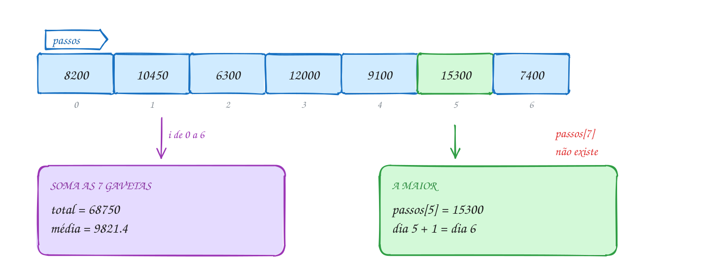</p>

O `i` vai de 0 a 6. O `maior` começa com `passos[0]`, e não com 0:

```c
#include <stdio.h>

#define DIAS 7

int main(void) {
    // 7 gavetas de int, uma por dia; o índice vai de 0 a 6
    int passos[DIAS] = {8200, 10450, 6300, 12000, 9100, 15300, 7400};

    int total = 0;
    int maior = passos[0]; // começa pelo primeiro, não por 0
    int dia_maior = 0;

    for (int i = 0; i < DIAS; i++) { // i < DIAS: o último índice é 6
        total += passos[i];
        if (passos[i] > maior) {
            maior = passos[i];
            dia_maior = i;
        }
    }

    printf("Total: %d passos\n", total);
    printf("Média: %.1f por dia\n", (double) total / DIAS);
    printf("Recorde: %d passos no dia %d\n", maior, dia_maior + 1);
    return 0;
}
// Saída:
// Total: 68750 passos
// Média: 9821.4 por dia
// Recorde: 15300 passos no dia 6
```

O caminho junta o acumulador e o maior/menor do assunto 0025, com os valores
vindos do vetor. A pergunta `i < 7?` impede o laço de passar da última gaveta:

<p align="center">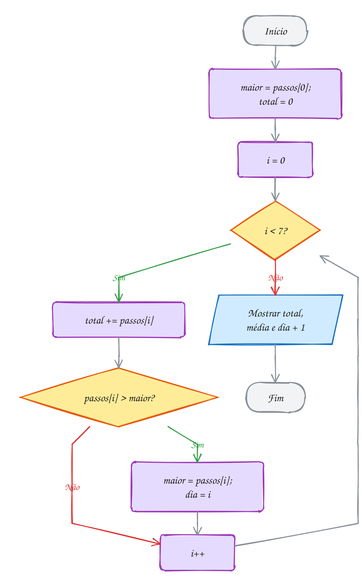</p>

> [!WARNING]
> **O C não confere o índice.** Com `int v[7]`, escrever `v[7] = 0` ou ler
> `v[-1]` compila e mexe na memória vizinha, talvez outra variável sua. É
> **comportamento indefinido**: nada acontece, ou outro valor muda "sozinho",
> ou o programa cai. O erro clássico é o `<=` no laço: `for (i = 0; i <= 7;
> i++)` passa uma vez a mais. O gcc com as flags de estudo usa o
> AddressSanitizer, que mostra `stack-buffer-overflow`.

> [!TIP]
> **Por dentro do C:** as 7 gavetas são 28 bytes seguidos (7 × 4). O nome marca
> o começo e o índice diz **quantos itens pular**: `passos[5]` fica em início +
> 5 × 4 bytes. Por isso o primeiro é o 0, e acessar a posição 0 ou a 999 custa
> o mesmo.

> [!NOTE]
> **Pergunta para você:** se o `maior` começasse com 0 e os valores fossem
> temperaturas de inverno em Urupema (`{-3, -5, -1, -4}`), qual seria o
> "maior" mostrado? Por que começar por `v[0]` resolve?

### Hora de praticar

**Exemplo A073 · O hidrômetro e a gaveta vizinha**

```c
#include <stdio.h>

#define LEITURAS 8

int main(void) {
    // o relógio d'água só acumula: cada leitura é o total desde a instalação
    int leitura[LEITURAS] = {1520, 1690, 1830, 2075, 2210, 2300, 2510, 2640};

    int maior = 0; // aqui 0 serve: consumo nunca é negativo
    int dia_maior = 0;

    // 8 leituras dão 7 dias de consumo: i vai até LEITURAS - 2,
    // porque o laço lê a gaveta vizinha, leitura[i + 1]
    for (int i = 0; i < LEITURAS - 1; i++) {
        int consumo = leitura[i + 1] - leitura[i];
        printf("Dia %d: %d litros\n", i + 1, consumo);
        if (consumo > maior) {
            maior = consumo;
            dia_maior = i + 1;
        }
    }

    // a primeira e a última gaveta dão o total, sem somar nada
    printf("Na semana: %d litros\n", leitura[LEITURAS - 1] - leitura[0]);
    printf("Pico: dia %d, com %d litros\n", dia_maior, maior);
    return 0;
}
// Saída:
// Dia 1: 170 litros
// Dia 2: 140 litros
// Dia 3: 245 litros
// Dia 4: 135 litros
// Dia 5: 90 litros
// Dia 6: 210 litros
// Dia 7: 130 litros
// Na semana: 1120 litros
// Pico: dia 3, com 245 litros
```

```bash
gcc ~/LPEDC/material/A073.c -o ~/LPEDC/material/A073 && ~/LPEDC/material/A073
```

**Exemplo A074 · Inicializar, contar e copiar**

```c
#include <stdio.h>

int main(void) {
    // só 3 valores para 6 gavetas: as outras 3 viram 0
    int gols[6] = {2, 0, 3};

    // sem tamanho: o compilador conta os valores (5)
    int precos[] = {12, 7, 30, 4, 18};
    int n = sizeof(precos) / sizeof(precos[0]); // bytes do vetor / bytes de um item

    printf("gols: ");
    for (int i = 0; i < 6; i++) {
        printf("%d ", gols[i]);
    }
    printf("\n");

    printf("precos tem %d itens em %zu bytes\n", n, sizeof(precos));

    // copia = precos; não compila: vetor se copia gaveta por gaveta
    int copia[5];
    for (int i = 0; i < n; i++) {
        copia[i] = precos[i];
    }
    copia[0] = 99; // mexer na cópia não mexe no original

    printf("precos[0] = %d, copia[0] = %d\n", precos[0], copia[0]);
    return 0;
}
// Saída:
// gols: 2 0 3 0 0 0
// precos tem 5 itens em 20 bytes
// precos[0] = 12, copia[0] = 99
```

```bash
gcc ~/LPEDC/material/A074.c -o ~/LPEDC/material/A074 && ~/LPEDC/material/A074
```

#### Exercícios

**Exercício E217** · ★☆☆

A estação meteorológica de Curitiba registrou as máximas de uma semana:
19, 23, 21, 17, 15, 18 e 22 graus. Guarde as sete temperaturas num vetor e
mostre-as de trás para frente, do último dia para o primeiro, cada uma com o
número do dia (1 a 7).


```text
Saída esperada:
Dia 7: 22 graus
Dia 6: 18 graus
Dia 5: 15 graus
Dia 4: 17 graus
Dia 3: 21 graus
Dia 2: 23 graus
Dia 1: 19 graus
```

```bash
gcc ~/LPEDC/material/E217.c -o ~/LPEDC/material/E217 && ~/LPEDC/material/E217
```

**Exercício E219** · ★★☆

Um professor quer saber quem ficou acima da média da turma. Leia as notas de
5 alunos (números reais), calcule a média e liste o número do aluno (1 a 5)
e a nota de quem ficou ACIMA dela, com uma casa decimal. Se o scanf falhar,
mostre "Entrada inválida." e termine com return 1.


```text
Entrada:
7.5
4
9
6
8.5
```


```text
Saída esperada:
Média da turma: 7.00
Acima da média:
Aluno 1: 7.5
Aluno 3: 9.0
Aluno 5: 8.5
```

```bash
gcc ~/LPEDC/material/E219.c -o ~/LPEDC/material/E219 && ~/LPEDC/material/E219
```

**Exercício E220** · ★★☆

Um app de delivery recebeu 15 avaliações, de 1 a 5 estrelas:


```text
5 4 5 3 5 1 4 5 2 4 5 3 4 5 5
```


Conte quantas avaliações teve cada nota e desenhe um histograma com
asteriscos, da nota 5 para a nota 1. Não use if nem switch para contar: use
a própria nota como índice de um vetor de contadores.


```text
Saída esperada:
Nota 5: ******* (7)
Nota 4: **** (4)
Nota 3: ** (2)
Nota 2: * (1)
Nota 1: * (1)
```

```bash
gcc ~/LPEDC/material/E220.c -o ~/LPEDC/material/E220 && ~/LPEDC/material/E220
```

**Exercício E222** · ★★★

O Crivo de Eratóstenes acha todos os primos até N sem fazer nenhuma
divisão. Com N = 50:


```text
1. Crie um vetor de bool com 51 posições (índices 0 a 50), todas true.
2. Marque 0 e 1 como false (não são primos).
3. Para cada p de 2 em diante: se p ainda está true, ele é primo; então
   marque como false todos os múltiplos de p a partir de p * p
   (p*p, p*p + p, p*p + 2p, ... até 50).
4. Pode parar quando p * p passar de 50.
```


No fim, mostre os primos e quantos são.


```text
Saída esperada:
2 3 5 7 11 13 17 19 23 29 31 37 41 43 47
15 primos até 50
```

```bash
gcc ~/LPEDC/material/E222.c -o ~/LPEDC/material/E222 && ~/LPEDC/material/E222
```

---

## 0038 · Vetores e funções

A lanchonete da esquina vai reajustar o cardápio em 10%. A coxinha de R$ 12,50
passa a R$ 13,75, o suco de R$ 8,00 vai para R$ 8,80. Você escreve a função
`reajustar` e passa o vetor de preços. Ela mexe nos preços do `main` ou numa
cópia?

No assunto 0029, o C passa argumentos **por valor**: a função recebe uma cópia.
Com vetor é diferente: **a função mexe no vetor original**. O C nunca copia um
vetor inteiro para a função. Vai **o endereço onde o vetor começa**, e a função
escreve nas mesmas gavetas.

No parâmetro, os colchetes ficam vazios. Na chamada, vai só o nome:

```c
void reajustar(double precos[], int n, double percentual); // protótipo
reajustar(cardapio, 4, 10);                                // chamada
```

Por isso o `int n`: como só o endereço chega, **o tamanho não vai junto** e a
função não tem como descobri-lo. Vetor + tamanho é um par que aparece no curso
inteiro.

Um número dentro dos colchetes do parâmetro é ignorado: `double precos[4]`,
`double precos[100]` e `double precos[]` são iguais para o compilador. Prefira
os colchetes vazios.

Quando a função **não deve** mexer no vetor, marque o parâmetro com
**`const`**: `void mostrar(const double precos[], int n)`. Se alguém escrever
`precos[0] = 0;` dentro dela, o compilador dá erro.

O `main` guarda o vetor `cardapio`. A função recebe o endereço dele em
`precos`, e cada `precos[i]` é a mesma gaveta que `cardapio[i]`:

<p align="center">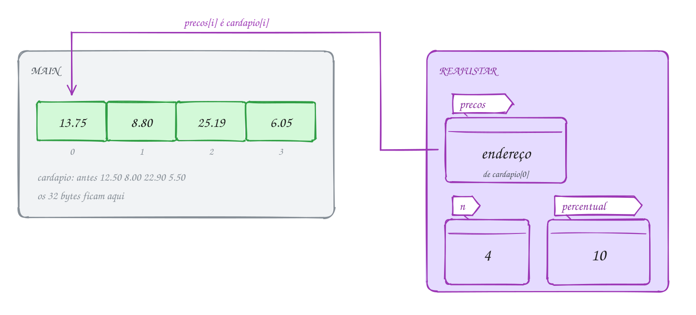</p>

`reajustar` escreve (sem `const`) e `mostrar` só lê (com `const`):

```c
#include <stdio.h>

#define ITENS 4

// const: esta função promete só ler o vetor
void mostrar(const double precos[], int n) {
    for (int i = 0; i < n; i++) {
        printf("R$ %6.2f\n", precos[i]);
    }
}

// sem const: esta função escreve nas gavetas do vetor de quem chamou
void reajustar(double precos[], int n, double percentual) {
    for (int i = 0; i < n; i++) {
        precos[i] = precos[i] * (1 + percentual / 100);
    }
}

int main(void) {
    double cardapio[ITENS] = {12.50, 8.00, 22.90, 5.50};

    reajustar(cardapio, ITENS, 10); // vai o vetor (sem colchetes) e o tamanho

    printf("Depois do reajuste de 10%%:\n");
    mostrar(cardapio, ITENS);
    return 0;
}
// Saída:
// Depois do reajuste de 10%:
// R$  13.75
// R$   8.80
// R$  25.19
// R$   6.05
```

No fluxograma, o `main` chama e a função percorre as 4 gavetas. Ela é `void`,
mas o `main` enxerga os preços novos, porque ela escreveu direto no vetor dele:

<p align="center">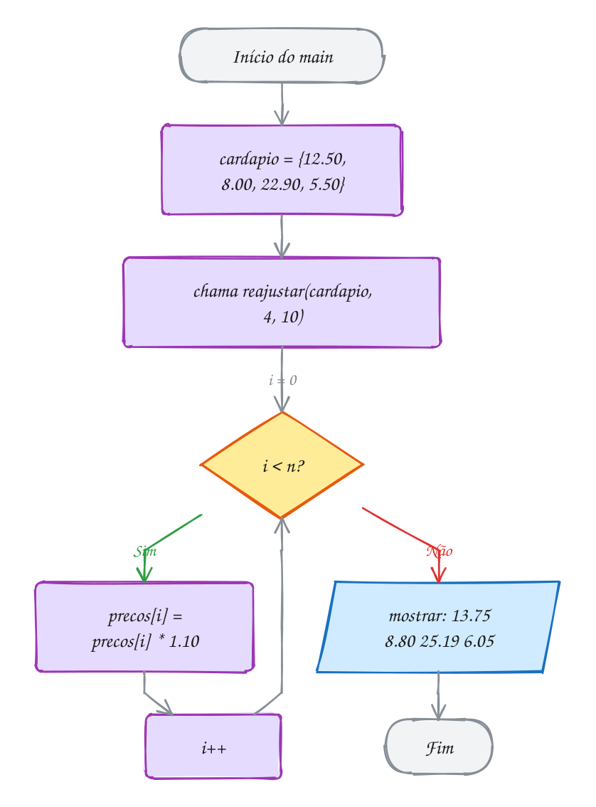</p>

Um **elemento** passado sozinho vai por valor, como qualquer `double`:
`reajustar_um(double preco)` chamada com `cardapio[0]` recebe uma cópia do
12.50 e não muda nada. Só o vetor inteiro (o nome sem colchetes) vai pelo
endereço. O exemplo A076 mostra as duas coisas lado a lado.

> [!WARNING]
> **`sizeof` dentro da função não dá o tamanho do vetor.** No `main`,
> `sizeof(cardapio)` vale 32 (4 × 8 bytes). Dentro de `reajustar`,
> `sizeof(precos)` vale 8 num PC de 64 bits: é o tamanho de um **endereço**. O
> truque `sizeof(v) / sizeof(v[0])` só funciona onde o vetor foi declarado. O
> gcc avisa (`-Wsizeof-array-argument`); quem ignora ganha um laço que percorre
> 1 item em vez de 4.

> [!TIP]
> **Por dentro do C:** a chamada passa ao frame da função (assunto 0031) um
> endereço (8 bytes), um `int` e um `double`; os 32 bytes do vetor ficam no
> frame do `main`. Por isso passar um vetor custa 8 bytes, seja de 4 itens ou
> de um milhão, e por isso a função pode estragá-lo (o `const` protege). No
> módulo 06 esse endereço será um **ponteiro**, e `double precos[]` é só outro
> jeito de escrevê-lo.

> [!NOTE]
> **Pergunta para você:** e se você chamasse `reajustar(cardapio, ITENS, 10)`
> duas vezes seguidas? A coxinha ficaria com 20% de aumento (R$ 15,00) ou com
> mais? Calcule antes de rodar.

### Hora de praticar

**Exemplo A075 · Um vetor entra, outro sai cheio**

```c
#include <stdio.h>

// lê as notas (const) e escreve o resultado em aprovado[], que é do main
void corrigir(const double notas[], int aprovado[], int n, double minima) {
    for (int i = 0; i < n; i++) {
        aprovado[i] = notas[i] >= minima; // 1 ou 0
    }
}

int contar(const int v[], int n) {
    int total = 0;
    for (int i = 0; i < n; i++) {
        total += v[i];
    }
    return total;
}

int main(void) {
    // duas turmas de tamanhos diferentes: a função é a mesma
    double manha[5] = {7.5, 4.0, 6.0, 9.5, 5.9};
    double noite[3] = {8.0, 6.5, 3.0};
    int ok_manha[5]; // a função preenche: não precisa inicializar
    int ok_noite[3];

    corrigir(manha, ok_manha, 5, 6.0);
    corrigir(noite, ok_noite, 3, 6.0);

    printf("Manhã: %d de 5 aprovados\n", contar(ok_manha, 5));
    printf("Noite: %d de 3 aprovados\n", contar(ok_noite, 3));

    // a função só olha as n primeiras gavetas que você mandar
    printf("Só os 2 primeiros da manhã: %d\n", contar(ok_manha, 2));
    return 0;
}
// Saída:
// Manhã: 3 de 5 aprovados
// Noite: 2 de 3 aprovados
// Só os 2 primeiros da manhã: 1
```

```bash
gcc ~/LPEDC/material/A075.c -o ~/LPEDC/material/A075 && ~/LPEDC/material/A075
```

**Exemplo A076 · Um elemento vai por valor, o vetor vai pelo endereço**

```c
#include <stdio.h>

#define N 5

// devolve a posição do código no vetor, ou -1 se não achar
int buscar(const int codigos[], int n, int alvo) {
    for (int i = 0; i < n; i++) {
        if (codigos[i] == alvo) {
            return i;
        }
    }
    return -1;
}

// recebe UMA quantidade: é uma cópia, como qualquer int
void baixa_na_copia(int quantidade) {
    quantidade = quantidade - 1;
}

// recebe o vetor: mexe nas gavetas de quem chamou
void baixa_no_vetor(int estoque[], int pos) {
    estoque[pos] = estoque[pos] - 1;
}

int main(void) {
    int codigos[N] = {101, 205, 310, 422, 587};
    int estoque[N] = {8, 3, 12, 0, 5};

    int pos = buscar(codigos, N, 310);
    printf("Código 310 na posição %d, estoque %d\n", pos, estoque[pos]);

    baixa_na_copia(estoque[pos]); // vai o valor 12
    printf("Depois de baixa_na_copia: %d\n", estoque[pos]);

    baixa_no_vetor(estoque, pos); // vai o vetor
    printf("Depois de baixa_no_vetor: %d\n", estoque[pos]);

    printf("Código 999: posição %d\n", buscar(codigos, N, 999));
    return 0;
}
// Saída:
// Código 310 na posição 2, estoque 12
// Depois de baixa_na_copia: 12
// Depois de baixa_no_vetor: 11
// Código 999: posição -1
```

```bash
gcc ~/LPEDC/material/A076.c -o ~/LPEDC/material/A076 && ~/LPEDC/material/A076
```

#### Exercícios

**Exercício E223** · ★☆☆

O time da várzea marcou estes gols nas 8 rodadas do campeonato:


```text
3 1 0 2 4 1 2 3
```


Escreva duas funções e use as duas no main:


```text
int soma(const int v[], int n);       devolve a soma dos n itens
double media(const int v[], int n);   devolve a média (use a soma)
```


```text
Saída esperada:
Gols no campeonato: 16
Média por rodada: 2.00
```

```bash
gcc ~/LPEDC/material/E223.c -o ~/LPEDC/material/E223 && ~/LPEDC/material/E223
```

**Exercício E225** · ★★☆

A função mexer abaixo recebe um vetor e um int. Uma das duas mudanças que
ela faz chega ao main; a outra se perde. Mostre isso na tela:


```text
1. No fim de mexer, acrescente um printf que mostre v[0], v[1], v[2] e x
   (formato "dentro: ...", como na saída esperada).
2. No main, troque os dois printf pelos do formato "fora: ...".
3. Escreva void vezes_dez(int v[], int pos), que multiplica por 10 só a
   gaveta pos do vetor, e use no fim do main para multiplicar a[2] de
   verdade (coisa que mexer(a, a[2]) não fez).
```


```text
Saída esperada:
dentro: v = 10 50 3, x = 50
fora: a = 10 50 3, b = 5
dentro: v = 100 30 3, x = 30
fora: a = 100 30 3
depois de vezes_dez: a = 100 30 30
```

```bash
gcc ~/LPEDC/material/E225.c -o ~/LPEDC/material/E225 && ~/LPEDC/material/E225
```

**Exercício E226** · ★★☆

As contas de luz do ano (janeiro a dezembro), em reais:


```text
182.40 175.10 190.75 168.30 150.20 141.90
139.60 144.80 158.25 171.40 189.90 205.35
```


Escreva três funções, todas recebendo o vetor e o tamanho:


```text
int indice_do_maior(const double v[], int n);
double media(const double v[], int n);
int contar_acima(const double v[], int n, double limite);
```


e use as três para mostrar:


```text
Saída esperada:
Mês mais caro: 12 (R$ 205.35)
Média mensal: R$ 168.16
Meses acima da média: 7
```

```bash
gcc ~/LPEDC/material/E226.c -o ~/LPEDC/material/E226 && ~/LPEDC/material/E226
```

**Exercício E228** · ★★★

Uma playlist guarda os números das faixas: 11 22 33 44 55. Escreva:


```text
void mostrar(const int v[], int n);
void inverter(int v[], int n);    inverte NO PRÓPRIO vetor, sem criar
                                  outro: troca o 1º com o último, o 2º
                                  com o penúltimo...
void rotacionar(int v[], int n);  a 1ª faixa vai para o fim e as outras
                                  andam uma casa para a esquerda
```


No main: mostre a playlist, inverta e mostre, depois rotacione DUAS vezes
e mostre.


```text
Saída esperada:
11 22 33 44 55
55 44 33 22 11
33 22 11 55 44
```

```bash
gcc ~/LPEDC/material/E228.c -o ~/LPEDC/material/E228 && ~/LPEDC/material/E228
```

---

## 0039 · Matrizes

Uma rede de açaí tem 3 lojas e compara as vendas de 4 semanas. Na planilha,
uma linha por loja, uma coluna por semana, o total da loja no fim de cada
linha e o da semana no pé de cada coluna. No C, essa planilha é uma
**matriz**.

Uma matriz é um **vetor de vetores** (**bidimensional**). `int vendas[3][4]`
são 3 linhas, cada uma um vetor de 4 `int`. Para chegar a uma célula, use dois
índices, **primeiro a linha, depois a coluna**: `vendas[2][0]` é a loja 3 na
semana 1. Os dois começam em 0.

```c
int vendas[3][4];                          // 12 int com lixo
int m[2][3] = {{1, 2, 3}, {4, 5, 6}};      // uma chave por linha
int z[2][3] = {{1}, {4, 5}};               // o que falta vira 0: 1 0 0 / 4 5 0
int t[][2] = {{1, 2}, {3, 4}, {5, 6}};     // só a 1ª dimensão pode sumir: 3 linhas
```

Dá para omitir as chaves internas (`{1, 2, 3, 4, 5, 6}`): os valores enchem a
matriz linha por linha. Mas o gcc avisa (`-Wmissing-braces`); use as chaves.

Dois índices pedem **dois laços aninhados** (assunto 0024): o de fora escolhe
a linha, o de dentro anda pelas colunas. Para somar por coluna, inverta: coluna
por fora, linha por dentro.

No C, a matriz é **um bloco contínuo**, com as linhas coladas uma na outra. As
12 células do exemplo ficam enfileiradas: a linha 0 inteira, depois a 1, depois
a 2. A célula `vendas[1][2]` (o 14) é a 7ª da fila, na posição 1 × 4 + 2 = 6:

<p align="center">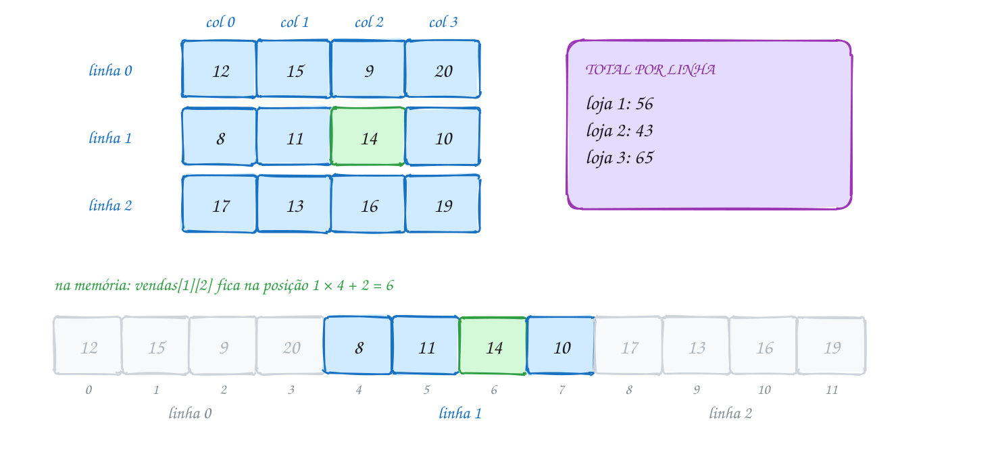</p>

O código mostra a tabela com o total de cada linha e, em outro par de laços, o
total de cada coluna:

```c
#include <stdio.h>

#define LOJAS 3
#define SEMANAS 4

int main(void) {
    // 3 linhas (lojas) x 4 colunas (semanas): caixas de açaí vendidas
    int vendas[LOJAS][SEMANAS] = {
        {12, 15, 9, 20},
        {8, 11, 14, 10},
        {17, 13, 16, 19},
    };

    printf("        S1  S2  S3  S4  Total\n");
    for (int l = 0; l < LOJAS; l++) {         // uma volta por linha
        int total_loja = 0;
        printf("Loja %d", l + 1);
        for (int s = 0; s < SEMANAS; s++) {   // uma volta por coluna
            printf("%4d", vendas[l][s]);
            total_loja += vendas[l][s];
        }
        printf("%7d\n", total_loja);
    }

    int geral = 0;
    printf("Semana");
    for (int s = 0; s < SEMANAS; s++) {       // agora a coluna fica por fora
        int total_semana = 0;
        for (int l = 0; l < LOJAS; l++) {
            total_semana += vendas[l][s];
        }
        printf("%4d", total_semana);
        geral += total_semana;
    }
    printf("%7d\n", geral);
    return 0;
}
// Saída:
//         S1  S2  S3  S4  Total
// Loja 1  12  15   9  20     56
// Loja 2   8  11  14  10     43
// Loja 3  17  13  16  19     65
// Semana  37  39  39  49    164
```

O laço de dentro dá 4 voltas para **cada** volta do de fora: o corpo roda
3 × 4 = 12 vezes, uma por célula:

<p align="center">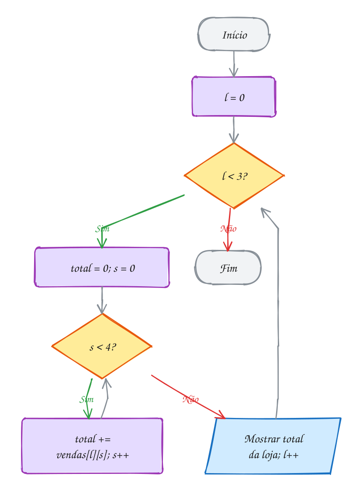</p>

Ao passar uma matriz a uma função vale a regra do assunto 0038 (vai o
endereço, a função mexe no original), mas **todas as dimensões, menos a
primeira, são obrigatórias**: `void mostrar(int m[][4], int linhas)`. O
compilador precisa do número de colunas para achar `m[l][c]`. O exemplo A078
faz isso com um tabuleiro de jogo da velha.

> [!WARNING]
> Escreva `m[l][c]`, nunca `m[l, c]`. A vírgula é um operador que descarta o
> da esquerda: `m[1, 2]` vira `m[2]`, a linha inteira. Outro erro comum é
> trocar os limites: com `int m[3][4]`, o laço das linhas vai até 3 e o das
> colunas até 4. Trocados, o laço lê `m[3][...]`, fora da matriz.

> [!TIP]
> **Por dentro do C:** a memória só tem uma fila de bytes. O C guarda a matriz
> **linha após linha** (*row-major*): `vendas[l][s]` fica em início +
> (l × 4 + s) × 4 bytes. É essa conta que exige o número de colunas no
> parâmetro. Percorrer linha por linha lê bytes vizinhos, já no **cache**;
> percorrer coluna por coluna pula 16 bytes a cada passo e, em matrizes
> grandes, deixa o programa bem mais lento com o mesmo resultado.

> [!NOTE]
> **Pergunta para você:** em `int t[][2] = {{1, 2}, {3, 4}, {5}};`, quantas
> linhas o compilador cria? Quanto vale `t[2][1]`? E `sizeof(t)`?

### Hora de praticar

**Exemplo A077 · O primeiro horário livre da agenda**

```c
#include <stdio.h>
#include <stdbool.h>

#define DIAS 5
#define HORARIOS 4

int main(void) {
    // linhas: segunda a sexta; colunas: 8h, 10h, 14h, 16h (1 = marcado)
    int agenda[DIAS][HORARIOS] = {
        {1, 1, 1, 1},
        {1, 1, 1, 1},
        {1, 1, 1, 1},
        {1, 0, 1, 0},
        {0, 0, 1, 1},
    };
    int horas[HORARIOS] = {8, 10, 14, 16};

    // busca em duas dimensões: o laço de fora para assim que achar
    bool achou = false;
    int dia = 0, hora = 0;
    for (int l = 0; l < DIAS && !achou; l++) {
        for (int c = 0; c < HORARIOS && !achou; c++) {
            if (agenda[l][c] == 0) {
                achou = true;
                dia = l;
                hora = c;
            }
        }
    }

    if (achou) {
        printf("Primeiro livre: dia %d às %dh\n", dia + 1, horas[hora]);
        // na memória, as linhas vêm uma atrás da outra:
        // a casa [l][c] é a de número l * HORARIOS + c, contando do 0
        printf("É a casa %d das %d da matriz\n", dia * HORARIOS + hora, DIAS * HORARIOS);
    } else {
        printf("Agenda lotada.\n");
    }
    printf("A matriz ocupa %zu bytes: %d int seguidos\n", sizeof(agenda), DIAS * HORARIOS);
    return 0;
}
// Saída:
// Primeiro livre: dia 4 às 10h
// É a casa 13 das 20 da matriz
// A matriz ocupa 80 bytes: 20 int seguidos
```

```bash
gcc ~/LPEDC/material/A077.c -o ~/LPEDC/material/A077 && ~/LPEDC/material/A077
```

**Exemplo A078 · O tabuleiro do jogo da velha**

```c
#include <stdio.h>
#include <stdbool.h>

#define N 3

// no parâmetro, só a 1ª dimensão pode ficar vazia: [][N]
// (sem const: com matriz, o const só é aceito sem aviso a partir do C23)
void desenhar(char t[][N], int linhas) {
    for (int l = 0; l < linhas; l++) {
        printf(" %c | %c | %c\n", t[l][0], t[l][1], t[l][2]);
        if (l < linhas - 1) {
            printf("---+---+---\n");
        }
    }
}

// a diagonal principal é onde linha == coluna
bool ganhou_na_diagonal(char t[][N], char jogador) {
    for (int i = 0; i < N; i++) {
        if (t[i][i] != jogador) {
            return false;
        }
    }
    return true;
}

int main(void) {
    char tabuleiro[N][N] = {
        {'X', 'O', '.'},
        {'O', 'X', '.'},
        {'.', 'O', 'X'},
    };

    desenhar(tabuleiro, N);
    printf("X ganhou na diagonal? %s\n", ganhou_na_diagonal(tabuleiro, 'X') ? "sim" : "não");
    printf("A matriz ocupa %zu bytes; cada linha, %zu\n", sizeof(tabuleiro), sizeof(tabuleiro[0]));
    return 0;
}
// Saída:
//  X | O | .
// ---+---+---
//  O | X | .
// ---+---+---
//  . | O | X
// X ganhou na diagonal? sim
// A matriz ocupa 9 bytes; cada linha, 3
```

```bash
gcc ~/LPEDC/material/A078.c -o ~/LPEDC/material/A078 && ~/LPEDC/material/A078
```

#### Exercícios

**Exercício E229** · ★☆☆

Um quadrado mágico 3x3 tem a mesma soma em todas as linhas, colunas e nas
duas diagonais. Guarde este numa matriz, mostre-o e calcule a soma da
diagonal principal (de cima à esquerda até embaixo à direita) e a da
diagonal secundária (de cima à direita até embaixo à esquerda):


```text
2 7 6
9 5 1
4 3 8
```


```text
Saída esperada:
2 7 6
9 5 1
4 3 8
Diagonal principal: 15
Diagonal secundária: 15
```

```bash
gcc ~/LPEDC/material/E229.c -o ~/LPEDC/material/E229 && ~/LPEDC/material/E229
```

**Exercício E231** · ★★☆

A academia guarda, numa matriz 2x3, quantos alunos foram em cada turno
(linhas: segunda e terça; colunas: manhã, tarde e noite):


```text
40 25 60
35 30 55
```


O gerente quer a planilha "deitada": uma linha por turno e uma coluna por
dia. Isso é a TRANSPOSTA. Monte uma matriz 3x2 t em que t[c][l] = m[l][c]
e mostre as duas.


```text
Saída esperada:
Original (2x3):
40 25 60
35 30 55
Transposta (3x2):
40 35
25 30
60 55
```

```bash
gcc ~/LPEDC/material/E231.c -o ~/LPEDC/material/E231 && ~/LPEDC/material/E231
```

**Exercício E232** · ★★☆

Uma sala de cinema pequena tem 5 fileiras (A a E) de 6 poltronas. Na matriz,
1 é ocupada e 0 é livre:


```text
1 1 0 1 1 1
0 0 1 1 0 0
1 1 1 1 1 1
0 1 0 0 0 1
1 0 0 1 1 0
```


Mostre o mapa com 'X' para ocupada e '.' para livre, o número de lugares
livres em cada fileira e a fileira com MAIS lugares livres (em caso de
empate, a primeira).


```text
Saída esperada:
A X X . X X X  livres: 1
B . . X X . .  livres: 4
C X X X X X X  livres: 0
D . X . . . X  livres: 4
E X . . X X .  livres: 3
Melhor fileira: B
```

```bash
gcc ~/LPEDC/material/E232.c -o ~/LPEDC/material/E232 && ~/LPEDC/material/E232
```

**Exercício E234** · ★★★

Campo minado! Num campo 4x5, 1 é bomba e 0 é livre:


```text
0 1 0 0 0
0 0 0 1 0
1 1 0 0 0
0 0 0 0 1
```


Mostre o campo "aberto": '*' onde há bomba e, nas outras casas, quantas
bombas existem nas até 8 casas vizinhas (incluindo as diagonais).


```text
Saída esperada:
1 * 2 1 1
3 3 3 * 1
* * 2 2 2
2 2 1 1 *
```

```bash
gcc ~/LPEDC/material/E234.c -o ~/LPEDC/material/E234 && ~/LPEDC/material/E234
```

---

## 0040 · Caracteres

No app do Detran, você digita a placa em minúsculas, `bra2e19`, e ele mostra
`BRA2E19` e confirma o formato: três letras, um número, uma letra, dois
números. Como o programa sabe que `b` é letra, que `2` é dígito e qual é a
maiúscula de `b`?

Porque, para o computador, **caractere é número**. O `char` é um inteiro de
1 byte, e cada símbolo tem um código na **tabela ASCII**: `'A'` é 65, `'B'` é
66, `'a'` é 97, `'0'` é 48, o espaço é 32, o `'\n'` é 10. As aspas simples só
escrevem o número de forma legível: `'A'` e `65` são o mesmo valor.

| símbolos | códigos | repare |
| --- | --- | --- |
| `'0'` a `'9'` | 48 a 57 | em ordem: `'7' - '0'` = 7 |
| `'A'` a `'Z'` | 65 a 90 | em ordem alfabética |
| `'a'` a `'z'` | 97 a 122 | cada minúscula = maiúscula + 32 |

O `printf` decide o que você vê: `%c` mostra o símbolo, `%d` o código. Como é
número, dá para calcular e comparar: `'a' + 1` é `'b'`, `c >= 'A' && c <= 'Z'`
pergunta se é maiúscula, e `c - '0'` transforma o dígito `'7'` no número 7.

O `<ctype.h>` traz funções prontas:

- **testes**: `isalpha` (letra), `isdigit` (dígito), `isalnum` (letra ou
  dígito), `isspace` (espaço, `\t`, `\n`...), `isupper`, `islower`, `ispunct`;
- **conversões**: `toupper` e `tolower`. O que não é letra volta igual:
  `toupper('2')` é `'2'`.

Os testes devolvem **diferente de zero** para verdadeiro, não necessariamente
1. Escreva `if (isdigit(c))`, nunca `if (isdigit(c) == 1)`.

O `getchar()` lê um caractere do teclado e devolve um **`int`**: o código ou
**`EOF`**, valor negativo que avisa que a entrada acabou (Ctrl+D no Linux).
Guarde sempre num `int`. O exemplo A080 conta letras e dígitos assim, até o
Enter.

No exemplo, a placa é um vetor de 7 `char`. O `toupper` troca cada minúscula
pela maiúscula, 32 posições antes na tabela. Os dígitos passam sem mudar:

<p align="center">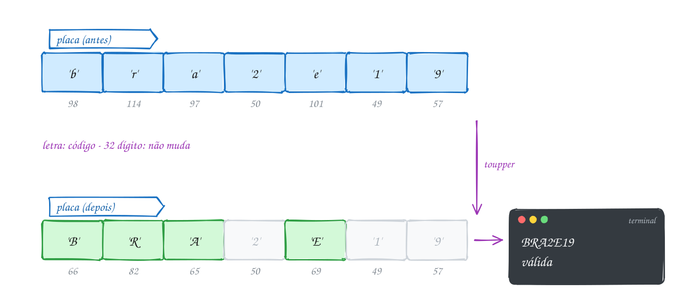</p>

O código mostra cada caractere com `%c` e `%d`, antes e depois, e confere o
formato com `isdigit` e `isalpha`:

```c
#include <stdio.h>
#include <ctype.h>
#include <stdbool.h>

#define TAM 7

int main(void) {
    // placa Mercosul: letra letra letra número letra número número
    char placa[TAM] = {'b', 'r', 'a', '2', 'e', '1', '9'};
    bool valida = true;

    for (int i = 0; i < TAM; i++) {
        char antes = placa[i];
        placa[i] = (char) toupper(placa[i]);
        printf("%c (%3d) -> %c (%3d)\n", antes, antes, placa[i], placa[i]);

        // posições 3, 5 e 6 são dígitos; as outras, letras
        bool deve_ser_digito = (i == 3 || i == 5 || i == 6);
        if (deve_ser_digito && !isdigit(placa[i])) {
            valida = false;
        }
        if (!deve_ser_digito && !isalpha(placa[i])) {
            valida = false;
        }
    }

    printf("Placa: ");
    for (int i = 0; i < TAM; i++) {
        putchar(placa[i]);
    }
    printf(" -> %s\n", valida ? "válida" : "inválida");
    return 0;
}
// Saída:
// b ( 98) -> B ( 66)
// r (114) -> R ( 82)
// a ( 97) -> A ( 65)
// 2 ( 50) -> 2 ( 50)
// e (101) -> E ( 69)
// 1 ( 49) -> 1 ( 49)
// 9 ( 57) -> 9 ( 57)
// Placa: BRA2E19 -> válida
```

O `putchar` mostra um caractere sem formatação. O vetor `placa` ainda não é
uma **string**: falta o marcador de fim que o `%s` exige (próximo assunto).

A cada posição, o programa converte e confere o que ela deveria ser. Uma
posição errada invalida a placa, mas o laço segue até o fim:

<p align="center">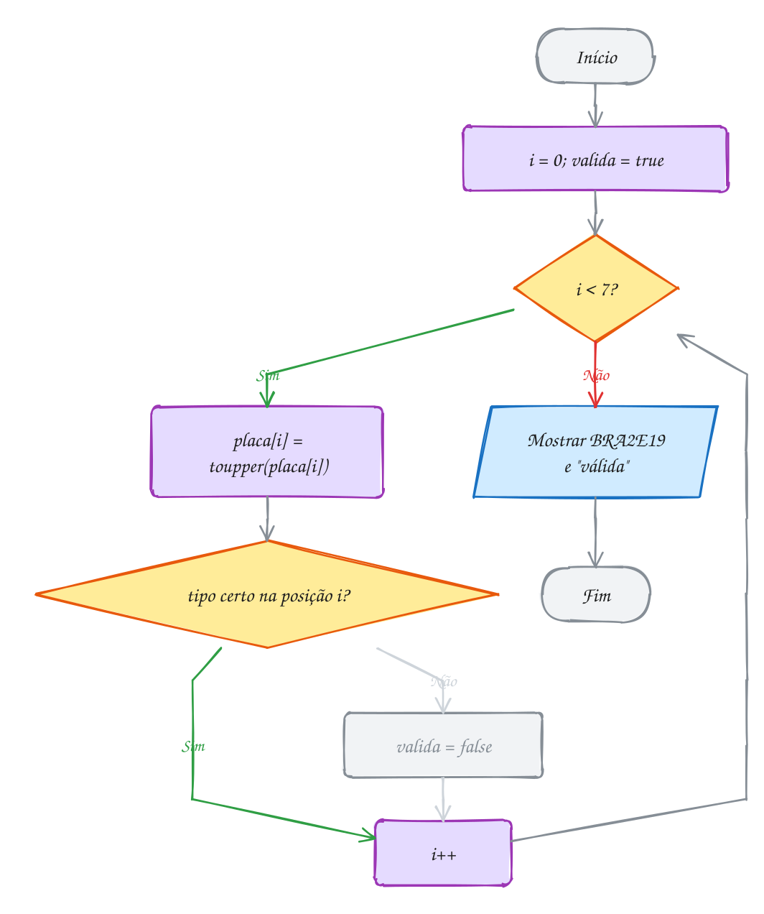</p>

> [!WARNING]
> **Letra não é "tudo entre `'A'` e `'z'`".** Entre o `'Z'` (90) e o `'a'`
> (97) ficam `[ \ ] ^ _` e a crase, então `c >= 'A' && c <= 'z'` aceita `_`
> como letra. Use `isalpha(c)`. E não confunda `'0'` (o caractere zero, código
> 48) com `0` (o número zero, igual ao caractere nulo `'\0'`).

> [!TIP]
> **Por dentro do C:** o C não garante se o `char` tem sinal (no x86 vai de
> -128 a 127). O "ç" em UTF-8 ocupa **dois** bytes (`0xC3 0xA7`) e não cabe num
> `char`; com sinal, eles viram negativos, e passar um negativo (que não seja
> `EOF`) ao `ctype.h` é comportamento indefinido. O jeito seguro é
> `toupper((unsigned char) c)`.

> [!NOTE]
> **Pergunta para você:** o que `printf("%c %d\n", 'A' + 2, 'z' - 'a');`
> mostra? E `printf("%d\n", '9' - '0' + 1);`?

### Hora de praticar

**Exemplo A079 · O dígito '7' não vale 7**

```c
#include <stdio.h>
#include <ctype.h>

#define TAM 8

int main(void) {
    // código de um boleto, guardado como caracteres (do jeito que foi digitado)
    char codigo[TAM] = {'3', '4', '1', '9', '1', '0', '7', '8'};

    int soma_codigos = 0; // soma os códigos ASCII: '3' é 51, não 3
    int soma_valores = 0; // soma o que cada dígito vale

    for (int i = 0; i < TAM; i++) {
        if (!isdigit(codigo[i])) {
            printf("Posição %d não é dígito\n", i);
            return 1;
        }
        soma_codigos += codigo[i];
        soma_valores += codigo[i] - '0'; // '7' - '0' = 55 - 48 = 7
    }

    printf("Somando os códigos: %d\n", soma_codigos);
    printf("Somando os valores: %d\n", soma_valores);

    // o caminho de volta: um número de 0 a 9 vira o caractere do dígito
    int resto = soma_valores % 10;
    char dv = (char) ('0' + resto);
    printf("Último dígito da soma: %c (código %d)\n", dv, dv);
    return 0;
}
// Saída:
// Somando os códigos: 417
// Somando os valores: 33
// Último dígito da soma: 3 (código 51)
```

```bash
gcc ~/LPEDC/material/A079.c -o ~/LPEDC/material/A079 && ~/LPEDC/material/A079
```

**Exemplo A080 · Contando o que foi digitado, letra por letra**

```c
#include <stdio.h>
#include <ctype.h>

int main(void) {
    int letras = 0, digitos = 0, espacos = 0, outros = 0;
    int c; // int, e não char: getchar pode devolver EOF, que não é um caractere

    printf("Digite o endereço: ");
    while ((c = getchar()) != '\n' && c != EOF) {
        if (isalpha(c)) {
            letras++;
        } else if (isdigit(c)) {
            digitos++;
        } else if (isspace(c)) {
            espacos++;
        } else {
            outros++;
        }
    }

    printf("Letras: %d\n", letras);
    printf("Dígitos: %d\n", digitos);
    printf("Espaços: %d\n", espacos);
    printf("Outros: %d\n", outros);
    return 0;
}
// Digite o endereço: Rua 7 de Setembro, 1500
// Letras: 13
// Dígitos: 5
// Espaços: 4
// Outros: 1
```

```bash
gcc ~/LPEDC/material/A080.c -o ~/LPEDC/material/A080 && ~/LPEDC/material/A080
```

#### Exercícios

**Exercício E235** · ★☆☆

Mostre o código ASCII de cada caractere do vetor abaixo, um por linha, no
formato do exemplo. Depois, mostre os caracteres dos códigos 72, 105 e 33,
colados, numa linha só (descubra a mensagem!).


```text
char simbolos[] = {'A', 'Z', 'a', 'z', '0', '9', ' ', '@'};
```


```text
Saída esperada:
'A' = 65
'Z' = 90
'a' = 97
'z' = 122
'0' = 48
'9' = 57
' ' = 32
'@' = 64
Hi!
```

```bash
gcc ~/LPEDC/material/E235.c -o ~/LPEDC/material/E235 && ~/LPEDC/material/E235
```

**Exercício E237** · ★★☆

A cifra de César troca cada letra pela que fica K posições depois no
alfabeto, dando a volta no fim (com K = 3: A vira D, X vira A, Z vira C).
O que não é letra fica como está.

Cifre a mensagem abaixo com K = 3, mostre, depois decifre (ande 3 para
trás) e mostre de novo:


```text
char msg[] = {'Z', 'E', 'B', 'R', 'A', ' ', 'A', 'Z', 'U', 'L'};
```


```text
Saída esperada:
Cifrada: CHEUD DCXO
Decifrada: ZEBRA AZUL
```

```bash
gcc ~/LPEDC/material/E237.c -o ~/LPEDC/material/E237 && ~/LPEDC/material/E237
```

**Exercício E238** · ★★☆

Um formulário pede o CEP. A pessoa pode digitar com ou sem o traço:
"69050-010" e "69050010" valem. Leia a linha caractere por caractere com
getchar, até o Enter (ou EOF), e:


```text
- guarde os dígitos num vetor char cep[8];
- ignore o '-';
- qualquer outro caractere torna o CEP inválido;
- o CEP só é válido com exatamente 8 dígitos.
```


```text
Entrada:
69050-010
```


```text
Saída esperada:
CEP válido: 69050010
```


```text
Entrada:
6905-00100
```


```text
Saída esperada:
CEP inválido.
```

```bash
gcc ~/LPEDC/material/E238.c -o ~/LPEDC/material/E238 && ~/LPEDC/material/E238
```

**Exercício E240** · ★★★

Reescreva cinco funções do ctype.h usando só a tabela ASCII (nada de
ctype.h dentro delas):


```text
bool meu_isdigit(int c);
bool meu_isupper(int c);
bool meu_islower(int c);
bool meu_isalpha(int c);   use as duas anteriores
int meu_toupper(int c);    devolve c igual se não for minúscula
```


Depois, prove que estão certas: para TODOS os códigos de 0 a 127, compare
cada uma com a original do ctype.h e conte as diferenças. Atenção: a
original devolve "diferente de zero" para verdadeiro, não 1. Compare a
verdade, não o número.


```text
Saída esperada:
meu_toupper('q') = Q
meu_toupper('7') = 7
Diferenças em 128 códigos: 0
```

```bash
gcc ~/LPEDC/material/E240.c -o ~/LPEDC/material/E240 && ~/LPEDC/material/E240
```

---

## 0041 · Strings

Na entrada de um evento, a recepção imprime o crachá juntando nome e
sobrenome: "Bruna" + " " + "Matos". Depois confere se bate com o cadastro. No
C, `+` não junta textos e `==` não compara textos, por causa do que uma string
é.

**String é um vetor de `char` terminado pelo caractere `'\0'`** (nulo, código
0). Não existe tipo "string". O `'\0'` marca o fim: o que vem depois é
ignorado. O `printf` com `%s` e as funções de texto andam pelo vetor até achar
o `'\0'`.

```c
char nome[] = "Bruna";   // 6 posições: 'B' 'r' 'u' 'n' 'a' '\0'
char cracha[20];         // cabem até 19 caracteres + o '\0'
char letra = 'B';        // aspas simples: UM char (o número 66)
char texto[] = "B";      // aspas duplas: uma string, 2 bytes ('B' e '\0')
```

As aspas duplas já colocam o `'\0'` no fim. Por isso `"Bruna"` ocupa 6 bytes, e
um texto de N caracteres precisa de **N + 1** posições. Esquecer esse +1 é o
erro mais comum com string.

Como string é vetor (assunto 0037), não se atribui com `=` depois da
declaração nem se compara com `==`. As operações são funções do
**`<string.h>`**:

| função | faz |
| --- | --- |
| `strlen(s)` | conta os caracteres até o `'\0'` (sem ele) |
| `strcpy(dest, orig)` | copia `orig` para dentro de `dest` |
| `strcat(dest, orig)` | cola `orig` no fim de `dest` |
| `strcmp(a, b)` | 0 se iguais; negativo se `a` vem antes; positivo se depois |

O `strlen` devolve `size_t` (inteiro sem sinal para tamanhos), mostrado com
`%zu`. Em `strcpy` e `strcat`, o **destino vem primeiro**, como em
`dest = orig`.

Uma lista de nomes é uma matriz de `char` (assunto 0039), cada linha uma
string. Em `char nomes[3][10] = {"Ana", "Bia", "Caio"};`, `nomes[1]` é "Bia" e
cabem 9 caracteres por nome.

O vetor `cracha` do exemplo tem 20 posições. Depois do `strcpy` e dos dois
`strcat`, as 11 primeiras guardam "Bruna Matos", a 12ª guarda o `'\0'` e o
resto não importa:

<p align="center">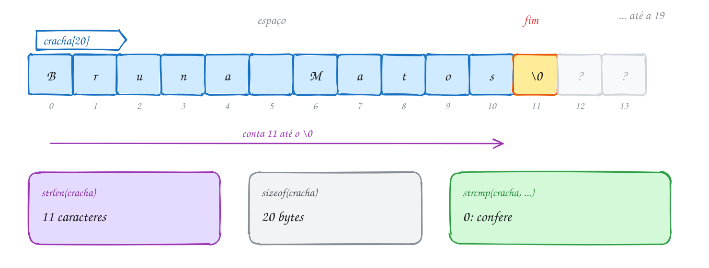</p>

O código monta o crachá, compara `strlen` com `sizeof` e confere com `strcmp`:

```c
#include <stdio.h>
#include <string.h>

int main(void) {
    char nome[] = "Bruna";       // 6 bytes: 5 letras + '\0'
    char sobrenome[] = "Matos";
    char cracha[20];             // espaço de sobra: até 19 letras + '\0'

    strcpy(cracha, nome);        // cracha = "Bruna"
    strcat(cracha, " ");         // cracha = "Bruna "
    strcat(cracha, sobrenome);   // cracha = "Bruna Matos"

    printf("Crachá: %s\n", cracha);
    printf("strlen: %zu caracteres\n", strlen(cracha)); // conta até o '\0'
    printf("sizeof: %zu bytes\n", sizeof(cracha));      // o vetor inteiro

    if (strcmp(cracha, "Bruna Matos") == 0) {           // 0 quer dizer iguais
        printf("Confere com a inscrição.\n");
    }
    return 0;
}
// Saída:
// Crachá: Bruna Matos
// strlen: 11 caracteres
// sizeof: 20 bytes
// Confere com a inscrição.
```

O `strcat` procura o `'\0'` do destino, escreve ali por cima e põe um `'\0'`
novo no fim. Toda função de string é um laço "até achar o `'\0'`":

<p align="center">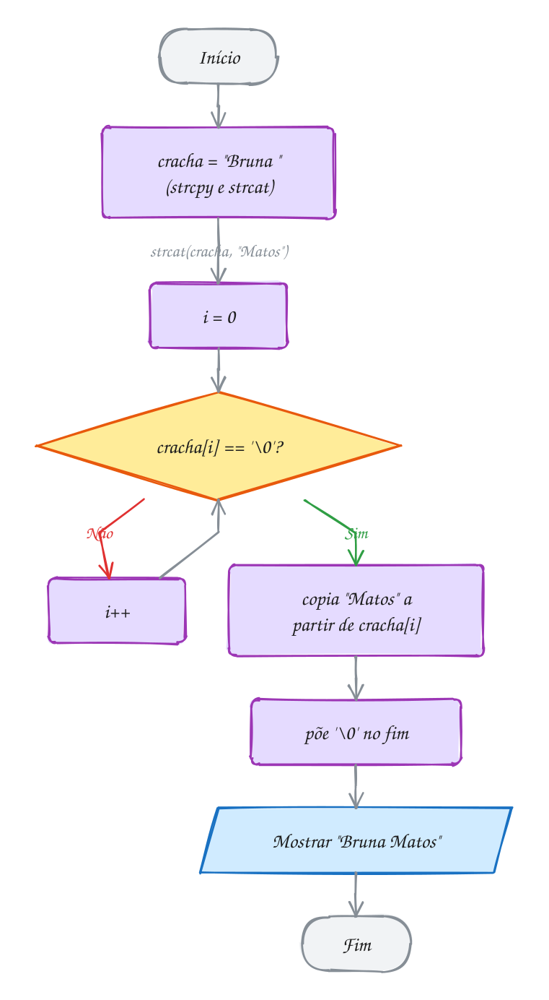</p>

> [!WARNING]
> **`strcpy` e `strcat` não sabem o tamanho do destino.** Escrevem até acabar
> a origem, caiba ou não. Com `char cracha[8]`, juntar "Bruna Matos" escreve 12
> bytes num vetor de 8: **estouro de buffer**, falha de segurança clássica.
> Antes, confira `strlen(dest) + strlen(orig) + 1 <= sizeof(dest)`. Outra
> pegadinha: `strcmp` devolve **0 quando são iguais**, e 0 é falso, então
> `if (strcmp(a, b))` significa "se forem **diferentes**". Escreva sempre
> `== 0`.

> [!TIP]
> **Por dentro do C:** a string não guarda o tamanho; o `strlen` anda até o
> `'\0'` a cada chamada. Por isso, nunca escreva `for (i = 0; i < strlen(s);
> i++)`: calcule antes do laço. E `strlen("Belém")` é **6**, porque o "é" em
> UTF-8 ocupa 2 bytes.

> [!NOTE]
> **Pergunta para você:** depois de `char s[10] = "banana";` e `s[3] = '\0';`,
> o que `printf("%s %zu %zu\n", s, strlen(s), sizeof(s));` mostra? As letras
> depois da posição 3 sumiram da memória?

### Hora de praticar

**Exemplo A081 · A etiqueta que não pode estourar**

```c
#include <stdio.h>
#include <string.h>

#define TAM 20 // a etiqueta impressa tem 19 caracteres + o '\0'

int main(void) {
    char etiqueta[TAM] = "SP"; // as outras 18 posições viram '\0'
    char partes[3][12] = {"/Campinas", "/Centro", "/Bloco B"};

    for (int i = 0; i < 3; i++) {
        // antes do strcat, a conta: o que tem + o que vem + 1 do '\0'
        size_t precisa = strlen(etiqueta) + strlen(partes[i]) + 1;
        if (precisa <= sizeof(etiqueta)) {
            strcat(etiqueta, partes[i]);
            printf("+ %-9s -> %s\n", partes[i], etiqueta);
        } else {
            printf("%s não cabe: precisaria de %zu bytes\n", partes[i], precisa);
        }
    }

    // strcmp compara códigos: maiúscula e minúscula são diferentes
    if (strcmp(etiqueta, "SP/Campinas/Centro") == 0) {
        printf("Igual a \"SP/Campinas/Centro\"\n");
    }
    if (strcmp(etiqueta, "sp/campinas/centro") != 0) {
        printf("Diferente de \"sp/campinas/centro\": 'S' é 83, 's' é 115\n");
    }
    return 0;
}
// Saída:
// + /Campinas -> SP/Campinas
// + /Centro   -> SP/Campinas/Centro
// /Bloco B não cabe: precisaria de 27 bytes
// Igual a "SP/Campinas/Centro"
// Diferente de "sp/campinas/centro": 'S' é 83, 's' é 115
```

```bash
gcc ~/LPEDC/material/A081.c -o ~/LPEDC/material/A081 && ~/LPEDC/material/A081
```

**Exemplo A082 · Percorrendo até o '\0'**

```c
#include <stdio.h>

// conta os caracteres sem strlen: anda até achar o '\0'
int tamanho(const char s[]) {
    int i = 0;
    while (s[i] != '\0') {
        i++;
    }
    return i;
}

// copia caractere por caractere e fecha com o '\0'
void copiar(char destino[], const char origem[]) {
    int i;
    for (i = 0; origem[i] != '\0'; i++) {
        destino[i] = origem[i];
    }
    destino[i] = '\0'; // sem esta linha, destino não termina
}

int main(void) {
    char cidade[] = "Belém";
    char copia[20];

    copiar(copia, cidade);
    copia[0] = 'X'; // a cópia é outro vetor

    printf("%s tem %d bytes antes do '\\0'\n", cidade, tamanho(cidade));
    printf("cópia alterada: %s\n", copia);

    cidade[3] = '\0'; // corta a string no meio
    printf("cortada: %s (%d)\n", cidade, tamanho(cidade));
    return 0;
}
// Saída:
// Belém tem 6 bytes antes do '\0'
// cópia alterada: Xelém
// cortada: Bel (3)
```

```bash
gcc ~/LPEDC/material/A082.c -o ~/LPEDC/material/A082 && ~/LPEDC/material/A082
```

#### Exercícios

**Exercício E241** · ★☆☆

Declare char cidade[] = "Manaus"; e mostre cada posição do vetor, INCLUINDO
a do '\0', com o caractere e o código. Para o '\0', mostre \0 no lugar do
caractere. No fim, mostre strlen e sizeof.


```text
Saída esperada:
[0] M 77
[1] a 97
[2] n 110
[3] a 97
[4] u 117
[5] s 115
[6] \0 0
strlen = 6, sizeof = 7
```

```bash
gcc ~/LPEDC/material/E241.c -o ~/LPEDC/material/E241 && ~/LPEDC/material/E241
```

**Exercício E243** · ★★☆

Implemente, sem usar o string.h, as suas versões de três funções:


```text
int meu_strlen(const char s[]);
void meu_strcat(char dest[], const char orig[]);
int meu_strcmp(const char a[], const char b[]);
```


meu_strcmp devolve 0 se forem iguais, um negativo se a vem antes e um
positivo se a vem depois. No main, teste:


```text
char usuario[30] = "joao";
meu_strcat(usuario, ".silva");
```


```text
Saída esperada:
joao.silva (10)
igual a "joao.silva"? sim
"ana" antes de "bia"? sim
"bia" antes de "bianca"? sim
```

```bash
gcc ~/LPEDC/material/E243.c -o ~/LPEDC/material/E243 && ~/LPEDC/material/E243
```

**Exercício E244** · ★★☆

Um palíndromo se lê igual nos dois sentidos: "arara", "osso". Escreva


```text
bool eh_palindromo(const char s[]);
```


que ignora a diferença entre maiúsculas e minúsculas ("Reviver" vale) e
teste com as palavras do vetor de strings abaixo (cada linha da matriz de
char é uma string):


```text
char palavras[5][12] = {"arara", "Reviver", "carro", "Osso", "A"};
```


```text
Saída esperada:
arara: sim
Reviver: sim
carro: não
Osso: sim
A: sim
```

```bash
gcc ~/LPEDC/material/E244.c -o ~/LPEDC/material/E244 && ~/LPEDC/material/E244
```

**Exercício E246** · ★★★

Uma biblioteca quer padronizar os títulos dos livros: a primeira letra de
cada palavra em maiúscula e as outras em minúscula. Escreva


```text
int capitalizar(char s[]);
```


que altera a string no lugar e devolve quantas palavras ela tem. Palavras
são separadas por um ou mais espaços (pode haver espaço no começo e no fim).


```text
char titulo[] = "  o SENHOR   dos aneis ";
```


```text
Saída esperada:
[  O Senhor   Dos Aneis ]
4 palavras
```

```bash
gcc ~/LPEDC/material/E246.c -o ~/LPEDC/material/E246 && ~/LPEDC/material/E246
```

---

## 0042 · Lendo strings

No cadastro de um app de consultas, a pessoa digita "Maria Clara" e o programa
responde "Olá, Maria!". Cadê o "Clara"? O `scanf("%s", nome)` lê **uma
palavra** e para no primeiro espaço. O "Clara" fica na entrada e atrapalha a
próxima leitura.

Regras do `scanf` com string:

- **sem `&`**: `scanf("%s", nome)`. O nome do vetor já é o endereço do começo
  (assunto 0038);
- para no primeiro espaço, tab ou Enter;
- **não sabe o tamanho do vetor**: 60 letras num `char nome[40]` são escritas
  todas. Limite com a largura: `scanf("%39s", nome)`.

Para ler uma **linha inteira**, com espaços, use o **`fgets`**:

```c
fgets(nome, sizeof(nome), stdin);
```

Os argumentos são onde guardar, quantos bytes cabem e de onde ler (`stdin` é o
teclado). O `fgets` lê até o Enter **ou** até encher o vetor (no máximo
`tamanho - 1` caracteres) e **sempre** põe o `'\0'` no fim. Com o tamanho
certo (`sizeof(nome)`), nunca estoura. Se a entrada acabar (Ctrl+D), devolve
`NULL`.

O `fgets` **guarda o `'\n'`** do Enter, se couber: "Maria Clara" chega como
`"Maria Clara\n"`. Para tirar, use o **`strcspn`** do `<string.h>`:
`strcspn(s, "\n")` devolve a posição do primeiro `'\n'` (ou o tamanho da
string, se não houver). Trocar essa posição por `'\0'` termina o texto antes do
Enter:

```c
nome[strcspn(nome, "\n")] = '\0';
```

Funciona nos dois casos: com `'\n'`, ele é trocado; sem, o `'\0'` é trocado por
ele mesmo. O `fgets` não tira o `\n` sozinho.

No exemplo, o vetor `nome` tem 40 bytes. O `fgets` copia os 11 caracteres, o
`'\n'` e o `'\0'`. O `strcspn` acha o `'\n'` na posição 11, e ele vira o novo
fim:

<p align="center">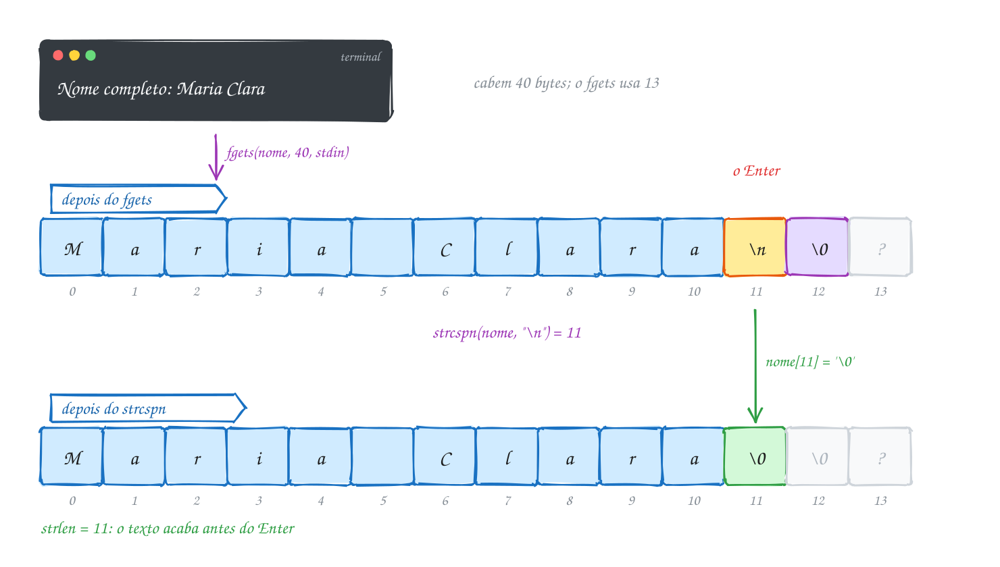</p>

O código mostra a string entre colchetes antes e depois da limpeza, para
enxergar o `'\n'`:

```c
#include <stdio.h>
#include <string.h>

int main(void) {
    char nome[40];

    printf("Nome completo: ");
    if (fgets(nome, sizeof(nome), stdin) == NULL) { // NULL: a entrada acabou
        printf("Nada foi digitado.\n");
        return 1;
    }
    printf("Lido: [%s]", nome);                     // o '\n' veio junto

    nome[strcspn(nome, "\n")] = '\0';               // troca o '\n' pelo fim
    printf("Limpo: [%s]\n", nome);

    printf("Olá, %s! Seu nome tem %zu caracteres.\n", nome, strlen(nome));
    return 0;
}
// Nome completo: Maria Clara
// Lido: [Maria Clara
// ]Limpo: [Maria Clara]
// Olá, Maria Clara! Seu nome tem 11 caracteres.
```

O teste do `NULL` vem primeiro: se a entrada acabou, não há nome para limpar.

<p align="center">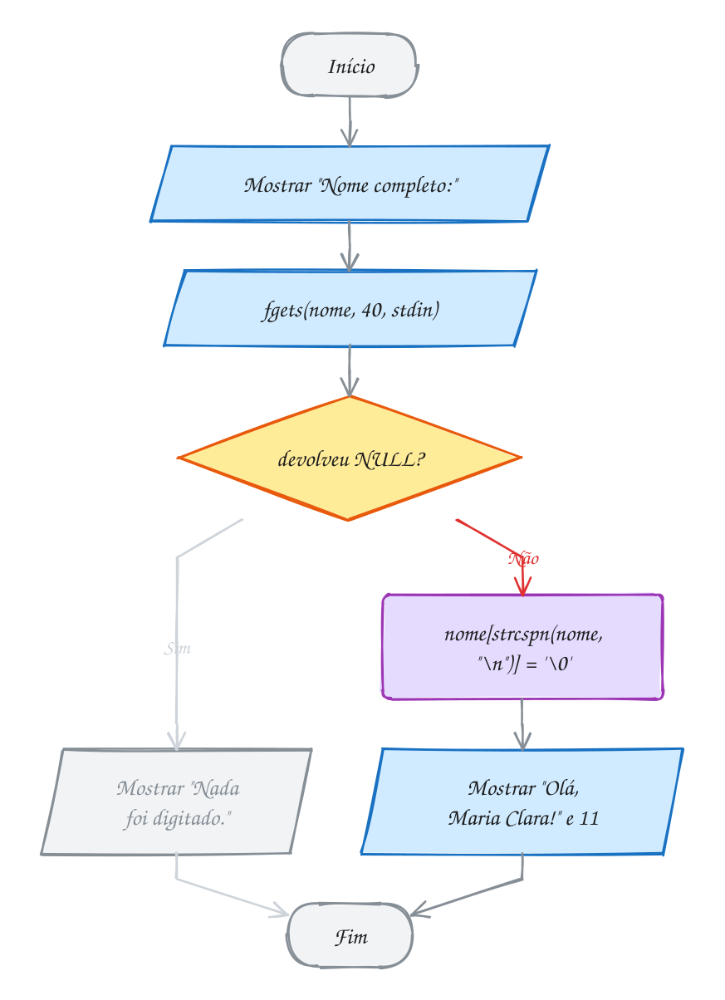</p>

> [!WARNING]
> **`scanf("%d")` seguido de `fgets` "pula" a leitura.** O `scanf` lê o número
> e deixa o Enter na entrada; o `fgets` pega esse `'\n'` e devolve uma linha
> vazia na hora. Descarte o resto da linha depois do `scanf`:
> `while ((c = getchar()) != '\n' && c != EOF) {}` (com `int c`). O exemplo A084
> faz isso. Não use `fflush(stdin)`, comum em material antigo: é
> comportamento indefinido.

> [!TIP]
> **Por dentro do C:** o terminal junta o que você digita num **buffer** e só
> entrega no Enter; `scanf`, `getchar` e `fgets` tiram bytes desse mesmo
> buffer, e o que um deixa o próximo pega. O **`gets`** lia uma linha sem
> receber o tamanho do vetor e estourava a memória (foi a brecha do worm de
> Morris, em 1988). Foi **removido no C11**; use `fgets`.

> [!NOTE]
> **Pergunta para você:** com `char s[5]` e o usuário digitando "uva" e
> Enter, quais bytes ficam em `s` depois do `fgets`? Quanto vale `strlen(s)`
> antes e depois da linha do `strcspn`? E se ele digitasse "melancia"?

### Hora de praticar

**Exemplo A083 · O recado que termina numa linha vazia**

```c
#include <stdio.h>
#include <string.h>

#define TAM 60

int main(void) {
    char linha[TAM];
    int linhas = 0;
    size_t letras = 0;

    printf("Digite o recado (linha vazia termina):\n");
    // para no fim da entrada (NULL) ou numa linha vazia, o que vier primeiro
    while (fgets(linha, sizeof(linha), stdin) != NULL) {
        linha[strcspn(linha, "\n")] = '\0';
        if (strlen(linha) == 0) { // só o Enter: depois de tirar o '\n', sobra ""
            break;
        }
        linhas++;
        letras += strlen(linha);
        printf("%d| %s\n", linhas, linha);
    }

    printf("%d linhas, %zu caracteres\n", linhas, letras);
    return 0;
}
// Digite o recado (linha vazia termina):
// Chego umas 19h
// 1| Chego umas 19h
// Deixa a chave com a vizinha
// 2| Deixa a chave com a vizinha
//
// 2 linhas, 41 caracteres
```

```bash
gcc ~/LPEDC/material/A083.c -o ~/LPEDC/material/A083 && ~/LPEDC/material/A083
```

**Exemplo A084 · Número, depois texto, e a linha que não coube**

```c
#include <stdio.h>
#include <string.h>

// joga fora o que sobrou na linha, até o '\n' (ou o fim da entrada)
void descartar_linha(void) {
    int c;
    while ((c = getchar()) != '\n' && c != EOF) {
    }
}

int main(void) {
    int idade;
    char cidade[12]; // cabem 10 letras + '\n' + '\0'

    printf("Idade: ");
    if (scanf("%d", &idade) != 1) {
        printf("Idade inválida.\n");
        return 1;
    }
    descartar_linha(); // sem isto, o fgets leria o '\n' que o scanf deixou

    printf("Cidade: ");
    if (fgets(cidade, sizeof(cidade), stdin) == NULL) {
        return 1;
    }

    size_t pos = strcspn(cidade, "\n");
    if (cidade[pos] == '\n') {
        cidade[pos] = '\0';  // coube: só tira o '\n'
    } else {
        descartar_linha();   // não coube: o resto ainda está na entrada
        printf("(nome longo demais, cortado)\n");
    }

    printf("%d anos, de %s\n", idade, cidade);
    return 0;
}
// Idade: 34
// Cidade: Campina Grande
// (nome longo demais, cortado)
// 34 anos, de Campina Gra
```

```bash
gcc ~/LPEDC/material/A084.c -o ~/LPEDC/material/A084 && ~/LPEDC/material/A084
```

#### Exercícios

**Exercício E248** · ★☆☆

O programa abaixo faz três leituras seguidas da mesma linha: dois scanf e um
fgets. Troque o printf final por um printf depois de CADA leitura, que
mostre o que ela pegou entre colchetes e o strlen. No fgets, mostre o
strlen antes e depois de tirar o '\n'. Rode digitando a linha


```text
Maria Clara Souza
```


```text
Saída esperada (depois da linha digitada):
1ª leitura: [Maria] (5)
2ª leitura: [Clar] (4)
fgets: 8 com o '\n', limpo: [a Souza] (7)
```


Para testar sem digitar: printf 'Maria Clara Souza\n' | ~/LPEDC/rodar
seguido do caminho deste arquivo.

```bash
gcc ~/LPEDC/material/E248.c -o ~/LPEDC/material/E248 && ~/LPEDC/material/E248
```

**Exercício E249** · ★★☆

Leia a quantidade de ingressos (um inteiro, com scanf) e, na linha seguinte,
o nome completo do comprador (pode ter espaços, use fgets e tire o '\n').
Depois mostre a quantidade e o nome. Cuidado: o '\n' que sobra depois do
scanf não pode atrapalhar a leitura do nome.


```text
Entrada:
2
Ana Lima
```


```text
Saída esperada:
2 ingresso(s) para Ana Lima
```

```bash
gcc ~/LPEDC/material/E249.c -o ~/LPEDC/material/E249 && ~/LPEDC/material/E249
```

**Exercício E250** · ★★☆

O cadastro do banco exige uma senha com pelo menos 8 caracteres, uma letra
maiúscula, uma minúscula e um dígito (espaço é permitido). Leia a senha com
fgets, tire o '\n' e mostre, para cada regra que falhar, uma linha "Falta:".
Se nenhuma falhar, mostre "Senha forte.".


```text
Entrada:
banana12
```


```text
Saída esperada:
Falta: letra maiúscula
```


```text
Entrada:
abc
```


```text
Saída esperada:
Falta: 8 caracteres (tem 3)
Falta: letra maiúscula
Falta: dígito
```


```text
Entrada:
Pao de Queijo 1
```


```text
Saída esperada:
Senha forte.
```

```bash
gcc ~/LPEDC/material/E250.c -o ~/LPEDC/material/E250 && ~/LPEDC/material/E250
```

**Exercício E252** · ★★★

O programa abaixo lê com fgets num vetor de só 6 bytes, num laço, até a
entrada acabar. Uma linha longa chega em pedaços, e cada pedaço parece uma
linha nova. Sem aumentar o vetor s, mude o programa para que ele:


```text
1. mostre cada pedaço numerado, entre colchetes, com o '\n' (quando vier)
   escrito como \n, sem quebrar a linha da tela;
2. perceba quando um pedaço fecha uma linha (termina em '\n') e mostre o
   número da linha e quantas letras ela teve, somando os pedaços;
3. no fim, mostre quantas leituras e quantas linhas de verdade houve.
```


Rode com printf 'abacaxi\nuva\n' | ~/LPEDC/rodar seguido do caminho deste
arquivo.


```text
Saída esperada:
pedaço 1: [abaca]
pedaço 2: [xi\n] fim da linha 1 (7 letras)
pedaço 3: [uva\n] fim da linha 2 (3 letras)
3 leituras, 2 linhas
```

```bash
gcc ~/LPEDC/material/E252.c -o ~/LPEDC/material/E252 && ~/LPEDC/material/E252
```

---

## 0043 · Juntando tudo

A escola do bairro abriu uma enquete para o mascote da festa junina: arara,
boto ou capivara. Os votos chegam um por linha, como cada pessoa digitou:
`boto`, `Arara`, `CAPIVARA`, `Tatu`... Você precisa contar, desenhar um
gráfico de barras e anunciar o vencedor.

O problema usa o módulo inteiro:

- **`fgets` num laço** (0042) lê um voto por linha até devolver `NULL`;
- **caracteres** (0040): `tolower` iguala "BOTO" e "boto";
- **strings** (0041): `strcspn` tira o `'\n'` e `strcmp` compara o voto com
  cada candidato;
- **matriz de `char`** (0039): os nomes dos candidatos, um por linha;
- **vetor de contadores** (0037): `votos[i]` conta os votos do candidato `i`,
  na mesma posição do nome na matriz;
- **funções que recebem vetores** (0038): `normalizar` altera a linha lida,
  `buscar` só lê.

O `main` cuida do laço e do resultado; cada função faz uma coisa só. `buscar`
devolve a posição ou -1, como no A076, e assim "Tatu" cai nos inválidos sem
`if` especial. O `(unsigned char)` no `tolower` protege contra votos com acento
(assunto 0040).

Cada linha passa pela mesma esteira: lê, normaliza, procura na matriz de nomes
e soma 1 no contador. "Tatu" não está na matriz e vai para os inválidos:

<p align="center">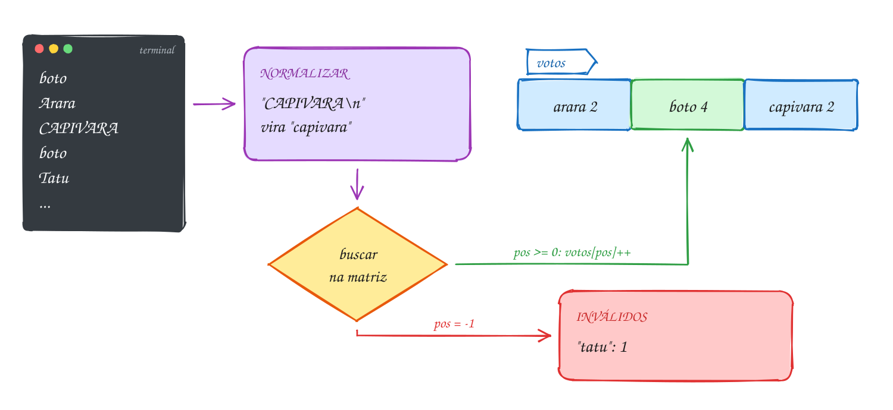</p>

Para testar sem digitar, salve o código num `.c`, compile com o gcc e mande os
votos com `printf 'boto\nArara\n...' | ./programa`:

```c
#include <stdio.h>
#include <string.h>
#include <ctype.h>

#define CANDIDATOS 3
#define TAM_NOME 12
#define TAM_LINHA 40

// tira o '\n' e deixa tudo em minúsculas: "BOTO\n" vira "boto"
void normalizar(char s[]) {
    s[strcspn(s, "\n")] = '\0';
    for (int i = 0; s[i] != '\0'; i++) {
        s[i] = (char) tolower((unsigned char) s[i]);
    }
}

// devolve a posição do candidato, ou -1 se o voto não bate com nenhum
int buscar(char nomes[][TAM_NOME], int n, const char voto[]) {
    for (int i = 0; i < n; i++) {
        if (strcmp(nomes[i], voto) == 0) {
            return i;
        }
    }
    return -1;
}

void mostrar_barra(const char nome[], int votos) {
    printf("%-9s ", nome);
    for (int i = 0; i < votos; i++) {
        putchar('#');
    }
    printf(" %d\n", votos);
}

int main(void) {
    char nomes[CANDIDATOS][TAM_NOME] = {"arara", "boto", "capivara"};
    int votos[CANDIDATOS] = {0};
    int invalidos = 0;
    char linha[TAM_LINHA];

    while (fgets(linha, sizeof(linha), stdin) != NULL) { // um voto por linha
        normalizar(linha);
        int pos = buscar(nomes, CANDIDATOS, linha);
        if (pos >= 0) {
            votos[pos]++;
        } else {
            invalidos++;
        }
    }

    int vencedor = 0;
    for (int i = 0; i < CANDIDATOS; i++) {
        mostrar_barra(nomes[i], votos[i]);
        if (votos[i] > votos[vencedor]) {
            vencedor = i;
        }
    }
    printf("Inválidos: %d\n", invalidos);
    printf("Vencedor: %s\n", nomes[vencedor]);
    return 0;
}
// Entrada (um voto por linha):
// boto, Arara, CAPIVARA, boto, Tatu, capivara, Boto, arara, boto
// Saída:
// arara     ## 2
// boto      #### 4
// capivara  ## 2
// Inválidos: 1
// Vencedor: boto
```

É um laço com sentinela (assunto 0025), e a sentinela é o `NULL` do `fgets`.
Dentro dele, uma decisão: achou o candidato ou não. O resultado só sai quando a
entrada acaba:

<p align="center">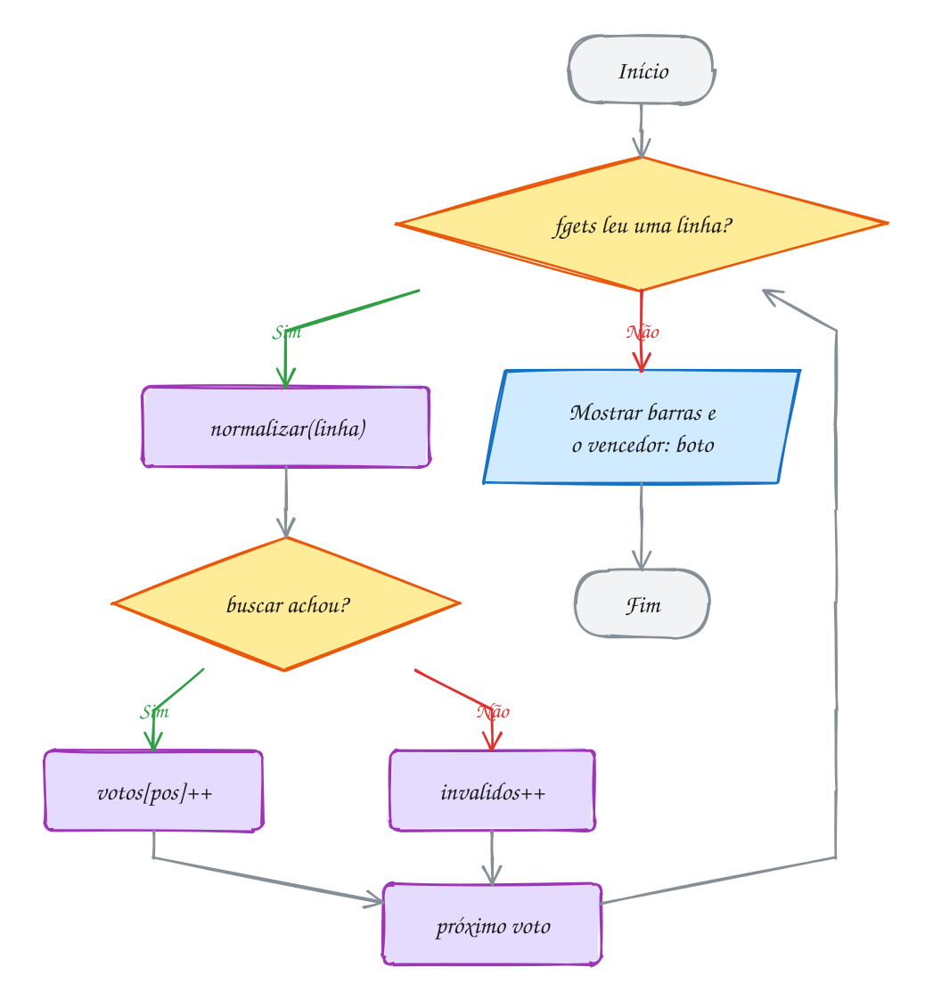</p>

Para ordenar os nomes em ordem alfabética, como string não se atribui com `=`,
trocar dois nomes é um `strcpy` triplo, com uma string auxiliar. O exemplo A086
ordena uma lista de chamada assim, prévia da ordenação por seleção (assunto
0092).

> [!WARNING]
> **Empate.** Com `votos[i] > votos[vencedor]`, o empate fica com quem aparece
> primeiro na matriz; com `>=`, com o último. É uma regra de negócio escondida
> no operador: decida de propósito. E `"boto "`, com espaço no fim, é inválido
> para o `strcmp`: `normalizar` não corta espaços.

> [!TIP]
> **Por dentro do C:** `char nomes[3][12]` são 36 bytes contínuos; "arara"
> usa 6 da linha 0 e o resto da linha é zero. `nomes[i]` fica em início +
> i × 12, e é essa conta que exige `[TAM_NOME]` no parâmetro de `buscar`. Nomes
> de tamanhos muito diferentes desperdiçam espaço; no módulo 07, a memória
> dinâmica guarda cada nome com o tamanho exato.

> [!NOTE]
> **Pergunta para você:** se a entrada tivesse uma linha em branco no meio, o
> que aconteceria com ela? E se um voto tivesse 50 letras, maior que o
> `linha[40]`? Pense no que o `fgets` faz com o resto da linha.

### Hora de praticar

**Exemplo A085 · Os logins da empresa nova**

```c
#include <stdio.h>
#include <string.h>
#include <ctype.h>

#define MAX 10
#define TAM_LOGIN 16
#define TAM_LINHA 60

// iniciais dos nomes do meio + o último nome, tudo em minúsculas:
// "Ana Paula Souza" vira "apsouza"
void gerar_login(const char nome[], char login[]) {
    int n = (int) strlen(nome);
    int ultimo = 0; // onde começa a última palavra
    for (int i = 0; i < n; i++) {
        if (nome[i] == ' ') {
            ultimo = i + 1;
        }
    }

    int j = 0;
    for (int i = 0; i < n && j < TAM_LOGIN - 2; i++) { // sobra lugar p/ dígito e '\0'
        int comeca_palavra = nome[i] != ' ' && (i == 0 || nome[i - 1] == ' ');
        if (i >= ultimo || comeca_palavra) {
            login[j] = (char) tolower((unsigned char) nome[i]);
            j++;
        }
    }
    login[j] = '\0';
}

int buscar(char logins[][TAM_LOGIN], int n, const char login[]) {
    for (int i = 0; i < n; i++) {
        if (strcmp(logins[i], login) == 0) {
            return i;
        }
    }
    return -1;
}

int main(void) {
    char logins[MAX][TAM_LOGIN];
    int total = 0;
    char linha[TAM_LINHA];

    while (total < MAX && fgets(linha, sizeof(linha), stdin) != NULL) {
        linha[strcspn(linha, "\n")] = '\0';
        if (strlen(linha) == 0) {
            continue; // linha em branco não vira login
        }

        char base[TAM_LOGIN];
        gerar_login(linha, base);
        strcpy(logins[total], base);

        // já existe? tenta base2, base3... até achar um livre
        for (int k = 2; buscar(logins, total, logins[total]) >= 0; k++) {
            strcpy(logins[total], base);
            size_t fim = strlen(logins[total]);
            logins[total][fim] = (char) ('0' + k);
            logins[total][fim + 1] = '\0';
        }

        printf("%-22s -> %s\n", linha, logins[total]);
        total++;
    }
    printf("%d logins criados\n", total);
    return 0;
}
// Entrada (um nome por linha, com uma linha em branco depois do 3º):
// Ana Paula Souza, Joao Lima, Antonio Pedro Souza, Bia Alves, Amanda P Souza
// Saída:
// Ana Paula Souza        -> apsouza
// Joao Lima              -> jlima
// Antonio Pedro Souza    -> apsouza2
// Bia Alves              -> balves
// Amanda P Souza         -> apsouza3
// 5 logins criados
```

```bash
gcc ~/LPEDC/material/A085.c -o ~/LPEDC/material/A085 && ~/LPEDC/material/A085
```

**Exemplo A086 · A lista de chamada em ordem alfabética**

```c
#include <stdio.h>
#include <string.h>

#define ALUNOS 6
#define TAM 20

// troca duas linhas da matriz: string não se atribui com =, então strcpy
void trocar(char a[], char b[]) {
    char aux[TAM];
    strcpy(aux, a);
    strcpy(a, b);
    strcpy(b, aux);
}

// ordenação por seleção: põe o menor que sobrou na posição i
void ordenar(char nomes[][TAM], int n) {
    for (int i = 0; i < n - 1; i++) {
        int menor = i;
        for (int j = i + 1; j < n; j++) {
            if (strcmp(nomes[j], nomes[menor]) < 0) {
                menor = j;
            }
        }
        if (menor != i) {
            trocar(nomes[i], nomes[menor]);
        }
    }
}

int main(void) {
    char nomes[ALUNOS][TAM] = {"Rafael", "Ana", "Carlos", "Beatriz", "Ana Clara", "Bruno"};

    ordenar(nomes, ALUNOS);
    for (int i = 0; i < ALUNOS; i++) {
        printf("%d. %s\n", i + 1, nomes[i]);
    }
    return 0;
}
// Saída:
// 1. Ana
// 2. Ana Clara
// 3. Beatriz
// 4. Bruno
// 5. Carlos
// 6. Rafael
```

```bash
gcc ~/LPEDC/material/A086.c -o ~/LPEDC/material/A086 && ~/LPEDC/material/A086
```

#### Exercícios

**Exercício E254** · ★☆☆

Complete as funções para mostrar a tabela de artilheiros do campeonato do
bairro, com o nome alinhado à esquerda em 10 colunas e o total no fim. O
main já está pronto.


```text
Saída esperada:
Nome        Gols
Tiago          7
Duda          12
Kauã          5
Lia            9
Total:        33
Artilheiro: Duda
```

```bash
gcc ~/LPEDC/material/E254.c -o ~/LPEDC/material/E254 && ~/LPEDC/material/E254
```

**Exercício E255** · ★★☆

Uma rodada de forca, com tudo fixo no código: a palavra secreta é "BANANA"
e os chutes, na ordem, estão no vetor abaixo. Depois de cada chute, mostre
a palavra com '_' nas letras ainda escondidas (separadas por espaço) e, se
a letra não existir na palavra, conte um erro. Pare assim que a palavra
estiver completa (os chutes que sobrarem não são usados).


```text
char secreta[] = "BANANA";
char chutes[] = {'A', 'E', 'N', 'B', 'O'};
```


```text
Saída esperada:
Chute A: _ A _ A _ A
Chute E: _ A _ A _ A (erro 1)
Chute N: _ A N A N A
Chute B: B A N A N A
Venceu com 1 erro(s)!
```

```bash
gcc ~/LPEDC/material/E255.c -o ~/LPEDC/material/E255 && ~/LPEDC/material/E255
```

**Exercício E256** · ★★☆

Valide um CPF digitado com fgets, com ou sem pontuação ("529.982.247-25"
ou "52998224725"). Os dois últimos dígitos são verificadores, calculados a
partir dos 9 primeiros:


```text
1º verificador: multiplique os 9 primeiros dígitos por 10, 9, 8, ..., 2
e some. Seja r o resto da soma por 11. Se r < 2, o dígito é 0; senão,
é 11 - r.
2º verificador: o mesmo com os 10 primeiros dígitos (os 9 + o 1º
verificador), multiplicados por 11, 10, ..., 2.
```


O CPF é válido se tiver exatamente 11 dígitos (ignore '.' e '-'; qualquer
outro caractere invalida), se os verificadores baterem e se os 11 dígitos
NÃO forem todos iguais (111.111.111-11 passa na conta, mas não vale).


```text
Entrada:
529.982.247-25
```


```text
Saída esperada:
CPF válido.
```


```text
Entrada:
529.982.247-26
```


```text
Saída esperada:
CPF inválido.
```

```bash
gcc ~/LPEDC/material/E256.c -o ~/LPEDC/material/E256 && ~/LPEDC/material/E256
```

**Exercício E258** · ★★★

Compressão RLE (run-length encoding): cada sequência de letras repetidas
vira a letra seguida de quantas vezes ela aparece. "aaabccdddd" vira
"a3b1c2d4". Para simplificar, a contagem é sempre um dígito só: uma
sequência de mais de 9 vira pedaços de 9 ("zzzzzzzzzzzz", 12 z, vira
"z9z3").

Leia uma linha com fgets, tire o '\n', comprima numa string saida[] e
mostre o resultado e os tamanhos. Se a versão comprimida não for menor,
avise que não compensa.


```text
Entrada:
aaabccdddd
```


```text
Saída esperada:
a3b1c2d4 (10 -> 8)
```


```text
Entrada:
abc
```


```text
Saída esperada:
a1b1c1 (3 -> 6): não compensa
```


```text
Entrada:
zzzzzzzzzzzz
```


```text
Saída esperada:
z9z3 (12 -> 4)
```

```bash
gcc ~/LPEDC/material/E258.c -o ~/LPEDC/material/E258 && ~/LPEDC/material/E258
```

---

## Desafios do módulo

Problemas extras que misturam os assuntos do módulo. Resolva num arquivo seu e
compile com as flags de estudo.

**1. Segundo maior.** Dado `int v[] = {14, 9, 27, 3, 27, 18};`, ache o segundo
maior valor **diferente** do maior, numa passada só, sem ordenar.

<details><summary>Resposta</summary>

O maior é 27 e o segundo maior é **18** (o outro 27 não conta). Guarde
`maior` e `segundo`. Para cada item: se for maior que `maior`, o antigo
`maior` desce para `segundo`; senão, se for menor que `maior` e maior que
`segundo`, ele vira o `segundo`. Comece os dois com o menor `int` possível
(`INT_MIN`, de `<limits.h>`).

</details>

**2. Remover duplicados de um vetor ordenado.** `int v[] = {2, 2, 3, 5, 5, 5,
8, 9, 9};` Deixe cada valor uma vez só, **no próprio vetor**, e devolva o novo
tamanho.

<details><summary>Resposta</summary>

Fica `2 3 5 8 9` e o tamanho **5**. Use dois índices: `escrita` começa em 1;
`leitura` anda de 1 até o fim e, sempre que `v[leitura] != v[escrita - 1]`,
copia para `v[escrita]` e avança `escrita`. Uma passada só, sem vetor extra.
As posições depois do novo tamanho continuam com valores velhos: quem chama
passa a usar só o tamanho devolvido.

</details>

**3. Juntar duas listas ordenadas.** `a = {1, 4, 9, 12}` e `b = {2, 3, 10}`.
Monte `c` com os 7 valores em ordem, sem ordenar `c` depois.

<details><summary>Resposta</summary>

`1 2 3 4 9 10 12`. Um índice em cada vetor: compare `a[i]` com `b[j]`, copie
o menor para `c[k]` e avance quem foi copiado. Quando um acabar, copie o
resto do outro. É o coração do *merge sort* (assunto 0094).

</details>

**4. Girar a matriz.** Gire `{{1, 2, 3}, {4, 5, 6}}` (2×3) 90° no sentido
horário, gerando uma 3×2.

<details><summary>Resposta</summary>

Resultado: `4 1 / 5 2 / 6 3`. A regra é `g[c][L - 1 - l] = m[l][c]`, com
`L` = número de linhas da original (2). Confira com a célula do 6: na
original está em `[1][2]`, na girada vai para `[2][0]`.

</details>

**5. Quadrado mágico?** Escreva `bool eh_magico(int m[][4])` para uma matriz
4×4: todas as linhas, colunas e as duas diagonais com a mesma soma. Teste com
`{{16, 3, 2, 13}, {5, 10, 11, 8}, {9, 6, 7, 12}, {4, 15, 14, 1}}`.

<details><summary>Resposta</summary>

É mágico: tudo soma **34**. Calcule a soma da primeira linha como referência
e compare as outras 9 somas (3 linhas, 4 colunas, 2 diagonais) com ela. Na
primeira diferente, devolva `false`.

</details>

**6. Anagramas.** "Roma" e "amor" são anagramas (mesmas letras, outra ordem).
Escreva `bool anagramas(const char a[], const char b[])` sem ordenar nada,
ignorando maiúsculas.

<details><summary>Resposta</summary>

Um vetor `int conta[26] = {0}`: cada letra de `a` soma 1 em
`conta[tolower(c) - 'a']`, cada letra de `b` subtrai 1. São anagramas se,
no fim, as 26 posições forem zero. "Roma" e "amor": **sim**. Antes de usar
o caractere como índice, confira com `isalpha`: um espaço ou um byte de "ã"
daria um índice fora do vetor.

</details>

**7. Achar uma palavra dentro da outra.** Sem usar `strstr`, escreva
`int posicao(const char texto[], const char busca[])` que devolve a posição em que
`busca` começa em `texto`, ou -1.

<details><summary>Resposta</summary>

`posicao("banana split", "na")` é **2**; `posicao("banana", "uva")` é **-1**.
Para cada `i` do texto, compare `texto[i + k]` com `busca[k]` enquanto forem
iguais e `busca[k] != '\0'`. Se chegou ao `'\0'` da busca, achou em `i`. Não
precisa de cuidado extra com o fim do texto: o `'\0'` do texto é diferente
de qualquer letra da busca, e a comparação para ali.

</details>

**8. Somar números gigantes.** `long long` vai até uns 9 × 10¹⁸. Some
`"98765432109876543210"` com `"12345678901234567890"` guardando os números
como strings, dígito a dígito, como na escola.

<details><summary>Resposta</summary>

**111111111011111111100**. Ande do último dígito para o primeiro nas duas
strings, some `(a[i] - '0') + (b[j] - '0') + vai_um`, guarde
`soma % 10` e leve `soma / 10`. O resultado sai de trás para frente: inverta
no fim (ou escreva de trás para frente num vetor com uma posição extra para o
último "vai um").

</details>

**9. Cifra de Vigenère.** É a César com um deslocamento diferente para cada
letra, dado por uma chave que se repete (A = 0, B = 1, ..., L = 11...).
Escreva `void vigenere(char texto[], const char chave[], int sentido)` que
cifra o texto no próprio vetor com `sentido` 1 e decifra com -1. No `main`,
cifre `char msg[] = "ATACARAGORA"` com a chave "LIMAO", mostre, decifre e
mostre de novo.

<details><summary>Resposta</summary>

```text
Cifrado:   LBMCOCISOFL
Decifrado: ATACARAGORA
```

A letra `i` do texto anda `chave[i % strlen(chave)] - 'A'` posições: A + L =
L, T + I = B, A + M = M, C + A = C, A + O = O, R + L = C, e assim por diante,
sempre com `% 26`. Para decifrar, ande `26 - desloc`, o que mantém a conta
sem número negativo.

</details>

**10. Jogo da vida, duas gerações.** Numa matriz 5×5 de 0 e 1, cada célula
viva com 2 ou 3 vizinhas vivas continua viva; uma morta com exatamente 3
vizinhas nasce; o resto morre ou fica morto. Escreva
`void proxima(int m[5][5], int nova[5][5])` e uma função que mostre a matriz
com `#` para viva e `.` para morta. Comece com um "pisca-pisca", uma linha de
três vivas no meio (`m[2][1]`, `m[2][2]`, `m[2][3]`), e mostre as gerações 0,
1 e 2.

<details><summary>Resposta</summary>

```text
Geração 0:
.....
.....
.###.
.....
.....
Geração 1:
.....
..#..
..#..
..#..
.....
Geração 2:
.....
.....
.###.
.....
.....
```

A linha vira **coluna** e volta a ser linha. O cuidado: calcule tudo numa
**segunda matriz**. Se você atualizar a original enquanto conta, as células
já mudadas atrapalham a contagem das vizinhas. A contagem de vizinhas é a do
campo minado (E234). Para a geração 2, chame `proxima(b, a)`: as duas
matrizes revezam.

</details>

## Lista de exercícios práticos

30 exercícios que misturam os assuntos do módulo, no ritmo da prova do PPGI. Arquivos P0501.c a P0530.c, em `material/`; resoluções em `_respostas/05-vetores-e-strings/lista/`.

### ★☆☆ Aquecimento

**Exercício P0501** · ★☆☆ · O melhor dia da padaria

A padaria do bairro anotou o faturamento de cada dia da semana, em reais:


```text
Dom 1830  Seg 920  Ter 1045  Qua 870  Qui 1110  Sex 1490  Sáb 2210
```


Guarde os valores num vetor int vendas[7] e os nomes dos dias numa matriz
de char dias[7][5]. Mostre o total da semana, a média (com 2 casas) e o dia
de maior e o de menor faturamento, pelo nome.


```text
Saída esperada:
Total da semana: R$ 9475
Média por dia: R$ 1353.57
Maior: Sáb (R$ 2210)
Menor: Qua (R$ 870)
```

**Dicas:**

1. Comece com i_maior = i_menor = 0 e compare cada vendas[i] com
   vendas[i_maior] e vendas[i_menor]. Guarde o ÍNDICE, não o valor.
2. Com o índice, o nome sai de dias[i_maior] e o valor de vendas[i_maior].
3. Para a média com casas, divida por 7.0, não por 7.
4. Por que [5] se "Sáb" tem 3 letras? Em UTF-8 o á ocupa 2 bytes: são 4
   bytes mais o '\0'. Com [4], o '\0' não cabe e o printf passa do fim.
5. Resposta esperada: total 9475, média 1353.57, maior no sábado e menor na
   quarta.

```bash
gcc ~/LPEDC/material/P0501.c -o ~/LPEDC/material/P0501 && ~/LPEDC/material/P0501
```

---

**Exercício P0502** · ★☆☆ · Procurando o código no estoque

O mercadinho guarda os códigos dos produtos num vetor, na ordem em que
foram cadastrados:


```text
int codigos[8] = {4410, 1270, 9031, 5588, 1270, 3302, 7745, 6120};
```


Escreva int buscar(const int v[], int n, int procurado), que devolve a
POSIÇÃO da primeira ocorrência de procurado no vetor, ou -1 se ele não
estiver lá. No main, procure 5588, 1270 e 2000 e mostre o resultado assim:


```text
Saída esperada:
Código 5588: posição 3
Código 1270: posição 1
Código 2000: não cadastrado
```

**Dicas:**

1. Uma busca linear: um for de 0 a n - 1 que compara v[i] com procurado.
2. Achou? return i na hora: é isso que garante a PRIMEIRA ocorrência.
3. O return -1 fica depois do laço: só chega lá quem não achou.
4. Resposta esperada: a saída acima (1270 aparece duas vezes, mas a busca
   para na posição 1).

```bash
gcc ~/LPEDC/material/P0502.c -o ~/LPEDC/material/P0502 && ~/LPEDC/material/P0502
```

---

**Exercício P0503** · ★☆☆ · A fila ao contrário

Na fila do posto de saúde, as senhas foram chamadas nesta ordem:


```text
int senhas[] = {101, 102, 105, 108, 110, 113, 117};
```


O auditor quer ver a fila de trás para a frente. Escreva
void inverter(int v[], int n), que inverte o vetor NO LUGAR (sem criar
outro vetor), e void mostrar(const int v[], int n). Mostre a fila antes e
depois de inverter.


```text
Saída esperada:
Antes:  101 102 105 108 110 113 117
Depois: 117 113 110 108 105 102 101
```

**Dicas:**

1. Troque v[0] com v[n - 1], v[1] com v[n - 2], e assim por diante.
2. Pare no meio (i < n / 2). Se for até o fim, você destroca tudo e o vetor
   volta a ser o que era.
3. A troca usa uma variável auxiliar: aux = v[i]; v[i] = v[j]; v[j] = aux;

```bash
gcc ~/LPEDC/material/P0503.c -o ~/LPEDC/material/P0503 && ~/LPEDC/material/P0503
```

---

**Exercício P0504** · ★☆☆ · O estoque das duas lojas

Uma rede de açaí tem duas lojas. Cada matriz 2x3 guarda os litros em
estoque (linhas: polpa pura e com guaraná; colunas: tamanhos P, M e G):


```text
int centro[2][3] = {{12, 20, 8}, {5, 9, 14}};
int bairro[2][3] = {{7, 3, 10}, {11, 6, 2}};
```


Monte a matriz total[2][3] com a soma das duas (posição por posição) e
mostre as três matrizes, cada número com %4d:


```text
Saída esperada:
Centro:
  12  20   8
   5   9  14
Bairro:
   7   3  10
  11   6   2
Total:
  19  23  18
  16  15  16
```

**Dicas:**

1. Soma de matrizes é feita casa a casa: total[i][j] = centro[i][j] +
   bairro[i][j], com dois for aninhados.
2. Escreva void mostrar(const char titulo[], int m[2][3]) para não repetir
   o laço de impressão três vezes.

```bash
gcc ~/LPEDC/material/P0504.c -o ~/LPEDC/material/P0504 && ~/LPEDC/material/P0504
```

---

**Exercício P0505** · ★☆☆ · A grade de horários deitada

A escola guarda quantas aulas cada professor dá em cada dia, numa matriz
3x4 (linhas: Ana, Beto, Cris; colunas: seg, ter, qua, qui):


```text
int aulas[3][4] = {{2, 4, 0, 3}, {1, 1, 5, 2}, {3, 0, 2, 4}};
```


A secretaria quer a tabela "deitada": uma linha por dia e uma coluna por
professor. Monte a TRANSPOSTA t[4][3] (t[j][i] = aulas[i][j]) e mostre as
duas, cada número com %3d:


```text
Saída esperada:
Por professor (3x4):
  2  4  0  3
  1  1  5  2
  3  0  2  4
Por dia (4x3):
  2  1  3
  4  1  0
  0  5  2
  3  2  4
```

**Dicas:**

1. A transposta de uma matriz L x C é C x L: o que era linha vira coluna.
2. Dois for: o de fora em i (0 a 2), o de dentro em j (0 a 3), e a linha
   t[j][i] = aulas[i][j]; dentro.
3. Para mostrar, os limites mudam: t tem 4 linhas de 3 colunas.

```bash
gcc ~/LPEDC/material/P0505.c -o ~/LPEDC/material/P0505 && ~/LPEDC/material/P0505
```

---

**Exercício P0506** · ★☆☆ · É identidade?

A matriz identidade tem 1 na diagonal principal e 0 em todo o resto.
Escreva:


```text
void montar_identidade(int m[4][4]);
bool eh_identidade(int m[4][4]);
```


No main, monte a identidade 4x4 e mostre-a. Depois teste eh_identidade com
ela e com a matriz abaixo (que tem um 1 fora do lugar), e mostre o
resultado de cada teste:


```text
int quase[4][4] = {{1, 0, 0, 0}, {0, 1, 0, 1}, {0, 0, 1, 0}, {0, 0, 0, 1}};
```


```text
Saída esperada:
1 0 0 0
0 1 0 0
0 0 1 0
0 0 0 1
id é identidade? sim
quase é identidade? não
```

**Dicas:**

1. Na diagonal principal, a linha é igual à coluna: m[i][j] = (i == j).
2. Em eh_identidade, o valor esperado em cada casa também é (i == j): se
   alguma casa for diferente disso, return false na hora.
3. Para mostrar o bool, use um operador ternário: ok ? "sim" : "não".

```bash
gcc ~/LPEDC/material/P0506.c -o ~/LPEDC/material/P0506 && ~/LPEDC/material/P0506
```

---

**Exercício P0507** · ★☆☆ · Raio-x do endereço

O cadastro da loja recebeu o endereço abaixo e quer saber do que ele é
feito. Conte, com as funções do ctype.h, as letras maiúsculas, as
minúsculas, os dígitos, os espaços e o resto (pontuação):


```text
char endereco[] = "Rua 7 de Setembro, 1500 - Centro";
```


```text
Saída esperada:
Maiúsculas: 3
Minúsculas: 16
Dígitos: 5
Espaços: 6
Outros: 2
Total: 32 (strlen = 32)
```

**Dicas:**

1. Ande até o '\0': for (int i = 0; endereco[i] != '\0'; i++).
2. Uma cadeia de if/else if com isupper, islower, isdigit e isspace; o que
   sobrar cai no else (outros).
3. Confira: a soma das cinco contagens tem que dar o strlen do endereço.
4. Resposta esperada: a saída acima (32 caracteres no total).

```bash
gcc ~/LPEDC/material/P0507.c -o ~/LPEDC/material/P0507 && ~/LPEDC/material/P0507
```

---

**Exercício P0508** · ★☆☆ · O nome do crachá

O crachá do congresso mostra o sobrenome em maiúsculas, uma vírgula e o
primeiro nome. Com


```text
char nome[] = "Raimunda";
char sobrenome[] = "Nonato";
```


monte numa terceira string char cracha[40] o texto "NONATO, Raimunda",
usando strcpy e strcat. Depois mostre o crachá, o tamanho dele (strlen) e
as iniciais "R.N.".


```text
Saída esperada:
Crachá: NONATO, Raimunda
Tamanho: 16
Iniciais: R.N.
```

**Dicas:**

1. strcpy(cracha, sobrenome) copia; depois passe cada posição de cracha
   por toupper até o '\0'.
2. strcat(cracha, ", ") e strcat(cracha, nome) completam o texto.
3. As iniciais são nome[0] e sobrenome[0]: mostre com %c.

```bash
gcc ~/LPEDC/material/P0508.c -o ~/LPEDC/material/P0508 && ~/LPEDC/material/P0508
```

---

**Exercício P0509** · ★☆☆ · Conserte o contador de letras

A função conta abaixo deveria dizer quantas vezes uma letra aparece no nome
do rio. Ela tem DOIS erros de propósito, e o gcc avisa dos dois: rode, leia
os avisos (warning) e conserte. Depois de consertado, o programa mostra:


```text
Saída esperada:
Letra o: 3
Letra a: 2
Letra z: 1
```

**Dicas:**

1. Um vetor que chega como parâmetro vira só um endereço: sizeof s dá o
   tamanho de um endereço (8), não o da string. Use o '\0' para parar.
2. Dentro do if, = é atribuição; para comparar, use ==.

```bash
gcc ~/LPEDC/material/P0509.c -o ~/LPEDC/material/P0509 && ~/LPEDC/material/P0509
```

---

**Exercício P0510** · ★☆☆ · Quantos de cada número

Uma sapataria vendeu 14 pares de tênis num sábado, com estes números:


```text
int vendidos[14] = {38, 40, 37, 42, 40, 39, 40, 35, 38, 41, 40, 44, 38, 37};
```


A loja trabalha do 34 ao 44. Conte quantos pares de cada número saíram,
usando um vetor de contadores de 11 posições (uma por número), e mostre só
os números que venderam, com um # por par:


```text
Saída esperada:
35: # (1)
37: ## (2)
38: ### (3)
39: # (1)
40: #### (4)
41: # (1)
42: # (1)
44: # (1)
```

**Dicas:**

1. O número 34 vai na posição 0, o 35 na 1... o número n vai em n - 34.
2. Zere o vetor de contadores na declaração: int cont[11] = {0};
3. Um laço passa pelos 14 pares fazendo cont[vendidos[i] - 34]++; outro
   laço mostra de 0 a 10, pulando quem tem contador 0.

```bash
gcc ~/LPEDC/material/P0510.c -o ~/LPEDC/material/P0510 && ~/LPEDC/material/P0510
```

### ★★☆ Para pensar

**Exercício P0511** · ★★☆ · Quanto custa cada receita em cada mercado

Uma doceira faz duas receitas. A matriz q (2x3) diz quantos quilos de cada
ingrediente cada receita usa (colunas: farinha, açúcar, chocolate), e a
matriz p (3x2) diz o preço do quilo de cada ingrediente em dois mercados:


```text
double q[2][3] = {{2.0, 1.0, 0.5},    // bolo
                  {1.0, 0.5, 1.0}};   // brigadeirão
double p[3][2] = {{5.50, 4.90},       // farinha: mercado A, B
                  {4.20, 4.80},       // açúcar
                  {38.00, 41.50}};    // chocolate
```


O custo de cada receita em cada mercado é o produto c = q x p (2x2):
c[i][j] = soma de q[i][k] * p[k][j], para k de 0 a 2. Escreva a função


```text
void multiplicar(double a[2][3], double b[3][2], double c[2][2]);
```


e mostre o resultado, dizendo o mercado mais barato para cada receita:


```text
Saída esperada:
Bolo: A = R$ 34.20, B = R$ 35.35 -> mais barato no A
Brigadeirão: A = R$ 45.60, B = R$ 48.80 -> mais barato no A
```

**Dicas:**

1. Três for aninhados: i (linhas de q), j (colunas de p) e k (o índice
   que "anda junto": coluna de q e linha de p).
2. Zere c[i][j] antes do laço em k e acumule com +=.
3. Uma matriz 2x3 só pode ser multiplicada por uma que tem 3 linhas: o
   número de colunas da primeira tem que ser o de linhas da segunda.
4. Resposta esperada: bolo R$ 34.20 x R$ 35.35 (A) e brigadeirão
   R$ 45.60 x R$ 48.80 (A).

```bash
gcc ~/LPEDC/material/P0511.c -o ~/LPEDC/material/P0511 && ~/LPEDC/material/P0511
```

---

**Exercício P0512** · ★★☆ · A tabela de distâncias é simétrica?

Uma transportadora de Manaus guarda as distâncias (em km) entre 4 bases numa
matriz 4x4. Se a ida e a volta têm a mesma distância, a matriz é SIMÉTRICA:
m[i][j] == m[j][i] para todo i e j. Uma delas foi digitada com erro:


```text
int d1[4][4] = {{0, 12, 30, 8}, {12, 0, 25, 17},
                {30, 25, 0, 21}, {8, 17, 21, 0}};
int d2[4][4] = {{0, 12, 30, 8}, {12, 0, 25, 17},
                {30, 52, 0, 21}, {8, 17, 21, 0}};
```


Escreva bool simetrica(int m[4][4], int erro[2]), que devolve se a matriz
é simétrica e, quando não for, guarda em erro[0] e erro[1] a linha e a coluna
do primeiro par diferente (com coluna maior que a linha).
Mostre também a soma dos números acima da diagonal principal (que, numa
tabela simétrica, é a soma de todas as distâncias, cada uma uma vez só):


```text
Saída esperada:
d1: simétrica, soma acima da diagonal = 113 km
d2: NÃO simétrica em [1][2] (25 x 52)
```

**Dicas:**

1. Só precisa olhar acima da diagonal: j começa em i + 1. Cada par (i, j)
   é comparado com (j, i) uma vez só.
2. Um vetor passado para a função é alterado no original: é assim que
   erro[0] e erro[1] voltam para o main.
3. Acima da diagonal principal, j > i.
4. Resposta esperada: d1 simétrica com soma 113; d2 não simétrica, primeiro
   erro em [1][2] (25 x 52).

```bash
gcc ~/LPEDC/material/P0512.c -o ~/LPEDC/material/P0512 && ~/LPEDC/material/P0512
```

---

**Exercício P0513** · ★★☆ · Busca binária nos CEPs

A transportadora guarda 10 CEPs de entrega em ordem crescente:


```text
int ceps[10] = {69005010, 69020030, 69040000, 69050010, 69053000,
                69057040, 69060000, 69075351, 69083000, 69097290};
```


Num vetor ORDENADO dá para buscar sem olhar um por um: compare com o do
meio; se o procurado for menor, descarte a metade de cima; se for maior, a
de baixo. Escreva int busca_binaria(const int v[], int n, int x, int
passos[1]), que devolve a posição de x (ou -1) e guarda em passos[0]
quantas comparações com o meio fez. Procure 69075351, 69005010 e 69099999:


```text
Saída esperada:
CEP 69075351: posição 7 em 2 passos
CEP 69005010: posição 0 em 3 passos
CEP 69099999: não atendido (4 passos)
```

**Dicas:**

1. Use ini = 0 e fim = n - 1. Enquanto ini <= fim: meio = (ini + fim) / 2.
2. Se v[meio] == x, achou. Se x < v[meio], fim = meio - 1; senão,
   ini = meio + 1.
3. Conte um passo a cada volta do while (cada vez que olha o meio).
4. Com 10 itens, a busca linear chega a 10 comparações; a binária, no pior
   caso, a 4.

```bash
gcc ~/LPEDC/material/P0513.c -o ~/LPEDC/material/P0513 && ~/LPEDC/material/P0513
```

---

**Exercício P0514** · ★★☆ · Encaixar na fila preferencial

A fila do cartório é ordenada pela idade, do mais velho para o mais novo.
Ela cabe até 10 pessoas e hoje tem 6:


```text
int idades[10] = {91, 84, 77, 70, 66, 61};
int n = 6;
```


Escreva int inserir(int v[], int n, int cap, int idade), que encaixa a idade
no lugar certo (empurrando os mais novos uma casa para a direita) e devolve
o novo tamanho. Se a fila estiver cheia, não mexe e devolve n. Insira 80,
95 e 60, mostrando a fila depois de cada inserção:


```text
Saída esperada:
Entrou 80: 91 84 80 77 70 66 61
Entrou 95: 95 91 84 80 77 70 66 61
Entrou 60: 95 91 84 80 77 70 66 61 60
```

**Dicas:**

1. Comece do fim: i = n - 1. Enquanto i >= 0 e v[i] < idade, copie v[i]
   para v[i + 1] e ande i para trás.
2. Quando o laço para, o lugar livre é i + 1.
3. Por que do fim? Se você empurrar a partir do começo, cada cópia apaga o
   valor que ainda ia ser copiado.

```bash
gcc ~/LPEDC/material/P0514.c -o ~/LPEDC/material/P0514 && ~/LPEDC/material/P0514
```

---

**Exercício P0515** · ★★☆ · Tirar da vitrine o que acabou

A loja on-line tem 9 produtos, cada um com um código e o estoque, em dois
vetores paralelos (a posição i dos dois fala do mesmo produto):


```text
int codigo[9]  = {11, 12, 13, 14, 15, 16, 17, 18, 19};
int estoque[9] = { 4,  0,  7,  0,  0,  2,  9,  0,  1};
```


Escreva int compactar(int cod[], int est[], int n), que remove dos DOIS
vetores os produtos com estoque 0, sem usar vetor auxiliar e mantendo a
ordem, e devolve quantos sobraram. Mostre os vetores antes e depois:


```text
Saída esperada:
Antes (9):  11:4 12:0 13:7 14:0 15:0 16:2 17:9 18:0 19:1
Depois (5): 11:4 13:7 16:2 17:9 19:1
```

**Dicas:**

1. Use dois índices: i lê todas as posições e k marca onde o próximo
   produto que fica vai ser escrito.
2. Se est[i] != 0, copie cod[i] e est[i] para a posição k e faça k++.
3. No fim, k é o novo tamanho. É uma passada só: n operações, e não n²
   como "apagar e empurrar tudo" a cada zero.
4. Resposta esperada: a saída acima (sobram 5 produtos).

```bash
gcc ~/LPEDC/material/P0515.c -o ~/LPEDC/material/P0515 && ~/LPEDC/material/P0515
```

---

**Exercício P0516** · ★★☆ · A mediana do tempo de entrega

O app de entregas mediu, em minutos, as 9 últimas corridas de um motoboy:


```text
int tempos[9] = {34, 18, 52, 27, 41, 23, 19, 60, 30};
```


A média engana quando há corrida muito demorada; a MEDIANA é o valor do
meio depois de ordenar. Ordene o vetor com a ordenação por seleção (a cada
passo, ache o menor do que sobrou e troque com a posição i), mostrando o
vetor depois de cada passo. No fim, mostre a média e a mediana:


```text
Saída esperada:
Passo 1: 18 34 52 27 41 23 19 60 30
Passo 2: 18 19 52 27 41 23 34 60 30
Passo 3: 18 19 23 27 41 52 34 60 30
Passo 4: 18 19 23 27 41 52 34 60 30
Passo 5: 18 19 23 27 30 52 34 60 41
Passo 6: 18 19 23 27 30 34 52 60 41
Passo 7: 18 19 23 27 30 34 41 60 52
Passo 8: 18 19 23 27 30 34 41 52 60
Média: 33.78 min
Mediana: 30 min
```

**Dicas:**

1. Para i de 0 a n - 2: ache o índice do menor entre v[i] e v[n - 1] e
   troque-o com v[i]. Mostre o vetor depois da troca.
2. Com n ímpar, a mediana é v[n / 2] depois de ordenado.
3. A média usa double: soma / (double) n.
4. Resposta esperada: a saída acima (média 33.78, mediana 30).

```bash
gcc ~/LPEDC/material/P0516.c -o ~/LPEDC/material/P0516 && ~/LPEDC/material/P0516
```

---

**Exercício P0517** · ★★☆ · Arrumando os espaços do endereço

O formulário do correio recebeu um endereço cheio de espaços sobrando:


```text
char end[] = "   Av.   Eduardo    Ribeiro ,  620   ";
```


Escreva void normalizar(char s[]), que arruma a string NO LUGAR: tira os
espaços do começo e do fim, deixa um espaço só entre as palavras e tira o
espaço que vem antes de vírgula. Mostre a string entre colchetes, antes e
depois, e o strlen de cada uma:


```text
Saída esperada:
Antes:  [   Av.   Eduardo    Ribeiro ,  620   ] (37)
Depois: [Av. Eduardo Ribeiro, 620] (24)
```

**Dicas:**

1. Mesma ideia de compactar vetor: i lê, k escreve. A string só encolhe,
   então escrever em s[k] nunca atropela o que i ainda vai ler.
2. Ao ver um espaço, não escreva na hora: lembre que "tem espaço pendente".
   Ao ver um caractere que não é espaço, escreva o espaço pendente antes
   (se k > 0 e o caractere não for vírgula) e depois o caractere.
3. Espaço pendente no fim é simplesmente descartado. Feche com s[k] = '\0'.
4. Resposta esperada: [Av. Eduardo Ribeiro, 620], com 24 caracteres.

```bash
gcc ~/LPEDC/material/P0517.c -o ~/LPEDC/material/P0517 && ~/LPEDC/material/P0517
```

---

**Exercício P0518** · ★★☆ · O telefone digitado de qualquer jeito

O cadastro da farmácia lê o celular com fgets, e cada pessoa digita de um
jeito: "92 99123-4567", "(92)991234567", "92.99123.4567". Escreva um
programa que lê UMA linha com fgets num char linha[40], guarda só os
dígitos numa outra string e:
- se sobrarem exatamente 11 dígitos, mostra "Celular: (92) 99123-4567";
- senão, mostra "Inválido: 9 dígitos" (com a quantidade que veio).


```text
Exemplo de execução 1:
(92)991234567
Celular: (92) 99123-4567
```


```text
(a primeira linha é a que você digita; só a segunda é do programa)
```


```text
Exemplo de execução 2:
9912-3456
Inválido: 8 dígitos
```

**Dicas:**

1. if (fgets(linha, sizeof linha, stdin) == NULL) return 1; protege contra
   entrada vazia. O '\n' do fim nem atrapalha: ele não é dígito.
2. Monte digitos[] com isdigit, um k que avança e digitos[k] = '\0' no fim.
3. Para formatar, mostre os caracteres por posição: %c%c para o DDD, depois
   5 dígitos, traço e os 4 últimos. Um laço de i a j ajuda.
4. Teste com printf '(92)991234567\n' | ./rodar ... e com 9912-3456.
5. Resposta esperada: as duas execuções acima.

```bash
gcc ~/LPEDC/material/P0518.c -o ~/LPEDC/material/P0518 && ~/LPEDC/material/P0518
```

---

**Exercício P0519** · ★★☆ · Totais da planilha de vendas

A sorveteria anota as vendas (em potes) de 3 sabores em 4 semanas:


```text
int v[3][4] = {{40, 35, 52, 48}, {22, 30, 27, 31}, {15, 18, 12, 25}};
```


Complete o programa: falta calcular o total de cada sabor (linha), o total
de cada semana (coluna) e o total geral, para a tabela sair assim:


```text
Saída esperada:
            S1   S2   S3   S4  Total
Coco        40   35   52   48    175
Manga       22   30   27   31    110
Tapioca     15   18   12   25     70
Total       77   83   91  104    355
```

**Dicas:**

1. O total da linha i soma v[i][j] variando j; o da coluna j soma v[i][j]
   variando i.
2. Você pode fazer tudo num par de for só, acumulando em tot_lin[i],
   tot_col[j] e geral ao mesmo tempo.
3. Confira: a soma dos totais das linhas é igual à soma dos totais das
   colunas, e as duas dão o total geral.
4. Resposta esperada: a saída acima (total geral 355).

```bash
gcc ~/LPEDC/material/P0519.c -o ~/LPEDC/material/P0519 && ~/LPEDC/material/P0519
```

---

**Exercício P0520** · ★★☆ · O meu atoi

O extrato do banco chegou como texto, e cada lançamento é uma string:


```text
char lanc[5][8] = {"1200", "-350", "+80", "-1045", "75"};
```


Escreva int texto_para_int(const char s[]), que converte a string em int
SEM usar atoi nem sscanf: aceita um sinal opcional (+ ou -) no começo e
para no primeiro caractere que não é dígito. Mostre cada valor convertido
e o saldo final (a soma de todos):


```text
Saída esperada:
"1200" -> 1200
"-350" -> -350
"+80" -> 80
"-1045" -> -1045
"75" -> 75
Saldo: -40
```

**Dicas:**

1. Um char dígito vira número com s[i] - '0' (o '7' vale 55 na tabela
   ASCII, o '0' vale 48: 55 - 48 = 7).
2. Para juntar os dígitos: valor = valor * 10 + (s[i] - '0'). "1200" passa
   por 1, 12, 120, 1200.
3. Guarde o sinal numa variável (1 ou -1) e multiplique no fim.
4. Resposta esperada: a saída acima (saldo -40).

```bash
gcc ~/LPEDC/material/P0520.c -o ~/LPEDC/material/P0520 && ~/LPEDC/material/P0520
```

### ★★★ Desafio

**Exercício P0521** · ★★★ · Quem ganhou o jogo da velha

Escreva o juiz do jogo da velha. O tabuleiro tem 3 linhas de 3 casas, com
'X', 'O' ou '.' (casa vazia), e cada linha é uma string: char t[3][4] (3
letras + '\0'). Escreva:


```text
char vencedor(char t[3][4]);  // 'X', 'O' ou '.' se ninguém fechou linha
bool cheio(char t[3][4]);     // true se não sobrou casa vazia
```


e void julgar(char t[3][4]), que mostra o tabuleiro e uma das três frases:
"Vitória do X", "Deu velha" ou "Em andamento". Julgue os quatro tabuleiros
abaixo (escritos linha por linha):


```text
"XOX" "OXO" "OOX"   (X na diagonal principal)
"OXX" "XOO" "XOX"   (cheio, ninguém fechou)
"XX." "OO." "..."   (ainda tem jogo)
"XXO" "XOX" "OXX"   (O na diagonal secundária)
```


```text
Saída esperada:
Jogo 1:
X O X
O X O
O O X
Vitória do X
Jogo 2:
O X X
X O O
X O X
Deu velha
Jogo 3:
X X .
O O .
. . .
Em andamento
Jogo 4:
X X O
X O X
O X X
Vitória do O
```

**Dicas:**

1. São 8 linhas para conferir: 3 linhas, 3 colunas e 2 diagonais. Para cada
   uma, as três casas são iguais e diferentes de '.'?
2. Um laço de i = 0 a 2 confere a linha i (t[i][0], t[i][1], t[i][2]) e a
   coluna i (t[0][i], t[1][i], t[2][i]). As diagonais ficam fora do laço.
3. A ordem dos testes no julgar importa: um tabuleiro cheio pode ter
   vencedor, então pergunte primeiro por vencedor.
4. Os tabuleiros estão em char jogos[4][3][4]: 4 jogos, 3 linhas, 3 letras
   + '\0'. jogos[k] é um char [3][4]: passe direto para a função.

```bash
gcc ~/LPEDC/material/P0521.c -o ~/LPEDC/material/P0521 && ~/LPEDC/material/P0521
```

---

**Exercício P0522** · ★★★ · A matriz esparsa do estacionamento

Um estacionamento de 5 andares e 6 setores anota quantos carros estão
parados em cada setor. Quase tudo é zero:


```text
int m[5][6] = {{0, 0, 3, 0, 0, 0},
               {0, 0, 0, 0, 0, 7},
               {1, 0, 0, 0, 0, 0},
               {0, 0, 4, 0, 0, 0},
               {0, 2, 0, 0, 0, 0}};
```


Guardar 30 números para 5 que importam é desperdício. Uma MATRIZ ESPARSA
guarda só as triplas (linha, coluna, valor) dos que não são zero. Escreva:
- int compactar(int m[5][6], int t[][3]): preenche as triplas, varrendo

```text
linha por linha, e devolve quantas são;
```

- int transpor(int t[][3], int k, int tt[][3]): monta as triplas da

```text
transposta (6x5) JÁ em ordem de linha, sem montar a matriz cheia;
```

- void mostrar_cheia(int t[][3], int k, int linhas, int colunas): mostra

```text
a matriz completa a partir das triplas (zero onde não há tripla).
```


```text
Saída esperada:
5 de 30 casas guardadas
Triplas: (0,2,3) (1,5,7) (2,0,1) (3,2,4) (4,1,2)
Transposta: (0,2,1) (1,4,2) (2,0,3) (2,3,4) (5,1,7)
Transposta cheia (6x5):
0 0 1 0 0
0 0 0 0 2
3 0 0 4 0
0 0 0 0 0
0 0 0 0 0
0 7 0 0 0
```

**Dicas:**

1. Na transposta, a tripla (l, c, v) vira (c, l, v). Para sair em ordem de
   linha da transposta, percorra as colunas c = 0 a 5 da original e, para
   cada uma, passe pelas k triplas pegando as que têm coluna c.
2. Para mostrar a cheia sem montar a matriz, para cada (i, j) procure uma
   tripla com linha i e coluna j; achou, mostra o valor; senão, 0.
3. As triplas cabem em int t[30][3] (no pior caso, nada é zero).

```bash
gcc ~/LPEDC/material/P0522.c -o ~/LPEDC/material/P0522 && ~/LPEDC/material/P0522
```

---

**Exercício P0523** · ★★★ · Lendo a planilha em CSV

Uma planilha de municípios do Amazonas foi exportada em CSV, com os campos
separados por ponto e vírgula (cidade;UF;população). Uma das linhas veio com
a UF vazia:


```text
char linhas[4][48] = {"Manaus;AM;2063547", "Parintins;;96372",
                      "Itacoatiara;AM;103598", "Manacapuru;AM;101883"};
```


Escreva int separar(const char linha[], char campos[3][32]), que copia
cada campo para uma linha de campos (sem usar strtok) e devolve quantos
campos achou. Converta a população com a sua própria conta de dígitos (nada
de atoi). Mostre uma tabela alinhada, com "??" no lugar da UF vazia, e no
fim o total e a cidade mais populosa:


```text
Saída esperada:
Manaus       AM   2063547
Parintins    ??     96372
Itacoatiara  AM    103598
Manacapuru   AM    101883
Total: 2365400 habitantes
Mais populosa: Manaus
```

**Dicas:**

1. Ande pela linha com i; um índice c diz em qual campo você está e um j,
   a posição dentro do campo. Ao ver ';', feche o campo atual com '\0',
   faça c++ e j = 0. No fim da linha, feche o último campo.
2. Campo vazio não é problema: ";;" fecha um campo com zero caracteres,
   e campos[1][0] fica '\0'. Teste com campos[1][0] == '\0'.
3. Para a tabela: printf("%-12s %-3s %8d\n", ...).
4. Total e maior: guarde o índice da maior população, como no P0501.
5. Resposta esperada: a saída acima (total 2365400, Manaus a maior).

```bash
gcc ~/LPEDC/material/P0523.c -o ~/LPEDC/material/P0523 && ~/LPEDC/material/P0523
```

---

**Exercício P0524** · ★★★ · A nuvem de palavras do trava-língua

Conte quantas vezes cada palavra aparece no trava-língua abaixo, sem
diferenciar maiúscula de minúscula. Mostre as palavras na ordem em que
apareceram pela primeira vez e, no fim, a mais repetida (no empate, a que
apareceu antes):


```text
char frase[] = "O rato roeu a roupa do Rei de Roma, e o rei riu do rato.";
```


Guarde as palavras distintas numa matriz char palavras[20][16] e as
contagens num vetor int cont[20].


```text
Saída esperada:
o      2
rato   2
roeu   1
a      1
roupa  1
do     2
rei    2
de     1
roma   1
e      1
riu    1
Distintas: 11
Mais repetida: o (2 vezes)
```

**Dicas:**

1. Monte cada palavra numa string auxiliar char p[16]: junte letras
   (isalpha), já em minúscula (tolower); ao ver algo que não é letra, se p
   tiver alguma letra, feche com '\0' e processe.
2. Processar: procure p em palavras[0..n-1] com strcmp. Achou na posição
   k? cont[k]++. Não achou? strcpy(palavras[n], p), cont[n] = 1, n++.
3. Cuidado com a última palavra: se a frase não terminar com pontuação,
   ela fica em p quando o laço acaba. Processe-a depois do laço também.
4. Resposta esperada: a saída acima (11 palavras distintas).

```bash
gcc ~/LPEDC/material/P0524.c -o ~/LPEDC/material/P0524 && ~/LPEDC/material/P0524
```

---

**Exercício P0525** · ★★★ · A ronda em espiral

O vigia de um galpão com 4 corredores de 5 prateleiras faz a ronda em
espiral: vai pela borda de cima da esquerda para a direita, desce pela
direita, volta por baixo, sobe pela esquerda e repete por dentro, até passar
por todas. Cada prateleira tem um número:


```text
int g[4][5] = {{ 1,  2,  3,  4,  5},
               { 6,  7,  8,  9, 10},
               {11, 12, 13, 14, 15},
               {16, 17, 18, 19, 20}};
```


Mostre a ordem da ronda e, depois, uma matriz com o número do passo em que
cada prateleira foi visitada (%3d):


```text
Saída esperada:
Ronda: 1 2 3 4 5 10 15 20 19 18 17 16 11 6 7 8 9 14 13 12
  1  2  3  4  5
 14 15 16 17  6
 13 20 19 18  7
 12 11 10  9  8
```

**Dicas:**

1. Guarde quatro limites: cima = 0, baixo = 3, esq = 0, dir = 4. Cada
   volta percorre a linha cima (e faz cima++), a coluna dir (dir--), a
   linha baixo de trás para a frente (baixo--) e a coluna esq de baixo
   para cima (esq++).
2. Depois de cima++ e de dir--, o retângulo pode ter sumido: confira
   cima <= baixo antes da linha de baixo e esq <= dir antes da coluna da
   esquerda. Sem isso, matrizes não quadradas repetem casas.
3. Um contador de passos que começa em 1 preenche a segunda matriz.

```bash
gcc ~/LPEDC/material/P0525.c -o ~/LPEDC/material/P0525 && ~/LPEDC/material/P0525
```

---

**Exercício P0526** · ★★★ · O cartão passa no teste de Luhn?

Antes de mandar o pagamento para o banco, a loja confere se o número do
cartão foi digitado direito com o algoritmo de Luhn:
1. Ande pelos dígitos da DIREITA para a esquerda.
2. Dobre um dígito sim, um não, começando pelo SEGUNDO da direita. Se o

```text
 dobro passar de 9, subtraia 9 (8 * 2 = 16 vira 7).
```

3. Some tudo. O número é válido se a soma for múltipla de 10.

Escreva bool luhn(const char s[], int soma[1]), que ignora espaços (e recusa
qualquer
outro caractere que não seja dígito) e confira os quatro números abaixo,
mostrando também a soma:


```text
"4539 1488 0343 6467"
"4539 1488 0343 6468"
"79927398713"
"1234-5678"
```


```text
Saída esperada:
4539 1488 0343 6467  soma  80 -> válido
4539 1488 0343 6468  soma  81 -> inválido
79927398713          soma  70 -> válido
1234-5678            soma  -1 -> inválido
```

**Dicas:**

1. Comece em i = strlen(s) - 1 e desça até 0. Um contador de dígitos já
   vistos (pos) diz se este é para dobrar: dobra quando pos é ímpar.
2. Guarde a soma em soma[0], para o main mostrar; ponha -1 lá quando
   aparecer caractere inválido.
3. Espaço: continue. Não dígito e não espaço: return false.

```bash
gcc ~/LPEDC/material/P0526.c -o ~/LPEDC/material/P0526 && ~/LPEDC/material/P0526
```

---

**Exercício P0527** · ★★★ · A lista de chamada em ordem

A professora digitou a lista de chamada fora de ordem:


```text
char nomes[7][20] = {"Thiago", "Ana Clara", "Bruno", "Yasmin",
                     "Ana Beatriz", "Davi", "Larissa"};
```


Escreva void ordenar(char v[][20], int n), que põe os nomes em ordem
alfabética com o método da bolha (compare vizinhos com strcmp e troque com
strcpy e uma string auxiliar). Depois escreva int buscar(char v[][20], int
n, const char nome[]), uma busca binária que devolve a posição do nome ou
-1. Mostre a lista numerada e procure "Davi" e "Carla":


```text
Saída esperada:
1. Ana Beatriz
2. Ana Clara
3. Bruno
4. Davi
5. Larissa
6. Thiago
7. Yasmin
Davi: número 4 da chamada
Carla: não está na lista
```

**Dicas:**

1. Bolha: para cada passada, compare v[j] com v[j + 1]; se
   strcmp(v[j], v[j + 1]) > 0, troque as duas strings (aux = v[j], v[j] =
   v[j + 1], v[j + 1] = aux, cada atribuição com strcpy).
2. Não dá para trocar strings com =: o nome de um vetor não é uma variável
   que se possa atribuir.
3. Na busca binária, strcmp(nome, v[meio]) negativo manda para a metade de
   baixo; positivo, para a de cima; zero, achou.
4. Resposta esperada: a saída acima ("Ana Beatriz" vem antes de "Ana Clara"
   porque 'B' < 'C').

```bash
gcc ~/LPEDC/material/P0527.c -o ~/LPEDC/material/P0527 && ~/LPEDC/material/P0527
```

---

**Exercício P0528** · ★★★ · O sudoku 4x4 está certo?

Um sudoku 4x4 está certo quando cada linha, cada coluna e cada um dos
quatro quadrados 2x2 tem os números 1, 2, 3 e 4, sem repetir. Escreva
bool valido(int s[4][4]), que mostra a PRIMEIRA regra quebrada (no formato
da saída) e devolve false, ou devolve true se tudo estiver certo. Teste:


```text
int a[4][4] = {{1, 2, 3, 4}, {3, 4, 1, 2}, {2, 1, 4, 3}, {4, 3, 2, 1}};
int b[4][4] = {{1, 2, 3, 4}, {3, 4, 1, 2}, {2, 1, 4, 3}, {4, 2, 3, 1}};
int c[4][4] = {{1, 2, 3, 4}, {2, 1, 4, 3}, {3, 4, 1, 2}, {4, 3, 2, 1}};
```


```text
Saída esperada:
a:
  certo
b:
  erro na coluna 1
  errado
c:
  erro no quadrado 0
  errado
```

**Dicas:**

1. Escreva bool tem_1_a_4(int g[4]): marca num vetor bool visto[5] cada
   número; se aparecer um fora de 1..4 ou repetido, false.
2. Para cada linha i, copie s[i][0..3] num vetor g e teste. Para cada
   coluna j, copie s[0..3][j]. Para cada quadrado (q de 0 a 3), o canto é
   linha (q / 2) * 2 e coluna (q % 2) * 2.
3. Teste nessa ordem (linhas, colunas, quadrados) e pare no primeiro erro.
4. Resposta esperada: a saída acima (b quebra a coluna 1; c só quebra um
   quadrado, apesar das linhas e colunas certas).

```bash
gcc ~/LPEDC/material/P0528.c -o ~/LPEDC/material/P0528 && ~/LPEDC/material/P0528
```

---

**Exercício P0529** · ★★★ · Conserte o gerador de etiquetas

O programa abaixo gera a etiqueta de envio "PARA: <nome> - <cidade>/<UF>"
e confere se o envio é expresso. Ele tem TRÊS erros de propósito:
- um o gcc avisa (leia o warning);
- um o AddressSanitizer acusa quando roda;
- um é de lógica: o programa roda, mas a etiqueta sai errada.

Conserte os três. Ele deve mostrar:


```text
Saída esperada:
PARA: Benedita Farias - Boa Vista/RR
Tamanho: 36
Envio expresso: entrega em 2 dias
```

**Dicas:**

1. Comparar strings com == compara os ENDEREÇOS dos dois vetores, não o
   texto: use strcmp(...) == 0.
2. Conte os bytes da etiqueta: "PARA: " (6) + nome + " - " (3) + cidade +
   "/" + UF + '\0'. Cabe em 24?
3. strcpy no lugar do primeiro strcat apaga o que já estava lá; strcat no
   lugar do strcpy inicial lê lixo. Olhe qual dos dois está em cada linha.
4. Resposta esperada: a saída acima (etiqueta com 36 caracteres).

```bash
gcc ~/LPEDC/material/P0529.c -o ~/LPEDC/material/P0529 && ~/LPEDC/material/P0529
```

---

**Exercício P0530** · ★★★ · O fatorial que não cabe no long long

O fatorial de 30 tem 33 dígitos, e um unsigned long long vai só até uns
1,8 x 10^19 (20 dígitos). Calcule 30! guardando o número num vetor de
dígitos, int d[60], com o dígito das unidades em d[0], o das dezenas em
d[1], e assim por diante, e um int tam com quantos dígitos estão em uso.

Escreva void multiplicar(int d[], int tam[1], int k), que multiplica o
número por um int pequeno k (até 100) e atualiza tam[0] (um vetor de uma
posição volta alterado para o main, como o erro[] do P0512), do jeito que
se faz à mão: dígito a dígito, levando o "vai um". Mostre 10!, 20!, 25! e
30!, com o número de dígitos de cada um:


```text
Saída esperada:
10! = 3628800 (7 dígitos)
20! = 2432902008176640000 (19 dígitos)
25! = 15511210043330985984000000 (26 dígitos)
30! = 265252859812191058636308480000000 (33 dígitos)
```

**Dicas:**

1. Comece com d[0] = 1 e tam[0] = 1 (o número 1).
2. Para multiplicar por k: vai = 0; para i de 0 a tam - 1, faça
   x = d[i] * k + vai; d[i] = x % 10; vai = x / 10.
3. Depois do laço, o "vai" que sobrou vira dígitos novos no fim: enquanto
   vai > 0, d[tam++] = vai % 10 e vai /= 10.
4. Para mostrar, ande de d[tam - 1] até d[0]: o dígito mais importante
   está no fim do vetor.
5. Resposta esperada: a saída acima (30! =
   265252859812191058636308480000000).

```bash
gcc ~/LPEDC/material/P0530.c -o ~/LPEDC/material/P0530 && ~/LPEDC/material/P0530
```

## Questões no estilo da prova

Questões no formato da Prova de Conhecimentos do PPGI, com uma alternativa
certa. Nas de vetor, desenhe as gavetas com os índices; nas de string, inclua
a gaveta do `'\0'`.

**1.** Numa máquina de 64 bits (ponteiro de 8 bytes, `int` de 4), o que
`tam(v)` mostra quando `v` é um `int v[10]`?

```c
void tam(int v[]) {
    printf("%zu\n", sizeof(v) / sizeof(v[0]));
}
```

- (A) 10
- (B) 40
- (C) 2
- (D) 1
- (E) 8

<details><summary>Gabarito</summary>

**(C).** Um vetor passado para função chega como o **endereço** do primeiro
item. Dentro de `tam`, `v` é um `int *`: `sizeof(v)` é 8, e 8 / 4 = 2. A
conta `sizeof(v) / sizeof(v[0])` só funciona no bloco em que o vetor foi
declarado; por isso o tamanho vai como parâmetro. O gcc avisa
(`-Wsizeof-array-argument`). Veja 0038.

</details>

**2.** Sobre vetores e strings em C, considere as afirmações e marque a alternativa CORRETA.

- **I.** Uma função que recebe um vetor escreve nas gavetas do vetor original.
- **II.** Dentro dessa função, `sizeof(v) / sizeof(v[0])` dá a quantidade de elementos do vetor original.
- **III.** `char s[] = "ufam";` ocupa 5 bytes.
- **IV.** `strlen("ufam")` vale 5.

- (A) Apenas I e III
- (B) Apenas I e II
- (C) Apenas II e IV
- (D) Apenas III e IV
- (E) Apenas I, II e III

<details><summary>Gabarito</summary>

**(A).** I é verdadeira: o que se copia é o endereço do vetor. II é falsa: dentro da função, `v` é um ponteiro, e o `sizeof` mede o ponteiro. III é verdadeira: 4 letras mais o `'\0'`. IV é falsa: o `strlen` não conta o `'\0'` e dá 4. Veja 0038 e 0041.

</details>

**3.** Qual a saída?

```c
char s[20] = "Manaus";
printf("%zu %zu\n", strlen(s), sizeof(s));
```

- (A) 6 6
- (B) 7 20
- (C) 6 7
- (D) 6 20
- (E) 20 20

<details><summary>Gabarito</summary>

**(D).** `strlen` conta os caracteres **antes** do `'\0'`: 6. `sizeof` mede
o vetor inteiro, 20 bytes, usados ou não. O 7 seria `sizeof` de
`char s[] = "Manaus"`, em que o compilador conta o `'\0'`. Veja 0041.

</details>

**4.** Em `int m[3][4];`, quantos `int` ficam na memória **antes** de
`m[2][1]`?

- (A) 6
- (B) 9
- (C) 5
- (D) 3
- (E) 8

<details><summary>Gabarito</summary>

**(B).** O C guarda a matriz linha após linha (*row-major*). Antes da linha
2 vêm 2 linhas de 4, e dentro dela vem 1 item: `2 * 4 + 1 = 9`. O 5 seria a
conta por colunas (`1 * 3 + 2`), que não é a do C. Veja 0039.

</details>

**5.** Considere as afirmações sobre vetores e matrizes e marque a alternativa CORRETA.

- **I.** Depois de `int w[5] = {3, 1};`, os três últimos itens valem 0.
- **II.** Se `int v[5]`, o acesso a `v[5]` é checado em tempo de execução e interrompe o programa com erro.
- **III.** Em `int m[3][4]`, `sizeof(m)` vale `12 * sizeof(int)`.
- **IV.** Uma string de `n` caracteres precisa de pelo menos `n + 1` bytes de vetor.

- (A) Apenas I e II
- (B) Apenas II e III
- (C) Apenas I e IV
- (D) Apenas III e IV
- (E) Apenas I, III e IV

<details><summary>Gabarito</summary>

**(E).** I é verdadeira: com inicializador, o que falta vira zero. II é falsa: o C não confere índice, e `v[5]` é comportamento indefinido. III é verdadeira: a matriz tem 12 itens, no escopo onde foi declarada. IV é verdadeira: falta a gaveta do `'\0'` se o vetor for justo. Veja 0037, 0039 e 0041.

</details>

**6.** Qual a saída?

```c
char t[10] = "ufam\0pg";
int i = 0;
while (t[i])
    i++;
printf("%d\n", i);
```

- (A) 7
- (B) 10
- (C) 4
- (D) 6
- (E) 8

<details><summary>Gabarito</summary>

**(C).** O laço para no primeiro byte zero, e o `\0` escrito no meio do
texto é um zero de verdade, na posição 4. Para qualquer função de string, o
`t` é só `"ufam"`; o `pg` continua na memória, mas ninguém enxerga. Veja 0041.

</details>

**7.** Qual a saída?

```c
char x[] = "PPGI", y[] = "PPGI";
printf("%d %d\n", x == y, strcmp(x, y) == 0);
```

- (A) 1 1
- (B) 0 1
- (C) 1 0
- (D) 0 0
- (E) não compila: vetores não se comparam com `==`

<details><summary>Gabarito</summary>

**(B).** `x == y` compara os **endereços** dos dois vetores, que são
diferentes: 0. Quem compara o conteúdo, letra por letra, é o `strcmp`, que
devolve 0 quando são iguais. Compila, com o aviso
`comparison between two arrays`. Veja 0041.

</details>

**8.** Sobre o trecho abaixo, é correto afirmar:

```c
int v[5] = {1, 2, 3, 4, 5};
int s = 0;
for (int i = 0; i <= 5; i++)
    s += v[i];
```

- (A) `s` termina em 15, porque o C ignora índices fora do vetor.
- (B) `s` termina em 15, porque `v[5]` vale sempre 0.
- (C) o compilador rejeita o código, porque o laço passa do fim do vetor.
- (D) a última volta lê `v[5]`, que não existe: é comportamento indefinido.
- (E) o laço roda 5 vezes, de `v[0]` a `v[4]`.

<details><summary>Gabarito</summary>

**(D).** Num vetor de 5, os índices vão de 0 a 4. O `<=` faz uma sexta
volta, com `i = 5`, que lê o que estiver depois do vetor. O C **não confere**
índices: compila sem erro e o resultado pode ser qualquer coisa. O detector
do gcc com as flags de estudo acusa `index 5 out of bounds`. Veja 0037.

</details>

**9.** Qual o valor de `s`?

```c
#define N 3
int m[N][N] = {{2, 0, 1}, {3, 5, 4}, {6, 7, 8}};
int s = 0;
for (int k = 0; k < N; k++)
    s += m[k][N - 1 - k];
```

- (A) 12
- (B) 15
- (C) 13
- (D) 36
- (E) 9

<details><summary>Gabarito</summary>

**(A).** `m[k][N - 1 - k]` percorre a **diagonal secundária**: `m[0][2]`,
`m[1][1]` e `m[2][0]`, ou 1 + 5 + 6 = 12. O 15 é a diagonal principal
(`m[k][k]`: 2 + 5 + 8); o 36, a matriz inteira. Veja 0039.

</details>

**10.** A pessoa digita `Manaus` e aperta Enter. O que o trecho mostra?

```c
char lin[10];
if (fgets(lin, sizeof lin, stdin) != NULL)
    printf("%zu\n", strlen(lin));
```

- (A) 6
- (B) 10
- (C) 8
- (D) 9
- (E) 7

<details><summary>Gabarito</summary>

**(E).** O `fgets` guarda a linha **com** o `'\n'` do Enter, quando cabe:
`lin` fica `"Manaus\n"`, 7 caracteres antes do `'\0'`. Por isso o costume de
tirar o `'\n'` com `lin[strcspn(lin, "\n")] = '\0';`. Veja 0042.

</details>

## Questões de provas do PPGI

Questões reais das provas de conhecimento do PPGI/UFAM, na íntegra e com o gabarito oficial. Resolva no papel, em 3 minutos por questão, e só depois abra o gabarito.

**Edital 032/2016 · Questão 20**

Considere as afirmações abaixo:

I) Pode-se determinar o maior elemento de um vetor ordenado a um custo constante (realizando-se um número constante de operações)\
II) Pode-se inverter a ordem de um vetor já ordenado fazendo-se um número de trocas de posições igual à metade do tamanho do tamanho do vetor e sem ter que criar uma cópia do mesmo\
III) O Quicksort é sempre a opção mais rápida (com menor tempo de execução) para ordenar qualquer vetor de qualquer tamanho e com qualquer ordenação inicial das chaves\

Sobre as afirmações, sabe-se que:

- a) Todas as afirmações são verdadeiras
- b) Apenas I é verdadeira
- c) Apenas I e III são verdadeiras
- d) Apenas I e II são verdadeiras
- e) Nenhuma das alternativas anteriores

<details><summary>Gabarito</summary>

**D.** I (último elemento) e II (n/2 trocas) verdadeiras; III falsa (Quicksort tem pior caso quadrático). Assunto 0038.

</details>

**Edital 023/2018 · Questão 13**

Considere uma estrutura de dados do tipo vetor. Com respeito a tal estrutura, é CORRETO que seus componentes são, caracteristicamente:

- a) heterogêneos e com acesso FIFO.
- b) heterogêneos e com acesso LIFO.
- c) heterogêneos e com acesso indexado-sequencial.
- d) homogêneos e acesso não indexado.
- e) homogêneos e de acesso aleatório por intermédio de índices.

<details><summary>Gabarito</summary>

**E.** Vetor: homogêneo e acesso aleatório por índice. Assunto 0037.

</details>

**Edital 061/2018 · Questão 02**

Matrizes são estruturas de dados de n-dimensões. Por simplicidade, chamaremos de matrizes as matrizes bidimensionais numéricas (que armazenam números inteiros). Sendo assim, marque a alternativa INCORRETA.

- a) Uma matriz de m linhas e n colunas contêm (m * n) dados.
- b) Uma matriz pode ser representada utilizando listas ligadas.
- c) A soma dos elementos de uma matriz pode ser calculada fazendo dois laços aninhados, um sobre as linhas e o outro sobre as colunas.
- d) A soma de duas matrizes de m linhas e n colunas resulta em uma matriz de 2*m linhas e 2*n colunas.
- e) O produto de duas matrizes de n linhas e n colunas resulta em uma matriz de n linhas e n colunas.

<details><summary>Gabarito</summary>

**D.** Soma de matrizes m×n dá m×n, não 2m×2n. Assunto 0039.

</details>


## Para ler mais

- BACKES, A. *Linguagem C: completa e descomplicada*. Rio de Janeiro: Elsevier, 2013. Caps. 6 (vetores e matrizes), 7 (strings) e 9 (passagem de vetores para funções).
- BACKES, A. *Linguagem C: apostila*. Uberlândia: UFU, [s.d.]. Seções de vetores, matrizes e strings.
- DEITEL, P.; DEITEL, H. *C: como programar*. 6. ed. São Paulo: Pearson, 2011. Caps. 6 (arrays) e 8 (caracteres e strings).
- DEITEL, P.; DEITEL, H. *C: how to program*. 7. ed. Boston: Pearson, 2013. Caps. 6 e 8.
- CELES, W.; CERQUEIRA, R.; RANGEL, J. L. *Introdução a estruturas de dados: com técnicas de programação em C*. 2. ed. Rio de Janeiro: Elsevier, 2016. Capítulos de vetores, matrizes e cadeias de caracteres.
- TENENBAUM, A. M.; LANGSAM, Y.; AUGENSTEIN, M. J. *Estruturas de dados usando C*. São Paulo: Makron Books, 1995. Cap. 1: vetores e strings em C.
- ANTONELLO, R. *Linguagem C*. 1. ed. Disponível em: <http://www.antonello.com.br>. Cap. 8.
- LEAL, G. C. L. *Algoritmos e lógica de programação II*. Maringá: Unicesumar, 2016. Unidades de vetores, matrizes e strings.
- KERNIGHAN, B. W.; RITCHIE, D. M. *C: a linguagem de programação padrão ANSI*. Rio de Janeiro: Campus, 1989. Caps. 1.6, 1.9 e 5.
- CPPREFERENCE. *Null-terminated byte strings*. Disponível em: <https://en.cppreference.com/w/c/string/byte>.
- LINUX MAN-PAGES PROJECT. *fgets(3)*, *string(3)*, *ctype(3)*. Disponível em: <https://man7.org/linux/man-pages/>.
- SPAFFORD, E. H. The Internet worm program: an analysis. *ACM SIGCOMM Computer Communication Review*, v. 19, n. 1, p. 17-57, 1989.
