<!-- Gerado por _gerador. Para mudar este arquivo, edite _gerador/modulos/05-vetores-e-strings/ e rode: cd _gerador && npm run gerar -->

# Módulo 05 · Vetores, matrizes e strings

Até aqui, cada variável guardava um valor. Para guardar as notas de uma turma,
os passos de um mês ou as poltronas de um cinema, você precisaria de dezenas
de variáveis. Este módulo traz a primeira **estrutura de dados** do curso: o
**vetor**, várias variáveis do mesmo tipo com um nome só, lado a lado na
memória.

No C, o vetor é só um bloco de
bytes. Tamanho fixo, nenhum `length`, nenhuma conferência de índice. Parece
pouco, e é justamente por isso que é rápido: acessar a posição 999 custa o
mesmo que acessar a 0.

E o texto? No C não existe um tipo string. Uma string é um vetor de `char`
que termina num byte zero, o `'\0'`. Entender isso explica metade das falhas
de segurança da história do software, e é o que separa quem "usa C" de quem
entende o que o C faz.

## O que você vai aprender

- declarar, inicializar e percorrer **vetores**, e por que o índice começa em 0
- passar vetores para **funções** (vai o endereço, não uma cópia) e proteger com `const`
- **matrizes**: linhas, colunas e a memória contínua por baixo
- **caracteres** como números: a tabela ASCII e o `<ctype.h>`
- **strings**: o `'\0'`, o `<string.h>` e o estouro de buffer
- **ler texto** do teclado com segurança: `fgets`, o `'\n'` e por que o `gets` foi banido

## Como estudar cada assunto

1. Leia o texto e olhe o **diagrama da ideia**: é o exemplo desenhado, com os
   mesmos valores do código.
2. Leia o código e rode. Mude um valor, um tamanho, um índice. Quebre de
   propósito e veja o que o AddressSanitizer diz.
3. Siga o **fluxograma** com o dedo: quase todo assunto aqui é um laço.
4. Faça os exercícios. ★☆☆ é aquecimento, ★★☆ pede raciocínio, ★★★ é
   desafio. As dicas vêm logo abaixo do enunciado: tente antes de ler.

No meio de cada assunto tem uma **Pergunta para você**. Responda antes de rodar.

## As cores e as formas

Caixa azul é dado entrando ou saindo, roxa é o programa fazendo alguma coisa,
amarela é pergunta. Verde é o caminho que o exemplo segue e o resultado;
cinza, o que ele não usa; vermelho, erro. Nos vetores, cada gaveta tem o
índice embaixo, em cinza.

<p align="center"></p>

## Antes de começar

Você vai usar tudo dos módulos anteriores, principalmente laços (`for` e
laços aninhados), os padrões contador, acumulador e maior/menor, e funções com
parâmetros. Ponteiros ainda não apareceram: quando o texto disser "vai o
endereço do vetor", guarde a ideia, que o módulo 06 mostra a sintaxe.

Neste módulo o **AddressSanitizer** do `rodar` vira seu melhor amigo. O C não
confere índice nem tamanho de string, mas o sanitizer confere enquanto o
programa roda. Quando aparecer `stack-buffer-overflow` ou `index out of
bounds`, leia a linha indicada: é quase sempre um `<=` no lugar de `<` ou um
`'\0'` que ficou sem lugar.

| # | Assunto | Pasta |
| --- | --- | --- |
| [0037](#0037--vetores) | Vetores | [`0037-vetores/`](0037-vetores/) |
| [0038](#0038--vetores-e-funções) | Vetores e funções | [`0038-vetores-e-funcoes/`](0038-vetores-e-funcoes/) |
| [0039](#0039--matrizes) | Matrizes | [`0039-matrizes/`](0039-matrizes/) |
| [0040](#0040--caracteres) | Caracteres | [`0040-caracteres/`](0040-caracteres/) |
| [0041](#0041--strings) | Strings | [`0041-strings/`](0041-strings/) |
| [0042](#0042--lendo-strings) | Lendo strings | [`0042-lendo-strings/`](0042-lendo-strings/) |
| [0043](#0043--juntando-tudo) | Juntando tudo | [`0043-juntando-tudo/`](0043-juntando-tudo/) |

---

## 0037 · Vetores

O relógio da academia contou seus passos durante a semana: 8200 no domingo,
10450 na segunda, e assim por diante. Para somar, achar a média e o recorde,
você criaria `passos_dom`, `passos_seg`, `passos_ter`... sete variáveis, sete
somas na mão. E se fosse o mês inteiro? Trinta variáveis. O ano? Não dá.

O **vetor** (ou *array*) resolve isso: **várias variáveis do mesmo tipo, com um
nome só**, lado a lado na memória. Cada uma é acessada por um número, o
**índice**, entre colchetes: `passos[0]`, `passos[1]`, ..., `passos[6]`.

```c
int passos[7];                 // 7 gavetas de int, com lixo dentro
int notas[4] = {7, 9, 6, 10};  // declara e inicializa
int zeros[100] = {0};          // a 1ª vira 0 e as outras também
int dias[] = {31, 28, 31};     // sem tamanho: o compilador conta (3)
```

Três regras que pegam todo iniciante:

- **O índice começa em 0** e vai até `tamanho - 1`. Num vetor de 7, o último é
  `passos[6]`. O "sétimo elemento" é `passos[6]`; `passos[7]` não existe.
- **O tamanho é fixo.** Ele é
  decidido na declaração e nunca muda. Use um `#define` para ele: muda num
  lugar só e o laço acompanha.
- **Vetor não tem `.length`.** Quem sabe o tamanho é você. Dentro do bloco onde
  ele foi declarado, `sizeof(v) / sizeof(v[0])` dá a conta (bytes do vetor
  divididos pelos bytes de um item).

Cada posição é uma variável comum: entra em conta, em `if`, em `scanf("%d",
&notas[i])`. E o índice pode ser qualquer expressão inteira: `v[i + 1]`,
`v[n - 1]`, `v[i % 7]`. É isso que casa o vetor com o `for`: o contador do laço
vira o índice.

Duas coisas que **não** funcionam: atribuir um vetor inteiro (`copia = passos;`
nem compila) e inicializar com chaves depois da declaração (`passos = {1, 2};`
também não). Vetor se copia gaveta por gaveta, num laço.

Vamos ver na prática. São 7 gavetas, uma por dia. O laço passa por todas
somando e guardando a maior. O recorde está na gaveta 5, que é o **dia 6** para
quem lê o relatório:

<p align="center">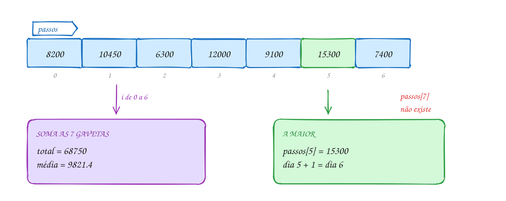</p>

O código percorre as gavetas com `i` de 0 a 6. Repare que o `maior` começa com
`passos[0]`, e não com 0:

```c
#include <stdio.h>

#define DIAS 7

int main(void) {
    // 7 gavetas de int, uma por dia; o índice vai de 0 a 6
    int passos[DIAS] = {8200, 10450, 6300, 12000, 9100, 15300, 7400};

    int total = 0;
    int maior = passos[0]; // começa pelo primeiro, não por 0
    int dia_maior = 0;

    for (int i = 0; i < DIAS; i++) { // i < DIAS: o último índice é 6
        total += passos[i];
        if (passos[i] > maior) {
            maior = passos[i];
            dia_maior = i;
        }
    }

    printf("Total: %d passos\n", total);
    printf("Média: %.1f por dia\n", (double) total / DIAS);
    printf("Recorde: %d passos no dia %d\n", maior, dia_maior + 1);
    return 0;
}
// Saída:
// Total: 68750 passos
// Média: 9821.4 por dia
// Recorde: 15300 passos no dia 6
```

Repara no fluxograma: é o padrão acumulador e o padrão maior/menor do assunto
0025, só que agora os valores vêm das gavetas do vetor, e não do teclado. A
pergunta `i < 7?` é o que impede o laço de passar da última gaveta:

<p align="center">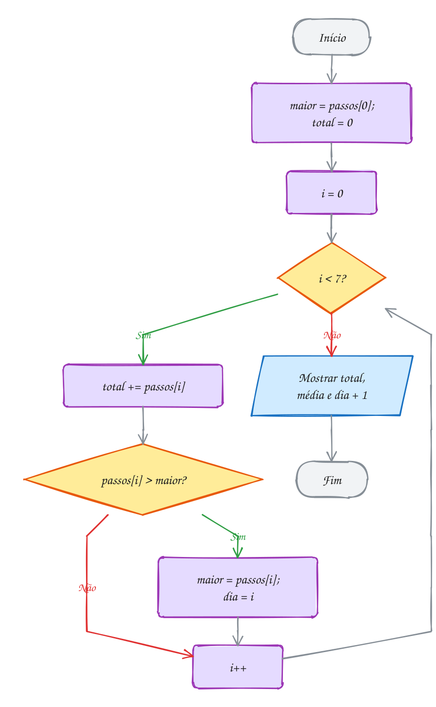</p>

> [!WARNING]
> **O C não confere o índice.** Com `int v[7]`, escrever `v[7] = 0` ou ler
> `v[-1]` compila sem erro e mexe na memória vizinha, que pode ser outra
> variável sua. É **comportamento indefinido**: às vezes nada acontece, às
> vezes outro valor muda "sozinho", às vezes o programa cai. O erro clássico é o
> `<=` no laço: `for (i = 0; i <= 7; i++)` passa uma vez a mais. Ler
> `v[99]` não dá erro nenhum: devolve o que estiver lá. O `rodar` usa
> o AddressSanitizer, que pega esse erro e mostra `stack-buffer-overflow`.

> [!TIP]
> **Por dentro do C:** as 7 gavetas são 28 bytes seguidos na memória (7 × 4
> bytes). O nome `passos` marca onde o vetor começa, e o índice diz **quantos
> itens pular**: `passos[5]` fica em início + 5 × 4 bytes. Por isso o primeiro
> é o 0 (pula zero itens) e por isso acessar qualquer posição custa o mesmo,
> seja a 0 ou a 999: é uma conta, não uma busca. E por isso o C não confere o
> limite: ele só faz a conta e vai até lá. Vetor local sem inicializar tem lixo,
> igual a qualquer variável local.

> [!NOTE]
> **Pergunta para você:** se o `maior` começasse com 0 e os valores fossem
> temperaturas de inverno em Urupema (`{-3, -5, -1, -4}`), qual seria o
> "maior" mostrado? Por que começar por `v[0]` resolve?

### Hora de praticar

Os arquivos ficam em [`0037-vetores/`](0037-vetores/). Os comandos funcionam de qualquer pasta do terminal. Nos exemplos, rode, mude, quebre e rode de novo. Nos exercícios, a resposta vai dentro do próprio arquivo. ★☆☆ é aquecimento, ★★☆ pede raciocínio e ★★★ é desafio.

**Exemplo A073 · Os passos da semana**

```c
#include <stdio.h>

#define DIAS 7

int main(void) {
    // 7 gavetas de int, uma por dia; o índice vai de 0 a 6
    int passos[DIAS] = {8200, 10450, 6300, 12000, 9100, 15300, 7400};

    int total = 0;
    int maior = passos[0]; // começa pelo primeiro, não por 0
    int dia_maior = 0;

    for (int i = 0; i < DIAS; i++) { // i < DIAS: o último índice é 6
        total += passos[i];
        if (passos[i] > maior) {
            maior = passos[i];
            dia_maior = i;
        }
    }

    printf("Total: %d passos\n", total);
    printf("Média: %.1f por dia\n", (double) total / DIAS);
    printf("Recorde: %d passos no dia %d\n", maior, dia_maior + 1);
    return 0;
}
// Saída:
// Total: 68750 passos
// Média: 9821.4 por dia
// Recorde: 15300 passos no dia 6
```

```bash
~/LPEDC/rodar 05-vetores-e-strings/0037-vetores/A073.c
```

**Exemplo A074 · Inicializar, contar e copiar**

```c
#include <stdio.h>

int main(void) {
    // só 3 valores para 6 gavetas: as outras 3 viram 0
    int gols[6] = {2, 0, 3};

    // sem tamanho: o compilador conta os valores (5)
    int precos[] = {12, 7, 30, 4, 18};
    int n = sizeof(precos) / sizeof(precos[0]); // bytes do vetor / bytes de um item

    printf("gols: ");
    for (int i = 0; i < 6; i++) {
        printf("%d ", gols[i]);
    }
    printf("\n");

    printf("precos tem %d itens em %zu bytes\n", n, sizeof(precos));

    // copia = precos; não compila: vetor se copia gaveta por gaveta
    int copia[5];
    for (int i = 0; i < n; i++) {
        copia[i] = precos[i];
    }
    copia[0] = 99; // mexer na cópia não mexe no original

    printf("precos[0] = %d, copia[0] = %d\n", precos[0], copia[0]);
    return 0;
}
// Saída:
// gols: 2 0 3 0 0 0
// precos tem 5 itens em 20 bytes
// precos[0] = 12, copia[0] = 99
```

```bash
~/LPEDC/rodar 05-vetores-e-strings/0037-vetores/A074.c
```

#### Exercícios

**Exercício E217** · ★☆☆

A estação meteorológica de Curitiba registrou as máximas de uma semana:
19, 23, 21, 17, 15, 18 e 22 graus. Guarde as sete temperaturas num vetor e
mostre-as de trás para frente, do último dia para o primeiro, cada uma com o
número do dia (1 a 7).


```text
Saída esperada:
Dia 7: 22 graus
Dia 6: 18 graus
Dia 5: 15 graus
Dia 4: 17 graus
Dia 3: 21 graus
Dia 2: 23 graus
Dia 1: 19 graus
```

**Dicas:**

1. int max[7] = {19, 23, ...}; o último índice é 6.
2. O laço pode descer: for (int i = 6; i >= 0; i--).
3. O dia é o índice + 1.
4. Resposta esperada: a saída acima.

```bash
~/LPEDC/rodar 05-vetores-e-strings/0037-vetores/E217.c
```

**Exercício E218** · ★☆☆

Sem rodar, preveja o que cada printf mostra. Depois rode e confira.


```text
int a[5] = {4, 2};
int b[] = {7, 8, 9};
int i = 4;
```


```text
printf("%d %d\n", a[1], a[3]);
printf("%zu\n", sizeof(b) / sizeof(b[0]));
printf("%d\n", b[i % 3]);
printf("%d\n", a[i] + b[2]);
b[0] = b[0] + b[1];
printf("%d\n", b[0]);
```

**Dicas:**

1. Na inicialização parcial, as posições que faltam viram 0.
2. Sem tamanho, o compilador conta os valores entre as chaves.
3. 4 % 3 é 1.
4. Resposta esperada: "2 0", "3", "8", "9" e "15".

```bash
~/LPEDC/rodar 05-vetores-e-strings/0037-vetores/E218.c
```

**Exercício E219** · ★★☆

Um professor quer saber quem ficou acima da média da turma. Leia as notas
de 5 alunos (números reais), calcule a média e liste o número do aluno (1 a
5) e a nota de quem ficou ACIMA dela. Se o scanf falhar, mostre "Entrada
inválida." e termine com return 1.


```text
Exemplo de execução:
Nota do aluno 1: 7.5
Nota do aluno 2: 4
Nota do aluno 3: 9
Nota do aluno 4: 6
Nota do aluno 5: 8.5
Média da turma: 7.00
Acima da média:
Aluno 1: 7.5
Aluno 3: 9.0
Aluno 5: 8.5
```

**Dicas:**

1. Você precisa de duas passadas: uma para ler e somar, outra para
   comparar com a média. É por isso que as notas vão para um vetor.
2. scanf("%lf", &notas[i]) devolve 1 quando deu certo.
3. Resposta esperada (com as notas acima): média 7.00 e os alunos 1, 3 e 5.

```bash
~/LPEDC/rodar 05-vetores-e-strings/0037-vetores/E219.c
```

**Exercício E220** · ★★☆

Um app de delivery recebeu 15 avaliações, de 1 a 5 estrelas:


```text
5 4 5 3 5 1 4 5 2 4 5 3 4 5 5
```


Conte quantas avaliações teve cada nota e desenhe um histograma com
asteriscos, da nota 5 para a nota 1. Não use if nem switch para contar: use
a própria nota como índice de um vetor de contadores.


```text
Saída esperada:
Nota 5: ******* (7)
Nota 4: **** (4)
Nota 3: ** (2)
Nota 2: * (1)
Nota 1: * (1)
```

**Dicas:**

1. int contagem[6] = {0}; e ignore a posição 0: assim contagem[5] é a nota 5.
2. contagem[avaliacoes[i]]++ soma 1 na gaveta daquela nota.
3. Para desenhar, um laço dentro do outro (assunto 0024).
4. Resposta esperada: a saída acima.

```bash
~/LPEDC/rodar 05-vetores-e-strings/0037-vetores/E220.c
```

**Exercício E221** · ★★★

Este programa deveria mostrar a máxima e a mínima de uma madrugada fria em
São Joaquim (SC), medidas em 6 horários. Ele tem DOIS erros de propósito.
Rode com o rodar: o AddressSanitizer vai acusar um deles. O outro não dá
erro nenhum, só resultado errado. Ache os dois, explique e conserte.


```text
Saída esperada depois do conserto:
Máxima: -1 graus
Mínima: -6 graus
```

**Dicas:**

1. Leia o relatório: "index 6 out of bounds for type 'int [6]'" e
   "stack-buffer-overflow" apontam a mesma linha. Qual?
2. Quantas vezes o laço roda? Quais índices existem num vetor de 6?
3. Todas as temperaturas são negativas. Alguma delas é maior que 0?
4. Resposta esperada: o laço usa i <= 6 e lê temps[6], que não existe
   (troque por i < 6); e maior começa em 0, que nenhuma temperatura supera,
   então a máxima sairia 0 (comece maior e menor com temps[0]).

```bash
~/LPEDC/rodar 05-vetores-e-strings/0037-vetores/E221.c
```

**Exercício E222** · ★★★

O Crivo de Eratóstenes acha todos os primos até N sem fazer nenhuma
divisão. Com N = 50:


```text
1. Crie um vetor de bool com 51 posições (índices 0 a 50), todas true.
2. Marque 0 e 1 como false (não são primos).
3. Para cada p de 2 em diante: se p ainda está true, ele é primo; então
   marque como false todos os múltiplos de p a partir de p * p
   (p*p, p*p + p, p*p + 2p, ... até 50).
4. Pode parar quando p * p passar de 50.
```


No fim, mostre os primos e quantos são.


```text
Saída esperada:
2 3 5 7 11 13 17 19 23 29 31 37 41 43 47
15 primos até 50
```

**Dicas:**

1. Use o stdbool.h e bool primo[N + 1]; preencha com um laço (a
   inicialização {true} só põe true na primeira posição!).
2. O laço de dentro anda de p em p: for (int m = p * p; m <= N; m += p).
3. Por que começar em p * p? Os múltiplos menores (2p, 3p...) já foram
   riscados pelos primos menores que p.
4. Resposta esperada: a saída acima.

```bash
~/LPEDC/rodar 05-vetores-e-strings/0037-vetores/E222.c
```

---

## 0038 · Vetores e funções

A lanchonete da esquina vai reajustar o cardápio em 10%. A coxinha de R$ 12,50
passa a R$ 13,75, o suco de R$ 8,00 vai para R$ 8,80. Você escreve uma função
`reajustar` e chama passando o vetor de preços. Pergunta: a função mexe nos
preços do `main` ou numa cópia?

No assunto 0029 você viu que o C passa argumentos **por valor**: a função
recebe uma cópia, e mexer na cópia não muda o original. Com vetor é diferente
na prática: **a função mexe no vetor original**. Isso acontece porque o C nunca
copia um vetor inteiro para uma função. O que vai é **o endereço onde o vetor
começa**, e a função escreve nas mesmas gavetas.

Na declaração, o parâmetro leva colchetes vazios. Na chamada, vai só o nome,
sem colchetes:

```c
void reajustar(double precos[], int n, double percentual); // protótipo
reajustar(cardapio, 4, 10);                                // chamada
```

Repare no `int n`. Como só o endereço do começo chega à função, **o tamanho
não vai junto**. A função não tem como descobrir quantos itens existem: você
passa o tamanho num parâmetro separado. É o par que você vai ver o curso
inteiro: vetor + tamanho. No C, não existe `.length`.

Um número dentro dos colchetes do parâmetro é ignorado: `double precos[4]`,
`double precos[100]` e `double precos[]` são a mesma coisa para o compilador.
Prefira os colchetes vazios, que não fingem uma informação que não existe.

E quando a função **não deve** mexer no vetor? Marque o parâmetro com
**`const`**: `void mostrar(const double precos[], int n)`. Se alguém escrever
`precos[0] = 0;` dentro dela, o compilador dá erro. É documentação que o
compilador confere.

Vamos ver na prática. O `main` tem o vetor `cardapio`. A função recebe o
endereço dele no parâmetro `precos`, e cada `precos[i]` é a mesma gaveta que
`cardapio[i]`:

<p align="center">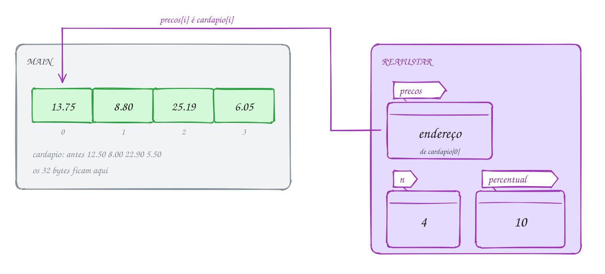</p>

O código separa as duas tarefas: `reajustar` escreve (sem `const`), `mostrar`
só lê (com `const`):

```c
#include <stdio.h>

#define ITENS 4

// const: esta função promete só ler o vetor
void mostrar(const double precos[], int n) {
    for (int i = 0; i < n; i++) {
        printf("R$ %6.2f\n", precos[i]);
    }
}

// sem const: esta função escreve nas gavetas do vetor de quem chamou
void reajustar(double precos[], int n, double percentual) {
    for (int i = 0; i < n; i++) {
        precos[i] = precos[i] * (1 + percentual / 100);
    }
}

int main(void) {
    double cardapio[ITENS] = {12.50, 8.00, 22.90, 5.50};

    reajustar(cardapio, ITENS, 10); // vai o vetor (sem colchetes) e o tamanho

    printf("Depois do reajuste de 10%%:\n");
    mostrar(cardapio, ITENS);
    return 0;
}
// Saída:
// Depois do reajuste de 10%:
// R$  13.75
// R$   8.80
// R$  25.19
// R$   6.05
```

Repara no fluxograma: o `main` chama, a função percorre as 4 gavetas e volta.
Ela não devolve nada (`void`), e mesmo assim o `main` enxerga os preços novos,
porque ela escreveu direto no vetor dele:

<p align="center">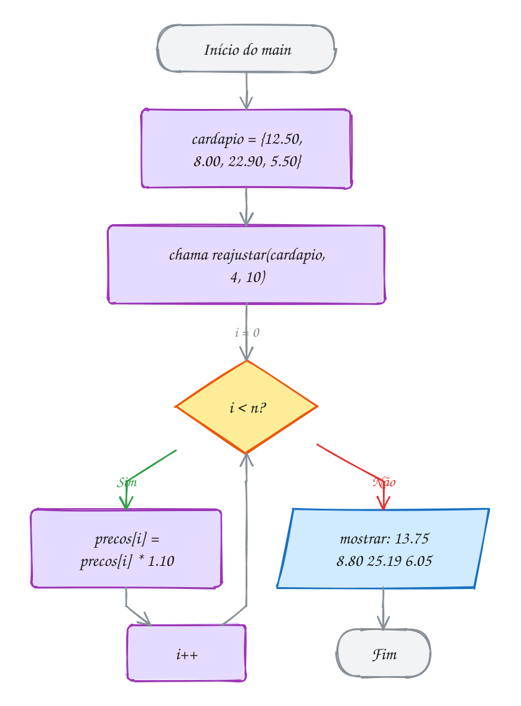</p>

Atenção para a diferença: **um elemento** passado sozinho vai por valor, como
qualquer `double`. Uma função `reajustar_um(double preco)` chamada com
`cardapio[0]` recebe uma cópia do 12.50 e não muda nada. É o vetor inteiro (o
nome sem colchetes) que vai pelo endereço. O exemplo A076 mostra as duas
coisas lado a lado.

> [!WARNING]
> **`sizeof` dentro da função não dá o tamanho do vetor.** No `main`,
> `sizeof(cardapio)` vale 32 (4 × 8 bytes). Dentro de `reajustar`,
> `sizeof(precos)` vale 8 num PC de 64 bits: é o tamanho de um **endereço**,
> não do vetor. O truque `sizeof(v) / sizeof(v[0])` só funciona onde o vetor
> foi declarado. O gcc até avisa (`-Wsizeof-array-argument`), mas quem ignora
> o aviso ganha um laço que percorre 1 item em vez de 4. Por isso o tamanho
> vai num parâmetro.

> [!TIP]
> **Por dentro do C:** quando o `main` chama `reajustar(cardapio, 4, 10)`, o
> frame da função na pilha (assunto 0031) recebe três coisas: um endereço (8
> bytes), um `int` e um `double`. Os 32 bytes do vetor ficam onde estão, no
> frame do `main`. Para um vetor de um milhão de itens, a chamada custa o
> mesmo: 8 bytes. É por isso que o C faz assim: copiar vetores inteiros a cada
> chamada seria caro demais. O preço é que qualquer função que recebe o vetor
> pode estragá-lo; o `const` é a sua defesa. No módulo 06 você vai ver que
> esse endereço é um **ponteiro**, e que `double precos[]` no parâmetro é só
> outro jeito de escrever isso.

> [!NOTE]
> **Pergunta para você:** e se você chamasse `reajustar(cardapio, ITENS, 10)`
> duas vezes seguidas? A coxinha ficaria com 20% de aumento (R$ 15,00) ou com
> mais? Calcule antes de rodar.

### Hora de praticar

Os arquivos ficam em [`0038-vetores-e-funcoes/`](0038-vetores-e-funcoes/). Os comandos funcionam de qualquer pasta do terminal. Nos exemplos, rode, mude, quebre e rode de novo. Nos exercícios, a resposta vai dentro do próprio arquivo. ★☆☆ é aquecimento, ★★☆ pede raciocínio e ★★★ é desafio.

**Exemplo A075 · O reajuste do cardápio**

```c
#include <stdio.h>

#define ITENS 4

// const: esta função promete só ler o vetor
void mostrar(const double precos[], int n) {
    for (int i = 0; i < n; i++) {
        printf("R$ %6.2f\n", precos[i]);
    }
}

// sem const: esta função escreve nas gavetas do vetor de quem chamou
void reajustar(double precos[], int n, double percentual) {
    for (int i = 0; i < n; i++) {
        precos[i] = precos[i] * (1 + percentual / 100);
    }
}

int main(void) {
    double cardapio[ITENS] = {12.50, 8.00, 22.90, 5.50};

    reajustar(cardapio, ITENS, 10); // vai o vetor (sem colchetes) e o tamanho

    printf("Depois do reajuste de 10%%:\n");
    mostrar(cardapio, ITENS);
    return 0;
}
// Saída:
// Depois do reajuste de 10%:
// R$  13.75
// R$   8.80
// R$  25.19
// R$   6.05
```

```bash
~/LPEDC/rodar 05-vetores-e-strings/0038-vetores-e-funcoes/A075.c
```

**Exemplo A076 · Um elemento vai por valor, o vetor vai pelo endereço**

```c
#include <stdio.h>

#define N 5

// devolve a posição do código no vetor, ou -1 se não achar
int buscar(const int codigos[], int n, int alvo) {
    for (int i = 0; i < n; i++) {
        if (codigos[i] == alvo) {
            return i;
        }
    }
    return -1;
}

// recebe UMA quantidade: é uma cópia, como qualquer int
void baixa_na_copia(int quantidade) {
    quantidade = quantidade - 1;
}

// recebe o vetor: mexe nas gavetas de quem chamou
void baixa_no_vetor(int estoque[], int pos) {
    estoque[pos] = estoque[pos] - 1;
}

int main(void) {
    int codigos[N] = {101, 205, 310, 422, 587};
    int estoque[N] = {8, 3, 12, 0, 5};

    int pos = buscar(codigos, N, 310);
    printf("Código 310 na posição %d, estoque %d\n", pos, estoque[pos]);

    baixa_na_copia(estoque[pos]); // vai o valor 12
    printf("Depois de baixa_na_copia: %d\n", estoque[pos]);

    baixa_no_vetor(estoque, pos); // vai o vetor
    printf("Depois de baixa_no_vetor: %d\n", estoque[pos]);

    printf("Código 999: posição %d\n", buscar(codigos, N, 999));
    return 0;
}
// Saída:
// Código 310 na posição 2, estoque 12
// Depois de baixa_na_copia: 12
// Depois de baixa_no_vetor: 11
// Código 999: posição -1
```

```bash
~/LPEDC/rodar 05-vetores-e-strings/0038-vetores-e-funcoes/A076.c
```

#### Exercícios

**Exercício E223** · ★☆☆

O time da várzea marcou estes gols nas 8 rodadas do campeonato:


```text
3 1 0 2 4 1 2 3
```


Escreva duas funções e use as duas no main:


```text
int soma(const int v[], int n);       devolve a soma dos n itens
double media(const int v[], int n);   devolve a média (use a soma)
```


```text
Saída esperada:
Gols no campeonato: 16
Média por rodada: 2.00
```

**Dicas:**

1. Na chamada vai só o nome do vetor: soma(gols, 8).
2. media pode chamar soma e dividir por n; cuidado com a divisão inteira
   (assunto 0008).
3. Resposta esperada: 16 gols e média 2.00.

```bash
~/LPEDC/rodar 05-vetores-e-strings/0038-vetores-e-funcoes/E223.c
```

**Exercício E224** · ★☆☆

Complete as duas funções. O main já está pronto: ele prepara as 10 vagas de
um estacionamento (0 = livre), ocupa algumas e mostra o mapa.


```text
preencher(v, n, valor)  põe valor em todas as n posições
mostrar(v, n)           mostra as posições separadas por espaço e quebra
                        a linha no fim
```


```text
Saída esperada:
0 0 0 0 0 0 0 0 0 0
1 0 0 1 0 0 0 1 1 0
```

**Dicas:**

1. preencher altera o vetor do main; mostrar só lê, então merece const.
2. O for das duas é igual: de 0 a n - 1.
3. Resposta esperada: a saída acima.

```bash
~/LPEDC/rodar 05-vetores-e-strings/0038-vetores-e-funcoes/E224.c
```

**Exercício E225** · ★★☆

Sem rodar, preveja as duas linhas que o programa abaixo mostra. Para cada
parâmetro de mexer, pergunte: ele é uma cópia ou dá acesso ao original?


```text
void mexer(int v[], int x) {
    v[0] = v[0] * 10;
    x = x * 10;
    v[1] = x;
}
```


```text
int a[3] = {1, 2, 3};
int b = 5;
mexer(a, b);
printf("%d %d %d %d\n", a[0], a[1], a[2], b);
mexer(a, a[2]);
printf("%d %d %d\n", a[0], a[1], a[2]);
```

**Dicas:**

1. v recebe o endereço de a: v[0] e a[0] são a mesma gaveta.
2. x recebe uma cópia: mudar x não muda b, nem a[2].
3. Na segunda chamada, x começa com o valor de a[2] naquele momento.
4. Resposta esperada: "10 50 3 5" e "100 30 3".

```bash
~/LPEDC/rodar 05-vetores-e-strings/0038-vetores-e-funcoes/E225.c
```

**Exercício E226** · ★★☆

As contas de luz do ano (janeiro a dezembro), em reais:


```text
182.40 175.10 190.75 168.30 150.20 141.90
139.60 144.80 158.25 171.40 189.90 205.35
```


Escreva três funções, todas recebendo o vetor e o tamanho:


```text
int indice_do_maior(const double v[], int n);
double media(const double v[], int n);
int contar_acima(const double v[], int n, double limite);
```


e use as três para mostrar:


```text
Saída esperada:
Mês mais caro: 12 (R$ 205.35)
Média mensal: R$ 168.16
Meses acima da média: 7
```

**Dicas:**

1. indice_do_maior devolve a POSIÇÃO (0 a 11), não o valor; o main soma 1
   para mostrar o mês.
2. contar_acima não precisa saber o que é média: ela recebe um limite
   qualquer. Isso deixa a função reaproveitável.
3. Resposta esperada: a saída acima (o total do ano é R$ 2017.95).

```bash
~/LPEDC/rodar 05-vetores-e-strings/0038-vetores-e-funcoes/E226.c
```

**Exercício E227** · ★★★

O programa abaixo deveria somar as 6 doações de uma vaquinha online
(R$ 50 + 20 + 100 + 35 + 15 + 80 = R$ 300), mas mostra outro valor. Ele
tem UM erro de propósito, e o gcc até avisa: rode com o rodar e leia o
aviso (warning) com calma.


```text
1. Que valor ele mostra no seu PC, e por quê?
2. Conserte sem mudar o main mais do que o necessário.
```


```text
Saída esperada depois do conserto:
Total arrecadado: R$ 300
```

**Dicas:**

1. O aviso fala em "sizeof on array function parameter". O que a função
   recebe de verdade: o vetor ou o endereço dele?
2. Num PC de 64 bits, um endereço tem 8 bytes e um int tem 4.
3. Resposta esperada: dentro da função, sizeof(doacoes) é o tamanho de um
   endereço (8), não do vetor (24). A conta 8 / 4 dá 2, e o laço soma só
   50 + 20 = 70. Conserto: receber o tamanho num parâmetro, int total(const
   int doacoes[], int n), e no main calcular n com sizeof, onde o vetor foi
   declarado.

```bash
~/LPEDC/rodar 05-vetores-e-strings/0038-vetores-e-funcoes/E227.c
```

**Exercício E228** · ★★★

Uma playlist guarda os números das faixas: 11 22 33 44 55. Escreva:


```text
void mostrar(const int v[], int n);
void inverter(int v[], int n);    inverte NO PRÓPRIO vetor, sem criar
                                  outro: troca o 1º com o último, o 2º
                                  com o penúltimo...
void rotacionar(int v[], int n);  a 1ª faixa vai para o fim e as outras
                                  andam uma casa para a esquerda
```


No main: mostre a playlist, inverta e mostre, depois rotacione DUAS vezes
e mostre.


```text
Saída esperada:
11 22 33 44 55
55 44 33 22 11
33 22 11 55 44
```

**Dicas:**

1. Trocar duas gavetas pede uma variável auxiliar (aux = a; a = b; b = aux).
2. Em inverter, o laço vai só até a metade: i < n / 2, trocando v[i] com
   v[n - 1 - i]. Se for até n, você inverte duas vezes e volta ao começo!
3. Em rotacionar, guarde v[0] antes de deslizar as outras e ponha no fim.
4. Teste com n ímpar e par: a do meio, quando existe, fica no lugar.
5. Resposta esperada: a saída acima.

```bash
~/LPEDC/rodar 05-vetores-e-strings/0038-vetores-e-funcoes/E228.c
```

---

## 0039 · Matrizes

Uma rede de açaí tem 3 lojas e quer comparar as vendas das últimas 4 semanas.
Você abre uma planilha: uma linha por loja, uma coluna por semana. No fim de
cada linha, o total da loja; no pé de cada coluna, o total da semana. Essa
planilha, no C, é uma **matriz**.

Uma matriz é um **vetor de vetores**. `int vendas[3][4]` são 3 linhas, e cada
linha é um vetor de 4 `int`. Para chegar numa célula você usa dois índices,
**primeiro a linha, depois a coluna**: `vendas[2][0]` é a loja 3 na semana 1.
Os dois começam em 0, como em qualquer vetor.

```c
int vendas[3][4];                          // 12 int com lixo
int m[2][3] = {{1, 2, 3}, {4, 5, 6}};      // uma chave por linha
int z[2][3] = {{1}, {4, 5}};               // o que falta vira 0: 1 0 0 / 4 5 0
int t[][2] = {{1, 2}, {3, 4}, {5, 6}};     // só a 1ª dimensão pode sumir: 3 linhas
```

Dá para escrever os valores sem as chaves internas (`{1, 2, 3, 4, 5, 6}`):
eles enchem a matriz linha por linha. Mas o gcc avisa (`-Wmissing-braces`), e
com razão: com as chaves, quem lê vê as linhas. Use as chaves.

Um índice pede um laço; dois índices pedem **dois laços aninhados** (assunto
0024). O de fora escolhe a linha, o de dentro anda pelas colunas dessa linha.
Para somar por coluna, você inverte: a coluna fica por fora e a linha por
dentro. Os laços são os mesmos; muda só quem é o "relógio das horas" e quem é
o "dos minutos".

No C, a matriz não é um punhado de linhas soltas, cada uma num canto da
memória. Ela é **um bloco só, contínuo**, com todas as linhas do mesmo tamanho,
uma colada na outra.

Vamos ver na prática. A planilha tem 3 linhas e 4 colunas. Na memória, as 12
células ficam enfileiradas: primeiro a linha 0 inteira, depois a linha 1,
depois a 2. A célula `vendas[1][2]` (o 14) é a 7ª da fila, na posição 1 × 4 + 2
= 6:

<p align="center">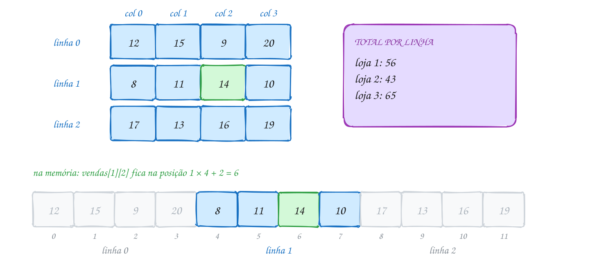</p>

O código mostra a tabela com o total de cada linha e, num segundo par de
laços, o total de cada coluna:

```c
#include <stdio.h>

#define LOJAS 3
#define SEMANAS 4

int main(void) {
    // 3 linhas (lojas) x 4 colunas (semanas): caixas de açaí vendidas
    int vendas[LOJAS][SEMANAS] = {
        {12, 15, 9, 20},
        {8, 11, 14, 10},
        {17, 13, 16, 19},
    };

    printf("        S1  S2  S3  S4  Total\n");
    for (int l = 0; l < LOJAS; l++) {         // uma volta por linha
        int total_loja = 0;
        printf("Loja %d", l + 1);
        for (int s = 0; s < SEMANAS; s++) {   // uma volta por coluna
            printf("%4d", vendas[l][s]);
            total_loja += vendas[l][s];
        }
        printf("%7d\n", total_loja);
    }

    int geral = 0;
    printf("Semana");
    for (int s = 0; s < SEMANAS; s++) {       // agora a coluna fica por fora
        int total_semana = 0;
        for (int l = 0; l < LOJAS; l++) {
            total_semana += vendas[l][s];
        }
        printf("%4d", total_semana);
        geral += total_semana;
    }
    printf("%7d\n", geral);
    return 0;
}
// Saída:
//         S1  S2  S3  S4  Total
// Loja 1  12  15   9  20     56
// Loja 2   8  11  14  10     43
// Loja 3  17  13  16  19     65
// Semana  37  39  39  49    164
```

Repara no fluxograma: são dois laços, um dentro do outro. O de dentro dá 4
voltas para **cada** volta do de fora, então o corpo roda 3 × 4 = 12 vezes,
uma por célula:

<p align="center">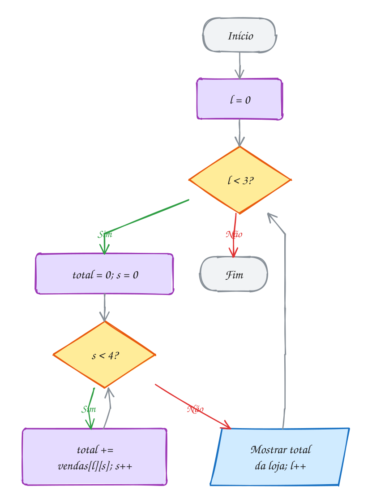</p>

Para passar uma matriz a uma função, vale a regra do assunto 0038 (vai o
endereço, a função mexe no original), com um detalhe: **todas as dimensões,
menos a primeira, são obrigatórias** no parâmetro: `void mostrar(int
m[][4], int linhas)`. O compilador precisa saber quantas colunas tem cada
linha para achar `m[l][c]`. O exemplo A078 faz isso com um tabuleiro de jogo da
velha.

> [!WARNING]
> Escreva `m[l][c]`, nunca `m[l, c]`. A vírgula, no C, é um operador que
> descarta o da esquerda: `m[1, 2]` vira `m[2]`, a linha inteira. Às vezes
> compila com um aviso só, e o resultado é absurdo. Outro erro comum é trocar
> os limites: com `int m[3][4]`, o laço das linhas vai até 3 e o das colunas
> até 4. Trocou, e o laço lê `m[3][...]`, fora da matriz.

> [!TIP]
> **Por dentro do C:** a memória não tem linhas nem colunas, só uma fila de
> bytes. O C guarda a matriz **linha após linha** (*row-major*): `vendas[l][s]`
> fica em início + (l × 4 + s) × 4 bytes. É essa conta que exige o número de
> colunas no parâmetro. E isso tem custo real: percorrer linha por linha (`l`
> por fora, `s` por dentro) lê bytes vizinhos, que o processador já trouxe
> para o **cache**. Percorrer coluna por coluna pula 16 bytes a cada passo. Em
> matrizes grandes, a ordem errada dos laços pode deixar o programa várias
> vezes mais lento, com o mesmo resultado.

> [!NOTE]
> **Pergunta para você:** em `int t[][2] = {{1, 2}, {3, 4}, {5}};`, quantas
> linhas o compilador cria? Quanto vale `t[2][1]`? E `sizeof(t)`?

### Hora de praticar

Os arquivos ficam em [`0039-matrizes/`](0039-matrizes/). Os comandos funcionam de qualquer pasta do terminal. Nos exemplos, rode, mude, quebre e rode de novo. Nos exercícios, a resposta vai dentro do próprio arquivo. ★☆☆ é aquecimento, ★★☆ pede raciocínio e ★★★ é desafio.

**Exemplo A077 · As vendas das três lojas**

```c
#include <stdio.h>

#define LOJAS 3
#define SEMANAS 4

int main(void) {
    // 3 linhas (lojas) x 4 colunas (semanas): caixas de açaí vendidas
    int vendas[LOJAS][SEMANAS] = {
        {12, 15, 9, 20},
        {8, 11, 14, 10},
        {17, 13, 16, 19},
    };

    printf("        S1  S2  S3  S4  Total\n");
    for (int l = 0; l < LOJAS; l++) {         // uma volta por linha
        int total_loja = 0;
        printf("Loja %d", l + 1);
        for (int s = 0; s < SEMANAS; s++) {   // uma volta por coluna
            printf("%4d", vendas[l][s]);
            total_loja += vendas[l][s];
        }
        printf("%7d\n", total_loja);
    }

    int geral = 0;
    printf("Semana");
    for (int s = 0; s < SEMANAS; s++) {       // agora a coluna fica por fora
        int total_semana = 0;
        for (int l = 0; l < LOJAS; l++) {
            total_semana += vendas[l][s];
        }
        printf("%4d", total_semana);
        geral += total_semana;
    }
    printf("%7d\n", geral);
    return 0;
}
// Saída:
//         S1  S2  S3  S4  Total
// Loja 1  12  15   9  20     56
// Loja 2   8  11  14  10     43
// Loja 3  17  13  16  19     65
// Semana  37  39  39  49    164
```

```bash
~/LPEDC/rodar 05-vetores-e-strings/0039-matrizes/A077.c
```

**Exemplo A078 · O tabuleiro do jogo da velha**

```c
#include <stdio.h>
#include <stdbool.h>

#define N 3

// no parâmetro, só a 1ª dimensão pode ficar vazia: [][N]
// (sem const: com matriz, o const só é aceito sem aviso a partir do C23)
void desenhar(char t[][N], int linhas) {
    for (int l = 0; l < linhas; l++) {
        printf(" %c | %c | %c\n", t[l][0], t[l][1], t[l][2]);
        if (l < linhas - 1) {
            printf("---+---+---\n");
        }
    }
}

// a diagonal principal é onde linha == coluna
bool ganhou_na_diagonal(char t[][N], char jogador) {
    for (int i = 0; i < N; i++) {
        if (t[i][i] != jogador) {
            return false;
        }
    }
    return true;
}

int main(void) {
    char tabuleiro[N][N] = {
        {'X', 'O', '.'},
        {'O', 'X', '.'},
        {'.', 'O', 'X'},
    };

    desenhar(tabuleiro, N);
    printf("X ganhou na diagonal? %s\n", ganhou_na_diagonal(tabuleiro, 'X') ? "sim" : "não");
    printf("A matriz ocupa %zu bytes; cada linha, %zu\n", sizeof(tabuleiro), sizeof(tabuleiro[0]));
    return 0;
}
// Saída:
//  X | O | .
// ---+---+---
//  O | X | .
// ---+---+---
//  . | O | X
// X ganhou na diagonal? sim
// A matriz ocupa 9 bytes; cada linha, 3
```

```bash
~/LPEDC/rodar 05-vetores-e-strings/0039-matrizes/A078.c
```

#### Exercícios

**Exercício E229** · ★☆☆

Um quadrado mágico 3x3 tem a mesma soma em todas as linhas, colunas e nas
duas diagonais. Guarde este numa matriz, mostre-o e calcule a soma da
diagonal principal (de cima à esquerda até embaixo à direita) e a da
diagonal secundária (de cima à direita até embaixo à esquerda):


```text
2 7 6
9 5 1
4 3 8
```


```text
Saída esperada:
2 7 6
9 5 1
4 3 8
Diagonal principal: 15
Diagonal secundária: 15
```

**Dicas:**

1. Na diagonal principal, linha e coluna são iguais: m[i][i].
2. Na secundária, linha + coluna = 2: m[i][2 - i].
3. Para isso, um laço só basta.
4. Resposta esperada: a saída acima (2 + 5 + 8 e 6 + 5 + 4).

```bash
~/LPEDC/rodar 05-vetores-e-strings/0039-matrizes/E229.c
```

**Exercício E230** · ★☆☆

Sem rodar, preveja a saída. Depois rode e confira.


```text
int a[2][3] = {{1}, {4, 5}};
int b[][2] = {{1, 2}, {3, 4}, {5}};
```


```text
printf("%d %d %d\n", a[0][0], a[0][2], a[1][1]);
printf("%zu\n", sizeof(b) / sizeof(b[0]));
printf("%d %d\n", b[1][0], b[2][1]);
printf("%zu %zu\n", sizeof(a), sizeof(a[1]));
```

**Dicas:**

1. Com chaves internas, cada chave é uma linha; o que falta vira 0.
2. Sem o tamanho da 1ª dimensão, o compilador conta as chaves internas.
3. sizeof(b[0]) é o tamanho de uma linha (2 int = 8 bytes).
4. Resposta esperada: "1 0 5", "3", "3 0" e "24 12".

```bash
~/LPEDC/rodar 05-vetores-e-strings/0039-matrizes/E230.c
```

**Exercício E231** · ★★☆

A academia guarda, numa matriz 2x3, quantos alunos foram em cada turno
(linhas: segunda e terça; colunas: manhã, tarde e noite):


```text
40 25 60
35 30 55
```


O gerente quer a planilha "deitada": uma linha por turno e uma coluna por
dia. Isso é a TRANSPOSTA. Monte uma matriz 3x2 t em que t[c][l] = m[l][c]
e mostre as duas.


```text
Saída esperada:
Original (2x3):
40 25 60
35 30 55
Transposta (3x2):
40 35
25 30
60 55
```

**Dicas:**

1. A transposta tem as dimensões trocadas: int t[3][2].
2. Dois laços sobre a original: para cada (l, c), t[c][l] = m[l][c].
3. Resposta esperada: a saída acima.

```bash
~/LPEDC/rodar 05-vetores-e-strings/0039-matrizes/E231.c
```

**Exercício E232** · ★★☆

Uma sala de cinema pequena tem 5 fileiras (A a E) de 6 poltronas. Na matriz,
1 é ocupada e 0 é livre:


```text
1 1 0 1 1 1
0 0 1 1 0 0
1 1 1 1 1 1
0 1 0 0 0 1
1 0 0 1 1 0
```


Mostre o mapa com 'X' para ocupada e '.' para livre, o número de lugares
livres em cada fileira e a fileira com MAIS lugares livres (em caso de
empate, a primeira).


```text
Saída esperada:
A X X . X X X  livres: 1
B . . X X . .  livres: 4
C X X X X X X  livres: 0
D . X . . . X  livres: 4
E X . . X X .  livres: 3
Melhor fileira: B
```

**Dicas:**

1. A letra da fileira é 'A' + f (um char é um número; você vai ver isso no
   próximo assunto). printf("%c", 'A' + f) mostra A, B, C...
2. Conte os livres dentro do laço das colunas e compare com o melhor até
   agora no laço das linhas (padrão maior, assunto 0025).
3. Use > (e não >=) para ficar com a primeira em caso de empate.
4. Resposta esperada: a saída acima.

```bash
~/LPEDC/rodar 05-vetores-e-strings/0039-matrizes/E232.c
```

**Exercício E233** · ★★★

Dois alunos fizeram 4 provas cada (uma linha por aluno, uma coluna por
prova). O programa deveria mostrar a média de cada aluno, mas tem DOIS erros
de propósito. Rode com o rodar: o sanitizer acusa um deles. O outro só dá
resultado errado. Ache, explique e conserte os dois.


```text
Saída esperada depois do conserto:
Aluno 1: média 7.50
Aluno 2: média 7.25
```

**Dicas:**

1. Quantas linhas e quantas colunas a matriz tem? E até onde vai cada laço?
2. Mesmo com os laços certos, o aluno 1 sairia com média 7.00. Por quê?
   (assunto 0007: divisão inteira)
3. Resposta esperada: os limites estão trocados (o laço dos alunos vai até
   4 e lê notas[2], notas[3]: linhas que não existem; o das provas vai só
   até 2); e soma / 4 é divisão de int por int, que joga fora o ,50
   (use soma / 4.0).

```bash
~/LPEDC/rodar 05-vetores-e-strings/0039-matrizes/E233.c
```

**Exercício E234** · ★★★

Campo minado! Num campo 4x5, 1 é bomba e 0 é livre:


```text
0 1 0 0 0
0 0 0 1 0
1 1 0 0 0
0 0 0 0 1
```


Mostre o campo "aberto": '*' onde há bomba e, nas outras casas, quantas
bombas existem nas até 8 casas vizinhas (incluindo as diagonais).


```text
Saída esperada:
1 * 2 1 1
3 3 3 * 1
* * 2 2 2
2 2 1 1 *
```

**Dicas:**

1. Para cada casa (l, c), percorra as vizinhas com dois laços: i de l - 1 a
   l + 1 e j de c - 1 a c + 1.
2. Na borda, algumas vizinhas não existem (l - 1 = -1, por exemplo). Pule
   com um if: só conte se 0 <= i < 4 e 0 <= j < 5. Sem isso, você lê fora da
   matriz, e o sanitizer avisa.
3. A própria casa entra nos dois laços; como ela não é bomba (senão você
   nem estaria contando), não atrapalha.
4. Resposta esperada: a saída acima. Escreva uma função
   int vizinhas(int campo[][COLUNAS], int l, int c) para deixar o main limpo.

```bash
~/LPEDC/rodar 05-vetores-e-strings/0039-matrizes/E234.c
```

---

## 0040 · Caracteres

No app do Detran, você digita a placa do carro em minúsculas: `bra2e19`. O app
mostra `BRA2E19` e diz que o formato está certo: três letras, um número, uma
letra, dois números. Como um programa sabe que `b` é letra, que `2` é dígito e
qual é a maiúscula de `b`?

Porque, para o computador, **caractere é número**. O tipo `char` é um inteiro
de 1 byte, e cada símbolo tem um código combinado na **tabela ASCII**: `'A'` é
65, `'B'` é 66, ..., `'a'` é 97, `'0'` é 48, o espaço é 32, o `'\n'` é 10. As
aspas simples são só um jeito legível de escrever o número: `'A'` e `65` são o
mesmo valor.

| símbolos | códigos | repare |
| --- | --- | --- |
| `'0'` a `'9'` | 48 a 57 | em ordem: `'7' - '0'` = 7 |
| `'A'` a `'Z'` | 65 a 90 | em ordem alfabética |
| `'a'` a `'z'` | 97 a 122 | cada minúscula = maiúscula + 32 |

O que decide se você vê a letra ou o número é o `printf`: `%c` mostra o
símbolo, `%d` mostra o código. Como é número, dá para fazer conta e comparar:
`'a' + 1` é `'b'`, `c >= 'A' && c <= 'Z'` pergunta se é maiúscula, e
`c - '0'` transforma o dígito `'7'` no número 7. Não há função de conversão
nenhuma: o caractere já é o número.

Para não decorar a tabela, o `<ctype.h>` traz funções prontas:

- **testes**: `isalpha` (letra), `isdigit` (dígito), `isalnum` (letra ou
  dígito), `isspace` (espaço, `\t`, `\n`...), `isupper`, `islower`, `ispunct`;
- **conversões**: `toupper` e `tolower`. O que não é letra volta igual:
  `toupper('2')` é `'2'`.

Os testes devolvem **diferente de zero** para verdadeiro, não necessariamente
1. Escreva `if (isdigit(c))`, nunca `if (isdigit(c) == 1)`.

Para ler um caractere por vez do teclado, existe o `getchar()`. Ele devolve um
**`int`**: o código do caractere ou **`EOF`**, um valor negativo que avisa que
a entrada acabou (Ctrl+D no Linux). Guarde sempre num `int`. O exemplo A080
conta letras e dígitos assim, até o Enter.

Vamos ver na prática. A placa está num vetor de 7 `char`. O `toupper` troca
cada minúscula pela maiúscula, que fica 32 posições antes na tabela. Os
dígitos passam sem mudar:

<p align="center">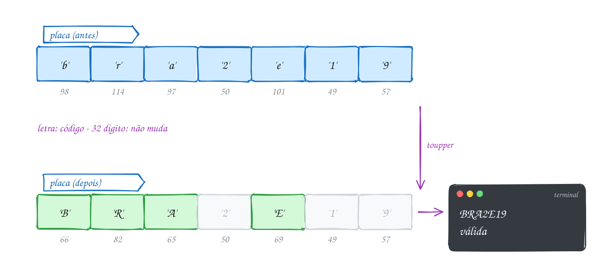</p>

O código mostra cada caractere com `%c` e `%d`, antes e depois, e confere o
formato com `isdigit` e `isalpha`:

```c
#include <stdio.h>
#include <ctype.h>
#include <stdbool.h>

#define TAM 7

int main(void) {
    // placa Mercosul: letra letra letra número letra número número
    char placa[TAM] = {'b', 'r', 'a', '2', 'e', '1', '9'};
    bool valida = true;

    for (int i = 0; i < TAM; i++) {
        char antes = placa[i];
        placa[i] = (char) toupper(placa[i]);
        printf("%c (%3d) -> %c (%3d)\n", antes, antes, placa[i], placa[i]);

        // posições 3, 5 e 6 são dígitos; as outras, letras
        bool deve_ser_digito = (i == 3 || i == 5 || i == 6);
        if (deve_ser_digito && !isdigit(placa[i])) {
            valida = false;
        }
        if (!deve_ser_digito && !isalpha(placa[i])) {
            valida = false;
        }
    }

    printf("Placa: ");
    for (int i = 0; i < TAM; i++) {
        putchar(placa[i]);
    }
    printf(" -> %s\n", valida ? "válida" : "inválida");
    return 0;
}
// Saída:
// b ( 98) -> B ( 66)
// r (114) -> R ( 82)
// a ( 97) -> A ( 65)
// 2 ( 50) -> 2 ( 50)
// e (101) -> E ( 69)
// 1 ( 49) -> 1 ( 49)
// 9 ( 57) -> 9 ( 57)
// Placa: BRA2E19 -> válida
```

O `putchar` mostra um caractere só, sem formatação. O vetor `placa` ainda não
é uma **string**: falta o marcador de fim que o `%s` precisa. Isso é o
próximo assunto.

Repara no fluxograma: para cada posição, converte e pergunta o que ela deveria
ser. Basta uma posição errada para a placa ficar inválida, e o laço segue até
o fim mesmo assim:

<p align="center">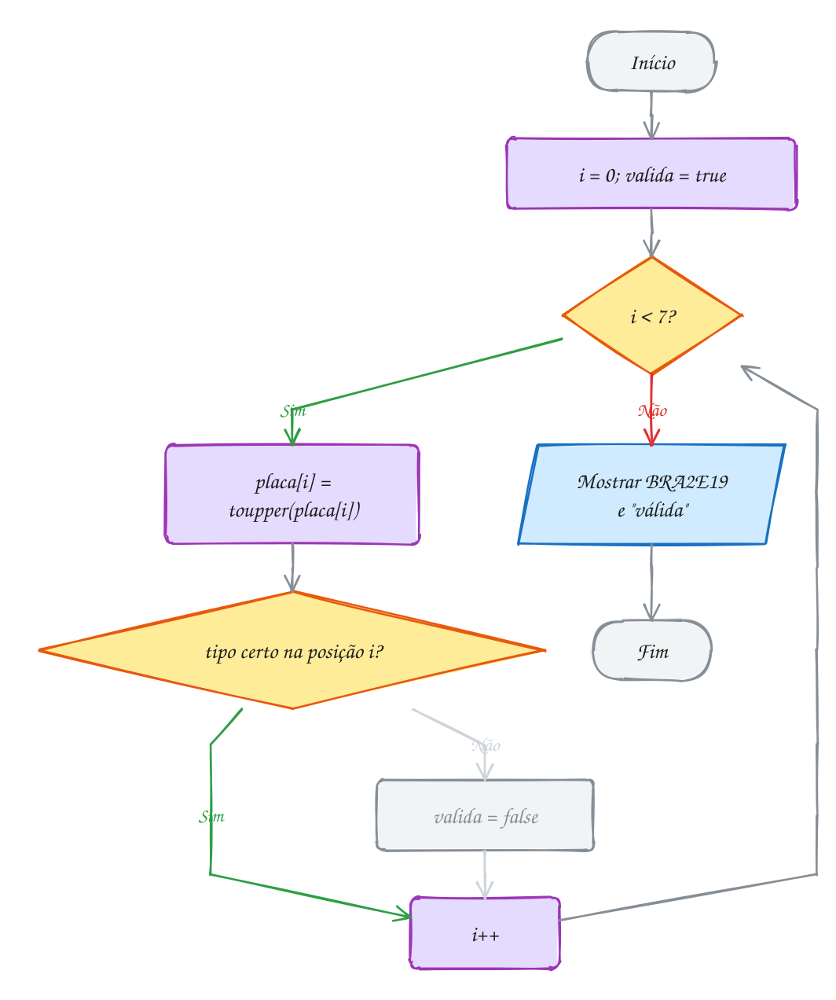</p>

> [!WARNING]
> **Letra não é "tudo entre `'A'` e `'z'`".** Entre o `'Z'` (90) e o `'a'`
> (97) moram `[ \ ] ^ _` e a crase. O teste `c >= 'A' && c <= 'z'` aceita
> `_` como letra. Use `isalpha(c)`, ou os dois intervalos separados. E não
> confunda `'0'` (o caractere zero, código 48) com `0` (o número zero, que é o
> caractere nulo `'\0'`).

> [!TIP]
> **Por dentro do C:** um `char` é só 1 byte, e o C nem garante se ele tem
> sinal: no PC (x86) ele vai de -128 a 127; em muitos ARM, de 0 a 255. ASCII
> usa só de 0 a 127. E o "ç"? Em UTF-8, que é o que o seu terminal usa, ele
> ocupa **dois** bytes (`0xC3 0xA7`) e não cabe num `char`. Num `char` com
> sinal, esses bytes viram números negativos, e passar um negativo (que não
> seja `EOF`) para as funções do `ctype.h` é comportamento indefinido. Por isso
> o jeito blindado é `toupper((unsigned char) c)`. Com o `int` que vem do
> `getchar`, você já está seguro: ele devolve o byte como valor de 0 a 255.

> [!NOTE]
> **Pergunta para você:** o que `printf("%c %d\n", 'A' + 2, 'z' - 'a');`
> mostra? E `printf("%d\n", '9' - '0' + 1);`?

### Hora de praticar

Os arquivos ficam em [`0040-caracteres/`](0040-caracteres/). Os comandos funcionam de qualquer pasta do terminal. Nos exemplos, rode, mude, quebre e rode de novo. Nos exercícios, a resposta vai dentro do próprio arquivo. ★☆☆ é aquecimento, ★★☆ pede raciocínio e ★★★ é desafio.

**Exemplo A079 · A placa digitada em minúsculas**

```c
#include <stdio.h>
#include <ctype.h>
#include <stdbool.h>

#define TAM 7

int main(void) {
    // placa Mercosul: letra letra letra número letra número número
    char placa[TAM] = {'b', 'r', 'a', '2', 'e', '1', '9'};
    bool valida = true;

    for (int i = 0; i < TAM; i++) {
        char antes = placa[i];
        placa[i] = (char) toupper(placa[i]);
        printf("%c (%3d) -> %c (%3d)\n", antes, antes, placa[i], placa[i]);

        // posições 3, 5 e 6 são dígitos; as outras, letras
        bool deve_ser_digito = (i == 3 || i == 5 || i == 6);
        if (deve_ser_digito && !isdigit(placa[i])) {
            valida = false;
        }
        if (!deve_ser_digito && !isalpha(placa[i])) {
            valida = false;
        }
    }

    printf("Placa: ");
    for (int i = 0; i < TAM; i++) {
        putchar(placa[i]);
    }
    printf(" -> %s\n", valida ? "válida" : "inválida");
    return 0;
}
// Saída:
// b ( 98) -> B ( 66)
// r (114) -> R ( 82)
// a ( 97) -> A ( 65)
// 2 ( 50) -> 2 ( 50)
// e (101) -> E ( 69)
// 1 ( 49) -> 1 ( 49)
// 9 ( 57) -> 9 ( 57)
// Placa: BRA2E19 -> válida
```

```bash
~/LPEDC/rodar 05-vetores-e-strings/0040-caracteres/A079.c
```

**Exemplo A080 · Contando o que foi digitado, letra por letra**

```c
#include <stdio.h>
#include <ctype.h>

int main(void) {
    int letras = 0, digitos = 0, espacos = 0, outros = 0;
    int c; // int, e não char: getchar pode devolver EOF, que não é um caractere

    printf("Digite o endereço: ");
    while ((c = getchar()) != '\n' && c != EOF) {
        if (isalpha(c)) {
            letras++;
        } else if (isdigit(c)) {
            digitos++;
        } else if (isspace(c)) {
            espacos++;
        } else {
            outros++;
        }
    }

    printf("Letras: %d\n", letras);
    printf("Dígitos: %d\n", digitos);
    printf("Espaços: %d\n", espacos);
    printf("Outros: %d\n", outros);
    return 0;
}
// Digite o endereço: Rua 7 de Setembro, 1500
// Letras: 13
// Dígitos: 5
// Espaços: 4
// Outros: 1
```

```bash
~/LPEDC/rodar 05-vetores-e-strings/0040-caracteres/A080.c
```

#### Exercícios

**Exercício E235** · ★☆☆

Mostre o código ASCII de cada caractere do vetor abaixo, um por linha, no
formato do exemplo. Depois, mostre os caracteres dos códigos 72, 105 e 33,
colados, numa linha só (descubra a mensagem!).


```text
char simbolos[] = {'A', 'Z', 'a', 'z', '0', '9', ' ', '@'};
```


```text
Saída esperada:
'A' = 65
'Z' = 90
'a' = 97
'z' = 122
'0' = 48
'9' = 57
' ' = 32
'@' = 64
Hi!
```

**Dicas:**

1. O mesmo valor com %c mostra o símbolo e com %d mostra o código.
2. Para mostrar o apóstrofo, ele vai dentro das aspas duplas: "'%c' = %d\n".
3. putchar(72) ou printf("%c", 72) mostram a letra do código 72.
4. Resposta esperada: a saída acima.

```bash
~/LPEDC/rodar 05-vetores-e-strings/0040-caracteres/E235.c
```

**Exercício E236** · ★☆☆

Sem rodar, preveja cada linha. Depois rode e confira.


```text
printf("%c\n", 'a' + 1);
printf("%d\n", '7' - '0');
printf("%c\n", 'C' + 32);
printf("%d\n", 'B' > 'a');
printf("%c%c\n", toupper('5'), tolower('Q'));
printf("%d\n", 'z' - 'a' + 1);
```

**Dicas:**

1. 'a' é 97, 'A' é 65, '0' é 48. Faça as contas com os códigos.
2. Toda maiúscula vem ANTES de toda minúscula na tabela.
3. toupper de algo que não é letra devolve o mesmo caractere.
4. Resposta esperada: b, 7, c, 0, 5q e 26.

```bash
~/LPEDC/rodar 05-vetores-e-strings/0040-caracteres/E236.c
```

**Exercício E237** · ★★☆

A cifra de César troca cada letra pela que fica K posições depois no
alfabeto, dando a volta no fim (com K = 3: A vira D, X vira A, Z vira C).
O que não é letra fica como está.

Cifre a mensagem abaixo com K = 3, mostre, depois decifre (ande 3 para
trás) e mostre de novo:


```text
char msg[] = {'Z', 'E', 'B', 'R', 'A', ' ', 'A', 'Z', 'U', 'L'};
```


```text
Saída esperada:
Cifrada: CHEUD DCXO
Decifrada: ZEBRA AZUL
```

**Dicas:**

1. Transforme a letra numa posição de 0 a 25: p = c - 'A'.
2. Ande e dê a volta com o resto: p = (p + K) % 26. Depois volte: c = 'A' + p.
3. Para decifrar, ande 26 - K para frente (é o mesmo que K para trás, sem
   risco de resto negativo).
4. O vetor tem 10 itens e não é uma string: mostre com putchar num laço.
5. Resposta esperada: a saída acima.

```bash
~/LPEDC/rodar 05-vetores-e-strings/0040-caracteres/E237.c
```

**Exercício E238** · ★★☆

Um formulário pede o CEP. A pessoa pode digitar com ou sem o traço:
"69050-010" e "69050010" valem. Leia a linha caractere por caractere com
getchar, até o Enter (ou EOF), e:


```text
- guarde os dígitos num vetor char cep[8];
- ignore o '-';
- qualquer outro caractere torna o CEP inválido;
- o CEP só é válido com exatamente 8 dígitos.
```


```text
Exemplo de execução (válido):
CEP: 69050-010
CEP válido: 69050010
```


```text
Exemplo de execução (inválido):
CEP: 6905-00100
CEP inválido.
```

**Dicas:**

1. int c; while ((c = getchar()) != '\n' && c != EOF) { ... }
2. Conte os dígitos, mas só guarde no vetor enquanto couber (contador < 8).
   Se você guardar sem olhar, um CEP de 12 dígitos escreve fora do vetor.
3. isdigit(c) responde se é dígito.
4. Resposta esperada: as duas execuções acima ("6905-00100" tem 9 dígitos).

```bash
~/LPEDC/rodar 05-vetores-e-strings/0040-caracteres/E238.c
```

**Exercício E239** · ★★★

O programa abaixo deveria contar as letras de uma senha guardada num vetor
de char. A senha tem 4 letras (a, B, z, Q), mas ele mostra outro número. O
código compila sem aviso e roda sem erro do sanitizer: o erro é de lógica,
de propósito.


```text
1. Sem rodar: que número ele mostra?
2. Por quê? Quais caracteres foram contados como letra sem ser?
3. Conserte de dois jeitos: com isalpha e sem o ctype.h.
```


```text
Saída esperada depois do conserto:
Letras na senha: 4
```

**Dicas:**

1. Olhe a tabela ASCII entre o 'Z' (90) e o 'a' (97).
2. Quais caracteres da senha estão nesse buraco?
3. Resposta esperada: mostra 7. O teste c >= 'A' && c <= 'z' aceita '_'
   (95), '[' (91) e '^' (94), que ficam entre 'Z' e 'a'. Conserto:
   isalpha(senha[i]) ou (c >= 'A' && c <= 'Z') || (c >= 'a' && c <= 'z').

```bash
~/LPEDC/rodar 05-vetores-e-strings/0040-caracteres/E239.c
```

**Exercício E240** · ★★★

Reescreva cinco funções do ctype.h usando só a tabela ASCII (nada de
ctype.h dentro delas):


```text
bool meu_isdigit(int c);
bool meu_isupper(int c);
bool meu_islower(int c);
bool meu_isalpha(int c);   use as duas anteriores
int meu_toupper(int c);    devolve c igual se não for minúscula
```


Depois, prove que estão certas: para TODOS os códigos de 0 a 127, compare
cada uma com a original do ctype.h e conte as diferenças. Atenção: a
original devolve "diferente de zero" para verdadeiro, não 1. Compare a
verdade, não o número.


```text
Saída esperada:
meu_toupper('q') = Q
meu_toupper('7') = 7
Diferenças em 128 códigos: 0
```

**Dicas:**

1. meu_isdigit: return c >= '0' && c <= '9';
2. meu_toupper: se for minúscula, return c - ('a' - 'A'); (isso é 32).
3. Para comparar a verdade: (isdigit(c) != 0) != meu_isdigit(c).
4. Resposta esperada: a saída acima. Se der diferente de 0, mostre o
   código que falhou e procure o erro.

```bash
~/LPEDC/rodar 05-vetores-e-strings/0040-caracteres/E240.c
```

---

## 0041 · Strings

Na entrada de um evento de tecnologia, a recepção imprime o crachá juntando o
nome e o sobrenome da inscrição: "Bruna" + " " + "Matos". Depois confere se o
crachá bate com o nome cadastrado. No C, nem `+` junta textos nem `==`
compara textos. Para entender por quê, você
precisa saber o que é uma string no C.

No C, **string é um vetor de `char` terminado pelo caractere `'\0'`** (o
caractere nulo, código 0). Não existe um tipo "string". O `'\0'` é o marcador
de fim: tudo o que vem depois dele no vetor é ignorado. Quem precisa saber
onde o texto acaba (o `printf` com `%s`, as funções de texto) anda pelo vetor
até achar o `'\0'`.

```c
char nome[] = "Bruna";   // 6 posições: 'B' 'r' 'u' 'n' 'a' '\0'
char cracha[20];         // cabem até 19 caracteres + o '\0'
char letra = 'B';        // aspas simples: UM char (o número 66)
char texto[] = "B";      // aspas duplas: uma string, 2 bytes ('B' e '\0')
```

As aspas duplas já colocam o `'\0'` no fim. Por isso `"Bruna"` ocupa 6 bytes,
e um vetor para guardar um texto de N caracteres precisa de **N + 1**
posições. Esquecer esse +1 é o erro mais comum com string.

Como string é vetor, valem as regras do assunto 0037: não dá para atribuir
com `=` depois da declaração, nem comparar com `==`. As operações de texto
são funções do **`<string.h>`**:

| função | faz |
| --- | --- |
| `strlen(s)` | conta os caracteres até o `'\0'` (sem ele) |
| `strcpy(dest, orig)` | copia `orig` para dentro de `dest` |
| `strcat(dest, orig)` | cola `orig` no fim de `dest` |
| `strcmp(a, b)` | 0 se iguais; negativo se `a` vem antes; positivo se depois |

O `strlen` devolve um `size_t` (inteiro sem sinal para tamanhos), que se
mostra com `%zu`. E repare na ordem dos argumentos de `strcpy` e `strcat`: o
**destino vem primeiro**, como numa atribuição (`dest = orig`).

E uma lista de nomes? É uma matriz de `char` (assunto 0039): cada linha é uma
string. Em `char nomes[3][10] = {"Ana", "Bia", "Caio"};`, `nomes[1]` é a
string "Bia", e cabem até 9 caracteres por nome.

Vamos ver na prática. O vetor `cracha` tem 20 posições. Depois do `strcpy` e
dos dois `strcat`, as 11 primeiras guardam "Bruna Matos", a 12ª guarda o
`'\0'`, e o resto não importa:

<p align="center">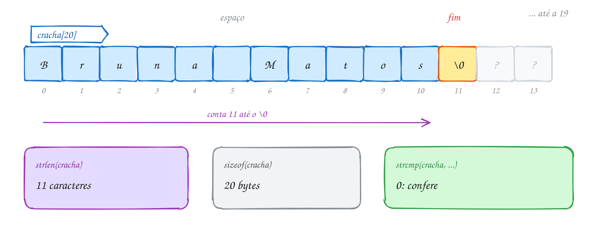</p>

O código monta o crachá, compara `strlen` com `sizeof` e confere com
`strcmp`:

```c
#include <stdio.h>
#include <string.h>

int main(void) {
    char nome[] = "Bruna";       // 6 bytes: 5 letras + '\0'
    char sobrenome[] = "Matos";
    char cracha[20];             // espaço de sobra: até 19 letras + '\0'

    strcpy(cracha, nome);        // cracha = "Bruna"
    strcat(cracha, " ");         // cracha = "Bruna "
    strcat(cracha, sobrenome);   // cracha = "Bruna Matos"

    printf("Crachá: %s\n", cracha);
    printf("strlen: %zu caracteres\n", strlen(cracha)); // conta até o '\0'
    printf("sizeof: %zu bytes\n", sizeof(cracha));      // o vetor inteiro

    if (strcmp(cracha, "Bruna Matos") == 0) {           // 0 quer dizer iguais
        printf("Confere com a inscrição.\n");
    }
    return 0;
}
// Saída:
// Crachá: Bruna Matos
// strlen: 11 caracteres
// sizeof: 20 bytes
// Confere com a inscrição.
```

Repara no fluxograma: o `strcat` não sabe onde o crachá termina; ele procura
o `'\0'` do destino e começa a escrever ali, por cima dele, e põe um `'\0'`
novo no fim. Toda função de string é um laço "até achar o `'\0'`":

<p align="center">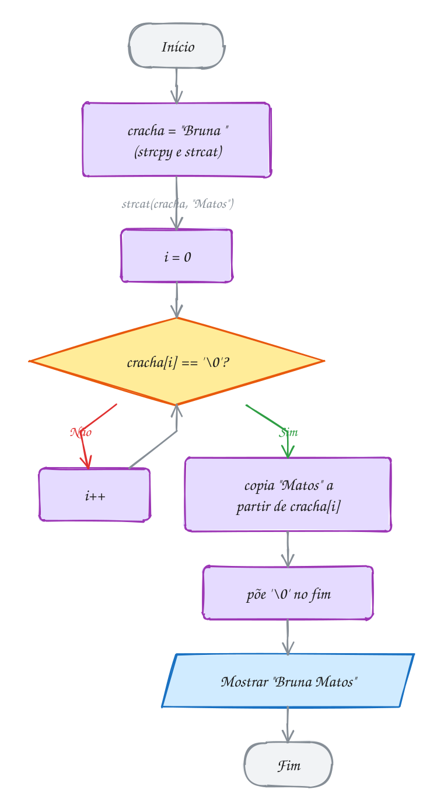</p>

> [!WARNING]
> **`strcpy` e `strcat` não sabem o tamanho do destino.** Elas escrevem até
> acabar a origem, caiba ou não. Com `char cracha[8]`, o `strcat` de
> "Bruna Matos" escreve 12 bytes num vetor de 8: **estouro de buffer**, a
> falha de segurança mais famosa da história do C. Antes de copiar ou colar,
> confira: `strlen(dest) + strlen(orig) + 1 <= sizeof(dest)`. Outra pegadinha:
> `strcmp` devolve **0 quando são iguais**, e 0 é falso. `if (strcmp(a, b))`
> quer dizer "se forem **diferentes**". Escreva sempre `== 0`.

> [!TIP]
> **Por dentro do C:** a string do C não guarda o próprio tamanho. Para saber
> quantos caracteres "Bruna Matos" tem, o `strlen` anda byte a byte até o
> `'\0'`: custa proporcional ao tamanho, toda vez. Por isso, num laço, nunca escreva
> `for (i = 0; i < strlen(s); i++)`: o `strlen` roda a cada volta. Calcule uma
> vez antes. E cuidado com acento: o `strlen("Belém")` é **6**, porque o "é"
> em UTF-8 ocupa 2 bytes. O C conta bytes, não letras.

> [!NOTE]
> **Pergunta para você:** depois de `char s[10] = "banana";` e `s[3] = '\0';`,
> o que `printf("%s %zu %zu\n", s, strlen(s), sizeof(s));` mostra? As letras
> depois da posição 3 sumiram da memória?

### Hora de praticar

Os arquivos ficam em [`0041-strings/`](0041-strings/). Os comandos funcionam de qualquer pasta do terminal. Nos exemplos, rode, mude, quebre e rode de novo. Nos exercícios, a resposta vai dentro do próprio arquivo. ★☆☆ é aquecimento, ★★☆ pede raciocínio e ★★★ é desafio.

**Exemplo A081 · O nome no crachá**

```c
#include <stdio.h>
#include <string.h>

int main(void) {
    char nome[] = "Bruna";       // 6 bytes: 5 letras + '\0'
    char sobrenome[] = "Matos";
    char cracha[20];             // espaço de sobra: até 19 letras + '\0'

    strcpy(cracha, nome);        // cracha = "Bruna"
    strcat(cracha, " ");         // cracha = "Bruna "
    strcat(cracha, sobrenome);   // cracha = "Bruna Matos"

    printf("Crachá: %s\n", cracha);
    printf("strlen: %zu caracteres\n", strlen(cracha)); // conta até o '\0'
    printf("sizeof: %zu bytes\n", sizeof(cracha));      // o vetor inteiro

    if (strcmp(cracha, "Bruna Matos") == 0) {           // 0 quer dizer iguais
        printf("Confere com a inscrição.\n");
    }
    return 0;
}
// Saída:
// Crachá: Bruna Matos
// strlen: 11 caracteres
// sizeof: 20 bytes
// Confere com a inscrição.
```

```bash
~/LPEDC/rodar 05-vetores-e-strings/0041-strings/A081.c
```

**Exemplo A082 · Percorrendo até o '\0'**

```c
#include <stdio.h>

// conta os caracteres sem strlen: anda até achar o '\0'
int tamanho(const char s[]) {
    int i = 0;
    while (s[i] != '\0') {
        i++;
    }
    return i;
}

// copia caractere por caractere e fecha com o '\0'
void copiar(char destino[], const char origem[]) {
    int i;
    for (i = 0; origem[i] != '\0'; i++) {
        destino[i] = origem[i];
    }
    destino[i] = '\0'; // sem esta linha, destino não termina
}

int main(void) {
    char cidade[] = "Belém";
    char copia[20];

    copiar(copia, cidade);
    copia[0] = 'X'; // a cópia é outro vetor

    printf("%s tem %d bytes antes do '\\0'\n", cidade, tamanho(cidade));
    printf("cópia alterada: %s\n", copia);

    cidade[3] = '\0'; // corta a string no meio
    printf("cortada: %s (%d)\n", cidade, tamanho(cidade));
    return 0;
}
// Saída:
// Belém tem 6 bytes antes do '\0'
// cópia alterada: Xelém
// cortada: Bel (3)
```

```bash
~/LPEDC/rodar 05-vetores-e-strings/0041-strings/A082.c
```

#### Exercícios

**Exercício E241** · ★☆☆

Declare char cidade[] = "Manaus"; e mostre cada posição do vetor, INCLUINDO
a do '\0', com o caractere e o código. Para o '\0', mostre \0 no lugar do
caractere. No fim, mostre strlen e sizeof.


```text
Saída esperada:
[0] M 77
[1] a 97
[2] n 110
[3] a 97
[4] u 117
[5] s 115
[6] \0 0
strlen = 6, sizeof = 7
```

**Dicas:**

1. O laço pode ir até sizeof(cidade) - 1, que inclui o '\0'.
2. Para escrever uma barra invertida no printf, use "\\".
3. strlen devolve size_t: mostre com %zu (sizeof também).
4. Resposta esperada: a saída acima.

```bash
~/LPEDC/rodar 05-vetores-e-strings/0041-strings/E241.c
```

**Exercício E242** · ★☆☆

Sem rodar, preveja cada linha. Para o strcmp, diga só o sinal (negativo,
zero ou positivo): o valor exato pode mudar de um sistema para outro.


```text
char s[10] = "pastel";
printf("%zu %zu\n", strlen(s), sizeof(s));
printf("%zu\n", sizeof("verde"));
s[4] = '\0';
printf("%s %zu\n", s, strlen(s));
printf("%d\n", strcmp("abc", "abd") < 0);
printf("%d\n", strcmp("Zebra", "abelha") < 0);
printf("%d\n", strcmp("casa", "casamento") < 0);
```

**Dicas:**

1. sizeof de um literal conta o '\0'; strlen não.
2. Depois de s[4] = '\0', o texto acaba na posição 4. O "el" continua na
   memória, só que ninguém olha para ele.
3. strcmp compara os códigos, letra a letra: 'Z' é 90 e 'a' é 97.
   Quando uma string acaba antes, o '\0' (0) é menor que qualquer letra.
4. Resposta esperada: "6 10", "6", "past 4", 1, 1 e 1.

```bash
~/LPEDC/rodar 05-vetores-e-strings/0041-strings/E242.c
```

**Exercício E243** · ★★☆

Implemente, sem usar o string.h, as suas versões de três funções:


```text
int meu_strlen(const char s[]);
void meu_strcat(char dest[], const char orig[]);
int meu_strcmp(const char a[], const char b[]);
```


meu_strcmp devolve 0 se forem iguais, um negativo se a vem antes e um
positivo se a vem depois. No main, teste:


```text
char usuario[30] = "joao";
meu_strcat(usuario, ".silva");
```


```text
Saída esperada:
joao.silva (10)
igual a "joao.silva"? sim
"ana" antes de "bia"? sim
"bia" antes de "bianca"? sim
```

**Dicas:**

1. meu_strcat: ache o '\0' de dest (use meu_strlen) e copie orig a partir
   dali, sem esquecer de pôr o '\0' no fim.
2. meu_strcmp: avance enquanto a[i] == b[i] e a[i] != '\0'. Quando parar,
   devolva a[i] - b[i]. Se as duas acabaram juntas, isso dá 0.
3. Resposta esperada: a saída acima.

```bash
~/LPEDC/rodar 05-vetores-e-strings/0041-strings/E243.c
```

**Exercício E244** · ★★☆

Um palíndromo se lê igual nos dois sentidos: "arara", "osso". Escreva


```text
bool eh_palindromo(const char s[]);
```


que ignora a diferença entre maiúsculas e minúsculas ("Reviver" vale) e
teste com as palavras do vetor de strings abaixo (cada linha da matriz de
char é uma string):


```text
char palavras[5][12] = {"arara", "Reviver", "carro", "Osso", "A"};
```


```text
Saída esperada:
arara: sim
Reviver: sim
carro: não
Osso: sim
A: sim
```

**Dicas:**

1. Dois índices: i começa em 0 e j em strlen(s) - 1. Compare, e ande com
   os dois para o meio enquanto i < j.
2. Compare tolower(s[i]) com tolower(s[j]).
3. palavras[k] é a linha k da matriz: uma string que você passa para a
   função como qualquer outra.
4. Resposta esperada: a saída acima. Desafio extra: ignore também os
   espaços e teste com "Anotaram a data da maratona".

```bash
~/LPEDC/rodar 05-vetores-e-strings/0041-strings/E244.c
```

**Exercício E245** · ★★★

O programa abaixo monta o endereço "Rio de Janeiro - RJ" e confere a
cidade. Ele tem TRÊS erros de propósito. Dois o compilador avisa (leia os
warnings!). O terceiro não gera aviso nenhum: só o sanitizer pega, e só
depois que você conserta os outros dois. Ache, explique e conserte.


```text
Saída esperada depois do conserto:
Rio de Janeiro - RJ
Cidade conferida.
```

**Dicas:**

1. Quantos bytes "RJ" precisa? E quantos o vetor uf tem?
2. Quantos bytes "Rio de Janeiro - RJ" precisa? Cabe em local[10]?
3. O que o == compara quando os dois lados são strings?
4. Resposta esperada: char uf[2] = "RJ" não tem lugar para o '\0' (o C
   aceita sem avisar, e o %s lê além do vetor): use uf[3] ou uf[];
   local[10] não cabe os 20 bytes do endereço (estouro no strcat, que o
   gcc percebe com -Wstringop-overflow): use local[30]; cidade == "Rio" compara endereços, não texto (o gcc avisa):
   use strcmp(cidade, "Rio") == 0.

```bash
~/LPEDC/rodar 05-vetores-e-strings/0041-strings/E245.c
```

**Exercício E246** · ★★★

Uma biblioteca quer padronizar os títulos dos livros: a primeira letra de
cada palavra em maiúscula e as outras em minúscula. Escreva


```text
int capitalizar(char s[]);
```


que altera a string no lugar e devolve quantas palavras ela tem. Palavras
são separadas por um ou mais espaços (pode haver espaço no começo e no fim).


```text
char titulo[] = "  o SENHOR   dos aneis ";
```


```text
Saída esperada:
[  O Senhor   Dos Aneis ]
4 palavras
```

**Dicas:**

1. Guarde num bool se o caractere anterior era espaço (comece com true:
   antes do texto é como se houvesse um espaço).
2. Se o atual não é espaço e o anterior era: começou uma palavra. Conte e
   use toupper. Se não é espaço e o anterior também não era: tolower.
3. Percorra até o '\0', não até sizeof.
4. Resposta esperada: a saída acima (os colchetes mostram que os espaços
   das pontas continuam lá).

```bash
~/LPEDC/rodar 05-vetores-e-strings/0041-strings/E246.c
```

---

## 0042 · Lendo strings

No cadastro de um app de consultas, a pessoa digita o nome completo: "Maria
Clara". O programa responde "Olá, Maria!". Cadê o "Clara"? O culpado é o
`scanf("%s", nome)`: ele lê **uma palavra** e para no primeiro espaço. O
"Clara" fica esperando na entrada e vai atrapalhar a próxima leitura.

Antes de ver a solução, as regras do `scanf` com string:

- **sem `&`**: `scanf("%s", nome)`. O nome do vetor já é o endereço do
  começo (assunto 0038), então o `&` não vai;
- para no primeiro espaço, tab ou Enter;
- **não sabe o tamanho do vetor**. Digitou 60 letras num `char nome[40]`? Ele
  escreve as 60. Dá para limitar com a largura: `scanf("%39s", nome)`.

Para ler uma **linha inteira**, com espaços, o C tem o **`fgets`**:

```c
fgets(nome, sizeof(nome), stdin);
```

São três argumentos: onde guardar, quantos bytes cabem e de onde ler (`stdin`
é o teclado). O `fgets` lê até o Enter **ou** até encher o vetor (no máximo
`tamanho - 1` caracteres) e **sempre** põe o `'\0'` no fim. Passando o
tamanho certo (`sizeof(nome)`), ele nunca estoura o vetor. Quando a entrada
acaba (Ctrl+D), ele devolve `NULL`.

Só tem um detalhe: o `fgets` **guarda o `'\n'`** do Enter, se couber. Você
digita "Maria Clara" e recebe `"Maria Clara\n"`. Para tirar, use o
**`strcspn`** do `<string.h>`: `strcspn(s, "\n")` devolve a posição do
primeiro `'\n'` (ou o tamanho da string, se não houver). Trocando essa posição
por `'\0'`, o texto termina antes do Enter:

```c
nome[strcspn(nome, "\n")] = '\0';
```

Uma linha só, que funciona nos dois casos: com `'\n'` ele é trocado; sem
`'\n'` o `'\0'` é trocado por ele mesmo. O `fgets` não tira o `\n`
sozinho: essa limpeza é sua.

Vamos ver na prática. O vetor `nome` tem 40 bytes. O `fgets` copia os 11
caracteres, depois o `'\n'`, depois o `'\0'`. O `strcspn` acha o `'\n'` na
posição 11, e ele vira o novo fim:

<p align="center">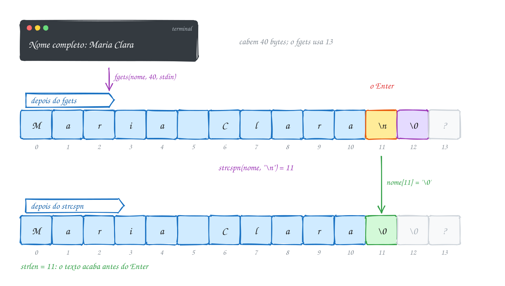</p>

O código mostra a string entre colchetes antes e depois da limpeza, para você
enxergar o `'\n'`:

```c
#include <stdio.h>
#include <string.h>

int main(void) {
    char nome[40];

    printf("Nome completo: ");
    if (fgets(nome, sizeof(nome), stdin) == NULL) { // NULL: a entrada acabou
        printf("Nada foi digitado.\n");
        return 1;
    }
    printf("Lido: [%s]", nome);                     // o '\n' veio junto

    nome[strcspn(nome, "\n")] = '\0';               // troca o '\n' pelo fim
    printf("Limpo: [%s]\n", nome);

    printf("Olá, %s! Seu nome tem %zu caracteres.\n", nome, strlen(nome));
    return 0;
}
// Nome completo: Maria Clara
// Lido: [Maria Clara
// ]Limpo: [Maria Clara]
// Olá, Maria Clara! Seu nome tem 11 caracteres.
```

Repara no fluxograma: o teste do `NULL` vem antes de qualquer uso. Se a
entrada acabou, não existe nome para limpar:

<p align="center">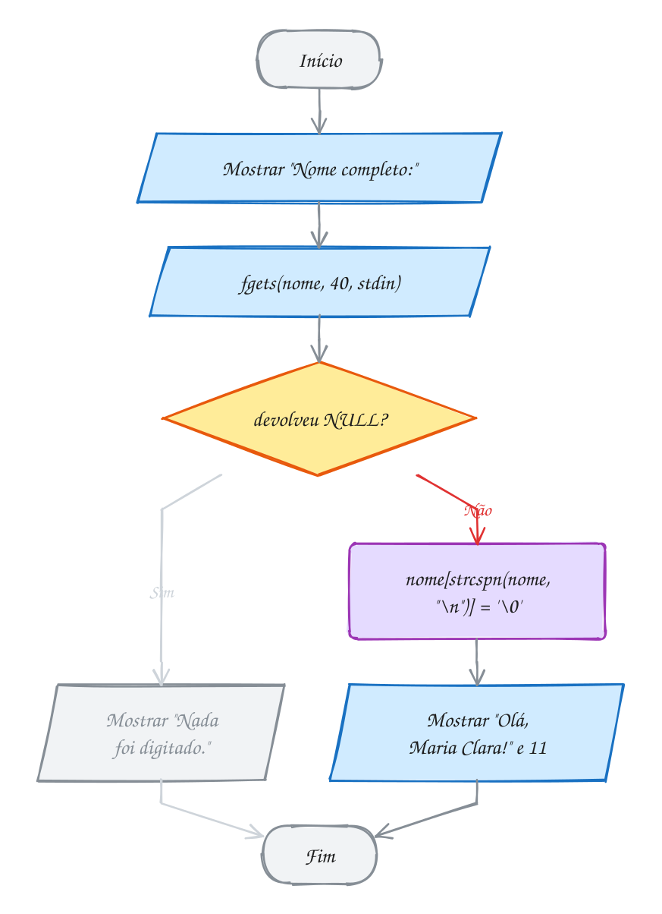</p>

> [!WARNING]
> **`scanf("%d")` seguido de `fgets` "pula" a leitura.** O `scanf` lê o
> número e deixa o Enter na entrada. O `fgets` seguinte encontra esse `'\n'`
> e devolve uma linha vazia na hora, sem esperar você digitar. A solução é
> jogar fora o resto da linha depois do `scanf`:
> `while ((c = getchar()) != '\n' && c != EOF) {}` (com `int c`). O exemplo
> A084 faz isso. Você vai ver `fflush(stdin)` em material antigo: é
> comportamento indefinido pelo padrão. Não use.

> [!TIP]
> **Por dentro do C:** o teclado não manda as letras direto para o seu
> programa. O terminal junta o que você digita num **buffer** e só entrega
> quando você aperta Enter. `scanf`, `getchar` e `fgets` tiram bytes desse
> mesmo buffer, e o que um deixa o próximo pega. Agora, o **`gets`**: ele lia
> uma linha sem receber o tamanho do vetor, então qualquer linha comprida
> estourava a memória. Em 1988, o worm de Morris invadiu milhares de máquinas
> mandando uma linha longa para um programa que usava `gets`. A função foi
> **removida da linguagem no C11**. Se aparecer num livro, troque por `fgets`.

> [!NOTE]
> **Pergunta para você:** com `char s[5]` e o usuário digitando "uva" e
> Enter, quais bytes ficam em `s` depois do `fgets`? Quanto vale `strlen(s)`
> antes e depois da linha do `strcspn`? E se ele digitasse "melancia"?

### Hora de praticar

Os arquivos ficam em [`0042-lendo-strings/`](0042-lendo-strings/). Os comandos funcionam de qualquer pasta do terminal. Nos exemplos, rode, mude, quebre e rode de novo. Nos exercícios, a resposta vai dentro do próprio arquivo. ★☆☆ é aquecimento, ★★☆ pede raciocínio e ★★★ é desafio.

**Exemplo A083 · O nome completo no cadastro**

```c
#include <stdio.h>
#include <string.h>

int main(void) {
    char nome[40];

    printf("Nome completo: ");
    if (fgets(nome, sizeof(nome), stdin) == NULL) { // NULL: a entrada acabou
        printf("Nada foi digitado.\n");
        return 1;
    }
    printf("Lido: [%s]", nome);                     // o '\n' veio junto

    nome[strcspn(nome, "\n")] = '\0';               // troca o '\n' pelo fim
    printf("Limpo: [%s]\n", nome);

    printf("Olá, %s! Seu nome tem %zu caracteres.\n", nome, strlen(nome));
    return 0;
}
// Nome completo: Maria Clara
// Lido: [Maria Clara
// ]Limpo: [Maria Clara]
// Olá, Maria Clara! Seu nome tem 11 caracteres.
```

```bash
~/LPEDC/rodar 05-vetores-e-strings/0042-lendo-strings/A083.c
```

**Exemplo A084 · Número, depois texto, e a linha que não coube**

```c
#include <stdio.h>
#include <string.h>

// joga fora o que sobrou na linha, até o '\n' (ou o fim da entrada)
void descartar_linha(void) {
    int c;
    while ((c = getchar()) != '\n' && c != EOF) {
    }
}

int main(void) {
    int idade;
    char cidade[12]; // cabem 10 letras + '\n' + '\0'

    printf("Idade: ");
    if (scanf("%d", &idade) != 1) {
        printf("Idade inválida.\n");
        return 1;
    }
    descartar_linha(); // sem isto, o fgets leria o '\n' que o scanf deixou

    printf("Cidade: ");
    if (fgets(cidade, sizeof(cidade), stdin) == NULL) {
        return 1;
    }

    size_t pos = strcspn(cidade, "\n");
    if (cidade[pos] == '\n') {
        cidade[pos] = '\0';  // coube: só tira o '\n'
    } else {
        descartar_linha();   // não coube: o resto ainda está na entrada
        printf("(nome longo demais, cortado)\n");
    }

    printf("%d anos, de %s\n", idade, cidade);
    return 0;
}
// Idade: 34
// Cidade: Campina Grande
// (nome longo demais, cortado)
// 34 anos, de Campina Gra
```

```bash
~/LPEDC/rodar 05-vetores-e-strings/0042-lendo-strings/A084.c
```

#### Exercícios

**Exercício E247** · ★☆☆

Leia o nome da cidade onde a pessoa mora com fgets (o nome pode ter
espaços), tire o '\n' com strcspn e mostre a frase abaixo. Se o fgets
devolver NULL, mostre "Nada foi digitado." e termine com return 1.


```text
Exemplo de execução:
Cidade: Porto Alegre
Você mora em Porto Alegre (12 caracteres).
```

**Dicas:**

1. char cidade[50]; fgets(cidade, sizeof(cidade), stdin)
2. cidade[strcspn(cidade, "\n")] = '\0';
3. Teste sem tirar o '\n': o ponto final pula para a linha de baixo e o
   strlen conta 13. É o sinal de que o '\n' ficou lá.
4. Resposta esperada: a execução acima.

```bash
~/LPEDC/rodar 05-vetores-e-strings/0042-lendo-strings/E247.c
```

**Exercício E248** · ★☆☆

O programa abaixo faz três leituras seguidas. Rode-o digitando a linha


```text
Maria Clara Souza
```


mas ANTES preveja o que aparece entre cada par de colchetes.

**Dicas:**

1. O %s para no primeiro espaço; %4s lê no máximo 4 caracteres.
2. O que o scanf não leu continua na entrada, esperando a próxima leitura.
3. O fgets pega o que sobrou da linha, do ponto exato em que o scanf
   parou, e vai até o Enter.
4. Resposta esperada: [Maria] [Clar] [a Souza]. Cada %s pula os espaços
   antes de ler; o fgets não pula nada.

```bash
~/LPEDC/rodar 05-vetores-e-strings/0042-lendo-strings/E248.c
```

**Exercício E249** · ★★☆

Este programa lê a quantidade de ingressos e o nome do comprador. Rode
digitando 2 e Enter: ele nem espera você digitar o nome, e mostra o
comprador vazio. O erro é de propósito. Explique por que acontece e
conserte.


```text
Exemplo de execução depois do conserto:
Quantidade de ingressos: 2
Nome do comprador: Ana Lima
2 ingresso(s) para Ana Lima
```

**Dicas:**

1. O scanf("%d") lê o 2. E o Enter que você apertou depois do 2?
2. O fgets para no primeiro '\n' que encontrar.
3. Resposta esperada: o scanf deixa o '\n' na entrada; o fgets lê esse
   '\n' na hora e devolve uma linha vazia. Conserto: depois do scanf,
   descarte o resto da linha com
   int c; while ((c = getchar()) != '\n' && c != EOF) {}

```bash
~/LPEDC/rodar 05-vetores-e-strings/0042-lendo-strings/E249.c
```

**Exercício E250** · ★★☆

O cadastro do banco exige uma senha com pelo menos 8 caracteres, uma letra
maiúscula, uma minúscula e um dígito (espaço é permitido). Leia a senha com
fgets, tire o '\n' e mostre, para cada regra que falhar, uma linha "Falta:".
Se nenhuma falhar, mostre "Senha forte.".


```text
Exemplo de execução 1:
Senha: banana12
Falta: letra maiúscula
```


```text
Exemplo de execução 2:
Senha: abc
Falta: 8 caracteres (tem 3)
Falta: letra maiúscula
Falta: dígito
```


```text
Exemplo de execução 3:
Senha: Pao de Queijo 1
Senha forte.
```

**Dicas:**

1. Um laço até o '\0' com três bool: tem_maiuscula, tem_minuscula,
   tem_digito. Use isupper, islower e isdigit.
2. O tamanho vem do strlen DEPOIS de tirar o '\n'.
3. Guarde num bool se alguma regra falhou, para decidir o "Senha forte.".
4. Resposta esperada: as três execuções acima.

```bash
~/LPEDC/rodar 05-vetores-e-strings/0042-lendo-strings/E250.c
```

**Exercício E251** · ★★★

Monte uma lista de compras. Leia até 5 itens, um por linha, com fgets,
guardando cada um numa linha da matriz char itens[5][16] (até 15
caracteres por item). A leitura para numa linha vazia, no fim da entrada
(EOF) ou quando a lista enche.

Se a pessoa digitar um item com mais de 15 caracteres, guarde só o que
coube, mostre "(cortado)" e jogue fora o resto da linha: senão o resto vira
o próximo item!

No fim, mostre a lista numerada e qual item vem primeiro em ordem
alfabética.


```text
Exemplo de execução:
Item: leite
Item: feijao preto
Item: arroz
Item: detergente de coco neutro
(cortado)
Item:
Lista com 4 itens:
1. leite
2. feijao preto
3. arroz
4. detergente de c
Primeiro em ordem alfabética: arroz
```

**Dicas:**

1. fgets(itens[n], sizeof(itens[n]), stdin): cada linha da matriz é uma
   string de 16 bytes.
2. Depois do fgets, procure o '\n' com strcspn. Se achou, troque por '\0'.
   Se não achou, a linha não coube: descarte o resto com o laço do getchar.
3. Linha vazia: depois de tirar o '\n', strlen(itens[n]) == 0.
4. Para o primeiro em ordem alfabética, guarde o ÍNDICE do menor e compare
   com strcmp(itens[i], itens[menor]) < 0.
5. Resposta esperada: a execução acima.

```bash
~/LPEDC/rodar 05-vetores-e-strings/0042-lendo-strings/E251.c
```

**Exercício E252** · ★★★

O programa abaixo lê com fgets num vetor de só 6 bytes, num laço, até a
entrada acabar, e mostra cada pedaço lido entre colchetes. Preveja a saída
EXATA (inclusive onde caem as quebras de linha) para esta entrada de duas
linhas:


```text
abacaxi
uva
```


Depois rode com `printf 'abacaxi\nuva\n' | ~/LPEDC/rodar` seguido do caminho
deste arquivo.

**Dicas:**

1. Com 6 bytes, cada fgets lê no máximo 5 caracteres (sobra 1 para o '\0').
2. O fgets para no '\n' (e o guarda) ou quando enche, o que vier primeiro.
   O que não coube fica para a próxima chamada.
3. Um '\n' guardado no pedaço quebra a linha ANTES do ']'.
4. Resposta esperada: os pedaços são "abaca", "xi\n" e "uva\n" (3
   leituras). Na tela: a 1ª linha é [abaca][xi, a 2ª é ][uva, a 3ª é ] e
   a última, "3 leituras". Uma linha longa chega em pedaços, e cada pedaço
   parece uma linha nova se você não conferir o '\n'.

```bash
~/LPEDC/rodar 05-vetores-e-strings/0042-lendo-strings/E252.c
```

---

## 0043 · Juntando tudo

A escola do bairro abriu uma enquete para escolher o mascote da festa junina:
arara, boto ou capivara. Os votos chegam do formulário, um por linha, do jeito
que cada pessoa digitou: `boto`, `Arara`, `CAPIVARA`, `Tatu`... Você precisa
contar, desenhar um gráfico de barras e anunciar o vencedor.

O problema usa tudo o que o módulo ensinou:

- **`fgets` num laço** (assunto 0042) lê um voto por linha até a entrada
  acabar, quando ele devolve `NULL`;
- **caracteres** (0040): `tolower` em cada letra deixa "BOTO" e "boto" iguais;
- **strings** (0041): `strcspn` tira o `'\n'` e `strcmp` compara o voto com
  cada candidato;
- **matriz de `char`** (0039): os nomes dos candidatos, um por linha;
- **vetor de contadores** (0037): `votos[i]` conta os votos do candidato `i`.
  A posição do nome na matriz é a mesma do contador no vetor;
- **funções que recebem vetores** (0038): `normalizar` altera a linha lida,
  `buscar` só lê.

Divida assim: o `main` cuida do laço e do resultado; cada função faz uma coisa
só. `buscar` devolve a posição ou -1, como a busca do A076: é assim que "Tatu"
cai nos inválidos sem nenhum `if` especial. E o `(unsigned char)` dentro do
`tolower` protege contra votos com acento (veja o assunto 0040).

Vamos ver na prática. Cada linha passa pela mesma esteira: lê, normaliza,
procura na matriz de nomes e soma 1 no contador da posição certa. "Tatu" não
está na matriz, então vai para os inválidos:

<p align="center">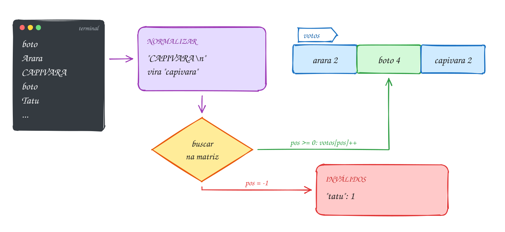</p>

O programa completo. Para testar sem digitar, mande os votos com `printf
'boto\nArara\n...' | ~/LPEDC/rodar` e o caminho do A085:

```c
#include <stdio.h>
#include <string.h>
#include <ctype.h>

#define CANDIDATOS 3
#define TAM_NOME 12
#define TAM_LINHA 40

// tira o '\n' e deixa tudo em minúsculas: "BOTO\n" vira "boto"
void normalizar(char s[]) {
    s[strcspn(s, "\n")] = '\0';
    for (int i = 0; s[i] != '\0'; i++) {
        s[i] = (char) tolower((unsigned char) s[i]);
    }
}

// devolve a posição do candidato, ou -1 se o voto não bate com nenhum
int buscar(char nomes[][TAM_NOME], int n, const char voto[]) {
    for (int i = 0; i < n; i++) {
        if (strcmp(nomes[i], voto) == 0) {
            return i;
        }
    }
    return -1;
}

void mostrar_barra(const char nome[], int votos) {
    printf("%-9s ", nome);
    for (int i = 0; i < votos; i++) {
        putchar('#');
    }
    printf(" %d\n", votos);
}

int main(void) {
    char nomes[CANDIDATOS][TAM_NOME] = {"arara", "boto", "capivara"};
    int votos[CANDIDATOS] = {0};
    int invalidos = 0;
    char linha[TAM_LINHA];

    while (fgets(linha, sizeof(linha), stdin) != NULL) { // um voto por linha
        normalizar(linha);
        int pos = buscar(nomes, CANDIDATOS, linha);
        if (pos >= 0) {
            votos[pos]++;
        } else {
            invalidos++;
        }
    }

    int vencedor = 0;
    for (int i = 0; i < CANDIDATOS; i++) {
        mostrar_barra(nomes[i], votos[i]);
        if (votos[i] > votos[vencedor]) {
            vencedor = i;
        }
    }
    printf("Inválidos: %d\n", invalidos);
    printf("Vencedor: %s\n", nomes[vencedor]);
    return 0;
}
// Entrada (um voto por linha):
// boto, Arara, CAPIVARA, boto, Tatu, capivara, Boto, arara, boto
// Saída:
// arara     ## 2
// boto      #### 4
// capivara  ## 2
// Inválidos: 1
// Vencedor: boto
```

Repara no fluxograma: é um laço com sentinela (assunto 0025), só que a
sentinela é o `NULL` do `fgets`. Dentro dele, uma decisão: achou o candidato
ou não. O resultado só sai depois que a entrada acaba:

<p align="center">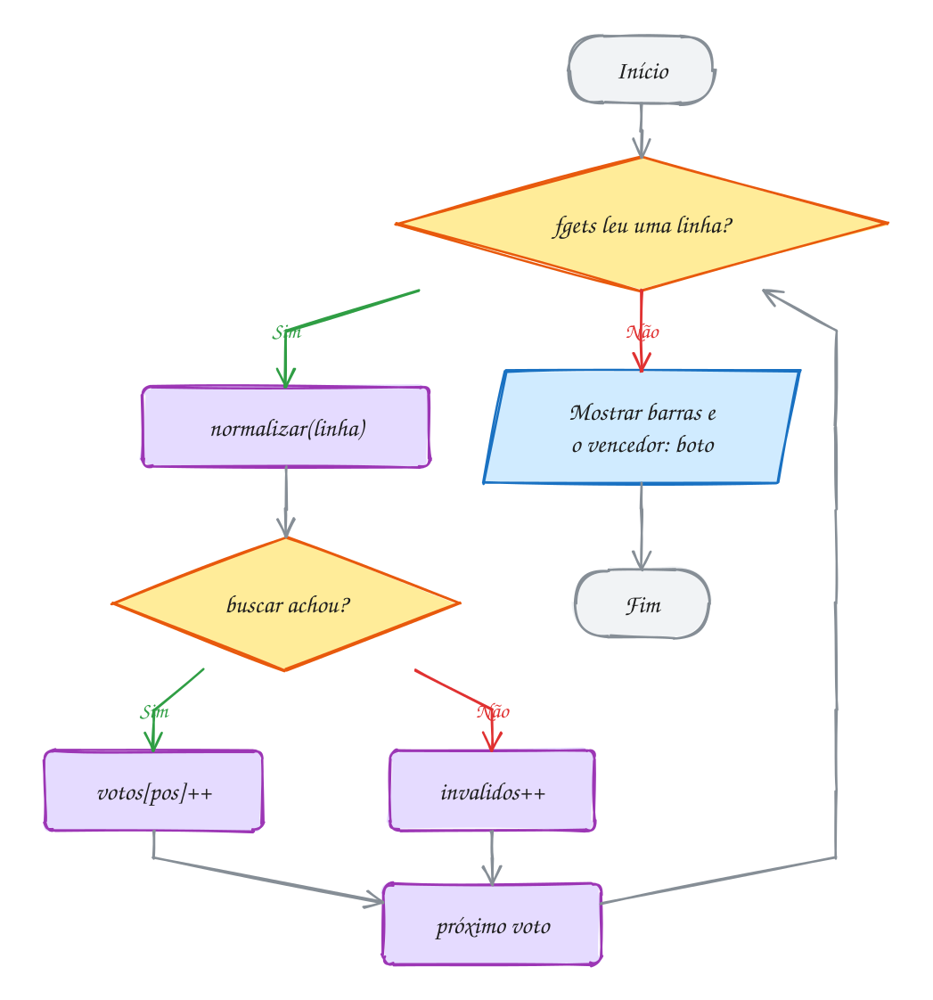</p>

E se a lista de nomes precisasse sair em ordem alfabética? Como string não se
atribui com `=`, trocar dois nomes de lugar é um `strcpy` triplo, com uma
string auxiliar. O exemplo A086 ordena uma lista de chamada assim, uma prévia
da ordenação por seleção (assunto 0092).

> [!WARNING]
> **Empate.** Com `votos[i] > votos[vencedor]`, um empate fica com quem
> aparece primeiro na matriz. Isso é uma regra de negócio escondida no `>`:
> troque por `>=` e o empate passa a ir para o último. Decida de propósito e,
> se o empate importa, detecte e avise. E `"boto "`, com espaço no fim, é
> inválido para o `strcmp`: a `normalizar` não corta espaços.

> [!TIP]
> **Por dentro do C:** `char nomes[3][12]` são 36 bytes contínuos, como toda
> matriz. "arara" ocupa 6 deles na linha 0, e os 6 bytes restantes da linha
> são zeros (as chaves da inicialização zeram o que sobra). `nomes[1]` é o
> começo da linha 1, 12 bytes depois do começo. É por isso que o parâmetro
> de `buscar` precisa do `[TAM_NOME]`: para achar `nomes[i]`, a função calcula
> início + i × 12. Uma lista de nomes de tamanhos bem diferentes desperdiça
> espaço assim; no módulo 07 você vai guardar cada nome com o tamanho exato,
> usando memória dinâmica.

> [!NOTE]
> **Pergunta para você:** se a entrada tivesse uma linha em branco no meio, o
> que aconteceria com ela? E se um voto tivesse 50 letras, maior que o
> `linha[40]`? Pense no que o `fgets` faz com o resto da linha.

### Hora de praticar

Os arquivos ficam em [`0043-juntando-tudo/`](0043-juntando-tudo/). Os comandos funcionam de qualquer pasta do terminal. Nos exemplos, rode, mude, quebre e rode de novo. Nos exercícios, a resposta vai dentro do próprio arquivo. ★☆☆ é aquecimento, ★★☆ pede raciocínio e ★★★ é desafio.

**Exemplo A085 · A enquete do mascote**

```c
#include <stdio.h>
#include <string.h>
#include <ctype.h>

#define CANDIDATOS 3
#define TAM_NOME 12
#define TAM_LINHA 40

// tira o '\n' e deixa tudo em minúsculas: "BOTO\n" vira "boto"
void normalizar(char s[]) {
    s[strcspn(s, "\n")] = '\0';
    for (int i = 0; s[i] != '\0'; i++) {
        s[i] = (char) tolower((unsigned char) s[i]);
    }
}

// devolve a posição do candidato, ou -1 se o voto não bate com nenhum
int buscar(char nomes[][TAM_NOME], int n, const char voto[]) {
    for (int i = 0; i < n; i++) {
        if (strcmp(nomes[i], voto) == 0) {
            return i;
        }
    }
    return -1;
}

void mostrar_barra(const char nome[], int votos) {
    printf("%-9s ", nome);
    for (int i = 0; i < votos; i++) {
        putchar('#');
    }
    printf(" %d\n", votos);
}

int main(void) {
    char nomes[CANDIDATOS][TAM_NOME] = {"arara", "boto", "capivara"};
    int votos[CANDIDATOS] = {0};
    int invalidos = 0;
    char linha[TAM_LINHA];

    while (fgets(linha, sizeof(linha), stdin) != NULL) { // um voto por linha
        normalizar(linha);
        int pos = buscar(nomes, CANDIDATOS, linha);
        if (pos >= 0) {
            votos[pos]++;
        } else {
            invalidos++;
        }
    }

    int vencedor = 0;
    for (int i = 0; i < CANDIDATOS; i++) {
        mostrar_barra(nomes[i], votos[i]);
        if (votos[i] > votos[vencedor]) {
            vencedor = i;
        }
    }
    printf("Inválidos: %d\n", invalidos);
    printf("Vencedor: %s\n", nomes[vencedor]);
    return 0;
}
// Entrada (um voto por linha):
// boto, Arara, CAPIVARA, boto, Tatu, capivara, Boto, arara, boto
// Saída:
// arara     ## 2
// boto      #### 4
// capivara  ## 2
// Inválidos: 1
// Vencedor: boto
```

```bash
~/LPEDC/rodar 05-vetores-e-strings/0043-juntando-tudo/A085.c
```

**Exemplo A086 · A lista de chamada em ordem alfabética**

```c
#include <stdio.h>
#include <string.h>

#define ALUNOS 6
#define TAM 20

// troca duas linhas da matriz: string não se atribui com =, então strcpy
void trocar(char a[], char b[]) {
    char aux[TAM];
    strcpy(aux, a);
    strcpy(a, b);
    strcpy(b, aux);
}

// ordenação por seleção: põe o menor que sobrou na posição i
void ordenar(char nomes[][TAM], int n) {
    for (int i = 0; i < n - 1; i++) {
        int menor = i;
        for (int j = i + 1; j < n; j++) {
            if (strcmp(nomes[j], nomes[menor]) < 0) {
                menor = j;
            }
        }
        if (menor != i) {
            trocar(nomes[i], nomes[menor]);
        }
    }
}

int main(void) {
    char nomes[ALUNOS][TAM] = {"Rafael", "Ana", "Carlos", "Beatriz", "Ana Clara", "Bruno"};

    ordenar(nomes, ALUNOS);
    for (int i = 0; i < ALUNOS; i++) {
        printf("%d. %s\n", i + 1, nomes[i]);
    }
    return 0;
}
// Saída:
// 1. Ana
// 2. Ana Clara
// 3. Beatriz
// 4. Bruno
// 5. Carlos
// 6. Rafael
```

```bash
~/LPEDC/rodar 05-vetores-e-strings/0043-juntando-tudo/A086.c
```

#### Exercícios

**Exercício E253** · ★☆☆

Leia uma frase com fgets e conte quantas vezes aparece cada vogal, sem
diferenciar maiúscula de minúscula. Guarde as contagens num vetor de 5 int
e use a string "aeiou" para saber qual vogal é qual.


```text
Exemplo de execução:
Frase: O Rato Roeu A Roupa Do Rei De Roma
a: 4
e: 3
i: 1
o: 6
u: 2
```

**Dicas:**

1. char vogais[] = "aeiou"; e int contagem[5] = {0};
2. Para cada caractere da frase (até o '\0'), passe por tolower e compare
   com vogais[0] a vogais[4]. Achou em k? contagem[k]++.
3. Não precisa tirar o '\n': ele não é vogal. Mas tirar é um bom hábito.
4. Resposta esperada: a execução acima.

```bash
~/LPEDC/rodar 05-vetores-e-strings/0043-juntando-tudo/E253.c
```

**Exercício E254** · ★☆☆

Complete as funções para mostrar a tabela de artilheiros do campeonato do
bairro, com o nome alinhado à esquerda em 10 colunas e o total no fim. O
main já está pronto.


```text
Saída esperada:
Nome        Gols
Tiago          7
Duda          12
Kauã          5
Lia            9
Total:        33
Artilheiro: Duda
```

**Dicas:**

1. printf("%-10s%6d\n", nomes[i], gols[i]) alinha o nome à esquerda em 10
   colunas e o número à direita em 6.
2. indice_artilheiro é o padrão "posição do maior" do assunto 0038.
3. Repare que "Kauã" tem um acento: em UTF-8 são 5 bytes, e o printf conta
   bytes. Por isso o número dele aparece uma coluna à esquerda dos
   outros. Tudo bem aqui; só saiba por quê.
4. Resposta esperada: a saída acima.

```bash
~/LPEDC/rodar 05-vetores-e-strings/0043-juntando-tudo/E254.c
```

**Exercício E255** · ★★☆

Uma rodada de forca, com tudo fixo no código: a palavra secreta é "BANANA"
e os chutes, na ordem, estão no vetor abaixo. Depois de cada chute, mostre
a palavra com '_' nas letras ainda escondidas (separadas por espaço) e, se
a letra não existir na palavra, conte um erro. Pare assim que a palavra
estiver completa (os chutes que sobrarem não são usados).


```text
char secreta[] = "BANANA";
char chutes[] = {'A', 'E', 'N', 'B', 'O'};
```


```text
Saída esperada:
Chute A: _ A _ A _ A
Chute E: _ A _ A _ A (erro 1)
Chute N: _ A N A N A
Chute B: B A N A N A
Venceu com 1 erro(s)!
```

**Dicas:**

1. Um vetor de bool revelada[6], tudo false no começo. Cada chute marca true
   nas posições onde secreta[i] == chute.
2. Se o chute não marcou nenhuma posição, é erro.
3. Para saber se venceu: todas as posições reveladas? Escreva uma função
   bool completa(const bool revelada[], int n).
4. Resposta esperada: a saída acima.

```bash
~/LPEDC/rodar 05-vetores-e-strings/0043-juntando-tudo/E255.c
```

**Exercício E256** · ★★☆

Valide um CPF digitado com fgets, com ou sem pontuação ("529.982.247-25"
ou "52998224725"). Os dois últimos dígitos são verificadores, calculados a
partir dos 9 primeiros:


```text
1º verificador: multiplique os 9 primeiros dígitos por 10, 9, 8, ..., 2
e some. Seja r o resto da soma por 11. Se r < 2, o dígito é 0; senão,
é 11 - r.
2º verificador: o mesmo com os 10 primeiros dígitos (os 9 + o 1º
verificador), multiplicados por 11, 10, ..., 2.
```


O CPF é válido se tiver exatamente 11 dígitos (ignore '.' e '-'; qualquer
outro caractere invalida), se os verificadores baterem e se os 11 dígitos
NÃO forem todos iguais (111.111.111-11 passa na conta, mas não vale).


```text
Exemplo de execução 1:
CPF: 529.982.247-25
CPF válido.
```


```text
Exemplo de execução 2:
CPF: 529.982.247-26
CPF inválido.
```

**Dicas:**

1. Guarde os dígitos como números num int d[11], usando c - '0'. Só guarde
   enquanto houver lugar (contador < 11), mas continue contando.
2. Faça uma função int verificador(const int d[], int n) que usa os n
   primeiros dígitos com pesos n + 1, n, ..., 2. Chame com n = 9 e n = 10.
3. Para o 529.982.247: a primeira soma dá 295, 295 % 11 = 9, e o dígito é 2.
4. Resposta esperada: as duas execuções acima.

```bash
~/LPEDC/rodar 05-vetores-e-strings/0043-juntando-tudo/E256.c
```

**Exercício E257** · ★★★

O programa abaixo deveria mostrar o nome de trás para frente. Ele tem DOIS
erros de propósito. Rode com o rodar: o sanitizer acusa um. Conserte esse,
rode de novo e veja o outro: o programa passa a mostrar uma linha vazia.


```text
Saída esperada depois do conserto:
aluaP anA
```

**Dicas:**

1. "Ana Paula" tem quantos caracteres? E quantos bytes precisa para ser
   guardado como string?
2. Quando i vale 0, qual caractere vai para invertido[0]? Lembre o que
   mora em nome[strlen(nome)].
3. Uma string que começa com '\0' é vazia, não importa o resto.
4. Resposta esperada: invertido[9] não tem lugar para os 9 caracteres e o
   '\0' (use invertido[10] ou maior); e o laço copia nome[n] (o '\0') para
   invertido[0]. Conserto: for (i = 0; i < n; i++) invertido[i] =
   nome[n - 1 - i]; e depois invertido[n] = '\0'.

```bash
~/LPEDC/rodar 05-vetores-e-strings/0043-juntando-tudo/E257.c
```

**Exercício E258** · ★★★

Compressão RLE (run-length encoding): cada sequência de letras repetidas
vira a letra seguida de quantas vezes ela aparece. "aaabccdddd" vira
"a3b1c2d4". Para simplificar, a contagem é sempre um dígito só: uma
sequência de mais de 9 vira pedaços de 9 ("zzzzzzzzzzzz", 12 z, vira
"z9z3").

Leia uma linha com fgets, tire o '\n', comprima numa string saida[] e
mostre o resultado e os tamanhos. Se a versão comprimida não for menor,
avise que não compensa.


```text
Exemplo de execução 1:
Texto: aaabccdddd
a3b1c2d4 (10 -> 8)
```


```text
Exemplo de execução 2:
Texto: abc
a1b1c1 (3 -> 6): não compensa
```


```text
Exemplo de execução 3:
Texto: zzzzzzzzzzzz
z9z3 (12 -> 4)
```

**Dicas:**

1. Escreva void comprimir(const char texto[], char saida[]). Use dois
   índices: i anda no texto, j marca onde escrever na saída.
2. Para cada posição, conte quantas vezes texto[i] se repete a partir dali
   (no máximo 9). Escreva a letra, depois o dígito: (char) ('0' + conta).
   Avance i pela quantidade contada.
3. No pior caso a saída tem o dobro do tamanho do texto (abc vira a1b1c1):
   dimensione saida com 2 * tamanho do texto + 1. E feche com '\0'.
4. Resposta esperada: as três execuções acima.

```bash
~/LPEDC/rodar 05-vetores-e-strings/0043-juntando-tudo/E258.c
```

---

## Desafios do módulo

Problemas extras para treinar, misturando os assuntos do módulo. Resolva num
arquivo seu e rode com o `rodar`.

**1. Segundo maior.** Dado `int v[] = {14, 9, 27, 3, 27, 18};`, ache o segundo
maior valor **diferente** do maior, numa passada só, sem ordenar.

<details><summary>Resposta</summary>

O maior é 27 e o segundo maior é **18** (o outro 27 não conta). Guarde
`maior` e `segundo`. Para cada item: se for maior que `maior`, o antigo
`maior` desce para `segundo`; senão, se for menor que `maior` e maior que
`segundo`, ele vira o `segundo`. Comece os dois com o menor `int` possível
(`INT_MIN`, de `<limits.h>`).

</details>

**2. Remover duplicados de um vetor ordenado.** `int v[] = {2, 2, 3, 5, 5, 5,
8, 9, 9};` Deixe cada valor uma vez só, **no próprio vetor**, e devolva o novo
tamanho.

<details><summary>Resposta</summary>

Fica `2 3 5 8 9` e o tamanho **5**. Use dois índices: `escrita` começa em 1;
`leitura` anda de 1 até o fim e, sempre que `v[leitura] != v[escrita - 1]`,
copia para `v[escrita]` e avança `escrita`. Uma passada só, sem vetor extra.
As posições depois do novo tamanho continuam com valores velhos: quem chama
passa a usar só o tamanho devolvido.

</details>

**3. Juntar duas listas ordenadas.** `a = {1, 4, 9, 12}` e `b = {2, 3, 10}`.
Monte `c` com os 7 valores em ordem, sem ordenar `c` depois.

<details><summary>Resposta</summary>

`1 2 3 4 9 10 12`. Um índice em cada vetor: compare `a[i]` com `b[j]`, copie
o menor para `c[k]` e avance quem foi copiado. Quando um acabar, copie o
resto do outro. É o coração do *merge sort* (assunto 0094).

</details>

**4. Girar a matriz.** Gire `{{1, 2, 3}, {4, 5, 6}}` (2×3) 90° no sentido
horário, gerando uma 3×2.

<details><summary>Resposta</summary>

Resultado: `4 1 / 5 2 / 6 3`. A regra é `g[c][L - 1 - l] = m[l][c]`, com
`L` = número de linhas da original (2). Confira com a célula do 6: na
original está em `[1][2]`, na girada vai para `[2][0]`.

</details>

**5. Quadrado mágico?** Escreva `bool eh_magico(int m[][4])` para uma matriz
4×4: todas as linhas, colunas e as duas diagonais com a mesma soma. Teste com
`{{16, 3, 2, 13}, {5, 10, 11, 8}, {9, 6, 7, 12}, {4, 15, 14, 1}}`.

<details><summary>Resposta</summary>

É mágico: tudo soma **34**. Calcule a soma da primeira linha como referência
e compare as outras 9 somas (3 linhas, 4 colunas, 2 diagonais) com ela. Na
primeira diferente, devolva `false`.

</details>

**6. Anagramas.** "Roma" e "amor" são anagramas (mesmas letras, outra ordem).
Escreva `bool anagramas(const char a[], const char b[])` sem ordenar nada,
ignorando maiúsculas.

<details><summary>Resposta</summary>

Um vetor `int conta[26] = {0}`: cada letra de `a` soma 1 em
`conta[tolower(c) - 'a']`, cada letra de `b` subtrai 1. São anagramas se,
no fim, as 26 posições forem zero. "Roma" e "amor": **sim**. Antes de usar
o caractere como índice, confira com `isalpha`: um espaço ou um byte de "ã"
daria um índice fora do vetor.

</details>

**7. Achar uma palavra dentro da outra.** Sem usar `strstr`, escreva
`int posicao(const char texto[], const char busca[])` que devolve onde
`busca` começa em `texto`, ou -1.

<details><summary>Resposta</summary>

`posicao("banana split", "na")` é **2**; `posicao("banana", "uva")` é **-1**.
Para cada `i` do texto, compare `texto[i + k]` com `busca[k]` enquanto forem
iguais e `busca[k] != '\0'`. Se chegou ao `'\0'` da busca, achou em `i`. Não
precisa de cuidado extra com o fim do texto: o `'\0'` do texto é diferente
de qualquer letra da busca, e a comparação para ali.

</details>

**8. Somar números gigantes.** `long long` vai até uns 9 × 10¹⁸. Some
`"98765432109876543210"` com `"12345678901234567890"` guardando os números
como strings, dígito a dígito, como na escola.

<details><summary>Resposta</summary>

**111111111011111111100**. Ande do último dígito para o primeiro nas duas
strings, some `(a[i] - '0') + (b[j] - '0') + vai_um`, guarde
`soma % 10` e leve `soma / 10`. O resultado sai de trás para frente: inverta
no fim (ou escreva de trás para frente num vetor com uma posição extra para o
último "vai um").

</details>

**9. Cifra de Vigenère.** É a César com um deslocamento diferente para cada
letra, dado por uma chave que se repete. Com a chave "LIMAO", cifre
"ATACARAGORA" (A = 0, B = 1, ..., L = 11...).

<details><summary>Resposta</summary>

Resultado: **LBMCOCISOFL**. A letra `i` do texto anda `chave[i % 5] - 'A'`
posições: A + L = L, T + I = B, A + M = M, C + A = C, A + O = O, R + L = C, e
assim por diante, sempre com `% 26`. Para decifrar, ande `26 - desloc`.

</details>

**10. Jogo da vida, uma geração.** Numa matriz 5×5 de 0 e 1, cada célula
viva com 2 ou 3 vizinhas vivas continua viva; uma morta com exatamente 3
vizinhas nasce; o resto morre ou fica morto. Calcule a próxima geração de um
"pisca-pisca": uma linha de três vivas no meio (`m[2][1]`, `m[2][2]`,
`m[2][3]`).

<details><summary>Resposta</summary>

Ela vira uma **coluna** de três: `[1][2]`, `[2][2]`, `[3][2]`. Na geração
seguinte, volta a ser linha. O cuidado: calcule tudo numa **segunda matriz**.
Se você atualizar a original enquanto conta, as células já mudadas atrapalham
a contagem das vizinhas. A contagem de vizinhas é a do campo minado (E234).

</details>

## Para ler mais

- BACKES, A. *Linguagem C: completa e descomplicada*. Rio de Janeiro: Elsevier, 2013. Caps. 6 (vetores e matrizes), 7 (strings) e 9 (passagem de vetores para funções).
- BACKES, A. *Linguagem C: apostila*. Uberlândia: UFU, [s.d.]. Seções de vetores, matrizes e strings.
- DEITEL, P.; DEITEL, H. *C: como programar*. 6. ed. São Paulo: Pearson, 2011. Caps. 6 (arrays) e 8 (caracteres e strings).
- DEITEL, P.; DEITEL, H. *C: how to program*. 7. ed. Boston: Pearson, 2013. Caps. 6 e 8.
- ANTONELLO, R. *Linguagem C*. 1. ed. Disponível em: <http://www.antonello.com.br>. Cap. 8.
- LEAL, G. C. L. *Algoritmos e lógica de programação II*. Maringá: Unicesumar, 2016. Unidades de vetores, matrizes e strings.
- KERNIGHAN, B. W.; RITCHIE, D. M. *C: a linguagem de programação padrão ANSI*. Rio de Janeiro: Campus, 1989. Caps. 1.6, 1.9 e 5.
- CPPREFERENCE. *Null-terminated byte strings*. Disponível em: <https://en.cppreference.com/w/c/string/byte>.
- LINUX MAN-PAGES PROJECT. *fgets(3)*, *string(3)*, *ctype(3)*. Disponível em: <https://man7.org/linux/man-pages/>.
- SPAFFORD, E. H. The Internet worm program: an analysis. *ACM SIGCOMM Computer Communication Review*, v. 19, n. 1, p. 17-57, 1989.
