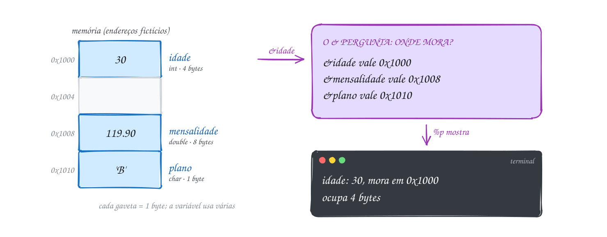
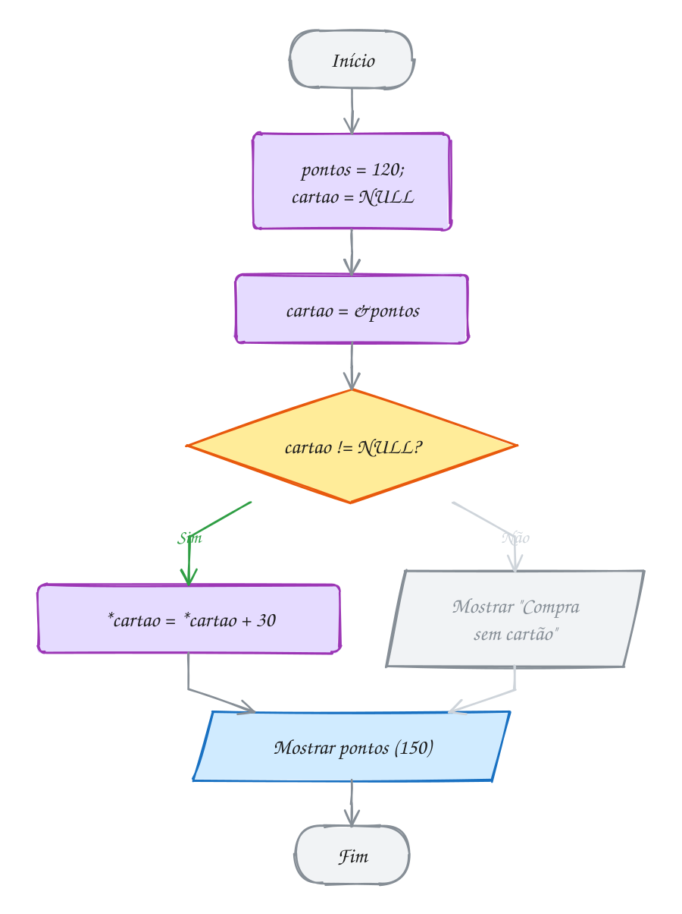
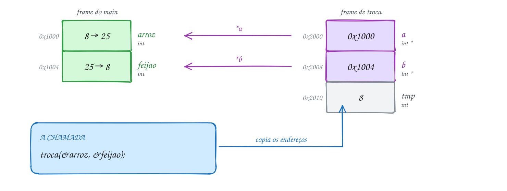
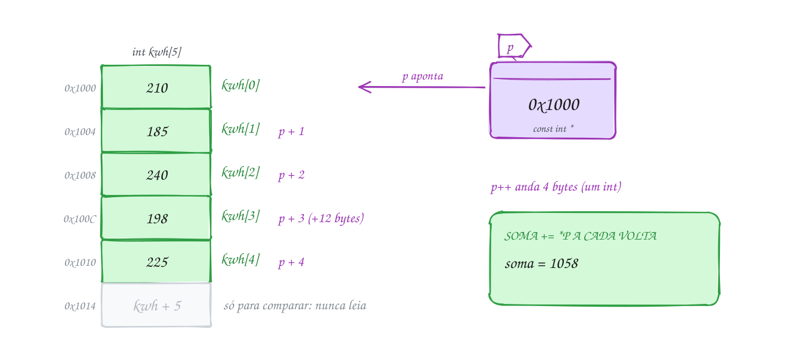
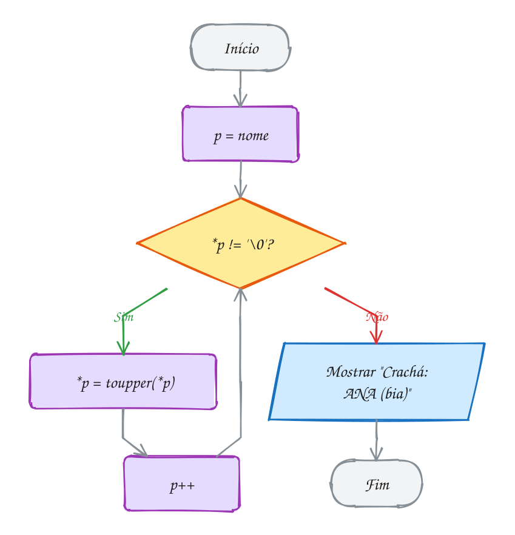
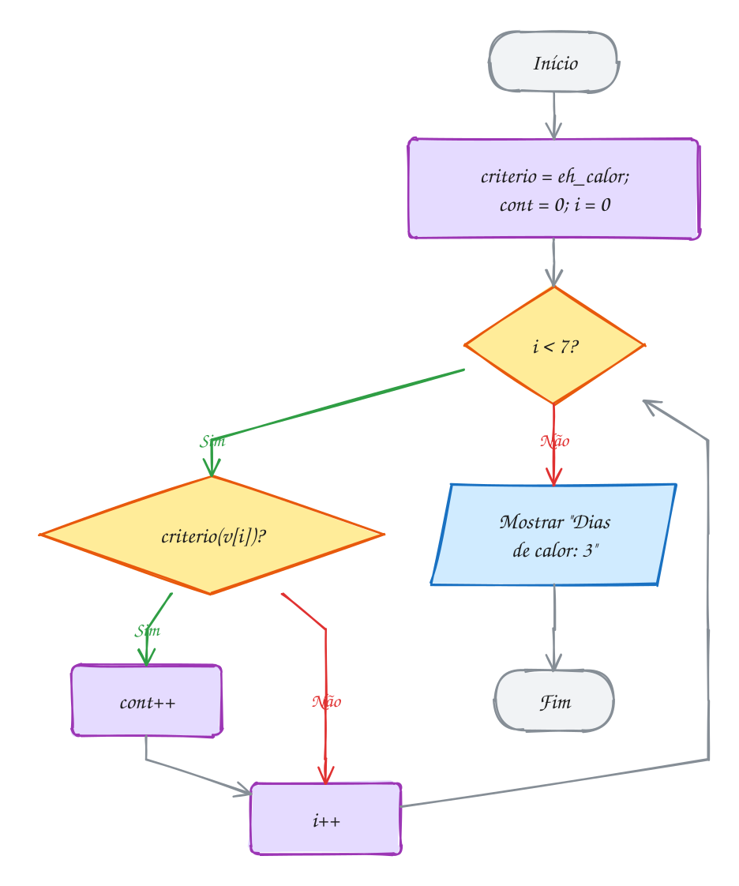
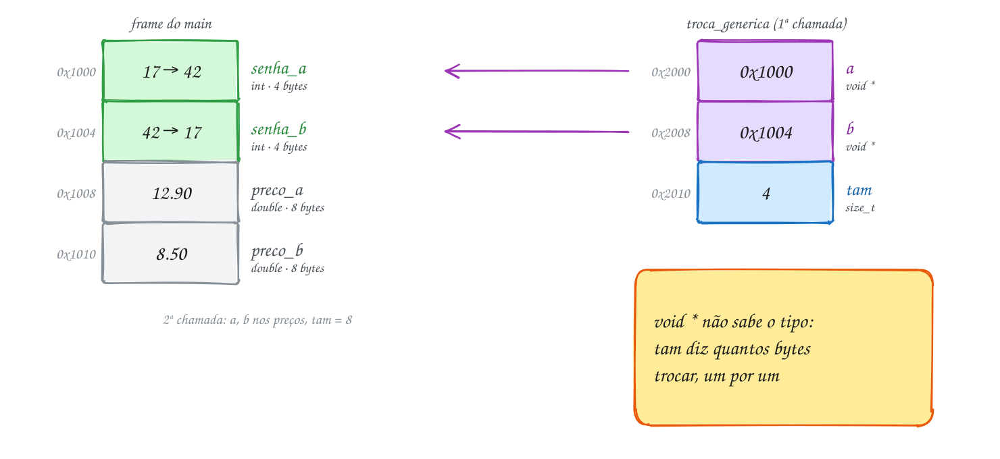
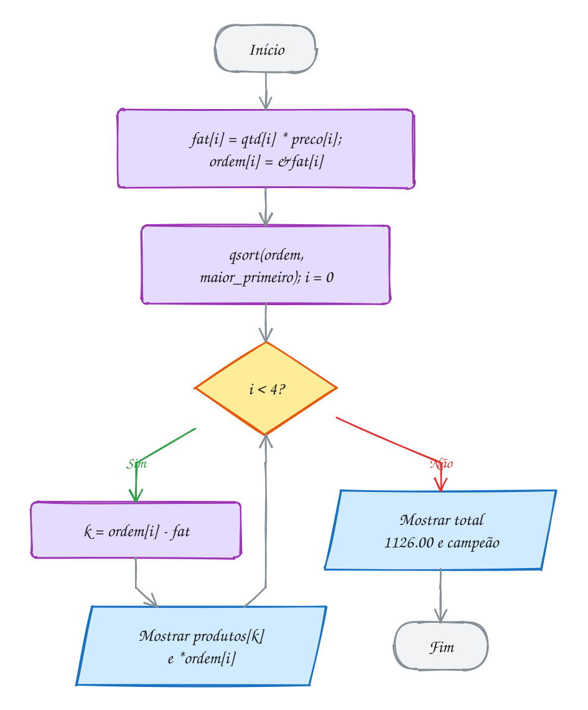

<!-- Gerado por _gerador. Para mudar este arquivo, edite _gerador/modulos/06-ponteiros/ e rode: cd _gerador && npm run gerar -->

# Módulo 06 · Ponteiros

Até aqui você usou variáveis pelo **nome**; o compilador trocava cada nome por
um endereço e escondia isso. Neste módulo a cortina abre: toda variável mora
numa gaveta numerada da memória, e guardar o número dessa gaveta em outra
variável permite ler e mudar o dado de qualquer lugar do programa.

No C, para uma função mudar uma variável sua, você entrega o endereço dela. Dá
trabalho, mas mostra o que cada linha custa e por que o `scanf` pedia o `&`
desde o módulo 01. Memória dinâmica (módulo 07), structs encadeadas, listas,
pilhas, filas, árvores e grafos dependem disso. Vá devagar, desenhe as gavetas.

## O que você vai aprender

- a memória como **gaveteiro numerado**: endereço, `&` e `%p`
- **ponteiros**: `*`, desreferência e `NULL`
- **passagem por referência**: a troca (swap), vários resultados e o `&` do `scanf`
- **aritmética de ponteiros**: `v[i]` é `*(v + i)`
- `char *` contra `char []`, e o literal de string **só leitura**
- **ponteiro para ponteiro** (`**`) e vetor de ponteiros
- **ponteiro para função**: callbacks e `qsort`
- **`void *`**: ponteiro genérico, cast e funções para qualquer tipo

## Antes de começar

Este módulo usa vetores, strings e funções (módulos 04 e 05): o nome do vetor
já era um endereço, e agora ele ganha sintaxe. Ele prepara a memória dinâmica
(módulo 07) e as structs (módulo 08).

Erros de ponteiro raramente aparecem na compilação: surgem na execução, às
vezes longe da linha culpada. Rode **sempre** com as flags de estudo, que ligam
o AddressSanitizer, e leia o relatório de cima para baixo: o tipo do erro
(`stack-buffer-overflow`, `SEGV on unknown address`), a linha e a variável.

Nos diagramas, gaveteiros e setas; o roxo marca os ponteiros.

> [!NOTE]
> Os endereços dos desenhos são **fictícios** e curtos (`0x1000`, `0x1004`).
> Os de verdade têm 12 dígitos hexa e **mudam a cada execução**; os dos
> comentários dos exemplos são de uma execução qualquer. O que importa são as
> relações entre eles (iguais, 4 bytes depois etc.).

Para seguir um ponteiro passo a passo, use o `gdb` (`print p`, `print *p`,
`print &x`):

```bash
sudo pacman -S gdb          # Arch Linux
sudo apt install gdb        # Debian / Ubuntu
```

| # | Assunto |
| --- | --- |
| [0044](#0044--memória-e-endereços) | Memória e endereços |
| [0045](#0045--ponteiros) | Ponteiros |
| [0046](#0046--passagem-por-referência) | Passagem por referência |
| [0047](#0047--ponteiros-e-vetores) | Ponteiros e vetores |
| [0048](#0048--ponteiros-e-strings) | Ponteiros e strings |
| [0049](#0049--ponteiro-para-ponteiro) | Ponteiro para ponteiro |
| [0050](#0050--ponteiro-para-função) | Ponteiro para função |
| [0051](#0051--void--e-cast) | void * e cast |
| [0052](#0052--juntando-tudo-o-ranking-da-feira) | Juntando tudo: o ranking da feira |

---

## 0044 · Memória e endereços

No guarda-volumes do mercado, você entrega a mochila e recebe a ficha 47. Não
precisa saber em que prateleira ela está: com o número, o funcionário acha a
gaveta. A memória do computador funciona assim.

A **memória** (RAM) é uma fileira de gavetas de **1 byte**, cada uma com um
número: o **endereço**. Ao declarar `int idade = 30;`, o compilador separa 4
gavetas seguidas para `idade` e guarda o 30 nelas. O **endereço da variável**
é o número da primeira gaveta.

Você pensa no **nome** (`idade`); o processador só conhece **endereços**, e o
compilador troca um pelo outro.

O operador **`&`** (endereço de) pergunta "em que gaveta você mora?": `&idade`.
É o `&` do `scanf` desde o assunto 0006: o `scanf` precisa saber **onde**
guardar o que leu. O assunto 0046 conta essa história.

O `printf` mostra um endereço com **`%p`**, em hexadecimal. O `%p` espera um
`void *`, então escreva `(void *)&idade`. O assunto 0051 explica esse tipo.

Dois detalhes que surpreendem:

- **o endereço muda a cada execução**: o sistema sorteia onde o programa mora,
  por segurança. Não decore endereços;
- **cada tipo ocupa um número de gavetas**: `char` 1, `int` 4, `double` 8 (o
  `sizeof` do assunto 0002 diz). O endereço é sempre o da primeira.

No cadastro da academia, a idade (30, `int`), a mensalidade (R$ 119,90,
`double`) e o plano (`'B'`, `char`) ganham gavetas. Os endereços do desenho são
fictícios:

<p align="center"></p>

O programa mostra, de cada variável, o valor, o endereço e o tamanho:

```c
#include <stdio.h>

int main(void) {
    int idade = 30;
    double mensalidade = 119.90;
    char plano = 'B';

    // & pergunta "em que gaveta você mora?"; %p mostra a resposta em hexa
    printf("idade:       %d, mora em %p, ocupa %zu bytes\n",
           idade, (void *)&idade, sizeof idade);
    printf("mensalidade: %.2f, mora em %p, ocupa %zu bytes\n",
           mensalidade, (void *)&mensalidade, sizeof mensalidade);
    printf("plano:       %c, mora em %p, ocupa %zu byte\n",
           plano, (void *)&plano, sizeof plano);
    return 0;
}
// Saída (os endereços mudam a cada execução):
// idade:       30, mora em 0x7f0440e00030, ocupa 4 bytes
// mensalidade: 119.90, mora em 0x7f0440e00040, ocupa 8 bytes
// plano:       B, mora em 0x7f0440e00020, ocupa 1 byte
```

O `%zu` é o formato do resultado do `sizeof` (`size_t`, inteiro sem sinal).
Rode duas vezes: valores e tamanhos se repetem, endereços não.

O fluxograma não tem decisão. Para cada variável, o programa faz as mesmas três
perguntas: o que tem dentro, onde mora e quanto ocupa:

<p align="center"></p>

> [!WARNING]
> Nunca mostre endereço com `%d` ou `%x`. Um endereço tem 8 bytes em 64 bits e
> o `%d` lê só 4: o número sai cortado, às vezes negativo. O gcc com as flags de
> estudo avisa (`format '%d' expects argument of type 'int', but argument 2 has
> type 'int *'`). Use `%p` com `(void *)`. E não deduza nada da ordem dos
> endereços de variáveis soltas: o compilador arruma como quiser (acima,
> `plano` ficou **antes** de `idade`). Só num vetor a ordem é garantida.

> [!TIP]
> **Por dentro do C:** o sorteio do endereço a cada execução se chama **ASLR**;
> dificulta explorar falhas, pois o atacante não sabe onde as coisas moram. As
> variáveis locais ficam na **pilha** do assunto 0031; o módulo 07 mostra o
> mapa completo.

> [!NOTE]
> **Pergunta para você:** se `idade` começa na gaveta `0x1000` e ocupa 4
> bytes, qual é o endereço do **último** byte dela? E onde poderia começar a
> próxima variável `int`, sem sobrepor? Depois rode o A088 e veja os
> endereços de um vetor subindo de 4 em 4.

### Hora de praticar

**Exemplo A087 · O valor muda, a gaveta não**

```c
#include <stdio.h>

int main(void) {
    double saldo = 250.00; // saldo da conta, antes dos Pix do dia

    printf("saldo = %7.2f, mora em %p\n", saldo, (void *)&saldo);

    saldo -= 89.90; // Pix para a conta de luz
    printf("saldo = %7.2f, mora em %p\n", saldo, (void *)&saldo);

    saldo += 1200.00; // salário caiu
    printf("saldo = %7.2f, mora em %p\n", saldo, (void *)&saldo);

    // atribuir troca o conteúdo da gaveta; o endereço fica o mesmo até o fim
    // do programa
    double reserva = saldo; // cópia do valor: outra gaveta, mesmo conteúdo
    printf("reserva = %7.2f, mora em %p\n", reserva, (void *)&reserva);
    // endereços também se comparam com ==
    printf("mesmo valor? %d  mesma gaveta? %d\n", reserva == saldo,
           &reserva == &saldo);
    return 0;
}
// Saída (os endereços mudam a cada execução, mas se repetem dentro dela):
// saldo =  250.00, mora em 0x7f8a1c500020
// saldo =  160.10, mora em 0x7f8a1c500020
// saldo = 1360.10, mora em 0x7f8a1c500020
// reserva = 1360.10, mora em 0x7f8a1c500040
// mesmo valor? 1  mesma gaveta? 0
```

```bash
gcc ~/LPEDC/material/A087.c -o ~/LPEDC/material/A087 && ~/LPEDC/material/A087
```

**Exemplo A088 · As gavetas de um vetor**

```c
#include <stdio.h>

int main(void) {
    int passos[4] = {8200, 10450, 6300, 12010}; // passos de 4 dias
    double km[4] = {5.7, 7.3, 4.4, 8.4};        // os mesmos dias, em km

    // num vetor as gavetas ficam coladas: cada uma começa onde a outra acaba
    for (int i = 0; i < 4; i++) {
        printf("passos[%d] em %p    km[%d] em %p\n",
               i, (void *)&passos[i], i, (void *)&km[i]);
    }
    printf("int: %zu bytes por gaveta; double: %zu bytes\n", sizeof passos[0], sizeof km[0]);
    printf("o vetor passos inteiro: %zu bytes\n", sizeof passos);
    return 0;
}
// Saída (os endereços mudam a cada execução; repare no final de cada um):
// passos[0] em 0x7fe2a0e00020    km[0] em 0x7fe2a0e00040
// passos[1] em 0x7fe2a0e00024    km[1] em 0x7fe2a0e00048
// passos[2] em 0x7fe2a0e00028    km[2] em 0x7fe2a0e00050
// passos[3] em 0x7fe2a0e0002c    km[3] em 0x7fe2a0e00058
// int: 4 bytes por gaveta; double: 8 bytes
// o vetor passos inteiro: 16 bytes
```

```bash
gcc ~/LPEDC/material/A088.c -o ~/LPEDC/material/A088 && ~/LPEDC/material/A088
```

#### Exercícios

**Exercício E259** · ★☆☆

No ônibus da linha 0.420, o painel guarda três dados: a quantidade de
passageiros (int, 42), a tarifa (float, 4.40) e a letra do setor
(char, 'X'). Declare as três variáveis e mostre, para cada uma, o valor,
o endereço e quantos bytes ela ocupa.


```text
Saída esperada (os endereços mudam a cada execução):
passageiros = 42, endereço 0x7f..., tamanho 4
tarifa = 4.40, endereço 0x7f..., tamanho 4
setor = X, endereço 0x7f..., tamanho 1
```

```bash
gcc ~/LPEDC/material/E259.c -o ~/LPEDC/material/E259 && ~/LPEDC/material/E259
```

**Exercício E261** · ★★☆

A lanchonete guarda o preço de 2 tamanhos (linhas) de 3 sucos (colunas)
numa matriz double precos[2][3]:


```text
{ {6.0, 7.5, 8.0}, {9.0, 11.0, 12.5} }
```


Mostre o valor e o endereço de cada posição, linha por linha, com dois
for aninhados. Depois mostre, com sizeof, quantos bytes ocupa uma
posição, uma linha inteira (precos[0]) e a matriz toda. Compare os
endereços de precos[0][2] e precos[1][0] na saída: a linha 1 começa logo
onde a linha 0 acaba.


```text
Saída esperada (endereços mudam a cada execução):
precos[0][0] = 6.00 em 0x7f...30
precos[0][1] = 7.50 em 0x7f...38
...
precos[1][2] = 12.50 em 0x7f...58
uma posição: 8 bytes
uma linha: 24 bytes
a matriz: 48 bytes
```

```bash
gcc ~/LPEDC/material/E261.c -o ~/LPEDC/material/E261 && ~/LPEDC/material/E261
```

**Exercício E262** · ★★☆

Na pizzaria, declare int pedidos = 15 e um ponteiro int *p que guarda o
endereço de pedidos. Mostre o valor de pedidos, o endereço de pedidos com
%p (com o cast (void *)), o endereço guardado em p e, por fim, "sim" ou
"não" conforme os dois endereços sejam iguais. O endereço muda a cada
execução.


```text
Saída esperada:
Valor: 15
Endereço: 0x7ffe59064b4c
Pelo ponteiro: 0x7ffe59064b4c
Mesmo endereço: sim
```

```bash
gcc ~/LPEDC/material/E262.c -o ~/LPEDC/material/E262 && ~/LPEDC/material/E262
```

**Exercício E263** · ★★★

Variáveis declaradas juntas ficam juntas na memória? Escreva um programa
que declare


```text
int a = 1, b = 2, c = 3;
int v[3] = {1, 2, 3};
```


e mostre o endereço de a, b e c (uma linha cada) e depois, com um for, o
endereço de v[0], v[1] e v[2]. No fim, mostre sizeof v e a soma
sizeof a + sizeof b + sizeof c. Rode com o rodar. Depois compile SEM o
sanitizer e rode de novo, para comparar as duas saídas:


```text
gcc -std=c17 E263.c -o e263 && ./e263
```


```text
Saída esperada (endereços mudam a cada execução; com o rodar):
a em 0x7f...30
b em 0x7f...40
c em 0x7f...50
v[0] em 0x7f...60
v[1] em 0x7f...64
v[2] em 0x7f...68
sizeof v = 12, a + b + c = 12
```

```bash
gcc ~/LPEDC/material/E263.c -o ~/LPEDC/material/E263 && ~/LPEDC/material/E263
```

---

## 0045 · Ponteiros

Pelo app de comida, o entregador não leva a sua casa no celular: leva o
**endereço**. Com ele, chega à porta e entrega o pedido.

Um **ponteiro** é uma variável que guarda um **endereço** em vez de um valor
comum. Ele também mora numa gaveta (tem endereço próprio), mas o que guarda é o
número de **outra** gaveta. Alguns livros (Ziviani, a tradução do K&R) dizem
**apontador**: é a mesma coisa.

A declaração leva um `*` antes do nome: `int *cartao;` lê-se "cartao é um
ponteiro para int". O tipo diz **o que** mora no endereço apontado, e portanto
quantos bytes ler (4 para `int`, 8 para `double`).

Dois operadores fazem todo o serviço:

- **`&x`** dá o endereço de `x` (assunto 0044), que você guarda no ponteiro:
  `cartao = &pontos;`;
- **`*cartao`** vai ao endereço guardado e mexe no que está lá: é
  **desreferenciar**. Ler `*cartao` dá o valor de `pontos`; escrever
  `*cartao = 150;` muda `pontos`.

O `*` tem três papéis, separados só pelo contexto: multiplicação (`a * b`),
declaração (`int *p`) e desreferência (`*p = 5`).

Ponteiro que ainda não aponta para nada recebe **`NULL`**, endereço especial
que significa "lugar nenhum". Teste com `if (cartao != NULL)` antes de usar.

No caixa da farmácia, o cliente tem 120 pontos no cartão fidelidade. O ponteiro
`cartao` começa em `NULL`. Quando o cliente passa o cartão, `cartao` recebe
`&pontos`. A compra de R$ 30 soma 30 pontos **por meio do ponteiro**, e
`pontos` vira 150:

<p align="center"></p>

A linha que muda `pontos` nem cita o nome `pontos`:

```c
#include <stdio.h>

int main(void) {
    int pontos = 120;     // pontos do cartão fidelidade
    int *cartao = NULL;   // ponteiro para int; NULL: ainda não aponta para nada

    cartao = &pontos;     // o cliente passou o cartão: cartao guarda &pontos

    printf("&pontos = %p\n", (void *)&pontos);
    printf("cartao  = %p\n", (void *)cartao); // o mesmo endereço
    printf("*cartao = %d\n", *cartao);        // o que tem na gaveta apontada

    if (cartao != NULL) {
        *cartao = *cartao + 30; // compra de R$ 30: muda pontos ATRAVÉS do ponteiro
    } else {
        printf("Compra sem cartão\n");
    }
    printf("pontos  = %d\n", pontos);
    printf("&cartao = %p\n", (void *)&cartao); // o ponteiro também mora numa gaveta
    return 0;
}
// Saída (os endereços mudam a cada execução):
// &pontos = 0x7f631f200030
// cartao  = 0x7f631f200030
// *cartao = 120
// pontos  = 150
// &cartao = 0x7f631f200040
```

Três números diferentes: `cartao` é o endereço guardado (o de `pontos`),
`*cartao` é o valor lá dentro (120, depois 150) e `&cartao` é onde o próprio
ponteiro mora.

Antes de desreferenciar, o programa testa se o ponteiro aponta para algum
lugar. Esse teste contra `NULL` volta no curso inteiro:

<p align="center"></p>

> [!WARNING]
> Ponteiro não inicializado (`int *p;`) guarda **lixo**: um endereço qualquer.
> `*p = 10;` escreve numa gaveta desconhecida: pode travar na hora ou corromper
> outra variável e dar problema só depois. Inicialize sempre, com um endereço
> válido ou `NULL`. E em `int *a, b;` o `*` vale só para `a`; `b` é um `int`
> comum. Para dois ponteiros, `int *a, *b;`.

> [!TIP]
> **Por dentro do C:** todo ponteiro de dado tem o mesmo tamanho (8 bytes em
> 64 bits); o tipo muda a **leitura**: `*cartao` busca 4 bytes e os trata como
> `int`. O `NULL` é, na prática, o endereço 0, região proibida de propósito:
> desreferenciá-lo derruba o programa na hora (*segmentation fault*), em vez de
> corromper algo em silêncio.

> [!NOTE]
> **Pergunta para você:** depois de `int x = 5; int *p = &x; int *q = p;
> *q = 8;`, quanto valem `x` e `*p`? Quantas variáveis `int` existem nesse
> trecho?

### Hora de praticar

**Exemplo A089 · Duas cancelas, um contador**

```c
#include <stdio.h>

int main(void) {
    int vagas = 40; // vagas livres no estacionamento do shopping

    // dois ponteiros podem apontar para a MESMA variável
    int *entrada = &vagas, *saida = &vagas; // o * vai em cada nome
    int *cancela_vip = NULL;                // ainda não foi instalada

    *entrada -= 1; // entrou um carro
    *entrada -= 1; // entrou outro
    *saida += 1;   // saiu um
    printf("vagas = %d\n", vagas);

    // comparar ponteiros pergunta "apontam para a mesma gaveta?"
    printf("entrada == saida? %d\n", entrada == saida);
    printf("*entrada = %d, *saida = %d\n", *entrada, *saida);

    // antes de usar *cancela_vip, confira: *NULL derruba o programa
    if (cancela_vip != NULL) {
        *cancela_vip -= 1;
    } else {
        printf("cancela VIP desligada: nada a fazer\n");
    }

    int vagas_moto = 12;
    saida = &vagas_moto; // saida agora aponta para outra gaveta
    *saida += 1;
    printf("entrada == saida? %d\n", entrada == saida);
    printf("vagas = %d, vagas_moto = %d\n", vagas, vagas_moto);
    return 0;
}
// Saída:
// vagas = 39
// entrada == saida? 1
// *entrada = 39, *saida = 39
// cancela VIP desligada: nada a fazer
// entrada == saida? 0
// vagas = 39, vagas_moto = 13
```

```bash
gcc ~/LPEDC/material/A089.c -o ~/LPEDC/material/A089 && ~/LPEDC/material/A089
```

**Exemplo A090 · Gasolina ou etanol?**

```c
#include <stdio.h>

int main(void) {
    float gasolina = 5.89f, etanol = 4.29f;
    float *escolha = &gasolina; // começa apontando para a gasolina

    // regra dos 70%: se o etanol custa até 70% da gasolina, compensa
    if (etanol / gasolina <= 0.7f) {
        escolha = &etanol;      // o ponteiro muda de alvo; as variáveis, não
    }
    printf("Escolhido: R$ %.2f o litro\n", *escolha);
    printf("Com R$ 100 dá %.1f litros\n", 100.0f / *escolha);

    etanol = 3.99f;            // baixou: 3.99 / 5.89 = 0.68, agora compensa
    if (etanol / gasolina <= 0.7f) {
        escolha = &etanol;
    }
    printf("Escolhido: R$ %.2f o litro\n", *escolha);

    // o ponteiro tem o tamanho de um endereço; *escolha, o tamanho de um float
    printf("sizeof escolha = %zu, sizeof *escolha = %zu\n", sizeof escolha, sizeof *escolha);
    return 0;
}
// Saída:
// Escolhido: R$ 5.89 o litro
// Com R$ 100 dá 17.0 litros
// Escolhido: R$ 3.99 o litro
// sizeof escolha = 8, sizeof *escolha = 4
```

```bash
gcc ~/LPEDC/material/A090.c -o ~/LPEDC/material/A090 && ~/LPEDC/material/A090
```

#### Exercícios

**Exercício E265** · ★☆☆

O ar-condicionado da sala marca 22.5 graus. Declare double temperatura =
22.5 e um ponteiro pt que aponte para ela. Usando SÓ o ponteiro (sem
escrever temperatura do lado esquerdo do =), mostre a temperatura,
aumente 1.5 grau e mostre de novo. No fim, mostre a variável temperatura
pelo nome para provar que ela mudou.


```text
Saída esperada:
Pelo ponteiro: 22.5
Pelo ponteiro: 24.0
Pela variável: 24.0
```

```bash
gcc ~/LPEDC/material/E265.c -o ~/LPEDC/material/E265 && ~/LPEDC/material/E265
```

**Exercício E267** · ★★☆

Na academia, declare int peso = 0 e int meta = 78, e dois ponteiros, um para
cada variável (peso_ptr e meta_ptr). Mude o peso para 82 escrevendo pelo
ponteiro peso_ptr. Depois mostre peso e, lendo pelo ponteiro meta_ptr, a
meta.


```text
Saída esperada:
Peso: 82
Meta: 78
```

```bash
gcc ~/LPEDC/material/E267.c -o ~/LPEDC/material/E267 && ~/LPEDC/material/E267
```

**Exercício E268** · ★★☆

No check-in do aeroporto, a companhia aceita uma mala de até 23 kg sem
cobrar. Você tem duas malas: mala_azul com 19 kg e mala_preta com 26 kg.
Complete o programa: faça o ponteiro pesada apontar para a mala mais
pesada e, usando só o ponteiro, tire 4 kg dela (você passou umas roupas
para a mochila). Depois mostre as duas malas.


```text
Saída esperada:
Mais pesada: 26 kg
Depois de tirar 4 kg: azul 19 kg, preta 22 kg
```

```bash
gcc ~/LPEDC/material/E268.c -o ~/LPEDC/material/E268 && ~/LPEDC/material/E268
```

**Exercício E269** · ★★★

Transforme o trecho abaixo num teste de mesa que o próprio programa
imprime. Cole o código no main e, depois da declaração e depois de CADA
uma das cinco linhas, acrescente um printf que mostre a linha executada
e os valores de a, b, *p e *q naquele momento.


```text
int a = 3, b = 8;
int *p = &a, *q = &b;
```


```text
*p = *q + 1;
p = q;
*p = *p * 2;
q = &a;
*q -= 4;
```


```text
Saída esperada:
início        a = 3, b = 8, *p = 3, *q = 8
*p = *q + 1   a = 9, b = 8, *p = 9, *q = 8
p = q         a = 9, b = 8, *p = 8, *q = 8
...
*q -= 4       a = 5, b = 16, *p = 16, *q = 5
```

```bash
gcc ~/LPEDC/material/E269.c -o ~/LPEDC/material/E269 && ~/LPEDC/material/E269
```

---

## 0046 · Passagem por referência

No mercadinho, as etiquetas saíram trocadas: o arroz a R$ 8 e o feijão a
R$ 25. Você quer uma função `troca` que conserte isso. A versão óbvia não
funciona, por causa do jeito como o C chama funções.

No C, **todo argumento é passado por valor** (assunto 0029): a função recebe
uma **cópia**. `troca_copias(arroz, feijao)` cria `a` e `b`, com 8 e 25, troca
as cópias e termina; elas somem com o frame (assunto 0031). O `arroz` do
`main` nem fica sabendo.

A saída é entregar o **endereço** em vez do valor. A função recebe ponteiros,
`void troca(int *a, int *b)`, e quem chama passa os endereços:
`troca(&arroz, &feijao)`. O endereço também é copiado, mas a cópia aponta para
**a mesma gaveta**. Dentro da função, `*a` é o próprio `arroz` do `main`. É a
**passagem por referência** (no C, simulada com ponteiros).

Isso explica o `&` do `scanf`: `scanf("%d", &total)` precisa **escrever** na
variável, então pede o endereço. Sem o `&`, receberia uma cópia do lixo de
`total` e escreveria num endereço inventado. Já `scanf("%s", nome)` vai sem `&`
porque o nome de um vetor já é o endereço do primeiro elemento (assunto 0038;
o 0047 detalha).

O mesmo truque resolve outro limite: o `return` devolve **um** valor só. Para
entregar dois ou mais resultados, a função recebe ponteiros e escreve neles (o
A092 racha a conta e devolve o valor de cada um e a sobra).

A `troca` recebe os endereços `0x1000` e `0x1004`, guarda o 8 em `tmp` e mexe
direto nas gavetas do `main`:

<p align="center"></p>

As duas versões lado a lado; só a segunda conserta as etiquetas:

```c
#include <stdio.h>

// recebe CÓPIAS: troca as cópias e o main nem fica sabendo
void troca_copias(int a, int b) {
    int tmp = a;
    a = b;
    b = tmp;
}

// recebe ENDEREÇOS: troca o que está nas gavetas do main
void troca(int *a, int *b) {
    int tmp = *a; // guarda o valor da primeira gaveta
    *a = *b;      // primeira gaveta recebe o da segunda
    *b = tmp;     // segunda gaveta recebe o guardado
}

int main(void) {
    int arroz = 8, feijao = 25; // digitados trocados: o arroz é o mais caro

    troca_copias(arroz, feijao);
    printf("Depois de troca_copias: arroz %d, feijão %d\n", arroz, feijao);

    if (arroz < feijao) {         // o pacote de arroz deveria custar mais
        troca(&arroz, &feijao);   // passa os endereços, não os valores
    }
    printf("Depois de troca:        arroz %d, feijão %d\n", arroz, feijao);
    return 0;
}
// Saída:
// Depois de troca_copias: arroz 8, feijão 25
// Depois de troca:        arroz 25, feijão 8
```

### Passo a passo

Teste de mesa de `troca(&arroz, &feijao)`, com os endereços fictícios do
desenho:

| linha | `a` | `b` | `tmp` | `arroz` (0x1000) | `feijao` (0x1004) |
| --- | --- | --- | --- | --- | --- |
| entrada na função | 0x1000 | 0x1004 | ? | 8 | 25 |
| `tmp = *a` | 0x1000 | 0x1004 | 8 | 8 | 25 |
| `*a = *b` | 0x1000 | 0x1004 | 8 | **25** | 25 |
| `*b = tmp` | 0x1000 | 0x1004 | 8 | 25 | **8** |

`a` e `b` nunca mudam: muda o que está nas gavetas para onde apontam.

O `main` só chama a troca se os preços estão fora de ordem. A troca são três
passos, sempre com a variável auxiliar:

<p align="center"></p>

> [!WARNING]
> Dois erros clássicos. Esquecer o `&` na chamada: `troca(arroz, feijao)` manda
> o número 8 onde se espera um endereço; o compilador avisa (`makes pointer from
> integer without a cast`) e, se rodar, o programa escreve na "gaveta 8" e cai.
> Esquecer o `*` na função: `tmp = a; a = b;` troca os **ponteiros** locais, que
> são cópias, e nada muda lá fora. Quem mexe no dado do chamador é sempre `*a`.

> [!TIP]
> **Por dentro do C:** passar `&arroz` copia 8 bytes, seja qual for o tamanho do
> dado apontado; por isso, no módulo 08, struct grande vai por ponteiro. Quando
> a função só precisa **ler**, use `const int *p`: o compilador recusa `*p = ...`
> lá dentro.

> [!NOTE]
> **Pergunta para você:** o que acontece em `troca(&arroz, &arroz)`? Os dois
> ponteiros apontam para a mesma gaveta. O valor de `arroz` muda?

### Hora de praticar

**Exemplo A091 · O plantão que vira o relógio**

```c
#include <stdio.h>

// parâmetro de ida E volta: lê os valores do main e escreve de volta
void normaliza(int *horas, int *minutos) {
    *horas += *minutos / 60; // cada 60 minutos viram uma hora
    *minutos %= 60;
    *horas %= 24;            // passou da meia-noite, recomeça do 0
}

// horas e minutos já SÃO endereços: repassa para normaliza sem &
void soma_minutos(int *horas, int *minutos, int extra) {
    *minutos += extra;
    normaliza(horas, minutos);
}

int main(void) {
    int h = 22, m = 40; // começo do plantão no hospital

    soma_minutos(&h, &m, 95); // o primeiro atendimento durou 95 minutos
    printf("Fim do 1º atendimento: %02d:%02d\n", h, m);

    soma_minutos(&h, &m, 50);
    printf("Fim do 2º atendimento: %02d:%02d\n", h, m);

    // normaliza sozinha também arruma um horário anotado errado
    int h2 = 9, m2 = 135; // alguém anotou 9h135
    normaliza(&h2, &m2);
    printf("9h135 arrumado: %02d:%02d\n", h2, m2);
    return 0;
}
// Saída:
// Fim do 1º atendimento: 00:15
// Fim do 2º atendimento: 01:05
// 9h135 arrumado: 11:15
```

```bash
gcc ~/LPEDC/material/A091.c -o ~/LPEDC/material/A091 && ~/LPEDC/material/A091
```

**Exemplo A092 · Rachando a conta do bar**

```c
#include <stdio.h>

// "devolve" dois resultados: escreve nas variáveis de quem chamou
void racha(int total, int pessoas, int *cada, int *sobra) {
    *cada = total / pessoas;
    *sobra = total % pessoas;
}

int main(void) {
    int total, pessoas;
    int cada, sobra; // a função vai preencher

    printf("Total da conta (R$): ");
    if (scanf("%d", &total) != 1) { // & : o scanf precisa saber ONDE guardar
        return 1;
    }
    printf("Quantas pessoas: ");
    if (scanf("%d", &pessoas) != 1 || pessoas <= 0) {
        return 1;
    }

    racha(total, pessoas, &cada, &sobra);
    printf("Cada um paga R$ %d e sobram R$ %d para a gorjeta\n", cada, sobra);
    return 0;
}
// Exemplo de execução:
// Total da conta (R$): 187
// Quantas pessoas: 4
// Cada um paga R$ 46 e sobram R$ 3 para a gorjeta
```

```bash
gcc ~/LPEDC/material/A092.c -o ~/LPEDC/material/A092 && ~/LPEDC/material/A092
```

#### Exercícios

**Exercício E271** · ★☆☆

Promoção do cinema: quem compra pelo app ganha o dobro de ingressos.
Escreva a função void dobra(int *quantidade), que dobra o valor da
variável de quem chamou. No main, comece com ingressos = 3, chame a
função e mostre o resultado.


```text
Saída esperada:
Antes: 3 ingressos
Depois: 6 ingressos
```

```bash
gcc ~/LPEDC/material/E271.c -o ~/LPEDC/material/E271 && ~/LPEDC/material/E271
```

**Exercício E273** · ★★☆

As temperaturas máximas da semana em Cuiabá foram


```text
{ 34, 37, 31, 39, 36, 33, 38 }
```


Escreva void extremos(const int v[], int n, int *menor, int *maior), que
acha a menor e a maior temperatura do vetor numa passada só e entrega as
duas pelos ponteiros. Mostre também a amplitude (maior - menor).


```text
Saída esperada:
Menor: 31  Maior: 39  Amplitude: 8
```

```bash
gcc ~/LPEDC/material/E273.c -o ~/LPEDC/material/E273 && ~/LPEDC/material/E273
```

**Exercício E274** · ★★☆

A catraca do metrô conta passageiros. Escreva duas funções:


```text
void passa(int *contador)   // soma 1 ao valor apontado
void zera(int *valor)       // coloca 0 no valor apontado
```


No main, comece com passageiros = 0 e avulsos = 5, chame passa três vezes
para passageiros, chame zera para avulsos e mostre os dois.


```text
Saída esperada:
Passageiros: 3
Bilhetes avulsos: 0
```

```bash
gcc ~/LPEDC/material/E274.c -o ~/LPEDC/material/E274 && ~/LPEDC/material/E274
```

**Exercício E275** · ★★★

Escreva


```text
int raizes(double a, double b, double c, double *x1, double *x2)
```


que resolve a*x*x + b*x + c = 0. A função DEVOLVE quantas raízes reais
existem (0, 1 ou 2) e escreve as raízes em *x1 e *x2 (quando houver uma
só, as duas recebem o mesmo valor). Se a for 0, devolve -1 (não é do 2º
grau). No main, teste as quatro equações abaixo e mostre o resultado com
duas casas decimais.


```text
Saída esperada:
x² - 5x + 6 = 0   ->  2 raízes: 3.00 e 2.00
x² + 2x + 1 = 0   ->  1 raiz: -1.00
x² + 1 = 0        ->  nenhuma raiz real
0x² + 3x + 1 = 0  ->  não é do 2º grau
```

```bash
gcc ~/LPEDC/material/E275.c -o ~/LPEDC/material/E275 -lm && ~/LPEDC/material/E275
```

---

## 0047 · Ponteiros e vetores

Numa rua de loteamento, os números das casas sobem de 4 em 4: 1000, 1004,
1008. "Três casas depois da 1000" é a 1012, não a 1003. Os ponteiros fazem essa
conta por você.

Num vetor, as gavetas ficam coladas (assunto 0044). E o nome do vetor, numa
expressão, quase sempre **vira** o endereço do primeiro elemento: `kwh` vale
`&kwh[0]`. Por isso você passa um vetor sem `&` e a função altera o original
(assunto 0038): ela recebe esse endereço.

Com um ponteiro dentro de um vetor vale a **aritmética de ponteiros**:

- `p + 1` é o endereço do **próximo elemento**, não do próximo byte: o C
  multiplica pelo tamanho do tipo (4 bytes num `int *`, 8 num `double *`);
- `p++` avança um elemento; `p--` volta um;
- `q - p` (mesmo vetor) dá **quantos elementos** há entre eles;
- `p < q` compara posições, só com sentido dentro do mesmo vetor.

Daí a regra central: **`v[i]` é exatamente `*(v + i)`**, ou seja, "ande `i`
elementos e pegue o que tem lá". Vale para ponteiro também: `p[2]` é
`*(p + 2)`, contado de onde `p` aponta **agora**.

Mas vetor **não é** ponteiro. `sizeof kwh` dá o vetor inteiro (20 bytes),
`sizeof p` dá 8. E `kwh = outro;` ou `kwh++` não compilam: o nome do vetor é
um endereço fixo. Diz-se que o vetor **decai** para ponteiro.

Na matriz (assunto 0039) a regra vale em dois níveis: `m[i][j]` é
`*(*(m + i) + j)`. Em `int m[3][4]`, cada elemento de `m` é uma linha inteira,
então `m + 1` anda **16 bytes** (4 `int`) e `m[0] + 1` anda só 4. Prova adora
essa diferença.

O consumo de luz de 5 meses está em `kwh`. O ponteiro `p` começa em `kwh`
(gaveta `0x1000`) e anda uma gaveta por vez, somando. Quando chega a `kwh + 5`,
"um depois do último", o laço para:

<p align="center"></p>

O mesmo percurso no código, com o endereço a cada passo:

```c
#include <stdio.h>

int main(void) {
    int kwh[5] = {210, 185, 240, 198, 225}; // consumo de 5 meses
    int soma = 0;

    // kwh sozinho vira &kwh[0]; kwh + 5 é "um depois do último"
    for (const int *p = kwh; p < kwh + 5; p++) {
        printf("p = %p  *p = %d\n", (void *)p, *p);
        soma += *p;
    }
    printf("Total: %d kWh  Média: %.1f kWh\n", soma, soma / 5.0);

    // as duas notações são a mesma conta
    printf("kwh[3] = %d  *(kwh + 3) = %d\n", kwh[3], *(kwh + 3));
    return 0;
}
// Saída (os endereços mudam a cada execução; repare que sobem de 4 em 4):
// p = 0x7fa4cb400020  *p = 210
// p = 0x7fa4cb400024  *p = 185
// p = 0x7fa4cb400028  *p = 240
// p = 0x7fa4cb40002c  *p = 198
// p = 0x7fa4cb400030  *p = 225
// Total: 1058 kWh  Média: 211.6 kWh
// kwh[3] = 198  *(kwh + 3) = 198
```

O `const int *p` diz que o laço só **lê** pelo ponteiro: `*p = 0` não
compilaria. O ponteiro em si pode andar.

### Passo a passo

Com os endereços fictícios do desenho (`kwh` em `0x1000`):

| volta | `p` | `*p` | `soma` depois | `p < kwh + 5`? |
| --- | --- | --- | --- | --- |
| 1 | 0x1000 | 210 | 210 | sim |
| 2 | 0x1004 | 185 | 395 | sim |
| 3 | 0x1008 | 240 | 635 | sim |
| 4 | 0x100C | 198 | 833 | sim |
| 5 | 0x1010 | 225 | 1058 | sim |
| fim | 0x1014 | (não lê) | 1058 | **não**: para |

`kwh + 5` é `0x1014`: pode ser calculado e comparado, nunca lido.

É o acumulador do assunto 0025, mas quem anda é o ponteiro, não um índice:

<p align="center"></p>

> [!WARNING]
> `*p + 1` e `*(p + 1)` diferem. O `*` vem antes do `+`: `*p + 1` pega o valor e
> soma 1 (211); `*(p + 1)` anda uma gaveta e pega o valor dela (185). Do mesmo
> tipo: `*p++` lê o valor e **depois** avança o ponteiro, enquanto `(*p)++` soma 1
> no valor. E passar do fim (`p <= kwh + 5`) lê a gaveta de outra variável: o
> AddressSanitizer acusa `stack-buffer-overflow`.

> [!TIP]
> **Por dentro do C:** `kwh[i]` é `*(kwh + i)`, no endereço
> `kwh + i * sizeof(int)`. Como a soma é comutativa, `i[kwh]` também compila;
> nunca escreva isso. Os laços com `p++` e com `i++` têm o mesmo desempenho;
> prefira o índice, quase sempre mais claro.

> [!NOTE]
> **Pergunta para você:** com `int *p = &kwh[1];` e depois `p += 2;`, quanto
> valem `*p`, `p[1]`, `p[-1]` e `p - kwh`?

### Hora de praticar

**Exemplo A093 · De trás para frente, um passo por tipo**

```c
#include <stdio.h>

int main(void) {
    double temp[5] = {18.5, 21.0, 24.5, 23.0, 19.5}; // de segunda a sexta
    char turno[3] = {'M', 'T', 'N'};                   // manhã, tarde, noite

    // andar para trás: comece em temp + 5 (um depois do último) e recue
    // ANTES de usar. Parar em p >= temp obrigaria p a ir para temp - 1,
    // um endereço que o C não garante que exista
    printf("De sexta para segunda:");
    for (const double *p = temp + 5; p > temp;) {
        p--;
        printf(" %.1f", *p);
    }
    printf("\n");

    // p + 1 anda UM elemento: para double são 8 bytes, para char, 1
    printf("temp  em %p, temp + 1  em %p\n", (void *)temp, (void *)(temp + 1));
    printf("turno em %p, turno + 1 em %p\n", (void *)turno, (void *)(turno + 1));

    // a distância entre ponteiros também é contada em elementos
    const double *quarta = &temp[2];
    printf("de segunda até quarta: %td elementos\n", quarta - temp);
    printf("turno[2] = %c, *(turno + 2) = %c\n", turno[2], *(turno + 2));
    return 0;
}
// Saída (os endereços mudam a cada execução; repare no último dígito):
// De sexta para segunda: 19.5 23.0 24.5 21.0 18.5
// temp  em 0x7ff177100030, temp + 1  em 0x7ff177100038
// turno em 0x7ff177100080, turno + 1 em 0x7ff177100081
// de segunda até quarta: 2 elementos
// turno[2] = N, *(turno + 2) = N
```

```bash
gcc ~/LPEDC/material/A093.c -o ~/LPEDC/material/A093 && ~/LPEDC/material/A093
```

**Exemplo A094 · O primeiro dia da meta**

```c
#include <stdio.h>

// devolve o endereço do primeiro elemento >= meta, ou NULL se não houver
const int *primeiro_acima(const int *v, int n, int meta) {
    for (const int *p = v; p < v + n; p++) {
        if (*p >= meta) {
            return p;
        }
    }
    return NULL;
}

int main(void) {
    int passos[7] = {6200, 8100, 10400, 7300, 12000, 9800, 11050};
    const int *achou = primeiro_acima(passos, 7, 10000);

    if (achou != NULL) {
        // ponteiro menos ponteiro = distância em ELEMENTOS, não em bytes;
        // o resultado é um ptrdiff_t, e o formato dele é %td
        printf("Meta batida no dia %td com %d passos\n", achou - passos + 1, *achou);
        if (achou > passos && achou < passos + 6) { // tem véspera e dia seguinte?
            printf("Véspera: %d  Dia seguinte: %d\n", achou[-1], achou[1]); // relativo a achou
        }
    }

    int *p = passos;
    // vetor não é ponteiro: sizeof mostra a diferença
    printf("sizeof passos = %zu  sizeof p = %zu\n", sizeof passos, sizeof p);
    return 0;
}
// Saída:
// Meta batida no dia 3 com 10400 passos
// Véspera: 8100  Dia seguinte: 7300
// sizeof passos = 28  sizeof p = 8
```

```bash
gcc ~/LPEDC/material/A094.c -o ~/LPEDC/material/A094 && ~/LPEDC/material/A094
```

#### Exercícios

**Exercício E277** · ★☆☆

As notas de uma aluna no bimestre estão em


```text
float notas[4] = {7.5, 8.0, 6.5, 9.0};
```


Mostre as quatro notas e a média SEM usar colchetes depois da
declaração: só um ponteiro que anda pelo vetor.


```text
Saída esperada:
7.5 8.0 6.5 9.0
Média: 7.75
```

```bash
gcc ~/LPEDC/material/E277.c -o ~/LPEDC/material/E277 && ~/LPEDC/material/E277
```

**Exercício E279** · ★★☆

Você quer ouvir a playlist de trás para frente. As faixas estão
numeradas num vetor:


```text
int faixas[7] = {11, 23, 35, 47, 52, 68, 74};
```


Escreva void inverte(int *v, int n), que inverte o vetor no lugar usando
DOIS ponteiros: ini (no começo) e fim (no último). Troque o que eles
apontam, aproxime um do outro e pare quando se cruzarem. Use a função
troca do assunto 0046.


```text
Saída esperada:
74 68 52 47 35 23 11
```

```bash
gcc ~/LPEDC/material/E279.c -o ~/LPEDC/material/E279 && ~/LPEDC/material/E279
```

**Exercício E280** · ★★☆

Na sorveteria, o estoque de 5 sabores está no vetor
int estoque[5] = {12, 8, 15, 4, 9}. Crie um ponteiro p que aponta para o
início do vetor e avance-o uma posição (p += 1). Usando p com índice (p[2]),
mude o estoque do sabor de índice 3 para 20. Depois mostre os 5 valores
percorrendo o vetor com um ponteiro q, de estoque até estoque + 5, separados
por espaço.


```text
Saída esperada:
12 8 15 20 9
```

```bash
gcc ~/LPEDC/material/E280.c -o ~/LPEDC/material/E280 && ~/LPEDC/material/E280
```

**Exercício E281** · ★★★

A loja tem 3 filiais e anotou as vendas de 4 semanas numa matriz


```text
int vendas[3][4] = {
    {12, 15, 9, 20},
    {7, 11, 14, 10},
    {18, 6, 13, 16},
};
```


Como a matriz é uma fila só de 12 ints na memória (assunto 0039), dá para
percorrê-la com UM ponteiro e UM laço. Faça isso: some tudo e descubra
qual filial vendeu mais, calculando a linha de cada elemento pela
distância (p - inicio) / 4.


```text
Saída esperada:
Total: 151
Filial 0: 56
Filial 1: 42
Filial 2: 53
Campeã: filial 0
```

```bash
gcc ~/LPEDC/material/E281.c -o ~/LPEDC/material/E281 && ~/LPEDC/material/E281
```

---

## 0048 · Ponteiros e strings

Na recepção do evento, o nome do crachá é digitado numa ficha sua: dá para
corrigir, passar para maiúsculas. O apelido só aparece num cartaz na parede:
você lê, mas não escreve nele. Em C, essas duas situações têm sintaxes quase
iguais e comportamentos bem diferentes.

String é um vetor de `char` terminado em `'\0'` (assunto 0041), e o nome de um
vetor vira o endereço do primeiro elemento (assunto 0047). Por isso toda função
de string recebe um **`char *`**, o endereço do primeiro caractere, e anda até
achar o `'\0'`.

Um texto entre aspas, como `"bia"`, é um **literal de string**: o compilador o
guarda **uma vez só**, numa região **somente leitura**, junto com o código.
Compare:

- `char nome[] = "ana";` cria um **vetor** de 4 `char` na pilha e **copia** o
  literal para ele. O vetor é seu: `nome[0] = 'A'` vale;
- `char *apelido = "bia";` cria só um **ponteiro** (8 bytes) com o endereço do
  literal, sem cópia. `apelido[0] = 'B'` tenta escrever na região só de leitura
  e o programa cai.

Por isso, ao apontar para literal, declare **`const char *`**: o compilador
recusa `apelido[0] = 'B'` antes de rodar.

O ponteiro pode mudar de alvo: `apelido = "bibi";` vale. O vetor não:
`nome = "joana";` não compila (para trocar o conteúdo, use `strcpy`). E
`sizeof nome` dá 4 (o vetor), enquanto `sizeof apelido` dá 8 (um endereço).

No desenho, `nome` é uma cópia na pilha, e o laço passa cada letra para
maiúscula. `apelido` é só uma seta para o literal `"bia"`, na área só de
leitura:

<p align="center"></p>

O ponteiro `p` percorre `nome` até o `'\0'`, trocando cada letra:

```c
#include <stdio.h>
#include <ctype.h>

int main(void) {
    char nome[] = "ana";          // vetor de 4 chars, CÓPIA do literal: pode mudar
    const char *apelido = "bia";  // ponteiro para o literal: só leitura

    // passa o nome para maiúsculas andando com um ponteiro até o '\0'
    for (char *p = nome; *p != '\0'; p++) {
        *p = (char)toupper((unsigned char)*p);
    }
    printf("Crachá: %s (%s)\n", nome, apelido);

    printf("sizeof nome = %zu, sizeof apelido = %zu\n", sizeof nome, sizeof apelido);

    apelido = "bibi";  // vale: o ponteiro passa a apontar para outro literal
    // nome = "joana"; // não compila: vetor não pode receber outro endereço
    printf("Novo apelido: %s\n", apelido);
    return 0;
}
// Saída:
// Crachá: ANA (bia)
// sizeof nome = 4, sizeof apelido = 8
// Novo apelido: bibi
```

O `(unsigned char)` antes do `toupper` evita os bytes negativos das letras
acentuadas (assunto 0040). O `(char)` só deixa explícito que o resultado volta a
caber num `char`.

É o laço clássico de string: em vez de contar `n` posições, pergunta "a gaveta
atual é o `'\0'`?":

<p align="center"></p>

> [!WARNING]
> `char *s = "ola"; s[0] = 'O';` compila **sem aviso** e derruba o programa na
> execução (`segmentation fault`): a página do literal é só de leitura. Em
> material antigo é comum `char *p = "..."`; escreva `const char *` para apontar
> para literal, ou `char s[] = "..."` quando precisar mudar o texto. Outro
> clássico: `==` entre strings compara **endereços**, não letras; use `strcmp`.

> [!TIP]
> **Por dentro do C:** os literais ficam na seção `.rodata` (*read-only data*),
> e o sistema barra qualquer escrita nelas. Literais iguais podem compartilhar
> um endereço só. O vetor de ponteiros do A096 (`const char *dias[]`) gasta 8
> bytes por nome mais o texto; a matriz `char[4][10]` reserva 10 bytes por
> linha, até para "sexta".

> [!NOTE]
> **Pergunta para você:** com `char a[] = "oi";` e `const char *b = "oi";`,
> quanto valem `sizeof a`, `sizeof b`, `strlen(a)` e `strlen(b)`? E `a == b`
> é verdadeiro?

### Hora de praticar

**Exemplo A095 · A string começa onde o ponteiro aponta**

```c
#include <stdio.h>

int main(void) {
    char endereco[] = "Rua das Flores, 120 - Centro"; // vetor: dá para mudar

    // procura a vírgula andando com um ponteiro
    char *virgula = endereco;
    while (*virgula != '\0' && *virgula != ',') {
        virgula++;
    }

    // para o printf, a string vai do endereço recebido até o primeiro '\0'
    printf("Inteiro:     %s\n", endereco);
    printf("Da vírgula:  %s\n", virgula);
    printf("Depois dela: %s\n", virgula + 2); // pula a vírgula e o espaço

    // um '\0' no meio corta a string: o resto continua na memória
    if (*virgula == ',') {
        *virgula = '\0';
    }
    printf("Só a rua:    %s\n", endereco);
    printf("O resto:     %s\n", virgula + 2); // a parte de trás segue lá

    // com const char * apontando para um literal, isso não seria permitido:
    // const char *fixo = "Rua A, 10"; fixo[5] = '\0'; não compila
    return 0;
}
// Saída:
// Inteiro:     Rua das Flores, 120 - Centro
// Da vírgula:  , 120 - Centro
// Depois dela: 120 - Centro
// Só a rua:    Rua das Flores
// O resto:     120 - Centro
```

```bash
gcc ~/LPEDC/material/A095.c -o ~/LPEDC/material/A095 && ~/LPEDC/material/A095
```

**Exemplo A096 · Os dias da feira**

```c
#include <stdio.h>

// conta os caracteres andando até o '\0': o mesmo que strlen faz
size_t comprimento(const char *s) {
    const char *p = s;
    while (*p != '\0') {
        p++;
    }
    return (size_t)(p - s); // distância entre o fim e o começo
}

int main(void) {
    // vetor de ponteiros: cada posição guarda o endereço de um literal
    const char *dias[] = {"segunda", "quarta", "sexta", "domingo"};
    // matriz: cada linha reserva espaço para o maior nome
    char tabela[4][10] = {"segunda", "quarta", "sexta", "domingo"};

    for (int i = 0; i < 4; i++) {
        printf("%-8s %zu letras\n", dias[i], comprimento(dias[i]));
    }
    printf("vetor de ponteiros: %zu bytes (só os endereços)\n", sizeof dias);
    printf("matriz de chars:    %zu bytes (4 linhas de 10)\n", sizeof tabela);
    printf("dias[2][0] = %c, tabela[2][0] = %c\n", dias[2][0], tabela[2][0]);
    return 0;
}
// Saída:
// segunda  7 letras
// quarta   6 letras
// sexta    5 letras
// domingo  7 letras
// vetor de ponteiros: 32 bytes (só os endereços)
// matriz de chars:    40 bytes (4 linhas de 10)
// dias[2][0] = s, tabela[2][0] = s
```

```bash
gcc ~/LPEDC/material/A096.c -o ~/LPEDC/material/A096 && ~/LPEDC/material/A096
```

#### Exercícios

**Exercício E283** · ★☆☆

Escreva int conta_vogais(const char *s), que conta as vogais (minúsculas
a, e, i, o, u) de uma frase andando com um ponteiro até o '\0', sem usar
índice nem strlen. Teste com a frase do outdoor:


```text
"promocao de pastel na feira de domingo"
```


```text
Saída esperada:
Vogais: 15
```

```bash
gcc ~/LPEDC/material/E283.c -o ~/LPEDC/material/E283 && ~/LPEDC/material/E283
```

**Exercício E285** · ★★☆

Escreva sua própria versão do strcpy com ponteiros:


```text
void copia(char *destino, const char *origem)
```


Copie caractere por caractere, INCLUINDO o '\0' do fim. Depois escreva
uma segunda versão, copia_classica, com o laço clássico de corpo vazio:


```text
while ((*destino++ = *origem++) != '\0') {
}
```


Teste as duas copiando "Porto Alegre" para um vetor char destino[20] e
mostrando o resultado e o strlen dele. Para provar que a clássica copia
o '\0', antes de chamá-la encha destino com "XXXXXXXXXXXXXXXXXXX" (19 X)
e confira que nenhum X sobra no fim.


```text
Saída esperada:
copia:          Porto Alegre (12 letras)
copia_classica: Porto Alegre (12 letras)
```

```bash
gcc ~/LPEDC/material/E285.c -o ~/LPEDC/material/E285 && ~/LPEDC/material/E285
```

**Exercício E286** · ★★☆

Na portaria do condomínio, escreva um programa que:


```text
- cria a saudação "ola, visitante!" de forma que seja possível trocar o
  primeiro caractere por 'O', e mostra o resultado;
- copia "B" com strcpy para um vetor bloco de 2 posições e mostra "Bloco: B";
- compara o vetor morador, que guarda "ana", com a string "ana" usando
  strcmp e mostra "Mesmo morador" se forem iguais.
```


```text
Saída esperada:
Ola, visitante!
Bloco: B
Mesmo morador
```

```bash
gcc ~/LPEDC/material/E286.c -o ~/LPEDC/material/E286 && ~/LPEDC/material/E286
```

**Exercício E287** · ★★★

Escreva bool palindromo(const char *s), que diz se uma frase é um
palíndromo IGNORANDO os espaços. Use dois ponteiros: um no começo e outro
no último caractere (antes do '\0'), que andam um em direção ao outro,
pulando espaços. Teste com "arara", "socorram me subi no onibus em
marrocos" e "pix caiu".


```text
Saída esperada:
arara: sim
socorram me subi no onibus em marrocos: sim
pix caiu: não
```

```bash
gcc ~/LPEDC/material/E287.c -o ~/LPEDC/material/E287 && ~/LPEDC/material/E287
```

---

## 0049 · Ponteiro para ponteiro

Você pergunta ao porteiro onde fica o salão de festas. Ele aponta para o
quadro de avisos, onde o mapa do condomínio mostra o salão. Você chegou em
**dois saltos**: porteiro, quadro, salão.

Um ponteiro é uma variável comum: mora numa gaveta e tem endereço (assunto
0045). Dá para guardar **o endereço de um ponteiro** em outra variável, um
**ponteiro para ponteiro**, declarado com dois asteriscos: `int **pp;` lê-se
"pp aponta para um `int *`".

Com `int vagas = 40; int *p = &vagas; int **pp = &p;`:

- `pp` guarda o endereço de `p`;
- `*pp` é o próprio `p`: o endereço de `vagas`;
- `**pp` é `vagas`: 40. Dois saltos, dois asteriscos.

Conte as estrelas: cada `*` na declaração é um nível, e para chegar ao dado
usa-se o mesmo número de `*`. Acima de dois níveis o código vira charada.

Dois usos aparecem no curso todo:

- **mudar o ponteiro de quem chamou.** Para mudar um `int` do `main`, a função
  recebe `int *` (assunto 0046); para mudar um `int *` do `main`, fazendo-o
  apontar para outro lugar, recebe `int **`. É a mesma regra, um nível acima. O
  A098 escolhe o posto mais barato assim, e as listas encadeadas do módulo 11
  mudam o início da lista assim;
- **vetor de ponteiros.** `const char *dias[]` (assunto 0048) é um vetor de
  `const char *`; o nome dele decai para um `const char **`. É o tipo do
  `char **argv` (assunto 0069) e da matriz alocada no módulo 07.

O estacionamento do shopping tem 40 vagas. `p` aponta para `vagas` e `pp`
aponta para `p`. Quando entram 2 carros, o programa atualiza `vagas` sem citar
o nome dela, em dois saltos:

<p align="center"></p>

O programa mostra cada nível e confere quem é igual a quem:

```c
#include <stdio.h>

int main(void) {
    int vagas = 40;      // vagas livres no estacionamento do shopping
    int *p = &vagas;     // p guarda o endereço de vagas
    int **pp = &p;       // pp guarda o endereço de p

    printf("&vagas = %p\n", (void *)&vagas);
    printf("p      = %p   (o endereço de vagas)\n", (void *)p);
    printf("&p     = %p\n", (void *)&p);
    printf("pp     = %p   (o endereço de p)\n", (void *)pp);
    printf("*pp    = %p   (o que tem em p)\n", (void *)*pp);
    printf("**pp   = %d\n", **pp);

    **pp = **pp - 2;     // entraram 2 carros: muda vagas em dois saltos
    printf("vagas  = %d\n", vagas);
    return 0;
}
// Saída (os endereços mudam a cada execução):
// &vagas = 0x7fe808c00030
// p      = 0x7fe808c00030   (o endereço de vagas)
// &p     = 0x7fe808c00040
// pp     = 0x7fe808c00040   (o endereço de p)
// *pp    = 0x7fe808c00030   (o que tem em p)
// **pp   = 40
// vagas  = 38
```

Leia os pares: `&vagas` e `p` são iguais; `&p` e `pp` são iguais; `*pp` volta a
ser o endereço de `vagas`.

Não há decisão. Primeiro a corrente é montada, elo por elo (`vagas`, `p`,
`pp`); depois o `**pp` a percorre de volta até `vagas`:

<p align="center"></p>

> [!WARNING]
> Estrela a menos é o erro clássico. `*pp = 38;` não muda `vagas`: guarda o
> número 38 **em `p`**, como endereço (o compilador avisa: `assignment to 'int
> *' from 'int' makes pointer from integer`), e o próximo `*p` derruba o
> programa. Na função, para mudar o seu ponteiro, passe `&posto` (um
> `double **`); passar `posto` entrega uma cópia, como no `troca_copias` do
> assunto 0046.

> [!TIP]
> **Por dentro do C:** cada nível é uma variável de 8 bytes. Ler `**pp` são
> três leituras de memória em sequência, cada uma dependendo da anterior. Por
> isso estruturas cheias de ponteiros (listas, árvores) percorrem mais devagar
> que um vetor contíguo, tema do módulo 10.

> [!NOTE]
> **Pergunta para você:** com `int outra = 5;`, o que muda depois de
> `*pp = &outra;`? Quanto valem `vagas`, `*p` e `**pp`?

### Hora de praticar

**Exemplo A097 · A lista de chamada termina em NULL**

```c
#include <stdio.h>

// alunos é um const char **: aponta para a primeira casa de um vetor de
// ponteiros. A lista termina numa casa NULL, então nem precisa do tamanho
int conta_com_letra(const char **alunos, char letra) {
    int total = 0;
    for (const char **p = alunos; *p != NULL; p++) { // *p: um nome
        if (**p == letra) {                          // **p: a 1ª letra dele
            total++;
        }
    }
    return total;
}

int main(void) {
    const char *turma[] = {"Bruna", "Caio", "Beto", "Davi", "Bia", NULL};

    for (const char **p = turma; *p != NULL; p++) {
        printf("%-6s começa com %c\n", *p, **p);
    }
    printf("Com B: %d alunos\n", conta_com_letra(turma, 'B'));
    printf("Com Z: %d alunos\n", conta_com_letra(turma, 'Z'));

    // caso de borda: lista vazia, só a marca do fim
    const char *vazia[] = {NULL};
    printf("Lista vazia, com B: %d\n", conta_com_letra(vazia, 'B'));

    // p + 1 anda uma casa do vetor: 8 bytes, o tamanho de um ponteiro
    printf("sizeof turma[0] = %zu\n", sizeof turma[0]);
    return 0;
}
// Saída:
// Bruna  começa com B
// Caio   começa com C
// Beto   começa com B
// Davi   começa com D
// Bia    começa com B
// Com B: 3 alunos
// Com Z: 0 alunos
// Lista vazia, com B: 0
// sizeof turma[0] = 8
```

```bash
gcc ~/LPEDC/material/A097.c -o ~/LPEDC/material/A097 && ~/LPEDC/material/A097
```

**Exemplo A098 · O posto mais barato**

```c
#include <stdio.h>

// precisa MUDAR o ponteiro de quem chamou: recebe o endereço dele (double **)
void mais_barato(double *precos, int n, double **escolhido) {
    *escolhido = &precos[0];
    for (int i = 1; i < n; i++) {
        if (precos[i] < **escolhido) {
            *escolhido = &precos[i]; // o ponteiro do main passa a apontar aqui
        }
    }
}

int main(void) {
    double precos[4] = {5.89, 5.74, 5.92, 5.79}; // gasolina em 4 postos
    double *posto = NULL;

    mais_barato(precos, 4, &posto);  // &posto: o endereço do ponteiro
    if (posto != NULL) {
        printf("Mais barato: posto %td, R$ %.2f\n", posto - precos, *posto);
        *posto -= 0.10;              // cupom do app: 10 centavos a menos
    }
    for (int i = 0; i < 4; i++) {
        printf("%.2f ", precos[i]);
    }
    printf("\n");
    return 0;
}
// Saída:
// Mais barato: posto 1, R$ 5.74
// 5.89 5.64 5.92 5.79
```

```bash
gcc ~/LPEDC/material/A098.c -o ~/LPEDC/material/A098 && ~/LPEDC/material/A098
```

#### Exercícios

**Exercício E289** · ★☆☆

A turma do cursinho é identificada por uma letra. Declare


```text
char turma = 'k';
char *p = &turma;
char **pp = &p;
```


Mostre a letra de três jeitos (pela variável, por p e por pp). Depois,
usando só pp, troque a letra para 'K' e mostre a variável turma.


```text
Saída esperada:
k k k
Agora: K
```

```bash
gcc ~/LPEDC/material/E289.c -o ~/LPEDC/material/E289 && ~/LPEDC/material/E289
```

**Exercício E291** · ★★☆

A loja recebe mensagens como "Pedido numero 4521 confirmado". Escreva


```text
void pula_ate_digito(const char **s)
```


que avança o ponteiro DE QUEM CHAMOU até o primeiro dígito do texto (ou
até o '\0', se não houver dígito). No main:


```text
const char *msg = "Pedido numero 4521 confirmado";
pula_ate_digito(&msg);
printf("%s\n", msg);
```


```text
Saída esperada:
4521 confirmado
```


Teste também com "Sem numero": deve sair uma linha vazia.

```bash
gcc ~/LPEDC/material/E291.c -o ~/LPEDC/material/E291 && ~/LPEDC/material/E291
```

**Exercício E292** · ★★☆

Num leilão, escreva a função


```text
void aponta_maior(int *a, int *b, int **res)
```


que faz o ponteiro apontado por res passar a apontar para o maior dos dois
lances (a ou b). No main, com lance1 = 870 e lance2 = 640, declare
int *vencedor = NULL, chame a função e mostre o valor do maior lance
pelo ponteiro vencedor.


```text
Saída esperada:
Maior lance: R$ 870
```

```bash
gcc ~/LPEDC/material/E292.c -o ~/LPEDC/material/E292 && ~/LPEDC/material/E292
```

**Exercício E293** · ★★★

Quatro jurados deram notas a uma escola de samba, cada uma numa variável:


```text
int j1 = 9, j2 = 7, j3 = 10, j4 = 8;
```


Você quer mostrar as notas em ordem crescente SEM mexer nas variáveis.
Monte um vetor de ponteiros int *ordem[4] = {&j1, &j2, &j3, &j4}; e
ordene OS PONTEIROS pelo valor apontado. Para trocar dois ponteiros do
vetor, escreva


```text
void troca_ptr(int **a, int **b)
```


No fim, mostre as notas pela ordem e depois as variáveis originais.


```text
Saída esperada:
Em ordem: 7 8 9 10
Originais: j1=9 j2=7 j3=10 j4=8
```

```bash
gcc ~/LPEDC/material/E293.c -o ~/LPEDC/material/E293 && ~/LPEDC/material/E293
```

---

## 0050 · Ponteiro para função

Às vezes uma função precisa receber **outra função**. Uma rotina que filtra
temperaturas não sabe o teste que você quer (acima de 30? abaixo de 0?); uma
que ordena não sabe a ordem. Você entrega o teste pronto e ela só o chama. Em
C, o mecanismo é um ponteiro.

O código de uma função fica na memória, na área de **código**. Logo, a função
tem endereço, e o nome dela, sem parênteses, **já é esse endereço** (como o
nome de um vetor). Uma variável que guarda esse endereço é um **ponteiro para
função**.

A declaração estranha:

```text
int (*criterio)(int);
```

Leia de dentro para fora: `criterio` é um ponteiro (`*criterio`) para uma
função que recebe um `int` e devolve `int`. Os parênteses em volta de
`*criterio` são obrigatórios: sem eles, `int *criterio(int);` declara uma
função que devolve `int *`. O ponteiro só aceita funções com essa assinatura.

`criterio = eh_calor;` guarda o endereço (sem `&` nem parênteses) e
`criterio(31)` chama a função apontada. `(*criterio)(31)` também vale e
aparece em código antigo.

O uso típico é passar o ponteiro como **parâmetro**: a função fica genérica e
quem chama decide o comportamento. A função passada é um **callback**. A
biblioteca padrão usa isso no **`qsort`** (`stdlib.h`), que ordena qualquer
vetor se você entregar a função que compara dois elementos (o A100 ordena a
tabela do campeonato com ele).

As máximas da semana estão num vetor. A função `conta_se` conta quantos dias
passam num critério que ela não conhece: recebe o endereço de `eh_calor` (ou
`eh_frio`) e chama por ele:

<p align="center"></p>

A mesma `conta_se` responde duas perguntas:

```c
#include <stdio.h>

int eh_calor(int t) { return t >= 30; }
int eh_frio(int t) { return t <= 18; }

// conta quantos elementos passam no teste; QUAL teste, quem chama decide
int conta_se(const int *v, int n, int (*criterio)(int)) {
    int cont = 0;
    for (int i = 0; i < n; i++) {
        if (criterio(v[i])) { // chama a função para onde criterio aponta
            cont++;
        }
    }
    return cont;
}

int main(void) {
    int temps[7] = {31, 27, 33, 18, 16, 29, 34}; // máximas da semana

    int (*regra)(int) = eh_calor;  // o nome da função já é o endereço dela
    printf("Dias de calor: %d\n", conta_se(temps, 7, regra));
    printf("Dias de frio:  %d\n", conta_se(temps, 7, eh_frio));
    return 0;
}
// Saída:
// Dias de calor: 3
// Dias de frio:  2
```

É o contador do assunto 0025. A novidade está no losango: a pergunta é a função
que chegou pelo parâmetro:

<p align="center"></p>

O `qsort` segue a mesma ideia, mas, como ordena qualquer tipo, a função de
comparação recebe dois endereços como `const void *`. Você converte para o tipo
certo e devolve negativo (a vem antes), zero (tanto faz) ou positivo (b vem
antes). O `void *` é o assunto 0051; por ora, copie o molde do A100.

> [!WARNING]
> A comparação "esperta" `return *(const int *)a - *(const int *)b;` tem um bug:
> com números grandes de sinais opostos, a subtração estoura o `int` (assunto
> 0003) e a ordem sai errada. O gcc com as flags de estudo acusa `signed integer
> overflow`. Use `return (x > y) - (x < y);`. E não esqueça os parênteses da
> declaração: `int *f(int)` é uma função, não um ponteiro.

> [!TIP]
> **Por dentro do C:** chamar por ponteiro é uma **chamada indireta**: o
> processador lê o endereço na variável e salta para ele. Isso impede o
> compilador de copiar o corpo da função no lugar da chamada (*inline*), então
> `criterio(v[i])` pode ser mais lento que `v[i] >= 30` direto.

> [!NOTE]
> **Pergunta para você:** como contar os dias "agradáveis" (de 19 a 29
> graus) sem mexer em `conta_se`? E quantos são no vetor `temps`?

### Hora de praticar

**Exemplo A099 · A promoção do dia é um parâmetro**

```c
#include <stdio.h>

double menos_dez(double preco) { return preco * 0.90; }
double leve_tres(double preco) { return preco * 2.0 / 3.0; } // leve 3, pague 2

// aplica a regra em cada preço; regra NULL quer dizer "sem promoção hoje"
void aplica(double *precos, int n, double (*regra)(double)) {
    if (regra == NULL) {
        return; // chamar um ponteiro NULL derrubaria o programa
    }
    for (int i = 0; i < n; i++) {
        precos[i] = regra(precos[i]);
    }
}

void mostra(const char *titulo, const double *precos, int n) {
    printf("%-10s", titulo);
    for (int i = 0; i < n; i++) {
        printf(" %6.2f", precos[i]);
    }
    printf("\n");
}

int main(void) {
    double cesta[3] = {30.00, 12.90, 8.40}; // café, biscoito, leite
    int dia = 3;                             // 1 = domingo ... 7 = sábado

    double (*regra)(double) = NULL; // o ponteiro escolhe a regra em tempo de execução
    if (dia == 3) {
        regra = menos_dez;          // terça: 10% em tudo
    } else if (dia == 5) {
        regra = leve_tres;
    }

    mostra("Antes:", cesta, 3);
    aplica(cesta, 3, regra);
    mostra("Depois:", cesta, 3);

    // ponteiros para função também se comparam com ==
    printf("Regra de hoje: %s\n", regra == menos_dez ? "10% off" : "outra");

    aplica(cesta, 3, NULL); // nenhuma regra: nada muda
    mostra("Sem regra:", cesta, 3);
    return 0;
}
// Saída:
// Antes:      30.00  12.90   8.40
// Depois:     27.00  11.61   7.56
// Regra de hoje: 10% off
// Sem regra:  27.00  11.61   7.56
```

```bash
gcc ~/LPEDC/material/A099.c -o ~/LPEDC/material/A099 && ~/LPEDC/material/A099
```

**Exemplo A100 · A tabela do campeonato com qsort**

```c
#include <stdio.h>
#include <stdlib.h>

// o qsort entrega ENDEREÇOS de dois elementos como const void *; a função
// converte para o tipo certo e diz quem vem antes (negativo, zero, positivo)
int crescente(const void *a, const void *b) {
    int x = *(const int *)a;
    int y = *(const int *)b;
    return (x > y) - (x < y);
}

int decrescente(const void *a, const void *b) {
    return crescente(b, a); // inverte a ordem dos argumentos
}

void mostra(const char *titulo, const int *v, int n) {
    printf("%s:", titulo);
    for (int i = 0; i < n; i++) {
        printf(" %d", v[i]);
    }
    printf("\n");
}

int main(void) {
    int pontos[6] = {45, 61, 38, 52, 57, 40};

    qsort(pontos, 6, sizeof pontos[0], crescente);
    mostra("Crescente", pontos, 6);

    qsort(pontos, 6, sizeof pontos[0], decrescente); // mesmo qsort, outra regra
    mostra("Tabela", pontos, 6);
    return 0;
}
// Saída:
// Crescente: 38 40 45 52 57 61
// Tabela: 61 57 52 45 40 38
```

```bash
gcc ~/LPEDC/material/A100.c -o ~/LPEDC/material/A100 && ~/LPEDC/material/A100
```

#### Exercícios

**Exercício E295** · ★☆☆

O app de clima converte temperaturas nos dois sentidos. Escreva


```text
double c_para_f(double c)   // f = c * 9 / 5 + 32
double f_para_c(double f)   // c = (f - 32) * 5 / 9
```


Declare um ponteiro double (*conv)(double); faça ele apontar para
c_para_f e converta 30; depois aponte para f_para_c e converta 86.


```text
Saída esperada:
30.0 -> 86.0
86.0 -> 30.0
```

```bash
gcc ~/LPEDC/material/E295.c -o ~/LPEDC/material/E295 && ~/LPEDC/material/E295
```

**Exercício E297** · ★★☆

Faça uma calculadora SEM switch. Escreva soma, subtrai, multiplica e
divide, todas com a assinatura int f(int, int), e guarde-as num vetor de
ponteiros para função:


```text
int (*ops[4])(int, int) = {soma, subtrai, multiplica, divide};
```


Leia uma conta no formato "12 * 4" com scanf("%d %c %d", ...), ache o
índice do operador na string "+-*/" e chame ops[indice](a, b). Operador
desconhecido mostra "Operador inválido"; divisão por zero mostra
"Divisão por zero".


```text
Entrada:
12 * 4
```


```text
Saída esperada:
Resultado: 48
```


```text
Entrada:
7 / 0
```


```text
Saída esperada:
Divisão por zero
```


```text
Entrada:
3 % 2
```


```text
Saída esperada:
Operador inválido
```

```bash
gcc ~/LPEDC/material/E297.c -o ~/LPEDC/material/E297 && ~/LPEDC/material/E297
```

**Exercício E298** · ★★☆

Ordene as frutas da barraca em ordem alfabética com qsort:


```text
const char *frutas[] = {"manga", "abacaxi", "caju", "banana", "acerola"};
```


```text
Saída esperada:
abacaxi acerola banana caju manga
```


O detalhe: cada elemento do vetor é um const char *. O qsort entrega à
comparação o ENDEREÇO de um elemento, ou seja, o endereço de um
const char * (um ponteiro para ponteiro, assunto 0049).

```bash
gcc ~/LPEDC/material/E298.c -o ~/LPEDC/material/E298 && ~/LPEDC/material/E298
```

**Exercício E300** · ★★★

Você tem R$ 50 no bolso e quer ver os produtos da lojinha do mais perto
desse valor ao mais longe. Ordene com qsort pela distância até 50
(|preço - 50|); em caso de empate, o mais barato vem antes.


```text
int precos[7] = {47, 58, 50, 39, 53, 61, 44};
```


A função de comparação só recebe dois endereços, então guarde o alvo
numa variável global static. Depois de mostrar a ordem para 50, mude o
alvo para 60 (você achou mais R$ 10), ordene de novo e mostre.


```text
Saída esperada:
50 47 53 44 58 39 61
61 58 53 50 47 44 39
```

```bash
gcc ~/LPEDC/material/E300.c -o ~/LPEDC/material/E300 && ~/LPEDC/material/E300
```

---

## 0051 · void * e cast

Nos Correios, o funcionário carimba e despacha qualquer caixa sem abrir: para
ele, a caixa tem endereço e peso, e só. Quem recebe abre e sabe se é um livro
ou um tênis. O **`void *`** é essa caixa fechada.

Um `void *` é um **ponteiro genérico**: guarda o endereço de qualquer dado
(`int`, `double`, vetor, outro ponteiro), mas não diz o que mora lá. Antes de
usar o dado, você diz o tipo. Duas regras:

- **conversão livre.** Em C, qualquer ponteiro de dado vira `void *` e volta sem
  cast: `void *p = &senha;` e `int *q = p;` compilam limpo;
- **não dá para desreferenciar.** `*p` com `p` do tipo `void *` não compila: o
  compilador não sabe quantos bytes ler nem como interpretá-los. Converta antes,
  com um **cast**: `*(int *)p`. Pelo mesmo motivo, `p + 1` não existe no C
  padrão (o `gcc` aceita como extensão; o `-pedantic` avisa).

O cast é uma promessa sua. Se você diz `(double *)` para um endereço onde mora
um `int`, ele lê 8 bytes onde só havia 4 e mostra lixo.

A caixa fechada permite funções que trabalham com **qualquer tipo**. Elas
recebem `void *` e, sem saber o tamanho do dado, recebem também o tamanho em
bytes. Por dentro, tratam a memória como fileira de bytes, com um
`unsigned char *`, o único tipo que o C deixa olhar byte a byte qualquer
objeto. Assim funcionam `memcpy`, `memset`, o `qsort` (assunto 0050) e o
`malloc` do módulo 07, que devolve `void *` porque não sabe o que você vai
guardar.

A `troca` do assunto 0046 só troca `int`. A `troca_generica` recebe dois
endereços sem tipo e o tamanho: com 4, troca duas senhas `int`; com 8, dois
preços `double`. Byte a byte, ela nem sabe o que troca:

<p align="center"></p>

A mesma função serve aos dois tipos:

```c
#include <stdio.h>

// void *: "endereço de qualquer coisa". Como a função não sabe o tipo,
// recebe o tamanho em bytes e troca byte a byte.
void troca_generica(void *a, void *b, size_t tam) {
    unsigned char *x = a; // void * vira outro ponteiro sem cast, em C
    unsigned char *y = b;
    for (size_t i = 0; i < tam; i++) {
        unsigned char tmp = x[i];
        x[i] = y[i];
        y[i] = tmp;
    }
}

int main(void) {
    int senha_a = 17, senha_b = 42;               // senhas do atendimento
    double preco_a = 12.90, preco_b = 8.50;       // preços na etiqueta

    troca_generica(&senha_a, &senha_b, sizeof senha_a);   // troca 4 bytes
    troca_generica(&preco_a, &preco_b, sizeof preco_a);   // troca 8 bytes

    printf("senhas: %d e %d\n", senha_a, senha_b);
    printf("preços: %.2f e %.2f\n", preco_a, preco_b);
    return 0;
}
// Saída:
// senhas: 42 e 17
// preços: 8.50 e 12.90
```

`&senha_a` (um `int *`) entra no parâmetro `void *` sem cast, e o `sizeof` na
chamada informa o tamanho do dado.

A função não pergunta "que tipo é?", só "ainda tem byte para trocar?":

<p align="center"></p>

> [!WARNING]
> O `void *` desliga a conferência de tipos. `troca_generica(&senha_a,
> &preco_a, sizeof preco_a)` compila sem aviso e troca 8 bytes a partir de uma
> variável de 4: o AddressSanitizer acusa `stack-buffer-overflow`. O mesmo vale
> para o cast errado, `*(double *)p` com `p` apontando para um `int`. Você é
> responsável pelo tipo e pelo tamanho: use o `sizeof` da própria variável,
> nunca um número digitado à mão.

> [!TIP]
> **Por dentro do C:** o A102 espia os bytes de uma variável com
> `const unsigned char *`. O `int` 1000 (`0x000003E8`) aparece como `e8 03 00
> 00`: o byte menos significativo vem primeiro, no endereço menor
> (**little-endian**, de Intel, AMD e ARM). O `-1` vira `ff ff ff ff` e a string
> `"Pix"` vira `50 69 78 00`. Só tipos `char` podem olhar bytes com segurança;
> ler um `float` por um `int *` quebra a regra de *strict aliasing*.

> [!NOTE]
> **Pergunta para você:** por que `troca_generica` precisa do parâmetro `tam` e
> a `troca` do assunto 0046 não precisa? O que aconteceria se você passasse
> `sizeof(int)` para trocar dois `double`?

### Hora de praticar

**Exemplo A101 · O backup que copia qualquer coisa**

```c
#include <stdio.h>
#include <string.h>

// copia tam bytes de origem para destino; const void *: só lê a origem.
// Devolve destino, como o memcpy da string.h
void *copia_bytes(void *destino, const void *origem, size_t tam) {
    unsigned char *d = destino;
    const unsigned char *o = origem;
    for (size_t i = 0; i < tam; i++) {
        d[i] = o[i];
    }
    return destino;
}

int main(void) {
    int itens = 7;
    double total = 184.35;
    int qtd[4] = {2, 1, 6, 3}; // quantidade de cada produto no carrinho

    int itens_bkp;
    double total_bkp;
    int qtd_bkp[4];

    copia_bytes(&itens_bkp, &itens, sizeof itens);  // 4 bytes
    copia_bytes(&total_bkp, &total, sizeof total);  // 8 bytes
    copia_bytes(qtd_bkp, qtd, sizeof qtd);          // o vetor inteiro: 16 bytes

    qtd[2] = 0; // o cliente tirou os 6 iogurtes; o backup não muda
    printf("itens: %d, total: %.2f\n", itens_bkp, total_bkp);
    printf("qtd agora:  %d %d %d %d\n", qtd[0], qtd[1], qtd[2], qtd[3]);
    printf("qtd backup: %d %d %d %d\n", qtd_bkp[0], qtd_bkp[1], qtd_bkp[2], qtd_bkp[3]);

    // o void * devolvido precisa voltar ao tipo certo para ser lido
    int *volta = copia_bytes(qtd, qtd_bkp, sizeof qtd); // restaura o carrinho
    printf("restaurado: %d (o mesmo endereço de qtd? %d)\n", volta[2], volta == qtd);

    // a biblioteca já tem essa função pronta
    memcpy(&itens, &itens_bkp, sizeof itens);
    printf("memcpy: %d\n", itens);
    return 0;
}
// Saída:
// itens: 7, total: 184.35
// qtd agora:  2 1 0 3
// qtd backup: 2 1 6 3
// restaurado: 6 (o mesmo endereço de qtd? 1)
// memcpy: 7
```

```bash
gcc ~/LPEDC/material/A101.c -o ~/LPEDC/material/A101 && ~/LPEDC/material/A101
```

**Exemplo A102 · Os bytes de verdade**

```c
#include <stdio.h>

// mostra, em hexa, os bytes que estão a partir de um endereço qualquer
void mostra_bytes(const char *rotulo, const void *p, size_t tam) {
    const unsigned char *byte = p;
    printf("%-10s", rotulo);
    for (size_t i = 0; i < tam; i++) {
        printf(" %02x", byte[i]);
    }
    printf("\n");
}

int main(void) {
    int mil = 1000;              // 1000 = 0x000003E8
    int menos_um = -1;
    char pix[] = "Pix";
    double meio = 0.5;

    mostra_bytes("1000", &mil, sizeof mil);
    mostra_bytes("-1", &menos_um, sizeof menos_um);
    mostra_bytes("\"Pix\"", pix, sizeof pix);
    mostra_bytes("0.5", &meio, sizeof meio);

    void *qualquer = &mil;
    printf("de volta: %d\n", *(int *)qualquer); // para ler, converta para o tipo certo
    return 0;
}
// Saída (num PC Intel/AMD ou ARM, que são little-endian):
// 1000       e8 03 00 00
// -1         ff ff ff ff
// "Pix"      50 69 78 00
// 0.5        00 00 00 00 00 00 e0 3f
// de volta: 1000
```

```bash
gcc ~/LPEDC/material/A102.c -o ~/LPEDC/material/A102 && ~/LPEDC/material/A102
```

#### Exercícios

**Exercício E301** · ★☆☆

No cadastro do plano de saúde, declare int idade = 41 e double altura =
1.83. Use UM único ponteiro void *p: primeiro aponte para idade e mostre
o valor; depois aponte para altura e mostre o valor.


```text
Saída esperada:
idade: 41
altura: 1.83
```

```bash
gcc ~/LPEDC/material/E301.c -o ~/LPEDC/material/E301 && ~/LPEDC/material/E301
```

**Exercício E303** · ★★☆

Escreva sua versão do memset para zerar qualquer coisa:


```text
void zera(void *p, size_t tam)
```


que coloca 0 em cada um dos tam bytes a partir de p. Teste zerando o
vetor de placar int gols[5] = {2, 1, 3, 0, 4} e a variável double saldo
= 99.90. Mostre antes e depois.


```text
Saída esperada:
antes: 2 1 3 0 4 | 99.90
depois: 0 0 0 0 0 | 0.00
```

```bash
gcc ~/LPEDC/material/E303.c -o ~/LPEDC/material/E303 && ~/LPEDC/material/E303
```

**Exercício E304** · ★★☆

Escreva uma função que mostra vetores de QUALQUER tipo:


```text
void mostra_vetor(const void *v, size_t n, size_t tam,
                  void (*mostra)(const void *))
```


Ela calcula o endereço de cada elemento (o i-ésimo começa i * tam bytes
depois do início) e chama mostra com esse endereço. Escreva também
mostra_int e mostra_double. Teste com


```text
int senhas[4] = {101, 102, 103, 104};
double notas[3] = {7.5, 9.25, 6.0};
```


```text
Saída esperada:
101 102 103 104
7.50 9.25 6.00
```

```bash
gcc ~/LPEDC/material/E304.c -o ~/LPEDC/material/E304 && ~/LPEDC/material/E304
```

**Exercício E305** · ★★★

Escreva uma busca linear genérica:


```text
int busca(const void *v, size_t n, size_t tam, const void *alvo,
          int (*igual)(const void *, const void *))
```


que devolve o índice do primeiro elemento igual ao alvo (segundo a função
igual) ou -1. Use com três vetores:


```text
int cods[5] = {310, 422, 518, 422, 907};          alvo 422
double precos[4] = {9.90, 15.50, 4.25, 30.00};    alvo 4.25
const char *nomes[3] = {"ana", "bia", "caio"};    alvo "caio"
```


```text
Saída esperada:
422 no índice 1
4.25 no índice 2
caio no índice 2
bruno no índice -1
```

```bash
gcc ~/LPEDC/material/E305.c -o ~/LPEDC/material/E305 && ~/LPEDC/material/E305
```

---

## 0052 · Juntando tudo: o ranking da feira

Sábado, fim de feira. A associação dos feirantes quer o ranking das barracas
pelo faturamento do dia e o nome da campeã, sem mudar a ordem da planilha
original, porque outras contas usam a posição de cada barraca.

O problema junta o módulo inteiro:

- **vetores paralelos** com nome, quantidade e preço de cada barraca, e o
  faturamento calculado (`fat[i] = qtd[i] * preco[i]`);
- um **vetor de ponteiros** `const double *ordem[N]`, cada posição apontando
  para um elemento de `fat` (assunto 0049). Ele é ordenado, `fat` não, como num
  índice de livro: as páginas não mudam, só a lista que aponta para elas;
- o **`qsort`** com função de comparação (assunto 0050). Cada elemento de
  `ordem` é um `const double *`, então o `qsort` entrega o endereço de um
  ponteiro, que chega como `const void *` (assunto 0051). Dois saltos, `**`,
  levam ao faturamento;
- **subtração de ponteiros** (assunto 0047): `ordem[i] - fat` dá a posição em
  `fat`, a mesma que dá o nome em `produtos`;
- **passagem por referência** (assunto 0046): `resumo` devolve duas respostas,
  o total (num `double *`) e **onde** está o maior (num `const double **`, pois
  ela muda um ponteiro do `main`).

São 4 barracas: tomate (30 × R$ 6,50), alface (45 × R$ 3,00), queijo (8 ×
R$ 32,00) e pastel (60 × R$ 9,00). Depois do `qsort`, `ordem[0]` aponta para o
pastel e `ordem[3]` para a alface, e `fat` segue na ordem de sempre:

<p align="center"></p>

```c
#include <stdio.h>
#include <stdlib.h>

#define N 4

// devolve dois resultados: o total (double *) e ONDE está o maior (const double **)
void resumo(const double *v, int n, double *total, const double **maior) {
    *total = 0;
    *maior = v;
    for (const double *p = v; p < v + n; p++) {
        *total += *p;
        if (*p > **maior) {
            *maior = p;
        }
    }
}

// cada elemento de ordem é um const double *; o qsort entrega o ENDEREÇO dele
int maior_primeiro(const void *a, const void *b) {
    double x = **(const double * const *)a;
    double y = **(const double * const *)b;
    return (x < y) - (x > y); // decrescente
}

int main(void) {
    const char *produtos[N] = {"tomate", "alface", "queijo", "pastel"};
    int qtd[N] = {30, 45, 8, 60};
    double preco[N] = {6.50, 3.00, 32.00, 9.00};
    double fat[N];               // faturamento de cada barraca
    const double *ordem[N];      // ponteiros para fat: é isso que vamos ordenar

    for (int i = 0; i < N; i++) {
        fat[i] = qtd[i] * preco[i];
        ordem[i] = &fat[i];
    }
    qsort(ordem, N, sizeof ordem[0], maior_primeiro); // fat continua intacto

    for (int i = 0; i < N; i++) {
        int k = (int)(ordem[i] - fat); // ponteiro - início = índice do produto
        printf("%dº %-7s R$ %7.2f\n", i + 1, produtos[k], *ordem[i]);
    }

    double total;
    const double *maior;
    resumo(fat, N, &total, &maior);
    printf("Total: R$ %.2f  Campeão: %s\n", total, produtos[maior - fat]);
    return 0;
}
// Saída:
// 1º pastel  R$  540.00
// 2º queijo  R$  256.00
// 3º tomate  R$  195.00
// 4º alface  R$  135.00
// Total: R$ 1126.00  Campeão: pastel
```

O `const double * const *` da comparação lê-se da direita para a esquerda:
ponteiro para um ponteiro constante para um `double` constante. Os `const` só
prometem que a comparação não muda nada.

Três fases: calcula e aponta, ordena os ponteiros e percorre a ordem nova,
traduzindo cada ponteiro em índice:

<p align="center"></p>

> [!WARNING]
> Passar `sizeof(double)` ao `qsort` para ordenar `ordem` parece certo e está
> errado: os elementos de `ordem` são **ponteiros** (8 bytes). Aqui os dois têm
> 8 bytes e o erro fica escondido, mas com `int *ordem[]` e `sizeof(int)` o
> `qsort` embaralharia meio ponteiro com meio ponteiro. Escreva sempre
> `sizeof ordem[0]`.

> [!TIP]
> **Por dentro do C:** ordenar ponteiros em vez dos dados é técnica clássica:
> cada troca do `qsort` move 8 bytes, mesmo com structs de 200 bytes (módulo 08),
> e vários vetores de ponteiros (por faturamento, por nome) podem coexistir sobre
> os mesmos dados, a ideia dos índices de banco de dados.

> [!NOTE]
> **Pergunta para você:** se você trocar `maior_primeiro` por uma função que
> ordena pelo **nome** do produto, o que muda no programa? A comparação ainda
> recebe endereços de `const double *`; como ela chegaria ao nome?

### Hora de praticar

**Exemplo A103 · A lista de compras picada no lugar**

```c
#include <stdio.h>
#include <stdlib.h>
#include <string.h>

// corta a linha nos ';' (trocando cada um por '\0') e guarda em campos o
// endereço do começo de cada pedaço. Nada é copiado: os pedaços continuam
// morando dentro de linha. Devolve quantos pedaços achou
int separa(char *linha, char **campos, int max) {
    int n = 0;
    char *p = linha;
    while (n < max) {
        campos[n++] = p;            // um pedaço começa aqui
        while (*p != '\0' && *p != ';') {
            p++;
        }
        if (*p == '\0') {
            break;                  // fim da linha: último pedaço
        }
        *p = '\0';                  // corta
        p++;                        // o próximo começa depois do corte
    }
    return n;
}

// o qsort entrega o endereço de cada char *: um char ** disfarçado de void *
int alfabetica(const void *a, const void *b) {
    const char *x = *(char *const *)a;
    const char *y = *(char *const *)b;
    return strcmp(x, y);
}

int main(void) {
    char linha[] = "cafe;arroz;leite;banana;feijao";
    char *itens[10];

    int n = separa(linha, itens, 10);
    qsort(itens, (size_t)n, sizeof itens[0], alfabetica); // ordena os ponteiros

    for (int i = 0; i < n; i++) {
        // a posição na linha original sai da distância entre ponteiros
        printf("%d. %-7s (byte %2td da linha)\n", i + 1, itens[i], itens[i] - linha);
    }

    // a linha agora tem '\0' no lugar dos ';': o printf para no primeiro
    printf("linha depois: %s\n", linha);

    // caso de borda: um campo vazio entre dois ';' também vira um pedaço
    char outra[] = "pao;;ovos";
    n = separa(outra, itens, 10);
    printf("%d pedaços, o do meio tem %zu letras\n", n, strlen(itens[1]));
    return 0;
}
// Saída:
// 1. arroz   (byte  5 da linha)
// 2. banana  (byte 17 da linha)
// 3. cafe    (byte  0 da linha)
// 4. feijao  (byte 24 da linha)
// 5. leite   (byte 11 da linha)
// linha depois: cafe
// 3 pedaços, o do meio tem 0 letras
```

```bash
gcc ~/LPEDC/material/A103.c -o ~/LPEDC/material/A103 && ~/LPEDC/material/A103
```

**Exemplo A104 · O caixa eletrônico de comandos**

```c
#include <stdio.h>
#include <string.h>

int deposita(int *saldo, int valor) {
    *saldo += valor;
    return 1;
}

int saca(int *saldo, int valor) {
    if (valor > *saldo) {
        return 0; // negado: o saldo não muda
    }
    *saldo -= valor;
    return 1;
}

// tabela de comandos: o nome na posição i corresponde à função na posição i
const char *nomes[] = {"deposito", "saque"};
int (*acoes[])(int *, int) = {deposita, saca};

int indice_do(const char *comando) {
    for (int i = 0; i < 2; i++) {
        if (strcmp(nomes[i], comando) == 0) {
            return i;
        }
    }
    return -1;
}

int main(void) {
    int saldo = 100;
    const char *roteiro[] = {"deposito", "saque", "pix", "saque"};
    int valores[] = {200, 50, 30, 500};

    for (int i = 0; i < 4; i++) {
        int k = indice_do(roteiro[i]);
        if (k < 0) {
            printf("%-9s %4d: comando desconhecido\n", roteiro[i], valores[i]);
        } else if (acoes[k](&saldo, valores[i])) { // chama pela tabela
            printf("%-9s %4d: ok, saldo %d\n", roteiro[i], valores[i], saldo);
        } else {
            printf("%-9s %4d: negado, saldo %d\n", roteiro[i], valores[i], saldo);
        }
    }
    return 0;
}
// Saída:
// deposito   200: ok, saldo 300
// saque       50: ok, saldo 250
// pix         30: comando desconhecido
// saque      500: negado, saldo 250
```

```bash
gcc ~/LPEDC/material/A104.c -o ~/LPEDC/material/A104 && ~/LPEDC/material/A104
```

#### Exercícios

**Exercício E307** · ★☆☆

O caixa da padaria precisa separar reais e centavos para imprimir o
cupom. Escreva


```text
void separa(double valor, int *reais, int *centavos)
```


e teste com 37.85, 0.99 e 19.99.


```text
Saída esperada:
R$ 37.85 = 37 reais e 85 centavos
R$ 0.99 = 0 reais e 99 centavos
R$ 19.99 = 19 reais e 99 centavos
```

```bash
gcc ~/LPEDC/material/E307.c -o ~/LPEDC/material/E307 -lm && ~/LPEDC/material/E307
```

**Exercício E309** · ★★☆

Três corredores terminaram a prova com os tempos (em minutos) guardados
em variáveis soltas: ana = 31, bia = 7, caio = 19. Escreva


```text
void ordena3(int *a, int *b, int *c)
```


que deixa os três valores em ordem crescente (a o menor, c o maior)
usando só a função troca do assunto 0046, chamada no máximo 3 vezes.
Teste com várias ordens.


```text
Saída esperada:
7 19 31
```

```bash
gcc ~/LPEDC/material/E309.c -o ~/LPEDC/material/E309 && ~/LPEDC/material/E309
```

**Exercício E310** · ★★☆

O mapa do jogo de viagem lista as capitais pelo tamanho do nome (do mais
curto ao mais comprido); empates ficam em ordem alfabética. Ordene com
qsort:


```text
const char *capitais[] = {"Natal", "Rio Branco", "Recife", "Palmas",
                          "Maceio", "Salvador", "Teresina", "Aracaju"};
```


```text
Saída esperada:
Natal Maceio Palmas Recife Aracaju Salvador Teresina Rio Branco
```

```bash
gcc ~/LPEDC/material/E310.c -o ~/LPEDC/material/E310 && ~/LPEDC/material/E310
```

**Exercício E312** · ★★★

Escreva um "máximo" genérico, que serve para vetores de qualquer tipo:


```text
void *maximo(void *v, size_t n, size_t tam,
             int (*cmp)(const void *, const void *))
```


que devolve o ENDEREÇO do maior elemento (o primeiro, em caso de empate)
segundo a comparação cmp, ou NULL se n for 0. Teste com


```text
int pontos[5] = {12, 47, 33, 47, 5};
const char *frutas[4] = {"uva", "maca", "laranja", "abacate"};
```


usando três comparações: inteiros, ordem alfabética (strcmp) e tamanho
do nome. Mostre o valor e o índice (subtraindo ponteiros). Depois, use o
endereço devolvido para zerar o maior inteiro dentro do vetor.


```text
Saída esperada:
maior pontuação: 47 (índice 1)
última no alfabeto: uva (índice 0)
nome mais comprido: laranja (índice 2)
depois de zerar: 12 0 33 47 5
```

```bash
gcc ~/LPEDC/material/E312.c -o ~/LPEDC/material/E312 && ~/LPEDC/material/E312
```

---

## Desafios do módulo

Problemas extras que misturam os assuntos do módulo. Resolva num arquivo seu e
compile com as flags de estudo.

**1. O gaveteiro de três níveis.** Ponha num `main` as linhas
`int x = 7; int *p = &x; int **pp = &p; **pp = 9; *pp = NULL;` e, depois
delas, mostre o valor de `x`, o resultado de `p == NULL` e o de `pp == &p`.
Acrescente então `printf("%d\n", *p);`, rode com as flags de estudo e veja o que
acontece. Por fim, conserte: só mostre `*p` se `p` não for `NULL`; senão,
mostre `p não aponta para nada`.

<details><summary>Resposta</summary>

Com o `printf` de `*p` solto, o AddressSanitizer derruba o programa:
`AddressSanitizer: SEGV on unknown address 0x000000000000`. Depois do
conserto:

```text
x = 9
p == NULL: 1
pp == &p: 1
p não aponta para nada
```

`**pp = 9` atravessa dois `*` e chega no `x`; `*pp = NULL` atravessa um só e
muda o ponteiro `p`, não o `x`. O `pp` continua guardando o endereço de `p`.
Desenhe sempre o que cada `*` atravessa.

</details>

**2. Minutos de academia.** Escreva
`void resumo(const int *min, int n, int *total, int *dias_acima, double *media)`
que recebe os minutos de treino da semana `{45, 0, 60, 30, 75, 0, 50}` e
devolve o total, quantos dias passaram de 40 minutos e a média dos dias em
que houve treino.

<details><summary>Resposta</summary>

Total **260**, **4** dias acima de 40 (45, 60, 75, 50) e média **52.0** (260
em 5 dias com treino). Caminho: um laço só, três ponteiros de saída; cuidado
para não dividir por zero se a semana inteira for zero.

</details>

**3. Rotação da escala.** A escala de plantão `{"ana", "bia", "caio", "davi",
"eva"}` está num `const char *escala[5]`. Escreva `void gira(const char **v,
int n)` que move todo mundo uma posição para a esquerda (o primeiro vai para
o fim), trocando só ponteiros. Gire duas vezes.

<details><summary>Resposta</summary>

Depois de duas rotações: **caio davi eva ana bia**. Guarde `v[0]` num `const
char *tmp`, ande de `i = 0` a `n - 2` fazendo `v[i] = v[i + 1]` e termine
com `v[n - 1] = tmp`. Nenhum caractere é copiado: só endereços.

</details>

**4. O meu strcat.** Escreva `char *junta(char *destino, const char
*origem)` só com ponteiros: ande até o `'\0'` do destino e copie a origem dali
em diante. Devolva `destino`. Teste com `char cidade[30] = "Campina";` e
`" Grande"`. Depois troque para `char cidade[10]`, rode de novo com as flags de estudo e veja o erro que ele mostra.

<details><summary>Resposta</summary>

Mostra **"Campina Grande"** (14 letras + `'\0'` = 15 bytes). Com `char
cidade[10]`, a cópia passa do fim e o AddressSanitizer acusa
`stack-buffer-overflow`. A função não tem como saber o tamanho do destino:
é por isso que existe `strncat`, e por isso quem chama precisa garantir o
espaço.

</details>

**5. Palavras de uma frase.** Escreva `int conta_palavras(const char *s)`
andando com ponteiro: uma palavra começa quando o caractere atual não é
espaço e o anterior era espaço (ou é o começo). Teste com
`"  pix   caiu na   conta "`.

<details><summary>Resposta</summary>

**4** palavras. Guarde um "estava em espaço?" (começando verdadeiro); a cada
caractere não espaço com a marca ligada, conte e desligue a marca; a cada
espaço, ligue de novo. Espaços repetidos e nas pontas não atrapalham.

</details>

**6. O laço que se encontra no meio.** Rode o trecho abaixo dentro de um
`main` e acrescente, dentro do laço, um `printf` que mostre a cada volta os
índices de `p` e `q` (`p - v` e `q - v`, com `%td`) e o vetor inteiro.
Depois troque a condição para `p <= q` e veja o que muda no `v[2]`.

```c
int v[5] = {1, 2, 3, 4, 5};
int *p = v, *q = v + 4;
while (p < q) {
    *p += *q;
    p++;
    q--;
}
printf("%d %d %d %d %d\n", v[0], v[1], v[2], v[3], v[4]);
```

<details><summary>Resposta</summary>

Duas voltas: `p=0 q=4` (vira **6** 2 3 4 5) e `p=1 q=3` (vira 6 **6** 3 4 5);
aí `p` e `q` se encontram em `v[2]` e o laço para: **6 6 3 4 5**. Com
`p <= q` há uma terceira volta com os dois em `v[2]`, que soma o elemento
com ele mesmo: **6 6 6 4 5**.

</details>

**7. Menu sem switch.** Monte um menu de conversões com um vetor de
ponteiros para função `double (*conv[3])(double)`: km para milhas (÷ 1.609),
kg para libras (× 2.205) e °C para °F. Leia a opção (0, 1 ou 2) e o valor
com `scanf`, valide a opção e chame `conv[op](valor)`. Teste com opção 0 e
10 km.

<details><summary>Resposta</summary>

10 km ≈ **6.21 milhas**. O índice lido vira direto a posição no vetor de
funções. Valide `0 <= op && op < 3` antes de chamar: um índice fora do vetor
"chama" um endereço qualquer, e aí nem o AddressSanitizer salva.

</details>

**8. qsort em dupla.** Os pedidos do restaurante estão em dois vetores
paralelos: `int mesa[6] = {4, 2, 7, 2, 4, 1}` e `int minuto[6] = {12, 5, 3,
9, 1, 20}` (minuto em que o pedido chegou). Mostre os pedidos ordenados por
mesa e, dentro da mesma mesa, por minuto, sem mexer nos vetores originais.

<details><summary>Resposta</summary>

Ordem: mesa 1 (min 20), mesa 2 (min 5), mesa 2 (min 9), mesa 4 (min 1),
mesa 4 (min 12), mesa 7 (min 3). Caminho: um vetor de índices `int
ordem[6] = {0, ..., 5}` e uma comparação que lê os vetores paralelos (que
podem ser `static` globais), ou um vetor de `const int *` para `mesa`, como
no assunto 0052, usando `p - mesa` para achar o minuto.

</details>

**9. Endianness na prática.** Escreva `bool little_endian(void)` que
descobre a ordem dos bytes da máquina olhando o primeiro byte de um `int`
que vale 1 (por meio de um `unsigned char *`). Depois escreva
`unsigned int inverte_bytes(unsigned int x)` que troca a ordem dos 4 bytes
usando a `troca_generica` do assunto 0051 nos bytes certos.

<details><summary>Resposta</summary>

No seu PC, `little_endian()` dá **verdadeiro**: o primeiro byte do 1 é
`01`. `inverte_bytes(0x0A0B0C0D)` dá **0x0D0C0B0A**: troque o byte 0 com o 3
e o 1 com o 2 (`troca_generica(&b[0], &b[3], 1)` e assim por diante, com `b`
sendo um `unsigned char *` para `x`). É o que as funções de rede (`htonl`)
fazem.

</details>

**10. Busca binária genérica.** Escreva `void *busca_bin(const void *chave,
void *v, size_t n, size_t tam, int (*cmp)(const void *, const void *))` que
faz busca binária num vetor já ordenado de qualquer tipo e devolve o endereço
do elemento ou `NULL`. Teste com `int cods[8] = {3, 8, 15, 21, 30, 42, 57,
60}` procurando 42 e 10, e compare com o `bsearch` da `stdlib.h`, que tem
exatamente essa assinatura.

<details><summary>Resposta</summary>

42 está no **índice 5** (subtraia o ponteiro devolvido de `cods`); 10 dá
**NULL**. O meio fica em `(unsigned char *)v + meio * tam`. Compare
`cmp(chave, meio)`: negativo, procure à esquerda; positivo, à direita; zero,
achou. A busca binária em si é o assunto 0090.

</details>

## Lista de exercícios práticos

30 exercícios que misturam os assuntos do módulo, no ritmo da prova do PPGI. Arquivos P0601.c a P0630.c, em `material/`; resoluções em `_respostas/06-ponteiros/lista/`.

### ★☆☆ Aquecimento

**Exercício P0601** · ★☆☆ · O placar pelo ponteiro

O narrador anotou os gols de Remo x Paysandu numa string, na ordem em que
saíram: 'R' é gol do Remo e 'P' é gol do Paysandu.


```text
char gols[] = "RPPRRPR";
```


Declare int remo = 0, paysandu = 0; e, para cada letra, faça um ponteiro
int *alvo apontar para a variável do time que marcou e some o gol com
(*alvo)++. A soma é feita SEMPRE pelo ponteiro, numa linha só. Mostre o
placar parcial a cada gol:


```text
Saída esperada:
Gol 1 (Remo): Remo 1 x 0 Paysandu
Gol 2 (Paysandu): Remo 1 x 1 Paysandu
Gol 3 (Paysandu): Remo 1 x 2 Paysandu
Gol 4 (Remo): Remo 2 x 2 Paysandu
Gol 5 (Remo): Remo 3 x 2 Paysandu
Gol 6 (Paysandu): Remo 3 x 3 Paysandu
Gol 7 (Remo): Remo 4 x 3 Paysandu
```

**Dicas:**

1. alvo = (gols[i] == 'R') ? &remo : &paysandu; escolhe o endereço.
2. Os parênteses em (*alvo)++ importam: *alvo++ anda o PONTEIRO e não mexe
   no placar (o ++ vale para alvo, e o * lê o valor antigo).
3. Resposta esperada: a saída acima (4 x 3 para o Remo).

```bash
gcc ~/LPEDC/material/P0601.c -o ~/LPEDC/material/P0601 && ~/LPEDC/material/P0601
```

---

**Exercício P0602** · ★☆☆ · As leituras até o -1

O hidrômetro manda o consumo diário (em litros) e o -1 marca o fim das
leituras:


```text
int leituras[] = {312, 280, 455, 301, 298, -1};
```


Sem usar colchetes depois da declaração, ande com um ponteiro p de
leituras até achar o -1, somando o consumo. No fim, use a diferença de
ponteiros p - leituras para saber quantas leituras eram e mostre a média:


```text
Saída esperada:
Leituras: 5
Total: 1646 litros
Média: 329.20 litros por dia
```

**Dicas:**

1. int *p = leituras; while (*p != -1) { soma += *p; p++; }
2. Quando o laço termina, p aponta para o -1. A distância p - leituras
   conta ELEMENTOS (não bytes): é a quantidade de leituras.
3. O tipo da diferença de ponteiros é ptrdiff_t; para mostrar, converta
   para int e use %d (ou use %td direto).
4. Resposta esperada: a saída acima (5 leituras, média 329.20 litros).

```bash
gcc ~/LPEDC/material/P0602.c -o ~/LPEDC/material/P0602 && ~/LPEDC/material/P0602
```

---

**Exercício P0603** · ★☆☆ · Rachando a conta do bar

Escreva


```text
bool rachar(double total, int pessoas, double *por_pessoa, double *gorjeta)
```


que calcula os 10% do garçom (em *gorjeta) e quanto cada pessoa paga com a
gorjeta incluída (em *por_pessoa). Se pessoas for menor que 1, a função
devolve false e não mexe em nada. Teste com R$ 186.00 para 4 pessoas,
R$ 95.50 para 3 e R$ 50.00 para 0:


```text
Saída esperada:
R$ 186.00 / 4: gorjeta R$ 18.60, cada um paga R$ 51.15
R$ 95.50 / 3: gorjeta R$ 9.55, cada um paga R$ 35.02
R$ 50.00 / 0: ninguém para pagar
```

**Dicas:**

1. *gorjeta = total * 0.10; *por_pessoa = (total + *gorjeta) / pessoas;
2. No main, declare double cada, gorjeta; e passe &cada e &gorjeta.
3. Teste o retorno antes de usar os valores: se a função devolveu false,
   eles não foram preenchidos.

```bash
gcc ~/LPEDC/material/P0603.c -o ~/LPEDC/material/P0603 && ~/LPEDC/material/P0603
```

---

**Exercício P0604** · ★☆☆ · A placa no padrão Mercosul

O despachante digitou as placas em minúsculas. Escreva void maiusculas(char
*s), que passa a string para maiúsculas andando com o próprio ponteiro s
até o '\0' (sem índice), e bool padrao_mercosul(const char *p), que confere
o formato LLLNLNN (3 letras, 1 dígito, 1 letra, 2 dígitos). Teste:


```text
char placas[3][8] = {"rio2a18", "abc1234", "qxz9b07"};
```


```text
Saída esperada:
RIO2A18: Mercosul
ABC1234: modelo antigo
QXZ9B07: Mercosul
```

**Dicas:**

1. while (*s != '\0') { *s = toupper((unsigned char) *s); s++; }. Dentro
   da função, s é uma CÓPIA do endereço: andar com ela não estraga o
   ponteiro do main.
2. No padrao_mercosul, confira cada posição com isalpha ou isdigit:
   p[0], p[1], p[2] letras; p[3] dígito; p[4] letra; p[5], p[6] dígitos;
   e p[7] tem que ser o '\0'.
3. Não dá para passar um literal ("abc1234") para maiusculas: literal é só
   de leitura. Por isso as placas estão num vetor de char.

```bash
gcc ~/LPEDC/material/P0604.c -o ~/LPEDC/material/P0604 && ~/LPEDC/material/P0604
```

---

**Exercício P0605** · ★☆☆ · Troca de plantão

O hospital guarda quem está de plantão em dois ponteiros para string:


```text
const char *dia = "Dra. Socorro";
const char *noite = "Dr. Wanderley";
```


Escreva void troca_plantao(const char **a, const char **b), que troca para
onde os dois ponteiros apontam (as strings não mudam de lugar: só os
ponteiros). Mostre a escala antes e depois e, para provar que nenhum texto
foi copiado, mostre o endereço guardado em dia antes e o guardado em noite
depois (são o mesmo):


```text
Saída esperada (os endereços mudam a cada execução):
Antes:  dia = Dra. Socorro, noite = Dr. Wanderley
Depois: dia = Dr. Wanderley, noite = Dra. Socorro
dia antes:    0x55d0c3a01004
noite depois: 0x55d0c3a01004
```

**Dicas:**

1. Para mudar um int do main, a função recebe int *. Para mudar um
   const char * do main, ela recebe const char ** (o endereço do ponteiro).
2. Dentro: const char *aux = *a; *a = *b; *b = aux;
3. Na chamada: troca_plantao(&dia, &noite).
4. Mostre os endereços com %p e um cast para (void *).
5. Resposta esperada: a saída acima, com as duas últimas linhas iguais.

```bash
gcc ~/LPEDC/material/P0605.c -o ~/LPEDC/material/P0605 && ~/LPEDC/material/P0605
```

---

**Exercício P0606** · ★☆☆ · O pódio do campeonato

Os pontos dos 8 times do campeonato amazonense, fora de ordem:


```text
int pontos[8] = {21, 34, 18, 29, 34, 12, 25, 30};
```


Ordene do MAIOR para o menor com qsort, escrevendo a função de comparação
int decrescente(const void *a, const void *b). Mostre a tabela e o pódio:


```text
Saída esperada:
Tabela: 34 34 30 29 25 21 18 12
1º: 34 pontos
2º: 34 pontos
3º: 30 pontos
```

**Dicas:**

1. O qsort entrega dois const void *; converta: int x = *(const int *) a;
   e o mesmo para b.
2. Para decrescente, devolva negativo quando x deve vir ANTES de y, ou
   seja, quando x > y: return (x < y) - (x > y);
3. Evite return y - x: com números grandes a subtração estoura o int.

```bash
gcc ~/LPEDC/material/P0606.c -o ~/LPEDC/material/P0606 && ~/LPEDC/material/P0606
```

---

**Exercício P0607** · ★☆☆ · A regra de desconto como parâmetro

A loja tem três promoções, cada uma uma função double regra(double preco):
- black_friday: 30% de desconto;
- cupom10: R$ 10 a menos, mas nunca abaixo de zero;
- leve_mais: 5% de desconto se o preço passar de R$ 100, senão nada.

Escreva double total_com(const double *precos, int n, double
(*regra)(double)),
que soma os preços depois de aplicar a regra recebida em cada um. Para o
carrinho abaixo, mostre o total sem desconto e com cada promoção:


```text
double carrinho[4] = {129.90, 8.50, 45.00, 210.00};
```


```text
Saída esperada:
Sem desconto  R$  393.40
Black Friday  R$  275.38
Cupom R$ 10   R$  354.90
Leve mais     R$  376.40
```

**Dicas:**

1. Para "sem desconto", escreva também double nenhuma(double p) { return p;
   }.
2. Dentro de total_com: soma += regra(precos[i]); chamar pelo ponteiro é
   igual a chamar pelo nome.
3. Para não repetir o printf, guarde os ponteiros num vetor:
   double (*regras[4])(double) = {nenhuma, black_friday, cupom10, leve_mais};

```bash
gcc ~/LPEDC/material/P0607.c -o ~/LPEDC/material/P0607 && ~/LPEDC/material/P0607
```

---

**Exercício P0608** · ★☆☆ · Conserte os ponteiros soltos

O programa da bilheteria tem DOIS erros de propósito, e o gcc avisa dos
dois. Um ponteiro é usado sem apontar para nada, e uma função devolve o
endereço de uma variável que deixa de existir quando ela termina. Rode, leia
os avisos (warning) e conserte sem mudar o que o programa mostra:


```text
Saída esperada:
Público do dia: 229
Sessão mais cheia: 142
```

**Dicas:**

1. Um ponteiro declarado e não inicializado guarda lixo: *p = ... escreve
   num endereço qualquer. Faça p apontar para uma variável de verdade.
2. A variável local de uma função mora no frame dela, que some no return.
   Devolva o VALOR (int), não o endereço.

```bash
gcc ~/LPEDC/material/P0608.c -o ~/LPEDC/material/P0608 && ~/LPEDC/material/P0608
```

---

**Exercício P0609** · ★☆☆ · Uma função que mostra qualquer coisa

O painel do posto mostra dados de tipos diferentes. Escreva


```text
void mostrar(const char *rotulo, const void *p, char tipo)
```


em que tipo diz o que existe no endereço p: 'i' (int), 'd' (double),
'c' (char) ou 's' (string). A função converte p para o tipo certo antes de
ler. No main, mostre as quatro variáveis abaixo com ela:


```text
int bomba = 3;
double litro = 6.29;
char combustivel = 'G';
char frentista[] = "Rosinete";
```


```text
Saída esperada:
Bomba:       3
Litro: R$    6.29
Tipo:        G
Frentista:   Rosinete
```

**Dicas:**

1. Um void * não pode ser lido direto: *p não compila. Converta antes:
   *(const int *) p, *(const double *) p, *(const char *) p.
2. Para a string, o próprio p já é o endereço do primeiro char:
   printf("%s", (const char *) p).
3. Use um switch no tipo.

```bash
gcc ~/LPEDC/material/P0609.c -o ~/LPEDC/material/P0609 && ~/LPEDC/material/P0609
```

---

**Exercício P0610** · ★☆☆ · O maior da matriz por um ponteiro só

A matriz guarda as vendas de 3 vendedores (linhas) em 4 semanas (colunas):


```text
int v[3][4] = {{12, 18, 9, 14}, {20, 7, 16, 11}, {13, 15, 22, 8}};
```


Na memória, as 12 casas ficam uma depois da outra, linha por linha. Use um
único ponteiro int *p = &v[0][0] e ande pelas 12 casas com p++ (sem
v[i][j]) para achar o maior valor. Depois, com a POSIÇÃO dele no bloco
(k = p_maior - &v[0][0]), descubra a linha (k / 4) e a coluna (k % 4):


```text
Saída esperada:
Maior venda: 22
Posição no bloco: 10
Vendedor (linha): 2
Semana (coluna): 2
```

**Dicas:**

1. int *inicio = &v[0][0]; int *fim = inicio + 12; e um for de p = inicio
   até p < fim.
2. Guarde o ponteiro do maior (int *p_maior), não só o valor.
3. A casa (i, j) fica em i * 4 + j a partir do início: é o mesmo cálculo
   ao contrário.
4. Resposta esperada: a saída acima (22 na posição 10: linha 2, coluna 2).

```bash
gcc ~/LPEDC/material/P0610.c -o ~/LPEDC/material/P0610 && ~/LPEDC/material/P0610
```

### ★★☆ Para pensar

**Exercício P0611** · ★★☆ · Lado par, lado ímpar

O carteiro recebeu as cartas de uma rua fora de ordem e quer separar o lado
par do lado ímpar antes de sair:


```text
int casas[10] = {15, 8, 23, 42, 7, 10, 31, 6, 19, 4};
```


Escreva int separar(int *v, int n), que deixa os pares no começo e os
ímpares no fim, NO PRÓPRIO VETOR, e devolve quantos pares há. Use dois
ponteiros: esq começa no
primeiro elemento e dir no último. Enquanto esq < dir: avance esq enquanto
ele for par, recue dir enquanto ele for ímpar e, se os dois ainda não se
cruzaram, troque *esq com *dir. Mostre o vetor e onde começa o lado ímpar:


```text
Saída esperada:
4 8 6 42 10 7 31 23 19 15
Pares: 5 casas; o lado ímpar começa na posição 5
```

**Dicas:**

1. int *esq = v; int *dir = v + n - 1;
2. Os laços internos também precisam do esq < dir, senão eles passam do
   fim do vetor quando todos são pares (ou todos ímpares).
3. Escreva void troca(int *a, int *b) e chame troca(esq, dir): os dois já
   são endereços.
4. Quando o laço termina, esq == dir. Se *esq for par, ele também é do lado
   par: os pares são (esq - v) + 1; senão, são esq - v.
5. A ordem dentro de cada lado muda; isso é normal (é a mesma partição do
   quicksort, no módulo 13).

```bash
gcc ~/LPEDC/material/P0611.c -o ~/LPEDC/material/P0611 && ~/LPEDC/material/P0611
```

---

**Exercício P0612** · ★★☆ · O qsort numa matriz de char

Os bairros de Manaus estão numa matriz de char (cada linha é uma string de
até 19 letras), não num vetor de ponteiros:


```text
char bairros[6][20] = {"Flores", "Adrianopolis", "Compensa",
                       "Aleixo", "Educandos", "Cachoeirinha"};
```


Ordene com qsort em ordem alfabética. Cuidado: aqui cada elemento é uma
LINHA de 20 bytes, não um char *. O tamanho do elemento é sizeof
bairros[0], e o que chega na comparação é o endereço do primeiro char da
linha. Mostre também quantos bytes o qsort move a cada troca:


```text
Saída esperada:
1. Adrianopolis
2. Aleixo
3. Cachoeirinha
4. Compensa
5. Educandos
6. Flores
Cada elemento tem 20 bytes
```

**Dicas:**

1. int compara(const void *a, const void *b) { return strcmp((const char *)
   a, (const char *) b); }. O endereço da linha JÁ é o endereço da string.
2. Compare com o vetor de ponteiros (const char *v[]): lá o elemento é um
   ponteiro, e a comparação precisa de *(const char **) a.
3. qsort(bairros, 6, sizeof bairros[0], compara);

```bash
gcc ~/LPEDC/material/P0612.c -o ~/LPEDC/material/P0612 && ~/LPEDC/material/P0612
```

---

**Exercício P0613** · ★★☆ · O filtro do extrato do Pix

O extrato do mês tem estes valores (positivo é entrada, negativo é saída):


```text
int pix[10] = {1500, -89, -230, 45, -12, 3200, -1450, -75, 300, -640};
```


Escreva int filtrar(const int *v, int n, int *saida, bool (*passa)(int)),
que copia para saida, na ordem, só os valores para os quais passa devolve
true, e devolve quantos copiou. Escreva três critérios e mostre o
resultado de cada um com a soma:
- entrada: o valor é positivo;
- saida_grande: é uma saída de mais de R$ 100;
- miudo: o valor, com ou sem sinal, é menor que R$ 100.


```text
Saída esperada:
Entradas: 1500 45 3200 300 (4 itens, soma 5045)
Saídas grandes: -230 -1450 -640 (3 itens, soma -2320)
Miúdos: -89 45 -12 -75 (4 itens, soma -131)
```

**Dicas:**

1. saida_grande(int x) é x < -100; miudo(int x) é abs(x) < 100 (abs está
   no stdlib.h).
2. O vetor saida precisa caber o pior caso: todos passam. int saida[10].
3. Escreva void relatorio(const char *nome, const int *v, int n,
   bool (*passa)(int)) para o main ficar com três linhas.

```bash
gcc ~/LPEDC/material/P0613.c -o ~/LPEDC/material/P0613 && ~/LPEDC/material/P0613
```

---

**Exercício P0614** · ★★☆ · A extensão do arquivo

O sistema de upload precisa da extensão de cada arquivo. Escreva


```text
const char *extensao(const char *nome);
```


que devolve um ponteiro para o texto DEPOIS do último ponto do nome (dentro
da própria string, sem copiar nada). Se não houver ponto, ou se o único
ponto for o primeiro caractere (arquivo oculto, como ".bashrc"), devolve um
ponteiro para o '\0' do fim (string vazia). Teste:


```text
const char *arquivos[5] = {"relatorio.final.pdf", "foto.JPG", "LEIAME",
                           ".bashrc", "backup.tar.gz"};
```


Mostre cada nome, a extensão entre colchetes e em que posição do nome ela
começa (diferença de ponteiros):


```text
Saída esperada:
relatorio.final.pdf  [pdf] posição 16
foto.JPG             [JPG] posição 5
LEIAME               [] posição 6
.bashrc              [] posição 7
backup.tar.gz        [gz] posição 11
```

**Dicas:**

1. Ande com um ponteiro p do começo até o '\0', guardando em ultimo o
   endereço do último '.' visto (comece com ultimo = NULL).
2. No fim, p aponta para o '\0': é ele que você devolve quando não há
   extensão. Se ultimo for NULL ou igual a nome, return p.
3. Senão, return ultimo + 1 (o caractere logo depois do ponto).

```bash
gcc ~/LPEDC/material/P0614.c -o ~/LPEDC/material/P0614 && ~/LPEDC/material/P0614
```

---

**Exercício P0615** · ★★☆ · Troque o prato do cardápio

O cardápio do dia é um vetor de ponteiros para string:


```text
const char *cardapio[5] = {"Tacacá", "Pato no tucupi", "Tambaqui assado",
                           "Vatapá", "Maniçoba"};
```


Escreva const char **achar(const char **itens, int n, const char *prato),
que devolve o ENDEREÇO da gaveta do vetor onde está o prato (ou NULL). Com
esse endereço, o main troca o prato sem saber o índice: *gaveta = "novo".
Escreva também void mostrar(const char **itens, int n). Troque "Vatapá" por
"Caldeirada", tente trocar "Feijoada" e mostre o cardápio:


```text
Saída esperada:
Vatapá trocado por Caldeirada (gaveta 3)
Feijoada não está no cardápio
1. Tacacá
2. Pato no tucupi
3. Tambaqui assado
4. Caldeirada
5. Maniçoba
```

**Dicas:**

1. No achar, compare com strcmp(itens[i], prato) == 0 e devolva &itens[i]
   (ou itens + i, que é a mesma coisa).
2. O retorno é const char **: um ponteiro para uma gaveta que guarda um
   const char *. *gaveta é o ponteiro da gaveta; **gaveta seria a primeira
   letra do prato.
3. Antes de usar o retorno, teste se é NULL.

```bash
gcc ~/LPEDC/material/P0615.c -o ~/LPEDC/material/P0615 && ~/LPEDC/material/P0615
```

---

**Exercício P0616** · ★★☆ · Ordem alfabética sem ligar para maiúsculas

A lista de convidados foi digitada de qualquer jeito:


```text
const char *convidados[6] = {"bruna", "Ademir", "carlos", "Beatriz",
                             "ana", "Caio"};
```


Com strcmp, as maiúsculas vêm antes de todas as minúsculas ('Z' é 90 e 'a'
é 97). Escreva int compara_sem_caixa(const char *a, const char *b), que
compara letra a letra com tolower, andando com os dois ponteiros, e use-a
numa função de comparação para o qsort. Mostre a lista nas duas ordens:


```text
Saída esperada:
strcmp: Ademir Beatriz Caio ana bruna carlos
sem caixa: Ademir ana Beatriz bruna Caio carlos
```

**Dicas:**

1. Enquanto *a != '\0' e tolower(*a) == tolower(*b), avance os dois. No
   fim, devolva tolower(*a) - tolower(*b) (use unsigned char nos
   tolower).
2. A comparação do qsort recebe o endereço de cada GAVETA (um const char
   **): const char *x = *(const char **) pa;
3. Escreva duas comparações (uma com strcmp e outra com a sua) e ordene uma
   cópia do vetor para cada.

```bash
gcc ~/LPEDC/material/P0616.c -o ~/LPEDC/material/P0616 && ~/LPEDC/material/P0616
```

---

**Exercício P0617** · ★★☆ · Conserte o reajuste dos preços

A cantina vai subir R$ 1 em todos os preços. O programa abaixo tem DOIS
erros de propósito na parte dos ponteiros. O gcc avisa de um (leia o
warning); o outro, o AddressSanitizer acusa quando roda. Conserte os dois.
O programa deve mostrar:


```text
Saída esperada:
5 8 4 11 7
Total: R$ 35
```

**Dicas:**

1. *p++ é *(p++): lê o valor e anda o ponteiro. Para somar no valor
   apontado, use (*p)++ ou *p += 1.
2. fim = precos + n aponta para a casa DEPOIS da última: ela pode ser
   comparada, mas não lida. O laço precisa de p < fim.

```bash
gcc ~/LPEDC/material/P0617.c -o ~/LPEDC/material/P0617 && ~/LPEDC/material/P0617
```

---

**Exercício P0618** · ★★☆ · Ponteiro para uma linha inteira

Numa matriz int m[3][4], o nome m vira um ponteiro para a primeira LINHA:
o tipo é int (*)[4], e m + 1 pula 4 int de uma vez. Com as notas de 3
alunos em 4 provas,


```text
int notas[3][4] = {{7, 8, 6, 9}, {5, 6, 7, 4}, {10, 9, 9, 8}};
```


escreva void medias(int (*linha)[4], int n, double *saida), que anda com
o ponteiro linha (linha++) pelas n linhas e calcula a média de cada uma em
saida[i]. Mostre as médias e, para ver o salto, sizeof *linha e a
distância em bytes entre notas e notas + 1:


```text
Saída esperada:
Aluno 1: 7.50
Aluno 2: 5.50
Aluno 3: 9.00
sizeof *p = 16 bytes
notas + 1 fica 16 bytes depois de notas
```

**Dicas:**

1. Dentro de medias, (*linha)[j] é a nota j da linha atual (os parênteses
   são obrigatórios: *linha[j] seria *(linha[j])).
2. A distância em bytes: (char *) (notas + 1) - (char *) notas.
3. O parâmetro int (*linha)[4] é o mesmo que int linha[][4]: o compilador
   precisa saber o tamanho da linha para dar o salto.

```bash
gcc ~/LPEDC/material/P0618.c -o ~/LPEDC/material/P0618 && ~/LPEDC/material/P0618
```

---

**Exercício P0619** · ★★☆ · Média e desvio de uma vez

Uma corredora anotou os tempos (em minutos) dos seus treinos de 5 km:


```text
double tempos[6] = {28.5, 27.9, 30.2, 26.8, 29.1, 27.5};
```


Escreva bool estatisticas(const double *v, int n, double *media,
double *desvio), que devolve false se n < 1 e, senão, entrega a média e o
desvio padrão (populacional) pelos ponteiros. Mostre os dois e quais
treinos ficaram abaixo da média:


```text
Saída esperada:
Média: 28.33 min
Desvio: 1.11 min
Abaixo da média: treino 2 (27.9) treino 4 (26.8) treino 6 (27.5)
```

**Dicas:**

1. Desvio padrão = raiz da média dos quadrados das diferenças:
   sqrt(soma de (v[i] - media)² / n). sqrt está no math.h (o rodar já
   liga a biblioteca com -lm).
2. São duas passadas: a primeira acha a média; a segunda usa a média.
3. Atenção: dentro da função, media é um ponteiro. A conta usa *media.
4. Resposta esperada: a saída acima (média 28.33, desvio 1.11).

```bash
gcc ~/LPEDC/material/P0619.c -o ~/LPEDC/material/P0619 -lm && ~/LPEDC/material/P0619
```

---

**Exercício P0620** · ★★☆ · Três ordens para o mesmo vetor

O sorteio de uma rifa tirou estes números:


```text
int sorteados[8] = {47, 12, 85, 30, 9, 66, 21, 58};
```


Escreva void ordenar_e_mostrar(const char *nome, const int *orig, int n,
int (*cmp)(const void *, const void *)), que copia orig para um vetor
local, ordena a cópia com qsort usando a comparação recebida e mostra o
resultado. Escreva três comparações:
- crescente;
- decrescente;
- pares_primeiro: pares antes dos ímpares; dentro de cada grupo, crescente.


```text
Saída esperada:
Crescente:       9 12 21 30 47 58 66 85
Decrescente:    85 66 58 47 30 21 12  9
Pares primeiro: 12 30 58 66  9 21 47 85
```

**Dicas:**

1. A cópia evita que uma ordenação estrague a próxima: int v[8]; e um for.
2. Em pares_primeiro, calcule o "grupo" de cada um (x % 2: 0 para par e 1
   para ímpar). Grupos diferentes: devolva a diferença dos grupos. Grupos
   iguais: compare os valores.
3. O qsort não sabe nada de pares e ímpares: quem decide a ordem é só a
   comparação que você passa.

```bash
gcc ~/LPEDC/material/P0620.c -o ~/LPEDC/material/P0620 && ~/LPEDC/material/P0620
```

### ★★★ Desafio

**Exercício P0621** · ★★★ · O ranking do processo seletivo

No resultado de um processo seletivo, cada candidato é uma linha de uma
matriz de int com {inscrição, nota (de 0 a 100), idade}:


```text
int cand[7][3] = {{1043, 82, 29}, {1007, 91, 33}, {1120, 82, 41},
                  {1088, 75, 26}, {1015, 91, 33}, {1102, 82, 41},
                  {1061, 68, 52}};
```


Ordene com qsort, e cada ELEMENTO é uma linha inteira (int[3]). A ordem é:
nota maior primeiro; no empate, o mais velho primeiro (como no edital do
mestrado); persistindo o empate, a menor inscrição. Mostre a classificação:


```text
Saída esperada:
Pos Inscr Nota Idade
 1º  1007   91    33
 2º  1015   91    33
 3º  1102   82    41
 4º  1120   82    41
 5º  1043   82    29
 6º  1088   75    26
 7º  1061   68    52
```

**Dicas:**

1. qsort(cand, 7, sizeof cand[0], compara); sizeof cand[0] é 12 bytes:
   o qsort move a linha inteira a cada troca.
2. Na comparação, o void * aponta para o primeiro int da linha:
   const int *x = a, *y = b; e x[1] é a nota, x[2] a idade.
3. Compare um critério de cada vez: if (x[1] != y[1]) return y[1] - x[1];
   depois a idade (decrescente), depois a inscrição (crescente).

```bash
gcc ~/LPEDC/material/P0621.c -o ~/LPEDC/material/P0621 && ~/LPEDC/material/P0621
```

---

**Exercício P0622** · ★★★ · O meu qsort de qualquer tipo

Escreva a sua versão genérica de ordenação, com a mesma assinatura do
qsort:


```text
void ordenar(void *base, size_t n, size_t tam,
             int (*cmp)(const void *, const void *));
```


Use o método de inserção: para cada i de 1 a n - 1, enquanto o elemento
j - 1 for maior que o j (segundo cmp), troque os dois e recue j. Como você
não sabe o tipo, trabalhe com bytes: o elemento i começa em
(unsigned char *) base + i * tam, e a troca é byte a byte (escreva void
troca_bytes(void *a, void *b, size_t tam)). Teste com os três vetores:


```text
int idades[6] = {34, 19, 52, 27, 19, 40};
double precos[5] = {9.90, 2.49, 15.00, 4.75, 2.10};
char cidades[5][12] = {"Tefe", "Coari", "Borba", "Manaus", "Autazes"};
```


```text
Saída esperada:
Idades: 19 19 27 34 40 52
Preços: 2.10 2.49 4.75 9.90 15.00
Cidades: Autazes Borba Coari Manaus Tefe
```

**Dicas:**

1. Aritmética com void * não é C padrão: converta para unsigned char * e
   ande tam bytes por elemento.
2. troca_bytes: um for de 0 a tam - 1 trocando pa[k] com pb[k], onde pa e
   pb são unsigned char *.
3. As comparações são as de sempre: para int, *(const int *) a; para a
   matriz de char, o endereço da linha já é a string (strcmp direto).

```bash
gcc ~/LPEDC/material/P0622.c -o ~/LPEDC/material/P0622 && ~/LPEDC/material/P0622
```

---

**Exercício P0623** · ★★★ · Separar a linha do CSV no lugar

Uma linha de CSV da agenda do mestrado tem campos separados por ';', e
alguns podem estar vazios:


```text
char linha[] = "27/11/2026;Prova de Conhecimentos;;08:00;Manaus";
```


Escreva int separar(char *linha, char sep, char *campos[], int max), que
NÃO copia nada: troca cada separador por '\0' dentro da própria linha e
guarda em campos[i] o endereço do começo de cada campo. Devolve quantos
campos achou (no máximo max). Campo vazio vira uma string vazia, e não
some (diferente do strtok, que pula separadores seguidos). Mostre os
campos e a posição de cada um dentro da linha:


```text
Saída esperada:
5 campos
[0] posição  0: "27/11/2026"
[1] posição 11: "Prova de Conhecimentos"
[2] posição 34: ""
[3] posição 35: "08:00"
[4] posição 41: "Manaus"
A linha agora: "27/11/2026"
```

**Dicas:**

1. O primeiro campo começa em linha: campos[0] = linha; n = 1.
2. Ande com char *p de linha até o '\0'. Ao achar sep: *p = '\0'; e, se
   n < max, campos[n++] = p + 1.
3. A posição de cada campo é campos[i] - linha.
4. Depois de separar, printf("%s", linha) mostra só o primeiro campo: o
   '\0' que você pôs no lugar do ';' termina a string ali.

```bash
gcc ~/LPEDC/material/P0623.c -o ~/LPEDC/material/P0623 && ~/LPEDC/material/P0623
```

---

**Exercício P0624** · ★★★ · Números romanos nos dois sentidos

Os capítulos de um livro antigo vêm em algarismos romanos. Escreva:


```text
int romano_para_int(const char *s);
void int_para_romano(int n, char *saida);
```


A primeira anda com um ponteiro pela string: cada símbolo soma seu valor,
mas se o próximo for MAIOR, ele subtrai (IV = 4, XC = 90). A segunda
escreve o romano em saida, avançando um ponteiro de escrita. Converta os
romanos "XIV", "XCIX", "MMXXVI" e "CDXLIV" para int, e 1987, 3999 e 49
para romano:


```text
Saída esperada:
XIV = 14
XCIX = 99
MMXXVI = 2026
CDXLIV = 444
1987 = MCMLXXXVII
3999 = MMMCMXCIX
49 = XLIX
```

**Dicas:**

1. Uma função int valor(char c) com um switch (I 1, V 5, X 10, L 50,
   C 100, D 500, M 1000).
2. Na leitura: se valor(*s) < valor(*(s + 1)), subtrai; senão, soma. No
   último símbolo, *(s + 1) é o '\0', que vale 0: soma.
3. Na escrita, use duas tabelas em ordem decrescente, incluindo os pares
   de subtração: 1000 M, 900 CM, 500 D, 400 CD, 100 C, 90 XC, 50 L,
   40 XL, 10 X, 9 IX, 5 V, 4 IV, 1 I. Enquanto n >= valor, copie o símbolo
   (andando com char *p) e tire o valor de n. Feche com *p = '\0'.

```bash
gcc ~/LPEDC/material/P0624.c -o ~/LPEDC/material/P0624 && ~/LPEDC/material/P0624
```

---

**Exercício P0625** · ★★★ · Conserte a escala de folgas

O programa da escala de folgas tem TRÊS erros de propósito, e o gcc não
avisa de nenhum. Ele deveria: trocar o primeiro e o último da equipe de
lugar, ordenar a equipe em ordem alfabética e montar o crachá do primeiro
da lista. Rode com o rodar e compare com a saída esperada: a troca não
troca e a ordem sai errada. Conserte esses dois; aí o AddressSanitizer
passa a acusar o terceiro (é comum um erro esconder o outro). No fim, o
programa mostra:


```text
Saída esperada:
Trocados: Wellington Rui Mirela Edson Joana
Em ordem: Edson Joana Mirela Rui Wellington
Crachá do último: Wellington
```

**Dicas:**

1. A troca recebe cópias dos dois ponteiros: trocar as cópias não muda o
   vetor. Ela precisa receber o endereço das gavetas (const char **).
2. No qsort de um vetor de const char *, cada elemento é um PONTEIRO: a
   comparação recebe o endereço da gaveta e precisa de *(const char **) a
   para chegar na string.
3. Conte as letras de "Wellington" e o tamanho do crachá.

```bash
gcc ~/LPEDC/material/P0625.c -o ~/LPEDC/material/P0625 && ~/LPEDC/material/P0625
```

---

**Exercício P0626** · ★★★ · O ponto de equilíbrio pela bisseção

Uma fábrica de açaí em pó tem lucro, em milhares de reais, de
lucro(x) = -0.5x² + 12x - 40 quando produz x toneladas. Ela quer saber a
partir de quantas toneladas o lucro deixa de ser negativo: a RAIZ de lucro
entre 0 e 10. Escreva o método da bisseção, que serve para QUALQUER
função:


```text
double bissecao(double (*f)(double), double a, double b, double tol,
                int *voltas);
```


Se f(a) e f(b) têm sinais opostos, existe raiz entre eles. Olhe o meio m:
se f(a) e f(m) têm sinais opostos, a raiz está em [a, m]; senão, em [m, b].
Repita até o intervalo ficar menor que tol e devolva o meio. Use tol =
0.0001 e resolva também x³ - x - 2 = 0 entre 1 e 2:


```text
Saída esperada:
lucro: raiz 4.0000 em 17 voltas (f = -0.00018)
x³ - x - 2: raiz 1.5214 em 14 voltas (f = 0.00008)
lucro: sem troca de sinal em [5.0, 10.0]
```

**Dicas:**

1. Sinais opostos: f(a) * f(m) < 0.
2. while (b - a > tol) { m = (a + b) / 2; ...; (*voltas)++; } e, no fim,
   return (a + b) / 2;
3. Antes do laço, se f(a) * f(b) > 0 não há garantia de raiz: devolva a
   e deixe *voltas = -1 (o main avisa).
4. A raiz exata da primeira é 12 - sqrt(64) = 4: a bisseção chega em
   4.0000 com 17 voltas.

```bash
gcc ~/LPEDC/material/P0626.c -o ~/LPEDC/material/P0626 && ~/LPEDC/material/P0626
```

---

**Exercício P0627** · ★★★ · Multiplicar matrizes guardadas em fila

Quando as dimensões mudam, é comum guardar a matriz num vetor simples:
o elemento (i, j) de uma matriz com C colunas fica em v[i * C + j].
Escreva


```text
void multiplicar(const int *a, const int *b, int *c, int l, int m, int n);
```


que calcula c = a x b, com a de l x m, b de m x n e c de l x n, todas
nesse formato. Escreva também void mostrar(const int *v, int l, int c) e
bool identidade(const int *v, int n). Calcule a x b para as matrizes
abaixo e confira que a x I = a, com I a identidade 3x3:


```text
int a[2 * 3] = {1, 2, 3,
                4, 5, 6};
int b[3 * 4] = {2, 0, 1, 3,
                1, 4, 0, 2,
                0, 1, 5, 1};
```


```text
Saída esperada:
a x b (2x4):
   4  11  16  10
  13  26  34  28
id é identidade? sim
a x I == a? sim
```

**Dicas:**

1. c[i * n + j] = soma de a[i * m + k] * b[k * n + j], para k de 0 a m - 1.
2. Monte a identidade 3x3 num int id[9] com id[i * 3 + j] = (i == j), e
   teste-a com a sua função identidade antes de usar.
3. Para conferir a x I = a, compare as 6 posições do resultado com as de a.

```bash
gcc ~/LPEDC/material/P0627.c -o ~/LPEDC/material/P0627 && ~/LPEDC/material/P0627
```

---

**Exercício P0628** · ★★★ · Todas as vezes que a palavra aparece

Um revisor quer achar todas as vezes que "boi" aparece na letra da toada:


```text
const char *letra = "O boi bumbá, o boi Garantido, o boizinho do povo, boi!";
```


Escreva int achar_todas(const char *texto, const char *palavra,
const char *pos[], int max), que usa strstr para guardar em pos o endereço
de cada ocorrência (no máximo max) e devolve quantas achou. Depois mostre
a posição de cada uma (diferença de ponteiros) e o texto com cada
ocorrência entre colchetes, imprimindo caractere a caractere:


```text
Saída esperada:
4 ocorrências: 2 16 33 51
O [boi] bumbá, o [boi] Garantido, o [boi]zinho do povo, [boi]!
```

**Dicas:**

1. const char *p = strstr(texto, palavra); enquanto p != NULL: guarde p e
   continue a busca a partir de p + 1 (e não de texto, senão acha a mesma
   de novo).
2. Para os colchetes, ande com um ponteiro c pelo texto e um índice k na
   próxima ocorrência: se c == pos[k], imprima '[', a palavra e ']', pule
   strlen(palavra) caracteres e faça k++.
3. "boizinho" também contém "boi": é ocorrência para o strstr.
4. Resposta esperada: a saída acima (4 ocorrências).

```bash
gcc ~/LPEDC/material/P0628.c -o ~/LPEDC/material/P0628 && ~/LPEDC/material/P0628
```

---

**Exercício P0629** · ★★★ · Embaralhar qualquer vetor

O app do bingo da igreja precisa embaralhar vetores de vários tipos, e o
resultado tem que ser repetível para a auditoria. Escreva:


```text
unsigned sorteio(unsigned *semente, unsigned n);
void embaralhar(void *v, size_t n, size_t tam, unsigned *semente);
```


sorteio atualiza a semente com *semente = *semente * 1103515245u + 12345u
e devolve (*semente / 65536) % n (um número de 0 a n - 1). embaralhar usa o
algoritmo de Fisher-Yates: para i de n - 1 até 1, sorteia j entre 0 e i
e troca o elemento i com o j, byte a byte. Com a semente 2026, embaralhe
as 10 bolas e depois, com a mesma semente continuando, os 4 nomes:


```text
int bolas[10] = {1, 2, 3, 4, 5, 6, 7, 8, 9, 10};
char nomes[4][12] = {"Dona Lia", "Seu Ze", "Rita", "Padre Joao"};
```


```text
Saída esperada:
Bolas: 3 2 8 6 1 10 5 4 7 9
Ordem de chamada: Seu Ze, Dona Lia, Padre Joao, Rita
Semente final: 3469224078
```

**Dicas:**

1. A conta usa unsigned: quando passa do maior valor, ela "dá a volta"
   (módulo 2³²) sem comportamento indefinido. Com int, estourar é erro.
2. O elemento i começa em (unsigned char *) v + i * tam. Escreva uma
   troca_bytes(void *a, void *b, size_t tam) como no P0622.
3. j = sorteio(semente, i + 1) sorteia de 0 a i. Pule a troca se j == i.
4. A semente é passada por ponteiro para que a segunda chamada continue
   a sequência da primeira.

```bash
gcc ~/LPEDC/material/P0629.c -o ~/LPEDC/material/P0629 && ~/LPEDC/material/P0629
```

---

**Exercício P0630** · ★★★ · O caça-palavras com ponteiros

Um caça-palavras de 5 linhas e 6 colunas está no esqueleto, numa matriz
char g[5][7] (cada linha tem 6 letras + '\0'). Escreva


```text
bool achar(char g[5][7], const char *palavra, int *lin, int *col,
           int *dir, const int *dl, const int *dc);
```


que procura a palavra nas 8 direções a partir de cada casa e,
se achar, entrega a casa inicial e o número da direção (0 a 7). Use os
vetores dl e dc do esqueleto: andar na direção d é somar dl[d] à linha e
dc[d] à coluna. Procure as cinco palavras do esqueleto:


```text
Saída esperada:
BURITI linha 4, coluna 0, ->
ACAI   linha 0, coluna 3, <-
PEQUI  linha 0, coluna 5, desce
TUPI   linha 4, coluna 4, sobe <-
CUPU   não está na grade
```

**Dicas:**

1. Quatro laços: linha, coluna, direção e, por fim, as letras da palavra.
   Para a letra k: l = i + k * dl[d], c = j + k * dc[d].
2. Antes de ler g[l][c], confira se 0 <= l < 5 e 0 <= c < 6. Ler fora da
   matriz é estouro (o AddressSanitizer acusa).
3. Ande pela palavra com um ponteiro: for (const char *p = palavra; *p;
   p++, k++).

```bash
gcc ~/LPEDC/material/P0630.c -o ~/LPEDC/material/P0630 && ~/LPEDC/material/P0630
```

## Questões no estilo da prova

Questões no formato da prova do PPGI/UFAM. Resolva no papel, marque uma letra e
só então abra o gabarito. Os trechos foram compilados com
`gcc -std=c17 -Wall -Wextra`.

**Questão 1.** O que o programa imprime?

```c
int v[5] = {10, 20, 30, 40, 50};
int *p = v + 1;
printf("%d %d %d\n", *(p + 2), p[-1], *p + 2);
```

- (A) `30 20 22`
- (B) `40 10 22`
- (C) `40 20 32`
- (D) `30 10 12`
- (E) `40 10 32`

<details><summary>Gabarito</summary>

**(B)**. `p` aponta para `v[1]` (20). `*(p + 2)` anda duas gavetas e lê
`v[3]` = 40; `p[-1]` é `*(p - 1)` = `v[0]` = 10; em `*p + 2` o `*` vem
antes do `+`: 20 + 2 = 22. Veja 0047.

</details>

**Questão 2.** O que o programa imprime?

```c
int v[3] = {5, 8, 2};
int *p = v;
int a = *p++;
int b = (*p)++;
printf("%d %d %d %d\n", a, b, v[0], v[1]);
```

- (A) `5 8 6 8`
- (B) `5 9 5 9`
- (C) `8 8 5 9`
- (D) `5 8 5 9`
- (E) `5 8 6 9`

<details><summary>Gabarito</summary>

**(D)**. Em `*p++` o `++` vale para o ponteiro: lê `v[0]` (5) e depois `p`
passa para `v[1]`. Em `(*p)++` o `++` vale para o valor: `b` recebe 8 (o
pós-incremento devolve o valor antigo) e `v[1]` vira 9. `v[0]` nunca muda.
Veja 0047.

</details>

**Questão 3.** Sobre ponteiros em C, considere as afirmações e marque a alternativa CORRETA.

- **I.** Se `p` é um `int *`, `p + 1` aponta para o `int` seguinte, `sizeof(int)` bytes adiante.
- **II.** `*p++` incrementa o valor apontado por `p`.
- **III.** Desreferenciar um ponteiro `NULL` é seguro: o programa só devolve 0.
- **IV.** Se `v` é um vetor, `v[i]` equivale a `*(v + i)`.

- (A) Apenas I e IV
- (B) Apenas I e II
- (C) Apenas II e III
- (D) Apenas III e IV
- (E) Apenas I, II e IV

<details><summary>Gabarito</summary>

**(A).** I é verdadeira: a aritmética de ponteiros anda em unidades do tipo apontado. II é falsa: o `++` vale para o ponteiro, e o valor lido é o antigo (para incrementar o valor, é `(*p)++`). III é falsa: é comportamento indefinido, e na prática costuma derrubar o programa. IV é verdadeira. Veja 0047.

</details>

**Questão 4.** Qual o valor final de `x`?

```c
int x = 4;
int *p = &x;
int **pp = &p;
**pp += 3;
*p *= 2;
```

- (A) 14
- (B) 11
- (C) 8
- (D) 10
- (E) 7

<details><summary>Gabarito</summary>

**(A)**. `**pp` atravessa dois `*` e chega em `x`: 4 + 3 = 7. `*p` também é
`x`: 7 × 2 = 14. Veja 0049.

</details>

**Questão 5.** Com `double v[10]; double *p = &v[2], *q = &v[7];`, os
valores de `q - p` e de `(char *)q - (char *)p` são, respectivamente:

- (A) 5 e 5
- (B) 40 e 40
- (C) 5 e 40
- (D) 6 e 48
- (E) 5 e 20

<details><summary>Gabarito</summary>

**(C)**. A diferença de dois ponteiros do mesmo vetor conta **elementos**:
7 − 2 = 5. Convertidos para `char *`, eles contam **bytes**: 5 × 8 = 40
(`sizeof(double)` é 8). Veja 0047.

</details>

**Questão 6.** Em uma plataforma de 64 bits típica, o que o trecho imprime?

```c
char s[] = "banana";
char *t = "banana";
printf("%zu %zu %zu %zu\n", sizeof s, strlen(s), sizeof t, strlen(t));
```

- (A) `6 6 6 6`
- (B) `7 6 7 6`
- (C) `6 6 8 6`
- (D) `7 7 8 7`
- (E) `7 6 8 6`

<details><summary>Gabarito</summary>

**(E)**. `s` é um vetor: `sizeof` conta os 6 caracteres mais o `'\0'` (7).
`t` é um ponteiro: `sizeof t` é o tamanho de um endereço (8). O `strlen` não
conta o `'\0'` nos dois casos (6). Veja 0048.

</details>

**Questão 7.** Em uma plataforma com `int` de 4 bytes, o que o trecho
imprime?

```c
int m[3][4] = {{1, 2, 3, 4}, {5, 6, 7, 8}, {9, 10, 11, 12}};
printf("%td %td %d\n", (char *)(m + 1) - (char *)m,
       (char *)(m[0] + 1) - (char *)m[0], *(*(m + 2) + 1));
```

- (A) `4 4 10`
- (B) `16 16 6`
- (C) `4 16 10`
- (D) `16 4 10`
- (E) `16 4 6`

<details><summary>Gabarito</summary>

**(D)**. O elemento de `m` é uma linha inteira (4 `int`), então `m + 1`
anda 16 bytes. `m[0]` é o endereço do primeiro `int` da linha 0, e
`m[0] + 1` anda 4. `*(*(m + 2) + 1)` é `m[2][1]` = 10. Veja 0047 e 0039.

</details>

**Questão 8.** O que o programa imprime?

```c
int dobro(int x) { return 2 * x; }
int quadrado(int x) { return x * x; }

int main(void) {
    int (*f[2])(int) = {dobro, quadrado};
    printf("%d\n", f[1](f[0](3)));
    return 0;
}
```

- (A) 18
- (B) 12
- (C) 36
- (D) 9
- (E) 6

<details><summary>Gabarito</summary>

**(C)**. `f` é um vetor de dois ponteiros para função. `f[0](3)` chama
`dobro(3)` = 6; `f[1](6)` chama `quadrado(6)` = 36. A resposta (A) troca a
ordem das chamadas. Veja 0050.

</details>

**Questão 9.** Com `int x = 1, y = 2; const int *p = &x; int *const q = &x;`,
quais das linhas abaixo **compilam**?

```c
p = &y;   /* I   */
*q = 5;   /* II  */
*p = 9;   /* III */
q = &y;   /* IV  */
```

- (A) apenas I
- (B) apenas I e II
- (C) apenas I e III
- (D) apenas II e IV
- (E) todas

<details><summary>Gabarito</summary>

**(B)**. Leia da direita para a esquerda. `const int *p`: ponteiro para
`int` constante; o ponteiro pode andar (I), mas `*p` não pode ser escrito
(III dá `assignment of read-only location`). `int *const q`: ponteiro
constante para `int`; `*q` pode ser escrito (II), mas `q` não pode mudar
(IV dá `assignment of read-only variable`). Veja 0046 e 0047.

</details>

## Para ler mais

- BACKES, A. *Linguagem C: completa e descomplicada*. Rio de Janeiro: Elsevier, 2013. Cap. 10: ponteiros; cap. 13: ponteiro para função.
- BACKES, A. R. *Linguagem C: descomplicada*. Apostila. Uberlândia: FACOM/UFU. Capítulos de ponteiros e de recursos avançados.
- DEITEL, P. J.; DEITEL, H. M. *C: como programar*. 6. ed. São Paulo: Pearson Prentice Hall, 2011. Cap. 7: ponteiros em C.
- CELES, W.; RANGEL, J. L. *Apostila de estruturas de dados*. Rio de Janeiro: PUC-Rio, 2002. Ponteiros, vetores e ordenação genérica.
- FEOFILOFF, P. *Algoritmos em linguagem C*. Rio de Janeiro: Elsevier, 2009. Apêndice D: endereços e ponteiros.
- CELES, W.; CERQUEIRA, R.; RANGEL, J. L. *Introdução a estruturas de dados: com técnicas de programação em C*. 2. ed. Rio de Janeiro: Elsevier, 2016. Ponteiros, vetores e ponteiros para função.
- TENENBAUM, A. M.; LANGSAM, Y.; AUGENSTEIN, M. J. *Estruturas de dados usando C*. São Paulo: Makron Books, 1995. Cap. 1: vetores, ponteiros e estruturas em C.
- ZIVIANI, N. *Projeto de algoritmos: com implementações em Pascal e C*. 3. ed. rev. e ampl. São Paulo: Cengage Learning, 2010. Usa o nome **apontador** e o aplica em listas, pilhas e filas.
- LAUREANO, M. *Estrutura de dados com algoritmos e C*. Rio de Janeiro: Brasport, 2008. Cap. 1 e 2: ponteiros e uso de memória.
- ROCHA, A. M. A.; BORGES, A. R. O. S. *Programação, estruturas de dados e algoritmos em C*. Aveiro: Universidade de Aveiro, DETI. Ponteiros e ponteiro para função.
- HARA, C.; ZOLA, W. *Linguagem C: notas de aula*. Curitiba: UFPR, 2008. Ponteiros e passagem por referência.
- KERNIGHAN, B. W.; RITCHIE, D. M. *C: a linguagem de programação padrão ANSI*. Rio de Janeiro: Campus, 1989. Cap. 5: apontadores e vetores.
- CPPREFERENCE. *Pointer declaration*. Disponível em: <https://en.cppreference.com/w/c/language/pointer>.
- CPPREFERENCE. *qsort, qsort_s*. Disponível em: <https://en.cppreference.com/w/c/algorithm/qsort>.
- KERRISK, M. *qsort(3)*: Linux manual page. Disponível em: <https://man7.org/linux/man-pages/man3/qsort.3.html>.
