<!-- Gerado por _gerador. Para mudar este arquivo, edite _gerador/modulos/06-ponteiros/ e rode: cd _gerador && npm run gerar -->

# Módulo 06 · Ponteiros

Este é o coração do curso. Até aqui você usou variáveis pelo **nome**: o
compilador trocava cada nome por um endereço e escondia isso de você. Neste
módulo a cortina abre. Você vai ver que toda variável mora numa gaveta
numerada da memória, que dá para guardar o número dessa gaveta numa outra
variável e que, com esse número na mão, dá para ler e mudar o dado de
qualquer lugar do programa.

No C, nada acontece por baixo dos panos: se uma função
precisa mudar uma variável sua, você entrega o endereço dela. Parece
trabalho a mais, e é. Em troca, você entende exatamente o que cada linha
custa e por que o `scanf` pedia aquele `&` desde o módulo 01.

Ponteiro é o assunto que separa quem "escreve C" de quem entende C. Tudo o
que vem depois depende dele: memória dinâmica (módulo 07), structs
encadeadas (módulo 08), listas, pilhas, filas, árvores e grafos. Vá devagar,
desenhe as gavetas no papel e rode cada exemplo mais de uma vez.

## O que você vai aprender

- a memória como um **gaveteiro numerado**: endereço, `&` e `%p`
- declarar e usar **ponteiros**: `*`, desreferência e `NULL`
- **passagem por referência**: a troca (swap), funções que devolvem vários resultados e o `&` do `scanf` explicado
- **aritmética de ponteiros** e por que `v[i]` é o mesmo que `*(v + i)`
- a diferença entre `char *` e `char []`, e por que um literal de string é **só leitura**
- **ponteiro para ponteiro** (`**`) e vetor de ponteiros
- **ponteiro para função**: callbacks e o `qsort`
- **`void *`**: o ponteiro genérico, o cast e funções que servem para qualquer tipo

## Como estudar cada assunto

1. Leia o texto e olhe o **diagrama da ideia**: é o exemplo desenhado,
   quase sempre como um gaveteiro com endereços e setas.
2. Leia o código. É o mesmo exemplo, com os mesmos valores.
3. Siga o **fluxograma** com o dedo: é o caminho que o programa faz.
4. Rode os exemplos. Mude um valor, quebre de propósito, rode de novo.
5. Faça os exercícios. ★☆☆ é aquecimento, ★★☆ pede raciocínio, ★★★ é desafio.
   As dicas vêm logo abaixo do enunciado: tente antes de ler.

No meio de cada assunto tem uma **Pergunta para você**. Responda antes de rodar.

> [!NOTE]
> Os endereços dos desenhos são **fictícios** e curtos (`0x1000`, `0x1004`)
> para caber na cabeça. Os de verdade têm 12 dígitos hexa e **mudam a cada
> execução**. Por isso, nas saídas dos exemplos, os endereços que aparecem
> nos comentários são de uma execução qualquer: os seus vão ser outros. O
> que importa são as relações entre eles (iguais, 4 bytes depois etc.).

## As cores e as formas

Caixa azul é dado entrando ou saindo, roxa é o programa fazendo alguma coisa
(no gaveteiro, roxo marca os ponteiros), amarela é pergunta. Verde é o
caminho que o exemplo segue e o resultado; cinza, o que ele não usa;
vermelho, erro.

<p align="center"></p>

## Antes de começar

Você precisa dominar vetores, strings e funções (módulos 04 e 05). Os erros
de ponteiro raramente aparecem na compilação: aparecem quando o programa
roda, às vezes bem longe da linha culpada. Por isso, rode **sempre** com o
`rodar`, que liga o AddressSanitizer. Quando ele acusar algo, leia o
relatório de cima para baixo: o tipo do erro (`stack-buffer-overflow`,
`SEGV on unknown address`), a linha onde aconteceu e a variável envolvida.

Para seguir um ponteiro passo a passo, o `gdb` ajuda muito
(`print p`, `print *p`, `print &x`):

```bash
sudo pacman -S gdb          # Arch Linux
sudo apt install gdb        # Debian / Ubuntu
```

| # | Assunto | Pasta |
| --- | --- | --- |
| [0044](#0044--memória-e-endereços) | Memória e endereços | [`0044-memoria/`](0044-memoria/) |
| [0045](#0045--ponteiros) | Ponteiros | [`0045-ponteiros/`](0045-ponteiros/) |
| [0046](#0046--passagem-por-referência) | Passagem por referência | [`0046-passagem-por-referencia/`](0046-passagem-por-referencia/) |
| [0047](#0047--ponteiros-e-vetores) | Ponteiros e vetores | [`0047-ponteiros-e-vetores/`](0047-ponteiros-e-vetores/) |
| [0048](#0048--ponteiros-e-strings) | Ponteiros e strings | [`0048-ponteiros-e-strings/`](0048-ponteiros-e-strings/) |
| [0049](#0049--ponteiro-para-ponteiro) | Ponteiro para ponteiro | [`0049-ponteiro-para-ponteiro/`](0049-ponteiro-para-ponteiro/) |
| [0050](#0050--ponteiro-para-função) | Ponteiro para função | [`0050-ponteiro-para-funcao/`](0050-ponteiro-para-funcao/) |
| [0051](#0051--void--e-cast) | void * e cast | [`0051-void-generico/`](0051-void-generico/) |
| [0052](#0052--juntando-tudo-o-ranking-da-feira) | Juntando tudo: o ranking da feira | [`0052-juntando-tudo/`](0052-juntando-tudo/) |

---

## 0044 · Memória e endereços

No guarda-volumes do mercado, você entrega a mochila e recebe uma ficha com o
número 47. Você não precisa saber em que prateleira ela foi parar: com o
número, o funcionário acha a gaveta certa. A memória do computador funciona
igualzinho.

A **memória** (RAM) é uma fileira enorme de gavetas de **1 byte** cada, e
cada gaveta tem um número: o **endereço**. Quando você declara `int idade =
30;`, o compilador separa 4 gavetas seguidas para `idade` e guarda o 30 lá
dentro. O **endereço da variável** é o número da primeira dessas gavetas.

Você pensa no **nome** (`idade`). O processador só conhece **endereços**. O
compilador faz a ponte: troca cada nome pelo endereço da gaveta. Até agora
isso ficou escondido; neste módulo você vai mexer direto nos números.

Para perguntar "em que gaveta você mora?", use o operador **`&`** (endereço
de): `&idade`. É o mesmo `&` que você coloca no `scanf` desde o assunto 0006.
O `scanf` precisa saber **onde** guardar o que leu, e o `&` entrega a ficha
do guarda-volumes. O assunto 0046 conta essa história inteira.

Para mostrar um endereço, o `printf` tem o **`%p`**, que imprime em
hexadecimal. O `%p` espera um "endereço genérico", do tipo
`void *`, então escreva `(void *)&idade`. Esse `(void *)` é um cast, e o
assunto 0051 explica o tipo `void *` com calma.

Dois detalhes que surpreendem no começo:

- **o endereço muda a cada execução.** O sistema sorteia onde o programa
  vai morar, por segurança. Não decore endereço nenhum;
- **cada tipo ocupa um número de gavetas**: `char` 1, `int` 4, `double` 8 (o
  `sizeof` do assunto 0002 diz quantas). O endereço é sempre o da primeira.

Vamos ver na prática. No cadastro da academia, a idade (30, um `int`), a
mensalidade (R$ 119,90, um `double`) e o plano (`'B'`, um `char`) ganham
gavetas. Os endereços do desenho são **fictícios** e curtos, para caber na
cabeça; os de verdade têm 12 dígitos hexa:

<p align="center">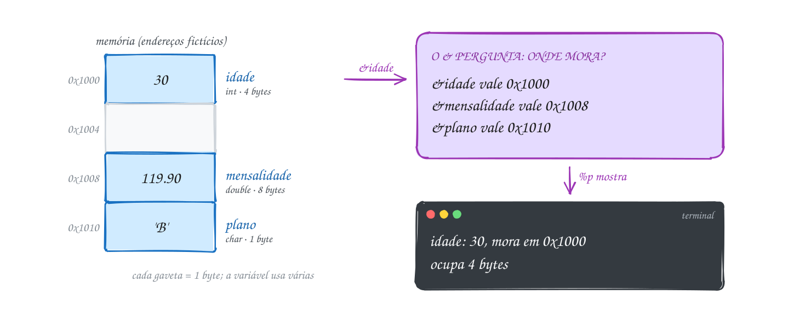</p>

O programa mostra, para cada variável, o valor, o endereço e o tamanho:

```c
#include <stdio.h>

int main(void) {
    int idade = 30;
    double mensalidade = 119.90;
    char plano = 'B';

    // & pergunta "em que gaveta você mora?"; %p mostra a resposta em hexa
    printf("idade:       %d, mora em %p, ocupa %zu bytes\n",
           idade, (void *)&idade, sizeof idade);
    printf("mensalidade: %.2f, mora em %p, ocupa %zu bytes\n",
           mensalidade, (void *)&mensalidade, sizeof mensalidade);
    printf("plano:       %c, mora em %p, ocupa %zu byte\n",
           plano, (void *)&plano, sizeof plano);
    return 0;
}
// Saída (os endereços mudam a cada execução):
// idade:       30, mora em 0x7f0440e00030, ocupa 4 bytes
// mensalidade: 119.90, mora em 0x7f0440e00040, ocupa 8 bytes
// plano:       B, mora em 0x7f0440e00020, ocupa 1 byte
```

O `%zu` é o formato certo para o resultado do `sizeof` (um `size_t`, inteiro
sem sinal). Rode duas vezes: os valores e os tamanhos se repetem, os
endereços não.

Repara no fluxograma: não tem decisão nenhuma. Para cada variável, o
programa faz as mesmas três perguntas: o que tem dentro, onde mora e quanto
ocupa:

<p align="center">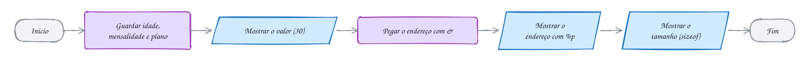</p>

> [!WARNING]
> Nunca mostre endereço com `%d` ou `%x`. Um endereço tem 8 bytes num
> sistema de 64 bits, e o `%d` lê só 4: você vê um número cortado, às vezes
> negativo. O `rodar` avisa (`format '%d' expects argument of type 'int', but
> argument 2 has type 'int *'`). O certo é sempre `%p` com `(void *)`. E não
> conclua nada da ordem dos endereços de variáveis soltas: o compilador
> arruma as gavetas como quiser (na saída acima, `plano` ficou **antes** de
> `idade`). Só num vetor a ordem é garantida.

> [!TIP]
> **Por dentro do C:** o endereço `0x7f0440e00030` tem 12 dígitos hexa, ou
> seja, 48 bits. O ponteiro ocupa 8 bytes (64 bits), mas os processadores de
> hoje só usam 48 deles para endereçar: dá 256 TB, sobra. O sorteio do
> endereço a cada execução se chama **ASLR** (*Address Space Layout
> Randomization*): se o atacante não sabe onde as coisas moram, fica bem
> mais difícil explorar uma falha. E as variáveis locais moram numa região
> chamada **pilha**, a mesma pilha de chamadas do assunto 0031; o módulo 07
> mostra o mapa completo.

> [!NOTE]
> **Pergunta para você:** se `idade` começa na gaveta `0x1000` e ocupa 4
> bytes, qual é o endereço do **último** byte dela? E onde poderia começar a
> próxima variável `int`, sem sobrepor? Depois rode o A088 e veja os
> endereços de um vetor subindo de 4 em 4.

### Hora de praticar

Os arquivos ficam em [`0044-memoria/`](0044-memoria/). Os comandos funcionam de qualquer pasta do terminal. Nos exemplos, rode, mude, quebre e rode de novo. Nos exercícios, a resposta vai dentro do próprio arquivo. ★☆☆ é aquecimento, ★★☆ pede raciocínio e ★★★ é desafio.

**Exemplo A087 · O valor muda, a gaveta não**

```c
#include <stdio.h>

int main(void) {
    double saldo = 250.00; // saldo da conta, antes dos Pix do dia

    printf("saldo = %7.2f, mora em %p\n", saldo, (void *)&saldo);

    saldo -= 89.90; // Pix para a conta de luz
    printf("saldo = %7.2f, mora em %p\n", saldo, (void *)&saldo);

    saldo += 1200.00; // salário caiu
    printf("saldo = %7.2f, mora em %p\n", saldo, (void *)&saldo);

    // atribuir troca o conteúdo da gaveta; o endereço fica o mesmo até o fim
    // do programa
    double reserva = saldo; // cópia do valor: outra gaveta, mesmo conteúdo
    printf("reserva = %7.2f, mora em %p\n", reserva, (void *)&reserva);
    // endereços também se comparam com ==
    printf("mesmo valor? %d  mesma gaveta? %d\n", reserva == saldo,
           &reserva == &saldo);
    return 0;
}
// Saída (os endereços mudam a cada execução, mas se repetem dentro dela):
// saldo =  250.00, mora em 0x7f8a1c500020
// saldo =  160.10, mora em 0x7f8a1c500020
// saldo = 1360.10, mora em 0x7f8a1c500020
// reserva = 1360.10, mora em 0x7f8a1c500040
// mesmo valor? 1  mesma gaveta? 0
```

```bash
~/LPEDC/rodar 06-ponteiros/0044-memoria/A087.c
```

**Exemplo A088 · As gavetas de um vetor**

```c
#include <stdio.h>

int main(void) {
    int passos[4] = {8200, 10450, 6300, 12010}; // passos de 4 dias
    double km[4] = {5.7, 7.3, 4.4, 8.4};        // os mesmos dias, em km

    // num vetor as gavetas ficam coladas: cada uma começa onde a outra acaba
    for (int i = 0; i < 4; i++) {
        printf("passos[%d] em %p    km[%d] em %p\n",
               i, (void *)&passos[i], i, (void *)&km[i]);
    }
    printf("int: %zu bytes por gaveta; double: %zu bytes\n", sizeof passos[0], sizeof km[0]);
    printf("o vetor passos inteiro: %zu bytes\n", sizeof passos);
    return 0;
}
// Saída (os endereços mudam a cada execução; repare no final de cada um):
// passos[0] em 0x7fe2a0e00020    km[0] em 0x7fe2a0e00040
// passos[1] em 0x7fe2a0e00024    km[1] em 0x7fe2a0e00048
// passos[2] em 0x7fe2a0e00028    km[2] em 0x7fe2a0e00050
// passos[3] em 0x7fe2a0e0002c    km[3] em 0x7fe2a0e00058
// int: 4 bytes por gaveta; double: 8 bytes
// o vetor passos inteiro: 16 bytes
```

```bash
~/LPEDC/rodar 06-ponteiros/0044-memoria/A088.c
```

#### Exercícios

**Exercício E259** · ★☆☆

No ônibus da linha 0.420, o painel guarda três dados: a quantidade de
passageiros (int, 42), a tarifa (float, 4.40) e a letra do setor
(char, 'X'). Declare as três variáveis e mostre, para cada uma, o valor,
o endereço e quantos bytes ela ocupa.


```text
Saída esperada (os endereços mudam a cada execução):
passageiros = 42, endereço 0x7f..., tamanho 4
tarifa = 4.40, endereço 0x7f..., tamanho 4
setor = X, endereço 0x7f..., tamanho 1
```

**Dicas:**

1. O endereço sai com &nome; o tamanho, com sizeof nome.
2. Mostre o endereço com %p e o cast (void *); o tamanho, com %zu.
3. Resposta esperada: os valores e os tamanhos acima (4, 4 e 1); os
   endereços aparecem em hexadecimal e mudam a cada vez que você roda.

```bash
~/LPEDC/rodar 06-ponteiros/0044-memoria/E259.c
```

**Exercício E260** · ★☆☆

O placar eletrônico do estádio guarda três dados de um time: os gols
(int, 3), a média de gols por jogo (double, 1.5) e o resultado da
partida (char, 'V'). Escreva um programa que monte o "gaveteiro" dessas
variáveis: uma linha por variável, com o nome, o valor, o endereço e
quantos bytes ela ocupa. No fim, mostre quantos bytes as três ocupam
juntas, somando os sizeof.


```text
Saída esperada (os endereços mudam a cada execução):
gols   = 3   em 0x7f..., 4 bytes
media  = 1.5 em 0x7f..., 8 bytes
result = V   em 0x7f..., 1 bytes
total: 13 bytes
```

**Dicas:**

1. O endereço sai com %p e (void *)&nome; o tamanho, com %zu e sizeof.
2. sizeof dá um size_t: guarde a soma numa variável size_t e mostre
   com %zu.
3. Resposta esperada: os tamanhos 4, 8 e 1 e a linha "total: 13 bytes";
   os endereços aparecem em hexadecimal e mudam a cada vez que você roda.

```bash
~/LPEDC/rodar 06-ponteiros/0044-memoria/E260.c
```

**Exercício E261** · ★★☆

A lanchonete guarda o preço de 2 tamanhos (linhas) de 3 sucos (colunas)
numa matriz double precos[2][3]:


```text
{ {6.0, 7.5, 8.0}, {9.0, 11.0, 12.5} }
```


Mostre o valor e o endereço de cada posição, linha por linha, com dois
for aninhados. Depois mostre, com sizeof, quantos bytes ocupa uma
posição, uma linha inteira (precos[0]) e a matriz toda. Compare os
endereços de precos[0][2] e precos[1][0] na saída: a linha 1 começa logo
onde a linha 0 acaba.


```text
Saída esperada (endereços mudam a cada execução):
precos[0][0] = 6.00 em 0x7f...30
precos[0][1] = 7.50 em 0x7f...38
...
precos[1][2] = 12.50 em 0x7f...58
uma posição: 8 bytes
uma linha: 24 bytes
a matriz: 48 bytes
```

**Dicas:**

1. &precos[i][j] dá o endereço de uma posição.
2. sizeof precos[0][0], sizeof precos[0] e sizeof precos dão os três
   tamanhos. Olhe só os dois últimos dígitos hexa dos endereços.
3. Resposta esperada: os endereços sobem de 8 em 8 (0x30, 0x38, 0x40...)
   sem buraco entre as linhas, e os tamanhos 8, 24 e 48: a matriz é uma
   fila só de 6 doubles, linha após linha (assunto 0039).

```bash
~/LPEDC/rodar 06-ponteiros/0044-memoria/E261.c
```

**Exercício E262** · ★★☆

Este programa da pizzaria tenta mostrar o endereço da variável pedidos de
três jeitos, e os três estão errados DE PROPÓSITO. Rode com o rodar e leia
os avisos do compilador. Conserte as três linhas para mostrarem o
endereço do jeito certo, rode de novo e confira que o rodar não reclama
mais e que as três linhas mostram o mesmo endereço.


```text
Saída esperada depois do conserto (o endereço muda a cada execução):
Endereço: 0x7f...
Endereço: 0x7f...
Endereço: 0x7f...
```

**Dicas:**

1. Leia o aviso inteiro: ele diz o tipo que o formato espera e o tipo que
   recebeu.
2. Um endereço tem 8 bytes; %d e %x leem um int de 4.
3. Resposta esperada: compila sem nenhum aviso e as três linhas mostram
   o mesmo endereço em hexa. %d e %x leem só 4 bytes (número cortado);
   %p sem cast funciona na prática, mas o padrão pede void *. As três
   viram printf("Endereço: %p\n", (void *)&pedidos);

```bash
~/LPEDC/rodar 06-ponteiros/0044-memoria/E262.c
```

**Exercício E263** · ★★★

Variáveis declaradas juntas ficam juntas na memória? Escreva um programa
que declare


```text
int a = 1, b = 2, c = 3;
int v[3] = {1, 2, 3};
```


e mostre o endereço de a, b e c (uma linha cada) e depois, com um for, o
endereço de v[0], v[1] e v[2]. No fim, mostre sizeof v e a soma
sizeof a + sizeof b + sizeof c. Rode com o rodar. Depois compile SEM o
sanitizer e rode de novo, para comparar as duas saídas:


```text
gcc -std=c17 E263.c -o e263 && ./e263
```


```text
Saída esperada (endereços mudam a cada execução; com o rodar):
a em 0x7f...30
b em 0x7f...40
c em 0x7f...50
v[0] em 0x7f...60
v[1] em 0x7f...64
v[2] em 0x7f...68
sizeof v = 12, a + b + c = 12
```

**Dicas:**

1. Compare só os últimos dígitos hexa de cada endereço.
2. O AddressSanitizer coloca "zonas proibidas" entre as variáveis para
   pegar estouros; sem ele, o compilador arruma do jeito que quiser.
3. Resposta esperada: v[0], v[1] e v[2] sobem de 4 em 4 nas duas
   compilações; a, b e c ficam a 16 bytes um do outro com o rodar e
   costumam ficar a 4 bytes sem ele, em qualquer ordem. Os dois tamanhos
   dão 12: o mesmo espaço, mas só o vetor tem ordem garantida.

```bash
~/LPEDC/rodar 06-ponteiros/0044-memoria/E263.c
```

**Exercício E264** · ★★★

Um programa tem variáveis de "espécies" diferentes (assunto 0030).
Escreva um programa da feira com:


```text
- uma variável global int total_vendas = 0;
- uma função void registra(int valor) com uma variável local static
  int chamadas, que soma valor em total_vendas, conta a chamada e
  mostra o endereço de chamadas e do parâmetro valor;
- no main, uma variável local int caixa = 100 e um texto fixo
  const char *loja = "Feira"; (mostre o endereço do texto com
  (void *)loja, sem &).
```


Chame registra(10) e registra(20). Depois mostre os endereços em dois
blocos, com um título cada: "vivem o programa todo" (total_vendas, o
texto) e "nascem e morrem" (caixa). Termine mostrando total_vendas.


```text
Saída esperada (endereços mudam a cada execução):
registra(10): chamadas em 0x55..., valor em 0x7f...
registra(20): chamadas em 0x55..., valor em 0x7f...
vivem o programa todo:
  total_vendas em 0x55...
  texto "Feira" em 0x55...
nascem e morrem:
  caixa em 0x7f...
total_vendas = 30
```

**Dicas:**

1. Olhe só os 4 primeiros dígitos hexa de cada endereço.
2. Globais, static e textos fixos vivem enquanto o programa vive; locais
   e parâmetros nascem e morrem a cada chamada.
3. Resposta esperada: total_vendas, chamadas e o texto ficam numa região
   (começando com 0x55... ou 0x56...); caixa e valor ficam em outra, bem
   mais alta (0x7f...), a pilha. O endereço de chamadas é o mesmo nas
   duas chamadas, e total_vendas termina em 30. O mapa completo (pilha,
   heap, dados e código) é o assunto 0053.

```bash
~/LPEDC/rodar 06-ponteiros/0044-memoria/E264.c
```

---

## 0045 · Ponteiros

Quando você pede comida pelo app, o entregador não leva a sua casa no
celular: leva o **endereço** dela. Com o endereço, ele chega na porta e
entrega o pedido. Mudou o que tem dentro da casa sem nunca ter carregado a
casa.

Um **ponteiro** é isso: uma variável que guarda um **endereço** em vez de um
valor comum. Ela também mora numa gaveta da memória (tem o próprio
endereço), mas o que está dentro dela é o número de **outra** gaveta.

Declarar tem um `*` antes do nome: `int *cartao;` se lê "cartao é um
ponteiro para int". O tipo importa: diz **o que** mora no endereço apontado,
e portanto quantos bytes ler lá (4 para `int`, 8 para `double`).

Dois operadores fazem todo o serviço:

- **`&x`** dá o endereço de `x` (assunto 0044). É o que você guarda no
  ponteiro: `cartao = &pontos;`;
- **`*cartao`** vai até o endereço guardado e mexe no que está lá. Isso se
  chama **desreferenciar**. Ler `*cartao` dá o valor de `pontos`; escrever
  `*cartao = 150;` muda `pontos`.

O `*` tem três papéis e só o contexto separa: multiplicação (`a * b`),
declaração (`int *p`) e desreferência (`*p = 5`). Leia devagar no começo.

E se o ponteiro ainda não aponta para nada? Use **`NULL`**: um endereço
especial que significa "lugar nenhum". Dá para testar (`if (cartao != NULL)`)
antes de usar.

Vamos ver na prática. No caixa da farmácia, o cliente tem 120 pontos no
cartão fidelidade. O ponteiro `cartao` começa em `NULL` (nenhum cartão).
Quando o cliente passa o cartão, `cartao` recebe `&pontos`. A compra de
R$ 30 soma 30 pontos **através do ponteiro**, e `pontos` vira 150:

<p align="center">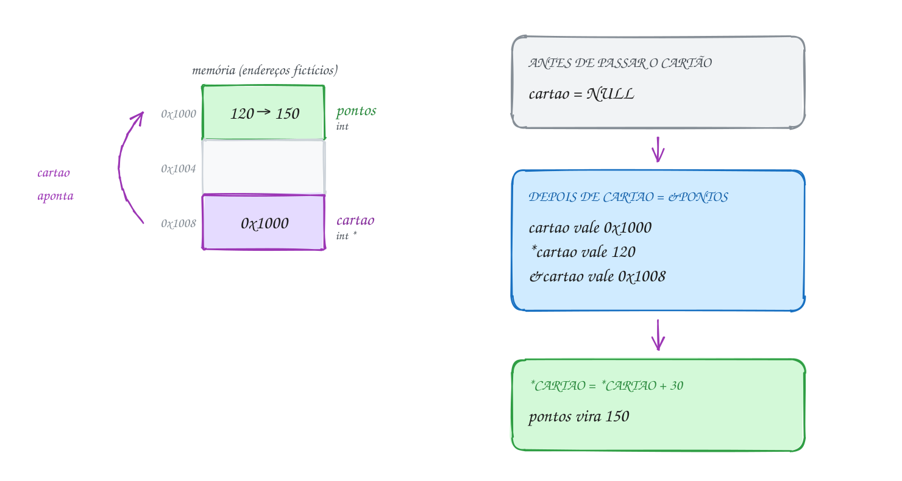</p>

No código, repare que a linha que muda `pontos` nem cita o nome `pontos`:

```c
#include <stdio.h>

int main(void) {
    int pontos = 120;     // pontos do cartão fidelidade
    int *cartao = NULL;   // ponteiro para int; NULL: ainda não aponta para nada

    cartao = &pontos;     // o cliente passou o cartão: cartao guarda &pontos

    printf("&pontos = %p\n", (void *)&pontos);
    printf("cartao  = %p\n", (void *)cartao); // o mesmo endereço
    printf("*cartao = %d\n", *cartao);        // o que tem na gaveta apontada

    if (cartao != NULL) {
        *cartao = *cartao + 30; // compra de R$ 30: muda pontos ATRAVÉS do ponteiro
    } else {
        printf("Compra sem cartão\n");
    }
    printf("pontos  = %d\n", pontos);
    printf("&cartao = %p\n", (void *)&cartao); // o ponteiro também mora numa gaveta
    return 0;
}
// Saída (os endereços mudam a cada execução):
// &pontos = 0x7f631f200030
// cartao  = 0x7f631f200030
// *cartao = 120
// pontos  = 150
// &cartao = 0x7f631f200040
```

Três números diferentes, não confunda: `cartao` é o endereço guardado (o de
`pontos`), `*cartao` é o valor lá dentro (120, depois 150) e `&cartao` é
onde o próprio ponteiro mora.

Repara no fluxograma: antes de desreferenciar, o programa pergunta se o
ponteiro aponta para algum lugar. Esse teste contra `NULL` é um hábito que
você vai repetir o curso inteiro:

<p align="center">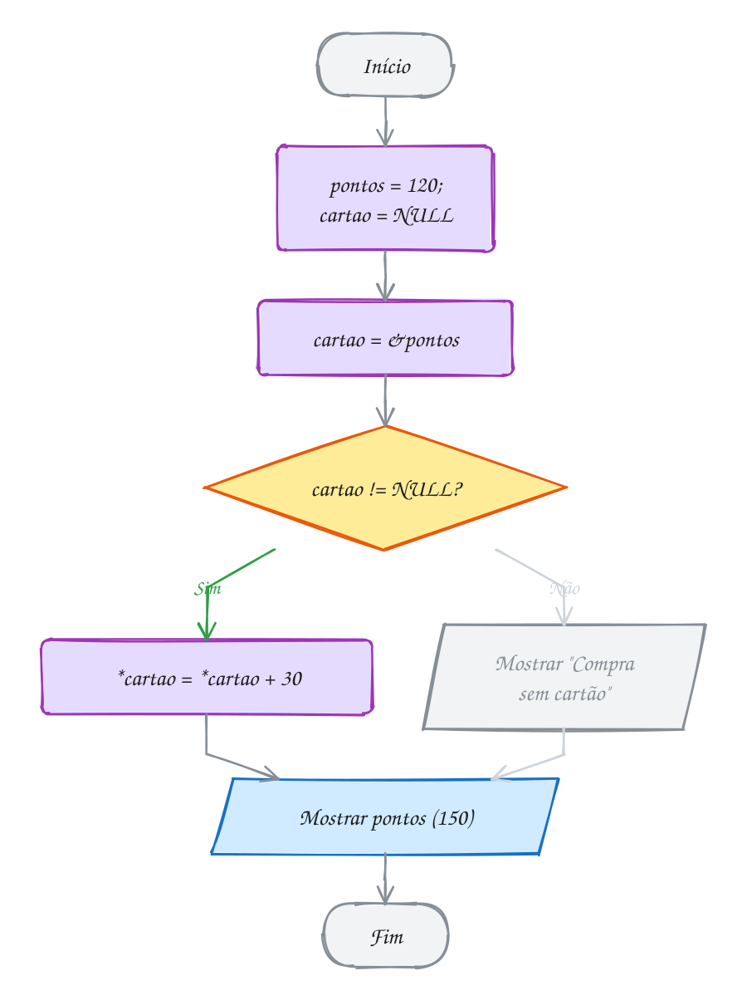</p>

> [!WARNING]
> Ponteiro declarado e não inicializado (`int *p;`) guarda **lixo**: um
> endereço qualquer. `*p = 10;` escreve 10 numa gaveta desconhecida. Pode
> travar na hora, pode corromper outra variável e só dar problema bem
> depois. Sempre inicialize: com um endereço válido ou com `NULL`. E cuidado
> com `int *a, b;`: o `*` vale só para `a`. Aqui `b` é um `int` comum. Para
> dois ponteiros, `int *a, *b;`.

> [!TIP]
> **Por dentro do C:** todo ponteiro de dado tem o mesmo tamanho, 8 bytes
> num sistema de 64 bits, aponte ele para `char` ou para `double`. O tipo
> não muda o ponteiro: muda a **leitura**. `*cartao` manda o processador
> buscar 4 bytes a partir do endereço e tratar como `int`. E o `NULL` vale,
> na prática, o endereço 0. O sistema deixa essa região da memória proibida
> de propósito: desreferenciar `NULL` derruba o programa na hora
> (*segmentation fault*), em vez de corromper algo em silêncio. Falhar cedo
> é bom.

> [!NOTE]
> **Pergunta para você:** depois de `int x = 5; int *p = &x; int *q = p;
> *q = 8;`, quanto valem `x` e `*p`? Quantas variáveis `int` existem nesse
> trecho?

### Hora de praticar

Os arquivos ficam em [`0045-ponteiros/`](0045-ponteiros/). Os comandos funcionam de qualquer pasta do terminal. Nos exemplos, rode, mude, quebre e rode de novo. Nos exercícios, a resposta vai dentro do próprio arquivo. ★☆☆ é aquecimento, ★★☆ pede raciocínio e ★★★ é desafio.

**Exemplo A089 · Duas cancelas, um contador**

```c
#include <stdio.h>

int main(void) {
    int vagas = 40; // vagas livres no estacionamento do shopping

    // dois ponteiros podem apontar para a MESMA variável
    int *entrada = &vagas, *saida = &vagas; // o * vai em cada nome
    int *cancela_vip = NULL;                // ainda não foi instalada

    *entrada -= 1; // entrou um carro
    *entrada -= 1; // entrou outro
    *saida += 1;   // saiu um
    printf("vagas = %d\n", vagas);

    // comparar ponteiros pergunta "apontam para a mesma gaveta?"
    printf("entrada == saida? %d\n", entrada == saida);
    printf("*entrada = %d, *saida = %d\n", *entrada, *saida);

    // antes de usar *cancela_vip, confira: *NULL derruba o programa
    if (cancela_vip != NULL) {
        *cancela_vip -= 1;
    } else {
        printf("cancela VIP desligada: nada a fazer\n");
    }

    int vagas_moto = 12;
    saida = &vagas_moto; // saida agora aponta para outra gaveta
    *saida += 1;
    printf("entrada == saida? %d\n", entrada == saida);
    printf("vagas = %d, vagas_moto = %d\n", vagas, vagas_moto);
    return 0;
}
// Saída:
// vagas = 39
// entrada == saida? 1
// *entrada = 39, *saida = 39
// cancela VIP desligada: nada a fazer
// entrada == saida? 0
// vagas = 39, vagas_moto = 13
```

```bash
~/LPEDC/rodar 06-ponteiros/0045-ponteiros/A089.c
```

**Exemplo A090 · Gasolina ou etanol?**

```c
#include <stdio.h>

int main(void) {
    float gasolina = 5.89f, etanol = 4.29f;
    float *escolha = &gasolina; // começa apontando para a gasolina

    // regra dos 70%: se o etanol custa até 70% da gasolina, compensa
    if (etanol / gasolina <= 0.7f) {
        escolha = &etanol;      // o ponteiro muda de alvo; as variáveis, não
    }
    printf("Escolhido: R$ %.2f o litro\n", *escolha);
    printf("Com R$ 100 dá %.1f litros\n", 100.0f / *escolha);

    etanol = 3.99f;            // baixou: 3.99 / 5.89 = 0.68, agora compensa
    if (etanol / gasolina <= 0.7f) {
        escolha = &etanol;
    }
    printf("Escolhido: R$ %.2f o litro\n", *escolha);

    // o ponteiro tem o tamanho de um endereço; *escolha, o tamanho de um float
    printf("sizeof escolha = %zu, sizeof *escolha = %zu\n", sizeof escolha, sizeof *escolha);
    return 0;
}
// Saída:
// Escolhido: R$ 5.89 o litro
// Com R$ 100 dá 17.0 litros
// Escolhido: R$ 3.99 o litro
// sizeof escolha = 8, sizeof *escolha = 4
```

```bash
~/LPEDC/rodar 06-ponteiros/0045-ponteiros/A090.c
```

#### Exercícios

**Exercício E265** · ★☆☆

O ar-condicionado da sala marca 22.5 graus. Declare double temperatura =
22.5 e um ponteiro pt que aponte para ela. Usando SÓ o ponteiro (sem
escrever temperatura do lado esquerdo do =), mostre a temperatura,
aumente 1.5 grau e mostre de novo. No fim, mostre a variável temperatura
pelo nome para provar que ela mudou.


```text
Saída esperada:
Pelo ponteiro: 22.5
Pelo ponteiro: 24.0
Pela variável: 24.0
```

**Dicas:**

1. Declare: double *pt = &temperatura;
2. Para mudar: *pt = *pt + 1.5; (ou *pt += 1.5;)
3. Resposta esperada: 22.5, 24.0 e 24.0.

```bash
~/LPEDC/rodar 06-ponteiros/0045-ponteiros/E265.c
```

**Exercício E266** · ★☆☆

O painel do estacionamento guarda as vagas livres:


```text
int vagas = 7;
int *p = &vagas;
```


Escreva o programa e mostre cada expressão abaixo com printf (use %d
para as que são int e %p com (void *) para as que são endereço):
vagas, &vagas, p, *p, &p e *&vagas. Depois mostre, com %d, o resultado
de três comparações: p == &vagas, *p == vagas e (void *)&p == (void *)&vagas.


```text
Saída esperada (endereços mudam a cada execução):
vagas   = 7
&vagas  = 0x7f...30
p       = 0x7f...30
*p      = 7
&p      = 0x7f...40
*&vagas = 7
p == &vagas: 1
*p == vagas: 1
&p == &vagas: 0
```

**Dicas:**

1. & dá o endereço; * vai até o endereço e pega o que tem lá.
2. *&vagas: primeiro pega o endereço de vagas, depois vai até ele.
3. Resposta esperada: &vagas e p saem iguais, &p sai diferente (o
   ponteiro mora na sua própria gaveta); *p e *&vagas valem 7; as
   comparações dão 1, 1 e 0.

```bash
~/LPEDC/rodar 06-ponteiros/0045-ponteiros/E266.c
```

**Exercício E267** · ★★☆

Este programa da academia tem TRÊS erros com ponteiros, de propósito.
Ele deveria mostrar:


```text
Peso: 82
Meta: 78
```


Rode com o rodar e conserte um erro de cada vez: primeiro o compilador
recusa o código; depois avisa; por fim o AddressSanitizer reclama quando
roda. Ache os três erros e conserte.

**Dicas:**

1. Em int *peso_ptr, meta_ptr; quantos ponteiros foram declarados?
2. Um ponteiro precisa apontar para algum lugar antes de receber *p = ...
3. Resposta esperada: (1) meta_ptr não é ponteiro (o * não vale para os
   dois nomes), por isso *meta_ptr nem compila: declare
   int *peso_ptr, *meta_ptr;. (2) meta_ptr = meta tenta guardar o valor
   78 como endereço (aviso "makes pointer from integer"): o certo é
   meta_ptr = &meta;. (3) peso_ptr nunca recebeu um endereço: falta
   peso_ptr = &peso; antes de *peso_ptr = 82;.

```bash
~/LPEDC/rodar 06-ponteiros/0045-ponteiros/E267.c
```

**Exercício E268** · ★★☆

No check-in do aeroporto, a companhia aceita uma mala de até 23 kg sem
cobrar. Você tem duas malas: mala_azul com 19 kg e mala_preta com 26 kg.
Complete o programa: faça o ponteiro pesada apontar para a mala mais
pesada e, usando só o ponteiro, tire 4 kg dela (você passou umas roupas
para a mochila). Depois mostre as duas malas.


```text
Saída esperada:
Mais pesada: 26 kg
Depois de tirar 4 kg: azul 19 kg, preta 22 kg
```

**Dicas:**

1. Use um if para escolher: pesada = &mala_azul ou pesada = &mala_preta.
2. Para tirar 4 kg pelo ponteiro: *pesada -= 4;
3. Resposta esperada: a preta é a mais pesada (26); vira 22 e a azul
   continua 19.

```bash
~/LPEDC/rodar 06-ponteiros/0045-ponteiros/E268.c
```

**Exercício E269** · ★★★

Transforme o trecho abaixo num teste de mesa que o próprio programa
imprime. Cole o código no main e, depois da declaração e depois de CADA
uma das cinco linhas, acrescente um printf que mostre a linha executada
e os valores de a, b, *p e *q naquele momento.


```text
int a = 3, b = 8;
int *p = &a, *q = &b;
```


```text
*p = *q + 1;
p = q;
*p = *p * 2;
q = &a;
*q -= 4;
```


```text
Saída esperada:
início        a = 3, b = 8, *p = 3, *q = 8
*p = *q + 1   a = 9, b = 8, *p = 9, *q = 8
p = q         a = 9, b = 8, *p = 8, *q = 8
...
*q -= 4       a = 5, b = 16, *p = 16, *q = 5
```

**Dicas:**

1. Quem muda com *p = ... é a variável apontada; p = q e q = &a só trocam
   o alvo do ponteiro, sem mexer em a nem em b.
2. Use o mesmo printf seis vezes, mudando só o texto da linha; alinhe
   com espaços para a tabela ficar fácil de ler.
3. Resposta esperada: as seis linhas terminam em a = 5, b = 16, *p = 16,
   *q = 5; no meio aparecem "*p = *p * 2  a = 9, b = 16, *p = 16, *q = 16"
   e "q = &a  a = 9, b = 16, *p = 16, *q = 9".

```bash
~/LPEDC/rodar 06-ponteiros/0045-ponteiros/E269.c
```

**Exercício E270** · ★★★

Você tem três contas: conta_a com R$ -50.25 (no cheque especial),
conta_b com R$ 300.00 e conta_c com R$ 12.00. Escreva um programa que:


```text
1. faça um ponteiro menor apontar para a conta de menor saldo;
2. se esse saldo for negativo, guarde o endereço num segundo ponteiro
   negativa; senão, deixe negativa = NULL;
3. se negativa não for NULL, zere a conta pelo ponteiro (você cobriu o
   negativo) e mostre quanto precisou pôr; senão, mostre
   "Nenhuma conta negativa";
4. mostre as três contas no fim.
```


Teste também trocando conta_a para 50.25: deve aparecer a outra mensagem.


```text
Saída esperada:
Cobri R$ 50.25
A: 0.00  B: 300.00  C: 12.00
```

**Dicas:**

1. Comece com menor = &conta_a e compare *menor com as outras.
2. Para saber quanto pôr antes de zerar: -(*negativa).
3. Resposta esperada: a conta A é a menor e negativa; cobre R$ 50.25 e
   ela vira 0.00. Com 50.25, a menor é C (12.00) e aparece
   "Nenhuma conta negativa".

```bash
~/LPEDC/rodar 06-ponteiros/0045-ponteiros/E270.c
```

---

## 0046 · Passagem por referência

No mercadinho, alguém digitou as etiquetas trocadas: o arroz saiu por
R$ 8 e o feijão por R$ 25. Você quer uma função `troca` que conserte isso.
Parece fácil, mas a versão óbvia não funciona, e entender por que é entender
como o C chama funções.

No C, **todo argumento é passado por valor** (assunto 0029): a função recebe
uma **cópia**. `troca_copias(arroz, feijao)` cria duas variáveis novas, `a`
e `b`, com 8 e 25 dentro. A função troca as cópias, termina, e as cópias
somem junto com o frame dela (assunto 0031). O `arroz` do `main` nem ficou
sabendo.

A saída é mudar o que se entrega: em vez do valor, passe o **endereço**.

A função passa a receber ponteiros, `void troca(int *a, int *b)`, e quem
chama entrega os endereços: `troca(&arroz, &feijao)`. O endereço também é
copiado, mas a cópia de um endereço aponta para **a mesma gaveta**. Dentro
da função, `*a` é o próprio `arroz` do `main`. Isso se chama **passagem por
referência** (no C, simulada com ponteiros).

Agora o mistério do `scanf` está resolvido. `scanf("%d", &total)` precisa
**escrever** na sua variável, então pede o endereço dela. Sem o `&`, ele
receberia uma cópia do lixo que está em `total` e tentaria escrever num
endereço inventado. E por que `scanf("%s", nome)` vai sem `&`? Porque o nome
de um vetor já vira o endereço do primeiro elemento (assunto 0038; o 0047
mostra os detalhes).

O mesmo truque resolve outro problema: o `return` devolve **um** valor só.
Quando a função precisa entregar dois ou mais resultados, ela recebe
ponteiros e escreve neles (o A092 racha a conta e devolve o valor de cada
um e a sobra).

Vamos ver na prática. A função `troca` recebe os endereços `0x1000` e
`0x1004`, guarda o 8 numa variável `tmp` e mexe direto nas gavetas do
`main`:

<p align="center">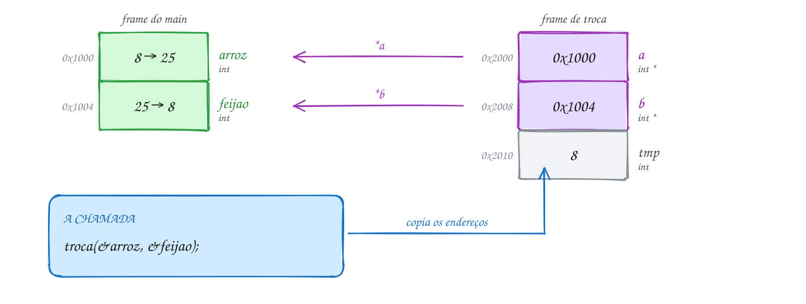</p>

No código, as duas versões lado a lado. Repare que só a segunda conserta as
etiquetas:

```c
#include <stdio.h>

// recebe CÓPIAS: troca as cópias e o main nem fica sabendo
void troca_copias(int a, int b) {
    int tmp = a;
    a = b;
    b = tmp;
}

// recebe ENDEREÇOS: troca o que está nas gavetas do main
void troca(int *a, int *b) {
    int tmp = *a; // guarda o valor da primeira gaveta
    *a = *b;      // primeira gaveta recebe o da segunda
    *b = tmp;     // segunda gaveta recebe o guardado
}

int main(void) {
    int arroz = 8, feijao = 25; // digitados trocados: o arroz é o mais caro

    troca_copias(arroz, feijao);
    printf("Depois de troca_copias: arroz %d, feijão %d\n", arroz, feijao);

    if (arroz < feijao) {         // o pacote de arroz deveria custar mais
        troca(&arroz, &feijao);   // passa os endereços, não os valores
    }
    printf("Depois de troca:        arroz %d, feijão %d\n", arroz, feijao);
    return 0;
}
// Saída:
// Depois de troca_copias: arroz 8, feijão 25
// Depois de troca:        arroz 25, feijão 8
```

### Passo a passo

Teste de mesa da chamada `troca(&arroz, &feijao)`, com os endereços
fictícios do desenho:

| linha | `a` | `b` | `tmp` | `arroz` (0x1000) | `feijao` (0x1004) |
| --- | --- | --- | --- | --- | --- |
| entrada na função | 0x1000 | 0x1004 | ? | 8 | 25 |
| `tmp = *a` | 0x1000 | 0x1004 | 8 | 8 | 25 |
| `*a = *b` | 0x1000 | 0x1004 | 8 | **25** | 25 |
| `*b = tmp` | 0x1000 | 0x1004 | 8 | 25 | **8** |

`a` e `b` nunca mudam: o que muda é o que está nas gavetas para onde eles
apontam.

Repara no fluxograma: o `main` só chama a troca se os preços estão fora de
ordem. A troca em si são três passos, sempre com a variável auxiliar:

<p align="center">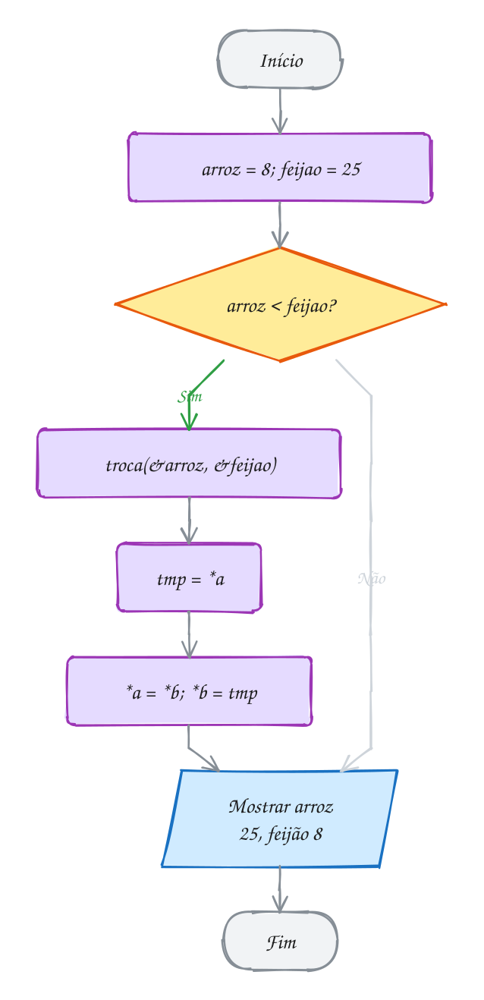</p>

> [!WARNING]
> Dois erros clássicos. Esquecer o `&` na chamada: `troca(arroz, feijao)`
> manda o número 8 onde a função espera um endereço. O compilador avisa
> (`makes pointer from integer without a cast`) e, se rodar, o programa
> tenta escrever na "gaveta 8" e cai. E esquecer o `*` dentro da função:
> `tmp = a; a = b;` troca os **ponteiros** locais, que são cópias; nada muda
> lá fora. Dentro da função, quem mexe no dado do chamador é sempre `*a`.

> [!TIP]
> **Por dentro do C:** no x86-64, os primeiros argumentos viajam em
> registradores do processador. Passar `&arroz` é copiar 8 bytes, o tamanho
> de um endereço, não importa o tamanho do dado apontado. Por isso, no
> módulo 08, struct grande vai por ponteiro: copiar 8 bytes é mais barato
> que copiar 200. Quando a função só precisa **ler**, use `const int *p`: o
> compilador recusa qualquer `*p = ...` lá dentro, e quem lê o protótipo sabe
> que o dado volta intacto.

> [!NOTE]
> **Pergunta para você:** o que acontece em `troca(&arroz, &arroz)`? Os dois
> ponteiros apontam para a mesma gaveta. O valor de `arroz` muda?

### Hora de praticar

Os arquivos ficam em [`0046-passagem-por-referencia/`](0046-passagem-por-referencia/). Os comandos funcionam de qualquer pasta do terminal. Nos exemplos, rode, mude, quebre e rode de novo. Nos exercícios, a resposta vai dentro do próprio arquivo. ★☆☆ é aquecimento, ★★☆ pede raciocínio e ★★★ é desafio.

**Exemplo A091 · O plantão que vira o relógio**

```c
#include <stdio.h>

// parâmetro de ida E volta: lê os valores do main e escreve de volta
void normaliza(int *horas, int *minutos) {
    *horas += *minutos / 60; // cada 60 minutos viram uma hora
    *minutos %= 60;
    *horas %= 24;            // passou da meia-noite, recomeça do 0
}

// horas e minutos já SÃO endereços: repassa para normaliza sem &
void soma_minutos(int *horas, int *minutos, int extra) {
    *minutos += extra;
    normaliza(horas, minutos);
}

int main(void) {
    int h = 22, m = 40; // começo do plantão no hospital

    soma_minutos(&h, &m, 95); // o primeiro atendimento durou 95 minutos
    printf("Fim do 1º atendimento: %02d:%02d\n", h, m);

    soma_minutos(&h, &m, 50);
    printf("Fim do 2º atendimento: %02d:%02d\n", h, m);

    // normaliza sozinha também arruma um horário anotado errado
    int h2 = 9, m2 = 135; // alguém anotou 9h135
    normaliza(&h2, &m2);
    printf("9h135 arrumado: %02d:%02d\n", h2, m2);
    return 0;
}
// Saída:
// Fim do 1º atendimento: 00:15
// Fim do 2º atendimento: 01:05
// 9h135 arrumado: 11:15
```

```bash
~/LPEDC/rodar 06-ponteiros/0046-passagem-por-referencia/A091.c
```

**Exemplo A092 · Rachando a conta do bar**

```c
#include <stdio.h>

// "devolve" dois resultados: escreve nas variáveis de quem chamou
void racha(int total, int pessoas, int *cada, int *sobra) {
    *cada = total / pessoas;
    *sobra = total % pessoas;
}

int main(void) {
    int total, pessoas;
    int cada, sobra; // a função vai preencher

    printf("Total da conta (R$): ");
    if (scanf("%d", &total) != 1) { // & : o scanf precisa saber ONDE guardar
        return 1;
    }
    printf("Quantas pessoas: ");
    if (scanf("%d", &pessoas) != 1 || pessoas <= 0) {
        return 1;
    }

    racha(total, pessoas, &cada, &sobra);
    printf("Cada um paga R$ %d e sobram R$ %d para a gorjeta\n", cada, sobra);
    return 0;
}
// Exemplo de execução:
// Total da conta (R$): 187
// Quantas pessoas: 4
// Cada um paga R$ 46 e sobram R$ 3 para a gorjeta
```

```bash
~/LPEDC/rodar 06-ponteiros/0046-passagem-por-referencia/A092.c
```

#### Exercícios

**Exercício E271** · ★☆☆

Promoção do cinema: quem compra pelo app ganha o dobro de ingressos.
Escreva a função void dobra(int *quantidade), que dobra o valor da
variável de quem chamou. No main, comece com ingressos = 3, chame a
função e mostre o resultado.


```text
Saída esperada:
Antes: 3 ingressos
Depois: 6 ingressos
```

**Dicas:**

1. Dentro da função, *quantidade é a variável do main.
2. Na chamada, passe o endereço: dobra(&ingressos);
3. Resposta esperada: 3 e depois 6.

```bash
~/LPEDC/rodar 06-ponteiros/0046-passagem-por-referencia/E271.c
```

**Exercício E272** · ★☆☆

O app de streaming mostra a duração dos filmes em minutos, mas você quer
ver em horas e minutos. Escreva


```text
void converte(int total, int *horas, int *minutos)
```


que separa o total. Teste com 135 (o filme) e 47 (o episódio).


```text
Saída esperada:
135 min = 2 h 15 min
47 min = 0 h 47 min
```

**Dicas:**

1. Horas: divisão inteira por 60. Minutos: o resto (%).
2. Declare int h, m; no main e chame converte(135, &h, &m);
3. Resposta esperada: 2 h 15 min e 0 h 47 min.

```bash
~/LPEDC/rodar 06-ponteiros/0046-passagem-por-referencia/E272.c
```

**Exercício E273** · ★★☆

As temperaturas máximas da semana em Cuiabá foram


```text
{ 34, 37, 31, 39, 36, 33, 38 }
```


Escreva void extremos(const int v[], int n, int *menor, int *maior), que
acha a menor e a maior temperatura do vetor numa passada só e entrega as
duas pelos ponteiros. Mostre também a amplitude (maior - menor).


```text
Saída esperada:
Menor: 31  Maior: 39  Amplitude: 8
```

**Dicas:**

1. Comece com *menor = *maior = v[0] e percorra do índice 1 em diante.
2. O const no vetor garante que a função só lê as temperaturas.
3. Resposta esperada: menor 31, maior 39, amplitude 8.

```bash
~/LPEDC/rodar 06-ponteiros/0046-passagem-por-referencia/E273.c
```

**Exercício E274** · ★★☆

A catraca do metrô conta passageiros, e este programa tem DOIS erros de
propósito. Ele deveria mostrar:


```text
Passageiros: 3
Bilhetes avulsos: 0
```


mas mostra outra coisa. Rode, leia o aviso do compilador e conserte os
dois erros sem mudar o main (exceto se precisar acrescentar um & numa
chamada). Rode de novo e confira a saída acima.

**Dicas:**

1. Em *contador++, o ++ age antes do *: ele anda com o ponteiro, não
   soma no valor.
2. Uma função que recebe int recebe uma cópia.
3. Resposta esperada: (1) *contador++ vira (*contador)++ (ou
   *contador += 1); o aviso era "value computed is not used";
   (2) zera recebe uma cópia: mude para void zera(int *valor) com
   *valor = 0 e chame zera(&avulsos).

```bash
~/LPEDC/rodar 06-ponteiros/0046-passagem-por-referencia/E274.c
```

**Exercício E275** · ★★★

Escreva


```text
int raizes(double a, double b, double c, double *x1, double *x2)
```


que resolve a*x*x + b*x + c = 0. A função DEVOLVE quantas raízes reais
existem (0, 1 ou 2) e escreve as raízes em *x1 e *x2 (quando houver uma
só, as duas recebem o mesmo valor). Se a for 0, devolve -1 (não é do 2º
grau). No main, teste as quatro equações e mostre o resultado:


```text
x² - 5x + 6 = 0   ->  2 raízes: 3.00 e 2.00
x² + 2x + 1 = 0   ->  1 raiz: -1.00
x² + 1 = 0        ->  nenhuma raiz real
0x² + 3x + 1 = 0  ->  não é do 2º grau
```

**Dicas:**

1. delta = b*b - 4*a*c; x = (-b ± sqrt(delta)) / (2*a). Inclua math.h.
2. O valor de retorno diz quantas gavetas a função preencheu; quem chama
   só lê *x1 e *x2 se o retorno permitir.
3. Resposta esperada: 2 raízes (3.00 e 2.00), 1 raiz (-1.00), nenhuma e
   "não é do 2º grau".

```bash
~/LPEDC/rodar 06-ponteiros/0046-passagem-por-referencia/E275.c
```

**Exercício E276** · ★★★

Esta função troca dois valores sem usar variável auxiliar, mas tem uma
armadilha:


```text
void troca_sem_aux(int *a, int *b) {
    *a = *a + *b;
    *b = *a - *b;
    *a = *a - *b;
}
```


Escreva um programa com essa função e, no main, faça:


```text
int x = 4, y = 9;
troca_sem_aux(&x, &y);   e mostre "x = ..., y = ..."
troca_sem_aux(&x, &x);   e mostre "x = ..."
```


Rode: a segunda chamada zera o x, porque a e b apontam para a MESMA
gaveta. Conserte a função para que, quando os dois ponteiros forem
iguais, ela não faça nada. Rode de novo.


```text
Saída esperada (depois do conserto):
x = 9, y = 4
x = 9
```

**Dicas:**

1. Antes do conserto, a saída é "x = 9, y = 4" e depois "x = 0": com a e
   b iguais, *a = 18; *b = 18 - 18 = 0 zera também o *a.
2. Ponteiros se comparam com ==: if (a == b) { return; } logo no começo.
3. Resposta esperada: "x = 9, y = 4" e "x = 9". Trocar uma gaveta com ela
   mesma não muda nada; a troca com tmp já se comporta assim sem o if.

```bash
~/LPEDC/rodar 06-ponteiros/0046-passagem-por-referencia/E276.c
```

---

## 0047 · Ponteiros e vetores

Numa rua de loteamento, os números das casas sobem de 4 em 4: 1000, 1004,
1008. Se alguém diz "três casas depois da 1000", você não anda 3 números:
anda 3 casas e chega na 1012. Os ponteiros fazem essa conta por você.

Num vetor, as gavetas ficam coladas (assunto 0044). E quase sempre que o
nome do vetor aparece numa expressão, ele **vira** o endereço do primeiro
elemento: `kwh` vale o mesmo que `&kwh[0]`. É por isso que você passa um
vetor para uma função sem `&` e ela altera o original (assunto 0038): ela
recebe esse endereço.

Com um ponteiro para dentro de um vetor, vale a **aritmética de ponteiros**:

- `p + 1` é o endereço do **próximo elemento**, não do próximo byte. O C
  multiplica pelo tamanho do tipo: num `int *`, `p + 1` anda 4 bytes; num
  `double *`, anda 8;
- `p++` avança o ponteiro um elemento; `p--` volta um;
- `q - p` (dois ponteiros do mesmo vetor) dá **quantos elementos** há entre
  eles;
- `p < q` compara posições, mas só faz sentido dentro do mesmo vetor.

Daí sai a regra mais importante do assunto: **`v[i]` é exatamente
`*(v + i)`**. O colchete é só um jeito curto de escrever "ande `i`
elementos e pegue o que tem lá". Vale para vetor e vale para ponteiro:
`p[2]` é `*(p + 2)`, contado a partir de onde `p` aponta **agora**.

Mas vetor **não é** ponteiro. `sizeof kwh` dá o vetor inteiro (20 bytes),
`sizeof p` dá 8. E `kwh = outro;` ou `kwh++` não compilam: o nome do vetor
é um endereço fixo, não uma variável que guarda endereço. O certo é dizer
que o vetor **decai** para ponteiro.

Vamos ver na prática. O consumo de luz de 5 meses está em `kwh`. O ponteiro
`p` começa em `kwh` (gaveta `0x1000`) e anda uma gaveta de cada vez,
somando o que encontra. Quando `p` chega em `kwh + 5`, a gaveta "um depois
do último", o laço para:

<p align="center">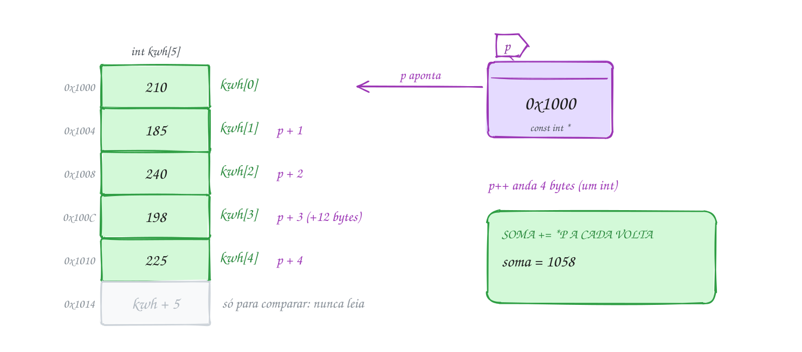</p>

O mesmo percurso no código, mostrando o endereço a cada passo:

```c
#include <stdio.h>

int main(void) {
    int kwh[5] = {210, 185, 240, 198, 225}; // consumo de 5 meses
    int soma = 0;

    // kwh sozinho vira &kwh[0]; kwh + 5 é "um depois do último"
    for (const int *p = kwh; p < kwh + 5; p++) {
        printf("p = %p  *p = %d\n", (void *)p, *p);
        soma += *p;
    }
    printf("Total: %d kWh  Média: %.1f kWh\n", soma, soma / 5.0);

    // as duas notações são a mesma conta
    printf("kwh[3] = %d  *(kwh + 3) = %d\n", kwh[3], *(kwh + 3));
    return 0;
}
// Saída (os endereços mudam a cada execução; repare que sobem de 4 em 4):
// p = 0x7fa4cb400020  *p = 210
// p = 0x7fa4cb400024  *p = 185
// p = 0x7fa4cb400028  *p = 240
// p = 0x7fa4cb40002c  *p = 198
// p = 0x7fa4cb400030  *p = 225
// Total: 1058 kWh  Média: 211.6 kWh
// kwh[3] = 198  *(kwh + 3) = 198
```

O `const int *p` diz que o laço só **lê** pelo ponteiro: `*p = 0` ali dentro
não compilaria. O ponteiro em si pode andar à vontade.

### Passo a passo

Com os endereços fictícios do desenho (`kwh` em `0x1000`):

| volta | `p` | `*p` | `soma` depois | `p < kwh + 5`? |
| --- | --- | --- | --- | --- |
| 1 | 0x1000 | 210 | 210 | sim |
| 2 | 0x1004 | 185 | 395 | sim |
| 3 | 0x1008 | 240 | 635 | sim |
| 4 | 0x100C | 198 | 833 | sim |
| 5 | 0x1010 | 225 | 1058 | sim |
| fim | 0x1014 | (não lê) | 1058 | **não**: para |

`kwh + 5` é `0x1014`: pode ser calculado e comparado, mas nunca lido.

Repara no fluxograma: é o laço de acumulador do assunto 0025, só que quem
anda é o ponteiro, não um índice:

<p align="center">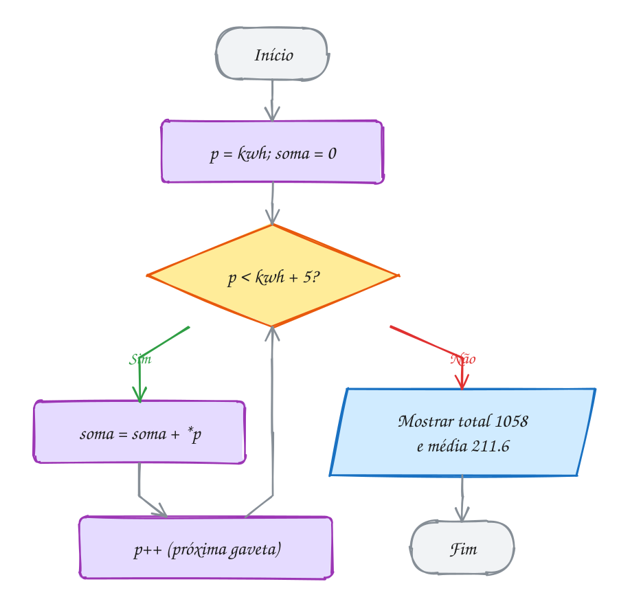</p>

> [!WARNING]
> `*p + 1` e `*(p + 1)` são coisas diferentes. O `*` vem antes do `+`, então
> `*p + 1` pega o valor e soma 1 (211); `*(p + 1)` anda uma gaveta e pega o
> valor dela (185). Na mesma família: `*p++` lê o valor e **depois** avança o
> ponteiro (o `++` vale para `p`), enquanto `(*p)++` soma 1 no valor. E
> passar do fim (`p <= kwh + 5`) lê a gaveta de outra variável: o C não
> confere, o AddressSanitizer acusa `stack-buffer-overflow`.

> [!TIP]
> **Por dentro do C:** para o compilador, `kwh[i]` é `*(kwh + i)`, e o
> endereço calculado é `kwh + i * sizeof(int)`, uma multiplicação e uma
> soma que o processador faz numa instrução só. Como a soma é comutativa,
> `i[kwh]` também compila e dá o mesmo valor. É uma curiosidade famosa;
> nunca escreva isso. E por que o laço com `p++` e o laço com `i++` dão o
> mesmo desempenho? Porque o otimizador transforma um no outro. Escolha o
> que deixa o código mais claro, quase sempre o índice.

> [!NOTE]
> **Pergunta para você:** com `int *p = &kwh[1];` e depois `p += 2;`, quanto
> valem `*p`, `p[1]`, `p[-1]` e `p - kwh`?

### Hora de praticar

Os arquivos ficam em [`0047-ponteiros-e-vetores/`](0047-ponteiros-e-vetores/). Os comandos funcionam de qualquer pasta do terminal. Nos exemplos, rode, mude, quebre e rode de novo. Nos exercícios, a resposta vai dentro do próprio arquivo. ★☆☆ é aquecimento, ★★☆ pede raciocínio e ★★★ é desafio.

**Exemplo A093 · De trás para frente, um passo por tipo**

```c
#include <stdio.h>

int main(void) {
    double temp[5] = {18.5, 21.0, 24.5, 23.0, 19.5}; // de segunda a sexta
    char turno[3] = {'M', 'T', 'N'};                   // manhã, tarde, noite

    // andar para trás: comece em temp + 5 (um depois do último) e recue
    // ANTES de usar. Parar em p >= temp obrigaria p a ir para temp - 1,
    // um endereço que o C não garante que exista
    printf("De sexta para segunda:");
    for (const double *p = temp + 5; p > temp;) {
        p--;
        printf(" %.1f", *p);
    }
    printf("\n");

    // p + 1 anda UM elemento: para double são 8 bytes, para char, 1
    printf("temp  em %p, temp + 1  em %p\n", (void *)temp, (void *)(temp + 1));
    printf("turno em %p, turno + 1 em %p\n", (void *)turno, (void *)(turno + 1));

    // a distância entre ponteiros também é contada em elementos
    const double *quarta = &temp[2];
    printf("de segunda até quarta: %td elementos\n", quarta - temp);
    printf("turno[2] = %c, *(turno + 2) = %c\n", turno[2], *(turno + 2));
    return 0;
}
// Saída (os endereços mudam a cada execução; repare no último dígito):
// De sexta para segunda: 19.5 23.0 24.5 21.0 18.5
// temp  em 0x7ff177100030, temp + 1  em 0x7ff177100038
// turno em 0x7ff177100080, turno + 1 em 0x7ff177100081
// de segunda até quarta: 2 elementos
// turno[2] = N, *(turno + 2) = N
```

```bash
~/LPEDC/rodar 06-ponteiros/0047-ponteiros-e-vetores/A093.c
```

**Exemplo A094 · O primeiro dia da meta**

```c
#include <stdio.h>

// devolve o endereço do primeiro elemento >= meta, ou NULL se não houver
const int *primeiro_acima(const int *v, int n, int meta) {
    for (const int *p = v; p < v + n; p++) {
        if (*p >= meta) {
            return p;
        }
    }
    return NULL;
}

int main(void) {
    int passos[7] = {6200, 8100, 10400, 7300, 12000, 9800, 11050};
    const int *achou = primeiro_acima(passos, 7, 10000);

    if (achou != NULL) {
        // ponteiro menos ponteiro = distância em ELEMENTOS, não em bytes;
        // o resultado é um ptrdiff_t, e o formato dele é %td
        printf("Meta batida no dia %td com %d passos\n", achou - passos + 1, *achou);
        if (achou > passos && achou < passos + 6) { // tem véspera e dia seguinte?
            printf("Véspera: %d  Dia seguinte: %d\n", achou[-1], achou[1]); // relativo a achou
        }
    }

    int *p = passos;
    // vetor não é ponteiro: sizeof mostra a diferença
    printf("sizeof passos = %zu  sizeof p = %zu\n", sizeof passos, sizeof p);
    return 0;
}
// Saída:
// Meta batida no dia 3 com 10400 passos
// Véspera: 8100  Dia seguinte: 7300
// sizeof passos = 28  sizeof p = 8
```

```bash
~/LPEDC/rodar 06-ponteiros/0047-ponteiros-e-vetores/A094.c
```

#### Exercícios

**Exercício E277** · ★☆☆

As notas de uma aluna no bimestre estão em


```text
float notas[4] = {7.5, 8.0, 6.5, 9.0};
```


Mostre as quatro notas e a média SEM usar colchetes depois da
declaração: só um ponteiro que anda pelo vetor.


```text
Saída esperada:
7.5 8.0 6.5 9.0
Média: 7.75
```

**Dicas:**

1. const float *p = notas; e o laço enquanto p < notas + 4.
2. *p dá a nota da vez; p++ vai para a próxima.
3. Resposta esperada: as quatro notas e média 7.75.

```bash
~/LPEDC/rodar 06-ponteiros/0047-ponteiros-e-vetores/E277.c
```

**Exercício E278** · ★☆☆

Complete o programa. O vetor e o ponteiro já estão declarados:


```text
int v[6] = {10, 20, 30, 40, 50, 60};
int *p = v + 1;
```


Sem escrever v nem números entre colchetes de v (só p, *, + e p[...]),
mostre, um por linha:


```text
a) o 20, com *
b) o 50, com * e +
c) o 23, somando 3 ao valor apontado
d) o 40, com colchetes em p
e) o endereço de p e o de p + 3, com %p
```


Depois faça p += 2 e mostre:


```text
f) o 40, com *
g) o 30, com colchetes em p
h) quantos elementos p está à frente do começo do vetor (aqui pode
   usar v)
```


```text
Saída esperada (o endereço muda a cada execução):
a) 20
b) 50
c) 23
d) 40
e) p = 0x7f...24, p + 3 = 0x7f...30
f) 40
g) 30
h) 3
```

**Dicas:**

1. p começa em v[1]. p[k] é *(p + k), contado a partir de onde p está.
2. *(p + 3) anda antes de pegar o valor; *p + 3 pega o valor e soma. Um
   índice negativo, como p[-1], olha para trás.
3. Resposta esperada: a saída acima, com *p, *(p + 3), *p + 3, p[2],
   depois *p, p[-1] e p - v (formato %td). O endereço de p + 3 fica 12
   bytes depois do de p.

```bash
~/LPEDC/rodar 06-ponteiros/0047-ponteiros-e-vetores/E278.c
```

**Exercício E279** · ★★☆

Você quer ouvir a playlist de trás para frente. As faixas estão
numeradas num vetor:


```text
int faixas[7] = {11, 23, 35, 47, 52, 68, 74};
```


Escreva void inverte(int *v, int n), que inverte o vetor no lugar usando
DOIS ponteiros: ini (no começo) e fim (no último). Troque o que eles
apontam, aproxime um do outro e pare quando se cruzarem. Use a função
troca do assunto 0046.


```text
Saída esperada:
74 68 52 47 35 23 11
```

**Dicas:**

1. int *ini = v; int *fim = v + n - 1;
2. while (ini < fim) { troca(ini, fim); ini++; fim--; }
3. Resposta esperada: 74 68 52 47 35 23 11. Com n ímpar, o do meio (47)
   fica no lugar.

```bash
~/LPEDC/rodar 06-ponteiros/0047-ponteiros-e-vetores/E279.c
```

**Exercício E280** · ★★☆

O programa da sorveteria tem DOIS erros de propósito. A ideia era mudar o
estoque do sabor de índice 3 para 20 e depois mostrar os 5 sabores:


```text
Saída esperada:
12 8 15 20 9
```


Rode com o rodar: um erro só aparece no resultado, o outro o
AddressSanitizer denuncia. Conserte os dois e rode de novo até a saída
ficar igual à esperada, sem aviso do sanitizer.

**Dicas:**

1. Depois de p += 1, para onde p aponta? E p[3], então, é qual elemento?
2. Um vetor de 5 tem endereços válidos para leitura de estoque até
   estoque + 4.
3. Resposta esperada: a saída "12 8 15 20 9". (1) com p em estoque[1],
   p[3] é estoque[4] (o índice é relativo a p), e o 9 virou 20: o certo
   é p[2] = 20 (ou estoque[3] = 20); (2) o laço vai até q <= estoque + 5
   e lê uma gaveta depois do fim (stack-buffer-overflow): o certo é
   q < estoque + 5.

```bash
~/LPEDC/rodar 06-ponteiros/0047-ponteiros-e-vetores/E280.c
```

**Exercício E281** · ★★★

A loja tem 3 filiais e anotou as vendas de 4 semanas numa matriz


```text
int vendas[3][4] = {
    {12, 15, 9, 20},
    {7, 11, 14, 10},
    {18, 6, 13, 16},
};
```


Como a matriz é uma fila só de 12 ints na memória (assunto 0039), dá para
percorrê-la com UM ponteiro e UM laço. Faça isso: some tudo e descubra
qual filial vendeu mais, calculando a linha de cada elemento pela
distância (p - inicio) / 4.


```text
Saída esperada:
Total: 151
Filial 0: 56
Filial 1: 42
Filial 2: 53
Campeã: filial 0
```

**Dicas:**

1. int *inicio = &vendas[0][0]; o laço vai de p = inicio até
   p < inicio + 12.
2. Guarde os totais num vetor int filial[3] = {0}; e some *p em
   filial[(p - inicio) / 4].
3. Resposta esperada: total 151; filiais 56, 42 e 53; campeã filial 0.

```bash
~/LPEDC/rodar 06-ponteiros/0047-ponteiros-e-vetores/E281.c
```

**Exercício E282** · ★★★

O sensor de presença manda leituras repetidas em sequência. Escreva


```text
int compacta(int *v, int n)
```


que remove as repetições VIZINHAS no próprio vetor e devolve o novo
tamanho. Use dois ponteiros: le (que visita cada elemento) e escreve
(onde vai o próximo valor que fica). Sem vetor auxiliar.


```text
int leituras[10] = {3, 3, 5, 5, 5, 2, 8, 8, 3, 3};
```


```text
Saída esperada:
Novo tamanho: 5
3 5 2 8 3
```

**Dicas:**

1. O primeiro sempre fica: escreve começa em v + 1, le também.
2. Para cada le, se *le for diferente de *(escreve - 1), copie:
   *escreve = *le; escreve++.
3. O novo tamanho é escreve - v.
4. Resposta esperada: tamanho 5 e 3 5 2 8 3 (o último 3 fica: não é
   vizinho do primeiro).

```bash
~/LPEDC/rodar 06-ponteiros/0047-ponteiros-e-vetores/E282.c
```

---

## 0048 · Ponteiros e strings

Na recepção do evento, a moça imprime os crachás. O seu nome ela digita
numa ficha que é sua: dá para corrigir, passar para maiúsculas, riscar.
O apelido ela só aponta no cartaz da parede: você lê, mas não pode
escrever no cartaz. Em C, essas duas situações têm sintaxes quase iguais e
comportamentos bem diferentes.

Você já sabe que string é um vetor de `char` terminado em `'\0'` (assunto
0041). E já sabe que o nome de um vetor vira o endereço do primeiro
elemento (assunto 0047). Junte as duas coisas: toda função de string recebe
um **`char *`**, o endereço do primeiro caractere, e anda até achar o
`'\0'`.

Um texto entre aspas, como `"bia"`, é um **literal de string**. O
compilador guarda esse texto **uma vez só**, numa região da memória
**somente leitura**, junto com o código do programa. Agora compare:

- `char nome[] = "ana";` cria um **vetor** de 4 `char` na pilha e **copia**
  o literal para dentro dele. O vetor é seu: `nome[0] = 'A'` vale;
- `char *apelido = "bia";` cria só um **ponteiro** (8 bytes) que guarda o
  endereço do literal. Não há cópia. `apelido[0] = 'B'` tenta escrever na
  região só de leitura e o programa cai.

Por isso, quando o ponteiro aponta para literal, declare **`const char
*`**. Aí o compilador recusa `apelido[0] = 'B'` antes de rodar.

As diferenças continuam. O ponteiro pode mudar de alvo: `apelido =
"bibi";` vale. O vetor não: `nome = "joana";` nem compila (para trocar o
conteúdo, `strcpy`). E `sizeof nome` dá 4 (o vetor inteiro), enquanto
`sizeof apelido` dá 8 (o tamanho de um endereço).

Vamos ver na prática. No desenho, `nome` é uma cópia na pilha, onde o laço
passa cada letra para maiúscula. `apelido` é só uma seta para o literal
`"bia"`, que fica na área só de leitura:

<p align="center">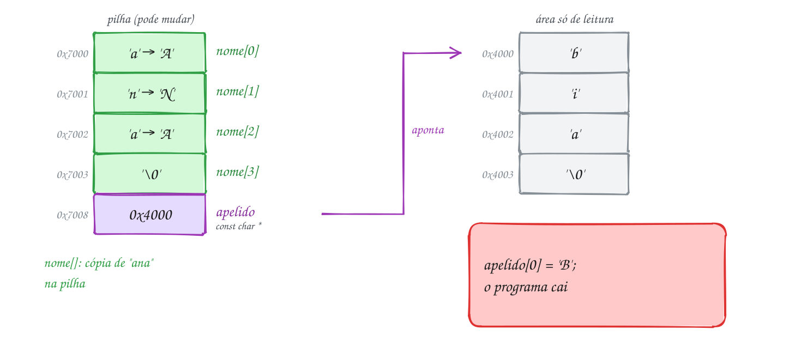</p>

No código, o ponteiro `p` percorre `nome` até o `'\0'`, trocando cada letra:

```c
#include <stdio.h>
#include <ctype.h>

int main(void) {
    char nome[] = "ana";          // vetor de 4 chars, CÓPIA do literal: pode mudar
    const char *apelido = "bia";  // ponteiro para o literal: só leitura

    // passa o nome para maiúsculas andando com um ponteiro até o '\0'
    for (char *p = nome; *p != '\0'; p++) {
        *p = (char)toupper((unsigned char)*p);
    }
    printf("Crachá: %s (%s)\n", nome, apelido);

    printf("sizeof nome = %zu, sizeof apelido = %zu\n", sizeof nome, sizeof apelido);

    apelido = "bibi";  // vale: o ponteiro passa a apontar para outro literal
    // nome = "joana"; // não compila: vetor não pode receber outro endereço
    printf("Novo apelido: %s\n", apelido);
    return 0;
}
// Saída:
// Crachá: ANA (bia)
// sizeof nome = 4, sizeof apelido = 8
// Novo apelido: bibi
```

O `(unsigned char)` antes do `toupper` evita um problema com letras
acentuadas: os bytes delas podem ser negativos num `char` (assunto 0040). O `(char)` na
frente só deixa explícito que o resultado volta a caber num `char`.

Repara no fluxograma: é o laço clássico de string. A pergunta não é "já
andei `n` posições?", e sim "a gaveta atual é o `'\0'`?":

<p align="center">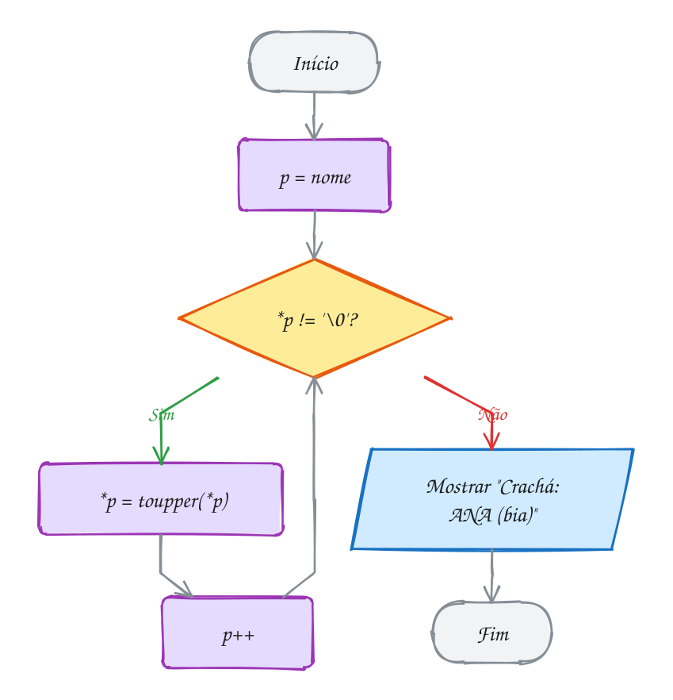</p>

> [!WARNING]
> `char *s = "ola"; s[0] = 'O';` compila **sem aviso** no C,
> e derruba o programa quando roda: `segmentation fault`, porque a página do
> literal é só de leitura. Você vai ver muito `char *p = "..."` em material
> antigo. Escreva `const char *` sempre que apontar para literal, ou use
> `char s[] = "..."` quando precisar mudar o texto. Outro clássico:
> comparar strings com `==` compara **endereços**, não letras. Para o
> conteúdo, `strcmp`.

> [!TIP]
> **Por dentro do C:** os literais vão para uma seção do executável chamada
> `.rodata` (*read-only data*). Quando o programa carrega, o sistema marca
> essas páginas da memória como só leitura, e o processador barra qualquer
> escrita. Como o literal não muda, o compilador pode guardar **uma cópia
> só** para literais iguais: dois `"bia"` no programa podem ter o mesmo
> endereço. E o vetor de ponteiros do A096 (`const char *dias[]`) gasta 8
> bytes por nome mais o texto de cada um, enquanto a matriz `char[4][10]`
> reserva 10 bytes por linha mesmo para "sexta".

> [!NOTE]
> **Pergunta para você:** com `char a[] = "oi";` e `const char *b = "oi";`,
> quanto valem `sizeof a`, `sizeof b`, `strlen(a)` e `strlen(b)`? E `a == b`
> é verdadeiro?

### Hora de praticar

Os arquivos ficam em [`0048-ponteiros-e-strings/`](0048-ponteiros-e-strings/). Os comandos funcionam de qualquer pasta do terminal. Nos exemplos, rode, mude, quebre e rode de novo. Nos exercícios, a resposta vai dentro do próprio arquivo. ★☆☆ é aquecimento, ★★☆ pede raciocínio e ★★★ é desafio.

**Exemplo A095 · A string começa onde o ponteiro aponta**

```c
#include <stdio.h>

int main(void) {
    char endereco[] = "Rua das Flores, 120 - Centro"; // vetor: dá para mudar

    // procura a vírgula andando com um ponteiro
    char *virgula = endereco;
    while (*virgula != '\0' && *virgula != ',') {
        virgula++;
    }

    // para o printf, a string vai do endereço recebido até o primeiro '\0'
    printf("Inteiro:     %s\n", endereco);
    printf("Da vírgula:  %s\n", virgula);
    printf("Depois dela: %s\n", virgula + 2); // pula a vírgula e o espaço

    // um '\0' no meio corta a string: o resto continua na memória
    if (*virgula == ',') {
        *virgula = '\0';
    }
    printf("Só a rua:    %s\n", endereco);
    printf("O resto:     %s\n", virgula + 2); // a parte de trás segue lá

    // com const char * apontando para um literal, isso não seria permitido:
    // const char *fixo = "Rua A, 10"; fixo[5] = '\0'; não compila
    return 0;
}
// Saída:
// Inteiro:     Rua das Flores, 120 - Centro
// Da vírgula:  , 120 - Centro
// Depois dela: 120 - Centro
// Só a rua:    Rua das Flores
// O resto:     120 - Centro
```

```bash
~/LPEDC/rodar 06-ponteiros/0048-ponteiros-e-strings/A095.c
```

**Exemplo A096 · Os dias da feira**

```c
#include <stdio.h>

// conta os caracteres andando até o '\0': o mesmo que strlen faz
size_t comprimento(const char *s) {
    const char *p = s;
    while (*p != '\0') {
        p++;
    }
    return (size_t)(p - s); // distância entre o fim e o começo
}

int main(void) {
    // vetor de ponteiros: cada posição guarda o endereço de um literal
    const char *dias[] = {"segunda", "quarta", "sexta", "domingo"};
    // matriz: cada linha reserva espaço para o maior nome
    char tabela[4][10] = {"segunda", "quarta", "sexta", "domingo"};

    for (int i = 0; i < 4; i++) {
        printf("%-8s %zu letras\n", dias[i], comprimento(dias[i]));
    }
    printf("vetor de ponteiros: %zu bytes (só os endereços)\n", sizeof dias);
    printf("matriz de chars:    %zu bytes (4 linhas de 10)\n", sizeof tabela);
    printf("dias[2][0] = %c, tabela[2][0] = %c\n", dias[2][0], tabela[2][0]);
    return 0;
}
// Saída:
// segunda  7 letras
// quarta   6 letras
// sexta    5 letras
// domingo  7 letras
// vetor de ponteiros: 32 bytes (só os endereços)
// matriz de chars:    40 bytes (4 linhas de 10)
// dias[2][0] = s, tabela[2][0] = s
```

```bash
~/LPEDC/rodar 06-ponteiros/0048-ponteiros-e-strings/A096.c
```

#### Exercícios

**Exercício E283** · ★☆☆

Escreva int conta_vogais(const char *s), que conta as vogais (minúsculas
a, e, i, o, u) de uma frase andando com um ponteiro até o '\0', sem usar
índice nem strlen. Teste com a frase do outdoor:


```text
"promocao de pastel na feira de domingo"
```


```text
Saída esperada:
Vogais: 15
```

**Dicas:**

1. while (*s != '\0') { ...; s++; } (s é uma cópia do endereço: pode
   andar à vontade).
2. Para testar a vogal, um switch com os cinco case serve bem.
3. Resposta esperada: 15.

```bash
~/LPEDC/rodar 06-ponteiros/0048-ponteiros-e-strings/E283.c
```

**Exercício E284** · ★☆☆

Complete o programa, que já tem as declarações


```text
char cidade[] = "Natal";
const char *estado = "RN";
```


1. O programa já mostra sizeof e strlen das duas.
2. Troque a primeira letra da cidade por 'n', faça estado apontar para

```text
 "PB" e mostre "cidade - estado".
```

3. Volte a cidade para "Natal" com strcpy e mostre de novo.
4. Tente também cidade = "Recife"; e estado[0] = 'r'; rode, leia o erro

```text
 do compilador e apague essas duas linhas.
```


```text
Saída esperada:
sizeof cidade = 6, sizeof estado = 8
strlen cidade = 5, strlen estado = 2
natal - PB
Natal - PB
```

**Dicas:**

1. Vetor: o sizeof inclui o '\0'. Ponteiro: o sizeof é o de um endereço.
2. Vetor não recebe outro endereço com =; const char * não deixa
   escrever no texto apontado. Os dois erros aparecem na compilação.
3. Resposta esperada: a saída acima. "Natal" cabe nos 6 bytes de cidade
   (5 letras + '\0'); "Recife" não caberia.

```bash
~/LPEDC/rodar 06-ponteiros/0048-ponteiros-e-strings/E284.c
```

**Exercício E285** · ★★☆

Escreva sua própria versão do strcpy com ponteiros:


```text
void copia(char *destino, const char *origem)
```


Copie caractere por caractere, INCLUINDO o '\0' do fim. Depois escreva
uma segunda versão, copia_classica, com o laço clássico de corpo vazio:


```text
while ((*destino++ = *origem++) != '\0') {
}
```


Teste as duas copiando "Porto Alegre" para um vetor char destino[20] e
mostrando o resultado e o strlen dele. Para provar que a clássica copia
o '\0', antes de chamá-la encha destino com "XXXXXXXXXXXXXXXXXXX" (19 X)
e confira que nenhum X sobra no fim.


```text
Saída esperada:
copia:          Porto Alegre (12 letras)
copia_classica: Porto Alegre (12 letras)
```

**Dicas:**

1. Versão simples: enquanto *origem != '\0', copie e avance os dois; no
   fim, *destino = '\0'.
2. Na versão clássica, a atribuição copia, o valor dela é o caractere
   copiado e o ++ avança os dois ponteiros depois. O laço para logo
   depois de copiar o '\0', porque o valor copiado é 0.
3. Resposta esperada: as duas linhas acima, com 12 letras; se sobrasse
   X, o '\0' não teria sido copiado.

```bash
~/LPEDC/rodar 06-ponteiros/0048-ponteiros-e-strings/E285.c
```

**Exercício E286** · ★★☆

O programa da portaria tem TRÊS erros de propósito. Ele deveria mostrar:


```text
Ola, visitante!
Bloco: B
Mesmo morador
```


Rode com o rodar, leia o relatório e conserte os três erros, um de cada
vez, rodando de novo até a saída ficar igual à esperada.

**Dicas:**

1. Onde mora o texto "ola, visitante!"? Dá para escrever lá?
2. Um ponteiro que nunca recebeu endereço não é lugar para strcpy.
3. == entre duas strings compara o quê?
4. Resposta esperada: (1) saudacao aponta para um literal (só leitura):
   declare char saudacao[] = "ola, visitante!"; (2) bloco é um ponteiro
   sem alvo: use char bloco[2]; (3) morador == "ana" compara endereços:
   use strcmp(morador, "ana") == 0.

```bash
~/LPEDC/rodar 06-ponteiros/0048-ponteiros-e-strings/E286.c
```

**Exercício E287** · ★★★

Escreva bool palindromo(const char *s), que diz se uma frase é um
palíndromo IGNORANDO os espaços. Use dois ponteiros: um no começo e outro
no último caractere (antes do '\0'), que andam um em direção ao outro,
pulando espaços. Teste com "arara", "socorram me subi no onibus em
marrocos" e "pix caiu".


```text
Saída esperada:
arara: sim
socorram me subi no onibus em marrocos: sim
pix caiu: não
```

**Dicas:**

1. fim = s + strlen(s) - 1. Cuidado com a string vazia.
2. while (ini < fim): se *ini é espaço, ini++ e continue; se *fim é
   espaço, fim-- e continue; se forem diferentes, não é palíndromo.
3. Resposta esperada: sim, sim, não.

```bash
~/LPEDC/rodar 06-ponteiros/0048-ponteiros-e-strings/E287.c
```

**Exercício E288** · ★★★

Escreva sua versão do strstr:


```text
const char *acha(const char *texto, const char *trecho)
```


que devolve o endereço da primeira ocorrência de trecho dentro de texto,
ou NULL se não houver. No main, mostre a posição (com subtração de
ponteiros) e o resto do texto a partir dali.


```text
texto: "o pix caiu na conta"
```


```text
Saída esperada:
"caiu" na posição 6: caiu na conta
"boleto" não aparece
"" na posição 0: o pix caiu na conta
```

**Dicas:**

1. Para cada posição t do texto, compare t[k] com trecho[k] enquanto o
   trecho não acabar e os dois forem iguais.
2. Se chegou ao '\0' do trecho, achou: devolva t. Trecho vazio aparece
   na posição 0.
3. Resposta esperada: posição 6 ("caiu na conta"); "boleto" não aparece;
   o trecho vazio dá posição 0.

```bash
~/LPEDC/rodar 06-ponteiros/0048-ponteiros-e-strings/E288.c
```

---

## 0049 · Ponteiro para ponteiro

Você pergunta ao porteiro onde fica o salão de festas. Ele não sabe, mas
aponta para um quadro de avisos: "o mapa do condomínio está no quadro". No
quadro, o mapa mostra o salão. Você chegou lá em **dois saltos**: porteiro →
quadro → salão.

Um ponteiro é uma variável como outra qualquer: mora numa gaveta e tem
endereço (assunto 0045). Então dá para guardar **o endereço de um
ponteiro** em outra variável. Ela é um **ponteiro para ponteiro**, declarado
com dois asteriscos: `int **pp;` se lê "pp aponta para um `int *`".

Com `int vagas = 40; int *p = &vagas; int **pp = &p;`:

- `pp` guarda o endereço de `p`;
- `*pp` é o próprio `p`, ou seja, o endereço de `vagas`;
- `**pp` é `vagas`: 40. Dois saltos, dois asteriscos.

A regra é contar estrelas: cada `*` na declaração é um nível, e para chegar
no dado você usa o mesmo número de `*`. Dá para fazer `int ***`, mas acima
de dois níveis o código vira charada. Evite.

Para que serve, além de quebra-cabeça? Dois usos que você vai ver o curso
todo:

- **mudar o ponteiro de quem chamou.** Se uma função precisa mudar um `int`
  do `main`, ela recebe `int *` (assunto 0046). Se precisa mudar um `int *`
  do `main`, fazer ele apontar para outro lugar, recebe `int **`. É a mesma
  regra, um nível acima. O A098 escolhe o posto mais barato assim, e as
  listas encadeadas do módulo 11 usam isso para mudar o início da lista;
- **vetor de ponteiros.** `const char *dias[]` (assunto 0048) é um vetor
  cujos elementos são `const char *`. O nome dele decai para o endereço do
  primeiro elemento: um `const char **`. É o tipo do famoso `char **argv`
  (assunto 0069) e da matriz alocada no módulo 07.

Vamos ver na prática. No estacionamento do shopping há 40 vagas. `p` aponta
para `vagas` e `pp` aponta para `p`. Quando entram 2 carros, o programa
atualiza `vagas` sem citar o nome dela, em dois saltos:

<p align="center">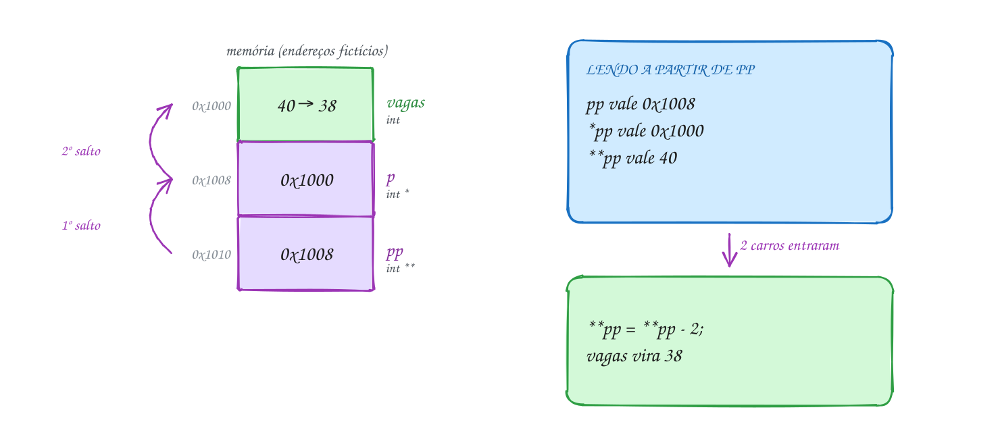</p>

O programa mostra cada nível e confere quem é igual a quem:

```c
#include <stdio.h>

int main(void) {
    int vagas = 40;      // vagas livres no estacionamento do shopping
    int *p = &vagas;     // p guarda o endereço de vagas
    int **pp = &p;       // pp guarda o endereço de p

    printf("&vagas = %p\n", (void *)&vagas);
    printf("p      = %p   (o endereço de vagas)\n", (void *)p);
    printf("&p     = %p\n", (void *)&p);
    printf("pp     = %p   (o endereço de p)\n", (void *)pp);
    printf("*pp    = %p   (o que tem em p)\n", (void *)*pp);
    printf("**pp   = %d\n", **pp);

    **pp = **pp - 2;     // entraram 2 carros: muda vagas em dois saltos
    printf("vagas  = %d\n", vagas);
    return 0;
}
// Saída (os endereços mudam a cada execução):
// &vagas = 0x7fe808c00030
// p      = 0x7fe808c00030   (o endereço de vagas)
// &p     = 0x7fe808c00040
// pp     = 0x7fe808c00040   (o endereço de p)
// *pp    = 0x7fe808c00030   (o que tem em p)
// **pp   = 40
// vagas  = 38
```

Leia os pares: `&vagas` e `p` são iguais; `&p` e `pp` são iguais; `*pp` volta
a ser o endereço de `vagas`.

Repara no fluxograma: não há decisão. Primeiro a corrente é montada, elo
por elo (`vagas`, depois `p`, depois `pp`); depois o `**pp` percorre a
corrente de volta até chegar em `vagas`:

<p align="center">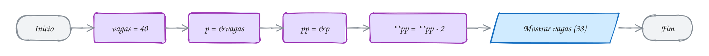</p>

> [!WARNING]
> Estrela a menos é o erro clássico. `*pp = 38;` não muda `vagas`: tenta
> guardar o número 38 **em `p`**, como se fosse um endereço (o compilador
> avisa: `assignment to 'int *' from 'int' makes pointer from integer`).
> Depois disso, `p` aponta para a "gaveta 38" e o próximo `*p` derruba o
> programa. E na função: se ela precisa mudar o seu ponteiro, passe `&posto`
> (um `double **`). Passar `posto` entrega uma cópia, e a função muda só a
> cópia, como o `troca_copias` do assunto 0046.

> [!TIP]
> **Por dentro do C:** cada nível é uma variável de 8 bytes de verdade. Ler
> `**pp` custa duas leituras de memória em sequência: a primeira busca o que
> tem em `pp` (o endereço de `p`), a segunda busca o que tem em `p` (o
> endereço de `vagas`), e só então a terceira traz o 40. O processador não
> consegue adiantar a segunda antes de terminar a primeira. É por isso que
> estruturas cheias de ponteiros (listas, árvores) são mais lentas de
> percorrer que um vetor contíguo, assunto que volta no módulo 10.

> [!NOTE]
> **Pergunta para você:** com `int outra = 5;`, o que muda depois de
> `*pp = &outra;`? Quanto valem `vagas`, `*p` e `**pp`?

### Hora de praticar

Os arquivos ficam em [`0049-ponteiro-para-ponteiro/`](0049-ponteiro-para-ponteiro/). Os comandos funcionam de qualquer pasta do terminal. Nos exemplos, rode, mude, quebre e rode de novo. Nos exercícios, a resposta vai dentro do próprio arquivo. ★☆☆ é aquecimento, ★★☆ pede raciocínio e ★★★ é desafio.

**Exemplo A097 · A lista de chamada termina em NULL**

```c
#include <stdio.h>

// alunos é um const char **: aponta para a primeira casa de um vetor de
// ponteiros. A lista termina numa casa NULL, então nem precisa do tamanho
int conta_com_letra(const char **alunos, char letra) {
    int total = 0;
    for (const char **p = alunos; *p != NULL; p++) { // *p: um nome
        if (**p == letra) {                          // **p: a 1ª letra dele
            total++;
        }
    }
    return total;
}

int main(void) {
    const char *turma[] = {"Bruna", "Caio", "Beto", "Davi", "Bia", NULL};

    for (const char **p = turma; *p != NULL; p++) {
        printf("%-6s começa com %c\n", *p, **p);
    }
    printf("Com B: %d alunos\n", conta_com_letra(turma, 'B'));
    printf("Com Z: %d alunos\n", conta_com_letra(turma, 'Z'));

    // caso de borda: lista vazia, só a marca do fim
    const char *vazia[] = {NULL};
    printf("Lista vazia, com B: %d\n", conta_com_letra(vazia, 'B'));

    // p + 1 anda uma casa do vetor: 8 bytes, o tamanho de um ponteiro
    printf("sizeof turma[0] = %zu\n", sizeof turma[0]);
    return 0;
}
// Saída:
// Bruna  começa com B
// Caio   começa com C
// Beto   começa com B
// Davi   começa com D
// Bia    começa com B
// Com B: 3 alunos
// Com Z: 0 alunos
// Lista vazia, com B: 0
// sizeof turma[0] = 8
```

```bash
~/LPEDC/rodar 06-ponteiros/0049-ponteiro-para-ponteiro/A097.c
```

**Exemplo A098 · O posto mais barato**

```c
#include <stdio.h>

// precisa MUDAR o ponteiro de quem chamou: recebe o endereço dele (double **)
void mais_barato(double *precos, int n, double **escolhido) {
    *escolhido = &precos[0];
    for (int i = 1; i < n; i++) {
        if (precos[i] < **escolhido) {
            *escolhido = &precos[i]; // o ponteiro do main passa a apontar aqui
        }
    }
}

int main(void) {
    double precos[4] = {5.89, 5.74, 5.92, 5.79}; // gasolina em 4 postos
    double *posto = NULL;

    mais_barato(precos, 4, &posto);  // &posto: o endereço do ponteiro
    if (posto != NULL) {
        printf("Mais barato: posto %td, R$ %.2f\n", posto - precos, *posto);
        *posto -= 0.10;              // cupom do app: 10 centavos a menos
    }
    for (int i = 0; i < 4; i++) {
        printf("%.2f ", precos[i]);
    }
    printf("\n");
    return 0;
}
// Saída:
// Mais barato: posto 1, R$ 5.74
// 5.89 5.64 5.92 5.79
```

```bash
~/LPEDC/rodar 06-ponteiros/0049-ponteiro-para-ponteiro/A098.c
```

#### Exercícios

**Exercício E289** · ★☆☆

A turma do cursinho é identificada por uma letra. Declare


```text
char turma = 'k';
char *p = &turma;
char **pp = &p;
```


Mostre a letra de três jeitos (pela variável, por p e por pp). Depois,
usando só pp, troque a letra para 'K' e mostre a variável turma.


```text
Saída esperada:
k k k
Agora: K
```

**Dicas:**

1. Pela variável: turma; por p: *p; por pp: **pp.
2. Para escrever: **pp = 'K';
3. Resposta esperada: "k k k" e "Agora: K".

```bash
~/LPEDC/rodar 06-ponteiros/0049-ponteiro-para-ponteiro/E289.c
```

**Exercício E290** · ★☆☆

Complete o programa, que já monta o gaveteiro:


```text
int x = 5;
int *p = &x;
int **pp = &p;
```


1. Mostre, um por linha, x, p, *p, pp, *pp, **pp, &pp e &*pp (use %d

```text
 para int e %p com (void *) para endereço). Três linhas já estão lá.
```

2. Mostre com %d o resultado de quatro comparações: *pp == p,

```text
 *pp == &x, &*pp == pp e **pp == x.
```

3. Usando só pp, mude x para 8 e mostre x.


```text
Saída esperada (os endereços mudam a cada execução):
x    = 5
p    = 0x7f...30
*p   = 5
pp   = 0x7f...40
*pp  = 0x7f...30
**pp = 5
&pp  = 0x7f...60
&*pp = 0x7f...40
comparações: 1 1 1 1
x agora = 8
```

**Dicas:**

1. Cada * dá um salto: vai até o endereço e pega o que tem lá.
2. & e * se anulam: &*pp é o mesmo que pp.
3. Resposta esperada: p e *pp mostram o mesmo endereço (o de x); pp e
   &*pp, o de p; &pp é um terceiro endereço. As quatro comparações dão 1
   e **pp = 8; faz x valer 8 ("x agora = 8").

```bash
~/LPEDC/rodar 06-ponteiros/0049-ponteiro-para-ponteiro/E290.c
```

**Exercício E291** · ★★☆

A loja recebe mensagens como "Pedido numero 4521 confirmado". Escreva


```text
void pula_ate_digito(const char **s)
```


que avança o ponteiro DE QUEM CHAMOU até o primeiro dígito do texto (ou
até o '\0', se não houver dígito). No main:


```text
const char *msg = "Pedido numero 4521 confirmado";
pula_ate_digito(&msg);
printf("%s\n", msg);
```


```text
Saída esperada:
4521 confirmado
```


Teste também com "Sem numero": deve sair uma linha vazia.

**Dicas:**

1. Dentro da função, *s é o ponteiro do main e **s é o caractere para
   onde ele aponta.
2. while (**s != '\0' && !isdigit((unsigned char)**s)) { (*s)++; }
   Os parênteses em (*s)++ são obrigatórios.
3. Resposta esperada: "4521 confirmado" e uma linha vazia.

```bash
~/LPEDC/rodar 06-ponteiros/0049-ponteiro-para-ponteiro/E291.c
```

**Exercício E292** · ★★☆

A função aponta_maior deveria fazer o ponteiro do main apontar para o
maior lance do leilão. Mas o programa tem um erro de propósito: o
ponteiro do main continua NULL e o programa cai. Rode e veja o relatório
do AddressSanitizer. Conserte a função e a chamada para que o ponteiro do
main receba o endereço do maior lance, e rode de novo.


```text
Saída esperada:
Maior lance: R$ 870
```

**Dicas:**

1. A função recebe int *res: uma CÓPIA do ponteiro do main.
2. Para mudar um int * de quem chamou, a função precisa de um int **.
3. Resposta esperada: res = ... muda só a cópia local; o vencedor do
   main continua NULL e *vencedor desreferencia NULL (SEGV). Conserto:
   void aponta_maior(int *a, int *b, int **res) com *res = ...; e a
   chamada aponta_maior(&lance1, &lance2, &vencedor).

```bash
~/LPEDC/rodar 06-ponteiros/0049-ponteiro-para-ponteiro/E292.c
```

**Exercício E293** · ★★★

Quatro jurados deram notas a uma escola de samba, cada uma numa variável:


```text
int j1 = 9, j2 = 7, j3 = 10, j4 = 8;
```


Você quer mostrar as notas em ordem crescente SEM mexer nas variáveis.
Monte um vetor de ponteiros int *ordem[4] = {&j1, &j2, &j3, &j4}; e
ordene OS PONTEIROS pelo valor apontado. Para trocar dois ponteiros do
vetor, escreva


```text
void troca_ptr(int **a, int **b)
```


No fim, mostre as notas pela ordem e depois as variáveis originais.


```text
Saída esperada:
Em ordem: 7 8 9 10
Originais: j1=9 j2=7 j3=10 j4=8
```

**Dicas:**

1. Para ordenar, use dois for (i e j > i): se *ordem[j] < *ordem[i],
   troca_ptr(&ordem[i], &ordem[j]).
2. Dentro de troca_ptr, o temporário é um int *: int *tmp = *a;
3. Resposta esperada: 7 8 9 10, e as variáveis continuam 9, 7, 10, 8.
   Só os endereços mudaram de lugar no vetor.

```bash
~/LPEDC/rodar 06-ponteiros/0049-ponteiro-para-ponteiro/E293.c
```

**Exercício E294** · ★★★

Transforme o trecho abaixo num teste de mesa que o próprio programa
imprime. Cole o código no main e, depois das declarações e depois de
CADA uma das sete linhas, mostre a linha executada e os valores de x, y,
*p, *q e **pp naquele momento.


```text
int x = 1, y = 2;
int *p = &x, *q = &y;
int **pp = &p;
```


```text
**pp = 10;
*pp = q;
**pp += 5;
pp = &q;
*q = **pp * 2;
*pp = &x;
*p = 3;
```


```text
Saída esperada:
início          x=1 y=2 *p=1 *q=2 **pp=1
**pp = 10       x=10 y=2 *p=10 *q=2 **pp=10
*pp = q         x=10 y=2 *p=2 *q=2 **pp=2
...
*p = 3          x=10 y=3 *p=3 *q=10 **pp=10
```

**Dicas:**

1. *pp = algo muda o ponteiro para onde pp aponta (p no começo, q
   depois de pp = &q). Depois de *pp = q, p aponta para y.
2. Escreva o printf uma vez, teste, e copie para as outras linhas,
   mudando só o texto.
3. Resposta esperada: oito linhas; a última é
   "*p = 3  x=10 y=3 *p=3 *q=10 **pp=10" e a do *pp = &x é
   "*pp = &x  x=10 y=14 *p=14 *q=10 **pp=10".

```bash
~/LPEDC/rodar 06-ponteiros/0049-ponteiro-para-ponteiro/E294.c
```

---

## 0050 · Ponteiro para função

Às vezes uma função precisa receber **outra função**. Uma rotina que filtra
temperaturas não sabe qual teste você quer (acima de 30? abaixo de 0?); uma
rotina que ordena não sabe em que ordem você quer os itens. Você entrega o
teste pronto, e a rotina só o chama. Em C, o mecanismo para isso é um ponteiro.

O código de uma função também mora na memória: numa região própria, a área
de **código**. Então a função tem endereço, e o nome dela, sozinho, sem os
parênteses, **já é esse endereço** (como o nome de um vetor). Uma variável
que guarda esse endereço é um **ponteiro para função**.

A declaração assusta na primeira vez:

```text
int (*criterio)(int);
```

Leia de dentro para fora: `criterio` é um ponteiro (`*criterio`) para uma
função que recebe um `int` e devolve `int`. Os parênteses em volta de
`*criterio` são obrigatórios: sem eles, `int *criterio(int);` declara uma
função que devolve `int *`. O ponteiro só aceita funções com essa mesma
assinatura.

Para usar: `criterio = eh_calor;` guarda o endereço (sem `&` e sem
parênteses) e `criterio(31)` chama a função apontada. A forma
`(*criterio)(31)` também vale e aparece em código antigo.

A graça está em passar o ponteiro como **parâmetro**. A função que recebe
fica genérica, e quem chama decide o comportamento. A função passada se
chama **callback**. A biblioteca padrão usa isso no **`qsort`**
(`stdlib.h`), que ordena qualquer vetor desde que você entregue a função
que compara dois elementos (o A100 ordena a tabela do campeonato com ele).

Vamos ver na prática. As máximas da semana estão num vetor. A função
`conta_se` percorre o vetor e conta quantos dias passam num critério que
ela não conhece: recebe o endereço da função `eh_calor` (ou `eh_frio`) e
chama por ele:

<p align="center">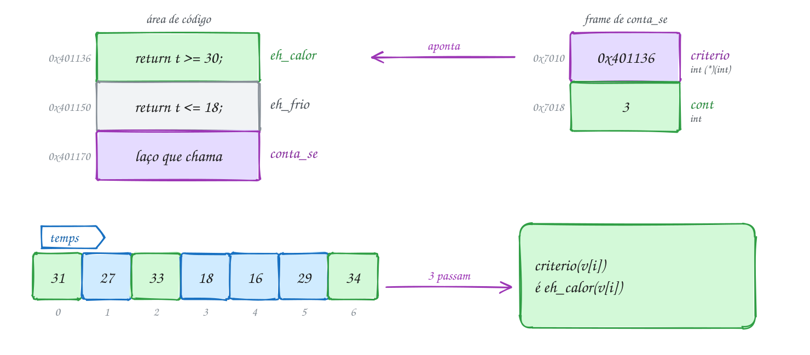</p>

No código, a mesma `conta_se` responde duas perguntas diferentes:

```c
#include <stdio.h>

int eh_calor(int t) { return t >= 30; }
int eh_frio(int t) { return t <= 18; }

// conta quantos elementos passam no teste; QUAL teste, quem chama decide
int conta_se(const int *v, int n, int (*criterio)(int)) {
    int cont = 0;
    for (int i = 0; i < n; i++) {
        if (criterio(v[i])) { // chama a função para onde criterio aponta
            cont++;
        }
    }
    return cont;
}

int main(void) {
    int temps[7] = {31, 27, 33, 18, 16, 29, 34}; // máximas da semana

    int (*regra)(int) = eh_calor;  // o nome da função já é o endereço dela
    printf("Dias de calor: %d\n", conta_se(temps, 7, regra));
    printf("Dias de frio:  %d\n", conta_se(temps, 7, eh_frio));
    return 0;
}
// Saída:
// Dias de calor: 3
// Dias de frio:  2
```

Repara no fluxograma: é o laço contador do assunto 0025. A única novidade
está no losango: a pergunta não é fixa, ela é a função que chegou pelo
parâmetro:

<p align="center">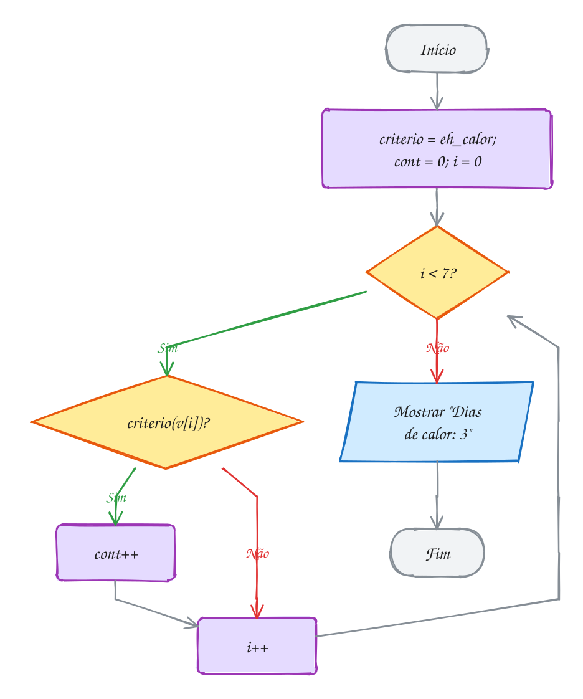</p>

O `qsort` segue a mesma ideia, com uma diferença: como ele ordena vetores
de qualquer tipo, a função de comparação recebe os endereços de dois
elementos como `const void *` ("endereço de qualquer coisa"). Você converte
para o tipo certo e devolve um número negativo (a vem antes), zero (tanto
faz) ou positivo (b vem antes). O `void *` é o assunto 0051; por enquanto,
copie o molde do A100.

> [!WARNING]
> A comparação "esperta" `return *(const int *)a - *(const int *)b;`
> aparece em todo canto e tem um bug: com números grandes de sinais
> opostos, a subtração estoura o `int` (assunto 0003), o sinal vira e a
> ordem sai errada. O `rodar` acusa `signed integer overflow`. Use
> `return (x > y) - (x < y);`, que só compara e nunca estoura. E não
> esqueça os parênteses da declaração: `int *f(int)` é uma função, não um
> ponteiro.

> [!TIP]
> **Por dentro do C:** chamar por ponteiro é uma **chamada indireta**: o
> processador lê o endereço na variável e salta para ele, em vez de saltar
> para um endereço fixo gravado na instrução. Custa pouco, mas impede o
> compilador de copiar o corpo da função no lugar da chamada (*inline*).
> Por isso um laço com `criterio(v[i])` pode ser mais lento que um com
> `v[i] >= 30` escrito direto. Outro detalhe: o C não garante que um
> endereço de função caiba num `void *`, então `printf("%p", ...)` com
> função gera aviso no `-pedantic`. Ponteiro de dado e ponteiro de função
> são coisas separadas.

> [!NOTE]
> **Pergunta para você:** como contar os dias "agradáveis" (de 19 a 29
> graus) sem mexer em `conta_se`? E quantos são no vetor `temps`?

### Hora de praticar

Os arquivos ficam em [`0050-ponteiro-para-funcao/`](0050-ponteiro-para-funcao/). Os comandos funcionam de qualquer pasta do terminal. Nos exemplos, rode, mude, quebre e rode de novo. Nos exercícios, a resposta vai dentro do próprio arquivo. ★☆☆ é aquecimento, ★★☆ pede raciocínio e ★★★ é desafio.

**Exemplo A099 · A promoção do dia é um parâmetro**

```c
#include <stdio.h>

double menos_dez(double preco) { return preco * 0.90; }
double leve_tres(double preco) { return preco * 2.0 / 3.0; } // leve 3, pague 2

// aplica a regra em cada preço; regra NULL quer dizer "sem promoção hoje"
void aplica(double *precos, int n, double (*regra)(double)) {
    if (regra == NULL) {
        return; // chamar um ponteiro NULL derrubaria o programa
    }
    for (int i = 0; i < n; i++) {
        precos[i] = regra(precos[i]);
    }
}

void mostra(const char *titulo, const double *precos, int n) {
    printf("%-10s", titulo);
    for (int i = 0; i < n; i++) {
        printf(" %6.2f", precos[i]);
    }
    printf("\n");
}

int main(void) {
    double cesta[3] = {30.00, 12.90, 8.40}; // café, biscoito, leite
    int dia = 3;                             // 1 = domingo ... 7 = sábado

    double (*regra)(double) = NULL; // o ponteiro escolhe a regra em tempo de execução
    if (dia == 3) {
        regra = menos_dez;          // terça: 10% em tudo
    } else if (dia == 5) {
        regra = leve_tres;
    }

    mostra("Antes:", cesta, 3);
    aplica(cesta, 3, regra);
    mostra("Depois:", cesta, 3);

    // ponteiros para função também se comparam com ==
    printf("Regra de hoje: %s\n", regra == menos_dez ? "10% off" : "outra");

    aplica(cesta, 3, NULL); // nenhuma regra: nada muda
    mostra("Sem regra:", cesta, 3);
    return 0;
}
// Saída:
// Antes:      30.00  12.90   8.40
// Depois:     27.00  11.61   7.56
// Regra de hoje: 10% off
// Sem regra:  27.00  11.61   7.56
```

```bash
~/LPEDC/rodar 06-ponteiros/0050-ponteiro-para-funcao/A099.c
```

**Exemplo A100 · A tabela do campeonato com qsort**

```c
#include <stdio.h>
#include <stdlib.h>

// o qsort entrega ENDEREÇOS de dois elementos como const void *; a função
// converte para o tipo certo e diz quem vem antes (negativo, zero, positivo)
int crescente(const void *a, const void *b) {
    int x = *(const int *)a;
    int y = *(const int *)b;
    return (x > y) - (x < y);
}

int decrescente(const void *a, const void *b) {
    return crescente(b, a); // inverte a ordem dos argumentos
}

void mostra(const char *titulo, const int *v, int n) {
    printf("%s:", titulo);
    for (int i = 0; i < n; i++) {
        printf(" %d", v[i]);
    }
    printf("\n");
}

int main(void) {
    int pontos[6] = {45, 61, 38, 52, 57, 40};

    qsort(pontos, 6, sizeof pontos[0], crescente);
    mostra("Crescente", pontos, 6);

    qsort(pontos, 6, sizeof pontos[0], decrescente); // mesmo qsort, outra regra
    mostra("Tabela", pontos, 6);
    return 0;
}
// Saída:
// Crescente: 38 40 45 52 57 61
// Tabela: 61 57 52 45 40 38
```

```bash
~/LPEDC/rodar 06-ponteiros/0050-ponteiro-para-funcao/A100.c
```

#### Exercícios

**Exercício E295** · ★☆☆

O app de clima converte temperaturas nos dois sentidos. Escreva


```text
double c_para_f(double c)   // f = c * 9 / 5 + 32
double f_para_c(double f)   // c = (f - 32) * 5 / 9
```


Declare um ponteiro double (*conv)(double); faça ele apontar para
c_para_f e converta 30; depois aponte para f_para_c e converta 86.


```text
Saída esperada:
30.0 -> 86.0
86.0 -> 30.0
```

**Dicas:**

1. conv = c_para_f; (sem & e sem parênteses).
2. Chame como se fosse a função: conv(30).
3. Resposta esperada: 86.0 e 30.0.

```bash
~/LPEDC/rodar 06-ponteiros/0050-ponteiro-para-funcao/E295.c
```

**Exercício E296** · ★☆☆

Escreva o "forEach" do C:


```text
void para_cada(int *v, int n, void (*acao)(int *))
```


que chama acao para o endereço de cada elemento. Escreva também duas
ações: void dobra(int *x) e void mostra(int *x) (mostra imprime o valor e
um espaço). No main, com int brindes[4] = {1, 2, 3, 4};, mostre, dobre e
mostre de novo, sempre via para_cada.


```text
Saída esperada:
1 2 3 4
2 4 6 8
```

**Dicas:**

1. Dentro de para_cada: for (...) acao(&v[i]); (ou acao(v + i)).
2. A ação recebe int * porque dobra precisa mudar o elemento.
3. Resposta esperada: "1 2 3 4" e "2 4 6 8".

```bash
~/LPEDC/rodar 06-ponteiros/0050-ponteiro-para-funcao/E296.c
```

**Exercício E297** · ★★☆

Faça uma calculadora SEM switch. Escreva soma, subtrai, multiplica e
divide, todas com a assinatura int f(int, int), e guarde-as num vetor de
ponteiros para função:


```text
int (*ops[4])(int, int) = {soma, subtrai, multiplica, divide};
```


Leia uma conta no formato "12 * 4" com scanf("%d %c %d", ...), ache o
índice do operador na string "+-*/" e chame ops[indice](a, b). Operador
desconhecido mostra "Operador inválido"; divisão por zero mostra
"Divisão por zero".


```text
Digite a conta: 12 * 4
Resultado: 48
```

**Dicas:**

1. Para achar o índice: percorra "+-*/" com um for até achar o char.
2. Confira o retorno do scanf (tem que ser 3).
3. Resposta esperada: 12 * 4 dá 48; 20 / 3 dá 6 (divisão inteira);
   7 % 2 dá "Operador inválido".

```bash
~/LPEDC/rodar 06-ponteiros/0050-ponteiro-para-funcao/E297.c
```

**Exercício E298** · ★★☆

Ordene as frutas da barraca em ordem alfabética com qsort:


```text
const char *frutas[] = {"manga", "abacaxi", "caju", "banana", "acerola"};
```


```text
Saída esperada:
abacaxi acerola banana caju manga
```


O detalhe: cada elemento do vetor é um const char *. O qsort entrega à
comparação o ENDEREÇO de um elemento, ou seja, o endereço de um
const char * (um ponteiro para ponteiro, assunto 0049).

**Dicas:**

1. Dentro da comparação: const char *x = *(const char * const *)a;
2. Depois é só return strcmp(x, y);
3. O tamanho de cada elemento é sizeof frutas[0] (8 bytes: um ponteiro).
4. Resposta esperada: abacaxi acerola banana caju manga.

```bash
~/LPEDC/rodar 06-ponteiros/0050-ponteiro-para-funcao/E298.c
```

**Exercício E299** · ★★★

Este programa ordena os saldos de uma corretora (em centavos) e tem um
bug de propósito na função de comparação. Ele compila sem aviso, mas o
rodar acusa um erro quando roda, e a ordem pode sair errada. Rode, leia a
mensagem "runtime error" e conserte a função compara. Rode de novo: a
mensagem tem que sumir e a ordem tem que ficar certa.


```text
Saída esperada:
-2000000000 5 2000000000
```

**Dicas:**

1. Quanto dá 2000000000 - (-2000000000)? Cabe num int (assunto 0003)?
2. A comparação só precisa devolver o SINAL certo, não a diferença.
3. Resposta esperada: "-2000000000 5 2000000000", sem runtime error. A
   subtração estoura o int (signed integer
   overflow): o resultado "dá a volta" e fica negativo, dizendo que
   2000000000 vem antes de -2000000000. Conserto:
   return (x > y) - (x < y);

```bash
~/LPEDC/rodar 06-ponteiros/0050-ponteiro-para-funcao/E299.c
```

**Exercício E300** · ★★★

Você tem R$ 50 no bolso e quer ver os produtos da lojinha do mais perto
desse valor ao mais longe. Ordene com qsort pela distância até 50
(|preço - 50|); em caso de empate, o mais barato vem antes.


```text
int precos[7] = {47, 58, 50, 39, 53, 61, 44};
```


A função de comparação só recebe dois endereços, então guarde o alvo
numa variável global static. Depois de mostrar a ordem para 50, mude o
alvo para 60 (você achou mais R$ 10), ordene de novo e mostre.


```text
Saída esperada:
50 47 53 44 58 39 61
61 58 53 50 47 44 39
```

**Dicas:**

1. Calcule as distâncias de x e y com abs() (stdlib.h).
2. Compare primeiro as distâncias; se forem iguais, compare os preços.
3. Resposta esperada: 50 47 53 44 58 39 61 e, com alvo 60,
   61 58 53 50 47 44 39 (61 está a 1 do alvo, 58 está a 2).

```bash
~/LPEDC/rodar 06-ponteiros/0050-ponteiro-para-funcao/E300.c
```

---

## 0051 · void * e cast

Nos Correios, o funcionário carimba e despacha qualquer caixa sem abrir:
para ele, uma caixa tem um endereço de entrega e um peso, e só. Quem
recebe é que abre e sabe se dentro tem um livro ou um tênis. O **`void *`**
é essa caixa fechada.

Um `void *` é um **ponteiro genérico**: guarda o endereço de qualquer dado
(`int`, `double`, vetor, outro ponteiro), mas não diz o que mora lá. Antes
de usar o dado, você precisa dizer o tipo.

Duas regras saem disso:

- **conversão livre.** Em C, qualquer ponteiro de dado vira `void *` e
  volta sem cast: `void *p = &senha;` e `int *q = p;` compilam limpo;
- **não dá para desreferenciar.** `*p` com `p` do tipo `void *` não
  compila: o compilador não sabe quantos bytes ler nem como interpretar.
  Converta antes, com um **cast**: `*(int *)p`. Pelo mesmo motivo, `p + 1`
  não existe no C padrão (o `gcc` aceita como extensão, e o `-pedantic`
  avisa).

O cast é uma promessa sua: o compilador acredita. Se
você disser `(double *)` para um endereço onde mora um `int`, ele lê 8
bytes onde só tinha 4 e mostra lixo. Ninguém confere por você.

Para que serve uma caixa fechada? Para escrever funções que trabalham com
**qualquer tipo**. Elas recebem `void *` e, como não sabem o tamanho do
dado, recebem também o tamanho em bytes. Lá dentro, tratam a memória como
uma fileira de bytes, com um `unsigned char *`, o único tipo que o C deixa
olhar byte a byte qualquer objeto. É assim que funcionam `memcpy`,
`memset`, o `qsort` (assunto 0050) e o `malloc` do módulo 07, que devolve
`void *` porque não sabe o que você vai guardar.

Vamos ver na prática. A `troca` do assunto 0046 só troca `int`. A
`troca_generica` recebe dois endereços sem tipo e o tamanho: com 4, troca
duas senhas `int`; com 8, troca dois preços `double`. Byte a byte, ela nem
sabe o que está trocando:

<p align="center">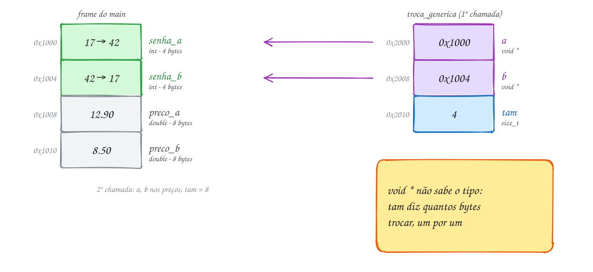</p>

O código chama a mesma função para os dois tipos:

```c
#include <stdio.h>

// void *: "endereço de qualquer coisa". Como a função não sabe o tipo,
// recebe o tamanho em bytes e troca byte a byte.
void troca_generica(void *a, void *b, size_t tam) {
    unsigned char *x = a; // void * vira outro ponteiro sem cast, em C
    unsigned char *y = b;
    for (size_t i = 0; i < tam; i++) {
        unsigned char tmp = x[i];
        x[i] = y[i];
        y[i] = tmp;
    }
}

int main(void) {
    int senha_a = 17, senha_b = 42;               // senhas do atendimento
    double preco_a = 12.90, preco_b = 8.50;       // preços na etiqueta

    troca_generica(&senha_a, &senha_b, sizeof senha_a);   // troca 4 bytes
    troca_generica(&preco_a, &preco_b, sizeof preco_a);   // troca 8 bytes

    printf("senhas: %d e %d\n", senha_a, senha_b);
    printf("preços: %.2f e %.2f\n", preco_a, preco_b);
    return 0;
}
// Saída:
// senhas: 42 e 17
// preços: 8.50 e 12.90
```

Repare que `&senha_a` (um `int *`) entra no parâmetro `void *` sem cast
nenhum, e que o `sizeof` na chamada é quem conta à função o tamanho do
dado.

Repara no fluxograma: a função não pergunta "que tipo é?", porque não tem
como saber. Ela só pergunta "ainda tem byte para trocar?":

<p align="center">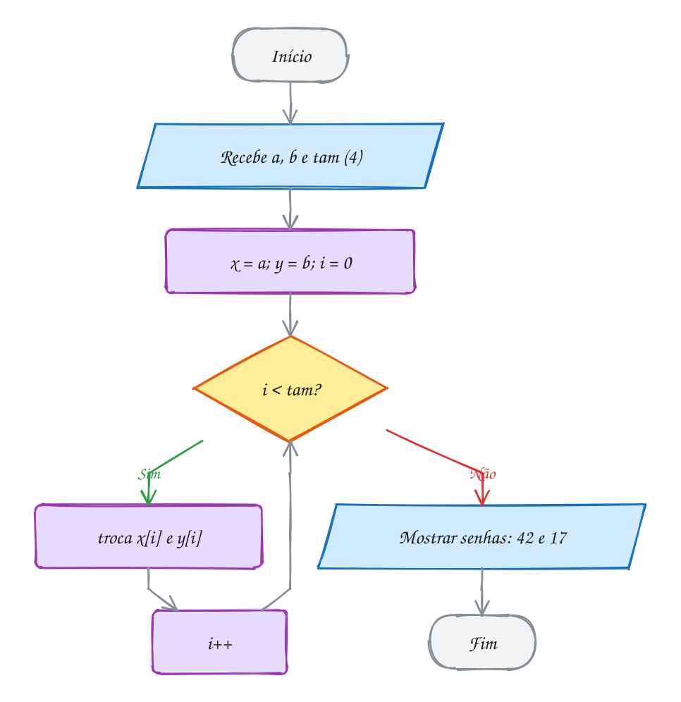</p>

> [!WARNING]
> O `void *` desliga a conferência de tipos. `troca_generica(&senha_a,
> &preco_a, sizeof preco_a)` compila sem aviso e troca 8 bytes a partir de
> uma variável que só tem 4: o AddressSanitizer acusa
> `stack-buffer-overflow`. O mesmo vale para o cast errado na leitura:
> `*(double *)p` com `p` apontando para um `int`. Com `void *`, você é o
> responsável por lembrar o tipo e o tamanho de verdade. Use `sizeof` da
> própria variável, nunca um número digitado à mão.

> [!TIP]
> **Por dentro do C:** o A102 usa um `const unsigned char *` para espiar os
> bytes de qualquer variável. O `int` 1000 (`0x000003E8`) aparece como `e8 03
> 00 00`: o byte menos significativo vem primeiro, no endereço menor. É o
> **little-endian** dos processadores Intel, AMD e ARM. O `-1` vira `ff ff ff
> ff` (complemento de dois) e a string `"Pix"` vira `50 69 78 00`, os
> códigos ASCII com o `'\0'` no fim. Olhar a memória como bytes só é
> garantido com tipos `char`; ler um `float` através de um `int *`, por
> exemplo, quebra uma regra do C (a de *strict aliasing*) e o otimizador
> pode gerar código errado.

> [!NOTE]
> **Pergunta para você:** por que `troca_generica` precisa do parâmetro
> `tam` e a `troca` do assunto 0046 não precisa? O que aconteceria se você
> passasse `sizeof(int)` para trocar dois `double`?

### Hora de praticar

Os arquivos ficam em [`0051-void-generico/`](0051-void-generico/). Os comandos funcionam de qualquer pasta do terminal. Nos exemplos, rode, mude, quebre e rode de novo. Nos exercícios, a resposta vai dentro do próprio arquivo. ★☆☆ é aquecimento, ★★☆ pede raciocínio e ★★★ é desafio.

**Exemplo A101 · O backup que copia qualquer coisa**

```c
#include <stdio.h>
#include <string.h>

// copia tam bytes de origem para destino; const void *: só lê a origem.
// Devolve destino, como o memcpy da string.h
void *copia_bytes(void *destino, const void *origem, size_t tam) {
    unsigned char *d = destino;
    const unsigned char *o = origem;
    for (size_t i = 0; i < tam; i++) {
        d[i] = o[i];
    }
    return destino;
}

int main(void) {
    int itens = 7;
    double total = 184.35;
    int qtd[4] = {2, 1, 6, 3}; // quantidade de cada produto no carrinho

    int itens_bkp;
    double total_bkp;
    int qtd_bkp[4];

    copia_bytes(&itens_bkp, &itens, sizeof itens);  // 4 bytes
    copia_bytes(&total_bkp, &total, sizeof total);  // 8 bytes
    copia_bytes(qtd_bkp, qtd, sizeof qtd);          // o vetor inteiro: 16 bytes

    qtd[2] = 0; // o cliente tirou os 6 iogurtes; o backup não muda
    printf("itens: %d, total: %.2f\n", itens_bkp, total_bkp);
    printf("qtd agora:  %d %d %d %d\n", qtd[0], qtd[1], qtd[2], qtd[3]);
    printf("qtd backup: %d %d %d %d\n", qtd_bkp[0], qtd_bkp[1], qtd_bkp[2], qtd_bkp[3]);

    // o void * devolvido precisa voltar ao tipo certo para ser lido
    int *volta = copia_bytes(qtd, qtd_bkp, sizeof qtd); // restaura o carrinho
    printf("restaurado: %d (o mesmo endereço de qtd? %d)\n", volta[2], volta == qtd);

    // a biblioteca já tem essa função pronta
    memcpy(&itens, &itens_bkp, sizeof itens);
    printf("memcpy: %d\n", itens);
    return 0;
}
// Saída:
// itens: 7, total: 184.35
// qtd agora:  2 1 0 3
// qtd backup: 2 1 6 3
// restaurado: 6 (o mesmo endereço de qtd? 1)
// memcpy: 7
```

```bash
~/LPEDC/rodar 06-ponteiros/0051-void-generico/A101.c
```

**Exemplo A102 · Os bytes de verdade**

```c
#include <stdio.h>

// mostra, em hexa, os bytes que estão a partir de um endereço qualquer
void mostra_bytes(const char *rotulo, const void *p, size_t tam) {
    const unsigned char *byte = p;
    printf("%-10s", rotulo);
    for (size_t i = 0; i < tam; i++) {
        printf(" %02x", byte[i]);
    }
    printf("\n");
}

int main(void) {
    int mil = 1000;              // 1000 = 0x000003E8
    int menos_um = -1;
    char pix[] = "Pix";
    double meio = 0.5;

    mostra_bytes("1000", &mil, sizeof mil);
    mostra_bytes("-1", &menos_um, sizeof menos_um);
    mostra_bytes("\"Pix\"", pix, sizeof pix);
    mostra_bytes("0.5", &meio, sizeof meio);

    void *qualquer = &mil;
    printf("de volta: %d\n", *(int *)qualquer); // para ler, converta para o tipo certo
    return 0;
}
// Saída (num PC Intel/AMD ou ARM, que são little-endian):
// 1000       e8 03 00 00
// -1         ff ff ff ff
// "Pix"      50 69 78 00
// 0.5        00 00 00 00 00 00 e0 3f
// de volta: 1000
```

```bash
~/LPEDC/rodar 06-ponteiros/0051-void-generico/A102.c
```

#### Exercícios

**Exercício E301** · ★☆☆

No cadastro do plano de saúde, declare int idade = 41 e double altura =
1.83. Use UM único ponteiro void *p: primeiro aponte para idade e mostre
o valor; depois aponte para altura e mostre o valor.


```text
Saída esperada:
idade: 41
altura: 1.83
```

**Dicas:**

1. p = &idade; não precisa de cast (qualquer ponteiro vira void *).
2. Para ler, converta: *(int *)p e *(double *)p.
3. Resposta esperada: 41 e 1.83.

```bash
~/LPEDC/rodar 06-ponteiros/0051-void-generico/E301.c
```

**Exercício E302** · ★☆☆

O programa abaixo tem quatro linhas, de L1 a L4, e cada comentário diz o
que a linha QUERIA fazer. A L2 está certa e já roda. As outras três
estão comentadas porque têm erro: descomente UMA de cada vez, rode com o
rodar, leia a mensagem e conserte a linha para que ela faça o que
promete. No fim, as quatro devem ficar descomentadas e rodando limpo.


```text
Saída esperada:
L1: 300
L2: 450
L3: 450
L4: 450.0
pontos[0] = 300
```

**Dicas:**

1. void * não diz quantos bytes ler nem quantos bytes andar: antes de
   usar * ou +, converta para o tipo certo. Em C, void * vira int * sem
   cast.
2. L1 não compila ("invalid use of void expression"). L3 só passa com
   aviso do -pedantic: aritmética com void * é extensão do gcc, que anda
   1 byte. L4 lê 8 bytes onde há um int de 4 (o sanitizer reclama).
3. Resposta esperada: a saída acima, com L1: *(int *)p; L2 igual;
   L3: p = (int *)p + 1; L4: (double)*(int *)p com %.1f.

```bash
~/LPEDC/rodar 06-ponteiros/0051-void-generico/E302.c
```

**Exercício E303** · ★★☆

Escreva sua versão do memset para zerar qualquer coisa:


```text
void zera(void *p, size_t tam)
```


que coloca 0 em cada um dos tam bytes a partir de p. Teste zerando o
vetor de placar int gols[5] = {2, 1, 3, 0, 4} e a variável double saldo
= 99.90. Mostre antes e depois.


```text
Saída esperada:
antes: 2 1 3 0 4 | 99.90
depois: 0 0 0 0 0 | 0.00
```

**Dicas:**

1. Dentro, unsigned char *b = p; e um for de 0 a tam.
2. Para o vetor inteiro, o tamanho é sizeof gols (20 bytes); para o
   double, sizeof saldo.
3. Resposta esperada: tudo vira 0 (todos os bytes 0 dão 0 tanto no int
   quanto no double).

```bash
~/LPEDC/rodar 06-ponteiros/0051-void-generico/E303.c
```

**Exercício E304** · ★★☆

Escreva uma função que mostra vetores de QUALQUER tipo:


```text
void mostra_vetor(const void *v, size_t n, size_t tam,
                  void (*mostra)(const void *))
```


Ela calcula o endereço de cada elemento (o i-ésimo começa i * tam bytes
depois do início) e chama mostra com esse endereço. Escreva também
mostra_int e mostra_double. Teste com


```text
int senhas[4] = {101, 102, 103, 104};
double notas[3] = {7.5, 9.25, 6.0};
```


```text
Saída esperada:
101 102 103 104
7.50 9.25 6.00
```

**Dicas:**

1. Converta o início para const unsigned char * e some i * tam: isso anda
   byte a byte.
2. mostra_int faz printf("%d ", *(const int *)p);
3. Resposta esperada: as duas linhas acima.

```bash
~/LPEDC/rodar 06-ponteiros/0051-void-generico/E304.c
```

**Exercício E305** · ★★★

Escreva uma busca linear genérica:


```text
int busca(const void *v, size_t n, size_t tam, const void *alvo,
          int (*igual)(const void *, const void *))
```


que devolve o índice do primeiro elemento igual ao alvo (segundo a função
igual) ou -1. Use com três vetores:


```text
int cods[5] = {310, 422, 518, 422, 907};          alvo 422
double precos[4] = {9.90, 15.50, 4.25, 30.00};    alvo 4.25
const char *nomes[3] = {"ana", "bia", "caio"};    alvo "caio"
```


```text
Saída esperada:
422 no índice 1
4.25 no índice 2
caio no índice 2
bruno no índice -1
```

**Dicas:**

1. O endereço do i-ésimo: (const unsigned char *)v + i * tam.
2. Para as strings, cada elemento é um const char *: a função igual
   recebe endereços de const char * e usa strcmp.
3. Resposta esperada: índices 1, 2, 2 e -1 (bruno não está).

```bash
~/LPEDC/rodar 06-ponteiros/0051-void-generico/E305.c
```

**Exercício E306** · ★★★

Escreva a função


```text
void mostra_bytes(const char *rotulo, const void *p, size_t tam)
```


que imprime, em hexa, os tam bytes que estão a partir de p (como no
A102). No main, com


```text
short curto = 258;
unsigned int cor = 0x0A0B0C0D;
int negativo = -2;
char sigla[] = "BR";
```


mostre os bytes das quatro variáveis. Depois, usando um unsigned char *
apontado para cada variável, troque SÓ o primeiro byte de cor para 0xFF
e SÓ o primeiro byte de negativo para 0x00, e mostre os dois valores
inteiros (cor com printf("%#010x"), negativo com %d).


```text
Saída esperada (num PC Intel/AMD ou ARM, que são little-endian):
curto: 02 01
cor: 0d 0c 0b 0a
negativo: fe ff ff ff
sigla: 42 52 00
cor depois: 0x0a0b0cff
negativo depois: -256
```

**Dicas:**

1. Escreva cada número em hexa com todos os bytes (short tem 2, int 4):
   258 é 0x0102 e -2 é 0xFFFFFFFE. No little-endian, o primeiro byte na
   memória é o MENOS significativo.
2. unsigned char *b = (unsigned char *)&cor; b[0] = 0xFF; muda só o byte
   de baixo.
3. Resposta esperada: a saída acima. negativo vira 0xFFFFFF00, que em
   complemento de dois é -256.

```bash
~/LPEDC/rodar 06-ponteiros/0051-void-generico/E306.c
```

---

## 0052 · Juntando tudo: o ranking da feira

Sábado, fim de feira. A associação dos feirantes quer o ranking das
barracas pelo faturamento do dia e o nome da campeã. Mas tem uma condição:
a planilha original não pode mudar de ordem, porque outras contas usam a
posição de cada barraca.

O problema junta tudo o que o módulo ensinou:

- **vetores paralelos** com o nome, a quantidade e o preço de cada barraca,
  e o faturamento calculado (`fat[i] = qtd[i] * preco[i]`);
- um **vetor de ponteiros** `const double *ordem[N]`, em que cada posição
  aponta para um elemento de `fat` (assunto 0049). É ele que vai ser
  ordenado, não `fat`. Como num índice de livro: as páginas não mudam de
  lugar, só a lista que aponta para elas;
- o **`qsort`** com uma função de comparação (assunto 0050). Cada elemento
  de `ordem` é um `const double *`, então o `qsort` entrega o endereço de um
  ponteiro, que chega como `const void *` (assunto 0051). Dois saltos
  depois, `**`, chega-se ao faturamento;
- **subtração de ponteiros** (assunto 0047): `ordem[i] - fat` diz em que
  posição de `fat` aquele ponteiro aponta, e a mesma posição dá o nome em
  `produtos`;
- **passagem por referência** (assunto 0046): a função `resumo` devolve
  duas respostas, o total (num `double *`) e **onde** está o maior (num
  `const double **`, porque ela precisa mudar um ponteiro do `main`).

Vamos ver na prática. São 4 barracas: tomate (30 × R$ 6,50), alface (45 ×
R$ 3,00), queijo (8 × R$ 32,00) e pastel (60 × R$ 9,00). Depois do `qsort`,
`ordem[0]` aponta para o pastel e `ordem[3]` para a alface, enquanto `fat`
continua na ordem de sempre:

<p align="center">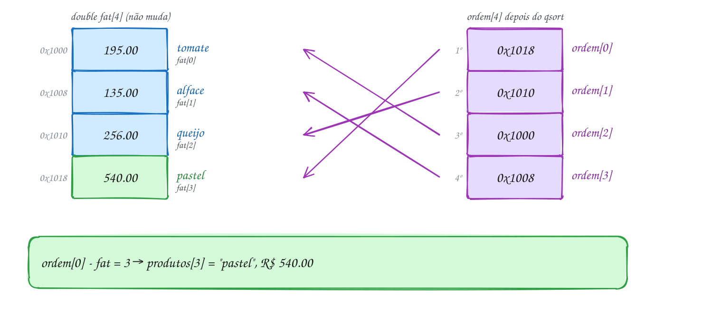</p>

O programa completo:

```c
#include <stdio.h>
#include <stdlib.h>

#define N 4

// devolve dois resultados: o total (double *) e ONDE está o maior (const double **)
void resumo(const double *v, int n, double *total, const double **maior) {
    *total = 0;
    *maior = v;
    for (const double *p = v; p < v + n; p++) {
        *total += *p;
        if (*p > **maior) {
            *maior = p;
        }
    }
}

// cada elemento de ordem é um const double *; o qsort entrega o ENDEREÇO dele
int maior_primeiro(const void *a, const void *b) {
    double x = **(const double * const *)a;
    double y = **(const double * const *)b;
    return (x < y) - (x > y); // decrescente
}

int main(void) {
    const char *produtos[N] = {"tomate", "alface", "queijo", "pastel"};
    int qtd[N] = {30, 45, 8, 60};
    double preco[N] = {6.50, 3.00, 32.00, 9.00};
    double fat[N];               // faturamento de cada barraca
    const double *ordem[N];      // ponteiros para fat: é isso que vamos ordenar

    for (int i = 0; i < N; i++) {
        fat[i] = qtd[i] * preco[i];
        ordem[i] = &fat[i];
    }
    qsort(ordem, N, sizeof ordem[0], maior_primeiro); // fat continua intacto

    for (int i = 0; i < N; i++) {
        int k = (int)(ordem[i] - fat); // ponteiro - início = índice do produto
        printf("%dº %-7s R$ %7.2f\n", i + 1, produtos[k], *ordem[i]);
    }

    double total;
    const double *maior;
    resumo(fat, N, &total, &maior);
    printf("Total: R$ %.2f  Campeão: %s\n", total, produtos[maior - fat]);
    return 0;
}
// Saída:
// 1º pastel  R$  540.00
// 2º queijo  R$  256.00
// 3º tomate  R$  195.00
// 4º alface  R$  135.00
// Total: R$ 1126.00  Campeão: pastel
```

O `const double * const *` da comparação se lê da direita para a esquerda:
ponteiro para um ponteiro constante para um `double` constante. Os dois
`const` só prometem que a comparação não muda nada, nem o ponteiro do
vetor, nem o faturamento.

Repara no fluxograma: três fases. Calcula e aponta, ordena os ponteiros,
percorre a ordem nova traduzindo cada ponteiro para um índice:

<p align="center">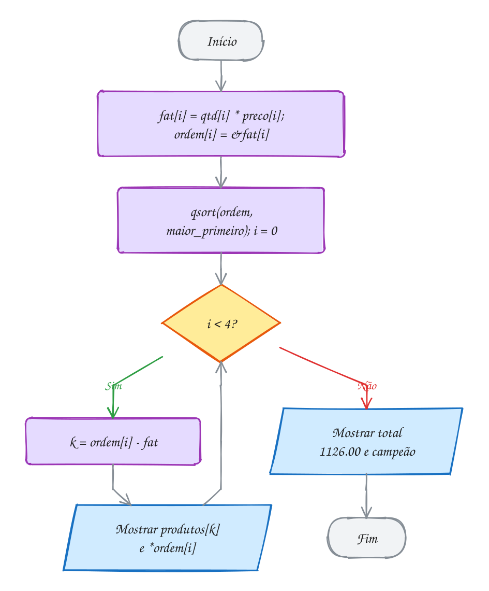</p>

> [!WARNING]
> Ordenar `ordem` com `sizeof(double)` no terceiro argumento do `qsort`
> parece certo e está errado: os elementos de `ordem` são **ponteiros**
> (8 bytes), não `double`. Aqui os dois têm 8 bytes e o erro fica
> escondido, mas com `int *ordem[]` e `sizeof(int)` o `qsort` embaralharia
> meio ponteiro com meio ponteiro. Escreva sempre `sizeof ordem[0]`: o
> tamanho do elemento do próprio vetor que você está ordenando.

> [!TIP]
> **Por dentro do C:** ordenar ponteiros em vez dos dados é um truque
> clássico. Cada troca do `qsort` move 8 bytes, não importa o tamanho do
> dado apontado. Com structs de 200 bytes (módulo 08), a diferença é
> enorme. E várias "visões" ordenadas podem conviver: um vetor de ponteiros
> por faturamento, outro por nome, todos apontando para os mesmos dados. É
> a ideia por trás dos índices de um banco de dados.

> [!NOTE]
> **Pergunta para você:** se você trocar `maior_primeiro` por uma função que
> ordena pelo **nome** do produto, o que muda no programa? A comparação
> ainda recebe endereços de `const double *`; como ela chegaria ao nome?

### Hora de praticar

Os arquivos ficam em [`0052-juntando-tudo/`](0052-juntando-tudo/). Os comandos funcionam de qualquer pasta do terminal. Nos exemplos, rode, mude, quebre e rode de novo. Nos exercícios, a resposta vai dentro do próprio arquivo. ★☆☆ é aquecimento, ★★☆ pede raciocínio e ★★★ é desafio.

**Exemplo A103 · A lista de compras picada no lugar**

```c
#include <stdio.h>
#include <stdlib.h>
#include <string.h>

// corta a linha nos ';' (trocando cada um por '\0') e guarda em campos o
// endereço do começo de cada pedaço. Nada é copiado: os pedaços continuam
// morando dentro de linha. Devolve quantos pedaços achou
int separa(char *linha, char **campos, int max) {
    int n = 0;
    char *p = linha;
    while (n < max) {
        campos[n++] = p;            // um pedaço começa aqui
        while (*p != '\0' && *p != ';') {
            p++;
        }
        if (*p == '\0') {
            break;                  // fim da linha: último pedaço
        }
        *p = '\0';                  // corta
        p++;                        // o próximo começa depois do corte
    }
    return n;
}

// o qsort entrega o endereço de cada char *: um char ** disfarçado de void *
int alfabetica(const void *a, const void *b) {
    const char *x = *(char *const *)a;
    const char *y = *(char *const *)b;
    return strcmp(x, y);
}

int main(void) {
    char linha[] = "cafe;arroz;leite;banana;feijao";
    char *itens[10];

    int n = separa(linha, itens, 10);
    qsort(itens, (size_t)n, sizeof itens[0], alfabetica); // ordena os ponteiros

    for (int i = 0; i < n; i++) {
        // a posição na linha original sai da distância entre ponteiros
        printf("%d. %-7s (byte %2td da linha)\n", i + 1, itens[i], itens[i] - linha);
    }

    // a linha agora tem '\0' no lugar dos ';': o printf para no primeiro
    printf("linha depois: %s\n", linha);

    // caso de borda: um campo vazio entre dois ';' também vira um pedaço
    char outra[] = "pao;;ovos";
    n = separa(outra, itens, 10);
    printf("%d pedaços, o do meio tem %zu letras\n", n, strlen(itens[1]));
    return 0;
}
// Saída:
// 1. arroz   (byte  5 da linha)
// 2. banana  (byte 17 da linha)
// 3. cafe    (byte  0 da linha)
// 4. feijao  (byte 24 da linha)
// 5. leite   (byte 11 da linha)
// linha depois: cafe
// 3 pedaços, o do meio tem 0 letras
```

```bash
~/LPEDC/rodar 06-ponteiros/0052-juntando-tudo/A103.c
```

**Exemplo A104 · O caixa eletrônico de comandos**

```c
#include <stdio.h>
#include <string.h>

int deposita(int *saldo, int valor) {
    *saldo += valor;
    return 1;
}

int saca(int *saldo, int valor) {
    if (valor > *saldo) {
        return 0; // negado: o saldo não muda
    }
    *saldo -= valor;
    return 1;
}

// tabela de comandos: o nome na posição i corresponde à função na posição i
const char *nomes[] = {"deposito", "saque"};
int (*acoes[])(int *, int) = {deposita, saca};

int indice_do(const char *comando) {
    for (int i = 0; i < 2; i++) {
        if (strcmp(nomes[i], comando) == 0) {
            return i;
        }
    }
    return -1;
}

int main(void) {
    int saldo = 100;
    const char *roteiro[] = {"deposito", "saque", "pix", "saque"};
    int valores[] = {200, 50, 30, 500};

    for (int i = 0; i < 4; i++) {
        int k = indice_do(roteiro[i]);
        if (k < 0) {
            printf("%-9s %4d: comando desconhecido\n", roteiro[i], valores[i]);
        } else if (acoes[k](&saldo, valores[i])) { // chama pela tabela
            printf("%-9s %4d: ok, saldo %d\n", roteiro[i], valores[i], saldo);
        } else {
            printf("%-9s %4d: negado, saldo %d\n", roteiro[i], valores[i], saldo);
        }
    }
    return 0;
}
// Saída:
// deposito   200: ok, saldo 300
// saque       50: ok, saldo 250
// pix         30: comando desconhecido
// saque      500: negado, saldo 250
```

```bash
~/LPEDC/rodar 06-ponteiros/0052-juntando-tudo/A104.c
```

#### Exercícios

**Exercício E307** · ★☆☆

O caixa da padaria precisa separar reais e centavos para imprimir o
cupom. Escreva


```text
void separa(double valor, int *reais, int *centavos)
```


e teste com 37.85, 0.99 e 19.99.


```text
Saída esperada:
R$ 37.85 = 37 reais e 85 centavos
R$ 0.99 = 0 reais e 99 centavos
R$ 19.99 = 19 reais e 99 centavos
```

**Dicas:**

1. Converta tudo para centavos primeiro: long total = lround(valor * 100);
   (math.h). Para ver por que não usar um cast direto, mostre também
   (int)(19.99 * 100).
2. Depois, *reais = total / 100 e *centavos = total % 100.
3. Resposta esperada: as três linhas acima. Com cast direto, 19.99 * 100
   vira 1998.9999... e o cast corta para 98 centavos.

```bash
~/LPEDC/rodar 06-ponteiros/0052-juntando-tudo/E307.c
```

**Exercício E308** · ★☆☆

Estenda o programa abaixo para ele imprimir o próprio teste de mesa.
Escreva a função


```text
void estado(const char *rotulo, const int *v, const int *p, const char *s)
```


que mostra o rótulo, os 4 valores de v, em que índice de v o ponteiro p
está (use p - v) e a string s. Chame estado antes da primeira linha e
depois de cada uma das quatro linhas do meio.


```text
Saída esperada:
antes     5 10 15 20 | p em v[3] | feira
troca     20 10 15 5 | p em v[3] | feira
*c = 'E'  20 10 15 5 | p em v[3] | fEira
p--       20 10 15 5 | p em v[2] | fEira
*p += ... 20 10 25 5 | p em v[2] | fEira
20 10 25 5 | fEira | r
```

**Dicas:**

1. p começa em v[3]; troca(&v[0], p) troca o primeiro com o último.
2. c aponta para s[1]; c + 2 é s[3]. p - v dá um ptrdiff_t: mostre com
   %td.
3. Resposta esperada: as seis linhas acima; a última é a do printf que
   já está no programa.

```bash
~/LPEDC/rodar 06-ponteiros/0052-juntando-tudo/E308.c
```

**Exercício E309** · ★★☆

Três corredores terminaram a prova com os tempos (em minutos) guardados
em variáveis soltas: ana = 31, bia = 7, caio = 19. Escreva


```text
void ordena3(int *a, int *b, int *c)
```


que deixa os três valores em ordem crescente (a o menor, c o maior)
usando só a função troca do assunto 0046, chamada no máximo 3 vezes.
Teste com várias ordens.


```text
Saída esperada:
7 19 31
```

**Dicas:**

1. Compare a com b, depois a com c (agora a é o menor), depois b com c.
2. Cada comparação que achar a ordem errada chama troca com os
   ponteiros que você já recebeu (sem &: eles já são endereços).
3. Resposta esperada: 7 19 31, para qualquer ordem de entrada.

```bash
~/LPEDC/rodar 06-ponteiros/0052-juntando-tudo/E309.c
```

**Exercício E310** · ★★☆

O mapa do jogo de viagem lista as capitais pelo tamanho do nome (do mais
curto ao mais comprido); empates ficam em ordem alfabética. Ordene com
qsort:


```text
const char *capitais[] = {"Natal", "Rio Branco", "Recife", "Palmas",
                          "Maceio", "Salvador", "Teresina", "Aracaju"};
```


```text
Saída esperada:
Natal Maceio Palmas Recife Aracaju Salvador Teresina Rio Branco
```

**Dicas:**

1. A comparação recebe endereços de const char *: pegue as strings com
   *(const char * const *)a.
2. Compare strlen primeiro; se forem iguais, devolva strcmp.
3. Cuidado: strlen devolve size_t (sem sinal). Não subtraia: compare com
   < e >.
4. Resposta esperada: a linha acima.

```bash
~/LPEDC/rodar 06-ponteiros/0052-juntando-tudo/E310.c
```

**Exercício E311** · ★★★

O programa do mercadinho tem TRÊS erros de memória de propósito, um de
cada assunto do módulo. Ele deveria mostrar:


```text
Mercadinho: total 125, desconto 15%
```


Rode com o rodar, leia os avisos e os relatórios e conserte um erro de
cada vez, rodando de novo, até a saída ficar igual à esperada e o rodar
não reclamar de nada.

**Dicas:**

1. Uma variável local some quando a função termina. O endereço dela
   vale alguma coisa depois disso?
2. Quantos elementos o laço visita?
3. Para onde aponta loja? Dá para escrever lá?
4. Resposta esperada: (1) maior_desconto devolve o endereço de uma local
   (aviso "function returns address of local variable"): devolva o
   valor, int maior_desconto(void); (2) o laço vai até
   p <= precos + 3 e lê depois do fim: use p < precos + 3; (3) loja
   aponta para um literal (só leitura): declare char loja[] =
   "mercadinho".

```bash
~/LPEDC/rodar 06-ponteiros/0052-juntando-tudo/E311.c
```

**Exercício E312** · ★★★

Escreva um "máximo" genérico, que serve para vetores de qualquer tipo:


```text
void *maximo(void *v, size_t n, size_t tam,
             int (*cmp)(const void *, const void *))
```


que devolve o ENDEREÇO do maior elemento (o primeiro, em caso de empate)
segundo a comparação cmp, ou NULL se n for 0. Teste com


```text
int pontos[5] = {12, 47, 33, 47, 5};
const char *frutas[4] = {"uva", "maca", "laranja", "abacate"};
```


usando três comparações: inteiros, ordem alfabética (strcmp) e tamanho
do nome. Mostre o valor e o índice (subtraindo ponteiros). Depois, use o
endereço devolvido para zerar o maior inteiro dentro do vetor.


```text
Saída esperada:
maior pontuação: 47 (índice 1)
última no alfabeto: uva (índice 0)
nome mais comprido: laranja (índice 2)
depois de zerar: 12 0 33 47 5
```

**Dicas:**

1. Ande pelo vetor com const unsigned char *: o i-ésimo está em
   base + i * tam. Guarde o endereço do maior até agora.
2. Para as frutas, cada elemento é um const char *: o resultado de
   maximo é, na verdade, um const char ** (converta para usar).
3. Para o índice: (const int *)m - pontos.
4. Resposta esperada: as quatro linhas acima.

```bash
~/LPEDC/rodar 06-ponteiros/0052-juntando-tudo/E312.c
```

---

## Desafios do módulo

Problemas extras, misturando os assuntos do módulo. Resolva num arquivo seu
e rode com o `rodar`.

**1. O gaveteiro de três níveis.** Desenhe a memória para
`int x = 7; int *p = &x; int **pp = &p; **pp = 9; *pp = NULL;` com
endereços fictícios (`x` em `0x100`, `p` em `0x108`, `pp` em `0x110`).
Quanto valem `x`, `p` e `pp` no fim? O que acontece se a próxima linha for
`printf("%d", *p);`?

<details><summary>Resposta</summary>

`x` vale **9**, `p` vale **NULL** (a linha `*pp = NULL` mudou o ponteiro `p`,
não o `x`) e `pp` continua guardando **`0x108`**, o endereço de `p`. O
`printf` desreferencia `NULL` e o programa cai (*segmentation fault*). Desenhe sempre o que cada `*` atravessa.

</details>

**2. Minutos de academia.** Escreva
`void resumo(const int *min, int n, int *total, int *dias_acima, double *media)`
que recebe os minutos de treino da semana `{45, 0, 60, 30, 75, 0, 50}` e
devolve o total, quantos dias passaram de 40 minutos e a média dos dias em
que houve treino.

<details><summary>Resposta</summary>

Total **260**, **4** dias acima de 40 (45, 60, 75, 50) e média **52.0** (260
em 5 dias com treino). Caminho: um laço só, três ponteiros de saída; cuidado
para não dividir por zero se a semana inteira for zero.

</details>

**3. Rotação da escala.** A escala de plantão `{"ana", "bia", "caio", "davi",
"eva"}` está num `const char *escala[5]`. Escreva `void gira(const char **v,
int n)` que move todo mundo uma posição para a esquerda (o primeiro vai para
o fim), trocando só ponteiros. Gire duas vezes.

<details><summary>Resposta</summary>

Depois de duas rotações: **caio davi eva ana bia**. Guarde `v[0]` num `const
char *tmp`, ande de `i = 0` a `n - 2` fazendo `v[i] = v[i + 1]` e termine
com `v[n - 1] = tmp`. Nenhum caractere é copiado: só endereços.

</details>

**4. O meu strcat.** Escreva `char *junta(char *destino, const char
*origem)` só com ponteiros: ande até o `'\0'` do destino e copie a origem dali
em diante. Devolva `destino`. Teste com `char cidade[30] = "Campina";` e
`" Grande"`. O que acontece se o vetor tiver só 10 posições?

<details><summary>Resposta</summary>

Mostra **"Campina Grande"** (14 letras + `'\0'` = 15 bytes). Com `char
cidade[10]`, a cópia passa do fim e o AddressSanitizer acusa
`stack-buffer-overflow`. A função não tem como saber o tamanho do destino:
é por isso que existe `strncat`, e por isso quem chama precisa garantir o
espaço.

</details>

**5. Palavras de uma frase.** Escreva `int conta_palavras(const char *s)`
andando com ponteiro: uma palavra começa quando o caractere atual não é
espaço e o anterior era espaço (ou é o começo). Teste com
`"  pix   caiu na   conta "`.

<details><summary>Resposta</summary>

**4** palavras. Guarde um "estava em espaço?" (começando verdadeiro); a cada
caractere não espaço com a marca ligada, conte e desligue a marca; a cada
espaço, ligue de novo. Espaços repetidos e nas pontas não atrapalham.

</details>

**6. O laço que se encontra no meio.** Rode o trecho abaixo dentro de um
`main` e acrescente, dentro do laço, um `printf` que mostre a cada volta os
índices de `p` e `q` (`p - v` e `q - v`, com `%td`) e o vetor inteiro.
Depois troque a condição para `p <= q` e veja o que muda no `v[2]`.

```c
int v[5] = {1, 2, 3, 4, 5};
int *p = v, *q = v + 4;
while (p < q) {
    *p += *q;
    p++;
    q--;
}
printf("%d %d %d %d %d\n", v[0], v[1], v[2], v[3], v[4]);
```

<details><summary>Resposta</summary>

Duas voltas: `p=0 q=4` (vira **6** 2 3 4 5) e `p=1 q=3` (vira 6 **6** 3 4 5);
aí `p` e `q` se encontram em `v[2]` e o laço para: **6 6 3 4 5**. Com
`p <= q` há uma terceira volta com os dois em `v[2]`, que soma o elemento
com ele mesmo: **6 6 6 4 5**.

</details>

**7. Menu sem switch.** Monte um menu de conversões com um vetor de
ponteiros para função `double (*conv[3])(double)`: km para milhas (÷ 1.609),
kg para libras (× 2.205) e °C para °F. Leia a opção (0, 1 ou 2) e o valor
com `scanf`, valide a opção e chame `conv[op](valor)`. Teste com opção 0 e
10 km.

<details><summary>Resposta</summary>

10 km ≈ **6.21 milhas**. O índice lido vira direto a posição no vetor de
funções. Valide `0 <= op && op < 3` antes de chamar: um índice fora do vetor
"chama" um endereço qualquer, e aí nem o AddressSanitizer salva.

</details>

**8. qsort em dupla.** Os pedidos do restaurante estão em dois vetores
paralelos: `int mesa[6] = {4, 2, 7, 2, 4, 1}` e `int minuto[6] = {12, 5, 3,
9, 1, 20}` (minuto em que o pedido chegou). Mostre os pedidos ordenados por
mesa e, dentro da mesma mesa, por minuto, sem mexer nos vetores originais.

<details><summary>Resposta</summary>

Ordem: mesa 1 (min 20), mesa 2 (min 5), mesa 2 (min 9), mesa 4 (min 1),
mesa 4 (min 12), mesa 7 (min 3). Caminho: um vetor de índices `int
ordem[6] = {0, ..., 5}` e uma comparação que lê os vetores paralelos (que
podem ser `static` globais), ou um vetor de `const int *` para `mesa`, como
no assunto 0052, usando `p - mesa` para achar o minuto.

</details>

**9. Endianness na prática.** Escreva `bool little_endian(void)` que
descobre a ordem dos bytes da máquina olhando o primeiro byte de um `int`
que vale 1 (através de um `unsigned char *`). Depois escreva
`unsigned int inverte_bytes(unsigned int x)` que troca a ordem dos 4 bytes
usando a `troca_generica` do assunto 0051 nos bytes certos.

<details><summary>Resposta</summary>

No seu PC, `little_endian()` dá **verdadeiro**: o primeiro byte do 1 é
`01`. `inverte_bytes(0x0A0B0C0D)` dá **0x0D0C0B0A**: troque o byte 0 com o 3
e o 1 com o 2 (`troca_generica(&b[0], &b[3], 1)` e assim por diante, com `b`
sendo um `unsigned char *` para `x`). É o que as funções de rede (`htonl`)
fazem.

</details>

**10. Busca binária genérica.** Escreva `void *busca_bin(const void *chave,
void *v, size_t n, size_t tam, int (*cmp)(const void *, const void *))` que
faz busca binária num vetor já ordenado de qualquer tipo e devolve o endereço
do elemento ou `NULL`. Teste com `int cods[8] = {3, 8, 15, 21, 30, 42, 57,
60}` procurando 42 e 10, e compare com o `bsearch` da `stdlib.h`, que tem
exatamente essa assinatura.

<details><summary>Resposta</summary>

42 está no **índice 5** (subtraia o ponteiro devolvido de `cods`); 10 dá
**NULL**. O meio fica em `(unsigned char *)v + meio * tam`. Compare
`cmp(chave, meio)`: negativo, procure à esquerda; positivo, à direita; zero,
achou. A busca binária em si é o assunto 0090.

</details>

## Para ler mais

- BACKES, A. *Linguagem C: completa e descomplicada*. Rio de Janeiro: Elsevier, 2013. Cap. 10: ponteiros; cap. 13: ponteiro para função.
- BACKES, A. R. *Linguagem C: descomplicada*. Apostila. Uberlândia: FACOM/UFU. Capítulos de ponteiros e de recursos avançados.
- DEITEL, P. J.; DEITEL, H. M. *C: como programar*. 6. ed. São Paulo: Pearson Prentice Hall, 2011. Cap. 7: ponteiros em C.
- CELES, W.; RANGEL, J. L. *Apostila de estruturas de dados*. Rio de Janeiro: PUC-Rio, 2002. Ponteiros, vetores e ordenação genérica.
- FEOFILOFF, P. *Algoritmos em linguagem C*. Rio de Janeiro: Elsevier, 2009. Apêndice D: endereços e ponteiros.
- LAUREANO, M. *Estrutura de dados com algoritmos e C*. Rio de Janeiro: Brasport, 2008. Cap. 1 e 2: ponteiros e uso de memória.
- ROCHA, A. M. A.; BORGES, A. R. O. S. *Programação, estruturas de dados e algoritmos em C*. Aveiro: Universidade de Aveiro, DETI. Ponteiros e ponteiro para função.
- HARA, C.; ZOLA, W. *Linguagem C: notas de aula*. Curitiba: UFPR, 2008. Ponteiros e passagem por referência.
- KERNIGHAN, B. W.; RITCHIE, D. M. *C: a linguagem de programação padrão ANSI*. Rio de Janeiro: Campus, 1989. Cap. 5: apontadores e vetores.
- CPPREFERENCE. *Pointer declaration*. Disponível em: <https://en.cppreference.com/w/c/language/pointer>.
- CPPREFERENCE. *qsort, qsort_s*. Disponível em: <https://en.cppreference.com/w/c/algorithm/qsort>.
- KERRISK, M. *qsort(3)*: Linux manual page. Disponível em: <https://man7.org/linux/man-pages/man3/qsort.3.html>.
