<!-- Gerado por _gerador. Para mudar este arquivo, edite _gerador/modulos/07-memoria-dinamica/ e rode: cd _gerador && npm run gerar -->

# Módulo 07 · Memória dinâmica

Até aqui, todo vetor do curso tinha tamanho decidido na hora de escrever o
código. `int notas[50]` é uma aposta: se a turma tiver 12 alunos, você
desperdiça; se tiver 51, estoura. Programas de verdade não sabem quantos dados
vão chegar. Este módulo ensina a pedir memória **enquanto o programa roda**, do
tamanho exato, e a devolvê-la quando acabar.

No C, nenhum vetor cresce sozinho e nenhum coletor de lixo apaga o que
ninguém usa. Quem faz as duas coisas é você: decide quanto, quando e por
quanto tempo. Memória esquecida vaza; memória devolvida e usada de novo
corrompe o programa.

O módulo é a ponte para a segunda metade do curso. Toda estrutura de dados que
vem depois (listas, pilhas, filas, árvores, tabelas hash, grafos) é feita de
blocos pedidos ao heap e ligados por ponteiros, com `malloc`, `free` e
`realloc`.

## O que você vai aprender

- as quatro regiões da memória de um programa: **código, dados, heap e pilha**, e quanto tempo vive cada coisa
- pedir e devolver memória com **`malloc`** e **`free`**, sempre conferindo o `NULL`
- **`calloc`** (memória zerada) e **`realloc`**, para fazer um vetor crescer conforme os dados chegam
- montar **matrizes dinâmicas**: bloco único com `i * colunas + j` ou vetor de ponteiros com `m[i][j]`
- reconhecer **vazamento, ponteiro solto, free duplo e estouro**, e caçá-los com o **AddressSanitizer** e o **valgrind**
- juntar tudo num programa com vetores que crescem e strings de tamanho exato, sem deixar nada para trás

## Antes de começar

Você precisa estar à vontade com ponteiros (módulo 06): `&`, `*`, `NULL`,
`a[i] == *(a + i)`, `char *` e `**`. Se `int **m` ainda assusta, releia os
assuntos 0047 e 0049 antes.

Nos diagramas deste módulo, o verde costuma ser o bloco que mora no heap. Ao
rodar os exemplos, apague um `free` de propósito e leia o que o `rodar`
responde. Responda a **Pergunta para você** de cada assunto antes de rodar.

> [!NOTE]
> Neste módulo, muitos exercícios são de **achar o erro**: o arquivo vem com o
> bug de propósito, e o enunciado avisa. Rodar e ler o relatório do
> AddressSanitizer faz parte do exercício. A resolução de cada um roda limpa.

O `rodar` já compila com o **AddressSanitizer**, que vigia a memória enquanto
o programa roda e avisa de vazamentos no fim. Para o assunto 0057, instale
também o **valgrind**:

```bash
sudo pacman -S valgrind        # Arch Linux
sudo apt install valgrind      # Debian / Ubuntu
```

E rode qualquer arquivo com ele assim (sem AddressSanitizer, dentro do
valgrind):

```bash
~/LPEDC/rodar --valgrind 07-memoria-dinamica/0057-erros-de-memoria/A114.c
```

A regra do módulo inteiro cabe numa linha: **todo `malloc` tem um `free`, e
nenhum ponteiro é usado depois dele**.

| # | Assunto | Pasta |
| --- | --- | --- |
| [0053](#0053--pilha-e-heap) | Pilha e heap | [`0053-pilha-e-heap/`](07-memoria-dinamica/0053-pilha-e-heap/) |
| [0054](#0054--malloc-e-free) | malloc e free | [`0054-malloc-free/`](07-memoria-dinamica/0054-malloc-free/) |
| [0055](#0055--calloc-e-realloc) | calloc e realloc | [`0055-calloc-realloc/`](07-memoria-dinamica/0055-calloc-realloc/) |
| [0056](#0056--matriz-dinâmica) | Matriz dinâmica | [`0056-matriz-dinamica/`](07-memoria-dinamica/0056-matriz-dinamica/) |
| [0057](#0057--erros-de-memória) | Erros de memória | [`0057-erros-de-memoria/`](07-memoria-dinamica/0057-erros-de-memoria/) |
| [0058](#0058--juntando-tudo) | Juntando tudo | [`0058-juntando-tudo/`](07-memoria-dinamica/0058-juntando-tudo/) |

---

## 0053 · Pilha e heap

Sexta à noite, restaurante cheio. O garçom anota o pedido da mesa 4 num
bloquinho, arranca a folha e prende a comanda no balcão da cozinha. O
bloquinho volta limpo para o bolso; a comanda fica lá até alguém pagar a conta
e jogá-la fora.

O seu programa faz a mesma coisa com a memória. Tem rascunho que dura só
enquanto uma função trabalha e tem coisa que precisa sobreviver a ela. Até
agora você só usou o primeiro tipo. Para o segundo, existe o **heap**.

Quando o programa roda, o sistema operacional entrega a ele uma faixa de
endereços dividida em quatro regiões:

| Região | O que guarda | Quem cria e quem apaga | Dura |
| --- | --- | --- | --- |
| **código** | as instruções e os literais (`"bom dia"`) | o compilador | o programa todo, só leitura |
| **dados** | globais e `static` | o compilador | o programa todo |
| **heap** | blocos pedidos com `malloc` | **você** pede e **você** devolve | até o `free` |
| **pilha** | locais e parâmetros (os frames) | a chamada e o `return` | enquanto a função roda |

A **pilha** (*stack*) você já conhece do assunto 0031: cada chamada empilha um
**frame** com as locais, cada `return` desempilha. É automática e rapidíssima,
mas tem duas limitações. A primeira: o frame some no `return`, então nada que
mora nele sobrevive à função. A segunda: ela é pequena. No Linux, o padrão é
8 MiB (`ulimit -s` mostra `8192`, em KiB).

O **heap** é um depósito grande, do tamanho da memória livre da máquina. Você
pede um bloco de N bytes, recebe o **endereço** dele e usa como vetor. O bloco
não pertence a função nenhuma: fica vivo até você devolvê-lo com `free`. Por
isso dá para criar numa função e usar em outra.

Nos livros você vai ver três nomes para isso: alocação **estática** (dados:
tamanho e endereço fixos desde a compilação), **automática** (pilha) e
**dinâmica** (heap, com `malloc`). São as mesmas regiões da tabela.

Como o C não tem coletor de lixo (*garbage collector*, o mecanismo que apaga
sozinho o que ninguém mais usa), tudo o que você pega do heap, você devolve.

A função `abrir_comanda` monta a comanda da mesa 4 com
três itens (R$ 18, R$ 25 e R$ 7). A variável `itens` mora no frame dela, na
pilha. Os três valores vão para um bloco no heap. O contador `pedidos_do_dia`
mora nos dados. Quando a função retorna, o frame dela some, mas o bloco
continua lá, e `main` guarda o endereço dele:

<p align="center">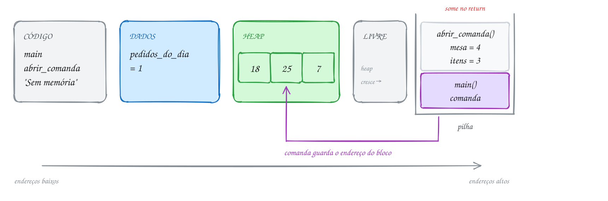</p>

O `malloc` e o `free` ganham um assunto só deles (0054). Aqui, observe em
que região cada coisa mora e quanto tempo ela vive:

```c
#include <stdio.h>
#include <stdlib.h>

int pedidos_do_dia = 0; // DADOS: existe do começo ao fim do programa

int *abrir_comanda(int mesa) {
    int itens = 3; // PILHA: some quando a função retorna
    int *comanda = malloc(itens * sizeof(int)); // o bloco fica no HEAP
    if (comanda == NULL) {
        return NULL;
    }
    comanda[0] = 18; // suco
    comanda[1] = 25; // prato feito
    comanda[2] = 7;  // pudim
    pedidos_do_dia++;
    printf("Mesa %d: comanda com %d itens\n", mesa, itens);
    return comanda; // o endereço volta; o bloco continua vivo no heap
}

int main(void) {
    int *comanda = abrir_comanda(4); // PILHA: o ponteiro mora no frame de main
    if (comanda == NULL) {
        printf("Sem memória\n");
        return 1;
    }
    int total = comanda[0] + comanda[1] + comanda[2];
    printf("Total: R$ %d\n", total);
    printf("Pedidos do dia: %d\n", pedidos_do_dia);
    free(comanda); // devolve o bloco ao heap
    return 0;
}
// Saída:
// Mesa 4: comanda com 3 itens
// Total: R$ 50
// Pedidos do dia: 1
```

O frame de `abrir_comanda` nasce e morre no meio do caminho, mas o bloco do heap atravessa o `return` e só termina no `free`, lá
no fim de `main`:

<p align="center">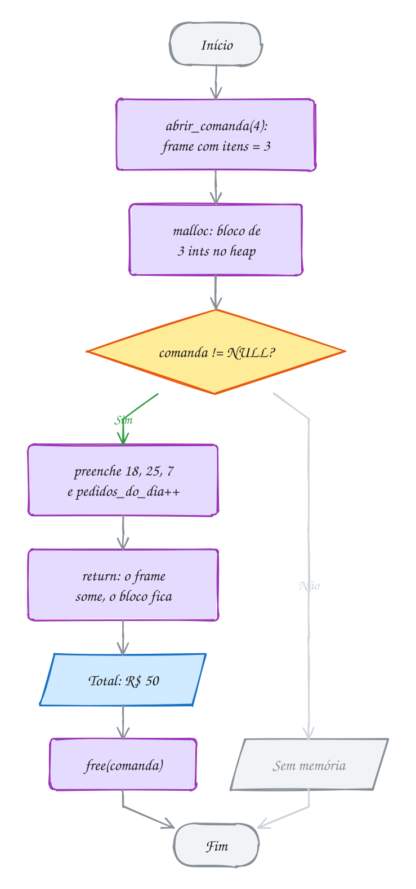</p>

> [!WARNING]
> Nunca devolva o endereço de uma variável local. `char senha[8]; ... return
> senha;` devolve um endereço que deixa de valer no exato momento do `return`:
> o próximo frame vai escrever por cima. O gcc avisa (`function returns address
> of local variable`) e, de propósito, devolve `NULL` no lugar. As saídas são
> três: quem chama empresta o vetor (parâmetro), a variável vira `static` ou o
> bloco vem do heap.

> [!TIP]
> **Por dentro do C:** reservar espaço na pilha custa **uma instrução**: o
> processador só diminui o registrador que marca o topo (`sub rsp, 32`). Por
> isso locais saem quase de graça. O `malloc` precisa procurar um pedaço livre do
> tamanho certo numa lista de blocos e anotar o tamanho num cabeçalho
> escondido logo antes do endereço que ele te entrega. É bem mais caro. Rode
> `size` no executável (`gcc A105.c -o bolao && size bolao`) e veja as
> colunas `text` (código), `data` (globais com valor) e `bss` (globais
> zeradas). Heap e pilha não aparecem: eles só existem quando o programa roda.

> [!NOTE]
> **Pergunta para você:** um vetor local `int leituras[5000000];` (20 MB)
> funciona? E se ele for global? Pense no tamanho de cada região antes de
> testar.

### Hora de praticar

Arquivos em [`0053-pilha-e-heap/`](07-memoria-dinamica/0053-pilha-e-heap/).

**Exemplo A105 · Um bloco, três funções**

```c
#include <stdio.h>
#include <stdlib.h>

int blocos_abertos = 0; // DADOS: conta os blocos do heap ainda não devolvidos

// Cria o bolão no heap. O tamanho só aparece na hora de rodar.
int *criar_bolao(int participantes) {
    int *palpites = malloc(participantes * sizeof *palpites); // HEAP
    if (palpites != NULL) {
        blocos_abertos++;
    }
    return palpites; // o frame de criar_bolao some aqui; o bloco, não
}

// Outra função, outro frame: mexe no MESMO bloco só pelo endereço.
void anotar_palpites(int *palpites, int participantes) {
    for (int i = 0; i < participantes; i++) { // i mora na PILHA deste frame
        palpites[i] = (i * 3) % 5; // quantos gols cada um aposta
    }
}

// Uma terceira função decide a hora de devolver o bloco.
void encerrar_bolao(int *palpites) {
    free(palpites);
    blocos_abertos--;
}

int main(void) {
    int participantes = 4;
    int *bolao = criar_bolao(participantes);
    if (bolao == NULL) {
        printf("Sem memória\n");
        return 1;
    }
    printf("Blocos abertos: %d\n", blocos_abertos);

    anotar_palpites(bolao, participantes);
    for (int i = 0; i < participantes; i++) {
        printf("Participante %d: palpite %d\n", i + 1, bolao[i]);
    }

    encerrar_bolao(bolao);
    bolao = NULL; // o endereço guardado não vale mais nada
    printf("Blocos abertos: %d\n", blocos_abertos);
    return 0;
}
// Saída:
// Blocos abertos: 1
// Participante 1: palpite 0
// Participante 2: palpite 3
// Participante 3: palpite 1
// Participante 4: palpite 4
// Blocos abertos: 0
//
// O bloco nasceu em criar_bolao, foi preenchido em anotar_palpites e morreu
// em encerrar_bolao. Nenhuma das três precisou estar viva ao mesmo tempo que
// as outras: quem manda no tempo de vida de um bloco do heap é você.
```

```bash
~/LPEDC/rodar 07-memoria-dinamica/0053-pilha-e-heap/A105.c
```

**Exemplo A106 · O mapa da memória**

```c
#include <stdio.h>
#include <stdlib.h>

int global = 10;     // DADOS (inicializada)
static int contador; // DADOS (zerada, numa parte chamada .bss)

void mostrar_local_da_funcao(void) {
    int fundo = 0; // PILHA: um frame acima do de main
    printf("pilha (função): %p\n", (void *)&fundo);
}

int main(void) {
    const char *frase = "bom dia"; // o texto fica numa área só de leitura
    int local = 20;                // PILHA
    int *bloco = malloc(sizeof(int)); // HEAP
    if (bloco == NULL) {
        return 1;
    }

    printf("literal:        %p\n", (void *)frase);
    printf("global:         %p\n", (void *)&global);
    printf("static:         %p\n", (void *)&contador);
    printf("heap:           %p\n", (void *)bloco);
    printf("pilha (main):   %p\n", (void *)&local);
    mostrar_local_da_funcao();

    free(bloco);
    return 0;
}
// Saída com gcc puro (gcc A106.c -o mapa && ./mapa). Os endereços mudam a
// cada execução; repare na ordem:
// literal:        0x563b12ef101a   <- perto do código, endereços baixos
// global:         0x563b12ef3010
// static:         0x563b12ef3018
// heap:           0x563b3719d2a0   <- logo acima dos dados
// pilha (main):   0x7ffe9c6f2914   <- lá no alto
// pilha (função): 0x7ffe9c6f28f4   <- frame novo, endereço MENOR
//
// Com o rodar, o heap aparece em 0x5020... e as locais em 0x7f...: o
// AddressSanitizer troca o heap e a pilha por versões próprias, vigiadas.
```

```bash
~/LPEDC/rodar 07-memoria-dinamica/0053-pilha-e-heap/A106.c
```

#### Exercícios

**Exercício E313** · ★☆☆

Complete o programa do placar do campeonato. Ele já tem a global recorde
e o protótipo de ler_placar. Escreva ler_placar(int jogos) assim:

- uma static int chamadas, que soma 1 a cada chamada;
- um bloco no heap com jogos ints (confira o NULL);
- placar[i] = i * 2 para cada jogo i;
- mostra "Chamada N:" e os gols, e devolve o ponteiro.

No main, chame ler_placar(3), atualize recorde com o maior gol do bloco e
libere o bloco; depois faça o mesmo com ler_placar(2). No fim, mostre o
recorde. Ao lado de cada declaração, escreva num comentário a região onde
ela mora: código, dados, pilha ou heap.


```text
Saída esperada:
Chamada 1: 0 2 4
Chamada 2: 0 2
Recorde: 4
```

**Dicas:**

1. static dentro da função não mora no frame: mora junto das globais, e
   por isso chamadas lembra o valor de uma chamada para a outra.
2. O ponteiro placar (pilha) e o bloco apontado (heap) são duas coisas
   diferentes: o ponteiro some no return, o bloco continua vivo. Por isso
   o endereço precisa voltar no return.
3. Resposta esperada: a saída acima. Regiões: recorde e chamadas nos
   dados; jogos, i e o ponteiro placar na pilha; o bloco no heap; as
   instruções de ler_placar no código.

```bash
~/LPEDC/rodar 07-memoria-dinamica/0053-pilha-e-heap/E313.c
```

**Exercício E314** · ★☆☆

A catraca da academia chama a função registrar_entrada() a cada aluno que
passa. Escreva essa função com dois contadores: um local comum (int hoje)
e um static (int total), ambos começando em 0. A função soma 1 em cada um
e mostra os dois. Chame a função 3 vezes em main.


```text
Saída esperada:
local: 1 | static: 1
local: 1 | static: 2
local: 1 | static: 3
```

**Dicas:**

1. static int total = 0; dentro da função só zera uma vez, antes de o
   programa começar.
2. A local nasce de novo, valendo 0, em cada frame novo.
3. Resposta esperada: a saída acima. A local mora na pilha e morre a cada
   return; a static mora nos dados e vive o programa todo.

```bash
~/LPEDC/rodar 07-memoria-dinamica/0053-pilha-e-heap/E314.c
```

**Exercício E315** · ★★☆

No Linux, "ulimit -s" mostra o tamanho da pilha em KiB (em geral, 8192,
ou seja, 8 MiB). Uma função recursiva guarda o histórico de preços de uma
ação num vetor local: int historico[2000]; e chama a si mesma.

Escreva um programa que calcule e mostre quantos bytes esse vetor ocupa em
cada chamada e quantas chamadas, no máximo, cabem numa pilha de 8 MiB.
Depois faça a mesma conta para o vetor double historico[2000]; e mostre
também. Use sizeof para o tamanho de cada tipo e divisão inteira.


```text
Saída esperada:
int: cada chamada usa pelo menos 8000 bytes
int: cabem no máximo 1048 chamadas
double: cada chamada usa pelo menos 16000 bytes
double: cabem no máximo 524 chamadas
```

**Dicas:**

1. 8 MiB = 8 * 1024 * 1024 bytes.
2. sizeof devolve size_t; mostre com %zu.
3. Resposta esperada: a saída acima (8388608 / 8000 = 1048 e
   8388608 / 16000 = 524). Na prática cabem menos: cada frame guarda
   também o endereço de retorno e outras locais, e a pilha já tem o frame
   de main e as variáveis de ambiente. Passou do limite, o programa morre
   com stack overflow.

```bash
~/LPEDC/rodar 07-memoria-dinamica/0053-pilha-e-heap/E315.c
```

**Exercício E316** · ★★☆

Um sensor de vibração de uma ponte grava 5.000.000 de leituras por dia.
Simule as leituras com leitura[i] = i % 7 e mostre a soma de todas.

Faça em três passos:
1) declare o vetor int leituras[5000000]; como LOCAL de main e rode com o

```text
 rodar. Leia o que acontece.
```

2) mude o vetor para os DADOS (global ou static) e rode de novo.
3) acrescente uma linha que mostre quantos bytes o vetor ocupa, com

```text
 sizeof aplicado ao próprio vetor.
```


```text
Saída esperada (depois do passo 3):
O vetor ocupa 20000000 bytes
Soma das leituras: 14999995
```

**Dicas:**

1. 5.000.000 * 4 bytes = 20.000.000 bytes, uns 19 MiB.
2. Basta escrever static na frente da declaração, dentro de main.
   sizeof leituras dá o tamanho do vetor inteiro (size_t: use %zu).
3. Resposta esperada: a saída acima. O vetor tem 20 MB e a pilha só tem
   8 MiB: no passo 1 o AddressSanitizer acusa stack-overflow (sem ele, o programa
   morre com Segmentation fault). Nos dados, o espaço é reservado quando o
   programa carrega e não depende do tamanho da pilha. No assunto 0054 você
   vai fazer o mesmo com malloc, escolhendo o tamanho na hora de rodar.

```bash
~/LPEDC/rodar 07-memoria-dinamica/0053-pilha-e-heap/E316.c
```

**Exercício E317** · ★★★

O programa abaixo mistura uma global, uma static e uma local numa função
recursiva. Estenda o programa (sem mudar as contas) para ele mostrar o que
acontece em cada frame:

- logo depois de contador--, um printf com n, chamadas, local e contador;
- logo antes do return, um printf com n e o valor que o frame devolve.

Use os formatos da saída esperada. Rode e confira cada número com o lugar
onde mora cada variável.


```text
Saída esperada:
entra n=3: chamadas=1 local=1 contador=99
entra n=2: chamadas=2 local=1 contador=98
entra n=1: chamadas=3 local=1 contador=97
entra n=0: chamadas=4 local=1 contador=96
sai n=0: devolve 41
sai n=1: devolve 41
sai n=2: devolve 41
sai n=3: devolve 41
41
entra n=0: chamadas=5 local=1 contador=95
sai n=0: devolve 51
51
95
```

**Dicas:**

1. Para o segundo printf, guarde a conta numa variável antes do return:
   int resultado = chamadas * 10 + local;
2. passo(3) gera 4 frames (n = 3, 2, 1 e 0) e cada um tem a sua local.
   chamadas e contador são um só para todos os frames.
3. Resposta esperada: a saída acima. local vale sempre 1 porque nasce de
   novo em cada frame (pilha); chamadas só cresce porque mora nos dados.
   Quando o primeiro frame chega ao return, as chamadas de dentro já
   terminaram: por isso todos os frames de passo(3) devolvem 41.

```bash
~/LPEDC/rodar 07-memoria-dinamica/0053-pilha-e-heap/E317.c
```

**Exercício E318** · ★★★

Este programa compila com um AVISO (warning) de propósito e mostra lixo ou
quebra. Rode e leia o aviso. Depois conserte sem usar static nem malloc
(quem chama empresta o vetor) e rode de novo até sair a senha certa, sem
aviso nenhum.


```text
Saída esperada depois do conserto:
Senha: A042
Senha: A107
```

**Dicas:**

1. Procure "returns address of local variable" no aviso.
2. O vetor senha mora no frame de montar_senha. Para onde vai esse frame
   depois do return?
3. Resposta esperada: a função devolve o endereço de um vetor local, que
   morre no return (o gcc até troca o endereço por NULL). Conserto:
   void montar_senha(int numero, char senha[]) e, em main,
   char senha[8]; montar_senha(42, senha);

```bash
~/LPEDC/rodar 07-memoria-dinamica/0053-pilha-e-heap/E318.c
```

---

## 0054 · malloc e free

Fim do mês, hora de somar as corridas de aplicativo. Teve mês com 4 corridas,
teve mês com 60. Se você declarar `double corridas[100];`, desperdiça espaço
nos meses fracos e estoura no mês em que passar de 100. O tamanho certo só
aparece quando o programa já está rodando.

Para isso existe o `malloc` (*memory allocation*), de `<stdlib.h>`. Você diz
**quantos bytes** quer e ele devolve o **endereço** de um bloco desse tamanho
no heap. Esse endereço vai para um ponteiro, e o ponteiro passa a se comportar
como um vetor: `corridas[i]` funciona do mesmo jeito (assunto 0047).

```c
double *corridas = malloc(n * sizeof(double)); // n * 8 bytes
```

Três detalhes nessa linha:

- o `malloc` conta em **bytes**, não em elementos. `malloc(4)` não é espaço
  para 4 `double`, é espaço para 4 bytes. Por isso sempre `n * sizeof(tipo)`;
- ele devolve `void *` (assunto 0051), que vira `double *` sozinho. Em C não
  precisa de cast; o `(double *)` que você vê em livro antigo é dispensável;
- se não houver memória, ele devolve **`NULL`**. Sempre confira antes de usar.

O bloco vem com **lixo**: o que estava naqueles bytes antes. O `malloc` não
zera nada. Preencha antes de ler.

Quando terminar, devolva com **`free(corridas)`**. O `free` recebe exatamente
o endereço que o `malloc` deu, nem um byte a mais. Ele não precisa do tamanho:
o próprio `malloc` anotou isso num cabeçalho escondido antes do bloco. Depois
do `free`, o ponteiro continua guardando o endereço antigo, só que agora ele
aponta para um bloco que não é mais seu. Por isso o hábito: `corridas = NULL;`.

A regra: **todo `malloc` tem um `free`**. O bloco que você esquece de liberar
fica ocupado até o programa acabar. Isso é um **vazamento** (*memory leak*),
tema do assunto 0057.

O programa pergunta quantas corridas foram (4), pede ao
heap `4 * 8 = 32` bytes, guarda os valores (R$ 12,50, R$ 18,00, R$ 25,90 e
R$ 9,60), soma tudo e devolve o bloco:

<p align="center">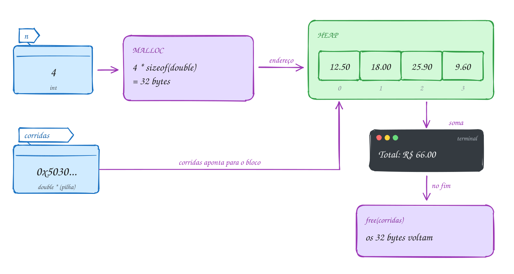</p>

O comentário no fim do código mostra uma execução completa:

```c
#include <stdio.h>
#include <stdlib.h>

int main(void) {
    int n;
    printf("Quantas corridas? ");
    if (scanf("%d", &n) != 1 || n <= 0) {
        printf("Quantidade inválida\n");
        return 1;
    }

    // pede n * 8 bytes ao heap; o tamanho só é conhecido agora
    double *corridas = malloc(n * sizeof(double));
    if (corridas == NULL) {
        printf("Sem memória\n");
        return 1;
    }

    for (int i = 0; i < n; i++) {
        printf("Valor da corrida %d: ", i + 1);
        if (scanf("%lf", &corridas[i]) != 1) { // usa como um vetor comum
            printf("Valor inválido\n");
            free(corridas);
            return 1;
        }
    }

    double total = 0;
    for (int i = 0; i < n; i++) {
        total += corridas[i];
    }
    printf("Total: R$ %.2f\n", total);
    printf("Média: R$ %.2f\n", total / n);

    free(corridas);  // devolve os bytes ao heap
    corridas = NULL; // o ponteiro não aponta mais para lugar nenhum
    return 0;
}
// Exemplo de uso:
// Quantas corridas? 4
// Valor da corrida 1: 12.50
// Valor da corrida 2: 18
// Valor da corrida 3: 25.90
// Valor da corrida 4: 9.60
// Total: R$ 66.00
// Média: R$ 16.50
```

Toda saída do programa depois do `malloc` passa por um `free`, até a saída
de erro no meio da leitura, que é o caminho mais fácil de esquecer:

<p align="center">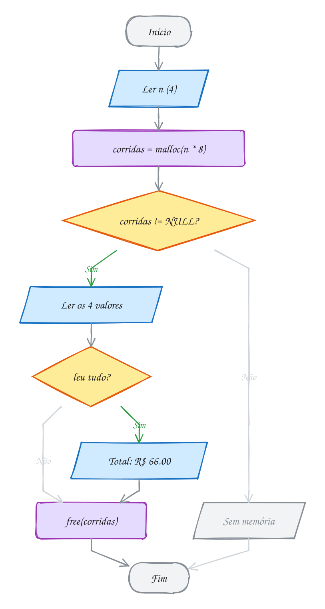</p>

> [!WARNING]
> O erro mais comum é contar elementos em vez de bytes: `malloc(n)` para `n`
> inteiros reserva só um quarto do necessário, e o programa escreve além do
> fim do bloco. Um jeito à prova de distração é tirar o tipo do próprio
> ponteiro: `int *v = malloc(n * sizeof *v);`. Se um dia `v` virar `double *`,
> a conta acompanha sozinha.

> [!TIP]
> **Por dentro do C:** o `malloc` pede memória ao sistema operacional em
> pedaços grandes (chamadas `brk` e `mmap`) e depois fatia esses pedaços para
> você. Cada bloco ganha um cabeçalho de uns 8 a 16 bytes, logo antes do
> endereço que você recebe, com o tamanho dele. Assim o `free(p)` sabe
> quanto liberar, e `free(p + 1)` dá errado: ele vai ler um "cabeçalho" que
> não existe. Pedir 1 byte custa, na prática, uns 32: pedidos
> pequenos demais desperdiçam memória.

> [!NOTE]
> **Pergunta para você:** se você tirar a linha `free(corridas);` o programa
> continua mostrando o total certo? Então qual é o problema? Rode sem o `free`
> e leia o fim da saída do `rodar`.

### Hora de praticar

Arquivos em [`0054-malloc-free/`](07-memoria-dinamica/0054-malloc-free/).

**Exemplo A107 · A foto que não cabe na pilha**

```c
#include <stdio.h>
#include <stdlib.h>

int main(void) {
    int largura = 4000;
    int altura = 3000; // uma foto de 12 megapixels, em tons de cinza

    // 12.000.000 de bytes: como vetor local, estouraria a pilha de 8 MiB.
    // No heap, o limite é a memória livre da máquina.
    size_t total = (size_t)largura * altura;
    unsigned char *brilho = malloc(total * sizeof *brilho);
    if (brilho == NULL) { // pedido grande: o NULL é possível de verdade
        printf("Sem memória para a foto\n");
        return 1;
    }
    printf("Pedi %zu bytes ao heap\n", total * sizeof *brilho);

    // simula a foto: um degradê que vai de 0 (preto) a 255 (branco)
    for (size_t i = 0; i < total; i++) {
        brilho[i] = (unsigned char)(i % 256);
    }

    long soma = 0;
    int claros = 0;
    for (size_t i = 0; i < total; i++) {
        soma += brilho[i];
        if (brilho[i] >= 200) {
            claros++;
        }
    }
    printf("Brilho médio: %.2f\n", (double)soma / total);
    printf("Pixels claros: %d\n", claros);

    free(brilho); // 12 MB de volta ao heap de uma vez
    brilho = NULL;
    return 0;
}
// Saída:
// Pedi 12000000 bytes ao heap
// Brilho médio: 127.50
// Pixels claros: 2625000
//
// Troque o malloc por unsigned char brilho[12000000]; dentro do main e rode:
// o AddressSanitizer acusa stack-overflow antes da primeira linha.
```

```bash
~/LPEDC/rodar 07-memoria-dinamica/0054-malloc-free/A107.c
```

**Exemplo A108 · Quem cria e quem libera**

```c
#include <stdio.h>
#include <stdlib.h>

// Divide um valor em n parcelas, em centavos. Os centavos que sobram vão
// para as primeiras parcelas. Devolve um bloco novo no heap: quem chama
// fica responsável pelo free.
int *parcelar(int total_centavos, int n) {
    int *parcelas = malloc(n * sizeof *parcelas); // sizeof *p: o tipo vem do ponteiro
    if (parcelas == NULL) {
        return NULL;
    }
    int base = total_centavos / n;
    int sobra = total_centavos % n;
    for (int i = 0; i < n; i++) {
        parcelas[i] = base + (i < sobra ? 1 : 0);
    }
    return parcelas; // o bloco sobrevive ao return
}

int main(void) {
    int n = 3;
    int *parcelas = parcelar(10000, n); // R$ 100,00 em 3 vezes
    if (parcelas == NULL) {
        printf("Sem memória\n");
        return 1;
    }

    printf("Bloco de %zu bytes no heap\n", n * sizeof *parcelas);
    for (int i = 0; i < n; i++) {
        printf("Parcela %d: R$ %d.%02d\n", i + 1, parcelas[i] / 100, parcelas[i] % 100);
    }

    free(parcelas);  // quem recebeu o bloco, libera
    parcelas = NULL;
    free(parcelas);  // free(NULL) não faz nada: é seguro
    return 0;
}
// Saída:
// Bloco de 12 bytes no heap
// Parcela 1: R$ 33.34
// Parcela 2: R$ 33.33
// Parcela 3: R$ 33.33
```

```bash
~/LPEDC/rodar 07-memoria-dinamica/0054-malloc-free/A108.c
```

#### Exercícios

**Exercício E319** · ★☆☆

Escreva um programa que pergunte quantos dias de medição houve, aloque com
malloc um vetor de int desse tamanho, leia as temperaturas e mostre a maior
e a menor. Confira o NULL e libere o bloco no fim.


```text
Exemplo de uso:
Quantos dias? 5
Temperatura 1: 31
Temperatura 2: 28
Temperatura 3: 33
Temperatura 4: 29
Temperatura 5: 30
Máxima: 33
Mínima: 28
```


Para testar: printf '5\n31 28 33 29 30\n' | ~/LPEDC/rodar <este arquivo>

**Dicas:**

1. int *temps = malloc(dias * sizeof(int)); e depois if (temps == NULL).
2. Comece maior e menor com temps[0] (padrão do assunto 0025).
3. Resposta esperada: Máxima: 33 e Mínima: 28, e nenhum aviso do
   AddressSanitizer no fim (sinal de que o free está lá).

```bash
~/LPEDC/rodar 07-memoria-dinamica/0054-malloc-free/E319.c
```

**Exercício E320** · ★☆☆

Complete a função duplicar: ela recebe uma string e devolve uma CÓPIA dela
num bloco novo do heap, do tamanho exato. O main já está pronto: ele
passa a cópia para maiúsculas e mostra que a original não mudou.


```text
Saída esperada:
Original: coxinha
Cópia: COXINHA
```

**Dicas:**

1. Quantos bytes ocupa "coxinha"? Conte o '\0'.
2. malloc(strlen(texto) + 1), confira o NULL e use strcpy.
3. Resposta esperada: a saída acima. Sem o + 1, o strcpy escreve o '\0'
   um byte depois do fim do bloco e o AddressSanitizer acusa
   heap-buffer-overflow.

```bash
~/LPEDC/rodar 07-memoria-dinamica/0054-malloc-free/E320.c
```

**Exercício E321** · ★★☆

Escreva a função


```text
int *filtrar_pares(const int *v, int n, int *qtd);
```


que devolve um vetor NOVO, no heap, só com os números pares de v, do
tamanho exato. A quantidade de pares volta por *qtd. Teste com os números
sorteados 7, 4, 10, 3, 8, 1, 6.


```text
Saída esperada:
4 pares: 4 10 8 6
```

**Dicas:**

1. Duas passadas: a primeira só conta os pares; com a contagem, faça o
   malloc; a segunda copia.
2. *qtd = contagem; é o "devolver mais de um valor" do assunto 0046.
3. Resposta esperada: "4 pares: 4 10 8 6". Quem chama faz o free. Se não
   houver pares, malloc(0) pode devolver NULL ou um endereço válido; trate
   esse caso antes (devolva NULL com *qtd = 0).

```bash
~/LPEDC/rodar 07-memoria-dinamica/0054-malloc-free/E321.c
```

**Exercício E322** · ★★☆

Escreva um programa que faça de verdade as cinco alocações abaixo. Antes
de cada malloc, guarde numa variável size_t quantos bytes ele vai pedir
(ex.: size_t ta = 5 * sizeof(int);) e passe essa variável para o malloc.
Confira o NULL de cada uma, mostre os cinco tamanhos, mostre quantos int
cabem inteiros no bloco e) e libere os cinco blocos no fim.


```text
a) int *a = malloc(5 * sizeof(int));
b) double *b = malloc(5 * sizeof(double));
c) int **c = malloc(3 * sizeof(int *));
d) char *d = malloc(strlen("Recife") + 1);
e) int *e = malloc(5);
```


```text
Saída esperada (num PC de 64 bits):
a) 20 bytes
b) 40 bytes
c) 24 bytes
d) 7 bytes
e) 5 bytes: cabe 1 int
```

**Dicas:**

1. int tem 4 bytes, double 8 e qualquer ponteiro 8 (em 64 bits).
   "Recife" tem 6 letras, mais o '\0'.
2. Se um malloc falhar, libere os que já deram certo antes de sair
   (free(NULL) não faz nada, então dá para liberar todos de uma vez).
3. Resposta esperada: a saída acima. Em e) sobra 1 byte: escrever e[1]
   ocuparia os bytes 4 a 7, fora do bloco. Acrescente e[1] = 9; para ver
   o AddressSanitizer acusar heap-buffer-overflow, e depois apague a linha.

```bash
~/LPEDC/rodar 07-memoria-dinamica/0054-malloc-free/E322.c
```

**Exercício E323** · ★★★

O app de caminhada calcula a média de passos dos últimos 4 dias. A conta
sai certa, mas o programa termina com um relatório do AddressSanitizer.
O erro está de propósito. Rode, leia o relatório, conserte e rode de novo
até o programa terminar sem relatório nenhum.


```text
Saída esperada depois do conserto:
Média: 9000 passos
```

**Dicas:**

1. Procure "attempting free on address which was not malloc()-ed".
2. Para onde passos aponta depois do laço?
3. Resposta esperada: o free(passos) recebe um endereço que não veio do
   malloc, porque passos++ andou 4 posições. O free precisa do endereço
   exato do início. Conserte usando passos[i] no laço (ou andando com uma
   cópia do ponteiro: int *p = passos;).

```bash
~/LPEDC/rodar 07-memoria-dinamica/0054-malloc-free/E323.c
```

**Exercício E324** · ★★★

Escreva a função


```text
char *juntar(const char *a, const char *b);
```


que devolve uma string NOVA, no heap, com a, um espaço e b. Depois, em
main, monte o nome do crachá "Maria Clara Fonseca" chamando juntar duas
vezes: primeiro "Maria" com "Clara", depois o resultado com "Fonseca".
Mostre o nome e o tamanho, e não deixe nenhum bloco para trás.


```text
Saída esperada:
Crachá: Maria Clara Fonseca (19 caracteres)
```

**Dicas:**

1. O bloco precisa de strlen(a) + 1 (espaço) + strlen(b) + 1 ('\0') bytes.
2. strcpy(novo, a); strcat(novo, " "); strcat(novo, b);
3. Resposta esperada: a saída acima. O resultado do primeiro juntar
   ("Maria Clara") também é um bloco do heap: libere-o depois de usá-lo no
   segundo juntar. São dois malloc, então dois free.

```bash
~/LPEDC/rodar 07-memoria-dinamica/0054-malloc-free/E324.c
```

---

## 0055 · calloc e realloc

Você abriu uma vaquinha para o churrasco e os Pix vão chegando: R$ 50,
R$ 120, R$ 35... Você não sabe quantos vão ser. O vetor não cresce sozinho:
quem faz ele crescer é você, com o `realloc`.

Antes dele, um primo do `malloc`: o **`calloc`**. Ele recebe a quantidade e o
tamanho separados e entrega o bloco **zerado**:

```c
int *contagem = calloc(5, sizeof(int)); // 5 ints, todos valendo 0
```

Use quando o zero inicial importa: contadores, placares, tabelas de
frequência. Com `malloc`, você teria lixo e precisaria de um laço para zerar.

O **`realloc(p, novo_tamanho)`** muda o tamanho de um bloco que veio do heap
e **preserva o conteúdo** (até o menor dos dois tamanhos). Se der para
esticar o bloco no lugar, ele estica. Se não der, ele aloca um bloco
novo em outro lugar, copia tudo, libera o antigo e devolve o **endereço
novo**. A parte que cresceu vem com lixo.

Daí a regra central do assunto: **depois do `realloc`, o endereço antigo
pode não valer mais**. Qualquer ponteiro que apontava para dentro do
bloco velho virou um ponteiro solto.

E se faltar memória, o `realloc` devolve `NULL` e **não mexe no bloco
antigo**. Por isso nunca escreva `pix = realloc(pix, ...)`: se vier `NULL`,
você perde o único endereço do bloco, que continua ocupado. Guarde o
resultado num ponteiro **temporário** e só depois troque.

Para o vetor crescer sem gastar tempo demais, a estratégia clássica é guardar
duas contas: a **quantidade** (quantos elementos você usa) e a **capacidade**
(quantos cabem). Encheu? **Dobra** a capacidade. Assim os `realloc` ficam
raros: para guardar 1000 elementos, começando com 1, são só 10.

Chegam 5 Pix (R$ 50, 120, 35, 80 e 15). O vetor nasce
com capacidade 2, dobra para 4 no terceiro Pix e para 8 no quinto. No fim, 5
posições usadas e 3 livres:

<p align="center">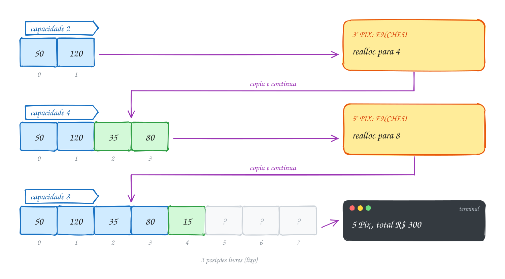</p>

O código é a semente da lista sequencial que vira TAD no assunto 0075:

```c
#include <stdio.h>
#include <stdlib.h>

int main(void) {
    int chegando[] = {50, 120, 35, 80, 15}; // os Pix do dia, em R$
    int capacidade = 2;                      // cabem 2 por enquanto
    int quantidade = 0;                      // quantos já guardei
    int *pix = malloc(capacidade * sizeof *pix);
    if (pix == NULL) {
        return 1;
    }

    for (int i = 0; i < 5; i++) {
        if (quantidade == capacidade) { // encheu: dobra a capacidade
            int nova = capacidade * 2;
            int *maior = realloc(pix, nova * sizeof *pix); // temporário!
            if (maior == NULL) {
                free(pix); // o bloco antigo continua valendo: libera
                return 1;
            }
            printf("Capacidade: %d -> %d\n", capacidade, nova);
            pix = maior;
            capacidade = nova;
        }
        pix[quantidade] = chegando[i]; // o "push"
        quantidade++;
    }

    int total = 0;
    for (int i = 0; i < quantidade; i++) {
        total += pix[i];
    }
    printf("%d Pix, total R$ %d\n", quantidade, total);
    printf("Sobram %d posições livres\n", capacidade - quantidade);
    free(pix);
    return 0;
}
// Saída:
// Capacidade: 2 -> 4
// Capacidade: 4 -> 8
// 5 Pix, total R$ 300
// Sobram 3 posições livres
```

A pergunta "encheu?" é feita a cada Pix, mas o desvio
para o `realloc` só acontece duas vezes. Na maior parte das voltas, guardar
custa só uma atribuição:

<p align="center">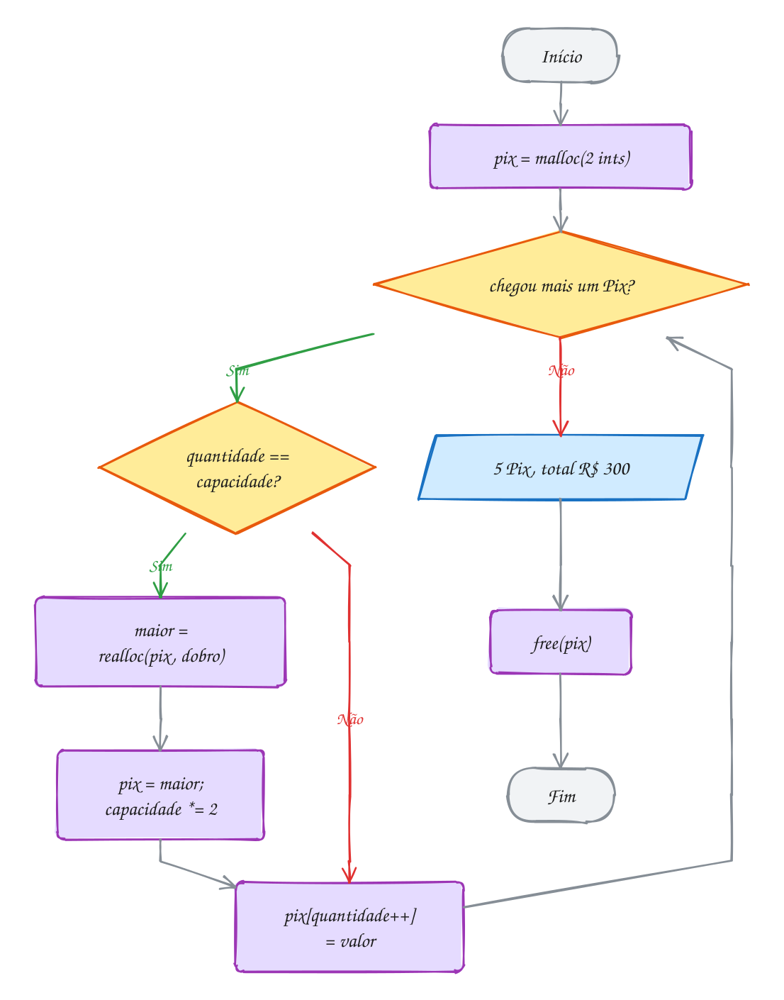</p>

> [!WARNING]
> `v = realloc(v, n)` é o erro clássico, e muito livro ensina assim. Se o
> `realloc` falhar, `v` vira `NULL`, o bloco antigo fica no heap sem ninguém
> apontando para ele (vazamento) e os dados se perdem. Use sempre um
> temporário. E não guarde endereços de elementos (`int *ultimo = &v[3];`)
> antes de um `realloc`: o bloco pode ter mudado de lugar.

> [!TIP]
> **Por dentro do C:** dobrar a capacidade faz o custo **médio** do push ser
> constante. Para chegar a 1024 elementos, o `realloc` copia no pior caso
> 1 + 2 + 4 + ... + 512 = 1023 elementos: menos de uma cópia por push. Se
> crescesse de 1 em 1, seriam 1 + 2 + ... + 1023, mais de 500 mil cópias. É
> a estratégia padrão de todo vetor que cresce sob demanda.
> Com o rodar, o AddressSanitizer **sempre** muda o bloco de lugar no
> `realloc`, de propósito: assim o erro de usar o endereço antigo aparece logo,
> em vez de só às vezes.

> [!NOTE]
> **Pergunta para você:** se a capacidade inicial fosse 1, quantas vezes
> apareceria "Capacidade: ..." para os mesmos 5 Pix? E qual seria a
> capacidade final?

### Hora de praticar

Arquivos em [`0055-calloc-realloc/`](07-memoria-dinamica/0055-calloc-realloc/).

**Exemplo A109 · A lista que nasce do NULL**

```c
#include <stdio.h>
#include <stdlib.h>
#include <string.h>

int main(void) {
    const char *itens[] = {"arroz", "leite", "banana", "ovos"};
    char *lista = NULL; // ainda não existe bloco nenhum
    size_t tamanho = 0; // bytes do bloco atual

    for (int i = 0; i < 4; i++) {
        // + 2 para o ", " entre os itens (só a partir do segundo);
        // + 1 para o '\0' entra só no primeiro, quando tamanho ainda é 0
        size_t extra = strlen(itens[i]) + (i == 0 ? 1 : 2);

        // realloc(NULL, n) funciona como malloc(n): a primeira volta cria o
        // bloco; as outras aumentam e PRESERVAM o que já estava escrito.
        char *maior = realloc(lista, tamanho + extra);
        if (maior == NULL) {
            free(lista);
            return 1;
        }
        lista = maior;
        if (i == 0) {
            lista[0] = '\0'; // bloco novo vem com lixo: vira string vazia
        } else {
            strcat(lista, ", ");
        }
        strcat(lista, itens[i]);
        tamanho += extra;
        printf("%2zu bytes: %s\n", tamanho, lista);
    }

    free(lista);
    return 0;
}
// Saída:
//  6 bytes: arroz
// 13 bytes: arroz, leite
// 21 bytes: arroz, leite, banana
// 27 bytes: arroz, leite, banana, ovos
//
// Cada linha tem strlen + 1 bytes, nem um a mais: o bloco cresce no tamanho
// exato de cada item. Começar com o ponteiro em NULL evita um malloc separado
// antes do laço.
```

```bash
~/LPEDC/rodar 07-memoria-dinamica/0055-calloc-realloc/A109.c
```

**Exemplo A110 · A enquete com calloc**

```c
#include <stdio.h>
#include <stdlib.h>

int main(void) {
    int votos[] = {2, 3, 2, 1, 4, 2, 3, 2, 1, 2}; // opção escolhida por voto
    int total_votos = 10;
    int opcoes = 4;

    // um contador por opção (1 a 4); a posição 0 fica sem uso.
    // calloc(quantidade, tamanho) entrega tudo zerado: os contadores já
    // começam em 0. Com malloc, começariam com lixo.
    int *contagem = calloc(opcoes + 1, sizeof *contagem);
    if (contagem == NULL) {
        return 1;
    }

    for (int i = 0; i < total_votos; i++) {
        contagem[votos[i]]++;
    }

    for (int op = 1; op <= opcoes; op++) {
        printf("Opção %d: %d ", op, contagem[op]);
        for (int k = 0; k < contagem[op]; k++) {
            printf("#");
        }
        printf("\n");
    }
    free(contagem);
    return 0;
}
// Saída:
// Opção 1: 2 ##
// Opção 2: 5 #####
// Opção 3: 2 ##
// Opção 4: 1 #
```

```bash
~/LPEDC/rodar 07-memoria-dinamica/0055-calloc-realloc/A110.c
```

#### Exercícios

**Exercício E325** · ★☆☆

Num jogo de tabuleiro, o dado saiu assim em 12 jogadas:
3, 6, 1, 6, 2, 5, 6, 3, 4, 6, 1, 2. Use calloc para criar os contadores
das faces (zerados) e mostre quantas vezes cada face saiu, com um # por
vez.


```text
Saída esperada:
1: 2 ##
2: 2 ##
3: 2 ##
4: 1 #
5: 1 #
6: 4 ####
```

**Dicas:**

1. calloc(7, sizeof(int)) dá as posições 0 a 6; use 1 a 6 e ignore a 0.
2. contagem[jogadas[i]]++ conta a face da jogada i.
3. Resposta esperada: a saída acima. Troque calloc por malloc e rode
   algumas vezes: os números mudam ou ficam errados, porque os contadores
   começam com lixo.

```bash
~/LPEDC/rodar 07-memoria-dinamica/0055-calloc-realloc/E325.c
```

**Exercício E326** · ★☆☆

O programa abaixo funciona e mostra as notas do boletim. Mesmo assim, a
linha do realloc tem um problema que só aparece quando falta memória.
Refatore o trecho do realloc para ele não perder o bloco antigo se
falhar, e rode de novo para conferir que a saída não mudou.


```text
Saída esperada (antes e depois):
Notas: 7 8 10
```

**Dicas:**

1. O que vale notas se o realloc devolver NULL? E o bloco antigo?
2. Use um ponteiro temporário e só troque se ele não for NULL.
3. Resposta esperada: com notas = realloc(notas, ...), uma falha joga
   NULL em notas e o endereço do bloco antigo se perde: vazamento e perda
   das notas já guardadas. Conserto:
   int *maior = realloc(notas, 3 * sizeof *notas);
   if (maior == NULL) { free(notas); return 1; }
   notas = maior;

```bash
~/LPEDC/rodar 07-memoria-dinamica/0055-calloc-realloc/E326.c
```

**Exercício E327** · ★★☆

Leia números inteiros do teclado até aparecer 0 (o 0 não entra). Guarde
num vetor que começa com capacidade 2 e dobra quando enche. No fim,
mostre os números na ordem contrária e a capacidade final.


```text
Exemplo de uso:
Números (0 para parar): 5 8 2 9 4 0
Ao contrário: 4 9 2 8 5
Capacidade final: 8
```


Para testar: printf '5 8 2 9 4 0\n' | ~/LPEDC/rodar <este arquivo>

**Dicas:**

1. Duas variáveis de controle: quantidade e capacidade. Encheu quando
   quantidade == capacidade.
2. Use o realloc com ponteiro temporário, como no exemplo do texto.
3. Resposta esperada: "Ao contrário: 4 9 2 8 5" e "Capacidade final: 8"
   (a capacidade foi 2, 4 e 8). Também trate o fim da entrada: se o scanf
   não devolver 1, pare como se fosse o 0.

```bash
~/LPEDC/rodar 07-memoria-dinamica/0055-calloc-realloc/E327.c
```

**Exercício E328** · ★★☆

Um sensor de umidade mandou 10 leituras, mas -1 significa "falha na
leitura": 12, -1, 15, 14, -1, -1, 13, 16, -1, 11. Copie as leituras para
um bloco do heap, remova as falhas puxando as válidas para a frente (no
mesmo bloco) e depois ENCOLHA o bloco com realloc para o tamanho exato.


```text
Saída esperada:
6 leituras válidas: 12 15 14 13 16 11
Bloco encolheu de 40 para 24 bytes
```

**Dicas:**

1. Ande com dois índices: i lê todas as posições, j marca onde escrever a
   próxima válida. No fim, j é a quantidade de válidas.
2. realloc também diminui: realloc(v, j * sizeof *v). Use temporário.
3. Resposta esperada: a saída acima. Encolher preserva as primeiras j
   posições, exatamente as válidas.

```bash
~/LPEDC/rodar 07-memoria-dinamica/0055-calloc-realloc/E328.c
```

**Exercício E329** · ★★★

Compare duas estratégias de crescimento para guardar 1000 números, com
capacidade inicial 1:


```text
A) crescer de 1 em 1 (capacidade + 1) sempre que encher;
B) dobrar a capacidade sempre que encher.
```


Escreva um programa que faça os dois vetores de verdade (com realloc) e
conte, para cada estratégia, quantos realloc foram feitos e quantos
elementos o realloc precisou copiar no pior caso (a quantidade guardada
na hora de cada realloc).


```text
Saída esperada:
+1:     999 realocações, 499500 cópias
dobrar: 10 realocações, 1023 cópias
```

**Dicas:**

1. Escreva uma função que recebe um "modo" (1 ou 2) e devolve as contagens
   por ponteiro (int *realocacoes, long *copias).
2. Antes de cada realloc, copias += quantidade.
3. Resposta esperada: a saída acima. No +1, as cópias são 1 + 2 + ... +
   999 = 499500, um custo quadrático. Dobrando, 1 + 2 + 4 + ... + 512 =
   1023: em média, nem uma cópia por elemento.

```bash
~/LPEDC/rodar 07-memoria-dinamica/0055-calloc-realloc/E329.c
```

**Exercício E330** · ★★★

A fila do banco guarda as senhas num vetor que cresce. O programa guarda o
endereço da primeira senha para mostrar no painel depois. Ele está ERRADO
de propósito: rode com o rodar e leia o relatório do AddressSanitizer
(ele aponta a linha). Conserte e rode de novo até sair sem relatório.


```text
Saída esperada depois do conserto:
Painel: senha 101
Senhas na fila: 4
```

**Dicas:**

1. Procure "heap-use-after-free" e as três pilhas do relatório: onde leu,
   onde o bloco foi liberado e onde foi alocado.
2. O realloc pode mudar o bloco de lugar. O que acontece com um ponteiro
   que apontava para dentro do bloco antigo?
3. Resposta esperada: o printf do painel lê *primeira, que aponta para o
   bloco antigo, liberado dentro do realloc. Conserto: guarde o ÍNDICE (0)
   em vez do endereço e leia senhas[0] depois, ou pegue o endereço só
   depois do último realloc.

```bash
~/LPEDC/rodar 07-memoria-dinamica/0055-calloc-realloc/E330.c
```

---

## 0056 · Matriz dinâmica

Uma rede de lojas quer a planilha de vendas: uma linha por loja, uma coluna
por semana. Este mês são 3 lojas e 4 semanas. Mês que vem abre a quarta loja,
e o trimestre tem 13 semanas. Uma matriz `int vendas[3][4]` não serve: as
dimensões só aparecem quando o programa roda.

O C só sabe alocar dinamicamente **vetores**, blocos de uma dimensão. Para ter
uma matriz, você monta uma com vetores, de dois jeitos clássicos.

**1. Um bloco só.** Aloque `linhas * colunas` elementos e calcule a posição na
mão: o elemento `(i, j)` fica em `v[i * colunas + j]`. É a mesma conta que o
compilador faz por baixo numa matriz fixa (assunto 0039). Um `malloc`, um
`free`, tudo contíguo. O preço: a notação `v[i][j]` não funciona.

**2. Vetor de ponteiros.** Primeiro um vetor de `linhas` ponteiros
(`int **m`), um para cada linha. Depois, um `malloc` por linha, cada uma com
`colunas` inteiros. Agora `m[i][j]` funciona: `m[i]` é o endereço da linha i,
e `[j]` anda dentro dela (é o `**` do assunto 0049 em ação).

Uma regra ajuda a não errar o `sizeof`: **o que você aloca tem um `*` a menos
que o ponteiro que recebe**. `int **m` recebe um vetor de `int *`; `m[i]`, que
é `int *`, recebe um vetor de `int`. Com `sizeof *m` e `sizeof *m[i]`, a conta
sai certa sozinha.

Desde o C99 existe um atalho, o **VLA**: `int vendas[lojas][semanas];` com
as dimensões em variáveis. Só que ele mora na **pilha**, que é pequena e não
avisa quando estoura; o assunto 0172 mostra quando vale a pena.

Para liberar, a ordem importa: **primeiro cada linha, depois o vetor de
ponteiros**. Se você der `free(m)` antes, perde os endereços das linhas, e
elas ficam presas no heap para sempre.

E se o `malloc` da terceira linha falhar? As duas primeiras já foram
alocadas. A função de criação precisa desfazer o que já fez antes de devolver
`NULL`.

A matriz de 3 lojas por 4 semanas é um vetor de 3
ponteiros, cada um apontando para uma linha de 4 inteiros. As linhas podem
estar em qualquer lugar do heap, nem precisam ficar juntas:

<p align="center">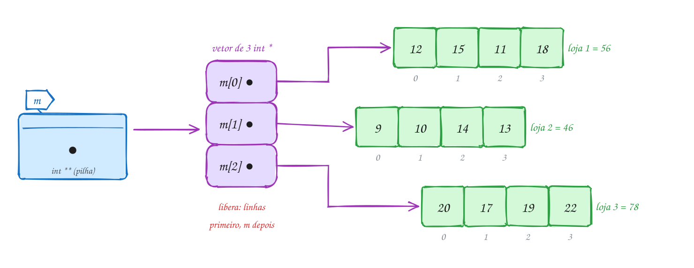</p>

O código separa criar e liberar em funções, como você faria num projeto. As
vendas estão em R$ mil:

```c
#include <stdio.h>
#include <stdlib.h>

void liberar_matriz(int **m, int linhas) {
    if (m == NULL) {
        return;
    }
    for (int i = 0; i < linhas; i++) {
        free(m[i]); // primeiro cada linha...
    }
    free(m);        // ...depois o vetor de ponteiros
}

int **criar_matriz(int linhas, int colunas) {
    int **m = malloc(linhas * sizeof *m); // vetor de int *: uma por linha
    if (m == NULL) {
        return NULL;
    }
    for (int i = 0; i < linhas; i++) {
        m[i] = malloc(colunas * sizeof *m[i]); // cada linha: colunas ints
        if (m[i] == NULL) {
            liberar_matriz(m, i); // desfaz as linhas que já deram certo
            return NULL;
        }
    }
    return m;
}

int main(void) {
    int lojas = 3;
    int semanas = 4;
    int vendas[3][4] = {{12, 15, 11, 18}, {9, 10, 14, 13}, {20, 17, 19, 22}}; // R$ mil

    int **m = criar_matriz(lojas, semanas);
    if (m == NULL) {
        printf("Sem memória\n");
        return 1;
    }
    for (int i = 0; i < lojas; i++) {
        for (int j = 0; j < semanas; j++) {
            m[i][j] = vendas[i][j]; // a notação de sempre
        }
    }

    for (int i = 0; i < lojas; i++) {
        int total = 0;
        for (int j = 0; j < semanas; j++) {
            total += m[i][j];
        }
        printf("Loja %d: R$ %d mil\n", i + 1, total);
    }

    liberar_matriz(m, lojas);
    return 0;
}
// Saída:
// Loja 1: R$ 56 mil
// Loja 2: R$ 46 mil
// Loja 3: R$ 78 mil
```

A criação é um laço com uma saída de emergência: se uma linha falhar, o caminho de erro passa pela liberação do que já existe:

<p align="center">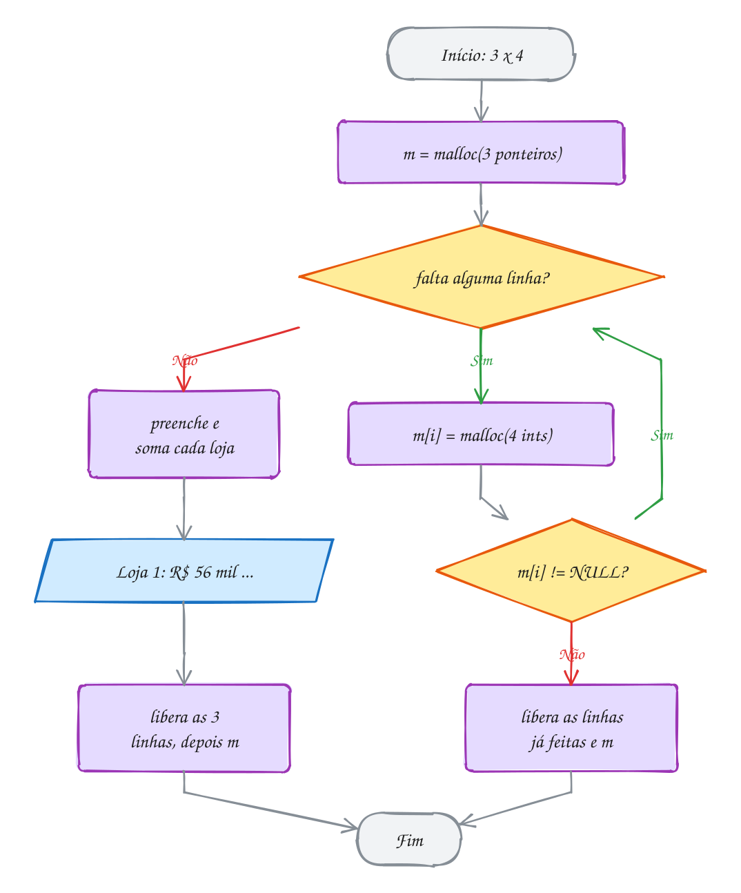</p>

> [!WARNING]
> O `sizeof` errado no vetor de ponteiros é um bug que muitos livros trazem:
> `int **m = malloc(linhas * sizeof(int));`. Num PC de 64 bits, `int` tem 4
> bytes e `int *` tem 8: você aloca metade do necessário e as últimas linhas
> são gravadas fora do bloco. Funciona "às vezes" e corrompe o heap. Escreva
> `sizeof *m` e esse erro some.

> [!TIP]
> **Por dentro do C:** `m[i][j]` com `int **` faz **dois** acessos à memória:
> lê o ponteiro `m[i]` e depois o inteiro. Numa matriz fixa ou no bloco único,
> é um acesso só, com uma conta. As linhas soltas no heap também não ficam
> vizinhas, o que piora o uso do cache do processador. Em troca, você ganha
> `m[i][j]` e linhas de **tamanhos diferentes**: num triângulo de Pascal, a
> linha i tem i + 1 elementos. Existe ainda um meio-termo: um bloco único com
> os dados e um vetor de ponteiros com `m[i] = bloco + i * colunas`. São só
> dois `malloc`, os dados ficam contíguos e `m[i][j]` continua valendo.

> [!NOTE]
> **Pergunta para você:** quantos `malloc` e quantos `free` o código acima faz
> para 3 lojas? E para 100 lojas? Quantos faria a versão de bloco único (A112)?

### Hora de praticar

Arquivos em [`0056-matriz-dinamica/`](07-memoria-dinamica/0056-matriz-dinamica/).

**Exemplo A111 · Trocar linhas sem copiar**

```c
#include <stdio.h>
#include <stdlib.h>

int total_da_linha(const int *linha, int colunas) {
    int total = 0;
    for (int j = 0; j < colunas; j++) {
        total += linha[j];
    }
    return total;
}

int main(void) {
    int times = 4;
    int rodadas = 5;
    int pontos[4][5] = {{1, 0, 3, 1, 0},  // Time A
                        {3, 3, 1, 0, 3},  // Time B
                        {0, 1, 1, 1, 1},  // Time C
                        {3, 0, 3, 3, 1}}; // Time D

    int **tabela = malloc(times * sizeof *tabela);
    if (tabela == NULL) {
        return 1;
    }
    for (int i = 0; i < times; i++) {
        tabela[i] = malloc(rodadas * sizeof *tabela[i]);
        if (tabela[i] == NULL) {
            for (int k = 0; k < i; k++) {
                free(tabela[k]);
            }
            free(tabela);
            return 1;
        }
        for (int j = 0; j < rodadas; j++) {
            tabela[i][j] = pontos[i][j];
        }
    }
    char nome[4] = {'A', 'B', 'C', 'D'};

    // Ordena do mais pontuado ao menos (seleção). Trocar duas linhas é
    // trocar dois PONTEIROS: 8 bytes cada, não importa quantas rodadas.
    for (int i = 0; i < times - 1; i++) {
        int melhor = i;
        for (int k = i + 1; k < times; k++) {
            if (total_da_linha(tabela[k], rodadas) > total_da_linha(tabela[melhor], rodadas)) {
                melhor = k;
            }
        }
        int *linha = tabela[i]; // só o endereço da linha muda de gaveta
        tabela[i] = tabela[melhor];
        tabela[melhor] = linha;
        char letra = nome[i];
        nome[i] = nome[melhor];
        nome[melhor] = letra;
    }

    for (int i = 0; i < times; i++) {
        printf("%dº Time %c: %2d pts |", i + 1, nome[i], total_da_linha(tabela[i], rodadas));
        for (int j = 0; j < rodadas; j++) {
            printf(" %d", tabela[i][j]);
        }
        printf("\n");
    }

    for (int i = 0; i < times; i++) {
        free(tabela[i]); // a ordem das linhas mudou, mas cada bloco é o mesmo
    }
    free(tabela);
    return 0;
}
// Saída:
// 1º Time B: 10 pts | 3 3 1 0 3
// 2º Time D: 10 pts | 3 0 3 3 1
// 3º Time A:  5 pts | 1 0 3 1 0
// 4º Time C:  4 pts | 0 1 1 1 1
//
// Numa matriz fixa int [4][5], trocar duas linhas exigiria copiar os 5
// números de cada uma. Com int **, as linhas nem saem do lugar no heap.
```

```bash
~/LPEDC/rodar 07-memoria-dinamica/0056-matriz-dinamica/A111.c
```

**Exemplo A112 · O mapa do cinema num bloco só**

```c
#include <stdio.h>
#include <stdlib.h>

int main(void) {
    int fileiras = 4;
    int poltronas = 6;

    // um bloco só com fileiras * poltronas chars; a posição (i, j) fica em
    // i * poltronas + j: a mesma conta que o compilador faz numa matriz fixa
    char *sala = malloc(fileiras * poltronas * sizeof *sala);
    if (sala == NULL) {
        return 1;
    }
    for (int k = 0; k < fileiras * poltronas; k++) {
        sala[k] = 'L'; // livre
    }

    sala[1 * poltronas + 2] = 'X'; // fileira B, poltrona 3
    sala[1 * poltronas + 3] = 'X'; // fileira B, poltrona 4
    sala[3 * poltronas + 0] = 'X'; // fileira D, poltrona 1

    printf("   1 2 3 4 5 6\n");
    for (int i = 0; i < fileiras; i++) {
        printf("%c ", 'A' + i);
        for (int j = 0; j < poltronas; j++) {
            printf(" %c", sala[i * poltronas + j]);
        }
        printf("\n");
    }
    printf("Um malloc, um free, %d bytes seguidos\n", fileiras * poltronas);
    free(sala);
    return 0;
}
// Saída:
//    1 2 3 4 5 6
// A  L L L L L L
// B  L L X X L L
// C  L L L L L L
// D  X L L L L L
// Um malloc, um free, 24 bytes seguidos
```

```bash
~/LPEDC/rodar 07-memoria-dinamica/0056-matriz-dinamica/A112.c
```

#### Exercícios

**Exercício E331** · ★☆☆

Leia n e monte, com int ** (vetor de ponteiros), a tabuada n x n: a
posição [i][j] guarda (i + 1) * (j + 1). Mostre a matriz com %4d e libere
tudo na ordem certa.


```text
Exemplo de uso:
Tamanho: 4
   1   2   3   4
   2   4   6   8
   3   6   9  12
   4   8  12  16
```


Para testar: printf '4\n' | ~/LPEDC/rodar <este arquivo>

**Dicas:**

1. int **t = malloc(n * sizeof *t); e, para cada i,
   t[i] = malloc(n * sizeof *t[i]);
2. Libere cada t[i] e só depois t.
3. Resposta esperada: a tabela acima, sem relatório do AddressSanitizer.

```bash
~/LPEDC/rodar 07-memoria-dinamica/0056-matriz-dinamica/E331.c
```

**Exercício E332** · ★☆☆

Uma matriz de 5 linhas e 8 colunas vai morar num bloco único:
int *v = malloc(5 * 8 * sizeof *v); e o elemento (i, j) fica em
v[i * 8 + j]. Escreva as duas funções de conversão:


```text
int indice(int i, int j, int colunas);             // (i, j) -> k
void posicao(int k, int colunas, int *i, int *j);  // k -> (i, j)
```


No main, aloque o bloco, guarde em cada (i, j) o valor i * 10 + j (usando
indice) e mostre os quatro casos abaixo. O valor guardado confere a conta:
o 23 só pode estar na linha 2, coluna 3. Libere o bloco no fim.


```text
Saída esperada:
(2, 3) -> índice 19, valor 23
(4, 7) -> índice 39, valor 47
(0, 5) -> índice 5, valor 5
índice 26 -> (3, 2), valor 32
```

**Dicas:**

1. Cada linha completa "pula" 8 posições: k = i * colunas + j.
2. Para voltar: *i = k / colunas e *j = k % colunas (os dois resultados
   voltam por ponteiro, como no assunto 0046).
3. Resposta esperada: a saída acima. O (4, 7) cai no índice 39 = 5 * 8 - 1,
   a última das 40 posições.

```bash
~/LPEDC/rodar 07-memoria-dinamica/0056-matriz-dinamica/E332.c
```

**Exercício E333** · ★★☆

Escreva a função


```text
int **transpor(int **m, int linhas, int colunas);
```


que devolve uma matriz NOVA, com colunas linhas e linhas colunas, em que
t[j][i] = m[i][j]. Teste com a matriz 2 x 3 de horas de estudo por
semana (linhas = semanas, colunas = matérias):


```text
2 5 1
3 4 0
```


```text
Saída esperada (a transposta, 3 x 2):
2 3
5 4
1 0
```

**Dicas:**

1. Escreva antes criar_matriz e liberar_matriz como no texto; transpor usa
   criar_matriz(colunas, linhas).
2. Cuidado ao liberar: a original tem 2 linhas, a transposta tem 3.
3. Resposta esperada: a saída acima, e as duas matrizes liberadas.

```bash
~/LPEDC/rodar 07-memoria-dinamica/0056-matriz-dinamica/E333.c
```

**Exercício E334** · ★★☆

Monte o triângulo de Pascal com 6 linhas usando um vetor de ponteiros em
que a linha i tem exatamente i + 1 elementos (nada de matriz quadrada com
metade desperdiçada). As pontas de cada linha valem 1 e cada número de
dentro é a soma dos dois de cima: p[i][j] = p[i-1][j-1] + p[i-1][j].


```text
Saída esperada:
1
1 1
1 2 1
1 3 3 1
1 4 6 4 1
1 5 10 10 5 1
Elementos guardados: 21
```

**Dicas:**

1. p[i] = malloc((i + 1) * sizeof *p[i]);
2. Uma matriz 6 x 6 guardaria 36 números; o triângulo guarda
   1 + 2 + ... + 6.
3. Resposta esperada: a saída acima. Para liberar, o laço é o mesmo: cada
   p[i] e depois p.

```bash
~/LPEDC/rodar 07-memoria-dinamica/0056-matriz-dinamica/E334.c
```

**Exercício E335** · ★★★

Este programa monta a grade de 3 turnos x 5 dias de uma clínica, com o
número de consultas, e mostra o total. Ele tem DOIS erros de memória, de
propósito (o gcc até avisa sobre um deles). Rode com o rodar, leia o aviso
e os relatórios e conserte um de cada vez, rodando de novo a cada conserto
até sair o total sem relatório nenhum.


```text
Saída esperada depois do conserto:
Total de consultas: 105
```

**Dicas:**

1. Primeiro relatório: heap-buffer-overflow. Quantos bytes tem um int? E
   um int *?
2. Segundo erro: o aviso "may be used after free" do gcc, que vira
   heap-use-after-free quando roda. Depois de free(grade), como o laço
   ainda acha grade[i]?
3. Resposta esperada: (a) malloc(turnos * sizeof(int)) aloca 12 bytes para
   3 ponteiros que precisam de 24; use sizeof *grade (ou sizeof(int *)).
   (b) free(grade) vem antes do laço que libera as linhas; inverta a
   ordem: primeiro as linhas, depois grade. Total: 3 * 5 * 7 = 105.

```bash
~/LPEDC/rodar 07-memoria-dinamica/0056-matriz-dinamica/E335.c
```

**Exercício E336** · ★★★

Escreva a função


```text
int **multiplicar(int **a, int la, int ca, int **b, int lb, int cb);
```


que devolve uma matriz NOVA la x cb com o produto a * b, ou NULL se as
dimensões não combinarem (ca precisa ser igual a lb). Teste com


```text
A (2 x 3)    B (3 x 2)
1 2 3        7  8
4 5 6        9 10
             11 12
```


e depois tente A * A (2 x 3 vezes 2 x 3).


```text
Saída esperada:
58 64
139 154
A * A: dimensões incompatíveis
```

**Dicas:**

1. c[i][j] é a soma de a[i][k] * b[k][j] para k de 0 a ca - 1.
2. Reaproveite criar_matriz e liberar_matriz do texto. Para preencher A e
   B, copie de matrizes fixas int [2][3] e int [3][2].
3. Resposta esperada: a saída acima. Libere A, B e o produto; o NULL de
   A * A não precisa de free (free(NULL) também não faria mal).

```bash
~/LPEDC/rodar 07-memoria-dinamica/0056-matriz-dinamica/E336.c
```

---

## 0057 · Erros de memória

O sistema do caixa da padaria funciona bem de manhã. Às seis da
tarde está lento, e no sábado trava. Ninguém mexeu no código. O que aconteceu
foi um **vazamento**: a cada venda, um pedacinho de memória ficava para trás,
e depois de milhares de vendas o heap acabou (*memory leak*, em inglês). No
C, quem cria esse erro é você, e quem corrige também.

O pior desses erros é que o programa costuma **funcionar**: mostra a saída
certa, termina sem reclamar e quebra só na máquina do cliente, dias depois.
Por isso o C tem ferramentas que vigiam a memória enquanto o programa roda.
Primeiro, os quatro erros clássicos:

| Erro | O que é | O AddressSanitizer diz |
| --- | --- | --- |
| **vazamento** | um bloco que ninguém libera e ninguém mais acha | `detected memory leaks` |
| **uso depois do free** | ler ou escrever num bloco já devolvido (ponteiro solto) | `heap-use-after-free` |
| **free duplo** | liberar o mesmo bloco duas vezes | `attempting double-free` |
| **estouro** | passar do fim (ou do começo) de um bloco | `heap-buffer-overflow` |

O **ponteiro solto** (*dangling pointer*) é a raiz de dois deles. Depois de
`free(p)`, `p` continua com o mesmo endereço. Se alguém usa `p`, pode até ler
o valor antigo, porque ninguém apagou os bytes. Funciona por sorte, até o
`malloc` entregar aquele pedaço para outra parte do programa.

O **estouro** no heap é ainda mais traiçoeiro: logo depois do seu bloco mora
o cabeçalho do bloco vizinho (assunto 0054). Escrever um byte a mais pode
estragar a contabilidade do `malloc`, e o programa quebra muito depois, num
`free` que não tem culpa nenhuma.

As ferramentas:

- **AddressSanitizer** (ASan): já vem no `rodar` (`-fsanitize=address`). O
  compilador põe vigias em volta de cada bloco e cada acesso é conferido.
  Para no primeiro erro e mostra três coisas: onde o erro aconteceu, onde o
  bloco foi alocado e onde foi liberado. No fim, o **LeakSanitizer** lista o
  que vazou;
- **valgrind**: roda o executável normal dentro de uma máquina virtual que
  vigia cada byte. É uns 20 a 50 vezes mais lento, não precisa recompilar e
  pega uma coisa que o ASan não pega: ler memória que nunca recebeu valor.
  Instale com `sudo pacman -S valgrind` no Arch Linux ou `sudo apt install
  valgrind` no Debian/Ubuntu e rode com `~/LPEDC/rodar --valgrind arquivo.c`.

A função `total_do_pedido` copia os 4 preços de um
pedido (R$ 30, 12, 45 e 8) para um bloco temporário de 16 bytes e soma tudo.
Na primeira versão, ela esquecia o `free`. Cada um dos 3 pedidos deixava 16
bytes perdidos: o endereço morria com o frame, mas o bloco ficava. O ASan
mostra isso no fim da execução:

<p align="center">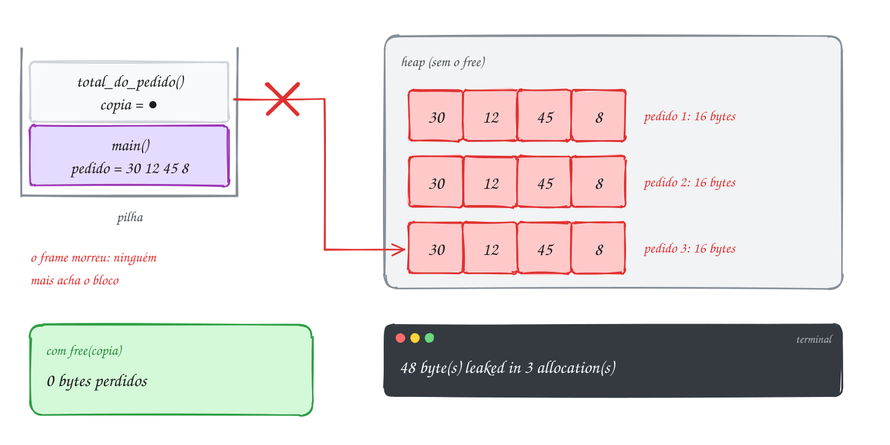</p>

O relatório da versão quebrada, sem o `free` (salva como `pedido.c`). Leia de
cima para baixo: o tipo do erro, quanto vazou e a pilha de chamadas que fez o
`malloc`:

```text
==12072==ERROR: LeakSanitizer: detected memory leaks

Direct leak of 48 byte(s) in 3 object(s) allocated from:
    #0 0x7f1503afd9c7 in malloc
    #1 0x55bff3c602ef in total_do_pedido pedido.c:5
    #2 0x55bff3c6071c in main pedido.c:20

SUMMARY: AddressSanitizer: 48 byte(s) leaked in 3 allocation(s).
```

A versão corrigida tem uma linha a mais:

```c
#include <stdio.h>
#include <stdlib.h>

int total_do_pedido(const int *precos, int itens) {
    int *copia = malloc(itens * sizeof *copia);
    if (copia == NULL) {
        return -1;
    }
    int total = 0;
    for (int i = 0; i < itens; i++) {
        copia[i] = precos[i];
        total += copia[i];
    }
    free(copia); // sem esta linha, cada pedido deixaria 16 bytes para trás
    return total;
}

int main(void) {
    int pedido[] = {30, 12, 45, 8};
    for (int p = 1; p <= 3; p++) {
        printf("Pedido %d: R$ %d\n", p, total_do_pedido(pedido, 4));
    }
    return 0;
}
// Saída:
// Pedido 1: R$ 95
// Pedido 2: R$ 95
// Pedido 3: R$ 95
```

O `free` precisa estar no caminho antes do `return`,
porque o `return` destrói a única variável que sabia onde o bloco estava:

<p align="center">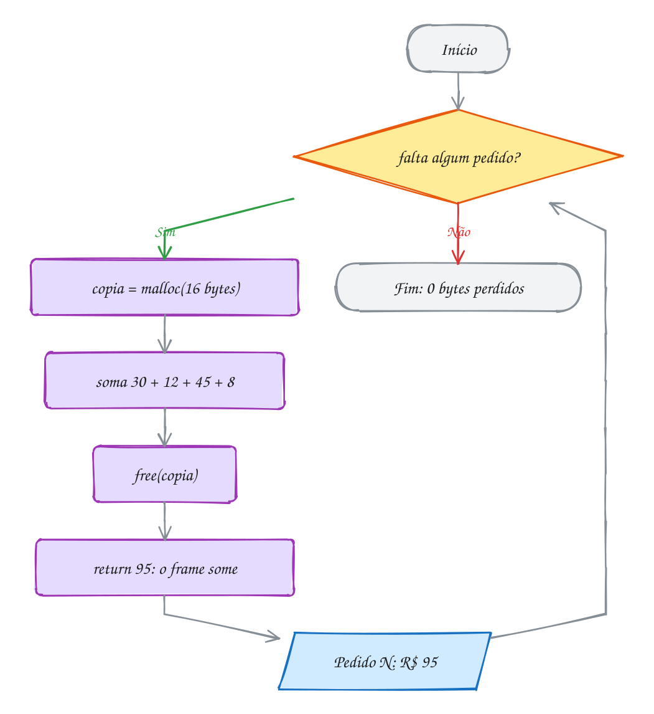</p>

> [!WARNING]
> "Rodou e deu a saída certa" não prova nada em C. Uso depois do `free`,
> estouro de um byte e leitura de lixo são **comportamento indefinido**: o
> programa pode funcionar hoje, mostrar outro valor amanhã e quebrar só com
> outro compilador. Rode sempre com o ASan (o `rodar` já faz isso) e, quando
> desconfiar, com `rodar --valgrind`. Saída certa **e** relatório limpo.

> [!TIP]
> **Por dentro do C:** o ASan reserva 1 byte de "memória sombra" para cada 8
> bytes do programa. Em volta de cada bloco do `malloc` ele deixa uma zona
> envenenada (*redzone*); todo acesso confere a sombra antes. Os blocos
> liberados ficam um tempo de quarentena sem ser reaproveitados, e assim ele
> consegue dizer "isto foi liberado lá na linha 31". O custo: o
> programa fica uns 2 vezes mais lento e usa mais memória. Por isso o ASan é
> ferramenta de desenvolvimento, não de produção.

> [!NOTE]
> **Pergunta para você:** se `free(p); p = NULL;` vira hábito, o que acontece
> com um `free(p)` repetido por engano? E com um `p[0] = 5;` depois disso?
> Qual dos dois o hábito resolve de vez?

### Hora de praticar

Arquivos em [`0057-erros-de-memoria/`](07-memoria-dinamica/0057-erros-de-memoria/).

**Exemplo A113 · Todo caminho de saída libera**

```c
#include <stdio.h>
#include <stdlib.h>

// Copia as notas de um aluno e calcula a média. Uma nota fora de 0 a 10
// cancela tudo, e a função sai mais cedo: esse return também precisa do free.
// Devolve -1 se a lista for inválida ou faltar memória.
double media_valida(const double *notas, int n) {
    double *copia = malloc(n * sizeof *copia);
    if (copia == NULL) {
        return -1; // nada foi alocado: nada a liberar
    }
    double soma = 0;
    for (int i = 0; i < n; i++) {
        if (notas[i] < 0 || notas[i] > 10) {
            printf("  nota %d inválida: %.1f\n", i + 1, notas[i]);
            free(copia); // a saída de erro é a que mais esquece
            return -1;
        }
        copia[i] = notas[i];
        soma += copia[i];
    }
    free(copia); // a saída normal
    return soma / n;
}

int main(void) {
    double ana[] = {7.5, 8.0, 9.0};
    double beto[] = {6.0, 11.0, 7.0}; // alguém digitou 11
    double caio[] = {5.0, 7.0, 6.0};

    const double *turma[] = {ana, beto, caio};
    const char *nomes[] = {"Ana", "Beto", "Caio"};
    for (int a = 0; a < 3; a++) {
        printf("%s:\n", nomes[a]);
        double m = media_valida(turma[a], 3);
        if (m < 0) {
            printf("  sem média\n");
        } else {
            printf("  média %.1f\n", m);
        }
    }
    return 0;
}
// Saída:
// Ana:
//   média 8.2
// Beto:
//   nota 2 inválida: 11.0
//   sem média
// Caio:
//   média 6.0
//
// Apague o free(copia) de dentro do if e rode de novo: Ana e Caio continuam
// certos, mas no fim o LeakSanitizer acusa 24 bytes em 1 bloco, o do Beto.
// Vazamento em caminho de erro é traiçoeiro: só aparece quando o erro
// acontece. Antes de cada return, pergunte: o que já foi alocado aqui?
```

```bash
~/LPEDC/rodar 07-memoria-dinamica/0057-erros-de-memoria/A113.c
```

**Exemplo A114 · Free, NULL e valgrind**

```c
#include <stdio.h>
#include <stdlib.h>

int main(void) {
    int noites = 3;
    int *diarias = malloc(noites * sizeof *diarias); // reserva do hotel
    if (diarias == NULL) {
        return 1;
    }
    diarias[0] = 220;
    diarias[1] = 220;
    diarias[2] = 310; // sábado é mais caro

    int total = 0;
    for (int i = 0; i < noites; i++) {
        total += diarias[i];
    }
    printf("Reserva: %d noites, R$ %d\n", noites, total);

    // o hóspede cancelou
    free(diarias);
    diarias = NULL; // hábito: o ponteiro solto vira um ponteiro vazio

    free(diarias); // por engano, de novo: free(NULL) não faz nada
    if (diarias == NULL) { // dá para perguntar antes de usar
        printf("Reserva cancelada: nada a mostrar\n");
    }
    return 0;
}
// Saída:
// Reserva: 3 noites, R$ 750
// Reserva cancelada: nada a mostrar
//
// Rode também com o valgrind: ~/LPEDC/rodar --valgrind 07-memoria-dinamica/0057-erros-de-memoria/A114.c
// O fim da saída mostra o balanço do heap (o número entre == muda):
//   ==4242== HEAP SUMMARY:
//   ==4242==     in use at exit: 0 bytes in 0 blocks
//   ==4242==   total heap usage: 2 allocs, 2 frees, 4,108 bytes allocated
//   ==4242== All heap blocks were freed -- no leaks are possible
//   ==4242== ERROR SUMMARY: 0 errors from 0 contexts (suppressed: 0 from 0)
// São 2 allocs: o seu e o buffer que o printf pediu para ele mesmo.
```

```bash
~/LPEDC/rodar 07-memoria-dinamica/0057-erros-de-memoria/A114.c
```

#### Exercícios

**Exercício E337** · ★☆☆

O painel da rodoviária monta 4 avisos, um de cada vez. A saída está certa,
mas o programa vaza memória. O erro está de propósito. Rode e leia o
relatório do LeakSanitizer. Depois conserte e acrescente dois contadores,
um somado a cada malloc e outro a cada free, mostrados no fim: eles têm
que bater, e o LeakSanitizer tem que ficar quieto.


```text
Saída esperada depois do conserto:
Aviso: Ônibus para Belém às 08h
Aviso: Ônibus para Macapá às 09h
Aviso: Ônibus para Santarém às 11h
Aviso: Ônibus para Manaus às 14h
malloc: 4 | free: 4
```

**Dicas:**

1. Conte quantos malloc e quantos free acontecem durante a execução.
2. A cada volta, msg recebe um endereço novo. O que acontece com o
   anterior?
3. Resposta esperada: a saída acima. Antes do conserto, o relatório diz
   "Direct leak of 192 byte(s) in 3 object(s)": 4 malloc de 64 bytes e só
   1 free (o do último bloco, depois do laço). Conserto: free(msg) dentro
   do laço, depois do printf, e apagar o free de fora.

```bash
~/LPEDC/rodar 07-memoria-dinamica/0057-erros-de-memoria/E337.c
```

**Exercício E338** · ★☆☆

Cada função abaixo tem UM erro de memória, de propósito, e cada uma gera
um relatório diferente do AddressSanitizer:


```text
heap-buffer-overflow    heap-use-after-free    attempting double-free
SEGV on unknown address 0x000000000000    LeakSanitizer: memory leaks
```


O gcc até avisa sobre dois deles. O ASan para no primeiro erro: rode, leia
a primeira linha do relatório, ache a função culpada pela pilha de
chamadas e conserte com a menor mudança possível. Rode de novo e repita
até as cinco linhas saírem e o programa terminar sem relatório nenhum.


```text
Saída esperada depois dos consertos:
a) Notas: 7 8 9 10
b) Saldo: R$ 150
c) Senha 42 atendida
d) Cupom: 15% de desconto
e) Vagas livres: 3
```

**Dicas:**

1. "0 bytes after 16-byte region" quer dizer "logo depois do último byte
   de um bloco de 16 bytes": 4 ints, índices 0 a 3.
2. O endereço 0x0 é o NULL. O vazamento só é acusado no fim, quando todo
   o resto já está certo.
3. Resposta esperada: a saída acima. a) i <= 4 vira i < 4 (estouro);
   b) o printf vem antes do free (uso depois do free); c) apague o
   segundo free (free duplo); d) acrescente free(cupom) (vazamento);
   e) o ponteiro NULL precisa de um bloco: malloc e conferir o NULL antes
   de escrever (e free no fim).

```bash
~/LPEDC/rodar 07-memoria-dinamica/0057-erros-de-memoria/E338.c
```

**Exercício E339** · ★★☆

O placar do campeonato de futsal da firma guarda os gols dos 3 times. O
programa tem um erro de propósito (o gcc até avisa). Rode e leia o aviso e
o relatório. Depois conserte fazendo de backup uma cópia DE VERDADE, num
bloco só dele. Para provar que ficou independente, zere placar[0] (o
jogo foi anulado) antes de mostrar os dois.


```text
Saída esperada depois do conserto:
Placar: 0 2 7
Backup: 4 2 7
Placar encerrado
```

**Dicas:**

1. Procure "attempting double-free". Quantos blocos existem? Quantos
   free?
2. backup = placar copia o ENDEREÇO, não os números.
3. Resposta esperada: a saída acima. No original, placar e backup apontam
   para o MESMO bloco e liberar os dois é free duplo. Com
   int *backup = malloc(3 * sizeof *backup); e um laço que copia os 3
   números, são dois blocos: aí, sim, cada um tem o seu free.

```bash
~/LPEDC/rodar 07-memoria-dinamica/0057-erros-de-memoria/E339.c
```

**Exercício E340** · ★★☆

O sistema do estacionamento guarda a placa do carro e os km rodados nos
últimos 5 dias. O programa tem DOIS estouros de memória, de propósito. O
AddressSanitizer para no primeiro: conserte, rode de novo e ache o
segundo.


```text
Saída esperada depois do conserto:
Placa: QTX3E21
Km da semana: 238
```

**Dicas:**

1. Quantos bytes "QTX3E21" ocupa de verdade?
2. O vetor km tem 5 posições: índices de 0 a 4.
3. Resposta esperada: (a) malloc(strlen(original)) esquece o '\0': o
   strcpy escreve 1 byte depois do fim (heap-buffer-overflow, WRITE of
   size 8). Use strlen(original) + 1. (b) o for com i <= dias lê km[5],
   4 bytes depois do fim do bloco. Use i < dias. Total: 238.

```bash
~/LPEDC/rodar 07-memoria-dinamica/0057-erros-de-memoria/E340.c
```

**Exercício E341** · ★★★

A lista de presença de uma aula de yoga começa com 2 vagas e a função
adicionar faz o vetor crescer. Com o rodar, o programa quebra com um
relatório do AddressSanitizer na 4ª chegada. O erro está de propósito: o
main fica com um ponteiro solto, mesmo com a função adicionar "certa" por
dentro. Conserte mudando a assinatura de adicionar e rode de novo até a
lista sair completa, sem relatório.


```text
Saída esperada depois do conserto:
Presentes: 11 27 35 48
```

**Dicas:**

1. O parâmetro v é uma cópia do ponteiro do main (passagem por valor,
   assunto 0029). O realloc muda a cópia, não o original.
2. Duas saídas: devolver o ponteiro novo (int *adicionar(...)) ou
   receber o endereço do ponteiro (int **v, assunto 0049).
3. Resposta esperada: na 3ª chegada o realloc mudou o bloco de lugar e
   liberou o antigo, mas só a cópia local v recebeu o endereço novo; o
   alunos do main continua apontando para o bloco antigo, de 2 vagas e já
   liberado. Na 4ª chegada, a função grava alunos[3] lá (o ASan acusa
   heap-buffer-overflow, porque o endereço cai depois do fim do bloco
   antigo; se caísse dentro, seria heap-use-after-free). Com
   int adicionar(int **v, int *qtd, int *cap, int matricula) e
   *v = maior; dentro, e adicionar(&alunos, ...) no main, a saída fica
   "Presentes: 11 27 35 48".

```bash
~/LPEDC/rodar 07-memoria-dinamica/0057-erros-de-memoria/E341.c
```

**Exercício E342** · ★★★

O artilheiro do bairro jogou 4 das 5 rodadas; a 5ª ainda não aconteceu e
deveria contar 0 gols. Este programa tem um erro de propósito que o
AddressSanitizer NÃO acusa. Faça assim:

1) rode com o rodar e veja o total;
2) rode com ~/LPEDC/rodar --valgrind e leia a primeira mensagem;
3) conserte trocando a função que aloca o bloco e rode de novo com os

```text
 dois.
```


```text
Saída esperada depois do conserto:
Total: 6 gols
Média por rodada: 1.2
```

**Dicas:**

1. Quem deu valor para gols[4]?
2. O valgrind avisa "Conditional jump or move depends on uninitialised
   value(s)" e, com a opção que o rodar já liga, mostra onde o bloco foi
   criado.
3. Resposta esperada: gols[4] nunca recebeu valor e o malloc entrega lixo
   (com o ASan, o lixo é sempre 0xbebebebe, um número negativo enorme).
   O ASan vigia limites e blocos liberados, não valores; o valgrind
   acompanha se cada byte já foi escrito. Conserto: trocar malloc(5 *
   sizeof *gols) por calloc(5, sizeof *gols).

```bash
~/LPEDC/rodar 07-memoria-dinamica/0057-erros-de-memoria/E342.c
```

---

## 0058 · Juntando tudo

O mercadinho da esquina ainda anota o fiado num caderno: nome do cliente e
quanto ele deve. Cliente novo ganha uma linha; cliente antigo soma na conta
dele; quem paga zera. O caderno nunca tem um número fixo de páginas, e cada
nome tem um tamanho. O programa do caderno junta o módulo inteiro:

- **heap** (0053): o caderno precisa durar o programa todo e crescer, então
  mora no heap, não na pilha;
- **malloc e free** (0054): cada nome é copiado para um bloco do tamanho
  exato com `duplicar`, o `strlen + 1` de sempre;
- **realloc** (0055): dois vetores paralelos (`nomes` e `centavos`) dobram de
  capacidade juntos quando enchem, sempre com ponteiro temporário;
- **vetor de ponteiros** (0056): `char **nomes` é um vetor de `char *`, cada
  um apontando para o seu bloco, como as linhas de uma matriz dinâmica com
  tamanhos diferentes;
- **erros de memória** (0057): para liberar, primeiro cada nome, depois os
  dois vetores. Nada sobra no heap.

Uma novidade: `crescer` recebe `char ***nomes`. É a mesma regra do E341 do
assunto anterior. A função precisa **mudar** o
ponteiro `nomes` do `main` (o `realloc` pode trocar o endereço), então recebe
o endereço dele. `nomes` é `char **`; o endereço de `nomes` é `char ***`. O
mesmo vale para `int **centavos`.

Valores em centavos, como fazem os sistemas de pagamento: `int` não tem erro
de arredondamento, e R$ 12,50 vira `1250`.

Chegam seis anotações: Dona Cida (R$ 12,50), Seu Jorge
(R$ 8,30), Dona Cida de novo (R$ 4,70), Bia (R$ 20,00), Tonho (R$ 3,15) e
Rosa (R$ 5,60). São 5 clientes diferentes, então o caderno cresce de 2 para
4 e de 4 para 8. Depois Seu Jorge paga tudo:

<p align="center">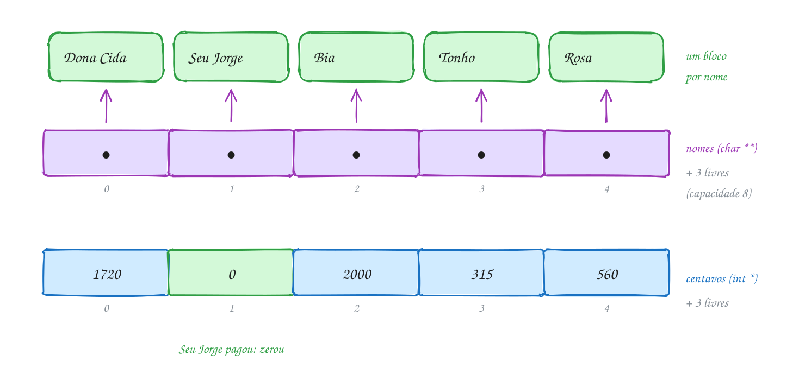</p>

Leia função por função: cada uma cuida de uma coisa e nenhuma esquece um
`free`:

```c
#include <stdio.h>
#include <stdlib.h>
#include <string.h>

// Cópia de uma string num bloco do tamanho exato.
char *duplicar(const char *texto) {
    char *copia = malloc(strlen(texto) + 1);
    if (copia != NULL) {
        strcpy(copia, texto);
    }
    return copia;
}

// Dobra a capacidade dos dois vetores paralelos. Recebe o ENDEREÇO dos
// ponteiros do main (char *** e int **) porque o realloc pode mudá-los.
int crescer(char ***nomes, int **centavos, int *cap) {
    int nova = *cap * 2;
    char **mais_nomes = realloc(*nomes, nova * sizeof **nomes);
    if (mais_nomes == NULL) {
        return 0;
    }
    *nomes = mais_nomes;
    int *mais_centavos = realloc(*centavos, nova * sizeof **centavos);
    if (mais_centavos == NULL) {
        return 0;
    }
    *centavos = mais_centavos;
    printf("(caderno cresceu: %d -> %d clientes)\n", *cap, nova);
    *cap = nova;
    return 1;
}

int buscar(char **nomes, int qtd, const char *nome) {
    for (int i = 0; i < qtd; i++) {
        if (strcmp(nomes[i], nome) == 0) {
            return i;
        }
    }
    return -1;
}

// Soma uma compra na conta do cliente; cria a conta se ela não existe.
int anotar(char ***nomes, int **centavos, int *qtd, int *cap, const char *nome, int valor) {
    int i = buscar(*nomes, *qtd, nome);
    if (i >= 0) {
        (*centavos)[i] += valor;
        return 1;
    }
    if (*qtd == *cap && !crescer(nomes, centavos, cap)) {
        return 0;
    }
    char *copia = duplicar(nome);
    if (copia == NULL) {
        return 0;
    }
    (*nomes)[*qtd] = copia;
    (*centavos)[*qtd] = valor;
    (*qtd)++;
    return 1;
}

void liberar(char **nomes, int *centavos, int qtd) {
    for (int i = 0; i < qtd; i++) {
        free(nomes[i]); // cada nome é um bloco
    }
    free(nomes);        // depois o vetor de ponteiros
    free(centavos);
}

int main(void) {
    int qtd = 0;
    int cap = 2;
    char **nomes = malloc(cap * sizeof *nomes);
    int *centavos = malloc(cap * sizeof *centavos);
    if (nomes == NULL || centavos == NULL) {
        free(nomes);
        free(centavos);
        return 1;
    }

    const char *quem[] = {"Dona Cida", "Seu Jorge", "Dona Cida", "Bia", "Tonho", "Rosa"};
    int valor[] = {1250, 830, 470, 2000, 315, 560}; // em centavos
    for (int k = 0; k < 6; k++) {
        if (!anotar(&nomes, &centavos, &qtd, &cap, quem[k], valor[k])) {
            liberar(nomes, centavos, qtd);
            return 1;
        }
    }

    int i = buscar(nomes, qtd, "Seu Jorge"); // Seu Jorge pagou tudo
    if (i >= 0) {
        centavos[i] = 0;
    }

    int total = 0;
    for (int k = 0; k < qtd; k++) {
        printf("%-10s R$ %3d.%02d\n", nomes[k], centavos[k] / 100, centavos[k] % 100);
        total += centavos[k];
    }
    printf("Total na rua: R$ %d.%02d\n", total / 100, total % 100);

    liberar(nomes, centavos, qtd);
    return 0;
}
// Saída:
// (caderno cresceu: 2 -> 4 clientes)
// (caderno cresceu: 4 -> 8 clientes)
// Dona Cida  R$  17.20
// Seu Jorge  R$   0.00
// Bia        R$  20.00
// Tonho      R$   3.15
// Rosa       R$   5.60
// Total na rua: R$ 45.95
```

Cada anotação passa por uma busca. Achou, soma; não
achou, talvez cresça e cria uma linha nova. Todo caminho de erro termina em
`liberar`:

<p align="center">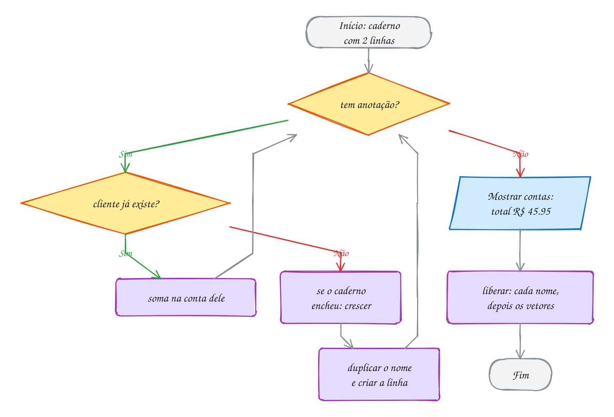</p>

> [!WARNING]
> Liberar só `nomes` vaza todos os nomes: cada `nomes[i]` é um bloco
> separado, com o seu `malloc` (dentro de `duplicar`). Conte os `malloc` do
> programa: 2 no começo, 5 nomes e os `realloc`, que trocam um bloco por
> outro. No fim, `liberar` faz 5 + 2 `free`. Rode com `rodar --valgrind` e
> confira a linha `All heap blocks were freed`.

> [!TIP]
> **Por dentro do C:** os dois vetores paralelos são um remendo para a falta
> de um jeito de agrupar "nome e saldo" numa coisa só, que a `struct`
> resolve no módulo 08: um vetor de `struct cliente` com um `realloc`
> só. Mesmo assim, o desenho na memória continua parecido: o nome é um
> `char *` que aponta para um bloco do heap, e a struct guarda só os 8 bytes
> do ponteiro.

> [!NOTE]
> **Pergunta para você:** se Dona Cida pagar e você quiser **apagar** a linha
> dela (e não só zerar), o que precisa acontecer com `nomes[0]`, com as
> linhas de baixo e com `qtd`? Quantos `free` essa remoção faz?

### Hora de praticar

Arquivos em [`0058-juntando-tudo/`](07-memoria-dinamica/0058-juntando-tudo/).

**Exemplo A115 · A agenda em que cada linha cresce sozinha**

```c
#include <stdio.h>
#include <stdlib.h>
#include <string.h>

// Cópia de uma string num bloco do tamanho exato.
char *duplicar(const char *texto) {
    char *copia = malloc(strlen(texto) + 1);
    if (copia != NULL) {
        strcpy(copia, texto);
    }
    return copia;
}

// Põe um horário na linha do barbeiro b. Só ESSA linha cresce: as outras
// nem ficam sabendo. Devolve 0 se faltar memória.
int agendar(int **horarios, int *qtd, int *cap, int b, int hora) {
    if (qtd[b] == cap[b]) {
        int nova = cap[b] == 0 ? 1 : cap[b] * 2;
        int *maior = realloc(horarios[b], nova * sizeof *maior); // NULL na 1ª vez
        if (maior == NULL) {
            return 0;
        }
        horarios[b] = maior;
        cap[b] = nova;
    }
    horarios[b][qtd[b]] = hora;
    qtd[b]++;
    return 1;
}

void liberar(char **nomes, int **horarios, int *qtd, int *cap, int n) {
    for (int b = 0; b < n; b++) {
        free(nomes[b]);    // cada nome é um bloco
        free(horarios[b]); // cada linha também (free(NULL) não faz nada)
    }
    free(nomes);
    free(horarios);
    free(qtd);
    free(cap);
}

int main(void) {
    const char *equipe[] = {"Juca", "Neide", "Rafa"};
    int n = 3;

    // calloc: linhas começam NULL e contadores começam em 0
    char **nomes = calloc(n, sizeof *nomes);
    int **horarios = calloc(n, sizeof *horarios);
    int *qtd = calloc(n, sizeof *qtd);
    int *cap = calloc(n, sizeof *cap);
    if (nomes == NULL || horarios == NULL || qtd == NULL || cap == NULL) {
        liberar(nomes, horarios, qtd, cap, 0);
        return 1;
    }
    for (int b = 0; b < n; b++) {
        nomes[b] = duplicar(equipe[b]);
        if (nomes[b] == NULL) {
            liberar(nomes, horarios, qtd, cap, n);
            return 1;
        }
    }

    // pedidos do dia: barbeiro escolhido e horário
    int quem[] = {1, 0, 1, 1, 2, 1, 0};
    int hora[] = {9, 10, 11, 13, 14, 15, 16};
    for (int k = 0; k < 7; k++) {
        if (!agendar(horarios, qtd, cap, quem[k], hora[k])) {
            liberar(nomes, horarios, qtd, cap, n);
            return 1;
        }
    }

    for (int b = 0; b < n; b++) {
        printf("%-6s (%d de %d):", nomes[b], qtd[b], cap[b]);
        for (int j = 0; j < qtd[b]; j++) {
            printf(" %dh", horarios[b][j]);
        }
        printf("\n");
    }

    liberar(nomes, horarios, qtd, cap, n);
    return 0;
}
// Saída:
// Juca   (2 de 2): 10h 16h
// Neide  (4 de 4): 9h 11h 13h 15h
// Rafa   (1 de 1): 14h
//
// É uma matriz irregular que muda de forma enquanto o programa roda: a linha
// da Neide cresceu 1 -> 2 -> 4 e a do Rafa ficou com 1. No fim existem 10
// blocos (4 de controle, 3 nomes e 3 linhas), e liberar faz 10 free.
```

```bash
~/LPEDC/rodar 07-memoria-dinamica/0058-juntando-tudo/A115.c
```

**Exemplo A116 · Uma linha de qualquer tamanho**

```c
#include <stdio.h>
#include <stdlib.h>

// Lê uma linha inteira, de qualquer tamanho, num bloco que cresce.
// Devolve NULL no fim da entrada (ou se faltar memória). Quem chama libera.
char *ler_linha(void) {
    int cap = 4;
    int qtd = 0;
    char *linha = malloc(cap);
    if (linha == NULL) {
        return NULL;
    }
    int c;
    while ((c = getchar()) != EOF && c != '\n') {
        if (qtd + 1 == cap) { // + 1: sempre sobra lugar para o '\0'
            char *maior = realloc(linha, cap * 2);
            if (maior == NULL) {
                free(linha);
                return NULL;
            }
            linha = maior;
            cap *= 2;
        }
        linha[qtd++] = (char)c;
    }
    if (c == EOF && qtd == 0) { // acabou a entrada
        free(linha);
        return NULL;
    }
    linha[qtd] = '\0';
    return linha;
}

int main(void) {
    char *nome;
    int n = 0;
    while ((nome = ler_linha()) != NULL) {
        n++;
        int tamanho = 0;
        while (nome[tamanho] != '\0') {
            tamanho++;
        }
        printf("Nome %d (%d bytes): %s\n", n, tamanho, nome);
        free(nome); // cada linha é um bloco novo
    }
    return 0;
}
// Exemplo de uso (os nomes vêm do teclado; Ctrl+D encerra):
// Ana
// Nome 1 (3 bytes): Ana
// Maria Eduarda dos Santos
// Nome 2 (24 bytes): Maria Eduarda dos Santos
//
// Para testar: printf 'Ana\nMaria Eduarda dos Santos\n' | ~/LPEDC/rodar 07-memoria-dinamica/0058-juntando-tudo/A116.c
// Nenhum fgets com tamanho fixo: o bloco cresce 4 -> 8 -> 16 -> 32.
```

```bash
~/LPEDC/rodar 07-memoria-dinamica/0058-juntando-tudo/A116.c
```

#### Exercícios

**Exercício E343** · ★☆☆

Leia 3 nomes com fgets num buffer de 100 chars. Para cada um, tire o '\n'
e guarde uma CÓPIA de tamanho exato no heap, num vetor char *nomes[3].
Depois mostre cada nome com quantos bytes o bloco dele ocupa e libere
tudo.


```text
Exemplo de uso:
Nome 1: Ana
Nome 2: Joao Pedro
Nome 3: Lu
Ana (4 bytes)
Joao Pedro (11 bytes)
Lu (3 bytes)
```


Para testar: printf 'Ana\nJoao Pedro\nLu\n' | ~/LPEDC/rodar <este arquivo>

**Dicas:**

1. O buffer de 100 é só a área de leitura, reaproveitada a cada nome. Os
   nomes de verdade vão para blocos de strlen + 1.
2. buffer[strcspn(buffer, "\n")] = '\0'; tira o '\n' (assunto 0042).
3. Resposta esperada: a saída acima: o bloco de cada nome tem strlen + 1
   bytes. 3 malloc, 3 free. Se guardasse o próprio buffer em nomes[i], os
   três ponteiros apontariam para o mesmo lugar e mostrariam "Lu" três
   vezes.

```bash
~/LPEDC/rodar 07-memoria-dinamica/0058-juntando-tudo/E343.c
```

**Exercício E344** · ★☆☆

Escreva duas funções para a lista de compras:


```text
char **criar_lista(const char *itens[], int n);
void liberar_lista(char **lista, int n);
```


criar_lista aloca um vetor de n ponteiros e uma cópia de cada item. Teste
com "pao", "leite", "cafe" e "manteiga", mostre a lista e calcule quantos
blocos e quantos bytes foram pedidos ao heap (num PC de 64 bits).


```text
Saída esperada:
- pao
- leite
- cafe
- manteiga
5 blocos, 56 bytes
```

**Dicas:**

1. O vetor de ponteiros é 1 bloco de 4 * 8 = 32 bytes; cada item é mais
   1 bloco de strlen + 1.
2. Some os bytes dentro de criar_lista ou num laço à parte com sizeof e
   strlen.
3. Resposta esperada: 5 blocos e 56 bytes (32 + 4 + 6 + 5 + 9).
   liberar_lista faz 5 free: cada item e depois o vetor.

```bash
~/LPEDC/rodar 07-memoria-dinamica/0058-juntando-tudo/E344.c
```

**Exercício E345** · ★★☆

Leia frutas, uma por linha, até aparecer a palavra fim. Guarde cada uma
num vetor de strings (char **) que começa com capacidade 1 e dobra quando
enche. Mostre as frutas na ordem contrária e quantas vezes o vetor
cresceu.


```text
Exemplo de uso:
uva
manga
caju
acerola
fim
Ao contrário: acerola caju manga uva
O vetor cresceu 2 vezes
```


Para testar: printf 'uva\nmanga\ncaju\nacerola\nfim\n' | ~/LPEDC/rodar <este arquivo>

**Dicas:**

1. Leia com fgets num buffer, tire o '\n' e compare com strcmp(buffer,
   "fim").
2. O realloc é no vetor de ponteiros (sizeof(char *) por posição); cada
   fruta ganha o seu próprio malloc de strlen + 1.
3. Resposta esperada: "Ao contrário: acerola caju manga uva" e 2 vezes
   (1 -> 2 -> 4). No fim, um free por fruta e um para o vetor.

```bash
~/LPEDC/rodar 07-memoria-dinamica/0058-juntando-tudo/E345.c
```

**Exercício E346** · ★★☆

Leia a quantidade de alunos e de provas e depois as notas, linha por
linha. Guarde numa matriz dinâmica de double (vetor de ponteiros) e
mostre a média de cada aluno e a da turma. As médias de cada aluno também
vão para um vetor alocado.


```text
Exemplo de uso:
Alunos e provas: 3 2
Notas do aluno 1: 7 8
Notas do aluno 2: 5 6
Notas do aluno 3: 9 10
Aluno 1: 7.5
Aluno 2: 5.5
Aluno 3: 9.5
Turma: 7.5
```


Para testar: printf '3 2\n7 8\n5 6\n9 10\n' | ~/LPEDC/rodar <este arquivo>

**Dicas:**

1. double **notas = malloc(alunos * sizeof *notas); e uma linha de
   provas doubles para cada aluno.
2. double *medias = malloc(alunos * sizeof *medias);
3. Resposta esperada: a saída acima. São alunos + 2 malloc (3 linhas, o
   vetor de linhas e as médias) e o mesmo número de free.

```bash
~/LPEDC/rodar 07-memoria-dinamica/0058-juntando-tudo/E346.c
```

**Exercício E347** · ★★★

Uma versão apressada do caderninho de fiado. Ela tem TRÊS problemas de
memória, de propósito. O AddressSanitizer acha dois (um durante a
execução, outro no fim); o terceiro só aparece quando falta memória, e
você tem que achar lendo. Conserte os três.


```text
Saída esperada depois do conserto:
Cida: R$ 12
Jorge: R$ 8
Bia: R$ 20
```

**Dicas:**

1. Comece pelo heap-buffer-overflow: quantos bytes copiar precisa?
2. Depois o vazamento: quantos malloc existem? Quantos free?
3. O terceiro está na linha do realloc.
4. Resposta esperada: (a) copiar faz malloc(strlen(s)) sem o + 1 do
   '\0'; (b) o fim libera só nomes, e cada nomes[i] vaza: faça um free
   por nome antes; (c) nomes = realloc(nomes, ...) perde o bloco se
   falhar: use um ponteiro temporário.

```bash
~/LPEDC/rodar 07-memoria-dinamica/0058-juntando-tudo/E347.c
```

**Exercício E348** · ★★★

Escreva a função


```text
char **dividir(const char *texto, char separador, int *qtd);
```


que quebra o texto em pedaços pelo separador e devolve um vetor NOVO de
strings NOVAS, cada uma do tamanho exato.
A quantidade volta por *qtd. Teste com a lista do mercado
"arroz;feijao;cafe;oleo de soja" e com ";;", que tem 3 pedaços vazios.


```text
Saída esperada:
4 itens: [arroz] [feijao] [cafe] [oleo de soja]
3 itens: [] [] []
```

**Dicas:**

1. Primeira passada: conte os separadores. São separadores + 1 pedaços.
2. Segunda passada: para cada pedaço, ache o início e o tamanho, faça o
   malloc(tamanho + 1), copie os chars e ponha o '\0'. Pedaço vazio é um
   bloco de 1 byte só com o '\0'.
3. Resposta esperada: a saída acima. Escreva também liberar_pedacos(v, n)
   e chame para os dois resultados. Se um malloc falhar no meio, libere o
   que já foi feito e devolva NULL.

```bash
~/LPEDC/rodar 07-memoria-dinamica/0058-juntando-tudo/E348.c
```

---

## Desafios do módulo

Problemas para resolver num arquivo seu, rodando com o `rodar` (e com
`rodar --valgrind` quando quiser a segunda opinião). A versão final de cada
um precisa terminar sem nenhum relatório de erro.

**1. Apagar do caderno.** No caderninho de fiado do texto do assunto 0058,
escreva `int remover(char **nomes, int *centavos, int *qtd, const char *nome)`,
que apaga a linha do cliente e puxa as de baixo para cima. Teste removendo
"Seu Jorge" e mostre o caderno.

<details><summary>Resposta</summary>

Ficam Dona Cida (17.20), Bia (20.00), Tonho (3.15) e Rosa (5.60), total
R$ 45.95. O caminho: ache o índice `i`, faça `free(nomes[i])` (o nome é um
bloco), depois copie `nomes[k] = nomes[k + 1]` e `centavos[k] = centavos[k + 1]`
para `k` de `i` até `qtd - 2` e faça `(*qtd)--`. Um `free` só: os ponteiros
puxados continuam apontando para os mesmos blocos.

</details>

**2. A matriz de dois mallocs.** Escreva `int **criar_matriz(int l, int c)`
que usa só dois `malloc`: um bloco com os `l * c` inteiros e um vetor de `l`
ponteiros com `m[i] = bloco + i * c`. Escreva também o `liberar`. Teste com
uma matriz 3 x 4 preenchida com `i * 4 + j` e mostre `m[2][3]`.

<details><summary>Resposta</summary>

`m[2][3]` vale **11**. Para liberar: `free(m[0])` (é o endereço do bloco de
dados) e `free(m)`. Dois `malloc`, dois `free`, dados contíguos e a notação
`m[i][j]` preservada. Cuidado: `free(m[1])` seria um erro, porque `m[1]` não
veio de um `malloc`.

</details>

**3. Matriz simétrica econômica.** Numa tabela de distâncias entre 4
cidades, `d[i][j] == d[j][i]` e a diagonal é 0. Guarde só o triângulo de baixo
(com a diagonal) num vetor alocado com `malloc` de `n * (n + 1) / 2`
posições, com o elemento `(i, j)`, `i >= j`, em `i * (i + 1) / 2 + j`.
Escreva `int indice(int i, int j)`, que troca `i` e `j` quando `i < j`.
Preencha o vetor com a tabela `{{0, 12, 30, 25}, {12, 0, 18, 40}, {30, 18,
0, 22}, {25, 40, 22, 0}}` (só o triângulo de baixo), imprima quantas
posições o vetor tem, os índices de `(3, 1)` e de `(1, 3)` e, por fim, a
tabela 4 x 4 inteira lida só do vetor, com `%4d`.

<details><summary>Resposta</summary>

```
posicoes: 10 (matriz cheia: 16)
(3,1) -> 7   (1,3) -> 7
   0  12  30  25
  12   0  18  40
  30  18   0  22
  25  40  22   0
```

Dica: preencha com dois laços, `j` indo só até `i`, gravando
`d[indice(i, j)] = dist[i][j]`. Na hora de imprimir, os dois laços vão até
`n` e o `indice` cuida da metade de cima: `(1, 3)` vira `(3, 1)`, índice
3 * 4 / 2 + 1 = 7. Com n = 1000, a economia passa de 499 mil posições.

</details>

**4. O gerente do heap.** O heap tem dois blocos livres, de 120 e de 60 bytes
(`int livre[2] = {120, 60}`), e chegam três pedidos: 30, 80 e 55. Escreva
`void simula(const char *nome, int best)` que atende os pedidos na ordem,
descontando do bloco escolhido, e imprime a cada pedido o bloco usado e o que
sobrou nos dois (ou "falhou"). Com `best == 0` é **first fit** (o primeiro
bloco que serve, olhando o 0 antes); com `best == 1` é **best fit** (o menor
bloco que serve). Chame as duas.

<details><summary>Resposta</summary>

```
first fit:
  30: bloco 0, livres 90 e 60
  80: bloco 0, livres 10 e 60
  55: bloco 1, livres 10 e 5
best fit:
  30: bloco 1, livres 120 e 30
  80: bloco 0, livres 40 e 30
  55: falhou (livres 40 e 30)
```

Dica: para cada pedido, percorra os dois blocos guardando o índice escolhido
(começando em -1); no first fit pare no primeiro que serve, no best fit troque
a escolha quando achar um bloco que serve e é menor. Escolher "o mais justo"
nem sempre é o melhor: deixa sobras pequenas demais. Os `malloc` reais usam
variações de first fit com listas por tamanho.

</details>

**5. Tem memória, mas não cabe.** Simule um heap de 1000 bytes com um
`char heap[1000]`, todo preenchido com `'.'` (livre). Escreva
`int aloca(char dono, int tam)`, que procura `tam` posições livres
**seguidas** a partir do começo, marca com a letra do dono e devolve o índice em que o
bloco começa (ou -1), e `void libera(char dono)`. Escreva também um
`relatorio` que imprime o total livre e o maior pedaço livre contíguo. Aloque
A = 300, B = 200 e C = 400, libere B, mostre o relatório e tente alocar
D = 250. Depois libere C, mostre o relatório e tente D de novo.

<details><summary>Resposta</summary>

```
A em 0
B em 300
C em 500
livres: 300, maior pedaco contiguo: 200
D (250) em -1
livres: 700, maior pedaco contiguo: 700
D (250) em 300
```

Dica: no `aloca`, conte uma "corrida" de livres (zere ao achar uma posição
ocupada); quando ela chegar a `tam`, o bloco começa em `i - tam + 1`. Há 300
bytes livres, mas em dois pedaços (200 onde era B e 100 no fim), e um bloco
precisa ser contíguo: é a **fragmentação externa**. Liberando C, os pedaços
se juntam num de 700.

</details>

**6. Repetir texto.** Escreva `char *repetir(const char *s, int n)` que
devolve uma string nova com `s` repetida `n` vezes. Quantos bytes
`repetir("ab", 3)` pede? E `repetir("ab", 0)`?

<details><summary>Resposta</summary>

`"ababab"` precisa de 2 * 3 + 1 = **7** bytes. Com n = 0, 1 byte só com o
`'\0'`: uma string vazia válida, que quem chama também precisa liberar.
Monte com `strcpy` no primeiro e `strcat` nos seguintes, ou copiando com um
índice.

</details>

**7. O vetor que encolhe.** Escreva um vetor dinâmico de `int` que começa
com capacidade 1, dobra com `realloc` quando enche e **corta pela metade**
quando a quantidade fica menor que um quarto da capacidade. Use
`int insere(int **v, int *qtd, int *cap, int x)` e
`void remove_fim(int **v, int *qtd, int *cap)`. Insira 10, 20, ..., 90 e
depois remova 6 vezes, imprimindo `qtd` e `cap` depois de cada operação.

<details><summary>Resposta</summary>

```
insere 10: qtd 1 cap 1
insere 20: qtd 2 cap 2
insere 30: qtd 3 cap 4
insere 40: qtd 4 cap 4
insere 50: qtd 5 cap 8
insere 60: qtd 6 cap 8
insere 70: qtd 7 cap 8
insere 80: qtd 8 cap 8
insere 90: qtd 9 cap 16
remove: qtd 8 cap 16
remove: qtd 7 cap 16
remove: qtd 6 cap 16
remove: qtd 5 cap 16
remove: qtd 4 cap 16
remove: qtd 3 cap 8
```

Dica: a função recebe `int **v` porque o `realloc` pode mudar o endereço do
bloco; use um ponteiro temporário e só troque `*v` se ele não for `NULL`. No
`remove_fim`, depois de `(*qtd)--`, teste `*cap > 1 && *qtd < *cap / 4`. O
"um quarto" (e não "metade") evita o vai e vem: com metade, um insere e um
remove alternados na fronteira fariam um `realloc` a cada operação.

</details>

**8. Dois nomes, um bloco.** Monte um programa com o trecho abaixo e rode
com o `rodar`:

```c
int *a = malloc(3 * sizeof *a);
int *b = a;
b[0] = 5;
free(a);
a = NULL;
printf("%d\n", b == NULL);
printf("%d\n", b[0]);
```

Anote o que aparece. Depois conserte: guarde o valor de `b[0]` numa variável
**antes** do `free`, zere os dois ponteiros e imprima
`guardado = ...` e `a == NULL: ..., b == NULL: ...`.

<details><summary>Resposta</summary>

A primeira versão mostra `0` e cai no `b[0]`: o compilador já avisa
`pointer 'b' used after 'free'` e o ASan acusa
`ERROR: AddressSanitizer: heap-use-after-free`. A consertada mostra:

```
guardado = 5
a == NULL: 1, b == NULL: 1
```

Dica: `a = NULL` muda só a variável `a`; `b` continua com o endereço do bloco
liberado (um ponteiro solto). Zerar o ponteiro ajuda, mas não substitui saber
**quem é o dono** do bloco.

</details>

**9. O vazamento a conta-gotas.** Escreva `void tarefa(int chamada)`, que faz
um `malloc` de 24 bytes, escreve um caractere no bloco e só dá `free` quando
`chamada` é par; nas ímpares, soma 24 numa variável global `vazou`. Chame
`tarefa` de 1 a 1000, imprima `bytes sem free: ...` e rode com o `rodar`.
Depois conserte a função e rode de novo.

<details><summary>Resposta</summary>

```
bytes sem free: 12000

==...==ERROR: LeakSanitizer: detected memory leaks

Direct leak of 12000 byte(s) in 500 object(s) allocated from:
    #0 ... in malloc ...
    #1 ... in tarefa ...
```

O seu contador e o LeakSanitizer batem: 500 chamadas ímpares × 24 = 12000
bytes em 500 blocos, com a linha do `malloc` apontada. Consertado (`free`
sempre), sai só `bytes sem free: 0`, sem relatório. Dica: num servidor que
roda essa função 1 milhão de vezes por dia, são 12 MB por dia.

</details>

**10. Frase ao contrário.** Use o `dividir` do E348 e uma função de juntar
para inverter a ordem das palavras: "o rato roeu a roupa" vira
"roupa a roeu rato o". A frase resultante deve ser um bloco novo, do tamanho
exato.

<details><summary>Resposta</summary>

`dividir` com `' '` dá 5 pedaços. O tamanho final é a soma dos `strlen` (15)
mais 4 espaços mais o `'\0'`: **20 bytes**, o mesmo tamanho da frase original.
Monte percorrendo os pedaços do último para o primeiro. No fim, libere os 5
pedaços, o vetor deles e a frase nova.

</details>

## Lista de exercícios práticos

30 exercícios que misturam os assuntos do módulo, no ritmo da prova do PPGI. Arquivos em [`lista/`](07-memoria-dinamica/lista/); resoluções em `_respostas/07-memoria-dinamica/lista/`.

### ★☆☆ Aquecimento

**Exercício P0701** · ★☆☆ · Uma cópia no heap

O motorista de aplicativo anotou os km rodados nas corridas de hoje:


```text
double km[6] = {12.4, 3.8, 25.1, 7.6, 18.0, 5.3};
```


Escreva double *copiar(const double *v, int n), que reserva com malloc um
bloco novo do tamanho exato, copia os n valores e devolve o endereço (ou
NULL se faltar memória). No main, faça a cópia, aplique na CÓPIA um
desconto de 10% em cada corrida e mostre os dois vetores e o total de cada
um. No fim, libere a cópia:


```text
Saída esperada:
Original: 12.40  3.80 25.10  7.60 18.00  5.30 | total 72.20
Desconto: 11.16  3.42 22.59  6.84 16.20  4.77 | total 64.98
```

**Dicas:**

1. double *novo = malloc(n * sizeof *novo); e confira if (novo == NULL).
2. sizeof *novo é o tamanho de UM double (8 bytes): escrever assim
   continua certo mesmo se o tipo do ponteiro mudar.
3. km mora na pilha (some com o main); a cópia mora no heap e só some com
   free.
4. Resposta esperada: a saída acima.

```bash
~/LPEDC/rodar 07-memoria-dinamica/lista/P0701.c
```

---

**Exercício P0702** · ★☆☆ · Juntar nome e sobrenome no heap

Escreva


```text
char *juntar(const char *a, const char *sep, const char *b, size_t *bytes);
```


que devolve uma string NOVA no heap com a, sep e b em sequência, do tamanho
exato (nem um byte a mais), e guarda em *bytes quanto pediu ao malloc. Junte
"Francisca" e "Pereira" com " " e
"Manaus" e "AM" com " - ". Mostre cada resultado, o strlen e quantos bytes
foram pedidos ao malloc, e libere as duas:


```text
Saída esperada:
"Francisca Pereira": strlen 17, malloc de 18 bytes
"Manaus - AM": strlen 11, malloc de 12 bytes
```

**Dicas:**

1. Os bytes: strlen(a) + strlen(sep) + strlen(b) + 1. O + 1 é do '\0'.
2. Depois do malloc: strcpy(novo, a); strcat(novo, sep); strcat(novo, b);
3. Resposta esperada: a saída acima.

```bash
~/LPEDC/rodar 07-memoria-dinamica/lista/P0702.c
```

---

**Exercício P0703** · ★☆☆ · A lista de espera que cresce de 3 em 3

O posto de vacinação registra as senhas que chegam num vetor dinâmico de
int que começa com capacidade 3 e, quando enche, ganha mais 3 posições com
realloc. Chegaram estas 8 senhas:


```text
int chegada[8] = {501, 502, 503, 504, 505, 506, 507, 508};
```


Adicione uma de cada vez e mostre uma linha toda vez que a capacidade
mudar. No fim, mostre o vetor e libere:


```text
Saída esperada:
Capacidade inicial: 3
Senha 504 não cabia: capacidade agora 6
Senha 507 não cabia: capacidade agora 9
Fila (8 de 9): 501 502 503 504 505 506 507 508
```

**Dicas:**

1. Guarde três coisas: int *v, int n (quantos estão em uso) e int cap
   (quantos cabem).
2. Antes de pôr a senha: if (n == cap) { int *novo = realloc(v, (cap + 3)
   * sizeof *v); ... }. Use um ponteiro novo: se o realloc falhar, v
   continua valendo e precisa ser liberado.
3. Para começar, v = malloc(3 * sizeof *v) e cap = 3.
4. Resposta esperada: a saída acima (3 -> 6 -> 9).

```bash
~/LPEDC/rodar 07-memoria-dinamica/lista/P0703.c
```

---

**Exercício P0704** · ★☆☆ · A identidade do tamanho que pedirem

Escreva int **identidade(int n), que monta no heap uma matriz n x n (um
vetor de n ponteiros, cada um apontando para uma linha alocada com calloc)
com 1 na diagonal e 0 no resto, e void liberar(int **m, int n). No main,
monte e mostre as identidades de tamanho 2 e 4 e libere as duas:


```text
Saída esperada:
Identidade 2x2:
1 0
0 1
Identidade 4x4:
1 0 0 0
0 1 0 0
0 0 1 0
0 0 0 1
```

**Dicas:**

1. int **m = malloc(n * sizeof *m); e, para cada linha, m[i] =
   calloc(n, sizeof *m[i]); — o calloc já entrega a linha zerada.
2. Com a linha zerada, basta m[i][i] = 1.
3. Se o calloc de uma linha falhar, libere as linhas que já deram certo
   e o vetor de ponteiros, e devolva NULL.
4. Ordem do free: primeiro cada linha, depois o vetor de ponteiros.
5. Resposta esperada: a saída acima.

```bash
~/LPEDC/rodar 07-memoria-dinamica/lista/P0704.c
```

---

**Exercício P0705** · ★☆☆ · Conserte os dois free

O programa da padaria guarda as encomendas do dia no heap. Ele tem DOIS
erros de propósito. O gcc já desconfia dos dois (leia os warnings), e o
AddressSanitizer confirma, um de cada vez: rode, leia o relatório (a
primeira linha diz o tipo do erro e a linha do programa), conserte e rode
de novo. Ele deve mostrar:


```text
Saída esperada:
Maior encomenda: 50
Total: 100 pães
```

**Dicas:**

1. heap-use-after-free: o programa lê o bloco depois de devolvê-lo. Mova o
   free para depois do último uso.
2. attempting free on address which was not malloc()-ed: só se passa para
   o free um endereço que veio do malloc, calloc ou realloc. Variável
   local mora na pilha e some sozinha.
3. Resposta esperada: a saída acima.

```bash
~/LPEDC/rodar 07-memoria-dinamica/lista/P0705.c
```

---

**Exercício P0706** · ★☆☆ · O cartão mascarado

O comprovante da maquininha mostra só os 4 últimos dígitos do cartão.
Escreva char *mascarar(const char *num), que devolve uma string NOVA no
heap, do mesmo tamanho de num, com cada dígito trocado por '*', menos os 4
últimos dígitos (espaços continuam espaços). O original não muda. Teste:


```text
const char *cartoes[3] = {"4539 1488 0343 6467", "5162 3001 9925", "1234"};
```


```text
Saída esperada:
4539 1488 0343 6467  -> **** **** **** 6467
5162 3001 9925       -> **** **** 9925
1234                 -> 1234
```

**Dicas:**

1. Primeiro conte os dígitos da string inteira (isdigit). Depois copie
   caractere a caractere, contando de novo: o dígito número k (a partir
   de 0) vira '*' se k < total - 4.
2. malloc(strlen(num) + 1) e não esqueça o '\0' no fim da cópia.
3. Quem chama recebe o bloco e é quem faz o free.
4. Resposta esperada: a saída acima.

```bash
~/LPEDC/rodar 07-memoria-dinamica/lista/P0706.c
```

---

**Exercício P0707** · ★☆☆ · Faixas de idade do tamanho certo

A campanha de vacinação registrou as idades abaixo e quer contar quantas
pessoas há em cada faixa de 10 anos (0-9, 10-19, ...). O número de faixas
depende da maior idade, então o vetor de contadores é criado com calloc
DEPOIS de achar a maior:


```text
int idades[12] = {67, 8, 34, 71, 15, 42, 88, 3, 59, 64, 27, 80};
```


Mostre quantas faixas foram criadas e a contagem de cada uma (inclusive as
vazias), e libere o vetor:


```text
Saída esperada:
9 faixas
 0- 9: 2
10-19: 1
20-29: 1
30-39: 1
40-49: 1
50-59: 1
60-69: 2
70-79: 1
80-89: 2
```

**Dicas:**

1. faixas = maior / 10 + 1. Com maior 88, são 9 faixas (0-9 até 80-89).
2. int *cont = calloc(faixas, sizeof *cont); — o calloc zera, então dá
   para fazer cont[idades[i] / 10]++ direto.
3. Com malloc, os contadores começariam com lixo.
4. Resposta esperada: a saída acima.

```bash
~/LPEDC/rodar 07-memoria-dinamica/lista/P0707.c
```

---

**Exercício P0708** · ★☆☆ · A transposta numa matriz nova

Escreva int **transposta(int **m, int l, int c), que devolve uma matriz
NOVA no heap, c x l, com t[j][i] = m[i][j]. A original continua inteira.
Use funções criar(l, c) e liberar(m, l), como no texto do assunto 0056. No
main, crie a matriz 2x3 de horas extras abaixo (linhas: Ana e Davi; colunas:
semana 1 a 3), monte a transposta, mostre as duas e libere as duas:


```text
2 5 1
4 0 3
```


```text
Saída esperada:
Original (2x3):
2 5 1
4 0 3
Transposta (3x2):
2 4
5 0
1 3
```

**Dicas:**

1. A transposta tem c linhas de l colunas: int **t = criar(c, l);
2. Na hora de liberar, cada matriz é liberada com o SEU número de
   linhas: liberar(m, 2) e liberar(t, 3).
3. Se criar devolver NULL, libere o que já existe antes de sair.
4. Resposta esperada: a saída acima.

```bash
~/LPEDC/rodar 07-memoria-dinamica/lista/P0708.c
```

---

**Exercício P0709** · ★☆☆ · O realloc não zera

O calloc entrega o bloco zerado, mas, quando o realloc aumenta o bloco, a
parte nova vem com o que estiver lá (lixo). Escreva


```text
int *crescer_zerado(int *v, int n_velho, int n_novo);
```


que aumenta o bloco com realloc e zera SÓ as posições novas (de n_velho a
n_novo - 1), devolvendo o novo endereço (ou NULL, deixando v intacto). No
main, crie com calloc os pontos de 3 jogadores de um torneio de dominó,
anote algumas vitórias, cresça para 5 jogadores e anote mais. Mostre o
placar nas duas etapas:


```text
Saída esperada:
Placar (3 jogadores): 2 0 1
Placar (5 jogadores): 3 0 1 0 3
```

**Dicas:**

1. int *novo = realloc(v, n_novo * sizeof *novo); if (novo == NULL)
   return NULL;
2. for (int i = n_velho; i < n_novo; i++) novo[i] = 0;
3. As posições antigas o realloc preserva (ele copia, se precisar mudar o
   bloco de lugar).
4. Resposta esperada: a saída acima.

```bash
~/LPEDC/rodar 07-memoria-dinamica/lista/P0709.c
```

---

**Exercício P0710** · ★☆☆ · Somar duas matrizes dinâmicas

Duas filiais de uma loja de celulares anotaram as vendas de 3 modelos
(linhas) em 2 meses (colunas). As matrizes foram criadas no heap, com o
tamanho que só se sabe na hora de rodar:


```text
filial A: 14 9 / 6 11 / 20 17
filial B: 8 12 / 3 5 / 15 22
```


Escreva int **somar(int **a, int **b, int l, int c), que devolve uma
matriz NOVA com a soma. Use criar e liberar (do P0708). Mostre a soma e
libere as três matrizes:


```text
Saída esperada:
Total das filiais:
Modelo 1:  22  21
Modelo 2:   9  16
Modelo 3:  35  39
```

**Dicas:**

1. Para preencher A e B a partir dos números, use vetores fixos de 6
   posições e o índice i * c + j.
2. São três matrizes de 3 linhas: três chamadas de liberar(x, 3).
3. Se alguma criação falhar, libere as que já existem (liberar aceita
   NULL).
4. Resposta esperada: a saída acima.

```bash
~/LPEDC/rodar 07-memoria-dinamica/lista/P0710.c
```

### ★★☆ Para pensar

**Exercício P0711** · ★★☆ · Juntar a lista com um malloc só

O app da feira monta a lista de compras numa linha só para mandar por
mensagem. Escreva


```text
char *juntar_todas(const char **itens, int n, const char *sep);
```


que devolve uma string nova no heap com os itens separados por sep (sem
sep depois do último), fazendo UM malloc só, do tamanho exato. Teste com a
lista abaixo e os separadores ", " e " | ", e com uma lista vazia (n = 0,
que devolve ""):


```text
const char *feira[5] = {"farinha", "tucumã", "jambu",
                        "cheiro-verde", "pupunha"};
```


```text
Saída esperada:
"farinha, tucumã, jambu, cheiro-verde, pupunha" -> malloc(47)
"farinha | tucumã | jambu | cheiro-verde | pupunha" -> malloc(51)
"" -> malloc(1)
```

**Dicas:**

1. Primeiro calcule o tamanho: soma dos strlen dos itens + (n - 1) vezes
   strlen(sep) + 1. Com n = 0, o tamanho é só 1 (o '\0').
2. Comece com s[0] = '\0' e use strcat. (Para listas grandes, o strcat
   fica lento porque procura o fim a cada chamada; guardar um ponteiro
   para o fim resolve.)
3. Os bytes do "tucumã" são 7: o ã ocupa 2 em UTF-8, e o strlen conta
   bytes.
4. Resposta esperada: a saída acima.

```bash
~/LPEDC/rodar 07-memoria-dinamica/lista/P0711.c
```

---

**Exercício P0712** · ★★☆ · Turmas de tamanhos diferentes

O cursinho tem três turmas, cada uma com um número diferente de alunos:


```text
turma A: 7.5 8.0 6.0
turma B: 9.0 5.5 7.0 8.5 6.5
turma C: 4.0 10.0
```


Em vez de uma matriz retangular (que desperdiça casas), monte no heap um
vetor de 3 ponteiros, em que a linha i tem EXATAMENTE tam[i] notas:
double **notas e int tam[3] = {3, 5, 2}. Calcule a média de cada turma, a
média geral (de todos os alunos) e mostre quantos bytes de notas foram
alocados contra os de uma matriz 3x5:


```text
Saída esperada:
Turma A (3 alunos): média 7.17
Turma B (5 alunos): média 7.30
Turma C (2 alunos): média 7.00
Média geral: 7.20
Bytes das notas: 80 (matriz 3x5 usaria 120)
```

**Dicas:**

1. notas = malloc(3 * sizeof *notas); notas[i] = malloc(tam[i] * sizeof
   *notas[i]);
2. A média geral NÃO é a média das três médias: some todas as notas e
   divida pelo total de alunos (10).
3. Bytes: (3 + 5 + 2) * sizeof(double) contra 3 * 5 * sizeof(double).
4. Libere cada linha e depois o vetor de ponteiros.
5. Resposta esperada: a saída acima.

```bash
~/LPEDC/rodar 07-memoria-dinamica/lista/P0712.c
```

---

**Exercício P0713** · ★★☆ · Ler uma linha de qualquer tamanho

O fgets precisa de um vetor de tamanho fixo. Escreva char *ler_linha(void),
que lê uma linha inteira do teclado, de QUALQUER tamanho, com getchar: o
buffer começa com capacidade 8 e dobra com realloc sempre que enche. O
'\n' não entra. Devolve a linha no heap (quem chama faz o free), ou NULL se
a entrada já tiver acabado. Para mostrar o crescimento, a função imprime
uma linha a cada realloc. No main, leia uma linha e mostre o tamanho:


```text
Exemplo de execução:
Rua Ramos Ferreira, 1200, Centro, Manaus
(cresceu para 16)
(cresceu para 32)
(cresceu para 64)
Lido: "Rua Ramos Ferreira, 1200, Centro, Manaus" (40 caracteres)
```


```text
(a primeira linha é a que você digita)
```

**Dicas:**

1. int c (não char!): o getchar devolve EOF, que não cabe num char.
2. Laço: while ((c = getchar()) != EOF && c != '\n'). Antes de guardar,
   se n + 1 == cap (falta espaço para o caractere e o '\0'), dobre.
3. Se o primeiro getchar já der EOF, libere o buffer e devolva NULL.
4. Teste: printf 'Rua Ramos Ferreira, 1200, Centro, Manaus\n' | ./rodar ...
5. Resposta esperada: a execução acima.

```bash
~/LPEDC/rodar 07-memoria-dinamica/lista/P0713.c
```

---

**Exercício P0714** · ★★☆ · Inserir em ordem num vetor que cresce

A loja guarda os preços dos produtos em ordem crescente num vetor dinâmico
que começa com capacidade 2 e dobra quando enche. Escreva


```text
bool inserir(int **v, int *n, int *cap, int valor);
```


que garante espaço (com realloc, dentro da função) e encaixa o valor no
lugar certo, empurrando os maiores. Insira os preços abaixo, um por vez,
mostrando a capacidade sempre que ela mudar, e mostre o vetor no fim:


```text
int novos[7] = {45, 12, 89, 30, 12, 70, 5};
```


```text
Saída esperada:
(capacidade 2)
(capacidade 4)
(capacidade 8)
Preços (7 de 8): 5 12 12 30 45 70 89
```

**Dicas:**

1. A função muda o PONTEIRO do main quando faz realloc, por isso recebe
   int **v: o realloc é feito em *v, e o novo endereço volta para lá.
2. Dentro: int *p = *v; e o mesmo deslocamento do P0514 (comece do fim,
   empurre os maiores, guarde em i + 1).
3. Comece no main com int *v = NULL, n = 0, cap = 0: realloc(NULL, x) é o
   mesmo que malloc(x). A primeira capacidade é 2; depois, dobra.
4. Resposta esperada: a saída acima.

```bash
~/LPEDC/rodar 07-memoria-dinamica/lista/P0714.c
```

---

**Exercício P0715** · ★★☆ · Conserte o diário de bordo

O diário de bordo de um barco de linha guarda o nome do barco numa cópia
no heap e as paradas num vetor que cresce. O programa tem TRÊS erros de
propósito. Dois o AddressSanitizer acusa (um de cada vez); o terceiro não
aparece nos testes, porque só dá problema no dia em que faltar memória.
Conserte os três. O programa deve mostrar:


```text
Saída esperada:
Barco: Comandante Paiva
Paradas (h): 0 6 14 20 31
Viagem total: 31 horas
```

**Dicas:**

1. Uma cópia de string precisa de strlen + 1 bytes: o '\0' também ocupa.
2. O realloc recebe BYTES, não elementos: cap * sizeof *paradas.
3. Se o realloc falhar, ele devolve NULL e o bloco antigo continua lá.
   Com v = realloc(v, ...), você perde o único endereço dele (vazamento).
   Receba o retorno num ponteiro novo e só depois troque.
4. Resposta esperada: a saída acima.

```bash
~/LPEDC/rodar 07-memoria-dinamica/lista/P0715.c
```

---

**Exercício P0716** · ★★☆ · Recortar a imagem

Uma imagem em preto e branco está num vetor de strings, uma por linha
('#' é pixel aceso):


```text
const char *img[6] = {"..........",
                      "..####....",
                      ".#....#...",
                      ".#.##.#...",
                      "..####....",
                      ".........."};
```


Escreva char **recortar(const char **img, int l0, int c0, int alt,
int larg), que devolve uma imagem NOVA no heap com alt linhas, cada uma uma
string de larg caracteres (+ '\0'), copiada a partir da linha l0, coluna
c0. Escreva também void liberar(char **m, int alt). Recorte o desenho
(linhas 1 a 4, colunas 1 a 6) e, do recorte, só o miolo 2x4 (linhas 1 e 2,
colunas 1 a 4 do recorte):


```text
Saída esperada:
Recorte 4x6:
  .####.
  #....#
  #.##.#
  .####.
Miolo 2x4:
  ....
  .##.
```

**Dicas:**

1. m = malloc(alt * sizeof *m); m[i] = malloc(larg + 1); e copie
   img[l0 + i][c0 + j] para m[i][j]. Feche cada linha com m[i][larg] = '\0'.
2. Para recortar o recorte, passe (const char **) recorte: as linhas dele
   também são strings.
3. Cada recorte é liberado com o seu número de linhas.
4. Resposta esperada: a saída acima.

```bash
~/LPEDC/rodar 07-memoria-dinamica/lista/P0716.c
```

---

**Exercício P0717** · ★★☆ · A média móvel do sensor

Um sensor de temperatura de uma câmara fria manda uma leitura por minuto, e
o painel mostra a média das K últimas. Guarde as últimas K leituras num
bloco de K double alocado com malloc, usado em roda (buffer circular): a
leitura nova entra na posição pos, que avança e volta a 0 depois da
última. Com K = 4 e as leituras abaixo, mostre, a cada minuto, a média do
que já está guardado (no começo, menos de K):


```text
double leituras[9] = {4.0, 4.5, 5.0, 6.5, 8.0, 7.5, 5.0, 4.0, 3.5};
```


```text
Saída esperada:
Min 1: leitura 4.0, média das últimas 1 = 4.00
Min 2: leitura 4.5, média das últimas 2 = 4.25
Min 3: leitura 5.0, média das últimas 3 = 4.50
Min 4: leitura 6.5, média das últimas 4 = 5.00
Min 5: leitura 8.0, média das últimas 4 = 6.00
Min 6: leitura 7.5, média das últimas 4 = 6.75
Min 7: leitura 5.0, média das últimas 4 = 6.75
Min 8: leitura 4.0, média das últimas 4 = 6.12
Min 9: leitura 3.5, média das últimas 4 = 5.00
```

**Dicas:**

1. Guarde: double *janela, int pos (onde entra a próxima), int usados
   (quantas posições já têm leitura, até K) e double soma.
2. Ao entrar uma leitura com a janela cheia, tire da soma o valor que vai
   ser sobrescrito (janela[pos]) antes de escrever o novo.
3. pos = (pos + 1) % K faz a volta.
4. A média é soma / usados: sem somar a janela inteira a cada minuto.
5. Resposta esperada: a saída acima.

```bash
~/LPEDC/rodar 07-memoria-dinamica/lista/P0717.c
```

---

**Exercício P0718** · ★★☆ · Cópia rasa e cópia profunda

A agenda da semana de um consultório é uma matriz dinâmica 2x3 (linhas:
manhã e tarde; colunas: seg, ter, qua) com o número de consultas. Faça
DUAS cópias dela:
- rasa: um vetor novo de 2 ponteiros que recebe os MESMOS endereços das

```text
linhas (m_rasa[i] = m[i]);
```

- profunda: linhas novas, com os valores copiados.

Depois mude m[0][1] (terça de manhã) de 4 para 9 e mostre as três. Mostre
também se a linha 0 de cada cópia mora no mesmo endereço que a de m.
Cuidado na hora de liberar: as linhas da rasa são as de m.


```text
Saída esperada:
Original: manhã 3 9 2 | tarde 5 1 6
Rasa:     manhã 3 9 2 | tarde 5 1 6
Profunda: manhã 3 4 2 | tarde 5 1 6
Linha 0 da rasa é a de m? sim
Linha 0 da profunda é a de m? não
```

**Dicas:**

1. Na rasa, só o vetor de ponteiros é novo: um malloc de 2 ponteiros e
   um for com m_rasa[i] = m[i].
2. Na profunda, um malloc por linha e um for copiando os valores.
3. Liberar: as linhas de m e o vetor de m; o vetor da rasa (só ele!); as
   linhas e o vetor da profunda. Liberar as linhas da rasa seria free
   duplo.
4. Resposta esperada: a saída acima.

```bash
~/LPEDC/rodar 07-memoria-dinamica/lista/P0718.c
```

---

**Exercício P0719** · ★★☆ · União e interseção do tamanho exato

Dois grupos de WhatsApp de um condomínio têm os números dos apartamentos de
quem participa, em ordem crescente:


```text
int a[6] = {101, 103, 202, 204, 301, 402};
int b[5] = {103, 104, 204, 302, 402};
```


Escreva int *uniao(const int *a, int na, const int *b, int nb, int *n) e
int *intersecao(...) com a mesma assinatura. Cada uma reserva o pior caso
(na + nb para a união; o menor dos dois para a interseção), preenche
andando nos dois vetores ao mesmo tempo e, no fim, ENCOLHE o bloco com
realloc para o tamanho exato. Mostre os resultados e o tamanho de cada um:


```text
Saída esperada:
Nos dois grupos ou em um (8): 101 103 104 202 204 301 302 402
Nos dois grupos (3): 103 204 402
```

**Dicas:**

1. Dois índices, i em a e j em b. Na união: se a[i] < b[j], pega a[i] e
   avança i; se b[j] < a[i], pega b[j]; se forem iguais, pega um só e
   avança os dois. No fim, copia o que sobrou de cada lado.
2. Na interseção, só os iguais entram.
3. Ao encolher, um realloc para 0 bytes pode devolver NULL: se *n for 0,
   devolva o bloco como está. Se o realloc falhar, o bloco grande ainda
   serve.
4. Resposta esperada: a saída acima.

```bash
~/LPEDC/rodar 07-memoria-dinamica/lista/P0719.c
```

---

**Exercício P0720** · ★★☆ · A borda e o miolo do terreno

Um terreno foi dividido num quadriculado, e cada casa tem a altura do solo
em centímetros. Leia do teclado o número de linhas e de colunas e depois as
alturas, linha por linha. Guarde numa matriz dinâmica (vetor de ponteiros)
e mostre a soma das casas da BORDA (primeira e última linha, primeira e
última coluna, sem contar canto duas vezes) e a do MIOLO (o resto):


```text
Exemplo de execução:
Linhas e colunas: 3 4
Alturas:
5 2 7 1
3 9 8 4
6 0 2 5
Borda: 35
Miolo: 17
```


(as alturas são digitadas; o programa mostra só as outras linhas)

**Dicas:**

1. Uma casa (i, j) é da borda se i == 0, i == l - 1, j == 0 ou j == c - 1.
   Um if só, com ||: assim o canto não conta duas vezes.
2. Confira o retorno de cada scanf; se a leitura falhar, libere o que já
   alocou antes de sair.
3. Com l ou c menor que 3 não há miolo: o programa mostra Miolo: 0.
4. Teste: printf '3 4\n5 2 7 1\n3 9 8 4\n6 0 2 5\n' | ./rodar ...
5. Resposta esperada: Borda 35 e Miolo 17.

```bash
~/LPEDC/rodar 07-memoria-dinamica/lista/P0720.c
```

### ★★★ Desafio

**Exercício P0721** · ★★★ · Um vetor que cresce para qualquer tipo

Escreva um vetor dinâmico genérico, que serve para int, double ou qualquer
outro tipo. Sem struct (só no módulo 08), o estado fica em três variáveis
do main (void *v, size_t n, size_t cap), passadas por endereço:


```text
bool empurrar(void **v, size_t *n, size_t *cap, size_t tam, const void *item);
```


A função dobra a capacidade quando enche (começando em 1), copia os tam
bytes de item para o fim com memcpy e devolve false se faltar memória.
Use-a para guardar os gols por rodada de um time (int) e as médias de
público (double):


```text
int gols[7] = {2, 0, 1, 3, 1, 1, 4};
double publico[3] = {18450.5, 22010.0, 9875.25};
```


Mostre cada vetor, n e cap, e libere os dois:


```text
Saída esperada:
Gols (n = 7, cap = 8): 2 0 1 3 1 1 4
Público (n = 3, cap = 4): 18450.50 22010.00 9875.25
```

**Dicas:**

1. O fim do vetor, em bytes: (unsigned char *) *v + *n * tam.
2. Para crescer: void *novo = realloc(*v, nova_cap * tam); e, se deu
   certo, *v = novo; *cap = nova_cap. Começando com v = NULL e cap = 0,
   o primeiro realloc funciona como malloc.
3. memcpy(destino, item, tam) copia os bytes, seja qual for o tipo.
4. Para ler de volta, converta: const int *g = v_gols; g[i].
5. Resposta esperada: a saída acima.

```bash
~/LPEDC/rodar 07-memoria-dinamica/lista/P0721.c
```

---

**Exercício P0722** · ★★★ · Somar duas matrizes esparsas

Duas fiscalizações anotaram as multas por quarteirão de um bairro (grade de
100 x 100), e quase todos os quarteirões têm zero. Cada matriz é guardada
como triplas (linha, coluna, valor) em ordem de linha e coluna, num vetor
de int no heap (3 int por tripla):


```text
int a[] = {0, 4, 2,   3, 7, 1,   3, 9, 5,   42, 0, 3};   // 4 triplas
int b[] = {3, 7, 4,   10, 10, 1,   42, 0, 2,   99, 99, 6}; // 4 triplas
```


Escreva int *somar(const int *a, int na, const int *b, int nb, int *n),
que devolve a soma também em triplas ordenadas, sem montar a grade de
10.000 casas: ande nas duas listas ao mesmo tempo (como na união do
P0719), somando os valores quando a posição for a mesma. O resultado começa
com capacidade 2 triplas e dobra com realloc. Mostre as triplas e quantos
bytes a soma ocupa contra a grade cheia:


```text
Saída esperada:
Soma (6 triplas): (0,4,2) (3,7,5) (3,9,5) (10,10,1) (42,0,5) (99,99,6)
Esparsa: 72 bytes; grade cheia: 40000 bytes
```

**Dicas:**

1. Compare posições pela chave linha * 100 + coluna: quem tem a chave
   menor entra primeiro.
2. Escreva bool anexar(int **v, int *n, int *cap, int l, int c, int x),
   que cresce o vetor e acrescenta uma tripla em (*v)[3 * *n] em diante.
3. Se a soma de uma posição der 0, ela não entra (aqui não acontece, mas
   a regra da matriz esparsa é guardar só o que não é zero).
4. Bytes: 3 * n * sizeof(int) contra 100 * 100 * sizeof(int).
5. Resposta esperada: a saída acima.

```bash
~/LPEDC/rodar 07-memoria-dinamica/lista/P0722.c
```

---

**Exercício P0723** · ★★★ · Quebrar o texto em linhas

O visor da máquina de cartão tem 16 colunas. Escreva


```text
char **quebrar(const char *texto, int largura, int *n_linhas);
```


que divide o texto em linhas de no máximo largura caracteres, quebrando
nos espaços (uma palavra nunca é cortada, a não ser que sozinha passe da
largura: aí ela é partida). Cada linha é uma string nova no heap, sem
espaço no começo nem no fim, e o vetor de linhas cresce com realloc.
Mostre as linhas entre barras, para ver o tamanho, e libere tudo:


```text
const char *msg = "Pagamento aprovado no credito em 3x sem juros. "
                  "Obrigado pela preferencia, volte sempre!";
```


```text
Saída esperada:
|Pagamento       |  9
|aprovado no     | 11
|credito em 3x   | 13
|sem juros.      | 10
|Obrigado pela   | 13
|preferencia,    | 12
|volte sempre!   | 13
7 linhas
```

**Dicas:**

1. Ande com um ponteiro p. Pule espaços. A partir de p, ache o fim da
   linha: avance palavra por palavra enquanto couber (o tamanho conta os
   espaços entre as palavras).
2. Se nem a primeira palavra cabe, corte em largura caracteres.
3. Para cada linha: malloc(tam + 1), memcpy e o '\0'. Para o vetor:
   realloc a cada linha nova (ou dobrando, se preferir).
4. Para liberar: cada linha e, por fim, o vetor.
5. Resposta esperada: a saída acima (7 linhas).

```bash
~/LPEDC/rodar 07-memoria-dinamica/lista/P0723.c
```

---

**Exercício P0724** · ★★★ · Multiplicar números que não cabem em nenhum tipo

Escreva char *multiplicar(const char *a, const char *b), que recebe dois
números naturais como strings de dígitos, de qualquer tamanho, e devolve o
produto numa string nova no heap, sem zeros à esquerda. Faça como na conta
à mão: o dígito i de a (contado da direita) vezes o dígito j de b vai para
a casa i + j de um vetor de int alocado com calloc, e depois se acertam os
"vai um". Teste:


```text
"12" x "34"
"99999999999" x "99999999999"
"123456789012345678901234567890" x "987654321"
"2026" x "0"
```


```text
Saída esperada:
12 x 34 =
  408 (tamanho 3)
99999999999 x 99999999999 =
  9999999999800000000001 (tamanho 22)
123456789012345678901234567890 x 987654321 =
  121932631124828532112482853211126352690 (tamanho 39)
2026 x 0 =
  0 (tamanho 1)
```

**Dicas:**

1. O produto de um número de na dígitos por um de nb tem no máximo
   na + nb dígitos: int *casas = calloc(na + nb, sizeof *casas);
2. Com os índices da direita: da = a[na - 1 - i] - '0', db = b[nb - 1 -
   j] - '0', e casas[i + j] += da * db.
3. Depois, de 0 a na + nb - 2: casas[k + 1] += casas[k] / 10;
   casas[k] %= 10.
4. Ache o dígito mais alto que não é zero (se todos forem zero, a resposta
   é "0"), aloque a string e escreva do mais alto para o mais baixo.
5. Resposta esperada: a saída acima.

```bash
~/LPEDC/rodar 07-memoria-dinamica/lista/P0724.c
```

---

**Exercício P0725** · ★★★ · Conserte a lista de convidados

O programa da festa junina guarda os nomes dos convidados em cópias no
heap e um vetor de ponteiros, também no heap. Ele tem TRÊS erros de
propósito. O gcc desconfia de dois (leia os warnings) e o AddressSanitizer
acusa o terceiro assim que o programa roda. Conserte os três sem mudar a
ideia
do programa. Ele deve mostrar:


```text
Saída esperada:
1. Zefinha
2. Tião
3. Mariazinha
4. Chico Bento
4 convidados
```

**Dicas:**

1. O vetor guarda char *, então cada casa tem sizeof(char *) bytes (8),
   e não sizeof(char) (1). Use n * sizeof *lista.
2. Uma função não pode devolver o endereço de um vetor local: ele some no
   return. A cópia tem que ir para o heap: malloc(strlen(s) + 1).
3. Liberar o vetor e DEPOIS ler lista[i] para liberar cada nome é ler
   memória já devolvida. A ordem é: cada nome, e só então o vetor.
4. Resposta esperada: a saída acima.

```bash
~/LPEDC/rodar 07-memoria-dinamica/lista/P0725.c
```

---

**Exercício P0726** · ★★★ · Multiplicar polinômios

Um polinômio de grau g pode ser guardado como g + 1 coeficientes, do termo
independente para o de maior grau: 3 - 2x + x² vira {3, -2, 1}. Escreva:


```text
int *mult_poli(const int *p, int gp, const int *q, int gq, int *gr);
long long valor(const int *p, int g, int x);
void mostrar(const int *p, int g);
```


mult_poli devolve um vetor novo (calloc) com o produto, de grau gp + gq:
o coeficiente k soma p[i] * q[j] para todo i + j = k. valor calcula p(x)
pelo método de Horner (de dentro para fora: ((a3 x + a2) x + a1) x + a0).
Com p = 3 - 2x + x² e q = 1 + 4x, mostre p, q, o produto, e confira que
r(2) = p(2) * q(2). Depois eleve (1 + x) à quinta potência multiplicando
cinco vezes:


```text
Saída esperada:
p(x) = 3 - 2x + x^2
q(x) = 1 + 4x
r(x) = 3 + 10x - 7x^2 + 4x^3
r(2) = 27; p(2) * q(2) = 27
(1 + x)^5 = 1 + 5x + 10x^2 + 10x^3 + 5x^4 + x^5
```

**Dicas:**

1. O vetor do produto tem gp + gq + 1 casas, todas começando em 0 (por
   isso calloc): r[i + j] += p[i] * q[j].
2. Horner: r = 0; para i de g até 0: r = r * x + p[i].
3. Para a potência, guarde o resultado atual, multiplique, libere o
   antigo e fique com o novo. Comece com o polinômio 1 (grau 0).
4. No mostrar, pule coeficientes zero e mostre "x^k" (x^1 como x).
5. Resposta esperada: a saída acima.

```bash
~/LPEDC/rodar 07-memoria-dinamica/lista/P0726.c
```

---

**Exercício P0727** · ★★★ · O determinante por Laplace

O determinante de uma matriz n x n pode ser calculado pela expansão de
Laplace na primeira linha: det(M) = soma, para j de 0 a n - 1, de
(-1)^j * M[0][j] * det(menor(M, j)), em que menor(M, j) é a matriz
(n - 1) x (n - 1) que sobra tirando a linha 0 e a coluna j. Para n = 1, o
determinante é o próprio número.

Escreva a função recursiva double det(double **m, int n), que monta cada
menor no heap (matriz dinâmica), calcula e libera. Conte num contador
global quantas matrizes menores foram alocadas. Calcule o determinante das
matrizes abaixo (uma 3x3 e uma 4x4) e da identidade 4x4:


```text
A = | 2 -1  0 |      B = | 1 0 2 -1 |
    | 1  3  2 |          | 3 0 0  5 |
    | 0  1  4 |          | 2 1 4 -3 |
                         | 1 0 5  0 |
```


```text
Saída esperada:
det A (3x3) = 24, com 6 menores alocados
det B (4x4) = 30, com 15 menores alocados
det I (4x4) = 1, com 3 menores alocados
```

**Dicas:**

1. Escreva criar(n) e liberar(m, n) para matrizes double ** quadradas.
2. Para montar o menor sem a coluna j: para cada linha i de 1 a n - 1,
   copie as colunas k != j, com um índice de destino que só anda quando
   copia.
3. Um termo com M[0][j] == 0 não precisa do menor: pule (e o contador
   mostra a economia).
4. O custo cresce como n!: para 4x4, até 4 + 4 * 3 = 16 menores; para
   10x10, mais de 6 milhões. Por isso, na prática, usa-se eliminação de
   Gauss.
5. Resposta esperada: a saída acima (det A = 24, det B = 30, det I = 1).

```bash
~/LPEDC/rodar 07-memoria-dinamica/lista/P0727.c
```

---

**Exercício P0728** · ★★★ · As palavras mais usadas do discurso

Conte as palavras de um discurso de formatura e mostre as 3 mais usadas.
Não se sabe quantas palavras distintas virão, então guarde-as em dois
vetores dinâmicos que crescem JUNTOS (dobrando): char **palavras (cada uma
uma cópia no heap, em minúsculas) e int *cont. Palavras com menos de 3
letras não contam ("de", "a", "o"...). No empate, vale a que apareceu
primeiro. Mostre também quantas distintas foram guardadas e a capacidade
final:


```text
const char *discurso = "Hoje a turma celebra. A turma estudou, a turma "
    "errou, a turma aprendeu. Hoje celebramos o estudo e o futuro; "
    "o futuro da turma comeca hoje!";
```


```text
Saída esperada:
10 palavras distintas (capacidade 16)
1º turma (5)
2º hoje (3)
3º futuro (2)
```

**Dicas:**

1. Monte cada palavra num buffer local char p[32] (isalpha e tolower,
   como no P0524); ao fechar, se tiver 3 letras ou mais, processe.
2. Processar: procure com strcmp; achou, cont[k]++; não achou, garanta
   espaço nos DOIS vetores (dois realloc com ponteiros novos, e só troque
   depois que os dois derem certo) e guarde uma cópia com malloc.
3. Para as 3 maiores, faça 3 passadas: em cada uma, pegue o maior cont
   que ainda não foi escolhido (marque num vetor bool, ou use um calloc).
4. Libere cada palavra, o vetor de palavras e o de contagens.
5. Resposta esperada: a saída acima.

```bash
~/LPEDC/rodar 07-memoria-dinamica/lista/P0728.c
```

---

**Exercício P0729** · ★★★ · Quantas ilhas tem o mapa do rio

Num mapa de satélite do Anavilhanas, '#' é terra e '.' é água. Uma ILHA é
um grupo de '#' ligados na horizontal ou na vertical (diagonal não liga).
O mapa vem como um vetor de strings:


```text
const char *mapa[6] = {"##....#...",
                       "##...###..",
                       "......#...",
                       "..#.......",
                       ".###..##.#",
                       "..#...##.#"};
```


Conte as ilhas e o tamanho de cada uma. Use uma matriz dinâmica de bool
visitado (alocada com calloc, já tudo false) e uma função recursiva
int inundar(const char **mapa, bool **vis, int l, int c, int i, int j),
que marca a casa (i, j) e as vizinhas de terra ainda não visitadas, e
devolve quantas casas marcou:


```text
Saída esperada:
Ilha 1: começa em (0, 0), 4 casas
Ilha 2: começa em (0, 6), 5 casas
Ilha 3: começa em (3, 2), 5 casas
Ilha 4: começa em (4, 6), 4 casas
Ilha 5: começa em (4, 9), 2 casas
Total: 5 ilhas
```

**Dicas:**

1. Para cada casa de terra não visitada, chame inundar: é uma ilha nova.
2. Em inundar, o caso base é sair do mapa, achar água ou achar casa já
   visitada: return 0. Senão, marque e devolva 1 + inundar das 4 vizinhas.
3. vis = malloc(l * sizeof *vis); vis[i] = calloc(c, sizeof *vis[i]);
4. A recursão usa a pilha: num mapa enorme, todo de terra, ela pode
   estourar. Para mapas grandes, troca-se a recursão por uma pilha ou
   fila no heap (módulos 12 e 16).
5. Resposta esperada: a saída acima (5 ilhas).

```bash
~/LPEDC/rodar 07-memoria-dinamica/lista/P0729.c
```

---

**Exercício P0730** · ★★★ · O editor de linhas

Escreva um editor de texto mínimo: o documento é um vetor dinâmico de
linhas (char **, cada linha uma cópia no heap) com n e cap. Escreva:


```text
bool inserir(char ***doc, int *n, int *cap, int pos, const char *texto);
void apagar(char **doc, int *n, int pos);
```


inserir abre espaço na posição pos (0 <= pos <= n) empurrando as linhas
seguintes uma casa para frente com memmove; apagar libera a linha pos e
puxa as seguintes com memmove. O vetor dobra quando enche (começando em
2). Execute os comandos abaixo e mostre o documento no fim:


```text
inserir 0 "Ata da reunião do condomínio"
inserir 1 "Pauta: portão da garagem"
inserir 2 "Encerrada às 21h"
inserir 2 "Aprovado o conserto por R$ 850"
inserir 1 "Presentes: 14 moradores"
apagar 3
inserir 3 "Aprovado o conserto por R$ 790"
```


```text
Saída esperada:
(capacidade 2)
(capacidade 4)
(capacidade 8)
1 | Ata da reunião do condomínio
2 | Presentes: 14 moradores
3 | Pauta: portão da garagem
4 | Aprovado o conserto por R$ 790
5 | Encerrada às 21h
5 linhas, capacidade 8
```

**Dicas:**

1. *doc é o vetor de linhas do main; como o realloc pode mudá-lo de
   lugar, inserir recebe char *** (o endereço do char ** do main).
2. memmove(&v[pos + 1], &v[pos], (*n - pos) * sizeof *v) empurra os
   PONTEIROS (as linhas não saem do lugar). memmove, e não memcpy, porque
   as duas áreas se sobrepõem.
3. Em apagar: free(v[pos]) antes de puxar, senão a linha vaza.
4. No fim, libere cada linha e o vetor.
5. Resposta esperada: a saída acima.

```bash
~/LPEDC/rodar 07-memoria-dinamica/lista/P0730.c
```

## Questões no estilo da prova

Questões objetivas no formato da prova do mestrado do PPGI/UFAM. Resolva no
papel, marque uma letra e só então abra o gabarito. Todos os trechos foram
compilados com `gcc -std=c17 -Wall -Wextra` (e rodados com o
AddressSanitizer quando o assunto é vazamento).

**Questão 1.** No programa abaixo, em que região da memória fica cada coisa:
`total`, `chamadas`, `n` e o bloco apontado por `v`?

```c
int total = 0;

void registra(int n) {
    static int chamadas = 0;
    int *v = malloc(n * sizeof *v);
    chamadas++;
    free(v);
}
```

- (A) pilha, pilha, pilha, heap
- (B) dados, pilha, pilha, heap
- (C) dados, dados, pilha, heap
- (D) heap, dados, pilha, heap
- (E) dados, dados, heap, pilha

<details><summary>Gabarito</summary>

**(C)**. Global e `static` moram nos **dados** (alocação estática) e duram o
programa todo. Parâmetro e local moram na **pilha** (alocação automática).
O bloco do `malloc` mora no **heap** (alocação dinâmica). A variável
`v` está na pilha; o bloco para onde ela aponta, no heap. Veja 0053.

</details>

**Questão 2.** O que o trecho imprime?

```c
int *c = calloc(5, sizeof *c);
if (c == NULL) return 1;
int soma = 0;
for (int i = 0; i < 5; i++) soma += c[i];
printf("%d\n", soma);
free(c);
```

- (A) um valor imprevisível, porque o bloco não foi inicializado
- (B) 0
- (C) 5
- (D) 20
- (E) não compila: `calloc` recebe um argumento só

<details><summary>Gabarito</summary>

**(B)**. `calloc(n, tam)` reserva `n * tam` bytes e **zera todos**. Quem
deixa lixo é o `malloc`; aí sim a resposta seria (A). Veja 0055.

</details>

**Questão 3.** `v` aponta para um bloco do `malloc` que precisa crescer para
`n` inteiros. Qual forma é a correta?

- (A) `v = realloc(v, n);`
- (B) `v = realloc(v, n * sizeof *v); if (v == NULL) return 1;`
- (C) `free(v); v = realloc(v, n * sizeof *v);`
- (D) `realloc(v, n * sizeof *v);` e continuar usando `v`
- (E) `int *novo = realloc(v, n * sizeof *v); if (novo == NULL) { free(v); return 1; } v = novo;`

<details><summary>Gabarito</summary>

**(E)**. Se o `realloc` falha, devolve `NULL` e **o bloco antigo continua
vivo**. Em (B), `v = NULL` apaga o único endereço dele: vazamento. (A)
esquece o `sizeof`. (C) usa o ponteiro depois do `free`. (D) ignora que o
bloco pode ter mudado de endereço. Veja 0055.

</details>

**Questão 4.** Rodado com o AddressSanitizer, o que o relatório de
vazamento acusa ao final?

```c
char *p = NULL;
for (int i = 0; i < 3; i++) {
    p = malloc(10);
    if (p == NULL) return 1;
}
free(p);
```

- (A) nada: houve um `free`
- (B) 30 bytes em 3 blocos
- (C) 10 bytes em 1 bloco
- (D) 20 bytes em 2 blocos
- (E) *double free*

<details><summary>Gabarito</summary>

**(D)**. Cada volta sobrescreve `p` com um endereço novo, e os dois blocos
anteriores ficam sem ninguém que os aponte. O `free` final libera só o
terceiro. O ASan mostra `20 byte(s) leaked in 2 allocation(s)`. Veja 0057.

</details>

**Questão 5.** Um vetor dinâmico começa com capacidade 1 e **dobra** a
capacidade (com `realloc`) sempre que enche. Depois de inserir 100
elementos, quantos `realloc` foram feitos e qual é a capacidade final?

- (A) 7 e 128
- (B) 100 e 100
- (C) 6 e 64
- (D) 99 e 100
- (E) 50 e 128

<details><summary>Gabarito</summary>

**(A)**. A capacidade passa por 1, 2, 4, 8, 16, 32, 64, 128: sete
dobras. As cópias somam 1 + 2 + ... + 64 = 127 < 2 · 100, então o custo total
das inserções é O(n) e o custo **amortizado** de cada uma é O(1). Crescer
de 1 em 1 faria 99 `realloc` e custo total O(n²). Veja 0055.

</details>

**Questão 6.** Uma matriz de 3 linhas e 4 colunas foi alocada como um bloco
único: `int *v = malloc(3 * 4 * sizeof *v);`. Em que índice de `v` fica o
elemento da linha 2, coluna 3 (contando de 0)?

- (A) 9
- (B) 14
- (C) 11
- (D) 6
- (E) 12

<details><summary>Gabarito</summary>

**(C)**. Linha após linha (*row-major*): `i * colunas + j` = 2 · 4 + 3 = 11.
O 12 já está fora do bloco, que vai de 0 a 11. Veja 0056.

</details>

**Questão 7.** Uma matriz dinâmica de L linhas foi montada como vetor de
ponteiros: `int **m` com um `malloc` para o vetor de ponteiros e um para
cada linha. Assinale a afirmação correta.

- (A) São L chamadas de `malloc`, e basta `free(m)` para liberar tudo.
- (B) São L + 1 chamadas de `malloc`; libere primeiro `m`, depois as linhas.
- (C) São 2 chamadas de `malloc`, uma para os ponteiros e uma para os dados.
- (D) As linhas ficam garantidamente vizinhas na memória.
- (E) São L + 1 chamadas de `malloc`; libere primeiro cada `m[i]`, depois `m`.

<details><summary>Gabarito</summary>

**(E)**. Um `malloc` para o vetor de L ponteiros e um por linha. Se `m` for
liberado antes, os endereços das linhas se perdem e elas vazam. (C)
descreve a variante com bloco único de dados, não a desta questão. Veja
0056.

</details>

**Questão 8.** Em uma plataforma de 64 bits típica (`int` de 4 bytes,
ponteiro de 8), o que há de errado em
`int **m = malloc(3 * sizeof(int));` para guardar 3 linhas?

- (A) Reserva 12 bytes, mas 3 ponteiros precisam de 24.
- (B) Nada: `int` e `int *` têm o mesmo tamanho.
- (C) Reserva 24 bytes, mas 3 ponteiros precisam de 12.
- (D) Não compila: `malloc` devolve `void *`.
- (E) Só dá errado se as linhas tiverem mais de 3 colunas.

<details><summary>Gabarito</summary>

**(A)**. O vetor guarda `int *`, de 8 bytes. Com `sizeof(int)` o bloco tem
metade do tamanho certo, e gravar `m[1]` já passa do fim. Escrever
`malloc(3 * sizeof *m)` evita o erro. (D) é falsa: `void *` converte sozinho
para qualquer ponteiro de dado. Veja 0056.

</details>

**Questão 9.** O que acontece com o programa abaixo?

```c
int *cria(void) {
    int v[3] = {1, 2, 3};
    return v;
}

int main(void) {
    int *p = cria();
    printf("%d\n", p[0]);
    return 0;
}
```

- (A) Imprime 1, porque o vetor foi inicializado.
- (B) Não compila: função não pode devolver ponteiro.
- (C) Imprime 1, porque o `return` copia o vetor para o `main`.
- (D) Comportamento indefinido: `v` morre no `return` e `p` aponta para um frame que já não existe.
- (E) Imprime 0, porque o frame é zerado no `return`.

<details><summary>Gabarito</summary>

**(D)**. `v` mora no frame de `cria`, na pilha, e o frame some no `return`.
O gcc avisa (`function returns address of local variable`) e, na prática,
devolve `NULL` de propósito. O conserto é alocar com `malloc` (e o `main`
dar `free`) ou receber o vetor como parâmetro. Veja 0053.

</details>

## Para ler mais

- BACKES, A. *Linguagem C: completa e descomplicada*. Rio de Janeiro: Elsevier, 2013. Cap. 11: alocação dinâmica.
- BACKES, A. *Linguagem C descomplicada*. Apostila. Uberlândia: FACOM/UFU. Capítulo de alocação dinâmica.
- CELES, W.; RANGEL, J. L. *Apostila de estruturas de dados*. Rio de Janeiro: PUC-Rio, 2002. Alocação dinâmica e matrizes dinâmicas.
- DEITEL, P.; DEITEL, H. *C: como programar*. 6. ed. São Paulo: Pearson, 2011. Cap. 12: estruturas de dados (alocação dinâmica).
- CELES, W.; CERQUEIRA, R.; RANGEL, J. L. *Introdução a estruturas de dados: com técnicas de programação em C*. 2. ed. Rio de Janeiro: Elsevier, 2016. Alocação dinâmica, vetores e matrizes dinâmicas.
- ZIVIANI, N. *Projeto de algoritmos: com implementações em Pascal e C*. 3. ed. rev. e ampl. São Paulo: Cengage Learning, 2010. Alocação dinâmica com apontadores nas estruturas de dados.
- FEOFILOFF, P. *Algoritmos em linguagem C*. Rio de Janeiro: Elsevier, 2009. Apêndice F: alocação dinâmica de memória.
- LAUREANO, M. *Estrutura de dados com algoritmos e C*. Rio de Janeiro: Brasport, 2008. Cap. 2: uso de memória.
- ROCHA, A. M. A.; BORGES, A. R. O. S. *Programação, estruturas de dados e algoritmos em C*. Aveiro: Universidade de Aveiro. Apostila da disciplina Programação II.
- TENENBAUM, A. M.; LANGSAM, Y.; AUGENSTEIN, M. J. *Estruturas de dados usando C*. São Paulo: Makron Books, 1995. Cap. 9: gerenciamento de armazenamento.
- KERNIGHAN, B. W.; RITCHIE, D. M. *C: a linguagem de programação padrão ANSI*. Rio de Janeiro: Campus, 1989. Seção 8.7: um alocador de memória.
- CPPREFERENCE. *Dynamic memory management*. Disponível em: <https://en.cppreference.com/w/c/memory>.
- LINUX MAN-PAGES. *malloc(3)*. Disponível em: <https://man7.org/linux/man-pages/man3/malloc.3.html>.
- GOOGLE. *AddressSanitizer*. Disponível em: <https://github.com/google/sanitizers/wiki/AddressSanitizer>.
- VALGRIND DEVELOPERS. *Valgrind user manual: Memcheck*. Disponível em: <https://valgrind.org/docs/manual/mc-manual.html>.
