<!-- Gerado por _gerador. Para mudar este arquivo, edite _gerador/modulos/07-memoria-dinamica/ e rode: cd _gerador && npm run gerar -->

# Módulo 07 · Memória dinâmica

Até aqui, todo vetor do curso tinha tamanho decidido na hora de escrever o
código. `int notas[50]` é uma aposta: se a turma tiver 12 alunos, você
desperdiça; se tiver 51, estoura. Programas de verdade não sabem quantos dados
vão chegar. Este módulo ensina a pedir memória **enquanto o programa roda**, do
tamanho exato, e a devolvê-la quando acabar.

No TypeScript você nunca pensou nisso: `[]` cresce sozinho e o coletor de lixo
apaga o que ninguém usa. No C, quem faz as duas coisas é você. Isso dá poder
(você decide quanto, quando e por quanto tempo) e dá responsabilidade: memória
esquecida vaza, memória devolvida e usada de novo corrompe o programa.

O módulo é a ponte para a segunda metade do curso. Toda estrutura de dados que
vem depois (listas, pilhas, filas, árvores, tabelas hash, grafos) é feita de
blocos pedidos ao heap e ligados por ponteiros. Quem domina `malloc`, `free` e
`realloc` aqui, e sabe ler um relatório do AddressSanitizer, escreve essas
estruturas sem medo.

## O que você vai aprender

- as quatro regiões da memória de um programa: **código, dados, heap e pilha**, e quanto tempo vive cada coisa
- pedir e devolver memória com **`malloc`** e **`free`**, sempre conferindo o `NULL`
- **`calloc`** (memória zerada) e **`realloc`**, para fazer um vetor crescer como o `push` do JavaScript
- montar **matrizes dinâmicas**: bloco único com `i * colunas + j` ou vetor de ponteiros com `m[i][j]`
- reconhecer **vazamento, ponteiro solto, free duplo e estouro**, e caçá-los com o **AddressSanitizer** e o **valgrind**
- juntar tudo num programa com vetores que crescem e strings de tamanho exato, sem deixar nada para trás

## Como estudar cada assunto

1. Leia o texto e olhe o **diagrama da ideia**: é o exemplo desenhado, com a
   memória à mostra.
2. Leia o código. É o mesmo exemplo, com os mesmos valores.
3. Siga o **fluxograma** com o dedo: é o caminho que o programa faz.
4. Rode os exemplos. Mude um valor, apague um `free`, quebre de propósito e
   leia o que o `rodar` responde.
5. Faça os exercícios. ★☆☆ é aquecimento, ★★☆ pede raciocínio, ★★★ é desafio.
   As dicas ficam escondidas: abra só se travar.

No meio de cada assunto tem uma **Pergunta para você**. Responda antes de rodar.

> [!NOTE]
> Neste módulo, muitos exercícios são de **achar o erro**: o arquivo vem com o
> bug de propósito, e o enunciado avisa. Rodar e ler o relatório do
> AddressSanitizer faz parte do exercício. A resolução de cada um roda limpa.

## As cores e as formas

Caixa azul é dado entrando ou saindo, roxa é o programa fazendo alguma coisa,
amarela é pergunta. Verde é o caminho que o exemplo segue e o resultado;
cinza, o que ele não usa; vermelho, erro. Nos diagramas deste módulo, o verde
costuma ser o bloco que mora no heap.

<p align="center"></p>

## Antes de começar

Você precisa estar à vontade com ponteiros (módulo 06): `&`, `*`, `NULL`,
`a[i] == *(a + i)`, `char *` e `**`. Se `int **m` ainda assusta, releia os
assuntos 0052 e 0054 antes.

O `rodar` já compila com o **AddressSanitizer**, que vigia a memória enquanto
o programa roda e avisa de vazamentos no fim. Para o assunto 0062, instale
também o **valgrind**:

```bash
sudo pacman -S valgrind        # Arch Linux
sudo apt install valgrind      # Debian / Ubuntu
```

E rode qualquer arquivo com ele assim (sem AddressSanitizer, dentro do
valgrind):

```bash
~/LPEDC/rodar --valgrind 07-memoria-dinamica/0062-erros-de-memoria/A124.c
```

A regra do módulo inteiro cabe numa linha: **todo `malloc` tem um `free`, e
nenhum ponteiro é usado depois dele**.

| # | Assunto | Pasta |
| --- | --- | --- |
| [0058](#0058--pilha-e-heap) | Pilha e heap | [`0058-pilha-e-heap/`](0058-pilha-e-heap/) |
| [0059](#0059--malloc-e-free) | malloc e free | [`0059-malloc-free/`](0059-malloc-free/) |
| [0060](#0060--calloc-e-realloc) | calloc e realloc | [`0060-calloc-realloc/`](0060-calloc-realloc/) |
| [0061](#0061--matriz-dinâmica) | Matriz dinâmica | [`0061-matriz-dinamica/`](0061-matriz-dinamica/) |
| [0062](#0062--erros-de-memória) | Erros de memória | [`0062-erros-de-memoria/`](0062-erros-de-memoria/) |
| [0063](#0063--juntando-tudo) | Juntando tudo | [`0063-juntando-tudo/`](0063-juntando-tudo/) |

---

## 0058 · Pilha e heap

Sexta à noite, restaurante cheio. O garçom anota o pedido da mesa 4 num
bloquinho, arranca a folha e prende a comanda no balcão da cozinha. O
bloquinho volta limpo para o bolso; a comanda fica lá até alguém pagar a conta
e jogá-la fora.

O seu programa faz a mesma coisa com a memória. Tem rascunho que dura só
enquanto uma função trabalha e tem coisa que precisa sobreviver a ela. Até
agora você só usou o primeiro tipo. Para o segundo, existe o **heap**.

Quando o programa roda, o sistema operacional entrega a ele uma faixa de
endereços dividida em quatro regiões:

| Região | O que guarda | Quem cria e quem apaga | Dura |
| --- | --- | --- | --- |
| **código** | as instruções e os literais (`"bom dia"`) | o compilador | o programa todo, só leitura |
| **dados** | globais e `static` | o compilador | o programa todo |
| **heap** | blocos pedidos com `malloc` | **você** pede e **você** devolve | até o `free` |
| **pilha** | locais e parâmetros (os frames) | a chamada e o `return` | enquanto a função roda |

A **pilha** (*stack*) você já conhece do assunto 0036: cada chamada empilha um
**frame** com as locais, cada `return` desempilha. É automática e rapidíssima,
mas tem duas limitações. A primeira: o frame some no `return`, então nada que
mora nele sobrevive à função. A segunda: ela é pequena. No Linux, o padrão é
8 MiB (`ulimit -s` mostra `8192`, em KiB).

O **heap** é um depósito grande, do tamanho da memória livre da máquina. Você
pede um bloco de N bytes, recebe o **endereço** dele e usa como vetor. O bloco
não pertence a função nenhuma: fica vivo até você devolvê-lo com `free`. Por
isso dá para criar numa função e usar em outra.

No TypeScript, todo objeto e todo array moram no heap, e o coletor de lixo
(*garbage collector*) apaga o que ninguém mais usa. No C não tem coletor. Você
é o coletor: tudo o que pegou do heap, devolve.

Vamos ver na prática. A função `abrir_comanda` monta a comanda da mesa 4 com
três itens (R$ 18, R$ 25 e R$ 7). A variável `itens` mora no frame dela, na
pilha. Os três valores vão para um bloco no heap. O contador `pedidos_do_dia`
mora nos dados. Quando a função retorna, o frame dela some, mas o bloco
continua lá, e `main` guarda o endereço dele:

<p align="center">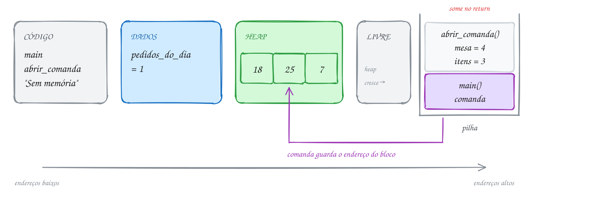</p>

O `malloc` e o `free` ganham um assunto só deles (0059). Aqui, repare só em
onde cada coisa mora e em quanto tempo ela vive:

```c
#include <stdio.h>
#include <stdlib.h>

int pedidos_do_dia = 0; // DADOS: existe do começo ao fim do programa

int *abrir_comanda(int mesa) {
    int itens = 3; // PILHA: some quando a função retorna
    int *comanda = malloc(itens * sizeof(int)); // o bloco fica no HEAP
    if (comanda == NULL) {
        return NULL;
    }
    comanda[0] = 18; // suco
    comanda[1] = 25; // prato feito
    comanda[2] = 7;  // pudim
    pedidos_do_dia++;
    printf("Mesa %d: comanda com %d itens\n", mesa, itens);
    return comanda; // o endereço volta; o bloco continua vivo no heap
}

int main(void) {
    int *comanda = abrir_comanda(4); // PILHA: o ponteiro mora no frame de main
    if (comanda == NULL) {
        printf("Sem memória\n");
        return 1;
    }
    int total = comanda[0] + comanda[1] + comanda[2];
    printf("Total: R$ %d\n", total);
    printf("Pedidos do dia: %d\n", pedidos_do_dia);
    free(comanda); // devolve o bloco ao heap
    return 0;
}
// Saída:
// Mesa 4: comanda com 3 itens
// Total: R$ 50
// Pedidos do dia: 1
```

Repara no fluxograma: o frame de `abrir_comanda` nasce e morre no meio do
caminho, mas o bloco do heap atravessa o `return` e só termina no `free`, lá
no fim de `main`:

<p align="center">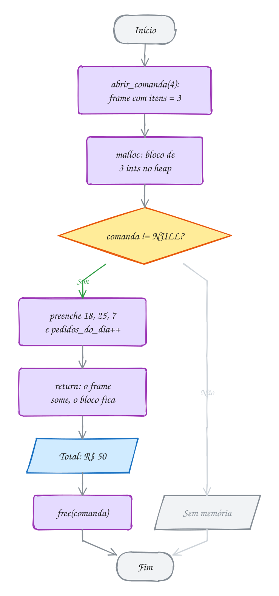</p>

> [!WARNING]
> Nunca devolva o endereço de uma variável local. `char senha[8]; ... return
> senha;` devolve um endereço que deixa de valer no exato momento do `return`:
> o próximo frame vai escrever por cima. O gcc avisa (`function returns address
> of local variable`) e, de propósito, devolve `NULL` no lugar. As saídas são
> três: quem chama empresta o vetor (parâmetro), a variável vira `static` ou o
> bloco vem do heap.

> [!TIP]
> **Por dentro do C:** reservar espaço na pilha custa **uma instrução**: o
> processador só diminui o registrador que marca o topo (`sub rsp, 32`). Por
> isso locais são de graça. O `malloc` precisa procurar um pedaço livre do
> tamanho certo numa lista de blocos e anotar o tamanho num cabeçalho
> escondido logo antes do endereço que ele te entrega. É bem mais caro. Rode
> `size` no executável (`gcc A115.c -o comanda && size comanda`) e veja as
> colunas `text` (código), `data` (globais com valor) e `bss` (globais
> zeradas). Heap e pilha não aparecem: eles só existem quando o programa roda.

> [!NOTE]
> **Pergunta para você:** um vetor local `int leituras[5000000];` (20 MB)
> funciona? E se ele for global? Pense no tamanho de cada região antes de
> testar.

### Hora de praticar

Os arquivos ficam em [`0058-pilha-e-heap/`](0058-pilha-e-heap/). Os comandos funcionam de qualquer pasta do terminal. Nos exemplos, rode, mude, quebre e rode de novo. Nos exercícios, a resposta vai dentro do próprio arquivo. ★☆☆ é aquecimento, ★★☆ pede raciocínio e ★★★ é desafio.

**Exemplo A115 · A comanda em três regiões**

```c
#include <stdio.h>
#include <stdlib.h>

int pedidos_do_dia = 0; // DADOS: existe do começo ao fim do programa

// Monta a comanda da mesa e devolve o endereço dela.
int *abrir_comanda(int mesa) {
    int itens = 3; // PILHA: some quando a função retorna
    int *comanda = malloc(itens * sizeof(int)); // o bloco fica no HEAP
    if (comanda == NULL) {
        return NULL;
    }
    comanda[0] = 18; // suco
    comanda[1] = 25; // prato feito
    comanda[2] = 7;  // pudim
    pedidos_do_dia++;
    printf("Mesa %d: comanda com %d itens\n", mesa, itens);
    return comanda; // o endereço volta; o bloco continua vivo no heap
}

int main(void) {
    int *comanda = abrir_comanda(4); // PILHA: o ponteiro mora no frame de main
    if (comanda == NULL) {
        printf("Sem memória\n");
        return 1;
    }
    int total = comanda[0] + comanda[1] + comanda[2];
    printf("Total: R$ %d\n", total);
    printf("Pedidos do dia: %d\n", pedidos_do_dia);
    free(comanda); // devolve o bloco ao heap
    return 0;
}
// Saída:
// Mesa 4: comanda com 3 itens
// Total: R$ 50
// Pedidos do dia: 1
```

```bash
~/LPEDC/rodar 07-memoria-dinamica/0058-pilha-e-heap/A115.c
```

**Exemplo A116 · O mapa da memória**

```c
#include <stdio.h>
#include <stdlib.h>

int global = 10;     // DADOS (inicializada)
static int contador; // DADOS (zerada, numa parte chamada .bss)

void mostrar_local_da_funcao(void) {
    int fundo = 0; // PILHA: um frame acima do de main
    printf("pilha (função): %p\n", (void *)&fundo);
}

int main(void) {
    const char *frase = "bom dia"; // o texto fica numa área só de leitura
    int local = 20;                // PILHA
    int *bloco = malloc(sizeof(int)); // HEAP
    if (bloco == NULL) {
        return 1;
    }

    printf("literal:        %p\n", (void *)frase);
    printf("global:         %p\n", (void *)&global);
    printf("static:         %p\n", (void *)&contador);
    printf("heap:           %p\n", (void *)bloco);
    printf("pilha (main):   %p\n", (void *)&local);
    mostrar_local_da_funcao();

    free(bloco);
    return 0;
}
// Saída com gcc puro (gcc A116.c -o mapa && ./mapa). Os endereços mudam a
// cada execução; repare na ordem:
// literal:        0x563b12ef101a   <- perto do código, endereços baixos
// global:         0x563b12ef3010
// static:         0x563b12ef3018
// heap:           0x563b3719d2a0   <- logo acima dos dados
// pilha (main):   0x7ffe9c6f2914   <- lá no alto
// pilha (função): 0x7ffe9c6f28f4   <- frame novo, endereço MENOR
//
// Com o rodar, o heap aparece em 0x5020... e as locais em 0x7f...: o
// AddressSanitizer troca o heap e a pilha por versões próprias, vigiadas.
```

```bash
~/LPEDC/rodar 07-memoria-dinamica/0058-pilha-e-heap/A116.c
```

#### Exercícios

**Exercício E343** · ★☆☆

Leia o trecho abaixo (não precisa rodar) e diga em que região da memória
mora cada item: código, dados, heap ou pilha.


```text
int recorde = 0;

int *ler_placar(int jogos) {
    static int chamadas = 0;
    int gols = 2;
    int *placar = malloc(jogos * sizeof(int));
    chamadas++;
    return placar;
}
```


a) recorde; b) chamadas; c) jogos; d) gols;
e) a variável placar (o ponteiro);
f) o bloco para onde placar aponta;
g) as instruções de ler_placar.

Depois responda: quais desses itens ainda existem quando ler_placar
retorna?

<details>
<summary>Dicas</summary>

1. static dentro de função não mora no frame: mora junto das globais.
2. O ponteiro e o bloco apontado são duas coisas diferentes, em lugares
   diferentes.
3. Resposta esperada: a) dados; b) dados; c) pilha (parâmetro é local);
   d) pilha; e) pilha; f) heap; g) código. Depois do return continuam vivos
   recorde, chamadas, o bloco do heap e o código. jogos, gols e o ponteiro
   placar somem com o frame; por isso o endereço precisa voltar no return.

</details>

```bash
~/LPEDC/rodar 07-memoria-dinamica/0058-pilha-e-heap/E343.c
```

**Exercício E344** · ★☆☆

A catraca da academia chama a função registrar_entrada() a cada aluno que
passa. Escreva essa função com dois contadores: um local comum (int hoje)
e um static (int total), ambos começando em 0. A função soma 1 em cada um
e mostra os dois. Chame a função 3 vezes em main.


```text
Saída esperada:
local: 1 | static: 1
local: 1 | static: 2
local: 1 | static: 3
```

<details>
<summary>Dicas</summary>

1. static int total = 0; dentro da função só zera uma vez, antes de o
   programa começar.
2. A local nasce de novo, valendo 0, em cada frame novo.
3. Resposta esperada: a saída acima. A local mora na pilha e morre a cada
   return; a static mora nos dados e vive o programa todo.

</details>

```bash
~/LPEDC/rodar 07-memoria-dinamica/0058-pilha-e-heap/E344.c
```

**Exercício E345** · ★★☆

No Linux, "ulimit -s" mostra o tamanho da pilha em KiB (em geral, 8192,
ou seja, 8 MiB). Uma função recursiva guarda o histórico de preços de uma
ação num vetor local: int historico[2000]; e chama a si mesma.

Escreva um programa que calcule e mostre quantos bytes esse vetor ocupa em
cada chamada e quantas chamadas, no máximo, cabem numa pilha de 8 MiB.
Use sizeof para o tamanho do int e divisão inteira.


```text
Saída esperada:
Cada chamada usa pelo menos 8000 bytes
Cabem no máximo 1048 chamadas
```


Responda também: por que o número real de chamadas é um pouco menor?

<details>
<summary>Dicas</summary>

1. 8 MiB = 8 * 1024 * 1024 bytes.
2. sizeof devolve size_t; mostre com %zu.
3. Resposta esperada: 8000 bytes e 1048 chamadas (8388608 / 8000). Na
   prática cabem menos: cada frame guarda também o endereço de retorno e
   outras locais, e a pilha já tem o frame de main e as variáveis de
   ambiente. Passou do limite, o programa morre com stack overflow.

</details>

```bash
~/LPEDC/rodar 07-memoria-dinamica/0058-pilha-e-heap/E345.c
```

**Exercício E346** · ★★☆

Um sensor de vibração de uma ponte grava 5.000.000 de leituras por dia.
Simule as leituras com leitura[i] = i % 7 e mostre a soma de todas.

Faça em dois passos:
1) declare o vetor int leituras[5000000]; como LOCAL de main e rode com o

```text
 rodar. Leia o que acontece.
```

2) mude o vetor para os DADOS (global ou static) e rode de novo.


```text
Saída esperada (no passo 2):
Soma das leituras: 14999995
```


Responda: quantos bytes o vetor ocupa? Por que o passo 1 quebra?

<details>
<summary>Dicas</summary>

1. 5.000.000 * 4 bytes = 20.000.000 bytes, uns 19 MiB.
2. Basta escrever static na frente da declaração, dentro de main.
3. Resposta esperada: 14999995. O vetor tem 20 MB e a pilha só tem 8 MiB:
   no passo 1 o AddressSanitizer acusa stack-overflow (sem ele, o programa
   morre com Segmentation fault). Nos dados, o espaço é reservado quando o
   programa carrega e não depende do tamanho da pilha. No assunto 0059 você
   vai fazer o mesmo com malloc, escolhendo o tamanho na hora de rodar.

</details>

```bash
~/LPEDC/rodar 07-memoria-dinamica/0058-pilha-e-heap/E346.c
```

**Exercício E347** · ★★★

Preveja a saída SEM rodar. Depois rode e confira.


```text
int contador = 100;

int passo(int n) {
    static int chamadas = 0;
    int local = 0;
    chamadas++;
    local++;
    contador--;
    if (n > 0) {
        passo(n - 1);
    }
    return chamadas * 10 + local;
}

int main(void) {
    printf("%d\n", passo(3));
    printf("%d\n", passo(0));
    printf("%d\n", contador);
    return 0;
}
```


Explique cada número pensando em onde mora cada variável.

<details>
<summary>Dicas</summary>

1. passo(3) gera 4 frames: n = 3, 2, 1 e 0. Cada um tem a sua local.
2. chamadas é uma só para todos os frames. Quando o primeiro frame chega ao
   return, as chamadas de dentro já terminaram.
3. Resposta esperada: 41, 51 e 95. No return do primeiro passo(3),
   chamadas já vale 4 e a local daquele frame vale 1 (cada frame tem a sua):
   41. passo(0) é a 5ª chamada: 51. contador foi decrementado 5 vezes: 95.

</details>

```bash
~/LPEDC/rodar 07-memoria-dinamica/0058-pilha-e-heap/E347.c
```

**Exercício E348** · ★★★

Este programa compila com um AVISO (warning) de propósito e mostra lixo ou
quebra. Rode, leia o aviso e responda: qual é o problema? Depois conserte
sem usar static nem malloc: quem chama empresta o vetor.


```text
Saída esperada depois do conserto:
Senha: A042
Senha: A107
```

<details>
<summary>Dicas</summary>

1. Procure "returns address of local variable" no aviso.
2. O vetor senha mora no frame de montar_senha. Para onde vai esse frame
   depois do return?
3. Resposta esperada: a função devolve o endereço de um vetor local, que
   morre no return (o gcc até troca o endereço por NULL). Conserto:
   void montar_senha(int numero, char senha[]) e, em main,
   char senha[8]; montar_senha(42, senha);

</details>

```bash
~/LPEDC/rodar 07-memoria-dinamica/0058-pilha-e-heap/E348.c
```

---

## 0059 · malloc e free

Fim do mês, hora de somar as corridas de aplicativo. Teve mês com 4 corridas,
teve mês com 60. Se você declarar `double corridas[100];`, desperdiça espaço
nos meses fracos e estoura no mês em que passar de 100. O tamanho certo só
aparece quando o programa já está rodando.

Para isso existe o `malloc` (*memory allocation*), de `<stdlib.h>`. Você diz
**quantos bytes** quer e ele devolve o **endereço** de um bloco desse tamanho
no heap. Esse endereço vai para um ponteiro, e o ponteiro passa a se comportar
como um vetor: `corridas[i]` funciona igualzinho (assunto 0052).

```c
double *corridas = malloc(n * sizeof(double)); // n * 8 bytes
```

Três detalhes nessa linha:

- o `malloc` conta em **bytes**, não em elementos. `malloc(4)` não é espaço
  para 4 `double`, é espaço para 4 bytes. Por isso sempre `n * sizeof(tipo)`;
- ele devolve `void *` (assunto 0056), que vira `double *` sozinho. Em C não
  precisa de cast; o `(double *)` que você vê em livro antigo é herança do C++;
- se não houver memória, ele devolve **`NULL`**. Sempre confira antes de usar.

O bloco vem com **lixo**: o que estava naqueles bytes antes. O `malloc` não
zera nada. Preencha antes de ler.

Quando terminar, devolva com **`free(corridas)`**. O `free` recebe exatamente
o endereço que o `malloc` deu, nem um byte a mais. Ele não precisa do tamanho:
o próprio `malloc` anotou isso num cabeçalho escondido antes do bloco. Depois
do `free`, o ponteiro continua guardando o endereço antigo, só que agora ele
aponta para um bloco que não é mais seu. Por isso o hábito: `corridas = NULL;`.

A regra de ouro é simples de dizer: **todo `malloc` tem um `free`**. No
TypeScript, `new Array(n)` some sozinho quando ninguém mais o referencia. Aqui,
o bloco que você esquece de liberar fica ocupado até o programa acabar. Isso é
um **vazamento** (*memory leak*), tema do assunto 0062.

Vamos ver na prática. O programa pergunta quantas corridas foram (4), pede ao
heap `4 * 8 = 32` bytes, guarda os valores (R$ 12,50, R$ 18,00, R$ 25,90 e
R$ 9,60), soma tudo e devolve o bloco:

<p align="center">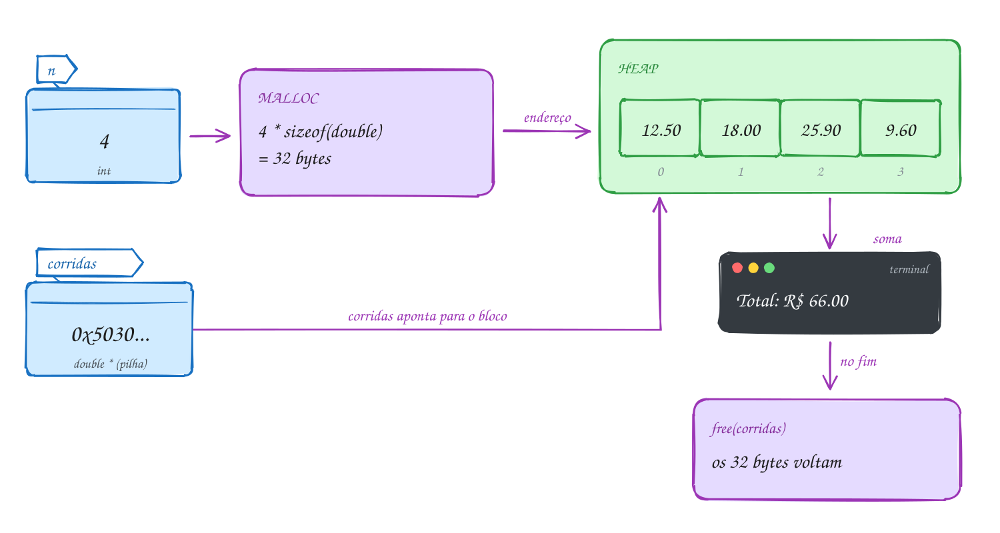</p>

O código completo. Para testar sem digitar, use o comando que está no fim do
arquivo:

```c
#include <stdio.h>
#include <stdlib.h>

int main(void) {
    int n;
    printf("Quantas corridas? ");
    if (scanf("%d", &n) != 1 || n <= 0) {
        printf("Quantidade inválida\n");
        return 1;
    }

    // pede n * 8 bytes ao heap; o tamanho só é conhecido agora
    double *corridas = malloc(n * sizeof(double));
    if (corridas == NULL) {
        printf("Sem memória\n");
        return 1;
    }

    for (int i = 0; i < n; i++) {
        printf("Valor da corrida %d: ", i + 1);
        if (scanf("%lf", &corridas[i]) != 1) { // usa como um vetor comum
            printf("Valor inválido\n");
            free(corridas);
            return 1;
        }
    }

    double total = 0;
    for (int i = 0; i < n; i++) {
        total += corridas[i];
    }
    printf("Total: R$ %.2f\n", total);
    printf("Média: R$ %.2f\n", total / n);

    free(corridas);  // devolve os bytes ao heap
    corridas = NULL; // o ponteiro não aponta mais para lugar nenhum
    return 0;
}
// Exemplo de uso:
// Quantas corridas? 4
// Valor da corrida 1: 12.50
// Valor da corrida 2: 18
// Valor da corrida 3: 25.90
// Valor da corrida 4: 9.60
// Total: R$ 66.00
// Média: R$ 16.50
```

Repara no fluxograma: toda saída do programa depois do `malloc` passa por um
`free`, até a saída de erro no meio da leitura. É fácil esquecer justamente
esse caminho:

<p align="center">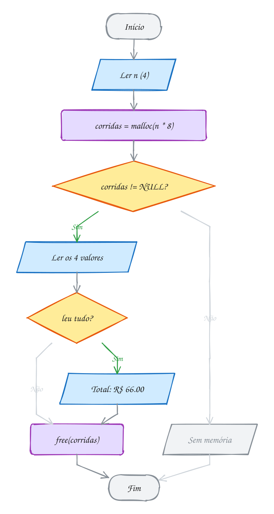</p>

> [!WARNING]
> O erro mais comum é contar elementos em vez de bytes: `malloc(n)` para `n`
> inteiros reserva só um quarto do necessário, e o programa escreve além do
> fim do bloco. Um jeito à prova de distração é tirar o tipo do próprio
> ponteiro: `int *v = malloc(n * sizeof *v);`. Se um dia `v` virar `double *`,
> a conta acompanha sozinha.

> [!TIP]
> **Por dentro do C:** o `malloc` pede memória ao sistema operacional em
> pedaços grandes (chamadas `brk` e `mmap`) e depois fatia esses pedaços para
> você. Cada bloco ganha um cabeçalho de uns 8 a 16 bytes, logo antes do
> endereço que você recebe, com o tamanho dele. É por isso que `free(p)` sabe
> quanto liberar, e é por isso que `free(p + 1)` é um desastre: ele vai ler um
> "cabeçalho" que não existe. Pedir 1 byte custa, na prática, uns 32: pedidos
> pequenos demais desperdiçam memória.

> [!NOTE]
> **Pergunta para você:** se você tirar a linha `free(corridas);` o programa
> continua mostrando o total certo? Então qual é o problema? Rode sem o `free`
> e leia o fim da saída do `rodar`.

### Hora de praticar

Os arquivos ficam em [`0059-malloc-free/`](0059-malloc-free/). Os comandos funcionam de qualquer pasta do terminal. Nos exemplos, rode, mude, quebre e rode de novo. Nos exercícios, a resposta vai dentro do próprio arquivo. ★☆☆ é aquecimento, ★★☆ pede raciocínio e ★★★ é desafio.

**Exemplo A117 · As corridas do mês**

```c
#include <stdio.h>
#include <stdlib.h>

int main(void) {
    int n;
    printf("Quantas corridas? ");
    if (scanf("%d", &n) != 1 || n <= 0) {
        printf("Quantidade inválida\n");
        return 1;
    }

    // pede n * 8 bytes ao heap; o tamanho só é conhecido agora
    double *corridas = malloc(n * sizeof(double));
    if (corridas == NULL) {
        printf("Sem memória\n");
        return 1;
    }

    for (int i = 0; i < n; i++) {
        printf("Valor da corrida %d: ", i + 1);
        if (scanf("%lf", &corridas[i]) != 1) { // usa como um vetor comum
            printf("Valor inválido\n");
            free(corridas);
            return 1;
        }
    }

    double total = 0;
    for (int i = 0; i < n; i++) {
        total += corridas[i];
    }
    printf("Total: R$ %.2f\n", total);
    printf("Média: R$ %.2f\n", total / n);

    free(corridas);  // devolve os bytes ao heap
    corridas = NULL; // o ponteiro não aponta mais para lugar nenhum
    return 0;
}
// Exemplo de uso:
// Quantas corridas? 4
// Valor da corrida 1: 12.50
// Valor da corrida 2: 18
// Valor da corrida 3: 25.90
// Valor da corrida 4: 9.60
// Total: R$ 66.00
// Média: R$ 16.50
//
// Para testar sem digitar: printf '4\n12.50 18 25.90 9.60\n' | ~/LPEDC/rodar 07-memoria-dinamica/0059-malloc-free/A117.c
```

```bash
~/LPEDC/rodar 07-memoria-dinamica/0059-malloc-free/A117.c
```

**Exemplo A118 · Quem cria e quem libera**

```c
#include <stdio.h>
#include <stdlib.h>

// Divide um valor em n parcelas, em centavos. Os centavos que sobram vão
// para as primeiras parcelas. Devolve um bloco novo no heap: quem chama
// fica responsável pelo free.
int *parcelar(int total_centavos, int n) {
    int *parcelas = malloc(n * sizeof *parcelas); // sizeof *p: o tipo vem do ponteiro
    if (parcelas == NULL) {
        return NULL;
    }
    int base = total_centavos / n;
    int sobra = total_centavos % n;
    for (int i = 0; i < n; i++) {
        parcelas[i] = base + (i < sobra ? 1 : 0);
    }
    return parcelas; // o bloco sobrevive ao return
}

int main(void) {
    int n = 3;
    int *parcelas = parcelar(10000, n); // R$ 100,00 em 3 vezes
    if (parcelas == NULL) {
        printf("Sem memória\n");
        return 1;
    }

    printf("Bloco de %zu bytes no heap\n", n * sizeof *parcelas);
    for (int i = 0; i < n; i++) {
        printf("Parcela %d: R$ %d.%02d\n", i + 1, parcelas[i] / 100, parcelas[i] % 100);
    }

    free(parcelas);  // quem recebeu o bloco, libera
    parcelas = NULL;
    free(parcelas);  // free(NULL) não faz nada: é seguro
    return 0;
}
// Saída:
// Bloco de 12 bytes no heap
// Parcela 1: R$ 33.34
// Parcela 2: R$ 33.33
// Parcela 3: R$ 33.33
```

```bash
~/LPEDC/rodar 07-memoria-dinamica/0059-malloc-free/A118.c
```

#### Exercícios

**Exercício E349** · ★☆☆

Escreva um programa que pergunte quantos dias de medição houve, aloque com
malloc um vetor de int desse tamanho, leia as temperaturas e mostre a maior
e a menor. Confira o NULL e libere o bloco no fim.


```text
Exemplo de uso:
Quantos dias? 5
Temperatura 1: 31
Temperatura 2: 28
Temperatura 3: 33
Temperatura 4: 29
Temperatura 5: 30
Máxima: 33
Mínima: 28
```


Para testar: printf '5\n31 28 33 29 30\n' | ~/LPEDC/rodar <este arquivo>

<details>
<summary>Dicas</summary>

1. int *temps = malloc(dias * sizeof(int)); e depois if (temps == NULL).
2. Comece maior e menor com temps[0] (padrão do assunto 0030).
3. Resposta esperada: Máxima: 33 e Mínima: 28, e nenhum aviso do
   AddressSanitizer no fim (sinal de que o free está lá).

</details>

```bash
~/LPEDC/rodar 07-memoria-dinamica/0059-malloc-free/E349.c
```

**Exercício E350** · ★☆☆

Complete a função duplicar: ela recebe uma string e devolve uma CÓPIA dela
num bloco novo do heap, do tamanho exato. O main já está pronto: ele
passa a cópia para maiúsculas e mostra que a original não mudou.


```text
Saída esperada:
Original: coxinha
Cópia: COXINHA
```

<details>
<summary>Dicas</summary>

1. Quantos bytes ocupa "coxinha"? Conte o '\0'.
2. malloc(strlen(texto) + 1), confira o NULL e use strcpy.
3. Resposta esperada: a saída acima. Sem o + 1, o strcpy escreve o '\0'
   um byte depois do fim do bloco e o AddressSanitizer acusa
   heap-buffer-overflow.

</details>

```bash
~/LPEDC/rodar 07-memoria-dinamica/0059-malloc-free/E350.c
```

**Exercício E351** · ★★☆

Escreva a função


```text
int *filtrar_pares(const int *v, int n, int *qtd);
```


que devolve um vetor NOVO, no heap, só com os números pares de v, do
tamanho exato. A quantidade de pares volta por *qtd. Teste com os números
sorteados 7, 4, 10, 3, 8, 1, 6.


```text
Saída esperada:
4 pares: 4 10 8 6
```

<details>
<summary>Dicas</summary>

1. Duas passadas: a primeira só conta os pares; com a contagem, faça o
   malloc; a segunda copia.
2. *qtd = contagem; é o "devolver mais de um valor" do assunto 0051.
3. Resposta esperada: "4 pares: 4 10 8 6". Quem chama faz o free. Se não
   houver pares, malloc(0) pode devolver NULL ou um endereço válido; trate
   esse caso antes (devolva NULL com *qtd = 0).

</details>

```bash
~/LPEDC/rodar 07-memoria-dinamica/0059-malloc-free/E351.c
```

**Exercício E352** · ★★☆

Quantos bytes cada chamada pede? Responda antes de rodar, supondo um PC de
64 bits. Depois escreva um programa que mostre os cinco números com sizeof
e strlen, para conferir.


```text
a) int *a = malloc(5 * sizeof(int));
b) double *b = malloc(5 * sizeof(double));
c) int **c = malloc(3 * sizeof(int *));
d) char *d = malloc(strlen("Recife") + 1);
e) int *e = malloc(5);
```


Em e), quantos int cabem de verdade? O que acontece em e[1] = 9; ?

<details>
<summary>Dicas</summary>

1. int tem 4 bytes, double 8 e qualquer ponteiro 8 (em 64 bits).
2. "Recife" tem 6 letras, mais o '\0'.
3. Resposta esperada: a) 20; b) 40; c) 24; d) 7; e) 5 bytes: cabe só um
   int (sobra 1 byte). e[1] ocupa os bytes 4 a 7: escreve fora do bloco, e
   o AddressSanitizer acusa heap-buffer-overflow.

</details>

```bash
~/LPEDC/rodar 07-memoria-dinamica/0059-malloc-free/E352.c
```

**Exercício E353** · ★★★

O app de caminhada calcula a média de passos dos últimos 4 dias. A conta
sai certa, mas o programa termina com um relatório do AddressSanitizer.
O erro está de propósito. Rode, leia o relatório e responda: qual linha
está errada e por quê? Depois conserte.


```text
Saída esperada depois do conserto:
Média: 9000 passos
```

<details>
<summary>Dicas</summary>

1. Procure "attempting free on address which was not malloc()-ed".
2. Para onde passos aponta depois do laço?
3. Resposta esperada: o free(passos) recebe um endereço que não veio do
   malloc, porque passos++ andou 4 posições. O free precisa do endereço
   exato do início. Conserte usando passos[i] no laço (ou andando com uma
   cópia do ponteiro: int *p = passos;).

</details>

```bash
~/LPEDC/rodar 07-memoria-dinamica/0059-malloc-free/E353.c
```

**Exercício E354** · ★★★

Escreva a função


```text
char *juntar(const char *a, const char *b);
```


que devolve uma string NOVA, no heap, com a, um espaço e b. Depois, em
main, monte o nome do crachá "Maria Clara Fonseca" chamando juntar duas
vezes: primeiro "Maria" com "Clara", depois o resultado com "Fonseca".
Mostre o nome e o tamanho, e não deixe nenhum bloco para trás.


```text
Saída esperada:
Crachá: Maria Clara Fonseca (19 caracteres)
```

<details>
<summary>Dicas</summary>

1. O bloco precisa de strlen(a) + 1 (espaço) + strlen(b) + 1 ('\0') bytes.
2. strcpy(novo, a); strcat(novo, " "); strcat(novo, b);
3. Resposta esperada: a saída acima. O resultado do primeiro juntar
   ("Maria Clara") também é um bloco do heap: libere-o depois de usá-lo no
   segundo juntar. São dois malloc, então dois free.

</details>

```bash
~/LPEDC/rodar 07-memoria-dinamica/0059-malloc-free/E354.c
```

---

## 0060 · calloc e realloc

Você abriu uma vaquinha para o churrasco e os Pix vão chegando: R$ 50,
R$ 120, R$ 35... Você não sabe quantos vão ser. No TypeScript, seria um
`pix.push(valor)` e pronto: o array cresce sozinho. No C, quem faz o array
crescer é você, com o `realloc`.

Antes dele, um primo do `malloc`: o **`calloc`**. Ele recebe a quantidade e o
tamanho separados e entrega o bloco **zerado**:

```c
int *contagem = calloc(5, sizeof(int)); // 5 ints, todos valendo 0
```

Use quando o zero inicial importa: contadores, placares, tabelas de
frequência. Com `malloc`, você teria lixo e precisaria de um laço para zerar.

Agora o **`realloc(p, novo_tamanho)`**. Ele muda o tamanho de um bloco que
veio do heap e **preserva o conteúdo** (até o menor dos dois tamanhos). Se der
para esticar o bloco onde ele está, ótimo. Se não der, ele aloca um bloco
novo em outro lugar, copia tudo, libera o antigo e devolve o **endereço
novo**. A parte que cresceu vem com lixo.

Daí sai a regra mais importante do assunto: **depois do `realloc`, o endereço
antigo pode não valer mais**. Qualquer ponteiro que apontava para dentro do
bloco velho virou um ponteiro solto.

E se faltar memória, o `realloc` devolve `NULL` e **não mexe no bloco
antigo**. Por isso nunca escreva `pix = realloc(pix, ...)`: se vier `NULL`,
você perde o único endereço do bloco, que continua ocupado. Guarde o
resultado num ponteiro **temporário** e só depois troque.

Para o vetor crescer sem gastar tempo demais, a estratégia clássica é guardar
duas contas: a **quantidade** (quantos elementos você usa) e a **capacidade**
(quantos cabem). Encheu? **Dobra** a capacidade. Assim os `realloc` ficam
raros: para guardar 1000 elementos, começando com 1, são só 10.

Vamos ver na prática. Chegam 5 Pix (R$ 50, 120, 35, 80 e 15). O vetor nasce
com capacidade 2, dobra para 4 no terceiro Pix e para 8 no quinto. No fim, 5
posições usadas e 3 livres:

<p align="center">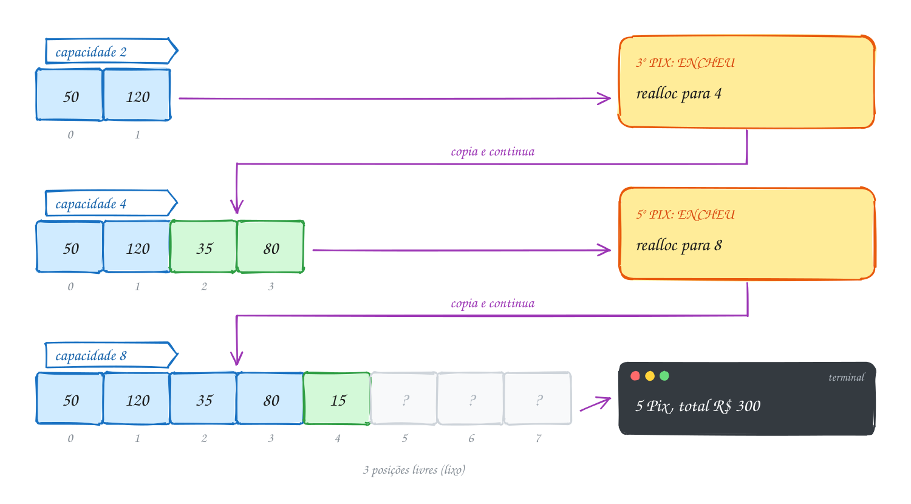</p>

O mesmo "vetor que cresce" em C. É a semente da lista sequencial que você vai
transformar num TAD no assunto 0080:

```c
#include <stdio.h>
#include <stdlib.h>

int main(void) {
    int chegando[] = {50, 120, 35, 80, 15}; // os Pix do dia, em R$
    int capacidade = 2;                      // cabem 2 por enquanto
    int quantidade = 0;                      // quantos já guardei
    int *pix = malloc(capacidade * sizeof *pix);
    if (pix == NULL) {
        return 1;
    }

    for (int i = 0; i < 5; i++) {
        if (quantidade == capacidade) { // encheu: dobra a capacidade
            int nova = capacidade * 2;
            int *maior = realloc(pix, nova * sizeof *pix); // temporário!
            if (maior == NULL) {
                free(pix); // o bloco antigo continua valendo: libera
                return 1;
            }
            printf("Capacidade: %d -> %d\n", capacidade, nova);
            pix = maior;
            capacidade = nova;
        }
        pix[quantidade] = chegando[i]; // o "push"
        quantidade++;
    }

    int total = 0;
    for (int i = 0; i < quantidade; i++) {
        total += pix[i];
    }
    printf("%d Pix, total R$ %d\n", quantidade, total);
    printf("Sobram %d posições livres\n", capacidade - quantidade);
    free(pix);
    return 0;
}
// Saída:
// Capacidade: 2 -> 4
// Capacidade: 4 -> 8
// 5 Pix, total R$ 300
// Sobram 3 posições livres
```

Repara no fluxograma: a pergunta "encheu?" é feita a cada Pix, mas o desvio
para o `realloc` só acontece duas vezes. Na maior parte das voltas, guardar
custa só uma atribuição:

<p align="center">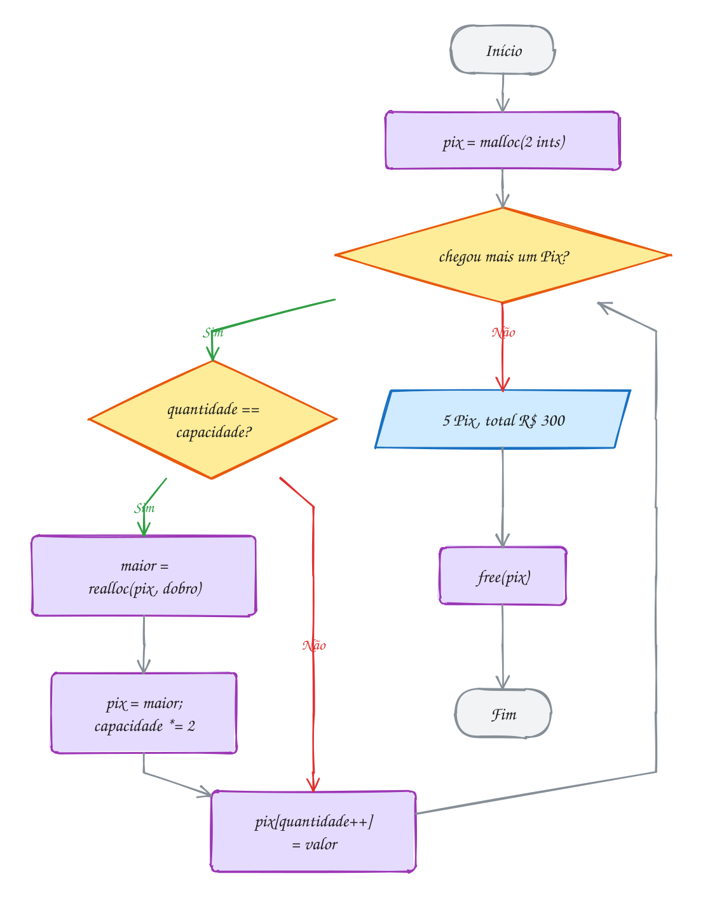</p>

> [!WARNING]
> `v = realloc(v, n)` é o erro clássico, e muito livro ensina assim. Se o
> `realloc` falhar, `v` vira `NULL`, o bloco antigo fica no heap sem ninguém
> apontando para ele (vazamento) e os dados se perdem. Use sempre um
> temporário. E não guarde endereços de elementos (`int *ultimo = &v[3];`)
> antes de um `realloc`: o bloco pode ter mudado de lugar.

> [!TIP]
> **Por dentro do C:** dobrar a capacidade faz o custo **médio** do push ser
> constante. Para chegar a 1024 elementos, o `realloc` copia no pior caso
> 1 + 2 + 4 + ... + 512 = 1023 elementos: menos de uma cópia por push. Se
> crescesse de 1 em 1, seriam 1 + 2 + ... + 1023, mais de 500 mil cópias. É
> exatamente o que o `Array` do V8 e o `std::vector` do C++ fazem por baixo.
> Com o rodar, o AddressSanitizer **sempre** muda o bloco de lugar no
> `realloc`, de propósito: assim o erro de usar o endereço antigo aparece logo,
> em vez de só às vezes.

> [!NOTE]
> **Pergunta para você:** se a capacidade inicial fosse 1, quantas vezes
> apareceria "Capacidade: ..." para os mesmos 5 Pix? E qual seria a
> capacidade final?

### Hora de praticar

Os arquivos ficam em [`0060-calloc-realloc/`](0060-calloc-realloc/). Os comandos funcionam de qualquer pasta do terminal. Nos exemplos, rode, mude, quebre e rode de novo. Nos exercícios, a resposta vai dentro do próprio arquivo. ★☆☆ é aquecimento, ★★☆ pede raciocínio e ★★★ é desafio.

**Exemplo A119 · O vetor que cresce**

```c
#include <stdio.h>
#include <stdlib.h>

int main(void) {
    int chegando[] = {50, 120, 35, 80, 15}; // os Pix do dia, em R$
    int capacidade = 2;                      // cabem 2 por enquanto
    int quantidade = 0;                      // quantos já guardei
    int *pix = malloc(capacidade * sizeof *pix);
    if (pix == NULL) {
        return 1;
    }

    for (int i = 0; i < 5; i++) {
        if (quantidade == capacidade) { // encheu: dobra a capacidade
            int nova = capacidade * 2;
            int *maior = realloc(pix, nova * sizeof *pix); // temporário!
            if (maior == NULL) {
                free(pix); // o bloco antigo continua valendo: libera
                return 1;
            }
            printf("Capacidade: %d -> %d\n", capacidade, nova);
            pix = maior;
            capacidade = nova;
        }
        pix[quantidade] = chegando[i]; // o "push"
        quantidade++;
    }

    int total = 0;
    for (int i = 0; i < quantidade; i++) {
        total += pix[i];
    }
    printf("%d Pix, total R$ %d\n", quantidade, total);
    printf("Sobram %d posições livres\n", capacidade - quantidade);
    free(pix);
    return 0;
}
// Saída:
// Capacidade: 2 -> 4
// Capacidade: 4 -> 8
// 5 Pix, total R$ 300
// Sobram 3 posições livres
```

```bash
~/LPEDC/rodar 07-memoria-dinamica/0060-calloc-realloc/A119.c
```

**Exemplo A120 · A enquete com calloc**

```c
#include <stdio.h>
#include <stdlib.h>

int main(void) {
    int votos[] = {2, 3, 2, 1, 4, 2, 3, 2, 1, 2}; // opção escolhida por voto
    int total_votos = 10;
    int opcoes = 4;

    // um contador por opção (1 a 4); a posição 0 fica sem uso.
    // calloc(quantidade, tamanho) entrega tudo zerado: os contadores já
    // começam em 0. Com malloc, começariam com lixo.
    int *contagem = calloc(opcoes + 1, sizeof *contagem);
    if (contagem == NULL) {
        return 1;
    }

    for (int i = 0; i < total_votos; i++) {
        contagem[votos[i]]++;
    }

    for (int op = 1; op <= opcoes; op++) {
        printf("Opção %d: %d ", op, contagem[op]);
        for (int k = 0; k < contagem[op]; k++) {
            printf("#");
        }
        printf("\n");
    }
    free(contagem);
    return 0;
}
// Saída:
// Opção 1: 2 ##
// Opção 2: 5 #####
// Opção 3: 2 ##
// Opção 4: 1 #
```

```bash
~/LPEDC/rodar 07-memoria-dinamica/0060-calloc-realloc/A120.c
```

#### Exercícios

**Exercício E355** · ★☆☆

Num jogo de tabuleiro, o dado saiu assim em 12 jogadas:
3, 6, 1, 6, 2, 5, 6, 3, 4, 6, 1, 2. Use calloc para criar os contadores
das faces (zerados) e mostre quantas vezes cada face saiu, com um # por
vez.


```text
Saída esperada:
1: 2 ##
2: 2 ##
3: 2 ##
4: 1 #
5: 1 #
6: 4 ####
```

<details>
<summary>Dicas</summary>

1. calloc(7, sizeof(int)) dá as posições 0 a 6; use 1 a 6 e ignore a 0.
2. contagem[jogadas[i]]++ conta a face da jogada i.
3. Resposta esperada: a saída acima. Troque calloc por malloc e rode
   algumas vezes: os números mudam ou ficam errados, porque os contadores
   começam com lixo.

</details>

```bash
~/LPEDC/rodar 07-memoria-dinamica/0060-calloc-realloc/E355.c
```

**Exercício E356** · ★☆☆

O programa abaixo funciona e mostra as notas do boletim. Mesmo assim, a
linha do realloc tem um problema que só aparece quando falta memória.
Explique o problema e refatore a linha, sem mudar a saída.


```text
Saída esperada (antes e depois):
Notas: 7 8 10
```

<details>
<summary>Dicas</summary>

1. O que vale notas se o realloc devolver NULL? E o bloco antigo?
2. Use um ponteiro temporário e só troque se ele não for NULL.
3. Resposta esperada: com notas = realloc(notas, ...), uma falha joga
   NULL em notas e o endereço do bloco antigo se perde: vazamento e perda
   das notas já guardadas. Conserto:
   int *maior = realloc(notas, 3 * sizeof *notas);
   if (maior == NULL) { free(notas); return 1; }
   notas = maior;

</details>

```bash
~/LPEDC/rodar 07-memoria-dinamica/0060-calloc-realloc/E356.c
```

**Exercício E357** · ★★☆

Leia números inteiros do teclado até aparecer 0 (o 0 não entra). Guarde
num vetor que começa com capacidade 2 e dobra quando enche. No fim,
mostre os números na ordem contrária e a capacidade final.


```text
Exemplo de uso:
Números (0 para parar): 5 8 2 9 4 0
Ao contrário: 4 9 2 8 5
Capacidade final: 8
```


Para testar: printf '5 8 2 9 4 0\n' | ~/LPEDC/rodar <este arquivo>

<details>
<summary>Dicas</summary>

1. Duas variáveis de controle: quantidade e capacidade. Encheu quando
   quantidade == capacidade.
2. Use o realloc com ponteiro temporário, como no A119.
3. Resposta esperada: "Ao contrário: 4 9 2 8 5" e "Capacidade final: 8"
   (a capacidade foi 2, 4 e 8). Também trate o fim da entrada: se o scanf
   não devolver 1, pare como se fosse o 0.

</details>

```bash
~/LPEDC/rodar 07-memoria-dinamica/0060-calloc-realloc/E357.c
```

**Exercício E358** · ★★☆

Um sensor de umidade mandou 10 leituras, mas -1 significa "falha na
leitura": 12, -1, 15, 14, -1, -1, 13, 16, -1, 11. Copie as leituras para
um bloco do heap, remova as falhas puxando as válidas para a frente (no
mesmo bloco) e depois ENCOLHA o bloco com realloc para o tamanho exato.


```text
Saída esperada:
6 leituras válidas: 12 15 14 13 16 11
Bloco encolheu de 40 para 24 bytes
```

<details>
<summary>Dicas</summary>

1. Ande com dois índices: i lê todas as posições, j marca onde escrever a
   próxima válida. No fim, j é a quantidade de válidas.
2. realloc também diminui: realloc(v, j * sizeof *v). Use temporário.
3. Resposta esperada: a saída acima. Encolher preserva as primeiras j
   posições, exatamente as válidas.

</details>

```bash
~/LPEDC/rodar 07-memoria-dinamica/0060-calloc-realloc/E358.c
```

**Exercício E359** · ★★★

Compare duas estratégias de crescimento para guardar 1000 números, com
capacidade inicial 1:


```text
A) crescer de 1 em 1 (capacidade + 1) sempre que encher;
B) dobrar a capacidade sempre que encher.
```


Escreva um programa que faça os dois vetores de verdade (com realloc) e
conte, para cada estratégia, quantos realloc foram feitos e quantos
elementos o realloc precisou copiar no pior caso (a quantidade guardada
na hora de cada realloc).


```text
Saída esperada:
+1:     999 realocações, 499500 cópias
dobrar: 10 realocações, 1023 cópias
```

<details>
<summary>Dicas</summary>

1. Escreva uma função que recebe um "modo" (1 ou 2) e devolve as contagens
   por ponteiro (int *realocacoes, long *copias).
2. Antes de cada realloc, copias += quantidade.
3. Resposta esperada: a saída acima. No +1, as cópias são 1 + 2 + ... +
   999 = 499500, um custo quadrático. Dobrando, 1 + 2 + 4 + ... + 512 =
   1023: em média, nem uma cópia por elemento.

</details>

```bash
~/LPEDC/rodar 07-memoria-dinamica/0060-calloc-realloc/E359.c
```

**Exercício E360** · ★★★

A fila do banco guarda as senhas num vetor que cresce. O programa guarda o
endereço da primeira senha para mostrar no painel depois. Ele está ERRADO
de propósito: rode com o rodar, leia o relatório do AddressSanitizer e
responda: qual é o erro, em que linha, e por que o realloc é o culpado?
Depois conserte.


```text
Saída esperada depois do conserto:
Painel: senha 101
Senhas na fila: 4
```

<details>
<summary>Dicas</summary>

1. Procure "heap-use-after-free" e as três pilhas do relatório: onde leu,
   onde o bloco foi liberado e onde foi alocado.
2. O realloc pode mudar o bloco de lugar. O que acontece com um ponteiro
   que apontava para dentro do bloco antigo?
3. Resposta esperada: o printf do painel lê *primeira, que aponta para o
   bloco antigo, liberado dentro do realloc. Conserto: guarde o ÍNDICE (0)
   em vez do endereço e leia senhas[0] depois, ou pegue o endereço só
   depois do último realloc.

</details>

```bash
~/LPEDC/rodar 07-memoria-dinamica/0060-calloc-realloc/E360.c
```

---

## 0061 · Matriz dinâmica

Uma rede de lojas quer a planilha de vendas: uma linha por loja, uma coluna
por semana. Este mês são 3 lojas e 4 semanas. Mês que vem abre a quarta loja,
e o trimestre tem 13 semanas. Uma matriz `int vendas[3][4]` não serve: as
dimensões só aparecem quando o programa roda.

O C só sabe alocar dinamicamente **vetores**, blocos de uma dimensão. Para ter
uma matriz, você monta uma com vetores. Tem dois jeitos clássicos.

**1. Um bloco só.** Aloque `linhas * colunas` elementos e calcule a posição na
mão: o elemento `(i, j)` fica em `v[i * colunas + j]`. É a mesma conta que o
compilador faz por baixo numa matriz fixa (assunto 0044). Um `malloc`, um
`free`, tudo contíguo. O preço: a notação `v[i][j]` não funciona.

**2. Vetor de ponteiros.** Primeiro um vetor de `linhas` ponteiros
(`int **m`), um para cada linha. Depois, um `malloc` por linha, cada uma com
`colunas` inteiros. Agora `m[i][j]` funciona: `m[i]` é o endereço da linha i,
e `[j]` anda dentro dela (é o `**` do assunto 0054 em ação).

Uma regra ajuda a não errar o `sizeof`: **o que você aloca tem um `*` a menos
que o ponteiro que recebe**. `int **m` recebe um vetor de `int *`; `m[i]`, que
é `int *`, recebe um vetor de `int`. Com `sizeof *m` e `sizeof *m[i]`, a conta
sai certa sozinha.

Para liberar, a ordem importa: **primeiro cada linha, depois o vetor de
ponteiros**. Se você der `free(m)` antes, perde os endereços das linhas, e
elas ficam presas no heap para sempre.

E se o `malloc` da terceira linha falhar? As duas primeiras já foram
alocadas. A função de criação precisa desfazer o que já fez antes de devolver
`NULL`: é o tipo de cuidado que separa um programa de brinquedo de um
programa de verdade.

Vamos ver na prática. A matriz de 3 lojas por 4 semanas é um vetor de 3
ponteiros, cada um apontando para uma linha de 4 inteiros. As linhas podem
estar em qualquer lugar do heap, nem precisam ficar juntas:

<p align="center">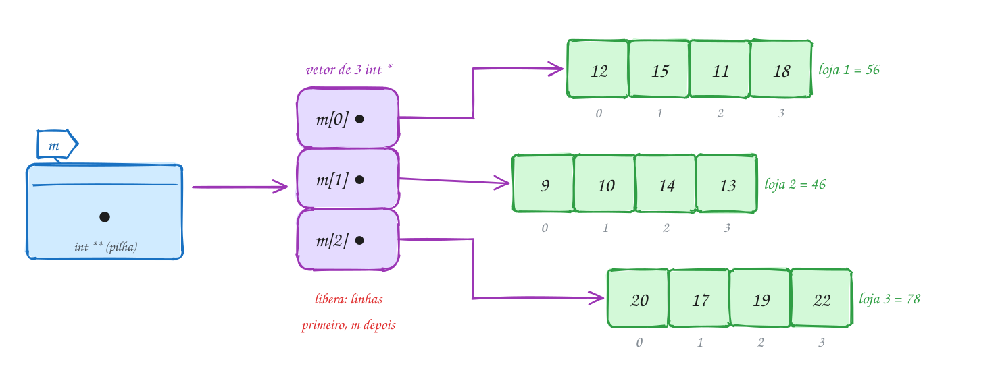</p>

O código separa criar e liberar em funções, como você faria num projeto. As
vendas estão em R$ mil:

```c
#include <stdio.h>
#include <stdlib.h>

void liberar_matriz(int **m, int linhas) {
    if (m == NULL) {
        return;
    }
    for (int i = 0; i < linhas; i++) {
        free(m[i]); // primeiro cada linha...
    }
    free(m);        // ...depois o vetor de ponteiros
}

int **criar_matriz(int linhas, int colunas) {
    int **m = malloc(linhas * sizeof *m); // vetor de int *: uma por linha
    if (m == NULL) {
        return NULL;
    }
    for (int i = 0; i < linhas; i++) {
        m[i] = malloc(colunas * sizeof *m[i]); // cada linha: colunas ints
        if (m[i] == NULL) {
            liberar_matriz(m, i); // desfaz as linhas que já deram certo
            return NULL;
        }
    }
    return m;
}

int main(void) {
    int lojas = 3;
    int semanas = 4;
    int vendas[3][4] = {{12, 15, 11, 18}, {9, 10, 14, 13}, {20, 17, 19, 22}}; // R$ mil

    int **m = criar_matriz(lojas, semanas);
    if (m == NULL) {
        printf("Sem memória\n");
        return 1;
    }
    for (int i = 0; i < lojas; i++) {
        for (int j = 0; j < semanas; j++) {
            m[i][j] = vendas[i][j]; // a notação de sempre
        }
    }

    for (int i = 0; i < lojas; i++) {
        int total = 0;
        for (int j = 0; j < semanas; j++) {
            total += m[i][j];
        }
        printf("Loja %d: R$ %d mil\n", i + 1, total);
    }

    liberar_matriz(m, lojas);
    return 0;
}
// Saída:
// Loja 1: R$ 56 mil
// Loja 2: R$ 46 mil
// Loja 3: R$ 78 mil
```

Repara no fluxograma da criação: é um laço com uma saída de emergência. Se
uma linha falhar, o caminho de erro passa pela liberação do que já existe:

<p align="center">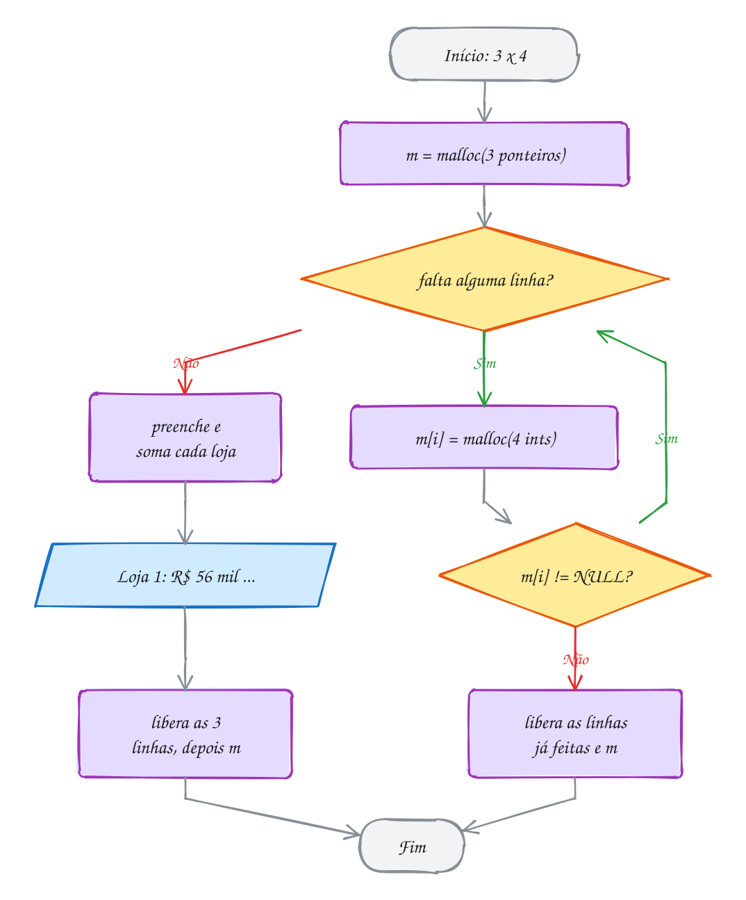</p>

> [!WARNING]
> O `sizeof` errado no vetor de ponteiros é um bug que muitos livros trazem:
> `int **m = malloc(linhas * sizeof(int));`. Num PC de 64 bits, `int` tem 4
> bytes e `int *` tem 8: você aloca metade do necessário e as últimas linhas
> são gravadas fora do bloco. Funciona "às vezes" e corrompe o heap. Escreva
> `sizeof *m` e esse erro some.

> [!TIP]
> **Por dentro do C:** `m[i][j]` com `int **` faz **dois** acessos à memória:
> lê o ponteiro `m[i]` e depois o inteiro. Numa matriz fixa ou no bloco único,
> é um acesso só, com uma conta. As linhas soltas no heap também não ficam
> vizinhas, o que piora o uso do cache do processador. Em troca, você ganha
> `m[i][j]` e linhas de **tamanhos diferentes**: num triângulo de Pascal, a
> linha i tem i + 1 elementos. Existe ainda um meio-termo: um bloco único com
> os dados e um vetor de ponteiros com `m[i] = bloco + i * colunas`. São só
> dois `malloc`, os dados ficam contíguos e `m[i][j]` continua valendo.

> [!NOTE]
> **Pergunta para você:** quantos `malloc` e quantos `free` o A121 faz para 3
> lojas? E para 100 lojas? Quantos faria a versão de bloco único (A122)?

### Hora de praticar

Os arquivos ficam em [`0061-matriz-dinamica/`](0061-matriz-dinamica/). Os comandos funcionam de qualquer pasta do terminal. Nos exemplos, rode, mude, quebre e rode de novo. Nos exercícios, a resposta vai dentro do próprio arquivo. ★☆☆ é aquecimento, ★★☆ pede raciocínio e ★★★ é desafio.

**Exemplo A121 · Vendas por loja e semana**

```c
#include <stdio.h>
#include <stdlib.h>

void liberar_matriz(int **m, int linhas) {
    if (m == NULL) {
        return;
    }
    for (int i = 0; i < linhas; i++) {
        free(m[i]); // primeiro cada linha...
    }
    free(m);        // ...depois o vetor de ponteiros
}

int **criar_matriz(int linhas, int colunas) {
    int **m = malloc(linhas * sizeof *m); // vetor de int *: uma por linha
    if (m == NULL) {
        return NULL;
    }
    for (int i = 0; i < linhas; i++) {
        m[i] = malloc(colunas * sizeof *m[i]); // cada linha: colunas ints
        if (m[i] == NULL) {
            liberar_matriz(m, i); // desfaz as linhas que já deram certo
            return NULL;
        }
    }
    return m;
}

int main(void) {
    int lojas = 3;
    int semanas = 4;
    int vendas[3][4] = {{12, 15, 11, 18}, {9, 10, 14, 13}, {20, 17, 19, 22}}; // R$ mil

    int **m = criar_matriz(lojas, semanas);
    if (m == NULL) {
        printf("Sem memória\n");
        return 1;
    }
    for (int i = 0; i < lojas; i++) {
        for (int j = 0; j < semanas; j++) {
            m[i][j] = vendas[i][j]; // a notação de sempre
        }
    }

    for (int i = 0; i < lojas; i++) {
        int total = 0;
        for (int j = 0; j < semanas; j++) {
            total += m[i][j];
        }
        printf("Loja %d: R$ %d mil\n", i + 1, total);
    }

    liberar_matriz(m, lojas);
    return 0;
}
// Saída:
// Loja 1: R$ 56 mil
// Loja 2: R$ 46 mil
// Loja 3: R$ 78 mil
```

```bash
~/LPEDC/rodar 07-memoria-dinamica/0061-matriz-dinamica/A121.c
```

**Exemplo A122 · O mapa do cinema num bloco só**

```c
#include <stdio.h>
#include <stdlib.h>

int main(void) {
    int fileiras = 4;
    int poltronas = 6;

    // um bloco só com fileiras * poltronas chars; a posição (i, j) fica em
    // i * poltronas + j: a mesma conta que o compilador faz numa matriz fixa
    char *sala = malloc(fileiras * poltronas * sizeof *sala);
    if (sala == NULL) {
        return 1;
    }
    for (int k = 0; k < fileiras * poltronas; k++) {
        sala[k] = 'L'; // livre
    }

    sala[1 * poltronas + 2] = 'X'; // fileira B, poltrona 3
    sala[1 * poltronas + 3] = 'X'; // fileira B, poltrona 4
    sala[3 * poltronas + 0] = 'X'; // fileira D, poltrona 1

    printf("   1 2 3 4 5 6\n");
    for (int i = 0; i < fileiras; i++) {
        printf("%c ", 'A' + i);
        for (int j = 0; j < poltronas; j++) {
            printf(" %c", sala[i * poltronas + j]);
        }
        printf("\n");
    }
    printf("Um malloc, um free, %d bytes seguidos\n", fileiras * poltronas);
    free(sala);
    return 0;
}
// Saída:
//    1 2 3 4 5 6
// A  L L L L L L
// B  L L X X L L
// C  L L L L L L
// D  X L L L L L
// Um malloc, um free, 24 bytes seguidos
```

```bash
~/LPEDC/rodar 07-memoria-dinamica/0061-matriz-dinamica/A122.c
```

#### Exercícios

**Exercício E361** · ★☆☆

Leia n e monte, com int ** (vetor de ponteiros), a tabuada n x n: a
posição [i][j] guarda (i + 1) * (j + 1). Mostre a matriz com %4d e libere
tudo na ordem certa.


```text
Exemplo de uso:
Tamanho: 4
   1   2   3   4
   2   4   6   8
   3   6   9  12
   4   8  12  16
```


Para testar: printf '4\n' | ~/LPEDC/rodar <este arquivo>

<details>
<summary>Dicas</summary>

1. int **t = malloc(n * sizeof *t); e, para cada i,
   t[i] = malloc(n * sizeof *t[i]);
2. Libere cada t[i] e só depois t.
3. Resposta esperada: a tabela acima, sem relatório do AddressSanitizer.

</details>

```bash
~/LPEDC/rodar 07-memoria-dinamica/0061-matriz-dinamica/E361.c
```

**Exercício E362** · ★☆☆

Uma matriz de 5 linhas e 8 colunas está guardada num bloco único:
int *v = malloc(5 * 8 * sizeof *v); e o elemento (i, j) fica em
v[i * 8 + j]. Responda de cabeça e depois confira com um programa que
mostre as contas:


```text
a) Em que índice de v fica o elemento (2, 3)?
b) E o (4, 7)? Por que ele é o último?
c) E o (0, 5)?
d) O índice 26 é qual (i, j)?
```

<details>
<summary>Dicas</summary>

1. Cada linha completa "pula" 8 posições.
2. Para voltar: i = k / 8 e j = k % 8.
3. Resposta esperada: a) 19; b) 39 = 5 * 8 - 1, a última das 40
   posições; c) 5 (a linha 0 não pula nada); d) (3, 2), porque 26 / 8 = 3
   e 26 % 8 = 2.

</details>

```bash
~/LPEDC/rodar 07-memoria-dinamica/0061-matriz-dinamica/E362.c
```

**Exercício E363** · ★★☆

Escreva a função


```text
int **transpor(int **m, int linhas, int colunas);
```


que devolve uma matriz NOVA, com colunas linhas e linhas colunas, em que
t[j][i] = m[i][j]. Teste com a matriz 2 x 3 de horas de estudo por
semana (linhas = semanas, colunas = matérias):


```text
2 5 1
3 4 0
```


```text
Saída esperada (a transposta, 3 x 2):
2 3
5 4
1 0
```

<details>
<summary>Dicas</summary>

1. Escreva antes criar_matriz e liberar_matriz como no A121; transpor usa
   criar_matriz(colunas, linhas).
2. Cuidado ao liberar: a original tem 2 linhas, a transposta tem 3.
3. Resposta esperada: a saída acima, e as duas matrizes liberadas.

</details>

```bash
~/LPEDC/rodar 07-memoria-dinamica/0061-matriz-dinamica/E363.c
```

**Exercício E364** · ★★☆

Monte o triângulo de Pascal com 6 linhas usando um vetor de ponteiros em
que a linha i tem exatamente i + 1 elementos (nada de matriz quadrada com
metade desperdiçada). As pontas de cada linha valem 1 e cada número de
dentro é a soma dos dois de cima: p[i][j] = p[i-1][j-1] + p[i-1][j].


```text
Saída esperada:
1
1 1
1 2 1
1 3 3 1
1 4 6 4 1
1 5 10 10 5 1
Elementos guardados: 21
```

<details>
<summary>Dicas</summary>

1. p[i] = malloc((i + 1) * sizeof *p[i]);
2. Uma matriz 6 x 6 guardaria 36 números; o triângulo guarda
   1 + 2 + ... + 6.
3. Resposta esperada: a saída acima. Para liberar, o laço é o mesmo: cada
   p[i] e depois p.

</details>

```bash
~/LPEDC/rodar 07-memoria-dinamica/0061-matriz-dinamica/E364.c
```

**Exercício E365** · ★★★

Este programa monta a grade de 3 turnos x 5 dias de uma clínica, com o
número de consultas, e mostra o total. Ele tem DOIS erros de memória, de
propósito (o gcc até avisa sobre um deles). Rode com o rodar, leia o aviso
e os relatórios e conserte um de cada vez.


```text
Saída esperada depois do conserto:
Total de consultas: 105
```

<details>
<summary>Dicas</summary>

1. Primeiro relatório: heap-buffer-overflow. Quantos bytes tem um int? E
   um int *?
2. Segundo erro: o aviso "may be used after free" do gcc, que vira
   heap-use-after-free quando roda. Depois de free(grade), como o laço
   ainda acha grade[i]?
3. Resposta esperada: (a) malloc(turnos * sizeof(int)) aloca 12 bytes para
   3 ponteiros que precisam de 24; use sizeof *grade (ou sizeof(int *)).
   (b) free(grade) vem antes do laço que libera as linhas; inverta a
   ordem: primeiro as linhas, depois grade. Total: 3 * 5 * 7 = 105.

</details>

```bash
~/LPEDC/rodar 07-memoria-dinamica/0061-matriz-dinamica/E365.c
```

**Exercício E366** · ★★★

Escreva a função


```text
int **multiplicar(int **a, int la, int ca, int **b, int lb, int cb);
```


que devolve uma matriz NOVA la x cb com o produto a * b, ou NULL se as
dimensões não combinarem (ca precisa ser igual a lb). Teste com


```text
A (2 x 3)    B (3 x 2)
1 2 3        7  8
4 5 6        9 10
             11 12
```


e depois tente A * A (2 x 3 vezes 2 x 3).


```text
Saída esperada:
58 64
139 154
A * A: dimensões incompatíveis
```

<details>
<summary>Dicas</summary>

1. c[i][j] é a soma de a[i][k] * b[k][j] para k de 0 a ca - 1.
2. Reaproveite criar_matriz e liberar_matriz do A121. Para preencher A e
   B, copie de matrizes fixas int [2][3] e int [3][2].
3. Resposta esperada: a saída acima. Libere A, B e o produto; o NULL de
   A * A não precisa de free (free(NULL) também não faria mal).

</details>

```bash
~/LPEDC/rodar 07-memoria-dinamica/0061-matriz-dinamica/E366.c
```

---

## 0062 · Erros de memória

O sistema do caixa da padaria funciona perfeitamente de manhã. Às seis da
tarde está lento, e no sábado trava. Ninguém mexeu no código. O que aconteceu
foi um **vazamento**: a cada venda, um pedacinho de memória ficava para trás,
e depois de milhares de vendas o heap acabou. Se você já caçou um *memory
leak* num servidor Node, é a mesma doença, só que no C você mesmo cria.

O pior desses erros é que o programa costuma **funcionar**: mostra a saída
certa, termina sem reclamar e quebra só na máquina do cliente, dias depois.
Por isso o C tem ferramentas que vigiam a memória enquanto o programa roda.
Primeiro, os quatro erros clássicos:

| Erro | O que é | O AddressSanitizer diz |
| --- | --- | --- |
| **vazamento** | um bloco que ninguém libera e ninguém mais acha | `detected memory leaks` |
| **uso depois do free** | ler ou escrever num bloco já devolvido (ponteiro solto) | `heap-use-after-free` |
| **free duplo** | liberar o mesmo bloco duas vezes | `attempting double-free` |
| **estouro** | passar do fim (ou do começo) de um bloco | `heap-buffer-overflow` |

O **ponteiro solto** (*dangling pointer*) é a raiz de dois deles. Depois de
`free(p)`, `p` continua com o mesmo endereço. Se alguém usa `p`, pode até ler
o valor antigo, porque ninguém apagou os bytes. Funciona por sorte, até o
`malloc` entregar aquele pedaço para outra parte do programa.

O **estouro** no heap é ainda mais traiçoeiro: logo depois do seu bloco mora
o cabeçalho do bloco vizinho (lembra do 0059?). Escrever um byte a mais pode
estragar a contabilidade do `malloc`, e o programa quebra muito depois, num
`free` que não tem culpa nenhuma.

As ferramentas:

- **AddressSanitizer** (ASan): já vem no `rodar` (`-fsanitize=address`). O
  compilador põe vigias em volta de cada bloco e cada acesso é conferido.
  Para no primeiro erro e mostra três coisas: onde o erro aconteceu, onde o
  bloco foi alocado e onde foi liberado. No fim, o **LeakSanitizer** lista o
  que vazou;
- **valgrind**: roda o executável normal dentro de uma máquina virtual que
  vigia cada byte. É uns 20 a 50 vezes mais lento, não precisa recompilar e
  pega uma coisa que o ASan não pega: ler memória que nunca recebeu valor.
  Instale com `sudo pacman -S valgrind` no Arch Linux ou `sudo apt install
  valgrind` no Debian/Ubuntu e rode com `~/LPEDC/rodar --valgrind arquivo.c`.

Vamos ver na prática. A função `total_do_pedido` copia os 4 preços de um
pedido (R$ 30, 12, 45 e 8) para um bloco temporário de 16 bytes e soma tudo.
Na primeira versão, ela esquecia o `free`. Cada um dos 3 pedidos deixava 16
bytes perdidos: o endereço morria com o frame, mas o bloco ficava. O ASan
mostra isso no fim da execução:

<p align="center">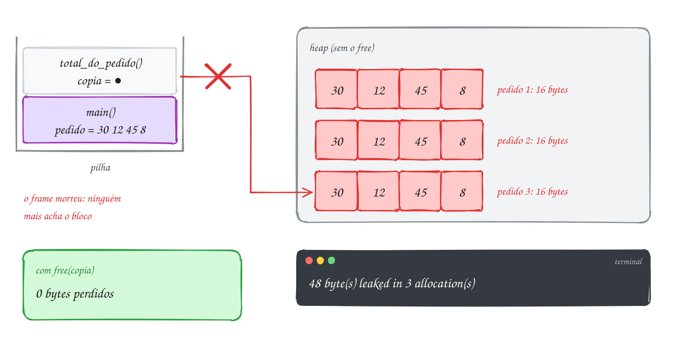</p>

O relatório da versão quebrada, sem o `free`. Leia de cima para baixo: o tipo
do erro, quanto vazou e a pilha de chamadas que fez o `malloc`:

```text
==12072==ERROR: LeakSanitizer: detected memory leaks

Direct leak of 48 byte(s) in 3 object(s) allocated from:
    #0 0x7f1503afd9c7 in malloc
    #1 0x55bff3c602ef in total_do_pedido A123.c:8
    #2 0x55bff3c6071c in main A123.c:23

SUMMARY: AddressSanitizer: 48 byte(s) leaked in 3 allocation(s).
```

A versão corrigida tem uma linha a mais, e é ela que importa:

```c
#include <stdio.h>
#include <stdlib.h>

int total_do_pedido(const int *precos, int itens) {
    int *copia = malloc(itens * sizeof *copia);
    if (copia == NULL) {
        return -1;
    }
    int total = 0;
    for (int i = 0; i < itens; i++) {
        copia[i] = precos[i];
        total += copia[i];
    }
    free(copia); // sem esta linha, cada pedido deixaria 16 bytes para trás
    return total;
}

int main(void) {
    int pedido[] = {30, 12, 45, 8};
    for (int p = 1; p <= 3; p++) {
        printf("Pedido %d: R$ %d\n", p, total_do_pedido(pedido, 4));
    }
    return 0;
}
// Saída:
// Pedido 1: R$ 95
// Pedido 2: R$ 95
// Pedido 3: R$ 95
```

Repara no fluxograma: o `free` precisa estar no caminho antes do `return`,
porque o `return` destrói a única variável que sabia onde o bloco estava:

<p align="center">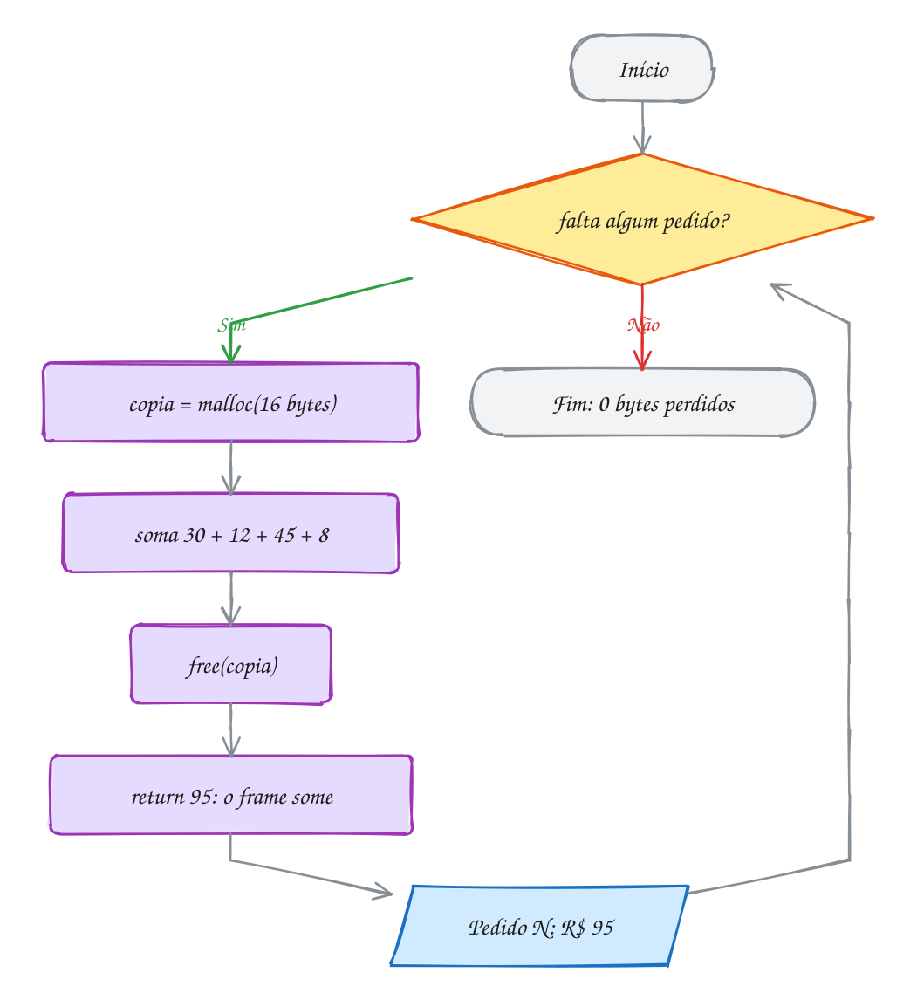</p>

> [!WARNING]
> "Rodou e deu a saída certa" não prova nada em C. Uso depois do `free`,
> estouro de um byte e leitura de lixo são **comportamento indefinido**: o
> programa pode funcionar hoje, mostrar outro valor amanhã e quebrar só com
> outro compilador. Rode sempre com o ASan (o `rodar` já faz isso) e, quando
> desconfiar, com `rodar --valgrind`. Saída certa **e** relatório limpo.

> [!TIP]
> **Por dentro do C:** o ASan reserva 1 byte de "memória sombra" para cada 8
> bytes do programa. Em volta de cada bloco do `malloc` ele deixa uma zona
> envenenada (*redzone*); todo acesso confere a sombra antes. Os blocos
> liberados ficam um tempo de quarentena sem ser reaproveitados, e é por isso
> que ele consegue dizer "isto foi liberado lá na linha 31". O custo: o
> programa fica uns 2 vezes mais lento e usa mais memória. Por isso o ASan é
> ferramenta de desenvolvimento, não de produção.

> [!NOTE]
> **Pergunta para você:** se `free(p); p = NULL;` vira hábito, o que acontece
> com um `free(p)` repetido por engano? E com um `p[0] = 5;` depois disso?
> Qual dos dois o hábito resolve de vez?

### Hora de praticar

Os arquivos ficam em [`0062-erros-de-memoria/`](0062-erros-de-memoria/). Os comandos funcionam de qualquer pasta do terminal. Nos exemplos, rode, mude, quebre e rode de novo. Nos exercícios, a resposta vai dentro do próprio arquivo. ★☆☆ é aquecimento, ★★☆ pede raciocínio e ★★★ é desafio.

**Exemplo A123 · O carrinho que não vaza**

```c
#include <stdio.h>
#include <stdlib.h>

// Soma os preços de um pedido. A cópia é temporária: nasce e morre aqui.
int total_do_pedido(const int *precos, int itens) {
    int *copia = malloc(itens * sizeof *copia);
    if (copia == NULL) {
        return -1;
    }
    int total = 0;
    for (int i = 0; i < itens; i++) {
        copia[i] = precos[i];
        total += copia[i];
    }
    free(copia); // sem esta linha, cada pedido deixaria 16 bytes para trás
    return total;
}

int main(void) {
    int pedido[] = {30, 12, 45, 8};
    for (int p = 1; p <= 3; p++) {
        printf("Pedido %d: R$ %d\n", p, total_do_pedido(pedido, 4));
    }
    return 0;
}
// Saída:
// Pedido 1: R$ 95
// Pedido 2: R$ 95
// Pedido 3: R$ 95
//
// Apague o free(copia) e rode de novo: a saída é a mesma, mas no fim o
// LeakSanitizer (parte do AddressSanitizer) avisa:
//   ERROR: LeakSanitizer: detected memory leaks
//   Direct leak of 48 byte(s) in 3 object(s) allocated from:
//       #1 ... in total_do_pedido A123.c:8
```

```bash
~/LPEDC/rodar 07-memoria-dinamica/0062-erros-de-memoria/A123.c
```

**Exemplo A124 · Free, NULL e valgrind**

```c
#include <stdio.h>
#include <stdlib.h>

int main(void) {
    int noites = 3;
    int *diarias = malloc(noites * sizeof *diarias); // reserva do hotel
    if (diarias == NULL) {
        return 1;
    }
    diarias[0] = 220;
    diarias[1] = 220;
    diarias[2] = 310; // sábado é mais caro

    int total = 0;
    for (int i = 0; i < noites; i++) {
        total += diarias[i];
    }
    printf("Reserva: %d noites, R$ %d\n", noites, total);

    // o hóspede cancelou
    free(diarias);
    diarias = NULL; // hábito: o ponteiro solto vira um ponteiro vazio

    free(diarias); // por engano, de novo: free(NULL) não faz nada
    if (diarias == NULL) { // dá para perguntar antes de usar
        printf("Reserva cancelada: nada a mostrar\n");
    }
    return 0;
}
// Saída:
// Reserva: 3 noites, R$ 750
// Reserva cancelada: nada a mostrar
//
// Rode também com o valgrind: ~/LPEDC/rodar --valgrind 07-memoria-dinamica/0062-erros-de-memoria/A124.c
// O fim da saída mostra o balanço do heap (o número entre == muda):
//   ==4242== HEAP SUMMARY:
//   ==4242==     in use at exit: 0 bytes in 0 blocks
//   ==4242==   total heap usage: 2 allocs, 2 frees, 4,108 bytes allocated
//   ==4242== All heap blocks were freed -- no leaks are possible
//   ==4242== ERROR SUMMARY: 0 errors from 0 contexts (suppressed: 0 from 0)
// São 2 allocs: o seu e o buffer que o printf pediu para ele mesmo.
```

```bash
~/LPEDC/rodar 07-memoria-dinamica/0062-erros-de-memoria/A124.c
```

#### Exercícios

**Exercício E367** · ★☆☆

O painel da rodoviária monta 4 avisos, um de cada vez. A saída está certa,
mas o programa vaza memória. O erro está de propósito. Rode, leia o
relatório do LeakSanitizer e responda: quantos bytes vazaram, em quantos
blocos, e por quê? Depois conserte.


```text
Saída esperada (antes e depois do conserto):
Aviso: Ônibus para Belém às 08h
Aviso: Ônibus para Macapá às 09h
Aviso: Ônibus para Santarém às 11h
Aviso: Ônibus para Manaus às 14h
```

<details>
<summary>Dicas</summary>

1. Conte quantos malloc e quantos free acontecem durante a execução.
2. A cada volta, msg recebe um endereço novo. O que acontece com o
   anterior?
3. Resposta esperada: "Direct leak of 192 byte(s) in 3 object(s)": 4
   malloc de 64 bytes e só 1 free (o do último bloco, depois do laço).
   Conserto: free(msg) dentro do laço, depois do printf, e apagar o free
   de fora.

</details>

```bash
~/LPEDC/rodar 07-memoria-dinamica/0062-erros-de-memoria/E367.c
```

**Exercício E368** · ★☆☆

Cada trecho abaixo é a primeira linha de um relatório do
AddressSanitizer. Para cada um, diga qual erro aconteceu e dê um exemplo
de código que causaria aquilo.


```text
a) ERROR: AddressSanitizer: heap-buffer-overflow on address ...
   WRITE of size 4 ... is located 0 bytes after 16-byte region
b) ERROR: AddressSanitizer: heap-use-after-free on address ...
c) ERROR: AddressSanitizer: attempting double-free on ...
d) ERROR: LeakSanitizer: detected memory leaks
e) ERROR: AddressSanitizer: SEGV on unknown address 0x000000000000
```


Em a), quantos ints tinha o bloco e qual índice foi usado?

<details>
<summary>Dicas</summary>

1. "0 bytes after" quer dizer "logo depois do último byte do bloco".
2. O endereço 0x0 é o NULL.
3. Resposta esperada: a) estouro: escreveu além do fim do bloco; 16
   bytes são 4 ints e o índice usado foi 4 (ex.: for com i <= 4);
   b) uso depois do free: free(p); printf("%d", p[0]);
   c) free duplo: free(p); free(p); d) vazamento: malloc sem free;
   e) acesso pelo ponteiro NULL: p = malloc(...) falhou e ninguém
   conferiu, ou int *p = NULL; *p = 1;

</details>

```bash
~/LPEDC/rodar 07-memoria-dinamica/0062-erros-de-memoria/E368.c
```

**Exercício E369** · ★★☆

O placar do campeonato de futsal da firma guarda os gols dos 3 times. O
programa tem um erro de propósito (o gcc até avisa). Rode e leia o aviso e
o relatório: qual é o erro? Por que "um ponteiro é um backup" é uma ideia errada? Conserte
mantendo a saída.


```text
Saída esperada depois do conserto:
Gols: 4 2 7
Placar encerrado
```

<details>
<summary>Dicas</summary>

1. Procure "attempting double-free". Quantos blocos existem? Quantos
   free?
2. backup = placar copia o ENDEREÇO, não os números.
3. Resposta esperada: placar e backup apontam para o MESMO bloco; liberar
   os dois é free duplo. Conserto: um só free (apague o free(backup)). Se
   quisesse uma cópia de verdade, precisaria de outro malloc e de copiar
   os 3 números.

</details>

```bash
~/LPEDC/rodar 07-memoria-dinamica/0062-erros-de-memoria/E369.c
```

**Exercício E370** · ★★☆

O sistema do estacionamento guarda a placa do carro e os km rodados nos
últimos 5 dias. O programa tem DOIS estouros de memória, de propósito. O
AddressSanitizer para no primeiro: conserte, rode de novo e ache o
segundo.


```text
Saída esperada depois do conserto:
Placa: QTX3E21
Km da semana: 238
```

<details>
<summary>Dicas</summary>

1. Quantos bytes "QTX3E21" ocupa de verdade?
2. O vetor km tem 5 posições: índices de 0 a 4.
3. Resposta esperada: (a) malloc(strlen(original)) esquece o '\0': o
   strcpy escreve 1 byte depois do fim (heap-buffer-overflow, WRITE of
   size 8). Use strlen(original) + 1. (b) o for com i <= dias lê km[5],
   4 bytes depois do fim do bloco. Use i < dias. Total: 238.

</details>

```bash
~/LPEDC/rodar 07-memoria-dinamica/0062-erros-de-memoria/E370.c
```

**Exercício E371** · ★★★

A lista de presença de uma aula de yoga começa com 2 vagas e a função
adicionar faz o vetor crescer. Com o rodar, o programa quebra com um
relatório do AddressSanitizer na 4ª chegada. O erro está de propósito.
Explique por que o main fica com um ponteiro solto, mesmo que a função
adicionar esteja "certa" por dentro. Conserte mudando a assinatura de
adicionar.


```text
Saída esperada depois do conserto:
Presentes: 11 27 35 48
```

<details>
<summary>Dicas</summary>

1. O parâmetro v é uma cópia do ponteiro do main (passagem por valor,
   assunto 0034). O realloc muda a cópia, não o original.
2. Duas saídas: devolver o ponteiro novo (int *adicionar(...)) ou
   receber o endereço do ponteiro (int **v, assunto 0054).
3. Resposta esperada: na 3ª chegada o realloc mudou o bloco de lugar e
   liberou o antigo, mas só a cópia local v recebeu o endereço novo; o
   alunos do main continua apontando para o bloco antigo, de 2 vagas e já
   liberado. Na 4ª chegada, a função grava alunos[3] lá (o ASan acusa
   heap-buffer-overflow, porque o endereço cai depois do fim do bloco
   antigo; se caísse dentro, seria heap-use-after-free). Com
   int adicionar(int **v, int *qtd, int *cap, int matricula) e
   *v = maior; dentro, e adicionar(&alunos, ...) no main, a saída fica
   "Presentes: 11 27 35 48".

</details>

```bash
~/LPEDC/rodar 07-memoria-dinamica/0062-erros-de-memoria/E371.c
```

**Exercício E372** · ★★★

O artilheiro do bairro jogou 4 das 5 rodadas; a 5ª ainda não aconteceu e
deveria contar 0 gols. Este programa tem um erro de propósito que o
AddressSanitizer NÃO acusa. Faça assim:

1) rode com o rodar e veja o total;
2) rode com ~/LPEDC/rodar --valgrind e leia a primeira mensagem;
3) conserte com UMA palavra trocada.


```text
Saída esperada depois do conserto:
Total: 6 gols
Média por rodada: 1.2
```


Por que o ASan não pegou e o valgrind pegou?

<details>
<summary>Dicas</summary>

1. Quem deu valor para gols[4]?
2. O valgrind avisa "Conditional jump or move depends on uninitialised
   value(s)" e, com a opção que o rodar já liga, mostra onde o bloco foi
   criado.
3. Resposta esperada: gols[4] nunca recebeu valor e o malloc entrega lixo
   (com o ASan, o lixo é sempre 0xbebebebe, um número negativo enorme).
   O ASan vigia limites e blocos liberados, não valores; o valgrind
   acompanha se cada byte já foi escrito. Conserto: trocar malloc(5 *
   sizeof *gols) por calloc(5, sizeof *gols).

</details>

```bash
~/LPEDC/rodar 07-memoria-dinamica/0062-erros-de-memoria/E372.c
```

---

## 0063 · Juntando tudo

O mercadinho da esquina ainda anota o fiado num caderno: nome do cliente e
quanto ele deve. Cliente novo ganha uma linha; cliente antigo soma na conta
dele; quem paga zera. O caderno nunca tem um número fixo de páginas, e cada
nome tem um tamanho. É um ótimo programa para juntar o módulo inteiro.

O programa usa tudo o que você viu:

- **heap** (0058): o caderno precisa durar o programa todo e crescer, então
  mora no heap, não na pilha;
- **malloc e free** (0059): cada nome é copiado para um bloco do tamanho
  exato com `duplicar`, o `strlen + 1` de sempre;
- **realloc** (0060): dois vetores paralelos (`nomes` e `centavos`) dobram de
  capacidade juntos quando enchem, sempre com ponteiro temporário;
- **vetor de ponteiros** (0061): `char **nomes` é um vetor de `char *`, cada
  um apontando para o seu bloco, como as linhas de uma matriz dinâmica com
  tamanhos diferentes;
- **erros de memória** (0062): para liberar, primeiro cada nome, depois os
  dois vetores. Nada sobra no heap.

Uma novidade: `crescer` recebe `char ***nomes`. Parece assustador, mas é a
mesma regra do E371 do assunto anterior. A função precisa **mudar** o
ponteiro `nomes` do `main` (o `realloc` pode trocar o endereço), então recebe
o endereço dele. `nomes` é `char **`; o endereço de `nomes` é `char ***`. O
mesmo vale para `int **centavos`.

Valores em centavos, como fazem os sistemas de pagamento: `int` não tem erro
de arredondamento, e R$ 12,50 vira `1250`.

Vamos ver na prática. Chegam seis anotações: Dona Cida (R$ 12,50), Seu Jorge
(R$ 8,30), Dona Cida de novo (R$ 4,70), Bia (R$ 20,00), Tonho (R$ 3,15) e
Rosa (R$ 5,60). São 5 clientes diferentes, então o caderno cresce de 2 para
4 e de 4 para 8. Depois Seu Jorge paga tudo:

<p align="center">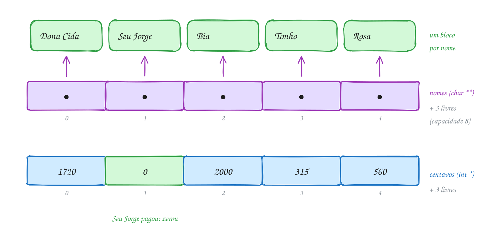</p>

O programa completo. Leia função por função: cada uma cuida de uma coisa e
nenhuma esquece um `free`:

```c
#include <stdio.h>
#include <stdlib.h>
#include <string.h>

// Cópia de uma string num bloco do tamanho exato.
char *duplicar(const char *texto) {
    char *copia = malloc(strlen(texto) + 1);
    if (copia != NULL) {
        strcpy(copia, texto);
    }
    return copia;
}

// Dobra a capacidade dos dois vetores paralelos. Recebe o ENDEREÇO dos
// ponteiros do main (char *** e int **) porque o realloc pode mudá-los.
int crescer(char ***nomes, int **centavos, int *cap) {
    int nova = *cap * 2;
    char **mais_nomes = realloc(*nomes, nova * sizeof **nomes);
    if (mais_nomes == NULL) {
        return 0;
    }
    *nomes = mais_nomes;
    int *mais_centavos = realloc(*centavos, nova * sizeof **centavos);
    if (mais_centavos == NULL) {
        return 0;
    }
    *centavos = mais_centavos;
    printf("(caderno cresceu: %d -> %d clientes)\n", *cap, nova);
    *cap = nova;
    return 1;
}

int buscar(char **nomes, int qtd, const char *nome) {
    for (int i = 0; i < qtd; i++) {
        if (strcmp(nomes[i], nome) == 0) {
            return i;
        }
    }
    return -1;
}

// Soma uma compra na conta do cliente; cria a conta se ela não existe.
int anotar(char ***nomes, int **centavos, int *qtd, int *cap, const char *nome, int valor) {
    int i = buscar(*nomes, *qtd, nome);
    if (i >= 0) {
        (*centavos)[i] += valor;
        return 1;
    }
    if (*qtd == *cap && !crescer(nomes, centavos, cap)) {
        return 0;
    }
    char *copia = duplicar(nome);
    if (copia == NULL) {
        return 0;
    }
    (*nomes)[*qtd] = copia;
    (*centavos)[*qtd] = valor;
    (*qtd)++;
    return 1;
}

void liberar(char **nomes, int *centavos, int qtd) {
    for (int i = 0; i < qtd; i++) {
        free(nomes[i]); // cada nome é um bloco
    }
    free(nomes);        // depois o vetor de ponteiros
    free(centavos);
}

int main(void) {
    int qtd = 0;
    int cap = 2;
    char **nomes = malloc(cap * sizeof *nomes);
    int *centavos = malloc(cap * sizeof *centavos);
    if (nomes == NULL || centavos == NULL) {
        free(nomes);
        free(centavos);
        return 1;
    }

    const char *quem[] = {"Dona Cida", "Seu Jorge", "Dona Cida", "Bia", "Tonho", "Rosa"};
    int valor[] = {1250, 830, 470, 2000, 315, 560}; // em centavos
    for (int k = 0; k < 6; k++) {
        if (!anotar(&nomes, &centavos, &qtd, &cap, quem[k], valor[k])) {
            liberar(nomes, centavos, qtd);
            return 1;
        }
    }

    int i = buscar(nomes, qtd, "Seu Jorge"); // Seu Jorge pagou tudo
    if (i >= 0) {
        centavos[i] = 0;
    }

    int total = 0;
    for (int k = 0; k < qtd; k++) {
        printf("%-10s R$ %3d.%02d\n", nomes[k], centavos[k] / 100, centavos[k] % 100);
        total += centavos[k];
    }
    printf("Total na rua: R$ %d.%02d\n", total / 100, total % 100);

    liberar(nomes, centavos, qtd);
    return 0;
}
// Saída:
// (caderno cresceu: 2 -> 4 clientes)
// (caderno cresceu: 4 -> 8 clientes)
// Dona Cida  R$  17.20
// Seu Jorge  R$   0.00
// Bia        R$  20.00
// Tonho      R$   3.15
// Rosa       R$   5.60
// Total na rua: R$ 45.95
```

Repara no fluxograma: cada anotação passa por uma busca. Achou, soma; não
achou, talvez cresça e cria uma linha nova. Todo caminho de erro termina em
`liberar`:

<p align="center">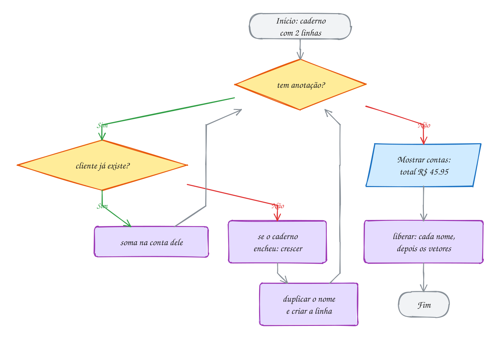</p>

> [!WARNING]
> Liberar só `nomes` vaza todos os nomes: cada `nomes[i]` é um bloco
> separado, com o seu `malloc` (dentro de `duplicar`). Conte os `malloc` do
> programa: 2 no começo, 5 nomes e os `realloc`, que trocam um bloco por
> outro. No fim, `liberar` faz 5 + 2 `free`. Rode com `rodar --valgrind` e
> confira a linha `All heap blocks were freed`.

> [!TIP]
> **Por dentro do C:** os dois vetores paralelos são um remendo para a falta
> de um jeito de agrupar "nome e saldo" numa coisa só. É exatamente o que a
> `struct` resolve no módulo 08: um vetor de `struct cliente` com um `realloc`
> só. Mesmo assim, o desenho na memória continua parecido: o nome é um
> `char *` que aponta para um bloco do heap, e a struct guarda só os 8 bytes
> do ponteiro. No TypeScript, um `{ nome: string, centavos: number }[]` faz o
> mesmo por baixo, com o coletor de lixo no papel do `liberar`.

> [!NOTE]
> **Pergunta para você:** se Dona Cida pagar e você quiser **apagar** a linha
> dela (e não só zerar), o que precisa acontecer com `nomes[0]`, com as
> linhas de baixo e com `qtd`? Quantos `free` essa remoção faz?

### Hora de praticar

Os arquivos ficam em [`0063-juntando-tudo/`](0063-juntando-tudo/). Os comandos funcionam de qualquer pasta do terminal. Nos exemplos, rode, mude, quebre e rode de novo. Nos exercícios, a resposta vai dentro do próprio arquivo. ★☆☆ é aquecimento, ★★☆ pede raciocínio e ★★★ é desafio.

**Exemplo A125 · O caderninho de fiado**

```c
#include <stdio.h>
#include <stdlib.h>
#include <string.h>

// Cópia de uma string num bloco do tamanho exato.
char *duplicar(const char *texto) {
    char *copia = malloc(strlen(texto) + 1);
    if (copia != NULL) {
        strcpy(copia, texto);
    }
    return copia;
}

// Dobra a capacidade dos dois vetores paralelos. Recebe o ENDEREÇO dos
// ponteiros do main (char *** e int **) porque o realloc pode mudá-los.
int crescer(char ***nomes, int **centavos, int *cap) {
    int nova = *cap * 2;
    char **mais_nomes = realloc(*nomes, nova * sizeof **nomes);
    if (mais_nomes == NULL) {
        return 0;
    }
    *nomes = mais_nomes;
    int *mais_centavos = realloc(*centavos, nova * sizeof **centavos);
    if (mais_centavos == NULL) {
        return 0;
    }
    *centavos = mais_centavos;
    printf("(caderno cresceu: %d -> %d clientes)\n", *cap, nova);
    *cap = nova;
    return 1;
}

int buscar(char **nomes, int qtd, const char *nome) {
    for (int i = 0; i < qtd; i++) {
        if (strcmp(nomes[i], nome) == 0) {
            return i;
        }
    }
    return -1;
}

// Soma uma compra na conta do cliente; cria a conta se ela não existe.
int anotar(char ***nomes, int **centavos, int *qtd, int *cap, const char *nome, int valor) {
    int i = buscar(*nomes, *qtd, nome);
    if (i >= 0) {
        (*centavos)[i] += valor;
        return 1;
    }
    if (*qtd == *cap && !crescer(nomes, centavos, cap)) {
        return 0;
    }
    char *copia = duplicar(nome);
    if (copia == NULL) {
        return 0;
    }
    (*nomes)[*qtd] = copia;
    (*centavos)[*qtd] = valor;
    (*qtd)++;
    return 1;
}

void liberar(char **nomes, int *centavos, int qtd) {
    for (int i = 0; i < qtd; i++) {
        free(nomes[i]); // cada nome é um bloco
    }
    free(nomes);        // depois o vetor de ponteiros
    free(centavos);
}

int main(void) {
    int qtd = 0;
    int cap = 2;
    char **nomes = malloc(cap * sizeof *nomes);
    int *centavos = malloc(cap * sizeof *centavos);
    if (nomes == NULL || centavos == NULL) {
        free(nomes);
        free(centavos);
        return 1;
    }

    const char *quem[] = {"Dona Cida", "Seu Jorge", "Dona Cida", "Bia", "Tonho", "Rosa"};
    int valor[] = {1250, 830, 470, 2000, 315, 560}; // em centavos
    for (int k = 0; k < 6; k++) {
        if (!anotar(&nomes, &centavos, &qtd, &cap, quem[k], valor[k])) {
            liberar(nomes, centavos, qtd);
            return 1;
        }
    }

    int i = buscar(nomes, qtd, "Seu Jorge"); // Seu Jorge pagou tudo
    if (i >= 0) {
        centavos[i] = 0;
    }

    int total = 0;
    for (int k = 0; k < qtd; k++) {
        printf("%-10s R$ %3d.%02d\n", nomes[k], centavos[k] / 100, centavos[k] % 100);
        total += centavos[k];
    }
    printf("Total na rua: R$ %d.%02d\n", total / 100, total % 100);

    liberar(nomes, centavos, qtd);
    return 0;
}
// Saída:
// (caderno cresceu: 2 -> 4 clientes)
// (caderno cresceu: 4 -> 8 clientes)
// Dona Cida  R$  17.20
// Seu Jorge  R$   0.00
// Bia        R$  20.00
// Tonho      R$   3.15
// Rosa       R$   5.60
// Total na rua: R$ 45.95
```

```bash
~/LPEDC/rodar 07-memoria-dinamica/0063-juntando-tudo/A125.c
```

**Exemplo A126 · Uma linha de qualquer tamanho**

```c
#include <stdio.h>
#include <stdlib.h>

// Lê uma linha inteira, de qualquer tamanho, num bloco que cresce.
// Devolve NULL no fim da entrada (ou se faltar memória). Quem chama libera.
char *ler_linha(void) {
    int cap = 4;
    int qtd = 0;
    char *linha = malloc(cap);
    if (linha == NULL) {
        return NULL;
    }
    int c;
    while ((c = getchar()) != EOF && c != '\n') {
        if (qtd + 1 == cap) { // + 1: sempre sobra lugar para o '\0'
            char *maior = realloc(linha, cap * 2);
            if (maior == NULL) {
                free(linha);
                return NULL;
            }
            linha = maior;
            cap *= 2;
        }
        linha[qtd++] = (char)c;
    }
    if (c == EOF && qtd == 0) { // acabou a entrada
        free(linha);
        return NULL;
    }
    linha[qtd] = '\0';
    return linha;
}

int main(void) {
    char *nome;
    int n = 0;
    while ((nome = ler_linha()) != NULL) {
        n++;
        int tamanho = 0;
        while (nome[tamanho] != '\0') {
            tamanho++;
        }
        printf("Nome %d (%d bytes): %s\n", n, tamanho, nome);
        free(nome); // cada linha é um bloco novo
    }
    return 0;
}
// Exemplo de uso (os nomes vêm do teclado; Ctrl+D encerra):
// Ana
// Nome 1 (3 bytes): Ana
// Maria Eduarda dos Santos
// Nome 2 (24 bytes): Maria Eduarda dos Santos
//
// Para testar: printf 'Ana\nMaria Eduarda dos Santos\n' | ~/LPEDC/rodar 07-memoria-dinamica/0063-juntando-tudo/A126.c
// Nenhum fgets com tamanho fixo: o bloco cresce 4 -> 8 -> 16 -> 32.
```

```bash
~/LPEDC/rodar 07-memoria-dinamica/0063-juntando-tudo/A126.c
```

#### Exercícios

**Exercício E373** · ★☆☆

Leia 3 nomes com fgets num buffer de 100 chars. Para cada um, tire o '\n'
e guarde uma CÓPIA de tamanho exato no heap, num vetor char *nomes[3].
Depois mostre cada nome com quantos bytes o bloco dele ocupa e libere
tudo.


```text
Exemplo de uso:
Nome 1: Ana
Nome 2: Joao Pedro
Nome 3: Lu
Ana (4 bytes)
Joao Pedro (11 bytes)
Lu (3 bytes)
```


Para testar: printf 'Ana\nJoao Pedro\nLu\n' | ~/LPEDC/rodar <este arquivo>

<details>
<summary>Dicas</summary>

1. O buffer de 100 é só a área de leitura, reaproveitada a cada nome. Os
   nomes de verdade vão para blocos de strlen + 1.
2. buffer[strcspn(buffer, "\n")] = '\0'; tira o '\n' (assunto 0047).
3. Resposta esperada: a saída acima: o bloco de cada nome tem strlen + 1
   bytes. 3 malloc, 3 free. Se guardasse o próprio buffer em nomes[i], os
   três ponteiros apontariam para o mesmo lugar e mostrariam "Lu" três
   vezes.

</details>

```bash
~/LPEDC/rodar 07-memoria-dinamica/0063-juntando-tudo/E373.c
```

**Exercício E374** · ★☆☆

Escreva duas funções para a lista de compras:


```text
char **criar_lista(const char *itens[], int n);
void liberar_lista(char **lista, int n);
```


criar_lista aloca um vetor de n ponteiros e uma cópia de cada item. Teste
com "pao", "leite", "cafe" e "manteiga", mostre a lista e calcule quantos
blocos e quantos bytes foram pedidos ao heap (num PC de 64 bits).


```text
Saída esperada:
- pao
- leite
- cafe
- manteiga
5 blocos, 56 bytes
```

<details>
<summary>Dicas</summary>

1. O vetor de ponteiros é 1 bloco de 4 * 8 = 32 bytes; cada item é mais
   1 bloco de strlen + 1.
2. Some os bytes dentro de criar_lista ou num laço à parte com sizeof e
   strlen.
3. Resposta esperada: 5 blocos e 56 bytes (32 + 4 + 6 + 5 + 9).
   liberar_lista faz 5 free: cada item e depois o vetor.

</details>

```bash
~/LPEDC/rodar 07-memoria-dinamica/0063-juntando-tudo/E374.c
```

**Exercício E375** · ★★☆

Leia frutas, uma por linha, até aparecer a palavra fim. Guarde cada uma
num vetor de strings (char **) que começa com capacidade 1 e dobra quando
enche. Mostre as frutas na ordem contrária e quantas vezes o vetor
cresceu.


```text
Exemplo de uso:
uva
manga
caju
acerola
fim
Ao contrário: acerola caju manga uva
O vetor cresceu 2 vezes
```


Para testar: printf 'uva\nmanga\ncaju\nacerola\nfim\n' | ~/LPEDC/rodar <este arquivo>

<details>
<summary>Dicas</summary>

1. Leia com fgets num buffer, tire o '\n' e compare com strcmp(buffer,
   "fim").
2. O realloc é no vetor de ponteiros (sizeof(char *) por posição); cada
   fruta ganha o seu próprio malloc de strlen + 1.
3. Resposta esperada: "Ao contrário: acerola caju manga uva" e 2 vezes
   (1 -> 2 -> 4). No fim, um free por fruta e um para o vetor.

</details>

```bash
~/LPEDC/rodar 07-memoria-dinamica/0063-juntando-tudo/E375.c
```

**Exercício E376** · ★★☆

Leia a quantidade de alunos e de provas e depois as notas, linha por
linha. Guarde numa matriz dinâmica de double (vetor de ponteiros) e
mostre a média de cada aluno e a da turma. As médias de cada aluno também
vão para um vetor alocado.


```text
Exemplo de uso:
Alunos e provas: 3 2
Notas do aluno 1: 7 8
Notas do aluno 2: 5 6
Notas do aluno 3: 9 10
Aluno 1: 7.5
Aluno 2: 5.5
Aluno 3: 9.5
Turma: 7.5
```


Para testar: printf '3 2\n7 8\n5 6\n9 10\n' | ~/LPEDC/rodar <este arquivo>

<details>
<summary>Dicas</summary>

1. double **notas = malloc(alunos * sizeof *notas); e uma linha de
   provas doubles para cada aluno.
2. double *medias = malloc(alunos * sizeof *medias);
3. Resposta esperada: a saída acima. São alunos + 2 malloc (3 linhas, o
   vetor de linhas e as médias) e o mesmo número de free.

</details>

```bash
~/LPEDC/rodar 07-memoria-dinamica/0063-juntando-tudo/E376.c
```

**Exercício E377** · ★★★

Uma versão apressada do caderninho de fiado. Ela tem TRÊS problemas de
memória, de propósito. O AddressSanitizer acha dois (um durante a
execução, outro no fim); o terceiro só aparece quando falta memória, e
você tem que achar lendo. Conserte os três.


```text
Saída esperada depois do conserto:
Cida: R$ 12
Jorge: R$ 8
Bia: R$ 20
```

<details>
<summary>Dicas</summary>

1. Comece pelo heap-buffer-overflow: quantos bytes copiar precisa?
2. Depois o vazamento: quantos malloc existem? Quantos free?
3. O terceiro está na linha do realloc.
4. Resposta esperada: (a) copiar faz malloc(strlen(s)) sem o + 1 do
   '\0'; (b) o fim libera só nomes, e cada nomes[i] vaza: faça um free
   por nome antes; (c) nomes = realloc(nomes, ...) perde o bloco se
   falhar: use um ponteiro temporário.

</details>

```bash
~/LPEDC/rodar 07-memoria-dinamica/0063-juntando-tudo/E377.c
```

**Exercício E378** · ★★★

Escreva a função


```text
char **dividir(const char *texto, char separador, int *qtd);
```


que quebra o texto em pedaços pelo separador e devolve um vetor NOVO de
strings NOVAS, cada uma do tamanho exato (como o split do JavaScript).
A quantidade volta por *qtd. Teste com a lista do mercado
"arroz;feijao;cafe;oleo de soja" e com ";;", que tem 3 pedaços vazios.


```text
Saída esperada:
4 itens: [arroz] [feijao] [cafe] [oleo de soja]
3 itens: [] [] []
```

<details>
<summary>Dicas</summary>

1. Primeira passada: conte os separadores. São separadores + 1 pedaços.
2. Segunda passada: para cada pedaço, ache o início e o tamanho, faça o
   malloc(tamanho + 1), copie os chars e ponha o '\0'. Pedaço vazio é um
   bloco de 1 byte só com o '\0'.
3. Resposta esperada: a saída acima. Escreva também liberar_pedacos(v, n)
   e chame para os dois resultados. Se um malloc falhar no meio, libere o
   que já foi feito e devolva NULL.

</details>

```bash
~/LPEDC/rodar 07-memoria-dinamica/0063-juntando-tudo/E378.c
```

---

## Desafios do módulo

Problemas para resolver num arquivo seu, rodando com o `rodar` (e com
`rodar --valgrind` quando quiser a segunda opinião). Todos precisam terminar
sem nenhum relatório de erro.

**1. Apagar do caderno.** No caderninho de fiado do A125, escreva
`int remover(char **nomes, int *centavos, int *qtd, const char *nome)`, que
apaga a linha do cliente e puxa as de baixo para cima. Teste removendo
"Seu Jorge" e mostre o caderno.

<details><summary>Resposta</summary>

Ficam Dona Cida (17.20), Bia (20.00), Tonho (3.15) e Rosa (5.60), total
R$ 45.95. O caminho: ache o índice `i`, faça `free(nomes[i])` (o nome é um
bloco), depois copie `nomes[k] = nomes[k + 1]` e `centavos[k] = centavos[k + 1]`
para `k` de `i` até `qtd - 2` e faça `(*qtd)--`. Um `free` só: os ponteiros
puxados continuam apontando para os mesmos blocos.

</details>

**2. A matriz de dois mallocs.** Escreva `int **criar_matriz(int l, int c)`
que usa só dois `malloc`: um bloco com os `l * c` inteiros e um vetor de `l`
ponteiros com `m[i] = bloco + i * c`. Escreva também o `liberar`. Teste com
uma matriz 3 x 4 preenchida com `i * 4 + j` e mostre `m[2][3]`.

<details><summary>Resposta</summary>

`m[2][3]` vale **11**. Para liberar: `free(m[0])` (é o endereço do bloco de
dados) e `free(m)`. Dois `malloc`, dois `free`, dados contíguos e a notação
`m[i][j]` preservada. Cuidado: `free(m[1])` seria um erro, porque `m[1]` não
veio de um `malloc`.

</details>

**3. Matriz simétrica econômica.** Numa tabela de distâncias entre 4
cidades, `d[i][j] == d[j][i]` e a diagonal é 0. Guarde só o triângulo de baixo
(com a diagonal) num vetor de `n * (n + 1) / 2` posições, com o elemento
`(i, j)`, `i >= j`, em `i * (i + 1) / 2 + j`. Quantas posições para n = 4? Em
que índice fica `(3, 1)`? E `(1, 3)`?

<details><summary>Resposta</summary>

**10** posições (contra 16 da matriz cheia). `(3, 1)` fica em 3 * 4 / 2 + 1 =
**7**. Para `(1, 3)`, troque i e j, porque `i < j`: é o mesmo índice 7. Com
n = 1000, a economia passa de 499 mil posições.

</details>

**4. O gerente do heap.** O heap tem dois blocos livres, de 120 e de 60 bytes,
e chegam três pedidos: 30, 80 e 55. Simule duas estratégias: **first fit**
(usa o primeiro bloco que serve, olhando o de 120 antes) e **best fit** (usa o
menor bloco que serve). Alguma delas falha?

<details><summary>Resposta</summary>

First fit: 30 sai do 120 (sobra 90), 80 sai do 90 (sobra 10), 55 sai do 60
(sobra 5): **atende os três**. Best fit: 30 sai do 60 (sobra 30), 80 sai do
120 (sobra 40), e 55 **falha** (sobram 40 e 30). Escolher "o mais justo" nem
sempre é o melhor: deixa sobras pequenas demais. Os `malloc` reais usam
variações de first fit com listas por tamanho.

</details>

**5. Tem memória, mas não cabe.** Um heap de 1000 bytes recebe A = 300, B = 200
e C = 400 (sobram 100 no fim). Depois `free(B)`. Há 300 bytes livres. Por que
um pedido de 250 bytes falha?

<details><summary>Resposta</summary>

Os livres são **dois pedaços separados**, de 200 (onde era B) e de 100 (no
fim), e um bloco do `malloc` precisa ser contíguo. Isso é **fragmentação
externa**. Se C fosse liberado, os 200 de B, os 400 de C e os 100 do fim se
juntariam num bloco de 700 e o pedido passaria.

</details>

**6. Repetir texto.** Escreva `char *repetir(const char *s, int n)` que
devolve uma string nova com `s` repetida `n` vezes. Quantos bytes
`repetir("ab", 3)` pede? E `repetir("ab", 0)`?

<details><summary>Resposta</summary>

`"ababab"` precisa de 2 * 3 + 1 = **7** bytes. Com n = 0, 1 byte só com o
`'\0'`: uma string vazia válida, que quem chama também precisa liberar.
Monte com `strcpy` no primeiro e `strcat` nos seguintes, ou copiando com um
índice.

</details>

**7. O vetor que encolhe.** Um vetor dinâmico começa com capacidade 1, dobra
quando enche e **corta pela metade** quando a quantidade fica menor que um
quarto da capacidade. Você insere 9 elementos e depois remove 6. Qual a
capacidade depois das inserções? E no fim?

<details><summary>Resposta</summary>

Inserindo: 1 → 2 → 4 → 8 → 16, então **16** com 9 elementos. Removendo:
com 3 elementos, 3 < 16 / 4 = 4, e a capacidade cai para **8**. O "um quarto"
(e não "metade") evita o vai e vem: se encolhesse com metade, um push e um
pop alternados na fronteira fariam um `realloc` a cada operação.

</details>

**8. Dois nomes, um bloco.** Preveja:

```c
int *a = malloc(3 * sizeof *a);
int *b = a;
b[0] = 5;
free(a);
a = NULL;
printf("%d\n", b == NULL);
```

O que aparece? O `b[0]` ainda é seguro?

<details><summary>Resposta</summary>

Mostra **0**: `a = NULL` muda só a variável `a`. `b` continua guardando o
endereço do bloco liberado: é um ponteiro solto, e `b[0]` é uso depois do
`free` (o ASan acusa `heap-use-after-free`). O hábito de zerar o ponteiro
ajuda, mas não substitui saber **quem é o dono** do bloco.

</details>

**9. O vazamento a conta-gotas.** Uma função é chamada 1000 vezes. Em cada
chamada ela faz um `malloc` de 24 bytes, mas só dá `free` quando o número da
chamada é par. Quanto vaza? O que o LeakSanitizer mostra?

<details><summary>Resposta</summary>

500 chamadas ímpares * 24 = **12000 bytes** em 500 blocos:
`Direct leak of 12000 byte(s) in 500 object(s)`, com a linha do `malloc`. Num
servidor que roda essa função 1 milhão de vezes por dia, são 12 MB por dia:
é assim que o sistema da padaria trava no sábado.

</details>

**10. Frase ao contrário.** Use o `dividir` do E378 e uma função de juntar
para inverter a ordem das palavras: "o rato roeu a roupa" vira
"roupa a roeu rato o". A frase resultante deve ser um bloco novo, do tamanho
exato.

<details><summary>Resposta</summary>

`dividir` com `' '` dá 5 pedaços. O tamanho final é a soma dos `strlen` (15)
mais 4 espaços mais o `'\0'`: **20 bytes**, o mesmo tamanho da frase original.
Monte percorrendo os pedaços do último para o primeiro. No fim, libere os 5
pedaços, o vetor deles e a frase nova.

</details>

## Para ler mais

- BACKES, A. *Linguagem C: completa e descomplicada*. Rio de Janeiro: Elsevier, 2013. Cap. 11: alocação dinâmica.
- BACKES, A. *Linguagem C descomplicada*. Apostila. Uberlândia: FACOM/UFU. Capítulo de alocação dinâmica.
- CELES, W.; RANGEL, J. L. *Apostila de estruturas de dados*. Rio de Janeiro: PUC-Rio, 2002. Alocação dinâmica e matrizes dinâmicas.
- DEITEL, P.; DEITEL, H. *C: como programar*. 6. ed. São Paulo: Pearson, 2011. Cap. 12: estruturas de dados (alocação dinâmica).
- FEOFILOFF, P. *Algoritmos em linguagem C*. Rio de Janeiro: Elsevier, 2009. Apêndice F: alocação dinâmica de memória.
- LAUREANO, M. *Estrutura de dados com algoritmos e C*. Rio de Janeiro: Brasport, 2008. Cap. 2: uso de memória.
- ROCHA, A. M. A.; BORGES, A. R. O. S. *Programação, estruturas de dados e algoritmos em C*. Aveiro: Universidade de Aveiro. Apostila da disciplina Programação II.
- TENENBAUM, A. M.; LANGSAM, Y.; AUGENSTEIN, M. J. *Estruturas de dados usando C*. São Paulo: Makron Books, 1995. Cap. 9: gerenciamento de armazenamento.
- KERNIGHAN, B. W.; RITCHIE, D. M. *C: a linguagem de programação padrão ANSI*. Rio de Janeiro: Campus, 1989. Seção 8.7: um alocador de memória.
- CPPREFERENCE. *Dynamic memory management*. Disponível em: <https://en.cppreference.com/w/c/memory>.
- LINUX MAN-PAGES. *malloc(3)*. Disponível em: <https://man7.org/linux/man-pages/man3/malloc.3.html>.
- GOOGLE. *AddressSanitizer*. Disponível em: <https://github.com/google/sanitizers/wiki/AddressSanitizer>.
- VALGRIND DEVELOPERS. *Valgrind user manual: Memcheck*. Disponível em: <https://valgrind.org/docs/manual/mc-manual.html>.
