<!-- Gerado por _gerador. Para mudar este arquivo, edite _gerador/modulos/08-structs/ e rode: cd _gerador && npm run gerar -->

# Módulo 08 · Tipos compostos

Até aqui, cada variável guardava uma coisa só: um número, um caractere, um
vetor de coisas iguais. Só que os dados do mundo real vêm em pacotes. Um
pedido tem tamanho, quantidade e preço; um time tem nome, vitórias e empates.
Este módulo ensina o C a guardar pacotes.

No C, você desenha o pacote byte a
byte: decide a ordem dos campos (e paga pelas sobras de alinhamento), decide se
ele anda por cópia ou por ponteiro (e paga pela cópia), decide se dois campos
dividem a mesma memória. Nada é escondido, e por isso você passa a entender o
que um objeto **custa**.

O módulo fecha descendo ao nível do bit: máscaras e flags, o jeito mais
compacto e mais rápido de guardar sim/não. Com struct, ponteiro para struct e
`malloc`, você tem todas as peças das estruturas de dados que começam no
módulo 10.

## O que você vai aprender

- agrupar dados de tipos diferentes numa **struct**, com o ponto, a cópia por atribuição e o alinhamento
- dar nomes curtos aos tipos com **typedef**, e por que ele não cria um tipo novo
- montar, percorrer e ordenar **vetores de structs**
- usar **ponteiro para struct**: a seta `->`, struct no heap com `malloc` e o custo de passar por valor
- dar nome a estados e opções com **enum**
- fazer campos dividirem a memória com **union**, e enxergar a **endianness** da máquina
- ler e escrever **bits** com `& | ^ ~ << >>`, máscaras e flags (as permissões `rwx` do Linux)

## Como estudar cada assunto

1. Leia o texto e olhe o **diagrama da ideia**: é o exemplo desenhado.
2. Leia o código. É o mesmo exemplo, com os mesmos valores.
3. Siga o **fluxograma** com o dedo: é o caminho que o programa faz.
4. Rode os exemplos. Mude um valor, troque a ordem dos campos, quebre de
   propósito, rode de novo.
5. Faça os exercícios. ★☆☆ é aquecimento, ★★☆ pede raciocínio, ★★★ é desafio.
   As dicas vêm logo abaixo do enunciado: tente antes de ler.

No meio de cada assunto tem uma **Pergunta para você**. Responda antes de rodar.

## As cores e as formas

Caixa azul é dado entrando ou saindo, roxa é o programa fazendo alguma coisa,
amarela é pergunta. Verde é o caminho que o exemplo segue; cinza, o que ele não
usa; vermelho, erro.

<p align="center"></p>

## Antes de começar

Este módulo usa tudo dos anteriores: funções, vetores, strings com `fgets`,
ponteiros, `malloc`/`realloc`/`free` e `qsort`. Se `int *p = malloc(n *
sizeof *p);` ainda não parece natural, revise o módulo 07 antes.

Vários exemplos mostram tamanhos (`sizeof`) e a ordem dos bytes. Os valores
dos comentários são os de um PC de 64 bits com Linux (Intel, AMD ou ARM).
Em outra máquina, os números podem mudar, e é justamente isso que o módulo
quer que você perceba.

```bash
~/LPEDC/rodar 08-structs/0059-struct/A117.c
```

| # | Assunto | Pasta |
| --- | --- | --- |
| [0059](#0059--struct) | Struct | [`0059-struct/`](0059-struct/) |
| [0060](#0060--typedef) | Typedef | [`0060-typedef/`](0060-typedef/) |
| [0061](#0061--vetor-de-structs) | Vetor de structs | [`0061-vetor-de-structs/`](0061-vetor-de-structs/) |
| [0062](#0062--ponteiro-para-struct) | Ponteiro para struct | [`0062-ponteiro-para-struct/`](0062-ponteiro-para-struct/) |
| [0063](#0063--enum) | Enum | [`0063-enum/`](0063-enum/) |
| [0064](#0064--union) | Union | [`0064-union/`](0064-union/) |
| [0065](#0065--bits-máscaras-e-flags) | Bits, máscaras e flags | [`0065-bits/`](0065-bits/) |
| [0066](#0066--juntando-tudo-o-cardápio) | Juntando tudo: o cardápio | [`0066-juntando-tudo/`](0066-juntando-tudo/) |

---

## 0059 · Struct

Você pede açaí pelo app: copo M, 2 unidades, R$ 18,50 cada. Para o sistema,
esse pedido não é um número só. É um pacote com três informações de tipos
diferentes: um caractere, um inteiro e um preço. E elas andam sempre juntas.

Até aqui, você teria três variáveis soltas: `char tamanho`, `int quantidade`,
`double preco`. Com dez pedidos, seriam trinta variáveis, e nada no código diz
que `tamanho3` e `preco3` são do mesmo pedido. O C resolve isso
com uma **struct**.

Uma struct **agrupa variáveis de tipos diferentes sob um nome só**. Cada
variável de dentro é um **campo** (ou membro). Você primeiro descreve o molde:

```c
struct pedido {
    char tamanho;
    int quantidade;
    double preco;
};   // <- esse ; é obrigatório
```

Isso cria um **tipo novo**, chamado `struct pedido` (as duas palavras). O molde
não ocupa memória nenhuma: é como a planta de uma casa. A memória aparece
quando você declara uma variável desse tipo: `struct pedido p1;`.

Para inicializar, use chaves com os valores **na ordem dos campos**:
`{'M', 2, 18.50}`. Ou, mais seguro, com o nome de cada campo (C99):
`{.tamanho = 'M', .quantidade = 2, .preco = 18.50}`. Campo que você não citar
começa com zero. E, para criar uma struct "na hora", sem variável, existe o
**literal composto**: `(struct pedido){'G', 1, 22.00}`, útil para passar
direto a uma função.

Para ler ou mudar um campo, use o **ponto**: `p1.quantidade`,
`p1.preco = 20.0`. Cada campo é uma variável comum, do seu tipo: `p1.tamanho`
é um `char`, `&p1.quantidade` é um `int *`, e assim por diante.

Vamos ver na prática. A variável `p1` é um bloco de memória com os três campos
em sequência. O programa multiplica dois deles, chega a R$ 37,00 e decide o
frete. Repare no buraco cinza entre `tamanho` e `quantidade`: ele é explicado
no "Por dentro do C" logo abaixo:

<p align="center">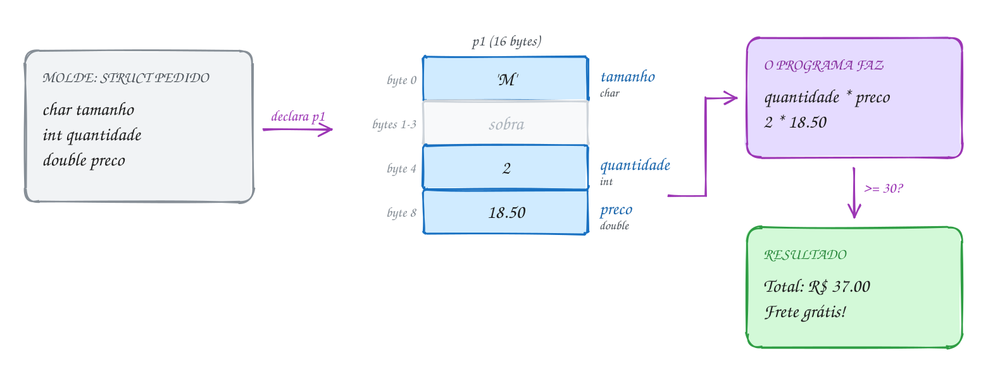</p>

O mesmo pedido em C:

```c
#include <stdio.h>

// o molde: diz quais campos um pedido tem (ainda não reserva memória)
struct pedido {
    char tamanho;   // 'P', 'M' ou 'G'
    int quantidade; // quantos copos
    double preco;   // preço de cada copo
};

int main(void) {
    struct pedido p1 = {'M', 2, 18.50}; // os valores vão na ordem dos campos

    double total = p1.quantidade * p1.preco; // o ponto acessa um campo
    printf("Pedido: %d copos %c de R$ %.2f\n", p1.quantidade, p1.tamanho, p1.preco);
    printf("Total: R$ %.2f\n", total);

    if (total >= 30.0) {
        printf("Frete grátis!\n");
    } else {
        printf("Frete: R$ 5.00\n");
    }
    printf("O pedido ocupa %zu bytes\n", sizeof(struct pedido));
    return 0;
}
// Saída:
// Pedido: 2 copos M de R$ 18.50
// Total: R$ 37.00
// Frete grátis!
// O pedido ocupa 16 bytes
```

Uma struct pode ter vetores e até outras structs dentro (`cliente.end.cidade`,
com o ponto encadeado). E a atribuição `b = a` funciona entre structs do
**mesmo tipo**: ela copia todos os bytes, inclusive os vetores de dentro. Isso
é curioso, porque vetor sozinho não se copia com `=`. Dentro de uma struct,
copia.

Repara no fluxograma: a struct não muda o jeito de pensar o programa. Os
passos são os de sempre; a diferença é que os dados viajam num pacote só:

<p align="center">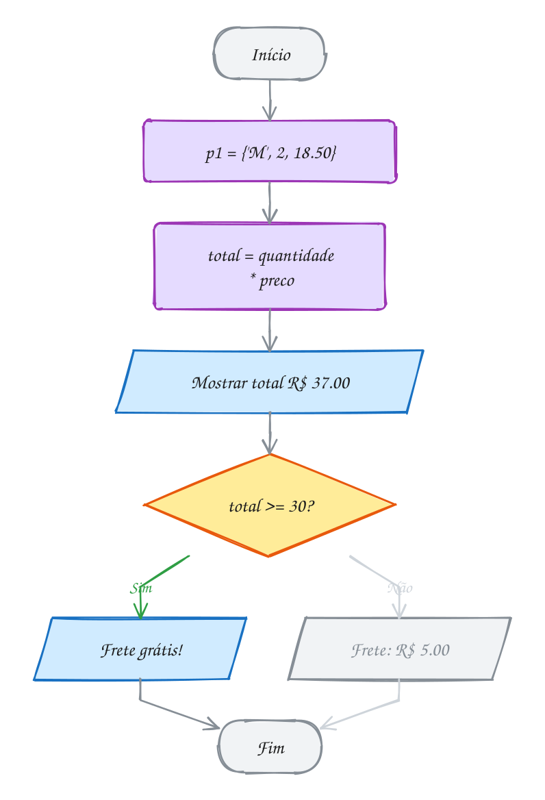</p>

> [!WARNING]
> Atribuir uma struct não faz as duas variáveis **apontarem** para o mesmo
> lugar: `struct pedido p2 = p1;` cria uma **cópia independente**. Mudar
> `p2.quantidade` não mexe em `p1`. Duas outras coisas também não funcionam:
> `p1 == p2` nem compila (compare campo a campo), e um campo vetor não recebe
> texto com `=`: `cliente.nome = "Ana";` é erro; use `strcpy(cliente.nome, "Ana")`.
> E não esqueça o `;` depois da `}` do molde: o erro aparece numa linha
> seguinte e confunde.

> [!TIP]
> **Por dentro do C:** os campos ficam na ordem em que você declarou, mas não
> necessariamente colados. `char` (1) + `int` (4) + `double` (8) somam 13
> bytes, e o `sizeof` diz 16. O processador lê um `int` mais rápido quando o
> endereço é múltiplo de 4, e um `double` quando é múltiplo de 8. Então o
> compilador coloca `tamanho` no byte 0, pula 3 bytes de **preenchimento**
> (*padding*), põe `quantidade` no byte 4 e `preco` no byte 8. A macro
> `offsetof(struct pedido, preco)`, de `<stddef.h>`, confirma: 8. É também por
> causa desses bytes de lixo que o C não deixa comparar structs com `==`.

> [!NOTE]
> **Pergunta para você:** se você trocar a ordem dos campos para `double
> preco; int quantidade; char tamanho;`, o `sizeof` muda? E com `char
> tamanho; double preco; int quantidade;`? Desenhe os bytes antes de rodar.

### Hora de praticar

Os arquivos ficam em [`0059-struct/`](0059-struct/). Os comandos funcionam de qualquer pasta do terminal. Nos exemplos, rode, mude, quebre e rode de novo. Nos exercícios, a resposta vai dentro do próprio arquivo. ★☆☆ é aquecimento, ★★☆ pede raciocínio e ★★★ é desafio.

**Exemplo A117 · A matrícula na academia**

```c
#include <stddef.h>
#include <stdio.h>

struct aluno {
    char plano;       // 'M' mensal, 'T' trimestral, 'A' anual
    int faltas;       // faltas no mês
    double mensalidade;
    int armario;      // 0 = sem armário
};

int main(void) {
    // com nome de campo, a ordem é livre; quem não aparece começa com zero
    struct aluno caio = {.mensalidade = 99.90, .plano = 'M'};
    printf("Caio: plano %c, R$ %.2f, %d faltas, armário %d\n",
           caio.plano, caio.mensalidade, caio.faltas, caio.armario);

    // literal composto: troca a struct inteira de uma vez
    caio = (struct aluno){'A', 0, 79.90, 12};
    printf("Caio: plano %c, R$ %.2f, %d faltas, armário %d\n",
           caio.plano, caio.mensalidade, caio.faltas, caio.armario);

    // comparar structs: campo a campo (== entre structs não compila)
    struct aluno duda = caio;
    duda.armario = 13;
    if (duda.plano == caio.plano && duda.mensalidade == caio.mensalidade) {
        printf("Duda e Caio têm o mesmo plano\n");
    }
    if (duda.armario != caio.armario) {
        printf("mas armários diferentes: %d e %d\n", duda.armario, caio.armario);
    }

    // onde cada campo começa dentro da struct
    printf("plano em %zu, faltas em %zu, mensalidade em %zu, armario em %zu\n",
           offsetof(struct aluno, plano), offsetof(struct aluno, faltas),
           offsetof(struct aluno, mensalidade), offsetof(struct aluno, armario));
    // 16 + 4 = 20, mas o total arredonda para múltiplo de 8 (o double): 24
    printf("sizeof: %zu bytes\n", sizeof(struct aluno));
    return 0;
}
// Saída:
// Caio: plano M, R$ 99.90, 0 faltas, armário 0
// Caio: plano A, R$ 79.90, 0 faltas, armário 12
// Duda e Caio têm o mesmo plano
// mas armários diferentes: 13 e 12
// plano em 0, faltas em 4, mensalidade em 8, armario em 16
// sizeof: 24 bytes
```

```bash
~/LPEDC/rodar 08-structs/0059-struct/A117.c
```

**Exemplo A118 · A ficha copiada**

```c
#include <stdio.h>
#include <string.h>

struct endereco {
    char cidade[20];
    char uf[3];
};

// uma struct pode ter outra struct dentro (struct aninhada)
struct cliente {
    char nome[20];
    int pontos;
    struct endereco end;
};

int main(void) {
    // inicialização com nomes de campo (C99): a ordem não importa
    struct cliente ana = {
        .nome = "Ana",
        .pontos = 120,
        .end = {.cidade = "Recife", .uf = "PE"},
    };

    struct cliente copia = ana; // copia TODOS os bytes, inclusive os vetores
    strcpy(copia.nome, "Bia");  // campo vetor: strcpy, não =
    copia.pontos = 0;
    strcpy(copia.end.cidade, "Natal"); // ponto encadeado: copia.end.cidade

    printf("%s, %d pontos, %s-%s\n", ana.nome, ana.pontos, ana.end.cidade, ana.end.uf);
    printf("%s, %d pontos, %s-%s\n", copia.nome, copia.pontos, copia.end.cidade, copia.end.uf);
    return 0;
}
// Saída:
// Ana, 120 pontos, Recife-PE
// Bia, 0 pontos, Natal-PE
```

```bash
~/LPEDC/rodar 08-structs/0059-struct/A118.c
```

#### Exercícios

**Exercício E349** · ★☆☆

Crie uma struct livro com os campos titulo (até 39 letras), autor (até 29
letras), ano (int) e preco (double). Declare uma variável já inicializada
com o livro abaixo e mostre os campos e o preço com 10% de desconto.


```text
Saída esperada:
Livro: Dom Casmurro
Autor: Machado de Assis
Ano: 1899
Preço: R$ 34.90
Na promoção: R$ 31.41
```

**Dicas:**

1. Campos texto são vetores de char: char titulo[40];
2. Inicialize com chaves na ordem dos campos, ou com .titulo = "...".
3. Não esqueça o ; depois da } da struct.
4. Resposta esperada: a saída acima (34.90 * 0.9 = 31.41).

```bash
~/LPEDC/rodar 08-structs/0059-struct/E349.c
```

**Exercício E350** · ★☆☆

Copiar uma struct com = cria um placar novo, independente do original.
Escreva um programa que prove isso. Crie a struct placar (campos casa e
fora, int) e faça, nesta ordem:


```text
1. a começa 2 x 1, e b é uma cópia de a (struct placar b = a;);
2. mude b.fora para 3 e some b.fora em a.casa;
3. mostre a e b;
4. crie c como cópia de b, zere os dois campos de c e mostre c e b.
```


```text
Saída esperada:
a: 5 x 1
b: 2 x 3
c: 0 x 0
b: 2 x 3
```

**Dicas:**

1. A cópia leva todos os campos de uma vez: struct placar b = a;
2. Depois da cópia, mudar b não muda a (e mudar c não muda b).
3. a.casa = a.casa + b.fora dá 2 + 3 = 5.
4. Resposta esperada: a saída acima.

```bash
~/LPEDC/rodar 08-structs/0059-struct/E350.c
```

**Exercício E351** · ★★☆

Um terreno retangular é descrito por dois cantos: o inferior esquerdo
(2, 1) e o superior direito (10, 6), em metros. Crie uma struct ponto
(x e y, double) e uma struct retangulo com dois campos struct ponto. Escreva
funções que recebem o retângulo e devolvem a área e o perímetro, e uma que
diz se um ponto (uma árvore, por exemplo) está dentro do terreno.


```text
Saída esperada:
Largura: 8.0 m, altura: 5.0 m
Área: 40.0 m2
Perímetro: 26.0 m
Árvore em (4.0, 3.0): dentro
Árvore em (11.0, 2.0): fora
```

**Dicas:**

1. Uma função recebe uma struct como qualquer outro parâmetro:
   double area(struct retangulo r). Ela recebe uma cópia.
2. Acesso encadeado: r.inf_esq.x, r.sup_dir.y.
3. Dentro: x entre os dois x E y entre os dois y (use bool, de stdbool.h).
4. Resposta esperada: a saída acima.

```bash
~/LPEDC/rodar 08-structs/0059-struct/E351.c
```

**Exercício E352** · ★★☆

Este programa NÃO compila, de propósito: ele tem três erros clássicos de
struct. Rode, leia as mensagens do gcc e conserte um por um. O programa
consertado guarda a artilheira em a, copia para b e confere se as duas
fichas são iguais.


```text
Saída esperada (depois de consertado):
Marta: 17 gols
a e b são iguais
```

**Dicas:**

1. O primeiro erro está antes do main: a mensagem aponta para a linha do
   main, mas o culpado é a linha de cima.
2. Campo vetor não recebe texto com =. Qual função de string.h copia?
3. Struct não se compara com ==: compare campo a campo (strcmp para o nome).
4. Resposta esperada: falta ; depois da } da struct; a.nome = "Marta" vira
   strcpy(a.nome, "Marta"); a == b vira strcmp(a.nome, b.nome) == 0 &&
   a.gols == b.gols.

```bash
~/LPEDC/rodar 08-structs/0059-struct/E352.c
```

**Exercício E353** · ★★★

Crie uma struct data (dia, mes, ano) e escreva:


```text
- struct data dia_seguinte(struct data d): devolve a data do dia seguinte,
  tratando fim de mês, fim de ano e fevereiro em ano bissexto;
- int comparar(struct data a, struct data b): devolve -1 se a vem antes,
  0 se são iguais e 1 se a vem depois.
```


Teste com as datas abaixo:


```text
Saída esperada:
28/02/2024 -> 29/02/2024
28/02/2025 -> 01/03/2025
31/12/2025 -> 01/01/2026
15/03/2025 vem antes de 02/11/2025
```

**Dicas:**

1. Bissexto: divisível por 4 e não por 100, ou divisível por 400.
2. Uma função int dias_no_mes(int mes, int ano) com um vetor
   {31, 28, 31, 30, ...} simplifica tudo; some 1 em fevereiro bissexto.
3. Uma função pode devolver struct: crie uma cópia, mude e return.
4. Para comparar, olhe o ano; se empatar, o mês; se empatar, o dia.
5. Resposta esperada: a saída acima (%02d mostra o zero à esquerda).

```bash
~/LPEDC/rodar 08-structs/0059-struct/E353.c
```

**Exercício E354** · ★★★

As quatro structs abaixo guardam quase os mesmos campos, só que em ordens
diferentes. Escreva um programa que mostre o sizeof de cada uma e o
offsetof de cada campo de struct a. Depois crie a struct a_enxuta, com os
MESMOS três campos de struct a numa ordem que ocupe o mínimo possível, e
mostre o sizeof dela.


```text
struct a { char ativo; int id; char nivel; };
struct b { int id; char ativo; char nivel; };
struct c { char ativo; double saldo; char nivel; };
struct d { double saldo; int id; char ativo; char nivel; };
```


```text
Saída esperada (num PC de 64 bits):
sizeof: a = 12, b = 8, c = 24, d = 16
struct a: ativo em 0, id em 4, nivel em 8
struct a_enxuta: 8 bytes
```

**Dicas:**

1. Cada campo começa num endereço múltiplo do próprio tamanho (char: 1,
   int: 4, double: 8). O tamanho total é arredondado para um múltiplo do
   maior campo.
2. offsetof(struct a, id) está em <stddef.h> e se mostra com %zu.
3. Regra prática para a versão enxuta: do maior campo para o menor.
4. Resposta esperada: a saída acima; a_enxuta = { int id; char ativo;
   char nivel; } (é a struct b com outro nome).

```bash
~/LPEDC/rodar 08-structs/0059-struct/E354.c
```

---

## 0060 · Typedef

No grupo da família, ninguém chama o seu tio de "José Carlos da Silva". É
"Zé". O apelido não cria outra pessoa: é o mesmo tio, com um nome mais curto.

No assunto anterior, todo pedido era declarado como `struct pedido p1;`, com
as duas palavras, toda vez. Em programa grande isso cansa e polui. O C tem um
jeito de dar apelido a um tipo: o **typedef**.

A regra é: escreva uma declaração de variável normal e ponha `typedef` na
frente. O nome que seria a variável vira o **nome do tipo**:

```c
double Reais;          // uma variável chamada Reais
typedef double Reais;  // um apelido: Reais agora é o mesmo que double
```

O uso mais comum é com struct. Dá para batizar uma struct que já existe
(`typedef struct pix Pix;`) ou fazer tudo de uma vez, sem nem dar nome à
struct:

```c
typedef struct {
    char chave[40];
    Reais valor;
    int hora;
} Pix;
```

A partir daí você escreve só `Pix p;`, sem o `struct` na frente. Nomes de tipo com inicial maiúscula são uma convenção comum (e
a deste curso) para não confundir tipo com variável.

Vamos ver na prática. Um Pix de R$ 1.500,00 às 22h esbarra no limite noturno
de R$ 1.000,00 que os bancos aplicam entre 20h e 6h. Repare que `Pix` e
`Reais` são só etiquetas novas coladas em coisas que já existiam:

<p align="center">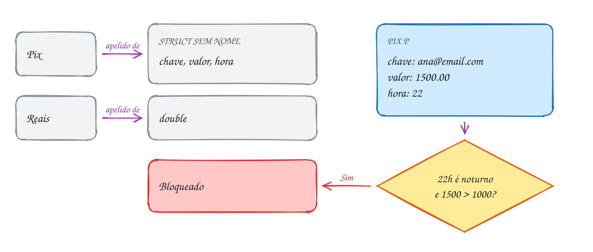</p>

O programa usa os dois apelidos. A função recebe um `Pix` e decide:

```c
#include <stdbool.h>
#include <stdio.h>

typedef double Reais; // Reais é só outro nome para double

typedef struct {      // struct sem nome, batizada de Pix pelo typedef
    char chave[40];
    Reais valor;
    int hora;         // 0 a 23
} Pix;

#define LIMITE_NOTURNO 1000.0

bool pix_permitido(Pix p) {
    bool noturno = p.hora >= 20 || p.hora < 6;
    return !(noturno && p.valor > LIMITE_NOTURNO);
}

int main(void) {
    Pix p = {"ana@email.com", 1500.00, 22}; // sem a palavra struct

    printf("Pix de R$ %.2f para %s às %dh\n", p.valor, p.chave, p.hora);
    if (pix_permitido(p)) {
        printf("Enviado!\n");
    } else {
        printf("Bloqueado: o limite noturno é R$ %.2f\n", LIMITE_NOTURNO);
    }
    return 0;
}
// Saída:
// Pix de R$ 1500.00 para ana@email.com às 22h
// Bloqueado: o limite noturno é R$ 1000.00
```

Você já usou vários typedefs sem saber: `size_t`, `uint8_t`, `int32_t` e até
o `FILE` que vem no módulo 09 são apelidos definidos nos cabeçalhos da
biblioteca. O `uint8_t` existe para você dizer "quero exatamente 8 bits sem
sinal" sem depender do nome do tipo em cada máquina.

Repara no fluxograma: são duas perguntas em sequência. Só bloqueia se for
horário noturno **e** o valor passar do limite:

<p align="center">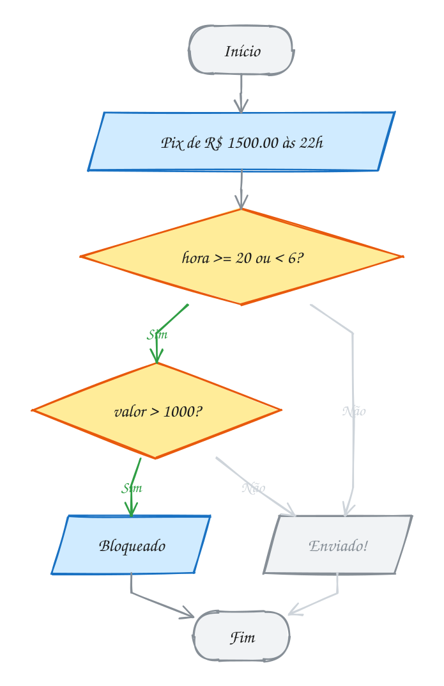</p>

> [!WARNING]
> `typedef` cria um **sinônimo**, não um tipo novo. Com `typedef double Reais;`
> e `typedef double Dolares;`, o compilador aceita `Reais r = dolares;` sem
> piscar: para ele, os dois são `double`. Se você quer que o compilador
> barre a mistura, embrulhe numa struct: `typedef struct { double v; } Reais;`.
> Structs diferentes não se misturam. E cuidado com typedef que esconde
> demais: `typedef int *PInt;` faz `PInt a, b;` parecer inocente, mas esconde
> que são ponteiros.

> [!TIP]
> **Por dentro do C:** o typedef não existe no executável. Ele é resolvido
> pelo compilador e some, sem custo nenhum. Para ver de onde vem um apelido da
> biblioteca, rode `gcc -E A119.c | grep "typedef.* size_t;"`: no Linux de 64
> bits aparece `typedef long unsigned int size_t;`. Diferente do `#define`, que
> o pré-processador troca como texto, o typedef entende a gramática do C:
> `typedef char *Texto; Texto a, b;` faz **os dois** serem ponteiros, enquanto
> `#define Texto char *` deixaria `b` como um `char` comum.

> [!NOTE]
> **Pergunta para você:** e se o mesmo Pix de R$ 1.500,00 fosse feito às 6h
> em ponto? E às 5h59? Siga as duas perguntas do fluxograma para cada caso.

### Hora de praticar

Os arquivos ficam em [`0060-typedef/`](0060-typedef/). Os comandos funcionam de qualquer pasta do terminal. Nos exemplos, rode, mude, quebre e rode de novo. Nos exercícios, a resposta vai dentro do próprio arquivo. ★☆☆ é aquecimento, ★★☆ pede raciocínio e ★★★ é desafio.

**Exemplo A119 · A frota de ônibus**

```c
#include <stdio.h>
#include <string.h>

typedef char Placa[8];      // apelido para um vetor: Placa é "char[8]"
typedef unsigned Minutos;   // apelido para um tipo simples

typedef struct onibus Onibus; // apelido antes da struct existir

struct onibus {             // a struct com nome: dá para usar os dois nomes
    Placa placa;
    int linha;
    Minutos atraso;
};

void mostrar(Onibus o) {
    printf("Linha %d (%s): %u min de atraso\n", o.linha, o.placa, o.atraso);
}

int main(void) {
    Onibus a = {"QWE1R23", 512, 0};
    struct onibus b = {"RTY4U56", 307, 15}; // o nome completo também vale
    Minutos tolerancia = 10;

    mostrar(a);
    mostrar(b);
    if (b.atraso > tolerancia) {
        printf("Linha %d passou da tolerância de %u min\n", b.linha, tolerancia);
    }

    Placa nova;              // é um vetor de 8 char, como qualquer outro
    strcpy(nova, "ZXC7V89"); // vetor: strcpy, não =
    printf("Placa nova: %s, %zu bytes\n", nova, sizeof nova);
    printf("Onibus ocupa %zu bytes, igual a struct onibus: %zu\n",
           sizeof(Onibus), sizeof(struct onibus));
    return 0;
}
// Saída:
// Linha 512 (QWE1R23): 0 min de atraso
// Linha 307 (RTY4U56): 15 min de atraso
// Linha 307 passou da tolerância de 10 min
// Placa nova: ZXC7V89, 8 bytes
// Onibus ocupa 16 bytes, igual a struct onibus: 16
```

```bash
~/LPEDC/rodar 08-structs/0060-typedef/A119.c
```

**Exemplo A120 · A cor do site**

```c
#include <stdint.h>
#include <stdio.h>

typedef uint8_t Byte; // uint8_t já é um typedef (de unsigned char)

typedef struct {
    Byte r, g, b;     // cada canal de 0 a 255
} Cor;

Cor misturar(Cor a, Cor b) {
    Cor m = {(a.r + b.r) / 2, (a.g + b.g) / 2, (a.b + b.b) / 2};
    return m;
}

void mostrar(const char *nome, Cor c) {
    printf("%-8s #%02X%02X%02X  (%3d, %3d, %3d)\n", nome, c.r, c.g, c.b, c.r, c.g, c.b);
}

int main(void) {
    Cor laranja = {255, 136, 0};
    Cor branco = {255, 255, 255};

    mostrar("laranja", laranja);
    mostrar("branco", branco);
    mostrar("mistura", misturar(laranja, branco));
    printf("Uma Cor ocupa %zu bytes\n", sizeof(Cor));
    return 0;
}
// Saída:
// laranja  #FF8800  (255, 136,   0)
// branco   #FFFFFF  (255, 255, 255)
// mistura  #FFC37F  (255, 195, 127)
// Uma Cor ocupa 3 bytes
```

```bash
~/LPEDC/rodar 08-structs/0060-typedef/A120.c
```

#### Exercícios

**Exercício E355** · ★☆☆

O programa abaixo funciona, mas repete "struct produto" em todo lugar.
Refatore: crie o apelido Produto com typedef e troque todas as ocorrências.
A saída não pode mudar.


```text
Saída esperada:
Café: 3 x R$ 12.50 = R$ 37.50
Leite: 6 x R$ 4.99 = R$ 29.94
Total: R$ 67.44
```

**Dicas:**

1. Dá para fazer typedef struct produto Produto; logo depois da struct.
2. Ou junte tudo: typedef struct { ... } Produto;
3. Resposta esperada: a mesma saída, sem nenhum "struct produto" no main
   nem nas funções.

```bash
~/LPEDC/rodar 08-structs/0060-typedef/E355.c
```

**Exercício E356** · ★☆☆

Escreva um programa que crie três apelidos:


```text
typedef int Metros;
typedef int Segundos;
typedef char Nome[12];
```


Declare distancia (Metros) com 100, tempo (Segundos) com 20 e atleta
(Nome) com "Rayssa". Mostre o nome, a velocidade, o sizeof(Nome) e o strlen
do nome. Por último, mostre distancia + tempo: somar metros com segundos
não faz sentido, e mesmo assim o programa tem que compilar sem aviso.


```text
Saída esperada:
Atleta: Rayssa
Velocidade: 5 m/s
sizeof(Nome) = 12, strlen = 6
distancia + tempo = 120
```

**Dicas:**

1. typedef não cria tipo novo: Metros e Segundos são int, e %d mostra os
   dois.
2. Nome é um apelido para "vetor de 12 char": Nome atleta = "Rayssa";
   funciona como char atleta[12] = "Rayssa";
3. sizeof e strlen devolvem size_t: mostre com %zu.
4. Resposta esperada: a saída acima. O vetor tem 12 bytes; o texto, 6
   letras.

```bash
~/LPEDC/rodar 08-structs/0060-typedef/E356.c
```

**Exercício E357** · ★★☆

Na receita de bolo você soma 1/4 de xícara com 1/6 de xícara. Crie o tipo
Fracao (numerador e denominador inteiros) com typedef e escreva:


```text
- Fracao simplificar(Fracao f): divide os dois pelo MDC;
- Fracao somar(Fracao a, Fracao b) e Fracao multiplicar(Fracao a, Fracao b),
  que já devolvem a fração simplificada.
```


```text
Saída esperada:
1/4 + 1/6 = 5/12
2/3 * 9/4 = 3/2
3/4 + 1/4 = 1/1
```

**Dicas:**

1. a/b + c/d = (a*d + c*b) / (b*d). Depois simplifique.
2. MDC por Euclides (assunto 0033): mdc(a, b) = mdc(b, a % b), mdc(a, 0) = a.
3. Uma função pode devolver Fracao: return (Fracao){n, d}; ou monte uma
   variável e devolva.
4. Resposta esperada: a saída acima (1/4 + 1/6 = 10/24 = 5/12).

```bash
~/LPEDC/rodar 08-structs/0060-typedef/E357.c
```

**Exercício E358** · ★★☆

Este programa NÃO compila, de propósito: há três erros com typedef. Rode,
leia as mensagens e conserte. O programa mostra o saldo do vale-refeição
depois de um almoço.


```text
Saída esperada (depois de consertado):
Ana: R$ 600.00 -> R$ 563.50
```

**Dicas:**

1. Comece pelo primeiro erro: um typedef quebrado faz aparecer vários
   erros em cascata. Na linha do typedef, o tipo existente vem primeiro e
   o apelido por último.
2. Um typedef de struct sem nome só pode ser usado pelo apelido: "struct
   Cartao" não existe.
3. O C lê de cima para baixo: um tipo precisa estar declarado antes de
   aparecer num protótipo.
4. Resposta esperada: typedef double Reais; trocar struct Cartao c por
   Cartao c; e mover o protótipo de pagar para depois do typedef.

```bash
~/LPEDC/rodar 08-structs/0060-typedef/E358.c
```

**Exercício E359** · ★★★

Ponteiro para função (assunto 0050) tem uma declaração difícil de ler:
double (*f)(double, double). Com typedef ela fica limpa. Crie:


```text
typedef double (*Operacao)(double, double);
```


e um tipo Botao (struct com um char simbolo e uma Operacao). Monte um
vetor com os quatro botões de uma calculadora (+ - * /) e, num laço, aplique
cada um aos números 12 e 4.


```text
Saída esperada:
12 + 4 = 16
12 - 4 = 8
12 * 4 = 48
12 / 4 = 3
```

**Dicas:**

1. Escreva as quatro funções: double somar(double a, double b) etc.
2. Botao botoes[] = {{'+', somar}, {'-', subtrair}, ...};
3. Chame com botoes[i].f(12, 4). %g mostra 16 em vez de 16.000000.
4. Resposta esperada: a saída acima.

```bash
~/LPEDC/rodar 08-structs/0060-typedef/E359.c
```

**Exercício E360** · ★★★

A sonda Mars Climate Orbiter se perdeu em 1999 porque um programa mandava
valores em libra-força e outro esperava newtons. Para o computador, eram
todos números. Vamos fazer o compilador trabalhar a seu favor.

a) Crie Celsius e Fahrenheit como structs de um campo só:

```text
 typedef struct { double graus; } Celsius; (e o mesmo para Fahrenheit).
 Escreva Fahrenheit para_fahrenheit(Celsius c) e
 Celsius para_celsius(Fahrenheit f), e converta 100 °C e 98.6 °F.
```

b) Escreva no main a linha Celsius errado = febre; (febre é Fahrenheit),

```text
 rode e leia o erro do gcc. Depois troque a linha pela conversão certa,
 Celsius febre_c = para_celsius(febre);, e mostre se é febre (a partir
 de 37.5 °C) ou não.
```


```text
Saída esperada (depois de trocar a linha errada):
100.0 °C = 212.0 °F
98.6 °F = 37.0 °C
37.0 °C: sem febre
```

**Dicas:**

1. F = C * 9 / 5 + 32 e C = (F - 32) * 5 / 9.
2. Para criar o valor: Celsius agua = {100.0}; acesse com agua.graus.
3. Em (b), a linha errada não compila (o gcc diz "invalid initializer"):
   duas structs diferentes nunca se misturam. Com typedef double,
   compilaria e o erro passaria calado.
4. Resposta esperada: a saída acima.

```bash
~/LPEDC/rodar 08-structs/0060-typedef/E360.c
```

---

## 0061 · Vetor de structs

Abra qualquer app de futebol e olhe a tabela do campeonato. Cada linha é um
time, e toda linha tem as mesmas colunas: nome, vitórias, empates, derrotas.
Uma linha é uma struct. A tabela inteira é um **vetor de structs**.

Você já conhece as duas peças. Um vetor guarda vários valores do mesmo tipo,
lado a lado. Uma struct é um tipo. Junte as duas: `Time tabela[4];` são quatro
`Time` seguidos na memória. O vetor não guarda **referências** para structs
espalhadas pela memória: os bytes das structs ficam **dentro** do vetor, um
time colado no outro.

Para chegar num campo, você primeiro escolhe a linha e depois a coluna:
`tabela[2].nome`. O índice vem **antes** do ponto, porque `tabela[2]` é um
`Time`, e um `Time` tem o campo `nome`. Já `tabela.nome[2]` não faz sentido:
o vetor não tem campo nenhum.

A inicialização junta as duas sintaxes, chaves dentro de chaves:

```c
Time tabela[] = {
    {"Bahia", 8, 5, 3},
    {"Flamengo", 9, 6, 1},
};
```

Sem o tamanho entre colchetes, o compilador conta os elementos. E o truque de
sempre para saber quantos são continua valendo: `sizeof tabela / sizeof
tabela[0]`.

Vamos ver na prática. Quatro times, cada um com seus números. O programa
percorre o vetor, calcula os pontos de cada um (3 por vitória, 1 por empate) e
guarda o **índice** do melhor até agora. Palmeiras, no índice 2, termina na
frente:

<p align="center">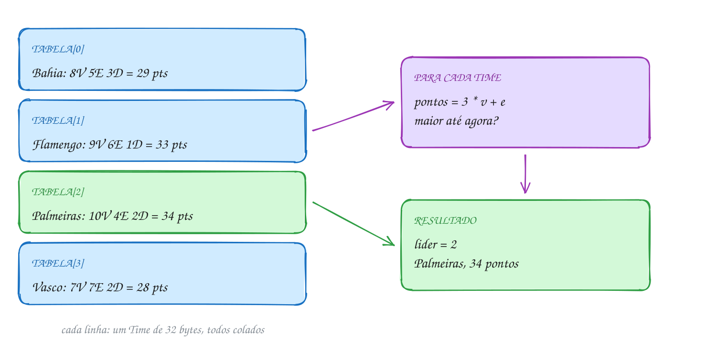</p>

O código faz exatamente esse passeio:

```c
#include <stdio.h>

typedef struct {
    char nome[20];
    int vitorias;
    int empates;
    int derrotas;
} Time;

int pontos(Time t) {
    return 3 * t.vitorias + t.empates;
}

int main(void) {
    Time tabela[] = {
        {"Bahia", 8, 5, 3},
        {"Flamengo", 9, 6, 1},
        {"Palmeiras", 10, 4, 2},
        {"Vasco", 7, 7, 2},
    };
    int n = sizeof tabela / sizeof tabela[0]; // 4 times

    int lider = 0; // índice do melhor até agora
    for (int i = 0; i < n; i++) {
        printf("%d. %-10s %2d pts\n", i, tabela[i].nome, pontos(tabela[i]));
        if (pontos(tabela[i]) > pontos(tabela[lider])) {
            lider = i;
        }
    }
    printf("Líder: %s, com %d pontos\n", tabela[lider].nome, pontos(tabela[lider]));
    printf("A tabela ocupa %zu bytes (%d x %zu)\n", sizeof tabela, n, sizeof(Time));
    return 0;
}
// Saída:
// 0. Bahia      29 pts
// 1. Flamengo   33 pts
// 2. Palmeiras  34 pts
// 3. Vasco      28 pts
// Líder: Palmeiras, com 34 pontos
// A tabela ocupa 128 bytes (4 x 32)
```

Guardar o índice, e não uma cópia do time, é de propósito: com o índice você
sabe **onde** está o líder e pode mexer nele (`tabela[lider].vitorias++`).
Uma cópia seria um time solto, desligado da tabela.

Repara no fluxograma: é o padrão "maior até agora" do módulo de laços, só que
a comparação olha um campo calculado de cada struct:

<p align="center">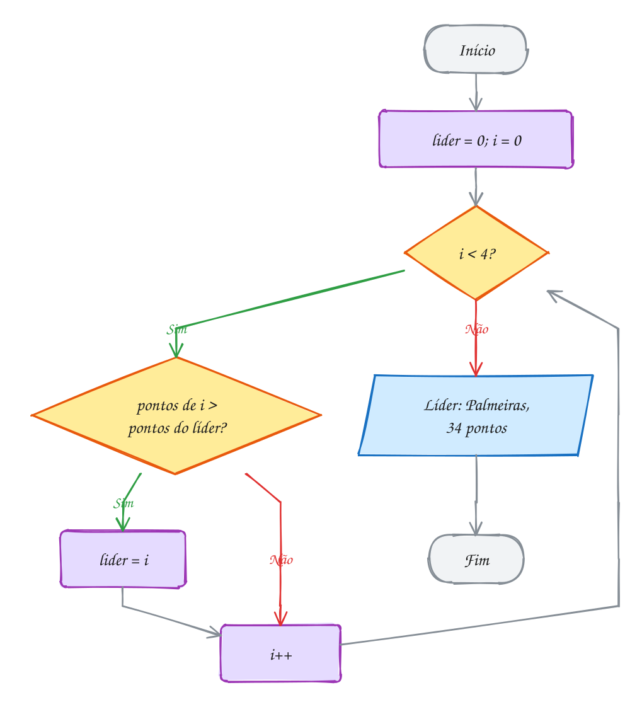</p>

> [!WARNING]
> `tabela[i] = tabela[j]` copia o time **inteiro**, todos os campos. Isso é
> ótimo para trocar dois times de lugar ao ordenar: troque as structs, não os
> campos um por um. O erro clássico é trocar só o nome e esquecer os números,
> deixando a tabela com nomes e pontos embaralhados. E lembre que o C não
> confere limites: `tabela[4]` num vetor de 4 times lê lixo (ou derruba o
> programa) do mesmo jeito que num vetor de `int`.

> [!TIP]
> **Por dentro do C:** cada `Time` ocupa 32 bytes (20 do nome + 3 inteiros de
> 4), e os quatro ficam colados: 128 bytes seguidos. Para achar
> `tabela[2].vitorias`, o compilador faz uma conta só: início do vetor
> + 2 × 32 (pula dois times) + 20 (pula o nome). Por isso percorrer um vetor de
> structs é rápido: os dados estão em sequência, e o processador traz vários
> de uma vez para o cache. Dados espalhados pela memória não têm essa
> vantagem.

> [!NOTE]
> **Pergunta para você:** se o Vasco tivesse 9 vitórias, 7 empates e 0
> derrotas, quem seria o líder? E se houvesse empate em pontos com o
> Palmeiras, com o `>` do código, quem ficaria: o primeiro ou o último a
> aparecer na tabela?

### Hora de praticar

Os arquivos ficam em [`0061-vetor-de-structs/`](0061-vetor-de-structs/). Os comandos funcionam de qualquer pasta do terminal. Nos exemplos, rode, mude, quebre e rode de novo. Nos exercícios, a resposta vai dentro do próprio arquivo. ★☆☆ é aquecimento, ★★☆ pede raciocínio e ★★★ é desafio.

**Exemplo A121 · O estoque da farmácia**

```c
#include <stdio.h>
#include <string.h>

typedef struct {
    char nome[20];
    int estoque;
    int minimo; // abaixo disso, precisa repor
} Remedio;

// devolve o índice do remédio com esse nome, ou -1 se não achar
int buscar(const Remedio v[], int n, const char *nome) {
    for (int i = 0; i < n; i++) {
        if (strcmp(v[i].nome, nome) == 0) {
            return i;
        }
    }
    return -1;
}

void vender(Remedio v[], int n, const char *nome, int qtd) {
    int i = buscar(v, n, nome);
    if (i == -1) {
        printf("%s: não temos\n", nome);
    } else if (v[i].estoque < qtd) {
        printf("%s: só restam %d\n", nome, v[i].estoque);
    } else {
        v[i].estoque -= qtd; // mexe direto no elemento do vetor
        printf("%s: vendidas %d, restam %d\n", nome, qtd, v[i].estoque);
    }
}

int main(void) {
    Remedio farmacia[] = {
        {"Dipirona", 40, 10},
        {"Paracetamol", 12, 10},
        {"Ibuprofeno", 5, 8},
    };
    int n = sizeof farmacia / sizeof farmacia[0];

    vender(farmacia, n, "Paracetamol", 3);
    vender(farmacia, n, "Ibuprofeno", 6);
    vender(farmacia, n, "Amoxicilina", 1);
    vender(farmacia, n, "Dipirona", 30);

    printf("Repor:\n");
    for (int i = 0; i < n; i++) {
        if (farmacia[i].estoque < farmacia[i].minimo) { // 10 de 10 ainda não
            printf("  %s (%d de %d)\n", farmacia[i].nome, farmacia[i].estoque,
                   farmacia[i].minimo);
        }
    }
    return 0;
}
// Saída:
// Paracetamol: vendidas 3, restam 9
// Ibuprofeno: só restam 5
// Amoxicilina: não temos
// Dipirona: vendidas 30, restam 10
// Repor:
//   Paracetamol (9 de 10)
//   Ibuprofeno (5 de 8)
```

```bash
~/LPEDC/rodar 08-structs/0061-vetor-de-structs/A121.c
```

**Exemplo A122 · A classificação ordenada**

```c
#include <stdio.h>
#include <stdlib.h>

typedef struct {
    char nome[20];
    int vitorias;
    int empates;
} Time;

int pontos(Time t) {
    return 3 * t.vitorias + t.empates;
}

// qsort entrega ponteiros genéricos para dois elementos do vetor
int comparar(const void *a, const void *b) {
    Time x = *(const Time *)a; // copia o time apontado
    Time y = *(const Time *)b;
    if (pontos(x) != pontos(y)) {
        return pontos(y) - pontos(x); // mais pontos primeiro
    }
    return y.vitorias - x.vitorias; // desempate: mais vitórias
}

int main(void) {
    Time tabela[] = {
        {"Bahia", 8, 5},
        {"Flamengo", 9, 6},
        {"Palmeiras", 10, 4},
        {"Fortaleza", 10, 3},
        {"Vasco", 7, 7},
    };
    int n = sizeof tabela / sizeof tabela[0];

    // qsort troca structs inteiras de lugar (28 bytes por vez)
    qsort(tabela, n, sizeof tabela[0], comparar);

    for (int i = 0; i < n; i++) {
        printf("%dº %-10s %2d pts, %2d vitórias\n", i + 1, tabela[i].nome,
               pontos(tabela[i]), tabela[i].vitorias);
    }
    return 0;
}
// Saída:
// 1º Palmeiras  34 pts, 10 vitórias
// 2º Fortaleza  33 pts, 10 vitórias
// 3º Flamengo   33 pts,  9 vitórias
// 4º Bahia      29 pts,  8 vitórias
// 5º Vasco      28 pts,  7 vitórias
```

```bash
~/LPEDC/rodar 08-structs/0061-vetor-de-structs/A122.c
```

#### Exercícios

**Exercício E361** · ★☆☆

Monte a lista de compras abaixo como um vetor de structs (nome,
quantidade, preço unitário). Percorra o vetor mostrando o subtotal de cada
item, o total da compra e o item que mais pesou no bolso.


```text
Arroz 5kg   2 x R$ 27.90
Feijão      3 x R$ 8.49
Café        1 x R$ 18.90
Óleo        4 x R$ 7.99
```


```text
Saída esperada:
Arroz 5kg: R$ 55.80
Feijão: R$ 25.47
Café: R$ 18.90
Óleo: R$ 31.96
Total: R$ 132.13
Mais caro: Arroz 5kg
```

**Dicas:**

1. typedef struct { char nome[20]; int qtd; double preco; } Item;
2. Item lista[] = {{"Arroz 5kg", 2, 27.90}, ...};
3. Guarde o índice do maior subtotal, como no exemplo da tabela.
4. Resposta esperada: a saída acima.

```bash
~/LPEDC/rodar 08-structs/0061-vetor-de-structs/E361.c
```

**Exercício E362** · ★☆☆

Complete o programa: falta o laço que calcula a média de cada aluno
(média simples das duas provas), mostra se passou (média >= 7) e conta os
aprovados.


```text
Saída esperada:
Caio: 8.0 aprovado
Duda: 5.5 reprovado
Enzo: 7.0 aprovado
Lara: 6.8 reprovado
Aprovados: 2 de 4
```

**Dicas:**

1. A média do aluno i é (turma[i].p1 + turma[i].p2) / 2.
2. %.1f mostra uma casa: (6.0 + 7.5) / 2 = 6.75 aparece como 6.8.
3. Resposta esperada: a saída acima.

```bash
~/LPEDC/rodar 08-structs/0061-vetor-de-structs/E362.c
```

**Exercício E363** · ★★☆

Leia do teclado 3 atletas: o nome (pode ter espaço) numa linha e, na linha
seguinte, a altura e a idade. Guarde num vetor de structs e mostre o mais
alto e o mais velho.


```text
Exemplo de execução:
Nome: Rebeca Andrade
Altura e idade: 1.55 26
Nome: Darlan Romani
Altura e idade: 1.88 34
Nome: Rayssa Leal
Altura e idade: 1.50 17
Mais alto: Darlan Romani (1.88 m)
Mais velho: Darlan Romani (34 anos)
```


Para testar sem digitar:


```text
printf 'Rebeca Andrade\n1.55 26\nDarlan Romani\n1.88 34\nRayssa Leal\n1.50 17\n' | ~/LPEDC/rodar 08-structs/0061-vetor-de-structs/E363.c
```

**Dicas:**

1. Nome com fgets(v[i].nome, sizeof v[i].nome, stdin) e tire o '\n' com
   strcspn (assunto 0042).
2. Depois do scanf("%lf %d", ...), o '\n' fica no buffer e o próximo fgets
   leria uma linha vazia. Consuma o resto da linha: while (getchar() != '\n');
   (num programa de verdade, pare também no EOF).
3. Confira o retorno do scanf: tem que ser 2.
4. Resposta esperada: com a entrada acima, Darlan Romani nos dois.

```bash
~/LPEDC/rodar 08-structs/0061-vetor-de-structs/E363.c
```

**Exercício E364** · ★★☆

Uma loja tem estes celulares em estoque:


```text
Moto G     R$ 1299.00
Galaxy A   R$ 1899.00
iPhone     R$ 5499.00
Redmi      R$ 999.00
```


Use qsort (assunto 0050) duas vezes: primeiro em ordem alfabética do nome,
depois do mais caro para o mais barato. Mostre a lista após cada ordenação.


```text
Saída esperada:
Por nome:
  Galaxy A   R$ 1899.00
  Moto G     R$ 1299.00
  Redmi      R$ 999.00
  iPhone     R$ 5499.00
Por preço:
  iPhone     R$ 5499.00
  Galaxy A   R$ 1899.00
  Moto G     R$ 1299.00
  Redmi      R$ 999.00
```

**Dicas:**

1. A comparadora recebe const void *: copie o elemento com
   Celular x = *(const Celular *)a; e compare os campos.
2. Por nome: return strcmp(x.nome, y.nome);
3. Por preço decrescente: cuidado, preço é double. Não devolva y.preco -
   x.preco (0.5 viraria 0 no int); use if/else e devolva -1, 0 ou 1.
4. Resposta esperada: a saída acima. O iPhone vai para o fim na ordem
   alfabética porque strcmp compara códigos ASCII: 'i' minúsculo (105) vem
   depois de todas as maiúsculas.

```bash
~/LPEDC/rodar 08-structs/0061-vetor-de-structs/E364.c
```

**Exercício E365** · ★★★

Este programa compila e roda, mas o ranking não sai em ordem de pontos,
embora o bubble sort pareça certo. Rode, compare com a saída esperada, ache
o bug e conserte (de preferência, deixando o código menor).


```text
Saída esperada (depois de consertado):
1. Lia - 950 pontos, nível 12
2. Bento - 720 pontos, nível 9
3. Teo - 410 pontos, nível 5
```

**Dicas:**

1. Olhe a troca dentro do laço: quais campos ela troca?
2. Uma struct inteira pode ser copiada com =.
3. Resposta esperada: a troca movia só o nome (com strcpy) e deixava pontos e
   nível no lugar. Os nomes trocavam de dono e a comparação seguinte olhava
   números que nunca andaram. Troque a struct inteira: Jogador tmp = v[j];
   v[j] = v[j + 1]; v[j + 1] = tmp;

```bash
~/LPEDC/rodar 08-structs/0061-vetor-de-structs/E365.c
```

**Exercício E366** · ★★★

Um terreno irregular tem 5 cantos, em metros, dados em ordem (dando a volta
no terreno):


```text
(0, 0)  (6, 0)  (6, 4)  (3, 7)  (0, 4)
```


Guarde os cantos num vetor de struct Ponto e calcule a área e o perímetro.
Para a área, use a fórmula do cadarço (shoelace): some x[i] * y[j] -
x[j] * y[i] para cada canto i, com j sendo o canto seguinte, e divida o
valor absoluto da soma por 2. O canto seguinte ao último é o primeiro.


```text
Saída esperada:
Área: 33.00 m2
Perímetro: 22.49 m
```

**Dicas:**

1. O canto seguinte com volta ao começo: int j = (i + 1) % n;
2. fabs e sqrt estão em math.h. Lado entre dois pontos:
   sqrt(dx * dx + dy * dy).
3. Teste antes com um retângulo simples, (0,0) (8,0) (8,5) (0,5): área 40.
4. Resposta esperada: a saída acima (66 / 2 = 33; lados 6, 4, 4.24, 4.24, 4).

```bash
~/LPEDC/rodar 08-structs/0061-vetor-de-structs/E366.c
```

---

## 0062 · Ponteiro para struct

Você passa o cartão do ônibus na catraca e o validador desconta R$ 4,40. Ele
não faz uma cópia do seu cartão para descontar dela: mexe no saldo do cartão
**de verdade**. Se descontasse numa cópia, você andaria de graça para sempre.

Com struct em função acontece a mesma coisa. Como qualquer parâmetro em C, uma
struct vai **por valor**: a função recebe uma cópia de todos os bytes. Mudar a
cópia não muda o original. Para a função alterar a struct de quem chamou, você
passa o **endereço** dela: um `Cartao *`.

Com um ponteiro `c` para struct, o campo se acessa assim: `(*c).saldo`.
Primeiro `*c` chega na struct, depois `.saldo` chega no campo. Os parênteses
são obrigatórios, porque o ponto tem prioridade maior que o `*`: `*c.saldo`
significaria `*(c.saldo)`, e `c` não tem campo nenhum, é um ponteiro.

Como isso é escrito o tempo todo, o C tem um atalho: a **seta** `->`.
`c->saldo` é exatamente `(*c).saldo`. A regra prática: variável struct usa
ponto (`cartao.saldo`); ponteiro para struct usa seta (`c->saldo`).

O ponteiro também é o caminho para struct no **heap**. `malloc(sizeof *c)`
reserva o espaço de um `Cartao` inteiro e devolve o endereço. O `sizeof *c`
mede o tipo apontado: se um dia o tipo de `c` mudar, a conta acompanha. E,
como todo `malloc`, confira o `NULL` e termine com `free`.

Vamos ver na prática. O cartão da Luana mora no heap com R$ 10,00. A variável
`c` no `main` guarda só o endereço dele, e a função `cobrar_passagem` recebe
uma cópia desse **endereço**, não do cartão. As duas setas apontam para o
mesmo lugar:

<p align="center">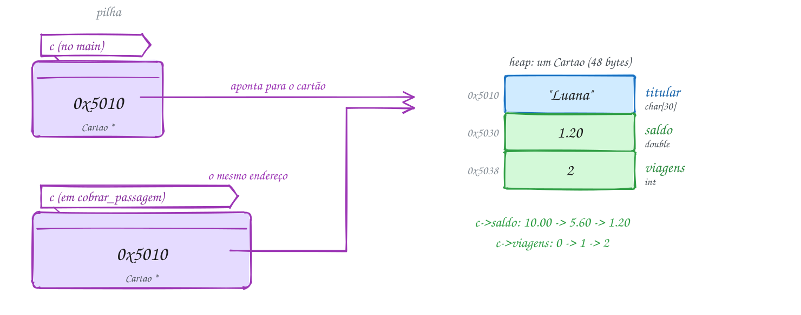</p>

Três passagens seguidas. A terceira não passa:

```c
#include <stdbool.h>
#include <stdio.h>
#include <stdlib.h>
#include <string.h>

#define TARIFA 4.40

typedef struct {
    char titular[30];
    double saldo;
    int viagens;
} Cartao;

// recebe o ENDEREÇO do cartão: mexe no original, não numa cópia
bool cobrar_passagem(Cartao *c) {
    if (c->saldo < TARIFA) { // c->saldo é o mesmo que (*c).saldo
        return false;
    }
    c->saldo -= TARIFA;
    c->viagens++;
    return true;
}

int main(void) {
    Cartao *c = malloc(sizeof *c); // um Cartao inteiro no heap
    if (c == NULL) {
        return 1;
    }
    strcpy(c->titular, "Luana");
    c->saldo = 10.00;
    c->viagens = 0;

    for (int i = 1; i <= 3; i++) {
        if (cobrar_passagem(c)) {
            printf("Viagem %d: liberada, saldo R$ %.2f\n", i, c->saldo);
        } else {
            printf("Viagem %d: saldo insuficiente (R$ %.2f)\n", i, c->saldo);
        }
    }
    printf("%s fez %d viagens\n", c->titular, c->viagens);

    free(c);
    return 0;
}
// Saída:
// Viagem 1: liberada, saldo R$ 5.60
// Viagem 2: liberada, saldo R$ 1.20
// Viagem 3: saldo insuficiente (R$ 1.20)
// Luana fez 2 viagens
```

### Passo a passo

O teste de mesa das três chamadas, olhando o cartão no heap:

| Chamada | saldo antes | saldo < 4.40? | saldo depois | viagens |
| --- | --- | --- | --- | --- |
| 1ª | 10.00 | não | 5.60 | 1 |
| 2ª | 5.60 | não | 1.20 | 2 |
| 3ª | 1.20 | sim: devolve false | 1.20 | 2 |

Repara no fluxograma: a pergunta do saldo fica dentro da função, mas o laço
que chama três vezes é do `main`. Como a função mexe no original, cada volta
do laço enxerga o saldo que a anterior deixou:

<p align="center">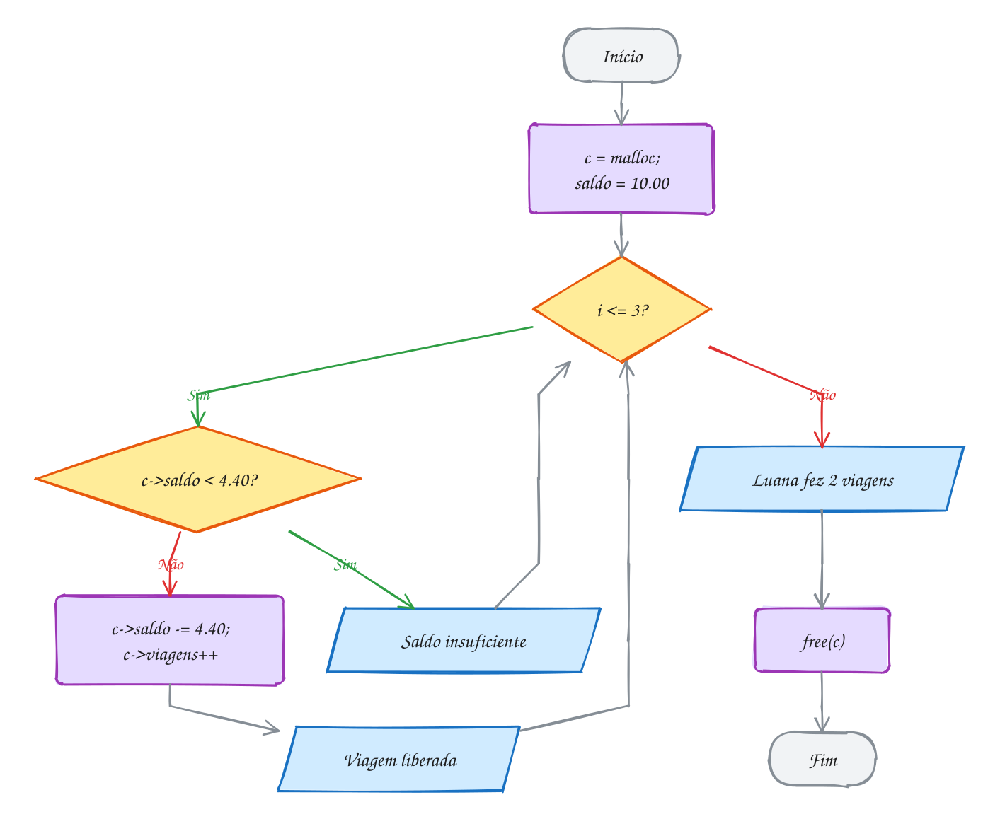</p>

> [!WARNING]
> O erro mais comum é esquecer que struct vai por valor. Uma função
> `void recarregar(Cartao c, double v) { c.saldo += v; }` compila, roda e não
> faz nada: recarrega uma cópia que morre no fim da função. Para a função
> alterar a struct de quem chamou, passe o endereço: `Cartao *c`. O segundo erro é
> a precedência: `*c.saldo` não compila. Escreva `c->saldo` ou `(*c).saldo`.
> E nunca devolva o endereço de uma struct local (`return &cartao;`): ela morre
> quando a função termina. Para criar uma struct dentro de uma função e
> devolvê-la, use `malloc` (ou devolva a struct por valor).

> [!TIP]
> **Por dentro do C:** passar por valor custa uma cópia do tamanho da struct
> **a cada chamada**. Um `Cartao` tem 48 bytes, então tanto faz. Mas uma struct
> com `double leituras[1000]` tem mais de 8 KB, e o exemplo A124 mostra o
> `sizeof` dentro da função: 8016 bytes copiados na pilha a cada chamada,
> contra 8 bytes do ponteiro. Por isso, em C, struct grande quase sempre anda
> por ponteiro, mesmo quando a função só lê. Para deixar claro que ela só lê,
> e para o compilador barrar uma alteração por engano, use `const Cartao *c`.

> [!NOTE]
> **Pergunta para você:** se `cobrar_passagem` recebesse `Cartao c` (sem o
> `*`) e o `main` passasse `*c`, o que a saída mostraria nas três viagens? E
> quantas viagens a Luana teria feito no fim?

### Hora de praticar

Os arquivos ficam em [`0062-ponteiro-para-struct/`](0062-ponteiro-para-struct/). Os comandos funcionam de qualquer pasta do terminal. Nos exemplos, rode, mude, quebre e rode de novo. Nos exercícios, a resposta vai dentro do próprio arquivo. ★☆☆ é aquecimento, ★★☆ pede raciocínio e ★★★ é desafio.

**Exemplo A123 · As comandas do bar**

```c
#include <stdio.h>
#include <stdlib.h>

typedef struct {
    int mesa;
    double total;
    int itens;
} Comanda;

// cria um vetor de comandas no heap e devolve o endereço (NULL se falhar)
Comanda *abrir_comandas(int n) {
    Comanda *v = malloc(n * sizeof *v);
    if (v == NULL) {
        return NULL;
    }
    for (int i = 0; i < n; i++) {
        v[i] = (Comanda){i + 1, 0.0, 0}; // mesas 1, 2, 3...
    }
    return v;
}

void lancar(Comanda *c, double preco) {
    c->total += preco;
    c->itens++;
}

// devolve um ponteiro para a comanda mais cara: sem copiar nenhuma
const Comanda *mais_cara(const Comanda *v, int n) {
    const Comanda *m = &v[0];
    for (int i = 1; i < n; i++) {
        if (v[i].total > m->total) {
            m = &v[i];
        }
    }
    return m;
}

int main(void) {
    int n = 3;
    Comanda *bar = abrir_comandas(n);
    if (bar == NULL) {
        return 1;
    }

    lancar(&bar[0], 12.00); // chope na mesa 1
    lancar(&bar[2], 35.90); // porção na mesa 3
    lancar(&bar[0], 12.00);
    lancar(bar + 1, 8.50);  // bar + 1 é o mesmo que &bar[1]

    // o ponteiro anda de comanda em comanda: p++ pula sizeof(Comanda) bytes
    for (Comanda *p = bar; p < bar + n; p++) {
        printf("Mesa %d: %d itens, R$ %.2f\n", p->mesa, p->itens, p->total);
    }

    const Comanda *top = mais_cara(bar, n);
    printf("Maior conta: mesa %d\n", top->mesa);

    free(bar); // depois disso, top também fica solto: não use mais
    return 0;
}
// Saída:
// Mesa 1: 2 itens, R$ 24.00
// Mesa 2: 1 itens, R$ 8.50
// Mesa 3: 1 itens, R$ 35.90
// Maior conta: mesa 3
```

```bash
~/LPEDC/rodar 08-structs/0062-ponteiro-para-struct/A123.c
```

**Exemplo A124 · O preço da cópia**

```c
#include <stdio.h>

typedef struct {
    char placa[8];
    double leituras[1000]; // velocidades registradas pelo radar
    int n;
} Radar;

// por valor: a função recebe uma CÓPIA dos 8016 bytes
void zerar_copia(Radar r) {
    r.n = 0; // zera a cópia; o original não muda
    printf("  dentro de zerar_copia: sizeof r = %zu\n", sizeof r);
}

// por ponteiro: a função recebe só um endereço (8 bytes)
void zerar(Radar *r) {
    r->n = 0;
    printf("  dentro de zerar: sizeof r = %zu\n", sizeof r);
}

// const: só lê; o compilador barra qualquer tentativa de alterar
double maior(const Radar *r) {
    double m = r->leituras[0];
    for (int i = 1; i < r->n; i++) {
        if (r->leituras[i] > m) {
            m = r->leituras[i];
        }
    }
    return m;
}

int main(void) {
    Radar r = {"ABC1D23", {62.5, 71.0, 58.3}, 3}; // o resto das leituras vira 0

    printf("Maior velocidade: %.1f km/h\n", maior(&r));
    zerar_copia(r);
    printf("Depois de zerar_copia: n = %d\n", r.n);
    zerar(&r);
    printf("Depois de zerar: n = %d\n", r.n);
    return 0;
}
// Saída:
// Maior velocidade: 71.0 km/h
//   dentro de zerar_copia: sizeof r = 8016
// Depois de zerar_copia: n = 3
//   dentro de zerar: sizeof r = 8
// Depois de zerar: n = 0
```

```bash
~/LPEDC/rodar 08-structs/0062-ponteiro-para-struct/A124.c
```

#### Exercícios

**Exercício E367** · ★☆☆

A empresa deu 8% de reajuste. Crie o tipo Funcionario (nome e salário) e
escreva duas funções:


```text
- void reajustar(Funcionario *f, double pct): aumenta o salário do
  funcionário original;
- void mostrar(const Funcionario *f): só mostra (por isso o const).
```


Aplique o reajuste em Ana (R$ 3200.00) e Beto (R$ 4100.00).


```text
Saída esperada:
Ana: R$ 3200.00
Beto: R$ 4100.00
Depois do reajuste:
Ana: R$ 3456.00
Beto: R$ 4428.00
```

**Dicas:**

1. Dentro das funções, use a seta: f->salario.
2. Na chamada, passe o endereço: reajustar(&ana, 8).
3. Aumentar 8% é multiplicar por 1 + 8 / 100.0.
4. Resposta esperada: a saída acima.

```bash
~/LPEDC/rodar 08-structs/0062-ponteiro-para-struct/E367.c
```

**Exercício E368** · ★☆☆

Complete o programa abaixo. Escreva as duas funções, uma que recebe o
placar por valor e outra que recebe o endereço:


```text
- void gol_copia(Placar p): soma 1 em p.gols;
- void gol(Placar *p): soma 1 em p->gols.
```


No main, depois de cada chamada, mostre casa.gols. No fim, crie um
ponteiro ptr para casa, some 10 por ele com a seta e mostre casa.gols e
(*ptr).gols.


```text
Saída esperada:
depois de gol_copia: 0
depois de gol: 1
depois de gol: 2
depois de gol_copia: 2
casa.gols = 12, (*ptr).gols = 12
```

**Dicas:**

1. Quem recebe Placar (sem *) trabalha numa cópia que some no fim da
   função.
2. Na chamada por endereço, passe &casa.
3. ptr->gols e (*ptr).gols são a mesma coisa, e ptr aponta para casa.
4. Resposta esperada: a saída acima.

```bash
~/LPEDC/rodar 08-structs/0062-ponteiro-para-struct/E368.c
```

**Exercício E369** · ★★☆

Crie o tipo Conta (titular e saldo) e três funções:


```text
- Conta *conta_criar(const char *titular, double saldo): aloca com malloc,
  preenche e devolve (NULL se faltar memória);
- bool transferir(Conta *de, Conta *para, double valor): só transfere se
  houver saldo, e devolve se deu certo;
- void conta_destruir(Conta *c): libera.
```


Crie Ana com R$ 500.00 e Beto com R$ 120.00. Transfira R$ 200.00 de Ana
para Beto e depois R$ 400.00 de Beto para Ana.


```text
Saída esperada:
Ana -> Beto, R$ 200.00: ok
Beto -> Ana, R$ 400.00: saldo insuficiente
Ana: R$ 300.00 | Beto: R$ 320.00
```

**Dicas:**

1. Conta *c = malloc(sizeof *c); if (c == NULL) return NULL;
2. O titular é vetor: strcpy(c->titular, titular). Garanta que o nome cabe
   (ou use strncpy e ponha o '\0' no fim).
3. Todo conta_criar precisa de um conta_destruir. Rode com o rodar: o
   AddressSanitizer acusa se você esquecer algum.
4. Resposta esperada: a saída acima.

```bash
~/LPEDC/rodar 08-structs/0062-ponteiro-para-struct/E369.c
```

**Exercício E370** · ★★☆

Este programa compila com um AVISO e quebra quando roda. Leia o aviso do
gcc, entenda o problema e conserte usando malloc. Atenção: depois do
conserto, o AddressSanitizer ainda vai reclamar de outra coisa. Resolva
também.


```text
Saída esperada (depois de consertado):
Fone Bluetooth: R$ 149.90
```

**Dicas:**

1. O aviso diz "function returns address of local variable". A variável p
   mora no frame de criar_produto, que é desmontado no return.
2. Aloque o produto no heap: Produto *p = malloc(sizeof *p); e use p->.
3. Memória do heap não some sozinha: quem recebeu o ponteiro dá free.
4. Resposta esperada: criar_produto passa a alocar com malloc (conferindo
   NULL) e o main faz free(fone) no fim; sem o free, o ASan acusa
   "detected memory leaks".

```bash
~/LPEDC/rodar 08-structs/0062-ponteiro-para-struct/E370.c
```

**Exercício E371** · ★★★

Leia produtos (nome sem espaço e preço) até a entrada acabar, guardando
num vetor de structs no heap que começa com capacidade 2 e dobra com
realloc quando enche. Mostre cada vez que a capacidade crescer e, no fim, a
lista e o total.

Para testar:


```text
printf 'Arroz 27.90\nFeijao 8.49\nCafe 18.90\nOleo 7.99\nAcucar 4.59\n' | ~/LPEDC/rodar 08-structs/0062-ponteiro-para-struct/E371.c
```


```text
Saída esperada:
capacidade: 2 -> 4
capacidade: 4 -> 8
5 produtos:
  Arroz      R$ 27.90
  Feijao     R$ 8.49
  Cafe       R$ 18.90
  Oleo       R$ 7.99
  Acucar     R$ 4.59
Total: R$ 67.87
```

**Dicas:**

1. Guarde três coisas: Produto *v, int n (quantos tem) e int cap.
2. Leia com while (scanf("%19s %lf", nome, &preco) == 2). Leia numa
   variável Produto temporária e só depois copie para v[n].
3. Cresça com um ponteiro temporário: Produto *novo = realloc(v, ...); se
   der NULL, o v antigo continua valendo e precisa de free.
4. Resposta esperada: a saída acima, e um free(v) no fim.

```bash
~/LPEDC/rodar 08-structs/0062-ponteiro-para-struct/E371.c
```

**Exercício E372** · ★★★

Uma struct pode ter um ponteiro para outra struct do mesmo tipo (é a base
das listas encadeadas do módulo 11). Para isso, ela precisa de nome:
dentro dela, o apelido do typedef ainda não existe. Três amigos formam uma
roda: Ana aponta para Caio, Caio para Bia e Bia para Ana.

Complete o programa com três funções que andam SÓ pelas setas (p->amigo),
sem usar o vetor g:


```text
- void seguir(const Pessoa *p, int passos): mostra o nome de p e dos
  próximos "passos" amigos;
- int tamanho_da_roda(const Pessoa *inicio): conta quantas pessoas há
  até voltar para quem começou;
- const Pessoa *mais_velha(const Pessoa *inicio): devolve um ponteiro
  para a pessoa de maior idade da roda.
```


Chame seguir(&g[0], 4), tamanho_da_roda(&g[0]) e mais_velha(&g[1]) (a
busca começa na Bia de propósito), e mostre também o sizeof(Pessoa).


```text
Saída esperada (num PC de 64 bits):
Ana -> Caio -> Bia -> Ana -> Caio
Roda da Ana: 3 pessoas
Maior idade: Caio (41)
sizeof(Pessoa) = 24
```

**Dicas:**

1. Para andar: p = p->amigo; repetido. A roda não tem fim: quem decide
   quando parar é você.
2. Para contar, comece em inicio->amigo e pare quando p == inicio.
3. O tamanho: nome (10), 2 de sobra, idade (4), amigo (8, um ponteiro).
4. Resposta esperada: a saída acima.

```bash
~/LPEDC/rodar 08-structs/0062-ponteiro-para-struct/E372.c
```

---

## 0063 · Enum

O app de delivery mostra o seu pedido passando por etapas: recebido, em
preparo, saiu para entrega, entregue. São quatro estados, sempre os mesmos,
sempre nessa ordem. Como guardar isso no programa?

Dá para usar números: 0 é recebido, 1 é preparando, e assim por diante. Só que
daqui a um mês ninguém lembra o que significa `if (status == 2)`. Dá para
usar strings, mas comparar `"saiu para entrega"` com `strcmp` toda hora é lento
e um erro de digitação passa batido. O C tem uma terceira saída: o **enum**
(enumeração).

Um enum é uma lista de **constantes inteiras com nome**:

```c
typedef enum { RECEBIDO, PREPARANDO, A_CAMINHO, ENTREGUE } Status;
```

O primeiro nome vale 0, e cada um vale o anterior mais 1: `RECEBIDO` é 0,
`ENTREGUE` é 3. Você também pode escolher os valores (`DEZ = 10, VINTE = 20`),
e quem vem depois de um valor escolhido continua contando a partir dele. Os
nomes ficam em MAIÚSCULAS por convenção, como as constantes do `#define`.

Mas atenção: no C o enum é **só um inteiro com apelido**: o compilador deixa somar, comparar com
`<` e até guardar 42 numa variável `Status`.

Vamos ver na prática. A variável `s` começa em `RECEBIDO` e anda uma etapa
por vez, porque um enum é um inteiro e aceita `s++`. Cada valor tem um nome
no código e um número na memória:

<p align="center">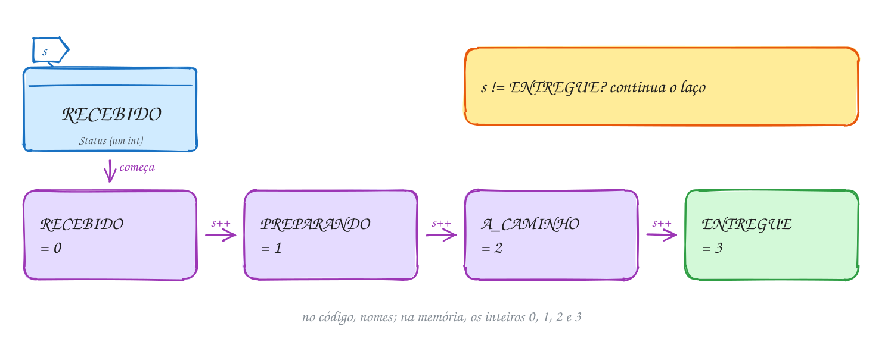</p>

O código percorre as etapas e traduz cada uma para texto com um `switch`:

```c
#include <stdio.h>

typedef enum {
    RECEBIDO,   // 0
    PREPARANDO, // 1
    A_CAMINHO,  // 2
    ENTREGUE    // 3
} Status;

const char *nome_status(Status s) {
    switch (s) {
    case RECEBIDO:
        return "recebido pelo restaurante";
    case PREPARANDO:
        return "em preparo";
    case A_CAMINHO:
        return "saiu para entrega";
    case ENTREGUE:
        return "entregue";
    }
    return "desconhecido"; // só chega aqui com um valor inválido
}

int main(void) {
    Status s = RECEBIDO;

    while (s != ENTREGUE) {
        printf("[%d] Pedido %s\n", s, nome_status(s));
        s++; // enum é um inteiro: avança para o próximo status
    }
    printf("[%d] Pedido %s. Bom apetite!\n", s, nome_status(s));
    return 0;
}
// Saída:
// [0] Pedido recebido pelo restaurante
// [1] Pedido em preparo
// [2] Pedido saiu para entrega
// [3] Pedido entregue. Bom apetite!
```

Enum e `switch` foram feitos um para o outro. Cada `case` usa um nome, e o
código se explica sozinho. Um truque comum é pôr um último nome que só conta
os outros: `{ RECEBIDO, PREPARANDO, A_CAMINHO, ENTREGUE, QTD_STATUS }`. Como
`QTD_STATUS` vale 4, ele serve de tamanho para um vetor de textos
(`const char *nomes[QTD_STATUS]`) e cresce sozinho quando você acrescenta um
status.

Repara no fluxograma: é um laço comum, controlado por uma pergunta sobre o
enum. O `s++` é o que faz o pedido andar:

<p align="center">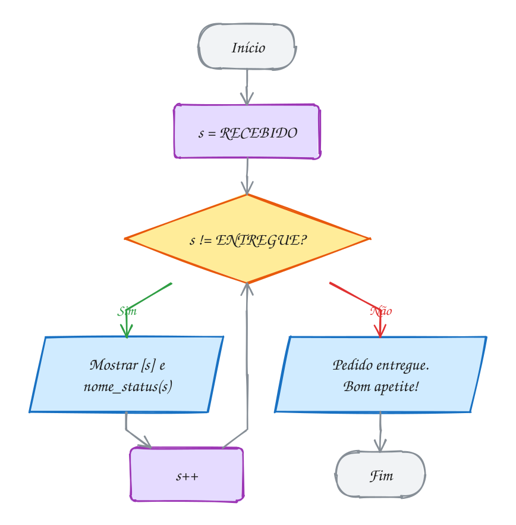</p>

> [!WARNING]
> O C **não confere** se o valor de um enum é válido. `Status s = 42;`
> compila, e `s++` depois de `ENTREGUE` dá 4, que não é status nenhum. Por isso
> o `nome_status` tem um `return "desconhecido"` depois do `switch`. Outro
> tropeço: os nomes de um enum são globais. Se outro enum do mesmo programa
> também tiver `ENTREGUE`, não compila. Daí o costume de usar prefixo:
> `STATUS_ENTREGUE`, `PAG_PIX`.

> [!TIP]
> **Por dentro do C:** o enum some na compilação. `A_CAMINHO` vira o número 2
> no código de máquina, e uma variável `Status` ocupa o mesmo que um `int` (4
> bytes, como mostra o A126). Então por que não usar `#define`? Porque o
> compilador **conhece** o enum. Apague o `case ENTREGUE:` do exemplo e rode:
> o `-Wall` avisa `enumeration value 'ENTREGUE' not handled in switch`. Com
> `#define`, ninguém avisaria. Esse aviso só aparece se o `switch` **não** tiver
> `default`; por isso, num switch de enum, prefira tratar todos os casos e
> deixar o "valor inválido" depois do switch.

> [!NOTE]
> **Pergunta para você:** em `enum { BRONZE = 1, PRATA, OURO = 5, DIAMANTE }`, quanto vale
> cada nível? E se o laço do exemplo usasse `s <= ENTREGUE` em vez de
> `s != ENTREGUE`, sem o `printf` depois do laço, a saída mudaria?

### Hora de praticar

Os arquivos ficam em [`0063-enum/`](0063-enum/). Os comandos funcionam de qualquer pasta do terminal. Nos exemplos, rode, mude, quebre e rode de novo. Nos exercícios, a resposta vai dentro do próprio arquivo. ★☆☆ é aquecimento, ★★☆ pede raciocínio e ★★★ é desafio.

**Exemplo A125 · As formas de pagamento**

```c
#include <stdio.h>

// prefixo PAG_ evita choque de nomes; QTD_PAG conta quantas formas existem
typedef enum { PAG_PIX, PAG_DEBITO, PAG_CREDITO, PAG_DINHEIRO, QTD_PAG } Pagamento;

typedef struct {
    double valor;
    Pagamento forma; // um enum dentro de uma struct
} Venda;

int main(void) {
    // vetores do tamanho do enum, indexados pelo próprio enum
    const char *nomes[QTD_PAG] = {"Pix", "débito", "crédito", "dinheiro"};
    const double taxa[QTD_PAG] = {0.0, 1.5, 3.2, 0.0}; // % que a maquininha cobra

    Venda vendas[] = {
        {50.00, PAG_PIX},
        {120.00, PAG_CREDITO},
        {35.00, PAG_DEBITO},
        {80.00, PAG_PIX},
        {20.00, 7}, // compila! o C não confere se 7 é uma forma válida
    };
    int n = sizeof vendas / sizeof vendas[0];

    int contagem[QTD_PAG] = {0};
    double taxas = 0;
    for (int i = 0; i < n; i++) {
        Pagamento f = vendas[i].forma;
        if (f < 0 || f >= QTD_PAG) { // quem confere é você
            printf("venda %d: forma inválida (%d)\n", i, f);
            continue;
        }
        contagem[f]++;
        taxas += vendas[i].valor * taxa[f] / 100;
    }

    for (Pagamento f = PAG_PIX; f < QTD_PAG; f++) {
        printf("%s: %d venda(s)\n", nomes[f], contagem[f]);
    }
    printf("Taxas pagas: R$ %.2f\n", taxas);
    return 0;
}
// Saída:
// venda 4: forma inválida (7)
// Pix: 2 venda(s)
// débito: 1 venda(s)
// crédito: 1 venda(s)
// dinheiro: 0 venda(s)
// Taxas pagas: R$ 4.37
```

```bash
~/LPEDC/rodar 08-structs/0063-enum/A125.c
```

**Exemplo A126 · O troco em notas**

```c
#include <stdio.h>

// cada nome vale o que está escrito na nota: os valores não precisam ser seguidos
typedef enum {
    DOIS = 2,
    CINCO = 5,
    DEZ = 10,
    VINTE = 20,
    CINQUENTA = 50,
    CEM = 100,
} Nota;

int main(void) {
    const Nota notas[] = {CEM, CINQUENTA, VINTE, DEZ, CINCO, DOIS};
    int n = sizeof notas / sizeof notas[0];
    int troco = 137;

    printf("Troco de R$ %d:\n", troco);
    for (int i = 0; i < n; i++) {
        int qtd = troco / notas[i];
        if (qtd > 0) {
            printf("  %d nota(s) de R$ %d\n", qtd, notas[i]);
            troco %= notas[i];
        }
    }
    if (troco > 0) {
        printf("  sobrou R$ %d sem nota\n", troco);
    }
    printf("sizeof(Nota) = %zu bytes\n", sizeof(Nota));
    return 0;
}
// Saída:
// Troco de R$ 137:
//   1 nota(s) de R$ 100
//   1 nota(s) de R$ 20
//   1 nota(s) de R$ 10
//   1 nota(s) de R$ 5
//   1 nota(s) de R$ 2
// sizeof(Nota) = 4 bytes
```

```bash
~/LPEDC/rodar 08-structs/0063-enum/A126.c
```

#### Exercícios

**Exercício E373** · ★☆☆

Declare o enum abaixo, com alguns valores escolhidos e outros não:


```text
enum Tamanho { P = 1, M, G, GG = 10, XG, XXG = GG * 2, ESP };
```


Guarde os sete tamanhos num vetor e os nomes deles num vetor de textos, e
mostre um por linha, num laço. Depois guarde G + XG numa variável
enum Tamanho e mostre: o C deixa, mesmo que somar tamanhos não faça
sentido.


```text
Saída esperada:
P = 1
M = 2
G = 3
GG = 10
XG = 11
XXG = 20
ESP = 21
G + XG = 14
```

**Dicas:**

1. Sem valor escolhido, um nome vale o anterior + 1.
2. Um valor pode usar nomes que já apareceram antes: XXG = GG * 2.
3. const enum Tamanho tamanhos[] = {P, M, G, ...}; e
   const char *nomes[] = {"P", "M", ...}; andam juntos pelo mesmo índice.
4. Resposta esperada: a saída acima. 14 não é tamanho nenhum, e o C não
   reclama: para ele, são só inteiros.

```bash
~/LPEDC/rodar 08-structs/0063-enum/E373.c
```

**Exercício E374** · ★☆☆

Crie o enum Cor { VERDE, AMARELO, VERMELHO } de um semáforo e duas funções:
Cor proxima(Cor c), que devolve a cor seguinte (depois do vermelho volta o
verde), e const char *nome(Cor c). Começando no verde, mostre 6 trocas.


```text
Saída esperada:
verde -> amarelo
amarelo -> vermelho
vermelho -> verde
verde -> amarelo
amarelo -> vermelho
vermelho -> verde
```

**Dicas:**

1. Em proxima, um switch com um case para cada cor resolve. Outra saída:
   (c + 1) % 3.
2. Em nome, um switch que devolve uma string literal.
3. Resposta esperada: a saída acima.

```bash
~/LPEDC/rodar 08-structs/0063-enum/E374.c
```

**Exercício E375** · ★★☆

Jokenpô! Crie os enums Jogada { PEDRA, PAPEL, TESOURA } e
Resultado { EMPATE, VITORIA, DERROTA }. Escreva
Resultado jogar(Jogada voce, Jogada outro) e rode as 5 partidas abaixo,
mostrando o placar no fim.


```text
voce     x outro
pedra    x tesoura
papel    x tesoura
tesoura  x tesoura
papel    x pedra
pedra    x papel
```


```text
Saída esperada:
pedra x tesoura: vitória
papel x tesoura: derrota
tesoura x tesoura: empate
papel x pedra: vitória
pedra x papel: derrota
Placar: 2 vitórias, 1 empate, 2 derrotas
```

**Dicas:**

1. Guarde as partidas num vetor de structs: { Jogada voce; Jogada outro; }.
2. Truque: com PEDRA = 0, PAPEL = 1 e TESOURA = 2, a conta
   (voce - outro + 3) % 3 dá 0 no empate, 1 quando você vence e 2 quando
   perde. É por isso que a ordem do enum Resultado foi escolhida assim.
3. Um vetor int placar[3] indexado pelo Resultado conta tudo sem if.
4. Resposta esperada: a saída acima.

```bash
~/LPEDC/rodar 08-structs/0063-enum/E375.c
```

**Exercício E376** · ★★☆

Este programa compila sem nenhum aviso, mas uma das cartas sai como "???".
Rode, ache o problema e conserte. O gcc avisa quando um switch de enum
esquece um caso, mas desta vez ficou quieto: mude o código para que ele
avise. Para testar, acrescente um quinto naipe CORINGA no fim do enum e
rode: tem que aparecer o aviso. Depois tire o CORINGA e rode de novo.


```text
Saída esperada (depois de consertado):
7 de ouros
7 de espadas
7 de copas
7 de paus
```

**Dicas:**

1. Conte os case e conte os nomes do enum.
2. O aviso -Wswitch só aparece quando o switch não tem default.
3. Resposta esperada: faltava o case COPAS; o default escondia o esquecimento
   (com default, o gcc entende que você tratou "o resto"). Acrescente o
   case COPAS, tire o default e devolva "???" depois do switch.

```bash
~/LPEDC/rodar 08-structs/0063-enum/E376.c
```

**Exercício E377** · ★★★

A catraca do metrô é uma máquina de estados. Ela está TRAVADA ou LIBERADA,
e recebe dois eventos: BILHETE e EMPURRAO. As regras:


```text
TRAVADA  + BILHETE  -> LIBERADA
TRAVADA  + EMPURRAO -> TRAVADA   (alguém tentou passar sem pagar)
LIBERADA + EMPURRAO -> TRAVADA   (uma pessoa passou)
LIBERADA + BILHETE  -> LIBERADA  (bilhete desperdiçado)
```


Use dois enums (Estado e Evento) e uma função
Estado transicao(Estado e, Evento ev). Começando TRAVADA, processe a
sequência BILHETE, EMPURRAO, EMPURRAO, BILHETE, BILHETE, EMPURRAO, EMPURRAO
e conte quantos passaram, quantas tentativas foram barradas e quantos
bilhetes foram desperdiçados.


```text
Saída esperada:
travada + bilhete -> liberada
liberada + empurrão -> travada
travada + empurrão -> travada
travada + bilhete -> liberada
liberada + bilhete -> liberada
liberada + empurrão -> travada
travada + empurrão -> travada
Passaram: 2 | Barrados: 2 | Bilhetes desperdiçados: 1
```

**Dicas:**

1. Guarde os eventos num vetor: Evento seq[] = {BILHETE, EMPURRAO, ...};
2. Conte olhando o par (estado atual, evento) antes de trocar de estado.
3. Um switch dentro de outro (estado por fora, evento por dentro) deixa as
   4 regras bem visíveis.
4. Resposta esperada: a saída acima.

```bash
~/LPEDC/rodar 08-structs/0063-enum/E377.c
```

**Exercício E378** · ★★★

O app pediu uma nota para a entrega e recebeu 15 respostas:


```text
ótima, boa, ok, ótima, ruim, boa, ótima, ótima,
péssima, boa, ok, ótima, boa, ótima, ruim
```


Crie o enum Nota { PESSIMA, RUIM, OK, BOA, OTIMA, QTD_NOTAS } e guarde as
respostas num vetor de Nota. Conte quantas de cada (um vetor int de
QTD_NOTAS posições, indexado pela nota), mostre a porcentagem de cada uma e
a satisfação (boa + ótima).


```text
Saída esperada:
péssima: 1 (6.7%)
ruim: 2 (13.3%)
ok: 2 (13.3%)
boa: 4 (26.7%)
ótima: 6 (40.0%)
Satisfação: 66.7%
```

**Dicas:**

1. QTD_NOTAS vale 5 e serve de tamanho: int contagem[QTD_NOTAS] = {0};
2. Os nomes também cabem num vetor: const char *nomes[QTD_NOTAS] = {...};
3. contagem[respostas[i]]++ conta sem nenhum if.
4. Cuidado com divisão inteira: 100.0 * contagem[n] / total.
5. Resposta esperada: a saída acima.

```bash
~/LPEDC/rodar 08-structs/0063-enum/E378.c
```

---

## 0064 · Union

No coworking, a mesma mesa é usada de manhã por uma designer e à tarde por um
programador. O espaço é um só. Quem chega usa a mesa inteira, e o que estava
em cima dela antes some (ou fica bagunçado).

Uma **union** é isso na memória. Ela se declara igual a uma struct, mas com
uma diferença radical: na struct, cada campo tem o seu pedaço de memória, um
depois do outro; na union, **todos os campos começam no mesmo endereço** e
dividem os mesmos bytes. O tamanho da union é o do maior campo (arredondado
para o alinhamento), e só um campo "vale" de cada vez.

```c
typedef union {
    uint32_t numero;        // 4 bytes
    unsigned char bytes[4]; // os MESMOS 4 bytes
} Endereco;
```

Para que serve? Para dois usos bem diferentes. O primeiro é **economizar
espaço** quando um dado pode ser uma coisa **ou** outra, nunca as duas: um
pagamento é Pix **ou** cartão **ou** boleto. O segundo é **olhar os mesmos
bytes de dois jeitos**: escrever um número de 4 bytes e ler byte a byte, sem
fazer conta nenhuma.

Vamos ver na prática com o segundo uso. Um endereço IP como 192.168.0.10 é,
por baixo, um número de 32 bits: `0xC0A8000A` (C0 = 192, A8 = 168, 00 = 0,
0A = 10). O programa grava o número em `ip.numero` e lê os bytes por
`ip.bytes`. Repare na ordem em que eles aparecem na memória:

<p align="center">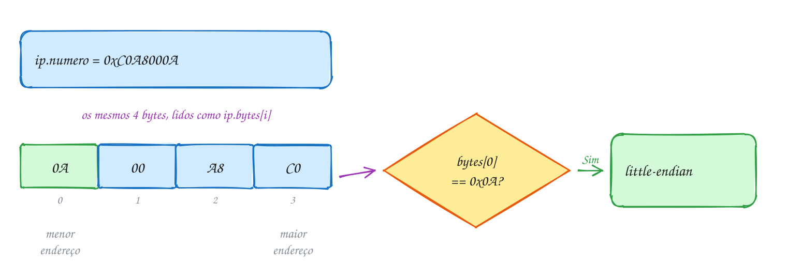</p>

Os bytes saem **ao contrário** do que você escreveu:

```c
#include <stdint.h>
#include <stdio.h>

// os dois campos começam no MESMO endereço: são dois jeitos de ler 4 bytes
typedef union {
    uint32_t numero;
    unsigned char bytes[4];
} Endereco;

int main(void) {
    Endereco ip;
    ip.numero = 0xC0A8000A; // 192.168.0.10, escrito como um número só

    printf("sizeof: %zu bytes\n", sizeof ip);
    printf("numero: 0x%08X\n", (unsigned)ip.numero);
    printf("bytes na memória:");
    for (int i = 0; i < 4; i++) {
        printf(" %02X", ip.bytes[i]); // lê os mesmos 4 bytes, um por um
    }
    printf("\n");

    if (ip.bytes[0] == 0x0A) {
        printf("little-endian: o byte menos significativo vem primeiro\n");
    } else {
        printf("big-endian: o byte mais significativo vem primeiro\n");
    }

    ip.bytes[3] = 10; // muda um byte: o número inteiro muda junto
    printf("depois de bytes[3] = 10: 0x%08X\n", (unsigned)ip.numero);
    return 0;
}
// Saída (num PC Intel/AMD ou ARM):
// sizeof: 4 bytes
// numero: 0xC0A8000A
// bytes na memória: 0A 00 A8 C0
// little-endian: o byte menos significativo vem primeiro
// depois de bytes[3] = 10: 0x0AA8000A
```

Essa ordem tem nome: **endianness**. Num processador **little-endian**
(Intel, AMD e praticamente todo ARM de celular), o byte **menos**
significativo fica no endereço menor: o `0A` do final do número vem primeiro.
Num **big-endian**, a ordem é a de leitura humana: `C0 A8 00 0A`. Nenhum é
"certo"; é uma escolha de quem projetou o processador. A union deixa você
**ver** essa escolha.

Repara no fluxograma: a pergunta sobre o primeiro byte é um detector de
endianness. O mesmo programa, compilado numa máquina big-endian, seguiria pelo
outro lado:

<p align="center">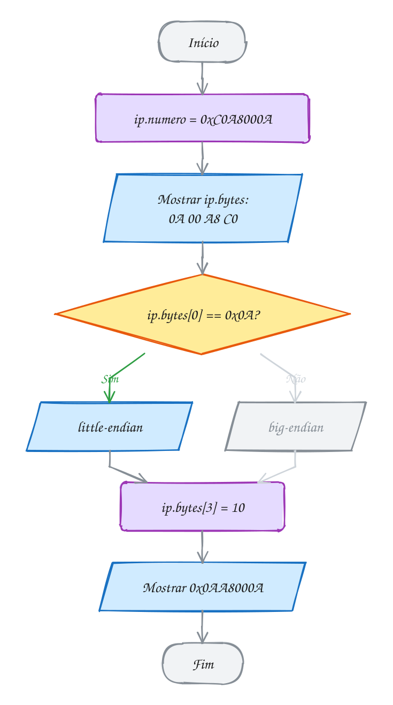</p>

> [!WARNING]
> Numa union, escrever num campo **estraga** os outros. Se você grava
> `ip.numero` e depois lê `ip.bytes`, tudo bem: era essa a intenção. Mas numa
> union usada para economizar espaço, ler um campo diferente do último que
> você gravou dá lixo, e o C não avisa: ele não sabe qual campo está valendo.
> Por isso a union quase sempre vem acompanhada de um **enum** que diz qual
> campo vale agora (a union "etiquetada" do A128). Quem confere a etiqueta é você, não
> o compilador. E lembre: o
> resultado de ler os bytes depende da endianness, então esse código não dá a
> mesma saída em todas as máquinas.

> [!TIP]
> **Por dentro do C:** uma union não gera código nenhum. `ip.numero` e
> `ip.bytes[0]` são o mesmo endereço; muda só o tipo com que o compilador lê o
> que está lá. Em C, ler um campo diferente do último
> gravado é permitido: os bytes são reinterpretados no tipo novo. É assim que
> se inspeciona um `float` bit a bit, por exemplo. Na rede, a convenção é
> big-endian (a "ordem de rede"); por isso programas de rede usam `htonl` e
> `ntohl`, de `<arpa/inet.h>`, para converter números antes de enviar e depois
> de receber.

> [!NOTE]
> **Pergunta para você:** se a union tivesse um terceiro campo,
> `uint16_t metades[2]`, quanto valeria `ip.metades[0]` logo depois de
> `ip.numero = 0xC0A8000A`? E `sizeof ip` mudaria?

### Hora de praticar

Os arquivos ficam em [`0064-union/`](0064-union/). Os comandos funcionam de qualquer pasta do terminal. Nos exemplos, rode, mude, quebre e rode de novo. Nos exercícios, a resposta vai dentro do próprio arquivo. ★☆☆ é aquecimento, ★★☆ pede raciocínio e ★★★ é desafio.

**Exemplo A127 · A balança da feira**

```c
#include <stdio.h>

// um produto da feira é vendido por unidade OU por quilo, nunca pelos dois
typedef union {
    int unidades;
    double quilos;
} Quantidade;

// a mesma informação numa struct: os dois campos ocupam espaço sempre
typedef struct {
    int unidades;
    double quilos;
} QuantidadeStruct;

int main(void) {
    Quantidade q;

    q.unidades = 12; // uma dúzia de ovos
    printf("unidades: %d\n", q.unidades);

    q.quilos = 2.5;  // agora 2,5 kg de tomate: os mesmos bytes, reescritos
    printf("quilos: %.1f\n", q.quilos);
    // 2.5 em double é 0x4004000000000000; num PC little-endian, os 4 bytes
    // que o int lê são os de baixo, todos zero
    printf("unidades agora: %d (lixo: a dúzia sumiu)\n", q.unidades);

    printf("union: %zu bytes, struct: %zu bytes\n", sizeof(Quantidade),
           sizeof(QuantidadeStruct));
    printf("1000 produtos: %zu contra %zu bytes\n", 1000 * sizeof(Quantidade),
           1000 * sizeof(QuantidadeStruct));
    printf("mesmo endereço? %s\n", (void *)&q.unidades == (void *)&q.quilos ? "sim" : "não");
    return 0;
}
// Saída (num PC Intel/AMD ou ARM):
// unidades: 12
// quilos: 2.5
// unidades agora: 0 (lixo: a dúzia sumiu)
// union: 8 bytes, struct: 16 bytes
// 1000 produtos: 8000 contra 16000 bytes
// mesmo endereço? sim
```

```bash
~/LPEDC/rodar 08-structs/0064-union/A127.c
```

**Exemplo A128 · Um pagamento, três formas**

```c
#include <stdio.h>

typedef enum { PIX, CARTAO, BOLETO } TipoPagamento;

// union "etiquetada": o enum diz qual campo da union vale agora
typedef struct {
    TipoPagamento tipo;
    double valor;
    union {
        char chave[40];        // PIX
        struct {               // CARTAO
            char final[5];
            int parcelas;
        } cartao;
        char codigo[48];       // BOLETO
    } dados;
} Pagamento;

void mostrar(const Pagamento *p) {
    printf("R$ %7.2f via ", p->valor);
    switch (p->tipo) {
    case PIX:
        printf("Pix para %s\n", p->dados.chave);
        break;
    case CARTAO:
        printf("cartão final %s em %dx\n", p->dados.cartao.final, p->dados.cartao.parcelas);
        break;
    case BOLETO:
        printf("boleto %.10s...\n", p->dados.codigo);
        break;
    }
}

int main(void) {
    Pagamento lista[] = {
        {PIX, 89.90, .dados.chave = "loja@exemplo.com"},
        {CARTAO, 1250.00, .dados.cartao = {"4321", 10}},
        {BOLETO, 342.17, .dados.codigo = "23790123456789012345678901234567890123456789"},
    };

    for (int i = 0; i < 3; i++) {
        mostrar(&lista[i]);
    }
    printf("sizeof(Pagamento) = %zu (a union ocupa só o maior campo: 48)\n", sizeof(Pagamento));
    return 0;
}
// Saída:
// R$   89.90 via Pix para loja@exemplo.com
// R$ 1250.00 via cartão final 4321 em 10x
// R$  342.17 via boleto 2379012345...
// sizeof(Pagamento) = 64 (a union ocupa só o maior campo: 48)
```

```bash
~/LPEDC/rodar 08-structs/0064-union/A128.c
```

#### Exercícios

**Exercício E379** · ★☆☆

Escreva um programa que declare os três tipos abaixo e mostre o sizeof de
cada um. Para a union Caixa e a struct Ficha, mostre também onde cada campo
começa (offsetof): é a diferença entre as duas, em números.


```text
union Caixa  { char c; int i; double d; };
struct Ficha { char c; int i; double d; };
union Nome   { char texto[10]; int codigo; };
```


```text
Saída esperada (num PC de 64 bits):
union Caixa: 8 bytes, campos em 0, 0 e 0
struct Ficha: 16 bytes, campos em 0, 4 e 8
union Nome: 12 bytes
```

**Dicas:**

1. offsetof(union Caixa, i) também funciona com union; está em
   <stddef.h> e se mostra com %zu.
2. Union: o tamanho do maior campo, arredondado para um múltiplo do
   alinhamento do campo mais exigente. Struct: os campos em sequência, com
   sobras de alinhamento (assunto 0059).
3. Resposta esperada: a saída acima. A union Nome tem 12 bytes, não 10:
   o int pede um tamanho múltiplo de 4.

```bash
~/LPEDC/rodar 08-structs/0064-union/E379.c
```

**Exercício E380** · ★☆☆

Um float também é feito de 4 bytes, mas eles não guardam o número do jeito
que um int guardaria. Crie uma union com um float e um uint32_t e mostre,
em hexadecimal, os bits de 1.0, -2.0, 0.5 e 0.1.


```text
Saída esperada:
1.0 -> 0x3F800000
-2.0 -> 0xC0000000
0.5 -> 0x3F000000
0.1 -> 0x3DCCCCCD
```

**Dicas:**

1. typedef union { float f; uint32_t bits; } Espiao;
2. Grave em .f e leia em .bits. Mostre com 0x%08X e um cast para unsigned.
3. Repare: 1.0 não é 0x00000001. O float guarda sinal, expoente e mantissa
   (padrão IEEE 754), e 0.1 nem tem representação exata: o CCCC repetido é
   uma dízima em binário, e o D do fim é o arredondamento.
4. Resposta esperada: a saída acima.

```bash
~/LPEDC/rodar 08-structs/0064-union/E380.c
```

**Exercício E381** · ★★☆

Um arquivo vindo de uma máquina big-endian guardou números de 16 bits com
os dois bytes na ordem oposta à do seu PC. Escreva
uint16_t trocar_bytes(uint16_t x) usando uma union de um uint16_t com um
unsigned char[2] (sem operadores de bits), e teste com três valores.


```text
Saída esperada:
0xABCD -> 0xCDAB
0x0102 -> 0x0201
258 -> 513
```

**Dicas:**

1. Grave x no campo de 16 bits, troque b[0] com b[1] e devolva o campo de
   16 bits.
2. 258 = 0x0102. Trocado, vira 0x0201 = 2 * 256 + 1.
3. Curiosidade: esta função dá o mesmo resultado em qualquer endianness,
   porque ela só troca as duas metades de lugar.
4. Resposta esperada: a saída acima.

```bash
~/LPEDC/rodar 08-structs/0064-union/E381.c
```

**Exercício E382** · ★★☆

Um app de reforma calcula a área de peças de formatos diferentes. Crie uma
union etiquetada:


```text
typedef enum { CIRCULO, RETANGULO, TRIANGULO } TipoForma;
typedef struct {
    TipoForma tipo;
    union {
        double raio;
        struct { double largura, altura; } ret;
        struct { double base, altura; } tri;
    } medida;
} Forma;
```


Escreva double area(const Forma *f) com um switch no tipo e some as
áreas de: um círculo de raio 2, um retângulo 3 x 4 e um triângulo de base 6
e altura 5.


```text
Saída esperada:
círculo: 12.57 m2
retângulo: 12.00 m2
triângulo: 15.00 m2
Total: 39.57 m2
```

**Dicas:**

1. O -std=c17 não define M_PI: use #define PI 3.14159265358979.
2. Inicialize com nome de campo: {CIRCULO, .medida.raio = 2}.
3. Triângulo: base * altura / 2.
4. Resposta esperada: a saída acima.

```bash
~/LPEDC/rodar 08-structs/0064-union/E382.c
```

**Exercício E383** · ★★★

Este programa compila sem aviso e roda sem erro do sanitizer, mas duas
linhas saem erradas: um "real" aparece como 0.00 e um "texto" aparece como
um número estranho. O C não confere a etiqueta de uma union: isso é
trabalho seu. Rode, ache os dois erros, conserte e rode de novo.


```text
Saída esperada (depois de consertado):
inteiro: 7
real: 42.50
texto: oi
texto: ok
```

**Dicas:**

1. Para cada item do vetor, compare a etiqueta (tipo) com o campo da union
   que foi preenchido.
2. O número estranho é 27503 = 0x6B6F: são os códigos ASCII de 'k' (0x6B) e
   'o' (0x6F), lidos como um int num PC little-endian.
3. Resposta esperada: o 2º item tem tipo REAL mas preencheu .inteiro (use
   .dados.real = 42.5); o 4º preencheu .texto mas a etiqueta diz INTEIRO
   (use TEXTO).

```bash
~/LPEDC/rodar 08-structs/0064-union/E383.c
```

**Exercício E384** · ★★★

Na rede, a convenção é mandar os números em big-endian (a "ordem de
rede"). Use a union abaixo para escrever:


```text
typedef union {
    uint32_t n;
    uint16_t m[2];
    unsigned char b[4];
} Visao;
```


```text
- void mostrar_memoria(Visao x): mostra os 4 bytes na ordem da memória;
- int little_endian(void): devolve 1 se a máquina é little-endian;
- uint32_t ordem_de_rede(uint32_t x): devolve o número com os bytes
  arrumados para que, na memória, apareçam do mais significativo para o
  menos. Numa máquina big-endian, devolve x sem mexer.
```


Teste com x.n = 0x11223344: mostre a memória, m[0] e m[1], a endianness e
a memória do número convertido.


```text
Saída esperada (num PC Intel/AMD ou ARM):
memória: 44 33 22 11
m[0] = 0x3344, m[1] = 0x1122
esta máquina é little-endian
em ordem de rede, memória: 11 22 33 44
```

**Dicas:**

1. Para descobrir a endianness: grave 1 em .n e olhe se .b[0] vale 1.
2. Para inverter: duas Visao, de e para; para.b[i] = de.b[3 - i].
3. m[0] são os dois primeiros bytes da memória, lidos como um número de 16
   bits na ordem da máquina: 44 33 vira 0x3344.
4. Resposta esperada: a saída acima. A última linha sai igual em qualquer
   máquina: é para isso que serve a ordem de rede.

```bash
~/LPEDC/rodar 08-structs/0064-union/E384.c
```

---

## 0065 · Bits, máscaras e flags

Rode `ls -l` num terminal Linux e você vê algo como `-rwxr-xr-x` do lado de
cada arquivo. Para mudar isso, alguém digita `chmod 755`. Por que 755? Porque
cada permissão é **um bit**, e o C sabe mexer em bits um por um.

### Binário em cinco minutos

Um **bit** é um 0 ou um 1. Oito bits formam um **byte**. Um número inteiro na
memória é só uma fileira de bits, lida em **base 2**: cada casa vale o dobro
da casa à direita.

| casa | 2⁷ | 2⁶ | 2⁵ | 2⁴ | 2³ | 2² | 2¹ | 2⁰ |
| --- | --- | --- | --- | --- | --- | --- | --- | --- |
| vale | 128 | 64 | 32 | 16 | 8 | 4 | 2 | 1 |

Para ler um binário, some as casas que têm 1: `0110` = 4 + 2 = 6. Para
escrever um decimal em binário, tire a maior casa que cabe e repita: 13 =
8 + 4 + 1 = `1101`. Os bits se numeram da direita para a esquerda, a partir do
**bit 0** (o que vale 1).

Binário é comprido, então usamos atalhos. Na **base 16** (hexadecimal), cada
dígito, de 0 a 9 e de A (10) a F (15), vale **exatamente 4 bits**: `1110 1101`
= `0xED` = 237. Na **base 8** (octal), cada dígito vale **3 bits**, e é por
isso que ele aparece nas permissões: 3 bits por grupo. No C, `0x` começa um
hexadecimal e um **zero à esquerda** começa um octal: `0755` é octal, e vale
493, não 755.

### Os operadores bit a bit

Eles trabalham bit a bit, casa por casa, sobre inteiros. Com `a = 0110` (6) e
`b = 0011` (3):

| Operador | Nome | Regra para cada bit | `a op b` |
| --- | --- | --- | --- |
| `a & b` | E | 1 se os dois são 1 | `0010` (2) |
| `a \| b` | OU | 1 se algum é 1 | `0111` (7) |
| `a ^ b` | OU exclusivo | 1 se são diferentes | `0101` (5) |
| `~a` | NÃO | inverte cada bit | `...1001` |
| `a << 1` | desloca à esquerda | empurra, entra 0 à direita | `1100` (12) |
| `a >> 1` | desloca à direita | empurra, sai o bit 0 | `0011` (3) |

Deslocar 1 casa para a esquerda multiplica por 2; para a direita, divide por
2 (divisão inteira). E `1u << n` é o número que só tem o bit `n` ligado.

### Máscaras e flags

Uma **flag** é um bit que diz sim ou não. Várias flags cabem num inteiro só,
cada uma no seu bit: `LER` = 4 (`100`), `ESCREVER` = 2 (`010`), `EXECUTAR` = 1
(`001`). Um valor que escolhe certos bits é uma **máscara**. Com ela, quatro
receitas resolvem tudo:

- **ligar** um bit: `p |= ESCREVER;`
- **desligar**: `p &= ~ESCREVER;` (o `~` faz uma máscara com todos os bits
  ligados menos aquele)
- **testar**: `if (p & ESCREVER)` (sobra 0 se o bit estava desligado)
- **inverter**: `p ^= ESCREVER;`

Vamos ver na prática. Um arquivo começa com `rw-` (110). Para ligar a
execução, o OU com a máscara `001` acende só o último bit, e os outros ficam
como estavam:

<p align="center">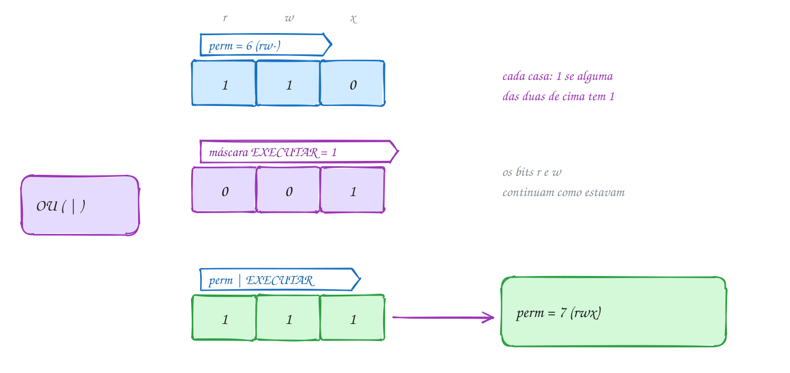</p>

O programa aplica as quatro receitas em sequência e mostra os bits a cada
passo:

```c
#include <stdio.h>

// cada permissão é um bit: 4 = 100, 2 = 010, 1 = 001
#define LER      4u // r
#define ESCREVER 2u // w
#define EXECUTAR 1u // x

void mostrar(const char *passo, unsigned p) {
    printf("%-12s %u%u%u = %u  %c%c%c\n", passo,
           (p >> 2) & 1u, (p >> 1) & 1u, p & 1u, p, // os 3 bits, um por um
           (p & LER) ? 'r' : '-',
           (p & ESCREVER) ? 'w' : '-',
           (p & EXECUTAR) ? 'x' : '-');
}

int main(void) {
    unsigned perm = LER | ESCREVER; // liga dois bits de uma vez: 110
    mostrar("inicial", perm);

    perm |= EXECUTAR;               // OU liga um bit
    mostrar("liga x", perm);

    perm &= ~ESCREVER;              // E com o inverso desliga um bit
    mostrar("desliga w", perm);

    if (perm & ESCREVER) {          // E isola um bit para testar
        printf("pode escrever\n");
    } else {
        printf("não pode escrever\n");
    }

    perm ^= EXECUTAR;               // OU exclusivo inverte um bit
    mostrar("inverte x", perm);
    return 0;
}
// Saída:
// inicial      110 = 6  rw-
// liga x       111 = 7  rwx
// desliga w    101 = 5  r-x
// não pode escrever
// inverte x    100 = 4  r--
```

O `(p >> 2) & 1u` é o jeito de ler o bit 2: empurra ele para a casa 0 e apaga
o resto com a máscara `1`. O `chmod 755` completo, no A130, é a mesma ideia
com três grupos de 3 bits: dono `111`, grupo `101`, outros `101`.

Repara no fluxograma: a pergunta "pode escrever?" é só um `&` com a máscara.
Sobrou algum bit, a resposta é Sim:

<p align="center">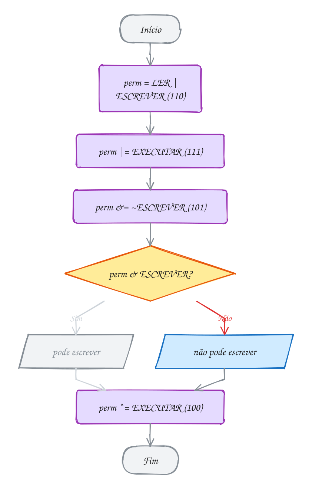</p>

> [!WARNING]
> Três armadilhas. (1) **Precedência**: `&`, `^` e `|` ficam **abaixo** do
> `==`. Então `if (p & ESCREVER == 0)` é lido como `p & (ESCREVER == 0)`, que
> é `p & 0`, sempre falso. Use parênteses: `if ((p & ESCREVER) == 0)`. (2)
> `&` não é `&&`: `p && ESCREVER` só pergunta se os dois são diferentes de
> zero, e quase sempre dá verdadeiro. (3) Use **unsigned** para bits.
> Deslocar um número negativo, ou deslocar por mais casas do que o tipo tem
> (`1u << 32` num `unsigned` de 32 bits), é comportamento indefinido.

> [!TIP]
> **Por dentro do C:** cada operador bit a bit vira **uma** instrução do
> processador (`and`, `or`, `xor`, `not`, `shl`, `shr`), a operação mais
> barata que existe. Por isso flags estão em toda parte: o Linux abre arquivos
> com `open("log.txt", O_WRONLY | O_CREAT | O_APPEND, 0644)`, flags no segundo
> argumento e permissões `rw-r--r--` no terceiro. E 32 flags cabem num
> `unsigned` de 4 bytes, onde 32 `bool` ocupariam 32 bytes. O C também tem
> **campos de bits** numa struct (`unsigned ler : 1;` usa um bit só), mas a
> ordem dos bits dentro do inteiro depende do compilador. Para formatos de
> arquivo e protocolos, máscaras explícitas são mais previsíveis.

> [!NOTE]
> **Pergunta para você:** partindo de `perm = 0`, qual a sequência mais
> curta de operações para chegar em `r-x`? E quanto vale `perm` se você fizer
> `perm ^= LER` duas vezes seguidas?

### Hora de praticar

Os arquivos ficam em [`0065-bits/`](0065-bits/). Os comandos funcionam de qualquer pasta do terminal. Nos exemplos, rode, mude, quebre e rode de novo. Nos exercícios, a resposta vai dentro do próprio arquivo. ★☆☆ é aquecimento, ★★☆ pede raciocínio e ★★★ é desafio.

**Exemplo A129 · Os ingredientes da pizza**

```c
#include <stdio.h>

// cada ingrediente é um bit: 1u << n liga só o bit n
#define QUEIJO    (1u << 0)
#define TOMATE    (1u << 1)
#define CEBOLA    (1u << 2)
#define CALABRESA (1u << 3)
#define AZEITONA  (1u << 4)

void mostrar(const char *nome, unsigned p) {
    const char *ingredientes[] = {"queijo", "tomate", "cebola", "calabresa", "azeitona"};
    printf("%-12s", nome);
    for (int b = 0; b < 5; b++) {
        if (p & (1u << b)) {
            printf(" %s", ingredientes[b]);
        }
    }
    printf("\n");
}

int main(void) {
    unsigned calabresa = QUEIJO | CALABRESA | CEBOLA | AZEITONA;
    unsigned marguerita = QUEIJO | TOMATE;
    mostrar("calabresa", calabresa);
    mostrar("marguerita", marguerita);

    unsigned meu = calabresa & ~(CEBOLA | AZEITONA); // tira dois de uma vez
    mostrar("a minha", meu);

    mostrar("em comum", calabresa & marguerita);   // E: o que as duas têm
    mostrar("meio a meio", calabresa | marguerita); // OU: tudo junto

    unsigned alergia = CEBOLA | TOMATE;
    // "tem ALGUM" e "tem TODOS" são testes diferentes
    printf("marguerita tem algum de cebola/tomate? %s\n",
           (marguerita & alergia) != 0 ? "sim" : "não");
    printf("marguerita tem todos? %s\n",
           (marguerita & alergia) == alergia ? "sim" : "não");
    return 0;
}
// Saída:
// calabresa    queijo cebola calabresa azeitona
// marguerita   queijo tomate
// a minha      queijo calabresa
// em comum     queijo
// meio a meio  queijo tomate cebola calabresa azeitona
// marguerita tem algum de cebola/tomate? sim
// marguerita tem todos? não
```

```bash
~/LPEDC/rodar 08-structs/0065-bits/A129.c
```

**Exemplo A130 · O chmod 755**

```c
#include <stdio.h>

// três grupos de 3 bits: dono (bits 8-6), grupo (5-3) e outros (2-0)
#define DONO   6
#define GRUPO  3
#define OUTROS 0

unsigned montar(unsigned dono, unsigned grupo, unsigned outros) {
    return (dono << DONO) | (grupo << GRUPO) | (outros << OUTROS);
}

void mostrar(unsigned modo) {
    const char letras[] = "rwx";
    printf("octal %03o, hexa 0x%03X, decimal %u\n", modo, modo, modo);
    printf("bits  ");
    for (int b = 8; b >= 0; b--) {
        printf("%u", (modo >> b) & 1u);
    }
    printf("\nls    ");
    for (int b = 8; b >= 0; b--) {
        // bit 8 é r, 7 é w, 6 é x, e o padrão se repete a cada 3
        printf("%c", ((modo >> b) & 1u) ? letras[(8 - b) % 3] : '-');
    }
    printf("\n");
}

int main(void) {
    unsigned modo = montar(7, 5, 5); // rwx r-x r-x
    mostrar(modo);

    unsigned outros = (modo >> OUTROS) & 7u; // máscara 111 pega 3 bits
    printf("outros podem escrever? %s\n", (outros & 2u) ? "sim" : "não");
    printf("é igual ao literal octal 0755? %s\n", modo == 0755 ? "sim" : "não");
    return 0;
}
// Saída:
// octal 755, hexa 0x1ED, decimal 493
// bits  111101101
// ls    rwxr-xr-x
// outros podem escrever? não
// é igual ao literal octal 0755? sim
```

```bash
~/LPEDC/rodar 08-structs/0065-bits/A130.c
```

#### Exercícios

**Exercício E385** · ★☆☆

Escreva a função void mostrar(const char *nome, unsigned char r), que
mostra o nome, os 8 bits de r (com um espaço no meio), o valor em hexa e
em decimal. Com a = 0xCA e b = 0x5C (dois unsigned char), use a função
para mostrar a, b e os seis resultados abaixo, guardando cada um num
unsigned char:


```text
a & b    a | b    a ^ b    ~a    a << 1    a >> 3
```


```text
Saída esperada:
a       1100 1010 = 0xCA = 202
b       0101 1100 = 0x5C = 92
a & b   0100 1000 = 0x48 = 72
a | b   1101 1110 = 0xDE = 222
a ^ b   1001 0110 = 0x96 = 150
~a      0011 0101 = 0x35 = 53
a << 1  1001 0100 = 0x94 = 148
a >> 3  0001 1001 = 0x19 = 25
```

**Dicas:**

1. O bit b de r: (r >> b) & 1u. Percorra b de 7 até 0 e ponha o espaço
   depois do bit 4.
2. Para conferir uma linha: C = 1100, A = 1010, 5 = 0101. Com um
   embaixo do outro, a regra se aplica casa por casa.
3. Num unsigned char só sobram os 8 bits de baixo: passe
   (unsigned char)~a e (unsigned char)(a << 1). Em a << 1, o 1 da esquerda
   cai fora.
4. Resposta esperada: a saída acima (%-7s alinha os nomes).

```bash
~/LPEDC/rodar 08-structs/0065-bits/E385.c
```

**Exercício E386** · ★☆☆

Sem usar %, * nem /, só com operadores de bits, mostre para cada número de
{7, 12, 25, 40} se ele é par ou ímpar, ele vezes 8 e ele dividido por 4
(divisão inteira).


```text
Saída esperada:
7: ímpar, x8 = 56, /4 = 1
12: par, x8 = 96, /4 = 3
25: ímpar, x8 = 200, /4 = 6
40: par, x8 = 320, /4 = 10
```

**Dicas:**

1. Um número é ímpar quando o bit 0 está ligado: n & 1u.
2. Multiplicar por 8 = 2 * 2 * 2 é deslocar 3 casas para a esquerda.
3. Dividir por 4 é deslocar 2 casas para a direita (use unsigned).
4. Resposta esperada: a saída acima.

```bash
~/LPEDC/rodar 08-structs/0065-bits/E386.c
```

**Exercício E387** · ★★☆

Escreva duas funções para um uint16_t (16 bits):


```text
- void mostrar_bits(uint16_t x): mostra os 16 bits, do 15 ao 0, com um
  espaço a cada 4;
- int contar_uns(uint16_t x): conta quantos bits estão ligados.
```


Use as duas em 2025, 255 e 4096 e diga a paridade (par ou ímpar) da
quantidade de bits 1. Esse "bit de paridade" é um jeito antigo e barato de
detectar um bit corrompido numa transmissão.


```text
Saída esperada:
2025: 0000 0111 1110 1001 -> 8 bits 1 (par)
255: 0000 0000 1111 1111 -> 8 bits 1 (par)
4096: 0001 0000 0000 0000 -> 1 bits 1 (ímpar)
```

**Dicas:**

1. Para o bit b: (x >> b) & 1u. Percorra b de 15 até 0.
2. Espaço a cada 4: quando b % 4 == 0 e b > 0.
3. Contar: some o bit 0 e desloque x uma casa para a direita até x
   zerar.
4. Resposta esperada: a saída acima.

```bash
~/LPEDC/rodar 08-structs/0065-bits/E387.c
```

**Exercício E388** · ★★☆

As notificações do app ficam em flags: EMAIL (1), SMS (2) e PUSH (4). O
usuário tinha email e push ligados e desligou o push. Mas a tela mostra o
SMS ligado e, depois, nada desliga. O gcc até dá uma pista (um aviso). Rode,
ache os três erros, conserte e rode de novo.


```text
Saída esperada (depois de consertado):
email: ligado | sms: desligado | push: ligado
email: ligado | sms: desligado | push: desligado
```

**Dicas:**

1. Leia o aviso "suggest parentheses": o == é avaliado antes do &.
2. && responde "os dois são diferentes de zero?"; para testar um bit, é &.
3. Para desligar um bit, faça E com o inverso da máscara.
4. Resposta esperada: (f & EMAIL) == 0 com parênteses; f & SMS em vez de
   f && SMS; f &= ~PUSH em vez de f &= PUSH.

```bash
~/LPEDC/rodar 08-structs/0065-bits/E388.c
```

**Exercício E389** · ★★★

No CSS, uma cor como #FF8800 são três bytes juntos: vermelho (FF), verde
(88) e azul (00). Guarde cores num uint32_t (os 8 bits de cima ficam
zerados) e escreva:


```text
- uint32_t rgb(unsigned r, unsigned g, unsigned b): empacota;
- unsigned canal_r(uint32_t c), canal_g e canal_b: desempacotam;
- uint32_t escurecer(uint32_t c): divide cada canal por 2;
- uint32_t cinza(uint32_t c): os três canais viram a média deles.
```


```text
Saída esperada:
rgb(255, 136, 0) = #FF8800
#3366CC -> r = 51, g = 102, b = 204
#FF8800 escurecida = #7F4400
#3366CC em cinza = #777777
```

**Dicas:**

1. Empacotar: (r << 16) | (g << 8) | b.
2. Desempacotar o verde: (c >> 8) & 0xFF. A máscara 0xFF guarda só 8 bits.
3. Mostre com #%06X e um cast para unsigned.
4. Média: (51 + 102 + 204) / 3 = 119 = 0x77.
5. Resposta esperada: a saída acima.

```bash
~/LPEDC/rodar 08-structs/0065-bits/E389.c
```

**Exercício E390** · ★★★

O despertador do celular guarda os dias da semana num byte: bit 0 é
domingo, bit 1 segunda, ..., bit 6 sábado. O alarme toca nos dias úteis e
a academia é segunda, quarta e sexta. Monte as duas máscaras e, só com
operadores de bits, mostre:


```text
Saída esperada:
alarme: seg ter qua qui sex (5 dias)
academia: seg qua sex (3 dias)
alarme sem academia: ter qui (2 dias)
sem alarme: dom sáb (2 dias)
academia em dia sem alarme? não
```

**Dicas:**

1. Defina constantes com 1u << n: SEG = 1u << 1, ..., e monte
   alarme = SEG | TER | QUA | QUI | SEX (vale 0x3E = 62).
2. "alarme sem academia" é alarme & ~academia.
3. "sem alarme" é ~alarme, mas o ~ liga também os bits 7 a 31: apague com
   a máscara 0x7F (os 7 dias).
4. Uma função void listar(const char *rotulo, unsigned dias) percorre os 7
   bits, mostra o nome e conta.
5. Resposta esperada: a saída acima. A última pergunta é
   (academia & ~alarme) != 0.

```bash
~/LPEDC/rodar 08-structs/0065-bits/E390.c
```

---

## 0066 · Juntando tudo: o cardápio

A lanchonete do bairro quer um cardápio no app. Cada item tem nome, preço,
uma categoria (lanche, bebida ou sobremesa) e algumas marcações: vegano, sem
glúten, picante. O cliente quer filtrar: "só o que é vegano **e** sem glúten".
E o dono quer cadastrar itens novos sem mexer no código toda vez.

Cada peça do módulo resolve uma parte. A **struct** `Item` junta os dados de
um item, e o **typedef** dá nomes curtos aos tipos. O **enum** `Categoria`
nomeia as categorias, e o truque do `QTD_CATEGORIAS` dimensiona o vetor de
nomes. As marcações são **flags** num `unsigned tags`, e o filtro é uma
**máscara**. Os itens moram num **vetor de structs no heap**, que cresce com
`realloc`, e as funções recebem **ponteiros para struct**: `Cardapio *c` para
mexer no cardápio, `const Item *it` para só ler um item sem copiá-lo.

O `Cardapio` é uma struct que **administra** um vetor: guarda o ponteiro para
os itens, quantos existem (`n`) e quantos cabem (`cap`). Quando enche, dobra a
capacidade. Começando em 0, ela vira 2, 4 e 8: com 6 itens, sobram 2 vagas.
Esse trio (ponteiro, tamanho, capacidade) é a semente do **vetor dinâmico**
que o módulo 11 transforma num tipo abstrato de dados.

O filtro é a parte mais elegante. Um item passa se tem **todas** as tags da
máscara: `(tags & mascara) == mascara`. O `&` apaga as tags que não estão na
máscara; se o que sobra é a própria máscara, nenhuma faltou. Com a máscara 0,
qualquer item passa, e o mesmo `filtrar` lista o cardápio inteiro.

Vamos ver na prática. O suco de caju tem as tags `011` (vegano e sem glúten).
Contra a máscara `011`, o `&` devolve `011`, igual à máscara: passa. O burger
de grão-de-bico tem `001`: o `&` devolve `001`, falta o sem glúten, e ele fica
de fora:

<p align="center">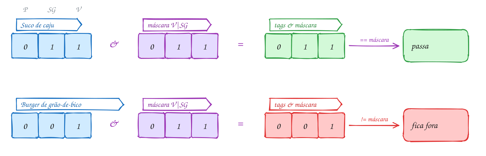</p>

O programa completo:

```c
#include <stdio.h>
#include <stdlib.h>

typedef enum { LANCHE, BEBIDA, SOBREMESA, QTD_CATEGORIAS } Categoria;

// flags: cada característica é um bit
#define VEGANO     (1u << 0)
#define SEM_GLUTEN (1u << 1)
#define PICANTE    (1u << 2)

typedef struct {
    char nome[32];
    Categoria categoria;
    double preco;
    unsigned tags;
} Item;

typedef struct {
    Item *itens; // vetor no heap
    int n;       // quantos itens tem
    int cap;     // quantos cabem
} Cardapio;

int cardapio_adicionar(Cardapio *c, Item it) {
    if (c->n == c->cap) {
        int nova = c->cap == 0 ? 2 : 2 * c->cap;
        Item *novo = realloc(c->itens, nova * sizeof *novo);
        if (novo == NULL) {
            return 0;
        }
        c->itens = novo;
        c->cap = nova;
    }
    c->itens[c->n++] = it; // copia a struct inteira para dentro do vetor
    return 1;
}

void mostrar_item(const Item *it) {
    const char *categorias[QTD_CATEGORIAS] = {"lanche", "bebida", "sobremesa"};
    printf("  R$ %5.2f  %s (%s)%s%s%s\n", it->preco, it->nome, categorias[it->categoria],
           (it->tags & VEGANO) ? " [V]" : "",
           (it->tags & SEM_GLUTEN) ? " [SG]" : "",
           (it->tags & PICANTE) ? " [P]" : "");
}

// mostra os itens que têm TODAS as tags da máscara
void filtrar(const Cardapio *c, unsigned mascara) {
    for (int i = 0; i < c->n; i++) {
        if ((c->itens[i].tags & mascara) == mascara) {
            mostrar_item(&c->itens[i]);
        }
    }
}

int main(void) {
    Cardapio c = {NULL, 0, 0};
    Item itens[] = {
        {"X-Burger", LANCHE, 28.90, 0},
        {"Burger de grão-de-bico", LANCHE, 32.00, VEGANO},
        {"Tapioca de frango", LANCHE, 18.50, SEM_GLUTEN},
        {"Asinha apimentada", LANCHE, 24.00, PICANTE | SEM_GLUTEN},
        {"Suco de caju", BEBIDA, 9.00, VEGANO | SEM_GLUTEN},
        {"Pudim", SOBREMESA, 12.00, SEM_GLUTEN},
    };
    int n = sizeof itens / sizeof itens[0];

    for (int i = 0; i < n; i++) {
        if (!cardapio_adicionar(&c, itens[i])) {
            free(c.itens);
            return 1;
        }
    }

    printf("Cardápio (%d itens, capacidade %d):\n", c.n, c.cap);
    filtrar(&c, 0); // máscara vazia: todo item passa
    printf("Veganos e sem glúten:\n");
    filtrar(&c, VEGANO | SEM_GLUTEN);

    free(c.itens);
    return 0;
}
// Saída:
// Cardápio (6 itens, capacidade 8):
//   R$ 28.90  X-Burger (lanche)
//   R$ 32.00  Burger de grão-de-bico (lanche) [V]
//   R$ 18.50  Tapioca de frango (lanche) [SG]
//   R$ 24.00  Asinha apimentada (lanche) [SG] [P]
//   R$  9.00  Suco de caju (bebida) [V] [SG]
//   R$ 12.00  Pudim (sobremesa) [SG]
// Veganos e sem glúten:
//   R$  9.00  Suco de caju (bebida) [V] [SG]
```

Repara no fluxograma do `filtrar`: um laço sobre o vetor e uma única
pergunta de bits por item. O mesmo desenho serve para qualquer máscara:

<p align="center">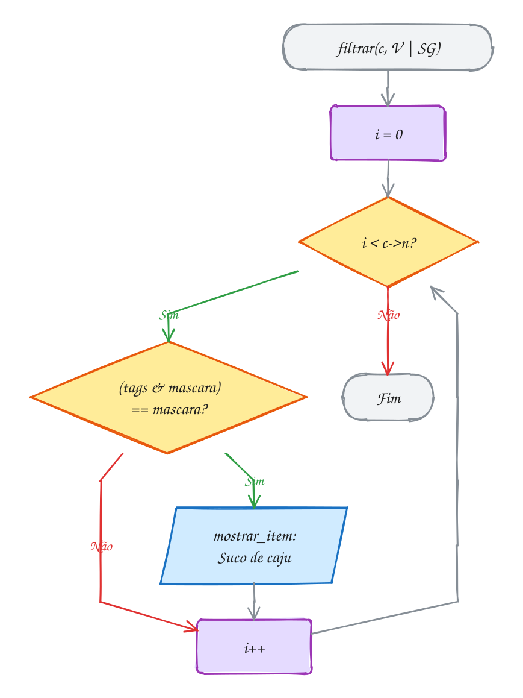</p>

> [!WARNING]
> `c->itens[c->n++] = it` copia o item para **dentro** do vetor. Depois disso,
> mexer na variável `it` (ou no vetor `itens` do `main`) não muda o cardápio.
> O contrário também pega muita gente: um ponteiro para um item,
> `Item *p = &c.itens[0]`, pode ficar **solto** depois do próximo `realloc`,
> porque o vetor inteiro pode ter mudado de endereço. Guarde índices, não
> ponteiros, para elementos de um vetor que cresce.

> [!TIP]
> **Por dentro do C:** um `Item` ocupa 56 bytes: 32 do nome, 4 da categoria
> (um enum é um `int`), 4 de sobra para alinhar o `double`, 8 do preço, 4 das
> tags e mais 4 de sobra no fim, para o próximo item do vetor também começar
> alinhado. As três marcações, como três `bool`, custariam 3 bytes e três
> `if` no filtro. Como flags, custam 4 bytes para até 32 marcações, e o teste
> de "tem todas" é um `and` e uma comparação, qualquer que seja a máscara.
> Confira com `printf("%zu\n", sizeof(Item))`.

> [!NOTE]
> **Pergunta para você:** que máscara lista os itens que são sem glúten **e**
> picantes? E como você escreveria um filtro "tem **alguma** destas tags", em
> vez de "tem todas"?

### Hora de praticar

Os arquivos ficam em [`0066-juntando-tudo/`](0066-juntando-tudo/). Os comandos funcionam de qualquer pasta do terminal. Nos exemplos, rode, mude, quebre e rode de novo. Nos exercícios, a resposta vai dentro do próprio arquivo. ★☆☆ é aquecimento, ★★☆ pede raciocínio e ★★★ é desafio.

**Exemplo A131 · Os alunos da academia**

```c
#include <stdbool.h>
#include <stdio.h>
#include <stdlib.h>
#include <string.h>

typedef enum { MENSAL, TRIMESTRAL, ANUAL, QTD_PLANOS } Plano;

// modalidades: cada uma é um bit
#define MUSCULACAO (1u << 0)
#define NATACAO    (1u << 1)
#define YOGA       (1u << 2)

typedef struct {
    char nome[16];
    Plano plano;
    unsigned modalidades;
} Aluno;

typedef struct {
    Aluno *v;
    int n, cap;
} Academia;

bool matricular(Academia *a, const char *nome, Plano plano, unsigned mods) {
    if (a->n == a->cap) {
        int nova = a->cap == 0 ? 2 : 2 * a->cap;
        Aluno *novo = realloc(a->v, nova * sizeof *novo);
        if (novo == NULL) {
            return false;
        }
        a->v = novo;
        a->cap = nova;
    }
    Aluno *al = &a->v[a->n]; // ponteiro usado logo, antes de outro realloc
    strcpy(al->nome, nome);
    al->plano = plano;
    al->modalidades = mods;
    a->n++;
    return true;
}

// devolve o índice (e não um ponteiro: o vetor pode mudar de lugar)
int procurar(const Academia *a, const char *nome) {
    for (int i = 0; i < a->n; i++) {
        if (strcmp(a->v[i].nome, nome) == 0) {
            return i;
        }
    }
    return -1;
}

// "alguma" das modalidades da máscara, não "todas"
void listar_alguma(const Academia *a, unsigned mascara) {
    for (int i = 0; i < a->n; i++) {
        if ((a->v[i].modalidades & mascara) != 0) {
            printf("  %s\n", a->v[i].nome);
        }
    }
}

int main(void) {
    const char *planos[QTD_PLANOS] = {"mensal", "trimestral", "anual"};
    Academia a = {NULL, 0, 0};

    bool ok = matricular(&a, "Bruna", ANUAL, MUSCULACAO | YOGA) &&
              matricular(&a, "Davi", MENSAL, NATACAO) &&
              matricular(&a, "Elis", MENSAL, MUSCULACAO) &&
              matricular(&a, "Fabio", TRIMESTRAL, MUSCULACAO | NATACAO | YOGA) &&
              matricular(&a, "Gil", ANUAL, 0);
    if (!ok) {
        free(a.v);
        return 1;
    }

    int i = procurar(&a, "Davi");
    if (i != -1) {
        a.v[i].modalidades |= YOGA; // Davi entrou na yoga
        a.v[i].plano = ANUAL;       // e trocou de plano
    }

    int por_plano[QTD_PLANOS] = {0};
    for (int k = 0; k < a.n; k++) {
        por_plano[a.v[k].plano]++;
    }
    for (Plano p = MENSAL; p < QTD_PLANOS; p++) {
        printf("%s: %d aluno(s)\n", planos[p], por_plano[p]);
    }

    printf("Fazem natação ou yoga:\n");
    listar_alguma(&a, NATACAO | YOGA);
    printf("%d alunos, capacidade %d\n", a.n, a.cap);

    free(a.v);
    return 0;
}
// Saída:
// mensal: 1 aluno(s)
// trimestral: 1 aluno(s)
// anual: 3 aluno(s)
// Fazem natação ou yoga:
//   Bruna
//   Davi
//   Fabio
// 5 alunos, capacidade 8
```

```bash
~/LPEDC/rodar 08-structs/0066-juntando-tudo/A131.c
```

**Exemplo A132 · A comanda e o pagamento**

```c
#include <stdio.h>

typedef struct {
    char nome[24];
    double preco;
} Item;

typedef struct {
    const Item *item; // aponta para o cardápio: não copia o item
    int qtd;
} Linha;

typedef enum { PIX, CARTAO, DINHEIRO } FormaPagamento;

typedef struct {
    FormaPagamento forma;
    union {
        char chave[40];   // PIX
        int parcelas;     // CARTAO
        double entregue;  // DINHEIRO: quanto o cliente deu
    } dados;
} Pagamento;

double total_comanda(const Linha linhas[], int n) {
    double total = 0;
    for (int i = 0; i < n; i++) {
        total += linhas[i].item->preco * linhas[i].qtd; // ponteiro dentro de struct
    }
    return total;
}

void pagar(const Pagamento *p, double total) {
    switch (p->forma) {
    case PIX:
        printf("Pix de R$ %.2f para %s\n", total, p->dados.chave);
        break;
    case CARTAO:
        printf("Cartão: %dx de R$ %.2f\n", p->dados.parcelas, total / p->dados.parcelas);
        break;
    case DINHEIRO:
        printf("Dinheiro: recebeu R$ %.2f, troco R$ %.2f\n", p->dados.entregue,
               p->dados.entregue - total);
        break;
    }
}

int main(void) {
    const Item cardapio[] = {{"X-Burger", 28.90}, {"Suco de caju", 9.00}, {"Pudim", 12.00}};

    Linha mesa7[] = {{&cardapio[0], 2}, {&cardapio[1], 2}, {&cardapio[2], 1}};
    int n = sizeof mesa7 / sizeof mesa7[0];

    double total = total_comanda(mesa7, n);
    for (int i = 0; i < n; i++) {
        printf("%d x %s\n", mesa7[i].qtd, mesa7[i].item->nome);
    }
    printf("Total: R$ %.2f\n", total);

    Pagamento formas[] = {
        {PIX, .dados.chave = "lanchonete@exemplo.com"},
        {CARTAO, .dados.parcelas = 3},
        {DINHEIRO, .dados.entregue = 100.00},
    };
    for (int i = 0; i < 3; i++) {
        pagar(&formas[i], total);
    }
    return 0;
}
// Saída:
// 2 x X-Burger
// 2 x Suco de caju
// 1 x Pudim
// Total: R$ 87.80
// Pix de R$ 87.80 para lanchonete@exemplo.com
// Cartão: 3x de R$ 29.27
// Dinheiro: recebeu R$ 100.00, troco R$ 12.20
```

```bash
~/LPEDC/rodar 08-structs/0066-juntando-tudo/A132.c
```

#### Exercícios

**Exercício E391** · ★☆☆

O mercado imprime etiquetas para a prateleira. Crie:


```text
- um enum Setor { HORTIFRUTI, LATICINIOS, PADARIA };
- flags PROMO (bit 0), ORGANICO (bit 1) e REFRIGERADO (bit 2);
- um typedef struct Produto com nome, setor, preço e flags;
- void etiqueta(const Produto *p), que mostra uma linha por produto.
```


Use os três produtos abaixo.


```text
Saída esperada:
Banana prata (hortifrúti) R$ 6.99/kg [orgânico]
Iogurte natural (laticínios) R$ 4.50/kg [promo] [refrigerado]
Pão francês (padaria) R$ 16.90/kg
```

**Dicas:**

1. #define PROMO (1u << 0), e assim por diante.
2. Um vetor const char *setores[] = {"hortifrúti", ...} indexado pelo enum
   traduz o setor.
3. Para cada flag: if (p->flags & PROMO) printf(" [promo]");
4. Resposta esperada: a saída acima.

```bash
~/LPEDC/rodar 08-structs/0066-juntando-tudo/E391.c
```

**Exercício E392** · ★☆☆

Complete o programa da lista de tarefas. Escreva
void mostrar(const char *rotulo, const Tarefa *t), que mostra o rótulo, o
título, a prioridade (como número), as flags (como número) e, para cada
flag ligada, uma etiqueta: [feita], [fixada], [arquivada]. No main:


```text
1. t começa com "Pagar luz", URGENTE e FIXADA; u é uma cópia de t;
2. ligue FEITA em u e troque a prioridade de u para MEDIA;
3. mostre t e u;
4. inverta FIXADA e ARQUIVADA de u numa operação só e mostre u;
5. mostre o sizeof(Tarefa).
```


```text
Saída esperada (num PC de 64 bits):
t: Pagar luz, prioridade 6, flags 2 [fixada]
u: Pagar luz, prioridade 2, flags 3 [feita] [fixada]
u: Pagar luz, prioridade 2, flags 5 [feita] [arquivada]
sizeof(Tarefa) = 20
```

**Dicas:**

1. URGENTE vem logo depois de ALTA = 5, por isso vale 6.
2. Tarefa u = t; faz uma cópia: mudar u não muda t.
3. Ligar: |=. Inverter dois bits de uma vez: u.flags ^= FIXADA | ARQUIVADA;
   (011 ^ 110 = 101).
4. Resposta esperada: a saída acima. O sizeof é 12 + 4 + 4, sem sobras.

```bash
~/LPEDC/rodar 08-structs/0066-juntando-tudo/E392.c
```

**Exercício E393** · ★★☆

Monte um estoque que cresce: typedef struct { Produto *v; int n, cap; }
Estoque; com as funções


```text
- bool estoque_adicionar(Estoque *e, const char *nome, int qtd);
- bool estoque_remover(Estoque *e, const char *nome): acha pelo nome e
  puxa os seguintes uma posição para trás (a ordem se mantém);
- void estoque_listar(const Estoque *e) e void estoque_liberar(Estoque *e).
```


Adicione Arroz (12), Feijão (30), Café (8), Açúcar (15) e Leite (24).
Remova "Feijão" e depois "Macarrão" (que não existe).


```text
Saída esperada:
remover Feijão: ok
remover Macarrão: não encontrado
4 produtos (capacidade 8):
  Arroz: 12
  Café: 8
  Açúcar: 15
  Leite: 24
```

**Dicas:**

1. Comece com {NULL, 0, 0}: realloc(NULL, ...) funciona como malloc.
2. Dobre a capacidade quando n == cap (0 vira 2).
3. Para remover o índice i: for (int j = i; j < e->n - 1; j++)
   e->v[j] = e->v[j + 1]; e depois e->n--.
4. Resposta esperada: a saída acima, sem vazamento no ASan.

```bash
~/LPEDC/rodar 08-structs/0066-juntando-tudo/E393.c
```

**Exercício E394** · ★★☆

Este programa compila sem aviso, mas tem três bugs. O AddressSanitizer
pega dois deles (um de cada vez: conserte e rode de novo); o terceiro é de
lógica e só aparece comparando com a saída esperada. Ache e conserte os
três.


```text
Saída esperada (depois de consertado):
X-Burger R$ 28.90
Suco de caju R$ 9.00 [destaque]
Pudim R$ 12.00 [destaque]
-- tira o destaque do suco --
X-Burger R$ 28.90
Suco de caju R$ 9.00
Pudim R$ 12.00 [destaque]
```

**Dicas:**

1. Leia a primeira linha do relatório do ASan: heap-buffer-overflow aponta
   para uma leitura além do fim do vetor. Confira a condição do laço.
2. "detected memory leaks" quer dizer um malloc sem free.
3. Para desligar um bit, o E é com o inverso da máscara.
4. Resposta esperada: i <= n vira i < n; falta free(itens) no fim;
   itens[1].tags &= DESTAQUE vira itens[1].tags &= ~DESTAQUE.

```bash
~/LPEDC/rodar 08-structs/0066-juntando-tudo/E394.c
```

**Exercício E395** · ★★★

Uma agenda de tarefas. Cada Tarefa tem título, Prioridade (enum BAIXA,
MEDIA, ALTA), prazo (dia do mês) e tags em bits: TRABALHO, CASA, URGENTE.
Aloque o vetor com malloc, preencha com as 6 tarefas abaixo, ordene com
qsort (prioridade mais alta primeiro; empate: prazo menor primeiro) e
mostre a lista inteira e depois só as tarefas de TRABALHO.


```text
título            prioridade  prazo  tags
Pagar aluguel     ALTA        5      CASA | URGENTE
Revisar PR        MEDIA       3      TRABALHO
Comprar ração     BAIXA       8      CASA
Deploy da API     ALTA        2      TRABALHO | URGENTE
Reunião 1:1       MEDIA       3      TRABALHO
Lavar o carro     BAIXA       12     CASA
```


```text
Saída esperada:
[alta] dia 2: Deploy da API
[alta] dia 5: Pagar aluguel
[média] dia 3: Reunião 1:1
[média] dia 3: Revisar PR
[baixa] dia 8: Comprar ração
[baixa] dia 12: Lavar o carro
Trabalho:
[alta] dia 2: Deploy da API
[média] dia 3: Reunião 1:1
[média] dia 3: Revisar PR
```

**Dicas:**

1. Com BAIXA = 0, MEDIA = 1, ALTA = 2, "mais alta primeiro" é
   y.prioridade - x.prioridade na comparadora.
2. Revisar PR e Reunião 1:1 empatam em tudo. O qsort não garante a ordem
   de empates (não é estável): para a saída ser sempre a mesma, desempate
   também pelo título com strcmp ("Reunião" vem antes de "Revisar").
3. Filtro: (t.tags & TRABALHO) != 0.
4. Resposta esperada: a saída acima, e free no fim.

```bash
~/LPEDC/rodar 08-structs/0066-juntando-tudo/E395.c
```

**Exercício E396** · ★★★

Um valor JSON pode ser número, texto, booleano ou null.
Represente isso em C com uma union etiquetada:


```text
typedef enum { J_NULO, J_NUMERO, J_TEXTO, J_BOOL } TipoJson;
typedef struct {
    TipoJson tipo;
    union { double numero; char texto[32]; bool booleano; } v;
} ValorJson;
```


e um campo de objeto: typedef struct { char chave[16]; ValorJson valor; }
Campo. Escreva void imprimir_valor(const ValorJson *v) e
void imprimir_objeto(const Campo campos[], int n) e monte o perfil abaixo.


```text
Saída esperada:
{"nome": "Ana", "idade": 31, "altura": 1.68, "ativa": true, "apelido": null}
```

**Dicas:**

1. Número: %g mostra 31 e 1.68 sem zeros sobrando.
2. Texto vai entre aspas: printf("\"%s\"", v->v.texto).
3. Vírgula entre campos, mas não depois do último: imprima ", " antes de
   cada campo menos o primeiro.
4. Inicialize com nome de campo:
   {"idade", {J_NUMERO, .v.numero = 31}}.
5. Resposta esperada: a linha acima.

```bash
~/LPEDC/rodar 08-structs/0066-juntando-tudo/E396.c
```

---

## Desafios do módulo

Problemas para resolver num arquivo seu, misturando os assuntos do módulo. Do
médio ao difícil.

**1. Agenda com busca.** Monte uma agenda com 5 contatos (nome, telefone,
aniversário como struct `Data`). Leia um nome com `fgets` e mostre o contato,
ou "não encontrado". Depois mostre quem faz aniversário no mês 10.

<details><summary>Resposta</summary>

Um vetor de `Contato`, cada um com um campo `Data` aninhado
(`agenda[i].aniversario.mes`). A busca é um laço com
`strcmp(agenda[i].nome, nome) == 0`; tire o `'\n'` do `fgets` antes de
comparar, senão nada bate. Devolva o **índice** encontrado (ou -1), não uma
cópia.

</details>

**2. Desempate do campeonato.** Ordene uma tabela de times por pontos; no
empate, por saldo de gols; no empate, por gols marcados; e, por fim, pelo nome.

<details><summary>Resposta</summary>

Uma comparadora para o `qsort` com uma cascata de `if`: compare pontos; se
diferentes, devolva a diferença invertida (maior primeiro); senão passe para o
saldo, depois gols, e termine com `strcmp` nos nomes. O último critério garante
uma ordem única, porque o `qsort` não é estável.

</details>

**3. Os retângulos se encostam?** Com `typedef struct { double x, y; } Ponto;`
e um retângulo dado por dois cantos, escreva `bool sobrepoe(Retangulo a,
Retangulo b)`. Teste com (0,0)-(4,3) e (3,2)-(6,5), e com (0,0)-(2,2) e
(3,3)-(5,5).

<details><summary>Resposta</summary>

Dois retângulos **não** se sobrepõem quando um está todo à esquerda, à
direita, acima ou abaixo do outro: `a.sup.x < b.inf.x || b.sup.x < a.inf.x ||
a.sup.y < b.inf.y || b.sup.y < a.inf.y`. Negue isso. O primeiro par se
sobrepõe (no quadrado de (3,2) a (4,3)); o segundo, não.

</details>

**4. A struct gorda.** Escreva um programa que mostre o `sizeof` e o
`offsetof` de cada campo de `struct Sensor { char id; double leitura; char
status; int contador; };`. Crie uma versão com os campos reorganizados para
ocupar o mínimo e mostre quantos bytes ela economiza num vetor de 1 milhão de
sensores.

<details><summary>Resposta</summary>

`id` no byte 0, 7 de sobra, `leitura` no 8, `status` no 16, 3 de sobra,
`contador` no 20: **24 bytes**. Na ordem `double`, `int`, `char`, `char`: 8 + 4
+ 1 + 1 = 14, arredondado para **16**. São 8 bytes por sensor, 8 MB a menos no
vetor. Confira com `sizeof` e `offsetof`.

</details>

**5. Dentro do float.** Com uma union de `float` e `uint32_t`, separe os
campos do `-6.25f`: o bit de sinal (bit 31), o expoente (bits 30 a 23) e a
mantissa (bits 22 a 0).

<details><summary>Resposta</summary>

Os bits são `0xC0C80000`. Sinal: `bits >> 31` = **1** (negativo). Expoente:
`(bits >> 23) & 0xFF` = **129**, que, menos o desvio de 127, dá 2. Mantissa:
`bits & 0x7FFFFF` = `0x480000`, que representa a parte fracionária de
1,5625. E 1,5625 × 2² = 6,25.

</details>

**6. Quantos bits mudaram?** Escreva `int distancia(unsigned a, unsigned b)`
que conta em quantas casas os bits de `a` e `b` diferem (a distância de
Hamming). Quanto dá para 11 e 6?

<details><summary>Resposta</summary>

O `^` liga exatamente as casas diferentes; depois é só contar os bits 1:
`11 ^ 6` = `1011 ^ 0110` = `1101`, **3 bits**. É assim que códigos de correção
de erro medem quantos bits uma transmissão estragou.

</details>

**7. Potência de 2 numa linha.** Escreva `bool potencia_de_2(unsigned n)` só
com `n > 0 && (n & (n - 1)) == 0`. Para 64, 96 e 1, mostre o resultado e os
bits de `n` e de `n - 1`, um embaixo do outro, para ver por que funciona.

<details><summary>Resposta</summary>

Uma potência de 2 tem **um** bit ligado (`64` = `1000000`). Subtrair 1 apaga
esse bit e liga todos à direita (`63` = `0111111`), então o `&` dá zero. Se
houver mais de um bit ligado (`96` = `1100000`, `95` = `1011111`), o bit mais
alto sobrevive ao `&`. 64 e 1 dão verdadeiro; 96, falso.

</details>

**8. A data em 16 bits.** O sistema de arquivos FAT guarda uma data em 16
bits: dia nos bits 0 a 4, mês nos bits 5 a 8 e (ano - 1980) nos bits 9 a 15.
Empacote 18/10/2026 e desempacote de volta.

<details><summary>Resposta</summary>

`(46 << 9) | (10 << 5) | 18` = 23552 + 320 + 18 = **23890** (`0x5D52`). Para
voltar: dia = `d & 0x1F`, mês = `(d >> 5) & 0xF`, ano = `(d >> 9) + 1980`.
Cinco bits para o dia porque 2⁵ = 32 > 31; quatro para o mês, porque 2⁴ = 16 >
12; sete para o ano, o que vai até 1980 + 127 = 2107.

</details>

**9. Um conjunto em 64 bits.** Represente conjuntos de números de 0 a 63 num
`uint64_t` e escreva `inserir`, `contem`, `uniao`, `intersecao` e `tamanho`.
Teste com {1, 3, 5, 7} e {3, 4, 5}.

<details><summary>Resposta</summary>

Inserir `x`: `s |= (uint64_t)1 << x` (o 1 precisa ser de 64 bits, senão o
deslocamento estoura). Contém: `(s >> x) & 1`. União é `|`, interseção é `&`,
tamanho é contar bits. União {1, 3, 4, 5, 7} (5 elementos), interseção {3, 5}
(2 elementos). Cada operação de conjunto custa uma instrução.

</details>

**10. Playlist encadeada.** Sem `malloc`, crie 4 variáveis `Musica` (título,
duração em segundos e `struct Musica *proxima`) ligadas em sequência, com
`NULL` na última. Percorra a partir da primeira, mostrando cada uma e a duração
total em minutos e segundos.

<details><summary>Resposta</summary>

A struct precisa de nome para apontar para si mesma: `typedef struct Musica {
...; struct Musica *proxima; } Musica;`. O laço é `for (const Musica *m =
&primeira; m != NULL; m = m->proxima)`. Total em segundos `t`: `t / 60` minutos
e `t % 60` segundos. Isso já é uma **lista encadeada**; no módulo 11 os nós
passam a vir do `malloc`.

</details>

## Para ler mais

- BACKES, A. *Linguagem C: completa e descomplicada*. Rio de Janeiro: Elsevier, 2013. Cap. 8: struct, union, enum e typedef; cap. 13: campos de bits.
- BACKES, A. *Linguagem C: descomplicada*. Apostila. Uberlândia: FACOM/UFU, [s.d.].
- DEITEL, P.; DEITEL, H. *C: como programar*. 6. ed. São Paulo: Pearson, 2011. Cap. 10: estruturas, uniões, manipulações de bits e enumerações.
- CELES, W.; RANGEL, J. L. *Apostila de estruturas de dados*. Rio de Janeiro: PUC-Rio, 2002.
- CELES, W.; CERQUEIRA, R.; RANGEL, J. L. *Introdução a estruturas de dados: com técnicas de programação em C*. 2. ed. Rio de Janeiro: Elsevier, 2016.
- MARTINS, L. G. A. *Apostila de linguagem C: conceitos básicos*. Uberlândia: FACOM/UFU, [s.d.].
- ANTONELLO, R. *Linguagem C*. 1. ed. Disponível em: <http://www.antonello.com.br>.
- KERNIGHAN, B. W.; RITCHIE, D. M. *The C programming language*. 2. ed. Englewood Cliffs: Prentice Hall, 1988. Cap. 6: structures.
- CPPREFERENCE. *Struct declaration*; *Union declaration*; *Enumerations*; *Bitwise operators*. Disponível em: <https://en.cppreference.com/w/c/language>.
- LINUX MAN PAGES. *chmod(2)*, *inode(7)* (bits de permissão) e *byteorder(3)* (`htonl`, `ntohl`). Disponível em: <https://man7.org/linux/man-pages/>.
