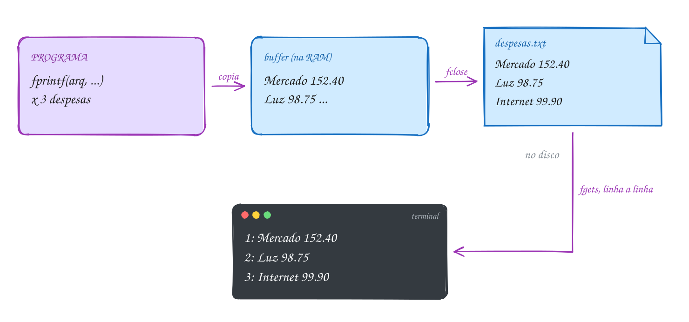
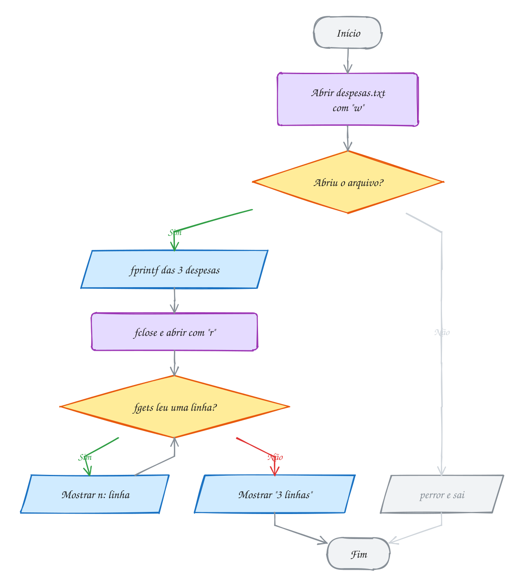
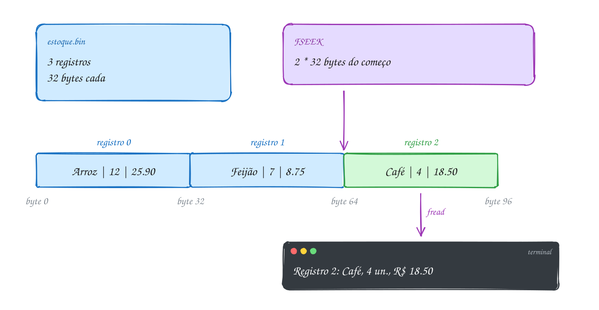
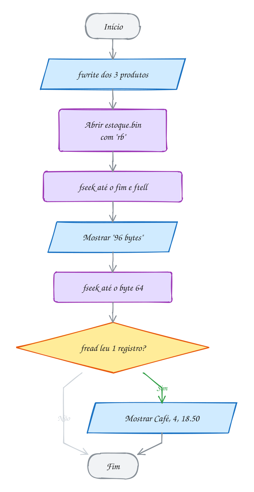
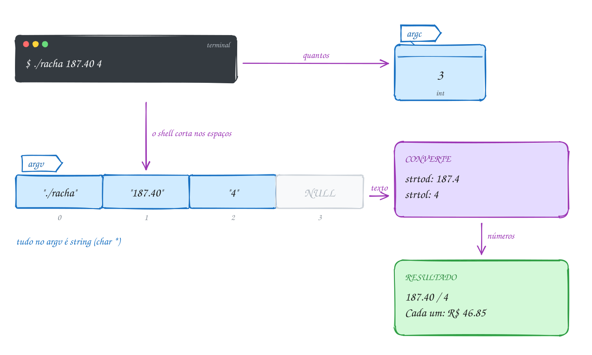
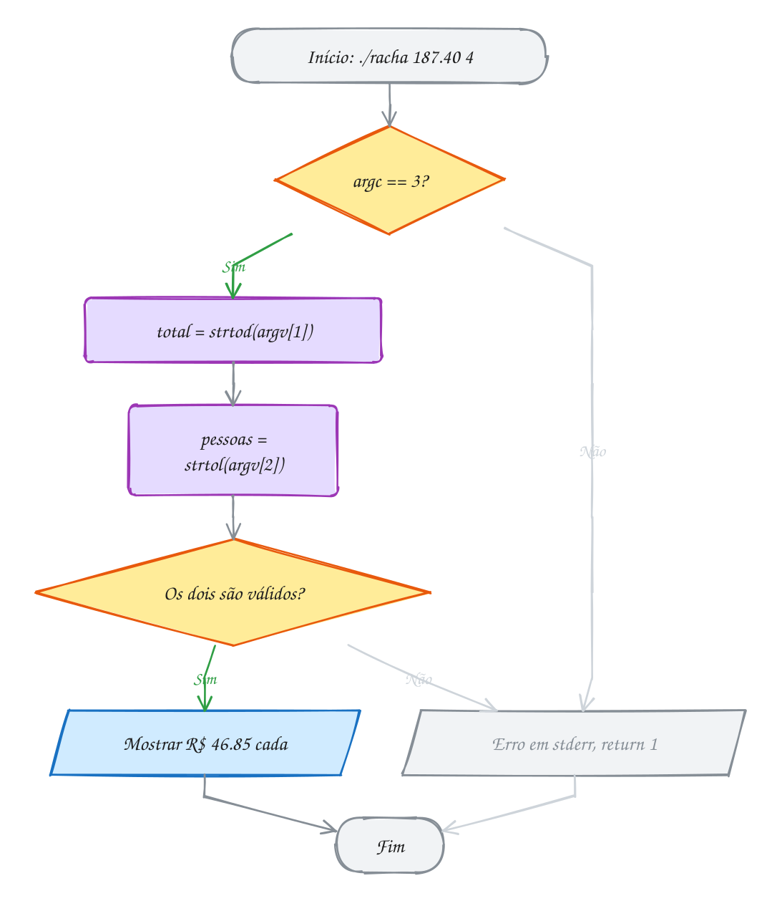
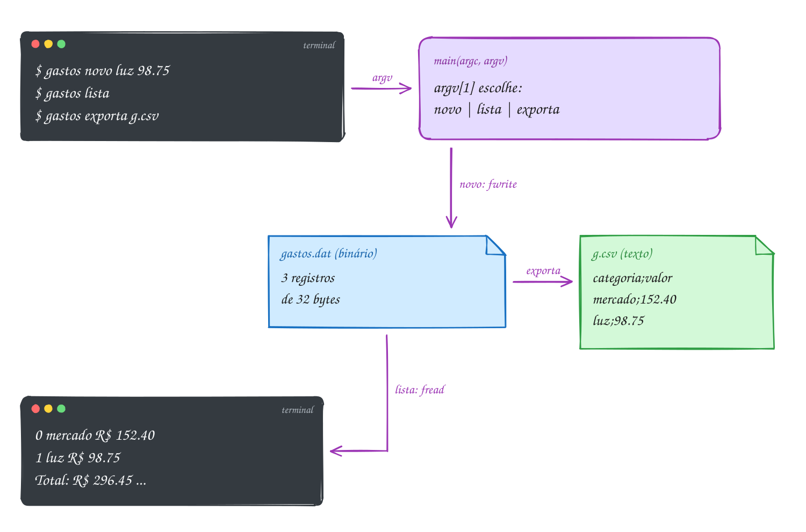
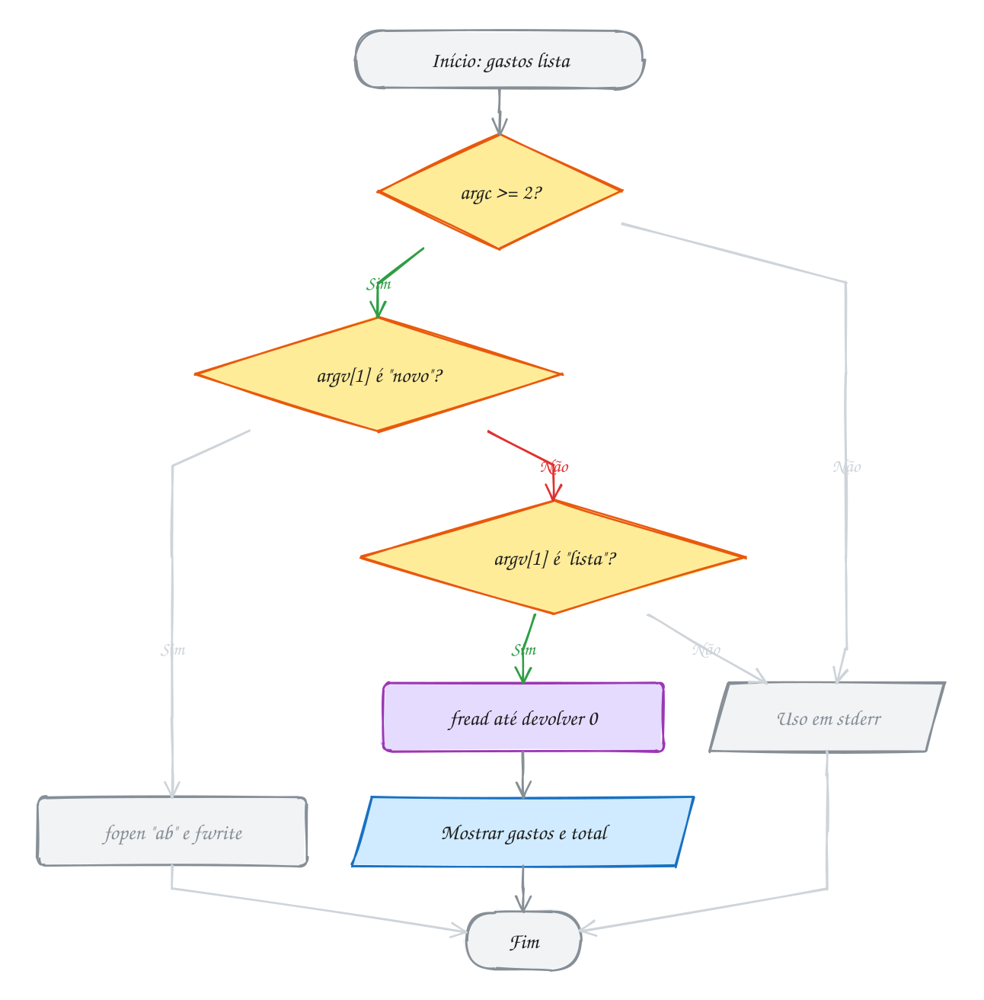

<!-- Gerado por _gerador. Para mudar este arquivo, edite _gerador/modulos/09-arquivos/ e rode: cd _gerador && npm run gerar -->

# Módulo 09 · Arquivos e linha de comando

Até aqui, todo programa do curso nasce, faz a conta e morre levando tudo
junto. As variáveis moram na RAM, e a RAM é esvaziada quando o processo
termina. Para um programa **lembrar** de alguma coisa (um cadastro, uma
configuração, o placar de ontem), ele precisa gravar em **arquivo**.

No C você vê as engrenagens: o `FILE *` que representa o
arquivo aberto, o buffer que junta os bytes antes de ir para o disco, a
posição que anda a cada leitura. E aparece uma escolha importante:
gravar **texto**, legível e portável, ou **binário**, a cópia exata dos bytes
da memória, compacta e com acesso direto a qualquer registro.

O módulo fecha com a outra porta de entrada de um programa: os **argumentos
da linha de comando**. É o que transforma os seus exercícios em ferramentas de
verdade, do tipo que você chama no terminal como chama `git` ou `grep`, e que
encadeia com outras em scripts.

## O que você vai aprender

- abrir, escrever, ler e fechar **arquivos texto** com `fopen`, `fprintf`, `fgets`, `fscanf`, `fgetc` e `fclose`
- os modos `"r"`, `"w"` e `"a"`, o **buffer** e por que nunca usar `while (!feof(f))`
- gravar e ler **arquivos binários** com `fwrite` e `fread`, e pular direto para um registro com `fseek` e `ftell`
- quando escolher texto e quando escolher binário
- receber dados pelo **`argc` e `argv`**, converter com `strtol` e `strtod` e devolver o **código de saída**
- juntar tudo numa ferramenta de terminal com subcomandos

## Como estudar cada assunto

1. Leia o texto e olhe o **diagrama da ideia**: é o exemplo desenhado.
2. Leia o código. É o mesmo exemplo, com os mesmos valores.
3. Siga o **fluxograma** com o dedo: é o caminho que o programa faz.
4. Rode os exemplos. Mude um valor, quebre de propósito, rode de novo.
5. Faça os exercícios. ★☆☆ é aquecimento, ★★☆ pede raciocínio, ★★★ é desafio.
   As dicas vêm logo abaixo do enunciado: tente antes de ler.

No meio de cada assunto tem uma **Pergunta para você**. Responda antes de rodar.

## As cores e as formas

<p align="center"></p>

## Antes de começar

Os exemplos gravam em `/tmp`, com nomes claros (`/tmp/despesas.txt`,
`/tmp/estoque.bin`), e quase todos apagam o arquivo no fim com `remove`.
Quando um deixa o arquivo lá de propósito, o comentário avisa, para você
abrir com `cat`. Nenhum exemplo depende de um arquivo que já exista: cada um
cria o que vai ler.

Para passar argumentos a um programa, escreva-os depois do caminho, no
`rodar`: ele repassa tudo para o programa.

```bash
~/LPEDC/rodar 09-arquivos/0069-argumentos/A137.c -r 7 -a 4
```

Duas ferramentas ajudam a enxergar o que os programas gravam: `od -A d -t x1
arquivo` mostra os bytes em hexadecimal (já vem no sistema), e o `strace`
mostra as chamadas ao sistema operacional, como cada `write` no disco:

```bash
sudo pacman -S strace       # Arch Linux
sudo apt install strace     # Debian / Ubuntu
```

Você vai usar structs (módulo 08), strings com `fgets` (0042) e ponteiros o
tempo todo. Se `typedef struct`, `sizeof` e `char *` ainda dão aquela
hesitação, revise antes.

| # | Assunto | Pasta |
| --- | --- | --- |
| [0067](#0067--arquivos-texto) | Arquivos texto | [`0067-arquivos-texto/`](0067-arquivos-texto/) |
| [0068](#0068--arquivos-binários) | Arquivos binários | [`0068-arquivos-binarios/`](0068-arquivos-binarios/) |
| [0069](#0069--argumentos-da-linha-de-comando) | Argumentos da linha de comando | [`0069-argumentos/`](0069-argumentos/) |
| [0070](#0070--juntando-tudo-a-caderneta-de-gastos) | Juntando tudo: a caderneta de gastos | [`0070-juntando-tudo/`](0070-juntando-tudo/) |

---

## 0067 · Arquivos texto

Todo mês você anota as despesas: mercado, luz, internet. Se anotar só de
cabeça, esquece. Se anotar no caderno, no mês que vem está tudo lá. Um
programa tem o mesmo problema: as variáveis moram na RAM e **somem quando ele
termina**. Para lembrar de alguma coisa na próxima execução, ele precisa
escrever num **arquivo**, que fica no disco.

No C, esse trabalho acontece em passos que você enxerga: **abrir**, **ler ou
escrever** e **fechar**. Tudo vem do `<stdio.h>`, o mesmo do `printf`.

Para o C, um arquivo é só uma **sequência de bytes** no disco. Num **arquivo
texto**, esses bytes são caracteres que você consegue ler no editor: o número
152.40 vira os caracteres `'1' '5' '2' '.' '4' '0'`. Quem dá sentido a eles é o
seu programa.

**Abrir.** `fopen(caminho, modo)` devolve um `FILE *`, um ponteiro para uma
struct que a biblioteca usa para controlar o arquivo aberto. Se não der para
abrir (pasta que não existe, sem permissão, disco cheio), devolve `NULL`. Por
isso todo `fopen` vem seguido de um `if`. O `perror("texto")` mostra o motivo
que o sistema deu, como `No such file or directory`.

| modo | o que faz | se o arquivo não existe | se já existe |
| --- | --- | --- | --- |
| `"r"` | só leitura | `fopen` devolve `NULL` | lê do começo |
| `"w"` | só escrita | cria vazio | **apaga tudo** e começa vazio |
| `"a"` | escrita no fim (*append*) | cria vazio | mantém e escreve depois do fim |
| `"r+"` `"w+"` `"a+"` | leitura e escrita | como `r`, `w` e `a` | como `r`, `w` e `a` |

**Escrever.** `fprintf(arq, ...)` é o `printf` com o arquivo na frente.
Também existem `fputs(texto, arq)` (uma string, sem pôr `\n`) e
`fputc(c, arq)` (um caractere).

**Ler.** Três jeitos, conforme o formato:

- `fgets(linha, tamanho, arq)`: uma **linha** inteira, com o `\n` no fim.
  Devolve `NULL` quando o arquivo acaba. É o mesmo `fgets` do assunto 0042, só
  que lendo do arquivo em vez do teclado.
- `fscanf(arq, "%s %lf", ...)`: campos com formato, como o `scanf`. Devolve
  quantos campos conseguiu ler.
- `fgetc(arq)`: um **caractere** por vez. Devolve um `int`, que vale `EOF` no
  fim.

**Fechar.** `fclose(arq)` termina a conversa com o arquivo: grava o que ainda
estava pendente e libera o `FILE`. Arquivo aberto é recurso emprestado, como
memória do `malloc`: abriu, fecha.

Você já usava arquivos sem saber: `stdin`, `stdout` e `stderr` são `FILE *`
que o programa recebe abertos. `printf("oi")` é o mesmo que
`fprintf(stdout, "oi")`.

Vamos ver na prática. O programa grava as três despesas do mês. Os
`fprintf` não vão direto para o disco: param num **buffer**, uma área na RAM.
O `fclose` descarrega o buffer em `despesas.txt`. Depois o programa abre o
arquivo de novo, em modo leitura, e o `fgets` traz as linhas de volta, uma
por vez:

<p align="center"></p>

O código grava em `/tmp/despesas.txt` e deixa o arquivo lá, para você abrir
com `cat`:

```c
#include <stdio.h>

int main(void) {
    const char *caminho = "/tmp/despesas.txt";

    FILE *arq = fopen(caminho, "w");          // "w": cria (ou apaga) o arquivo
    if (arq == NULL) {
        perror("Erro ao criar o arquivo");
        return 1;
    }
    fprintf(arq, "Mercado %.2f\n", 152.40);   // printf, mas no arquivo
    fprintf(arq, "Luz %.2f\n", 98.75);
    fprintf(arq, "Internet %.2f\n", 99.90);
    fclose(arq);                              // descarrega o buffer no disco

    arq = fopen(caminho, "r");                // agora para ler
    if (arq == NULL) {
        perror("Erro ao abrir o arquivo");
        return 1;
    }
    char linha[100];
    int n = 0;
    while (fgets(linha, sizeof linha, arq) != NULL) { // NULL = acabou
        n++;
        printf("%d: %s", n, linha);           // a linha já traz o '\n'
    }
    fclose(arq);

    printf("%d linhas em %s\n", n, caminho);
    return 0;
}
// Saída:
// 1: Mercado 152.40
// 2: Luz 98.75
// 3: Internet 99.90
// 3 linhas em /tmp/despesas.txt
```

Repara no fluxograma: a leitura é um laço que pergunta ao próprio `fgets` se
ele conseguiu ler. Quem diz que o arquivo acabou é a leitura que falhou, não
uma pergunta feita antes dela:

<p align="center"></p>

> [!WARNING]
> Você vai ver `while (!feof(arq))` em muito material, inclusive livro. Não use.
> O `feof` não olha adiante: ele só fica verdadeiro **depois** que uma leitura
> tentou passar do fim e falhou. Resultado: o laço roda uma vez a mais e
> processa a última linha duas vezes (o E401 mostra isso). Teste o retorno da
> leitura: `fgets(...) != NULL`, `fscanf(...) == 2`, `(c = fgetc(arq)) != EOF`.
> E nesse último, `c` é `int`: com `char`, o `EOF` (que vale -1) se confunde
> com um byte de verdade.

> [!TIP]
> **Por dentro do C:** a struct `FILE` guarda a posição atual no arquivo, os
> indicadores de erro e de fim e um **buffer** de alguns KB (no Linux, em
> geral 4096 bytes). Cada `fprintf` só copia bytes para esse buffer, na RAM. A
> entrega ao sistema operacional, uma chamada `write`, só acontece quando o
> buffer enche, quando você chama `fflush(arq)` ou no `fclose`. Salve o código
> acima como `despesas.c`, compile sem o sanitizer (`gcc despesas.c -o
> /tmp/despesas`, porque o ASan não gosta do `strace`) e rode
> `strace -e trace=write /tmp/despesas`: as três despesas saem num único
> `write` de 40 bytes (15 + 10 + 15). Se o programa cair antes do `fclose`, o
> que estava no buffer se perde.

> [!NOTE]
> **Pergunta para você:** rode o programa das despesas duas vezes seguidas. O arquivo fica com
> 3 ou com 6 linhas? E se o primeiro `fopen` usasse `"a"` em vez de `"w"`?

### Hora de praticar

Os arquivos ficam em [`0067-arquivos-texto/`](0067-arquivos-texto/). Os comandos funcionam de qualquer pasta do terminal. Nos exemplos, rode, mude, quebre e rode de novo. Nos exercícios, a resposta vai dentro do próprio arquivo. ★☆☆ é aquecimento, ★★☆ pede raciocínio e ★★★ é desafio.

**Exemplo A133 · A linha maior que o buffer**

```c
#include <stdio.h>
#include <string.h>

// O fgets nunca passa do tamanho que você dá: se a linha não cabe, ela chega
// em pedaços. Quem diz se a linha acabou é o '\n' no fim do pedaço.
int main(void) {
    const char *caminho = "/tmp/recados.txt";

    FILE *arq = fopen(caminho, "w");
    if (arq == NULL) {
        perror(caminho);
        return 1;
    }
    fputs("Pagar luz\n", arq);                         // 9 letras + '\n'
    fputs("Levar o carro na revisao de sabado\n", arq); // não cabe em 12
    fputs("Pix\n", arq);
    fclose(arq);

    arq = fopen(caminho, "r");
    if (arq == NULL) {
        perror(caminho);
        return 1;
    }
    char pedaco[12]; // cabem 11 caracteres + o '\0'
    int chamadas = 0;
    int linhas = 0;
    while (fgets(pedaco, sizeof pedaco, arq) != NULL) {
        chamadas++;
        size_t n = strlen(pedaco);
        int fim_da_linha = n > 0 && pedaco[n - 1] == '\n';
        if (fim_da_linha) {
            pedaco[n - 1] = '\0'; // tira o '\n' só para mostrar
            linhas++;
        }
        printf("fgets %d: [%s]%s\n", chamadas, pedaco,
               fim_da_linha ? " <- fim da linha" : "");
    }
    fclose(arq);
    remove(caminho);

    printf("%d chamadas do fgets, %d linhas\n", chamadas, linhas);
    return 0;
}
// Saída:
// fgets 1: [Pagar luz] <- fim da linha
// fgets 2: [Levar o car]
// fgets 3: [ro na revis]
// fgets 4: [ao de sabad]
// fgets 5: [o] <- fim da linha
// fgets 6: [Pix] <- fim da linha
// 6 chamadas do fgets, 3 linhas
```

```bash
~/LPEDC/rodar 09-arquivos/0067-arquivos-texto/A133.c
```

**Exemplo A134 · Acrescentar e somar**

```c
#include <stdio.h>

// Grava duas contas com "w", acrescenta uma terceira com "a" e depois lê tudo
// com fscanf para somar. No fim apaga o arquivo com remove.
int main(void) {
    const char *caminho = "/tmp/contas-do-mes.txt";

    FILE *arq = fopen(caminho, "w");
    if (arq == NULL) {
        perror(caminho);
        return 1;
    }
    fprintf(arq, "Aluguel 1200.00\n");
    fprintf(arq, "Academia 89.90\n");
    fclose(arq);

    arq = fopen(caminho, "a"); // "a": escreve no fim, sem apagar nada
    if (arq == NULL) {
        perror(caminho);
        return 1;
    }
    fprintf(arq, "Streaming 39.90\n");
    fclose(arq);

    arq = fopen(caminho, "r");
    if (arq == NULL) {
        perror(caminho);
        return 1;
    }
    char nome[30];
    double valor;
    double total = 0.0;
    // fscanf devolve quantos campos conseguiu ler: 2 = linha completa
    while (fscanf(arq, "%29s %lf", nome, &valor) == 2) {
        printf("%-10s R$ %8.2f\n", nome, valor);
        total += valor;
    }
    fclose(arq);
    printf("%-10s R$ %8.2f\n", "Total", total);

    remove(caminho); // apaga o arquivo do disco
    return 0;
}
// Saída:
// Aluguel    R$  1200.00
// Academia   R$    89.90
// Streaming  R$    39.90
// Total      R$  1329.80
```

```bash
~/LPEDC/rodar 09-arquivos/0067-arquivos-texto/A134.c
```

#### Exercícios

**Exercício E397** · ★☆☆

Grave a tabuada do 7 no arquivo /tmp/tabuada7.txt, uma conta por linha,
usando fprintf. Feche o arquivo, abra de novo em modo leitura e mostre o
conteúdo na tela com fgets. Confira se o fopen deu certo nas duas vezes.


```text
Saída esperada:
7 x 1 = 7
7 x 2 = 14
...
7 x 10 = 70
```

**Dicas:**

1. Um for de 1 a 10 com fprintf(arq, "7 x %d = %d\n", i, 7 * i).
2. Para ler: while (fgets(linha, sizeof linha, arq) != NULL) printf("%s", linha);
3. Resposta esperada: as 10 linhas da tabuada, de "7 x 1 = 7" até
   "7 x 10 = 70". O arquivo fica em /tmp: confira com cat /tmp/tabuada7.txt.

```bash
~/LPEDC/rodar 09-arquivos/0067-arquivos-texto/E397.c
```

**Exercício E398** · ★☆☆

O programa abre o MESMO arquivo quatro vezes, alternando os modos "w" e
"a", e grava um nome em cada vez. A função grava já está pronta. Escreva a
função mostra, que abre o arquivo para leitura, lê linha por linha com
fgets e imprime todos os nomes na mesma linha, separados por espaço.
Depois chame mostra logo após cada grava no main, para enxergar o que cada
modo fez com o arquivo:


```text
Saída esperada:
w Ana  -> Ana
a Bia  -> Ana Bia
w Caio -> Caio
a Duda -> Caio Duda
```

**Dicas:**

1. "w" cria o arquivo vazio, apagando o que já existia; "a" escreve depois
   do último byte, sem apagar nada.
2. Para imprimir o nome sem o '\n' que o fgets traz, troque o '\n' por
   '\0': linha[strcspn(linha, "\n")] = '\0'; (strcspn é de <string.h>).
3. Resposta esperada: as quatro linhas acima. Ana e Bia somem quando o
   terceiro fopen abre com "w".

```bash
~/LPEDC/rodar 09-arquivos/0067-arquivos-texto/E398.c
```

**Exercício E399** · ★★☆

Faça um "wc" caseiro. Primeiro, grave em /tmp/recado.txt exatamente estas
três linhas (cada uma termina com '\n'):


```text
Feira no domingo
leve sacolas
e o dinheiro do pastel
```


Depois, abra o arquivo para leitura e leia caractere por caractere com
fgetc, contando linhas, palavras e caracteres (bytes). Mostre:


```text
Linhas: 3
Palavras: 10
Caracteres: 53
```

**Dicas:**

1. A variável que recebe o fgetc precisa ser int, não char: o EOF não é um
   caractere, é um valor fora da faixa de 0 a 255.
2. Cada '\n' é uma linha. Uma palavra começa quando você estava fora de
   palavra e chega num caractere que não é espaço nem '\n' (use isspace de
   <ctype.h> e uma flag dentro_palavra).
3. Resposta esperada: Linhas: 3, Palavras: 10, Caracteres: 53 (16 + 12 + 22
   letras e espaços, mais os 3 '\n'). Confira com: wc /tmp/recado.txt

```bash
~/LPEDC/rodar 09-arquivos/0067-arquivos-texto/E399.c
```

**Exercício E400** · ★★☆

Complete o programa. A parte que cria o arquivo /tmp/turma.txt já está
pronta: cada linha tem o nome do aluno e duas notas. Falta a leitura: use
fscanf num laço que pare quando a linha não vier completa, calcule a média
de cada um e mostre a situação (aprovado com média >= 7.0). No fim, mostre
a média da turma.


```text
Saída esperada:
Bruna    média 8.25  aprovada(o)
Diego    média 5.50  reprovada(o)
Lia      média 7.00  aprovada(o)
Média da turma: 6.92
```

**Dicas:**

1. fscanf(arq, "%19s %lf %lf", nome, &n1, &n2) devolve 3 quando leu a
   linha inteira. Use "== 3" como condição do while.
2. Para a média da turma, acumule as médias e conte os alunos.
3. Resposta esperada: Bruna 8.25, Diego 5.50, Lia 7.00, turma 6.92
   (20.75 / 3 = 6.9166...).

```bash
~/LPEDC/rodar 09-arquivos/0067-arquivos-texto/E400.c
```

**Exercício E401** · ★★★

Este programa compila sem aviso e roda sem erro do sanitizer, mas a conta
sai errada. Ele grava três Pix recebidos (R$ 50, R$ 30 e R$ 20) e depois
soma. Rode e veja:


```text
Pix: 50.00
Pix: 30.00
Pix: 20.00
Pix: 20.00
Total: 120.00
```


O último Pix aparece duas vezes. Conserte o laço e rode de novo: a saída
tem que mostrar só os três Pix e Total: 100.00.

**Dicas:**

1. O feof só fica verdadeiro DEPOIS que uma leitura tenta passar do fim e
   falha. Ele não "olha adiante".
2. Depois de ler o 20, ainda sobra o '\n': o feof continua falso. A quarta
   chamada do fscanf falha, não mexe em valor (que ainda vale 20) e o código
   soma assim mesmo.
3. Resposta esperada: troque o while (!feof(arq)) por
   while (fscanf(arq, "%lf", &valor) == 1) { ... } e tire o fscanf de
   dentro do laço. Saída: os três Pix e Total: 100.00.

```bash
~/LPEDC/rodar 09-arquivos/0067-arquivos-texto/E401.c
```

**Exercício E402** · ★★★

Lista de compras automática. O programa deve:

1. Criar /tmp/estoque.txt com estas linhas (produto e quantidade em casa):


```text
arroz 3
cafe 0
leite 8
ovos 2
sabao 6
```


2. Ler o estoque e, com os DOIS arquivos abertos ao mesmo tempo, gravar em
/tmp/comprar.txt só os produtos com menos de 5 unidades, já com quanto
falta para chegar a 5 ("arroz 2").
3. Fechar tudo, reabrir /tmp/comprar.txt e mostrar:


```text
Comprar:
- arroz: 2
- cafe: 5
- ovos: 3
3 itens na lista
```


Se o segundo fopen falhar, feche o primeiro arquivo antes de sair.

**Dicas:**

1. Abra entrada em "r" e saída em "w". Leia com
   while (fscanf(ent, "%29s %d", nome, &qtd) == 2).
2. if (qtd < 5) fprintf(sai, "%s %d\n", nome, 5 - qtd);
3. Na hora de mostrar, leia comprar.txt também com fscanf e conte os itens.
4. Resposta esperada: arroz 2, cafe 5, ovos 3 e "3 itens na lista".

```bash
~/LPEDC/rodar 09-arquivos/0067-arquivos-texto/E402.c
```

---

## 0068 · Arquivos binários

O mercadinho do bairro guarda o estoque em fichas de papel, todas do mesmo
tamanho, numa caixa. Para achar a terceira ficha, ninguém lê as duas
primeiras: mede com o dedo e puxa. Arquivo texto não deixa fazer isso, porque
cada linha tem um tamanho ("Luz 98.75" tem 9 caracteres, "Internet 99.90" tem
14). Para cair na linha 500, você precisa ler as 499 antes.

Um **arquivo binário** resolve isso. Em vez de converter os dados em texto,
ele grava os bytes **exatamente como estão na memória**. Um `int` sempre ocupa
4 bytes no arquivo, uma struct sempre ocupa `sizeof` da struct. Com
**registros de tamanho fixo**, a posição de qualquer um vira conta: o
registro `i` começa no byte `i * sizeof(registro)`.

Em resumo: texto é legível e maior; binário é compacto e ilegível.

| | texto (`fprintf`) | binário (`fwrite`) |
| --- | --- | --- |
| o `int` 12345678 | 8 bytes: `'1' '2' ... '8'` | 4 bytes: `4E 61 BC 00` |
| abre no editor? | sim | vira lixo na tela |
| converte na ida e na volta? | sim (mais lento) | não, só copia bytes |
| acesso direto ao registro `i`? | não | sim, com `fseek` |
| lê em outra máquina? | sim | só se `int`, alinhamento e ordem dos bytes forem iguais |

As ferramentas:

- **Modo com `b`**: `"wb"`, `"rb"`, `"ab"`, `"rb+"`. No Linux e no Mac o `b`
  não muda nada; no Windows, sem ele, a biblioteca troca `\n` por `\r\n` e
  estraga os bytes. Escreva sempre.
- **`fwrite(endereco, tamanho, quantidade, arq)`** copia `tamanho *
  quantidade` bytes a partir do endereço. Variável e struct vão com `&`; vetor
  já é endereço. Devolve **quantos itens** gravou.
- **`fread(endereco, tamanho, quantidade, arq)`** faz o caminho de volta e
  também devolve quantos itens leu. Menos que o pedido quer dizer fim do
  arquivo ou erro. É esse retorno que vai no `while`.
- **`fseek(arq, deslocamento, origem)`** muda a posição de leitura e escrita.
  A origem é `SEEK_SET` (do começo), `SEEK_CUR` (de onde está) ou `SEEK_END`
  (do fim). O deslocamento é `long` e pode ser negativo.
- **`ftell(arq)`** diz a posição atual em bytes e **`rewind(arq)`** volta ao
  byte 0. `fseek` até o fim seguido de `ftell` é o jeito clássico de medir o
  arquivo.

Vamos ver na prática. O estoque tem três produtos, e cada `Produto` ocupa 32
bytes. Um `fwrite` grava os três em sequência: 96 bytes. Para ler o café, o
programa pula 2 × 32 = 64 bytes desde o começo e faz um `fread` de um
registro só:

<p align="center"></p>

O arquivo fica em `/tmp/estoque.bin` e é apagado no fim:

```c
#include <stdio.h>

typedef struct {
    char nome[20];
    int qtd;
    double preco;
} Produto;

int main(void) {
    const char *caminho = "/tmp/estoque.bin";
    Produto estoque[3] = {
        {"Arroz", 12, 25.90},
        {"Feijão", 7, 8.75},
        {"Café", 4, 18.50},
    };

    FILE *arq = fopen(caminho, "wb");
    if (arq == NULL) {
        perror(caminho);
        return 1;
    }
    size_t gravados = fwrite(estoque, sizeof(Produto), 3, arq); // vetor: sem &
    fclose(arq);
    printf("Cada registro: %zu bytes\n", sizeof(Produto));
    printf("Gravados: %zu registros\n", gravados);

    arq = fopen(caminho, "rb");
    if (arq == NULL) {
        perror(caminho);
        return 1;
    }
    fseek(arq, 0, SEEK_END);                    // vai para o fim...
    printf("Arquivo: %ld bytes\n", ftell(arq)); // ...e pergunta a posição

    Produto p;
    fseek(arq, 2 * sizeof(Produto), SEEK_SET);  // byte 64: começo do registro 2
    if (fread(&p, sizeof(Produto), 1, arq) == 1) {
        printf("Registro 2: %s, %d un., R$ %.2f\n", p.nome, p.qtd, p.preco);
    }
    fclose(arq);
    remove(caminho);
    return 0;
}
// Saída:
// Cada registro: 32 bytes
// Gravados: 3 registros
// Arquivo: 96 bytes
// Registro 2: Café, 4 un., R$ 18.50
```

Repara no fluxograma: não tem laço nenhum para chegar ao café. São duas
chamadas de `fseek` e um `fread`, quer o arquivo tenha 3 registros, quer tenha
3 milhões:

<p align="center"></p>

> [!WARNING]
> `fwrite` copia bytes, não "dados". Se a struct tiver um ponteiro
> (`char *nome` em vez de `char nome[20]`), o arquivo guarda o **endereço**,
> não o texto. Na próxima execução esse endereço não aponta para nada. Para
> gravar em binário, use vetores de tamanho fixo dentro da struct. E não
> confie que um `.bin` gravado num PC vai ser lido igual num celular ou num
> microcontrolador: tamanho do `int`, alinhamento e ordem dos bytes podem
> mudar. Para trocar dados entre máquinas, prefira texto (CSV, JSON).

> [!TIP]
> **Por dentro do C:** salve o código acima como `estoque.c`, tire o `remove`, rode e depois
> `od -A d -t x1 /tmp/estoque.bin` (ou `xxd`, se tiver). Cada linha mostra 16
> bytes, então cada produto ocupa duas linhas.
> Você vai ver `Arroz` seguido de zeros: o `fwrite` grava os 20 bytes do vetor
> `nome`, usados ou não. Logo depois vem `0c 00 00 00`, o 12 da `qtd` em
> little-endian, e os 8 bytes do `double`. Aqui 20 + 4 + 8 dá exatamente 32,
> sem enchimento, porque o `double` já cai num endereço múltiplo de 8. E o
> `fseek` não lê nada: só troca um número dentro do `FILE` (e no sistema
> operacional). Por isso pular para o registro 2 custa o mesmo que pular para
> o registro 2 milhões.

> [!NOTE]
> **Pergunta para você:** se `nome` fosse `char nome[21]`, quanto daria
> `sizeof(Produto)`? Lembre que o `int` gosta de começar em múltiplo de 4 e o
> `double` em múltiplo de 8. Responda e depois confira com um `printf`.

### Hora de praticar

Os arquivos ficam em [`0068-arquivos-binarios/`](0068-arquivos-binarios/). Os comandos funcionam de qualquer pasta do terminal. Nos exemplos, rode, mude, quebre e rode de novo. Nos exercícios, a resposta vai dentro do próprio arquivo. ★☆☆ é aquecimento, ★★☆ pede raciocínio e ★★★ é desafio.

**Exemplo A135 · Ler em lotes: o retorno do fread**

```c
#include <stdio.h>

// O fread devolve quantos itens leu de verdade. Pedindo 3 de cada vez num
// arquivo com 7, vêm 3, 3, 1 e depois 0. O último lote vem incompleto, e é o
// retorno (não o tamanho do vetor) que diz quantos valem.
int main(void) {
    const char *caminho = "/tmp/passos.bin";
    int passos[7] = {8200, 10450, 6300, 12010, 9800, 4100, 11500}; // da semana

    FILE *arq = fopen(caminho, "wb");
    if (arq == NULL) {
        perror(caminho);
        return 1;
    }
    fwrite(passos, sizeof(int), 7, arq);
    fclose(arq);

    arq = fopen(caminho, "rb");
    if (arq == NULL) {
        perror(caminho);
        return 1;
    }
    int lote[3];
    size_t lidos;
    long total = 0;
    int dia = 1;
    while ((lidos = fread(lote, sizeof(int), 3, arq)) > 0) {
        printf("Pedi 3, vieram %zu:", lidos);
        for (size_t i = 0; i < lidos; i++) { // só os que vieram
            printf(" dia %d=%d", dia, lote[i]);
            total += lote[i];
            dia++;
        }
        printf("\n");
    }
    printf("Pedi 3, vieram 0: fim (feof = %d)\n", feof(arq) != 0);

    // fseek para depois do fim não dá erro, mas o fread não acha nada
    fseek(arq, 100 * (long) sizeof(int), SEEK_SET);
    long posicao = ftell(arq);
    int x = -1;
    size_t r = fread(&x, sizeof x, 1, arq);
    printf("No byte %ld: fread devolveu %zu, x continua %d\n", posicao, r, x);
    fclose(arq);
    remove(caminho);

    printf("Total da semana: %ld passos\n", total);
    return 0;
}
// Saída:
// Pedi 3, vieram 3: dia 1=8200 dia 2=10450 dia 3=6300
// Pedi 3, vieram 3: dia 4=12010 dia 5=9800 dia 6=4100
// Pedi 3, vieram 1: dia 7=11500
// Pedi 3, vieram 0: fim (feof = 1)
// No byte 400: fread devolveu 0, x continua -1
// Total da semana: 62360 passos
```

```bash
~/LPEDC/rodar 09-arquivos/0068-arquivos-binarios/A135.c
```

**Exemplo A136 · O mesmo número em texto e em binário**

```c
#include <stdio.h>

// Mostra o tamanho do arquivo e cada byte dele em hexadecimal
void mostrar_bytes(const char *caminho) {
    FILE *arq = fopen(caminho, "rb");
    if (arq == NULL) {
        perror(caminho);
        return;
    }
    fseek(arq, 0, SEEK_END);
    long tamanho = ftell(arq);
    rewind(arq); // volta para o byte 0

    printf("%-18s %ld bytes:", caminho, tamanho);
    int c;
    while ((c = fgetc(arq)) != EOF) {
        printf(" %02X", c);
    }
    printf("\n");
    fclose(arq);
}

int main(void) {
    int codigo = 12345678;

    FILE *txt = fopen("/tmp/codigo.txt", "w");
    FILE *bin = fopen("/tmp/codigo.bin", "wb");
    if (txt == NULL || bin == NULL) {
        perror("fopen");
        if (txt != NULL) fclose(txt);
        if (bin != NULL) fclose(bin);
        return 1;
    }
    fprintf(txt, "%d", codigo);               // vira os caracteres '1' '2' ... '8'
    fwrite(&codigo, sizeof codigo, 1, bin);   // copia os 4 bytes do int
    fclose(txt);
    fclose(bin);

    mostrar_bytes("/tmp/codigo.txt");
    mostrar_bytes("/tmp/codigo.bin");

    // ler de volta o binário: os 4 bytes voltam direto para um int
    int lido = 0;
    bin = fopen("/tmp/codigo.bin", "rb");
    if (bin != NULL) {
        if (fread(&lido, sizeof lido, 1, bin) == 1) {
            printf("Lido do binário: %d\n", lido);
        }
        fclose(bin);
    }
    remove("/tmp/codigo.txt");
    remove("/tmp/codigo.bin");
    return 0;
}
// Saída:
// /tmp/codigo.txt    8 bytes: 31 32 33 34 35 36 37 38
// /tmp/codigo.bin    4 bytes: 4E 61 BC 00
// Lido do binário: 12345678
```

```bash
~/LPEDC/rodar 09-arquivos/0068-arquivos-binarios/A136.c
```

#### Exercícios

**Exercício E403** · ★☆☆

Uma estação meteorológica registrou as máximas da semana útil:
31, 29, 33, 35 e 30 graus. Grave o vetor inteiro em /tmp/maximas.bin com
UM fwrite. Depois leia tudo de volta, com UM fread, para outro vetor,
confira se vieram os 5 valores e mostre a média.


```text
Saída esperada:
Lidos: 5 valores
Média: 31.6 graus
```

**Dicas:**

1. fwrite(maximas, sizeof(int), 5, arq): o vetor já é um endereço, sem &.
2. fread devolve quantos itens leu. Se for menor que 5, algo deu errado.
3. Resposta esperada: Lidos: 5 valores e Média: 31.6 graus (158 / 5).

```bash
~/LPEDC/rodar 09-arquivos/0068-arquivos-binarios/E403.c
```

**Exercício E404** · ★☆☆

O arquivo /tmp/quatro.bin já está gravado com 4 ints em binário: 10, 20,
30 e 40 (cada int ocupa 4 bytes). Complete o programa: antes de cada
fread, escreva UM fseek que leve o arquivo até o int certo, para a saída
ficar exatamente assim:


```text
Saída esperada:
a) 30, agora na posição 12
b) 20, agora na posição 8
c) 40, agora na posição 16
d) 10, agora na posição 4
```


Use uma origem diferente em cada um: SEEK_SET em a), SEEK_CUR em b),
SEEK_END em c) e d) com rewind(arq) no lugar do fseek.

**Dicas:**

1. SEEK_SET conta do começo, SEEK_CUR da posição atual e SEEK_END do fim.
   O deslocamento pode ser negativo.
2. Cada fread de um int anda 4 bytes para a frente: depois de a) você está
   no byte 12. Para chegar ao 20 (byte 4), volte 8.
3. Resposta esperada: a) fseek(arq, 8, SEEK_SET); b) fseek(arq, -8,
   SEEK_CUR); c) fseek(arq, -4, SEEK_END); d) rewind(arq). A saída fica
   igual à de cima.

```bash
~/LPEDC/rodar 09-arquivos/0068-arquivos-binarios/E404.c
```

**Exercício E405** · ★★☆

Atualizar um registro no meio do arquivo, sem reescrever o resto. O
arquivo /tmp/contas.bin tem 3 contas (número e saldo). Complete a função
depositar: ela abre o arquivo em "rb+" (ler e escrever sem apagar), vai
até o registro da posição pedida, lê, soma o valor ao saldo, volta para o
começo do mesmo registro e grava por cima. Devolve 1 se deu certo e 0 se
não.

O main deposita R$ 100.00 na conta da posição 1 e lista tudo de novo:


```text
Antes:
1001  R$   250.00
1002  R$    80.50
1003  R$  1200.00
Depois:
1001  R$   250.00
1002  R$   180.50
1003  R$  1200.00
```

**Dicas:**

1. Posição do registro i: i * sizeof(Conta). Use fseek com SEEK_SET.
2. Depois do fread, o arquivo está no FIM do registro. Para gravar por cima,
   volte: fseek(arq, -(long) sizeof(Conta), SEEK_CUR).
3. Entre uma leitura e uma escrita no mesmo FILE, o C exige um fseek (ou
   fflush). A volta da dica 2 já resolve isso.
4. Resposta esperada: só a conta 1002 muda, de 80.50 para 180.50.

```bash
~/LPEDC/rodar 09-arquivos/0068-arquivos-binarios/E405.c
```

**Exercício E406** · ★★☆

Escreva a função


```text
long contar_registros(const char *caminho, size_t tamanho_registro);
```


que descobre quantos registros um arquivo binário tem SEM ler nenhum
deles: só olhando o tamanho do arquivo. Se não conseguir abrir, devolve -1.

No main, grave em /tmp/notas.bin as notas de 7 alunos num vetor de
struct { int matricula; float nota; } (os valores são livres), feche, e
mostre:


```text
Tamanho do registro: 8 bytes
Registros em /tmp/notas.bin: 7
Registros em /tmp/nao-existe.bin: -1
```

**Dicas:**

1. fseek(arq, 0, SEEK_END) e depois ftell(arq) dão o tamanho em bytes.
2. Registros = tamanho / tamanho_registro.
3. sizeof de int + float = 4 + 4 = 8 bytes, sem sobra de alinhamento.
4. Resposta esperada: 8 bytes, 7 registros (56 / 8) e -1 para o arquivo
   que não existe.

```bash
~/LPEDC/rodar 09-arquivos/0068-arquivos-binarios/E406.c
```

**Exercício E407** · ★★★

Este programa deveria salvar as 5 leituras de um medidor de água e lê-las
de volta. Ele compila sem aviso e roda sem erro do sanitizer, mas mostra:


```text
Leituras: 112 98 0 0 0
```


em vez de "Leituras: 112 98 105 120 101". Tem DOIS problemas:

a) um que faz o arquivo ficar com menos bytes do que devia;
b) um que esconde o problema em vez de avisar.

Conserte os dois e rode de novo: a saída tem que mostrar as 5 leituras.

**Dicas:**

1. Dentro de salvar, v é um int *, não um vetor. Quanto vale sizeof(v)?
2. Quantos bytes o arquivo tem depois de salvar? E quantos itens o fread
   devolveu?
3. Resposta esperada: a) sizeof(v) é o tamanho do PONTEIRO (8 bytes), então
   só 2 ints foram gravados. O certo é fwrite(v, sizeof(int), n, arq) (ou
   sizeof *v). b) O main ignora o retorno do fread, que foi 2, e mostra os
   zeros da inicialização como se fossem leituras. Confira se fread
   devolveu 5 e avise se não.

```bash
~/LPEDC/rodar 09-arquivos/0068-arquivos-binarios/E407.c
```

**Exercício E408** · ★★★

O extrato do banco mostra os lançamentos mais recentes primeiro. Grave em
/tmp/extrato.bin estes 6 lançamentos, nesta ordem (do mais antigo para o
mais novo), como registros de struct { char descricao[24]; double valor; }:


```text
Salário      +3500.00
Aluguel      -1200.00
Mercado       -387.60
Pix da Ana     +45.00
Farmácia       -62.30
Padaria        -18.90
```


Depois, SEM carregar o arquivo inteiro na memória (um registro por vez),
mostre os 3 últimos, do mais novo para o mais antigo, e o saldo de TODOS os
lançamentos:


```text
Últimos lançamentos:
Padaria           -18.90
Farmácia         -62.30
Pix da Ana        +45.00
Saldo: R$ 1876.20
```

**Dicas:**

1. O registro k contado do fim (k = 1 é o último) começa em
   -k * sizeof(registro) a partir de SEEK_END. Cuidado: sizeof é unsigned;
   converta para long antes de pôr o sinal de menos.
2. Para o saldo, rewind(arq) e um while (fread(...) == 1) somando.
3. printf("%+.2f", x) mostra o sinal + nos positivos. Acentos ocupam mais de
   um byte e bagunçam o alinhamento do %-15s; não se preocupe com isso.
4. Resposta esperada: Padaria, Farmácia, Pix da Ana, e Saldo: R$ 1876.20.

```bash
~/LPEDC/rodar 09-arquivos/0068-arquivos-binarios/E408.c
```

---

## 0069 · Argumentos da linha de comando

Fim do rodízio de pizza, conta de R$ 187,40 para 4 pessoas. Você poderia
fazer um programa que pergunta "qual o total?" e "quantas pessoas?" com
`scanf`. Mas os programas de terminal que você usa todo dia não perguntam
nada: `git commit -m "msg"`, `cp origem destino`, `gcc -o prog prog.c`. Os dados vão
**junto do comando**, na mesma linha. São os **argumentos da linha de
comando**.

No C, eles chegam como parâmetros do `main`, que até agora você escrevia com `void`:

```c
int main(int argc, char *argv[])
```

- **`argc`** (*argument count*): quantos itens vieram, **contando o nome do
  programa**. Sempre vale pelo menos 1.
- **`argv`** (*argument vector*): um vetor de `char *`, uma string para cada
  item. `argv[0]` é o nome (ou o caminho) do programa, `argv[1]` é o primeiro
  argumento seu, e `argv[argc]` é `NULL`, marcando o fim, do mesmo jeito que o
  `'\0'` marca o fim de uma string.

Quem corta a linha em pedaços é o **shell** (bash, zsh), antes de o programa
começar: ele separa nos espaços, tira as aspas e expande coringas como `*`.
`"São Paulo"` entre aspas chega como um argumento só; sem aspas, chega como
dois.

Tudo no `argv` é **texto**. O `4` chega como a string `"4"`, e
`argv[2] * 2` nem compila. Para virar número:

- **`strtol(texto, &fim, 10)`** converte para `long` e **`strtod(texto,
  &fim)`** para `double`. Os dois apontam `fim` para o primeiro caractere que
  não entrou na conversão. Se `*fim != '\0'`, sobrou lixo: `"4x"`, `"quatro"`.
- **`atoi`** e **`atof`** são mais curtos, mas não avisam nada:
  `atoi("quatro")` devolve 0 em silêncio. Servem para testes rápidos, não para
  entrada de usuário.

Duas convenções de todo programa de terminal. Mensagem de erro vai para
**`stderr`** (`fprintf(stderr, ...)`), não para `stdout`. Assim, quem redireciona
a saída para um arquivo (`./racha 10 2 > saida.txt`) continua vendo o erro na
tela. E o valor do `return` do `main` é o **código de saída**: 0 quer dizer
sucesso; qualquer outro, falha. O shell guarda esse valor em `$?`, e scripts e
o `&&` decidem o que fazer com base nele.

Vamos ver na prática. O comando `./racha 187.40 4` chega ao programa como
`argc = 3` e um `argv` com três strings mais o `NULL`. O programa confere a
quantidade, converte `argv[1]` e `argv[2]` em números e divide:

<p align="center"></p>

Salve o código como `racha.c`. Para passar argumentos com o `rodar`, escreva
depois do nome do arquivo: `~/LPEDC/rodar racha.c 187.40 4`.

```c
#include <stdio.h>
#include <stdlib.h>

int main(int argc, char *argv[]) {
    if (argc != 3) {
        fprintf(stderr, "Uso: %s <total> <pessoas>\n", argv[0]);
        return 1;                             // diferente de 0: deu errado
    }

    char *fim;
    double total = strtod(argv[1], &fim);     // texto -> double
    if (*fim != '\0' || total <= 0) {
        fprintf(stderr, "Total inválido: %s\n", argv[1]);
        return 1;
    }
    long pessoas = strtol(argv[2], &fim, 10); // texto -> inteiro, base 10
    if (*fim != '\0' || pessoas <= 0) {
        fprintf(stderr, "Número de pessoas inválido: %s\n", argv[2]);
        return 1;
    }

    printf("Conta: R$ %.2f\n", total);
    printf("Pessoas: %ld\n", pessoas);
    printf("Cada um: R$ %.2f\n", total / pessoas);
    return 0;
}
// $ rodar racha.c 187.40 4
// Conta: R$ 187.40
// Pessoas: 4
// Cada um: R$ 46.85
//
// $ rodar racha.c 187.40 quatro
// Número de pessoas inválido: quatro
```

Repara no fluxograma: antes de qualquer conta, duas perguntas de
desconfiança. Veio a quantidade certa de argumentos? Eles são números de
verdade? Só no caminho verde o programa trabalha:

<p align="center"></p>

> [!WARNING]
> Nunca toque em `argv[1]` sem conferir o `argc`. Se a pessoa rodar o programa
> sem argumentos, `argv[1]` é `NULL`, e `atoi(NULL)` ou `strlen(NULL)` derruba
> o programa (o E412 mostra isso). E cuidado com o `*` numa calculadora:
> `./calc 9 * 3` não passa um asterisco. O shell troca o `*` pelos nomes dos
> arquivos da pasta antes de o seu programa rodar. Use aspas (`'*'`) ou outro
> símbolo, como `x`.

> [!TIP]
> **Por dentro do C:** quem chama o `main` não é você. O sistema operacional
> monta a pilha do processo novo e copia as strings dos argumentos para o alto
> dela, uma atrás da outra, cada uma com o seu `'\0'`. Logo abaixo ficam os
> ponteiros que formam o vetor `argv`, terminado em `NULL`. O código de
> partida da biblioteca C (o `_start`, que o ligador põe no executável) conta
> os ponteiros, chama `main(argc, argv)` e passa o valor do `return` para o
> `exit`. Por isso `char *argv[]` e `char **argv` são a mesma coisa na lista
> de parâmetros: um vetor como parâmetro vira ponteiro, como no assunto 0038.

> [!NOTE]
> **Pergunta para você:** quanto vale `argc` em `./racha "187.40 4"`? E em
> `./racha 187.40 4 > conta.txt`? Pense em quem trata as aspas e o `>` antes
> de rodar o A138 para conferir.

### Hora de praticar

Os arquivos ficam em [`0069-argumentos/`](0069-argumentos/). Os comandos funcionam de qualquer pasta do terminal. Nos exemplos, rode, mude, quebre e rode de novo. Nos exercícios, a resposta vai dentro do próprio arquivo. ★☆☆ é aquecimento, ★★☆ pede raciocínio e ★★★ é desafio.

**Exemplo A137 · Opções com hífen**

```c
#include <stdio.h>
#include <stdlib.h>
#include <string.h>
#include <stdbool.h>

// Uma tabuada com opções, no estilo dos programas de terminal:
//   tabuada [-a ate] [-r] <numero>
// -a muda até onde vai (padrão 10) e precisa de um valor logo depois;
// -r mostra de trás para frente. As opções podem vir em qualquer ordem.
//
// Rode assim:  ~/LPEDC/rodar 09-arquivos/0069-argumentos/A137.c -r 7 -a 4

// converte texto em inteiro positivo; devolve 0 se não for
long positivo(const char *texto) {
    char *fim;
    long n = strtol(texto, &fim, 10);
    if (fim == texto || *fim != '\0' || n <= 0) {
        return 0;
    }
    return n;
}

int main(int argc, char *argv[]) {
    long numero = 0;
    long ate = 10;
    bool inverso = false;

    for (int i = 1; i < argc; i++) {
        if (strcmp(argv[i], "-r") == 0) {
            inverso = true;
        } else if (strcmp(argv[i], "-a") == 0) {
            if (i + 1 >= argc) { // -a era o último: falta o valor
                fprintf(stderr, "A opção -a precisa de um valor\n");
                return 1;
            }
            i++; // o valor é consumido aqui; o laço não olha para ele de novo
            ate = positivo(argv[i]);
            if (ate == 0) {
                fprintf(stderr, "Valor inválido para -a: %s\n", argv[i]);
                return 1;
            }
        } else if (argv[i][0] == '-') {
            fprintf(stderr, "Opção desconhecida: %s\n", argv[i]);
            return 1;
        } else {
            numero = positivo(argv[i]);
            if (numero == 0) {
                fprintf(stderr, "Número inválido: %s\n", argv[i]);
                return 1;
            }
        }
    }
    if (numero == 0) {
        fprintf(stderr, "Uso: %s [-a ate] [-r] <numero>\n", argv[0]);
        return 1;
    }

    for (long k = 1; k <= ate; k++) {
        long m = inverso ? ate - k + 1 : k;
        printf("%ld x %ld = %ld\n", numero, m, numero * m);
    }
    return 0;
}
// $ rodar A137.c -r 7 -a 4
// 7 x 4 = 28
// 7 x 3 = 21
// 7 x 2 = 14
// 7 x 1 = 7
//
// $ rodar A137.c 3 -a 2
// 3 x 1 = 3
// 3 x 2 = 6
//
// $ rodar A137.c 7 -a
// A opção -a precisa de um valor
//
// $ rodar A137.c 7 -x
// Opção desconhecida: -x
```

```bash
~/LPEDC/rodar 09-arquivos/0069-argumentos/A137.c
```

**Exemplo A138 · O que chega no argv**

```c
#include <stdio.h>
#include <string.h>

// Rode assim:  ~/LPEDC/rodar 09-arquivos/0069-argumentos/A138.c 10 -v "São Paulo" 3.5
int main(int argc, char *argv[]) {
    printf("argc = %d\n", argc);
    // argv[0] é o caminho do executável; os seus argumentos começam no 1
    for (int i = 1; i < argc; i++) {
        printf("argv[%d] = \"%s\" (%zu bytes)", i, argv[i], strlen(argv[i]));
        if (argv[i][0] == '-') {
            printf("  <- parece uma opção");
        }
        printf("\n");
    }
    // o vetor termina com um ponteiro NULL, como uma string termina em '\0'
    printf("argv[%d] é %s\n", argc, argv[argc] == NULL ? "NULL" : "outra coisa");
    return 0;
}
// $ rodar A138.c 10 -v "São Paulo" 3.5
// argc = 5
// argv[1] = "10" (2 bytes)
// argv[2] = "-v" (2 bytes)  <- parece uma opção
// argv[3] = "São Paulo" (10 bytes)
// argv[4] = "3.5" (3 bytes)
// argv[5] é NULL
```

```bash
~/LPEDC/rodar 09-arquivos/0069-argumentos/A138.c
```

#### Exercícios

**Exercício E409** · ★☆☆

Faça o seu próprio "echo": o programa mostra os argumentos recebidos, na
mesma linha, separados por um espaço (sem espaço sobrando no fim), e na
linha de baixo quantos foram. Sem argumentos, mostra só "0 argumentos".


```text
$ rodar E409.c bom dia Brasil
bom dia Brasil
3 argumentos
```

**Dicas:**

1. Os seus argumentos vão de argv[1] até argv[argc - 1].
2. Imprima o espaço ANTES de cada argumento, menos do primeiro.
3. Resposta esperada: "bom dia Brasil" e "3 argumentos" (argc vale 4,
   porque argv[0] também conta).

```bash
~/LPEDC/rodar 09-arquivos/0069-argumentos/E409.c
```

**Exercício E410** · ★☆☆

Escreva um programa que mostre, para cada argumento recebido, o texto, o
tamanho, o primeiro caractere e o que o atoi faz com ele. No começo,
mostre o argc; no fim, a soma de todos os atoi. Teste com:


```text
$ rodar E410.c 7 + 3a
argc = 4
argv[1] = "7": 1 caractere(s), começa com '7', atoi = 7
argv[2] = "+": 1 caractere(s), começa com '+', atoi = 0
argv[3] = "3a": 2 caractere(s), começa com '3', atoi = 3
Soma dos atoi: 10
```

**Dicas:**

1. Tudo no argv é string. argv[i][0] é o primeiro CARACTERE do argumento
   i, e strlen(argv[i]) dá o tamanho.
2. atoi lê enquanto encontra dígitos e para no primeiro que não é. Sem
   nenhum dígito, devolve 0. Ele não avisa nada em nenhum dos casos.
3. Resposta esperada: a saída acima. Repare que "+" e "3a" passaram sem
   nenhum aviso: é por isso que entrada de usuário pede strtol.

```bash
~/LPEDC/rodar 09-arquivos/0069-argumentos/E410.c
```

**Exercício E411** · ★★☆

As notas da prova chegam pela linha de comando. Mostre quantas notas
válidas vieram, a média, a maior e a menor. Argumento que não é número
(ou que está fora de 0 a 10) é ignorado com um aviso em stderr. Sem
nenhuma nota válida, mostre "Nenhuma nota válida" e devolva 1.


```text
$ rodar E411.c 8.5 7 nove 9.25 6 11
Ignorando "nove"
Ignorando "11"
Notas: 4
Média: 7.69
Maior: 9.25
Menor: 6.00
```

**Dicas:**

1. Use strtod(argv[i], &fim) e confira *fim == '\0' (e que fim andou: um
   argumento vazio "" também deixa *fim == '\0').
2. Comece maior e menor com a primeira nota válida, não com 0.
3. Resposta esperada: 4 notas, média 7.69 (30.75 / 4 = 7.6875), maior 9.25
   e menor 6.00.

```bash
~/LPEDC/rodar 09-arquivos/0069-argumentos/E411.c
```

**Exercício E412** · ★★☆

O programa deveria cumprimentar alguém um certo número de vezes:


```text
$ rodar E412.c Ana 3
Olá, Ana!
Olá, Ana!
Olá, Ana!
```


Mas, rodando assim, ele não mostra nada. E rodando sem argumentos
("rodar E412.c"), ele cai com SEGV no AddressSanitizer. São dois erros:

a) um índice errado no argv;
b) uma conferência que falta antes de usar o argv.

Conserte os dois e rode de novo com "Ana 3" e sem argumentos. Sem
argumentos (ou com um número de vezes que não é inteiro positivo), o
programa deve mostrar uma mensagem de uso em stderr e devolver 1.

**Dicas:**

1. Quem é argv[0]? O que atoi("Ana") devolve?
2. Sem argumentos, argc vale 1 e argv[1] é NULL. O que atoi(NULL) faz?
3. Resposta esperada: a) o nome está em argv[1] e as vezes em argv[2]; o
   código usava argv[0] (o caminho do programa) e argv[1] ("Ana", que o
   atoi vira 0, então o laço não roda); b) falta conferir argc != 3 antes
   de tocar no argv. Consertado, "rodar E412.c Ana 3" mostra Olá, Ana! três
   vezes.

```bash
~/LPEDC/rodar 09-arquivos/0069-argumentos/E412.c
```

**Exercício E413** · ★★★

Faça um "wc" de verdade: o nome do arquivo vem pela linha de comando. O
programa abre o arquivo, conta linhas, palavras e bytes e mostra no
formato abaixo. Se não vier exatamente um argumento, mostre o uso em
stderr e devolva 1. Se o arquivo não abrir, use perror com o nome dele e
devolva 1.

Para testar, crie um arquivo no terminal e passe o caminho:


```text
$ printf 'Oi, Ana\ntudo certo?\n\nAté amanhã\n' > /tmp/recado.txt
$ rodar E413.c /tmp/recado.txt
4 linhas, 6 palavras, 34 bytes em /tmp/recado.txt
```


```text
$ rodar E413.c /tmp/nao-existe.txt
/tmp/nao-existe.txt: No such file or directory
```

**Dicas:**

1. Aproveite a lógica do E399: fgetc com int, uma flag dentro_palavra e
   isspace.
2. "bytes", e não "letras": cada 'ã' e 'é' em UTF-8 ocupa 2 bytes. Por isso
   dá 34, e não 32. Confira com: wc /tmp/recado.txt
3. Resposta esperada: "4 linhas, 6 palavras, 34 bytes em /tmp/recado.txt"
   (a linha vazia conta como linha).

```bash
~/LPEDC/rodar 09-arquivos/0069-argumentos/E413.c
```

**Exercício E414** · ★★★

Calculadora de linha de comando: número, operador, número.


```text
$ rodar E414.c 12.5 + 7.5
12.50 + 7.50 = 20.00
$ rodar E414.c 9 x 3
9.00 x 3.00 = 27.00
$ rodar E414.c 10 / 0
Erro: divisão por zero
$ rodar E414.c 2 ^ 3
Erro: operador "^" desconhecido (use + - x /)
```


Regras: exatamente 3 argumentos (senão, uso em stderr); os dois números
validados com strtod; o operador tem que ter exatamente 1 caractere. Todo
erro vai para stderr e o programa devolve 1. Use um switch no operador.

Por que "x" e não "*"? Teste "rodar E414.c 9 * 3" sem aspas e descubra:
o shell troca o * pelos nomes dos arquivos da pasta ANTES de o programa
rodar. Com aspas ('*') funciona.

**Dicas:**

1. O operador é argv[2]. Confira strlen(argv[2]) == 1 e use argv[2][0] no
   switch.
2. Aceite também '*' no case do 'x' (para quem usar aspas).
3. Resposta esperada: as quatro saídas acima.

```bash
~/LPEDC/rodar 09-arquivos/0069-argumentos/E414.c
```

---

## 0070 · Juntando tudo: a caderneta de gastos

Fim de mês e a pergunta de sempre: para onde foi o dinheiro? Aplicativo de
finanças resolve, mas você agora tem tudo para fazer o seu, de terminal, do
jeito que os programas de linha de comando funcionam: um comando por
execução, com os dados guardados em arquivo entre uma execução e outra.

```bash
gastos novo mercado 152.40     # anota um gasto
gastos lista                   # mostra tudo e o total
gastos exporta /tmp/gastos.csv # gera uma planilha
gastos limpa                   # começa do zero
```

O programa junta as três peças do módulo, cada uma no papel em que é melhor:

- **argumentos** (0069): `argv[1]` diz **o que** fazer; os seguintes trazem
  os dados. É o mesmo desenho do `git` (`git commit`, `git log`): um
  programa, vários subcomandos. O `main` só confere o `argc` de cada comando e
  chama a função certa.
- **arquivo binário** (0068): a caderneta em si. Cada gasto é um registro
  `Gasto` de tamanho fixo, gravado com `fwrite` em modo `"ab"`: binário e
  sempre no fim, sem precisar ler o que já existe. Como os registros têm o
  mesmo tamanho, `ftell / sizeof(Gasto)` diz quantos já existem.
- **arquivo texto** (0067): a exportação. O binário é ótimo para o programa,
  mas ninguém abre um `.dat` na planilha. O `exporta` lê os registros e
  escreve um **CSV** com `fprintf`, separado por `;`, que o LibreOffice e o
  Google Planilhas abrem direto.

Três cuidados que valem para todo programa que guarda dados. **Valide antes de
gravar**: um `strtod` com `*fim != '\0'` impede que "abc" entre na caderneta
como R$ 0,00. **Não grave lixo**: o `memset` zera o vetor `categoria` antes
do `strncpy`, então os bytes que sobram no arquivo são zeros, e não restos da
pilha. **Arquivo que não existe não é erro** em toda situação: no `lista`,
quer dizer só "nenhum gasto ainda".

Vamos ver na prática. Cada linha do terminal é uma execução separada do
programa. O `novo` acrescenta um registro de 32 bytes em `gastos.dat`; o
`lista` lê os registros de volta com `fread`; o `exporta` transforma o binário
em texto:

<p align="center"></p>

O programa é longo, mas cada função cabe na cabeça:
`novo`, `lista` e `exporta` são os exemplos dos três assuntos anteriores, e o
`main` é só o despachante. Para rodar, salve como `gastos.c`.

```c
#include <stdio.h>
#include <stdlib.h>
#include <string.h>

#define ARQUIVO "/tmp/gastos.dat"

typedef struct {
    char categoria[20];
    double valor;
} Gasto;

void uso(const char *programa) {
    fprintf(stderr, "Uso: %s novo <categoria> <valor>\n", programa);
    fprintf(stderr, "     %s lista | exporta <arquivo.csv> | limpa\n", programa);
}

int novo(const char *categoria, const char *texto_valor) {
    Gasto g;
    char *fim;
    g.valor = strtod(texto_valor, &fim);
    if (*fim != '\0' || g.valor <= 0) {
        fprintf(stderr, "Valor inválido: %s\n", texto_valor);
        return 1;
    }
    memset(g.categoria, 0, sizeof g.categoria);          // sem lixo no arquivo
    strncpy(g.categoria, categoria, sizeof g.categoria - 1);

    FILE *arq = fopen(ARQUIVO, "ab"); // binário, sempre no fim
    if (arq == NULL) {
        perror(ARQUIVO);
        return 1;
    }
    if (fwrite(&g, sizeof g, 1, arq) != 1) {
        perror(ARQUIVO);
        fclose(arq);
        return 1;
    }
    long registro = ftell(arq) / (long) sizeof(Gasto) - 1;
    fclose(arq);
    printf("Gravado: %s R$ %.2f (registro %ld)\n", g.categoria, g.valor, registro);
    return 0;
}

int lista(void) {
    FILE *arq = fopen(ARQUIVO, "rb");
    if (arq == NULL) {
        printf("Nenhum gasto ainda.\n");
        return 0;
    }
    Gasto g;
    int n = 0;
    double total = 0.0;
    while (fread(&g, sizeof g, 1, arq) == 1) {
        printf("%d  %-12s R$ %8.2f\n", n, g.categoria, g.valor);
        total += g.valor;
        n++;
    }
    fclose(arq);
    printf("Total: R$ %.2f em %d gastos\n", total, n);
    return 0;
}

int exporta(const char *destino) {
    FILE *ent = fopen(ARQUIVO, "rb");
    if (ent == NULL) {
        perror(ARQUIVO);
        return 1;
    }
    FILE *sai = fopen(destino, "w"); // texto, para abrir na planilha
    if (sai == NULL) {
        perror(destino);
        fclose(ent);
        return 1;
    }
    fprintf(sai, "categoria;valor\n");
    Gasto g;
    int n = 0;
    while (fread(&g, sizeof g, 1, ent) == 1) {
        fprintf(sai, "%s;%.2f\n", g.categoria, g.valor);
        n++;
    }
    fclose(ent);
    fclose(sai);
    printf("%d gastos exportados para %s\n", n, destino);
    return 0;
}

int main(int argc, char *argv[]) {
    if (argc < 2) {
        uso(argv[0]);
        return 1;
    }
    const char *comando = argv[1];

    if (strcmp(comando, "novo") == 0 && argc == 4) {
        return novo(argv[2], argv[3]);
    }
    if (strcmp(comando, "lista") == 0 && argc == 2) {
        return lista();
    }
    if (strcmp(comando, "exporta") == 0 && argc == 3) {
        return exporta(argv[2]);
    }
    if (strcmp(comando, "limpa") == 0 && argc == 2) {
        remove(ARQUIVO);
        printf("Caderneta apagada.\n");
        return 0;
    }
    uso(argv[0]);
    return 1;
}
// $ rodar gastos.c limpa
// Caderneta apagada.
// $ rodar gastos.c novo mercado 152.40
// Gravado: mercado R$ 152.40 (registro 0)
// $ rodar gastos.c novo luz 98.75
// Gravado: luz R$ 98.75 (registro 1)
// $ rodar gastos.c novo farmacia 45.30
// Gravado: farmacia R$ 45.30 (registro 2)
// $ rodar gastos.c lista
// 0  mercado      R$   152.40
// 1  luz          R$    98.75
// 2  farmacia     R$    45.30
// Total: R$ 296.45 em 3 gastos
// $ rodar gastos.c exporta /tmp/gastos.csv
// 3 gastos exportados para /tmp/gastos.csv
```

Repara no fluxograma do comando `lista`: o `main` vai perguntando qual é o
comando até achar um que ele conhece. Comando desconhecido, ou com argumentos
de menos, cai no mesmo lugar: a mensagem de uso:

<p align="center"></p>

> [!WARNING]
> Trocar `"ab"` por `"wb"` no `novo` é o erro mais caro do módulo: cada gasto
> novo apagaria todos os anteriores, sem aviso. E não leia o que acabou de
> escrever pelo mesmo caminho com outro `FILE *` antes do `fclose` (ou
> `fflush`): os bytes ainda estão no buffer, e a leitura acha o arquivo vazio
> ou pela metade. O E419 junta os dois erros num programa só.

> [!TIP]
> **Por dentro do C:** em `"ab"` (ou `"a"`), **toda** escrita vai para o fim do
> arquivo, mesmo que você chame `fseek` antes. No Linux, o `fopen` pede ao
> sistema o modo `O_APPEND`, e o próprio núcleo posiciona no fim a cada
> `write`. Por isso dois programas anotando gastos ao mesmo tempo não
> sobrescrevem um ao outro (desde que cada registro saia num `write` só). Já o
> `return` do `main` vira o código de saída: rode `rodar gastos.c novo x abc;
> echo $?` e veja o 1. É assim que scripts encadeiam comandos com `&&`.

> [!NOTE]
> **Pergunta para você:** a categoria tem 20 bytes. O que acontece com
> `gastos novo supermercado-do-bairro-novo 10`? O texto aparece inteiro no
> `lista`? Pense no `strncpy` com `sizeof g.categoria - 1` e só depois teste.

### Hora de praticar

Os arquivos ficam em [`0070-juntando-tudo/`](0070-juntando-tudo/). Os comandos funcionam de qualquer pasta do terminal. Nos exemplos, rode, mude, quebre e rode de novo. Nos exercícios, a resposta vai dentro do próprio arquivo. ★☆☆ é aquecimento, ★★☆ pede raciocínio e ★★★ é desafio.

**Exemplo A139 · Apagar um registro do meio**

```c
#include <stdio.h>
#include <stdlib.h>

// Arquivo binário não tem "apagar a linha 2". O jeito clássico: copiar todos
// os registros, menos o que sai, para um arquivo temporário e depois trocar
// um pelo outro com rename. O número do registro vem pela linha de comando.
//
// Rode assim:  ~/LPEDC/rodar 09-arquivos/0070-juntando-tudo/A139.c 1

#define ARQUIVO "/tmp/caderneta.dat"
#define TEMPORARIO "/tmp/caderneta.tmp"

typedef struct {
    char categoria[20];
    double valor;
} Gasto;

void listar(const char *titulo) {
    FILE *arq = fopen(ARQUIVO, "rb");
    if (arq == NULL) {
        perror(ARQUIVO);
        return;
    }
    printf("%s\n", titulo);
    Gasto g;
    int i = 0;
    while (fread(&g, sizeof g, 1, arq) == 1) {
        printf("  %d  %-10s R$ %7.2f\n", i, g.categoria, g.valor);
        i++;
    }
    fclose(arq);
}

// copia tudo menos o registro "alvo"; devolve quantos copiou (-1 = erro)
int apagar(long alvo) {
    FILE *ent = fopen(ARQUIVO, "rb");
    if (ent == NULL) {
        perror(ARQUIVO);
        return -1;
    }
    FILE *sai = fopen(TEMPORARIO, "wb");
    if (sai == NULL) {
        perror(TEMPORARIO);
        fclose(ent);
        return -1;
    }
    Gasto g;
    long i = 0;
    int copiados = 0;
    while (fread(&g, sizeof g, 1, ent) == 1) {
        if (i != alvo) {
            fwrite(&g, sizeof g, 1, sai);
            copiados++;
        }
        i++;
    }
    fclose(ent);
    fclose(sai);                           // tudo no disco antes de trocar
    if (rename(TEMPORARIO, ARQUIVO) != 0) { // o temporário vira a caderneta
        perror("rename");
        return -1;
    }
    return copiados;
}

int main(int argc, char *argv[]) {
    if (argc != 2) {
        fprintf(stderr, "Uso: %s <registro>\n", argv[0]);
        return 1;
    }
    // uma caderneta de exemplo, recriada a cada execução
    Gasto gastos[4] = {
        {"mercado", 152.40}, {"luz", 98.75}, {"farmacia", 45.30}, {"gas", 120.00},
    };
    FILE *arq = fopen(ARQUIVO, "wb");
    if (arq == NULL) {
        perror(ARQUIVO);
        return 1;
    }
    fwrite(gastos, sizeof(Gasto), 4, arq);
    fclose(arq);

    char *fim;
    long alvo = strtol(argv[1], &fim, 10);
    if (fim == argv[1] || *fim != '\0' || alvo < 0 || alvo >= 4) {
        fprintf(stderr, "Registro inválido: %s (use 0 a 3)\n", argv[1]);
        remove(ARQUIVO);
        return 1;
    }

    listar("Antes:");
    int restantes = apagar(alvo);
    if (restantes < 0) {
        remove(ARQUIVO);
        return 1;
    }
    listar("Depois:");
    printf("Registro %ld apagado, sobraram %d\n", alvo, restantes);
    remove(ARQUIVO);
    return 0;
}
// $ rodar A139.c 1
// Antes:
//   0  mercado    R$  152.40
//   1  luz        R$   98.75
//   2  farmacia   R$   45.30
//   3  gas        R$  120.00
// Depois:
//   0  mercado    R$  152.40
//   1  farmacia   R$   45.30
//   2  gas        R$  120.00
// Registro 1 apagado, sobraram 3
//
// $ rodar A139.c 9
// Registro inválido: 9 (use 0 a 3)
```

```bash
~/LPEDC/rodar 09-arquivos/0070-juntando-tudo/A139.c
```

**Exemplo A140 · Do texto para o binário**

```c
#include <stdio.h>
#include <stdlib.h>

// Converte uma lista de alunos em texto (fácil de editar) para um arquivo
// binário de registros fixos (fácil de consultar). Com um número na linha de
// comando, mostra só aquele aluno, indo direto ao registro com fseek.
//
// Rode assim:  ~/LPEDC/rodar 09-arquivos/0070-juntando-tudo/A140.c 2

typedef struct {
    char nome[20];
    double n1, n2;
} Aluno;

const char *TEXTO = "/tmp/turma.txt";
const char *BINARIO = "/tmp/turma.bin";

// lê o texto e grava o binário; devolve quantos alunos converteu (-1 = erro)
int converter(void) {
    FILE *ent = fopen(TEXTO, "r");
    if (ent == NULL) {
        perror(TEXTO);
        return -1;
    }
    FILE *sai = fopen(BINARIO, "wb");
    if (sai == NULL) {
        perror(BINARIO);
        fclose(ent);
        return -1;
    }
    Aluno a = {0};
    int n = 0;
    while (fscanf(ent, "%19s %lf %lf", a.nome, &a.n1, &a.n2) == 3) {
        fwrite(&a, sizeof a, 1, sai);
        n++;
    }
    fclose(ent);
    fclose(sai);
    return n;
}

void mostrar(int i, const Aluno *a) {
    printf("Aluno %d: %-6s média %.2f\n", i, a->nome, (a->n1 + a->n2) / 2);
}

int main(int argc, char *argv[]) {
    // 1. o arquivo texto, como alguém digitaria num editor
    FILE *arq = fopen(TEXTO, "w");
    if (arq == NULL) {
        perror(TEXTO);
        return 1;
    }
    fprintf(arq, "Ana 8.5 7.0\nBruno 6.0 5.5\nCarla 9.0 9.0\nDavi 7.5 8.0\n");
    fclose(arq);

    // 2. texto -> binário
    int total = converter();
    if (total < 0) {
        return 1;
    }
    printf("%d alunos convertidos (%zu bytes cada)\n", total, sizeof(Aluno));

    // 3. consulta: um aluno direto pelo número, ou todos
    arq = fopen(BINARIO, "rb");
    if (arq == NULL) {
        perror(BINARIO);
        return 1;
    }
    Aluno a;
    if (argc == 2) {
        char *fim;
        long i = strtol(argv[1], &fim, 10);
        if (*fim != '\0' || fim == argv[1] || i < 0 || i >= total) {
            fprintf(stderr, "Não existe o aluno %s (use 0 a %d)\n", argv[1], total - 1);
        } else {
            fseek(arq, i * (long) sizeof(Aluno), SEEK_SET);
            if (fread(&a, sizeof a, 1, arq) == 1) {
                mostrar((int) i, &a);
            }
        }
    } else {
        int i = 0;
        while (fread(&a, sizeof a, 1, arq) == 1) {
            mostrar(i, &a);
            i++;
        }
    }
    fclose(arq);
    remove(TEXTO);
    remove(BINARIO);
    return 0;
}
// $ rodar A140.c
// 4 alunos convertidos (40 bytes cada)
// Aluno 0: Ana    média 7.75
// Aluno 1: Bruno  média 5.75
// Aluno 2: Carla  média 9.00
// Aluno 3: Davi   média 7.75
//
// $ rodar A140.c 2
// 4 alunos convertidos (40 bytes cada)
// Aluno 2: Carla  média 9.00
```

```bash
~/LPEDC/rodar 09-arquivos/0070-juntando-tudo/A140.c
```

#### Exercícios

**Exercício E415** · ★☆☆

Placar do bolão. O programa recebe três argumentos: o arquivo, o nome de
quem apostou e o palpite. Ele ACRESCENTA a linha "nome palpite" no fim do
arquivo (criando o arquivo se ele não existir) e depois mostra todas as
linhas, numeradas. Com outra quantidade de argumentos, mostra o uso em
stderr e devolve 1.


```text
$ rm -f /tmp/bolao.txt
$ rodar E415.c /tmp/bolao.txt Rita 2x1
1. Rita 2x1
$ rodar E415.c /tmp/bolao.txt Caio 0x0
1. Rita 2x1
2. Caio 0x0
```

**Dicas:**

1. O modo que cria se não existe e escreve no fim é o "a".
2. Feche o arquivo depois de gravar e abra de novo com "r" para mostrar.
3. Resposta esperada: na segunda execução, "1. Rita 2x1" e "2. Caio 0x0".

```bash
~/LPEDC/rodar 09-arquivos/0070-juntando-tudo/E415.c
```

**Exercício E416** · ★☆☆

Texto ou binário: quem ocupa mais? O programa recebe um nome pela linha de
comando e monta dois caminhos, /tmp/<nome>.txt e /tmp/<nome>.bin. Complete
as duas partes marcadas com TODO:

a) a função tamanho, que devolve o tamanho do arquivo em bytes (ou -1 se

```text
 não abrir);
```

b) a gravação dos quatro números de v: no texto, um por linha com

```text
 fprintf; no binário, todos de uma vez com UM fwrite.
```


```text
$ rodar E416.c medidas
2 argumentos
/tmp/medidas.txt: 20 bytes
/tmp/medidas.bin: 16 bytes
```

**Dicas:**

1. Tamanho: abra com "rb", fseek(arq, 0, SEEK_END), guarde o ftell e
   feche o arquivo antes de devolver.
2. No texto, cada número vira um caractere por dígito, mais o '\n'. No
   binário, cada int ocupa sizeof(int) bytes, seja 7 ou 4000000.
3. Resposta esperada: a saída acima (texto: 2 + 4 + 6 + 8 = 20; binário:
   4 ints de 4 bytes = 16).

```bash
~/LPEDC/rodar 09-arquivos/0070-juntando-tudo/E416.c
```

**Exercício E417** · ★★☆

Arquivo com cabeçalho. O arquivo /tmp/agenda.bin começa com um int que diz
quantos contatos ele tem, seguido dos contatos (registros de tamanho
fixo):


```text
[ quantidade ][ contato 0 ][ contato 1 ][ contato 2 ] ...
```


As funções criar e listar estão prontas. Complete adicionar: abra com
"rb+", leia a quantidade, vá até a posição do novo contato, grave-o, some
1 na quantidade e regrave o cabeçalho no começo do arquivo. Devolva 1 se
deu certo e 0 se não.


```text
Saída esperada:
3 contatos (arquivo de 76 bytes)
0. Marta       (11) 98888-1234
1. Joel        (21) 97777-4321
2. Iara        (31) 96666-0000
```

**Dicas:**

1. O contato i começa em sizeof(int) + i * sizeof(Contato).
2. Para regravar o cabeçalho: rewind(arq) e fwrite(&quantidade, ...).
3. sizeof(Contato) = 16 + 8 = 24 bytes; 4 + 3 * 24 = 76.
4. Resposta esperada: a saída acima.

```bash
~/LPEDC/rodar 09-arquivos/0070-juntando-tudo/E417.c
```

**Exercício E418** · ★★☆

Relatório de vendas da feira. O programa:

1. grava em /tmp/vendas.bin quatro vendas, como registros de
struct { char produto[16]; int qtd; double preco; }:
pastel 30 x 8.00, caldo de cana 25 x 6.50, tapioca 12 x 10.00 e
queijo 4 x 35.00 (use os nomes sem acento);
2. exporta para CSV (texto, separado por ';', com cabeçalho) no arquivo
cujo nome vem em argv[1]. Sem argumento, usa /tmp/vendas.csv;
3. reabre o CSV, mostra o conteúdo com fgets e, por fim, o total geral.


```text
$ rodar E418.c
produto;qtd;total
pastel;30;240.00
caldo de cana;25;162.50
tapioca;12;120.00
queijo;4;140.00
Total geral: R$ 662.50 (gravado em /tmp/vendas.csv)
```

**Dicas:**

1. const char *destino = argc >= 2 ? argv[1] : "/tmp/vendas.csv";
2. Leia o binário com while (fread(&v, sizeof v, 1, ent) == 1) e vá
   escrevendo no CSV com fprintf(sai, "%s;%d;%.2f\n", ...).
3. "caldo de cana" tem espaços: por isso o separador é ';' e não espaço.
4. Resposta esperada: as 5 linhas do CSV e Total geral: R$ 662.50.

```bash
~/LPEDC/rodar 09-arquivos/0070-juntando-tudo/E418.c
```

**Exercício E419** · ★★★

Um diário de linha de comando: "anota <texto>" acrescenta uma linha em
/tmp/diario.txt e mostra todas as anotações até agora. O esperado é:


```text
$ rodar E419.c anota "comprar pão"
1 anotações:
comprar pão
$ rodar E419.c anota "pagar a luz"
2 anotações:
comprar pão
pagar a luz
```


Mas o programa mostra "0 anotações:" toda vez, e depois de rodar as duas
vezes o arquivo só tem "pagar a luz" (confira com cat /tmp/diario.txt).
E "rodar E419.c anota", sem o texto, tem comportamento indefinido. Ache os
TRÊS erros, conserte e rode as duas execuções de novo.

**Dicas:**

1. Qual modo de abertura apaga o que já existia?
2. O fprintf grava direto no disco? Quando o buffer é descarregado? O
   arquivo é aberto para leitura enquanto o de escrita ainda está aberto.
3. Conte os argumentos de "anota <texto>": quanto vale argc?
4. Resposta esperada: (1) "w" apaga o diário a cada execução; o certo é
   "a". (2) Falta fclose(arq) antes de abrir para leitura: o texto ainda
   está no buffer, então a leitura acha o arquivo vazio. (3) A conferência
   deve ser argc != 3; com argc < 2, argv[2] pode ser NULL. Consertado, a
   saída fica igual à do enunciado (apague /tmp/diario.txt antes de testar).

```bash
~/LPEDC/rodar 09-arquivos/0070-juntando-tudo/E419.c
```

**Exercício E420** · ★★★

Faça um "grep" simplificado:


```text
rodar E420.c [-c] <palavra> <arquivo>
```


Sem -c, mostra cada linha do arquivo que contém a palavra, com o número da
linha, e no fim quantas linhas casaram. Com -c, mostra só a contagem. O
código de saída é 0 se achou alguma linha e 1 se não achou (como o grep de
verdade). Erros: argumentos errados mostram o uso em stderr; arquivo que
não abre usa perror. Nos dois casos, devolva 2.

Para testar:


```text
$ printf 'arroz 5kg\nfeijao\narroz integral\ncafe\n' > /tmp/lista.txt
$ rodar E420.c arroz /tmp/lista.txt
1: arroz 5kg
3: arroz integral
2 linhas
$ rodar E420.c -c arroz /tmp/lista.txt
2
$ rodar E420.c leite /tmp/lista.txt; echo "código: $?"
0 linhas
código: 1
```

**Dicas:**

1. Com 3 argumentos (argc == 4), o primeiro precisa ser "-c". Com 2
   (argc == 3), não tem opção. Calcule os índices da palavra e do arquivo
   conforme o caso.
2. strstr(linha, palavra) de <string.h> devolve um ponteiro para onde a
   palavra aparece na linha, ou NULL se não aparece.
3. Leia com fgets numa linha de 256 caracteres. A linha já vem com '\n',
   então imprima com "%d: %s".
4. Resposta esperada: as saídas acima.

```bash
~/LPEDC/rodar 09-arquivos/0070-juntando-tudo/E420.c
```

---

## Desafios do módulo

Problemas para resolver com o que você viu no módulo, do médio ao difícil.
Crie os arquivos de teste no terminal com `printf '...' > /tmp/teste.txt`.

**1. O seu `cp`.** Escreva `copia <origem> <destino>`, que copia qualquer
arquivo (texto ou não) byte a byte. Confira o `argc`, os dois `fopen` e mostre
quantos bytes copiou. Teste copiando o próprio executável e comparando com
`cmp`.

<details><summary>Resposta</summary>

Abra a origem com `"rb"` e o destino com `"wb"`; se o segundo `fopen` falhar,
feche o primeiro. O laço é `while ((c = fgetc(ent)) != EOF) { fputc(c, sai);
n++; }` com `int c`. Com `char c`, um byte 0xFF no meio do arquivo vira -1 e o
laço para antes da hora: a cópia de um executável sai cortada. Use o modo
`b`, para valer no Windows também.

</details>

**2. O seu `tac`.** Mostre as linhas de um arquivo de trás para frente. O
arquivo pode ter qualquer quantidade de linhas (até 255 caracteres cada).
Para `printf 'um\ndois\ntres\n'`, a saída é `tres`, `dois`, `um`.

<details><summary>Resposta</summary>

Leia com `fgets` e guarde cada linha num vetor de `char *` que cresce com
`realloc` (dobrando a capacidade), com uma cópia de cada linha feita com
`malloc` + `strcpy`. Depois imprima do último para o primeiro e libere cada
linha e o vetor. Outro caminho, sem guardar tudo: anote com `ftell` onde cada
linha começa e depois volte com `fseek`.

</details>

**3. Frequência de letras.** Conte quantas vezes cada letra de `a` a `z`
aparece num arquivo, sem diferenciar maiúscula de minúscula, e mostre só as
que aparecem. Para um arquivo com `Banana`, a saída é `a: 3`, `b: 1`, `n: 2`.

<details><summary>Resposta</summary>

Um `int freq[26] = {0}`, um laço com `fgetc` e, para cada `c` com
`isalpha(c)`, `freq[tolower(c) - 'a']++`. Letras acentuadas em UTF-8 ocupam 2
bytes que não são letras ASCII, então ficam de fora: isso é esperado.

</details>

**4. Quanto pesa cada arquivo.** Escreva `tamanho <arq1> <arq2> ...`, que
mostra o tamanho de cada arquivo passado e o total, sem ler o conteúdo.
Arquivo que não abre mostra o erro e não entra no total, mas os outros
continuam.

<details><summary>Resposta</summary>

Para cada `argv[i]`, de 1 a `argc - 1`: `fopen` com `"rb"`, `fseek(f, 0,
SEEK_END)`, `ftell(f)`, `fclose`. Se o `fopen` falhar, `perror(argv[i])` e
`continue`. O código de saída pode ser 1 se algum falhou, como faz o `ls`.

</details>

**5. Busca binária no disco.** Um arquivo binário tem 1000 registros
`{ int codigo; double preco; }` **ordenados por código**. Ache o preço do
código 4321 lendo o mínimo possível de registros. No máximo, quantos `fread`?

<details><summary>Resposta</summary>

Busca binária com `fseek`: `ini = 0`, `fim = 999`; leia o registro do `meio`
com `fseek(f, meio * (long) sizeof(Registro), SEEK_SET)` e um `fread`; compare
e corte metade. São no máximo **10 leituras**, porque 2¹⁰ = 1024 ≥ 1000. Só
funciona porque os registros têm tamanho fixo: num arquivo texto, você não
sabe onde fica o "meio".

</details>

**6. Reajuste de 10%.** Um arquivo binário tem vários registros de
`Produto` (`nome[20]`, `qtd`, `preco`). Aumente o preço de todos em 10%,
alterando o arquivo **no lugar**, sem criar outro e sem carregar tudo na
memória.

<details><summary>Resposta</summary>

Abra com `"rb+"`. Para cada registro: `fread`, `p.preco *= 1.10`,
`fseek(f, -(long) sizeof p, SEEK_CUR)` para voltar, `fwrite`, e um
`fseek(f, 0, SEEK_CUR)` antes do próximo `fread`: o C exige um
posicionamento entre escrever e ler no mesmo `FILE`. Sem a volta, o `fwrite`
gravaria por cima do registro **seguinte**.

</details>

**7. Intercalar dois arquivos.** Dois arquivos texto têm números inteiros em
ordem crescente, um por linha. Gere um terceiro com todos os números, ainda em
ordem, lendo cada arquivo uma vez só. Com `1 4 9` e `2 3 10`, sai
`1 2 3 4 9 10`.

<details><summary>Resposta</summary>

Leia o primeiro número de cada arquivo. Enquanto os dois tiverem número,
grave o menor e leia o próximo **daquele** arquivo. Quando um acabar, copie o
resto do outro. É a etapa de intercalação do merge sort (assunto 0094), e é
assim que se ordenam arquivos maiores que a RAM.

</details>

**8. Editar no meio do arquivo.** Escreva um programa que grave
`Ana 25\nBia 31\n` em `/tmp/pessoas.txt`, feche, abra de novo com `"r+"` e
grave `Mariana 25\n` logo no começo. Volte ao início com `fseek` e imprima
cada linha do arquivo entre colchetes. Depois faça o mesmo com registros
binários `typedef struct { char nome[12]; int idade; } Pessoa;`: grave
Ana (25) e Bia (31) em `/tmp/pessoas.bin`, reabra com `"rb+"`, grave por cima
do primeiro o registro Mariana (25) e imprima os registros.

<details><summary>Resposta</summary>

```
texto:
[Mariana 25]
[31]
binario:
[Mariana 25]
[Bia 31]
```

Dica: tire o `'\n'` do `fgets` antes de imprimir, e use `fseek(f, 0,
SEEK_SET)` entre escrever e ler. No texto, a linha nova tem 11 bytes, ocupa os
7 da linha da Ana e os 4 primeiros da Bia (`Bia `) e sobra o `31` solto:
arquivo não "abre espaço" no meio, escrever é sempre sobrescrever. Com
registros de tamanho fixo, o novo valor ocupa exatamente os bytes do antigo.

</details>

**9. O seu `cmp`.** Escreva `compara <a> <b>`, que diz se dois arquivos são
iguais e, se não forem, o primeiro byte diferente (contando do 0) e os dois
valores. Para `casa\n` e `cama\n`: `diferem no byte 2: 's' x 'm'`. Código de
saída 0 se iguais, 1 se diferentes.

<details><summary>Resposta</summary>

Leia os dois com `fgetc` no mesmo laço, contando a posição. Pare quando os
bytes forem diferentes ou quando um dos dois for `EOF`. Se só um acabou, os
arquivos diferem no tamanho: um é o começo do outro. Se os dois acabaram
juntos, são iguais.

</details>

**10. Texto ou binário, medido.** Escreva um programa que grave os números
de 0 a 999.999 em `/tmp/numeros.txt` (um por linha, com `fprintf`) e em
`/tmp/numeros.bin` (como `int`, com `fwrite`), feche os dois e imprima o
tamanho de cada um com `fseek` e `ftell`, e quantos por cento o texto ocupa
a mais.

<details><summary>Resposta</summary>

```
texto:   6888890 bytes
binario: 4000000 bytes
o texto ocupa 72.2% a mais
```

Dica: escreva uma `long tamanho(const char *nome)` que abre com `"rb"`, vai
ao fim com `fseek(f, 0, SEEK_END)` e devolve o `ftell`. A conta bate com o
papel: binário é 1.000.000 × 4; texto é 10 × 1 + 90 × 2 + 900 × 3 + 9.000 × 4
+ 90.000 × 5 + 900.000 × 6 dígitos, mais 1.000.000 de `\n`. Para números
pequenos o texto até ganha (`7\n` tem 2 bytes); para grandes, o binário ganha.

</details>

## Para ler mais

- BACKES, A. *Linguagem C: completa e descomplicada*. Rio de Janeiro: Elsevier, 2013. Cap. 12: arquivos; cap. 13: argumentos do main.
- BACKES, A. R. *Linguagem C: descomplicada*. Uberlândia: FACOM/UFU, [s.d.]. Apostila. Capítulos de arquivos e de recursos avançados.
- DEITEL, P.; DEITEL, H. *C: como programar*. 6. ed. São Paulo: Pearson Prentice Hall, 2011. Cap. 11: processamento de arquivos.
- CELES, W.; RANGEL, J. L. *Apostila de estruturas de dados*. Rio de Janeiro: PUC-Rio, 2002. Capítulo de arquivos.
- ROCHA, A. M. A.; BORGES, A. R. O. S. *Programação, estruturas de dados e algoritmos em C*. Aveiro: Universidade de Aveiro, [s.d.]. Cap. 3: arquivos.
- ANTONELLO, R. *Linguagem C*. 1. ed. Disponível em: <http://www.antonello.com.br>.
- KERNIGHAN, B. W.; RITCHIE, D. M. *C: a linguagem de programação padrão ANSI*. Rio de Janeiro: Campus, 1989. Cap. 7: entrada e saída.
- CPPREFERENCE. *File input/output*. Disponível em: <https://en.cppreference.com/w/c/io>.
- LINUX MAN-PAGES PROJECT. *fopen(3)*, *fseek(3)*, *strtol(3)*. Disponível em: <https://man7.org/linux/man-pages/>.
