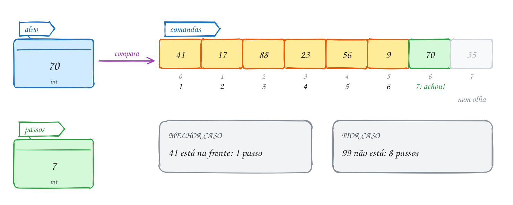
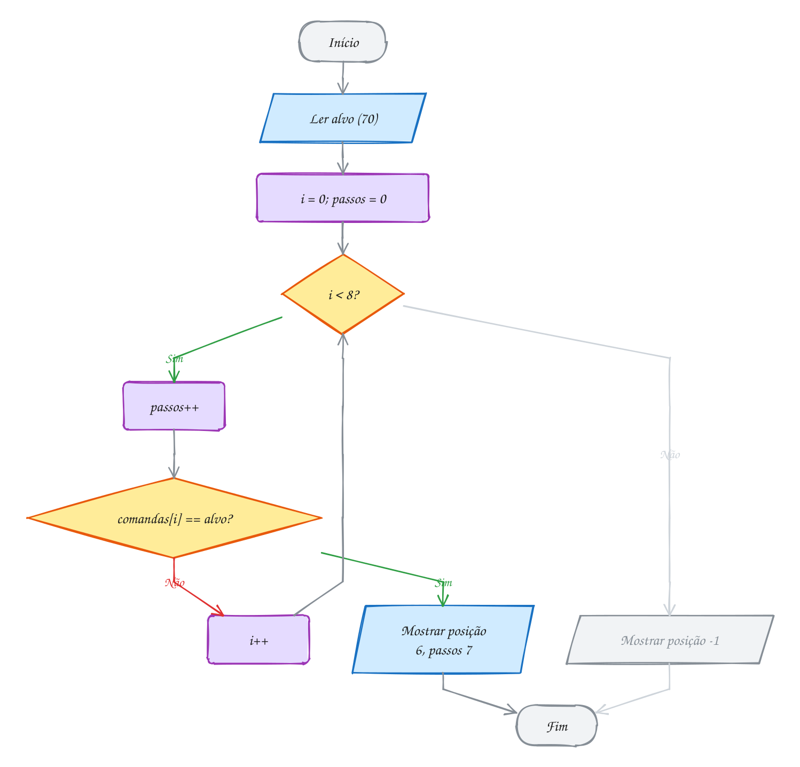
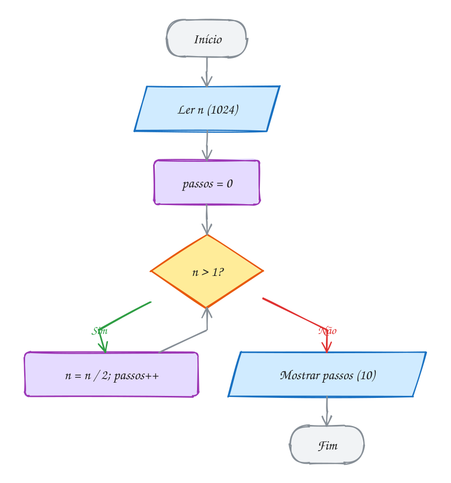
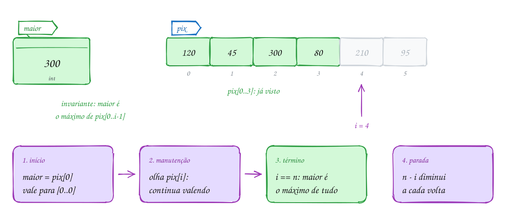
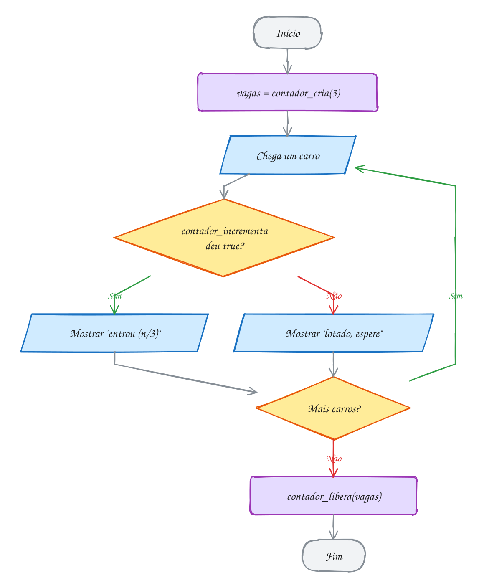

<!-- Gerado por _gerador. Para mudar este arquivo, edite _gerador/modulos/10-analise/ e rode: cd _gerador && npm run gerar -->

# Módulo 10 · Pensar como cientista da computação

Até aqui a pergunta foi "como escrevo isso em C?". Daqui para a frente, com
listas, pilhas, árvores e grafos, ela muda para "**qual** jeito de escrever é o
certo?". Para listar pedidos dá para usar um vetor ou uma lista encadeada, e
para achar um cliente, uma busca sequencial, uma binária ou uma tabela hash.
Todas funcionam com 10 itens. Com 1 milhão, umas respondem na hora e outras
travam o servidor.

Este módulo traz as ferramentas para decidir, em três ideias que atravessam o
resto do curso: **medir o custo** contando passos e resumindo o
crescimento na notação O; **ter certeza de que está certo** com invariantes de
laço, em vez de confiar em meia dúzia de testes; e **esconder os detalhes**
atrás de um tipo abstrato de dado, para poder trocar a implementação sem
quebrar quem usa.

Você provavelmente já esbarrou nisso sem dar nome: a busca dentro de um laço
que deixou o programa lento, o módulo que esconde a implementação atrás de
funções. Aqui essas coisas ganham nome, e o C mostra o custo de cada escolha.

## O que você vai aprender

- medir a **eficiência** de um algoritmo contando passos: melhor, pior e caso médio
- ler e escrever a **notação O**: O(1), O(log n), O(n), O(n log n) e O(n²), e por que constantes somem
- enunciar **invariantes de laço** e usá-los para provar que um laço está certo (e achar bugs)
- montar um **tipo abstrato de dado** com interface (`.h`), implementação (`.c`) e tipo opaco: o padrão de todos os próximos módulos

## Antes de começar

Nos exemplos, mude o n, troque os dados, quebre um invariante de propósito e
veja o `assert` disparar. Nos desenhos de custo, verde é o que continua leve e
vermelho é o custo que explodiu.

Você vai usar tudo dos módulos anteriores, em especial funções, vetores,
ponteiros, `malloc`/`free` e `struct`. Duas novidades pequenas:

- `<assert.h>`: `assert(condicao)` para o programa na hora se a condição for
  falsa. É assim que um invariante vira código.
- **arquivos de apoio**: no assunto 0074, a pasta tem `contador.h`,
  `contador.c`, `conta.h` e `conta.c` além dos exemplos. O `rodar` compila
  junto todo `.c` da pasta que não se chama `A000.c`/`E000.c`, então basta
  rodar o exemplo, como sempre:

```bash
~/LPEDC/rodar 10-analise/0074-tad/A147.c
```

Os contadores de passos dos exemplos não medem segundos, medem trabalho: na
sua máquina, os números saem iguais aos do texto.

| # | Assunto | Pasta |
| --- | --- | --- |
| [0071](#0071--eficiência-contar-passos) | Eficiência: contar passos | [`0071-eficiencia/`](10-analise/0071-eficiencia/) |
| [0072](#0072--notação-o-como-o-custo-cresce) | Notação O: como o custo cresce | [`0072-big-o/`](10-analise/0072-big-o/) |
| [0073](#0073--invariantes-de-laço-e-corretude) | Invariantes de laço e corretude | [`0073-invariantes/`](10-analise/0073-invariantes/) |
| [0074](#0074--tad-interface-h-e-implementação-c) | TAD: interface (.h) e implementação (.c) | [`0074-tad/`](10-analise/0074-tad/) |

---

## 0071 · Eficiência: contar passos

Sexta à noite, padaria cheia. Você entrega a comanda 70 no caixa e a moça
procura no bolo de comandas, uma por uma. Se a sua for a primeira, você sai
na hora. Se for a última, espera o bolo inteiro. Com 8 comandas, tanto faz.
Com 800, faz muita diferença.

Até aqui a pergunta era "o programa está **certo**?". Agora entra outra: "ele
é **rápido** o bastante?". E "rápido" não se mede em segundos.
O mesmo código leva 2 ms no seu notebook, 9 ms num Raspberry Pi e 40 ms se o
Chrome estiver aberto com 30 abas.

O que não muda de máquina para máquina é **quantos passos** o algoritmo dá.
Você escolhe a operação que domina o trabalho (a **operação dominante**) e
conta quantas vezes ela acontece. Numa busca, é a comparação `v[i] == alvo`.
O `i++` e o `i < n` também rodam, mas andam junto com a comparação: contar um
ou outro dá a mesma ideia de custo.

A conta depende da entrada, e não só do tamanho dela. Por isso se fala em três
casos:

- **melhor caso**: a entrada mais camarada (a comanda está na frente): 1 passo;
- **pior caso**: a mais azarada (está no fim ou nem está lá): n passos;
- **caso médio**: a média de todas as posições possíveis: (n + 1) / 2 passos.

Escrita como fórmula de n, essa contagem é a **função de custo** (o Ziviani
diz **função de complexidade**): aqui, f(n) = n no pior caso. Quando se
conta tempo (passos), é a **complexidade temporal**; quando se conta memória
extra, é a **complexidade espacial** (assunto 0168).

O pior caso é o que permite prometer alguma coisa: "nunca passa de n passos".
O melhor caso não promete nada, como dizer que a Marginal nunca tem trânsito
porque às 4 da manhã ela estava livre.

No exemplo, a comanda 70 está na posição 6. A busca compara com as 6
primeiras, erra todas, e acerta na 7ª comparação. A 41 sai em 1 passo; a 99,
que não está no bolo, custa as 8:

<p align="center"></p>

O contador é uma variável global que a função soma a cada comparação: um
medidor que você acopla ao código só para estudar o custo.

```c
#include <stdio.h>

int passos = 0; // conta as comparações: a operação que domina o custo

// Devolve o índice de alvo em v[0..n-1], ou -1 se ele não estiver lá.
int busca(const int v[], int n, int alvo) {
    for (int i = 0; i < n; i++) {
        passos++; // vai comparar v[i] com o alvo
        if (v[i] == alvo) {
            return i;
        }
    }
    return -1;
}

int main(void) {
    int comandas[8] = {41, 17, 88, 23, 56, 9, 70, 35};
    int alvos[3] = {41, 70, 99};

    for (int k = 0; k < 3; k++) {
        passos = 0; // zera antes de cada busca
        int pos = busca(comandas, 8, alvos[k]);
        printf("comanda %d: posição %2d, passos: %d\n", alvos[k], pos, passos);
    }
    return 0;
}
// Saída:
// comanda 41: posição  0, passos: 1
// comanda 70: posição  6, passos: 7
// comanda 99: posição -1, passos: 8
```

Com o bolo crescendo, a contagem para vários tamanhos de entrada vira uma
tabela, e é com ela que se comparam algoritmos:

| comandas (n) | melhor caso | caso médio | pior caso |
| --- | --- | --- | --- |
| 8 | 1 | 4,5 | 8 |
| 800 | 1 | 400,5 | 800 |
| 80.000 | 1 | 40.000,5 | 80.000 |

Multiplicou n por 100, o pior caso também multiplicou por 100. O próximo
assunto parte dessa observação.

O laço do fluxograma tem só duas saídas: a pergunta "achou?" responde Sim, ou
as comandas acabam. Cada volta pelo losango de baixo soma um passo no
contador:

<p align="center"></p>

> [!WARNING]
> Contar a coisa errada engana. Se você puser o `passos++` **depois** do `if`
> que dá `return`, a comparação que acertou não entra na conta e a busca da
> comanda 41 aparece com 0 passos. E se esquecer de zerar o contador entre uma
> busca e outra, ele acumula: 1, 8, 16. Confira o caso mais simples à mão
> (achar na primeira posição custa 1).

> [!TIP]
> **Por dentro do C:** medir tempo com `clock()` de `<time.h>` funciona, mas
> engana fácil com entradas pequenas: numa busca de microssegundos, o ruído
> (outros programas, cache, o próprio sistema) é maior que o tempo medido, e
> cada execução dá um número diferente. E compilado com `-O2`, o
> `gcc` pode **apagar** um laço inteiro cujo resultado ninguém usa, e o tempo
> medido vira zero. Contar passos não tem esses problemas: o contador é usado
> no `printf`, então o compilador é obrigado a manter o laço, e o número sai
> igual em qualquer máquina.

> [!NOTE]
> **Pergunta para você:** se o bolo tivesse 8 comandas **em ordem crescente**
> (9, 17, 23, ..., 88), dava para parar antes ao procurar a 50, que não existe?
> Quantos passos a busca gastaria? E no pior caso, mudou alguma coisa?

### Hora de praticar

Arquivos em [`0071-eficiencia/`](10-analise/0071-eficiencia/).

**Exemplo A141 · Contar tudo: a busca com sentinela**

```c
#include <stdio.h>

// Na catraca da academia, a busca compara duas coisas a cada volta: "acabou
// a lista?" (i < n) e "é esta matrícula?". Contando as DUAS, dá para ver o
// truque da sentinela: pôr a própria matrícula procurada no fim da lista
// garante que a busca sempre acha, e o teste i < n some do laço.

int comparacoes = 0; // conta toda comparação, de qualquer tipo

int busca_comum(const int v[], int n, int alvo) {
    int i = 0;
    while (1) {
        comparacoes++; // i < n
        if (!(i < n)) {
            return -1;
        }
        comparacoes++; // v[i] == alvo
        if (v[i] == alvo) {
            return i;
        }
        i++;
    }
}

// v precisa ter uma posição livre em v[n] para a sentinela.
int busca_sentinela(int v[], int n, int alvo) {
    v[n] = alvo; // a sentinela: a busca vai parar aqui, no pior caso
    int i = 0;
    while (1) {
        comparacoes++; // v[i] == alvo (o único teste do laço)
        if (v[i] == alvo) {
            break;
        }
        i++;
    }
    return i < n ? i : -1; // um teste só, fora do laço
}

int main(void) {
    int matriculas[9] = {3021, 1187, 4410, 2595, 3978, 1203, 4862, 2240}; // 8 + 1 livre
    int alvos[3] = {3021, 4862, 9999};

    printf("%8s %6s %7s %10s\n", "alvo", "pos", "comum", "sentinela");
    for (int k = 0; k < 3; k++) {
        comparacoes = 0;
        int pos = busca_comum(matriculas, 8, alvos[k]);
        int c1 = comparacoes;

        comparacoes = 0;
        busca_sentinela(matriculas, 8, alvos[k]);
        int c2 = comparacoes + 1; // + o teste i < n do return

        printf("%8d %6d %7d %10d\n", alvos[k], pos, c1, c2);
    }
    return 0;
}
// Saída:
//     alvo    pos   comum  sentinela
//     3021      0       2          2
//     4862      6      14          8
//     9999     -1      17         10
//
// Pior caso: 2n + 1 contra n + 2. As duas continuam crescendo junto com n,
// mas a sentinela corta quase metade das comparações.
```

```bash
~/LPEDC/rodar 10-analise/0071-eficiencia/A141.c
```

**Exemplo A142 · Três tarefas, três ritmos**

```c
#include <stdio.h>

// O grupo do condomínio tem n moradores. Três tarefas, contadas passo a passo:
//   aviso:      o síndico manda UMA mensagem no grupo
//   convite:    o síndico manda uma mensagem para cada morador
//   cumprimento: cada par de moradores troca um "bom dia"

long tarefa_aviso(int n) {
    (void)n;          // não importa quantos moradores existem
    long passos = 0;
    passos++;         // uma mensagem só
    return passos;
}

long tarefa_convite(int n) {
    long passos = 0;
    for (int i = 0; i < n; i++) {
        passos++;     // uma mensagem por morador
    }
    return passos;
}

long tarefa_cumprimento(int n) {
    long passos = 0;
    for (int i = 0; i < n; i++) {
        for (int j = i + 1; j < n; j++) {
            passos++; // o par (i, j) se cumprimenta
        }
    }
    return passos;
}

int main(void) {
    int tamanhos[3] = {10, 100, 1000};

    printf("%6s %7s %9s %12s\n", "n", "aviso", "convite", "cumprimento");
    for (int k = 0; k < 3; k++) {
        int n = tamanhos[k];
        printf("%6d %7ld %9ld %12ld\n", n, tarefa_aviso(n), tarefa_convite(n),
               tarefa_cumprimento(n));
    }
    return 0;
}
// Saída:
//      n   aviso   convite  cumprimento
//     10       1        10           45
//    100       1       100         4950
//   1000       1      1000       499500
```

```bash
~/LPEDC/rodar 10-analise/0071-eficiencia/A142.c
```

#### Exercícios

**Exercício E421** · ★☆☆

Escreva um programa que monta cada trecho abaixo, conta com uma variável
"passos" quantas vezes o passos++ roda e mostra o resultado. Zere o
contador antes de cada trecho.


```text
a) for (i = 0; i < 6; i++)  for (j = 0; j < 4; j++)  passos++;
b) for (i = 0; i < 6; i++)  for (j = i; j < 6; j++)  passos++;
c) for (i = 1; i < 100; i = i * 2)  passos++;
d) for (i = 0; i < 10; i++)  if (i % 3 == 0) passos++;
```


No d), conte também as voltas do laço numa segunda variável, "voltas", e
mostre as duas.


```text
Saída esperada:
a) 24
b) 21
c) 7
d) 4 passos em 10 voltas
```

**Dicas:**

1. Em a), o laço de dentro roda inteiro a cada volta do de fora: 6 * 4.
2. Em b), o laço de dentro encolhe porque começa em i: 6 + 5 + ... + 1.
3. Em c), os valores de i são 1, 2, 4, 8, 16, 32, 64.
4. Resposta esperada: a saída acima. O d) mostra que o número depende do
   que você escolhe contar: 10 voltas, mas só 4 passam no if.

```bash
~/LPEDC/rodar 10-analise/0071-eficiencia/E421.c
```

**Exercício E422** · ★☆☆

A função abaixo acha a maior temperatura de uma semana e meia (10 dias).
Complete o código com dois contadores globais: "comparacoes" (quantas vezes
a função compara t[i] com o maior até agora) e "trocas" (quantas vezes o
maior até agora muda de valor). Mostre os dois no final.


```text
Saída esperada:
Maior: 36
Comparações: 9
Trocas: 3
```

**Dicas:**

1. O maior começa como t[0]. A primeira comparação é com t[1].
2. Some 1 em comparacoes antes do if; some 1 em trocas dentro dele.
3. Com n valores, achar o maior custa sempre n - 1 comparações, não importa
   a ordem. Já o número de trocas depende da ordem dos dados.
4. Resposta esperada: Maior: 36, Comparações: 9, Trocas: 3 (o maior muda
   para 31, depois 35, depois 36).

```bash
~/LPEDC/rodar 10-analise/0071-eficiencia/E422.c
```

**Exercício E423** · ★★☆

O texto disse que, em média, a busca sequencial custa (n + 1) / 2
comparações. Não acredite: meça. Escreva um programa que, para n = 10, 100
e 1000:

1. preenche um vetor com os códigos de produto v[i] = 3 * i + 1;
2. busca, um por um, TODOS os códigos que estão no vetor, somando os passos
de todas as buscas;
3. mostra o total e a média de passos por busca.


```text
Saída esperada:
n =   10: total     55, média   5.5
n =  100: total   5050, média  50.5
n = 1000: total 500500, média 500.5
```

**Dicas:**

1. Use um vetor de 1000 posições e só as n primeiras em cada rodada.
2. Reaproveite a busca do texto com o contador global; zere-o uma vez por
   n, não a cada busca, para acumular o total.
3. Achar o código da posição i custa i + 1 passos. Somando de 1 até n dá
   n(n + 1) / 2; dividindo por n, (n + 1) / 2.
4. Resposta esperada: médias 5.5, 50.5 e 500.5.

```bash
~/LPEDC/rodar 10-analise/0071-eficiencia/E423.c
```

**Exercício E424** · ★★☆

Dois jeitos de saber se n é primo, contando as divisões (n % d) como passo:


```text
ingênuo: testa todo d de 2 até n - 1;
esperto: testa d de 2 enquanto d * d <= n. Se n tivesse um divisor maior
         que a raiz, teria também um menor, que já teria aparecido.
```


Escreva as duas funções (devolvem bool) com contadores e mostre a tabela
para os primos 97, 997 e 9973.


```text
Saída esperada:
    n  ingênuo  esperto
   97       95        8
  997      995       30
 9973     9971       98
```

**Dicas:**

1. Primo é o pior caso dos dois: nenhuma divisão dá resto 0, então o laço
   vai até o fim.
2. Use dois contadores globais e zere os dois antes de cada n.
3. Com n 100 vezes maior, o ingênuo cresceu 100 vezes e o esperto
   só uns 12. A raiz de 100 é 10.
4. Resposta esperada: a tabela acima.

```bash
~/LPEDC/rodar 10-analise/0071-eficiencia/E424.c
```

**Exercício E425** · ★★★

Este programa busca três senhas de atendimento do banco e deveria mostrar
os passos 1, 4 e 6. Ele compila sem aviso, mas mostra 0, 3 e 9. Há DOIS
erros na instrumentação (a busca em si está certa). Conserte os dois e rode
para conferir a saída.


```text
Saída esperada:
senha 12: passos 1
senha 8: passos 4
senha 40: passos 6
```

**Dicas:**

1. Ponha um printf dentro do laço e rode a senha 12, que está na posição
   0. O passos++ chega a rodar?
2. Depois olhe a senha 8: o 3 que apareceu é dela ou é acumulado?
3. Resposta esperada: (1) o passos++ está depois do if que dá return, então
   a comparação que acerta nunca é contada: ele tem de vir antes do if;
   (2) o contador é zerado uma vez só, antes do for do main: tem de ser
   zerado dentro do for, antes de cada busca.

```bash
~/LPEDC/rodar 10-analise/0071-eficiencia/E425.c
```

**Exercício E426** · ★★★

No assunto 0033 você viu que o Fibonacci recursivo é lento. Agora meça o
quanto. Escreva:

- fib_rec(n): a versão recursiva (fib(0) = 0, fib(1) = 1), somando 1 num
contador global "chamadas" a cada vez que a função é chamada;
- fib_it(n): a versão com laço, somando 1 num contador "somas" a cada soma.

Mostre a tabela para n = 10, 20 e 30. Use long para os contadores.


```text
Saída esperada:
 n     fib  chamadas  somas
10      55       177      9
20    6765     21891     19
30  832040   2692537     29
```


Depois acrescente uma segunda tabela: para n de 20 a 25, as chamadas da
recursiva e a razão entre as chamadas de n e as de n - 1.


```text
n = 20:  21891 chamadas, razão 1.618
n = 21:  35421 chamadas, razão 1.618
n = 22:  57313 chamadas, razão 1.618
n = 23:  92735 chamadas, razão 1.618
n = 24: 150049 chamadas, razão 1.618
n = 25: 242785 chamadas, razão 1.618
```

**Dicas:**

1. Zere os contadores antes de cada n.
2. A versão com laço guarda os dois últimos valores e anda n - 1 vezes.
3. fib_rec(n) chama fib_rec(n - 1) e fib_rec(n - 2): o fib(28) é calculado
   do zero 2 vezes, o fib(27) 3 vezes, o fib(26) 5 vezes...
4. Na segunda tabela, comece medindo n = 19 e guarde as chamadas numa
   variável "anterior"; a razão é (double)chamadas / anterior.
5. Resposta esperada: as duas tabelas acima. A cada +1 no n, as chamadas
   multiplicam por cerca de 1,618 (a razão áurea): crescimento
   exponencial.

```bash
~/LPEDC/rodar 10-analise/0071-eficiencia/E426.c
```

---

## 0072 · Notação O: como o custo cresce

Você fez o app da hamburgueria. Testou com 8 pedidos: voou. Uma semana depois,
64 pedidos por noite: tudo bem. Aí veio a Black Friday com 1024 pedidos e uma
tela travou. O código não mudou, mas o **n** sim, e cada parte do
programa reagiu de um jeito diferente a ele.

O assunto anterior contou passos. Agora a pergunta é **como a contagem cresce
quando n cresce**, e a **notação O** (fala-se "ó grande") resume a resposta
numa expressão curta. Ela ignora duas coisas de propósito:

- **constantes multiplicativas**: 3n e 100n são os dois O(n). A constante
  depende da máquina e de detalhes; o formato do crescimento, não;
- **termos menores**: em n² + 50n + 7, o n² engole o resto quando n cresce.
  Com n = 1000, ele vale 1.000.000 e o 50n só 50.000. Fica O(n²).

A definição formal (a do Cormen): f(n) é **O(g(n))** se existem c > 0 e
n₀ com 0 ≤ f(n) ≤ c · g(n) para todo n ≥ n₀. É um **teto**: "nunca cresce mais
rápido que g". **Ω** é o piso (f ≥ c · g) e **Θ**, teto e piso juntos:
n² + 50n + 7 é Θ(n²) (assunto 0166). As cinco classes do curso, da melhor para a pior:

| classe | nome | n dobra, o custo... | exemplo |
| --- | --- | --- | --- |
| O(1) | constante | fica igual | `v[i]`, topo da pilha |
| O(log n) | logarítmica | ganha **1** passo | busca binária |
| O(n) | linear | dobra | somar um vetor |
| O(n log n) | "n log n" | pouco mais que dobra | merge sort |
| O(n²) | quadrática | **quadruplica** | comparar todos os pares |

Para ler a classe de um código, olhe os laços. Um laço que anda de 1 em 1 até
n é O(n). Dois laços aninhados até n, O(n²). Um laço que **divide** n por 2 a
cada volta é O(log n): de 1024 até 1 são só 10 cortes, porque 2¹⁰ = 1024. E a
base do log não importa: trocar log₂ por log₁₀ só muda uma constante.

O exemplo faz cinco perguntas sobre os mesmos pedidos, cada uma com o seu
ritmo. Em verde, o que continua leve em 1024; em vermelho, o que explodiu:

<p align="center"></p>

Cada função conta os passos de uma pergunta. Rode e veja a tabela se formar:

```c
#include <stdio.h>

// O(1): qual é o primeiro pedido da fila? Basta olhar a posição 0.
long passos_constante(int n) {
    (void)n;
    return 1;
}

// O(log n): cortar a lista ordenada ao meio até sobrar 1 pedido.
long passos_log(int n) {
    long passos = 0;
    while (n > 1) {
        n = n / 2;
        passos++;
    }
    return passos;
}

// O(n): somar o faturamento, olhando cada pedido uma vez.
long passos_linear(int n) {
    long passos = 0;
    for (int i = 0; i < n; i++) {
        passos++;
    }
    return passos;
}

// O(n log n): para cada pedido de hoje, uma busca binária na lista de ontem.
long passos_n_log_n(int n) {
    long passos = 0;
    for (int i = 0; i < n; i++) {
        passos += passos_log(n);
    }
    return passos;
}

// O(n²): comparar cada pedido com todos os outros, atrás de duplicados.
long passos_quadratico(int n) {
    long passos = 0;
    for (int i = 0; i < n; i++) {
        for (int j = i + 1; j < n; j++) {
            passos++;
        }
    }
    return passos;
}

int main(void) {
    int tamanhos[3] = {8, 64, 1024};

    printf("%6s %5s %6s %6s %8s %8s\n", "n", "O(1)", "log n", "n", "n log n", "n^2");
    for (int k = 0; k < 3; k++) {
        int n = tamanhos[k];
        printf("%6d %5ld %6ld %6ld %8ld %8ld\n", n, passos_constante(n), passos_log(n),
               passos_linear(n), passos_n_log_n(n), passos_quadratico(n));
    }
    return 0;
}
// Saída:
//      n  O(1)  log n      n  n log n      n^2
//      8     1      3      8       24       28
//     64     1      6     64      384     2016
//   1024     1     10   1024    10240   523776
```

Na última coluna, comparar todos os pares dá n(n − 1)/2, mais ou menos n²/2.
A metade é uma constante e some na notação: continua O(n²). De 64 para 1024 o
n cresceu 16 vezes e essa coluna cresceu 260 vezes, enquanto a do log ganhou
4 passos.

O fluxograma mostra o laço do O(log n) com n = 1024. A pergunta "n > 1?"
responde Sim só 10 vezes, porque cada volta joga metade fora:

<p align="center"></p>

> [!WARNING]
> O(n) não é "sempre mais rápido" que O(n²). A notação fala do **crescimento**,
> não do tempo para um n específico. Um algoritmo de 100n passos perde de um de
> n² até n = 100 (o exemplo A144 mostra a virada). Para 10 itens, o simples
> costuma ganhar. A segunda pegadinha é a inversa: um laço O(n) que chama, a
> cada volta, uma função O(n) dá **O(n²)**, mesmo parecendo um laço só. O
> exemplo clássico no C é o `strlen(s)` na condição do `for`.

> [!TIP]
> **Por dentro do C:** `v[i]` é O(1) com i valendo 3 ou 3 milhões porque o
> vetor é contínuo na memória e o endereço sai de uma conta só:
> `endereço de v + i * sizeof(int)`. O processador faz isso numa instrução.
> Numa lista encadeada (módulo 11) não existe essa conta: para chegar no
> elemento i é preciso seguir i ponteiros, um por um: a mesma pergunta custa
> O(n). A estrutura de dados decide a classe antes de você escrever o
> algoritmo.


> [!NOTE]
> **Pergunta para você:** se um algoritmo O(n²) leva 1 segundo com 10.000
> pedidos, quanto ele leva com 100.000? E um O(n log n) que também leva 1
> segundo com 10.000? Faça a conta antes de olhar os exercícios.

### Hora de praticar

Arquivos em [`0072-big-o/`](10-analise/0072-big-o/).

**Exemplo A143 · A base do log não importa**

```c
#include <stdio.h>

// Dois jeitos de "encolher" n até sobrar 1:
//   torneio mata-mata: metade dos times cai a cada rodada  -> divide por 2
//   apagar dígitos:    o número perde um dígito por vez     -> divide por 10
// Os dois são O(log n). A conta de baixo mostra por quê: a razão entre eles
// não cresce com n, fica perto de uma constante (log₂ 10 ≈ 3,32).

int cortes(long long n, int divisor) {
    int passos = 0;
    while (n > 1) {
        n = n / divisor;
        passos++;
    }
    return passos;
}

int main(void) {
    long long tamanhos[4] = {1000, 1000000, 1000000000, 1000000000000};

    printf("%14s %8s %9s %7s\n", "n", "por 2", "por 10", "razão");
    for (int k = 0; k < 4; k++) {
        long long n = tamanhos[k];
        int c2 = cortes(n, 2);
        int c10 = cortes(n, 10);
        printf("%14lld %8d %9d %7.2f\n", n, c2, c10, (double)c2 / c10);
    }
    return 0;
}
// Saída:
//              n    por 2    por 10  razão
//           1000        9         3    3.00
//        1000000       19         6    3.17
//     1000000000       29         9    3.22
//  1000000000000       39        12    3.25
//
// n cresceu um bilhão de vezes e as duas colunas só ganharam uns poucos
// passos. A razão se aproxima de 3,32: trocar a base só multiplica por uma
// constante, e a notação O ignora constantes. Por isso se escreve só O(log n).
```

```bash
~/LPEDC/rodar 10-analise/0072-big-o/A143.c
```

**Exemplo A144 · A constante grande perde no fim**

```c
#include <stdio.h>

// Duas bibliotecas de cálculo de frete para n pedidos:
//   A: faz 100 contas fixas por pedido          -> 100n passos, O(n)
//   B: compara cada pedido com cada pedido      -> n² passos,   O(n²)
// Para n pequeno, B ganha. Depois de um ponto, A ganha para sempre.

long biblioteca_a(int n) {
    long passos = 0;
    for (int i = 0; i < n; i++) {
        for (int k = 0; k < 100; k++) {
            passos++;
        }
    }
    return passos;
}

long biblioteca_b(int n) {
    long passos = 0;
    for (int i = 0; i < n; i++) {
        for (int j = 0; j < n; j++) {
            passos++;
        }
    }
    return passos;
}

int main(void) {
    int tamanhos[5] = {10, 50, 100, 200, 1000};

    printf("%5s %8s %8s  %s\n", "n", "A: 100n", "B: n^2", "mais rápida");
    for (int k = 0; k < 5; k++) {
        int n = tamanhos[k];
        long a = biblioteca_a(n);
        long b = biblioteca_b(n);
        const char *vence = a < b ? "A" : (b < a ? "B" : "empate");
        printf("%5d %8ld %8ld  %s\n", n, a, b, vence);
    }
    return 0;
}
// Saída:
//     n  A: 100n   B: n^2  mais rápida
//    10     1000      100  B
//    50     5000     2500  B
//   100    10000    10000  empate
//   200    20000    40000  A
//  1000   100000  1000000  A
```

```bash
~/LPEDC/rodar 10-analise/0072-big-o/A144.c
```

#### Exercícios

**Exercício E427** · ★☆☆

Transforme cada trecho abaixo numa função long trecho_a(int n), ...,
trecho_f(int n), que roda o trecho e devolve quantas vezes o x++ (ou a
conta do d) aconteceu. No main, mostre uma tabela com a contagem para
n = 16 e n = 1024. No rótulo de cada linha, escreva a classe O que a
contagem indica.


```text
a) for (i = 0; i < n; i++)  for (j = 0; j < 10; j++)  x++;
b) for (i = 1; i < n; i = i * 2)  x++;
c) for (i = 0; i < n; i++)  for (j = 0; j < i; j++)  x++;
d) x = v[n / 2] + v[0];
e) for (i = 0; i < n; i++)  x++;
   for (j = 0; j < n; j++)  x++;
f) for (i = 0; i < n; i++)  for (j = n; j > 1; j = j / 2)  x++;
```


```text
Saída esperada:
trecho           n=16   n=1024
a) O(n)           160    10240
b) O(log n)         4       10
c) O(n^2)         120   523776
d) O(1)             1        1
e) O(n)            32     2048
f) O(n log n)      64    10240
```

**Dicas:**

1. No d) não há laço: a função só devolve 1 (use (void)n; para o gcc não
   reclamar do parâmetro sem uso).
2. Um laço de dentro com tamanho fixo (10) não depende de n. Laços em
   sequência somam; laços aninhados multiplicam.
3. Formato da linha: printf("%-14s %6ld %8ld\n", "a) O(n)", ...).
4. Resposta esperada: a tabela acima. As linhas a) e f) dão 10240 com
   n = 1024, mas por motivos diferentes: 10 é constante, log₂ 1024 = 10
   cresce com n.

```bash
~/LPEDC/rodar 10-analise/0072-big-o/E427.c
```

**Exercício E428** · ★☆☆

Seis colegas contaram os passos dos seus algoritmos e chegaram nestas
fórmulas. Para cada uma, aposte numa classe O (descarte constantes e fique
com o termo que domina) e confira a aposta com um programa: escreva a
fórmula como função double f(double n), a aposta como double g(double n),
e mostre f(n) / g(n) para n = 10, 1000 e 1000000. Aposta certa: a razão não
cresce sem parar; ela se acomoda perto de uma constante.


```text
a) 3n² + 10n + 7      b) 500               c) n + log₂ n
d) 2n log₂ n + 50n    e) n³ / 1000 + n²    f) n(n + 1) / 2
```


```text
Saída esperada:
fórmula             n=10     n=1000     n=10^6
a) O(n^2)          4.0700     3.0100     3.0000
b) O(1)          500.0000   500.0000   500.0000
c) O(n)            1.3322     1.0100     1.0000
d) O(n log n)     17.0515     7.0172     4.5086
e) O(n^3)          0.1010     0.0020     0.0010
f) O(n^2)          0.5500     0.5005     0.5000
```

**Dicas:**

1. log2() está em <math.h> (o rodar já liga com -lm).
2. Para não repetir 18 printf, escreva uma função que recebe o rótulo, a
   fórmula e a aposta como ponteiros para função (assunto 0050):
   void linha(const char *rotulo, double (*f)(double), double (*g)(double)).
3. Formato: "%-14s" no rótulo e " %10.4f" em cada razão.
4. Resposta esperada: a tabela acima. No d), a razão cai devagar até 2
   (o 50n perde força quando n cresce); se você apostasse O(n), ela
   cresceria sem parar. Para ver isso, troque uma aposta e rode de novo.

```bash
~/LPEDC/rodar 10-analise/0072-big-o/E428.c
```

**Exercício E429** · ★★☆

O cupom fiscal tem códigos de produto de 0 a 999. Você quer saber se algum
código aparece repetido. Escreva duas funções que devolvem bool e contam
passos (comparações ou consultas):

- repetido_pares(v, n): compara cada par (i, j) com i < j. O(n²).
- repetido_marcas(v, n): usa um vetor bool visto[1000] (todo false no
começo); para cada código, consulta visto[codigo] e marca. O(n).

Teste com n = 100 e n = 1000, com v[i] = (i * 37) % 1000 (que não tem
repetidos: é o pior caso, as duas vão até o fim).


```text
Saída esperada:
n =  100: pares   4950 passos, marcas  100 passos
n = 1000: pares 499500 passos, marcas 1000 passos
```

**Dicas:**

1. Em repetido_marcas, o passo é cada consulta a visto[v[i]].
2. Para zerar o vetor de marcas: bool visto[1000] = {false};
3. A versão com marcas troca memória (1000 bools) por tempo. Funciona aqui
   porque os códigos são pequenos; com CPFs, precisaria de outra ideia
   (a tabela hash do módulo 15).
4. Resposta esperada: a saída acima; as duas respondem "sem repetidos".

```bash
~/LPEDC/rodar 10-analise/0072-big-o/E429.c
```

**Exercício E430** · ★★☆

A "regra do dobro": rode um algoritmo com n e com 2n e divida os passos.
Razão perto de 1 (com +1 passo) é O(log n); perto de 2, O(n); perto de 4,
O(n²). Complete o programa:

1. escreva const char *classe(double razao), que devolve "O(log n)" se a
razão for menor que 1.2, "O(raiz n)" se for menor que 1.7, "O(n)" se for
menor que 3 e "O(n^2)" nos outros casos;
2. no main, mostre, para cada função misteriosa, os passos com n = 1000 e
n = 2000, a razão entre eles e a classe que a razão indica.


```text
Saída esperada:
a:     334 ->     667  razão 2.00  O(n)
b:      10 ->      11  razão 1.10  O(log n)
c:  500000 -> 2000000  razão 4.00  O(n^2)
d:      32 ->      45  razão 1.41  O(raiz n)
```

**Dicas:**

1. Use (double)p2 / p1 para a razão não virar divisão inteira.
2. Uma função void mostra(char nome, long p1, long p2) evita repetir o
   printf quatro vezes.
3. A d) não é nenhuma das cinco classes do texto. Que número elevado ao
   quadrado dá 2? Olhe a condição d * d < n.
4. Resposta esperada: a saída acima. a) n/3 passos; c) n²/2 passos;
   d) raiz de n: dobrar n multiplica por √2 ≈ 1,41.

```bash
~/LPEDC/rodar 10-analise/0072-big-o/E430.c
```

**Exercício E431** · ★★★

Você precisa ordenar a lista de entregas e tem duas opções:


```text
A: um algoritmo simples, que gasta 2n² passos;
B: um sofisticado, que gasta 50 n log₂ n passos.
```


B é O(n log n) e A é O(n²), então B ganha "no fim". Mas a partir de que n?
Escreva um programa que encontra o MENOR n (começando em 2) em que B gasta
menos passos que A, e mostra os dois custos nesse n. Mostre também uma
tabela para n = 10, 100, 1000 e 10000.


```text
Saída esperada:
B passa a ganhar em n = 190 (A: 72200, B: 71914)
     n           A          B
    10         200       1661
   100       20000      33219
  1000     2000000     498289
 10000   200000000    6643856
```

**Dicas:**

1. log2() está em <math.h> (o rodar já liga com -lm). Faça as contas em
   double.
2. Um laço n = 2, 3, 4, ... que para (break) no primeiro n em que
   50 * n * log2(n) < 2.0 * n * n.
3. Mostre os doubles com %.0f para arredondar.
4. Resposta esperada: n = 190. Para listas com menos de 190 entregas, o
   "pior" algoritmo é o mais rápido. Com 10000, B é 30 vezes mais rápido.

```bash
~/LPEDC/rodar 10-analise/0072-big-o/E431.c
```

**Exercício E432** · ★★★

Este programa conta as vogais de um texto de n letras. A função tamanho()
faz o mesmo que o strlen (anda até o '\0') e conta cada letra visitada como
um passo. Rode e veja os passos para n = 1000, 2000 e 4000:


```text
n = 1000: 400 vogais, 1001000 passos
n = 2000: 800 vogais, 4002000 passos
n = 4000: 1600 vogais, 16004000 passos
```


1. Acrescente ao main a regra do dobro: a partir do segundo n, mostre na
mesma linha a razão entre os passos deste n e os do anterior. Rode: a razão
denuncia a classe do código.
2. Refatore conta_vogais para ficar O(n), sem mudar a função tamanho(), e
rode de novo.


```text
Saída esperada (depois do conserto):
n = 1000: 400 vogais, 1000 passos
n = 2000: 800 vogais, 2000 passos, razão 2.00
n = 4000: 1600 vogais, 4000 passos, razão 2.00
```

**Dicas:**

1. Guarde os passos do n anterior numa variável e use (double) na divisão.
2. Antes do conserto a razão sai 4.00: O(n²). Quantas vezes a condição do
   for é avaliada? E o que ela chama?
3. O texto não muda dentro do laço. Precisa medir o tamanho dele toda vez?
4. Resposta esperada: guarde o tamanho numa variável antes do laço
   (int n = tamanho(texto);) e use i < n. Os passos caem para 1000, 2000 e
   4000, e a razão vira 2.00: O(n).

```bash
~/LPEDC/rodar 10-analise/0072-big-o/E432.c
```

---

## 0073 · Invariantes de laço e corretude

Fim do expediente na lanchonete. Você confere o caixa: troco inicial mais as
vendas do dia tem que bater com o que está na gaveta. E essa conta não vale
só no fim: depois de **cada** cliente atendido, "gaveta = troco + vendas até
agora" continua verdadeiro. Se em algum momento não bater, você sabe que o
erro aconteceu ali.

Um laço funciona igual. Testar com alguns valores mostra que ele acertou
**naqueles** valores. Para ter certeza de que acerta sempre, você procura uma
frase que fica verdadeira volta após volta. Essa frase é o **invariante de
laço**: uma relação entre as variáveis que vale **no começo de cada
iteração**, logo antes do teste do laço.

Para falar de pedaços de vetor, use a notação `v[0..i-1]`: os elementos de
índice 0 até i − 1. Quando i vale 0, o pedaço está vazio. Com ela, o
invariante de "achar o maior" fica assim: **`maior` é um máximo de
`v[0..i-1]`**. Diz o que o laço já sabe, não como ele anda.

Mostrar que um laço está certo com um invariante tem quatro passos, como uma
prova por indução:

1. **Início**: o invariante vale antes da primeira volta.
2. **Manutenção**: se vale no começo de uma volta, vale no começo da
   seguinte.
3. **Término**: quando o teste falha, invariante + condição de parada dão o
   resultado que você queria.
4. **Parada**: alguma quantidade inteira diminui a cada volta e não pode
   diminuir para sempre (é a **variante**). Garante que o laço acaba.

Pensar assim também melhora a documentação. A função promete "recebe
n ≥ 1 e v; devolve o valor de **um** elemento máximo de `v[0..n-1]`". Fala de
todos os parâmetros, diz a restrição (n ≥ 1) e usa "um" porque pode haver
empate. É o contrato, sem contar o "como".

Os Pix do dia foram 120, 45, 300, 80, 210 e 95. No
começo da volta com i = 4, a parte verde já foi vista e o invariante garante
que `maior` (300) é o maior dela. A parte cinza ainda não importa:

<p align="center"></p>

O `assert` de `<assert.h>` transforma o invariante em código: se a condição
for falsa, o programa para na hora e diz a linha. A função `eh_maximo` é lenta
de propósito: confere o invariante pelo caminho mais ingênuo, só para testar.

```c
#include <assert.h>
#include <stdbool.h>
#include <stdio.h>

// Devolve true se x é um máximo de v[0..i-1]: x está lá e ninguém passa dele.
bool eh_maximo(const int v[], int i, int x) {
    bool esta = false;
    for (int k = 0; k < i; k++) {
        if (v[k] > x) {
            return false;
        }
        if (v[k] == x) {
            esta = true;
        }
    }
    return esta;
}

// Recebe n >= 1 e v; devolve o valor de um elemento máximo de v[0..n-1].
int maximo(const int v[], int n) {
    int maior = v[0];
    int i = 1;
    while (i < n) {
        // invariante: maior é um máximo de v[0..i-1]
        assert(eh_maximo(v, i, maior));
        printf("i = %d: maior = %d\n", i, maior);
        if (v[i] > maior) {
            maior = v[i];
        }
        i++;
    }
    // na saída, i == n: o invariante diz que maior é um máximo de v[0..n-1]
    assert(eh_maximo(v, n, maior));
    return maior;
}

int main(void) {
    int pix[6] = {120, 45, 300, 80, 210, 95};

    printf("Maior Pix: R$ %d\n", maximo(pix, 6));
    return 0;
}
// Saída:
// i = 1: maior = 120
// i = 2: maior = 120
// i = 3: maior = 300
// i = 4: maior = 300
// i = 5: maior = 300
// Maior Pix: R$ 300
```

### Passo a passo

Os quatro passos aplicados a esse laço, com o teste de mesa do lado:

| começo da volta | i | `v[0..i-1]` | maior | invariante vale? |
| --- | --- | --- | --- | --- |
| 1ª | 1 | 120 | 120 | sim: um elemento só é o máximo dele mesmo (**início**) |
| 2ª | 2 | 120, 45 | 120 | sim: 45 não passou de 120 |
| 3ª | 3 | 120, 45, 300 | 300 | sim: 300 passou e virou o maior |
| 4ª | 4 | ..., 80 | 300 | sim |
| 5ª | 5 | ..., 210 | 300 | sim |
| teste falha | 6 | o vetor todo | 300 | sim, e i == n: é a resposta (**término**) |

**Manutenção**: se `maior` é o máximo de `v[0..i-1]`, a volta compara com
`v[i]` e fica com o maior dos dois. Então `maior` passa a ser o máximo de
`v[0..i]`, e o `i++` faz disso "o máximo de `v[0..i-1]`" de novo. **Parada**:
n − i diminui 1 por volta e o laço acaba quando chega a 0.

No fluxograma, o invariante fica na seta que volta para o losango "i < 6?".
Toda vez que o caminho passa por ali, a frase é verdadeira:

<p align="center"></p>

> [!WARNING]
> O erro clássico é o **início**: `int maior = 0;` parece inofensivo e passa
> em todos os testes com valores positivos. Com saldos todos negativos (−120,
> −45, −300), a função devolve 0, um valor que nem está no vetor. O invariante
> denuncia na hora: antes da primeira volta, 0 não é um máximo de `v[0..0]`.
> Comece com `maior = v[0]` e i = 1, e escreva a restrição n ≥ 1 no contrato.

> [!TIP]
> **Por dentro do C:** `assert(cond)` é uma macro. Se `cond` for falsa, ela
> imprime arquivo, linha e a condição, e chama `abort()`. Compilando com
> `-DNDEBUG`, o pré-processador troca cada `assert` por **nada**: nem a
> condição é calculada. Por isso o `eh_maximo`, que é O(n) dentro de um laço
> O(n), deixa o teste O(n²) mas não custa nada na versão final. Daí a regra:
> nunca ponha dentro do `assert` algo que o programa precisa fazer, como
> `assert(fp = fopen(...))`. Com `NDEBUG`, o arquivo nem abre.


> [!NOTE]
> **Pergunta para você:** no exemplo A146 (fichas de R$ 5 com R$ 47), o
> invariante é `valor == q * ficha + r` e `r >= 0`. O que garante que o laço
> termina? E se a ficha custasse R$ 0, qual dos quatro passos falharia?

### Hora de praticar

Arquivos em [`0073-invariantes/`](10-analise/0073-invariantes/).

**Exemplo A145 · Dois invariantes no mesmo extrato**

```c
#include <assert.h>
#include <stdio.h>

// O extrato do mês: saldo inicial e os movimentos (+ entrada, - saída).
// O laço mantém DUAS frases verdadeiras ao mesmo tempo, no começo de cada
// volta:
//   saldo  == inicial + soma de mov[0..i-1]
//   minimo == o menor saldo visto até agora (o inicial e os saldos depois
//             de cada movimento de mov[0..i-1])
// As funções abaixo recalculam tudo do zero, só para conferir.

int soma_ate(const int v[], int i) {
    int s = 0;
    for (int k = 0; k < i; k++) {
        s += v[k];
    }
    return s;
}

int menor_saldo_ate(int inicial, const int v[], int i) {
    int saldo = inicial, menor = inicial;
    for (int k = 0; k < i; k++) {
        saldo += v[k];
        if (saldo < menor) {
            menor = saldo;
        }
    }
    return menor;
}

int main(void) {
    int inicial = 200;
    int mov[5] = {150, -320, -80, 500, -60};
    int n = 5;

    int saldo = inicial;
    int minimo = inicial; // i = 0: só o saldo inicial foi visto
    for (int i = 0; i < n; i++) {
        assert(saldo == inicial + soma_ate(mov, i));
        assert(minimo == menor_saldo_ate(inicial, mov, i));
        printf("antes do movimento %d: saldo %4d, mínimo %4d\n", i, saldo, minimo);

        saldo += mov[i];
        if (saldo < minimo) {
            minimo = saldo;
        }
    }
    // término: i == n, as duas frases falam do extrato inteiro
    assert(saldo == inicial + soma_ate(mov, n));
    assert(minimo == menor_saldo_ate(inicial, mov, n));

    printf("Saldo final: R$ %d\n", saldo);
    printf("Pior momento do mês: R$ %d\n", minimo);
    return 0;
}
// Saída:
// antes do movimento 0: saldo  200, mínimo  200
// antes do movimento 1: saldo  350, mínimo  200
// antes do movimento 2: saldo   30, mínimo   30
// antes do movimento 3: saldo  -50, mínimo  -50
// antes do movimento 4: saldo  450, mínimo  -50
// Saldo final: R$ 390
// Pior momento do mês: R$ -50
//
// Repare no início: com i = 0 o pedaço mov[0..-1] está vazio, então o saldo
// é o inicial e o mínimo também. Começar com minimo = 0 quebraria a segunda
// frase logo antes da primeira volta.
```

```bash
~/LPEDC/rodar 10-analise/0073-invariantes/A145.c
```

**Exemplo A146 · Fichas e troco: o invariante da divisão**

```c
#include <assert.h>
#include <stdio.h>

// Com R$ 47, quantas fichas de R$ 5 dá para comprar, e quanto sobra?
// É a divisão inteira 47 / 5, feita só com subtrações.
//
// Invariante (vale no começo de cada volta): valor == q * ficha + r e r >= 0
// Variante (garante que o laço termina): r diminui a cada volta.
int main(void) {
    int valor = 47, ficha = 5;
    int q = 0;     // fichas compradas
    int r = valor; // dinheiro que sobrou

    while (r >= ficha) {
        assert(valor == q * ficha + r && r >= 0);
        r = r - ficha;
        q = q + 1;
    }
    // invariante + saída do laço (r < ficha): q é o quociente e r o resto
    assert(valor == q * ficha + r && r >= 0 && r < ficha);

    printf("%d = %d * %d + %d\n", valor, q, ficha, r);
    printf("Fichas: %d, troco: R$ %d\n", q, r);
    printf("Confere com / e %%: %d e %d\n", valor / ficha, valor % ficha);
    return 0;
}
// Saída:
// 47 = 9 * 5 + 2
// Fichas: 9, troco: R$ 2
// Confere com / e %: 9 e 2
```

```bash
~/LPEDC/rodar 10-analise/0073-invariantes/A146.c
```

#### Exercícios

**Exercício E433** · ★☆☆

Complete o main com os quatro laços abaixo. Em cada um, ponha um assert
com o invariante logo no começo do corpo e outro depois do laço (o
término). As funções que conferem os invariantes já estão prontas. Use os
dados do main.


```text
a) s = 0;  for (i = 0; i < n; i++)  s = s + gastos[i];
b) c = 0;  for (i = 0; i < n; i++)  if (notas[i] >= 6) c++;
c) p = 1;  for (k = 0; k < e; k++)  p = p * 2;
d) k = n - 1;  while (k >= 0 && v[k] != x)  k--;
```


```text
Saída esperada:
a) gastos: R$ 120
b) aprovados: 3
c) 2 elevado a 10: 1024
d) último 8 na posição 3
```

**Dicas:**

1. Pergunte: "o que o laço já sabe sobre a parte que ele já viu?". Com
   i = 0, o pedaço v[0..-1] está vazio: a soma de nada é 0.
2. a) assert(s == soma_ate(gastos, i)); depois do laço, troque i por n.
3. d) anda de trás para frente: a parte já vista fica à direita de k.
   assert(nao_esta(v, k + 1, n, x)); depois do laço,
   assert(k == -1 || v[k] == x).
4. Resposta esperada: a saída acima. Invariantes: a) s é a soma de
   gastos[0..i-1]; b) c conta as notas >= 6 de notas[0..i-1]; c) p é 2
   elevado a k; d) x não está em v[k+1..n-1].

```bash
~/LPEDC/rodar 10-analise/0073-invariantes/E433.c
```

**Exercício E434** · ★☆☆

As vendas da barraca na feira foram R$ 35, 12, 50, 8 e 27. Complete a
função soma():

1. escreva o laço que soma v[0..n-1];
2. escreva o invariante como comentário dentro do laço;
3. confira o invariante com assert, usando a função soma_ate(), que já
está pronta (ela recalcula a soma de v[0..i-1] do jeito lento).


```text
Saída esperada:
Total: R$ 132
```

**Dicas:**

1. Comece com s = 0 e i = 0. O assert vai logo no começo do corpo do laço.
2. assert(s == soma_ate(v, i));
3. Depois do laço, um último assert(s == soma_ate(v, n)) fecha o término.
4. Resposta esperada: Total: R$ 132. Invariante: s é a soma de v[0..i-1].

```bash
~/LPEDC/rodar 10-analise/0073-invariantes/E434.c
```

**Exercício E435** · ★★☆

A função ultima() procura a ÚLTIMA vez que um aluno tirou certa nota,
andando do fim para o começo. Ela já funciona. Transforme a prova de que
ela está certa em código:

1. escreva bool nao_esta(v, ini, fim, x), que devolve true se x não
aparece em v[ini..fim-1] (pedaço vazio: true);
2. dentro do laço, confira com assert o invariante "x não está em
v[k+1..n-1]";
3. depois do laço, confira com assert o término: ou k == -1, ou v[k] == x
e o invariante ainda vale;
4. teste também a nota 7 (que está na posição 0) e um vetor vazio (n = 0).


```text
Saída esperada:
última nota 9: posição 3
última nota 5: posição -1
última nota 7: posição 0
vetor vazio: posição -1
```

**Dicas:**

1. No começo, k = n - 1: o pedaço v[n..n-1] é vazio, e nao_esta tem de
   devolver true para ele.
2. Para o vetor vazio, basta chamar ultima(notas, 0, 9): o laço nem roda.
3. Não inverta a ordem do && no while: com v[k] != x && k >= 0, o k == -1
   leria v[-1] antes de testar k (o sanitizer acusa).
4. Resposta esperada: a saída acima, sem nenhum assert disparando.

```bash
~/LPEDC/rodar 10-analise/0073-invariantes/E435.c
```

**Exercício E436** · ★★☆

O banco quer saber qual cliente está "menos no vermelho": o maior saldo
entre contas todas negativas. O programa compila sem aviso, passou em todos
os testes com saldos positivos, mas aqui mostra 0.

1. Conserte maximo() sem tratar "todos negativos" como caso especial, e
escreva em cima dela o contrato certo (o que ela exige de n).
2. Escreva bool eh_maximo(v, i, x) (x está em v[0..i-1] e ninguém passa
dele) e confira o invariante com assert no começo de cada volta.
3. Acrescente ao main um teste com um saldo só (-7) e um com saldos
positivos (10, 3, 25), e rode.


```text
Saída esperada:
Maior saldo: R$ -45
Um saldo só: R$ -7
Positivos: R$ 25
```

**Dicas:**

1. Invariante pretendido: maior é um máximo de v[0..i-1]. Com maior = 0,
   ele já é falso antes da primeira volta: 0 nem está no vetor. Ponha o
   assert no código quebrado e veja ele disparar.
2. Um máximo de um pedaço tem que ser um elemento desse pedaço.
3. Resposta esperada: int maior = v[0]; e o laço começa em i = 1.
   Contrato: "recebe n >= 1 e v; devolve o valor de um elemento máximo de
   v[0..n-1]".

```bash
~/LPEDC/rodar 10-analise/0073-invariantes/E436.c
```

**Exercício E437** · ★★★

Escreva int lg(int n), que devolve o piso de log₂ n (o maior i com
2 elevado a i <= n), para n >= 1, SEM math.h: divida n por 2 até chegar a
1, contando as divisões.

Confira o invariante com assert no começo de cada volta e o término com
outro assert depois do laço. Depois teste: mostre lg de 1, 10, 1000, 1024
e 100000, e compare lg(n) com floor(log2(n)) de math.h para todo n de 1 a
100000, contando as divergências.


```text
Saída esperada:
lg(1) = 0
lg(10) = 3
lg(1000) = 9
lg(1024) = 10
lg(100000) = 16
divergências de 1 a 100000: 0
```

**Dicas:**

1. Use uma cópia m de n e um contador i: i = 0, m = n; enquanto m > 1,
   m = m / 2 e i++.
2. Invariante: p * m <= n < p * (m + 1), com p = 2 elevado a i. Guarde p
   numa variável long que dobra junto com o i++. Teste com n = 10: (i, m)
   passa por (0, 10), (1, 5), (2, 2), (3, 1).
3. No término, m == 1: o assert fica p <= n && n < 2 * p.
4. Resposta esperada: a saída acima, sem nenhum assert disparando. O laço
   termina porque m cai pelo menos pela metade a cada volta.

```bash
~/LPEDC/rodar 10-analise/0073-invariantes/E437.c
```

**Exercício E438** · ★★★

O vetor de pedidos do dia tem valores em reais, e os cancelados aparecem
como 0. Escreva int remove_zeros(int v[], int n), que tira os zeros do
vetor, mantendo a ordem dos outros, e devolve quantos sobraram. Regras:
sem vetor auxiliar e numa passada só (O(n)).

Escreva o invariante do seu laço como comentário e confira com o vetor
{25, 0, 0, 40, 0, 15, 30, 0}.


```text
Saída esperada:
Sobraram 4: 25 40 15 30
```

**Dicas:**

1. Use dois índices: j lê todos os elementos; i marca onde escrever o
   próximo que não é zero.
2. Invariante: i <= j e v[0..i-1] são os valores não nulos de v[0..j-1]
   original, na mesma ordem.
3. Se v[j] != 0, copie para v[i] e avance i. Avance j sempre.
4. Resposta esperada: Sobraram 4: 25 40 15 30. Uma versão que "puxa" todo
   mundo uma casa para a esquerda a cada zero também funciona, mas é O(n²).

```bash
~/LPEDC/rodar 10-analise/0073-invariantes/E438.c
```

---

## 0074 · TAD: interface (.h) e implementação (.c)

Na entrada do estacionamento do shopping tem um painel: "VAGAS LIVRES: 3". A
cancela só abre se houver vaga. Você não sabe se o sistema conta com sensor no
chão, câmera ou planilha, e nem precisa saber. Você usa três "botões":
entrar, sair e ver quantas vagas sobram.

Um **tipo abstrato de dado** (TAD) leva isso para o código: um tipo definido pelas
**operações** que ele oferece, não pelo jeito como guarda os dados. Quem usa (o
**cliente**) conhece só as operações. Quem implementa pode trocar tudo por
dentro sem avisar ninguém, desde que as operações continuem cumprindo o
prometido.

No C, a divisão é física, em dois arquivos:

- **`contador.h`, a interface**: o contrato. Declara o tipo e os protótipos,
  cada um com um comentário dizendo o que entra, o que sai e o que pode dar
  errado. É o que o cliente inclui.
- **`contador.c`, a implementação**: define a `struct` com os campos e escreve
  as funções. O cliente nunca inclui este arquivo; ele só é compilado junto.

Quem fecha a porta é o **tipo opaco**. O `.h` diz apenas
`typedef struct contador Contador;`, sem os campos. Para o compilador, no
cliente, `struct contador` é um **tipo incompleto**: dá para ter um ponteiro
`Contador *`, mas não dá para criar uma variável `Contador`, nem usar
`sizeof`, nem acessar `->valor`. Por isso todo TAD opaco tem uma função
`_cria`, que faz o `malloc` lá dentro, e uma `_libera`, que faz o `free`.

Fechar a porta permite ao TAD garantir um **invariante**, como no assunto
anterior. O contador promete
`0 <= valor <= limite`. Se o cliente pudesse escrever `vagas->valor = 99`, a
promessa não valeria nada.

No exemplo, o cliente (o arquivo com o `main`) inclui só o contrato. O `contador.c` também inclui o contrato e guarda a `struct`
escondida. Na memória, o cliente tem só um ponteiro para um bloco no heap que
ele não consegue abrir:

<p align="center"></p>

O contrato, completo, está em `contador.h` na pasta do assunto. O cliente
estaciona 4 carros num lugar com 3 vagas:

```c
#include <stdio.h>

#include "contador.h" // só a interface: a struct está escondida em contador.c

int main(void) {
    Contador *vagas = contador_cria(3); // estacionamento com 3 vagas
    if (vagas == NULL) {
        printf("Sem memória\n");
        return 1;
    }

    const char *placas[4] = {"RIO2A18", "SPX3B45", "BHZ7C09", "CWB1D77"};
    for (int i = 0; i < 4; i++) {
        if (contador_incrementa(vagas)) {
            printf("%s entrou (%d/%d)\n", placas[i], contador_valor(vagas),
                   contador_limite(vagas));
        } else {
            printf("%s: lotado, espere\n", placas[i]);
        }
    }

    contador_decrementa(vagas); // um carro sai
    printf("Um carro saiu (%d/%d)\n", contador_valor(vagas), contador_limite(vagas));

    if (contador_incrementa(vagas)) {
        printf("CWB1D77 entrou (%d/%d)\n", contador_valor(vagas), contador_limite(vagas));
    }

    contador_libera(vagas);
    return 0;
}
// Saída:
// RIO2A18 entrou (1/3)
// SPX3B45 entrou (2/3)
// BHZ7C09 entrou (3/3)
// CWB1D77: lotado, espere
// Um carro saiu (2/3)
// CWB1D77 entrou (3/3)
```

O lado escondido fica em `contador.c`. Ele inclui o próprio `.h`, e assim o
compilador confere que cada função bate com o protótipo prometido.

```c
#include <stdlib.h>

#include "contador.h"

// Invariante da struct: 0 <= valor <= limite e limite >= 1.
struct contador {
    int valor;
    int limite;
};

Contador *contador_cria(int limite) {
    if (limite < 1) {
        return NULL;
    }
    Contador *c = malloc(sizeof *c);
    if (c == NULL) {
        return NULL;
    }
    c->valor = 0;
    c->limite = limite;
    return c;
}

bool contador_incrementa(Contador *c) {
    if (c->valor == c->limite) {
        return false; // recusa em vez de quebrar o invariante
    }
    c->valor++;
    return true;
}
// ... contador_libera, contador_decrementa, contador_zera,
//     contador_valor e contador_limite seguem o mesmo estilo
```

No fluxograma, o cliente conversa com o TAD só pelas funções. Quem decide
"lotado" é o `contador_incrementa`, que devolve `false`; o cliente reage à
resposta:

<p align="center"></p>

### O padrão dos próximos módulos

Toda estrutura de dados dos módulos 11 a 16 (lista, pilha, fila, árvore, hash,
grafo) segue este molde. Para um TAD `x`:

1. **Pasta do assunto**: `x.h`, `x.c` e os exemplos `A###.c`. O `rodar`
   compila junto todo `.c` da pasta que não se chama `A000.c`/`E000.c`. À mão:
   `gcc A147.c contador.c -o a147`.
2. **`x.h`**: comentário dizendo o que o TAD é; *include guard*
   (`#ifndef X_H`); só os `#include` de que a interface precisa (em geral
   `<stdbool.h>`); `typedef struct x X;`; protótipos com prefixo `x_`, cada um
   com o seu contrato em comentário.
3. **`x.c`**: inclui as bibliotecas e o próprio `"x.h"`; define a `struct x`
   com o invariante comentado em cima; funções auxiliares internas são
   `static` (ficam invisíveis fora do arquivo).
4. **Nomes das operações**: `x_cria` (devolve `NULL` se faltar memória),
   `x_libera` (aceita `NULL`), e verbos no presente para o resto:
   `x_insere`, `x_remove`, `x_valor`. Leitura recebe `const X *`.
5. **Erros**: operação que pode falhar devolve `bool`; valor de saída vai por
   ponteiro (`bool pilha_desempilha(Pilha *p, int *valor)`). O TAD não
   imprime mensagem de erro: quem decide o que mostrar é o cliente.
6. **Cliente**: `#include "x.h"` com aspas, guarda só `X *`, confere o `NULL`
   do `_cria` e chama `_libera` no fim. Nunca usa `->` num `X`.

> [!WARNING]
> Se o cliente tentar `vagas->valor = 0;` ou `Contador c;`, o erro é de
> **compilação**: `invalid use of incomplete typedef 'Contador'`. É o tipo
> opaco funcionando. Não "conserte" movendo a `struct` para o
> `.h`: aí qualquer cliente volta a poder quebrar o invariante. Se falta uma
> operação, acrescente uma função na interface. O outro tropeço clássico é
> esquecer o `contador.c` na hora de compilar à mão: o erro vira
> `undefined reference to 'contador_cria'`, que é do **ligador**.

> [!TIP]
> **Por dentro do C:** o `#include "contador.h"` apenas cola texto. Depois do
> pré-processador, o cliente tem os protótipos e a frase "existe uma
> `struct contador`", mais nada. O compilador gera `A147.o` sem saber o
> tamanho da struct (nem precisa: ponteiro tem sempre 8 bytes numa máquina de
> 64 bits). O `contador.o` sabe o tamanho e os deslocamentos dos campos
> (`valor` no byte 0, `limite` no byte 4). O ligador junta os dois. Por isso
> mudar a struct exige recompilar só o `contador.c`: o binário do cliente nem
> muda.

> [!NOTE]
> **Pergunta para você:** no exemplo A148, a conta guarda o saldo em
> centavos (`int`), e não em reais (`double`). Por quê? E se o banco quisesse
> trocar para `long long` amanhã, quais arquivos mudariam: `conta.h`,
> `conta.c` ou o cliente?

### Hora de praticar

Arquivos em [`0074-tad/`](10-analise/0074-tad/).

**Exemplo A147 · Duas salas, dois contadores**

```c
#include <stdio.h>

#include "contador.h" // só a interface: a struct está escondida em contador.c

// Na academia, a sala de spinning e a piscina têm lotações diferentes. Cada
// contador_cria devolve um objeto separado no heap: mexer num não muda o
// outro. E o TAD recusa o que quebraria a promessa 0 <= valor <= limite.
int main(void) {
    Contador *invalido = contador_cria(0); // limite 0: o contrato pede >= 1
    printf("Sala com 0 lugares: %s\n", invalido == NULL ? "recusada (NULL)" : "criada");

    Contador *spinning = contador_cria(3);
    Contador *piscina = contador_cria(2);
    if (spinning == NULL || piscina == NULL) {
        printf("Sem memória\n");
        contador_libera(spinning); // aceita NULL
        contador_libera(piscina);
        return 1;
    }

    // 4 alunos para o spinning, 1 para a piscina
    for (int i = 0; i < 4; i++) {
        contador_incrementa(spinning);
    }
    contador_incrementa(piscina);
    printf("Spinning %d/%d | Piscina %d/%d\n", contador_valor(spinning),
           contador_limite(spinning), contador_valor(piscina), contador_limite(piscina));

    // fim da aula: todo mundo sai do spinning, e um a mais tenta sair
    int saidas = 0;
    while (contador_decrementa(spinning)) {
        saidas++;
    }
    printf("Saíram %d do spinning; sair da sala vazia: %s\n", saidas,
           contador_decrementa(spinning) ? "ok" : "negado");
    printf("Spinning %d/%d | Piscina %d/%d\n", contador_valor(spinning),
           contador_limite(spinning), contador_valor(piscina), contador_limite(piscina));

    contador_libera(spinning);
    contador_libera(piscina);
    return 0;
}
// Saída:
// Sala com 0 lugares: recusada (NULL)
// Spinning 3/3 | Piscina 1/2
// Saíram 3 do spinning; sair da sala vazia: negado
// Spinning 0/3 | Piscina 1/2
//
// Compilando à mão, sem o rodar: gcc A147.c contador.c -o a147
```

```bash
~/LPEDC/rodar 10-analise/0074-tad/A147.c
```

**Exemplo A148 · A conta que nunca fica negativa**

```c
#include <stdbool.h>
#include <stdio.h>

#include "conta.h"

// Mostra o resultado de uma operação e o saldo em reais.
void mostra(const Conta *c, const char *operacao, bool deu_certo) {
    int s = conta_saldo(c);
    printf("%-6s saldo R$ %3d,%02d  (%s)\n", deu_certo ? "ok" : "negado", s / 100,
           s % 100, operacao);
}

int main(void) {
    Conta *ana = conta_cria("Ana Souza");
    if (ana == NULL) {
        printf("Sem memória\n");
        return 1;
    }
    printf("Conta de %s\n", conta_titular(ana));

    mostra(ana, "depósito 150,00", conta_deposita(ana, 15000));
    mostra(ana, "saque 49,90", conta_saca(ana, 4990));
    mostra(ana, "saque 200,00", conta_saca(ana, 20000)); // não cobre: negado
    mostra(ana, "depósito -10,00", conta_deposita(ana, -1000)); // inválido
    mostra(ana, "saque 100,10", conta_saca(ana, 10010)); // zera certinho

    // ana->saldo = 1000000;  // não compila: o cliente não vê os campos
    conta_libera(ana);
    return 0;
}
// Saída:
// Conta de Ana Souza
// ok     saldo R$ 150,00  (depósito 150,00)
// ok     saldo R$ 100,10  (saque 49,90)
// negado saldo R$ 100,10  (saque 200,00)
// negado saldo R$ 100,10  (depósito -10,00)
// ok     saldo R$   0,00  (saque 100,10)
```

```bash
~/LPEDC/rodar 10-analise/0074-tad/A148.c
```

#### Exercícios

**Exercício E439** · ★☆☆

Use o TAD Contador desta pasta (leia o contador.h; não abra o contador.c)
para controlar a lotação de uma van escolar de 4 lugares:

1. crie o contador e confira o NULL;
2. 6 alunos tentam subir: conte quantos subiram e quantos ficaram no ponto;
3. na escola, 3 descem; mostre quantos ficaram a bordo;
4. na garagem, zere o contador, mostre e libere.


```text
Saída esperada:
Subiram 4, ficaram no ponto 2
Depois de descerem 3: 1 a bordo
Na garagem: 0 a bordo
```

**Dicas:**

1. #include "contador.h", com aspas: o arquivo está na pasta, não no
   sistema. O rodar compila o contador.c junto.
2. contador_incrementa devolve false quando a van está cheia: use isso
   para contar quem ficou no ponto.
3. Resposta esperada: a saída acima. Você não precisou saber
   como o contador guarda o valor.

```bash
~/LPEDC/rodar 10-analise/0074-tad/E439.c
```

**Exercício E440** · ★☆☆

Este cliente NÃO COMPILA, de propósito. Ele controla as senhas da fila da
lotérica e tenta mexer direto nos campos do contador. Rode, leia o erro do
gcc e conserte usando só as funções do contador.h. Depois acrescente, antes
do contador_libera, uma tentativa de tirar uma senha da fila vazia, e
mostre se o TAD deixou.


```text
Saída esperada:
Na fila: 2
Na fila: 0
Tirar da fila vazia: negado
```

**Dicas:**

1. "invalid use of incomplete typedef": o contador.h só diz que existe uma
   struct contador, sem os campos. O cliente não pode usar ->.
2. Procure no contador.h uma função que zera, outra que lê o valor e outra
   que tira 1 (ela devolve bool).
3. Resposta esperada: a saída acima, com contador_valor(fila) para ler,
   contador_zera(fila) para zerar e contador_decrementa(fila), que devolve
   false com a fila em 0. É o invariante 0 <= valor <= limite protegido:
   só o contador.c mexe nos campos.

```bash
~/LPEDC/rodar 10-analise/0074-tad/E440.c
```

**Exercício E441** · ★★☆

Escreva um TAD Ponto para o app de entregas, com estas operações:


```text
Ponto *ponto_cria(double x, double y);   // NULL se faltar memória
void ponto_libera(Ponto *p);
double ponto_x(const Ponto *p);
double ponto_y(const Ponto *p);
double ponto_distancia(const Ponto *a, const Ponto *b);
```


Num projeto de verdade seriam ponto.h e ponto.c. Aqui, para o exercício
ficar num arquivo só, separe as três partes com comentários: "ponto.h"
(typedef e protótipos), "ponto.c" (struct e funções) e "cliente" (main).
No main, use só as funções, nunca os campos: loja em (0, 0), cliente em
(3, 4); depois um ponto A em (-2, 1) e um ponto B em (4, 9). Distâncias em
km.


```text
Saída esperada:
Loja (0.0, 0.0) -> cliente (3.0, 4.0): 5.00 km
A -> B: 10.00 km
```

**Dicas:**

1. Distância: sqrt(dx * dx + dy * dy), com sqrt de <math.h>.
2. typedef struct ponto Ponto; em cima, a struct ponto { double x, y; }
   só na parte "ponto.c".
3. São 4 pontos criados: 4 ponto_libera no fim (o rodar acusa vazamento).
4. Resposta esperada: a saída acima (os triângulos 3-4-5 e 6-8-10).

```bash
~/LPEDC/rodar 10-analise/0074-tad/E441.c
```

**Exercício E442** · ★★☆

O TAD Conta desta pasta (conta.h) não tem transferência. Você não pode
mexer no conta.c nem no conta.h. Escreva, no cliente, a função


```text
bool transfere(Conta *de, Conta *para, int centavos);
```


que só move o dinheiro se der para sacar da origem, e devolve se deu certo.
Teste com um Pix da Bia para o Caio: a Bia tem R$ 80,00 e o Caio, R$ 10,00.
Primeiro ela tenta mandar R$ 100,00; depois, R$ 35,50.


```text
Saída esperada:
Pix de R$ 100,00: negado
Pix de R$ 35,50: ok
Bia: R$ 44,50 | Caio: R$ 45,50
```

**Dicas:**

1. Saque primeiro. Só deposite se o saque deu certo; assim ninguém ganha
   dinheiro do nada.
2. Os valores são centavos: R$ 35,50 é 3550.
3. Para mostrar: saldo / 100 e saldo % 100 com %02d.
4. Resposta esperada: a saída acima. A nova operação respeita o
   invariante (saldo >= 0) de graça, porque só usa operações que já o
   respeitam.

```bash
~/LPEDC/rodar 10-analise/0074-tad/E442.c
```

**Exercício E443** · ★★★

A receita pede 1/2 xícara de leite e depois mais 1/3. Escreva um TAD
Racional (fração), num arquivo só, separado em "racional.h", "racional.c" e
"cliente", com o invariante: denominador > 0 e fração sempre simplificada
(mdc(|num|, den) == 1). Operações:


```text
Racional *racional_cria(int num, int den);  // NULL se den == 0
void racional_libera(Racional *r);
Racional *racional_soma(const Racional *a, const Racional *b);
Racional *racional_multiplica(const Racional *a, const Racional *b);
void racional_imprime(const Racional *r);   // ex.: 5/6
```


No cliente, mostre: 1/2 + 1/3; 2/4 (já simplificado); 3/-6; (1/2) * (2/3);
e tente criar 1/0.


```text
Saída esperada:
1/2 + 1/3 = 5/6
2/4 vira 1/2
3/-6 vira -1/2
1/2 * 2/3 = 1/3
1/0: não existe
```

**Dicas:**

1. Toda criação passa por racional_cria, que simplifica e acerta o sinal.
   Assim soma e multiplica só fazem a conta e chamam racional_cria.
2. a/b + c/d = (a*d + c*b) / (b*d). O mdc vem de Euclides (assunto 0033)
   e pode ser uma função static.
3. Denominador negativo: troque o sinal dos dois.
4. Cada Racional devolvido é um malloc: libere todos.
5. Resposta esperada: a saída acima.

```bash
~/LPEDC/rodar 10-analise/0074-tad/E443.c
```

**Exercício E444** · ★★★

O TAD Horario abaixo guarda a hora e o minuto em dois campos. Reescreva SÓ
a parte "horario.c" para guardar um campo único: os minutos desde a
meia-noite (0 a 1439). A parte "horario.h" e o cliente (main) não podem
mudar nem uma letra, e a saída tem de continuar idêntica:


```text
Saída esperada:
Ônibus sai às 22:50
Viagem de 85 min: chega às 00:15
Do embarque até 06:00: 430 min
```


Escreva o invariante da nova struct como comentário em cima dela
(0 <= total < 1440) e confira com assert no fim de cada função que mexe no
campo (horario_cria e horario_avanca).

**Dicas:**

1. h:m vira h * 60 + m. De volta: hora = total / 60, minuto = total % 60.
2. Avançar com a volta do dia: total = (total + minutos) % 1440.
3. Diferença para a frente: (b - a + 1440) % 1440.
4. assert(h->total >= 0 && h->total < 1440); antes de cada return da
   cria e no fim da avanca.
5. Resposta esperada: a mesma saída. A versão com minutos totais deixa
   avanca e minutos_ate com uma linha cada; hora e minuto viram contas.
   Como o cliente só usa as funções, a troca não o afeta: é a promessa do
   TAD.

```bash
~/LPEDC/rodar 10-analise/0074-tad/E444.c
```

---

## Desafios do módulo

Problemas que misturam os quatro assuntos, do médio ao difícil. Todos pedem
código: escreva num arquivo seu e rode com o `rodar`.

**1. Convidados em comum.** A sua lista de convidados é `{"Ana", "Bia",
"Caio", "Davi", "Edu", "Fabi"}` e a do seu amigo é `{"Bia", "Davi", "Edu",
"Gil", "Hugo"}`, as duas em ordem alfabética. Escreva um programa que mostre
quem está nas duas de dois jeitos, contando os `strcmp` numa variável: (1)
cada nome seu contra cada nome dele; (2) um índice em cada lista, como numa
intercalação, avançando o do nome menor. Imprima os nomes e o contador de
cada jeito.

<details><summary>Resposta</summary>

```
ingenuo: Bia Davi Edu (30 comparacoes)
ordenado: Bia Davi Edu (6 comparacoes)
```

Dica: no segundo jeito, `while (i < n && j < m)`; se o `strcmp` der 0,
imprima e avance os dois; se der negativo, avance `i`; senão, `j`. O
ingênuo faz sempre **n · m** comparações, O(n · m); o ordenado faz no máximo
**n + m**, porque cada comparação avança pelo menos um índice: O(n).

</details>

**2. O cronômetro dedurou.** Um relatório leva 2 s com 1 milhão de linhas e
8 s com 2 milhões. O código dele, para cada linha, compara com todas as
anteriores. Escreva `long relatorio(int n)` com esses dois laços (`j` de 0 a
`i - 1`), contando um passo por comparação. Imprima os passos para n = 1000,
2000 e 4000, a razão entre cada contagem e a anterior e, usando a última
razão, a previsão de tempo para 4 milhões de linhas (partindo dos 8 s).

<details><summary>Resposta</summary>

```
n = 1000: 499500 passos
n = 2000: 1999000 passos (razao 4.00)
n = 4000: 7998000 passos (razao 4.00)
previsao para 4 milhoes de linhas: 32 s
```

Dica: guarde a contagem anterior numa variável e divida em `double`. Dobrou
n, os passos (e o tempo) multiplicaram por 4: é **O(n²)**, a regra do dobro
do E430. Daí 8 × 4 = 32 s.

</details>

**3. Um milhão de CPFs.** Aloque com `malloc` um vetor ordenado de
1.000.000 de "CPFs" (use `v[i] = 2 * i`) e procure um valor que não está lá
(`2 * n`) com a busca binária e com a sequencial. Cada função recebe um
`int *comp` e conta uma comparação por volta do laço. Imprima os dois
contadores.

<details><summary>Resposta</summary>

```
binaria: 20 comparacoes (achou: -1)
sequencial: 1000000 comparacoes (achou: -1)
```

Dica: a binária usa `ini <= fim` e `meio = ini + (fim - ini) / 2`, e faz
`(*comp)++` no começo de cada volta. Ela corta pela metade a cada volta e
2²⁰ = 1.048.576 ≥ 1.000.000, por isso **20**: a tabela de O(log n) contra
O(n) do assunto 0072, com números de verdade.

</details>

**4. A conta da pergunta.** No assunto 0072: um algoritmo O(n²) leva 1 s com
10.000 pedidos. Escreva um programa que calcule quanto ele leva com 100.000 e
quanto leva um O(n log n) que também leva 1 s com 10.000. Faça a conta do
O(n log n) duas vezes, uma com `log2` e outra com `log10` (de `math.h`), e
imprima com uma casa.

<details><summary>Resposta</summary>

```
O(n^2):     100.0 s
O(n log n): 12.5 s (log2) e 12.5 s (log10)
```

Dica: o tempo novo é `t1 * f(n2) / f(n1)`, com `f(n) = n * n` ou
`f(n) = n * log(n)`. O O(n²) multiplica por 10² = 100; o O(n log n), por
10 × 5/4 = 12,5. As duas bases dão o mesmo resultado porque a base do log se
cancela na divisão.

</details>

**5. Soma dos dígitos com invariante.** Escreva uma função que soma os dígitos
de n ≥ 0 tirando o último dígito com `% 10` e `/ 10`. Enuncie o invariante e
teste com 4096.

<details><summary>Resposta</summary>

Com `m` começando em n e `soma` em 0, o invariante é
**soma + (soma dos dígitos de m) == soma dos dígitos de n**. Cada volta passa
o último dígito de `m` para `soma`, então a igualdade continua valendo. Quando
`m` chega a 0, a soma dos dígitos de `m` é 0 e `soma` é a resposta. A variante
é `m`, que cai a cada volta. Para 4096: 4 + 0 + 9 + 6 = **19**.

</details>

**6. Potência em O(log n).** Calcule 3¹³ sem fazer 12 multiplicações:
enquanto o expoente `e` for maior que 0, se `e` for ímpar multiplique o
resultado `r` pela base `b`; depois `b = b * b` e `e = e / 2`. Use
`long long`. A cada volta, imprima `r`, `b`, `e` e se o invariante
**r · bᵉ == 3¹³** continua valendo (calcule `bᵉ` e 3¹³ com uma função de
potência ingênua). No fim, mostre o resultado e quantas voltas o laço deu.

<details><summary>Resposta</summary>

```
volta 1: r = 3, b = 9, e = 6, r * b^e == 3^13? sim
volta 2: r = 3, b = 81, e = 3, r * b^e == 3^13? sim
volta 3: r = 243, b = 6561, e = 1, r * b^e == 3^13? sim
volta 4: r = 1594323, b = 43046721, e = 0, r * b^e == 3^13? sim
3^13 = 1594323 em 4 voltas
```

Dica: a potência ingênua (`r *= b` `e` vezes) serve só para conferir; ela é
O(e). O expoente passa por 13, 6, 3, 1 e 0: cai pela metade a cada volta,
então o laço rápido é O(log e). Quando `e` chega a 0, `bᵉ` é 1 e o
invariante diz que `r` é a resposta.

</details>

**7. Projete antes de codar.** Escreva o `fila_senhas.h` de um TAD para as
senhas de atendimento do banco, seguindo o padrão do assunto 0074 (tipo
opaco e contrato de cada função): `fila_senhas_cria`, `fila_senhas_libera`,
`fila_senhas_tira` (devolve o número da nova senha, começando em 1),
`bool fila_senhas_chama(FilaSenhas *f, int *senha)` (false se ninguém espera)
e `fila_senhas_esperando`. Depois escreva o `fila_senhas.c` e um `main` que
tira 3 senhas, mostra quantos esperam, chama até esvaziar, mostra quantos
esperam, tenta chamar de novo, tira mais uma e mostra quantos esperam.

<details><summary>Resposta</summary>

```
tirou a senha 1
tirou a senha 2
tirou a senha 3
esperando: 3
chamando a senha 1
chamando a senha 2
chamando a senha 3
esperando: 0
ninguem na fila
tirou a senha 4
esperando: 1
```

Dica: como as senhas saem em sequência, o `.c` nem precisa de vetor: a struct
guarda a próxima senha a tirar e a próxima a chamar, e quem espera é a
diferença entre as duas. Nada no `.h` revela isso, então trocar por uma fila
de verdade (módulo 12) não muda uma linha do `main`.

</details>

**8. O contrato fala de custo?** Escreva duas implementações de um
contador de entradas: a versão 1 guarda o valor num `int`; a versão 2 guarda
o horário de cada entrada num vetor de 1000 posições e, ao pedir o valor,
conta as entradas com um laço. Use uma variável global `passos` que soma 1 a
cada entrada registrada e a cada volta de laço (na versão 1, 1 por consulta).
Simule um cliente que registra 1000 entradas e consulta o valor depois de
cada uma, e imprima o valor final e os passos de cada versão.

<details><summary>Resposta</summary>

```
versao 1: valor 1000, 2000 passos
versao 2: valor 1000, 501500 passos
```

Dica: zere `passos` antes de cada simulação. As duas cumprem o contrato
(devolvem o mesmo valor), mas a consulta da versão 1 é O(1) e a da versão 2 é
O(n): o cliente passa de O(n) para O(n²) sem mudar uma linha (1000 +
1 + 2 + ... + 1000 = 501500). Por isso boas bibliotecas documentam o custo
junto com o contrato.

</details>

**9. O par que soma 100.** Escreva
`long par_100(const int *v, int n, int *pi, int *pj)`, que procura o primeiro
par (i < j) com `v[i] + v[j] == 100` usando dois laços, para no primeiro
achado e devolve quantas somas testou (com `-1` em `*pi` e `*pj` se não
achar). Teste com `{40, 60, 10, 20, 30}`, com `{10, 20, 30, 40, 50}` e com
um vetor de 1000 posições com `v[k] = 1000 + k`.

<details><summary>Resposta</summary>

```
melhor caso: par (0, 1) com 1 comparacoes
sem par, n = 5: 10 comparacoes
sem par, n = 1000: 499500 comparacoes
```

Dica: o `j` começa em `i + 1` e o `return` sai dos dois laços de uma vez.
Sem par, todos os n(n − 1)/2 pares são testados: o pior caso é **O(n²)**, e
essa é a classe que se informa. O `return` antecipado melhora a média, não a
garantia.

</details>

**10. Maior e menor de uma vez.** Achar o maior e o menor de n números com
dois laços separados custa 2n − 2 comparações. Existe um jeito com cerca de
3n/2: pegue os números de dois em dois, compare os dois entre si e só depois
compare o maior do par com o maior geral e o menor do par com o menor geral.
Implemente com contador e confira para n = 10.

<details><summary>Resposta</summary>

Para n = 10: o jeito separado faz **18** comparações; o de pares, **13**
(1 para o primeiro par e 3 para cada um dos outros 4 pares: 3n/2 − 2). As duas
são O(n): a notação O não enxerga a diferença, o contador enxerga. Como no
assunto 0071, a constante importa quando n é fixo.

</details>

## Lista de exercícios práticos

30 exercícios que misturam os assuntos do módulo, no ritmo da prova do PPGI. Arquivos em [`lista/`](10-analise/lista/); resoluções em `_respostas/10-analise/lista/`.

### ★☆☆ Aquecimento

**Exercício P1001** · ★☆☆ · Quantas vezes dá para dividir

O laço "while (n > 1) n = n / 2;" roda cerca de log₂ n vezes, e com
"n = n / 3" roda cerca de log₃ n vezes. Escreva duas funções,
int passos_metade(int n) e int passos_terco(int n), que rodam cada laço e
devolvem quantas voltas ele deu. Mostre a tabela para n = 10, 100, 1000 e
1000000, com printf("%8d %4d %4d\n", ...) e o cabeçalho abaixo.


```text
Saída esperada:
       n   /2   /3
      10    3    2
     100    6    4
    1000    9    6
 1000000   19   12
```

**Dicas:**

1. Conte uma volta a cada divisão; com n = 1 o laço nem começa (0 voltas).
2. O cabeçalho é printf("%8s %4s %4s\n", "n", "/2", "/3").
3. Repare: multiplicar n por 1000 só soma umas 10 voltas no /2. Trocar a
   base do log muda a conta por uma constante (log₃ n = log₂ n / log₂ 3),
   por isso as duas funções são O(log n).
4. Resposta esperada: a tabela acima.

```bash
~/LPEDC/rodar 10-analise/lista/P1001.c
```

---

**Exercício P1002** · ★☆☆ · A planilha inteira contra a diagonal

Uma planilha quadrada n x n tem, na linha i e coluna j, o valor i + j
(contando de 0). Escreva duas funções que recebem n (até 8) e um ponteiro
para um contador de somas:


```text
int soma_tudo(int m[8][8], int n, int *somas)       // todas as células
int soma_diagonal(int m[8][8], int n, int *somas)   // só m[i][i]
```


Cada "s += ..." conta 1 soma. Preencha a matriz no main e mostre os
resultados para n = 2, 4 e 8.


```text
Saída esperada:
n = 2: soma 4 (4 somas), diagonal 2 (2 somas)
n = 4: soma 48 (16 somas), diagonal 12 (4 somas)
n = 8: soma 448 (64 somas), diagonal 56 (8 somas)
```

**Dicas:**

1. soma_tudo tem dois for aninhados de 0 a n - 1: n · n somas, O(n²).
2. soma_diagonal tem um for só: n somas, O(n).
3. Dobrar n multiplica por 4 as somas da planilha inteira e só
   por 2 as da diagonal.
4. Resposta esperada: a saída acima.

```bash
~/LPEDC/rodar 10-analise/lista/P1002.c
```

---

**Exercício P1003** · ★☆☆ · O laço contra a fórmula de Gauss

Um app de poupança junta 1 real no dia 1, 2 no dia 2, ..., n no dia n.
Quanto há no dia n? Escreva duas funções que devolvem a soma 1 + 2 + ...
+ n e contam, em *passos, quantas operações aritméticas fizeram:


```text
long long soma_laco(int n, int *passos)     // um for: 1 passo por soma
long long soma_formula(int n, int *passos)  // n (n + 1) / 2: conte 3
```


Mostre o resultado para n = 100 e n = 100000.


```text
Saída esperada:
n = 100: laço 5050 (100 passos), fórmula 5050 (3 passos)
n = 100000: laço 5000050000 (100000 passos), fórmula 5000050000 (3 passos)
```

**Dicas:**

1. Com n = 100000 a soma passa de 2 bilhões: use long long e "%lld".
2. Na fórmula, faça a conta em long long: (long long) n * (n + 1) / 2.
   A soma, a multiplicação e a divisão são os 3 passos.
3. O laço é O(n); a fórmula é O(1): não importa o tamanho de n.
4. Resposta esperada: a saída acima.

```bash
~/LPEDC/rodar 10-analise/lista/P1003.c
```

---

**Exercício P1004** · ★☆☆ · Multiplicar somando, com invariante

A máquina de cartão antiga só sabia somar, então multiplicava assim:


```text
int multiplica(int a, int b) {   // b >= 0
    int r = 0;
    for (int i = 0; i < b; i++) {
        r = r + a;
    }
    return r;
}
```


Escreva a função com DOIS assert: um no começo do corpo do for, com o
invariante (o que vale sobre r e i em toda volta), e um depois do laço,
com o que vale no término. Teste com 7 x 6, 12 x 0 e 3 x 15.


```text
Saída esperada:
7 x 6 = 42
12 x 0 = 0
3 x 15 = 45
```

**Dicas:**

1. Antes da volta i, quantas vezes o a já foi somado em r?
2. O invariante é r == a * i. Quando o laço termina, i == b, então o
   invariante vira r == a * b, que é justamente o que se queria.
3. Com b = 0 o corpo nem roda, mas o assert do término ainda vale: r == 0.
4. Resposta esperada: a saída acima, sem nenhum assert disparar.

```bash
~/LPEDC/rodar 10-analise/lista/P1004.c
```

---

**Exercício P1005** · ★☆☆ · O termômetro do freezer (só pela interface)

O TAD Termometro abaixo já está pronto: a parte "termometro.h" é a
interface, e a "termometro.c", a implementação. Escreva SÓ o cliente (o
main), sem tocar nos campos da struct: registre as leituras do freezer
-18, -20, -15, -22 e -19 graus e mostre o resumo. Conte também, no
cliente, quantas leituras passaram de -16 graus (o alarme do freezer).


```text
Saída esperada:
Leituras: 5
Mínima: -22.0
Máxima: -15.0
Média: -18.8
Alarmes (acima de -16): 1
```

**Dicas:**

1. Comece com Termometro *t = termometro_cria(); e confira se veio NULL.
2. Para o alarme, compare a leitura ANTES de registrá-la: o TAD não
   guarda a lista de leituras, só o resumo.
3. Não esqueça termometro_libera(t) no fim.
4. Resposta esperada: a saída acima (média -94 / 5 = -18.8).

```bash
~/LPEDC/rodar 10-analise/lista/P1005.c
```

---

**Exercício P1006** · ★☆☆ · Quantos dígitos tem o valor do boleto

Escreva int digitos(long long n, int *passos), que conta os dígitos de
n >= 0 dividindo por 10 até sobrar zero, e conta em *passos quantas
divisões fez. Use um do-while, para que o 0 tenha 1 dígito. Mostre o
resultado para 0, 7, 70, 7000, 7000000 e 7000000000.


```text
Saída esperada:
0: 1 dígito(s), 1 divisões
7: 1 dígito(s), 1 divisões
70: 2 dígito(s), 2 divisões
7000: 4 dígito(s), 4 divisões
7000000: 7 dígito(s), 7 divisões
7000000000: 10 dígito(s), 10 divisões
```

**Dicas:**

1. do { n = n / 10; cont++; } while (n > 0);
2. 7000000000 não cabe num int: use long long e "%lld".
3. n multiplicado por 1000 custa só 3 divisões a mais: o número de passos
   é piso(log₁₀ n) + 1, ou seja, O(log n).
4. Resposta esperada: a saída acima.

```bash
~/LPEDC/rodar 10-analise/lista/P1006.c
```

---

**Exercício P1007** · ★☆☆ · O caixa que o invariante dedurou

A função soma abaixo devia somar as vendas do dia, e alguém já deixou o
invariante escrito num assert: no começo de cada volta, s é a soma de
v[0..i-1]. Rode: o assert dispara logo na primeira volta, porque o laço
tem um erro de propósito. Conserte o LAÇO (não mexa no assert) para a
saída ficar:


```text
Saída esperada:
Caixa do dia: R$ 187
Média por venda: R$ 46.75
```

**Dicas:**

1. Na primeira volta, quanto vale s e quanto vale soma_ate(v, i)?
2. Que venda o laço nunca soma?
3. Resposta esperada: o for começa em i = 1 e pula a primeira venda; com
   i = 0 o invariante vale em toda volta e a soma dá 45 + 30 + 62 + 50 =
   187.

```bash
~/LPEDC/rodar 10-analise/lista/P1007.c
```

---

**Exercício P1008** · ★☆☆ · O polinômio pelo jeito de Horner

O preço do frete de uma transportadora segue o polinômio
p(x) = 2x⁴ - 3x³ + 0x² + 5x - 7, em que x é a distância em centenas de km.
Os coeficientes ficam num vetor do grau 0 ao 4: c = {-7, 5, 0, -3, 2}.
Escreva duas funções que calculam p(x) e contam as multiplicações:


```text
long ingenuo(const int c[], int grau, int x, int *mult)
  para cada termo k, calcula x elevado a k com um laço (k
  multiplicações) e multiplica pelo coeficiente (mais 1);
long horner(const int c[], int grau, int x, int *mult)
  r = c[grau]; depois, para k de grau - 1 até 0, r = r * x + c[k].
```


Mostre os dois para x = 3.


```text
Saída esperada:
Ingênuo: p(3) = 89 com 15 multiplicações
Horner:  p(3) = 89 com 4 multiplicações
```

**Dicas:**

1. Horner reescreve p(x) como (((2x - 3)x + 0)x + 5)x - 7.
2. No ingênuo, grau 4 dá 0 + 1 + 2 + 3 + 4 = 10 multiplicações das
   potências mais 5 dos coeficientes. Para grau n: (n + 1)(n + 2) / 2,
   O(n²). Horner faz n: O(n).
3. Resposta esperada: a saída acima.

```bash
~/LPEDC/rodar 10-analise/lista/P1008.c
```

---

**Exercício P1009** · ★☆☆ · O TAD da rifa da escola

A rifa tem números de 0 a 63. A interface "conjunto.h" já está escrita, e
o cliente também. Falta a implementação: escreva o "conjunto.c" com uma
struct que guarda um vetor bool de 64 posições e um contador, de modo que
pertence, insere e remove custem O(1) e tamanho também (sem contar o
vetor a cada chamada). Número fora de 0..63 é recusado (insere devolve
false). Inserir de novo um número que já está não muda nada.


```text
Saída esperada:
Vendidos: 3
42 vendido? sim
13 vendido? não
64 aceito? não
```

**Dicas:**

1. struct conjunto { bool tem[64]; int n; };
2. Em insere, só some 1 em n se o número ainda não estava. Em remove, só
   subtraia se estava. Assim o invariante "n é o número de posições true"
   vale depois de toda operação.
3. Resposta esperada: a saída acima (vendidos 7, 42 e 63; o 13 saiu).

```bash
~/LPEDC/rodar 10-analise/lista/P1009.c
```

---

**Exercício P1010** · ★☆☆ · Os apertos de mão da reunião

Numa reunião de condomínio com n pessoas, cada uma aperta a mão de cada
outra uma vez. Escreva long apertos_laco(int n), que conta os apertos com
dois for aninhados (a pessoa i aperta a mão de cada j > i), e
long apertos_formula(int n), que devolve n (n - 1) / 2. Mostre os dois
para n = 5, 10, 50 e 1000, e diga se conferem.


```text
Saída esperada:
n = 5: laço 10, fórmula 10, confere
n = 10: laço 45, fórmula 45, confere
n = 50: laço 1225, fórmula 1225, confere
n = 1000: laço 499500, fórmula 499500, confere
```

**Dicas:**

1. for (i = 0; i < n; i++) for (j = i + 1; j < n; j++) cont++;
2. A pessoa 0 faz n - 1 apertos, a 1 faz n - 2, ..., a última faz 0:
   (n - 1) + (n - 2) + ... + 0 = n (n - 1) / 2. É Θ(n²), e é o mesmo
   número de comparações de quem testa "todo par" num vetor.
3. Resposta esperada: a saída acima.

```bash
~/LPEDC/rodar 10-analise/lista/P1010.c
```

### ★★☆ Para pensar

**Exercício P1011** · ★★☆ · Achar a fórmula exata de T(n)

Este trecho pinta faixas de um mural: a cada duas colunas, pinta da
coluna i até o fim.


```text
for (int i = 0; i < n; i += 2)
    for (int j = i; j < n; j++)
        passos++;
```


Escreva long conta(int n), que roda o trecho e devolve passos, e
long formula(int n), que calcula o mesmo número SEM laço nenhum, com uma
expressão em n. Mostre conta(n) para n = 1 a 6 e depois confira se
formula(n) == conta(n) para todo n de 1 a 1000.


```text
Saída esperada:
T(1) = 1
T(2) = 2
T(3) = 4
T(4) = 6
T(5) = 9
T(6) = 12
Fórmula confere de 1 a 1000: sim
```

**Dicas:**

1. Separe n par (n = 2m) e n ímpar (n = 2m + 1). Com n = 2m, o laço de
   dentro roda 2m, 2m - 2, ..., 2 vezes: 2 (1 + 2 + ... + m) = m (m + 1).
2. Com n = 2m + 1: 2m + 1, 2m - 1, ..., 1, a soma dos ímpares: (m + 1)².
3. As duas cabem numa expressão só com divisão inteira:
   ((n + 1) / 2) * ((n + 2) / 2). Confira com n = 5: 3 * 3 = 9.
4. Resposta esperada: a saída acima. T(n) ≈ n² / 4, então Θ(n²).

```bash
~/LPEDC/rodar 10-analise/lista/P1011.c
```

---

**Exercício P1012** · ★★☆ · Primos: dividir contra peneirar

Para sortear senhas, o sistema precisa de todos os primos até N. Escreva
dois jeitos de contar os primos de 2 a N, contando o trabalho de cada um:


```text
int por_divisao(int n, long *ops)
  para cada k de 2 a n, testa os divisores d = 2, 3, ... enquanto
  d * d <= k, parando no primeiro que divide. Cada k % d é 1 operação.
int por_crivo(int n, long *ops)
  o crivo de Eratóstenes: um vetor bool com todos "primo", e para cada
  i primo com i * i <= n, marca i*i, i*i + i, ... como não primo. Cada
  marcação é 1 operação.
```


Mostre os dois para N = 100 e N = 10000 (use um vetor de 10001 bool).


```text
Saída esperada:
N = 100: 25 primos | divisão: 236 ops | crivo: 104 ops
N = 10000: 1229 primos | divisão: 117527 ops | crivo: 16981 ops
```

**Dicas:**

1. Na divisão, o laço de dentro é for (d = 2; d * d <= k; d++) e sai com
   break quando k % d == 0.
2. No crivo, o laço de dentro começa em i * i porque os múltiplos menores
   já foram marcados por primos menores que i.
3. A divisão custa perto de N·√N / log N; o crivo, N·log log N. Com N
   100 vezes maior, a divisão ficou 500 vezes mais cara e o crivo, 160.
4. Resposta esperada: a saída acima.

```bash
~/LPEDC/rodar 10-analise/lista/P1012.c
```

---

**Exercício P1013** · ★★☆ · Busca binária com o invariante à vista

As senhas atendidas no dia estão em ordem: 3, 8, 15, 21, 29, 34, 42, 50,
57 e 63. Escreva int busca(const int v[], int n, int x, int *passos), a
busca binária com ini e fim (intervalo fechado), e ponha dois assert:


```text
- no começo de cada volta, o invariante: "x não está fora de
  v[ini..fim]", isto é, não está em v[0..ini-1] nem em v[fim+1..n-1];
- depois do laço (quando não achou), ini > fim: o intervalo ficou vazio,
  e então o invariante garante que x não está no vetor.
```


Para o assert, escreva bool fora_ausente(v, n, ini, fim, x), que confere
as duas pontas de fora com laços simples. Conte em *passos as voltas do
laço. Procure 42, 3 e 60.


```text
Saída esperada:
42: posição 6 (4 passos)
3: posição 0 (3 passos)
60: não está (4 passos)
```

**Dicas:**

1. Se v[meio] < x, todo v[0..meio] é < x (o vetor é crescente): ini =
   meio + 1 preserva o invariante. O mesmo vale do outro lado.
2. fora_ausente custa O(n) por chamada, então ela só serve para provar a
   corretude. Numa versão de produção, os assert saem (ou se compila com
   -DNDEBUG) e a busca volta a ser O(log n).
3. Resposta esperada: a saída acima, sem nenhum assert disparar.

```bash
~/LPEDC/rodar 10-analise/lista/P1013.c
```

---

**Exercício P1014** · ★★☆ · Separar débitos e créditos no lugar

O extrato do mês tem os lançamentos 120, -30, 45, -80, -10, 60, 0 e -5.
Escreva int separa(int v[], int n), que deixa todos os negativos (os
débitos) no começo do vetor, sem vetor auxiliar, e devolve quantos são.
Use um índice i (a fronteira) e um j que percorre o vetor: quando v[j] é
negativo, troque v[i] com v[j] e avance i. Conte as trocas.

Ponha no começo de cada volta um assert com o invariante: v[0..i-1] são
todos negativos e v[i..j-1] são todos >= 0. Escreva a função auxiliar
bool invariante(const int v[], int i, int j) para isso.


```text
Saída esperada:
Débitos: -30 -80 -10 -5
Créditos: 45 60 0 120
Trocas: 4
```

**Dicas:**

1. Comece com i = 0 e j de 0 a n - 1. Com j = 0, as duas faixas estão
   vazias, e o invariante vale "de graça".
2. No fim, j == n: o invariante diz que v[0..i-1] < 0 e v[i..n-1] >= 0.
   É exatamente o que se queria, e i é a resposta.
3. A função é O(n): cada j é visto uma vez. A ordem dentro de cada grupo
   muda (o 120 foi para o fim): essa partição não é estável.
4. Resposta esperada: a saída acima.

```bash
~/LPEDC/rodar 10-analise/lista/P1014.c
```

---

**Exercício P1015** · ★★☆ · O TAD Data e a contagem para a prova

Escreva um TAD Data, num arquivo só ("data.h", "data.c" e cliente), com o
invariante "a data guardada sempre existe no calendário" (ano bissexto:
divisível por 4 e não por 100, ou divisível por 400). Operações:


```text
Data *data_cria(int dia, int mes, int ano);   // NULL se a data não existe
Data *data_seguinte(const Data *d);           // o dia seguinte (nova Data)
int data_compara(const Data *a, const Data *b);  // < 0, 0 ou > 0
int data_dias_entre(const Data *a, const Data *b); // a <= b
void data_imprime(const Data *d);             // dd/mm/aaaa
void data_libera(Data *d);
```


No cliente, mostre o dia seguinte de 28/02/2024, 28/02/2025 e
31/12/2026, tente criar 30/02/2025 e conte os dias do fim das
inscrições do PPGI (09/11/2026) até a prova (27/11/2026).


```text
Saída esperada:
Depois de 28/02/2024 vem 29/02/2024
Depois de 28/02/2025 vem 01/03/2025
Depois de 31/12/2026 vem 01/01/2027
30/02/2025: data inválida
De 09/11/2026 até 27/11/2026: 18 dias
```

**Dicas:**

1. Uma função static int dias_no_mes(int mes, int ano) resolve a validação
   e o dia seguinte.
2. data_dias_entre pode andar de dia em dia com data_seguinte até chegar
   em b (O(dias)). Libere cada Data intermediária.
3. data_compara: compare ano, depois mês, depois dia.
4. Resposta esperada: a saída acima.

```bash
~/LPEDC/rodar 10-analise/lista/P1015.c
```

---

**Exercício P1016** · ★★☆ · Crescer de um em um ou dobrar?

Um vetor que cresce com realloc precisa, quando enche, copiar os itens
para um bloco maior. Quanto custa inserir n itens, um de cada vez, com
cada estratégia? Simule SEM alocar nada, só contando as cópias:


```text
long copias_mais_um(int n)  // capacidade começa em 1 e cresce de 1 em 1
long copias_dobra(int n)    // capacidade começa em 1 e dobra
```


Em ambas: quando o vetor tem tam == cap itens e chega mais um, ele cresce
e copia os tam itens que já tinha. Mostre para n = 1000 e n = 2000, e a
média de cópias por inserção com n = 2000.


```text
Saída esperada:
n = 1000: +1 copia 499500, dobrando copia 1023
n = 2000: +1 copia 1999000, dobrando copia 2047
Por inserção (n = 2000): +1 = 999.5, dobrando = 1.0
```

**Dicas:**

1. Simule com duas variáveis, tam e cap: para cada inserção, se tam ==
   cap, some tam às cópias e aumente cap; depois, tam++.
2. Crescendo de 1 em 1: 1 + 2 + ... + (n - 1) = n (n - 1) / 2 cópias,
   O(n²) no total. Dobrando: 1 + 2 + 4 + ... < 2n, O(n) no total, O(1)
   por inserção "em média" (o custo amortizado).
3. Resposta esperada: a saída acima.

```bash
~/LPEDC/rodar 10-analise/lista/P1016.c
```

---

**Exercício P1017** · ★★☆ · A busca que não acha o último ônibus

Os horários de saída do terminal (em minutos depois das 5h) estão em
ordem: 5, 12, 20, 33, 41 e 58. A busca binária abaixo compila sem aviso e
acha o 5, mas diz que o 58 e o 33 "não têm". Ela tem um erro de propósito.
Conserte, usando o invariante para guiar: "se x está no vetor, está em
v[ini..fim]" (intervalo FECHADO, com as duas pontas valendo).


```text
Saída esperada:
58: posição 5
5: posição 0
33: posição 3
40: não tem
```

**Dicas:**

1. Faça o teste de mesa do 58: ini = 0, fim = 5, meio = 2, ...
   Quando ini == fim, quantas posições ainda podem ter o x?
2. Com intervalo fechado, o intervalo só fica vazio quando ini > fim.
3. Resposta esperada: o laço é while (ini < fim), que para com uma
   posição ainda sem olhar. O certo é while (ini <= fim). A saída fica
   igual à de cima.

```bash
~/LPEDC/rodar 10-analise/lista/P1017.c
```

---

**Exercício P1018** · ★★☆ · Euclides, o invariante e o pior caso

O marceneiro quer cortar duas tábuas em pedaços iguais, do maior tamanho
possível: é o mdc dos comprimentos. Escreva int mdc(int a, int b, int
*passos), o algoritmo de Euclides iterativo (troca (a, b) por (b, a % b)
até b == 0), contando as divisões. Ponha um assert com o invariante: o
mdc do par atual é sempre o mesmo do par original. Para conferir, escreva
int mdc_lento(int a, int b), que testa os divisores de cima para baixo.
Teste com (1071, 462), (89, 55) e (100, 75).


```text
Saída esperada:
mdc(1071, 462) = 21 em 3 passos
mdc(89, 55) = 1 em 9 passos
mdc(100, 75) = 25 em 2 passos
```

**Dicas:**

1. Guarde g = mdc_lento(a, b) antes do laço e, no começo de cada volta,
   assert(mdc_lento(a, b) == g). Cuidado: mdc_lento(x, 0) é x.
2. O invariante vale porque todo divisor de a e b também divide a % b
   (e vice-versa).
3. Dois Fibonacci seguidos (89 e 55) são o pior caso de Euclides: cada
   passo só desce um degrau na sequência. Mesmo assim o número de passos
   é O(log n).
4. Resposta esperada: a saída acima.

```bash
~/LPEDC/rodar 10-analise/lista/P1018.c
```

---

**Exercício P1019** · ★★☆ · O resumo da corrida em O(1)

O app de corrida mostra o resumo depois de cada treino e não quer guardar
a lista inteira de tempos. Escreva o TAD Resumo, num arquivo só
("resumo.h", "resumo.c" e cliente), em que TODA operação custa O(1),
guardando só agregados (quantidade, soma, soma dos quadrados, menor e
maior):


```text
Resumo *resumo_cria(void);
void resumo_adiciona(Resumo *r, double x);
int resumo_quantidade(const Resumo *r);
double resumo_media(const Resumo *r);
double resumo_menor(const Resumo *r);
double resumo_maior(const Resumo *r);
double resumo_desvio(const Resumo *r);  // desvio padrão populacional
void resumo_libera(Resumo *r);
```


Teste com os tempos, em minutos, 32, 29, 35, 31, 28 e 33.


```text
Saída esperada:
Corridas: 6
Média: 31.33 min
Melhor: 28 min
Pior: 35 min
Desvio: 2.36 min
```

**Dicas:**

1. Variância = (soma dos quadrados / n) - média². O desvio é a raiz
   (sqrt, de math.h; o rodar já liga a biblioteca com -lm).
2. A interface não muda se um dia você trocar a implementação para
   guardar todos os tempos (para ter a mediana, por exemplo): o cliente
   continua compilando igual. Só o custo muda.
3. Resposta esperada: a saída acima.

```bash
~/LPEDC/rodar 10-analise/lista/P1019.c
```

---

**Exercício P1020** · ★★☆ · As duplas da gincana em O(n)

Na gincana da escola, uma dupla ganha bônus se a soma das idades dos dois
for par. As idades dos 8 inscritos são 3, 8, 5, 12, 7, 10, 1 e 4 (é a
gincana da família). Quantas duplas ganham bônus? Escreva:


```text
long duplas_lento(const int v[], int n, long *passos)
  testa todo par i < j e conta 1 passo por par testado;
long duplas_rapido(const int v[], int n, long *passos)
  percorre o vetor UMA vez contando pares e ímpares (1 passo por item) e
  depois calcula a resposta com uma conta.
```


```text
Saída esperada:
Lento: 12 duplas em 28 passos
Rápido: 12 duplas em 8 passos
```

**Dicas:**

1. Soma par só acontece com par + par ou ímpar + ímpar.
2. Com p pares e q ímpares: p (p - 1) / 2 + q (q - 1) / 2 duplas.
3. O lento é Θ(n²) (n (n - 1) / 2 pares); o rápido é Θ(n). Pensar no
   problema, e não só no código, foi o que trocou a classe.
4. Resposta esperada: a saída acima (4 pares e 4 ímpares: 6 + 6 = 12).

```bash
~/LPEDC/rodar 10-analise/lista/P1020.c
```

### ★★★ Desafio

**Exercício P1021** · ★★★ · A melhor sequência de dias do food truck

O lucro diário do food truck, em centenas de reais, nos últimos 10 dias
foi: -3, 5, -2, 8, -10, 4, 7, -1, -7, 3. Qual sequência de dias SEGUIDOS
deu o maior lucro somado? É o problema do subvetor de soma máxima.
Escreva três versões, todas devolvendo a soma e preenchendo *ini e *fim
(índices de 0 a n - 1) e contando as somas feitas em *somas:


```text
int cubica(const int v[], int n, int *ini, int *fim, long *somas)
  para cada par (i, j), soma v[i..j] do zero com um terceiro laço;
int quadratica(const int v[], int n, int *ini, int *fim, long *somas)
  para cada i, vai somando v[j] para j = i, i + 1, ... (aproveita a
  soma anterior);
int linear(const int v[], int n, int *ini, int *fim, long *somas)
  o algoritmo de Kadane: percorre uma vez, guardando a melhor soma que
  TERMINA no dia atual. Se essa soma ficou <= 0, recomece no dia atual.
```


Em todas, troque a melhor só quando a nova soma for ESTRITAMENTE maior.
Mostre os dias contando de 1.


```text
Saída esperada:
Cúbica:     12 (dias 2 a 7), 220 somas
Quadrática: 12 (dias 2 a 7), 55 somas
Linear:     12 (dias 2 a 7), 10 somas
```

**Dicas:**

1. Na cúbica, o par (i, j) faz j - i + 1 somas; no total
   n (n + 1) (n + 2) / 6 = 220 para n = 10: Θ(n³). A quadrática faz
   n (n + 1) / 2 = 55: Θ(n²). Kadane faz n: Θ(n).
2. Kadane: atual = soma da melhor sequência que termina em j. Se
   atual <= 0, atual = v[j] e comeco = j; senão, atual += v[j]. Conte 1
   soma por dia.
3. O invariante de Kadane: depois de processar o dia j, melhor é a maior
   soma de um subvetor de v[0..j].
4. Resposta esperada: a saída acima (5 - 2 + 8 - 10 + 4 + 7 = 12).

```bash
~/LPEDC/rodar 10-analise/lista/P1021.c
```

---

**Exercício P1022** · ★★★ · Turmas como conjuntos ordenados

O cursinho quer cruzar as matrículas das turmas de Python e de C. Escreva
um TAD Conjunto, num arquivo só ("conjunto.h", "conjunto.c" e cliente),
guardado como um vetor ORDENADO e sem repetidos (o invariante), que cresce
com realloc dobrando a capacidade:


```text
Conjunto *conj_cria(void);
bool conj_insere(Conjunto *c, int x);  // mantém a ordem; ignora repetido
Conjunto *conj_uniao(const Conjunto *a, const Conjunto *b, long *comp);
Conjunto *conj_intersecao(const Conjunto *a, const Conjunto *b, long *comp);
void conj_imprime(const Conjunto *c);
void conj_libera(Conjunto *c);
```


União e interseção devem ser feitas por INTERCALAÇÃO, andando com um
índice em cada vetor: O(n + m). Conte 1 comparação por volta do laço em
que os dois vetores ainda têm itens. No cliente, compare com a interseção
ingênua (para cada item de a, percorre b inteiro: O(n · m)), que pode ser
escrita usando um vetor comum com os mesmos números.

Python: 25, 3, 12, 8, 20 (inseridos nesta ordem). C: 30, 8, 5, 20, 8.


```text
Saída esperada:
Python: 3 8 12 20 25
C: 5 8 20 30
União: 3 5 8 12 20 25 30 (6 comparações)
Interseção: 8 20 (6 comparações)
Interseção ingênua: 8 20 (20 comparações)
```

**Dicas:**

1. Na intercalação: se a[i] < b[j], o a[i] só está em a (avança i); se
   a[i] > b[j], avança j; se são iguais, está nos dois (avança os dois).
2. Na união, quando um vetor acaba, copie o resto do outro sem comparar.
3. Como os dois já estão em ordem, os resultados saem em ordem, e o
   invariante do TAD vale para eles sem ordenar nada.
4. Resposta esperada: a saída acima.

```bash
~/LPEDC/rodar 10-analise/lista/P1022.c
```

---

**Exercício P1023** · ★★★ · Quem tem a maioria no grêmio?

Na eleição do grêmio estudantil, um candidato só leva no primeiro turno se
tiver MAIS DA METADE dos votos. Escreva duas funções que devolvem o
candidato da maioria (ou -1 se não houver) e contam as comparações:


```text
int maioria_ingenua(const int v[], int n, long *comp)
  para cada i, conta quantas vezes v[i] aparece no vetor inteiro (n
  comparações) e devolve assim que achar um com mais de n / 2;
int maioria_boyer_moore(const int v[], int n, long *comp)
  fase 1: um candidato e um contador; para cada voto, se o contador é 0,
  o voto vira o candidato; se o voto é igual ao candidato, contador++;
  senão, contador--. Fase 2: conta os votos do candidato para confirmar.
  Conte 1 comparação por voto em cada fase.
```


Eleição 1: 1, 3, 2, 2, 1, 2, 2, 3, 2, 2, 2. Eleição 2: 1, 2, 3, 1, 2, 3, 1.


```text
Saída esperada:
Eleição 1: candidato 2 com 7 de 11 votos
  ingênuo: 33 comparações, Boyer-Moore: 22
Eleição 2: ninguém tem maioria
  ingênuo: 49 comparações, Boyer-Moore: 14
```

**Dicas:**

1. Por que a fase 1 funciona: cada "contador--" cancela um voto do
   candidato contra um voto de outro. Quem tem mais da metade não pode ser
   cancelado por inteiro, então sobra no fim.
2. A fase 2 é obrigatória: na eleição 2 a fase 1 termina com um candidato
   (o 1), mas ele tem só 3 de 7.
3. O ingênuo é O(n²) no pior caso (sem maioria, n · n); Boyer-Moore é
   O(n) e usa O(1) de memória extra.
4. Resposta esperada: a saída acima. Imprima a contagem de votos na
   eleição 1 com mais um laço.

```bash
~/LPEDC/rodar 10-analise/lista/P1023.c
```

---

**Exercício P1024** · ★★★ · A busca em escada na tabela de preços

A tabela de fretes tem as linhas (distâncias) e as colunas (pesos) em
ordem crescente: cada linha cresce para a direita e cada coluna cresce
para baixo.


```text
 2  5  9 14 20
 4  8 13 18 25
 7 11 16 22 30
10 15 21 27 35
```


Escreva bool escada(int m[4][5], int x, int *lin, int *col, int *comp),
que começa no canto de CIMA À DIREITA: se o valor é maior que x, a coluna
inteira dali para baixo também é, então vá para a esquerda; se é menor,
a linha inteira dali para a esquerda também é, então desça. Escreva
também a força bruta (linha por linha, parando ao achar) e compare as
comparações para x = 16 e x = 17.


```text
Saída esperada:
16: linha 2, coluna 2 (escada: 5 comparações, força bruta: 13)
17: não está (escada: 7 comparações, força bruta: 20)
```

**Dicas:**

1. Invariante da escada: se x está na matriz, está nas linhas i..3 e nas
   colunas 0..j. Cada passo descarta uma linha ou uma coluna inteira.
2. O laço é while (i < 4 && j >= 0); conte 1 comparação por volta.
3. Com L linhas e C colunas, a escada faz no máximo L + C - 1
   comparações, O(L + C), contra O(L · C) da força bruta.
4. Resposta esperada: a saída acima.

```bash
~/LPEDC/rodar 10-analise/lista/P1024.c
```

---

**Exercício P1025** · ★★★ · Os lugares do cinema num punhado de bits

A sala do cinema tem 256 lugares (0 a 255). Guardar um bool por lugar
gasta 256 bytes; guardando um BIT por lugar, bastam 32. Escreva o TAD
Lugares, num arquivo só ("lugares.h", "lugares.c" e cliente), com um
unsigned char bits[32] escondido na struct:


```text
Lugares *lugares_cria(void);                 // todos livres
void lugares_ocupa(Lugares *l, int k);
void lugares_libera_lugar(Lugares *l, int k);
bool lugares_ocupado(const Lugares *l, int k);
int lugares_conta(const Lugares *l);          // quantos ocupados
Lugares *lugares_uniao(const Lugares *a, const Lugares *b);
Lugares *lugares_intersecao(const Lugares *a, const Lugares *b);
int lugares_bytes(void);                      // memória do vetor de bits
void lugares_libera(Lugares *l);
```


Sessão da tarde: 0, 1, 2, 50, 99, 150 e 199. Sessão da noite: 2, 3, 50,
100 e 199. Mostre quantos foram ocupados em cada sessão, os ocupados nas
duas, quantos foram ocupados em alguma e o tamanho do vetor de bits.


```text
Saída esperada:
Tarde: 7 ocupados
Noite: 5 ocupados
Ocupados nas duas: 2 50 199
Ocupados em alguma: 9
Memória: 32 bytes para 256 lugares
```

**Dicas:**

1. O lugar k fica no byte k / 8, no bit k % 8. Ocupar:
   bits[k / 8] |= 1u << (k % 8). Liberar: &= ~(1u << (k % 8)).
   Testar: (bits[k / 8] >> (k % 8)) & 1.
2. União e interseção são um laço de 32 voltas com | e &: 8 lugares por
   operação. Mesma classe O(n) de um vetor bool, mas 8 vezes menos
   trabalho e memória.
3. Para contar, some os bits de cada byte (com um laço de 8 ou com
   b &= b - 1, que apaga o bit 1 mais baixo).
4. lugares_bytes devolve sizeof(struct lugares), e só pode ser escrita
   DENTRO do lugares.c: o cliente não enxerga a struct, então não
   consegue fazer esse sizeof.
5. Resposta esperada: a saída acima.

```bash
~/LPEDC/rodar 10-analise/lista/P1025.c
```

---

**Exercício P1026** · ★★★ · Duas implementações da lista de presença

A portaria do evento marca quem entrou (pelo número do crachá) e depois
responde "fulano entrou?". Implemente a MESMA interface de dois jeitos,
num arquivo só, e meça qual compensa (os nomes ganharam um sufixo só para
as duas caberem no mesmo arquivo):


```text
Presenca *pres_cria_X(int capacidade);
void pres_marca_X(Presenca *p, int cracha);
bool pres_entrou_X(Presenca *p, int cracha);   // sem const: soma passos
long pres_passos_X(const Presenca *p);   // passos gastos até agora
void pres_libera_X(Presenca *p);
```


- X = A, vetor DESORDENADO: marca põe no fim (1 passo); entrou é a busca

```text
sequencial (1 passo por comparação).
```

- X = B, vetor ORDENADO: marca desloca os maiores para abrir espaço (1

```text
passo por deslocamento, mais 1 para gravar); entrou é a busca binária
(1 passo por volta).
```


Carga de teste: marque os crachás (7 * k) % 1000 para k = 0..999 (os
números de 0 a 999, embaralhados) e depois pergunte por 0, 1, ..., 1999
(metade entrou, metade não). Mostre os passos de cada fase. A struct de
cada versão pode ser igual: int *v, int n e long passos.


```text
Saída esperada:
A (desordenado): marcar 1000 passos, consultar 1500500 passos
B (ordenado):    marcar 214213 passos, consultar 18987 passos
Respostas iguais: sim
```

**Dicas:**

1. Em B, a marcação é a inserção ordenada: i = n; while (i > 0 &&
   v[i - 1] > x) { v[i] = v[i - 1]; i--; } e depois v[i] = x.
2. A consulta de A custa até n por pergunta: 1000 perguntas sem sucesso
   custam 1000 · 1000. A de B custa cerca de log₂ 1000 ≈ 10.
3. Nenhuma é "a melhor": com muitas marcações e poucas consultas, A ganha;
   com muitas consultas, B ganha. Como o cliente só usa a interface, dá
   para trocar uma pela outra sem mexer nele.
4. Resposta esperada: a saída acima.

```bash
~/LPEDC/rodar 10-analise/lista/P1026.c
```

---

**Exercício P1027** · ★★★ · O topo da trilha em O(log n)

O GPS da trilha registrou as altitudes, em metros, a cada quilômetro. Um
PICO é um ponto que não é menor que os vizinhos (as pontas só têm um
vizinho). Todo vetor tem pelo menos um pico, e dá para achar um sem olhar
o vetor inteiro. Escreva:


```text
int pico_sequencial(const int v[], int n, int *comp)
  anda até o primeiro i com v[i] >= v[i + 1] (ou até o fim);
int pico_binario(const int v[], int n, int *comp)
  com ini = 0 e fim = n - 1, enquanto ini < fim: olhe meio e meio + 1.
  Se v[meio] < v[meio + 1], há um pico à direita: ini = meio + 1. Senão,
  há um à esquerda (o meio incluído): fim = meio.
```


Ponha no começo de cada volta do binário um assert com o invariante:
(ini == 0 ou v[ini - 1] < v[ini]) e (fim == n - 1 ou v[fim] >= v[fim + 1]).
Conte 1 comparação por volta em cada versão. Teste com a trilha
120, 340, 560, 610, 580, 430, 470, 520, 300, 150 e com a rampa 100, 200,
..., 1600 (16 pontos).


```text
Saída esperada:
Trilha: pico na posição 3 (610 m), binária 3, sequencial 4
Rampa: pico na posição 15 (1600 m), binária 4, sequencial 15
```

**Dicas:**

1. Por que existe pico em [ini, fim]: o invariante diz que se "sobe" ao
   entrar no intervalo e "desce" (ou fica igual) ao sair dele. Andando lá
   dentro, em algum ponto a subida tem que parar.
2. Quando ini == fim, o invariante diz que v[ini] não é menor que nenhum
   vizinho: é um pico.
3. As duas podem achar picos DIFERENTES (a trilha tem dois: 610 e 520).
   Aqui, por acaso, acharam o mesmo.
4. Resposta esperada: a saída acima.

```bash
~/LPEDC/rodar 10-analise/lista/P1027.c
```

---

**Exercício P1028** · ★★★ · Quantos times de futsal? Recursão contra tabela

Com 12 jogadores, quantos times de 5 dá para montar? É C(12, 5), e a
relação de Pascal diz que C(n, k) = C(n - 1, k - 1) + C(n - 1, k), com
C(n, 0) = C(n, n) = 1. Escreva:


```text
long comb_rec(int n, int k, long *chamadas)
  a recursão direta da fórmula, contando todas as chamadas;
long comb_tabela(int n, int k, long *somas)
  monta o triângulo de Pascal linha por linha numa matriz long
  t[21][21], só até a coluna k, contando as somas.
```


Mostre os dois para C(12, 5) e C(20, 10).


```text
Saída esperada:
C(12, 5) = 792 | recursão: 1583 chamadas | tabela: 45 somas
C(20, 10) = 184756 | recursão: 369511 chamadas | tabela: 145 somas
```

**Dicas:**

1. A árvore de chamadas da recursão tem uma folha (valor 1) para cada
   unidade do resultado, então tem C(n, k) folhas e 2 · C(n, k) - 1 nós:
   o custo cresce como o próprio resultado, que é exponencial.
2. Na tabela, t[i][0] = 1 e t[i][i] = 1; para 0 < j < i e j <= k,
   t[i][j] = t[i-1][j-1] + t[i-1][j]. São O(n · k) somas.
3. A recursão recalcula os mesmos C(a, b) muitas e muitas vezes; a tabela
   calcula cada um uma vez só. É a ideia da programação dinâmica.
4. Resposta esperada: a saída acima.

```bash
~/LPEDC/rodar 10-analise/lista/P1028.c
```

---

**Exercício P1029** · ★★★ · O lado do terreno por busca binária

Um terreno quadrado tem área A m². Qual o maior lado inteiro L com
L · L <= A (a raiz quadrada inteira)? Sem math.h, escreva:


```text
long long raiz_linear(long long a, long *passos)
  testa L = 0, 1, 2, ... enquanto (L + 1)² <= a; 1 passo por teste;
long long raiz_binaria(long long a, long *passos)
  com lo = 0 e hi = a + 1 e o invariante lo² <= a < hi², enquanto
  hi - lo > 1: meio = lo + (hi - lo) / 2; se meio² <= a, lo = meio;
  senão, hi = meio. 1 passo por volta. A resposta é lo.
```


Ponha o invariante num assert no começo de cada volta da binária. Teste
com A = 50, 1000000 e 2000000000.


```text
Saída esperada:
A = 50: lado 7 | linear 8 passos | binária 6 passos
A = 1000000: lado 1000 | linear 1001 passos | binária 20 passos
A = 2000000000: lado 44721 | linear 44722 passos | binária 31 passos
```

**Dicas:**

1. Use long long em tudo: com a = 2 bilhões, hi² passa de 4 · 10¹⁸, que
   ainda cabe (o limite é cerca de 9,2 · 10¹⁸). Para conferir o
   invariante no assert sem estourar, escreva hi > a / hi no lugar de
   hi * hi > a.
2. O invariante no fim (hi - lo == 1) diz lo² <= a < (lo + 1)²: lo é
   exatamente a raiz inteira.
3. A linear é O(√A); a binária é O(log A).
4. Resposta esperada: a saída acima.

```bash
~/LPEDC/rodar 10-analise/lista/P1029.c
```

---

**Exercício P1030** · ★★★ · Moda e mediana sem ordenar nada

As notas do simulado são inteiras de 0 a 10. Como só existem 11 notas
possíveis, dá para guardar um HISTOGRAMA (quantas vezes cada nota saiu)
em vez da lista de notas. Escreva o TAD Histograma, num arquivo só
("histograma.h", "histograma.c" e cliente):


```text
Histograma *hist_cria(void);
bool hist_adiciona(Histograma *h, int nota);   // false se fora de 0..10
int hist_quantidade(const Histograma *h);
int hist_moda(const Histograma *h, int *vezes); // a menor, no empate
int hist_mediana(const Histograma *h);  // o elemento (n + 1) / 2 na ordem
double hist_media(const Histograma *h);
void hist_libera(Histograma *h);
```


adiciona custa O(1); moda e mediana percorrem as 11 contagens, custo que
NÃO depende de quantas notas existem. Teste com 7, 8, 5, 10, 7, 6, 9, 7,
4, 8, 7; depois acrescente doze notas 10 e mostre de novo moda e mediana.


```text
Saída esperada:
Notas: 11
Moda: 7 (4 vezes)
Mediana: 7
Média: 7.09
Depois de mais doze notas 10: moda 10 (13 vezes), mediana 10
```

**Dicas:**

1. struct histograma { int cont[11]; int n; long soma; };
2. Mediana: ande pelas notas de 0 a 10 somando as contagens; a mediana é
   a primeira nota em que a soma acumulada chega a (n + 1) / 2.
3. Ordenar n notas custaria pelo menos O(n log n) com comparações; aqui o
   truque é que o universo de valores é pequeno e fixo.
4. Resposta esperada: a saída acima (com 23 notas, a 12ª da fila é 10).

```bash
~/LPEDC/rodar 10-analise/lista/P1030.c
```

## Questões no estilo da prova

Questões objetivas no formato da prova do mestrado do PPGI/UFAM. Resolva no
papel, marque uma letra e só depois abra o gabarito. Nas questões de contagem,
o resultado foi conferido rodando o trecho em C (`gcc -std=c17 -Wall`) com um
contador. As definições de O, Ω e Θ seguem o Cormen. Cuidado com as palavras
"sempre", "com certeza" e "nunca": quase sempre derrubam a afirmação.

**Questão 1.** Seja f(n) = 3n² + 40n + 7. Marque a alternativa **INCORRETA**.

- (A) f(n) é O(n²).
- (B) f(n) é Θ(n³).
- (C) f(n) é O(n³).
- (D) f(n) é Ω(n).
- (E) f(n) é Θ(n²).

<details><summary>Gabarito</summary>

**(B)**. Θ é teto e piso ao mesmo tempo. Como f cresce como n², o teto n³ é
folgado (C é verdadeira) e o piso n é folgado (D é verdadeira), mas n³ nunca
serve de piso: f não é Ω(n³), logo não é Θ(n³). Só n² é teto e piso juntos
(A e E). Veja 0072.

</details>

**Questão 2.** Sobre a busca em um vetor de `n` inteiros, considere as afirmações:

I. A busca sequencial tem melhor caso O(1), mesmo com o vetor desordenado.
II. A busca binária funciona em qualquer vetor, desde que `n` seja potência de 2.
III. No pior caso, a busca binária examina ⌊log₂ n⌋ + 1 elementos.
IV. A busca binária é, com certeza, mais rápida que a sequencial para qualquer chave.

- (A) Apenas I.
- (B) Apenas II e III.
- (C) Apenas III e IV.
- (D) Todas estão corretas.
- (E) Apenas I e III.

<details><summary>Gabarito</summary>

**(E)**. I é verdadeira: se a chave está na posição 0, a sequencial pára no
primeiro exame. II é falsa: o que a binária exige é o vetor **ordenado**, não
um tamanho especial. III é verdadeira (para n = 1000, são 10 exames no pior
caso). IV é falsa por causa do "com certeza": para uma chave que está na
posição 0, a sequencial faz 1 comparação e a binária, 3 ou mais. Veja 0071
e 0072 (e 0090 para a busca binária).

</details>

**Questão 3.** O vetor ordenado abaixo tem 12 posições. A busca binária usa
`meio = (ini + fim) / 2` e conta **uma comparação por elemento `v[meio]`
examinado** (acertou ou errou). Quantas comparações, no total, são feitas ao
buscar em sequência as chaves 4, 82 e 50?

```c
int v[] = {4, 9, 15, 22, 27, 31, 38, 44, 53, 61, 70, 82};
```

- (A) 9
- (B) 10
- (C) 11
- (D) 12
- (E) 13

<details><summary>Gabarito</summary>

**(C)**. Chave 4: examina `v[5]` = 31, `v[2]` = 15, `v[0]` = 4: 3
comparações. Chave 82: `v[5]`, `v[8]` = 53, `v[10]` = 70, `v[11]` = 82: 4.
Chave 50 (não existe): `v[5]`, `v[8]` = 53, `v[6]` = 38, `v[7]` = 44, e
então `ini` passa de `fim`: 4. Total 3 + 4 + 4 = 11. Com 12 elementos o máximo
é ⌊log₂ 12⌋ + 1 = 4 por busca. Veja 0090.

</details>

**Questão 4.** Quantas vezes a linha `c++` executa para `n = 81`?

```c
long c = 0;
for (int i = 1; i <= n; i *= 3)
    for (int j = 0; j < i; j++)
        c++;
```

- (A) 40
- (B) 81
- (C) 120
- (D) 121
- (E) 243

<details><summary>Gabarito</summary>

**(D)**. `i` assume 1, 3, 9, 27 e 81 (o 243 já passa de `n`), e a cada valor
o laço de dentro roda `i` vezes: 1 + 3 + 9 + 27 + 81 = 121. É uma soma
geométrica, dominada pelo último termo, então o custo é Θ(n). A (C) esquece
o 1 da primeira volta. Veja 0071 e 0072.

</details>

**Questão 5.** Considere as afirmações sobre invariantes de laço:

I. O invariante precisa valer antes da primeira iteração e continuar valendo
depois de cada iteração.
II. Quando o laço termina, o invariante, junto com a negação da condição do
laço, deve implicar que o resultado está correto.
III. Um invariante verdadeiro garante, sempre, que o algoritmo está correto,
não importando o que o laço faz ao terminar.

- (A) Apenas I e II.
- (B) Apenas II e III.
- (C) Apenas I e III.
- (D) Apenas III.
- (E) Todas estão corretas.

<details><summary>Gabarito</summary>

**(A)**. I e II são as etapas de início, manutenção e término da prova por
invariante. III é falsa: o invariante `i >= 0` vale em quase todo laço e não
prova nada. Ele só serve se, no término, junto com a condição de parada,
levar ao resultado que a função promete. Veja 0073.

</details>

**Questão 6.** A função abaixo deveria devolver o maior elemento de `v` (com
`n >= 1`). O programador quer manter o invariante "no começo de cada volta,
`m` é um máximo de `v[0..i-1]`". Qual afirmação sobre o código é **correta**?

```c
int maior(int v[], int n) {
    int m = v[0];
    for (int i = 1; i <= n; i++) {
        if (v[i] > m)
            m = v[i];
    }
    return m;
}
```

- (A) `m` deveria começar em 0, senão o invariante não vale antes da primeira volta.
- (B) O laço deveria começar em `i = 0`, porque `v[0]` ainda não foi comparado.
- (C) A condição `i <= n` faz a última volta ler `v[n]`, fora do vetor, e o resultado pode ficar errado.
- (D) O código está correto: `v[n]` existe, e o `>` já garante o máximo.
- (E) O código devolve o menor elemento, pois o invariante está invertido.

<details><summary>Gabarito</summary>

**(C)**. Com `i = n`, a função lê `v[n]`, uma posição que não existe (um
vetor de `n` posições vai de 0 a `n - 1`). O comportamento é indefinido: com o
vetor `{3, 9, 4}` e `n = 3`, o AddressSanitizer acusa `heap-buffer-overflow`
ao ler a quarta posição. A (A) está errada porque `m = v[0]` já faz o
invariante valer com `i = 1`; começar em 0 quebraria o caso de vetor só de
negativos. B só repete uma comparação, e E confunde o sentido do `>`. O
laço correto é `i < n`. Veja 0073 e 0054.

</details>

**Questão 7.** Quantas vezes a função `t` é chamada ao executar `t(8)`,
contando a chamada inicial?

```c
void t(int n) {
    if (n > 2) {
        t(n - 2);
        t(n - 3);
    }
}
```

- (A) 8
- (B) 13
- (C) 15
- (D) 21
- (E) 24

<details><summary>Gabarito</summary>

**(B)**. Seja C(n) o número de chamadas: C(n) = 1 quando n ≤ 2 e
C(n) = 1 + C(n − 2) + C(n − 3) quando n > 2. Daí C(3) = 3, C(4) = 3,
C(5) = 5, C(6) = 7, C(7) = 9 e C(8) = 1 + C(6) + C(5) = 1 + 7 + 5 = 13.
Conferido rodando o programa com um contador. Veja 0071 e 0032.

</details>

**Questão 8.** Um algoritmo de custo Θ(n²) leva 2 segundos para processar
uma entrada de tamanho n = 2000. Desprezando os termos menores, quanto
tempo ele leva, aproximadamente, para n = 10000?

- (A) 10 s
- (B) 20 s
- (C) 25 s
- (D) 40 s
- (E) 50 s

<details><summary>Gabarito</summary>

**(E)**. O tamanho foi multiplicado por 5, e o custo, que cresce com n²,
é multiplicado por 5² = 25: 2 s × 25 = 50 s. A (A) seria o raciocínio de um
algoritmo linear. A (C) esquece de multiplicar pelos 2 s originais. Veja
0072.

</details>

**Questão 9.** Considere as afirmações sobre tipos abstratos de dados (TAD)
em C:

I. Num tipo opaco, o `.h` declara apenas `typedef struct pilha Pilha;` e a
definição da `struct` fica no `.c`.
II. Com um tipo opaco, é possível trocar a implementação (por exemplo, de
vetor para lista encadeada) sem alterar o código de quem usa o TAD.
III. Quem usa um TAD opaco pode acessar `p->topo` diretamente, desde que
inclua o `.h`.
IV. O TAD define **o que** cada operação faz; **como** ela faz, e portanto o
seu custo, depende da implementação escolhida.

- (A) Apenas I e II.
- (B) Apenas II e III.
- (C) Apenas III e IV.
- (D) Apenas I, II e IV.
- (E) Todas estão corretas.

<details><summary>Gabarito</summary>

**(D)**. I, II e IV descrevem o TAD como o curso o usa. III é falsa: com o
tipo opaco o compilador só conhece o nome, e `p->topo` dá erro de "tipo
incompleto". É justamente isso que protege o invariante da estrutura. Veja
0074.

</details>

**Questão 10.** Um vetor tem 100 chaves distintas, e a chave buscada está
no vetor, com a mesma probabilidade em cada posição. Na busca sequencial, o
número médio de comparações é:

- (A) 50,5
- (B) 50
- (C) 51
- (D) 99,5
- (E) 100

<details><summary>Gabarito</summary>

**(A)**. Achar a chave na posição k custa k comparações, com k de 1 a 100,
todas igualmente prováveis. A média é (1 + 2 + ... + 100) / 100 = (n + 1) / 2
= 50,5. O pior caso (100, alternativa E) e o melhor (1) são os
extremos; a média fica no meio. Veja 0071.

</details>

## Para ler mais

- FEOFILOFF, P. *Algoritmos em linguagem C*. Rio de Janeiro: Elsevier, 2009. Partes sobre documentação, invariantes e análise de algoritmos. Disponível em: <https://www.ime.usp.br/~pf/algoritmos/>.
- CELES, W.; RANGEL, J. L. *Apostila de estruturas de dados*. Rio de Janeiro: PUC-Rio, Departamento de Informática, 2002. Cap. 9: tipos abstratos de dados.
- CELES, W.; CERQUEIRA, R.; RANGEL, J. L. *Introdução a estruturas de dados: com técnicas de programação em C*. 2. ed. Rio de Janeiro: Elsevier, 2016. Tipos abstratos de dados e eficiência.
- TENENBAUM, A. M.; LANGSAM, Y.; AUGENSTEIN, M. J. *Estruturas de dados usando C*. São Paulo: Makron Books, 1995. Cap. 1 (tipos abstratos de dados) e seção 6.1 (eficiência e notação O).
- DEITEL, P.; DEITEL, H. *C: como programar*. 6. ed. São Paulo: Pearson Prentice Hall, 2011. Cap. 6: busca e ordenação de vetores.
- ROCHA, A. M. A.; BORGES, A. R. O. S. *Programação, estruturas de dados e algoritmos em C*. Aveiro: Universidade de Aveiro, Departamento de Eletrônica e Telecomunicações. Cap. 5: memórias e programação modular.
- CORMEN, T. H.; LEISERSON, C. E.; RIVEST, R. L.; STEIN, C. *Algoritmos: teoria e prática*. 4. ed. Rio de Janeiro: GEN LTC, 2024. Cap. 2 (invariantes de laço e análise de algoritmos) e cap. 3 (notação O, Ω e Θ). Referência do edital: em caso de divergência, siga as definições dele.
- ZIVIANI, N. *Projeto de algoritmos: com implementações em Pascal e C*. 3. ed. rev. e ampl. São Paulo: Cengage Learning, 2010. Cap. 1: função de complexidade, melhor, pior e caso médio, notação O.
- KERNIGHAN, B. W.; RITCHIE, D. M. *C: a linguagem de programação padrão ANSI*. Rio de Janeiro: Campus, 1989. Seção 4.5: arquivos de cabeçalho.
- CPPREFERENCE. *assert*. Disponível em: <https://en.cppreference.com/w/c/error/assert>.
