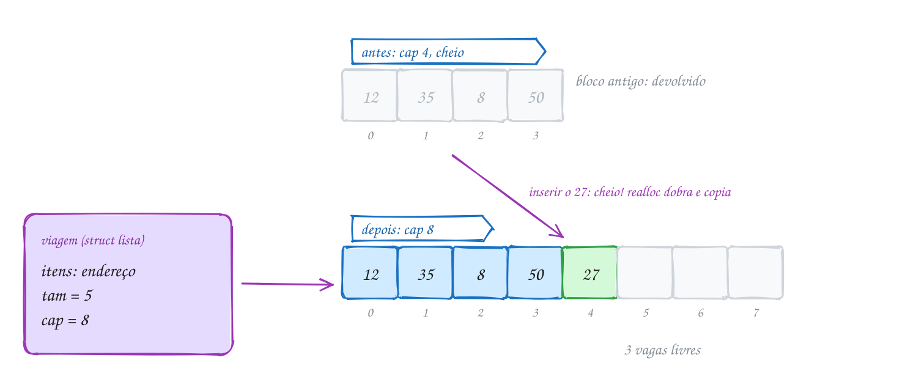
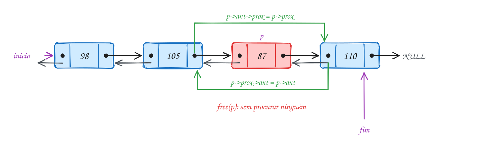
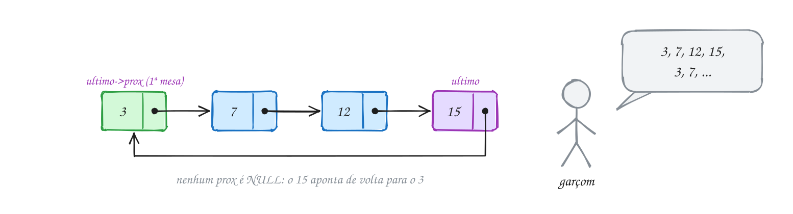
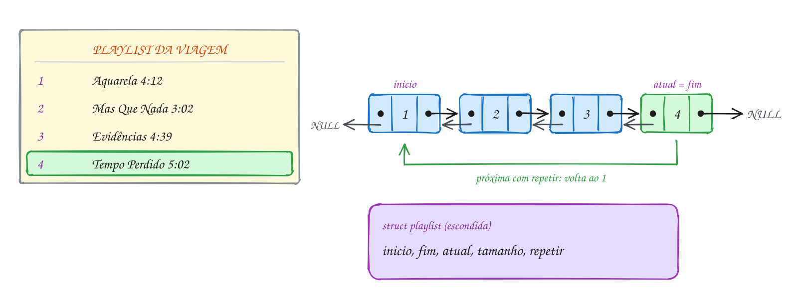

<!-- Gerado por _gerador. Para mudar este arquivo, edite _gerador/modulos/11-listas/ e rode: cd _gerador && npm run gerar -->

# Módulo 11 · Listas

O vetor tem tamanho fixo, mas você quase nunca sabe quantos itens vão chegar.
O módulo começa pelo vetor que dobra quando enche.

Depois vem a **lista encadeada**, a primeira estrutura feita só de ponteiros:
cada item mora num pedaço do heap e sabe onde está o próximo. Troca-se o
acesso direto pela liberdade de inserir e remover sem empurrar ninguém. Seguem
busca, remoção, inserção em ordem, a lista dupla e a circular.

Toda operação de lista é "quem aponta para quem": desenhe os nós e as setas
antes de codar e compile com as flags de estudo, para o AddressSanitizer pegar
os erros de ponteiro.

## O que você vai aprender

- montar um **TAD lista sequencial** sobre um vetor que dobra com `realloc`, e
  o custo amortizado
- criar **nós** com struct autorreferenciada, inserir no início, percorrer e
  liberar uma **lista encadeada**
- **buscar** e **remover** com o par `ant`/`p`, e por que remover o primeiro
  nó é caso especial (e como eliminá-lo)
- manter uma **lista ordenada** inserindo no lugar certo
- usar a **lista dupla** para andar nos dois sentidos e remover em O(1)
- usar a **lista circular** para rodízios
- juntar tudo num **TAD playlist** com arquivo, callbacks e tipo opaco

## Antes de começar

Este módulo usa ponteiros (módulo 06, incluindo `No **inicio`, assunto 0049),
`malloc` e `free` (módulo 07), structs e `->` (módulo 08) e o padrão TAD
(assunto 0074). O vetor dinâmico estende o `realloc` do módulo 07 e a lista
encadeada é a base do módulo 12 (pilhas e filas), que reaproveita nós e setas
com outras regras de acesso.

Cada assunto traz `lista.h` (interface) e `lista.c` (implementação). O
comando compila o `lista.c` junto com o exemplo ou exercício:

```bash
gcc ~/LPEDC/A151.c ~/LPEDC/0076-lista.c -o ~/LPEDC/A151 && ~/LPEDC/A151
```

Nos exercícios, não repita o nome de uma função do `lista.c` (como
`lista_imprime`): o ligador reclama. Exercícios com outra estrutura trazem
tudo no arquivo. Nos desenhos, vermelho marca o nó que sai.

> [!NOTE]
> Nos exercícios de "ache o bug", o erro vem **de propósito**. Às vezes o
> `gcc` avisa; às vezes só o AddressSanitizer pega, ao rodar. Leia o relatório
> inteiro: ele traz o tipo do erro (`heap-use-after-free`,
> `heap-buffer-overflow`, `memory leaks`) e a linha.

| # | Assunto |
| --- | --- |
| [0075](#0075--vetor-dinâmico) | Vetor dinâmico |
| [0076](#0076--lista-encadeada) | Lista encadeada |
| [0077](#0077--busca-e-remoção) | Busca e remoção |
| [0078](#0078--lista-ordenada) | Lista ordenada |
| [0079](#0079--lista-dupla) | Lista dupla |
| [0080](#0080--lista-circular) | Lista circular |
| [0081](#0081--juntando-tudo) | Juntando tudo |

---

## 0075 · Vetor dinâmico

Você anota as despesas de uma viagem e não sabe quantas serão. Um
`int despesas[100]` desperdiça memória se forem 5 e estoura se forem 101.

A saída é um vetor que, quando a folga acaba, pede um vetor maior e copia os
itens.

Uma **lista sequencial** (ou **lista em vetor**) guarda os itens lado a lado,
na ordem da lista. Três campos a controlam: o endereço do vetor no heap
(`itens`), quantos itens estão em uso (`tam`) e quantos cabem (`cap`).
Enquanto `tam < cap`, inserir no fim é escrever em `itens[tam]`.

Com `tam == cap`, o `realloc` (assunto 0055) pede um bloco maior, copia os
itens e devolve o antigo. A prática é **dobrar a capacidade**.

O conjunto é um **TAD** (assunto 0074): `lista.h` diz **o que** a lista faz e
`lista.c` diz **como**, com a `struct lista` escondida.

A lista do exemplo começa com espaço para 2 despesas. A 3ª dobra para 4 e a
5ª (R$ 27) dobra para 8, copia os quatro valores e deixa três vagas:

<p align="center"></p>

A peça central do `lista.c` é a função que garante espaço antes de cada
inserção:

```c
struct lista {
    int *itens; // vetor no heap
    int tam;    // quantos itens estão em uso
    int cap;    // quantos itens cabem no vetor
};

// garante espaço para mais um item: se encheu, dobra
static bool garante_espaco(Lista *l) {
    if (l->tam < l->cap) return true;
    int nova_cap = l->cap * 2;
    int *novo = realloc(l->itens, nova_cap * sizeof(int));
    if (novo == NULL) return false; // l->itens continua valendo
    l->itens = novo;
    l->cap = nova_cap;
    return true;
}

bool lista_insere_fim(Lista *l, int valor) {
    if (!garante_espaco(l)) return false;
    l->itens[l->tam] = valor;
    l->tam++;
    return true;
}
```

E quem usa a lista só enxerga a interface de `lista.h`:

```c
#include <stdio.h>
#include "lista.h"

int main(void) {
    int despesas[] = {12, 35, 8, 50, 27}; // em reais
    Lista *viagem = lista_cria(2);        // começa com espaço para 2
    if (viagem == NULL) return 1;

    for (int i = 0; i < 5; i++) {
        lista_insere_fim(viagem, despesas[i]);
        printf("inseriu %2d: tam %d, cap %d\n", despesas[i],
               lista_tamanho(viagem), lista_capacidade(viagem));
    }
    lista_imprime(viagem);

    int total = 0;
    for (int i = 0; i < lista_tamanho(viagem); i++) {
        int valor;
        lista_pega(viagem, i, &valor);
        total += valor;
    }
    printf("total: R$ %d\n", total);

    lista_libera(viagem);
    return 0;
}
// Saída:
// inseriu 12: tam 1, cap 2
// inseriu 35: tam 2, cap 2
// inseriu  8: tam 3, cap 4
// inseriu 50: tam 4, cap 4
// inseriu 27: tam 5, cap 8
// [12, 35, 8, 50, 27]
// total: R$ 132
```

No fluxograma, "está cheio?" vem antes de escrever. Para o 27 a resposta é
Sim: o vetor dobra e só então o valor entra em `itens[4]`. Se o `realloc`
falhar, a função devolve `false` e a lista continua intacta:

<p align="center"></p>

Inserir ou remover no **meio** desloca todos os itens seguintes: O(n) no pior
caso, a posição 0 (exemplo A150). Ler a posição `i` é O(1).

> [!WARNING]
> Um `int *p = &itens[0];` guardado antes de inserir pode apontar para o bloco
> antigo, que o `realloc` devolveu. Guarde o índice. E nunca escreva
> `l->itens = realloc(l->itens, ...)`: com `NULL`, você perde o bloco antigo.

> [!TIP]
> **Por dentro do C:** dobrando, inserir n itens copia menos de 2n itens (1 +
> 2 + 4 + ... + n): O(1) **em média** por inserção (custo amortizado). De um
> em um, são cerca de n²/2 cópias. `lista_libera` faz dois `free`, o do vetor
> primeiro.

> [!NOTE]
> **Pergunta para você:** começando com `lista_cria(2)`, quantas vezes o
> `realloc` roda até a lista ter 100 itens? E qual é a capacidade final?
> Quantas vagas ficam sobrando?

### Hora de praticar

**Exemplo A149 · Quantas vezes o vetor mudou de casa**

```c
#include <stdio.h>
#include "0075-lista.h"

int main(void) {
    // capacidade 0 não existe: lista_cria corrige para 1
    Lista *passos = lista_cria(0);
    if (passos == NULL) return 1;
    printf("criou: tam %d, cap %d\n", lista_tamanho(passos), lista_capacidade(passos));

    // 20 dias de passos no app da academia (em milhares)
    int crescimentos = 0;
    for (int dia = 1; dia <= 20; dia++) {
        int cap_antes = lista_capacidade(passos);
        if (!lista_insere_fim(passos, 5 + dia % 4)) break;
        if (lista_capacidade(passos) != cap_antes) { // houve realloc
            crescimentos++;
            printf("dia %2d: cap %2d -> %2d\n", dia, cap_antes, lista_capacidade(passos));
        }
    }

    int tam = lista_tamanho(passos);
    int cap = lista_capacidade(passos);
    printf("%d itens, cap %d, %d vagas livres\n", tam, cap, cap - tam);
    printf("realloc: %d vezes\n", crescimentos);

    // posição fora da lista: lista_pega recusa e não mexe na variável
    int valor = -1;
    if (!lista_pega(passos, 20, &valor)) {
        printf("posição 20 não existe; valor continua %d\n", valor);
    }

    lista_libera(passos);
    return 0;
}
// Saída:
// criou: tam 0, cap 1
// dia  2: cap  1 ->  2
// dia  3: cap  2 ->  4
// dia  5: cap  4 ->  8
// dia  9: cap  8 -> 16
// dia 17: cap 16 -> 32
// 20 itens, cap 32, 12 vagas livres
// realloc: 5 vezes
// posição 20 não existe; valor continua -1
```

```bash
gcc ~/LPEDC/A149.c ~/LPEDC/0075-lista.c -o ~/LPEDC/A149 && ~/LPEDC/A149
```

**Exemplo A150 · Inserir e remover no meio: todo mundo se mexe**

```c
#include <stdio.h>
#include "0075-lista.h"

int main(void) {
    Lista *viagem = lista_cria(4);
    if (viagem == NULL) return 1;
    lista_insere_fim(viagem, 12);
    lista_insere_fim(viagem, 35);
    lista_insere_fim(viagem, 8);
    lista_insere_fim(viagem, 50);
    lista_imprime(viagem);

    // esqueceu o pedágio de R$ 19, que foi a segunda despesa
    lista_insere_em(viagem, 1, 19); // 35, 8 e 50 andam uma casa para a direita
    lista_imprime(viagem);

    // o R$ 8 foi reembolsado: sai da lista
    int tirado;
    if (lista_remove_em(viagem, 3, &tirado)) { // 50 anda uma casa para a esquerda
        printf("removeu R$ %d\n", tirado);
    }
    lista_imprime(viagem);

    // posição que não existe: a lista recusa em vez de estragar a memória
    if (!lista_insere_em(viagem, 9, 100)) {
        printf("posição 9 não existe (tamanho %d)\n", lista_tamanho(viagem));
    }

    lista_libera(viagem);
    return 0;
}
// Saída:
// [12, 35, 8, 50]
// [12, 19, 35, 8, 50]
// removeu R$ 8
// [12, 19, 35, 50]
// posição 9 não existe (tamanho 4)
```

```bash
gcc ~/LPEDC/A150.c ~/LPEDC/0075-lista.c -o ~/LPEDC/A150 && ~/LPEDC/A150
```

#### Exercícios

**Exercício E445** · ★☆☆

O medidor de glicose da sua mãe registrou estas leituras na semana (mg/dL):
98, 110, 87, 132, 105, 91. Usando só as funções de lista.h, crie uma lista
com capacidade inicial 4, insira as leituras no fim, mostre a lista, o
tamanho, a capacidade, a média (uma casa decimal) e a maior leitura.


```text
Saída esperada:
[98, 110, 87, 132, 105, 91]
tamanho 6, capacidade 8
média: 103.8
maior: 132
```

```bash
gcc ~/LPEDC/E445.c ~/LPEDC/0075-lista.c -o ~/LPEDC/E445 && ~/LPEDC/E445
```

**Exercício E447** · ★★☆

O pluviômetro da escola anota a chuva do dia em mm e grava -1 quando o
sensor falha. Usando SÓ a interface de lista.h, guarde as leituras
4, -1, 0, 12, -1, -1, 7 numa lista de capacidade inicial 4 e escreva:


```text
int posicao_de(const Lista *l, int valor)  primeira posição do valor, ou -1
int remove_todos(Lista *l, int valor)      tira todas as ocorrências e
                                           devolve quantas tirou
```


Mostre a lista, remova as falhas (-1) e mostre de novo.


```text
Saída esperada:
antes:  [4, -1, 0, 12, -1, -1, 7]
depois: [4, 0, 12, 7]
3 falhas removidas
```

```bash
gcc ~/LPEDC/E447.c ~/LPEDC/0075-lista.c -o ~/LPEDC/E447 && ~/LPEDC/E447
```

**Exercício E448** · ★★☆

Existem dois jeitos de tirar um item do meio de uma lista sequencial:


```text
deslocando: puxa todos os de depois uma casa para a esquerda (mantém a
            ordem; custa O(n))
trocando:   copia o ÚLTIMO item para o buraco e diminui o tamanho
            (bagunça a ordem; custa O(1))
```


Escreva as duas funções. Cada uma recebe o vetor, o endereço do tamanho e
a posição, e devolve quantos itens precisou mover (trocando move 1, ou 0
quando a posição já é a última). Teste tirando a posição 2 de duas cópias
das senhas 101 a 108. Depois, para sentir a diferença de custo, esvazie
as duas cópias tirando SEMPRE a posição 0 e mostre o total de movimentos
de cada uma:


```text
Saída esperada:
deslocando: [101, 102, 104, 105, 106, 107, 108]  movimentos: 5
trocando:   [101, 102, 108, 104, 105, 106, 107]  movimentos: 1
esvaziando pela frente: deslocando 21, trocando 6
```

```bash
gcc ~/LPEDC/E448.c ~/LPEDC/0075-lista.c -o ~/LPEDC/E448 && ~/LPEDC/E448
```

**Exercício E450** · ★★★

Um vetor que só cresce nunca devolve memória. Usando a struct Vet abaixo,
escreva vet_empurra (põe no fim; quando tam == cap, dobra a capacidade com
realloc) e duas funções que tiram o último item, guardam em *saiu e
encolhem o vetor pela metade (nunca abaixo de capacidade 2):


```text
bool vet_tira(Vet *v, int *saiu)         encolhe se tam <= cap / 4
bool vet_tira_metade(Vet *v, int *saiu)  encolhe se tam <= cap / 2
```


Some 1 em v->reallocs a cada realloc que der certo. No main: comece com um
vetor de cap 2, empurre 1 a 9, esvazie com vet_tira mostrando cada passo;
depois crie dois vetores com 1, 2, 3, 4 (tam 4, cap 4, reallocs zerado) e,
10 vezes, empurre 5 e tire, um com cada regra, mostrando os reallocs.


```text
Saída esperada:
empurrou 9: tam 9, cap 16
tirou 9: tam 8, cap 16
tirou 8: tam 7, cap 16
tirou 7: tam 6, cap 16
tirou 6: tam 5, cap 16
tirou 5: tam 4, cap 8
tirou 4: tam 3, cap 8
tirou 3: tam 2, cap 4
tirou 2: tam 1, cap 2
tirou 1: tam 0, cap 2
alternando com 1/2: 20 realloc
alternando com 1/4: 1 realloc
```

```bash
gcc ~/LPEDC/E450.c ~/LPEDC/0075-lista.c -o ~/LPEDC/E450 && ~/LPEDC/E450
```

---

## 0076 · Lista encadeada

No extrato do Pix, cada Pix novo entra na frente sem empurrar os antigos. No
vetor, inserir na posição 0 move todo mundo. A lista encadeada evita isso.

Uma **lista encadeada** (no Cormen, **lista ligada**) guarda cada item num
pedaço separado de memória, o **nó**: o valor e o endereço do próximo. O
último aponta para `NULL`. A lista inteira é o endereço do primeiro nó, o
**início** (o `L.head` do Cormen). Lista vazia é `inicio == NULL`.

O nó é uma **struct autorreferenciada**:

```c
typedef struct no {
    int valor;
    struct no *prox; // o próximo nó, ou NULL no último
} No;
```

Uma struct não pode conter a si mesma (teria tamanho infinito), mas pode
conter um **ponteiro** para si mesma: ele tem sempre 8 bytes.

Cada nó vem de um `malloc` e cai onde o heap tiver espaço: a ordem está nas
**setas**. Não existe `lista[2]`; para chegar ao terceiro nó, siga duas setas
a partir do início.

Três operações formam a base (no `lista.c` desta pasta):

- **inserir no início**: cria o nó, aponta o `prox` dele para o antigo início
  e devolve o novo nó como início. É O(1).
- **percorrer**: `for (p = inicio; p != NULL; p = p->prox)`, o "for de lista".
- **liberar**: um `free` por nó, guardando o próximo **antes** do `free`.

Inserir no **fim** com só o início guardado exige andar até o último nó,
O(n). Com um ponteiro para o último, vira O(1) (0079 e 0086).

```c
No *lista_insere_inicio(No *inicio, int valor) {
    No *novo = malloc(sizeof(No));
    if (novo == NULL) { // num programa pequeno, desistir é o mais honesto
        fprintf(stderr, "sem memória\n");
        exit(1);
    }
    novo->valor = valor;
    novo->prox = inicio; // o antigo primeiro vira o segundo
    return novo;         // o novo nó é o novo início
}
```

Aqui o nó fica à vista no `lista.h`; no módulo 12 volta a ficar escondido.

Chegam quatro Pix: R$ 20, 45, 10 e 80, e o 80 aparece primeiro. Embaixo, a
lista no heap: endereços fora de ordem, cada nó com o endereço do próximo:

<p align="center"></p>

```c
#include <stdio.h>
#include "lista.h"

int main(void) {
    No *extrato = NULL; // lista vazia

    // os Pix chegam nesta ordem: 20, 45, 10, 80
    extrato = lista_insere_inicio(extrato, 20);
    extrato = lista_insere_inicio(extrato, 45);
    extrato = lista_insere_inicio(extrato, 10);
    extrato = lista_insere_inicio(extrato, 80);

    lista_imprime(extrato); // o último a chegar aparece primeiro

    int total = 0;
    for (No *p = extrato; p != NULL; p = p->prox) { // percorrer: siga os prox
        total += p->valor;
    }
    printf("%d Pix, total R$ %d\n", lista_tamanho(extrato), total);

    lista_libera(extrato);
    return 0;
}
// Saída:
// 80 -> 10 -> 45 -> 20 -> NULL
// 4 Pix, total R$ 155
```

No fluxograma, o laço pergunta "ainda tem nó?" antes de cada passo. O `p` vai
do 80 ao 10, ao 45 e ao 20, vira `NULL` e o laço para, com total R$ 155:

<p align="center"></p>

> [!WARNING]
> `lista_insere_inicio(extrato, 20);` sem o `extrato =` compila sem aviso e
> está errado: o novo início se perde e o nó vira vazamento. No `libera`, o
> erro comum é ler `p->prox` depois de `free(p)`.

> [!TIP]
> **Por dentro do C:** em 64 bits, `sizeof(No)` é 16: 4 bytes do `int`, 4 de
> **preenchimento** (o ponteiro começa em múltiplo de 8) e 8 do ponteiro. Cada
> `malloc` ainda gasta uns 16 bytes de controle. Percorrer é O(n) como no
> vetor, mas mais lento: o **cache** lê blocos de 64 bytes e os nós ficam
> espalhados.

> [!NOTE]
> **Pergunta para você:** se você inserir no início o 5, depois o 6 e depois
> o 7, o que `lista_imprime` mostra? E quantas vezes `lista_libera` chama
> `free`?

### Hora de praticar

**Exemplo A151 · Andando pelas setas: o terceiro nó e a lista vazia**

```c
#include <stdio.h>
#include "0076-lista.h"

int main(void) {
    // temperaturas da semana em Cuiabá, lidas de segunda a domingo
    int temps[] = {31, 34, 29, 36, 33, 28, 35};
    No *semana = NULL;
    for (int i = 0; i < 7; i++) {
        semana = lista_insere_inicio(semana, temps[i]);
    }
    lista_imprime(semana); // domingo na frente: a ordem saiu invertida

    // não existe semana[2]: para chegar no 3º nó, siga duas setas
    No *p = semana;
    for (int passo = 0; passo < 2 && p != NULL; passo++) {
        p = p->prox;
    }
    if (p != NULL) printf("3º nó: %d (sexta-feira)\n", p->valor);

    // percorrer também serve para procurar o maior
    int maior = semana->valor;
    for (No *q = semana->prox; q != NULL; q = q->prox) {
        if (q->valor > maior) maior = q->valor;
    }
    printf("maior: %d\n", maior);

    // a lista vazia não é caso especial: o laço só não roda nenhuma vez
    No *vazia = NULL;
    printf("vazia tem %d nós: ", lista_tamanho(vazia));
    lista_imprime(vazia);
    lista_libera(vazia); // não faz nada, e não quebra

    lista_libera(semana);
    return 0;
}
// Saída:
// 35 -> 28 -> 33 -> 36 -> 29 -> 34 -> 31 -> NULL
// 3º nó: 33 (sexta-feira)
// maior: 36
// vazia tem 0 nós: NULL
```

```bash
gcc ~/LPEDC/A151.c ~/LPEDC/0076-lista.c -o ~/LPEDC/A151 && ~/LPEDC/A151
```

**Exemplo A152 · Inserir no fim com um ponteiro para o último**

```c
#include <stdio.h>
#include <stdlib.h>
#include "0076-lista.h"

// põe "valor" depois do último nó; *inicio e *fim mudam quando precisa
static void insere_no_fim(No **inicio, No **fim, int valor) {
    No *novo = malloc(sizeof(No));
    if (novo == NULL) exit(1);
    novo->valor = valor;
    novo->prox = NULL;     // ele vai ser o último
    if (*inicio == NULL) { // lista vazia: é o primeiro e o último
        *inicio = novo;
    } else {
        (*fim)->prox = novo; // o antigo último aponta para ele
    }
    *fim = novo;
}

int main(void) {
    No *inicio = NULL;
    No *fim = NULL;

    insere_no_fim(&inicio, &fim, 20);
    insere_no_fim(&inicio, &fim, 45);
    insere_no_fim(&inicio, &fim, 10);
    insere_no_fim(&inicio, &fim, 80);

    lista_imprime(inicio); // agora na ordem de chegada
    printf("primeiro: %d, último: %d\n", inicio->valor, fim->valor);

    lista_libera(inicio);
    return 0;
}
// Saída:
// 20 -> 45 -> 10 -> 80 -> NULL
// primeiro: 20, último: 80
```

```bash
gcc ~/LPEDC/A152.c ~/LPEDC/0076-lista.c -o ~/LPEDC/A152 && ~/LPEDC/A152
```

#### Exercícios

**Exercício E451** · ★☆☆

O app do banco quer destacar os Pix "grandes". Monte o extrato inserindo
no início os Pix 30, 75, 12, 50, 120 e 64 (nesta ordem), mostre a lista e
escreva a função


```text
int conta_maiores(const No *inicio, int limite)
```


que devolve quantos valores são MAIORES que o limite. Use limite 50.


```text
Saída esperada:
64 -> 120 -> 50 -> 12 -> 75 -> 30 -> NULL
3 Pix acima de R$ 50
```

```bash
gcc ~/LPEDC/E451.c ~/LPEDC/0076-lista.c -o ~/LPEDC/E451 && ~/LPEDC/E451
```

**Exercício E453** · ★★☆

Os preços do hortifruti chegaram num vetor: {5, 18, 7, 22, 9}. Escreva:


```text
No *vetor_para_lista(const int v[], int n)
    monta a lista NA MESMA ORDEM do vetor, usando só lista_insere_inicio
int lista_para_vetor(const No *inicio, int v[], int max)
    copia a lista para o vetor (no máximo max itens) e devolve quantos
    copiou
```


Teste indo e voltando:


```text
Saída esperada:
lista: 5 -> 18 -> 7 -> 22 -> 9 -> NULL
vetor: 5 18 7 22 9
```

```bash
gcc ~/LPEDC/E453.c ~/LPEDC/0076-lista.c -o ~/LPEDC/E453 && ~/LPEDC/E453
```

**Exercício E454** · ★★☆

Uma lista é NULL ou um nó seguido de outra lista. Essa definição é
recursiva, e as funções também podem ser. O extrato recebeu os Pix 15, 60,
35, 90 e 25, inseridos no início. Escreva, SEM laço nenhum:


```text
void imprime_ao_contrario(const No *p)  do mais antigo para o mais novo
int tamanho_rec(const No *p)            quantos nós
```


```text
Saída esperada:
mais novo primeiro: 25 -> 90 -> 35 -> 60 -> 15 -> NULL
mais antigo primeiro: 15 60 35 90 25
tamanho (recursivo): 5
```

```bash
gcc ~/LPEDC/E454.c ~/LPEDC/0076-lista.c -o ~/LPEDC/E454 && ~/LPEDC/E454
```

**Exercício E456** · ★★★

A fila de embarque foi montada ao contrário: 5 -> 4 -> 3 -> 2 -> 1 (monte
inserindo no início 1, 2, 3, 4 e 5). Escreva No *inverte(No *inicio), que
inverte a lista SÓ MEXENDO NOS PONTEIROS: nada de malloc, nada de trocar
os valores, nada de vetor auxiliar. Ela devolve o novo início. Mostre a
fila antes e depois e teste também com a lista vazia e com uma lista de
um nó só (o valor 7).


```text
Saída esperada:
antes:  5 -> 4 -> 3 -> 2 -> 1 -> NULL
depois: 1 -> 2 -> 3 -> 4 -> 5 -> NULL
vazia:  NULL
um só:  7 -> NULL
```

```bash
gcc ~/LPEDC/E456.c ~/LPEDC/0076-lista.c -o ~/LPEDC/E456 && ~/LPEDC/E456
```

---

## 0077 · Busca e remoção

Na barbearia, as senhas esperam numa lista: 31, 17, 42, 8. O 42 desiste e sai
do meio: o 17 passa a ter o 8 como próximo.

**Buscar** é percorrer até achar, O(n). A função devolve o **endereço do nó**
(ou `NULL`), e com ele você lê ou muda o valor:

```c
No *lista_busca(No *inicio, int valor) {
    No *p = inicio;
    while (p != NULL && p->valor != valor) { // o teste do NULL vem primeiro
        p = p->prox;
    }
    return p; // o nó, ou NULL se a lista acabou
}
```

**Remover** o nó `p` exige que o **anterior** aponte para o seguinte, e a
lista simples não tem caminho de volta. Percorra com **dois ponteiros**:
`ant` anda um passo atrás de `p`.

Achado o nó, são dois casos:

- `ant == NULL`: o nó é o **primeiro**; é a variável `inicio` do `main` que
  precisa mudar.
- senão: `ant->prox = p->prox`, e o anterior pula o `p`.

O `free(p)` vem depois de religar. Como remover o primeiro muda o início, a
função recebe o **endereço** do início: `No **inicio` (assunto 0049). É o
outro estilo comum; a inserção do 0076 devolvia o início novo.

```c
bool lista_remove(No **inicio, int valor) {
    No *ant = NULL;    // sempre um passo atrás de p
    No *p = *inicio;
    while (p != NULL && p->valor != valor) {
        ant = p;
        p = p->prox;
    }
    if (p == NULL) return false; // não achou
    if (ant == NULL) {
        *inicio = p->prox;       // era o primeiro: o início anda
    } else {
        ant->prox = p->prox;     // o anterior pula o p
    }
    free(p);
    return true;
}
```

Para tirar o 42, o laço para com `p` no 42 e `ant` no 17. A seta do 17 passa
a apontar para o 8, e o nó do 42 volta para o heap:

<p align="center"></p>

```c
#include <stdio.h>
#include "lista.h"

int main(void) {
    No *fila = NULL;
    fila = lista_insere_inicio(fila, 8);
    fila = lista_insere_inicio(fila, 42);
    fila = lista_insere_inicio(fila, 17);
    fila = lista_insere_inicio(fila, 31);
    lista_imprime(fila);

    // a senha 42 ainda está esperando?
    No *achou = lista_busca(fila, 42);
    if (achou != NULL) printf("senha %d: na fila\n", achou->valor);

    // o 42 desistiu: sai do meio
    lista_remove(&fila, 42);
    lista_imprime(fila);

    // o 31 foi atendido: sai do começo (o início muda)
    lista_remove(&fila, 31);
    lista_imprime(fila);

    // o 99 nunca esteve na fila
    if (!lista_remove(&fila, 99)) printf("senha 99: não está na fila\n");

    lista_libera(fila);
    return 0;
}
// Saída:
// 31 -> 17 -> 42 -> 8 -> NULL
// senha 42: na fila
// 31 -> 17 -> 8 -> NULL
// 17 -> 8 -> NULL
// senha 99: não está na fila
```

No fluxograma, `ant` é o 17 (não `NULL`), então o caminho vai por `ant->prox =
p->prox`. Na remoção do 31, iria por `início = p->prox`:

<p align="center"></p>

O exemplo A154 elimina o caso especial com um **nó-cabeça**, um nó de mentira
no começo: todo nó de verdade passa a ter anterior. O Cormen usa a
**sentinela** `L.nil` (assunto 0174).

> [!WARNING]
> A ordem do `&&` importa. Em `while (p->valor != valor && p != NULL)`, o
> `p->valor` é lido antes de testar `p` e quebra quando o valor não está na
> lista. Com `p != NULL` primeiro, o curto-circuito (assunto 0013) evita a
> leitura.

> [!TIP]
> **Por dentro do C:** `*inicio = p->prox` altera a variável `fila` do `main`.
> Um `No **pp` que anda por `pp = &(*pp)->prox` dispensa o `ant` (aponta para
> "quem aponta para o nó atual"), e a remoção vira `No *p = *pp; *pp =
> p->prox; free(p);`, sem `if`. Religar é O(1); achar o nó é O(n).

> [!NOTE]
> **Pergunta para você:** se a lista fosse `42 -> 17 -> 42 -> 8` e você
> chamasse `lista_remove(&fila, 42)` uma vez, qual 42 sairia? Por qual caminho
> do fluxograma a remoção passaria?

### Hora de praticar

**Exemplo A153 · Buscar por condição e tirar o último**

```c
#include <stdio.h>
#include "0077-lista.h"

// variação da busca: em vez de "igual a", o primeiro nó "acima de" limite
static No *busca_acima(No *inicio, int limite) {
    No *p = inicio;
    while (p != NULL && p->valor <= limite) {
        p = p->prox;
    }
    return p; // o nó, ou NULL se ninguém passou do limite
}

int main(void) {
    // contas do mês, em reais
    No *contas = NULL;
    contas = lista_insere_inicio(contas, 480);
    contas = lista_insere_inicio(contas, 99);
    contas = lista_insere_inicio(contas, 135);
    contas = lista_insere_inicio(contas, 62);
    lista_imprime(contas);

    No *cara = busca_acima(contas, 100);
    if (cara != NULL) printf("primeira acima de R$ 100: %d\n", cara->valor);
    if (busca_acima(contas, 500) == NULL) printf("nenhuma acima de R$ 500\n");

    // tirar o ÚLTIMO: o anterior dele (99) passa a apontar para NULL
    lista_remove(&contas, 480);
    lista_imprime(contas);

    // tirar até sobrar um nó e depois o único: o início vira NULL
    lista_remove(&contas, 135);
    lista_remove(&contas, 62);
    lista_imprime(contas);
    lista_remove(&contas, 99);
    lista_imprime(contas);

    // na lista vazia, buscar e remover só devolvem "não achei"
    if (lista_busca(contas, 62) == NULL && !lista_remove(&contas, 62)) {
        printf("lista vazia: nada para buscar nem tirar\n");
    }

    lista_libera(contas);
    return 0;
}
// Saída:
// 62 -> 135 -> 99 -> 480 -> NULL
// primeira acima de R$ 100: 135
// nenhuma acima de R$ 500
// 62 -> 135 -> 99 -> NULL
// 99 -> NULL
// NULL
// lista vazia: nada para buscar nem tirar
```

```bash
gcc ~/LPEDC/A153.c ~/LPEDC/0077-lista.c -o ~/LPEDC/A153 && ~/LPEDC/A153
```

**Exemplo A154 · Nó-cabeça: a remoção sem caso especial**

```c
#include <stdio.h>
#include <stdlib.h>
#include "0077-lista.h"

// Com um nó-cabeça (um nó "de mentira" no começo, cujo valor ninguém lê),
// todo nó de verdade tem um anterior. O primeiro não é mais especial.

static void cab_insere(No *cabeca, int valor) {
    No *novo = malloc(sizeof(No));
    if (novo == NULL) exit(1);
    novo->valor = valor;
    novo->prox = cabeca->prox; // entra logo depois da cabeça
    cabeca->prox = novo;
}

static int cab_remove(No *cabeca, int valor) {
    No *ant = cabeca;          // nunca é NULL
    No *p = cabeca->prox;
    while (p != NULL && p->valor != valor) {
        ant = p;
        p = p->prox;
    }
    if (p == NULL) return 0;
    ant->prox = p->prox;       // um caso só: vale até para o primeiro
    free(p);
    return 1;
}

int main(void) {
    No cabeca = {0, NULL};     // a cabeça pode até morar na pilha
    cab_insere(&cabeca, 8);
    cab_insere(&cabeca, 42);
    cab_insere(&cabeca, 17);
    cab_insere(&cabeca, 31);
    lista_imprime(cabeca.prox); // a lista de verdade começa depois da cabeça

    cab_remove(&cabeca, 31);    // o primeiro: nenhum if especial
    cab_remove(&cabeca, 8);     // o último
    lista_imprime(cabeca.prox);

    lista_libera(cabeca.prox);  // a cabeça não veio do malloc: não leva free
    return 0;
}
// Saída:
// 31 -> 17 -> 42 -> 8 -> NULL
// 17 -> 42 -> NULL
```

```bash
gcc ~/LPEDC/A154.c ~/LPEDC/0077-lista.c -o ~/LPEDC/A154 && ~/LPEDC/A154
```

#### Exercícios

**Exercício E457** · ★☆☆

A fila do açougue tem as senhas 33 -> 40 -> 7 -> 25 -> 12 (monte inserindo
no início 12, 25, 7, 40 e 33). Escreva int posicao(const No *inicio, int
valor), que devolve a posição do valor contando a partir de 1, ou 0 se ele
não está na lista. O programa lê duas senhas do teclado (sem mostrar
perguntas), confere o retorno do scanf e responde sobre cada uma.


```text
Entrada:
7
50
```


```text
Saída esperada:
senha 7 está na posição 3
senha 50 não está na fila
```

```bash
gcc ~/LPEDC/E457.c ~/LPEDC/0077-lista.c -o ~/LPEDC/E457 && ~/LPEDC/E457
```

**Exercício E459** · ★★☆

O sensor de temperatura da estufa grava 0 quando falha. Escreva
int remove_todos(No **inicio, int valor), que tira TODOS os nós com o
valor numa passada só (sem chamar lista_remove em laço) e devolve quantos
tirou. No main, monte a lista com as leituras 0, 19, 0, 21, 0, 0
inseridas no início, mostre antes e depois da remoção dos 0 e o total
removido. Depois monte uma lista só com dois 0, remova-os e mostre que
ela ficou vazia (imprima "só falhas: NULL (2 removidas)" com o total
devolvido pela função).


```text
Saída esperada:
antes:  0 -> 0 -> 21 -> 0 -> 19 -> 0 -> NULL
depois: 21 -> 19 -> NULL
4 leituras removidas
só falhas: NULL (2 removidas)
```

```bash
gcc ~/LPEDC/E459.c ~/LPEDC/0077-lista.c -o ~/LPEDC/E459 && ~/LPEDC/E459
```

**Exercício E460** · ★★☆

Num leilão online, a cada rodada o MENOR lance sai da disputa. Os lances
estão numa lista de structs Lance (declarada abaixo). Escreva


```text
Lance *lance_insere(Lance *inicio, const char *nome, int valor)  no início
void lance_imprime(const Lance *inicio)  formato do exemplo
void lance_libera(Lance *inicio)
bool remove_menor(Lance **inicio, Lance *saiu)
```


remove_menor acha o nó de menor valor, copia os dados dele para *saiu, tira
o nó da lista e devolve true (ou false se a lista estiver vazia). Insira
Ana 150, Bruno 90, Carla 210 e Davi 175 (nesta ordem), mostre a lista e
rode duas rodadas.


```text
Saída esperada:
Davi R$ 175 -> Carla R$ 210 -> Bruno R$ 90 -> Ana R$ 150 -> NULL
saiu Bruno (R$ 90)
Davi R$ 175 -> Carla R$ 210 -> Ana R$ 150 -> NULL
saiu Ana (R$ 150)
Davi R$ 175 -> Carla R$ 210 -> NULL
```

```bash
gcc ~/LPEDC/E460.c ~/LPEDC/0077-lista.c -o ~/LPEDC/E460 && ~/LPEDC/E460
```

**Exercício E462** · ★★★

O vagão do MEIO do trem precisa ir para a manutenção, e você só pode
percorrer a lista UMA vez (sem contar os nós antes). Escreva
bool remove_meio(No **inicio), com dois ponteiros que saem do início: um
anda um nó por vez e o outro anda dois. Com quantidade par, o meio é o
SEGUNDO dos dois do centro. No main, monte a lista 1 a 7, a lista
10, 20, 30, 40, 50, 60 e a lista de um nó só (99), inserindo no início;
remova o meio de cada uma e imprima as três.


```text
Saída esperada:
1 -> 2 -> 3 -> 5 -> 6 -> 7 -> NULL
10 -> 20 -> 30 -> 50 -> 60 -> NULL
NULL
```

```bash
gcc ~/LPEDC/E462.c ~/LPEDC/0077-lista.c -o ~/LPEDC/E462 && ~/LPEDC/E462
```

---

## 0078 · Lista ordenada

Na clínica, as ligações chegam fora de ordem, mas a agenda tem de estar
sempre em ordem de horário. Em vez de reordenar tudo, cada marcação entra no
lugar certo.

Uma **lista ordenada** mantém os nós em ordem a cada inserção. A **inserção
ordenada** anda com o par `ant`/`p` (assunto 0077) enquanto os valores forem
menores que o novo. Ao parar, `p` é o primeiro nó maior ou igual ao novo (ou
`NULL`) e `ant` vem antes dele. O novo entra **entre** os dois, religando duas
setas, nesta ordem:

1. `novo->prox = p`;
2. `ant->prox = novo`.

Se `ant` for `NULL`, o novo é o menor e vira o início. O fim não é caso
especial: com `p == NULL`, o passo 1 grava `NULL` em `novo->prox`.

```c
No *lista_insere_ordenado(No *inicio, int valor) {
    No *novo = cria_no(valor);
    No *ant = NULL;
    No *p = inicio;
    while (p != NULL && p->valor < valor) { // anda enquanto os de lá são menores
        ant = p;
        p = p->prox;
    }
    novo->prox = p;         // o novo aponta para o primeiro maior (ou NULL)
    if (ant == NULL) {
        return novo;        // é o menor de todos: vira o início
    }
    ant->prox = novo;       // o anterior passa a apontar para o novo
    return inicio;
}
```

A ordem também ajuda na **busca**: dá para desistir ao passar do valor.
Procurando 11:00, a busca para no 14:30.

A agenda do exemplo tem 09:00, 14:30 e 16:00 quando chega a ligação das
10:15. O laço passa pelo 09:00 e para no 14:30 (`14:30 < 10:15` é falso). O
novo nó aponta para o 14:30 e o 09:00 aponta para ele:

<p align="center"></p>

O horário é um `int` hhmm (1430 é 14:30):

```c
#include <stdio.h>
#include "lista.h"

// cada horário é um int hhmm: 1430 quer dizer 14:30
static void mostra_agenda(const No *inicio) {
    for (const No *p = inicio; p != NULL; p = p->prox) {
        printf("%02d:%02d -> ", p->valor / 100, p->valor % 100);
    }
    printf("fim do dia\n");
}

int main(void) {
    No *agenda = NULL;
    int marcacoes[] = {1430, 900, 1600, 1015}; // na ordem em que ligaram

    for (int i = 0; i < 4; i++) {
        agenda = lista_insere_ordenado(agenda, marcacoes[i]);
        mostra_agenda(agenda);
    }

    // 11:00 está livre? A busca para no 14:30, sem olhar o resto
    if (lista_busca_ordenada(agenda, 1100) == NULL) printf("11:00 livre\n");

    lista_libera(agenda);
    return 0;
}
// Saída:
// 14:30 -> fim do dia
// 09:00 -> 14:30 -> fim do dia
// 09:00 -> 14:30 -> 16:00 -> fim do dia
// 09:00 -> 10:15 -> 14:30 -> 16:00 -> fim do dia
// 11:00 livre
```

No fluxograma, o laço roda uma vez e sai pelo Não no 14:30. Como `ant` é o
09:00, o caminho termina em `ant->prox = novo`. Na ligação das 9:00, `ant ==
NULL` e o novo virou o início:

<p align="center"></p>

O critério está na comparação do `while`: com `strcmp(p->nome, nome) < 0`, a
mesma inserção ordena por nome (exemplo A156).

> [!WARNING]
> O caso mais esquecido é o **novo menor que todos**: `ant` fica `NULL` e
> `ant->prox = novo` sem o `if` derruba o programa. Teste início, meio e fim.
> Com `<`, um valor repetido entra **antes** dos iguais; com `<=`, **depois**.

> [!TIP]
> **Por dentro do C:** a inserção ordenada é O(n) no pior caso; montar n itens
> custa O(n²). A busca continua O(n): chegar ao meio exige andar n/2 nós, sem
> busca binária. No vetor ordenado é o inverso: busca O(log n), inserção O(n).

> [!NOTE]
> **Pergunta para você:** inserindo 50, 40, 30, 20 e 10, nesta ordem, quantas
> vezes o corpo do `while` roda no total? E inserindo 10, 20, 30, 40 e 50?

### Hora de praticar

**Exemplo A155 · Tabela do campeonato: maior primeiro**

```c
#include <stdio.h>
#include <stdlib.h>
#include "0078-lista.h"

// mesma inserção ordenada, com o critério virado: anda enquanto os de lá
// têm MAIS pontos. Em caso de empate, quem chega fica atrás (>=)
static No *insere_decrescente(No *inicio, int pontos) {
    No *novo = malloc(sizeof(No));
    if (novo == NULL) exit(1);
    novo->valor = pontos;
    No *ant = NULL;
    No *p = inicio;
    while (p != NULL && p->valor >= pontos) {
        ant = p;
        p = p->prox;
    }
    novo->prox = p;
    if (ant == NULL) return novo;
    ant->prox = novo;
    return inicio;
}

int main(void) {
    No *tabela = NULL;
    tabela = insere_decrescente(tabela, 40); // lista vazia
    tabela = insere_decrescente(tabela, 52); // maior de todos: vira o início
    tabela = insere_decrescente(tabela, 31); // menor de todos: vai para o fim
    tabela = insere_decrescente(tabela, 45); // cai no meio
    lista_imprime(tabela);

    tabela = insere_decrescente(tabela, 40); // empate: entra DEPOIS do outro 40
    lista_imprime(tabela);

    // líder e lanterna saem de graça das pontas
    No *ultimo = tabela;
    while (ultimo->prox != NULL) ultimo = ultimo->prox;
    printf("líder: %d pontos, lanterna: %d pontos\n", tabela->valor, ultimo->valor);

    // as funções do lista.h supõem ordem CRESCENTE: não use a busca
    // ordenada aqui, ela desistiria logo no 52
    if (lista_busca_ordenada(tabela, 45) == NULL) {
        printf("busca crescente numa lista decrescente: não achou o 45\n");
    }

    lista_libera(tabela);
    return 0;
}
// Saída:
// 52 -> 45 -> 40 -> 31 -> NULL
// 52 -> 45 -> 40 -> 40 -> 31 -> NULL
// líder: 52 pontos, lanterna: 31 pontos
// busca crescente numa lista decrescente: não achou o 45
```

```bash
gcc ~/LPEDC/A155.c ~/LPEDC/0078-lista.c -o ~/LPEDC/A155 && ~/LPEDC/A155
```

**Exemplo A156 · A chamada da turma em ordem alfabética**

```c
#include <stdio.h>
#include <stdlib.h>
#include <string.h>

// mesma ideia com strings: o critério de ordem vira strcmp
typedef struct aluno {
    char nome[20];
    struct aluno *prox;
} Aluno;

static Aluno *insere_nome(Aluno *inicio, const char *nome) {
    Aluno *novo = malloc(sizeof(Aluno));
    if (novo == NULL) exit(1);
    snprintf(novo->nome, sizeof novo->nome, "%s", nome);
    Aluno *ant = NULL;
    Aluno *p = inicio;
    while (p != NULL && strcmp(p->nome, nome) < 0) { // p vem antes no alfabeto
        ant = p;
        p = p->prox;
    }
    novo->prox = p;
    if (ant == NULL) return novo;
    ant->prox = novo;
    return inicio;
}

int main(void) {
    const char *matriculas[] = {"Renata", "Caio", "Yara", "Bruna", "Igor"};
    Aluno *turma = NULL;
    for (int i = 0; i < 5; i++) turma = insere_nome(turma, matriculas[i]);

    int numero = 1;
    for (Aluno *p = turma; p != NULL; p = p->prox) {
        printf("%d. %s\n", numero++, p->nome);
    }

    while (turma != NULL) { // libera
        Aluno *seguinte = turma->prox;
        free(turma);
        turma = seguinte;
    }
    return 0;
}
// Saída:
// 1. Bruna
// 2. Caio
// 3. Igor
// 4. Renata
// 5. Yara
```

```bash
gcc ~/LPEDC/A156.c ~/LPEDC/0078-lista.c -o ~/LPEDC/A156 && ~/LPEDC/A156
```

#### Exercícios

**Exercício E463** · ★☆☆

As notas do simulado saíram nesta ordem: 7, 3, 9, 5, 10, 1. Insira todas
com lista_insere_ordenado, mostre a lista e depois a menor e a maior nota.


```text
Saída esperada:
1 -> 3 -> 5 -> 7 -> 9 -> 10 -> NULL
menor: 1, maior: 10
```

```bash
gcc ~/LPEDC/E463.c ~/LPEDC/0078-lista.c -o ~/LPEDC/E463 && ~/LPEDC/E463
```

**Exercício E465** · ★★☆

O entregador anotou os números das casas da rua, com repetidos: 5, 3, 5,
8, 3, 3, 1. Insira tudo em ordem e escreva


```text
int remove_repetidos(No *inicio)
```


que deixa um só de cada número e devolve quantos nós tirou.


```text
Saída esperada:
antes:  1 -> 3 -> 3 -> 3 -> 5 -> 5 -> 8 -> NULL
depois: 1 -> 3 -> 5 -> 8 -> NULL
3 repetidos removidos
```

```bash
gcc ~/LPEDC/E465.c ~/LPEDC/0078-lista.c -o ~/LPEDC/E465 && ~/LPEDC/E465
```

**Exercício E466** · ★★☆

Duas linhas de ônibus saem do mesmo terminal. Os horários de cada uma
(em minutos depois das 6h) estão em listas crescentes:


```text
linha 101: 0 -> 25 -> 50 -> 75
linha 202: 10 -> 25 -> 40 -> 90
```


Monte as duas com lista_insere_ordenado (entrando fora de ordem) e escreva
No *intercala(No *a, No *b), que junta as duas numa lista só, também
crescente, SEM criar nenhum nó novo: só religando os que existem. Mostre
o resultado.


```text
Saída esperada:
0 -> 10 -> 25 -> 25 -> 40 -> 50 -> 75 -> 90 -> NULL
```

```bash
gcc ~/LPEDC/E466.c ~/LPEDC/0078-lista.c -o ~/LPEDC/E466 && ~/LPEDC/E466
```

**Exercício E468** · ★★★

Os pedidos do delivery chegaram fora de ordem: 3 -> 7 -> 1 -> 9 -> 4 (monte
inserindo no início 4, 9, 1, 7 e 3). Escreva No *ordena(No *inicio, int
*passos), que deixa a lista em ordem crescente pelo método da inserção,
SÓ RELIGANDO os nós: nada de malloc, nada de free, nada de trocar valores
entre nós. Para medir o custo, some 1 em *passos cada vez que o laço de
encaixe anda um nó. Mostre antes, depois e os passos para a lista dos
pedidos e para o pior caso, uma lista que já chega crescente 1 a 5.


```text
Saída esperada:
antes:  3 -> 7 -> 1 -> 9 -> 4 -> NULL
depois: 1 -> 3 -> 4 -> 7 -> 9 -> NULL  (6 passos)
antes:  1 -> 2 -> 3 -> 4 -> 5 -> NULL
depois: 1 -> 2 -> 3 -> 4 -> 5 -> NULL  (10 passos)
```

```bash
gcc ~/LPEDC/E468.c ~/LPEDC/0078-lista.c -o ~/LPEDC/E468 && ~/LPEDC/E468
```

---

## 0079 · Lista dupla

No pátio, o terceiro vagão de um trem de minério está com o freio travado. O
manobrista solta os dois engates dele e liga o segundo vagão ao quarto, sem
voltar à locomotiva para descobrir quem vem antes.

Na lista simples, remover exige o anterior, e achá-lo custa percorrer desde o
início. Na **lista duplamente encadeada** (no
Cormen, **duplamente ligada**, com `next` e `prev`), cada nó guarda `prox` e
`ant`. Assim:

- dá para andar nos **dois sentidos**;
- dá para remover um nó conhecendo **só ele**, em O(1);
- com um ponteiro para o **último** nó, inserir no fim vira O(1).

A lista desta pasta é uma struct com as duas pontas e o tamanho:

```c
typedef struct no {
    int valor;
    struct no *ant;  // o anterior, ou NULL no primeiro
    struct no *prox; // o próximo, ou NULL no último
} No;

typedef struct {
    No *inicio;
    No *fim;
    int tamanho;
} Lista;
```

Uma regra não pode quebrar: para todo nó `p` que não é o último,
`p->prox->ant == p`. As setas mudam **aos pares**; o erro comum é esquecer uma.

Remover `p` desvia as duas setas que chegam nele, cada uma com seu caso de
borda:

```c
void lista_remove_no(Lista *l, No *p) {
    if (p->ant == NULL) l->inicio = p->prox;  // era o primeiro
    else p->ant->prox = p->prox;              // o anterior pula o p
    if (p->prox == NULL) l->fim = p->ant;     // era o último
    else p->prox->ant = p->ant;               // o seguinte pula o p para trás
    free(p);
    l->tamanho--;
}
```

O trem tem vagões de 98, 105, 87 e 110 toneladas. Com `p` no de 87, o 105
passa a apontar para o 110, e o 110 aponta de volta para o 105:

<p align="center"></p>

```c
#include <stdio.h>
#include "lista.h"

int main(void) {
    Lista trem;
    lista_inicia(&trem);
    int cargas[] = {98, 105, 87, 110}; // toneladas, da locomotiva para o fim
    for (int i = 0; i < 4; i++) lista_insere_fim(&trem, cargas[i]);

    printf("da locomotiva: ");
    lista_imprime(&trem);
    printf("do fim:        ");
    lista_imprime_reverso(&trem);

    No *vagao = lista_busca(&trem, 87);
    if (vagao != NULL) {
        lista_remove_no(&trem, vagao); // sem procurar o anterior: p->ant
        printf("desengatou o vagão de 87 t (%d vagões)\n", trem.tamanho);
    }

    printf("da locomotiva: ");
    lista_imprime(&trem);
    printf("do fim:        ");
    lista_imprime_reverso(&trem);

    lista_libera(&trem);
    return 0;
}
// Saída:
// da locomotiva: 98 <-> 105 <-> 87 <-> 110
// do fim:        110 <-> 87 <-> 105 <-> 98
// desengatou o vagão de 87 t (3 vagões)
// da locomotiva: 98 <-> 105 <-> 110
// do fim:        110 <-> 105 <-> 98
```

O fluxograma faz duas perguntas, uma por ponta. O vagão de 87 passa pelos dois
Não. Para o primeiro vagão, a primeira daria Sim; para o último, a segunda:

<p align="center"></p>

Imprimir de trás para frente é o `for` de sempre, de `l->fim` com `p =
p->ant`. O exemplo A158 usa a ida e volta num controle remoto ("canal
seguinte", "canal anterior").

> [!WARNING]
> Com uma seta faltando, a lista dupla **parece certa**: se a inserção esquecer
> o `ant`, só a volta sai errada. Imprima **nos dois sentidos**. Na remoção,
> os dois casos de borda são obrigatórios: `p->ant->prox` no primeiro nó
> acessa `NULL`, e esquecer o `fim` o deixa apontando para memória liberada.

> [!TIP]
> **Por dentro do C:** em 64 bits, `sizeof(No)` passa de 16 para 24 bytes (4 do
> `int`, 4 de preenchimento, dois ponteiros de 8): 50% a mais por nó, o preço
> das remoções em O(1) e da volta.

> [!NOTE]
> **Pergunta para você:** se `lista_insere_fim` esquecesse a linha `novo->ant =
> l->fim;`, o que `lista_imprime` mostraria para o trem do exemplo? E
> `lista_imprime_reverso`?

### Hora de praticar

**Exemplo A157 · Mexendo nas duas pontas: a fila do pronto-socorro**

```c
#include <stdio.h>
#include "0079-lista.h"

static void mostra(const Lista *l) {
    printf("(%d) ", l->tamanho);
    lista_imprime(l);
}

int main(void) {
    Lista fila;
    lista_inicia(&fila);

    // fichas de atendimento: normais entram atrás, urgente entra na frente
    lista_insere_fim(&fila, 31);
    lista_insere_fim(&fila, 32);
    lista_insere_fim(&fila, 33);
    lista_insere_inicio(&fila, 90); // caso urgente: passa na frente
    mostra(&fila);

    // atender o primeiro: remover o início é O(1)
    printf("atende %d\n", fila.inicio->valor);
    lista_remove_no(&fila, fila.inicio);

    // o último desistiu: com o ponteiro fim, tirar o último também é O(1)
    printf("desistiu %d\n", fila.fim->valor);
    lista_remove_no(&fila, fila.fim);
    mostra(&fila);

    // esvaziando pela frente: no fim, as DUAS pontas voltam a NULL
    while (fila.inicio != NULL) lista_remove_no(&fila, fila.inicio);
    printf("vazia: inicio %s, fim %s, tamanho %d\n",
           fila.inicio == NULL ? "NULL" : "?",
           fila.fim == NULL ? "NULL" : "?", fila.tamanho);

    // e a lista vazia continua pronta para uso
    lista_insere_inicio(&fila, 34);
    printf("um só: início e fim são o mesmo nó? %s\n",
           fila.inicio == fila.fim ? "sim" : "não");

    lista_libera(&fila);
    return 0;
}
// Saída:
// (4) 90 <-> 31 <-> 32 <-> 33
// atende 90
// desistiu 33
// (2) 31 <-> 32
// vazia: inicio NULL, fim NULL, tamanho 0
// um só: início e fim são o mesmo nó? sim
```

```bash
gcc ~/LPEDC/A157.c ~/LPEDC/0079-lista.c -o ~/LPEDC/A157 && ~/LPEDC/A157
```

**Exemplo A158 · O controle remoto: canal seguinte e canal anterior**

```c
#include <stdio.h>
#include "0079-lista.h"

int main(void) {
    Lista canais;
    lista_inicia(&canais);
    int numeros[] = {2, 4, 5, 7, 11, 13};
    for (int i = 0; i < 6; i++) lista_insere_fim(&canais, numeros[i]);

    No *atual = canais.inicio;           // a TV liga no primeiro canal
    const char *apertos = ">>><<>>>>>";  // > próximo, < anterior

    printf("liga no %d\n", atual->valor);
    for (int i = 0; apertos[i] != '\0'; i++) {
        if (apertos[i] == '>' && atual->prox != NULL) {
            atual = atual->prox;         // anda para frente (no 13, fica)
        } else if (apertos[i] == '<' && atual->ant != NULL) {
            atual = atual->ant;          // anda para trás: só na lista dupla
        }
        printf("%c canal %d\n", apertos[i], atual->valor);
    }

    lista_libera(&canais);
    return 0;
}
// Saída:
// liga no 2
// > canal 4
// > canal 5
// > canal 7
// < canal 5
// < canal 4
// > canal 5
// > canal 7
// > canal 11
// > canal 13
// > canal 13
```

```bash
gcc ~/LPEDC/A158.c ~/LPEDC/0079-lista.c -o ~/LPEDC/A158 && ~/LPEDC/A158
```

#### Exercícios

**Exercício E469** · ★☆☆

O pátio de manobras quer saber o peso dos ÚLTIMOS 3 vagões do trem, os que
vão ser desengatados na próxima estação. Monte o trem com lista_insere_fim
(120, 95, 101, 88, 130 e 76 toneladas) e, começando do fim e andando com
ant, mostre os 3 últimos (do último para trás) e a soma deles. Não comece
do início.


```text
Saída esperada:
76 130 88
últimos 3: 294 t
```

```bash
gcc ~/LPEDC/E469.c ~/LPEDC/0079-lista.c -o ~/LPEDC/E469 && ~/LPEDC/E469
```

**Exercício E471** · ★★☆

Um palíndromo se lê igual nos dois sentidos. Com uma lista dupla dá para
conferir sem vetor nenhum: um ponteiro sai do início, outro sai do fim, e
os dois andam em direção ao meio comparando. Guarde cada letra como int
(char é número) e escreva:


```text
void monta(Lista *l, const char *palavra)   uma letra por nó, no fim
bool eh_palindromo(const Lista *l)
```


Teste com "radar", "trem", "arara" e "ab".


```text
Saída esperada:
radar: sim
trem: não
arara: sim
ab: não
```

```bash
gcc ~/LPEDC/E471.c ~/LPEDC/0079-lista.c -o ~/LPEDC/E471 && ~/LPEDC/E471
```

**Exercício E472** · ★★☆

Engatar um vagão no meio do trem mexe em QUATRO setas. Monte o trem 98, 105,
87, 110 com lista_insere_fim e escreva


```text
bool insere_depois(Lista *l, No *p, int valor)
```


que cria um nó com o valor logo depois do nó p (que está na lista), sem
esquecer o caso em que p é o último. Engate um vagão de 99 t depois do de
105 e um de 70 t depois do último. Mostre a lista nos dois sentidos
(lista_imprime e lista_imprime_reverso) e a quantidade de vagões.


```text
Saída esperada:
98 <-> 105 <-> 99 <-> 87 <-> 110 <-> 70
70 <-> 110 <-> 87 <-> 99 <-> 105 <-> 98
6 vagões
```

```bash
gcc ~/LPEDC/E472.c ~/LPEDC/0079-lista.c -o ~/LPEDC/E472 && ~/LPEDC/E472
```

**Exercício E474** · ★★★

Todo editor de texto tem um cursor que anda para os dois lados, e uma
lista dupla de letras é um jeito clássico de fazer isso: inserir e apagar
na posição do cursor custa O(1). Simule o teclado com a string de teclas


```text
"progamr#<<r>>a"
```


onde letra insere na posição do cursor, '<' anda uma letra para a
esquerda, '>' anda para a direita e '#' apaga a letra à esquerda do
cursor (o backspace). Nas pontas, '<', '>' e '#' não fazem nada. No fim,
mostre o texto com uma '|' onde está o cursor. Use uma lista dupla de
letras, com a struct escrita por você.


```text
Saída esperada:
texto: programa|
```

```bash
gcc ~/LPEDC/E474.c ~/LPEDC/0079-lista.c -o ~/LPEDC/E474 && ~/LPEDC/E474
```

---

## 0080 · Lista circular

O garçom do rodízio serve as mesas 3, 7, 12 e 15 e, na última, volta à 3: para
ele não existe fim, só "a próxima mesa".

Uma **lista circular** é uma lista encadeada em que o último nó aponta para o
**primeiro**, e não para `NULL`: os nós formam um anel. Serve para rodízios,
como a vez dos jogadores e a divisão da CPU. Na lista dupla, o círculo fecha
nos dois sentidos, como no Cormen, com uma sentinela (assunto 0174).

Convém guardar o ponteiro para o **último** nó: o primeiro é `ultimo->prox`.
Assim, inserir no início **e** no fim custa O(1); inserir no fim é inserir no
início e declarar o novo como último.

```c
No *lista_insere_inicio(No *ultimo, int valor) {
    No *novo = cria_no(valor);       // cria_no faz novo->prox = novo
    if (ultimo == NULL) return novo; // único nó: primeiro e último
    novo->prox = ultimo->prox;       // o novo aponta para o antigo primeiro
    ultimo->prox = novo;             // o último fecha o círculo no novo
    return ultimo;
}

No *lista_insere_fim(No *ultimo, int valor) {
    // inserir no fim = inserir no início e dizer que o novo é o último
    ultimo = lista_insere_inicio(ultimo, valor);
    return ultimo->prox;
}
```

Sem `NULL`, percorrer para ao **voltar ao ponto de partida**. Como o primeiro
passo já começa nele, o laço certo é o **do-while** (assunto 0021), que roda
o corpo antes de testar. A lista vazia (`ultimo == NULL`) é tratada antes.

No exemplo, o ponteiro da lista está na mesa 15 e a mesa 3 é `ultimo->prox`.
O garçom serve 6 vezes sem testar nada:

<p align="center"></p>

```c
#include <stdio.h>
#include "lista.h"

int main(void) {
    No *salao = NULL; // ponteiro para a ÚLTIMA mesa
    int mesas[] = {3, 7, 12, 15};
    for (int i = 0; i < 4; i++) salao = lista_insere_fim(salao, mesas[i]);
    lista_imprime(salao);

    // o garçom sai da primeira mesa e serve 6 vezes, sem nunca achar um fim
    printf("serve:");
    No *garcom = salao->prox;
    for (int i = 0; i < 6; i++) {
        printf(" %d", garcom->valor);
        garcom = garcom->prox;
    }
    printf("\n");

    lista_remove(&salao, 12);
    printf("a mesa 12 pagou e foi embora\n");
    lista_imprime(salao);

    lista_libera(salao);
    return 0;
}
// Saída:
// 3 -> 7 -> 12 -> 15 -> (volta ao 3)
// serve: 3 7 12 15 3 7
// a mesa 12 pagou e foi embora
// 3 -> 7 -> 15 -> (volta ao 3)
```

O fluxograma é o do `lista_imprime`: testa a lista vazia, põe `p` na mesa 3 e
repete mostrar, andar e perguntar "já voltei ao primeiro?". Com 4 mesas, a
resposta é Não três vezes e Sim na quarta:

<p align="center"></p>

No **problema de Josephus**, pessoas em roda eliminam uma a cada k passos. O
exemplo A160 o resolve com a batata quente, tirando nós do anel até sobrar
um que aponta para si mesmo.

> [!WARNING]
> Numa lista circular, `p` **nunca** vira `NULL`: um laço `p != NULL` não
> termina. No `libera`, o "seguinte" do último é o primeiro, já liberado:
> **corte o círculo** antes (`ultimo->prox = NULL`) e trate como lista comum.
> E um `while (p != ultimo->prox)` começando no primeiro não roda nem uma vez.

> [!TIP]
> **Por dentro do C:** o nó é o da lista simples, 16 bytes. **Girar** a roda é
> `ultimo = ultimo->prox`, e **juntar** duas listas circulares é trocar dois
> ponteiros, O(1).

> [!NOTE]
> **Pergunta para você:** se a lista guardasse o ponteiro para o **primeiro**
> nó em vez do último, quanto custaria inserir no fim? E no início? (Lembre
> que o último precisa apontar para o novo primeiro.)

### Hora de praticar

**Exemplo A159 · A playlist no repetir: um nó só, as duas pontas e o meio**

```c
#include <stdio.h>
#include "0080-lista.h"

int main(void) {
    No *playlist = NULL; // ponteiro para a ÚLTIMA faixa
    lista_imprime(playlist);

    // uma faixa só: ela é a primeira e a última, e aponta para si mesma
    playlist = lista_insere_fim(playlist, 4);
    lista_imprime(playlist);
    printf("aponta para si mesma? %s\n", playlist->prox == playlist ? "sim" : "não");

    // com o ponteiro no último, as duas pontas custam O(1)
    playlist = lista_insere_fim(playlist, 9);
    playlist = lista_insere_fim(playlist, 2);
    playlist = lista_insere_inicio(playlist, 7); // entra antes da primeira
    lista_imprime(playlist);
    printf("primeira: %d, última: %d\n", playlist->prox->valor, playlist->valor);

    // dá para dar uma volta completa a partir de QUALQUER faixa
    No *comeco = playlist->prox;
    while (comeco->valor != 9) comeco = comeco->prox;
    printf("tocando a partir da 9:");
    No *p = comeco;
    do {
        printf(" %d", p->valor);
        p = p->prox;
    } while (p != comeco);
    printf("\n");

    // tirar a última: o ponteiro da lista recua para a penúltima
    lista_remove(&playlist, 2);
    lista_imprime(playlist);
    printf("%d faixas\n", lista_tamanho(playlist));

    lista_libera(playlist);
    return 0;
}
// Saída:
// (vazia)
// 4 -> (volta ao 4)
// aponta para si mesma? sim
// 7 -> 4 -> 9 -> 2 -> (volta ao 7)
// primeira: 7, última: 2
// tocando a partir da 9: 9 2 7 4
// 7 -> 4 -> 9 -> (volta ao 7)
// 3 faixas
```

```bash
gcc ~/LPEDC/A159.c ~/LPEDC/0080-lista.c -o ~/LPEDC/A159 && ~/LPEDC/A159
```

**Exemplo A160 · Batata quente: quem sobra na roda?**

```c
#include <stdio.h>
#include <stdlib.h>
#include "0080-lista.h"

// 8 crianças em roda, numeradas de 1 a 8. A batata começa na 1 e passa de
// mão em mão; a 3ª criança a pegar a batata sai da roda, e a contagem
// recomeça na seguinte. Quem sobra? (o problema de Josephus)
int main(void) {
    int n = 8, passo = 3;
    No *roda = NULL;
    for (int i = 1; i <= n; i++) roda = lista_insere_fim(roda, i);
    lista_imprime(roda);

    No *ant = roda;          // o último: anterior do primeiro
    No *p = roda->prox;      // a batata começa na criança 1
    printf("saem:");
    while (p->prox != p) {   // enquanto houver mais de uma criança
        for (int i = 1; i < passo; i++) {
            ant = p;
            p = p->prox;
        }
        printf(" %d", p->valor);
        ant->prox = p->prox; // tira p da roda
        free(p);
        p = ant->prox;       // a contagem recomeça na seguinte
    }
    printf("\nsobrou a criança %d\n", p->valor);

    lista_libera(p);         // um nó só, que aponta para si mesmo
    return 0;
}
// Saída:
// 1 -> 2 -> 3 -> 4 -> 5 -> 6 -> 7 -> 8 -> (volta ao 1)
// saem: 3 6 1 5 2 8 4
// sobrou a criança 7
```

```bash
gcc ~/LPEDC/A160.c ~/LPEDC/0080-lista.c -o ~/LPEDC/A160 && ~/LPEDC/A160
```

#### Exercícios

**Exercício E475** · ★☆☆

Numa roda de chimarrão com 5 pessoas (numeradas de 1 a 5), a cuia começa
com a pessoa 1 e passa para a seguinte 12 vezes. Com quem ela fica? Monte
a roda com lista_insere_fim e descubra ANDANDO na lista circular. Depois
confira com uma conta usando %.


```text
Saída esperada:
1 -> 2 -> 3 -> 4 -> 5 -> (volta ao 1)
depois de 12 passadas, a cuia está com a pessoa 3
conferindo com %: pessoa 3
```

```bash
gcc ~/LPEDC/E475.c ~/LPEDC/0080-lista.c -o ~/LPEDC/E475 && ~/LPEDC/E475
```

**Exercício E477** · ★★☆

Rita, Davi e Lia vão de carro de Belo Horizonte a Vitória e voltam: são
1000 km de estrada. Eles revezam ao volante, nesta ordem, cada um
dirigindo um trecho de 150 km (o último trecho é o que sobrar). Com uma
lista circular de structs (nome e km dirigidos), mostre cada trecho e, no
fim, quanto cada um dirigiu.


```text
Saída esperada:
trecho 1: Rita dirige 150 km
trecho 2: Davi dirige 150 km
trecho 3: Lia dirige 150 km
trecho 4: Rita dirige 150 km
trecho 5: Davi dirige 150 km
trecho 6: Lia dirige 150 km
trecho 7: Rita dirige 100 km
Rita: 400 km
Davi: 300 km
Lia: 300 km
```

```bash
gcc ~/LPEDC/E477.c ~/LPEDC/0080-lista.c -o ~/LPEDC/E477 && ~/LPEDC/E477
```

**Exercício E478** · ★★☆

Dois salões do restaurante vão virar um só. Cada salão é uma lista
circular de mesas, guardada pelo último nó: o salão A tem as mesas 1, 2 e
3 e o B tem 10 e 20 (monte com lista_insere_fim). Escreva
No *concatena(No *ult_a, No *ult_b), que emenda b depois de a e devolve o
último da lista nova, em O(1): sem percorrer nada, só trocando ponteiros.
Trate as listas vazias. Mostre A, B, a junção e a junção com uma lista
vazia (NULL). No fim, libere a lista juntada uma vez só.


```text
Saída esperada:
A: 1 -> 2 -> 3 -> (volta ao 1)
B: 10 -> 20 -> (volta ao 10)
juntas: 1 -> 2 -> 3 -> 10 -> 20 -> (volta ao 1)
com vazia: 1 -> 2 -> 3 -> 10 -> 20 -> (volta ao 1)
```

```bash
gcc ~/LPEDC/E478.c ~/LPEDC/0080-lista.c -o ~/LPEDC/E478 && ~/LPEDC/E478
```

**Exercício E479** · ★★★

O sistema operacional divide a CPU entre os programas com o escalonamento
round-robin: cada processo roda no máximo um QUANTUM de tempo e vai para
o fim da fila; quem termina sai da roda. Simule com uma lista circular de
processos (id e tempo que falta), quantum 2, e os processos P1 (precisa de
5 unidades), P2 (2) e P3 (4), chegando nessa ordem no tempo 0. A struct é sua.


```text
Saída esperada:
t=0..2: P1 (falta 3)
t=2..4: P2 (terminou)
t=4..6: P3 (falta 2)
t=6..8: P1 (falta 1)
t=8..10: P3 (terminou)
t=10..11: P1 (terminou)
```

```bash
gcc ~/LPEDC/E479.c ~/LPEDC/0080-lista.c -o ~/LPEDC/E479 && ~/LPEDC/E479
```

---

## 0081 · Juntando tudo

Num player, você pula faixas, remove uma e, no "repetir tudo", a última volta à
primeira. Ele reúne o módulo: lista dupla, busca e remoção, um cursor e a
volta da lista circular.

O **TAD playlist** (`playlist.h` e `playlist.c`) esconde os nós: quem o usa vê
a struct `Musica` (título, artista, segundos) e as operações. No `.c`, cada nó
(`Faixa`) guarda uma `Musica`, `ant` e `prox`; a `struct playlist` guarda
`inicio`, `fim`, `atual` (a música que toca), `tamanho` e o `bool repetir`.
Cada peça do módulo aparece num lugar:

- **adicionar**: inserção no fim da lista dupla (0079), O(1) com `fim`;
- **remover pelo título**: busca com `strcmp` (0077) e remoção dupla. Se era
  a atual, o `atual` vai para a seguinte (ou a anterior, se era a última);
- **próxima** e **anterior**: `prox` e `ant`; com repetir ligado, dão a volta
  nas pontas como numa lista circular (0080);
- **salvar** e **carregar**: arquivo texto (módulo 09), uma música por linha,
  `titulo;artista;segundos`, com `fgets` e `sscanf`;
- **para cada**: recebe um ponteiro para função e um `void *` (0050 e 0051),
  sem expor os nós.

O "repetir" mora numa função:

```c
const Musica *playlist_proxima(Playlist *p) {
    if (p->atual == NULL) return NULL;
    if (p->atual->prox != NULL) p->atual = p->atual->prox;
    else if (p->repetir) p->atual = p->inicio;  // dá a volta
    else return NULL;                           // fim da playlist
    return &p->atual->musica;
}
```

A lista **não** é circular: o último `prox` continua `NULL`. A volta é decisão
da função, então imprimir, liberar e salvar seguem com o `for` de sempre.

A playlist do exemplo tem cinco músicas, 20:01 no total. Pulando duas, toca a
terceira. Depois a "Asa Branca" sai, a playlist chega à última e, com repetir
ligado, a próxima volta para "Aquarela":

<p align="center"></p>

```c
#include <stdio.h>
#include "playlist.h"

int main(void) {
    Playlist *viagem = playlist_cria();
    if (viagem == NULL) return 1;
    playlist_adiciona(viagem, "Aquarela", "Toquinho", 252);
    playlist_adiciona(viagem, "Asa Branca", "Luiz Gonzaga", 186);
    playlist_adiciona(viagem, "Mas Que Nada", "Jorge Ben", 182);
    playlist_adiciona(viagem, "Evidências", "Chitãozinho e Xororó", 279);
    playlist_adiciona(viagem, "Tempo Perdido", "Legião Urbana", 302);

    int total = playlist_duracao(viagem);
    printf("%d músicas, %d:%02d no total\n", playlist_tamanho(viagem), total / 60, total % 60);

    playlist_proxima(viagem);
    playlist_proxima(viagem);   // pulou duas: agora toca a 3ª
    playlist_imprime(viagem);

    playlist_remove(viagem, "Asa Branca");
    playlist_proxima(viagem);
    playlist_proxima(viagem);   // chegou na última
    if (playlist_proxima(viagem) == NULL) printf("fim da playlist\n");

    playlist_repetir(viagem, true);
    printf("repetir ligado, próxima: %s\n", playlist_proxima(viagem)->titulo);
    printf("anterior: %s\n", playlist_anterior(viagem)->titulo);

    playlist_libera(viagem);
    return 0;
}
// Saída:
// 5 músicas, 20:01 no total
//   1. Aquarela - Toquinho (4:12)
//   2. Asa Branca - Luiz Gonzaga (3:06)
// > 3. Mas Que Nada - Jorge Ben (3:02)
//   4. Evidências - Chitãozinho e Xororó (4:39)
//   5. Tempo Perdido - Legião Urbana (5:02)
// fim da playlist
// repetir ligado, próxima: Aquarela
// anterior: Tempo Perdido
```

No fluxograma, em "Tempo Perdido" não há próxima: com repetir desligado a
função devolve `NULL`; ligado, o `atual` volta ao início:

<p align="center"></p>

O exemplo A162 grava a playlist em `playlist.txt`, carrega numa nova e usa
`playlist_para_cada` com um callback para contar as músicas longas.

> [!WARNING]
> `playlist_proxima(viagem)->titulo` acessa `NULL` se a função devolver
> `NULL`, o que ocorre com repetir desligado na última música: guarde o
> ponteiro e teste. Copie texto com `snprintf(destino, sizeof destino, "%s",
> origem)`: um título maior que 39 caracteres é cortado, em vez de estourar o
> vetor como no `strcpy`.

> [!TIP]
> **Por dentro do C:** a `Musica` tem 40 + 30 bytes de texto, 2 de
> preenchimento e 4 do `int`: 76 bytes. A `Faixa` soma 4 de preenchimento e
> dois ponteiros: `sizeof(Faixa)` dá 96. O `const Musica *` devolvido aponta
> para **dentro** da faixa e fica solto após o `playlist_remove` dela, como no
> vetor dinâmico (0075).

> [!NOTE]
> **Pergunta para você:** se o exemplo chamasse `playlist_remove(viagem,
> "Tempo Perdido")` logo depois do "fim da playlist", qual música passaria a
> tocar? E se a playlist tivesse só essa música?

### Hora de praticar

**Exemplo A161 · A trilha do trajeto até o trabalho**

```c
#include <stdio.h>
#include "0081-playlist.h"

int main(void) {
    // uma playlist vazia não toca nada, e não quebra
    Playlist *trajeto = playlist_cria();
    if (trajeto == NULL) return 1;
    if (playlist_atual(trajeto) == NULL && playlist_proxima(trajeto) == NULL) {
        printf("playlist vazia: nada tocando\n");
    }

    playlist_adiciona(trajeto, "Trem das Onze", "Adoniran Barbosa", 190);
    playlist_adiciona(trajeto, "Detalhes", "Roberto Carlos", 268);
    playlist_adiciona(trajeto, "O Bêbado e a Equilibrista", "Elis Regina", 228);
    playlist_adiciona(trajeto, "Sina", "Djavan", 233);
    playlist_repetir(trajeto, true); // o ônibus demora mais que a playlist

    // 20 minutos de ônibus: toca música atrás de música até chegar
    int trajeto_s = 20 * 60;
    int relogio = 0; // em segundos, desde que entrou no ônibus
    const Musica *m = playlist_atual(trajeto);
    while (relogio + m->segundos <= trajeto_s) {
        printf("%2d:%02d %s\n", relogio / 60, relogio % 60, m->titulo);
        relogio += m->segundos;
        m = playlist_proxima(trajeto); // com repetir, nunca é NULL
    }
    int ouviu = trajeto_s - relogio;
    printf("%2d:%02d %s (chegou no ponto depois de %d s)\n",
           relogio / 60, relogio % 60, m->titulo, ouviu);

    // amanhã continua de onde parou: a playlist lembra a música atual
    printf("amanhã começa em: %s\n", playlist_atual(trajeto)->titulo);

    playlist_libera(trajeto);
    return 0;
}
// Saída:
// playlist vazia: nada tocando
//  0:00 Trem das Onze
//  3:10 Detalhes
//  7:38 O Bêbado e a Equilibrista
// 11:26 Sina
// 15:19 Trem das Onze
// 18:29 Detalhes (chegou no ponto depois de 91 s)
// amanhã começa em: Detalhes
```

```bash
gcc ~/LPEDC/A161.c ~/LPEDC/0081-playlist.c -o ~/LPEDC/A161 && ~/LPEDC/A161
```

**Exemplo A162 · Salvar a playlist no arquivo e carregar de volta**

```c
#include <stdio.h>
#include "0081-playlist.h"

// callback para playlist_para_cada: conta as músicas com mais de 4 minutos
static void conta_longas(const Musica *m, void *extra) {
    int *contador = extra; // o void * volta a ser o que era: um int *
    if (m->segundos > 240) (*contador)++;
}

int main(void) {
    Playlist *original = playlist_cria();
    if (original == NULL) return 1;
    playlist_adiciona(original, "Aquarela", "Toquinho", 252);
    playlist_adiciona(original, "Mas Que Nada", "Jorge Ben", 182);
    playlist_adiciona(original, "Tempo Perdido", "Legião Urbana", 302);

    if (!playlist_salva(original, "playlist.txt")) {
        printf("não consegui gravar\n");
        playlist_libera(original);
        return 1;
    }
    playlist_libera(original); // a playlist some da memória; o arquivo fica

    Playlist *lida = playlist_carrega("playlist.txt");
    if (lida == NULL) return 1;
    printf("carregou %d músicas:\n", playlist_tamanho(lida));
    playlist_imprime(lida);

    int longas = 0;
    playlist_para_cada(lida, conta_longas, &longas);
    printf("%d com mais de 4 minutos\n", longas);

    playlist_libera(lida);
    remove("playlist.txt"); // apaga o arquivo de teste
    return 0;
}
// Conteúdo de playlist.txt enquanto existe:
// Aquarela;Toquinho;252
// Mas Que Nada;Jorge Ben;182
// Tempo Perdido;Legião Urbana;302
//
// Saída:
// carregou 3 músicas:
// > 1. Aquarela - Toquinho (4:12)
//   2. Mas Que Nada - Jorge Ben (3:02)
//   3. Tempo Perdido - Legião Urbana (5:02)
// 2 com mais de 4 minutos
```

```bash
gcc ~/LPEDC/A162.c ~/LPEDC/0081-playlist.c -o ~/LPEDC/A162 && ~/LPEDC/A162
```

#### Exercícios

**Exercício E481** · ★☆☆

Monte a playlist do churrasco usando só playlist.h, nesta ordem:


```text
Deixa a Vida Me Levar, Zeca Pagodinho, 233 s
Ai Se Eu Te Pego, Michel Teló, 166 s
País Tropical, Jorge Ben, 196 s
Velha Infância, Tribalistas, 251 s
Garota de Ipanema, Tom Jobim, 194 s
```


Avance três músicas, volte uma, mostre a playlist, o total em min:seg e o
que está tocando.


```text
Saída esperada:
  1. Deixa a Vida Me Levar - Zeca Pagodinho (3:53)
  2. Ai Se Eu Te Pego - Michel Teló (2:46)
> 3. País Tropical - Jorge Ben (3:16)
  4. Velha Infância - Tribalistas (4:11)
  5. Garota de Ipanema - Tom Jobim (3:14)
5 músicas, 17:20
tocando agora: País Tropical - Jorge Ben
```

```bash
gcc ~/LPEDC/E481.c ~/LPEDC/0081-playlist.c -o ~/LPEDC/E481 && ~/LPEDC/E481
```

**Exercício E483** · ★★☆

A playlist não deixa você ver os nós, mas playlist_para_cada chama uma
função SUA para cada música, levando junto um void *extra. Crie a
playlist com estas músicas (título, artista, segundos): Aquarela,
Toquinho, 252; Mas Que Nada, Jorge Ben, 182; Evidências, Chitãozinho e
Xororó, 279; Tempo Perdido, Legião Urbana, 302; Taj Mahal, Jorge Ben, 189.
Com dois callbacks seus, mostre a música mais longa (extra aponta para um
const Musica * que guarda a maior até agora) e quantas músicas e quantos
segundos (em min:seg) tem Jorge Ben (extra aponta para uma struct sua com
o nome, a contagem e a soma).


```text
Saída esperada:
mais longa: Tempo Perdido (5:02)
Jorge Ben: 2 músicas, 6:11
```

```bash
gcc ~/LPEDC/E483.c ~/LPEDC/0081-playlist.c -o ~/LPEDC/E483 && ~/LPEDC/E483
```

**Exercício E484** · ★★☆

O bolão da Copa da firma mantém um ranking: mais pontos na frente e, em
caso de empate, ordem alfabética. Escreva, com uma lista encadeada de
structs (nome e pontos) neste arquivo:


```text
insere no lugar certo do ranking (inserção ordenada)
remove um participante pelo nome
imprime com a posição
```


Participantes, na ordem em que entraram: Ana 12, Beto 15, Cris 12,
Duda 9, Edu 15. Depois a Cris sai do bolão.


```text
Saída esperada:
1. Beto 15
2. Edu 15
3. Ana 12
4. Cris 12
5. Duda 9
Cris saiu do bolão
1. Beto 15
2. Edu 15
3. Ana 12
4. Duda 9
```

```bash
gcc ~/LPEDC/E484.c ~/LPEDC/0081-playlist.c -o ~/LPEDC/E484 && ~/LPEDC/E484
```

**Exercício E486** · ★★★

Um polinômio cabe numa lista encadeada: um nó por termo (coeficiente e
expoente), em ordem DECRESCENTE de expoente, sem termos de coeficiente 0.
Escreva neste arquivo:


```text
insere_termo(lista, coef, exp)   põe o termo no lugar certo; se já
                                 existe um com esse expoente, soma os
                                 coeficientes, e se a soma der 0, tira
                                 o nó
soma(p, q)                       devolve um polinômio NOVO com p + q
imprime(p)                       no formato do exemplo
avalia(p, x)                     o valor do polinômio para esse x
```


Teste com P(x) = 3x^4 + 2x^2 - 5 e Q(x) = x^4 - 2x^2 + 7x.


```text
Saída esperada:
P(x) = 3x^4 + 2x^2 - 5
Q(x) = x^4 - 2x^2 + 7x
P + Q = 4x^4 + 7x - 5
(P + Q)(2) = 73
```

```bash
gcc ~/LPEDC/E486.c ~/LPEDC/0081-playlist.c -o ~/LPEDC/E486 && ~/LPEDC/E486
```

---

## Desafios do módulo

Problemas para fazer num arquivo seu, misturando os assuntos do módulo. Use
o gcc com as flags de estudo em todos: resposta certa com vazamento não vale.

**1. Lista com ciclo.** Um bug deixou o `prox` do último nó apontando para
um nó do meio, e agora percorrer a lista nunca termina. Escreva
`bool tem_ciclo(const No *inicio)` que descobre isso sem alocar memória e sem
modificar a lista.

<details><summary>Resposta</summary>

Lebre e tartaruga (algoritmo de Floyd): a tartaruga anda 1 nó por vez e a
lebre anda 2. Se a lebre chegar em `NULL`, não há ciclo. Se houver, a lebre
dá a volta e alcança a tartaruga: `lebre == tartaruga` em algum momento.
O(n) de tempo, O(1) de memória. Bônus: depois do encontro, volte a tartaruga
para o início e ande os dois de 1 em 1; eles se encontram no primeiro nó do
ciclo.

</details>

**2. O k-ésimo a partir do fim.** Numa lista simples de tamanho desconhecido,
ache o 3º nó contando do fim, percorrendo a lista uma vez só. Em
`10 -> 20 -> 30 -> 40 -> 50`, a resposta é 30.

<details><summary>Resposta</summary>

Dois ponteiros com distância fixa: adiante o primeiro 3 nós; depois ande os
dois juntos até o primeiro virar `NULL`. O segundo está no 3º a partir do
fim. Trate a lista com menos de 3 nós (o primeiro vira `NULL` antes de
completar os 3 passos).

</details>

**3. Interseção de listas ordenadas.** Dadas duas listas crescentes, monte
uma terceira (nova, com `malloc`) só com os valores que aparecem nas duas.
Para `1 3 4 7 9` e `2 3 7 8 9`, o resultado é `3 7 9`.

<details><summary>Resposta</summary>

Um ponteiro em cada lista, como na intercalação do E466: se os valores são
iguais, copie para a resposta e ande os dois; senão ande só o do menor.
O(n + m), sem nenhum laço aninhado. Inserir no fim com um ponteiro para o
último mantém a ordem.

</details>

**4. Números gigantes.** Um `long long` vai até uns 9 × 10¹⁸. Some
`98765432109876543210` com `12345678901234567890` guardando cada número numa
lista com **um dígito por nó, do menos significativo para o mais**.

<details><summary>Resposta</summary>

**111111111011111111100**. Com os dígitos de trás para frente, a soma anda
nas duas listas do começo, igual à conta armada: dígito = (a + b + vai_um) %
10, vai_um = (a + b + vai_um) / 10. No fim, se sobrar vai-um, crie mais um
nó. Para imprimir, use recursão (como no E454) ou uma lista dupla e ande do
fim para o começo.

</details>

**5. Desfazer e refazer.** Um editor guarda o histórico de versões numa
lista dupla com um cursor na versão atual (`inicio`, `fim` e `cursor` numa
struct `Historico`). Escreva `digita` (que **descarta e libera** as versões
à frente do cursor antes de inserir a nova depois dele), `desfaz` (volta o
cursor, se der), `refaz` (avança, se der) e `mostra` (imprime as versões com
a atual entre colchetes). Digite "v1" a "v4", desfaça duas vezes, refaça uma,
digite "v5" e tente refazer, mostrando a lista depois de cada passo.

<details><summary>Resposta</summary>

```
digitou 4:   v1 v2 v3 [v4]
desfez 2:    v1 [v2] v3 v4
refez 1:     v1 v2 [v3] v4
digitou v5:  v1 v2 v3 [v5]
refez 1:     v1 v2 v3 [v5]
```

Dica: no `digita`, libere todos os nós depois do cursor, faça
`cursor->prox = NULL` e `fim = cursor`, e só então insira no fim. É o
comportamento de todo editor: depois de editar, o "refazer" some. Esquecer os
`free` desses nós é vazamento, e o gcc com as flags de estudo acusa.

</details>

**6. LRU: o cache das páginas recentes.** Um navegador guarda as últimas 3
páginas visitadas numa lista dupla (cada nó guarda um `char`). Visitar uma
página que já está na lista leva ela para a frente; visitar uma nova com a
lista cheia expulsa (e libera) a mais antiga, a do fim. Escreva
`void visita(char pg)` e simule as visitas A, B, C, A, D, B, imprimindo a
lista depois de cada uma.

<details><summary>Resposta</summary>

```
A -> A
B -> B A
C -> C B A
A -> A C B
D -> D A C
B -> B D A
```

Dica: duas funções auxiliares resolvem tudo: `desliga(p)` tira o nó da lista
sem liberar (cuidando de `inicio` e `fim`) e `poe_na_frente(p)` insere no
início. Página encontrada: desliga e põe na frente. Página nova: se cheia,
desliga e libera o `fim`; depois cria o nó e põe na frente. Achar ainda é
O(n); com uma tabela hash (módulo 15) apontando para os nós, tudo vira O(1).

</details>

**7. Sem casos especiais.** Reescreva a lista dupla do assunto 0079 com um
**nó sentinela** circular: um nó de mentira cujo `prox` é o primeiro e cujo
`ant` é o último. Lista vazia é a sentinela apontando para si mesma nos dois
sentidos. Quantos `if` sobram na inserção e na remoção?

<details><summary>Resposta</summary>

**Nenhum.** Todo nó real tem anterior e seguinte de verdade (às vezes a
sentinela), então remover é sempre `p->ant->prox = p->prox; p->prox->ant =
p->ant;` e inserir depois de `q` é sempre as mesmas quatro atribuições.
Inserir no início é inserir depois da sentinela; no fim, depois de
`sentinela->ant`. Percorrer vai de `s->prox` até voltar a `s`.

</details>

**8. Inverter de k em k.** Inverta uma lista simples em blocos de 3 nós, só
mexendo nos ponteiros. `1 2 3 4 5 6 7 8` vira `3 2 1 6 5 4 8 7` (o último
bloco incompleto também é invertido).

<details><summary>Resposta</summary>

Aplique a inversão do E456 em pedaços: inverta 3 nós, guardando o primeiro
do bloco (que vira o último) e o início do resto. Ligue o fim do bloco
invertido ao resultado da inversão do resto. Com recursão fica curto:
`inverte_k(inicio)` inverte os 3 primeiros e faz
`primeiro_do_bloco->prox = inverte_k(resto)`.

</details>

**9. Ordenar uma lista em O(n log n).** O E468 ordena por inserção em
O(n²). Escreva o **merge sort** de lista: divida a lista ao meio, ordene cada
metade recursivamente e intercale. Teste com `5 1 4 2 8 3 7 6`.

<details><summary>Resposta</summary>

Para dividir, use a lebre e a tartaruga (E462): quando a lebre chega ao fim,
corte depois da tartaruga (`meio = tartaruga->prox; tartaruga->prox =
NULL`). Caso base: lista com 0 ou 1 nó. Junte com a intercalação do E466.
Resultado `1 2 3 4 5 6 7 8`. Na lista, o merge sort não precisa de vetor
auxiliar: só religa nós. É o assunto 0094, um módulo adiantado.

</details>

**10. Josephus: fórmula contra lista.** Com n pessoas em roda e eliminando
de k em k, a posição do sobrevivente (contando de 0) obedece a J(1) = 0 e
J(n) = (J(n − 1) + k) % n. Escreva um programa que, para n = 8 e k = 3,
imprima J(1) a J(8) com um laço e o sobrevivente (numerado de 1), e depois
simule a roda com uma lista circular (como a batata quente do A160),
imprimindo a ordem de saída e quem sobra.

<details><summary>Resposta</summary>

```
formula: J(1)=0 J(2)=1 J(3)=1 J(4)=0 J(5)=3 J(6)=0 J(7)=3 J(8)=6
sobrevivente pela formula: pessoa 7
simulacao: saem 3 6 1 5 2 8 4, sobra a pessoa 7
```

Dica: a fórmula é um laço `for (m = 2; m <= n; m++) j = (j + k) % m;`,
O(n) e sem memória, e a pessoa é `j + 1`. A simulação começa com `ant` no
último nó e `p` no primeiro e anda `k - 1` passos antes de cada remoção. A
fórmula só diz quem sobra; a lista dá a **ordem** de eliminação e aguenta
variações que a fórmula não cobre (passo diferente para cada pessoa, alguém
entrando no meio).

</details>

## Questões de provas do PPGI

Questões reais das provas de conhecimento do PPGI/UFAM, na íntegra e com o gabarito oficial. Resolva no papel, em 3 minutos por questão, e só depois abra o gabarito.

**Edital 032/2016 · Questão 03**

Quando um novo nó é removido no meio de uma lista encadeada dinâmica, qual das seguintes afirmações é verdadeira:

- a) Somente os nós que aparecem após o novo nó precisam ser movidos
- b) Somente os nós que aparecem antes do novo nó precisam ser movidos
- c) Os nós que aparecem antes do novo nó e o último nó precisam ser movidos
- d) Os nós que aparecem depois do novo nó e o primeiro nó precisam ser movidos
- e) Nenhuma das opções acima

<details><summary>Gabarito</summary>

**E.** Remover no meio de lista encadeada só religa ponteiros, nenhum nó é movido. Assunto 0076.

</details>

**Edital 032/2016 · Questão 08**

Considere os códigos de funções abaixo, assumindo que os mesmos são usados dentro de um programa e que os todos os cabeçalhos necessários são incluídos:

```c
/*QUADRO I) Código para inserir em uma lista
encadeada. Cada nó da lista tem um campo
prox, que é usado para encadea-lo ao próximo
elemento, e tem um dado do tipo int. */
/* prim é um ponteiro para o ponteiro ao
primeiro elemento da lista */
void insere(tipoNo **prim, int d) {
  tipoNo *aux;
  aux = (tipoNo *)malloc(sizeof(tipoNo));
  if(aux) { aux ->prox = *prim;
    *prim = aux;
    aux -> dado = d;
  }
}
```

```c
/*QUADRO II) Código para remover primeiro
elemento de uma lista encadeada. Cada nó da
lista tem um campo prox, que é usado para
encadea-lo ao próximo elemento, e tem um
dado do tipo int. */
/* prim é um ponteiro para o ponteiro ao
primeiro elemento da lista */
1. void remove (tipoNo **prim){
2.   tipoNo *aux;
3.   if(*prim) { aux = *prim;
4.     *prim = aux->prox;
5.     free(*prim);
6.     *prim = aux;
7.   }
8. }
```

Marque a alternativa correta dentre as afirmações abaixo:

- a) Os dois códigos executam as tarefas propostas sem gerar qualquer tipo de erro de lógica, de vazamento de memória ou falha de segmentação
- b) Apenas os código I realiza sem erros a tarefa descrita nos comentários
- c) Apenas os código II realiza sem erros a tarefa descrita nos comentários
- d) Os dois códigos não executam suas tarefas como descrito nos comentários, mas também não geram vazamento de memória
- e) O primeiro código gera vazamento de memória e o segundo não realiza a tarefa descrita nos comentários

<details><summary>Gabarito</summary>

**B.** O insere está certo; o remove dá free no novo início (*prim) e depois faz *prim = aux, apontando para nó já removido. Assunto 0076.

</details>

**Edital 053/2016 · Questão 06**

Marque a alternativa CORRETA.
Uma lista duplamente encadeada tem como característica ser formada por elementos que:

- a) se concatenam de forma circular, de tal maneira que, ao chegar ao final da lista, o próximo elemento volta a ser o primeiro.
- b) contêm, além de um ou mais campos chave, mais um campo de ponteiro: o próximo, que permite o acesso ao elemento que sucede o atual (o próximo) presente na mesma lista.
- c) contêm, além de um campo chave, mais um campo de ponteiro: o próximo, que permite o acesso ao elemento que sucede o atual (o próximo) presente na mesma lista, de tal forma que os campos chave estão ordenados, ou seja, a chave do próximo é sempre maior ou igual à chave do atual elemento.
- d) contêm, além de um ou mais campos chave, dois outros campos de ponteiros: próximo e anterior, que permitem o acesso aos elementos adjacentes (próximo e anterior) presentes na mesma lista.
- e) Estão em posições adjacentes da memória, permitindo o acesso sequencial ao próximo e ao anterior de cada elemento pelo simples uso de um índice.

<details><summary>Gabarito</summary>

**D.** Dois ponteiros por nó: próximo e anterior. Assunto 0079.

</details>

**Edital 053/2016 · Questão 09**

Os registros em uma lista duplamente encadeada com 20 elementos possuem, cada um, três campos:

1. próximo: um ponteiro para o próximo elemento da lista;
2. valor: informação armazenada pelo elemento;
3. anterior: um ponteiro para o elemento anterior da lista.

Sendo "Z" o décimo elemento desta lista e "X" e "Y" dois outros elementos que não pertencem à lista, sendo apontados, respectivamente, pelos seguintes ponteiros "PZ", "PX" e "PY", considere o trecho de código abaixo.

```
PY->próximo = PX;
PX->anterior = PY;
PX->próximo = PZ->próximo;
PZ->próximo->anterior = PX;
PZ->próximo = PY;
PY->anterior = PZ;
```

Este trecho de código é usado para inserir na lista os elementos:

- a) Y, logo após o Z, e X, logo após o Y.
- b) Y, antes do Z, e X, logo após o Z
- c) Y, antes do Z, e X, antes do Y.
- d) X, logo após o Z, e Y, logo após o X.
- e) X, antes do Z, e Y, logo após o Z.

<details><summary>Gabarito</summary>

**A.** As linhas ligam Z → Y → X → antigo próximo de Z. Assunto 0079.

</details>

**Edital 024/2017 · Questão 04**

Considere as seguintes afirmações sobre a estrutura lista encadeada dinâmica e marque a alternativa CORRETA.

I. A busca em tal estrutura realiza menos comparações do que a melhor opção de algoritmo de busca em um vetor ordenado quando se considera o pior cenário para cada estrutura.\
II. É uma estrutura de dados usada para ordenar chaves por ser mais eficiente no processo de ordenação que o heapsort\
III. É tipicamente utilizada como estrutura de dados básica na implementação de hash por endereçamento aberto\

- a) As três afirmações são falsas
- b) As três afirmações são verdadeiras
- c) Apenas a afirmação I é verdadeira
- d) Apenas a afirmação II é verdadeira
- e) Apenas a afirmação III é verdadeira

<details><summary>Gabarito</summary>

**A.** busca em lista é O(n) contra O(log n) no vetor; lista não ordena melhor que heapsort; endereçamento aberto usa vetor Assunto 0076.

</details>

**Edital 024/2017 · Questão 05**

Dada uma lista encadeada onde cada nó da lista é do tipo No, cujos campos são um ponteiro para o próximo elemento (campo prox) e um dado do tipo inteiro (campo dado). Dado também quatro (4) opções (versões) de funções para realizar a busca por um elemento em uma lista encadeada, onde recebe-se um ponteiro para o primeiro elemento da lista e uma chave. A função de busca deve retornar 1 (um) caso encontre o elemento buscado e 0 (zero) em caso contrário.

Com base nas informações anteriores, considere que: (1) a lista encadeada não possui um nó cabeça de lista, portanto todos os nós contém valores presentes na lista; (2) todos os tipos de dados foram previamente declarados no programa; (3) a função não deve ter problemas de alocação de memória, seja por deixar de alocar dinamicamente dados necessários ou por causar alocação dinâmica de dados desnecessária.

Analise as funções abaixo e marque a alternativa CORRETA

```c
/* versão I */
int busca(No *prim, int chave) {
  No *aux = (No *) malloc(sizeof(No));
  aux = prim;
  while(aux!= NULL) {
    if(aux->dado == chave) return 1;
    aux = aux>prox;
  }
  return 0;
}

/* versão II */
int busca(No *prim, int chave) {
  while(prim!= NULL) {
    if(prim->dado == chave) return 1;
    prim = prim->prox;
  }
  return 0;
}

/* versão III */
int busca(No *prim, int chave) {
  No * aux = prim;
  while(prim->prox!= NULL) {
    if(prim->dado == chave) return 1;
    aux = aux->prox;
  }
  return 0;
}

/* versão IV */
int busca(No *prim, int chave) {
  No *aux = (No *) malloc(sizeof(No));
  while(aux->prox!= NULL) {
    if(aux->dado == chave) return 1;
    aux = aux>prox;
  }
  return 0;
}
```

- a) A versão I está correta e não apresenta problemas de alocação de memória.
- b) A versão II está correta e não apresenta problemas de alocação de memória.
- c) A versão III está correta e não apresenta problemas de alocação de memória
- d) A versão IV está correta e não apresenta problemas de alocação de memória
- e) Nenhuma das alternativas anteriores está correta

<details><summary>Gabarito</summary>

**B.** só a versão II percorre sem malloc e sem erro; I vaza memória e tem `aux>prox`, III e IV têm laço errado Assunto 0076.

</details>

**Edital 024/2017 · Questão 18**

Considere o código abaixo, assumindo que o mesmo é usado dentro de um programa e que os todos os cabeçalhos necessários são incluídos:

```c
// Conta ocorrências de uma chave na lista encadeada, retornando o total de ocorrências , zero caso a chave não ocorra
int ContaOcorrenciasChave(tipoNo *prim, int chave) {
  tipoNo *aux = prim;
  int cont = 0;
  int x;
  for (x = 0; aux[x] != NULL; x++){
    if(aux[x].dado == chave)
      cont++;
  }
  return x;
}
```

Marque a alternativa CORRETA dentre as afirmações abaixo:

- a) O código executa a tarefas proposta sem gerar qualquer tipo de erro de lógica ou de vazamento de memória
- b) O código nem compila
- c) O código executa a tarefa proposta sem erros de lógica
- d) O código não gera erro de segmentação
- e) Nenhuma das alternativas anteriores

<details><summary>Gabarito</summary>

**E.** Assunto 0076.

</details>

**Edital 024/2017 · Questão 19**

Uma lista encadeada simples é uma estrutura que corresponde a uma sequência lógica de entradas ou nós. Cada nó armazena a localização do próximo elemento na sequência, ou seja, de seu nó sucessor.

Marque a alternativa CORRETA:

- a) A existência de um ponteiro apontando para o 1º elemento e outro para o fim da lista permite que a inserção ou deleção de dados de um nó que esteja nas extremidades da lista seja rapidamente executada
- b) Enquanto a entrada que determina o topo da lista é mantida em um nó descritor dessa lista, a entrada que marca o fim da lista é mantida em todos os nós da lista.
- c) O armazenamento de uma lista requer uma área contígua de memória para permitir a otimização no processamento de busca de valores chaves na lista
- d) O armazenamento de uma lista requer uma área contígua de memória. Como listas são estruturas previamente projetadas e definidas, normalmente são definidos procedimentos que permitem inserir e remover valores com eficiência.
- e) Para estabelecer a ligação entre um nó já pertencente a uma lista e um novo nó, basta fazer com que o novo nó referencie no campo next, o nó que anteriormente era referenciado pelo nó original, desde que esse campo não tenha o valor nulo

<details><summary>Gabarito</summary>

**A.** ponteiros para início e fim dão acesso rápido às extremidades; as outras são falsas ou truncadas Assunto 0076.

</details>

**Edital 024/2017 · Questão 20**

Marque a alternativa CORRETA. Uma lista duplamente encadeada tem como característica ser formada por elementos que:

- a) Se concatenam de forma circular, de tal maneira que, ao chegar ao final da lista, o próximo elemento volta a ser o primeiro.
- b) Contêm, além de um ou mais campos chave, mais um campo de ponteiro: o próximo, que permite o acesso ao elemento que sucede o atual (o próximo) presente na mesma lista.
- c) Contêm, além de um campo chave, mais um campo de ponteiro: o próximo, que permite o acesso ao elemento que sucede o atual (o próximo) presente na mesma lista, de tal forma que os campos chave estão ordenados, ou seja, a chave do próximo é sempre maior ou igual à chave do atual elemento.
- d) Contêm, além de um ou mais campos chave, dois outros campos de ponteiros: próximo e anterior, que permitem o acesso aos elementos adjacentes (próximo e anterior) presentes na mesma lista.
- e) Estão em posições adjacentes da memória, permitindo o acesso sequencial ao próximo e ao anterior de cada elemento pelo simples uso de um índice.

<details><summary>Gabarito</summary>

**D.** lista dupla tem próximo e anterior (mesmas alternativas da 053/2016 Q06) Assunto 0079.

</details>

**Edital 055/2017 · Questão 11**

Considere as seguintes afirmações sobre a estrutura lista encadeada dinâmica

I. A busca em tal estrutura realiza menos comparações do que a melhor opção de algoritmo de busca em um vetor ordenado quando se considera o pior cenário para cada estrutura.\
II. É uma estrutura de dados usada unicamente no armazenamento de grandes quantidades de chaves por lista, dado o seu dinamismo e velocidade de busca quando comparada a outras estruturas de dados.\
III. É utilizada como estrutura de dados na implementação de alguns tipos de hash.\

Marque a alternativa CORRETA:

- A) As três afirmações são falsas
- B) Apenas a afirmação I é verdadeira
- C) Apenas a afirmação II é verdadeira
- D) Apenas a afirmação III é verdadeira
- E) Apenas as afirmações I e II são verdadeiras.

<details><summary>Gabarito</summary>

**D.** I falsa (lista é O(n)), II falsa ("unicamente"), III verdadeira (encadeamento) Assunto 0076.

</details>

**Edital 023/2018 · Questão 09**

Os registros em uma lista, duplamente encadeada com 20 elementos possuem cada um três campos:

- próximo: um ponteiro para o próximo elemento da lista;
- valor: informação armazenada pelo elemento;
- anterior: um ponteiro para o elemento anterior da lista.

Sendo "Z" o décimo elemento desta lista e "X" e "Y" dois outros elementos que não pertencem à lista, com seus respectivos ponteiros "pZ", "pX" e "pY", considere o trecho de código abaixo.

```
pY↑.próximo = pX;
pX↑.anterior = pY;
pX↑.próximo = pZ↑.próximo;
pZ↑.próximo↑.anterior = pX;
pZ↑.próximo = pY;
pY↑.anterior = pZ;
```

Este trecho de código é usado para inserir na lista os elementos:

- a) Y, logo após o Z, e X, logo após o Y.
- b) Y, antes do Z, e X, logo após o Z.
- c) Y, antes do Z, e X, antes do Y.
- d) X, logo após o Z, e Y, logo após o X.
- e) X, antes do Z, e Y, logo após o Z.

<details><summary>Gabarito</summary>

**A.** Ficam Z, Y, X, antigo próximo de Z: Y logo após Z e X logo após Y. Assunto 0079.

</details>

**Edital 023/2018 · Questão 19**

Marque a alternativa CORRETA. Uma lista encadeada simples é uma estrutura que corresponde a uma sequência lógica de entradas ou nós. Cada nó armazena a localização do próximo elemento na sequência, ou seja, de seu nó sucessor. Nessa estrutura:

- a) Para estabelecer a ligação entre um nó já pertencente a uma lista e um novo nó, basta fazer com que o novo nó referencie no, campo next, o nó que anteriormente era referenciado pelo nó original, desde que esse campo não tenha o valor nulo.
- b) A existência de um ponteiro apontando para o 1º elemento e outro para o fim da lista permite que a inserção ou deleção de dados de um nó que esteja no meio da lista seja rapidamente executada.
- c) Enquanto a entrada que determina o topo da lista é mantida em um nó descritor dessa lista, a entrada que marca o fim da lista é mantida fora do descritor.
- d) O armazenamento de uma lista requer uma área contígua de memória para permitir a otimização no processamento de criação e remoção de nós da lista.
- e) O armazenamento de uma lista não requer uma área contígua de memória. Como listas são estruturas dinâmicas, normalmente são definidos procedimentos que permitem criar e remover nós na memória.

<details><summary>Gabarito</summary>

**E.** Lista encadeada não exige área contígua e cria e remove nós dinamicamente. Assunto 0076.

</details>

**Edital 023/2018 · Questão 20**

A estrutura de dados é um modo de armazenamento e organização de dados para que possam ser usados eficientemente. Dentre as alternativas abaixo, sobre as afirmações de estrutura de dados, escolha a CORRETA:

I. Uma fila é uma estrutura de dados em que cada elemento tem um ou mais elementos associados.\
II. A árvore é uma estrutura de dados baseada no princípio Last-in, First-out (LIFO), na qual os dados que foram inseridos primeiro serão os últimos a serem removidos.\
III. Uma lista é uma estrutura de dados linear, que pode ser encadeada, a qual é composta por nós que apontam para o próximo elemento e o último elemento apontará para nulo.\
IV. As pilhas são estruturas baseadas no princípio First-in, First-out (FIFO), em que os elementos que foram inseridos no início são os primeiros a serem removidos.\

- a) Somente a afirmação I é verdadeira.
- b) Somente a afirmação II é verdadeira.
- c) Somente a afirmação III é verdadeira.
- d) Somente a afirmação IV é verdadeira.
- e) Todas as afirmativas são verdadeiras.

<details><summary>Gabarito</summary>

**C.** Só a III é correta: fila não tem associação a vários elementos, árvore não é LIFO e pilha é LIFO. Assunto 0076.

</details>

**Edital 061/2018 · Questão 12**

Lista circular encadeada é uma das estruturas de dados dinâmicas básicas. Uma questão que deve ser resolvida pelo algoritmo de busca em lista circular encadeada é:

- a) Saber quando finalizar a busca, se o elemento procurado não estiver na lista circular.
- b) Retornar o elemento anterior ao buscado, dada a propriedade de circularidade da lista.
- c) Devolver o número de elementos constantes na lista.
- d) Parar a busca assim que encontrar um elemento cujo ponteiro para o próximo elemento tenha valor nulo, o que indica o fim da lista.
- e) Devolver o ponteiro de marcação de início, em sua nova posição

<details><summary>Gabarito</summary>

**A.** Na circular não há nulo: é preciso marcar o ponto de parada quando o elemento não existe. Assunto 0080.

</details>

**Edital 033/2019 · Questão 06**

Qual é a saída da seguinte função que inicia apontando para o primeiro nó da seguinte lista encadeada?

`1->2->3->4->5->6`

```c
void fun(struct node* start)
{
  if(start == NULL)
    return;
  printf("%d ", start->data);
  if(start->next != NULL )
    fun(start->next->next);
  printf("%d ", start->data);
}
```

- a) 1 4 6 6 4 1
- b) 1 3 5 1 3 5
- c) 1 2 3 5
- d) 1 3 5 5 3 1
- e) Nenhuma das anteriores

<details><summary>Gabarito</summary>

**D.** Imprime 1, 3, 5, chama com NULL e volta imprimindo 5, 3, 1: `1 3 5 5 3 1`. Assunto 0076.

</details>

**Edital 033/2019 · Questão 11**

Qual a função do seguinte trecho de código?

```java
public void function(int data)
{
  int flag = 0;
  if( head != null)
  {
    Node temp = head.getNext();
    while((temp != head) && (!(temp.getItem() == data)))
    {
      temp = temp.getNext();
      flag = 1;
      break;
    }
  }
  if(flag)
    System.out.println("success");
  else
    System.out.println("fail");
}
```

- a) Imprimir sucess se um determinado elemento não for encontrado
- b) Imprimir fail se um determinado elemento não for encontrado
- c) Imprimir sucess se um elemento em particular for igual a 1
- d) Imprimir fail se a lista estiver vazia e success caso contrário
- e) Nenhuma das respostas anteriores.

<details><summary>Gabarito</summary>

**B.** Assunto 0080.

</details>

**Edital 060/2019 · Questão 05**

Considere o código da função abaixo:

```c
void fun1(struct node* head)
{
  if(head == NULL)
    return;
  fun1(head->next);
  printf("%d ", head->data);
}
```

O que essa função faz, dada uma lista encadeada de valores inteiros como entrada?

- a) Imprime todos os nós da lista encadeada, começando com primeiro o nó da lista
- b) Imprime todos os nós da lista encadeada, começando com o último nó da lista
- c) Imprime apenas os nós de posições pares da lista encadeada
- d) Imprime apenas os nós de posições impares da lista encadeada
- e) Nenhuma das alternativas anteriores

<details><summary>Gabarito</summary>

**B.** Recursão antes do printf imprime do último ao primeiro. Assunto 0076.

</details>

**Edital 060/2019 · Questão 07**

A seguinte função em C usa uma lista simplesmente encadeada como argumento de entrada. Ela modifica a lista, movendo o último elemento para a frente da lista e retorna a lista modificada.

```c
typedef struct node {
  int value;
  struct node *next;
}Node;

Node *move_to_front(Node *head) {
  Node *p, *q;
  if ((head == NULL || (head->next == NULL))
    return head;
  q = NULL; p = head;
  while (p-> next !=NULL)
  {
    q = p;
    p = p->next;
  }
  _ _ _ _ _ _ _ _ _ _ _ _ _ _
  return head;
}
```

Certa parte do código foi deixada em branco (linha tracejada). Escolha a alternativa CORRETA para substituir a linha em branco.

- a) q = NULL; p->next = head; head = p;
- b) q->next = NULL; head = p; p->next = head;
- c) head = p; p->next = q; q->next = NULL;
- d) q->next = NULL; p->next = head; head = p;
- e) A função não precisa ser complementada.

<details><summary>Gabarito</summary>

**D.** `q->next = NULL; p->next = head; head = p;` tira o último e o põe na frente. Assunto 0076.

</details>

**Edital 060/2019 · Questão 19**

Considere uma lista duplamente encadeada não ordenada (com ponteiros na início e final da lista). Qual das seguintes operações a seguir pode ser implementada no tempo O(1)? Marque a alternativa CORRETA.

I. Inserção na frente da lista encadeada\
II. Inserção no final da lista encadeada\
III. Exclusão do nó frontal da lista encadeada\
IV. Exclusão do último nó da lista encadeada\

- a) I e II
- b) I e III
- c) I, II e III
- d) I, II e IV
- e) Todas as afirmativa estão corretas

<details><summary>Gabarito</summary>

**E.** Com ponteiros de início e fim e elo anterior, as quatro operações são O(1). Assunto 0079.

</details>

## Lista de exercícios práticos

30 exercícios que misturam os assuntos do módulo, no ritmo da prova do PPGI. Arquivos P1101.c a P1130.c, na raiz; resoluções em `_respostas/11-listas/lista/`.

### ★☆☆ Aquecimento

**Exercício P1101** · ★☆☆ · Encaixar uma música no meio da playlist

A playlist da festa junina é uma lista sequencial: um vetor de 8 códigos
de música e um contador n. Escreva


```text
bool seq_insere(ListaSeq *l, int pos, int codigo)
```


que põe o código na posição pos (0 <= pos <= n), empurrando uma casa para
a direita os que estavam de pos em diante, e devolve false se a lista
estiver cheia ou se pos for inválida. Conte os deslocamentos numa variável
global. Faça, nesta ordem: insere(0, 10), insere(1, 30), insere(1, 20),
insere(0, 5) e insere(9, 99).


```text
Saída esperada:
[5 10 20 30]
Inserir na posição 9: recusado
Deslocamentos: 4
```

**Dicas:**

1. Empurre de trás para a frente: for (i = n; i > pos; i--) v[i] =
   v[i - 1]. Da frente para trás, você copiaria o mesmo valor em tudo.
2. pos == n é válido: é inserir no fim, sem deslocar ninguém.
3. Inserir na posição pos custa n - pos deslocamentos: O(n) no pior caso
   (pos = 0), O(1) no fim.
4. Resposta esperada: a saída acima (0 + 0 + 1 + 3 deslocamentos).

```bash
gcc ~/LPEDC/P1101.c -o ~/LPEDC/P1101 && ~/LPEDC/P1101
```

---

**Exercício P1102** · ★☆☆ · O itinerário do ônibus, parada por parada

O itinerário da linha 640 é montado na ordem em que as paradas são
cadastradas: 101, 205, 310, 412 e 520. Sem ponteiro para o último, cada
inserção no FIM precisa andar a lista até o último nó. Escreva


```text
No *insere_fim(No *inicio, int valor, int *visitados)
```


que devolve o (possivelmente novo) início e soma em *visitados quantos nós
percorreu para achar o último. Monte o itinerário, mostre-o, mostre o
total de nós visitados e libere tudo.


```text
Saída esperada:
101 -> 205 -> 310 -> 412 -> 520 -> NULL
Nós visitados: 10
```

**Dicas:**

1. Lista vazia é caso especial: o novo nó vira o início.
2. Senão: p = inicio; while (p->prox != NULL) p = p->prox; e conte cada
   nó por onde p passou (o próprio último incluído).
3. A k-ésima inserção visita k - 1 nós: 0 + 1 + 2 + 3 + 4 = 10. Para n
   paradas, n (n - 1) / 2: montar a lista assim é O(n²). Um ponteiro para
   o último deixa cada inserção O(1).

```bash
gcc ~/LPEDC/P1102.c -o ~/LPEDC/P1102 && ~/LPEDC/P1102
```

---

**Exercício P1103** · ★☆☆ · Reajuste de preço achando o nó

A lista do hortifruti guarda código e preço de cada produto. Escreva


```text
Produto *busca(Produto *inicio, int codigo)
```


que devolve o ENDEREÇO do nó com aquele código (ou NULL). Com esse
ponteiro em mãos, o main muda o preço direto no nó, sem percorrer de novo.
Monte a lista inserindo no início os produtos (40, 6.00), (30, 8.50),
(20, 3.20) e (10, 12.00); reajuste o 30 em 10% e tente reajustar o 99.


```text
Saída esperada:
Antes:  10: 12.00 | 20: 3.20 | 30: 8.50 | 40: 6.00 |
Código 30: 8.50 -> 9.35
Código 99: não encontrado
Depois: 10: 12.00 | 20: 3.20 | 30: 9.35 | 40: 6.00 |
```

**Dicas:**

1. for (Produto *p = inicio; p != NULL; p = p->prox) if (p->codigo ==
   codigo) return p;
2. Quem recebe o ponteiro pode alterar p->preco: o nó é o mesmo que está
   na lista, não uma cópia.
3. Resposta esperada: a saída acima (8.50 * 1.10 = 9.35).

```bash
gcc ~/LPEDC/P1103.c -o ~/LPEDC/P1103 && ~/LPEDC/P1103
```

---

**Exercício P1104** · ★☆☆ · Quem desistiu da fila do restaurante

A fila de espera do restaurante é uma lista encadeada de nomes. Escreva


```text
Cliente *remove_nome(Cliente *inicio, const char *nome, bool *removeu)
```


que tira da lista o primeiro cliente com aquele nome (liberando o nó),
devolve o novo início e diz em *removeu se achou. Monte a fila Ana, Bia,
Caio, Duda (nesta ordem, inserindo no fim) e remova Bia, depois Ana,
depois Zeca, mostrando a fila depois de cada tentativa.


```text
Saída esperada:
Fila: Ana Bia Caio Duda
Sem Bia: Ana Caio Duda
Sem Ana: Caio Duda
Zeca não estava: Caio Duda
```

**Dicas:**

1. Ande com dois ponteiros: ant (o anterior) e p (o atual). Compare com
   strcmp(p->nome, nome) == 0.
2. Se o removido é o primeiro (ant == NULL), o início muda para
   p->prox. Senão, ant->prox = p->prox. Só depois, free(p).
3. Resposta esperada: a saída acima, sem vazamento no sanitizer.

```bash
gcc ~/LPEDC/P1104.c -o ~/LPEDC/P1104 && ~/LPEDC/P1104
```

---

**Exercício P1105** · ★☆☆ · Engatar o trem da tarde no da manhã em O(1)

Guardando o início, o fim e o tamanho da lista numa struct, inserir no fim
e concatenar duas listas custam O(1). Escreva:


```text
void insere_fim(Lista *l, int valor)
void concatena(Lista *a, Lista *b)   // passa os nós de b para o fim de
                                     // a; b fica vazia
```


Monte a com os vagões 1, 2 e 3 e b com 4 e 5. Mostre as duas, concatene,
mostre de novo e mostre o último de a (sem percorrer). Depois concatene
a com a b vazia (nada muda) e libere tudo.


```text
Saída esperada:
a: 1 -> 2 -> 3 -> NULL (3 nós)
b: 4 -> 5 -> NULL (2 nós)
a depois: 1 -> 2 -> 3 -> 4 -> 5 -> NULL (5 nós)
b depois: NULL (0 nós)
último de a: 5
a com b vazia: 1 -> 2 -> 3 -> 4 -> 5 -> NULL (5 nós)
```

**Dicas:**

1. typedef struct { No *inicio, *fim; int n; } Lista; começa com
   {NULL, NULL, 0}.
2. Em concatena: se b está vazia, nada a fazer. Se a está vazia, a
   recebe os ponteiros de b. Senão, a->fim->prox = b->inicio e
   a->fim = b->fim. Nos dois últimos casos, some os tamanhos e zere b.
3. Só a lista a é liberada no fim (os
   nós de b agora são dela).

```bash
gcc ~/LPEDC/P1105.c -o ~/LPEDC/P1105 && ~/LPEDC/P1105
```

---

**Exercício P1106** · ★☆☆ · O metrô nos dois sentidos

Uma linha de metrô vai e volta pelas mesmas estações: é uma lista dupla.
Escreva insere_fim para a lista dupla com início e fim, e duas funções de
impressão: uma do início para o fim (seguindo prox) e outra do fim para o
início (seguindo ant). Cadastre as estações Sé, Luz, Tiradentes e
Armênia (nesta ordem) e mostre a ida e a volta. Libere tudo no fim.


```text
Saída esperada:
Ida:   Sé -> Luz -> Tiradentes -> Armênia
Volta: Armênia -> Tiradentes -> Luz -> Sé
```

**Dicas:**

1. Cada nó tem ant e prox. No insere_fim: novo->ant = l->fim; novo->prox
   = NULL; se a lista não estava vazia, l->fim->prox = novo; senão,
   l->inicio = novo. No fim, l->fim = novo.
2. A volta começa em l->fim e anda com p = p->ant: O(n), sem pilha e sem
   recursão, que é o que a seta extra compra.
3. Para não sobrar " -> " no fim, imprima a seta ANTES de cada estação,
   menos da primeira.

```bash
gcc ~/LPEDC/P1106.c -o ~/LPEDC/P1106 && ~/LPEDC/P1106
```

---

**Exercício P1107** · ★☆☆ · A roda-gigante do parque

As 6 cabines da roda-gigante formam uma lista circular: depois da 6 vem a
1. Cada nó guarda o número da cabine e quantas pessoas estão nela. A
lista é guardada pelo ponteiro para o ÚLTIMO nó. Escreva:


```text
No *insere_fim(No *ultimo, int cabine, int pessoas)  // devolve o novo último
int total_pessoas(const No *ultimo)
void mostra_a_partir(const No *ultimo, int cabine)   // dá uma volta
                                                      // começando nela
```


Cadastre as cabines 1 a 6 com 2, 4, 0, 3, 1 e 4 pessoas, mostre o total e
a volta começando na cabine 4. Libere tudo no fim.


```text
Saída esperada:
Total: 14 pessoas
A partir da 4: [4:3] [5:1] [6:4] [1:2] [2:4] [3:0]
```

**Dicas:**

1. Inserir no fim da circular: o novo aponta para o primeiro
   (ultimo->prox) e o antigo último aponta para o novo. Com a lista vazia,
   o novo aponta para si mesmo.
2. Percorrer uma volta: do { ... p = p->prox; } while (p != comeco);.
   O do-while garante que a primeira cabine é visitada.
3. Para liberar, quebre o círculo antes (ultimo->prox = NULL, depois de
   guardar o primeiro) e libere como uma lista comum.

```bash
gcc ~/LPEDC/P1107.c -o ~/LPEDC/P1107 && ~/LPEDC/P1107
```

---

**Exercício P1108** · ★☆☆ · As senhas da farmácia e a memória

O painel da farmácia guarda as senhas numa lista. O programa mostra a
lista, chama (tira do início) duas senhas e libera o resto. A saída na
tela parece certa, mas o AddressSanitizer reclama: há DOIS erros de
propósito com a memória. Rode, leia o relatório (procure
"heap-use-after-free" e "detected memory leaks") e conserte os dois.


```text
Saída esperada:
Senhas: 41 -> 42 -> 43 -> 44 -> NULL
Chamou 41
Chamou 42
Senhas: 43 -> 44 -> NULL
```


(e nenhum relatório do sanitizer depois da saída)

**Dicas:**

1. Em libera: depois do free(p), o nó não é mais seu. Dá para ler p->prox?
2. Em chama: o nó tirado da lista ainda ocupa memória. Quem devolve?
3. Resposta esperada: em libera, guarde No *seguinte = p->prox ANTES do
   free(p). Em chama, guarde o nó antigo, avance o início e dê free no
   nó antigo. A saída fica igual à de cima, sem relatório.

```bash
gcc ~/LPEDC/P1108.c -o ~/LPEDC/P1108 && ~/LPEDC/P1108
```

---

**Exercício P1109** · ★☆☆ · A chamada em ordem alfabética

Os alunos vão chegando e entrando na lista de chamada, que precisa ficar
sempre em ordem alfabética. Escreva


```text
Aluno *insere_ordenado(Aluno *inicio, const char *nome)
```


que cria o nó e o encaixa no lugar certo (comparando com strcmp),
devolvendo o novo início. Insira Marcos, Ana, Teo, Bia e Lia, nesta ordem,
mostrando a lista depois de cada inserção. Libere tudo no fim.


```text
Saída esperada:
Marcos
Ana Marcos
Ana Marcos Teo
Ana Bia Marcos Teo
Ana Bia Lia Marcos Teo
```

**Dicas:**

1. Caso especial: lista vazia, ou o novo vem antes do primeiro
   (strcmp(nome, inicio->nome) < 0). Aí o novo vira o início.
2. Senão, ande com p enquanto p->prox != NULL e strcmp(p->prox->nome,
   nome) < 0. O novo entra entre p e p->prox.

```bash
gcc ~/LPEDC/P1109.c -o ~/LPEDC/P1109 && ~/LPEDC/P1109
```

---

**Exercício P1110** · ★☆☆ · A playlist de trás para frente, no lugar

A playlist do treino é uma lista sequencial (vetor + tamanho). Escreva


```text
int seq_inverte(ListaSeq *l)
```


que inverte a ordem DENTRO do próprio vetor, trocando o primeiro com o
último, o segundo com o penúltimo e assim por diante, e devolve quantas
trocas fez.
Teste com a playlist de 7 músicas 11, 22, 33, 44, 55, 66, 77 e com uma
de 4 músicas 1, 2, 3, 4.


```text
Saída esperada:
[77 66 55 44 33 22 11] em 3 trocas
[4 3 2 1] em 2 trocas
```

**Dicas:**

1. Dois índices: i = 0 e j = n - 1. Troque v[i] com v[j] enquanto i < j,
   andando i para a frente e j para trás.
2. São n / 2 trocas (divisão inteira): com n ímpar, o do meio fica onde
   está. O custo é O(n) e a memória extra é O(1).

```bash
gcc ~/LPEDC/P1110.c -o ~/LPEDC/P1110 && ~/LPEDC/P1110
```

### ★★☆ Para pensar

**Exercício P1111** · ★★☆ · Juntar dois rankings já em ordem decrescente

As notas das turmas A e B estão em listas CRESCENTES:


```text
a: 2 -> 5 -> 8 -> 9 -> NULL
b: 1 -> 5 -> 7 -> 10 -> 12 -> NULL
```


O mural precisa delas juntas, em ordem DECRESCENTE. Escreva


```text
No *intercala_decrescente(No *a, No *b)
```


que faz isso numa passada só, SEM criar nem liberar nó nenhum: a cada
passo, tire da frente de a ou de b o nó de menor valor e ponha-o no
INÍCIO da lista resultado. Libere o resultado no fim.


```text
Saída esperada:
a: 2 -> 5 -> 8 -> 9 -> NULL
b: 1 -> 5 -> 7 -> 10 -> 12 -> NULL
mural: 12 -> 10 -> 9 -> 8 -> 7 -> 5 -> 5 -> 2 -> 1 -> NULL
```

**Dicas:**

1. Inserir sempre no início inverte a ordem: se você tira os nós do
   menor para o maior, eles ficam do maior para o menor.
2. No laço: escolha o nó (No *menor), avance a ou b, e faça
   menor->prox = resultado; resultado = menor.
3. Quando uma lista acaba, continue tirando da outra (não dá para só
   "pendurar" o resto, porque ele está na ordem errada).
4. São n + m passos: O(n + m).

```bash
gcc ~/LPEDC/P1111.c -o ~/LPEDC/P1111 && ~/LPEDC/P1111
```

---

**Exercício P1112** · ★★☆ · O leitor de código de barras que repete

O leitor do caixa às vezes registra o mesmo produto duas vezes. A lista
de códigos lidos NÃO está em ordem: 7, 3, 7, 9, 3, 3, 1, 9. Escreva


```text
int remove_repetidos(No *inicio)
```


que deixa só a PRIMEIRA ocorrência de cada código, na ordem original, e
devolve quantos nós tirou (liberando cada um). Não use vetor auxiliar.


```text
Saída esperada:
antes:  7 -> 3 -> 7 -> 9 -> 3 -> 3 -> 1 -> 9 -> NULL
depois: 7 -> 3 -> 9 -> 1 -> NULL
4 leituras repetidas removidas
```

**Dicas:**

1. Para cada nó atual, percorra o RESTO da lista com um ponteiro q que
   olha sempre q->prox: se q->prox tem o mesmo valor do atual, desligue-o
   (q->prox = q->prox->prox) e libere; senão, avance q.
2. Depois de remover, NÃO avance q: o novo q->prox ainda não foi olhado.
3. O primeiro nó nunca sai (ele é sempre a primeira ocorrência), por isso
   a função não precisa devolver um novo início.
4. Custo: O(n²) comparações. Com a lista ordenada daria para fazer em
   O(n), porque os repetidos ficariam lado a lado.

```bash
gcc ~/LPEDC/P1112.c -o ~/LPEDC/P1112 && ~/LPEDC/P1112
```

---

**Exercício P1113** · ★★☆ · Desengatar o k-ésimo vagão a partir do fim

O trem é uma lista simples e você não sabe o tamanho dele. Escreva


```text
No *remove_k_do_fim(No *inicio, int k, bool *ok)
```


que tira o k-ésimo nó contando do FIM (k = 1 é o último), percorrendo a
lista UMA vez só, e devolve o novo início (*ok diz se o nó existia).
Monte o trem 10, 20, 30, 40, 50 e remova, nesta ordem, com k = 2, k = 4 e
k = 5, mostrando o trem depois de cada tentativa.


```text
Saída esperada:
trem:  10 -> 20 -> 30 -> 40 -> 50 -> NULL
k = 2: 10 -> 20 -> 30 -> 50 -> NULL
k = 4: 20 -> 30 -> 50 -> NULL
k = 5: não existe
```

**Dicas:**

1. Dois ponteiros com distância k entre eles: primeiro avance "rapido" k
   nós. Se a lista acabar antes, o k-ésimo do fim não existe.
2. Depois ande "lento" (com o anterior dele, "ant") e "rapido" juntos até
   rapido == NULL. Nesse momento, lento é o k-ésimo do fim.
3. Se ant == NULL, o removido é o primeiro (foi o que aconteceu com k = 4
   na lista de 4 vagões).
4. Uma passada, O(n), memória O(1).

```bash
gcc ~/LPEDC/P1113.c -o ~/LPEDC/P1113 && ~/LPEDC/P1113
```

---

**Exercício P1114** · ★★☆ · Os contatos que vêm para a frente

A agenda do celular é uma lista dupla (com início e fim) com Ana, Bia,
Caio, Duda e Edu. Quem você procura muito deveria ficar no começo. A
heurística "mover para a frente": a cada busca bem-sucedida, o nó achado
sai de onde está e vai para o início. Escreva


```text
int busca_move(Agenda *ag, const char *nome)
```


que faz a busca sequencial, move o nó para a frente (se achou) e devolve
quantas comparações fez. Faça as buscas Duda, Duda, Edu, Duda e Ana,
mostrando a agenda depois de cada uma, e compare o total com o que a
mesma sequência custaria sem mover ninguém.


```text
Saída esperada:
Duda: 4 comparações | Duda Ana Bia Caio Edu
Duda: 1 comparações | Duda Ana Bia Caio Edu
Edu: 5 comparações | Edu Duda Ana Bia Caio
Duda: 2 comparações | Duda Edu Ana Bia Caio
Ana: 3 comparações | Ana Duda Edu Bia Caio
Total movendo: 15
Total sem mover: 18
```

**Dicas:**

1. Para tirar o nó p do lugar: se p->ant existe, p->ant->prox = p->prox;
   se p->prox existe, p->prox->ant = p->ant; se p era o fim, o fim vira
   p->ant. Depois ponha p no início (p->ant = NULL, p->prox = início...).
2. Se p já é o início, não mexa em nada.
3. Sem mover, cada busca custa a posição original + 1: 4 + 4 + 5 + 4 + 1.
   Para calcular isso, use um vetor com os nomes na ordem original.
4. É a ideia por trás de caches como o
   LRU: o que foi usado há pouco tende a ser usado de novo.

```bash
gcc ~/LPEDC/P1114.c -o ~/LPEDC/P1114 && ~/LPEDC/P1114
```

---

**Exercício P1115** · ★★☆ · Quem lava a louça (Josefo com nomes)

Depois do almoço de domingo, seis primos fazem uma roda: Ana, Bia, Caio,
Duda, Edu e Fê. Começando em Ana, contam 1, 2, 3, e quem disser "3" sai da
roda; a contagem recomeça do seguinte. O último que sobrar lava a louça.
Monte a roda como uma lista circular de nomes guardada pelo ÚLTIMO nó e
escreva


```text
No *elimina(No *ultimo, int k)
```


que mostra quem sai, na ordem, libera cada nó que sai e devolve o nó que
sobrou. Mostre o vencedor e libere esse último nó também.


```text
Saída esperada:
Saem: Caio Fê Duda Bia Edu
Lava a louça: Ana
```

**Dicas:**

1. Guarde ant = ultimo (o anterior do primeiro). Para contar k pessoas,
   avance ant k - 1 vezes: o que sai é ant->prox.
2. Para tirar: No *sai = ant->prox; ant->prox = sai->prox; free(sai). A
   contagem recomeça em ant->prox, sem mexer em ant.
3. Pare quando sobrar um só: ant->prox == ant.
4. São n - 1 eliminações de k passos:
   O(n · k).

```bash
gcc ~/LPEDC/P1115.c -o ~/LPEDC/P1115 && ~/LPEDC/P1115
```

---

**Exercício P1116** · ★★☆ · A agenda do consultório em vetor ordenado

Os horários marcados do dia ficam numa lista sequencial ORDENADA (em
minutos desde a meia-noite, num vetor de 10). Escreva:


```text
int ord_busca(const Agenda *a, int x, int *pos)
  busca binária: devolve 1 se achou (e *pos é onde está) ou 0 (e *pos é
  onde x deveria entrar para manter a ordem);
bool ord_insere(Agenda *a, int x)   // recusa repetido e agenda cheia
bool ord_remove(Agenda *a, int x)
```


As duas últimas usam ord_busca para achar a posição e depois deslocam os
itens do vetor. Insira 540, 600, 480, 720 e 600 (repetido), remova o 540
e procure o 720. Mostre os horários como hh:mm.


```text
Saída esperada:
Agenda: 08:00 09:00 10:00 12:00
10:00: horário ocupado
Sem 09:00: 08:00 10:00 12:00
12:00 está na posição 2
```

**Dicas:**

1. Na busca binária, quando o laço termina sem achar, ini é exatamente a
   posição de inserção: todos antes dela são menores que x.
2. Inserir na posição p: desloque v[p..n-1] uma casa para a direita (do
   fim para o começo). Remover: desloque v[p+1..n-1] uma casa para a
   esquerda (do começo para o fim).
3. Buscar é O(log n), mas inserir e remover continuam O(n) por causa do
   deslocamento. Essa é a troca da lista sequencial ordenada.

```bash
gcc ~/LPEDC/P1116.c -o ~/LPEDC/P1116 && ~/LPEDC/P1116
```

---

**Exercício P1117** · ★★☆ · Pares na frente, sem mudar a ordem

As senhas do guichê chegaram nesta ordem: 7, 2, 9, 4, 4, 1, 6. O guichê
par vai atender primeiro, então as senhas pares devem vir antes das
ímpares, mas cada grupo mantendo a ordem de chegada (uma partição
ESTÁVEL). Escreva


```text
No *pares_primeiro(No *inicio)
```


que reorganiza a lista só religando os nós (sem malloc, sem free, sem
trocar valores) e devolve o novo início.


```text
Saída esperada:
antes:  7 -> 2 -> 9 -> 4 -> 4 -> 1 -> 6 -> NULL
depois: 2 -> 4 -> 4 -> 6 -> 7 -> 9 -> 1 -> NULL
```

**Dicas:**

1. Monte duas listas enquanto percorre: a dos pares e a dos ímpares,
   cada uma com ponteiro para o início e para o fim. Cada nó vai para o
   FIM da sua lista (é isso que mantém a ordem).
2. No fim, ligue o fim dos pares no início dos ímpares e ponha NULL no
   fim dos ímpares. Cuidado com as listas que ficarem vazias.
3. Uma passada: O(n).

```bash
gcc ~/LPEDC/P1117.c -o ~/LPEDC/P1117 && ~/LPEDC/P1117
```

---

**Exercício P1118** · ★★☆ · Desengatar o último vagão sem quebrar o trem

Numa lista simples, tirar o ÚLTIMO nó exige achar o PENÚLTIMO. A função
remove_ultimo abaixo tem DOIS erros de propósito: com 3 vagões o
sanitizer já acusa "heap-use-after-free" na impressão, e com 1 vagão só
ela derruba o programa. Conserte os dois para a saída ficar:


```text
Saída esperada:
Trem: 1 -> 2 -> 3 -> NULL
Saiu 3: 1 -> 2 -> NULL
Saiu 2: 1 -> NULL
Saiu 1: NULL
```

**Dicas:**

1. Depois do free(p->prox), para onde aponta o p->prox do penúltimo? E
   quem imprime a lista vai seguir essa seta...
2. Com um nó só, p->prox->prox lê o prox de NULL. Esse caso precisa ser
   tratado antes do laço, e nele o início muda (vira NULL).
3. Resposta esperada: trate inicio->prox == NULL à parte (guarde o valor,
   libere o nó e devolva NULL) e, depois do free, faça p->prox = NULL.

```bash
gcc ~/LPEDC/P1118.c -o ~/LPEDC/P1118 && ~/LPEDC/P1118
```

---

**Exercício P1119** · ★★☆ · O ranking da corrida em lista dupla

Os tempos da corrida de 5 km (em minutos) chegam fora de ordem: 58, 61,
55, 70 e 60. Guarde-os numa lista DUPLA com início e fim, sempre em ordem
crescente. Escreva


```text
void insere_ordenado(Ranking *r, int tempo)
```


tratando os quatro casos: lista vazia, novo antes do primeiro, novo
depois do último e novo no meio. Mostre o ranking depois de cada
inserção, do início para o fim, e no final mostre também do fim para o
início (o que confere se todas as setas ant ficaram certas).


```text
Saída esperada:
58
58 61
55 58 61
55 58 61 70
55 58 60 61 70
De trás para frente: 70 61 60 58 55
```

**Dicas:**

1. Ache o primeiro nó p com p->tempo > tempo (ou p == NULL). O novo entra
   ANTES de p: novo->prox = p e novo->ant = (p ? p->ant : r->fim).
2. Depois acerte os vizinhos: se novo->ant existe, novo->ant->prox =
   novo, senão r->inicio = novo; se p existe, p->ant = novo, senão
   r->fim = novo. Assim os quatro casos saem do mesmo código.

```bash
gcc ~/LPEDC/P1119.c -o ~/LPEDC/P1119 && ~/LPEDC/P1119
```

---

**Exercício P1120** · ★★☆ · Girar a escala de plantão

A escala de plantão da semana é a lista 1 -> 2 -> 3 -> 4 -> 5. Girar k
posições para a direita leva os k últimos para a frente: com k = 2, fica
4 -> 5 -> 1 -> 2 -> 3. Escreva


```text
No *gira(No *inicio, int k)
```


que faz isso só religando nós (sem malloc, sem trocar valores) e devolve
o novo início. k pode ser maior que o tamanho: girar 7 numa lista de 5 é
o mesmo que girar 2. Aplique, um depois do outro, k = 2, k = 7 e k = 0.


```text
Saída esperada:
escala: 1 -> 2 -> 3 -> 4 -> 5 -> NULL
k = 2:  4 -> 5 -> 1 -> 2 -> 3 -> NULL
k = 7:  2 -> 3 -> 4 -> 5 -> 1 -> NULL
k = 0:  2 -> 3 -> 4 -> 5 -> 1 -> NULL
```

**Dicas:**

1. Primeira passada: conte n e ache o último. Faça k = k % n; se der 0,
   devolva o início sem mexer.
2. Ligue o último no primeiro (a lista vira circular por um instante).
   Ande n - k nós a partir do último: esse nó é o novo último. O seguinte
   dele é o novo início; corte o círculo com novo_ultimo->prox = NULL.
3. O(n) e memória O(1).

```bash
gcc ~/LPEDC/P1120.c -o ~/LPEDC/P1120 && ~/LPEDC/P1120
```

### ★★★ Desafio

**Exercício P1121** · ★★★ · A agenda que sobrevive ao desligar

Uma lista encadeada some quando o programa acaba. Junte o módulo 11 com o
09: escreva uma agenda de contatos (nome e telefone, sem espaços) numa
lista ordenada por nome, que é salva num arquivo texto e carregada de
volta. Funções:


```text
Contato *insere(Contato *inicio, const char *nome, const char *fone)
Contato *remove_nome(Contato *inicio, const char *nome)
const Contato *busca(const Contato *inicio, const char *nome)
int salva(const Contato *inicio, const char *caminho)  // quantos gravou
Contato *carrega(const char *caminho, int *n)          // lista nova
```


No main: insira Rui (92)98100-0001, Ana (92)98100-0002,
Lia (92)98100-0003 e Bia (92)98100-0004; remova Lia; salve em
/tmp/p1121_agenda.txt, uma linha "nome fone" por contato; LIBERE a lista;
carregue numa lista nova, mostre-a e procure Bia. Apague o arquivo no fim.


```text
Saída esperada:
Agenda: Ana Bia Lia Rui
Sem Lia: Ana Bia Rui
Salvos: 3 contatos
Carregados: 3 contatos
Ana (92)98100-0002
Bia (92)98100-0004
Rui (92)98100-0001
Bia: (92)98100-0004
```

**Dicas:**

1. carrega lê com fscanf(arq, "%15s %19s", nome, fone) == 2 e chama
   insere para cada linha: a lista nova já nasce ordenada.
2. Como o arquivo foi salvo em ordem, dá para inserir sempre no fim (com
   um ponteiro para o último) e carregar em O(n) em vez de O(n²). Aqui,
   com 3 contatos, tanto faz; com 1 milhão, não.
3. Nada de ponteiro no arquivo: um endereço de memória não vale nada na
   próxima execução. Grave só os dados.
4. Resposta esperada: a saída acima, sem vazamento.

```bash
gcc ~/LPEDC/P1121.c -o ~/LPEDC/P1121 && ~/LPEDC/P1121
```

---

**Exercício P1122** · ★★★ · O malloc de brinquedo (first-fit)

Por baixo do malloc existe uma LISTA DE BLOCOS LIVRES. Simule uma memória
de 100 posições (endereços 0 a 99) com uma lista encadeada de blocos
livres {inicio, tamanho}, sempre em ordem de endereço. Escreva:


```text
int aloca(Bloco **livres, int tam)
  first-fit: usa o PRIMEIRO bloco livre com tamanho >= tam, tirando tam
  posições do começo dele (se sobrar zero, o bloco sai da lista).
  Devolve o endereço, ou -1 se nenhum bloco serve;
void desaloca(Bloco **livres, int ini, int tam)
  devolve o pedaço à lista, no lugar certo pela ordem de endereço, e
  FUNDE com o vizinho da esquerda e/ou da direita se encostarem.
```


Faça, nesta ordem, mostrando a lista de livres depois de cada operação:
aloca 30, aloca 20, aloca 25, desaloca o de 20, aloca 10, desaloca o de
30, desaloca o de 25, aloca 50, aloca 40. No fim, mostre o total livre e
o maior bloco, e libere a lista.


```text
Saída esperada:
aloca 30 -> 0 | livres: [30,100)
aloca 20 -> 30 | livres: [50,100)
aloca 25 -> 50 | livres: [75,100)
desaloca 30+20 | livres: [30,50) [75,100)
aloca 10 -> 30 | livres: [40,50) [75,100)
desaloca 0+30 | livres: [0,30) [40,50) [75,100)
desaloca 50+25 | livres: [0,30) [40,100)
aloca 50 -> 40 | livres: [0,30) [90,100)
aloca 40 -> falhou | livres: [0,30) [90,100)
Livre: 40 posições, maior bloco: 30
```

**Dicas:**

1. [a,b) quer dizer "de a até b - 1": o bloco {inicio 30, tamanho 20}
   aparece como [30,50).
2. Em desaloca, ache ant (o último bloco que começa antes de ini) e p (o
   primeiro depois). Se ant termina em ini, cresça ant; se o pedaço
   termina onde p começa, junte p também (e libere o nó de p).
3. O último "aloca 40" falha com 40 posições livres: é a FRAGMENTAÇÃO
   externa. Os blocos livres existem, mas nenhum é grande o bastante.

```bash
gcc ~/LPEDC/P1122.c -o ~/LPEDC/P1122 && ~/LPEDC/P1122
```

---

**Exercício P1123** · ★★★ · Turmas e alunos: uma lista de listas

O cursinho guarda uma lista de TURMAS, e cada turma guarda a sua própria
lista de ALUNOS (em ordem alfabética). Escreva:


```text
Turma *matricula(Turma *turmas, const char *turma, const char *aluno)
  acha a turma (ou cria no FIM da lista de turmas) e insere o aluno em
  ordem; devolve o início da lista de turmas;
bool cancela(Turma *turmas, const char *turma, const char *aluno)
bool transfere(Turma *turmas, const char *aluno, const char *de,
               const char *para)
  NÃO cria nem libera nó: desliga o nó do aluno de uma turma e o encaixa
  na outra.
void libera_tudo(Turma *turmas)   // cada aluno de cada turma, e as turmas
```


Faça as matrículas (C, Bia), (Python, Ana), (C, Ana), (C, Caio),
(Python, Davi); mostre; transfira Caio de C para Python, cancele Ana em
Python; mostre de novo.


```text
Saída esperada:
C (3): Ana Bia Caio
Python (2): Ana Davi
--
C (2): Ana Bia
Python (2): Caio Davi
```

**Dicas:**

1. typedef struct aluno { char nome[16]; struct aluno *prox; } Aluno;
   typedef struct turma { char nome[16]; int n; Aluno *alunos;
   struct turma *prox; } Turma;
2. Escreva uma função auxiliar que encaixa um nó de aluno JÁ CRIADO na
   posição certa de uma lista. A matrícula cria o nó e chama essa função;
   a transferência desliga o nó e chama a mesma função.
3. libera_tudo tem dois laços: para cada turma, libere os alunos dela e
   só depois a turma (guardando o prox antes de cada free).
4. Resposta esperada: a saída acima, sem vazamento.

```bash
gcc ~/LPEDC/P1123.c -o ~/LPEDC/P1123 && ~/LPEDC/P1123
```

---

**Exercício P1124** · ★★★ · Inverter só um trecho da fila

Na fila do embarque, as pessoas das posições 3 a 6 (contando de 1) são uma
família que entrou na ordem errada. Escreva


```text
No *inverte_trecho(No *inicio, int a, int b)
```


que inverte só os nós das posições a até b (1 <= a <= b <= n), numa
passada, só religando nós, e devolve o novo início (que muda quando a ==
1). Na fila 1..8, aplique, um depois do outro, os trechos (3, 6), (1, 2)
e (7, 8).


```text
Saída esperada:
fila:   1 -> 2 -> 3 -> 4 -> 5 -> 6 -> 7 -> 8 -> NULL
(3, 6): 1 -> 2 -> 6 -> 5 -> 4 -> 3 -> 7 -> 8 -> NULL
(1, 2): 2 -> 1 -> 6 -> 5 -> 4 -> 3 -> 7 -> 8 -> NULL
(7, 8): 2 -> 1 -> 6 -> 5 -> 4 -> 3 -> 8 -> 7 -> NULL
```

**Dicas:**

1. Ande até o nó ANTES do trecho (antes, que é NULL se a == 1). O primeiro
   do trecho (prim) vai virar o último dele.
2. Inverta b - a + 1 nós como na inversão comum (ant, p, seg). No fim, p
   aponta para o primeiro nó DEPOIS do trecho e ant para o novo primeiro.
3. Religue as pontas: prim->prox = p; e antes->prox = ant (ou, se antes
   é NULL, o novo início é ant).

```bash
gcc ~/LPEDC/P1124.c -o ~/LPEDC/P1124 && ~/LPEDC/P1124
```

---

**Exercício P1125** · ★★★ · A lista dupla com três setas esquecidas

A lista dupla abaixo compila sem aviso, e a impressão de ida até parece
certa, mas a volta sai errada e o sanitizer acusa "heap-use-after-free".
São TRÊS erros de propósito, todos de setas que deixaram de ser
atualizadas: um em insere_inicio e dois em remove_valor. Conserte os três.


```text
Saída esperada:
Ida:   1 2 3 4
Volta: 4 3 2 1
Depois de remover 4 e 1:
Ida:   2 3
Volta: 3 2
```

**Dicas:**

1. Na lista dupla, cada inserção ou remoção mexe em até QUATRO setas
   (prox e ant dos vizinhos) e nos ponteiros inicio e fim. Faça uma
   tabela: para cada caso (primeiro, último, meio), quais mudam?
2. Depois de insere_inicio, o antigo primeiro tem que apontar (ant) para
   o novo.
3. Ao remover o último, o fim tem que mudar. Ao remover o primeiro, o novo
   primeiro não pode continuar com ant apontando para o nó liberado.
4. Resposta esperada: em insere_inicio, if (l->inicio != NULL)
   l->inicio->ant = novo; em remove_valor, l->fim = p->ant quando p é o
   último, e p->prox->ant = p->ant sempre que p->prox existe.

```bash
gcc ~/LPEDC/P1125.c -o ~/LPEDC/P1125 && ~/LPEDC/P1125
```

---

**Exercício P1126** · ★★★ · Lista encadeada sem malloc (cursores)

Em sistemas embarcados (e em muita prova antiga), a lista encadeada vive
dentro de um VETOR: cada célula tem valor e o ÍNDICE da próxima (-1 é o
"NULL"). As células sem uso formam uma segunda lista, a dos LIVRES, de
onde se tira célula para inserir e para onde ela volta ao remover.


```text
typedef struct { int valor; int prox; } Celula;
typedef struct { Celula c[6]; int inicio; int livre; } Estatica;
```


Escreva inicializa (todas livres: 0 -> 1 -> ... -> 5 -> -1, lista vazia),
bool insere_ordenado(Estatica *l, int x) (false se não há célula livre),
bool remove_valor(Estatica *l, int x) e mostra. Faça: insere 30, 10, 20;
mostre; remove 10; mostre; insere 25, 5, 40, 50; mostre; tente inserir
60; e mostre a tabela das células.


```text
Saída esperada:
lista: 10 20 30 | início 1, livre 3
lista: 20 30 | início 2, livre 1
lista: 5 20 25 30 40 50 | início 3, livre -1
60: sem célula livre
célula 0: 30 -> 4
célula 1: 25 -> 0
célula 2: 20 -> 1
célula 3: 5 -> 2
célula 4: 40 -> 5
célula 5: 50 -> -1
```

**Dicas:**

1. Pegar célula: i = l->livre; l->livre = l->c[i].prox. Devolver célula
   i: l->c[i].prox = l->livre; l->livre = i. A lista de livres funciona
   como uma pilha.
2. A inserção ordenada é a mesma da lista com ponteiros, trocando p->prox
   por l->c[p].prox e NULL por -1.
3. Na célula 1, o 10 saiu e o 25 reaproveitou a mesma célula.

```bash
gcc ~/LPEDC/P1126.c -o ~/LPEDC/P1126 && ~/LPEDC/P1126
```

---

**Exercício P1127** · ★★★ · Dividir a ciranda em duas rodas

A ciranda da escola é uma lista circular guardada pelo ÚLTIMO nó. Ela
ficou grande demais e precisa virar duas rodas: a primeira com a metade
da frente (com n ímpar, ela fica com um a mais) e a segunda com o resto,
cada uma circular de novo. Escreva


```text
void divide(No *ultimo, No **ultimo1, No **ultimo2)
```


que faz isso numa passada, só religando nós, com a técnica do lento e do
rápido (o rápido anda dois passos por vez). Teste com as rodas 1..7 e
1..6, mostrando cada metade e confirmando que o último de cada uma aponta
para o primeiro dela.


```text
Saída esperada:
roda de 7: 1 2 3 4 5 6 7
  metade 1: 1 2 3 4 (o 4 aponta para o 1)
  metade 2: 5 6 7 (o 7 aponta para o 5)
roda de 6: 1 2 3 4 5 6
  metade 1: 1 2 3 (o 3 aponta para o 1)
  metade 2: 4 5 6 (o 6 aponta para o 4)
```

**Dicas:**

1. Comece lento e rápido no primeiro (ultimo->prox). Avance enquanto
   rapido->prox e rapido->prox->prox não forem o primeiro.
2. Com n par, o rápido para no penúltimo: dê mais um passo com ele. Agora
   lento é o último da metade 1 e rápido é o último da metade 2.
3. Religue: rapido->prox = lento->prox (fecha a metade 2) e
   lento->prox = primeiro (fecha a metade 1).
4. Com n = 1, a metade 2 fica vazia
   (NULL); trate esse caso também.

```bash
gcc ~/LPEDC/P1127.c -o ~/LPEDC/P1127 && ~/LPEDC/P1127
```

---

**Exercício P1128** · ★★★ · A esteira do sushi em ordem de preço

Os pratos da esteira do restaurante giram em círculo e ficam em ordem de
preço: do mais barato até o mais caro, e depois do mais caro volta o
mais barato. A esteira é uma lista circular guardada pelo ÚLTIMO nó (o
prato mais caro). Escreva


```text
No *insere_ordenado(No *ultimo, int preco)
```


que encaixa o prato no lugar certo e devolve o (possivelmente novo)
último. Ponha, nesta ordem, pratos de 30, 10, 50, 20, 40, 60 e 5 reais,
mostrando a esteira (do primeiro ao último) depois de cada um.


```text
Saída esperada:
30 | último: 30
10 30 | último: 30
10 30 50 | último: 50
10 20 30 50 | último: 50
10 20 30 40 50 | último: 50
10 20 30 40 50 60 | último: 60
5 10 20 30 40 50 60 | último: 60
```

**Dicas:**

1. Esteira vazia: o novo aponta para si mesmo e é o último.
2. Se o preço é >= ao do último, o novo entra DEPOIS do último e vira o
   novo último. Isso cobre o "mais caro de todos".
3. Senão, ande p a partir do último enquanto p->prox->preco <= preco e
   encaixe depois de p. O laço sempre para, porque o último é mais caro.
   O "mais barato de todos" cai aqui: entra logo depois do último, sem
   mudar quem é o último.

```bash
gcc ~/LPEDC/P1128.c -o ~/LPEDC/P1128 && ~/LPEDC/P1128
```

---

**Exercício P1129** · ★★★ · Palíndromo com memória O(1)

O código do bilhete premiado da quermesse é um palíndromo (lê-se igual
nos dois sentidos). Os dígitos estão numa lista SIMPLES. Escreva


```text
bool palindromo(No *inicio)
```


sem vetor, sem pilha e sem lista nova: ache o meio (lento e rápido),
INVERTA a segunda metade, compare as duas metades andando juntas e, no
fim, desinverta a segunda metade para devolver a lista como estava.
Teste com 1 2 3 2 1, 4 7 7 4, 1 2 3 1 e 9, mostrando a lista depois do
teste (para provar que ela foi restaurada).


```text
Saída esperada:
1 2 3 2 1: sim | depois: 1 2 3 2 1
4 7 7 4: sim | depois: 4 7 7 4
1 2 3 1: não | depois: 1 2 3 1
9: sim | depois: 9
```

**Dicas:**

1. Lento e rápido começam no início; enquanto rapido->prox e
   rapido->prox->prox existirem, lento anda 1 e rápido anda 2. A segunda
   metade começa em lento->prox.
2. Inverta a partir de lento->prox (a inversão comum, que devolve o novo
   início) e guarde esse início. Compare com a primeira metade até a
   segunda acabar.
3. Restaure com lento->prox = inverte(inicio_da_segunda). Com n ímpar, o
   nó do meio fica na primeira metade e não precisa ser comparado.
4. O(n) de tempo, O(1) de memória.

```bash
gcc ~/LPEDC/P1129.c -o ~/LPEDC/P1129 && ~/LPEDC/P1129
```

---

**Exercício P1130** · ★★★ · Somar matrizes esparsas

A planilha de estoque de 3 lojas x 5 produtos tem quase tudo zero. Uma
MATRIZ ESPARSA guarda só o que não é zero: cada linha é uma lista
encadeada de nós {coluna, valor}, em ordem crescente de coluna. Escreva:


```text
No *insere(No *linha, int coluna, int valor)   // em ordem de coluna
No *soma_linhas(const No *a, const No *b)
  cria uma lista nova com a soma, intercalando as duas linhas por
  coluna e DESCARTANDO os resultados que derem zero;
void mostra_densa(No *m[], int linhas, int colunas)  // com os zeros
```


Monte A e B pelos termos (linha, coluna, valor) e mostre A + B na forma
densa (cada número com "%3d") e quantos não nulos ela guarda.


```text
A: (0,1,5) (0,4,2) (1,0,3) (2,2,-4) (2,3,1)
B: (0,1,-5) (0,2,7) (1,0,1) (1,4,9) (2,3,2)
```


```text
Saída esperada:
  0  0  7  0  2
  4  0  0  0  9
  0  0 -4  3  0
Não nulos: 6 de 15
```

**Dicas:**

1. A matriz é um vetor de 3 ponteiros No *, um por linha, começando NULL.
2. soma_linhas é a intercalação de duas listas ordenadas: coluna menor
   entra sozinha; colunas iguais somam (e, se der 0, nada entra, como o
   5 + (-5) da linha 0). Use um ponteiro para o fim da lista nova.
3. A soma custa O(não nulos de A + não nulos de B), não O(linhas x
   colunas): é para isso que a matriz esparsa existe.
4. Libere as três matrizes.

```bash
gcc ~/LPEDC/P1130.c -o ~/LPEDC/P1130 && ~/LPEDC/P1130
```

## Para ler mais

- CORMEN, T. H.; LEISERSON, C. E.; RIVEST, R. L.; STEIN, C. *Algoritmos: teoria e prática*. 4. ed. Rio de Janeiro: GEN LTC, 2024. Cap. 10: estruturas de dados elementares (listas ligadas e sentinelas).
- ZIVIANI, N. *Projeto de algoritmos: com implementações em Pascal e C*. 3. ed. São Paulo: Cengage Learning, 2010. Cap. 3: estruturas de dados básicas (listas lineares).
- CELES, W.; RANGEL, J. L. *Apostila de estruturas de dados*. Rio de Janeiro: PUC-Rio, Departamento de Informática, 2002. Cap. 10: listas encadeadas.
- CELES, W.; CERQUEIRA, R.; RANGEL, J. L. *Introdução a estruturas de dados: com técnicas de programação em C*. 2. ed. Rio de Janeiro: Elsevier, 2016.
- FEOFILOFF, P. *Algoritmos em linguagem C*. Rio de Janeiro: Elsevier, 2009. Cap. 4: listas encadeadas. Disponível em: <https://www.ime.usp.br/~pf/algoritmos/>.
- TENENBAUM, A. M.; LANGSAM, Y.; AUGENSTEIN, M. J. *Estruturas de dados usando C*. São Paulo: Makron Books, 1995. Cap. 4: filas e listas.
- LAUREANO, M. *Estrutura de dados com algoritmos e C*. Rio de Janeiro: Brasport, 2008. Cap. 6: lista.
- ROCHA, A. M. A.; BORGES, A. R. O. S. *Programação, estruturas de dados e algoritmos em C*. Aveiro: Universidade de Aveiro, Departamento de Eletrônica e Telecomunicações.
- DEITEL, P.; DEITEL, H. *C: como programar*. 6. ed. São Paulo: Pearson, 2011. Cap. 12: estruturas de dados.
- BACKES, A. *Linguagem C: descomplicada* (apostila). Cap. sobre alocação dinâmica e structs.
- KERNIGHAN, B. W.; RITCHIE, D. M. *C: a linguagem de programação padrão ANSI*. Rio de Janeiro: Campus, 1989. Seção 6.5: estruturas autorreferenciadas.
- CPPREFERENCE. *realloc*. Disponível em: <https://en.cppreference.com/w/c/memory/realloc>.
- GCC. *AddressSanitizer*. Disponível em: <https://github.com/google/sanitizers/wiki/AddressSanitizer>.
