<!-- Gerado por _gerador. Para mudar este arquivo, edite _gerador/modulos/11-listas/ e rode: cd _gerador && npm run gerar -->

# Módulo 11 · Listas

Até aqui você guardou coleções em vetores: tamanho fixo, itens lado a lado,
acesso instantâneo pelo índice. Mas quase nunca você sabe de antemão quantos
itens vão chegar. Este módulo começa resolvendo isso: você constrói o vetor
que cresce sozinho, dobrando de tamanho quando enche.

Depois vem a primeira estrutura de dados de verdade feita só de ponteiros: a
**lista encadeada**. Cada item mora num pedaço separado do heap e sabe onde
está o próximo. Você troca o acesso direto pela liberdade de inserir e
remover sem empurrar ninguém. Vai fazer busca, remoção, inserção em ordem, a
lista dupla (que anda para os dois lados) e a circular (que não tem fim).

A mudança na cabeça é parar de pensar em posições e começar a pensar em
**setas**. Toda operação de lista é "quem aponta para quem, antes e depois".
Por isso o conselho do módulo inteiro é um só: desenhe os nós e as setas no
papel antes de escrever o código. E rode tudo com o `rodar`: com ponteiros, o
AddressSanitizer vira o seu melhor amigo.

## O que você vai aprender

- montar um **TAD lista sequencial** sobre um vetor que dobra de capacidade com `realloc`, e entender o custo amortizado
- criar **nós** com struct autorreferenciada, inserir no início, percorrer e liberar uma **lista encadeada**
- **buscar** e **remover** com o par de ponteiros `ant`/`p`, e por que remover o primeiro nó é um caso especial (e como sumir com ele)
- manter uma **lista ordenada** com inserção no lugar certo
- usar a **lista dupla** para andar nos dois sentidos e remover um nó em O(1)
- usar a **lista circular** para rodízios, guardando o ponteiro para o último nó
- juntar tudo num **TAD playlist** com arquivo, callbacks e tipo opaco

## Como estudar cada assunto

1. Leia o texto e olhe o **diagrama da ideia**: é o exemplo desenhado, com os
   nós e as setas.
2. Leia o código. É o mesmo exemplo, com os mesmos valores. As funções da
   estrutura ficam no `lista.h` e no `lista.c` da pasta do assunto: abra os
   dois.
3. Siga o **fluxograma** com o dedo: é o caminho que a operação faz.
4. Rode os exemplos. Mude um valor, apague uma linha de propósito e veja o
   AddressSanitizer reclamar.
5. Faça os exercícios. ★☆☆ é aquecimento, ★★☆ pede raciocínio, ★★★ é desafio.
   As dicas vêm logo abaixo do enunciado: tente antes de ler.

No meio de cada assunto tem uma **Pergunta para você**. Responda antes de rodar.

## As cores e as formas

Caixa azul é dado entrando ou saindo, roxa é o programa fazendo alguma coisa,
amarela é pergunta. Verde é o caminho que o exemplo segue; cinza, o que ele não
usa; vermelho, o nó que vai embora.

<p align="center"></p>

## Antes de começar

Você precisa estar firme em ponteiros (módulo 06), `malloc` e `free`
(módulo 07), structs e `->` (módulo 08) e no padrão TAD (assunto 0074). Se
`No **inicio` ainda assusta, releia o assunto 0049 antes do 0077.

Cada pasta de assunto traz um `lista.h` (a interface) e um `lista.c` (a
implementação). O `rodar` compila o `lista.c` junto com o exemplo ou o
exercício automaticamente, porque ele está na mesma pasta:

```bash
~/LPEDC/rodar 11-listas/0076-lista-encadeada/A151.c
```

Por isso, nos exercícios, não dê às suas funções o mesmo nome de uma função
do `lista.c` (como `lista_imprime`): o ligador reclamaria de nome repetido.
Os exercícios que usam outra estrutura trazem tudo no próprio arquivo.

> [!NOTE]
> Nos exercícios de "ache o bug", o código vem com o erro **de propósito**.
> Às vezes o próprio `gcc` já avisa; às vezes só o AddressSanitizer pega,
> quando o programa roda. Leia o relatório inteiro: ele diz o tipo do erro
> (`heap-use-after-free`, `heap-buffer-overflow`, `memory leaks`) e a linha.

| # | Assunto | Pasta |
| --- | --- | --- |
| [0075](#0075--vetor-dinâmico) | Vetor dinâmico | [`0075-vetor-dinamico/`](0075-vetor-dinamico/) |
| [0076](#0076--lista-encadeada) | Lista encadeada | [`0076-lista-encadeada/`](0076-lista-encadeada/) |
| [0077](#0077--busca-e-remoção) | Busca e remoção | [`0077-lista-busca-remocao/`](0077-lista-busca-remocao/) |
| [0078](#0078--lista-ordenada) | Lista ordenada | [`0078-lista-ordenada/`](0078-lista-ordenada/) |
| [0079](#0079--lista-dupla) | Lista dupla | [`0079-lista-dupla/`](0079-lista-dupla/) |
| [0080](#0080--lista-circular) | Lista circular | [`0080-lista-circular/`](0080-lista-circular/) |
| [0081](#0081--juntando-tudo) | Juntando tudo | [`0081-juntando-tudo/`](0081-juntando-tudo/) |

---

## 0075 · Vetor dinâmico

Você vai passar o fim de semana na praia e quer anotar cada despesa da
viagem: o café, o estacionamento, o almoço. Quantas serão? Não dá para saber.
Um `int despesas[100]` desperdiça memória se forem 5 e estoura se forem 101.

A saída é um vetor que cresce sob demanda: ele começa com uma folga e,
quando a folga acaba, pede um vetor maior e copia tudo. É o que toda
biblioteca de "lista que cresce sozinha" faz por baixo, e é o que você vai
escrever agora.

Uma **lista sequencial** guarda os itens lado a lado, num vetor contínuo, na
ordem em que estão na lista. Para ela crescer, você controla três coisas: o
endereço do vetor no heap (`itens`), quantos itens estão em uso (`tam`) e
quantos cabem (`cap`). Enquanto `tam < cap`, inserir no fim é só escrever em
`itens[tam]`.

Quando `tam == cap`, o vetor está cheio. Aí entra o `realloc` (assunto 0055):
ele pede um bloco maior, copia os itens e devolve o bloco antigo. A pergunta
é: maior quanto? A resposta clássica é **dobrar a capacidade**. Você vai ver
no "Por dentro do C" por que crescer de um em um é uma péssima ideia.

O pacote todo vira um **TAD** (assunto 0074): `lista.h` diz **o que** a lista
faz e `lista.c` diz **como**. A `struct lista` fica escondida no `.c`, então
quem usa a lista nunca mexe em `tam` na mão. O `rodar` compila o `lista.c`
junto com o exemplo, porque ele está na mesma pasta.

Vamos ver na prática. A lista começa com espaço para 2 despesas. A 3ª dobra
para 4 e a 5ª, o R$ 27, encontra o vetor cheio de novo: o `realloc` dobra
para 8, copia os quatro valores e ainda sobram três vagas:

<p align="center">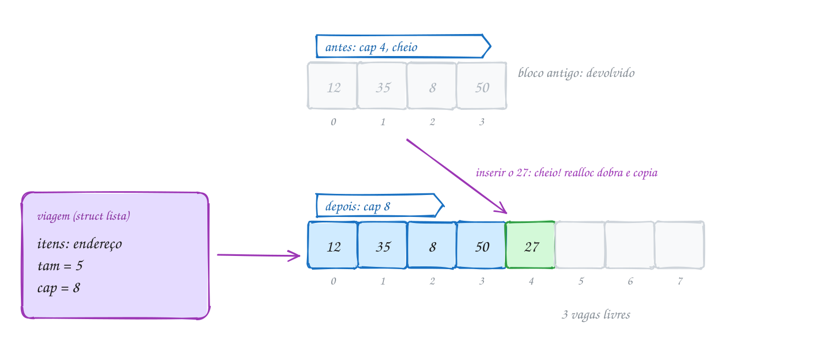</p>

O coração do `lista.c` é a função que garante espaço antes de cada inserção:

```c
struct lista {
    int *itens; // vetor no heap
    int tam;    // quantos itens estão em uso
    int cap;    // quantos itens cabem no vetor
};

// garante espaço para mais um item: se encheu, dobra
static bool garante_espaco(Lista *l) {
    if (l->tam < l->cap) return true;
    int nova_cap = l->cap * 2;
    int *novo = realloc(l->itens, nova_cap * sizeof(int));
    if (novo == NULL) return false; // l->itens continua valendo
    l->itens = novo;
    l->cap = nova_cap;
    return true;
}

bool lista_insere_fim(Lista *l, int valor) {
    if (!garante_espaco(l)) return false;
    l->itens[l->tam] = valor;
    l->tam++;
    return true;
}
```

E quem usa a lista só enxerga a interface de `lista.h`:

```c
#include <stdio.h>
#include "lista.h"

int main(void) {
    int despesas[] = {12, 35, 8, 50, 27}; // em reais
    Lista *viagem = lista_cria(2);        // começa com espaço para 2
    if (viagem == NULL) return 1;

    for (int i = 0; i < 5; i++) {
        lista_insere_fim(viagem, despesas[i]);
        printf("inseriu %2d: tam %d, cap %d\n", despesas[i],
               lista_tamanho(viagem), lista_capacidade(viagem));
    }
    lista_imprime(viagem);

    int total = 0;
    for (int i = 0; i < lista_tamanho(viagem); i++) {
        int valor;
        lista_pega(viagem, i, &valor);
        total += valor;
    }
    printf("total: R$ %d\n", total);

    lista_libera(viagem);
    return 0;
}
// Saída:
// inseriu 12: tam 1, cap 2
// inseriu 35: tam 2, cap 2
// inseriu  8: tam 3, cap 4
// inseriu 50: tam 4, cap 4
// inseriu 27: tam 5, cap 8
// [12, 35, 8, 50, 27]
// total: R$ 132
```

Repara no fluxograma: a pergunta "está cheio?" vem antes de escrever. No caso
do 27 a resposta é Sim, o vetor dobra e só depois o valor entra em
`itens[4]`. Se o `realloc` falhar, a função avisa com `false` e a lista
continua inteira:

<p align="center">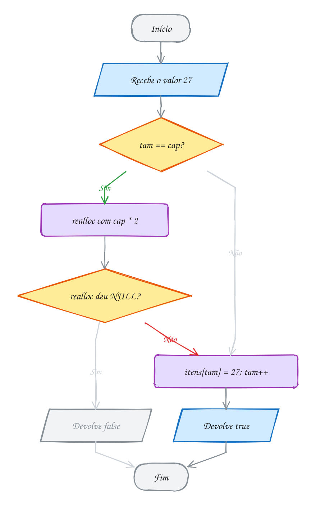</p>

O preço do vetor aparece quando você insere ou remove **no meio**: todo mundo
que vem depois precisa andar uma casa (o exemplo A150 mostra). Ler a posição
`i`, por outro lado, é instantâneo: `itens[i]` é uma conta de endereço.

> [!WARNING]
> Guardar o **endereço** de um item e depois inserir é pedir um ponteiro
> solto: `int *p = &itens[0];` aponta para o bloco antigo, que o `realloc`
> pode ter devolvido. Guarde a **posição** (o índice), nunca o endereço. E
> nunca escreva `l->itens = realloc(l->itens, ...)` direto: se o `realloc`
> devolver `NULL`, você perde o único endereço do bloco antigo.

> [!TIP]
> **Por dentro do C:** dobrando, inserir n itens copia no total menos de 2n
> itens (1 + 2 + 4 + ... + n/2 + n), então cada inserção custa O(1) **em
> média** (custo amortizado). Crescendo de um em um, cada inserção copia tudo
> de novo: 1 + 2 + 3 + ... + n ≈ n²/2 cópias. Para um milhão de despesas, são
> uns 20 `realloc` contra um milhão deles. A `struct lista` tem 16 bytes
> (ponteiro de 8 + dois `int` de 4) e mora num bloco do heap; o vetor mora em
> outro bloco. Por isso o `lista_libera` faz dois `free`, primeiro o vetor.

> [!NOTE]
> **Pergunta para você:** começando com `lista_cria(2)`, quantas vezes o
> `realloc` roda até a lista ter 100 itens? E qual é a capacidade final?
> Quantas vagas ficam sobrando?

### Hora de praticar

Os arquivos ficam em [`0075-vetor-dinamico/`](0075-vetor-dinamico/). Os comandos funcionam de qualquer pasta do terminal. Nos exemplos, rode, mude, quebre e rode de novo. Nos exercícios, a resposta vai dentro do próprio arquivo. ★☆☆ é aquecimento, ★★☆ pede raciocínio e ★★★ é desafio.

**Exemplo A149 · Quantas vezes o vetor mudou de casa**

```c
#include <stdio.h>
#include "lista.h"

int main(void) {
    // capacidade 0 não existe: lista_cria corrige para 1
    Lista *passos = lista_cria(0);
    if (passos == NULL) return 1;
    printf("criou: tam %d, cap %d\n", lista_tamanho(passos), lista_capacidade(passos));

    // 20 dias de passos no app da academia (em milhares)
    int crescimentos = 0;
    for (int dia = 1; dia <= 20; dia++) {
        int cap_antes = lista_capacidade(passos);
        if (!lista_insere_fim(passos, 5 + dia % 4)) break;
        if (lista_capacidade(passos) != cap_antes) { // houve realloc
            crescimentos++;
            printf("dia %2d: cap %2d -> %2d\n", dia, cap_antes, lista_capacidade(passos));
        }
    }

    int tam = lista_tamanho(passos);
    int cap = lista_capacidade(passos);
    printf("%d itens, cap %d, %d vagas livres\n", tam, cap, cap - tam);
    printf("realloc: %d vezes\n", crescimentos);

    // posição fora da lista: lista_pega recusa e não mexe na variável
    int valor = -1;
    if (!lista_pega(passos, 20, &valor)) {
        printf("posição 20 não existe; valor continua %d\n", valor);
    }

    lista_libera(passos);
    return 0;
}
// Saída:
// criou: tam 0, cap 1
// dia  2: cap  1 ->  2
// dia  3: cap  2 ->  4
// dia  5: cap  4 ->  8
// dia  9: cap  8 -> 16
// dia 17: cap 16 -> 32
// 20 itens, cap 32, 12 vagas livres
// realloc: 5 vezes
// posição 20 não existe; valor continua -1
```

```bash
~/LPEDC/rodar 11-listas/0075-vetor-dinamico/A149.c
```

**Exemplo A150 · Inserir e remover no meio: todo mundo se mexe**

```c
#include <stdio.h>
#include "lista.h"

int main(void) {
    Lista *viagem = lista_cria(4);
    if (viagem == NULL) return 1;
    lista_insere_fim(viagem, 12);
    lista_insere_fim(viagem, 35);
    lista_insere_fim(viagem, 8);
    lista_insere_fim(viagem, 50);
    lista_imprime(viagem);

    // esqueceu o pedágio de R$ 19, que foi a segunda despesa
    lista_insere_em(viagem, 1, 19); // 35, 8 e 50 andam uma casa para a direita
    lista_imprime(viagem);

    // o R$ 8 foi reembolsado: sai da lista
    int tirado;
    if (lista_remove_em(viagem, 3, &tirado)) { // 50 anda uma casa para a esquerda
        printf("removeu R$ %d\n", tirado);
    }
    lista_imprime(viagem);

    // posição que não existe: a lista recusa em vez de estragar a memória
    if (!lista_insere_em(viagem, 9, 100)) {
        printf("posição 9 não existe (tamanho %d)\n", lista_tamanho(viagem));
    }

    lista_libera(viagem);
    return 0;
}
// Saída:
// [12, 35, 8, 50]
// [12, 19, 35, 8, 50]
// removeu R$ 8
// [12, 19, 35, 50]
// posição 9 não existe (tamanho 4)
```

```bash
~/LPEDC/rodar 11-listas/0075-vetor-dinamico/A150.c
```

#### Exercícios

**Exercício E445** · ★☆☆

O medidor de glicose da sua mãe registrou estas leituras na semana (mg/dL):
98, 110, 87, 132, 105, 91. Usando só as funções de lista.h, crie uma lista
com capacidade inicial 4, insira as leituras no fim, mostre a lista, o
tamanho, a capacidade, a média (uma casa decimal) e a maior leitura.


```text
Saída esperada:
[98, 110, 87, 132, 105, 91]
tamanho 6, capacidade 8
média: 103.8
maior: 132
```

**Dicas:**

1. Depois de criar com lista_cria(4), confira se não voltou NULL.
2. Para ler o item i, use lista_pega(l, i, &valor): você não enxerga
   l->itens daqui, porque a struct está escondida em lista.c.
3. Para a média, divida a soma por (double) o tamanho.
4. Resposta esperada: a saída acima. A capacidade foi de 4 para 8 quando
   chegou a 5ª leitura. Não esqueça do lista_libera no fim.

```bash
~/LPEDC/rodar 11-listas/0075-vetor-dinamico/E445.c
```

**Exercício E446** · ★☆☆

Escreva um programa que acompanhe o vetor por dentro. Primeiro escreva a
função mostra(rotulo, l), que imprime o rótulo, o tamanho, a capacidade e
a lista, assim: "A: tam 2, cap 2 [5, 9]". Depois, começando com
lista_cria(1), faça estas operações e chame mostra onde está indicado:


```text
insere 5 no fim; insere 9 no fim              -> mostra "A"
insere 3 na posição 0; insere 7 no fim        -> mostra "B"
remove a posição 1 guardando em x;
insere x * 2 na posição 3                     -> mostra "C"
tenta remover a posição 4; se falhar, imprima "D: falhou, x = ..."
insere 1 no fim                               -> mostra "E"
```


```text
Saída esperada:
A: tam 2, cap 2 [5, 9]
B: tam 4, cap 4 [3, 5, 9, 7]
C: tam 4, cap 4 [3, 9, 7, 10]
D: falhou, x = 5
E: tam 5, cap 8 [3, 9, 7, 10, 1]
```

**Dicas:**

1. lista_imprime já termina com quebra de linha: em mostra, use printf
   para o começo da linha e lista_imprime para o fim.
2. Inserir na posição igual ao tamanho é o mesmo que inserir no fim.
3. Remover numa posição que não existe devolve false e não mexe em x.
4. Resposta esperada: a saída acima. A capacidade dobra de 1 para 2, de 2
   para 4 e de 4 para 8.

```bash
~/LPEDC/rodar 11-listas/0075-vetor-dinamico/E446.c
```

**Exercício E447** · ★★☆

O pluviômetro da escola anota a chuva do dia em mm, e grava -1 quando o
sensor falha. Complete as duas funções usando SÓ a interface de lista.h:


```text
posicao_de(l, valor)   primeira posição de valor na lista, ou -1
remove_todos(l, valor) tira todas as ocorrências e devolve quantas tirou
```


Com as leituras 4, -1, 0, 12, -1, -1, 7:


```text
Saída esperada:
antes:  [4, -1, 0, 12, -1, -1, 7]
depois: [4, 0, 12, 7]
3 falhas removidas
```

**Dicas:**

1. posicao_de é um for de 0 até lista_tamanho(l) com lista_pega.
2. remove_todos pode repetir: "ache a posição; se achou, remova" até não
   achar mais.
3. Cuidado com o atalho "for (i = 0; i < tam; i++) se for -1, remove i":
   depois de remover, o vizinho escorrega para a posição i e o i++ pula
   ele. Com dois -1 seguidos, um escapa.
4. Resposta esperada: a saída acima.

```bash
~/LPEDC/rodar 11-listas/0075-vetor-dinamico/E447.c
```

**Exercício E448** · ★★☆

Existem dois jeitos de tirar um item do meio de uma lista sequencial:


```text
deslocando: puxa todos os de depois uma casa para a esquerda (mantém a
            ordem; custa O(n))
trocando:   copia o ÚLTIMO item para o buraco e diminui o tamanho
            (bagunça a ordem; custa O(1))
```


Escreva as duas funções. Cada uma recebe o vetor, o endereço do tamanho e
a posição, e devolve quantos itens precisou mover (trocando move 1, ou 0
quando a posição já é a última). Teste tirando a posição 2 de duas cópias
das senhas 101 a 108. Depois, para sentir a diferença de custo, esvazie
as duas cópias tirando SEMPRE a posição 0 e mostre o total de movimentos
de cada uma:


```text
Saída esperada:
deslocando: [101, 102, 104, 105, 106, 107, 108]  movimentos: 5
trocando:   [101, 102, 108, 104, 105, 106, 107]  movimentos: 1
esvaziando pela frente: deslocando 21, trocando 6
```

**Dicas:**

1. Assinatura sugerida: int remove_deslocando(int v[], int *n, int pos).
2. Ao final, as duas fazem (*n)--.
3. Para esvaziar: while (n > 0) total += remove_xxx(v, &n, 0);
4. Resposta esperada: a saída acima. Deslocando, tirar da frente custa
   6 + 5 + 4 + 3 + 2 + 1 + 0 = 21 movimentos (cresce como n²); trocando,
   um por item, menos o último. Use deslocando quando a ordem importa
   (fila de senhas) e trocando quando não importa (itens do carrinho).

```bash
~/LPEDC/rodar 11-listas/0075-vetor-dinamico/E448.c
```

**Exercício E449** · ★★★

Este programa guarda as velocidades medidas por um radar num vetor que
cresce. Ele compila sem aviso, mas tem TRÊS problemas de propósito: dois o
AddressSanitizer acusa quando você roda, e o terceiro só morderia num dia
em que faltasse memória. Rode, leia o relatório, ache os três e conserte.


```text
Saída esperada depois do conserto:
primeiro: 40
40 50 60 70 80 90
```

**Dicas:**

1. O primeiro relatório é "heap-buffer-overflow" dentro de vetor_insere:
   o realloc recebe um número de BYTES.
2. Conserte e rode de novo. O segundo é "heap-use-after-free" no printf
   do primeiro: depois que o vetor muda de lugar, o endereço guardado em
   "primeiro" aponta para o bloco antigo, já devolvido.
3. O terceiro: "v->itens = realloc(v->itens, ...)". Se o realloc devolver
   NULL, o endereço do bloco antigo se perde (vazamento) e a lista some.
4. Resposta esperada: realloc(v->itens, nova_cap * sizeof(int)) guardando
   o resultado numa variável temporária antes de trocar v->itens; e guardar
   a POSIÇÃO (índice 0) em vez do endereço, lendo v.itens[0] no fim.

```bash
~/LPEDC/rodar 11-listas/0075-vetor-dinamico/E449.c
```

**Exercício E450** · ★★★

Um vetor que só cresce nunca devolve memória: se um dia guardou um milhão
de itens e agora guarda três, continua ocupando um milhão. Complete as
duas funções que tiram o último item e encolhem o vetor pela metade (sem
nunca descer de capacidade 2), cada uma com uma regra:


```text
vet_tira         encolhe quando o tamanho fica <= 1/4 da capacidade
vet_tira_metade  encolhe quando o tamanho fica <= 1/2 da capacidade
```


Toda vez que um realloc der certo (crescendo ou encolhendo), some 1 em
v->reallocs. O main já está pronto: ele esvazia um vetor de 9 itens com
vet_tira e depois compara as duas regras num vetor com tam 4 e cap 4 que
alterna "empurra, tira" 10 vezes.


```text
Saída esperada:
empurrou 9: tam 9, cap 16
tirou 9: tam 8, cap 16
tirou 8: tam 7, cap 16
tirou 7: tam 6, cap 16
tirou 6: tam 5, cap 16
tirou 5: tam 4, cap 8
tirou 4: tam 3, cap 8
tirou 3: tam 2, cap 4
tirou 2: tam 1, cap 2
tirou 1: tam 0, cap 2
alternando com 1/2: 20 realloc
alternando com 1/4: 1 realloc
```

**Dicas:**

1. Depois de diminuir o tamanho, em vet_tira:
   if (v->cap > 2 && v->tam <= v->cap / 4). Em vet_tira_metade, troque
   o 4 por 2.
2. Use realloc para a nova capacidade, numa variável temporária. Se ele
   falhar, tudo bem: o vetor só continua grande.
3. Resposta esperada: a saída acima. Encolhendo na metade, cada "empurra"
   cresce para 8 e cada "tira" volta a 4: um realloc (que copia tudo) a
   cada operação. Com 1/4, depois de crescer sobra folga para os dois
   lados.

```bash
~/LPEDC/rodar 11-listas/0075-vetor-dinamico/E450.c
```

---

## 0076 · Lista encadeada

Abra o extrato do Pix no app do banco: o mais recente aparece em cima. Cada
Pix novo entra na frente, e ninguém precisa empurrar os antigos para baixo.
No vetor do assunto anterior, inserir na posição 0 faria todos andarem uma
casa. Existe um jeito em que ninguém anda.

Uma **lista encadeada** guarda cada item num pedaço separado de memória, o
**nó**. Além do valor, cada nó guarda o endereço do próximo. O último aponta
para `NULL`. Para usar a lista, você só precisa do endereço do primeiro nó, o
**início**. Lista vazia é `inicio == NULL`.

O nó é uma struct que aponta para o próprio tipo, uma **struct
autorreferenciada**:

```c
typedef struct no {
    int valor;
    struct no *prox; // o próximo nó, ou NULL no último
} No;
```

Repare no `struct no *prox` dentro da própria `struct no`. Uma struct não pode
conter a si mesma (teria tamanho infinito), mas pode conter um **ponteiro**
para si mesma: um ponteiro tem sempre 8 bytes, aponte para o que apontar.

Os nós não ficam lado a lado na memória. Cada um nasce de um `malloc`
diferente e cai onde o heap tiver espaço. A ordem da lista não está nas
posições: está nas **setas**. Por isso não existe `lista[2]`: para chegar no
terceiro nó, você segue duas setas a partir do início.

Três operações formam a base, e todas estão no `lista.c` desta pasta:

- **inserir no início**: cria o nó, aponta o `prox` dele para o antigo
  início e devolve o novo nó, que passa a ser o início. É O(1): não importa o
  tamanho da lista.
- **percorrer**: `for (p = inicio; p != NULL; p = p->prox)`. É o "for de
  lista", e você vai escrever ele mil vezes.
- **liberar**: um `free` por nó, guardando o próximo **antes** do `free`.

```c
No *lista_insere_inicio(No *inicio, int valor) {
    No *novo = malloc(sizeof(No));
    if (novo == NULL) { // num programa pequeno, desistir é o mais honesto
        fprintf(stderr, "sem memória\n");
        exit(1);
    }
    novo->valor = valor;
    novo->prox = inicio; // o antigo primeiro vira o segundo
    return novo;         // o novo nó é o novo início
}
```

Aqui a struct do nó fica no `lista.h`, à vista, de propósito: o assunto é
justamente mexer em `p->valor` e `p->prox`. Na pilha e na fila (módulo 12) ela
volta a ficar escondida no `.c`.

Vamos ver na prática. Chegam quatro Pix: R$ 20, 45, 10 e 80. Cada um entra na
frente, então o extrato mostra o 80 primeiro. Embaixo, a mesma lista como ela
está de verdade no heap: endereços fora de ordem, com outros dados no meio, e
cada nó guardando o endereço do próximo:

<p align="center">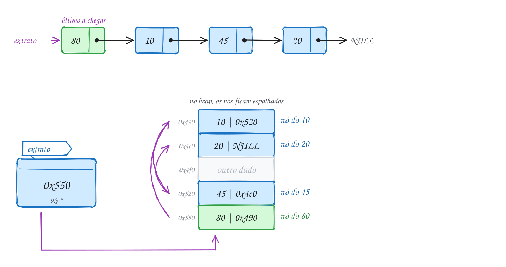</p>

```c
#include <stdio.h>
#include "lista.h"

int main(void) {
    No *extrato = NULL; // lista vazia

    // os Pix chegam nesta ordem: 20, 45, 10, 80
    extrato = lista_insere_inicio(extrato, 20);
    extrato = lista_insere_inicio(extrato, 45);
    extrato = lista_insere_inicio(extrato, 10);
    extrato = lista_insere_inicio(extrato, 80);

    lista_imprime(extrato); // o último a chegar aparece primeiro

    int total = 0;
    for (No *p = extrato; p != NULL; p = p->prox) { // percorrer: siga os prox
        total += p->valor;
    }
    printf("%d Pix, total R$ %d\n", lista_tamanho(extrato), total);

    lista_libera(extrato);
    return 0;
}
// Saída:
// 80 -> 10 -> 45 -> 20 -> NULL
// 4 Pix, total R$ 155
```

Repara no fluxograma: percorrer é um laço que pergunta "ainda tem nó?" antes
de cada passo. O `p` começa no 80, pula para o 10, o 45, o 20, e então vira
`NULL`. Aí o laço para, com o total em R$ 155:

<p align="center">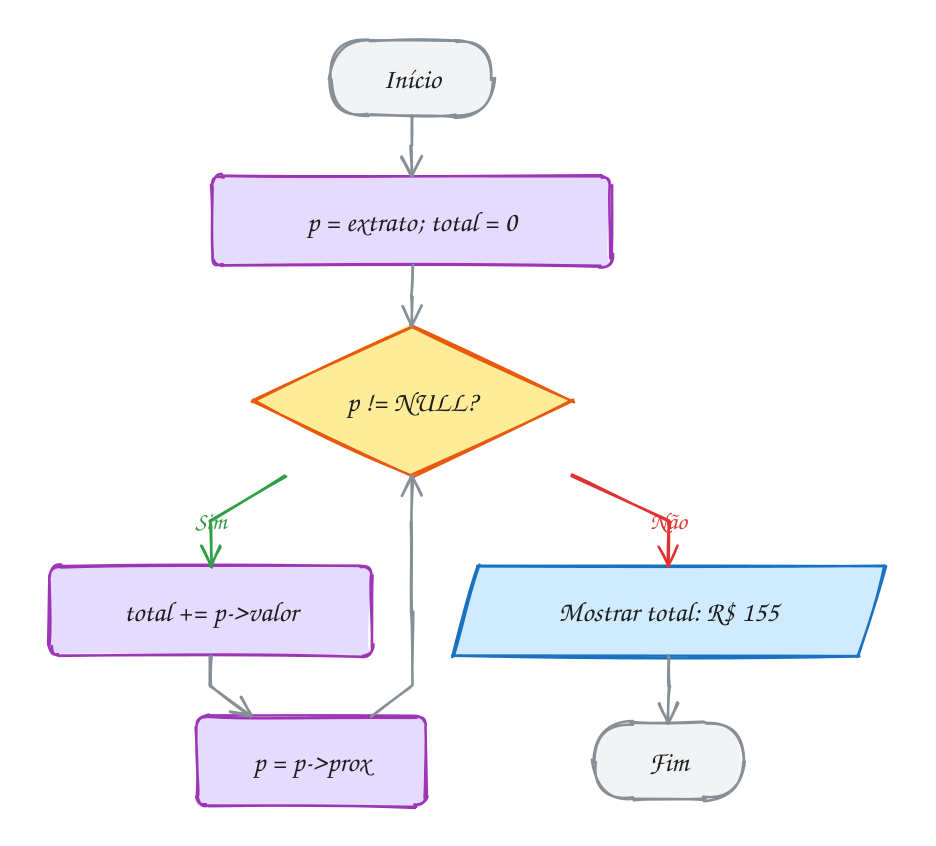</p>

> [!WARNING]
> `lista_insere_inicio(extrato, 20);` sozinho, sem o `extrato =` na frente,
> compila sem aviso e está errado. A função devolve o novo início, e você
> jogou fora. O `extrato` continua apontando para o nó antigo (ou para
> `NULL`), e o nó novo vira vazamento. Toda função que pode mudar o início
> devolve o início novo, e você **sempre** guarda: `extrato =
> lista_insere_inicio(extrato, 20);`. No `libera`, o erro clássico é o
> contrário: ler `p->prox` depois de `free(p)`.

> [!TIP]
> **Por dentro do C:** num PC de 64 bits, `sizeof(No)` é 16: 4 bytes do `int`,
> 4 de **preenchimento** (o ponteiro precisa começar num endereço múltiplo de
> 8) e 8 do ponteiro. E cada `malloc` ainda gasta uns 16 bytes de controle.
> Guardar 4 inteiros numa lista custa umas 8 vezes mais memória que num
> vetor. E tem o **cache**: o processador lê a memória em blocos de 64 bytes.
> No vetor, ler `itens[0]` já traz os vizinhos de brinde. Na lista, cada nó
> pode estar longe do anterior. Percorrer a lista é O(n), igual ao vetor, mas
> na prática bem mais lento.

> [!NOTE]
> **Pergunta para você:** se você inserir no início o 5, depois o 6 e depois
> o 7, o que `lista_imprime` mostra? E quantas vezes `lista_libera` chama
> `free`?

### Hora de praticar

Os arquivos ficam em [`0076-lista-encadeada/`](0076-lista-encadeada/). Os comandos funcionam de qualquer pasta do terminal. Nos exemplos, rode, mude, quebre e rode de novo. Nos exercícios, a resposta vai dentro do próprio arquivo. ★☆☆ é aquecimento, ★★☆ pede raciocínio e ★★★ é desafio.

**Exemplo A151 · Andando pelas setas: o terceiro nó e a lista vazia**

```c
#include <stdio.h>
#include "lista.h"

int main(void) {
    // temperaturas da semana em Cuiabá, lidas de segunda a domingo
    int temps[] = {31, 34, 29, 36, 33, 28, 35};
    No *semana = NULL;
    for (int i = 0; i < 7; i++) {
        semana = lista_insere_inicio(semana, temps[i]);
    }
    lista_imprime(semana); // domingo na frente: a ordem saiu invertida

    // não existe semana[2]: para chegar no 3º nó, siga duas setas
    No *p = semana;
    for (int passo = 0; passo < 2 && p != NULL; passo++) {
        p = p->prox;
    }
    if (p != NULL) printf("3º nó: %d (sexta-feira)\n", p->valor);

    // percorrer também serve para procurar o maior
    int maior = semana->valor;
    for (No *q = semana->prox; q != NULL; q = q->prox) {
        if (q->valor > maior) maior = q->valor;
    }
    printf("maior: %d\n", maior);

    // a lista vazia não é caso especial: o laço só não roda nenhuma vez
    No *vazia = NULL;
    printf("vazia tem %d nós: ", lista_tamanho(vazia));
    lista_imprime(vazia);
    lista_libera(vazia); // não faz nada, e não quebra

    lista_libera(semana);
    return 0;
}
// Saída:
// 35 -> 28 -> 33 -> 36 -> 29 -> 34 -> 31 -> NULL
// 3º nó: 33 (sexta-feira)
// maior: 36
// vazia tem 0 nós: NULL
```

```bash
~/LPEDC/rodar 11-listas/0076-lista-encadeada/A151.c
```

**Exemplo A152 · Inserir no fim com um ponteiro para o último**

```c
#include <stdio.h>
#include <stdlib.h>
#include "lista.h"

// põe "valor" depois do último nó; *inicio e *fim mudam quando precisa
static void insere_no_fim(No **inicio, No **fim, int valor) {
    No *novo = malloc(sizeof(No));
    if (novo == NULL) exit(1);
    novo->valor = valor;
    novo->prox = NULL;     // ele vai ser o último
    if (*inicio == NULL) { // lista vazia: é o primeiro e o último
        *inicio = novo;
    } else {
        (*fim)->prox = novo; // o antigo último aponta para ele
    }
    *fim = novo;
}

int main(void) {
    No *inicio = NULL;
    No *fim = NULL;

    insere_no_fim(&inicio, &fim, 20);
    insere_no_fim(&inicio, &fim, 45);
    insere_no_fim(&inicio, &fim, 10);
    insere_no_fim(&inicio, &fim, 80);

    lista_imprime(inicio); // agora na ordem de chegada
    printf("primeiro: %d, último: %d\n", inicio->valor, fim->valor);

    lista_libera(inicio);
    return 0;
}
// Saída:
// 20 -> 45 -> 10 -> 80 -> NULL
// primeiro: 20, último: 80
```

```bash
~/LPEDC/rodar 11-listas/0076-lista-encadeada/A152.c
```

#### Exercícios

**Exercício E451** · ★☆☆

O app do banco quer destacar os Pix "grandes". Monte o extrato inserindo
no início os Pix 30, 75, 12, 50, 120 e 64 (nesta ordem), mostre a lista e
escreva a função


```text
int conta_maiores(const No *inicio, int limite)
```


que devolve quantos valores são MAIORES que o limite. Use limite 50.


```text
Saída esperada:
64 -> 120 -> 50 -> 12 -> 75 -> 30 -> NULL
3 Pix acima de R$ 50
```

**Dicas:**

1. Toda inserção é "extrato = lista_insere_inicio(extrato, valor);".
2. O percurso é sempre o mesmo: for (const No *p = inicio; p != NULL;
   p = p->prox).
3. O 50 não conta: "maior que", não "maior ou igual".
4. Resposta esperada: a saída acima (64, 120 e 75). Libere a lista no fim.

```bash
~/LPEDC/rodar 11-listas/0076-lista-encadeada/E451.c
```

**Exercício E452** · ★☆☆

O laço do programa abaixo já monta uma lista inserindo 3, 6, 9 e 12 no
início. Complete o main para mostrar a lista e mais três linhas:


```text
o primeiro valor da lista;
o terceiro, seguindo duas setas a partir do início (l->prox->prox);
o último, andando com um ponteiro p até o nó cujo prox é NULL.
```


```text
Saída esperada:
12 -> 9 -> 6 -> 3 -> NULL
primeiro: 12
terceiro: 6
último: 3
```

**Dicas:**

1. Desenhe os nós e as setas no papel antes: quem ficou na frente?
2. l->prox->prox anda dois nós a partir do primeiro.
3. Para o último: No *p = l; while (p->prox != NULL) p = p->prox;
4. Resposta esperada: a saída acima.

```bash
~/LPEDC/rodar 11-listas/0076-lista-encadeada/E452.c
```

**Exercício E453** · ★★☆

Os preços do hortifruti chegaram num vetor: {5, 18, 7, 22, 9}. Escreva:


```text
No *vetor_para_lista(const int v[], int n)
    monta a lista NA MESMA ORDEM do vetor, usando só lista_insere_inicio
int lista_para_vetor(const No *inicio, int v[], int max)
    copia a lista para o vetor (no máximo max itens) e devolve quantos
    copiou
```


Teste indo e voltando:


```text
Saída esperada:
lista: 5 -> 18 -> 7 -> 22 -> 9 -> NULL
vetor: 5 18 7 22 9
```

**Dicas:**

1. Inserir no início inverte a ordem. Como desinverter? Percorra o vetor de
   trás para frente: o último a entrar (v[0]) fica na frente.
2. Em lista_para_vetor, ande com p e com um contador i ao mesmo tempo:
   pare quando p for NULL ou i chegar em max.
3. Resposta esperada: a saída acima.

```bash
~/LPEDC/rodar 11-listas/0076-lista-encadeada/E453.c
```

**Exercício E454** · ★★☆

Uma lista é NULL ou um nó seguido de outra lista. Essa definição é
recursiva, e as funções também podem ser. O extrato recebeu os Pix 15, 60,
35, 90 e 25, inseridos no início. Escreva, SEM laço nenhum:


```text
void imprime_ao_contrario(const No *p)  do mais antigo para o mais novo
int tamanho_rec(const No *p)            quantos nós
```


```text
Saída esperada:
mais novo primeiro: 25 -> 90 -> 35 -> 60 -> 15 -> NULL
mais antigo primeiro: 15 60 35 90 25
tamanho (recursivo): 5
```

**Dicas:**

1. Caso base das duas: p == NULL.
2. Para imprimir ao contrário, imprima o RESTO da lista primeiro
   (chamada com p->prox) e só depois o p->valor.
3. tamanho_rec(p) = 1 + tamanho_rec(p->prox).
4. Resposta esperada: a saída acima. Para a primeira linha, use
   printf("mais novo primeiro: ") seguido de lista_imprime.

```bash
~/LPEDC/rodar 11-listas/0076-lista-encadeada/E454.c
```

**Exercício E455** · ★★★

A cartela de fidelidade da padaria guarda os pontos de cada compra numa
lista. O programa tem DOIS erros de propósito. Rode, leia o aviso do gcc,
o que sai e o relatório do AddressSanitizer, ache os dois e conserte.


```text
Saída esperada depois do conserto:
10 -> 5 -> 8 -> 3 -> NULL
total de pontos: 26
```

**Dicas:**

1. A execução mostra só "NULL" e total 0, e o ASan reclama de "memory
   leaks": os nós foram criados, mas ninguém guardou o endereço deles.
2. O gcc já avisa o outro: "pointer 'p' used after 'free'" em libera_tudo.
   Olhe o "p = p->prox" do for: ele roda DEPOIS do free(p). Consertado o
   primeiro erro, o ASan confirma com "heap-use-after-free".
3. Resposta esperada: "cartela = lista_insere_inicio(cartela, ...)" (a
   função devolve o novo início, e o valor devolvido era jogado fora); e
   em libera_tudo, guardar p->prox numa variável antes do free.

```bash
~/LPEDC/rodar 11-listas/0076-lista-encadeada/E455.c
```

**Exercício E456** · ★★★

A fila de embarque foi montada ao contrário: 5 -> 4 -> 3 -> 2 -> 1.
Escreva No *inverte(No *inicio), que inverte a lista SÓ MEXENDO NOS
PONTEIROS: nada de malloc, nada de trocar os valores, nada de vetor
auxiliar. Ela devolve o novo início. Teste também com a lista vazia e com
uma lista de um nó só.


```text
Saída esperada:
antes:  5 -> 4 -> 3 -> 2 -> 1 -> NULL
depois: 1 -> 2 -> 3 -> 4 -> 5 -> NULL
vazia:  NULL
um só:  7 -> NULL
```

**Dicas:**

1. Use três ponteiros: ant (começa NULL), p (começa no início) e seg.
2. A cada passo: seg = p->prox; p->prox = ant; ant = p; p = seg. A ordem
   importa: se você trocar p->prox antes de guardar seg, perde o resto.
3. Quando p vira NULL, ant é o novo início.
4. Resposta esperada: a saída acima. É O(n) em tempo e O(1) em memória
   extra.

```bash
~/LPEDC/rodar 11-listas/0076-lista-encadeada/E456.c
```

---

## 0077 · Busca e remoção

Sábado de manhã, barbearia lotada. Cada cliente pega uma senha e o barbeiro
anota numa lista: 31, 17, 42, 8. Aí o 42 cansa de esperar e vai embora. Ele
sai do meio da fila, e ninguém precisa trocar de cadeira: basta o 17 passar
a ter o 8 como próximo.

**Buscar** numa lista encadeada é percorrer até achar. Não existe atalho: sem
acesso direto, a busca é sempre sequencial, O(n). A função devolve o
**endereço do nó** (ou `NULL` se não achou), e com ele você lê ou até muda o
valor:

```c
No *lista_busca(No *inicio, int valor) {
    No *p = inicio;
    while (p != NULL && p->valor != valor) { // o teste do NULL vem primeiro
        p = p->prox;
    }
    return p; // o nó, ou NULL se a lista acabou
}
```

**Remover** pede um cuidado a mais. Para tirar o nó `p`, quem aponta para ele
precisa passar a apontar para o seguinte. E quem aponta para `p` é o nó
**anterior**, que numa lista simples não tem caminho de volta. A saída é
percorrer com **dois ponteiros**: `ant` anda sempre um passo atrás de `p`.

Achado o nó, há dois casos:

- `ant == NULL`: o nó é o **primeiro**. Quem aponta para ele é a variável
  `inicio` do `main`, e é ela que precisa mudar.
- senão: `ant->prox = p->prox`, e o anterior pula o `p`.

Nos dois casos, só depois de religar vem o `free(p)`. Como remover o primeiro
muda o início e a função ainda quer devolver se achou ou não, ela recebe o
**endereço** do início: `No **inicio` (ponteiro para ponteiro, assunto 0049).
No assunto anterior a inserção devolvia o início novo. São os dois estilos que
você vai encontrar por aí.

```c
bool lista_remove(No **inicio, int valor) {
    No *ant = NULL;    // sempre um passo atrás de p
    No *p = *inicio;
    while (p != NULL && p->valor != valor) {
        ant = p;
        p = p->prox;
    }
    if (p == NULL) return false; // não achou
    if (ant == NULL) {
        *inicio = p->prox;       // era o primeiro: o início anda
    } else {
        ant->prox = p->prox;     // o anterior pula o p
    }
    free(p);
    return true;
}
```

Vamos ver na prática. Para tirar o 42, o laço para com `p` no 42 e `ant` no
17. Uma única atribuição desvia a seta do 17 para o 8, e o nó do 42, que
ninguém mais aponta, volta para o heap:

<p align="center">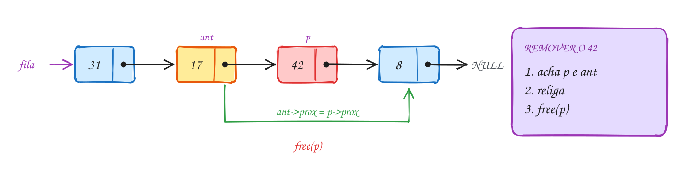</p>

```c
#include <stdio.h>
#include "lista.h"

int main(void) {
    No *fila = NULL;
    fila = lista_insere_inicio(fila, 8);
    fila = lista_insere_inicio(fila, 42);
    fila = lista_insere_inicio(fila, 17);
    fila = lista_insere_inicio(fila, 31);
    lista_imprime(fila);

    // a senha 42 ainda está esperando?
    No *achou = lista_busca(fila, 42);
    if (achou != NULL) printf("senha %d: na fila\n", achou->valor);

    // o 42 desistiu: sai do meio
    lista_remove(&fila, 42);
    lista_imprime(fila);

    // o 31 foi atendido: sai do começo (o início muda)
    lista_remove(&fila, 31);
    lista_imprime(fila);

    // o 99 nunca esteve na fila
    if (!lista_remove(&fila, 99)) printf("senha 99: não está na fila\n");

    lista_libera(fila);
    return 0;
}
// Saída:
// 31 -> 17 -> 42 -> 8 -> NULL
// senha 42: na fila
// 31 -> 17 -> 8 -> NULL
// 17 -> 8 -> NULL
// senha 99: não está na fila
```

Repara no fluxograma: o laço anda até achar o 42 ou a lista acabar. Achou, e
como `ant` não é `NULL` (é o 17), o caminho vai pelo `ant->prox = p->prox`.
Na remoção do 31, o caminho seria o outro, `início = p->prox`:

<p align="center">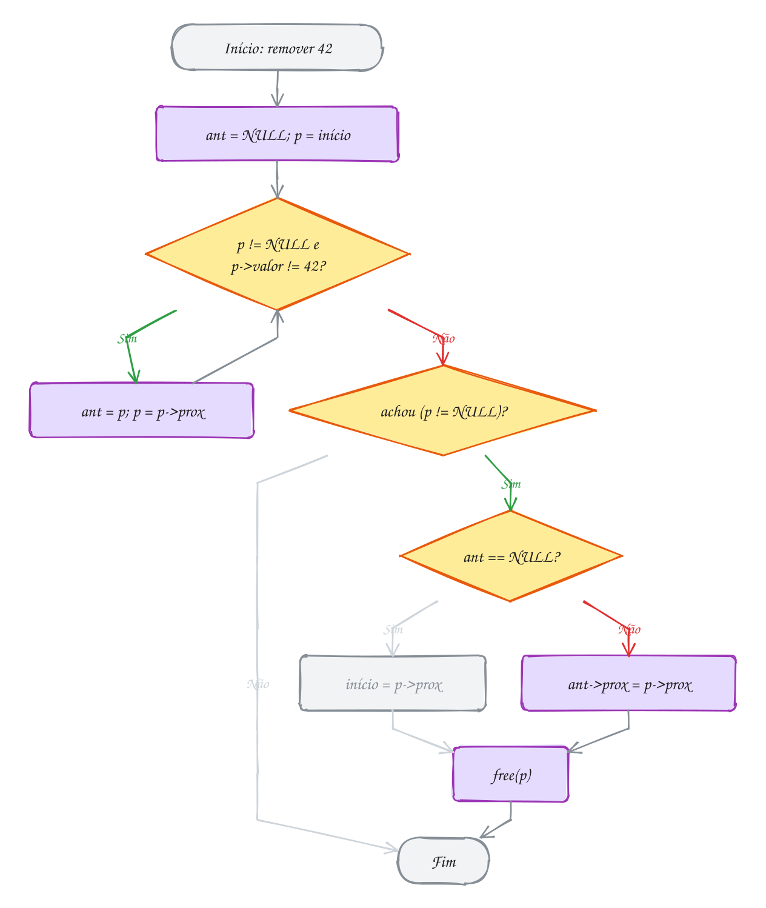</p>

O exemplo A154 mostra um truque para sumir com o caso especial: o
**nó-cabeça**, um nó "de mentira" no começo. Com ele, todo nó de verdade tem
um anterior, e o primeiro deixa de ser especial.

> [!WARNING]
> A ordem do `&&` importa. `while (p->valor != valor && p != NULL)` lê
> `p->valor` **antes** de saber se `p` é `NULL`. Quando o valor não está na
> lista, `p` vira `NULL` e o programa quebra. Com `p != NULL` primeiro, o
> curto-circuito (assunto 0013) nem chega a olhar o `p->valor`. E nunca
> inverta "religar" e "liberar": depois do `free(p)`, `p->prox` não é mais
> seu.

> [!TIP]
> **Por dentro do C:** em `lista_remove(&fila, 42)`, a função recebe o
> endereço da variável `fila`, que mora na pilha do `main`. Escrever
> `*inicio = p->prox` muda a `fila` lá do `main`. Dá para ir além e eliminar o
> `ant`: um `No **pp` que começa em `inicio` e anda com `pp = &(*pp)->prox`
> aponta sempre para "o lugar que aponta para o nó atual", seja a `fila`, seja
> o `prox` de alguém. A remoção vira `No *p = *pp; *pp = p->prox; free(p);`,
> sem `if`. E repare no custo: religar é O(1), sem deslocar nada como no
> vetor. O que custa O(n) é achar o nó.

> [!NOTE]
> **Pergunta para você:** se a lista fosse `42 -> 17 -> 42 -> 8` e você
> chamasse `lista_remove(&fila, 42)` uma vez, qual 42 sairia? Por qual caminho
> do fluxograma a remoção passaria?

### Hora de praticar

Os arquivos ficam em [`0077-lista-busca-remocao/`](0077-lista-busca-remocao/). Os comandos funcionam de qualquer pasta do terminal. Nos exemplos, rode, mude, quebre e rode de novo. Nos exercícios, a resposta vai dentro do próprio arquivo. ★☆☆ é aquecimento, ★★☆ pede raciocínio e ★★★ é desafio.

**Exemplo A153 · Buscar por condição e tirar o último**

```c
#include <stdio.h>
#include "lista.h"

// variação da busca: em vez de "igual a", o primeiro nó "acima de" limite
static No *busca_acima(No *inicio, int limite) {
    No *p = inicio;
    while (p != NULL && p->valor <= limite) {
        p = p->prox;
    }
    return p; // o nó, ou NULL se ninguém passou do limite
}

int main(void) {
    // contas do mês, em reais
    No *contas = NULL;
    contas = lista_insere_inicio(contas, 480);
    contas = lista_insere_inicio(contas, 99);
    contas = lista_insere_inicio(contas, 135);
    contas = lista_insere_inicio(contas, 62);
    lista_imprime(contas);

    No *cara = busca_acima(contas, 100);
    if (cara != NULL) printf("primeira acima de R$ 100: %d\n", cara->valor);
    if (busca_acima(contas, 500) == NULL) printf("nenhuma acima de R$ 500\n");

    // tirar o ÚLTIMO: o anterior dele (99) passa a apontar para NULL
    lista_remove(&contas, 480);
    lista_imprime(contas);

    // tirar até sobrar um nó e depois o único: o início vira NULL
    lista_remove(&contas, 135);
    lista_remove(&contas, 62);
    lista_imprime(contas);
    lista_remove(&contas, 99);
    lista_imprime(contas);

    // na lista vazia, buscar e remover só devolvem "não achei"
    if (lista_busca(contas, 62) == NULL && !lista_remove(&contas, 62)) {
        printf("lista vazia: nada para buscar nem tirar\n");
    }

    lista_libera(contas);
    return 0;
}
// Saída:
// 62 -> 135 -> 99 -> 480 -> NULL
// primeira acima de R$ 100: 135
// nenhuma acima de R$ 500
// 62 -> 135 -> 99 -> NULL
// 99 -> NULL
// NULL
// lista vazia: nada para buscar nem tirar
```

```bash
~/LPEDC/rodar 11-listas/0077-lista-busca-remocao/A153.c
```

**Exemplo A154 · Nó-cabeça: a remoção sem caso especial**

```c
#include <stdio.h>
#include <stdlib.h>
#include "lista.h"

// Com um nó-cabeça (um nó "de mentira" no começo, cujo valor ninguém lê),
// todo nó de verdade tem um anterior. O primeiro não é mais especial.

static void cab_insere(No *cabeca, int valor) {
    No *novo = malloc(sizeof(No));
    if (novo == NULL) exit(1);
    novo->valor = valor;
    novo->prox = cabeca->prox; // entra logo depois da cabeça
    cabeca->prox = novo;
}

static int cab_remove(No *cabeca, int valor) {
    No *ant = cabeca;          // nunca é NULL
    No *p = cabeca->prox;
    while (p != NULL && p->valor != valor) {
        ant = p;
        p = p->prox;
    }
    if (p == NULL) return 0;
    ant->prox = p->prox;       // um caso só: vale até para o primeiro
    free(p);
    return 1;
}

int main(void) {
    No cabeca = {0, NULL};     // a cabeça pode até morar na pilha
    cab_insere(&cabeca, 8);
    cab_insere(&cabeca, 42);
    cab_insere(&cabeca, 17);
    cab_insere(&cabeca, 31);
    lista_imprime(cabeca.prox); // a lista de verdade começa depois da cabeça

    cab_remove(&cabeca, 31);    // o primeiro: nenhum if especial
    cab_remove(&cabeca, 8);     // o último
    lista_imprime(cabeca.prox);

    lista_libera(cabeca.prox);  // a cabeça não veio do malloc: não leva free
    return 0;
}
// Saída:
// 31 -> 17 -> 42 -> 8 -> NULL
// 17 -> 42 -> NULL
```

```bash
~/LPEDC/rodar 11-listas/0077-lista-busca-remocao/A154.c
```

#### Exercícios

**Exercício E457** · ★☆☆

A fila do açougue tem as senhas 33 -> 40 -> 7 -> 25 -> 12 (monte inserindo
no início 12, 25, 7, 40 e 33). Escreva


```text
int posicao(const No *inicio, int valor)
```


que devolve a posição do valor contando a partir de 1, ou 0 se ele não
está na lista. O programa lê uma senha do teclado e responde. Confira o
retorno do scanf.


```text
Digite a senha: 7
senha 7 está na posição 3
```


```text
Digite a senha: 50
senha 50 não está na fila
```

**Dicas:**

1. É a busca do texto com um contador que soma 1 a cada passo.
2. Se o scanf não devolver 1, avise "entrada inválida" e saia.
3. Resposta esperada: posição 3 para o 7 e "não está" para o 50. Para o
   33 a resposta é 1, e para o 12, 5.

```bash
~/LPEDC/rodar 11-listas/0077-lista-busca-remocao/E457.c
```

**Exercício E458** · ★☆☆

A lotérica anotou os valores dos boletos pagos numa lista com valores
repetidos: monte-a inserindo no início 5, 9, 5, 2 e 5. Escreva a função


```text
int conta(const No *inicio, int valor)
```


que devolve quantas vezes o valor aparece. Depois, no main:


```text
mostre a lista e quantos 5 ela tem;
o 9 foi digitado errado: troque por 4 usando o nó que lista_busca
devolve, e mostre a lista;
tire TODOS os 5 chamando lista_remove num laço, conte quantas remoções
deram certo e mostre a lista e o tamanho.
```


```text
Saída esperada:
5 -> 2 -> 5 -> 9 -> 5 -> NULL
quantos 5: 3
5 -> 2 -> 5 -> 4 -> 5 -> NULL
removidos: 3
2 -> 4 -> NULL
tamanho: 2
```

**Dicas:**

1. conta é o "for de lista" com um if e um contador.
2. lista_busca devolve o endereço do nó: mudar p->valor muda a lista.
   Confira se não voltou NULL antes de mexer.
3. lista_remove tira só o PRIMEIRO nó com o valor e devolve true se
   tirou: while (lista_remove(&l, 5)) removidos++;
4. Resposta esperada: a saída acima.

```bash
~/LPEDC/rodar 11-listas/0077-lista-busca-remocao/E458.c
```

**Exercício E459** · ★★☆

O sensor de temperatura da estufa grava 0 quando falha. Escreva


```text
int remove_todos(No **inicio, int valor)
```


que tira TODOS os nós com o valor numa passada só (sem chamar
lista_remove em laço, que recomeçaria do início a cada vez) e devolve
quantos tirou. Teste com as duas listas do main.


```text
Saída esperada:
antes:  0 -> 0 -> 21 -> 0 -> 19 -> 0 -> NULL
depois: 21 -> 19 -> NULL
4 leituras removidas
só falhas: NULL (2 removidas)
```

**Dicas:**

1. Ande com ant e p. Quando p->valor for o valor, religue (o início ou
   ant->prox), guarde p->prox, dê free(p) e continue a partir do guardado,
   SEM mexer no ant.
2. Quando não remover, aí sim: ant = p e p anda.
3. Os 0 do começo são o caso traiçoeiro: o início muda duas vezes seguidas.
4. Resposta esperada: a saída acima.

```bash
~/LPEDC/rodar 11-listas/0077-lista-busca-remocao/E459.c
```

**Exercício E460** · ★★☆

Num leilão online, a cada rodada o MENOR lance sai da disputa. Os lances
estão numa lista de structs com nome e valor. Escreva


```text
bool remove_menor(Lance **inicio, Lance *saiu)
```


que acha o nó de menor valor, copia os dados dele para *saiu, tira o nó
da lista e devolve true (ou false se a lista estiver vazia). Rode duas
rodadas.


```text
Saída esperada:
Davi R$ 175 -> Carla R$ 210 -> Bruno R$ 90 -> Ana R$ 150 -> NULL
saiu Bruno (R$ 90)
Davi R$ 175 -> Carla R$ 210 -> Ana R$ 150 -> NULL
saiu Ana (R$ 150)
Davi R$ 175 -> Carla R$ 210 -> NULL
```

**Dicas:**

1. Duas fases: primeiro ache o menor guardando o nó E o anterior dele
   (menor e ant_menor); depois remova como no texto.
2. Para percorrer guardando o anterior, ande com ant e p, e quando
   p->valor < menor->valor, faça menor = p e ant_menor = ant.
3. Copiar uma struct inteira é uma atribuição só: *saiu = *menor.
4. Resposta esperada: a saída acima.

```bash
~/LPEDC/rodar 11-listas/0077-lista-busca-remocao/E460.c
```

**Exercício E461** · ★★★

A lista de presentes do chá de bebê guarda o código de cada presente. A
função "tira" deveria remover um código, mas tem QUATRO erros de
propósito. Rode, leia o aviso do gcc e os relatórios do AddressSanitizer
e conserte um por um até sair:


```text
Saída esperada depois do conserto:
14 -> 3 -> 27 -> 9 -> NULL
3 -> 9 -> NULL
50 não estava na lista
```

**Dicas:**

1. O gcc já avisa o primeiro ("pointer 'p' used after 'free'") e o ASan
   confirma com "heap-use-after-free". Olhe a ordem das duas linhas depois
   do laço: depois do free, p->prox não é mais seu.
2. Segundo: tirar o 14 (o primeiro) faz ant->prox com ant == NULL.
3. Mesmo tratando o primeiro, o main não fica sabendo do novo início:
   "inicio" chegou por valor. A função precisa receber No **.
4. Terceiro relatório: procurar o 50 cai num p NULL. Veja a ordem do &&.
5. Resposta esperada: assinatura bool tira(No **inicio, int valor); laço
   "while (p != NULL && p->valor != valor)"; "if (ant == NULL) *inicio =
   p->prox; else ant->prox = p->prox;" e só então free(p). No main,
   chame tira(&lista, ...).

```bash
~/LPEDC/rodar 11-listas/0077-lista-busca-remocao/E461.c
```

**Exercício E462** · ★★★

O vagão do MEIO do trem precisa ir para a manutenção, e você só pode
percorrer a lista UMA vez (sem contar os nós antes). Escreva


```text
bool remove_meio(No **inicio)
```


usando a técnica da lebre e da tartaruga: dois ponteiros saem do início;
a tartaruga anda um nó por vez e a lebre anda dois. Quando a lebre chega
ao fim, a tartaruga está no meio. Com quantidade par, o meio é o SEGUNDO
dos dois do centro.


```text
Saída esperada:
1 -> 2 -> 3 -> 5 -> 6 -> 7 -> NULL
10 -> 20 -> 30 -> 50 -> 60 -> NULL
NULL
```

**Dicas:**

1. Condição do laço: lebre != NULL && lebre->prox != NULL.
2. A cada volta: ant = tartaruga; tartaruga = tartaruga->prox;
   lebre = lebre->prox->prox.
3. No fim, remova a tartaruga com o ant, como no texto (ant == NULL quer
   dizer que ela é o primeiro).
4. Resposta esperada: a saída acima (saem o 4, o 40 e o único nó, 99).

```bash
~/LPEDC/rodar 11-listas/0077-lista-busca-remocao/E462.c
```

---

## 0078 · Lista ordenada

A recepcionista da clínica atende o telefone o dia todo. Um paciente marca
às 14:30, outro às 9:00, outro às 16:00, outro às 10:15. As ligações chegam
fora de ordem, mas a agenda na tela tem que estar sempre em ordem de horário.
Ordenar tudo de novo a cada ligação seria desperdício. Melhor: cada marcação
nova já entra no lugar certo.

Uma **lista ordenada** mantém os nós em ordem a cada inserção. A
**inserção ordenada** anda pela lista com o par `ant`/`p` do assunto anterior,
enquanto os valores de lá forem menores que o novo. Quando o laço para, `p` é
o primeiro nó maior ou igual ao novo (ou `NULL`, se o novo é o maior), e
`ant` é o nó que vem antes. O novo entra **entre** os dois.

Encaixar é religar duas setas, nesta ordem:

1. `novo->prox = p`: o novo aponta para quem vem depois dele;
2. `ant->prox = novo`: quem vinha antes passa a apontar para o novo.

Se `ant` for `NULL`, o novo é o menor de todos e vira o início. Não existe
caso especial para o fim: com `p == NULL`, o passo 1 grava `NULL` no
`novo->prox`, e é exatamente isso que o último precisa.

```c
No *lista_insere_ordenado(No *inicio, int valor) {
    No *novo = cria_no(valor);
    No *ant = NULL;
    No *p = inicio;
    while (p != NULL && p->valor < valor) { // anda enquanto os de lá são menores
        ant = p;
        p = p->prox;
    }
    novo->prox = p;         // o novo aponta para o primeiro maior (ou NULL)
    if (ant == NULL) {
        return novo;        // é o menor de todos: vira o início
    }
    ant->prox = novo;       // o anterior passa a apontar para o novo
    return inicio;
}
```

A ordem também ajuda na **busca**: procurando um valor numa lista crescente,
dá para desistir assim que passar dele. Procurando 11:00, a busca para no
14:30, porque dali para frente só tem horário mais tarde.

Vamos ver na prática. A agenda já tem 09:00, 14:30 e 16:00. Chega a ligação
das 10:15. O laço passa pelo 09:00 (menor) e para no 14:30, porque `14:30 <
10:15` é falso. O novo nó primeiro aponta para o 14:30 e depois o 09:00 passa
a apontar para ele:

<p align="center">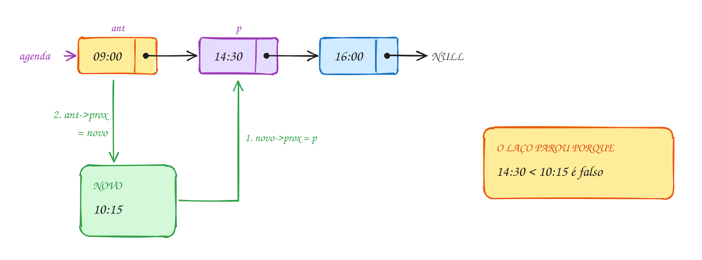</p>

O horário vira um `int` no formato hhmm (1430 é 14:30), e uma função do
próprio exemplo mostra bonito na tela:

```c
#include <stdio.h>
#include "lista.h"

// cada horário é um int hhmm: 1430 quer dizer 14:30
static void mostra_agenda(const No *inicio) {
    for (const No *p = inicio; p != NULL; p = p->prox) {
        printf("%02d:%02d -> ", p->valor / 100, p->valor % 100);
    }
    printf("fim do dia\n");
}

int main(void) {
    No *agenda = NULL;
    int marcacoes[] = {1430, 900, 1600, 1015}; // na ordem em que ligaram

    for (int i = 0; i < 4; i++) {
        agenda = lista_insere_ordenado(agenda, marcacoes[i]);
        mostra_agenda(agenda);
    }

    // 11:00 está livre? A busca para no 14:30, sem olhar o resto
    if (lista_busca_ordenada(agenda, 1100) == NULL) printf("11:00 livre\n");

    lista_libera(agenda);
    return 0;
}
// Saída:
// 14:30 -> fim do dia
// 09:00 -> 14:30 -> fim do dia
// 09:00 -> 14:30 -> 16:00 -> fim do dia
// 09:00 -> 10:15 -> 14:30 -> 16:00 -> fim do dia
// 11:00 livre
```

Repara no fluxograma: o laço roda uma vez (passa pelo 09:00) e sai pelo Não no
14:30. Como `ant` aponta para o 09:00, o caminho termina em `ant->prox =
novo`. A ligação das 9:00, lá atrás, tinha ido pelo outro lado: `ant == NULL`,
e o novo virou o início:

<p align="center">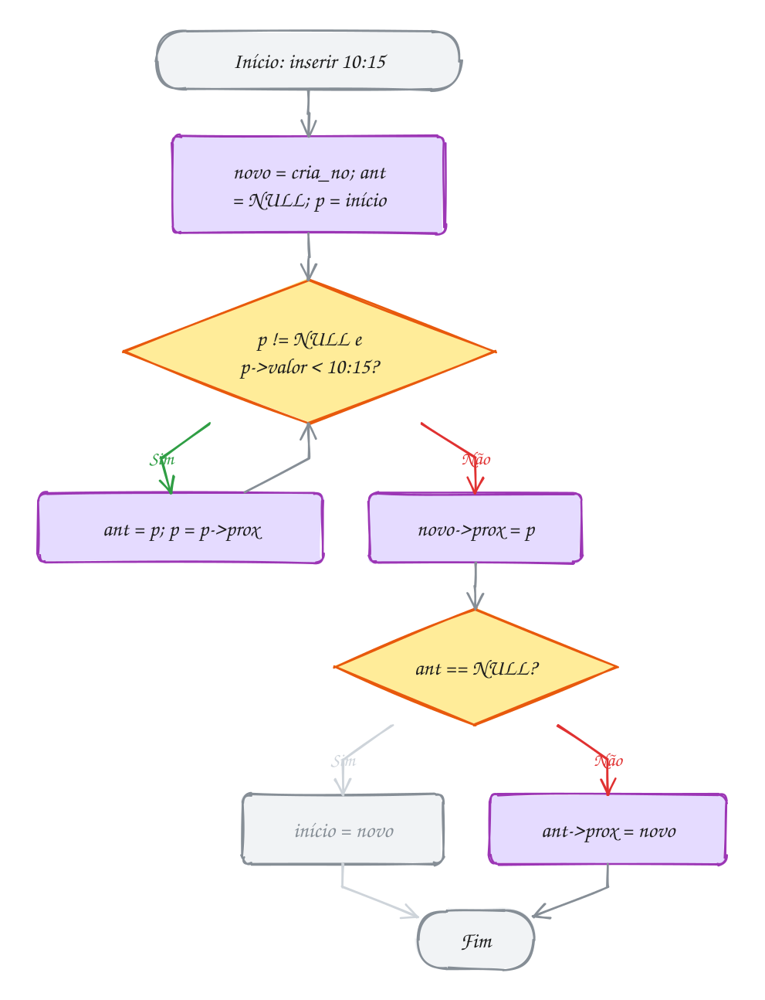</p>

O critério de ordem é só a comparação do `while`. Troque `p->valor < valor`
por `strcmp(p->nome, nome) < 0` e a mesma inserção monta uma lista em ordem
alfabética (exemplo A156).

> [!WARNING]
> O caso que todo mundo esquece é o **novo menor que todos**. O laço nem
> roda, `ant` fica `NULL`, e um `ant->prox = novo` sem o `if` derruba o
> programa. Teste sempre três inserções: no começo, no meio e no fim. E
> atenção ao `<` contra `<=`: com `<`, um valor repetido entra **antes** dos
> iguais; com `<=`, entra **depois**, e os iguais ficam na ordem de chegada.

> [!TIP]
> **Por dentro do C:** cada inserção ordenada custa O(n) no pior caso (o novo
> é o maior e o laço anda a lista toda). Montar uma lista de n itens assim
> custa O(n²). E a busca, mesmo parando cedo, continua O(n): não dá para
> fazer busca binária numa lista, porque chegar no meio exige andar n/2 nós.
> No vetor ordenado é o contrário: a busca binária é O(log n), mas inserir
> desloca até n itens. Cada estrutura cobra num lugar diferente.

> [!NOTE]
> **Pergunta para você:** inserindo 50, 40, 30, 20 e 10, nesta ordem, quantas
> vezes o corpo do `while` roda no total? E inserindo 10, 20, 30, 40 e 50?

### Hora de praticar

Os arquivos ficam em [`0078-lista-ordenada/`](0078-lista-ordenada/). Os comandos funcionam de qualquer pasta do terminal. Nos exemplos, rode, mude, quebre e rode de novo. Nos exercícios, a resposta vai dentro do próprio arquivo. ★☆☆ é aquecimento, ★★☆ pede raciocínio e ★★★ é desafio.

**Exemplo A155 · Tabela do campeonato: maior primeiro**

```c
#include <stdio.h>
#include <stdlib.h>
#include "lista.h"

// mesma inserção ordenada, com o critério virado: anda enquanto os de lá
// têm MAIS pontos. Em caso de empate, quem chega fica atrás (>=)
static No *insere_decrescente(No *inicio, int pontos) {
    No *novo = malloc(sizeof(No));
    if (novo == NULL) exit(1);
    novo->valor = pontos;
    No *ant = NULL;
    No *p = inicio;
    while (p != NULL && p->valor >= pontos) {
        ant = p;
        p = p->prox;
    }
    novo->prox = p;
    if (ant == NULL) return novo;
    ant->prox = novo;
    return inicio;
}

int main(void) {
    No *tabela = NULL;
    tabela = insere_decrescente(tabela, 40); // lista vazia
    tabela = insere_decrescente(tabela, 52); // maior de todos: vira o início
    tabela = insere_decrescente(tabela, 31); // menor de todos: vai para o fim
    tabela = insere_decrescente(tabela, 45); // cai no meio
    lista_imprime(tabela);

    tabela = insere_decrescente(tabela, 40); // empate: entra DEPOIS do outro 40
    lista_imprime(tabela);

    // líder e lanterna saem de graça das pontas
    No *ultimo = tabela;
    while (ultimo->prox != NULL) ultimo = ultimo->prox;
    printf("líder: %d pontos, lanterna: %d pontos\n", tabela->valor, ultimo->valor);

    // as funções do lista.h supõem ordem CRESCENTE: não use a busca
    // ordenada aqui, ela desistiria logo no 52
    if (lista_busca_ordenada(tabela, 45) == NULL) {
        printf("busca crescente numa lista decrescente: não achou o 45\n");
    }

    lista_libera(tabela);
    return 0;
}
// Saída:
// 52 -> 45 -> 40 -> 31 -> NULL
// 52 -> 45 -> 40 -> 40 -> 31 -> NULL
// líder: 52 pontos, lanterna: 31 pontos
// busca crescente numa lista decrescente: não achou o 45
```

```bash
~/LPEDC/rodar 11-listas/0078-lista-ordenada/A155.c
```

**Exemplo A156 · A chamada da turma em ordem alfabética**

```c
#include <stdio.h>
#include <stdlib.h>
#include <string.h>

// mesma ideia com strings: o critério de ordem vira strcmp
typedef struct aluno {
    char nome[20];
    struct aluno *prox;
} Aluno;

static Aluno *insere_nome(Aluno *inicio, const char *nome) {
    Aluno *novo = malloc(sizeof(Aluno));
    if (novo == NULL) exit(1);
    snprintf(novo->nome, sizeof novo->nome, "%s", nome);
    Aluno *ant = NULL;
    Aluno *p = inicio;
    while (p != NULL && strcmp(p->nome, nome) < 0) { // p vem antes no alfabeto
        ant = p;
        p = p->prox;
    }
    novo->prox = p;
    if (ant == NULL) return novo;
    ant->prox = novo;
    return inicio;
}

int main(void) {
    const char *matriculas[] = {"Renata", "Caio", "Yara", "Bruna", "Igor"};
    Aluno *turma = NULL;
    for (int i = 0; i < 5; i++) turma = insere_nome(turma, matriculas[i]);

    int numero = 1;
    for (Aluno *p = turma; p != NULL; p = p->prox) {
        printf("%d. %s\n", numero++, p->nome);
    }

    while (turma != NULL) { // libera
        Aluno *seguinte = turma->prox;
        free(turma);
        turma = seguinte;
    }
    return 0;
}
// Saída:
// 1. Bruna
// 2. Caio
// 3. Igor
// 4. Renata
// 5. Yara
```

```bash
~/LPEDC/rodar 11-listas/0078-lista-ordenada/A156.c
```

#### Exercícios

**Exercício E463** · ★☆☆

As notas do simulado saíram nesta ordem: 7, 3, 9, 5, 10, 1. Insira todas
com lista_insere_ordenado, mostre a lista e depois a menor e a maior nota.


```text
Saída esperada:
1 -> 3 -> 5 -> 7 -> 9 -> 10 -> NULL
menor: 1, maior: 10
```

**Dicas:**

1. Toda inserção é "notas = lista_insere_ordenado(notas, valor);".
2. Numa lista crescente, a menor é a do início: nem precisa procurar.
3. A maior é a do último nó: ande até o nó cujo prox é NULL.
4. Resposta esperada: a saída acima.

```bash
~/LPEDC/rodar 11-listas/0078-lista-ordenada/E463.c
```

**Exercício E464** · ★☆☆

Teste de mesa feito pelo próprio programa. A função insere_rastreando
abaixo é a inserção ordenada do texto. Acrescente, logo depois do while,
uma linha que mostre o valor inserido e onde ant e p pararam (use a
função mostra_no, que já está pronta e escreve NULL quando o ponteiro é
NULL). O main insere 25, 10, 40, 10 e 30 e mostra a lista a cada passo.


```text
Saída esperada:
25: ant NULL, p NULL
25 -> NULL
10: ant NULL, p 25
10 -> 25 -> NULL
40: ant 25, p NULL
10 -> 25 -> 40 -> NULL
10: ant NULL, p 10
10 -> 10 -> 25 -> 40 -> NULL
30: ant 25, p 40
10 -> 10 -> 25 -> 30 -> 40 -> NULL
```


Por fim, troque "p->valor < valor" por "p->valor <= valor" e rode de novo:
a linha do segundo 10 tem que virar "10: ant 10, p 25" (o novo 10 entra
DEPOIS do primeiro, não antes). Deixe a versão com < no arquivo final.

**Dicas:**

1. printf("%d: ", valor); mostra_no("ant", ant); printf(", ");
   mostra_no("p", p); printf("\n");
2. ant == NULL quer dizer "o novo vira o início"; p == NULL quer dizer
   "o novo vai para o fim".
3. Resposta esperada: a saída acima.

```bash
~/LPEDC/rodar 11-listas/0078-lista-ordenada/E464.c
```

**Exercício E465** · ★★☆

O entregador anotou os números das casas da rua, com repetidos: 5, 3, 5,
8, 3, 3, 1. Insira tudo em ordem e escreva


```text
int remove_repetidos(No *inicio)
```


que deixa um só de cada número e devolve quantos nós tirou.


```text
Saída esperada:
antes:  1 -> 3 -> 3 -> 3 -> 5 -> 5 -> 8 -> NULL
depois: 1 -> 3 -> 5 -> 8 -> NULL
3 repetidos removidos
```

**Dicas:**

1. Na lista ordenada, os repetidos ficam VIZINHOS: basta comparar p com
   p->prox.
2. Se p->valor == p->prox->valor, tire o p->prox (religue e dê free) e NÃO
   avance o p: pode haver um terceiro igual.
3. Por que a função não precisa de No **? O primeiro nó nunca sai: quando
   há repetidos, sai sempre o de trás.
4. Resposta esperada: a saída acima.

```bash
~/LPEDC/rodar 11-listas/0078-lista-ordenada/E465.c
```

**Exercício E466** · ★★☆

Duas linhas de ônibus saem do mesmo terminal. Os horários de cada uma
(em minutos depois das 6h) estão em listas crescentes:


```text
linha 101: 0 -> 25 -> 50 -> 75
linha 202: 10 -> 25 -> 40 -> 90
```


Escreva No *intercala(No *a, No *b), que junta as duas numa lista só,
também crescente, SEM criar nenhum nó novo: só religando os que existem.


```text
Saída esperada:
0 -> 10 -> 25 -> 25 -> 40 -> 50 -> 75 -> 90 -> NULL
```

**Dicas:**

1. Comece por um nó-cabeça local (No cabeca;) e um ponteiro "fim" que
   aponta para ele. Assim o primeiro nó não é caso especial.
2. Enquanto as duas tiverem nós: o menor dos dois inícios vai para
   fim->prox, e a lista de onde ele saiu anda.
3. Quando uma acabar, pendure a outra inteira no fim: fim->prox = a ou b.
4. Resposta esperada: a saída acima. Depois de intercalar, libere só a
   lista resultado: os nós de a e b agora são dela.

```bash
~/LPEDC/rodar 11-listas/0078-lista-ordenada/E466.c
```

**Exercício E467** · ★★★

O ranking da corrida de 5 km guarda os tempos em segundos, do mais rápido
para o mais lento. A função insere_ordem e o main têm TRÊS erros de
propósito. Rode, leia os relatórios do AddressSanitizer e conserte até
sair:


```text
Saída esperada depois do conserto:
1290 -> 1385 -> 1520 -> 1610 -> NULL
```

**Dicas:**

1. O primeiro relatório é um SEGV logo na primeira inserção, com a lista
   vazia. Leia o while: quem é testado primeiro?
2. O segundo aparece quando o laço nem anda (lista vazia, ou o novo tempo
   é o MENOR de todos): ant continua NULL e a função faz ant->prox.
3. O terceiro não quebra nada, mas a lista mostra "NULL" e o ASan acusa
   vazamento: olhe como o main chama insere_ordem.
4. Resposta esperada: "while (p != NULL && p->valor < valor)"; "if (ant ==
   NULL) return novo;" antes do ant->prox = novo; e no main,
   "ranking = insere_ordem(ranking, tempos[i]);".

```bash
~/LPEDC/rodar 11-listas/0078-lista-ordenada/E467.c
```

**Exercício E468** · ★★★

Os pedidos do delivery chegaram fora de ordem: 3 -> 7 -> 1 -> 9 -> 4.
Escreva No *ordena(No *inicio, int *passos), que deixa a lista em ordem
crescente pelo método da inserção, SÓ RELIGANDO os nós: nada de malloc,
nada de free, nada de trocar valores entre nós. Para medir o custo, some
1 em *passos cada vez que o laço de encaixe anda um nó. O main já testa a
lista dos pedidos e o pior caso, uma lista que já chega crescente.


```text
Saída esperada:
antes:  3 -> 7 -> 1 -> 9 -> 4 -> NULL
depois: 1 -> 3 -> 4 -> 7 -> 9 -> NULL  (6 passos)
antes:  1 -> 2 -> 3 -> 4 -> 5 -> NULL
depois: 1 -> 2 -> 3 -> 4 -> 5 -> NULL  (10 passos)
```

**Dicas:**

1. Comece uma lista "ordenada" vazia (NULL). Enquanto a original tiver nós,
   DESENGATE o primeiro dela (guarde o resto antes!).
2. Encaixe o nó desengatado na ordenada com o mesmo laço ant/p da
   inserção ordenada, só que sem malloc: o nó já existe. O (*passos)++ vai
   dentro desse laço.
3. Resposta esperada: a saída acima. Na lista crescente, cada nó novo é o
   maior e o encaixe percorre a ordenada inteira: 0 + 1 + 2 + 3 + 4 = 10,
   O(n²) no pior caso. A vantagem sobre o vetor é que encaixar não
   desloca ninguém.

```bash
~/LPEDC/rodar 11-listas/0078-lista-ordenada/E468.c
```

---

## 0079 · Lista dupla

Na Estrada de Ferro Carajás, um trem de minério para no pátio de manobras.
O terceiro vagão, com 87 toneladas, está com o freio travado e precisa sair.
O manobrista vai direto até ele, solta o engate da frente e o de trás, e
engata o segundo vagão no quarto. Ele não precisa voltar até a locomotiva
para descobrir quem vem antes do vagão quebrado: ele está vendo.

Na lista simples, o nó só conhece o próximo. Para remover um nó, você
precisa do anterior, e achar o anterior custa percorrer desde o início. Na
**lista duplamente encadeada**, cada nó guarda **dois** ponteiros: `prox`
(o próximo) e `ant` (o anterior). Com isso:

- dá para andar nos **dois sentidos**: do início para o fim e do fim para o
  início;
- dá para remover um nó conhecendo **só ele**, em O(1);
- guardando também o ponteiro para o **último** nó, inserir no fim vira O(1).

Por isso a lista desta pasta não é só um `No *`. Ela é uma struct que guarda
as duas pontas e o tamanho, e que pode morar numa variável do `main`:

```c
typedef struct no {
    int valor;
    struct no *ant;  // o anterior, ou NULL no primeiro
    struct no *prox; // o próximo, ou NULL no último
} No;

typedef struct {
    No *inicio;
    No *fim;
    int tamanho;
} Lista;
```

A lista dupla tem uma regra que nunca pode quebrar: para todo nó `p` que não
é o último, `p->prox->ant == p`. Toda operação mexe nas setas **aos pares**,
e esquecer uma delas é o erro clássico.

Remover o nó `p` é desviar as duas setas que chegam nele, cada uma com o seu
caso de borda:

```c
void lista_remove_no(Lista *l, No *p) {
    if (p->ant == NULL) l->inicio = p->prox;  // era o primeiro
    else p->ant->prox = p->prox;              // o anterior pula o p
    if (p->prox == NULL) l->fim = p->ant;     // era o último
    else p->prox->ant = p->ant;               // o seguinte pula o p para trás
    free(p);
    l->tamanho--;
}
```

Vamos ver na prática. O trem tem os vagões de 98, 105, 87 e 110 toneladas.
Com `p` no vagão de 87, a seta de cima faz o 105 apontar para o 110, e a de
baixo faz o 110 apontar de volta para o 105. Ninguém precisou ser procurado:

<p align="center">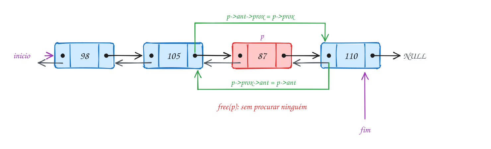</p>

```c
#include <stdio.h>
#include "lista.h"

int main(void) {
    Lista trem;
    lista_inicia(&trem);
    int cargas[] = {98, 105, 87, 110}; // toneladas, da locomotiva para o fim
    for (int i = 0; i < 4; i++) lista_insere_fim(&trem, cargas[i]);

    printf("da locomotiva: ");
    lista_imprime(&trem);
    printf("do fim:        ");
    lista_imprime_reverso(&trem);

    No *vagao = lista_busca(&trem, 87);
    if (vagao != NULL) {
        lista_remove_no(&trem, vagao); // sem procurar o anterior: p->ant
        printf("desengatou o vagão de 87 t (%d vagões)\n", trem.tamanho);
    }

    printf("da locomotiva: ");
    lista_imprime(&trem);
    printf("do fim:        ");
    lista_imprime_reverso(&trem);

    lista_libera(&trem);
    return 0;
}
// Saída:
// da locomotiva: 98 <-> 105 <-> 87 <-> 110
// do fim:        110 <-> 87 <-> 105 <-> 98
// desengatou o vagão de 87 t (3 vagões)
// da locomotiva: 98 <-> 105 <-> 110
// do fim:        110 <-> 105 <-> 98
```

Repara no fluxograma: são duas perguntas independentes, uma para cada
ponta. O vagão de 87 tem anterior e tem seguinte, então o caminho passa pelos
dois Não. Para remover o primeiro vagão, a primeira pergunta daria Sim; para
o último, a segunda:

<p align="center">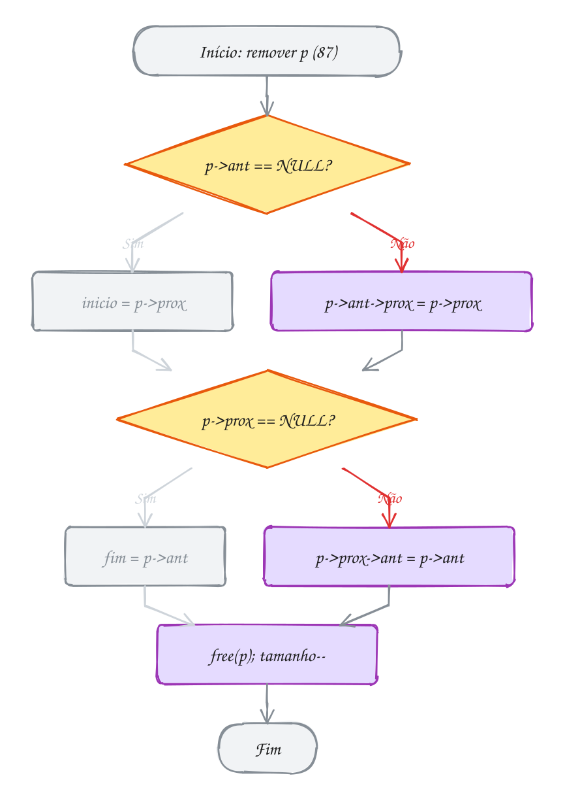</p>

Imprimir de trás para frente é o mesmo `for` de sempre, começando em
`l->fim` e andando com `p = p->ant`. O exemplo A158 usa essa ida e volta para
fazer um controle remoto com "canal seguinte" e "canal anterior".

> [!WARNING]
> Lista dupla com uma seta faltando **parece certa**. Se a inserção esquecer o
> `ant`, andar para frente funciona e só o caminho de volta sai errado, às
> vezes muito depois, em outra parte do programa. Teste sempre imprimindo
> **nos dois sentidos**. E na remoção, os dois casos de borda são
> obrigatórios: `p->ant->prox` com `p` no primeiro nó é acessar `NULL`, e
> esquecer de atualizar o `fim` deixa ele apontando para memória liberada.

> [!TIP]
> **Por dentro do C:** num PC de 64 bits, `sizeof(No)` passa de 16 para 24
> bytes: 4 do `int`, 4 de preenchimento e dois ponteiros de 8. É 50% a mais de
> memória por nó, o preço das remoções em O(1) e da volta. Existe um truque
> antigo para economizar: guardar num campo só o **XOR** dos dois endereços
> (`ant ^ prox`, convertidos para `uintptr_t`). Quem vem andando de um lado
> conhece um dos vizinhos e recupera o outro com mais um XOR. Funciona, mas
> nenhum depurador entende, e o ganho raramente compensa.

> [!NOTE]
> **Pergunta para você:** se `lista_insere_fim` esquecesse a linha `novo->ant =
> l->fim;`, o que `lista_imprime` mostraria para o trem do exemplo? E
> `lista_imprime_reverso`?

### Hora de praticar

Os arquivos ficam em [`0079-lista-dupla/`](0079-lista-dupla/). Os comandos funcionam de qualquer pasta do terminal. Nos exemplos, rode, mude, quebre e rode de novo. Nos exercícios, a resposta vai dentro do próprio arquivo. ★☆☆ é aquecimento, ★★☆ pede raciocínio e ★★★ é desafio.

**Exemplo A157 · Mexendo nas duas pontas: a fila do pronto-socorro**

```c
#include <stdio.h>
#include "lista.h"

static void mostra(const Lista *l) {
    printf("(%d) ", l->tamanho);
    lista_imprime(l);
}

int main(void) {
    Lista fila;
    lista_inicia(&fila);

    // fichas de atendimento: normais entram atrás, urgente entra na frente
    lista_insere_fim(&fila, 31);
    lista_insere_fim(&fila, 32);
    lista_insere_fim(&fila, 33);
    lista_insere_inicio(&fila, 90); // caso urgente: passa na frente
    mostra(&fila);

    // atender o primeiro: remover o início é O(1)
    printf("atende %d\n", fila.inicio->valor);
    lista_remove_no(&fila, fila.inicio);

    // o último desistiu: com o ponteiro fim, tirar o último também é O(1)
    printf("desistiu %d\n", fila.fim->valor);
    lista_remove_no(&fila, fila.fim);
    mostra(&fila);

    // esvaziando pela frente: no fim, as DUAS pontas voltam a NULL
    while (fila.inicio != NULL) lista_remove_no(&fila, fila.inicio);
    printf("vazia: inicio %s, fim %s, tamanho %d\n",
           fila.inicio == NULL ? "NULL" : "?",
           fila.fim == NULL ? "NULL" : "?", fila.tamanho);

    // e a lista vazia continua pronta para uso
    lista_insere_inicio(&fila, 34);
    printf("um só: início e fim são o mesmo nó? %s\n",
           fila.inicio == fila.fim ? "sim" : "não");

    lista_libera(&fila);
    return 0;
}
// Saída:
// (4) 90 <-> 31 <-> 32 <-> 33
// atende 90
// desistiu 33
// (2) 31 <-> 32
// vazia: inicio NULL, fim NULL, tamanho 0
// um só: início e fim são o mesmo nó? sim
```

```bash
~/LPEDC/rodar 11-listas/0079-lista-dupla/A157.c
```

**Exemplo A158 · O controle remoto: canal seguinte e canal anterior**

```c
#include <stdio.h>
#include "lista.h"

int main(void) {
    Lista canais;
    lista_inicia(&canais);
    int numeros[] = {2, 4, 5, 7, 11, 13};
    for (int i = 0; i < 6; i++) lista_insere_fim(&canais, numeros[i]);

    No *atual = canais.inicio;           // a TV liga no primeiro canal
    const char *apertos = ">>><<>>>>>";  // > próximo, < anterior

    printf("liga no %d\n", atual->valor);
    for (int i = 0; apertos[i] != '\0'; i++) {
        if (apertos[i] == '>' && atual->prox != NULL) {
            atual = atual->prox;         // anda para frente (no 13, fica)
        } else if (apertos[i] == '<' && atual->ant != NULL) {
            atual = atual->ant;          // anda para trás: só na lista dupla
        }
        printf("%c canal %d\n", apertos[i], atual->valor);
    }

    lista_libera(&canais);
    return 0;
}
// Saída:
// liga no 2
// > canal 4
// > canal 5
// > canal 7
// < canal 5
// < canal 4
// > canal 5
// > canal 7
// > canal 11
// > canal 13
// > canal 13
```

```bash
~/LPEDC/rodar 11-listas/0079-lista-dupla/A158.c
```

#### Exercícios

**Exercício E469** · ★☆☆

O pátio de manobras quer saber o peso dos ÚLTIMOS 3 vagões do trem, os que
vão ser desengatados na próxima estação. Monte o trem com lista_insere_fim
(120, 95, 101, 88, 130 e 76 toneladas) e, começando do fim e andando com
ant, mostre os 3 últimos (do último para trás) e a soma deles. Não comece
do início.


```text
Saída esperada:
76 130 88
últimos 3: 294 t
```

**Dicas:**

1. trem.fim é o último nó; p->ant anda uma casa para trás.
2. Um for com contador: for (p = trem.fim; p != NULL && k < 3; p = p->ant).
3. Resposta esperada: a saída acima. Numa lista simples, você teria que
   andar a lista inteira para achar os 3 últimos.

```bash
~/LPEDC/rodar 11-listas/0079-lista-dupla/E469.c
```

**Exercício E470** · ★☆☆

Na lista dupla, quem acha um nó acha também os dois vizinhos dele, sem
percorrer de novo. O main abaixo já monta a lista misturando inserções no
início e no fim. Escreva a função


```text
void mostra_vizinhos(const Lista *l, int valor)
```


que busca o valor com lista_busca e mostra quem vem antes e quem vem
depois dele ("nenhum" nas pontas), ou avisa que ele não está na lista.


```text
Saída esperada:
4 <-> 2 <-> 1 <-> 3
4: antes nenhum, depois 2
1: antes 2, depois 3
3: antes 1, depois nenhum
9: não está na lista
```

**Dicas:**

1. Desenhe os nós com as duas setas antes: a ordem saiu 4 2 1 3.
2. Achado o nó p, o vizinho de trás é p->ant e o da frente é p->prox.
   Teste cada um contra NULL antes de ler o valor.
3. Resposta esperada: a saída acima.

```bash
~/LPEDC/rodar 11-listas/0079-lista-dupla/E470.c
```

**Exercício E471** · ★★☆

Um palíndromo se lê igual nos dois sentidos. Com uma lista dupla dá para
conferir sem vetor nenhum: um ponteiro sai do início, outro sai do fim, e
os dois andam em direção ao meio comparando. Guarde cada letra como int
(char é número) e escreva:


```text
void monta(Lista *l, const char *palavra)   uma letra por nó, no fim
bool eh_palindromo(const Lista *l)
```


Teste com "radar", "trem", "arara" e "ab".


```text
Saída esperada:
radar: sim
trem: não
arara: sim
ab: não
```

**Dicas:**

1. monta: for (int i = 0; palavra[i] != '\0'; i++) lista_insere_fim(...).
2. eh_palindromo: e = l->inicio, d = l->fim, e repita l->tamanho / 2
   vezes: compare, e = e->prox, d = d->ant.
3. Use a mesma Lista para todas as palavras, com lista_libera entre uma e
   outra (ela deixa a lista vazia de novo).
4. Resposta esperada: a saída acima.

```bash
~/LPEDC/rodar 11-listas/0079-lista-dupla/E471.c
```

**Exercício E472** · ★★☆

Engatar um vagão no meio do trem mexe em QUATRO setas. Escreva


```text
bool insere_depois(Lista *l, No *p, int valor)
```


que cria um nó com o valor logo depois do nó p (que está na lista).
Cuidado com p == l->fim. No trem 98, 105, 87, 110, engate um vagão de 99 t
depois do de 105 e um de 70 t depois do último. Mostre nos dois sentidos:
se uma seta ficou errada, um dos sentidos denuncia.


```text
Saída esperada:
98 <-> 105 <-> 99 <-> 87 <-> 110 <-> 70
70 <-> 110 <-> 87 <-> 99 <-> 105 <-> 98
6 vagões
```

**Dicas:**

1. O novo aponta para os vizinhos: novo->ant = p; novo->prox = p->prox.
2. Os vizinhos apontam para o novo: se p->prox existe, p->prox->ant =
   novo; senão o novo é o fim (l->fim = novo). Por último, p->prox = novo.
3. Por que p->prox = novo por último? Se vier antes, você perde o
   caminho para o antigo seguinte.
4. Não esqueça do l->tamanho++. Resposta esperada: a saída acima.

```bash
~/LPEDC/rodar 11-listas/0079-lista-dupla/E472.c
```

**Exercício E473** · ★★★

As funções engata_inicio e desengata montam e desmontam um trem, mas cada
uma esquece UMA seta de propósito. Lista dupla com seta faltando é traiçoeira:
andando para frente tudo parece certo. Rode, compare os dois sentidos,
leia o relatório do AddressSanitizer e conserte as duas funções.


```text
Saída esperada depois do conserto:
98 <-> 105 <-> 87
87 <-> 105 <-> 98
98 <-> 105
105 <-> 98
```

**Dicas:**

1. A segunda linha mostra só "87": de trás para frente, o 87 não sabe quem
   vem antes dele. Quem deveria ter preenchido o ant do antigo primeiro?
   (A terceira linha sai "(vazia)" pelo mesmo motivo: com ant NULL, o
   desengata acha que o 87 é o primeiro.)
2. Conserte e rode de novo: agora é "heap-use-after-free" no
   lista_imprime_reverso. Tirar o último nó deixou o fim apontando para o
   nó liberado.
3. Resposta esperada: em engata_inicio, "if (l->inicio != NULL)
   l->inicio->ant = novo;"; em desengata, "if (p->prox == NULL) l->fim =
   p->ant; else p->prox->ant = p->ant;".

```bash
~/LPEDC/rodar 11-listas/0079-lista-dupla/E473.c
```

**Exercício E474** · ★★★

Todo editor de texto tem um cursor que anda para os dois lados, e uma
lista dupla de letras é um jeito clássico de fazer isso: inserir e apagar
na posição do cursor custa O(1). Simule o teclado com a string de teclas


```text
"progamr#<<r>>a"
```


onde letra insere na posição do cursor, '<' anda uma letra para a
esquerda, '>' anda para a direita e '#' apaga a letra à esquerda do
cursor (o backspace). Nas pontas, '<', '>' e '#' não fazem nada. No fim,
mostre o texto com uma '|' onde está o cursor.


```text
Saída esperada:
texto: programa|
```


Escreva tudo neste arquivo, com uma struct sua (por exemplo
struct letra { char c; struct letra *ant, *prox; }).

**Dicas:**

1. Use um nó-cabeça (uma letra de mentira no começo). O cursor é um
   ponteiro para a letra que está À ESQUERDA dele; no começo do texto, ele
   aponta para a cabeça. Assim nunca existe "cursor NULL".
2. Inserir: o novo entra depois do cursor (as quatro setas do E472) e o
   cursor passa para o novo. Apagar: se o cursor não é a cabeça, tire o nó
   do cursor e volte o cursor para o ant dele.
3. Para conferir no caminho: depois de "progamr#" o texto é "progam|";
   "<<" deixa "prog|am"; o "r" faz "progr|am"; ">>" e "a" terminam.
4. Resposta esperada: texto: programa|

```bash
~/LPEDC/rodar 11-listas/0079-lista-dupla/E474.c
```

---

## 0080 · Lista circular

Na churrascaria de rodízio, o garçom da pizza passa de mesa em mesa: 3, 7,
12, 15. Quando serve a última, ele não para: volta para a mesa 3 e começa
outra rodada. Para ele, não existe "fim da fila". Existe só "a próxima mesa".

Uma **lista circular** é uma lista encadeada em que o último nó, em vez de
apontar para `NULL`, aponta de volta para o **primeiro**. Os nós formam um
anel. Ela serve para tudo que é rodízio: a vez de cada jogador num jogo de
tabuleiro, a playlist no "repetir tudo", os programas que dividem a CPU, o
revezamento de motoristas numa viagem.

Num anel, qual nó você guarda? A escolha esperta é guardar o **último**. Dele
você chega às duas pontas em um passo: o último é `ultimo` e o primeiro é
`ultimo->prox`. Com isso, inserir no início **e** no fim custa O(1). Inserir
no fim é até mais curioso: é inserir no início e dizer que o novo é o
último.

```c
No *lista_insere_inicio(No *ultimo, int valor) {
    No *novo = cria_no(valor);       // cria_no faz novo->prox = novo
    if (ultimo == NULL) return novo; // único nó: primeiro e último
    novo->prox = ultimo->prox;       // o novo aponta para o antigo primeiro
    ultimo->prox = novo;             // o último fecha o círculo no novo
    return ultimo;
}

No *lista_insere_fim(No *ultimo, int valor) {
    // inserir no fim = inserir no início e dizer que o novo é o último
    ultimo = lista_insere_inicio(ultimo, valor);
    return ultimo->prox;
}
```

Percorrer muda de cara. Não tem `NULL` para avisar que acabou: você para
quando **voltar ao ponto de partida**. Como o primeiro passo já começa no
ponto de partida, o laço certo é o **do-while** (assunto 0021): ele roda o
corpo uma vez antes de testar. E a lista vazia (`ultimo == NULL`) precisa ser
tratada antes, porque não tem por onde começar.

Vamos ver na prática. As quatro mesas formam o anel, o ponteiro da lista
fica na mesa 15 (a última) e a mesa 3 é `ultimo->prox`. O garçom serve 6
vezes seguidas sem testar nada, porque sempre existe uma próxima:

<p align="center">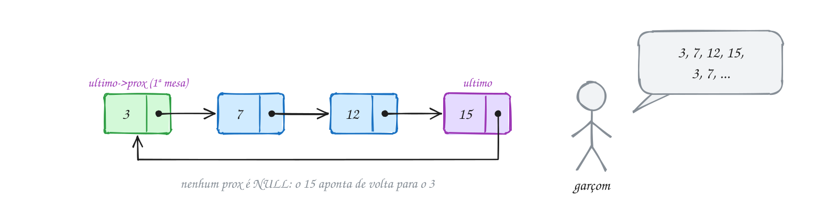</p>

```c
#include <stdio.h>
#include "lista.h"

int main(void) {
    No *salao = NULL; // ponteiro para a ÚLTIMA mesa
    int mesas[] = {3, 7, 12, 15};
    for (int i = 0; i < 4; i++) salao = lista_insere_fim(salao, mesas[i]);
    lista_imprime(salao);

    // o garçom sai da primeira mesa e serve 6 vezes, sem nunca achar um fim
    printf("serve:");
    No *garcom = salao->prox;
    for (int i = 0; i < 6; i++) {
        printf(" %d", garcom->valor);
        garcom = garcom->prox;
    }
    printf("\n");

    lista_remove(&salao, 12);
    printf("a mesa 12 pagou e foi embora\n");
    lista_imprime(salao);

    lista_libera(salao);
    return 0;
}
// Saída:
// 3 -> 7 -> 12 -> 15 -> (volta ao 3)
// serve: 3 7 12 15 3 7
// a mesa 12 pagou e foi embora
// 3 -> 7 -> 15 -> (volta ao 3)
```

Repara no fluxograma do `lista_imprime`: a pergunta da lista vazia vem
primeiro. Depois, `p` começa na mesa 3 e o laço mostra, anda e só então
pergunta "já voltei ao primeiro?". Com as 4 mesas, a resposta é Não três
vezes e Sim na quarta:

<p align="center">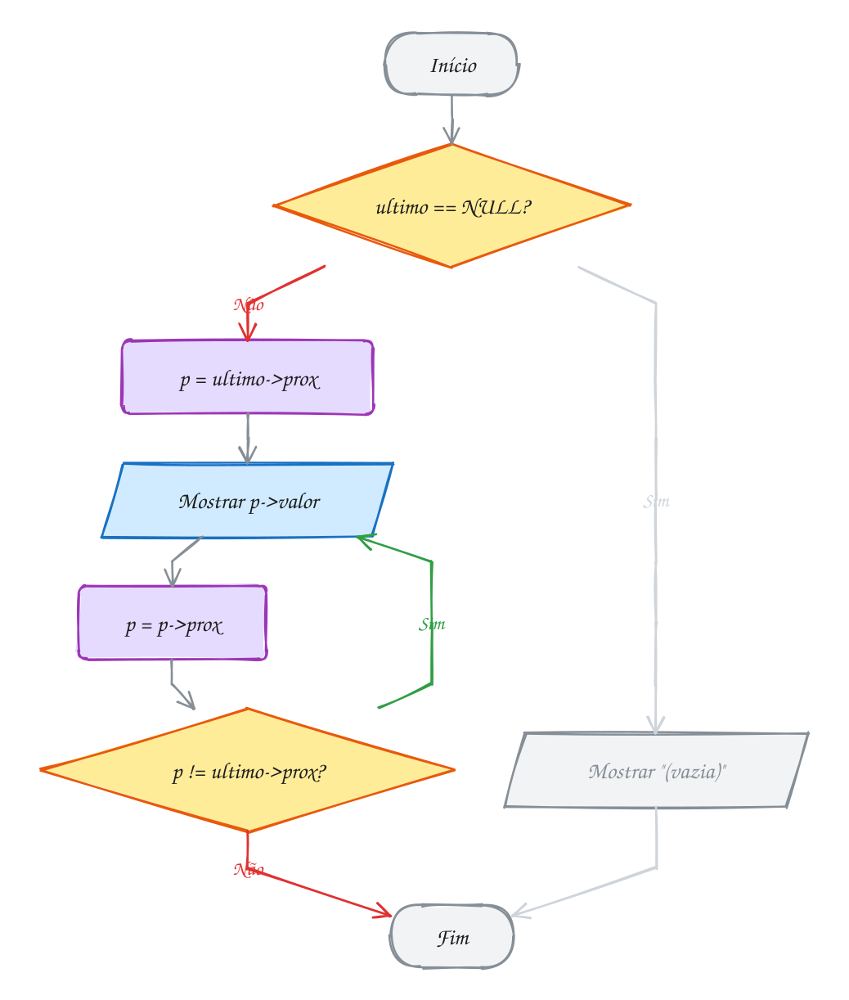</p>

O clássico da lista circular é o **problema de Josephus**: pessoas em roda, e
a cada k passos uma sai. Quem sobra? O exemplo A160 resolve com a batata
quente, tirando nós do anel até sobrar um que aponta para si mesmo.

> [!WARNING]
> Todo laço de lista que você escreveu até aqui termina em `p != NULL`. Numa
> lista circular, `p` **nunca** vira `NULL`: o laço dá voltas para sempre.
> No `libera` é pior: depois de liberar o último, o "seguinte" dele é o
> primeiro, que você já liberou. Para liberar, **corte o círculo** primeiro
> (`ultimo->prox = NULL`) e trate como lista comum. E cuidado com o `while`
> no lugar do `do-while`: `while (p != ultimo->prox)` começando no primeiro
> não roda nem uma vez.

> [!TIP]
> **Por dentro do C:** o nó é o mesmo da lista simples, 16 bytes. Não há
> custo de memória a mais: o círculo é só o último `prox` apontando para um
> endereço em vez de `NULL`. Os truques vêm de graça: **girar** a roda é
> mudar um ponteiro (`ultimo = ultimo->prox`), sem mexer em nó nenhum; e
> **juntar** duas listas circulares é trocar dois ponteiros, O(1). O
> escalonador de um sistema operacional faz exatamente isso: o processo da
> frente roda um pouquinho e, se não terminou, a roda gira.

> [!NOTE]
> **Pergunta para você:** se a lista guardasse o ponteiro para o **primeiro**
> nó em vez do último, quanto custaria inserir no fim? E no início? (Lembre
> que o último precisa apontar para o novo primeiro.)

### Hora de praticar

Os arquivos ficam em [`0080-lista-circular/`](0080-lista-circular/). Os comandos funcionam de qualquer pasta do terminal. Nos exemplos, rode, mude, quebre e rode de novo. Nos exercícios, a resposta vai dentro do próprio arquivo. ★☆☆ é aquecimento, ★★☆ pede raciocínio e ★★★ é desafio.

**Exemplo A159 · A playlist no repetir: um nó só, as duas pontas e o meio**

```c
#include <stdio.h>
#include "lista.h"

int main(void) {
    No *playlist = NULL; // ponteiro para a ÚLTIMA faixa
    lista_imprime(playlist);

    // uma faixa só: ela é a primeira e a última, e aponta para si mesma
    playlist = lista_insere_fim(playlist, 4);
    lista_imprime(playlist);
    printf("aponta para si mesma? %s\n", playlist->prox == playlist ? "sim" : "não");

    // com o ponteiro no último, as duas pontas custam O(1)
    playlist = lista_insere_fim(playlist, 9);
    playlist = lista_insere_fim(playlist, 2);
    playlist = lista_insere_inicio(playlist, 7); // entra antes da primeira
    lista_imprime(playlist);
    printf("primeira: %d, última: %d\n", playlist->prox->valor, playlist->valor);

    // dá para dar uma volta completa a partir de QUALQUER faixa
    No *comeco = playlist->prox;
    while (comeco->valor != 9) comeco = comeco->prox;
    printf("tocando a partir da 9:");
    No *p = comeco;
    do {
        printf(" %d", p->valor);
        p = p->prox;
    } while (p != comeco);
    printf("\n");

    // tirar a última: o ponteiro da lista recua para a penúltima
    lista_remove(&playlist, 2);
    lista_imprime(playlist);
    printf("%d faixas\n", lista_tamanho(playlist));

    lista_libera(playlist);
    return 0;
}
// Saída:
// (vazia)
// 4 -> (volta ao 4)
// aponta para si mesma? sim
// 7 -> 4 -> 9 -> 2 -> (volta ao 7)
// primeira: 7, última: 2
// tocando a partir da 9: 9 2 7 4
// 7 -> 4 -> 9 -> (volta ao 7)
// 3 faixas
```

```bash
~/LPEDC/rodar 11-listas/0080-lista-circular/A159.c
```

**Exemplo A160 · Batata quente: quem sobra na roda?**

```c
#include <stdio.h>
#include <stdlib.h>
#include "lista.h"

// 8 crianças em roda, numeradas de 1 a 8. A batata começa na 1 e passa de
// mão em mão; a 3ª criança a pegar a batata sai da roda, e a contagem
// recomeça na seguinte. Quem sobra? (o problema de Josephus)
int main(void) {
    int n = 8, passo = 3;
    No *roda = NULL;
    for (int i = 1; i <= n; i++) roda = lista_insere_fim(roda, i);
    lista_imprime(roda);

    No *ant = roda;          // o último: anterior do primeiro
    No *p = roda->prox;      // a batata começa na criança 1
    printf("saem:");
    while (p->prox != p) {   // enquanto houver mais de uma criança
        for (int i = 1; i < passo; i++) {
            ant = p;
            p = p->prox;
        }
        printf(" %d", p->valor);
        ant->prox = p->prox; // tira p da roda
        free(p);
        p = ant->prox;       // a contagem recomeça na seguinte
    }
    printf("\nsobrou a criança %d\n", p->valor);

    lista_libera(p);         // um nó só, que aponta para si mesmo
    return 0;
}
// Saída:
// 1 -> 2 -> 3 -> 4 -> 5 -> 6 -> 7 -> 8 -> (volta ao 1)
// saem: 3 6 1 5 2 8 4
// sobrou a criança 7
```

```bash
~/LPEDC/rodar 11-listas/0080-lista-circular/A160.c
```

#### Exercícios

**Exercício E475** · ★☆☆

Numa roda de chimarrão com 5 pessoas (numeradas de 1 a 5), a cuia começa
com a pessoa 1 e passa para a seguinte 12 vezes. Com quem ela fica? Monte
a roda com lista_insere_fim e descubra ANDANDO na lista circular. Depois
confira com uma conta usando %.


```text
Saída esperada:
1 -> 2 -> 3 -> 4 -> 5 -> (volta ao 1)
depois de 12 passadas, a cuia está com a pessoa 3
conferindo com %: pessoa 3
```

**Dicas:**

1. A pessoa 1 é roda->prox (a roda guarda o último).
2. Cada passada é p = p->prox. Numa lista circular o laço nunca encontra
   NULL: não precisa testar nada.
3. A conta: a pessoa 1 está na posição 0; depois de k passadas, a posição
   é k % 5, e a pessoa é a posição + 1.
4. Resposta esperada: a saída acima.

```bash
~/LPEDC/rodar 11-listas/0080-lista-circular/E475.c
```

**Exercício E476** · ★☆☆

Girar uma roda circular não mexe em nenhuma seta: basta mudar QUEM é o
último. Escreva a função


```text
No *gira(No *ultimo, int k)
```


que anda k nós com o ponteiro do último e devolve o novo último (assim o
primeiro passa a ser o que estava k casas à frente). O main já monta a
roda. Complete o main para: mostrar a roda e o primeiro e o último; girar
2 casas e mostrar; tirar o 10 e mostrar; e mostrar quantos nós sobraram.


```text
Saída esperada:
5 -> 10 -> 20 -> 30 -> (volta ao 5)
primeiro 5, último 30
girou 2: 20 -> 30 -> 5 -> 10 -> (volta ao 20)
sem o 10: 20 -> 30 -> 5 -> (volta ao 20)
3 nós
```

**Dicas:**

1. A lista é guardada pelo ponteiro para o ÚLTIMO: o primeiro é u->prox.
2. gira é um for de k voltas com ultimo = ultimo->prox. Na lista vazia
   (NULL), devolva NULL sem andar.
3. Depois de girar, guarde o resultado: u = gira(u, 2);
4. Resposta esperada: a saída acima.

```bash
~/LPEDC/rodar 11-listas/0080-lista-circular/E476.c
```

**Exercício E477** · ★★☆

Rita, Davi e Lia vão de carro de Belo Horizonte a Vitória e voltam: são
1000 km de estrada.
Eles revezam ao volante, nesta ordem, cada um dirigindo um trecho de
150 km (o último trecho é o que sobrar). Escreva o programa com uma lista
circular de structs (nome e km dirigidos) e mostre cada trecho e, no fim,
quanto cada um dirigiu.


```text
Saída esperada:
trecho 1: Rita dirige 150 km
trecho 2: Davi dirige 150 km
trecho 3: Lia dirige 150 km
trecho 4: Rita dirige 150 km
trecho 5: Davi dirige 150 km
trecho 6: Lia dirige 150 km
trecho 7: Rita dirige 100 km
Rita: 400 km
Davi: 300 km
Lia: 300 km
```


Escreva tudo neste arquivo, com uma struct sua (por exemplo
struct motorista { char nome[20]; int km; struct motorista *prox; }).

**Dicas:**

1. Monte a roda com inserção no fim guardando o último, como no lista.c.
2. O laço da viagem: enquanto faltar km, o trecho é 150 ou o que falta (o
   menor dos dois); some no km de quem dirige e passe para o próximo.
3. Para o resumo, uma volta com do-while a partir do primeiro.
4. Para liberar, corte o círculo (ultimo->prox = NULL) e libere como lista
   comum. Resposta esperada: a saída acima.

```bash
~/LPEDC/rodar 11-listas/0080-lista-circular/E477.c
```

**Exercício E478** · ★★☆

Dois salões do restaurante vão virar um só. Cada salão é uma lista
circular de mesas, guardada pelo último nó. Escreva


```text
No *concatena(No *ult_a, No *ult_b)
```


que emenda b depois de a e devolve o último da lista nova, em O(1): sem
percorrer nada, só trocando ponteiros. Trate as listas vazias.


```text
Saída esperada:
A: 1 -> 2 -> 3 -> (volta ao 1)
B: 10 -> 20 -> (volta ao 10)
juntas: 1 -> 2 -> 3 -> 10 -> 20 -> (volta ao 1)
com vazia: 1 -> 2 -> 3 -> 10 -> 20 -> (volta ao 1)
```

**Dicas:**

1. Desenhe os dois círculos. Quem precisa mudar? O último de a, que
   passa a apontar para o primeiro de b, e o último de b, que passa a
   apontar para o primeiro de a.
2. Guarde o primeiro de a (ult_a->prox) antes de mexer.
3. O último da lista nova é o último de b. Se uma das listas for NULL,
   devolva a outra.
4. Resposta esperada: a saída acima. Com ponteiro para o PRIMEIRO, você
   teria que andar até o último de cada lista: O(n).

```bash
~/LPEDC/rodar 11-listas/0080-lista-circular/E478.c
```

**Exercício E479** · ★★★

O sistema operacional divide a CPU entre os programas com o escalonamento
round-robin: cada processo roda no máximo um QUANTUM de tempo e vai para
o fim da fila; quem termina sai da roda. Simule com uma lista circular de
processos (id e tempo que falta), quantum 2, e os processos P1 (precisa de
5 unidades), P2 (2) e P3 (4), chegando nessa ordem no tempo 0.


```text
Saída esperada:
t=0..2: P1 (falta 3)
t=2..4: P2 (terminou)
t=4..6: P3 (falta 2)
t=6..8: P1 (falta 1)
t=8..10: P3 (terminou)
t=10..11: P1 (terminou)
```


Escreva tudo neste arquivo, com uma struct sua.

**Dicas:**

1. Guarde a roda pelo último nó, como no lista.c. Quem roda é sempre
   ultimo->prox, o primeiro.
2. A cada vez: fatia = menor entre o quantum e o que falta. Some a fatia
   no relógio e tire do processo.
3. Se o processo terminou, tire ele da roda (ultimo->prox = p->prox,
   free, e cuidado se ele era o único). Se não terminou, ele vai para o
   fim: basta fazer ultimo = p. Girar a roda é mudar um ponteiro.
4. Resposta esperada: a saída acima.

```bash
~/LPEDC/rodar 11-listas/0080-lista-circular/E479.c
```

**Exercício E480** · ★★★

A escala de plantão do hospital é circular: depois do último enfermeiro,
volta o primeiro. As duas funções deste programa têm erros de propósito.
Rode, compare com a saída esperada e leia o relatório do AddressSanitizer.
Conserte as duas funções e rode de novo até a saída bater.


```text
Saída esperada depois do conserto:
escala: 101 102 103 104
4 enfermeiros
```

**Dicas:**

1. A escala sai sem o 104. O while de mostra_escala para quando p chega
   no último, antes de imprimir ele. Uma volta completa se faz com
   do-while, parando quando p volta ao primeiro.
2. O ASan acusa "heap-use-after-free" em libera_escala: depois de liberar
   o último, o "seguinte" dele é o primeiro, que já foi liberado. Nenhum
   prox é NULL! Corte o círculo antes (ultimo->prox = NULL).
3. Resposta esperada: a saída acima, sem relatório do ASan. Na circular,
   todo nó tem um próximo de verdade: um laço "while (p != NULL)" nunca
   para sozinho (ou, como aqui, anda por memória já liberada).

```bash
~/LPEDC/rodar 11-listas/0080-lista-circular/E480.c
```

---

## 0081 · Juntando tudo

Viagem de carro, celular no painel, a playlist tocando. Alguém pula duas
músicas, outra pessoa tira aquela que ninguém aguenta mais, e quando a última
acaba, o modo "repetir tudo" volta para a primeira. Por trás desse player tem
quase tudo deste módulo: uma lista dupla (anterior e próxima), busca e
remoção pelo título, um cursor que anda e, no repetir, a volta da lista
circular.

O programa do módulo é um **TAD playlist** completo, em `playlist.h` e
`playlist.c`. Desta vez os nós ficam **escondidos** de novo: quem usa a
playlist vê só a struct `Musica` (título, artista, segundos) e as operações.
Lá dentro, no `.c`, cada nó (`Faixa`) guarda uma `Musica` e os ponteiros
`ant` e `prox`, e a `struct playlist` guarda `inicio`, `fim`, `atual` (a
música que está tocando), `tamanho` e o `bool repetir`.

Cada peça do módulo aparece num lugar:

- **adicionar** é a inserção no fim da lista dupla (0079), com o `fim`
  guardado para custar O(1);
- **remover pelo título** é a busca com `strcmp` (0077) seguida da remoção
  dupla, com um cuidado novo: se a música removida era a que tocava, o
  `atual` passa para a seguinte (ou para a anterior, se era a última);
- **próxima** e **anterior** andam com `prox` e `ant`; na ponta, com repetir
  ligado, dão a volta como numa lista circular (0080);
- **salvar** e **carregar** usam arquivo texto (módulo 09): uma música por
  linha, no formato `titulo;artista;segundos`, lida com `fgets` e `sscanf`;
- **para cada** recebe um ponteiro para função e um `void *` (0050 e 0051),
  e assim quem usa a playlist percorre as músicas sem ver os nós.

O "repetir" mora numa função só:

```c
const Musica *playlist_proxima(Playlist *p) {
    if (p->atual == NULL) return NULL;
    if (p->atual->prox != NULL) p->atual = p->atual->prox;
    else if (p->repetir) p->atual = p->inicio;  // dá a volta
    else return NULL;                           // fim da playlist
    return &p->atual->musica;
}
```

Repare que a lista **não** é circular de verdade: o último `prox` continua
`NULL`. A volta é uma decisão da função, ligada ou desligada por um `bool`.
Assim o resto do código (imprimir, liberar, salvar) continua com o `for` de
sempre, sem risco de laço infinito.

Vamos ver na prática. A playlist começa com cinco músicas e 20:01 no total.
Pulando duas, toca a terceira. Depois a "Asa Branca" sai, a playlist chega na
última e, com o repetir ligado, a próxima volta para "Aquarela":

<p align="center">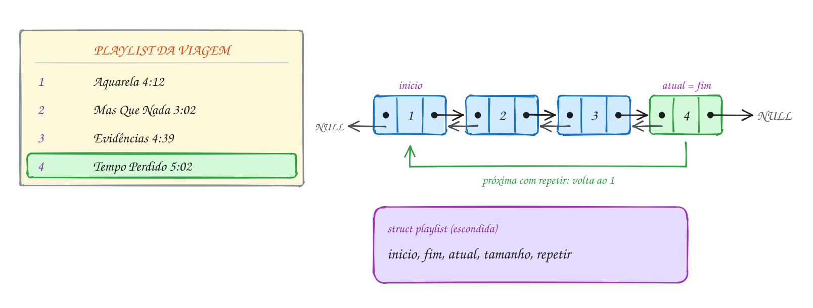</p>

```c
#include <stdio.h>
#include "playlist.h"

int main(void) {
    Playlist *viagem = playlist_cria();
    if (viagem == NULL) return 1;
    playlist_adiciona(viagem, "Aquarela", "Toquinho", 252);
    playlist_adiciona(viagem, "Asa Branca", "Luiz Gonzaga", 186);
    playlist_adiciona(viagem, "Mas Que Nada", "Jorge Ben", 182);
    playlist_adiciona(viagem, "Evidências", "Chitãozinho e Xororó", 279);
    playlist_adiciona(viagem, "Tempo Perdido", "Legião Urbana", 302);

    int total = playlist_duracao(viagem);
    printf("%d músicas, %d:%02d no total\n", playlist_tamanho(viagem), total / 60, total % 60);

    playlist_proxima(viagem);
    playlist_proxima(viagem);   // pulou duas: agora toca a 3ª
    playlist_imprime(viagem);

    playlist_remove(viagem, "Asa Branca");
    playlist_proxima(viagem);
    playlist_proxima(viagem);   // chegou na última
    if (playlist_proxima(viagem) == NULL) printf("fim da playlist\n");

    playlist_repetir(viagem, true);
    printf("repetir ligado, próxima: %s\n", playlist_proxima(viagem)->titulo);
    printf("anterior: %s\n", playlist_anterior(viagem)->titulo);

    playlist_libera(viagem);
    return 0;
}
// Saída:
// 5 músicas, 20:01 no total
//   1. Aquarela - Toquinho (4:12)
//   2. Asa Branca - Luiz Gonzaga (3:06)
// > 3. Mas Que Nada - Jorge Ben (3:02)
//   4. Evidências - Chitãozinho e Xororó (4:39)
//   5. Tempo Perdido - Legião Urbana (5:02)
// fim da playlist
// repetir ligado, próxima: Aquarela
// anterior: Tempo Perdido
```

Repara no fluxograma da `playlist_proxima`: tocando "Tempo Perdido", não há
próxima. Na primeira tentativa o repetir está desligado e a função devolve
`NULL` ("fim da playlist"). Na segunda, ligado, o caminho é o verde: o
`atual` volta para o início:

<p align="center">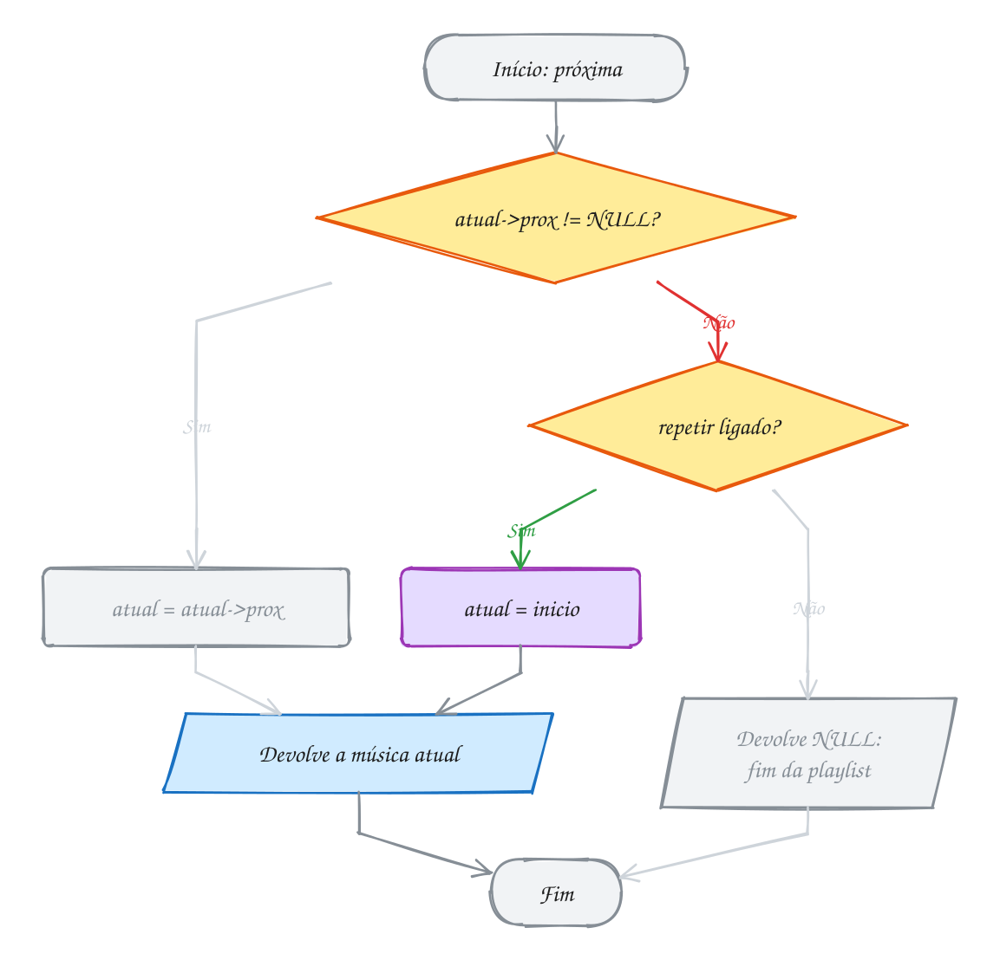</p>

O exemplo A162 grava a playlist em `playlist.txt`, libera tudo, carrega de
volta numa playlist nova e usa `playlist_para_cada` com um callback para
contar as músicas longas.

> [!WARNING]
> `playlist_proxima(viagem)->titulo` só é seguro quando você **sabe** que a
> função não vai devolver `NULL`, como no exemplo, com o repetir ligado e a
> playlist cheia. Com o repetir desligado na última música, o mesmo código
> acessa `NULL`. Em código de verdade, guarde o ponteiro e teste. E copie
> texto com `snprintf(destino, sizeof destino, "%s", origem)`: um título
> maior que 39 caracteres é cortado em vez de estourar o vetor, coisa que o
> `strcpy` faria sem pensar duas vezes.

> [!TIP]
> **Por dentro do C:** a `Musica` tem 40 + 30 bytes de texto, 2 de
> preenchimento e 4 do `int`: 76 bytes. A `Faixa` soma mais 4 de
> preenchimento (para o ponteiro começar num múltiplo de 8) e dois ponteiros:
> `sizeof(Faixa)` dá 96 bytes. O
> `const Musica *` que as funções devolvem aponta para **dentro** da faixa,
> no heap. Ele vale enquanto a música existir: depois de
> `playlist_remove` daquela música, é um ponteiro solto. É a mesma regra do
> vetor dinâmico (0075), em outra roupa: quem empresta um endereço de dentro
> da estrutura precisa dizer até quando ele vale.

> [!NOTE]
> **Pergunta para você:** se o exemplo chamasse `playlist_remove(viagem,
> "Tempo Perdido")` logo depois do "fim da playlist", qual música passaria a
> tocar? E se a playlist tivesse só essa música?

### Hora de praticar

Os arquivos ficam em [`0081-juntando-tudo/`](0081-juntando-tudo/). Os comandos funcionam de qualquer pasta do terminal. Nos exemplos, rode, mude, quebre e rode de novo. Nos exercícios, a resposta vai dentro do próprio arquivo. ★☆☆ é aquecimento, ★★☆ pede raciocínio e ★★★ é desafio.

**Exemplo A161 · A trilha do trajeto até o trabalho**

```c
#include <stdio.h>
#include "playlist.h"

int main(void) {
    // uma playlist vazia não toca nada, e não quebra
    Playlist *trajeto = playlist_cria();
    if (trajeto == NULL) return 1;
    if (playlist_atual(trajeto) == NULL && playlist_proxima(trajeto) == NULL) {
        printf("playlist vazia: nada tocando\n");
    }

    playlist_adiciona(trajeto, "Trem das Onze", "Adoniran Barbosa", 190);
    playlist_adiciona(trajeto, "Detalhes", "Roberto Carlos", 268);
    playlist_adiciona(trajeto, "O Bêbado e a Equilibrista", "Elis Regina", 228);
    playlist_adiciona(trajeto, "Sina", "Djavan", 233);
    playlist_repetir(trajeto, true); // o ônibus demora mais que a playlist

    // 20 minutos de ônibus: toca música atrás de música até chegar
    int trajeto_s = 20 * 60;
    int relogio = 0; // em segundos, desde que entrou no ônibus
    const Musica *m = playlist_atual(trajeto);
    while (relogio + m->segundos <= trajeto_s) {
        printf("%2d:%02d %s\n", relogio / 60, relogio % 60, m->titulo);
        relogio += m->segundos;
        m = playlist_proxima(trajeto); // com repetir, nunca é NULL
    }
    int ouviu = trajeto_s - relogio;
    printf("%2d:%02d %s (chegou no ponto depois de %d s)\n",
           relogio / 60, relogio % 60, m->titulo, ouviu);

    // amanhã continua de onde parou: a playlist lembra a música atual
    printf("amanhã começa em: %s\n", playlist_atual(trajeto)->titulo);

    playlist_libera(trajeto);
    return 0;
}
// Saída:
// playlist vazia: nada tocando
//  0:00 Trem das Onze
//  3:10 Detalhes
//  7:38 O Bêbado e a Equilibrista
// 11:26 Sina
// 15:19 Trem das Onze
// 18:29 Detalhes (chegou no ponto depois de 91 s)
// amanhã começa em: Detalhes
```

```bash
~/LPEDC/rodar 11-listas/0081-juntando-tudo/A161.c
```

**Exemplo A162 · Salvar a playlist no arquivo e carregar de volta**

```c
#include <stdio.h>
#include "playlist.h"

// callback para playlist_para_cada: conta as músicas com mais de 4 minutos
static void conta_longas(const Musica *m, void *extra) {
    int *contador = extra; // o void * volta a ser o que era: um int *
    if (m->segundos > 240) (*contador)++;
}

int main(void) {
    Playlist *original = playlist_cria();
    if (original == NULL) return 1;
    playlist_adiciona(original, "Aquarela", "Toquinho", 252);
    playlist_adiciona(original, "Mas Que Nada", "Jorge Ben", 182);
    playlist_adiciona(original, "Tempo Perdido", "Legião Urbana", 302);

    if (!playlist_salva(original, "playlist.txt")) {
        printf("não consegui gravar\n");
        playlist_libera(original);
        return 1;
    }
    playlist_libera(original); // a playlist some da memória; o arquivo fica

    Playlist *lida = playlist_carrega("playlist.txt");
    if (lida == NULL) return 1;
    printf("carregou %d músicas:\n", playlist_tamanho(lida));
    playlist_imprime(lida);

    int longas = 0;
    playlist_para_cada(lida, conta_longas, &longas);
    printf("%d com mais de 4 minutos\n", longas);

    playlist_libera(lida);
    remove("playlist.txt"); // apaga o arquivo de teste
    return 0;
}
// Conteúdo de playlist.txt enquanto existe:
// Aquarela;Toquinho;252
// Mas Que Nada;Jorge Ben;182
// Tempo Perdido;Legião Urbana;302
//
// Saída:
// carregou 3 músicas:
// > 1. Aquarela - Toquinho (4:12)
//   2. Mas Que Nada - Jorge Ben (3:02)
//   3. Tempo Perdido - Legião Urbana (5:02)
// 2 com mais de 4 minutos
```

```bash
~/LPEDC/rodar 11-listas/0081-juntando-tudo/A162.c
```

#### Exercícios

**Exercício E481** · ★☆☆

Monte a playlist do churrasco usando só playlist.h, nesta ordem:


```text
Deixa a Vida Me Levar, Zeca Pagodinho, 233 s
Ai Se Eu Te Pego, Michel Teló, 166 s
País Tropical, Jorge Ben, 196 s
Velha Infância, Tribalistas, 251 s
Garota de Ipanema, Tom Jobim, 194 s
```


Avance três músicas, volte uma, mostre a playlist, o total em min:seg e o
que está tocando.


```text
Saída esperada:
  1. Deixa a Vida Me Levar - Zeca Pagodinho (3:53)
  2. Ai Se Eu Te Pego - Michel Teló (2:46)
> 3. País Tropical - Jorge Ben (3:16)
  4. Velha Infância - Tribalistas (4:11)
  5. Garota de Ipanema - Tom Jobim (3:14)
5 músicas, 17:20
tocando agora: País Tropical - Jorge Ben
```

**Dicas:**

1. playlist_cria, cinco playlist_adiciona, e confira se a criação não
   devolveu NULL.
2. Para min:seg, use total / 60 e total % 60 com "%d:%02d".
3. playlist_atual devolve um const Musica *: acesse m->titulo e m->artista.
4. Resposta esperada: a saída acima. Libere a playlist no fim.

```bash
~/LPEDC/rodar 11-listas/0081-juntando-tudo/E481.c
```

**Exercício E482** · ★☆☆

Hora de testar as pontas da playlist. Escreva a função


```text
void mostra(const Musica *m)
```


que imprime o título da música, ou "(nada)" quando m é NULL. Depois crie
uma playlist com Um (Banda A, 100 s), Dois (Banda B, 200 s) e Tres
(Banda C, 300 s) e faça, nesta ordem, chamando mostra com o que cada
passo marcado com * devolve:


```text
* a música atual
* volta uma (anterior)
  avança uma
* avança uma
* avança uma
  liga o repetir
* avança uma
* volta uma
  remove "Tres"
* a música atual
  remove "Um" e mostra quantas músicas e quantos segundos sobraram
* avança uma
```


```text
Saída esperada:
Um
(nada)
Tres
(nada)
Um
Tres
Dois
1 música, 200 s
Dois
```

**Dicas:**

1. Com repetir desligado, andar além da ponta devolve NULL e não sai do
   lugar; ligado, dá a volta.
2. Removendo a música que toca, passa a tocar a seguinte; se ela era a
   última, a anterior. Com uma música só e repetir ligado, a próxima é
   ela mesma.
3. Resposta esperada: a saída acima.

```bash
~/LPEDC/rodar 11-listas/0081-juntando-tudo/E482.c
```

**Exercício E483** · ★★☆

A playlist não deixa você ver os nós, mas playlist_para_cada chama uma
função SUA para cada música, levando junto um void *extra com o que você
quiser (assuntos 0050 e 0051). Com a playlist do main, escreva duas
funções de callback:


```text
acha_longa: descobre a música mais longa (extra aponta para um
            const Musica * que guarda a maior até agora)
soma_artista: conta quantas músicas e quantos segundos tem um artista
            (extra aponta para uma struct com o nome, a contagem e a soma)
```


```text
Saída esperada:
mais longa: Tempo Perdido (5:02)
Jorge Ben: 2 músicas, 6:11
```

**Dicas:**

1. A assinatura é fixa: void acha_longa(const Musica *m, void *extra).
2. Dentro dela: const Musica **maior = extra; e compare com *maior (que
   começa NULL).
3. Para o artista: typedef struct { const char *nome; int quantas; int
   segundos; } Filtro; e no callback, Filtro *f = extra; e strcmp.
4. Resposta esperada: a saída acima (182 + 189 = 371 s = 6:11).

```bash
~/LPEDC/rodar 11-listas/0081-juntando-tudo/E483.c
```

**Exercício E484** · ★★☆

O bolão da Copa da firma mantém um ranking: mais pontos na frente e, em
caso de empate, ordem alfabética. Escreva, com uma lista encadeada de
structs (nome e pontos) neste arquivo:


```text
insere no lugar certo do ranking (inserção ordenada)
remove um participante pelo nome
imprime com a posição
```


Participantes, na ordem em que entraram: Ana 12, Beto 15, Cris 12,
Duda 9, Edu 15. Depois a Cris sai do bolão.


```text
Saída esperada:
1. Beto 15
2. Edu 15
3. Ana 12
4. Cris 12
5. Duda 9
Cris saiu do bolão
1. Beto 15
2. Edu 15
3. Ana 12
4. Duda 9
```

**Dicas:**

1. Escreva uma função bool vem_antes(const Participante *a, const
   Participante *b): mais pontos, ou pontos iguais e strcmp(a->nome,
   b->nome) < 0. O laço da inserção anda enquanto vem_antes(p, novo).
2. A remoção é a do assunto 0077, comparando nomes com strcmp.
3. Copie o nome com snprintf, nunca com strcpy sem limite.
4. Resposta esperada: a saída acima.

```bash
~/LPEDC/rodar 11-listas/0081-juntando-tudo/E484.c
```

**Exercício E485** · ★★★

No karaokê do bar, os pedidos entram numa fila (lista encadeada com
ponteiro para o início e para o fim): pede põe no fim, chama tira do
começo. O programa tem TRÊS erros de propósito. Rode, leia cada relatório
do AddressSanitizer e conserte um de cada vez.


```text
Saída esperada depois do conserto:
cantando: Evidências (Rui)
cantando: Garota de Ipanema (Lia)
cantando: Asa Branca (Gil)
ainda na fila: 1
```

**Dicas:**

1. Primeiro relatório: "heap-buffer-overflow" dentro do strcpy. Quantos
   bytes tem "Garota de Ipanema" (conte o '\0')? Aumente o vetor musica
   para 40 e troque strcpy por snprintf, que nunca passa do tamanho.
2. Segundo: "heap-use-after-free" em chama (o gcc já avisava: "pointer
   'p' used after 'free'"). Leia p->prox antes do free.
   E quando a fila esvazia, o fim continua apontando para o pedido
   liberado: o próximo pede escreve nele. Zere o fim nesse caso.
3. Terceiro: "memory leaks" no fim. O pedido que ficou na fila nunca foi
   liberado. Escreva uma função que libera tudo e chame no fim do main.
4. Resposta esperada: a saída acima, sem nenhum relatório do ASan.

```bash
~/LPEDC/rodar 11-listas/0081-juntando-tudo/E485.c
```

**Exercício E486** · ★★★

Um polinômio cabe numa lista encadeada: um nó por termo (coeficiente e
expoente), em ordem DECRESCENTE de expoente, sem termos de coeficiente 0.
Escreva neste arquivo:


```text
insere_termo(lista, coef, exp)   põe o termo no lugar certo; se já
                                 existe um com esse expoente, soma os
                                 coeficientes, e se a soma der 0, tira
                                 o nó
soma(p, q)                       devolve um polinômio NOVO com p + q
imprime(p)                       no formato do exemplo
avalia(p, x)                     o valor do polinômio para esse x
```


Teste com P(x) = 3x^4 + 2x^2 - 5 e Q(x) = x^4 - 2x^2 + 7x.


```text
Saída esperada:
P(x) = 3x^4 + 2x^2 - 5
Q(x) = x^4 - 2x^2 + 7x
P + Q = 4x^4 + 7x - 5
(P + Q)(2) = 73
```

**Dicas:**

1. struct termo { int coef; int exp; struct termo *prox; }. A inserção é
   a ordenada do assunto 0078 com o critério invertido (anda enquanto
   p->exp > exp), mais o caso p->exp == exp.
2. soma: crie uma lista vazia e chame insere_termo para cada termo de p e
   de q. O caso "soma deu 0" faz o 2x^2 e o -2x^2 sumirem sozinhos.
3. imprime: o primeiro termo leva o sinal colado ("-5"); os outros, " + "
   ou " - " e o valor absoluto. Coeficiente 1 não aparece (x^4), expoente
   1 vira "x" e expoente 0 é só o número.
4. Resposta esperada: a saída acima. 4*16 + 7*2 - 5 = 73. Libere os três
   polinômios.

```bash
~/LPEDC/rodar 11-listas/0081-juntando-tudo/E486.c
```

---

## Desafios do módulo

Problemas para fazer num arquivo seu, misturando os assuntos do módulo. Use
o `rodar` em todos: resposta certa com vazamento não vale.

**1. Lista com ciclo.** Um bug deixou o `prox` do último nó apontando para
um nó do meio, e agora percorrer a lista nunca termina. Escreva
`bool tem_ciclo(const No *inicio)` que descobre isso sem alocar memória e sem
modificar a lista.

<details><summary>Resposta</summary>

Lebre e tartaruga (algoritmo de Floyd): a tartaruga anda 1 nó por vez e a
lebre anda 2. Se a lebre chegar em `NULL`, não há ciclo. Se houver, a lebre
dá a volta e alcança a tartaruga: `lebre == tartaruga` em algum momento.
O(n) de tempo, O(1) de memória. Bônus: depois do encontro, volte a tartaruga
para o início e ande os dois de 1 em 1; eles se encontram no primeiro nó do
ciclo.

</details>

**2. O k-ésimo a partir do fim.** Numa lista simples de tamanho desconhecido,
ache o 3º nó contando do fim, percorrendo a lista uma vez só. Em
`10 -> 20 -> 30 -> 40 -> 50`, a resposta é 30.

<details><summary>Resposta</summary>

Dois ponteiros com distância fixa: adiante o primeiro 3 nós; depois ande os
dois juntos até o primeiro virar `NULL`. O segundo está no 3º a partir do
fim. Trate a lista com menos de 3 nós (o primeiro vira `NULL` antes de
completar os 3 passos).

</details>

**3. Interseção de listas ordenadas.** Dadas duas listas crescentes, monte
uma terceira (nova, com `malloc`) só com os valores que aparecem nas duas.
Para `1 3 4 7 9` e `2 3 7 8 9`, o resultado é `3 7 9`.

<details><summary>Resposta</summary>

Um ponteiro em cada lista, como na intercalação do E466: se os valores são
iguais, copie para a resposta e ande os dois; senão ande só o do menor.
O(n + m), sem nenhum laço aninhado. Inserir no fim com um ponteiro para o
último mantém a ordem.

</details>

**4. Números gigantes.** Um `long long` vai até uns 9 × 10¹⁸. Some
`98765432109876543210` com `12345678901234567890` guardando cada número numa
lista com **um dígito por nó, do menos significativo para o mais**.

<details><summary>Resposta</summary>

**111111111011111111100**. Com os dígitos de trás para frente, a soma anda
nas duas listas do começo, igual à conta armada: dígito = (a + b + vai_um) %
10, vai_um = (a + b + vai_um) / 10. No fim, se sobrar vai-um, crie mais um
nó. Para imprimir, use recursão (como no E454) ou uma lista dupla e ande do
fim para o começo.

</details>

**5. Desfazer e refazer.** Um editor guarda o histórico de versões numa
lista dupla com um cursor na versão atual. "Desfazer" volta, "refazer"
avança. O que precisa acontecer com as versões à frente do cursor quando a
pessoa desfaz duas vezes e depois digita algo novo?

<details><summary>Resposta</summary>

Elas são **descartadas**: libere todos os nós depois do cursor, faça
`cursor->prox = NULL`, atualize o `fim` e só então insira a versão nova
depois do cursor. É o comportamento de todo editor: depois de editar, o
"refazer" some. Esquecer os `free` desses nós é vazamento clássico.

</details>

**6. LRU: o cache das páginas recentes.** Um navegador guarda as últimas 3
páginas visitadas. Visitar uma página que já está na lista leva ela para a
frente; visitar uma nova com a lista cheia expulsa a mais antiga (a do fim).
Simule as visitas A, B, C, A, D, B. Como fica a lista?

<details><summary>Resposta</summary>

A → `A`; B → `B A`; C → `C B A`; A (já está: vai para a frente) → `A C B`;
D (nova, cheia: sai o B do fim) → `D A C`; B (nova, cheia: sai o C) →
**`B D A`**. A lista dupla com `inicio` e `fim` faz cada movimento em O(1)
depois de achar o nó. Achar ainda é O(n); com uma tabela hash (módulo 15)
apontando para os nós, tudo vira O(1). É assim que caches de verdade
funcionam.

</details>

**7. Sem casos especiais.** Reescreva a lista dupla do assunto 0079 com um
**nó sentinela** circular: um nó de mentira cujo `prox` é o primeiro e cujo
`ant` é o último. Lista vazia é a sentinela apontando para si mesma nos dois
sentidos. Quantos `if` sobram na inserção e na remoção?

<details><summary>Resposta</summary>

**Nenhum.** Todo nó real tem anterior e seguinte de verdade (às vezes a
sentinela), então remover é sempre `p->ant->prox = p->prox; p->prox->ant =
p->ant;` e inserir depois de `q` é sempre as mesmas quatro atribuições.
Inserir no início é inserir depois da sentinela; no fim, depois de
`sentinela->ant`. Percorrer vai de `s->prox` até voltar a `s`.

</details>

**8. Inverter de k em k.** Inverta uma lista simples em blocos de 3 nós, só
mexendo nos ponteiros. `1 2 3 4 5 6 7 8` vira `3 2 1 6 5 4 8 7` (o último
bloco incompleto também é invertido).

<details><summary>Resposta</summary>

Aplique a inversão do E456 em pedaços: inverta 3 nós, guardando o primeiro
do bloco (que vira o último) e o início do resto. Ligue o fim do bloco
invertido ao resultado da inversão do resto. Fica elegante com recursão:
`inverte_k(inicio)` inverte os 3 primeiros e faz
`primeiro_do_bloco->prox = inverte_k(resto)`.

</details>

**9. Ordenar uma lista em O(n log n).** O E468 ordena por inserção em
O(n²). Escreva o **merge sort** de lista: divida a lista ao meio, ordene cada
metade recursivamente e intercale. Teste com `5 1 4 2 8 3 7 6`.

<details><summary>Resposta</summary>

Para dividir, use a lebre e a tartaruga (E462): quando a lebre chega ao fim,
corte depois da tartaruga (`meio = tartaruga->prox; tartaruga->prox =
NULL`). Caso base: lista com 0 ou 1 nó. Junte com a intercalação do E466.
Resultado `1 2 3 4 5 6 7 8`. Na lista, o merge sort não precisa de vetor
auxiliar: só religa nós. É o assunto 0094, um módulo adiantado.

</details>

**10. Josephus de cabeça.** Com n pessoas em roda e eliminando de k em k, a
posição do sobrevivente (contando de 0) obedece a J(1) = 0 e
J(n) = (J(n − 1) + k) % n. Use a fórmula para n = 8, k = 3 e confira com a
batata quente do A160. Depois responda: quando vale a pena simular com a
lista e quando a fórmula basta?

<details><summary>Resposta</summary>

J(1)=0, J(2)=1, J(3)=1, J(4)=0, J(5)=3, J(6)=0, J(7)=3, J(8)=6. Posição 6
contando de 0 é a pessoa **7**, igual ao A160. A fórmula é O(n) e não usa
memória, mas só diz quem sobra. A lista dá a **ordem** de eliminação e
aguenta variações que a fórmula não cobre (passo diferente para cada pessoa,
alguém entrando no meio).

</details>

## Para ler mais

- CELES, W.; RANGEL, J. L. *Apostila de estruturas de dados*. Rio de Janeiro: PUC-Rio, Departamento de Informática, 2002. Cap. 10: listas encadeadas.
- CELES, W.; CERQUEIRA, R.; RANGEL, J. L. *Introdução a estruturas de dados: com técnicas de programação em C*. Rio de Janeiro: Elsevier, 2004.
- FEOFILOFF, P. *Algoritmos em linguagem C*. Rio de Janeiro: Elsevier, 2009. Cap. 4: listas encadeadas. Disponível em: <https://www.ime.usp.br/~pf/algoritmos/>.
- TENENBAUM, A. M.; LANGSAM, Y.; AUGENSTEIN, M. J. *Estruturas de dados usando C*. São Paulo: Makron Books, 1995. Cap. 4: filas e listas.
- LAUREANO, M. *Estrutura de dados com algoritmos e C*. Rio de Janeiro: Brasport, 2008. Cap. 6: lista.
- ROCHA, A. M. A.; BORGES, A. R. O. S. *Programação, estruturas de dados e algoritmos em C*. Aveiro: Universidade de Aveiro, Departamento de Eletrônica e Telecomunicações.
- DEITEL, P.; DEITEL, H. *C: como programar*. 6. ed. São Paulo: Pearson, 2011. Cap. 12: estruturas de dados.
- BACKES, A. *Linguagem C: descomplicada* (apostila). Cap. sobre alocação dinâmica e structs.
- KERNIGHAN, B. W.; RITCHIE, D. M. *C: a linguagem de programação padrão ANSI*. Rio de Janeiro: Campus, 1989. Seção 6.5: estruturas autorreferenciadas.
- CPPREFERENCE. *realloc*. Disponível em: <https://en.cppreference.com/w/c/memory/realloc>.
- GCC. *AddressSanitizer*. Disponível em: <https://github.com/google/sanitizers/wiki/AddressSanitizer>.
