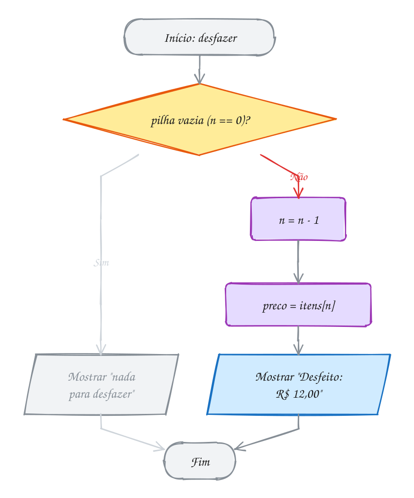
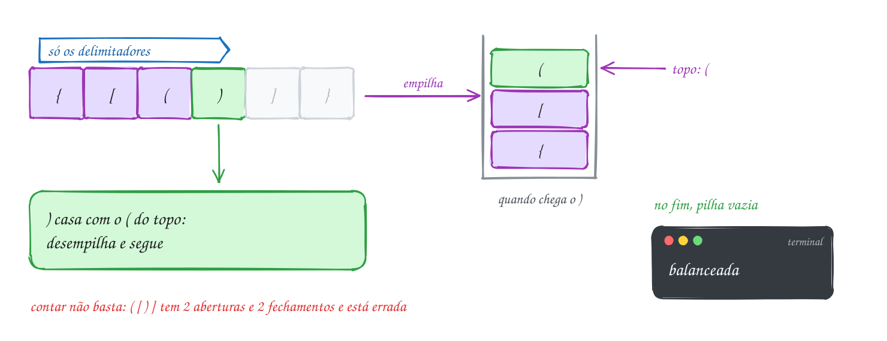
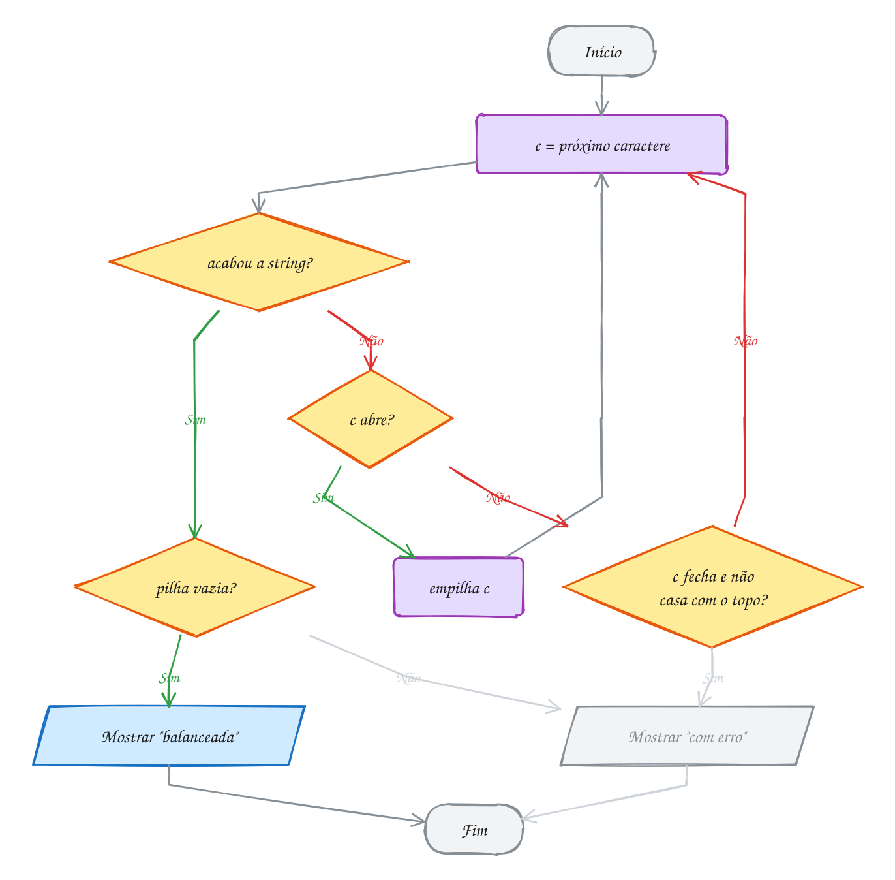
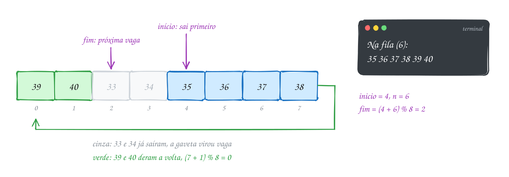
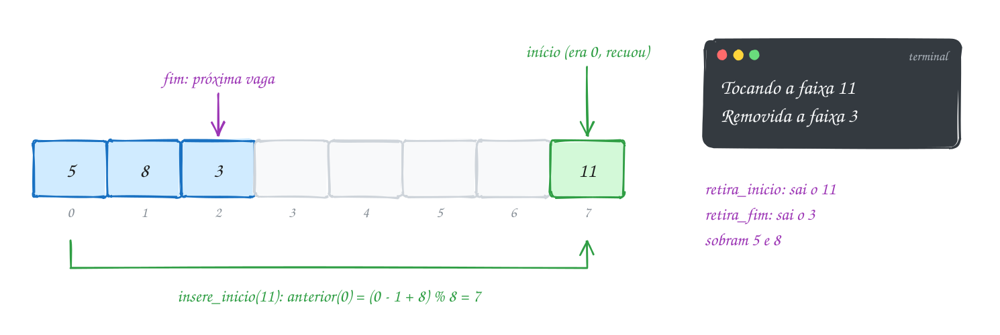
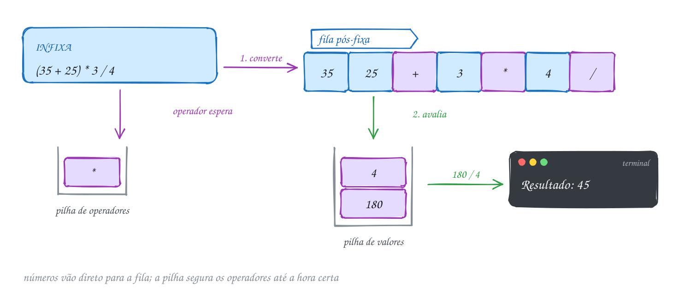
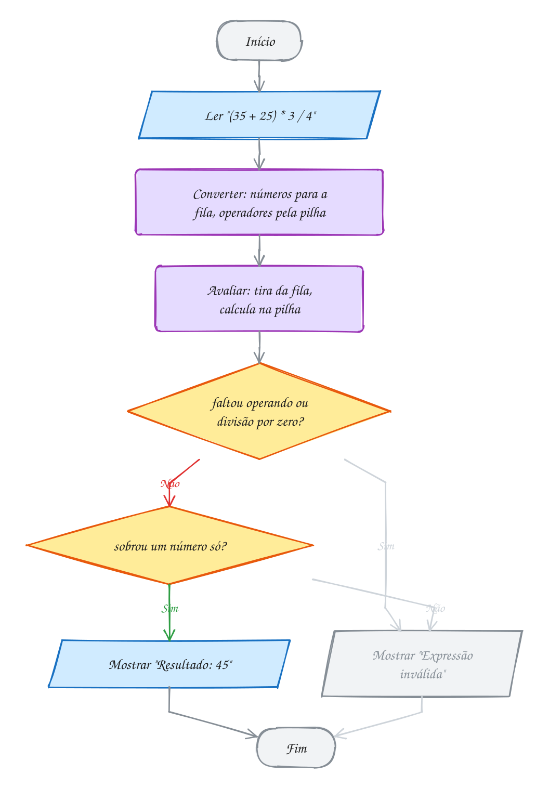

<!-- Gerado por _gerador. Para mudar este arquivo, edite _gerador/modulos/12-pilhas-e-filas/ e rode: cd _gerador && npm run gerar -->

# Módulo 12 · Pilhas e filas

> [!IMPORTANT]
> **Mundo 3 · Custo e estruturas lineares · Rota do jogo: etapa 14 de 29**
>
> **Missão:** usar pilhas, filas e deques.
>
> **Vem de:** [Módulo 11 · Listas](11-listas.md). **Segue para:** [Módulo 13 · Busca e ordenação](13-busca-e-ordenacao.md).
>
> **Checkpoints desta fase:**
> - [ ] Ler os assuntos 0082 a 0088 e refazer os exemplos
> - [ ] Resolver os 4 exercícios de cada assunto, escrevendo o código sozinho
> - [ ] Fechar a lista prática (P1201 a P1230)
> - [ ] Enfrentar os desafios do módulo
> - [ ] Chefão: resolver as questões de prova do módulo sem consultar

A **pilha** (LIFO) e a **fila** (FIFO), cada uma em vetor e em lista
encadeada, sempre como **TAD**: o mesmo `.h`, o `.c` trocado por baixo. Depende
dos módulos 06, 07, 08 e 11 e do TAD (0074); prepara o 13 (recursão) e o 16
(busca em largura e em profundidade).

## O que você vai aprender

- a **pilha** (LIFO) em vetor: empilhar, desempilhar, topo, *overflow* e *underflow*
- a **pilha encadeada**: por que o topo fica no começo da lista
- **parênteses balanceados** e **notação pós-fixa**
- a **fila** (FIFO) e a **fila circular**, com o `%` dando a volta
- a **fila encadeada** com ponteiros de início e fim, e os bugs das bordas
- o **deque**, que usa as duas pontas, e a pegadinha do resto negativo
- uma calculadora que junta tudo: infixa, pós-fixa, resultado

## Antes de começar

Cada pasta traz os arquivos do TAD (`pilha.h` e `pilha.c`, `fila.h` e
`fila.c` ou `deque.h` e `deque.c`). Compile esses `.c` de apoio junto com o
exemplo ou exercício:

```bash
gcc ~/LPEDC/material/A163.c ~/LPEDC/material/0082-pilha.c -o ~/LPEDC/material/A163 && ~/LPEDC/material/A163
```

Num exercício, **não** crie funções com os nomes do TAD (`pilha_cria`,
`fila_insere`...): o ligador acusa definição duplicada. Nos diagramas, verde
marca o item que sai e cinza a gaveta que virou vaga.

| # | Assunto |
| --- | --- |
| [0082](#0082--pilha) | Pilha |
| [0083](#0083--pilha-encadeada) | Pilha encadeada |
| [0084](#0084--pilha-na-prática-parênteses-e-notação-pós-fixa) | Pilha na prática: parênteses e notação pós-fixa |
| [0085](#0085--fila) | Fila |
| [0086](#0086--fila-encadeada) | Fila encadeada |
| [0087](#0087--deque) | Deque |
| [0088](#0088--juntando-tudo-a-calculadora-de-expressões) | Juntando tudo: a calculadora de expressões |

---

## 1. Conceitos gerais

### 0082 · Pilha

- **Pilha** (*stack*): só o **topo** está ao alcance. O último a entrar é o
  primeiro a sair, **LIFO** (*last in, first out*) (FEOFILOFF, 2009).
- **Operações**: **empilhar** (*push*) põe no topo; **desempilhar** (*pop*)
  tira do topo e devolve o valor; **olhar o topo** (*peek*) lê sem tirar;
  **vazia?** No Cormen, PUSH, POP e STACK-EMPTY (CORMEN et al., 2024,
  cap. 10).
- **Underflow e overflow**: tirar de pilha vazia é **underflow**; empilhar
  em pilha cheia é **overflow**, possível porque o vetor tem tamanho fixo
  (TENENBAUM; LANGSAM; AUGENSTEIN, 1995, cap. 2).
- **Em vetor**: um contador `n`; o fundo fica em `itens[0]`, o topo em
  `itens[n - 1]` e `n` é a próxima vaga (FEOFILOFF, 2009).
- **Custo**: empilhar e desempilhar são O(1). Desempilhar não apaga: o valor
  fica no vetor e o próximo `push` escreve por cima (CELES; RANGEL, 2002).
- **TAD** (0074): o C não traz pilha pronta. O `pilha.h` diz **o que** a
  pilha faz; o `pilha.c` decide **como**. O valor desempilhado vem pelo
  ponteiro e o `bool` diz se deu certo (CELES; RANGEL, 2002).

```c
typedef struct pilha Pilha; // tipo opaco: os campos ficam no pilha.c

Pilha *pilha_cria(void);                     // pilha vazia (NULL se faltar memória)
void pilha_libera(Pilha *p);                 // devolve toda a memória da pilha
bool pilha_vazia(const Pilha *p);            // true se não tem nada
int pilha_tamanho(const Pilha *p);           // quantos itens tem
bool pilha_empilha(Pilha *p, int valor);     // push: false se não coube
bool pilha_desempilha(Pilha *p, int *valor); // pop: false se estava vazia
bool pilha_topo(const Pilha *p, int *valor); // peek: olha o topo sem tirar
```

> [!WARNING]
> Ler `itens[n]` antes de diminuir `n` pega a gaveta **vazia** acima do topo.
> Aqui `n` é a próxima vaga: empilha em `itens[n]` e depois `n++`; desempilha
> com `n--` e depois lê. Muito livro usa `topo = -1`: não misture convenções.

### 0083 · Pilha encadeada

- **Pilha encadeada**: cada item fica num **nó** alocado com `malloc`, como
  na lista do módulo 11. A pilha só "enche" quando acaba a memória
  (CELES; RANGEL, 2002).
- **Topo no começo da lista**: inserir e remover no início é O(1). Remover
  do fim exigiria achar o penúltimo, O(n) (FEOFILOFF, 2009).
- **Empilhar** = inserir no início: o novo nó aponta para o antigo topo, e o
  topo passa a ser o novo (DEITEL; DEITEL, 2011, cap. 12).
- **Desempilhar** = remover do início: guarda o valor, avança o topo e
  libera o nó velho. **Vazia** é `topo == NULL` (DEITEL; DEITEL, 2011,
  cap. 12).
- **Mesma interface**: o `pilha.h` é idêntico ao do 0082; só o `pilha.c`
  muda, e quem usa não percebe a troca (CELES; RANGEL, 2002).
- **Custo de espaço**: cada nó ocupa 16 bytes em 64 bits, contra 4 por item
  no vetor. A encadeada troca espaço por não ter teto.

> [!WARNING]
> Trocar a ordem destrói a pilha: com `p->topo = novo` antes de
> `novo->prox = p->topo`, o nó aponta para **ele mesmo** e os de baixo vazam.
> No desempilhar, ler `velho->valor` **depois** do `free` é
> `heap-use-after-free`.

### 0084 · Pilha na prática: parênteses e notação pós-fixa

- **Contador não basta**: com um só tipo de parêntese, somar 1 no `(` e
  tirar 1 no `)` resolve. Com `()`, `[]` e `{}` falha: em `( [ ) ]` as contas
  fecham, mas o par está errado (TENENBAUM; LANGSAM; AUGENSTEIN, 1995,
  cap. 2).
- **Regra**: todo fechamento casa com a abertura **mais recente** ainda
  pendente, que é o topo de uma pilha (FEOFILOFF, 2009).
- **Algoritmo**: abriu, **empilha**; fechou, **desempilha** e confere o par
  (pilha vazia ou par errado é erro); outro caractere, ignora; no fim, a
  pilha tem de estar **vazia** (FEOFILOFF, 2009).
- **Infixa e pós-fixa**: na **infixa**, o operador fica no meio e exige
  parênteses e precedência. Na **pós-fixa** (a da HP 12C), ele vem **depois**
  dos operandos: `35 25 + 3 * 4 /` (TENENBAUM; LANGSAM; AUGENSTEIN, 1995,
  cap. 2).
- **Avaliar a pós-fixa**: número **empilha**; operador **desempilha dois**,
  calcula e **empilha o resultado**. No fim sobra um número, o resultado
  (KERNIGHAN; RITCHIE, 1988, seç. 4.3).
- **Custo**: a pilha nunca passa do número de caracteres; tempo e memória
  O(n), cada caractere visto uma vez (FEOFILOFF, 2009).

> [!WARNING]
> Na pós-fixa, o **primeiro** a sair é o operando da **direita**. Em `8 3 -`,
> sai o 3 (b) e depois o 8 (a): a conta é `a - b = 5`. Teste com `-` e `/`,
> onde a inversão aparece. Nos parênteses, esquecer o teste final de pilha
> vazia faz `{ [ (` passar como balanceada.

### 0085 · Fila

- **Fila** (*queue*): entra pelo **fim** e sai pelo **início**. O primeiro a
  entrar é o primeiro a sair, **FIFO** (*first in, first out*), o contrário
  da pilha (FEOFILOFF, 2009).
- **TAD**: a mesma cara da pilha, com inserir, retirar, olhar o primeiro e
  vazia? (CELES; RANGEL, 2002).

```c
typedef struct fila Fila; // tipo opaco: os campos ficam no fila.c

Fila *fila_cria(void);                          // fila vazia (NULL se faltar memória)
void fila_libera(Fila *f);                      // devolve toda a memória da fila
bool fila_vazia(const Fila *f);                 // true se não tem ninguém
int fila_tamanho(const Fila *f);                // quantos estão na fila
bool fila_insere(Fila *f, int valor);           // entra no fim: false se não coube
bool fila_retira(Fila *f, int *valor);          // sai do início: false se vazia
bool fila_primeiro(const Fila *f, int *valor);  // olha quem é o próximo, sem tirar
```

- **Fila em vetor**: mexe nas duas pontas. Empurrar todo mundo a cada
  retirada custa O(n); sem empurrar, a fila bate no fim do vetor com as
  primeiras gavetas vazias (TENENBAUM; LANGSAM; AUGENSTEIN, 1995, cap. 4).
- **Fila circular**: passou da última gaveta, volta à 0. Guarde o
  **início** e o número de itens `n`; a próxima vaga é
  `(inicio + n) % CAPACIDADE` (CELES; RANGEL, 2002).
- **Cheia ou vazia**: só com `inicio` e `fim`, as duas têm `inicio == fim`.
  Ou se guarda `n`, ou se **sacrifica uma gaveta**: cheia quando
  `(fim + 1) % CAPACIDADE == inicio`, como no Cormen com `Q.head` e `Q.tail`
  (CORMEN et al., 2024, cap. 10).
- **Custo**: inserir e retirar são O(1). Retirar não apaga: o valor fica na
  gaveta até alguém escrever por cima (FEOFILOFF, 2009).

> [!WARNING]
> O tamanho como `fim - inicio` dá negativo depois da volta: com início 4 e
> fim 2, dá -2. Use o contador `n` ou `(fim - inicio + CAPACIDADE) %
> CAPACIDADE`.

### 0086 · Fila encadeada

- **Fila encadeada**: troca o vetor por **nós**, como a pilha encadeada. Só
  recusa um item quando acaba a memória (CELES; RANGEL, 2002).
- **Dois ponteiros**: `inicio`, o próximo a sair, e `fim`, o último que
  entrou. Na fila vazia, os dois são `NULL` (FEOFILOFF, 2009).
- **Retirar** do começo é `inicio = inicio->prox`, O(1). **Inserir** no fim
  é `fim->prox = novo; fim = novo`, também O(1) graças ao `fim`
  (DEITEL; DEITEL, 2011, cap. 12).
- **Sai pelo início, entra pelo fim**: o contrário não serve numa lista
  simples, porque remover o último exige o penúltimo (CELES; RANGEL, 2002).
- **Casos de borda**: inserir na fila vazia atualiza também o `inicio`;
  retirar o último zera também o `fim` (CELES; RANGEL, 2002).
- **Mesma interface**: o `fila.h` é o do 0085; só o `fila.c` muda. Cada
  inserção chama `malloc` e cada retirada `free`, mais caros que uma gaveta
  de vetor.

> [!WARNING]
> Retirar o **último** sem zerar o `fim` deixa o `fim` apontando para o nó
> liberado, e o próximo `fila_insere` escreve `fim->prox` em memória liberada
> (`heap-use-after-free`). Inserir na fila vazia sem atualizar o `inicio`
> deixa a fila "vazia" para sempre.

### 0087 · Deque

- **Deque** (*double-ended queue*, pronuncia-se "deck"): uma **fila dupla**,
  que entra e sai pelas **duas** pontas (CELES; RANGEL, 2002).
- **Quatro operações**: `deque_insere_inicio` e `deque_retira_inicio` mexem
  na frente; `deque_insere_fim` e `deque_retira_fim`, no fundo
  (CELES; RANGEL, 2002).
- **Generaliza pilha e fila**: inserindo e retirando no fim, é uma
  **pilha**; inserindo no fim e retirando no início, uma **fila**
  (TENENBAUM; LANGSAM; AUGENSTEIN, 1995, cap. 4).
- **Em vetor circular**: é a fila do 0085 com o `inicio` andando também para
  **trás**. Para inserir na frente, ele recua uma gaveta; da 0 volta para a
  última. Retirar do fim só diminui `n`. Tudo O(1) (CELES; RANGEL, 2002).
- **Encadeado**: exige lista **dupla** (0079), porque para retirar do fim o
  último nó precisa conhecer o penúltimo (CELES; RANGEL, 2002).
- **`static` numa função**: tira a função da ligação externa e a torna
  **privada** do arquivo (KERNIGHAN; RITCHIE, 1988).

> [!WARNING]
> Em C, o resto de negativo é **negativo**: `-1 % 8` vale `-1`, não 7. Assim
> `(inicio - 1) % CAPACIDADE` com `inicio = 0` escreve em `itens[-1]`. Some a
> capacidade antes: `(inicio - 1 + CAPACIDADE) % CAPACIDADE`
> (CPPREFERENCE, s.d.).

### 0088 · Juntando tudo: a calculadora de expressões

- **Duas etapas**: **converter** a infixa em pós-fixa e **avaliar** a
  pós-fixa, com uma **fila** no meio e duas **pilhas**
  (TENENBAUM; LANGSAM; AUGENSTEIN, 1995, cap. 2).
- **Pátio de manobras** (*shunting-yard*): os números vão direto para a fila
  de saída; os operadores esperam numa pilha até nenhum operador mais forte
  precisar passar na frente. O algoritmo é de Dijkstra (DIJKSTRA, 1961).
- **Regras da conversão**: número vai para a fila; `(` empilha; `)`
  desempilha para a fila até achar o `(`, que é descartado; operador
  desempilha enquanto o topo tiver precedência **maior ou igual** e depois se
  empilha; no fim, o que sobrou vai para a fila (FEOFILOFF, 2009).
- **Avaliar**: os itens saem da fila na ordem de entrada (FIFO) e passam por
  uma **pilha de valores**, como no 0084 (KERNIGHAN; RITCHIE, 1988, seç. 4.3).
- **Produtor e consumidor**: a etapa 1 produz itens e a 2 os consome na mesma
  ordem; a fila também guarda o 35 inteiro, sem juntar dígitos de novo.
- **Códigos negativos**: a fila e a pilha só guardam `int`. Os números são
  `>= 0`, então os operadores viram negativos num `enum` (0063): `SOMA = -1`,
  `SUB = -2`. Na avaliação, `t < 0` é operador.
- **Custo**: cada símbolo entra e sai da fila uma vez e de cada pilha no
  máximo uma: O(n).

> [!WARNING]
> O "maior **ou igual**" muda o resultado. Só com "maior", `8 - 3 - 2` vira
> `8 3 2 - -`, que dá 7; o certo é `(8 - 3) - 2 = 3`. Mesma precedência
> associa **à esquerda**: o que já está na pilha sai antes do novo.

---

## 2. Exemplos de uso

Cada exemplo compila sozinho. Rode com o comando abaixo dele e compare com a saída no fim do código.

### 0082 · Pilha

No app de delivery, os preços entram em centavos (2590, 800 e 1200) nas
gavetas 0, 1 e 2, com `n` igual a 3. O "desfazer" tira o 1200, o último:

<p align="center"></p>

Trecho do `pilha.c`:

```c
struct pilha {
    int itens[CAPACIDADE]; // CAPACIDADE = 100
    int n;                 // quantos itens estão na pilha
};

bool pilha_empilha(Pilha *p, int valor) {
    if (p->n == CAPACIDADE) {
        return false; // cheia: estouro (overflow)
    }
    p->itens[p->n] = valor;
    p->n++;
    return true;
}

bool pilha_desempilha(Pilha *p, int *valor) {
    if (p->n == 0) {
        return false; // vazia: nada para tirar (underflow)
    }
    p->n--;
    *valor = p->itens[p->n]; // o valor continua no vetor, mas saiu da pilha
    return true;
}
```

O programa só usa as funções do `pilha.h`:

```c
#include <stdio.h>
#include "pilha.h"

int main(void) {
    Pilha *pedido = pilha_cria();
    if (pedido == NULL) {
        return 1;
    }

    // preços em centavos: inteiro não tem erro de arredondamento
    pilha_empilha(pedido, 2590); // pizza: R$ 25,90
    pilha_empilha(pedido, 800);  // refrigerante: R$ 8,00
    pilha_empilha(pedido, 1200); // pudim: R$ 12,00

    int preco;
    if (pilha_desempilha(pedido, &preco)) { // "desfazer": sai o último que entrou
        printf("Desfeito: R$ %d,%02d\n", preco / 100, preco % 100);
    }
    if (pilha_topo(pedido, &preco)) { // só olha, não tira
        printf("Agora no topo: R$ %d,%02d\n", preco / 100, preco % 100);
    }
    printf("Itens no pedido: %d\n", pilha_tamanho(pedido));

    pilha_libera(pedido);
    return 0;
}
// Saída:
// Desfeito: R$ 12,00
// Agora no topo: R$ 8,00
// Itens no pedido: 2
```

O desfazer testa se a pilha está vazia antes de diminuir `n`:

<p align="center"></p>

**Exemplo A163 · As bordas da pilha: cheia e vazia**

```c
#include <stdio.h>
#include "0082-pilha.h"

int main(void) {
    Pilha *cadeiras = pilha_cria(); // o depósito do salão empilha até 100
    if (cadeiras == NULL) {
        return 1;
    }

    // chegam 103 cadeiras numeradas: as 3 últimas não cabem (overflow)
    int recusadas = 0;
    for (int c = 1; c <= 103; c++) {
        if (!pilha_empilha(cadeiras, c)) {
            recusadas++;
        }
    }
    int topo = 0;
    pilha_topo(cadeiras, &topo);
    printf("Empilhadas: %d, recusadas: %d, no topo: %d\n", pilha_tamanho(cadeiras), recusadas, topo);

    // a festa usa todas: esvazia a pilha
    int cadeira = 0;
    int retiradas = 0;
    while (pilha_desempilha(cadeiras, &cadeira)) {
        retiradas++;
    }
    printf("Retiradas: %d, a última foi a %d\n", retiradas, cadeira);

    // mais uma retirada com a pilha vazia (underflow): devolve false e
    // não mexe na variável. O -1 serve de marcador para provar isso.
    cadeira = -1;
    if (!pilha_desempilha(cadeiras, &cadeira)) {
        printf("Pilha vazia: nada saiu, cadeira continua %d\n", cadeira);
    }
    if (!pilha_topo(cadeiras, &topo)) {
        printf("Topo também falha: vazia? %d\n", pilha_vazia(cadeiras));
    }

    pilha_libera(cadeiras);
    return 0;
}
// Saída:
// Empilhadas: 100, recusadas: 3, no topo: 100
// Retiradas: 100, a última foi a 1
// Pilha vazia: nada saiu, cadeira continua -1
// Topo também falha: vazia? 1
```

```bash
gcc ~/LPEDC/material/A163.c ~/LPEDC/material/0082-pilha.c -o ~/LPEDC/material/A163 && ~/LPEDC/material/A163
```

**Exemplo A164 · Decimal para binário: a pilha inverte a ordem**

```c
#include <stdio.h>
#include "0082-pilha.h"

int main(void) {
    Pilha *restos = pilha_cria();
    if (restos == NULL) {
        return 1;
    }

    int n = 13;
    printf("%d em binário: ", n);
    // os restos da divisão por 2 saem do bit menos significativo para o mais
    // significativo: 1, 0, 1, 1. A pilha devolve na ordem certa: 1, 1, 0, 1.
    while (n > 0) {
        pilha_empilha(restos, n % 2);
        n = n / 2;
    }

    int bit;
    while (pilha_desempilha(restos, &bit)) { // false quando a pilha esvazia
        printf("%d", bit);
    }
    printf("\n");

    pilha_libera(restos);
    return 0;
}
// Saída:
// 13 em binário: 1101
```

```bash
gcc ~/LPEDC/material/A164.c ~/LPEDC/material/0082-pilha.c -o ~/LPEDC/material/A164 && ~/LPEDC/material/A164
```

### 0083 · Pilha encadeada

Na planilha, a célula B2 foi de R$ 1500 para 1800, 2100 e 2500. Antes de cada
edição, o valor antigo vai para a pilha; o 2100 fica no primeiro nó e o
primeiro Ctrl+Z o devolve:

<p align="center"></p>

A struct agora guarda um ponteiro:

```c
typedef struct no {
    int valor;
    struct no *prox; // o nó de baixo
} No;

struct pilha {
    No *topo; // NULL quando a pilha está vazia
    int n;    // quantos itens (para pilha_tamanho não percorrer a lista)
};

bool pilha_empilha(Pilha *p, int valor) {
    No *novo = malloc(sizeof *novo);
    if (novo == NULL) {
        return false; // só "enche" quando acaba a memória
    }
    novo->valor = valor;
    novo->prox = p->topo; // o novo aponta para o antigo topo
    p->topo = novo;       // e passa a ser o topo
    p->n++;
    return true;
}

bool pilha_desempilha(Pilha *p, int *valor) {
    if (p->topo == NULL) {
        return false;
    }
    No *velho = p->topo;
    *valor = velho->valor; // lê ANTES de liberar
    p->topo = velho->prox;
    free(velho);
    p->n--;
    return true;
}
```

O programa da planilha:

```c
#include <stdio.h>
#include "pilha.h"

int main(void) {
    Pilha *desfazer = pilha_cria();
    if (desfazer == NULL) {
        return 1;
    }

    int celula = 1500; // B2: orçamento do mês, em R$
    int novos[] = {1800, 2100, 2500};
    for (int i = 0; i < 3; i++) {
        pilha_empilha(desfazer, celula); // guarda o valor antigo antes de mudar
        celula = novos[i];
        printf("B2 = %d\n", celula);
    }

    // a pilha agora é: topo -> 2100 -> 1800 -> 1500 -> NULL
    for (int i = 0; i < 2; i++) { // Ctrl+Z duas vezes
        if (pilha_desempilha(desfazer, &celula)) {
            printf("Ctrl+Z: B2 = %d\n", celula);
        }
    }
    printf("Ainda dá para desfazer %d vez(es)\n", pilha_tamanho(desfazer));

    pilha_libera(desfazer); // libera o nó que sobrou e a própria pilha
    return 0;
}
// Saída:
// B2 = 1800
// B2 = 2100
// B2 = 2500
// Ctrl+Z: B2 = 2100
// Ctrl+Z: B2 = 1800
// Ainda dá para desfazer 1 vez(es)
```

Ao empilhar o 2100, o novo nó aponta primeiro para o topo antigo; só depois o
topo muda:

<p align="center"></p>

**Exemplo A165 · Desfazer e refazer com duas pilhas**

```c
#include <stdio.h>
#include "0083-pilha.h"

// esvazia uma pilha: uma edição nova apaga o que dava para refazer
void esvazia(Pilha *p) {
    int lixo;
    while (pilha_desempilha(p, &lixo)) {
    }
}

int main(void) {
    Pilha *desfazer = pilha_cria();
    if (desfazer == NULL) {
        return 1;
    }
    Pilha *refazer = pilha_cria();
    if (refazer == NULL) {
        pilha_libera(desfazer);
        return 1;
    }

    int temp = 22; // ar-condicionado da sala, em graus
    int ajustes[] = {20, 18, 24};
    for (int i = 0; i < 3; i++) {
        pilha_empilha(desfazer, temp); // guarda o valor antigo
        esvazia(refazer);
        temp = ajustes[i];
    }
    printf("Ajustado para %d\n", temp); // desfazer: topo -> 18 -> 20 -> 22

    for (int i = 0; i < 2; i++) { // Ctrl+Z duas vezes
        pilha_empilha(refazer, temp); // o atual vai para o refazer
        pilha_desempilha(desfazer, &temp);
        printf("Desfez: %d\n", temp);
    }

    pilha_empilha(desfazer, temp); // Ctrl+Y: o caminho inverso
    pilha_desempilha(refazer, &temp);
    printf("Refez: %d\n", temp);
    printf("Dá para refazer mais %d vez(es)\n", pilha_tamanho(refazer));

    pilha_empilha(desfazer, temp); // edição nova: o refazer perde o sentido
    esvazia(refazer);
    temp = 21;
    printf("Ajustado para %d; refazer agora tem %d\n", temp, pilha_tamanho(refazer));
    printf("Desfazer guarda %d valores\n", pilha_tamanho(desfazer));

    pilha_libera(desfazer);
    pilha_libera(refazer);
    return 0;
}
// Saída:
// Ajustado para 24
// Desfez: 18
// Desfez: 20
// Refez: 18
// Dá para refazer mais 1 vez(es)
// Ajustado para 21; refazer agora tem 0
// Desfazer guarda 3 valores
```

```bash
gcc ~/LPEDC/material/A165.c ~/LPEDC/material/0083-pilha.c -o ~/LPEDC/material/A165 && ~/LPEDC/material/A165
```

**Exemplo A166 · Sem teto: 100 mil itens na pilha encadeada**

```c
#include <stdio.h>
#include "0083-pilha.h"

// A pilha do vetor (0082) recusaria o 101º item. Esta só para quando acabar a
// memória. O código é o mesmo do cliente da 0082: só o pilha.c mudou.
int main(void) {
    Pilha *p = pilha_cria();
    if (p == NULL) {
        return 1;
    }

    int recusados = 0;
    for (int i = 1; i <= 100000; i++) {
        if (!pilha_empilha(p, i)) {
            recusados++;
        }
    }
    printf("Empilhados: %d, recusados: %d\n", pilha_tamanho(p), recusados);

    int topo;
    if (pilha_topo(p, &topo)) {
        printf("No topo: %d\n", topo);
    }

    // pilha_libera percorre os 100 mil nós; sem ela, o AddressSanitizer
    // acusaria 100 mil vazamentos de 16 bytes
    pilha_libera(p);
    return 0;
}
// Saída:
// Empilhados: 100000, recusados: 0
// No topo: 100000
```

```bash
gcc ~/LPEDC/material/A166.c ~/LPEDC/material/0083-pilha.c -o ~/LPEDC/material/A166 && ~/LPEDC/material/A166
```

### 0084 · Pilha na prática: parênteses e notação pós-fixa

Em `{ x = v[(i + 1)] }` sobram os delimitadores `{ [ ( ) ] }`. Os três
primeiros são empilhados; o `)` encontra `(` no topo e casa, depois `]` casa
com `[` e `}` com `{`:

<p align="center"></p>

O verificador testa quatro expressões, com o `pilha.h` e o `pilha.c` do 0083:

```c
#include <stdbool.h>
#include <stdio.h>
#include "pilha.h"

// a abertura que combina com cada fechamento
char abertura_de(char fecha) {
    if (fecha == ')') {
        return '(';
    }
    if (fecha == ']') {
        return '[';
    }
    return '{';
}

bool balanceada(const char *s) {
    Pilha *p = pilha_cria();
    if (p == NULL) {
        return false;
    }
    bool ok = true;
    for (int i = 0; s[i] != '\0' && ok; i++) {
        char c = s[i];
        if (c == '(' || c == '[' || c == '{') {
            pilha_empilha(p, c); // abriu: espera o fechamento lá na frente
        } else if (c == ')' || c == ']' || c == '}') {
            int topo;
            // fechou: tem que existir uma abertura e ela tem que ser do mesmo tipo
            if (!pilha_desempilha(p, &topo) || topo != abertura_de(c)) {
                ok = false;
            }
        }
    }
    if (!pilha_vazia(p)) {
        ok = false; // sobrou abertura sem fechamento
    }
    pilha_libera(p);
    return ok;
}

int main(void) {
    const char *testes[] = {"{ x = v[(i + 1)] }", "( [ ) ]", "(a + b))", "{ [ ("};
    for (int i = 0; i < 4; i++) {
        printf("%-20s %s\n", testes[i], balanceada(testes[i]) ? "balanceada" : "com erro");
    }
    return 0;
}
// Saída:
// { x = v[(i + 1)] }   balanceada
// ( [ ) ]              com erro
// (a + b))             com erro
// { [ (                com erro
```

O laço tem duas saídas antecipadas para o erro; "pilha vazia?" só é testada
no fim da string:

<p align="center"></p>

#### Passo a passo: notação pós-fixa

A conta do bar, `(35 + 25) * 3 / 4`, dividida por 4 amigos, vira
`35 25 + 3 * 4 /`:

| lê | faz | pilha (topo à direita) |
| --- | --- | --- |
| `35` | empilha | 35 |
| `25` | empilha | 35 25 |
| `+` | tira 25 e 35, empilha 35 + 25 | 60 |
| `3` | empilha | 60 3 |
| `*` | tira 3 e 60, empilha 60 * 3 | 180 |
| `4` | empilha | 180 4 |
| `/` | tira 4 e 180, empilha 180 / 4 | 45 |

Cada um paga R$ 45. O A168 faz essa tabela em C.

**Exemplo A167 · Parênteses dentro de aspas não contam**

```c
#include <stdbool.h>
#include <stdio.h>
#include "0084-pilha.h"

char abertura_de(char fecha) {
    return fecha == ')' ? '(' : fecha == ']' ? '[' : '{';
}

// Confere uma linha de código C. Com pula_aspas, o que está entre "..." ou
// '...' é texto, não código: um ')' dentro de aspas não fecha nada.
bool balanceada(const char *s, bool pula_aspas) {
    Pilha *p = pilha_cria();
    if (p == NULL) {
        return false;
    }
    bool ok = true;
    char aspa = '\0'; // '\0' = fora de aspas; senão, a aspa que abriu
    for (int i = 0; s[i] != '\0' && ok; i++) {
        char c = s[i];
        if (aspa != '\0') {
            if (c == '\\' && s[i + 1] != '\0') {
                i++; // \" ou \' não fecham a aspa: pula o caractere seguinte
            } else if (c == aspa) {
                aspa = '\0'; // fechou o texto
            }
        } else if (pula_aspas && (c == '"' || c == '\'')) {
            aspa = c; // começou um texto
        } else if (c == '(' || c == '[' || c == '{') {
            pilha_empilha(p, c);
        } else if (c == ')' || c == ']' || c == '}') {
            int topo;
            if (!pilha_desempilha(p, &topo) || topo != abertura_de(c)) {
                ok = false;
            }
        }
    }
    if (!pilha_vazia(p) || aspa != '\0') {
        ok = false; // sobrou abertura, ou uma aspa ficou aberta
    }
    pilha_libera(p);
    return ok;
}

int main(void) {
    const char *linhas[] = {
        "if (c == ')') { n++; }",
        "printf(\"[%d]\\n\", v[i]);",
        "puts(\"sorriso :)\");",
        "v[(i + 1] = 0;",
    };
    printf("%-28s %-10s %s\n", "linha", "simples", "pulando aspas");
    for (int i = 0; i < 4; i++) {
        printf("%-28s %-10s %s\n", linhas[i],
               balanceada(linhas[i], false) ? "ok" : "erro",
               balanceada(linhas[i], true) ? "ok" : "erro");
    }
    return 0;
}
// Saída:
// linha                        simples    pulando aspas
// if (c == ')') { n++; }       erro       ok
// printf("[%d]\n", v[i]);      ok         ok
// puts("sorriso :)");          erro       ok
// v[(i + 1] = 0;               erro       erro
```

```bash
gcc ~/LPEDC/material/A167.c ~/LPEDC/material/0084-pilha.c -o ~/LPEDC/material/A167 && ~/LPEDC/material/A167
```

**Exemplo A168 · A conta do bar em notação pós-fixa**

```c
#include <stdbool.h>
#include <stdio.h>
#include "0084-pilha.h"

// Avalia uma expressão pós-fixa com inteiros não negativos separados por
// espaço e os operadores + - * /. Devolve false se a expressão for inválida.
bool avalia(const char *expr, int *resultado) {
    Pilha *p = pilha_cria();
    if (p == NULL) {
        return false;
    }
    bool ok = true;
    for (int i = 0; expr[i] != '\0' && ok; i++) {
        char c = expr[i];
        if (c >= '0' && c <= '9') {
            int numero = 0;
            while (expr[i] >= '0' && expr[i] <= '9') { // junta os dígitos: "35" -> 35
                numero = numero * 10 + (expr[i] - '0');
                i++;
            }
            i--; // o for vai somar 1 de novo
            pilha_empilha(p, numero);
        } else if (c == '+' || c == '-' || c == '*' || c == '/') {
            int a, b;
            // o primeiro a sair é o operando da DIREITA
            if (!pilha_desempilha(p, &b) || !pilha_desempilha(p, &a) || (c == '/' && b == 0)) {
                ok = false;
            } else if (c == '+') {
                pilha_empilha(p, a + b);
            } else if (c == '-') {
                pilha_empilha(p, a - b);
            } else if (c == '*') {
                pilha_empilha(p, a * b);
            } else {
                pilha_empilha(p, a / b);
            }
        }
    }
    // no fim tem que sobrar exatamente um número: o resultado
    if (ok && (!pilha_desempilha(p, resultado) || !pilha_vazia(p))) {
        ok = false;
    }
    pilha_libera(p);
    return ok;
}

int main(void) {
    // (35 + 25) * 3 / 4: três rodadas de petisco (R$ 35) e bebida (R$ 25),
    // divididas entre 4 amigos
    const char *expr = "35 25 + 3 * 4 /";
    int total;
    if (avalia(expr, &total)) {
        printf("%s = %d\n", expr, total);
    }
    if (!avalia("35 +", &total)) {
        printf("35 + : expressão inválida\n");
    }
    return 0;
}
// Saída:
// 35 25 + 3 * 4 / = 45
// 35 + : expressão inválida
```

```bash
gcc ~/LPEDC/material/A168.c ~/LPEDC/material/0084-pilha.c -o ~/LPEDC/material/A168 && ~/LPEDC/material/A168
```

### 0085 · Fila

Na lotérica, o painel guarda 8 senhas. Chegam as senhas 31 a 36 (gavetas 0 a
5) e o caixa atende 4. Chegam 37 a 40: o 37 e o 38 ocupam as gavetas 6 e 7, e
o 39 e o 40 **dão a volta** para as gavetas 0 e 1:

<p align="center"></p>

Parte principal do `fila.c`:

```c
#define CAPACIDADE 8

struct fila {
    int itens[CAPACIDADE];
    int inicio; // posição do primeiro da fila (o próximo a sair)
    int n;      // quantos estão na fila: separa "cheia" de "vazia"
};

bool fila_insere(Fila *f, int valor) {
    if (f->n == CAPACIDADE) {
        return false; // cheia
    }
    int fim = (f->inicio + f->n) % CAPACIDADE; // dá a volta no fim do vetor
    f->itens[fim] = valor;
    f->n++;
    return true;
}

bool fila_retira(Fila *f, int *valor) {
    if (f->n == 0) {
        return false; // vazia
    }
    *valor = f->itens[f->inicio];
    f->inicio = (f->inicio + 1) % CAPACIDADE;
    f->n--;
    return true;
}
```

O programa só vê as funções do `fila.h`:

```c
#include <stdio.h>
#include "fila.h"

int main(void) {
    Fila *senhas = fila_cria(); // o painel guarda até 8 senhas
    if (senhas == NULL) {
        return 1;
    }

    for (int s = 31; s <= 36; s++) { // chegam 6 pessoas
        fila_insere(senhas, s);
    }

    printf("Atendidas:");
    for (int i = 0; i < 4; i++) { // o caixa chama 4
        int s;
        if (fila_retira(senhas, &s)) {
            printf(" %d", s);
        }
    }

    printf("\nChegaram:");
    for (int s = 37; s <= 40; s++) { // 39 e 40 dão a volta no vetor
        if (fila_insere(senhas, s)) {
            printf(" %d", s);
        }
    }

    printf("\nNa fila (%d):", fila_tamanho(senhas));
    int s;
    while (fila_retira(senhas, &s)) {
        printf(" %d", s);
    }
    printf("\n");

    fila_libera(senhas);
    return 0;
}
// Saída:
// Atendidas: 31 32 33 34
// Chegaram: 37 38 39 40
// Na fila (6): 35 36 37 38 39 40
```

A senha 39 entra com `inicio = 4` e `n = 4`: o `%` a manda para a gaveta 0:

<p align="center"></p>

**Exemplo A169 · Só as 8 últimas corridas: a mais antiga dá lugar**

```c
#include <stdio.h>
#include "0085-fila.h"

int main(void) {
    Fila *historico = fila_cria(); // o app mostra as 8 corridas mais recentes
    if (historico == NULL) {
        return 1;
    }

    int corridas[] = {18, 25, 12, 40, 9, 31, 22, 15, 27, 33, 11}; // em R$
    int total = sizeof corridas / sizeof corridas[0];

    for (int i = 0; i < total; i++) {
        // cheia? em vez de recusar a nova, descarta a mais antiga (o início)
        if (!fila_insere(historico, corridas[i])) {
            int velha;
            fila_retira(historico, &velha);
            fila_insere(historico, corridas[i]);
            printf("Corrida de R$ %d saiu do histórico para entrar a de R$ %d\n", velha, corridas[i]);
        }
    }

    // percorre sem perder ninguém: retira, mostra e devolve ao fim
    int soma = 0;
    printf("Histórico (%d):", fila_tamanho(historico));
    for (int i = 0; i < fila_tamanho(historico); i++) {
        int valor;
        fila_retira(historico, &valor);
        printf(" %d", valor);
        soma += valor;
        fila_insere(historico, valor);
    }
    printf("\nGasto nas últimas 8: R$ %d\n", soma);

    fila_libera(historico);
    return 0;
}
// Saída:
// Corrida de R$ 18 saiu do histórico para entrar a de R$ 27
// Corrida de R$ 25 saiu do histórico para entrar a de R$ 33
// Corrida de R$ 12 saiu do histórico para entrar a de R$ 11
// Histórico (8): 40 9 31 22 15 27 33 11
// Gasto nas últimas 8: R$ 188
```

```bash
gcc ~/LPEDC/material/A169.c ~/LPEDC/material/0085-fila.c -o ~/LPEDC/material/A169 && ~/LPEDC/material/A169
```

**Exemplo A170 · Painel cheio: a fila circular reaproveita as vagas**

```c
#include <stdio.h>
#include "0085-fila.h"

int main(void) {
    Fila *f = fila_cria();
    if (f == NULL) {
        return 1;
    }

    // 9 senhas para um painel de 8: a última é recusada
    for (int s = 1; s <= 9; s++) {
        if (!fila_insere(f, s)) {
            printf("Senha %d recusada: painel cheio\n", s);
        }
    }

    // 3 atendimentos liberam as posições 0, 1 e 2 do vetor...
    int s;
    for (int i = 0; i < 3; i++) {
        fila_retira(f, &s);
    }

    // ...e as próximas senhas entram nelas, sem mover ninguém
    for (s = 9; s <= 11; s++) {
        if (fila_insere(f, s)) {
            printf("Senha %d entrou\n", s);
        }
    }

    fila_primeiro(f, &s);
    printf("Próxima a ser chamada: %d (de %d na fila)\n", s, fila_tamanho(f));
    fila_libera(f);
    return 0;
}
// Saída:
// Senha 9 recusada: painel cheio
// Senha 9 entrou
// Senha 10 entrou
// Senha 11 entrou
// Próxima a ser chamada: 4 (de 8 na fila)
```

```bash
gcc ~/LPEDC/material/A170.c ~/LPEDC/material/0085-fila.c -o ~/LPEDC/material/A170 && ~/LPEDC/material/A170
```

### 0086 · Fila encadeada

Na pizzaria, chegam os pedidos 501, 502 e 503. A cozinha pega o 501: o início
anda para o 502 e o nó do 501 é liberado. Chega o 504, pendurado depois do
503, e o fim passa a apontar para ele:

<p align="center"></p>

O `fila.c` guarda os dois ponteiros:

```c
struct fila {
    NoFila *inicio; // o próximo a sair; NULL se vazia
    NoFila *fim;    // o último que entrou; NULL se vazia
    int n;
};

bool fila_insere(Fila *f, int valor) {
    NoFila *novo = malloc(sizeof *novo);
    if (novo == NULL) {
        return false;
    }
    novo->valor = valor;
    novo->prox = NULL; // vai ser o último
    if (f->fim == NULL) {
        f->inicio = novo; // fila vazia: o novo também é o primeiro
    } else {
        f->fim->prox = novo; // pendura atrás do último
    }
    f->fim = novo;
    f->n++;
    return true;
}

bool fila_retira(Fila *f, int *valor) {
    if (f->inicio == NULL) {
        return false;
    }
    NoFila *velho = f->inicio;
    *valor = velho->valor;
    f->inicio = velho->prox;
    if (f->inicio == NULL) {
        f->fim = NULL; // saiu o último: o fim não pode apontar para o nó liberado
    }
    free(velho);
    f->n--;
    return true;
}
```

Programa da cozinha:

```c
#include <stdio.h>
#include "fila.h"

int main(void) {
    Fila *pedidos = fila_cria();
    if (pedidos == NULL) {
        return 1;
    }

    fila_insere(pedidos, 501); // chegam três pedidos do app
    fila_insere(pedidos, 502);
    fila_insere(pedidos, 503);

    int p;
    if (fila_retira(pedidos, &p)) { // a cozinha pega o mais antigo
        printf("Preparando: %d\n", p);
    }
    fila_insere(pedidos, 504); // entra mais um, lá no fim

    // a fila agora é: inicio -> 502 -> 503 -> 504 <- fim
    if (fila_primeiro(pedidos, &p)) {
        printf("Próximo: %d (%d esperando)\n", p, fila_tamanho(pedidos));
    }

    fila_libera(pedidos); // libera os 3 nós que sobraram
    return 0;
}
// Saída:
// Preparando: 501
// Próximo: 502 (3 esperando)
```

Na entrada do 504 a fila não estava vazia: o caminho passa por
`fim->prox = novo`. Na fila vazia, o `inicio` recebe o novo nó:

<p align="center"></p>

**Exemplo A171 · Pedágio na sexta: a fila cresce, esvazia e recomeça**

```c
#include <stdio.h>
#include "0086-fila.h"

// a cabine libera todos os carros que estão na fila
int libera_todos(Fila *f) {
    int passaram = 0;
    int placa;
    while (fila_retira(f, &placa)) {
        passaram++;
    }
    return passaram;
}

int main(void) {
    Fila *cabine = fila_cria();
    if (cabine == NULL) {
        return 1;
    }

    // 18h: chegam 12 carros. O painel de 8 do 0085 recusaria 4; aqui cabem todos
    for (int placa = 1001; placa <= 1012; placa++) {
        if (!fila_insere(cabine, placa)) {
            printf("Faltou memória para o carro %d\n", placa);
        }
    }
    int primeiro;
    fila_primeiro(cabine, &primeiro);
    printf("Na fila: %d carros, o primeiro é o %d\n", fila_tamanho(cabine), primeiro);

    int passaram = libera_todos(cabine); // antes do printf: a ordem dos argumentos não é garantida
    printf("Passaram: %d; vazia? %d\n", passaram, fila_vazia(cabine));

    // 19h: a fila tinha esvaziado. O fila_retira zerou o fim lá dentro, então
    // o próximo carro vira início e fim ao mesmo tempo, sem tocar no nó liberado
    fila_insere(cabine, 2001);
    fila_insere(cabine, 2002);
    fila_primeiro(cabine, &primeiro);
    printf("Recomeçou: %d carros, o primeiro é o %d\n", fila_tamanho(cabine), primeiro);

    fila_libera(cabine); // libera os 2 nós que sobraram
    return 0;
}
// Saída:
// Na fila: 12 carros, o primeiro é o 1001
// Passaram: 12; vazia? 1
// Recomeçou: 2 carros, o primeiro é o 2001
```

```bash
gcc ~/LPEDC/material/A171.c ~/LPEDC/material/0086-fila.c -o ~/LPEDC/material/A171 && ~/LPEDC/material/A171
```

**Exemplo A172 · Simulando o caixa do mercado**

```c
#include <stdio.h>
#include "0086-fila.h"

#define CLIENTES 5

int main(void) {
    int chegada[CLIENTES] = {0, 1, 2, 5, 6}; // minuto em que cada um chega
    int duracao[CLIENTES] = {3, 2, 4, 1, 2}; // minutos de atendimento

    Fila *fila = fila_cria(); // guarda o número de cada cliente
    if (fila == NULL) {
        return 1;
    }

    int proximo = 0;  // próximo cliente a chegar
    int restante = 0; // minutos que faltam para o caixa ficar livre
    int atendidos = 0, espera_total = 0, maior_fila = 0;

    for (int minuto = 0; atendidos < CLIENTES; minuto++) {
        while (proximo < CLIENTES && chegada[proximo] == minuto) {
            fila_insere(fila, proximo); // chegou: vai para o fim da fila
            proximo++;
        }
        if (restante == 0 && !fila_vazia(fila)) { // caixa livre: chama o próximo
            int c;
            fila_retira(fila, &c);
            int espera = minuto - chegada[c];
            printf("Minuto %2d: cliente %d no caixa (esperou %d)\n", minuto, c + 1, espera);
            espera_total += espera;
            restante = duracao[c];
            atendidos++;
        }
        if (fila_tamanho(fila) > maior_fila) {
            maior_fila = fila_tamanho(fila);
        }
        if (restante > 0) {
            restante--; // passa um minuto de atendimento
        }
    }
    printf("Espera média: %.1f min; maior fila: %d\n", (double)espera_total / CLIENTES, maior_fila);

    fila_libera(fila);
    return 0;
}
// Saída:
// Minuto  0: cliente 1 no caixa (esperou 0)
// Minuto  3: cliente 2 no caixa (esperou 2)
// Minuto  5: cliente 3 no caixa (esperou 3)
// Minuto  9: cliente 4 no caixa (esperou 4)
// Minuto 10: cliente 5 no caixa (esperou 4)
// Espera média: 2.6 min; maior fila: 2
```

```bash
gcc ~/LPEDC/material/A172.c ~/LPEDC/material/0086-fila.c -o ~/LPEDC/material/A172 && ~/LPEDC/material/A172
```

### 0087 · Deque

No app de música, as faixas 5, 8 e 3 entram pelo fim, nas gavetas 0, 1 e 2.
A 11 entra pela frente ("tocar em seguida"): o início recua da gaveta 0 e dá
a volta para a 7. A ordem fica 11, 5, 8, 3:

<p align="center"></p>

A conta do recuo fica numa função auxiliar `static`:

```c
#define CAPACIDADE 8

// gaveta anterior a i, dando a volta: anterior(0) = CAPACIDADE - 1
static int anterior(int i) {
    return (i - 1 + CAPACIDADE) % CAPACIDADE; // (i - 1) % CAPACIDADE daria -1 com i = 0
}

bool deque_insere_inicio(Deque *d, int valor) {
    if (d->n == CAPACIDADE) {
        return false;
    }
    d->inicio = anterior(d->inicio); // o início recua uma gaveta
    d->itens[d->inicio] = valor;
    d->n++;
    return true;
}

bool deque_retira_fim(Deque *d, int *valor) {
    if (d->n == 0) {
        return false;
    }
    *valor = d->itens[(d->inicio + d->n - 1) % CAPACIDADE]; // o último ocupado
    d->n--;
    return true;
}
```

Programa da fila de músicas:

```c
#include <stdio.h>
#include "deque.h"

int main(void) {
    Deque *fila = deque_cria(); // guarda o número da faixa do álbum
    if (fila == NULL) {
        return 1;
    }

    deque_insere_fim(fila, 5); // "adicionar à fila": vai para o fim
    deque_insere_fim(fila, 8);
    deque_insere_fim(fila, 3);
    deque_insere_inicio(fila, 11); // "tocar em seguida": fura a fila

    // ordem agora: 11 5 8 3
    int faixa;
    if (deque_retira_inicio(fila, &faixa)) {
        printf("Tocando a faixa %d\n", faixa);
    }
    if (deque_retira_fim(fila, &faixa)) { // desistiu da última que adicionou
        printf("Removida a faixa %d\n", faixa);
    }

    printf("Ainda na fila:");
    while (deque_retira_inicio(fila, &faixa)) {
        printf(" %d", faixa);
    }
    printf("\n");

    deque_libera(fila);
    return 0;
}
// Saída:
// Tocando a faixa 11
// Removida a faixa 3
// Ainda na fila: 5 8
```

Na entrada da faixa 11, o caminho difere do da fila só no recuo do início com
`anterior`, que soma 8 antes do `%`:

<p align="center"></p>

**Exemplo A173 · Desfazer com limite: o deque esquece o mais antigo**

```c
#include <stdio.h>
#include "0087-deque.h"

#define LIMITE 5 // o editor de fotos só lembra os 5 últimos passos

int main(void) {
    Deque *historico = deque_cria();
    if (historico == NULL) {
        return 1;
    }

    int brilho = 50;
    int ajustes[] = {55, 60, 65, 70, 75, 80, 85};
    for (int i = 0; i < 7; i++) {
        if (deque_tamanho(historico) == LIMITE) {
            int esquecido;
            deque_retira_inicio(historico, &esquecido); // o mais antigo sai pela frente
            printf("Esqueceu o brilho %d\n", esquecido);
        }
        deque_insere_fim(historico, brilho); // o valor antigo entra pelo fundo
        brilho = ajustes[i];
    }
    printf("Brilho atual: %d\n", brilho);

    // desfazer usa o fundo como uma pilha: o mais recente sai primeiro
    printf("Desfazendo:");
    while (deque_retira_fim(historico, &brilho)) {
        printf(" %d", brilho);
    }
    printf("\nNão dá para desfazer mais: o brilho fica em %d\n", brilho);

    deque_libera(historico);
    return 0;
}
// Saída:
// Esqueceu o brilho 50
// Esqueceu o brilho 55
// Brilho atual: 85
// Desfazendo: 80 75 70 65 60
// Não dá para desfazer mais: o brilho fica em 60
```

```bash
gcc ~/LPEDC/material/A173.c ~/LPEDC/material/0087-deque.c -o ~/LPEDC/material/A173 && ~/LPEDC/material/A173
```

**Exemplo A174 · Palíndromo com deque: compara as duas pontas**

```c
#include <stdbool.h>
#include <stdio.h>
#include "0087-deque.h"

bool palindromo(const char *palavra) {
    Deque *d = deque_cria();
    if (d == NULL) {
        return false;
    }
    for (int i = 0; palavra[i] != '\0'; i++) {
        deque_insere_fim(d, palavra[i]); // até 8 letras: a capacidade do deque.c
    }
    bool ok = true;
    // tira uma letra de cada ponta enquanto sobrarem pelo menos duas
    while (deque_tamanho(d) > 1 && ok) {
        int frente, tras;
        deque_retira_inicio(d, &frente);
        deque_retira_fim(d, &tras);
        if (frente != tras) {
            ok = false;
        }
    }
    deque_libera(d);
    return ok;
}

int main(void) {
    const char *palavras[] = {"RADAR", "REVIVER", "PRATO", "OSSO"};
    for (int i = 0; i < 4; i++) {
        printf("%-8s %s\n", palavras[i], palindromo(palavras[i]) ? "é palíndromo" : "não é");
    }
    return 0;
}
// Saída:
// RADAR    é palíndromo
// REVIVER  é palíndromo
// PRATO    não é
// OSSO     é palíndromo
```

```bash
gcc ~/LPEDC/material/A174.c ~/LPEDC/material/0087-deque.c -o ~/LPEDC/material/A174 && ~/LPEDC/material/A174
```

### 0088 · Juntando tudo: a calculadora de expressões

A conta do bar, digitada como `(35 + 25) * 3 / 4`. A fila de saída fica
`35 25 + 3 * 4 /`; quando chega o `/`, a pilha de valores tem 180 e 4, e a
última conta dá 45:

<p align="center"></p>

A pasta tem o `pilha.c` do 0083 e o `fila.c` do 0086; o comando do exemplo
compila os quatro com o programa:

```c
#include <stdbool.h>
#include <stdio.h>
#include "fila.h"
#include "pilha.h"

// Na fila e na pilha só cabe int. Números são >= 0; operadores e o "("
// viram códigos negativos, que nunca se confundem com um número.
enum { SOMA = -1, SUB = -2, MULT = -3, DIV = -4, ABRE = -5 };

int codigo_de(char c) {
    return c == '+' ? SOMA : c == '-' ? SUB : c == '*' ? MULT : DIV;
}

int precedencia(int op) {
    return (op == MULT || op == DIV) ? 2 : (op == SOMA || op == SUB) ? 1 : 0; // ABRE: 0
}

// Etapa 1: infixa -> fila em ordem pós-fixa. A pilha segura os operadores.
bool converte(const char *s, Fila *saida) {
    Pilha *ops = pilha_cria();
    if (ops == NULL) {
        return false;
    }
    int topo;
    for (int i = 0; s[i] != '\0'; i++) {
        char c = s[i];
        if (c >= '0' && c <= '9') {
            int numero = 0;
            for (; s[i] >= '0' && s[i] <= '9'; i++) {
                numero = numero * 10 + (s[i] - '0');
            }
            i--;
            fila_insere(saida, numero); // número vai direto para a saída
        } else if (c == '(') {
            pilha_empilha(ops, ABRE);
        } else if (c == ')') {
            while (pilha_desempilha(ops, &topo) && topo != ABRE) {
                fila_insere(saida, topo);
            }
        } else if (c == '+' || c == '-' || c == '*' || c == '/') {
            int op = codigo_de(c);
            // sai antes quem tem precedência maior ou igual (conta da esquerda primeiro)
            while (pilha_topo(ops, &topo) && precedencia(topo) >= precedencia(op)) {
                pilha_desempilha(ops, &topo);
                fila_insere(saida, topo);
            }
            pilha_empilha(ops, op);
        }
    }
    while (pilha_desempilha(ops, &topo)) {
        fila_insere(saida, topo);
    }
    pilha_libera(ops);
    return true;
}

// Etapa 2: consome a fila pós-fixa com uma pilha de valores.
bool avalia(Fila *posfixa, int *resultado) {
    Pilha *val = pilha_cria();
    if (val == NULL) {
        return false;
    }
    bool ok = true;
    int t, a, b;
    printf("Pós-fixa: ");
    while (ok && fila_retira(posfixa, &t)) {
        if (t >= 0) {
            printf(" %d", t);
            pilha_empilha(val, t);
        } else if (!pilha_desempilha(val, &b) || !pilha_desempilha(val, &a) || (t == DIV && b == 0)) {
            ok = false;
        } else {
            printf(" %c", t == SOMA ? '+' : t == SUB ? '-' : t == MULT ? '*' : '/');
            pilha_empilha(val, t == SOMA ? a + b : t == SUB ? a - b : t == MULT ? a * b : a / b);
        }
    }
    printf("\n");
    ok = ok && pilha_desempilha(val, resultado) && pilha_vazia(val);
    pilha_libera(val);
    return ok;
}

int main(void) {
    const char *contas[] = {"(35 + 25) * 3 / 4", "2 * (3 + 4) - 10 / 5"};
    for (int i = 0; i < 2; i++) {
        Fila *posfixa = fila_cria();
        if (posfixa == NULL) {
            return 1;
        }
        int r;
        printf("Infixa:    %s\n", contas[i]);
        if (converte(contas[i], posfixa) && avalia(posfixa, &r)) {
            printf("Resultado: %d\n", r);
        } else {
            printf("Expressão inválida\n");
        }
        fila_libera(posfixa);
    }
    return 0;
}
// Saída:
// Infixa:    (35 + 25) * 3 / 4
// Pós-fixa:  35 25 + 3 * 4 /
// Resultado: 45
// Infixa:    2 * (3 + 4) - 10 / 5
// Pós-fixa:  2 3 4 + * 10 5 / -
// Resultado: 12
```

As perguntas de erro só aparecem na avaliação, onde a falta de operando e a
divisão por zero se revelam:

<p align="center"></p>

**Exemplo A175 · A calculadora que explica o erro**

```c
#include <stdio.h>
#include "0088-fila.h"
#include "0088-pilha.h"

enum { SOMA = -1, SUB = -2, MULT = -3, DIV = -4, ABRE = -5 };

// códigos de erro: cada etapa descobre os seus
enum { OK, FECHA_SEM_ABRIR, FALTOU_FECHAR, FALTA_OPERANDO, DIV_ZERO, SOBROU_NUMERO, SEM_MEMORIA };

const char *mensagem[] = {
    "ok", "')' sem '(' antes", "'(' sem ')' depois",
    "falta operando", "divisão por zero", "sobrou número", "faltou memória",
};

int precedencia(int op) {
    return (op == MULT || op == DIV) ? 2 : (op == SOMA || op == SUB) ? 1 : 0;
}

// Etapa 1. Os erros de parêntese só aparecem aqui: na fila pós-fixa não
// existe parêntese nenhum, e um ABRE perdido lá dentro viraria lixo na conta.
int converte(const char *s, Fila *saida) {
    Pilha *ops = pilha_cria();
    if (ops == NULL) {
        return SEM_MEMORIA;
    }
    int erro = OK;
    int topo;
    for (int i = 0; s[i] != '\0' && erro == OK; i++) {
        char c = s[i];
        if (c >= '0' && c <= '9') {
            int numero = 0;
            for (; s[i] >= '0' && s[i] <= '9'; i++) {
                numero = numero * 10 + (s[i] - '0');
            }
            i--;
            fila_insere(saida, numero);
        } else if (c == '(') {
            pilha_empilha(ops, ABRE);
        } else if (c == ')') {
            topo = 0; // se a pilha já estiver vazia, topo não pode ficar com lixo
            while (pilha_desempilha(ops, &topo) && topo != ABRE) {
                fila_insere(saida, topo);
            }
            if (topo != ABRE) {
                erro = FECHA_SEM_ABRIR; // a pilha acabou antes de achar o '('
            }
        } else if (c == '+' || c == '-' || c == '*' || c == '/') {
            int op = c == '+' ? SOMA : c == '-' ? SUB : c == '*' ? MULT : DIV;
            while (pilha_topo(ops, &topo) && precedencia(topo) >= precedencia(op)) {
                pilha_desempilha(ops, &topo);
                fila_insere(saida, topo);
            }
            pilha_empilha(ops, op);
        }
    }
    while (erro == OK && pilha_desempilha(ops, &topo)) {
        if (topo == ABRE) {
            erro = FALTOU_FECHAR; // sobrou um '(' que ninguém fechou
        } else {
            fila_insere(saida, topo);
        }
    }
    pilha_libera(ops);
    return erro;
}

// Etapa 2. Aqui aparecem os erros de conta.
int avalia(Fila *posfixa, int *resultado) {
    Pilha *val = pilha_cria();
    if (val == NULL) {
        return SEM_MEMORIA;
    }
    int erro = OK;
    int t, a, b;
    while (erro == OK && fila_retira(posfixa, &t)) {
        if (t >= 0) {
            pilha_empilha(val, t);
        } else if (!pilha_desempilha(val, &b) || !pilha_desempilha(val, &a)) {
            erro = FALTA_OPERANDO;
        } else if (t == DIV && b == 0) {
            erro = DIV_ZERO;
        } else {
            pilha_empilha(val, t == SOMA ? a + b : t == SUB ? a - b : t == MULT ? a * b : a / b);
        }
    }
    if (erro == OK && (!pilha_desempilha(val, resultado) || !pilha_vazia(val))) {
        erro = pilha_vazia(val) ? FALTA_OPERANDO : SOBROU_NUMERO;
    }
    pilha_libera(val);
    return erro;
}

int main(void) {
    const char *contas[] = {"(10 + 2) * 3", "10 / (5 - 5)", "4 * (2 + 3", "4 + 2) * 3", "7 * + 2", "(8) 9"};
    for (int i = 0; i < 6; i++) {
        Fila *posfixa = fila_cria();
        if (posfixa == NULL) {
            return 1;
        }
        int r = 0;
        int erro = converte(contas[i], posfixa);
        if (erro == OK) {
            erro = avalia(posfixa, &r);
        }
        if (erro == OK) {
            printf("%-14s = %d\n", contas[i], r);
        } else {
            printf("%-14s erro: %s\n", contas[i], mensagem[erro]);
        }
        fila_libera(posfixa); // libera também o que sobrou na fila depois de um erro
    }
    return 0;
}
// Saída:
// (10 + 2) * 3   = 36
// 10 / (5 - 5)   erro: divisão por zero
// 4 * (2 + 3     erro: '(' sem ')' depois
// 4 + 2) * 3     erro: ')' sem '(' antes
// 7 * + 2        erro: falta operando
// (8) 9          erro: sobrou número
```

```bash
gcc ~/LPEDC/material/A175.c ~/LPEDC/material/0088-fila.c ~/LPEDC/material/0088-pilha.c -o ~/LPEDC/material/A175 && ~/LPEDC/material/A175
```

**Exemplo A176 · Palíndromo com uma fila e uma pilha**

```c
#include <ctype.h>
#include <stdbool.h>
#include <stdio.h>
#include "0088-fila.h"
#include "0088-pilha.h"

// A fila devolve as letras na ordem em que entraram; a pilha, ao contrário.
// Se as duas sequências forem iguais, a frase é um palíndromo.
bool palindromo(const char *frase) {
    Fila *f = fila_cria();
    Pilha *p = pilha_cria();
    bool ok = f != NULL && p != NULL;
    for (int i = 0; ok && frase[i] != '\0'; i++) {
        unsigned char c = (unsigned char)frase[i];
        if (isalpha(c)) { // ignora espaços e pontuação
            int letra = toupper(c);
            fila_insere(f, letra);
            pilha_empilha(p, letra);
        }
    }
    int da_fila, da_pilha;
    while (ok && fila_retira(f, &da_fila) && pilha_desempilha(p, &da_pilha)) {
        if (da_fila != da_pilha) {
            ok = false;
        }
    }
    if (f != NULL) {
        fila_libera(f);
    }
    if (p != NULL) {
        pilha_libera(p);
    }
    return ok;
}

int main(void) {
    // sem acentos de propósito: em UTF-8, "ô" ocupa 2 bytes e isalpha não o
    // reconhece como letra
    const char *frases[] = {"Socorram-me, subi no onibus em Marrocos", "A base do teto desaba", "Pilha e fila"};
    for (int i = 0; i < 3; i++) {
        printf("%s: %s\n", frases[i], palindromo(frases[i]) ? "sim" : "não");
    }
    return 0;
}
// Saída:
// Socorram-me, subi no onibus em Marrocos: sim
// A base do teto desaba: sim
// Pilha e fila: não
```

```bash
gcc ~/LPEDC/material/A176.c ~/LPEDC/material/0088-fila.c ~/LPEDC/material/0088-pilha.c -o ~/LPEDC/material/A176 && ~/LPEDC/material/A176
```

---

## 3. Exercícios práticos

Cada exercício é um arquivo em `material/` com o esqueleto, as dicas e o espaço para a resposta. Compile como os exemplos: `gcc ~/LPEDC/material/E007.c -o ~/LPEDC/material/E007 && ~/LPEDC/material/E007`. Resoluções em `_respostas/12-pilhas-e-filas/`.

### 0082 · Pilha

**Exercício E487** · ★☆☆

O garçom empilha as comandas no espeto do balcão, e a cozinha sempre pega a
de cima. Com o pilha.h, empilhe 4 e 7; desempilhe e mostre o valor; empilhe 2
e 9; mostre o topo sem tirar; desempilhe duas vezes e mostre o último valor
tirado e o tamanho da pilha; esvazie a pilha mostrando um valor por linha e
mostre "vazia? " com o resultado de pilha_vazia (1 ou 0). Por fim, chame
pilha_desempilha mais uma vez, guarde o retorno num bool e mostre o que a
função devolveu e quanto x ficou valendo.

```text
Saída esperada:
7
9
2 1
4
vazia? 1
mais um desempilha: devolveu 0, x = 4
```

```bash
gcc ~/LPEDC/material/E487.c ~/LPEDC/material/0082-pilha.c -o ~/LPEDC/material/E487 && ~/LPEDC/material/E487
```

**Exercício E489** · ★★☆

Escreva int soma_pedido(Pilha *p), que devolve a soma de todos os preços (em
centavos) de uma pilha do pilha.h, usando só as funções da interface. A pilha
tem que voltar exatamente como estava, na mesma ordem: o cliente ainda pode
querer desfazer. No main, empilhe 2590, 800 e 1200 (nessa ordem), mostre o
total em reais e, depois, o topo e o tamanho da pilha.

```text
Saída esperada:
Total: R$ 45,90
Topo continua: R$ 12,00 (3 itens)
```

```bash
gcc ~/LPEDC/material/E489.c ~/LPEDC/material/0082-pilha.c -o ~/LPEDC/material/E489 && ~/LPEDC/material/E489
```

**Exercício E490** · ★★☆

No balcão do restaurante cabem 4 bandejas empilhadas. Escreva a própria pilha:
typedef struct Balcao (vetor itens de CAPACIDADE ints e o índice topo, que vale
-1 quando a pilha está vazia) e bool balcao_empilha(Balcao *b, int bandeja),
que recusa (devolve false) a bandeja quando o balcão está cheio. No main,
tente empilhar as bandejas 1 a 5 mostrando o resultado de cada uma e, no fim,
a bandeja que está no topo.

```text
Saída esperada:
Empilhou a bandeja 1
Empilhou a bandeja 2
Empilhou a bandeja 3
Empilhou a bandeja 4
Balcão cheio: a bandeja 5 ficou de fora
No topo: bandeja 4
```

```bash
gcc ~/LPEDC/material/E490.c ~/LPEDC/material/0082-pilha.c -o ~/LPEDC/material/E490 && ~/LPEDC/material/E490
```

**Exercício E492** · ★★★

A bancada da cozinha tem 6 lugares e guarda duas pilhas de pratos: os limpos
crescem a partir da posição 0 e os sujos a partir da posição 5, um em direção
ao outro. A bancada só enche quando os 6 lugares estão ocupados. Sem usar o
pilha.h, escreva a struct Bancada (vetor de 6 int e dois índices) e as funções
bool empilha_limpo, empilha_sujo, desempilha_limpo e desempilha_sujo. No main:
empilhe os limpos 1, 2 e 3 e os sujos 10, 20 e 30; tente empilhar o limpo 4
(tem que falhar); desempilhe um sujo; empilhe o limpo 4 de novo; e esvazie as
duas pilhas mostrando o que sai.

```text
Saída esperada:
Limpo 4: bancada cheia
Saiu o sujo 30
Limpo 4: ok
Limpos: 4 3 2 1
Sujos: 20 10
```

```bash
gcc ~/LPEDC/material/E492.c ~/LPEDC/material/0082-pilha.c -o ~/LPEDC/material/E492 && ~/LPEDC/material/E492
```

### 0083 · Pilha encadeada

**Exercício E493** · ★☆☆

Escreva void estado(const Pilha *p), que mostra a pilha do pilha.h só com a
interface: "[N itens, topo X]" (com "item" no singular quando N é 1) ou
"[vazia]". No main, empilhe 3 e mostre o estado; empilhe 8 e mostre; desempilhe
e mostre "saiu X -> " seguido do estado; empilhe 5 e mostre; empilhe 9 e
mostre; e então esvazie a pilha num laço, mostrando "saiu X -> " e o estado a
cada passo.

```text
Saída esperada:
[1 item, topo 3]
[2 itens, topo 8]
saiu 8 -> [1 item, topo 3]
[2 itens, topo 5]
[3 itens, topo 9]
saiu 9 -> [2 itens, topo 5]
saiu 5 -> [1 item, topo 3]
saiu 3 -> [vazia]
```

```bash
gcc ~/LPEDC/material/E493.c ~/LPEDC/material/0083-pilha.c -o ~/LPEDC/material/E493 && ~/LPEDC/material/E493
```

**Exercício E495** · ★★☆

O botão Voltar do navegador é uma pilha de páginas. Com os tipos abaixo (pilha
encadeada com um texto em cada nó), escreva bool visita(Historico *h, const
char *url), que põe a página no topo, e bool voltar(Historico *h), que tira a
página do topo, mas só se ela não for a única (da primeira página não se
volta). No main, visite g1.globo.com, ge.globo.com e receitas.com, mostre a
página atual, tente voltar, visite cifraclub.com.br, mostre a página atual,
tente voltar três vezes e libere a memória.

```text
Saída esperada:
Agora em: receitas.com
Voltar -> ge.globo.com
Agora em: cifraclub.com.br
Voltar -> ge.globo.com
Voltar -> g1.globo.com
Não dá para voltar de g1.globo.com
```

```bash
gcc ~/LPEDC/material/E495.c ~/LPEDC/material/0083-pilha.c -o ~/LPEDC/material/E495 && ~/LPEDC/material/E495
```

**Exercício E496** · ★★☆

Pilha de pratos do restaurante, cada prato com um número, feita com nós
alocados. Com os tipos abaixo, escreva bool poe_prato(Prato **topo, int numero)
e bool tira_prato(Prato **topo, int *numero), que devolve o número e libera o
nó. No main, ponha os pratos 10, 20 e 30 (nessa ordem) e tire todos mostrando
cada um.

```text
Saída esperada:
Tirou o prato 30
Tirou o prato 20
Tirou o prato 10
```

```bash
gcc ~/LPEDC/material/E496.c ~/LPEDC/material/0083-pilha.c -o ~/LPEDC/material/E496 && ~/LPEDC/material/E496
```

**Exercício E497** · ★★★

Os pedidos da cozinha chegaram empilhados fora de ordem: 5, 3, 8, 1 e 4 (o 4 no
topo). Escreva void ordena(Pilha *p), que deixa a pilha ordenada com o MENOR
no topo, usando só as funções do pilha.h e no máximo UMA pilha auxiliar (nada
de vetor). No main, empilhe os pedidos nessa ordem, chame ordena e desempilhe
tudo mostrando os valores numa linha, separados por espaço.

```text
Saída esperada:
1 3 4 5 8
```

```bash
gcc ~/LPEDC/material/E497.c ~/LPEDC/material/0083-pilha.c -o ~/LPEDC/material/E497 && ~/LPEDC/material/E497
```

### 0084 · Pilha na prática: parênteses e notação pós-fixa

**Exercício E499** · ★☆☆

Escreva bool avalia(const char *expr, int *resultado), que calcula uma
expressão pós-fixa (inteiros não negativos e + - * /, separados por espaço)
com uma pilha do pilha.h; devolve false se a expressão for inválida (faltam
operandos, sobram valores ou divide por zero). Traduza à mão para pós-fixa
a) (7 + 3) * 2, b) 7 + 3 * 2, c) 100 / (2 + 3) - 4 e d) (6 / 2) * (3 - 1).
No main, avalie cada uma e mostre o resultado ao lado do valor da mesma conta
escrita direto em C, com "confere" ou "NÃO confere".

```text
Saída esperada:
7 3 + 2 * = 20 (em C: 20) confere
7 3 2 * + = 13 (em C: 13) confere
100 2 3 + / 4 - = 16 (em C: 16) confere
6 2 / 3 1 - * = 6 (em C: 6) confere
```

```bash
gcc ~/LPEDC/material/E499.c ~/LPEDC/material/0084-pilha.c -o ~/LPEDC/material/E499 && ~/LPEDC/material/E499
```

**Exercício E501** · ★★☆

Escreva void diagnostico(const char *s), que confere os parênteses (), [] e {}
de s com uma pilha do pilha.h e diz onde está o problema. Empilhe a POSIÇÃO de
cada abertura na string (o caractere é s[pos]); a primeira posição é 0. As
mensagens possíveis estão na saída esperada: ok, fecha sem abrir, fechamento
trocado (dizendo onde a abertura estava) e abertura sem fechar (dizendo
quantas faltam e qual o de cima). No main, teste "[1, (2, 3)]", "{a: [1, 2}]",
"f(x))" e "if (a[0] {".

```text
Saída esperada:
[1, (2, 3)]: ok
{a: [1, 2}]: esperava ] e veio } na posição 9 (o [ abriu na posição 4)
f(x)): fecha sem abrir na posição 4
if (a[0] {: faltou fechar 2; o de cima é o { da posição 9
```

```bash
gcc ~/LPEDC/material/E501.c ~/LPEDC/material/0084-pilha.c -o ~/LPEDC/material/E501 && ~/LPEDC/material/E501
```

**Exercício E502** · ★★☆

Escreva int avalia(const char *expr), uma calculadora pós-fixa com uma pilha do
pilha.h: os operandos têm um dígito, os operadores são + - * / e há um espaço
entre os símbolos. No main, calcule "2 3 +", "8 3 -", "8 4 /" e "9 5 2 - *",
mostrando cada conta e o resultado.

```text
Saída esperada:
2 3 + = 5
8 3 - = 5
8 4 / = 2
9 5 2 - * = 27
```

```bash
gcc ~/LPEDC/material/E502.c ~/LPEDC/material/0084-pilha.c -o ~/LPEDC/material/E502 && ~/LPEDC/material/E502
```

**Exercício E503** · ★★★

Escreva void para_posfixa(const char *in, char *out), que converte uma
expressão infixa (operandos de UM dígito, + - * / e parênteses) para a
notação pós-fixa, com um espaço entre os símbolos, usando a pilha do pilha.h
para os operadores (o algoritmo do "pátio de manobras", de Dijkstra). Operadores
de mesma precedência associam à esquerda. No main, converta e mostre as
quatro expressões da saída esperada.

```text
Saída esperada:
1+2*3 -> 1 2 3 * +
(6+2)*5-8/4 -> 6 2 + 5 * 8 4 / -
(1+2)*(3-4) -> 1 2 + 3 4 - *
9-4-2 -> 9 4 - 2 -
```

```bash
gcc ~/LPEDC/material/E503.c ~/LPEDC/material/0084-pilha.c -o ~/LPEDC/material/E503 && ~/LPEDC/material/E503
```

### 0085 · Fila

**Exercício E505** · ★☆☆

Uma fila circular de 4 gavetas, com os campos à vista: struct Fila4 com o vetor
itens, o índice inicio e o contador n (todas as gavetas começam com -1).
Escreva bool insere(Fila4 *f, int valor), bool retira(Fila4 *f, int *valor) e
void mostra(const Fila4 *f), que imprime o vetor inteiro (_ nas gavetas que
valem -1) e depois inicio e n. No main, insira 1 a 6 mostrando o estado depois
de cada tentativa (com "recusado" quando não couber); logo depois do 2, retire
um; no fim, retire mais dois e mostre a gaveta onde entraria o próximo.

```text
Saída esperada:
insere 1: [1 _ _ _] inicio 0, n 1
insere 2: [1 2 _ _] inicio 0, n 2
retira 1: [1 2 _ _] inicio 1, n 1
insere 3: [1 2 3 _] inicio 1, n 2
insere 4: [1 2 3 4] inicio 1, n 3
insere 5: [5 2 3 4] inicio 1, n 4
insere 6: recusado [5 2 3 4] inicio 1, n 4
retira 2: [5 2 3 4] inicio 2, n 3
retira 3: [5 2 3 4] inicio 3, n 2
próxima vaga: gaveta 1
```

```bash
gcc ~/LPEDC/material/E505.c ~/LPEDC/material/0085-fila.c -o ~/LPEDC/material/E505 && ~/LPEDC/material/E505
```

**Exercício E507** · ★★☆

Outra convenção de fila circular não guarda o contador: ela guarda inicio (o
próximo a sair) e fim (a próxima vaga) e SACRIFICA uma gaveta, então com TAM 5
cabem só 4. Com o tipo abaixo, escreva fc_vazia, fc_cheia, fc_insere e
fc_retira (bool). No main, insira 1 a 5 (avisando "N recusado: fila cheia"
quando não couber), retire dois mostrando "saiu X", insira 6, 7 e 8 (mesmo
aviso) e esvazie a fila mostrando o que sobrou.

```text
Saída esperada:
5 recusado: fila cheia
saiu 1
saiu 2
8 recusado: fila cheia
Na fila: 3 4 6 7
```

```bash
gcc ~/LPEDC/material/E507.c ~/LPEDC/material/0085-fila.c -o ~/LPEDC/material/E507 && ~/LPEDC/material/E507
```

**Exercício E508** · ★★☆

O drive-thru da lanchonete usa uma fila circular com inicio, fim (a próxima
vaga) e uma gaveta sacrificada (TAM 6, cabem 5 carros). Com o tipo abaixo,
escreva void entra(DriveThru *f, int placa) (ignora o carro se não couber),
void sai(DriveThru *f) e int tamanho(const DriveThru *f), que tem que acertar
mesmo depois que a fila deu a volta no vetor. No main, entre os carros 1 a 5 e
mostre "Carros na fila: N"; saiam 4 e mostre; entrem 6, 7 e 8 e mostre.

```text
Saída esperada:
Carros na fila: 5
Carros na fila: 1
Carros na fila: 4
```

```bash
gcc ~/LPEDC/material/E508.c ~/LPEDC/material/0085-fila.c -o ~/LPEDC/material/E508 && ~/LPEDC/material/E508
```

**Exercício E509** · ★★★

Batata quente: 7 pessoas numeradas de 1 a 7 estão em roda. A batata passa de
mão em mão, e quem estiver com ela na 3ª passada sai. A contagem recomeça de
quem estava ao lado, até sobrar uma pessoa (o problema de Josephus). Resolva
com uma fila do fila.h e mostre a ordem de saída e quem sobrou.

```text
Saída esperada:
Saíram: 3 6 2 7 5 1
Sobrou: 4
```

```bash
gcc ~/LPEDC/material/E509.c ~/LPEDC/material/0085-fila.c -o ~/LPEDC/material/E509 && ~/LPEDC/material/E509
```

### 0086 · Fila encadeada

**Exercício E511** · ★☆☆

Escreva void mostra(Fila *f), que mostra a fila encadeada do fila.h do início
para o fim, separando por " -> " (ou "vazia"), usando só a interface, e
deixando a fila como estava. Quando houver um item só, acrescente "(um nó só:
início e fim apontam para ele)". No main, insira 7, 4, 9 e 1, mostrando
"insere X: " e a fila a cada inserção; a partir da segunda, retire um logo
depois mostrando "retira X: " e a fila; no fim, retire mais um e mostre.

```text
Saída esperada:
insere 7: 7 (um nó só: início e fim apontam para ele)
insere 4: 7 -> 4
retira 7: 4 (um nó só: início e fim apontam para ele)
insere 9: 4 -> 9
retira 4: 9 (um nó só: início e fim apontam para ele)
insere 1: 9 -> 1
retira 9: 1 (um nó só: início e fim apontam para ele)
retira 1: vazia
```

```bash
gcc ~/LPEDC/material/E511.c ~/LPEDC/material/0086-fila.c -o ~/LPEDC/material/E511 && ~/LPEDC/material/E511
```

**Exercício E513** · ★★☆

A fila do caixa da padaria guarda o NOME de cada cliente, com um texto em cada
nó. Com os tipos abaixo, escreva bool entra(FilaPadaria *f, const char *nome),
que pendura o cliente no fim, e bool sai(FilaPadaria *f, char *destino), que
copia o nome do primeiro para destino, tira o nó e o libera (false se não
tinha ninguém). No main, entrem Ana, Bruno e Carla; atenda um; entre Davi; e
atenda todos até esvaziar, mostrando "Atendendo NOME" e, no fim, "Fila vazia".

```text
Saída esperada:
Atendendo Ana
Atendendo Bruno
Atendendo Carla
Atendendo Davi
Fila vazia
```

```bash
gcc ~/LPEDC/material/E513.c ~/LPEDC/material/0086-fila.c -o ~/LPEDC/material/E513 && ~/LPEDC/material/E513
```

**Exercício E514** · ★★☆

A fila de pedidos da cozinha é encadeada, com ponteiros para o início e para o
fim. Com os tipos abaixo, escreva bool cozinha_entra(Cozinha *f, int numero) e
bool cozinha_sai(Cozinha *f, int *numero), que libera o nó. A fila tem que
continuar funcionando depois de esvaziar e receber pedidos novos. No main,
entrem os pedidos 11 e 12 e saiam todos; entrem 13 e 14 e saiam todos,
mostrando "Pronto: N" a cada saída.

```text
Saída esperada:
Pronto: 11
Pronto: 12
Pronto: 13
Pronto: 14
```

```bash
gcc ~/LPEDC/material/E514.c ~/LPEDC/material/0086-fila.c -o ~/LPEDC/material/E514 && ~/LPEDC/material/E514
```

**Exercício E515** · ★★★

No banco, a lei manda atender primeiro quem tem prioridade, mas sem largar a
fila comum esquecida. A regra da agência: chame 2 preferenciais, depois 1
comum, e repita. Se uma das filas estiver vazia, chame da outra. Use duas
filas do fila.h. As senhas preferenciais são 101, 102 e 103; as comuns, 1, 2,
3 e 4. Mostre a ordem de chamada, com P na frente das preferenciais e C na
frente das comuns.

```text
Saída esperada:
Chamando: P101 P102 C1 P103 C2 C3 C4
```

```bash
gcc ~/LPEDC/material/E515.c ~/LPEDC/material/0086-fila.c -o ~/LPEDC/material/E515 && ~/LPEDC/material/E515
```

### 0087 · Deque

**Exercício E517** · ★☆☆

Os números 1, 2, 3 e 4 chegam nessa ordem, um de cada vez, e cada um entra
pela frente (deque_insere_inicio) ou pelo fundo (deque_insere_fim) de um
Deque do deque.h. Escolha a ponta de cada um para que o deque fique 4 2 1 3 da
frente para o fundo. Depois retire um do fundo, um da frente e mostre quem
ficou na frente, quem ficou no fundo e o tamanho.

```text
Saída esperada:
saiu do fim: 3
saiu da frente: 4
frente 2, fundo 1, tamanho 2
```

```bash
gcc ~/LPEDC/material/E517.c ~/LPEDC/material/0087-deque.c -o ~/LPEDC/material/E517 && ~/LPEDC/material/E517
```

**Exercício E519** · ★★☆

No vôlei, os 6 jogadores de um time fazem rodízio. Guarde os números 1 a 6
num deque do deque.h e escreva, usando só a interface: void mostra(Deque *d),
que mostra os itens da frente para o fundo e deixa o deque como estava; void
gira_esquerda(Deque *d, int k), em que o da frente vai para o fundo, k vezes;
e void gira_direita(Deque *d, int k), em que o do fundo vem para a frente,
k vezes. Mostre o início, depois de girar 2 para a esquerda e depois de girar
3 para a direita.

```text
Saída esperada:
Início: 1 2 3 4 5 6
Esquerda 2: 3 4 5 6 1 2
Direita 3: 6 1 2 3 4 5
```

```bash
gcc ~/LPEDC/material/E519.c ~/LPEDC/material/0087-deque.c -o ~/LPEDC/material/E519 && ~/LPEDC/material/E519
```

**Exercício E520** · ★★☆

No embarque do avião, quem viaja com criança de colo entra na frente da fila e
o resto entra no fim. Com a fila circular abaixo (TAM 5, campos poltronas,
inicio e n), escreva bool entra_no_fim(Embarque *e, int poltrona), bool
entra_na_frente(Embarque *e, int poltrona) e bool embarca(Embarque *e, int
*poltrona). No main, entrem no fim as poltronas 10, 20 e 30, entre na frente a
40 e embarque todos, mostrando a ordem.

```text
Saída esperada:
Embarcando: 40 10 20 30
```

```bash
gcc ~/LPEDC/material/E520.c ~/LPEDC/material/0087-deque.c -o ~/LPEDC/material/E520 && ~/LPEDC/material/E520
```

**Exercício E521** · ★★★

O deque também pode ser feito com nós, mas com lista DUPLA: para retirar do
fim, o último nó precisa conhecer o penúltimo (o ant). Com os tipos abaixo,
escreva dl_insere_inicio, dl_insere_fim, dl_retira_inicio, dl_retira_fim (todas
bool, as retiradas devolvem o valor por ponteiro e liberam o nó) e void
dl_libera(DequeLista *d). No main, simule a fila de músicas: insira no fim as
faixas 5, 8 e 3 e no início a 11; toque (retire do início) uma, remova (retire
do fim) uma e mostre as que sobraram.

```text
Saída esperada:
Tocando a faixa 11
Removida a faixa 3
Ainda na fila: 5 8
```

```bash
gcc ~/LPEDC/material/E521.c ~/LPEDC/material/0087-deque.c -o ~/LPEDC/material/E521 && ~/LPEDC/material/E521
```

### 0088 · Juntando tudo: a calculadora de expressões

**Exercício E523** · ★☆☆

Uma calculadora de expressões em duas etapas. Etapa 1, à mão: converta 2 * (3 + 4)
e 2 * 3 + 4 para pós-fixa e insira os itens em duas filas do fila.h (operadores
como códigos negativos do enum abaixo). Etapa 2: escreva bool avalia(Fila
*posfixa, int *resultado), que consome a fila com uma pilha do pilha.h,
mostrando cada item seguido de um espaço, e devolve false se a fila for
inválida. No main, mostre a infixa, a pós-fixa e o resultado de cada conta.

```text
Saída esperada:
2 * (3 + 4) -> 2 3 4 + * = 14
2 * 3 + 4 -> 2 3 * 4 + = 10
```

```bash
gcc ~/LPEDC/material/E523.c ~/LPEDC/material/0088-fila.c ~/LPEDC/material/0088-pilha.c -o ~/LPEDC/material/E523 && ~/LPEDC/material/E523
```

**Exercício E525** · ★★☆

Pergunta clássica de entrevista: faça uma FILA usando só duas PILHAS. Escreva o
tipo FilaDuasPilhas, com duas Pilha * (entrada e saida) do pilha.h, e as
funções bool fdp_insere(FilaDuasPilhas *f, int valor) e bool
fdp_retira(FilaDuasPilhas *f, int *valor). No main, insira 1, 2 e 3, retire um
e mostre, insira 4 e retire todos mostrando a ordem.

```text
Saída esperada:
Saiu: 1
Depois: 2 3 4
```

```bash
gcc ~/LPEDC/material/E525.c ~/LPEDC/material/0088-fila.c ~/LPEDC/material/0088-pilha.c -o ~/LPEDC/material/E525 && ~/LPEDC/material/E525
```

**Exercício E526** · ★★☆

Calculadora enxuta (operandos de um dígito, + - * /, sem parênteses). Com uma
pilha do pilha.h e uma fila do fila.h, escreva void converte(const char *s,
Fila *saida), que passa a infixa para a pós-fixa (guardando os caracteres na
fila), e int avalia(Fila *posfixa), que consome a fila, mostra cada item
seguido de um espaço e devolve o resultado. Operadores de mesma precedência
associam à esquerda. No main, para "2+3*4", "8-3-2" e "9/3/3", mostre a conta,
a pós-fixa e o resultado.

```text
Saída esperada:
2+3*4 -> 2 3 4 * + = 14
8-3-2 -> 8 3 - 2 - = 3
9/3/3 -> 9 3 / 3 / = 1
```

```bash
gcc ~/LPEDC/material/E526.c ~/LPEDC/material/0088-fila.c ~/LPEDC/material/0088-pilha.c -o ~/LPEDC/material/E526 && ~/LPEDC/material/E526
```

**Exercício E527** · ★★★

O estacionamento da vila é um beco sem saída com 4 vagas em fila indiana: quem
entrou por último fica na boca do beco. Para um carro do fundo sair, os da
frente saem para a rua (cada um conta uma MANOBRA), ele vai embora e os outros
voltam na mesma ordem. Com o beco cheio, quem chega espera numa fila na rua e
entra assim que abrir vaga. Simule com uma pilha (o beco), uma pilha auxiliar
(a manobra) e uma fila (a espera): entram 1, 2, 3, 4 e 5; saem 2, 1, 4, 3 e 5.
Ao sair, mostre as manobras daquele carro.

```text
Saída esperada:
Carro 5 espera na rua
Carro 2 saiu; manobras: 0
Carro 5 entrou (vinha da fila)
Carro 1 saiu; manobras: 0
Carro 4 saiu; manobras: 2
Carro 3 saiu; manobras: 2
Carro 5 saiu; manobras: 3
```

```bash
gcc ~/LPEDC/material/E527.c ~/LPEDC/material/0088-fila.c ~/LPEDC/material/0088-pilha.c -o ~/LPEDC/material/E527 && ~/LPEDC/material/E527
```

### Lista do módulo

30 exercícios que misturam os assuntos do módulo, no ritmo da prova. Arquivos P1201.c a P1230.c, em `material/`; resoluções em `_respostas/12-pilhas-e-filas/lista/`.

#### ★☆☆ Aquecimento

**Exercício P1201** · ★☆☆ · O painel de LEDs em binário

O painel da estação mostra números em binário. Para converter, divida por
2 até chegar a zero: os restos saem do bit menos significativo para o
mais significativo, ou seja, AO CONTRÁRIO da ordem de leitura. Uma pilha
desinverte. Escreva uma pilha de int sobre vetor (32 posições) com
empilha, desempilha e vazia, e a função

```text
void binario(int n)   // mostra n em binário, usando a pilha
```

Mostre 13, 156, 1024 e 0.

```text
Saída esperada:
13 = 1101
156 = 10011100
1024 = 10000000000
0 = 0
```

---

**Exercício P1202** · ★☆☆ · Os índices da fila circular, passo a passo

A fila do ponto de ônibus cabe num vetor de 5 posições usado em círculo,
com três campos: inicio (quem sai primeiro), fim (a próxima vaga) e n
(quantos estão na fila). Escreva insere e retira (devolvendo false quando
a fila está cheia ou vazia) e uma função que mostra o estado. Faça, nesta
ordem, mostrando o estado depois de cada uma: insere 10, 20 e 30; retira
duas vezes; insere 40, 50, 60 e 70; insere 80.

```text
Saída esperada:
insere 10: inicio=0 fim=1 n=1
insere 20: inicio=0 fim=2 n=2
insere 30: inicio=0 fim=3 n=3
retira 10: inicio=1 fim=3 n=2
retira 20: inicio=2 fim=3 n=1
insere 40: inicio=2 fim=4 n=2
insere 50: inicio=2 fim=0 n=3
insere 60: inicio=2 fim=1 n=4
insere 70: inicio=2 fim=2 n=5
insere 80: fila cheia
```

---

**Exercício P1203** · ★☆☆ · A pilha de livros da cabeceira

Os livros da cabeceira formam uma pilha: o último que você pôs em cima é
o primeiro que pega. Escreva uma pilha ENCADEADA de livros (título e
páginas), com:

```text
Livro *empilha(Livro *topo, const char *titulo, int paginas)
Livro *desempilha(Livro *topo, char *titulo, int *paginas)
int total_paginas(const Livro *topo)
```

(empilha e desempilha devolvem o novo topo; desempilha copia o título e
as páginas do livro que saiu e libera o nó). Empilhe Dom Casmurro (256),
Vidas Secas (176) e Capitães da Areia (280), mostre o topo e o total de
páginas, e desempilhe todos, mostrando cada um.

```text
Saída esperada:
Topo: Capitães da Areia
Páginas na pilha: 712
Pegou Capitães da Areia (280 páginas)
Pegou Vidas Secas (176 páginas)
Pegou Dom Casmurro (256 páginas)
```

**Resposta esperada:** a saída acima, sem vazamento.

---

**Exercício P1204** · ★☆☆ · Quão fundo vão os parênteses?

A planilha aceita fórmulas com (), [] e {}. Escreva

```text
int profundidade(const char *s)
```

que confere se os delimitadores estão bem casados (com uma pilha de char
sobre vetor) e devolve a PROFUNDIDADE máxima de aninhamento, ou -1 se a
fórmula estiver mal formada. Os outros caracteres são ignorados.

```text
Saída esperada:
(a+b): 1
{[(x)]}: 3
(a)[b]{c}: 1
((1+2)*[3-(4/5)]): 3
([)]: -1
((: -1
```

---

**Exercício P1205** · ★☆☆ · A fila do forno da pizzaria

Os pedidos entram no forno na ordem em que chegam. Escreva uma fila
ENCADEADA de pedidos (nome do cliente e sabor), com ponteiros para o
início e o fim, e as operações entra (no fim), sai (do início, copiando o
pedido e liberando o nó) e tamanho (guardado num campo, O(1)). Faça:
entram Ana/calabresa, Beto/marguerita e Caio/portuguesa; sai um; entra
Duda/frango; mostre o tamanho e esvazie a fila.

```text
Saída esperada:
Saiu: Ana (calabresa)
Na fila: 3 pedidos
Saiu: Beto (marguerita)
Saiu: Caio (portuguesa)
Saiu: Duda (frango)
Na fila: 0 pedidos
```

---

**Exercício P1206** · ★☆☆ · Palíndromo pelas duas pontas do deque

Um deque deixa tirar dos dois lados, e isso resolve o palíndromo: ponha
todas as letras no deque e vá tirando uma da frente e uma de trás,
comparando. Escreva um deque de char sobre vetor circular (capacidade 32)
com insere_fim, retira_inicio, retira_fim e tamanho, e

```text
bool palindromo(const char *palavra)
```

Teste com arara, osso, ovo, casa e a.

```text
Saída esperada:
arara: sim
osso: sim
ovo: sim
casa: não
a: sim
```

---

**Exercício P1207** · ★☆☆ · A pilha de bandejas que transborda

No balcão cabem 4 bandejas. A pilha abaixo guarda as bandejas num vetor
alocado com malloc. Ela compila sem aviso, mas tem DOIS erros de
propósito, e o sanitizer acusa "heap-buffer-overflow". Um erro deixa
empilhar a 5ª bandeja (que não cabe); o outro faz desempilhar ler a
posição errada. Conserte os dois para a saída ficar:

```text
Saída esperada:
empilha 1: ok
empilha 2: ok
empilha 3: ok
empilha 4: ok
empilha 5: pilha cheia
desempilha: 4 3 2 1
```

**Resposta esperada:** o teste de cheia é n >= CAP (ou n == CAP), não n > CAP; e desempilha faz *x = v[--n], não v[n--].

---

**Exercício P1208** · ★☆☆ · O jogo das bolhas de mesma cor

No joguinho do celular, as bolhas caem em fila, e duas bolhas da MESMA cor
que ficam encostadas estouram. Quando um par estoura, as vizinhas se
encostam e podem estourar também. Cada cor é uma letra. Escreva

```text
void estoura(const char *bolhas, char *sobra)
```

que usa uma pilha de char: para cada bolha, se ela é igual à do topo, o
topo sai (as duas estouram); senão, ela é empilhada. No fim, a pilha (de
baixo para cima) é o que sobrou. Teste com abbaca, aabbcc, azxxzy e abc.

```text
Saída esperada:
abbaca -> ca
aabbcc -> (nada)
azxxzy -> ay
abc -> abc
```

**Resposta esperada:** Cada bolha entra e sai no máximo uma vez: O(n).

---

**Exercício P1209** · ★☆☆ · Por que a fila em vetor é circular

Um jeito ingênuo de fazer fila em vetor: o primeiro está SEMPRE em v[0];
para retirar, todo mundo anda uma casa para a frente. Escreva essa fila
(insere no fim, retira de v[0] deslocando os outros) contando os
deslocamentos, e a fila circular (inicio, n) contando os mesmos. Nas
duas, insira as senhas 1 a 5 e depois retire as 5, mostrando a ordem em
que saíram.

```text
Saída esperada:
Deslocando: saíram 1 2 3 4 5 com 10 deslocamentos
Circular:   saíram 1 2 3 4 5 com 0 deslocamentos
```

---

**Exercício P1210** · ★☆☆ · Copiar a pilha sem virar de cabeça para baixo

O caixa quer uma CÓPIA da pilha de comandas para conferir, sem mexer na
original. Copiar desempilhando de uma e empilhando na outra inverte a
ordem. Com uma pilha AUXILIAR dá certo. Usando só as operações da pilha
encadeada abaixo (empilha, desempilha, vazia), escreva

```text
No *copia(No **original)
```

que devolve uma pilha nova com os mesmos itens na mesma ordem e deixa a
original exatamente como estava. Depois, desempilhe a cópia toda e mostre
que a original continua inteira.

```text
Saída esperada:
original (topo primeiro): 30 20 10
cópia (topo primeiro):    30 20 10
desempilhando a cópia: 30 20 10
original depois:          30 20 10
```

**Resposta esperada:** Cada item é movido 3 vezes: O(n).

#### ★★☆ Para pensar

**Exercício P1211** · ★★☆ · Pós-fixa com potência (que associa à direita)

Escreva void para_posfixa(const char *in, char *out), que converte uma
expressão infixa com variáveis de UMA letra (A a Z), os operadores + - *
/ ^ e parênteses para a notação pós-fixa, com uma pilha de operadores.
A potência tem a maior precedência e associa à DIREITA: A^B^C é A^(B^C).
Os outros associam à esquerda: A-B-C é (A-B)-C.

```text
Saída esperada:
A+B*C -> ABC*+
(A+B)*C -> AB+C*
A-B-C -> AB-C-
A^B^C -> ABC^^
A*(B+C)^D -> ABC+D^*
A/B^C-D -> ABC^/D-
```

---

**Exercício P1212** · ★★☆ · Uma pilha feita com duas filas

A recíproca da fila com duas pilhas: faça uma PILHA usando só duas FILAS.
Escreva uma fila circular de int sobre vetor (capacidade 8: insere,
retira, vazia, tamanho) e, em cima dela, o tipo

```text
typedef struct { Fila a, b; } PilhaDeFilas;
```

com pdf_empilha e pdf_desempilha. Regra: a fila a guarda os itens com o
TOPO NA FRENTE. Para empilhar x, ponha x na fila b vazia, passe todos de
a para b (atrás do x) e troque os papéis de a e b. Conte quantos itens
passaram de uma fila para outra. Faça: empilha 1, 2 e 3; desempilha;
empilha 4; desempilha até esvaziar.

```text
Saída esperada:
desempilha: 3
desempilha até o fim: 4 2 1
itens movidos entre as filas: 5
```

---

**Exercício P1213** · ★★☆ · A caixa-preta que guarda só as últimas leituras

A caixa-preta do caminhão guarda só as 4 últimas leituras de velocidade:
quando chega uma nova com o buffer cheio, a MAIS ANTIGA é descartada para
abrir espaço. É uma fila circular que, em vez de recusar, sobrescreve.
Escreva

```text
void registra(Buffer *b, int leitura)   // nunca falha
void mostra(const Buffer *b)            // da mais antiga à mais nova
```

e conte quantas leituras foram sobrescritas. Registre 60, 72, 80, 85, 90,
70 e 65 km/h, mostrando o buffer depois da 4ª e no fim.

```text
Saída esperada:
depois de 4: 60 72 80 85
no fim: 85 90 70 65
sobrescritas: 3
```

**Resposta esperada:** Cada registro é O(1), não importa quantas leituras já passaram.

---

**Exercício P1214** · ★★☆ · O jogo das cartas nas pontas

As cartas 3, 9, 1, 2, 7 e 5 estão enfileiradas na mesa. Ana e Beto jogam
alternados, Ana primeiro: na sua vez, cada um pega a carta de UMA DAS
PONTAS, sempre a maior das duas (no empate, a da esquerda). Ponha as
cartas num deque de int sobre vetor circular e simule com primeiro,
ultimo, retira_inicio e retira_fim. Mostre cada jogada e os totais.

```text
Saída esperada:
Ana pega 5 (direita)
Beto pega 7 (direita)
Ana pega 3 (esquerda)
Beto pega 9 (esquerda)
Ana pega 2 (direita)
Beto pega 1 (esquerda)
Ana: 10 pontos, Beto: 17 pontos
```

---

**Exercício P1215** · ★★☆ · Avaliar a notação PREfixa

Na notação prefixa (a polonesa original), o operador vem ANTES dos
operandos: "+ 9 * 2 3" é 9 + (2 * 3). Ela também dispensa parênteses e
também se avalia com uma pilha, só que lendo a expressão da DIREITA para
a ESQUERDA. Escreva

```text
int avalia_prefixa(const char *s, int *resultado)
```

para operandos de um dígito, operadores + - * / e espaços entre os
itens. Devolve 1 se deu certo ou 0 se a expressão é inválida (faltou
operando, sobrou operando ou divisão por zero).

```text
Saída esperada:
+ 9 * 2 3 = 15
- * 5 6 / 8 2 = 26
* + 1 2 + 3 4 = 21
- 8 3 = 5
+ 1: inválida
/ 7 0: inválida
```

---

**Exercício P1216** · ★★☆ · Quantos dias até esquentar?

As máximas da semana foram 28, 26, 27, 30, 25, 29 e 31 graus. Para cada
dia, quantos dias você espera até uma máxima MAIOR que a dele? (0 se não
vier nenhuma.) Com dois laços sai em O(n²). Com uma pilha de ÍNDICES sai
em O(n): a pilha guarda os dias que ainda esperam por um dia mais quente.
Escreva

```text
void espera(const int t[], int n, int resposta[], int *operacoes)
```

contando em *operacoes os empilha e desempilha.

```text
Saída esperada:
28 26 27 30 25 29 31
 3  1  1  3  1  1  0
operações na pilha: 13
```

**Resposta esperada:** a saída acima (cada número com "%2d" e um espaço entre eles).

---

**Exercício P1217** · ★★☆ · Embaralhar a fila como um baralho

Para o sorteio da quadrilha junina, a fila de pares 1 a 8 deve ser
"embaralhada" como um baralho: a primeira metade intercalada com a
segunda, 1 5 2 6 3 7 4 8. Escreva

```text
void intercala_metades(Fila *f)
```

usando só insere, retira e tamanho de uma fila circular de int, mais UMA
fila auxiliar. O tamanho é sempre par.

```text
Saída esperada:
antes:  1 2 3 4 5 6 7 8
depois: 1 5 2 6 3 7 4 8
antes:  10 20 30 40
depois: 10 30 20 40
```

**Resposta esperada:** Cada item é movido O(1) vezes: O(n).

---

**Exercício P1218** · ★★☆ · A fila do lava-jato que trava

O lava-jato tem vaga para 4 carros na fila. A fila circular abaixo (com
inicio, fim e n) compila sem aviso, mas tem TRÊS erros de propósito: um
em insere e dois em retira. O resultado é que a fila "trava" e recusa
carros que cabem. Conserte os três para a saída ficar:

```text
Saída esperada:
entram 1 2 3
saem 1 2
entram 4 5 6
saem até esvaziar: 3 4 5 6
```

**Resposta esperada:** em insere, fim = (fim + 1) % CAP; em retira, teste vazia com n == 0 e faça n-- ao retirar.

---

**Exercício P1219** · ★★☆ · O Ctrl+Z do bloco de notas

Todo editor guarda as operações numa PILHA: desfazer é desempilhar a
última e fazer o contrário dela. Escreva um mini editor com um texto
(char[100]) e uma pilha de operações sobre vetor (até 20), em que cada
operação guarda o tipo ('D' digitou, 'A' apagou) e o pedaço de texto
envolvido:

```text
void digita(Editor *e, const char *s)  // põe s no fim e empilha {'D', s}
void apaga(Editor *e, int k)           // tira os k últimos e empilha
                                       // {'A', o que foi apagado}
bool desfaz(Editor *e)                 // false se não há o que desfazer
```

Faça: digita "Bom", digita " dia", apaga 3, digita "tarde" e depois
desfaz cinco vezes, mostrando o texto entre colchetes a cada passo.

```text
Saída esperada:
digita: [Bom]
digita: [Bom dia]
apaga:  [Bom ]
digita: [Bom tarde]
desfaz: [Bom ]
desfaz: [Bom dia]
desfaz: [Bom]
desfaz: []
desfaz: nada para desfazer
```

---

**Exercício P1220** · ★★☆ · Um painel para dois guichês

Dois guichês do Detran emitem senhas com o horário de chegada (em minutos
depois das 8h), e cada guichê tem a sua fila, já em ordem de chegada. O
painel novo chama todo mundo numa fila ÚNICA, também por ordem de
chegada. Escreva uma fila encadeada de int (entra, sai, frente, vazia) e

```text
void junta(Fila *a, Fila *b, Fila *painel)
```

que move todos os itens de a e b para o painel, sempre o de menor horário
primeiro (no empate, o de a), usando SÓ essas quatro operações.

```text
Saída esperada:
guichê A: 5 12 20
guichê B: 7 8 25 30
painel: 5 7 8 12 20 25 30
A e B vazias: sim
```

#### ★★★ Desafio

**Exercício P1221** · ★★★ · O banco em que o cliente desiste

Simule a fila de uma agência com UM caixa. Cada cliente tem nome, minuto
de chegada, minutos de atendimento e TOLERÂNCIA (quantos minutos aceita
esperar). Quando o caixa fica livre, ele chama o primeiro da fila; se
esse cliente já esperou MAIS que a tolerância, ele tinha ido embora: o
caixa registra a desistência e chama o próximo, no mesmo minuto.

```text
cliente  chegada  atendimento  tolerância
Ana         0          5           10
Beto        1          3            2
Caio        2          4           10
Duda        3          2            1
Edu         8          3            5
Fabi        9          1            0
```

Use uma fila encadeada de structs e um relógio que avança de minuto em
minuto: em cada minuto, primeiro entram na fila os que chegaram, depois o
caixa (se livre) chama. Mostre cada chamada e o resumo.

```text
Saída esperada:
min 0: atende Ana (esperou 0)
min 5: Beto tinha desistido
min 5: atende Caio (esperou 3)
min 9: Duda tinha desistido
min 9: atende Edu (esperou 1)
min 12: Fabi tinha desistido
Atendidos: 3, desistências: 3
Espera média dos atendidos: 1.33 min
```

**Resposta esperada:** a saída acima ((0 + 3 + 1) / 3 = 1.33).

---

**Exercício P1222** · ★★★ · Calcular a infixa direto, com duas pilhas

Dá para avaliar uma expressão infixa SEM gerar a pós-fixa antes: o
algoritmo das duas pilhas usa uma pilha de VALORES (int) e uma de
OPERADORES (char). Escreva

```text
int avalia(const char *s, int *resultado)
```

para operandos de um dígito, + - * / e parênteses (sem espaços).
Devolve 1 se deu certo ou 0 se faltou operando ou houve divisão por zero.

```text
Saída esperada:
2+3*4 = 14
(2+3)*4 = 20
8-3-2 = 3
9/3/3 = 1
2*(3+4)-5 = 9
7/(2-2): erro
```

---

**Exercício P1223** · ★★★ · O menor caminho na feira (busca em largura)

O mapa da feira tem corredores livres ('.'), barracas ('#'), a entrada
(S) e a barraca do açaí (F). Você anda uma casa por passo, para cima,
baixo, esquerda ou direita. Qual o MENOR número de passos de S até F?
Uma FILA resolve: a partir de S, visite primeiro todas as casas a 1 passo,
depois todas a 2 passos, e assim por diante (é a busca em largura).

```text
S.#...
.##.#.
...#..
#....#
...#.F
```

Escreva o programa com uma fila circular de posições (linha, coluna), uma
matriz de distâncias (-1 = não visitada) e uma matriz de "de onde vim"
para refazer o caminho. Mostre o número de passos e o mapa com o caminho
marcado com '*' (sem apagar S e F). Na hora de visitar vizinhos, use a
ordem: cima, baixo, esquerda, direita.

```text
Saída esperada:
Menor caminho: 9 passos
S.#...
*##.#.
**.#..
#****#
...#*F
```

---

**Exercício P1224** · ★★★ · A Torre de Hanói sem recursão

Cada pino da Torre de Hanói é uma PILHA de discos: só se mexe no disco de
cima, e nunca um disco maior sobre um menor. Há um jeito iterativo de
resolver, sem recursão nenhuma: com n ímpar, repita em ciclo os pares de
pinos (A, C), (A, B), (B, C); com n par, (A, B), (A, C), (B, C). Em cada
par, faça o ÚNICO movimento permitido entre os dois pinos (o disco menor
vai para cima do maior, ou para o pino vazio). Pare quando os n discos
estiverem em C. Escreva o programa com três pilhas de int sobre vetor,
para n = 3, numerando os movimentos.

```text
Saída esperada:
1. disco 1: A -> C
2. disco 2: A -> B
3. disco 1: C -> B
4. disco 3: A -> C
5. disco 1: B -> A
6. disco 2: B -> C
7. disco 1: A -> C
Pino C (de baixo para cima): 3 2 1
```

---

**Exercício P1225** · ★★★ · Os lagos da várzea (preenchimento com pilha)

Na foto de satélite da várzea, '~' é água e '.' é terra. Um LAGO é um
grupo de casas de água ligadas por cima, baixo, esquerda ou direita.
Quantos lagos há, e de que tamanho? Varra o mapa linha por linha; ao achar
uma água ainda não visitada, "pinte" o lago inteiro com uma PILHA
explícita de posições (sem recursão), contando as casas.

```text
~~..~...
~...~~..
..~.....
.~~~..~~
......~.
~~....~.
```

Escreva o programa com uma pilha de structs Pos {linha, coluna} sobre
vetor (48 posições bastam) e uma matriz bool de visitadas. Mostre cada
lago na ordem em que foi achado e o maior.

```text
Saída esperada:
Lago 1: 3 casas (começa em 0,0)
Lago 2: 3 casas (começa em 0,4)
Lago 3: 4 casas (começa em 2,2)
Lago 4: 4 casas (começa em 3,6)
Lago 5: 2 casas (começa em 5,0)
Maior: 4 casas
```

---

**Exercício P1226** · ★★★ · A triagem do pronto-socorro

No pronto-socorro, a fila não é por ordem de chegada: a classificação de
risco manda (1 vermelho, 2 laranja, 3 amarelo, 4 verde, 5 azul). Entre
pacientes da mesma cor, vale a ordem de chegada. Faça essa FILA DE
PRIORIDADE com uma lista encadeada mantida em ordem:

```text
void chega(Triagem *t, const char *nome, int cor)  // encaixa no lugar
bool atende(Triagem *t, char *nome, int *cor)      // tira o primeiro
```

Faça: chegam Ana (4), Beto (3), Caio (1) e Duda (4); mostre a fila;
atenda dois; chegam Edu (2), Fabi (5) e Gil (3); mostre a fila; atenda
todos.

```text
Saída esperada:
fila: Caio(vermelho) Beto(amarelo) Ana(verde) Duda(verde)
atende Caio (vermelho)
atende Beto (amarelo)
fila: Edu(laranja) Gil(amarelo) Ana(verde) Duda(verde) Fabi(azul)
atende Edu (laranja)
atende Gil (amarelo)
atende Ana (verde)
atende Duda (verde)
atende Fabi (azul)
```

---

**Exercício P1227** · ★★★ · O verificador de fórmulas com três defeitos

O verificador de delimitadores abaixo foi escrito às pressas. Ele compila
sem aviso, mas tem TRÊS erros de propósito: recusa uma fórmula certa,
aceita uma errada e, numa terceira, o sanitizer acusa
"stack-buffer-underflow" (leitura antes do começo do vetor). Conserte os
três. Rode, compare com a saída esperada e use cada fórmula como teste de
um caso: abrir, fechar, sobrar, faltar.

```text
Saída esperada:
{[()]}: ok
([)]: erro
((: erro
()): erro
a[b{c}d]e: ok
```

**Resposta esperada:** par(']') deve devolver '[' (não '{'); o return final deve ser n == 0; e o fechamento deve testar n == 0 (devolvendo false) antes de olhar pilha[n - 1].

---

**Exercício P1228** · ★★★ · A calculadora da HP (RPN com comandos)

As calculadoras HP usam notação pós-fixa (RPN) e alguns comandos de
pilha. Escreva

```text
int executa(const char *programa, double *resultado, char *erro)
```

que lê os itens separados por espaço (números reais, + - * / e os
comandos dup, swap e drop), usa uma pilha de double sobre vetor e, no
fim, exige que sobre exatamente um número. Devolve 1 se deu certo, ou 0
e uma mensagem em erro.

```text
dup: duplica o topo     swap: troca os dois de cima     drop: descarta o topo
```

```text
Saída esperada:
3 4 + 2 * => 14
5 dup * => 25
10 2 swap - => -8
1 2 3 drop + => 3
1.5 2.5 + 2 / => 2
4 0 / => erro: divisão por zero
2 + => erro: faltam operandos
7 8 => erro: sobraram 2 números
```

---

**Exercício P1229** · ★★★ · De quem é a vez no Uno?

Ana, Bia, Caio e Davi jogam Uno, sentados nessa ordem em roda. A vez anda
no sentido horário até alguém jogar "inverte" (a vez passa a andar no
sentido contrário) ou "pula" (o próximo perde a vez). Guarde os jogadores
num DEQUE (vetor circular de int, com os índices dos nomes) em que o da
FRENTE é quem joga agora:

```text
- andar no horário: tire da frente e ponha no fim;
- andar no anti-horário: tire do fim e ponha na frente.
```

As cartas jogadas, uma por vez, são: normal, normal, inverte, normal,
pula, normal, inverte, normal. Mostre cada jogada e de quem é a vez
depois dela.

```text
Saída esperada:
Ana joga normal; vez de Bia
Bia joga normal; vez de Caio
Caio joga inverte; vez de Bia
Bia joga normal; vez de Ana
Ana joga pula; vez de Caio
Caio joga normal; vez de Bia
Bia joga inverte; vez de Caio
Caio joga normal; vez de Davi
```

---

**Exercício P1230** · ★★★ · O expediente da lotérica com arquivo de log

Junte filas com arquivos (módulo 09). Às 8h, seis clientes já estão na
fila da lotérica, cada um com senha, tipo (A aposta, B boleto, S saque)
e minutos de atendimento:

```text
1 B 3   2 A 1   3 B 4   4 A 2   5 S 5   6 A 1
```

1. Ponha as senhas numa fila circular de structs (capacidade 8).
2. Atenda em ordem com um caixa só, começando no minuto 0, e grave cada

```text
 atendimento como uma linha "senha tipo inicio fim" em
 /tmp/p1230_log.txt.
```

3. Feche o log, reabra para leitura e, só com o que está no arquivo

```text
 (fscanf), monte o relatório: quantos atendimentos e quantos minutos de
 cada tipo, a espera média (o "inicio" de cada um) e o minuto em que o
 expediente terminou. Apague o log no fim.
```

```text
Saída esperada:
Log gravado: 6 linhas
Apostas: 3 (4 min)
Boletos: 2 (7 min)
Saques: 1 (5 min)
Espera média: 6.67 min
Fim do atendimento: minuto 16
```

---

### Desafios do módulo

Problemas para resolver num arquivo seu, misturando os assuntos do módulo.
Use os TADs das pastas ou escreva a estrutura do zero.

**1. Quais saídas são possíveis?** Os números 1, 2, 3, 4 e 5 entram numa
pilha nessa ordem, e você pode desempilhar quando quiser. Escreva
`bool possivel(const int *saida, int n, char *ops)` com o TAD `pilha.h`,
que simula a pilha e, quando a saída for possível, preenche `ops` com a
sequência de `E` (empilha) e `D` (desempilha) usada. Teste com (a) 3 2 1 5 4;
(b) 4 5 3 1 2; (c) 1 2 3 4 5; (d) 5 4 3 2 1.

<details><summary>Resposta</summary>

```
(a) 3 2 1 5 4: possivel com EEEDDDEEDD
(b) 4 5 3 1 2: impossivel
(c) 1 2 3 4 5: possivel com EDEDEDEDED
(d) 5 4 3 2 1: possivel com EEEEEDDDDD
```

</details>

**2. Tags HTML balanceadas.** Escreva um verificador para tags simples, sem
atributos: `<p><b>oi</b></p>` está certo, `<p><b>oi</p></b>` não. Teste
também com `<ul><li>a</li><li>b</li></ul>`.

<details><summary>Resposta</summary>

Certo, errado, certo. É o verificador do 0084 com palavras no lugar de
caracteres: ao ler `<nome>`, empilhe o nome (numa pilha de strings
encadeada, como a do E495); ao ler `</nome>`, desempilhe e compare com
`strcmp`. No fim, a pilha precisa estar vazia.

</details>

**3. Duas pilhas, uma fila e o custo.** Pegue a fila com duas pilhas do E525
e conte as chamadas de `pilha_empilha` numa variável global (troque as
chamadas por uma `conta_empilha` que soma 1 e empilha). Faça 1000 inserções
seguidas e depois 1000 retiradas; zere o contador e faça 1000 vezes "insere
um, retira um". Imprima o contador e a soma dos itens retirados nos dois
casos.

<details><summary>Resposta</summary>

```
1000 insercoes e depois 1000 retiradas: 2000 empilhas (soma 500500)
alternando 1000 vezes: 2000 empilhas (soma 500500)
```

</details>

**4. Fila circular que cresce.** Mude o `fila.c` do 0085 para começar com 4
gavetas alocadas com `malloc` e dobrar com `realloc` quando encher, sem mudar
o `fila.h`. Teste inserindo 1 a 10 depois de ter retirado dois itens (para a
fila já ter dado a volta).

<details><summary>Resposta</summary>

A pegadinha: depois do `realloc`, os itens que deram a volta ficam no lugar
errado. Com capacidade 4, início 2 e itens nas gavetas 2, 3, 0, 1, dobrar
para 8 deixa as gavetas 4 a 7 vazias **no meio** da fila. A saída mais simples
é copiar os `n` itens, na ordem da fila, para um vetor novo a partir da
gaveta 0 e zerar o `inicio`. A ordem de saída tem que continuar 3 4 5 ... 10.

</details>

**5. O caixa com dois atendentes.** Refaça o A172 com dois caixas e uma fila
única (como no banco). Com os mesmos clientes (chegadas 0, 1, 2, 5, 6 e
durações 3, 2, 4, 1, 2), qual é a espera média?

<details><summary>Resposta</summary>

**0,2 minuto** (contra 2,6 com um caixa). O cliente 1 vai para o caixa A (0
a 3) e o 2 para o B (1 a 3). O 3 chega no minuto 2 com os dois ocupados e
espera 1 minuto. O 4 e o 5 encontram um caixa livre. Esperas: 0, 0, 1, 0, 0.
Simule minuto a minuto, com um contador de "minutos restantes" por caixa.

</details>

**6. Pós-fixa para infixa.** Escreva o caminho inverso: receba `5 1 2 + 4 *
+ 3 -` e mostre `((5 + ((1 + 2) * 4)) - 3)`, com todos os parênteses.

<details><summary>Resposta</summary>

Use uma pilha de **strings** (vetores de char num nó encadeado, ou um vetor
de `char[64]`). Número: empilha o texto. Operador: desempilha b e a e empilha
`"(" a " op " b ")"`, montado com `snprintf`. O resultado da expressão vale
14.

</details>

**7. Deque de entrada restrita.** Um deque que só aceita inserção no fim,
mas deixa retirar das duas pontas. Os números 1, 2, 3 e 4 chegam nessa ordem,
e você pode retirar (de qualquer ponta) quando quiser. Escreva
`bool possivel(const int *alvo, int n)`, que testa recursivamente todas as
escolhas (inserir o próximo, tirar do início, tirar do fim) e diz se dá para
obter a saída `alvo`. Teste com 4 1 3 2 e 4 2 1 3 e depois passe pelas 24
ordens de 1 a 4, imprimindo as impossíveis e quantas são.

<details><summary>Resposta</summary>

```
4 1 3 2: possivel
4 2 1 3: impossivel
impossivel: 4 2 1 3
impossivel: 4 2 3 1
2 de 24 ordens sao impossiveis
```

</details>

**8. Palíndromo de números.** Sem converter para string, use uma fila e uma
pilha para dizer se o número 1234321 é palíndromo. E 123321? E 120?

<details><summary>Resposta</summary>

Sim, sim e não. Tire os dígitos com `% 10` e `/ 10`, colocando cada um na
fila e na pilha. A fila devolve os dígitos do último para o primeiro (porque
o `% 10` começa pelas unidades) e a pilha devolve na ordem original; se as
duas sequências baterem, é palíndromo. 120 dá 0 2 1 contra 1 2 0.

</details>

**9. A fila do restaurante com desistência.** Numa fila encadeada, um cliente
de número x desiste e vai embora do meio da fila. Escreva
`bool fila_desiste(Fila *f, int x)` usando só o `fila.h`, sem acessar os nós.
Qual é o custo?

<details><summary>Resposta</summary>

Gire a fila uma volta completa: retire cada item e insira de novo no fim,
exceto o x, que é descartado. A ordem dos outros se mantém e o custo é
**O(n)**. Com acesso aos nós seria O(n) também (precisa achar o x), mas sem
o malloc e o free de cada volta. A fila não foi feita para remover do meio.

</details>

**10. Avaliar com variáveis.** Estenda o A175 para aceitar letras como
variáveis, com os valores num vetor `int val[26]`: com A = 3, B = 4 e C = 5,
calcule `A + B * C` e `(A + B) * C`.

<details><summary>Resposta</summary>

**23** e **35**. Na conversão, letra é tratada como número (vai direto para
a fila), mas guardada com outro código, por exemplo `1000 + (letra - 'A')`.
Na avaliação, um código `>= 1000` empilha `val[codigo - 1000]`. As
pós-fixas ficam `A B C * +` e `A B + C *`.

</details>

### Questões do POSCOMP

Questões reais do POSCOMP (SBC) sobre este módulo. O enunciado está no caderno oficial: abra o link, resolva e confira o gabarito.

| Ano | Questão | Assunto | Gabarito | Prova |
| --- | --- | --- | --- | --- |
| 2023 | 28 | Conversão de infixa para notação polonesa | D | [caderno](https://www.sbc.org.br/wp-content/uploads/2025/02/0761.001_Exame_POSCOMP_2023.pdf) |

O gabarito de 2023 vem de um blog de terceiros que reproduz o gabarito definitivo; confira no PDF oficial da SBC.

### Questões de provas do PPGI

Questões reais das provas de conhecimento do PPGI/UFAM, na íntegra e com o gabarito oficial. Resolva no papel, em 3 minutos por questão, e só depois abra o gabarito.

**Edital 032/2016 · Questão 06**

Uma estrutura de dados bastante útil quando deseja-se armazenar elementos para recupera-los posteriormente em ordem reversa a de inserção:

- a) A árvore é uma árvore AVL
- b) Um hash
- c) Uma fila de prioridades com ordenação reversa de prioridade
- d) Uma pilha
- e) Uma árvore vermelho e preto

<details><summary>Gabarito</summary>

**D.** Pilha é LIFO. Assunto 0082.

</details>

**Edital 053/2016 · Questão 05**

Considere uma estrutura de fila (disciplina FIFO) de números inteiros com duas operações: INSERE(n) e RETIRA( ). Considere, também, que a representação do estado da fila em um instante qualquer é realizada listando os elementos, de forma que o primeiro elemento, da esquerda para a direita, é o mais antigo presente na fila.

Se a fila começa vazia, a sequência:

INSERE(2) → INSERE(3) → RETIRA() → INSERE(1) → RETIRA() → INSERE(4) → INSERE(5) → RETIRA() → RETIRA()

O estado final da fila será:

- a) 1 2 3 4 5
- b) 2 3 1 4 5
- c) 3 1 4
- d) 4 5
- e) 5

<details><summary>Gabarito</summary>

**E.** Fila: [3], [3 1], [1], [1 4 5], [4 5], [5]. Assunto 0085.

</details>

**Edital 053/2016 · Questão 08**

Sabendo que as seguintes operações foram realizadas:

1. Dados foram inseridos numa PILHA na seguinte ordem: 11, 12, 23, 14, 25, 50, 8, 18, 29, 10.
2. Repetiu-se 10 vezes o par de operações: retirada da PILHA; inserção na FILA.
3. A FILA foi exibida (impressa).
4. Repetiu-se 10 vezes o par de operações: retirada da FILA; inserção na PILHA.
5. A PILHA foi exibida (impressa).

As possíveis estruturas exibidas nas operações 3 e 5 são:

I) FILA (começo) 10 - 29 - 18 - 8 - 50 - 25 - 14 - 23 - 12 - 11 (fim)\
II) PILHA: (topo) 11 - 12 - 23 - 14 - 25 - 50 - 8 - 18 - 29 - 10\
III) PILHA: (topo) 10 - 29 - 18 - 8 - 50 - 25 - 14 - 23 - 12 - 11\
IV) FILA: (começo) 11 - 12 - 23 - 14 - 25 - 50 - 8 - 18 - 29 – 10 (fim)\
V) A PILHA mostrada fica com os elementos em ordem invertida dos dados de entrada\

As estruturas exibidas CORRETAMENTE nas operações 3 e 5 são:

- a) I e II
- b) I e
- c) II e III
- d) III e IV
- e) III e IV

<details><summary>Gabarito</summary>

**A.** Pilha → fila: 10 29 18 8 50 25 14 23 12 11 (I). Fila → pilha: topo 11 12 23 ... 10 (II). Assunto 0082.

</details>

**Edital 024/2017 · Questão 06**

Após a inserção da sequencia de números 3, 4, 6, 8 e 9 em uma pilha, o resultado CORRETO de 3 remoções sucessivas seria:

- a) 3, 4 e 6, nesta ordem
- b) 6, 3 e 4, nesta ordem
- c) 6, 8 e 9, nesta ordem
- d) 9, 8 e 6, nesta ordem
- e) Nenhuma das alternativas anteriores

<details><summary>Gabarito</summary>

**D.** LIFO: sai 9, 8, 6 Assunto 0082.

</details>

**Edital 024/2017 · Questão 13**

Dada uma lista encadeada onde cada nó da lista é do tipo No, cujos campos são um ponteiro para o próximo elemento (campo prox) e um dado do tipo inteiro (campo dado). Considere que: (1) a lista encadeada não possui um nó cabeça de lista, portanto todos os nós contém valores presentes na lista; (2) todos os tipos de dados foram previamente declarados no programa; (3) a função não deve ter problemas de alocação de memória, seja por deixar de alocar dinamicamente dados necessários ou por causar alocação dinâmica de dados desnecessária.

Marque a alternativa CORRETA sobre as funções função I e função II

```c
/* função I */
void funcaoI(No *prim, int chave) {
  No *aux = (No *) malloc(sizeof(No));
  aux ->chave = chave;
  aux->prox = prim;
  prim = aux;
}

/* função II */
void funcaoI(No **prim, int chave) {
  No *aux = (No *) malloc(sizeof(No));
  aux ->chave = chave;
  aux->prox = *prim;
  *prim = aux;
}
```

- a) Apenas a função função I pode ser usada para inserir corretamente elementos em uma pilha sem gerar qualquer problema de alocação de memória ou erro na pilha.
- b) Apenas a função função II pode ser usada para inserir corretamente elementos em uma pilha sem gerar qualquer problema de alocação de memória ou erro na pilha.
- c) Ambas as funções podem ser usadas para inserir elementos em uma pilha sem gerar qualquer problema de alocação de memória ou erro na pilha.
- d) Apenas a função função I serve para inserir corretamente elementos em uma lista encadeada sem gerar erros, mas não em uma pilha.
- e) Apenas a função função II serve para inserir corretamente elementos em uma lista encadeada sem gerar erros, mas não em uma pilha.

<details><summary>Gabarito</summary>

**B.** a função I altera cópia de `prim`; a II usa `No **` e empilha certo Assunto 0083.

</details>

**Edital 055/2017 · Questão 02**

Marque a alternativa INCORRETA.
Estrutura de Dados básicas como Fila são tipicamente usadas em uma gama variada de aplicações computacionais, EXCETO:

- A) Sequência de trabalhos submetidas à impressora compartilhada em rede de computadores, onde o primeiro trabalho recebido será o primeiro trabalho a ter sua solicitação atendida.
- B) Fila de processos de comunicação em redes de computadores.
- C) Estruturas hierárquicas de diretórios e subdiretórios.
- D) Buffer para gravação de dados em mídia.
- E) Atendimento de processos requisitados ao um sistema operacional.

<details><summary>Gabarito</summary>

**C.** hierarquia de diretórios é árvore, não fila Assunto 0085.

</details>

**Edital 055/2017 · Questão 17**

Após a inserção da sequencia de números 10, 1, 3, 4, 6, 8 e 9 em uma pilha, o resultado de três (3) remoções sucessivas seria:

- A) 10, 1 e 3 nessa ordem
- B) 4, 3 e 1 nessa ordem
- C) 6, 8 e 9 nessa ordem
- D) 3, 1 e 10 nessa ordem
- E) Nenhuma das alternativas anteriores (A, B, C ou D) está correta

<details><summary>Gabarito</summary>

**E.** Assunto 0082.

</details>

**Edital 055/2017 · Questão 18**

Considere uma lista encadeada onde cada nó da lista é do tipo No, cujos campos são um ponteiro para o próximo elemento (campo prox) e um dado do tipo inteiro (campo dado). Considere que a lista encadeada não possui um nó cabeça de lista, portanto todos os nós contém valores presentes na lista. Considere que todos os tipos de dados foram previamente declarados no programa. Considere que a função não deve ter problemas de alocação de memória, seja por deixar de alocar dinamicamente dados necessários ou por causar alocação dinâmica de dados desnecessária.

```c
/* funcaoI */
void funcaoI(No *prim, int chave) {
  No *aux = (No *) malloc(sizeof(No));
  aux->chave = chave;
  aux->prox = prim;
  prim = aux;
}

/* funcaoII */
void funcaoII(No **prim, int chave) {
  No *aux = (No *) malloc(sizeof(No));
  aux->chave = chave;
  aux->prox = *prim;
  *prim = aux;
}
```

Dadas as considerações, pode-se dizer sobre as funções funcaoI e funcaoII que:

- A) Apenas a função funcaoI pode ser usada para inserir corretamente elementos em uma fila sem gerar qualquer problema de alocação de memória ou erro na fila.
- B) Apenas a função funcaoII pode ser usada para inserir corretamente elementos em uma fila sem gerar qualquer problema de alocação de memória ou erro na fila.
- C) Ambas as funções podem ser usadas para inserir elementos em uma fila sem gerar qualquer problema de alocação de memória ou erro na fila.
- D) Apenas a função funcaoI serve para inserir corretamente elementos em uma lista encadeada sem gerar erros, mas não em uma fila.
- E) Apenas a função funcaoII serve para inserir corretamente elementos em uma lista encadeada sem gerar erros, mas não em uma fila.

<details><summary>Gabarito</summary>

**E.** a funcaoII (`No **`) insere no início, serve para lista e pilha, mas fila insere no fim Assunto 0086.

</details>

**Edital 061/2018 · Questão 07**

Avaliando as sentenças seguintes a respeito de estrutura de dados,

I. A diferença entre árvore binária simples e árvores AVL é o fato de que a segunda pode se reconfigurar dinamicamente, com o intuito de manter um bom nível de balanceamento.\
II. Uma pilha garante que o último elemento inserido seja localizado no seu topo.\
III. Do ponto de vista conceitual, não há diferença alguma entre uma estrutura de array e uma lista encadeada.\
IV. Tabelas hash são estruturas de dados indicadas para armazenar grande volume de dados.\

Verifica-se que:

- a) As sentenças I e IV são verdadeiras.
- b) Apenas a sentença I é verdadeira.
- c) As sentenças III e IV são verdadeiras
- d) As sentenças II e III são verdadeiras.
- e) Apenas I, II e IV são verdadeiras.

<details><summary>Gabarito</summary>

**E.** I, II e IV verdadeiras; III falsa (acesso por índice contra encadeamento). Assunto 0082.

</details>

**Edital 061/2018 · Questão 10**

Dois vetores, v1 e v2, capazes de armazenar N inteiros cada um, estão ordenados de forma crescente e têm a propriedade de que o último elemento de v1 (v1[N-1]) é menor que o primeiro elemento de v2 (v2[0]). É retirado um elemento de cada vez de cada um desses vetores alternadamente, e cada elemento retirado é colocado em uma fila. Posteriormente, os elementos são retirados da fila e inseridos em uma árvore binária de busca. A árvore é percorrida em ordem simétrica, e os elementos são inseridos, assim que retirados, em uma pilha. Depois, cada elemento é retirado da pilha e inserido alternadamente em um dos vetores, começando por v1. Diante do exposto, conclui-se que:

- a) v1[i] ≥ v2[i], ∀ i = 0,1,...,N-1
- b) v1[i] ≤ v2[i], ∀ i = 0,1,...,N-1
- c) v1[N-1] > v2[0]
- d) As listas não estão mais ordenadas.
- e) Todos os elementos de v1 estão armazenados em v2 e vice-versa.

<details><summary>Gabarito</summary>

**A.** A ABB em ordem dá v1 e v2 crescentes. Empilhar e desempilhar inverte; alternando começando por v1, v1[i] fica com a posição 2i e v2[i] com a 2i+1 da sequência decrescente: v1[i] ≥ v2[i]. Assunto 0082.

</details>

**Edital 061/2018 · Questão 20**

Dados os seguinte valores de entrada - 11, 12, 23, 14, 25, 50, 8, 18, 29, 10 -, insira-os em uma PILHA. Em seguida retire cada um dos valores da PILHA e insira numa FILA. Mostre a FILA. Depois retire os dados da FILA e insira na PILHA. Mostre a PILHA.

As valores MOSTRADOS ficam

I. FILA (começo) 10 - 29 - 18 - 8 - 50 - 25 - 14 - 23 - 12 - 11 (fim)\
II. PILHA: (topo) 11 - 12 - 23 - 14 - 25 - 50 - 8 - 18 - 29 - 10\
III. PILHA: (topo) 10 - 29 - 18 - 8 - 50 - 25 - 14 - 23 - 12 - 11\
IV. FILA: (começo) 11 - 12 - 23 - 14 - 25 - 50 - 8 - 18 - 29 – 10 (fim)\

Está CORRETO o que se afirma APENAS em:

- a) I e II
- b) I e IV
- c) II e III
- d) III e IV
- e) III e IV

<details><summary>Gabarito</summary>

**A.** Fila exibida: 10-29-...-11 (I). Pilha final: topo 11-12-...-10 (II). III e IV são falsas. Assunto 0082.

</details>

**Edital 033/2019 · Questão 03**

Considere a seguinte operação em uma pilha de tamanho 5:
Push(1); Pop(); Push(2); Push(3); Pop(); Push(4); Pop(); Pop(); Push(5);
Após a todos as operações serem realizadas, o número de elementos presentes na pilha é:

- a) 1
- b) 2
- c) 3
- d) 4
- e) 5

<details><summary>Gabarito</summary>

**A.** 5 push menos 4 pop deixa 1 elemento (o 1). Assunto 0082.

</details>

**Edital 033/2019 · Questão 17**

Quantas pilhas são necessárias para implementar uma fila. Considere a situação em que nenhuma outra estrutura de dados, como matrizes, lista encadeada está disponível.

- a) 0
- b) 1
- c) 2
- d) 3
- e) 4

<details><summary>Gabarito</summary>

**C.** Fila com duas pilhas. Assunto 0085.

</details>

**Edital 060/2019 · Questão 20**

Suponha que uma fila circular de elementos com capacidade (n - 1) seja implementada com um vetor de n elementos. Suponha que a operação de inserção e exclusão seja realizada usando REAR (último elemento da fila) e FRONT (primeiro elemento da fila) como variáveis de índice do vetor, respectivamente. Inicialmente, REAR = FRONT = 0. As condições para detectar a fila cheia e a fila vazia são:

- a) Full: (REAR+1) mod n == FRONT, empty: (FRONT+1) mod n == REAR
- b) Full: REAR == FRONT, empty: (REAR+1) mod n == FRONT
- c) Full: (FRONT+1) mod n == REAR, empty: REAR == FRONT
- d) Full: REAR == FRONT, empty: (FRONT+1) mod n == REAR
- e) Full: (REAR+1) mod n == FRONT, empty: REAR == FRONT

<details><summary>Gabarito</summary>

**E.** Vazia: REAR == FRONT; cheia: (REAR+1) mod n == FRONT. Assunto 0085.

</details>

## Para ler mais

- CORMEN, T. H.; LEISERSON, C. E.; RIVEST, R. L.; STEIN, C. *Algoritmos: teoria e prática*. 4. ed. Rio de Janeiro: GEN LTC, 2024. Cap. 10: estruturas de dados elementares (pilhas e filas).
- ZIVIANI, N. *Projeto de algoritmos: com implementações em Pascal e C*. 3. ed. São Paulo: Cengage Learning, 2010. Cap. 3: estruturas de dados básicas (pilhas e filas).
- CELES, W.; CERQUEIRA, R.; RANGEL, J. L. *Introdução a estruturas de dados: com técnicas de programação em C*. 2. ed. Rio de Janeiro: Elsevier, 2016.
- CELES, W.; RANGEL, J. L. *Apostila de estruturas de dados*. Rio de Janeiro: PUC-Rio, Departamento de Informática, 2002. Pilhas e filas.
- FEOFILOFF, P. *Algoritmos em linguagem C*. Rio de Janeiro: Elsevier, 2009. Capítulos de pilhas e filas. Disponível em: <https://www.ime.usp.br/~pf/algoritmos/>.
- TENENBAUM, A. M.; LANGSAM, Y.; AUGENSTEIN, M. J. *Estruturas de dados usando C*. São Paulo: Makron Books, 1995. Cap. 2 (pilha) e cap. 4 (filas e listas).
- LAUREANO, M. *Estrutura de dados com algoritmos e C*. Rio de Janeiro: Brasport, 2008. Caps. 3 (pilha) e 4 (fila).
- ROCHA, A. M. A.; BORGES, A. R. O. S. *Programação, estruturas de dados e algoritmos em C*. Aveiro: Universidade de Aveiro, Departamento de Eletrônica e Telecomunicações. Cap. 7: filas e pilhas.
- DEITEL, P.; DEITEL, H. *C: como programar*. 6. ed. São Paulo: Pearson Prentice Hall, 2011. Cap. 12: estruturas de dados.
- KERNIGHAN, B. W.; RITCHIE, D. M. *The C programming language*. 2. ed. Englewood Cliffs: Prentice Hall, 1988. Seção 4.3: a calculadora polonesa reversa.
- DIJKSTRA, E. W. *Algol 60 translation*: an Algol 60 translator for the X1. Amsterdam: Mathematisch Centrum, 1961. (Report MR 35). A origem do algoritmo do pátio de manobras.
- CPPREFERENCE. *Arithmetic operators*: divisão inteira e resto. Disponível em: <https://en.cppreference.com/w/c/language/operator_arithmetic>.
