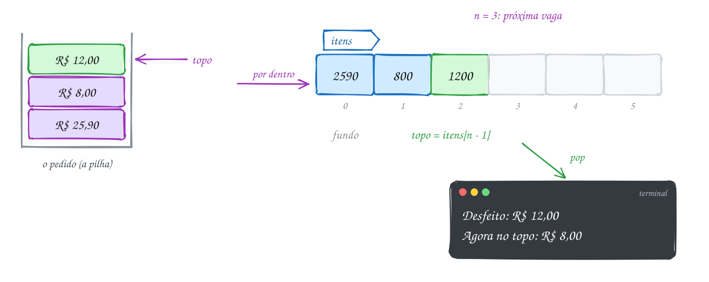
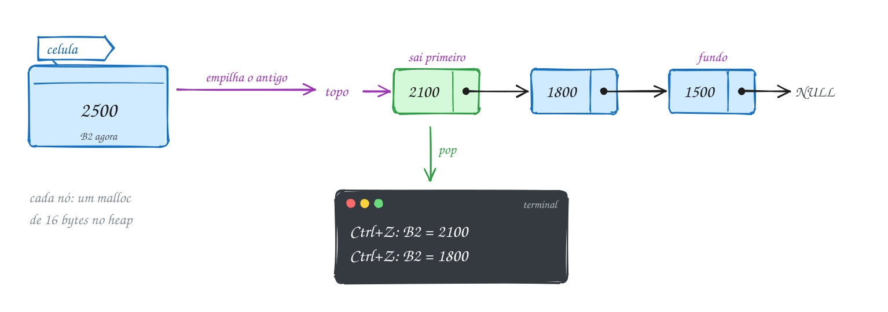
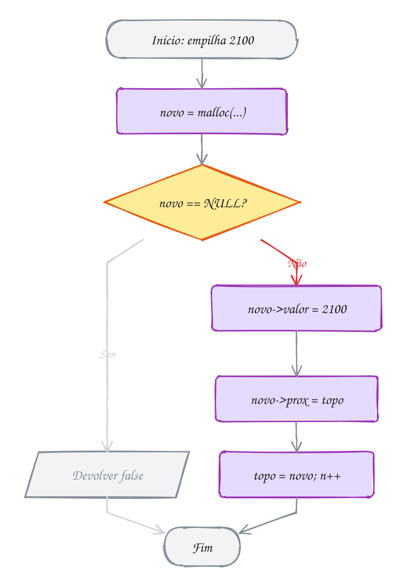
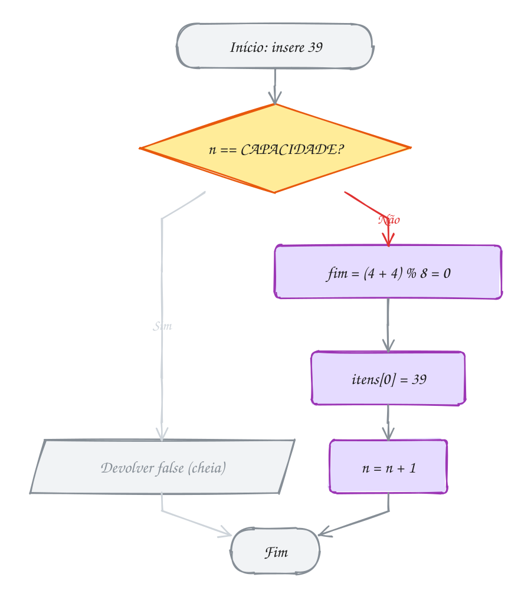
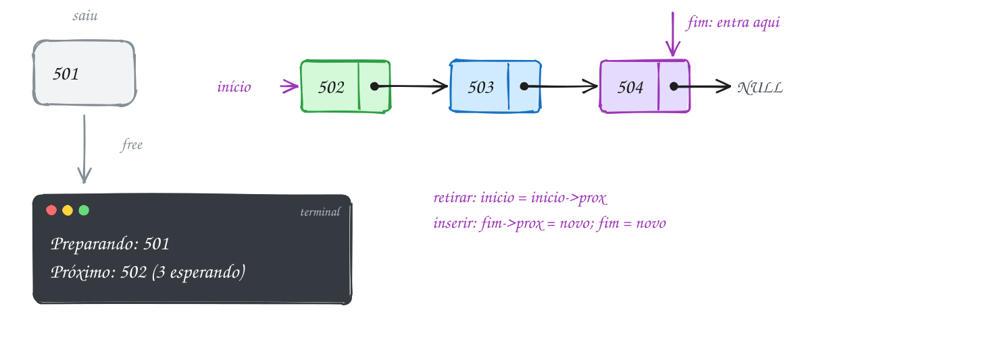
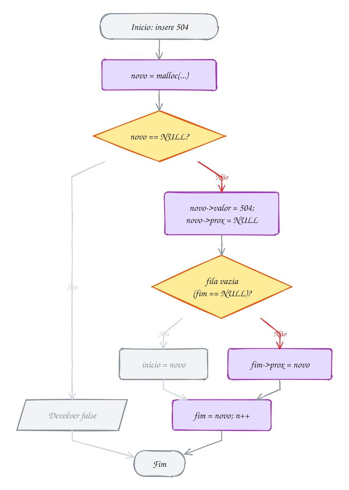
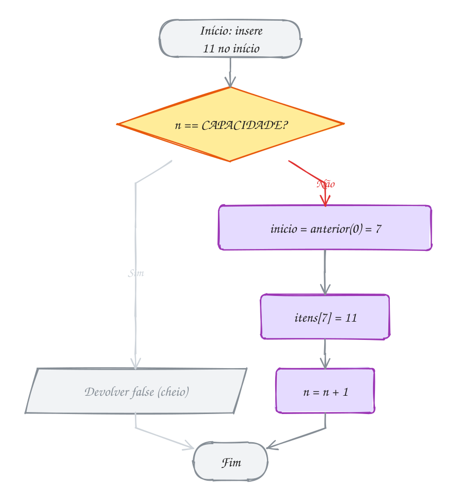

<!-- Gerado por _gerador. Para mudar este arquivo, edite _gerador/modulos/12-pilhas-e-filas/ e rode: cd _gerador && npm run gerar -->

# Módulo 12 · Pilhas e filas

A lista encadeada do módulo 11 deixa você inserir e remover em qualquer
lugar. Este módulo faz o contrário: **proíbe**. Uma pilha só mexe no topo;
uma fila só entra por um lado e sai pelo outro. Parece perda, mas é a
restrição que dá a garantia: o desfazer sempre desfaz o último passo, e quem
chegou primeiro sempre é atendido primeiro.

Você usa essas estruturas o dia inteiro sem ver. A pilha de chamadas do seu
programa, o Ctrl+Z, o botão Voltar e o *parser* de um compilador são pilhas. A
fila de processos do sistema operacional, a fila de jobs do seu backend e a
impressora do escritório são filas. Aqui você constrói as duas do zero, cada uma de dois
jeitos (vetor e lista encadeada), sempre como **TAD**: o mesmo `.h`, o
`.c` trocado por baixo, e o programa cliente nem percebe.

## O que você vai aprender

- o TAD **pilha** (LIFO) sobre vetor: empilhar, desempilhar, topo, *overflow* e *underflow*
- a **pilha encadeada**: por que o topo fica no começo da lista
- duas aplicações clássicas: **parênteses balanceados** e **notação pós-fixa**
- o TAD **fila** (FIFO) e a **fila circular** sobre vetor, com o `%` dando a volta
- a **fila encadeada** com ponteiros de início e fim, e os bugs das bordas
- o **deque**, que entra e sai pelas duas pontas, e a pegadinha do resto negativo
- uma calculadora que junta tudo: infixa → pós-fixa → resultado

## Como estudar cada assunto

1. Leia o texto e olhe o **diagrama da ideia**: é o exemplo desenhado, com a
   memória por dentro.
2. Leia o código. É o mesmo exemplo, com os mesmos valores.
3. Siga o **fluxograma** com o dedo: é o caminho de uma operação.
4. Rode os exemplos. Mude um valor, quebre de propósito, rode de novo.
5. Faça os exercícios. ★☆☆ é aquecimento, ★★☆ pede raciocínio, ★★★ é desafio.
   As dicas vêm logo abaixo do enunciado: tente antes de ler.

No meio de cada assunto tem uma **Pergunta para você**. Responda antes de rodar.

## As cores e as formas

Caixa azul é dado entrando ou saindo, roxa é o programa fazendo alguma coisa,
amarela é pergunta. Verde é o caminho que o exemplo segue (e, nos desenhos de
memória, o item que está saindo); cinza é o que ele não usa ou a gaveta que
já virou vaga.

<p align="center"></p>

## Antes de começar

Você precisa estar à vontade com ponteiros, `malloc`/`free`, `struct` com
`->` e listas encadeadas (módulos 06, 07, 08 e 11), além da ideia de TAD do
assunto 0074.

Cada pasta de assunto traz os arquivos do TAD ao lado dos exemplos:
`pilha.h` e `pilha.c`, `fila.h` e `fila.c` ou `deque.h` e `deque.c`. O
`rodar` compila esses `.c` de apoio junto com qualquer exemplo ou exercício
da pasta, então basta:

```bash
~/LPEDC/rodar 12-pilhas-e-filas/0082-pilha/A163.c
```

Por isso, num exercício, **não** crie funções com os nomes do TAD
(`pilha_cria`, `fila_insere`...): o ligador reclamaria de definição
duplicada. Os exercícios que pedem uma estrutura diferente usam outros nomes
e trazem tudo no próprio arquivo.

| # | Assunto | Pasta |
| --- | --- | --- |
| [0082](#0082--pilha) | Pilha | [`0082-pilha/`](12-pilhas-e-filas/0082-pilha/) |
| [0083](#0083--pilha-encadeada) | Pilha encadeada | [`0083-pilha-encadeada/`](12-pilhas-e-filas/0083-pilha-encadeada/) |
| [0084](#0084--pilha-na-prática-parênteses-e-notação-pós-fixa) | Pilha na prática: parênteses e notação pós-fixa | [`0084-pilha-aplicacoes/`](12-pilhas-e-filas/0084-pilha-aplicacoes/) |
| [0085](#0085--fila) | Fila | [`0085-fila/`](12-pilhas-e-filas/0085-fila/) |
| [0086](#0086--fila-encadeada) | Fila encadeada | [`0086-fila-encadeada/`](12-pilhas-e-filas/0086-fila-encadeada/) |
| [0087](#0087--deque) | Deque | [`0087-deque/`](12-pilhas-e-filas/0087-deque/) |
| [0088](#0088--juntando-tudo-a-calculadora-de-expressões) | Juntando tudo: a calculadora de expressões | [`0088-juntando-tudo/`](12-pilhas-e-filas/0088-juntando-tudo/) |

---

## 0082 · Pilha

Você monta o pedido no app de delivery: pizza, refrigerante, pudim. Bateu o
arrependimento e você toca em "desfazer". Sai o pudim, o último que entrou.
Ninguém espera que o desfazer apague a pizza lá do começo.

Esse comportamento tem nome: **pilha** (*stack*). Só uma ponta está ao seu
alcance, o **topo**. Tudo entra por cima e sai por cima, então o último a
entrar é o primeiro a sair: **LIFO** (*last in, first out*). É a pilha de
pratos do restaurante por quilo, o Ctrl+Z do editor, o botão Voltar do
navegador e a pilha de chamadas que você viu no assunto 0031.

As operações são poucas, e é isso que dá força à pilha:

- **empilhar** (*push*): põe um item no topo;
- **desempilhar** (*pop*): tira o item do topo e devolve o valor;
- **olhar o topo** (*peek*): lê o topo sem tirar;
- **vazia?**: pergunta se ainda tem alguma coisa.

No Cormen, elas se chamam PUSH, POP e STACK-EMPTY.

No C não existe nada pronto, então você monta a pilha como um **TAD** (assunto 0074):
o `pilha.h` diz **o que** a pilha faz e o `pilha.c` decide **como**. Quem usa
só inclui o `.h`:

```c
typedef struct pilha Pilha; // tipo opaco: os campos ficam no pilha.c

Pilha *pilha_cria(void);                     // pilha vazia (NULL se faltar memória)
void pilha_libera(Pilha *p);                 // devolve toda a memória da pilha
bool pilha_vazia(const Pilha *p);            // true se não tem nada
int pilha_tamanho(const Pilha *p);           // quantos itens tem
bool pilha_empilha(Pilha *p, int valor);     // push: false se não coube
bool pilha_desempilha(Pilha *p, int *valor); // pop: false se estava vazia
bool pilha_topo(const Pilha *p, int *valor); // peek: olha o topo sem tirar
```

Repare no `bool` de volta. O valor desempilhado vem pelo ponteiro, e o retorno
só diz se deu certo. Tirar de uma pilha vazia (**underflow**) é erro de lógica
de quem chamou. Empilhar numa pilha cheia (**overflow**) só acontece porque o
vetor tem tamanho fixo.

Por dentro, a versão deste assunto usa um **vetor** e um contador `n`. O fundo
fica em `itens[0]`, o topo em `itens[n - 1]`, e `n` é a próxima vaga. O trecho
que importa do [`pilha.c`](12-pilhas-e-filas/0082-pilha/pilha.c):

```c
struct pilha {
    int itens[CAPACIDADE]; // CAPACIDADE = 100
    int n;                 // quantos itens estão na pilha
};

bool pilha_empilha(Pilha *p, int valor) {
    if (p->n == CAPACIDADE) {
        return false; // cheia: estouro (overflow)
    }
    p->itens[p->n] = valor;
    p->n++;
    return true;
}

bool pilha_desempilha(Pilha *p, int *valor) {
    if (p->n == 0) {
        return false; // vazia: nada para tirar (underflow)
    }
    p->n--;
    *valor = p->itens[p->n]; // o valor continua no vetor, mas saiu da pilha
    return true;
}
```

Vamos ver na prática. Os três preços entram em centavos (2590, 800 e 1200),
um em cima do outro. No vetor, ocupam as gavetas 0, 1 e 2, e `n` vale 3. O
desfazer tira o 1200 do topo:

<p align="center"></p>

O programa do pedido. Ele não sabe que existe um vetor lá dentro: só conversa
com as funções do `pilha.h`:

```c
#include <stdio.h>
#include "pilha.h"

int main(void) {
    Pilha *pedido = pilha_cria();
    if (pedido == NULL) {
        return 1;
    }

    // preços em centavos: inteiro não tem erro de arredondamento
    pilha_empilha(pedido, 2590); // pizza: R$ 25,90
    pilha_empilha(pedido, 800);  // refrigerante: R$ 8,00
    pilha_empilha(pedido, 1200); // pudim: R$ 12,00

    int preco;
    if (pilha_desempilha(pedido, &preco)) { // "desfazer": sai o último que entrou
        printf("Desfeito: R$ %d,%02d\n", preco / 100, preco % 100);
    }
    if (pilha_topo(pedido, &preco)) { // só olha, não tira
        printf("Agora no topo: R$ %d,%02d\n", preco / 100, preco % 100);
    }
    printf("Itens no pedido: %d\n", pilha_tamanho(pedido));

    pilha_libera(pedido);
    return 0;
}
// Saída:
// Desfeito: R$ 12,00
// Agora no topo: R$ 8,00
// Itens no pedido: 2
```

Repara no fluxograma do desfazer: a primeira coisa é perguntar se a pilha está
vazia. Só depois `n` diminui e o valor é lido:

<p align="center"></p>

> [!WARNING]
> A ordem de `n--` e da leitura é o erro clássico. Se você lê `itens[n]` antes
> de diminuir `n`, pega a gaveta **vazia** logo acima do topo: lixo, ou um
> valor velho que já tinha saído. Fixe a convenção e não misture: aqui `n` é a
> próxima vaga (empilha em `itens[n]` e depois `n++`; desempilha com `n--` e
> depois lê). Muito livro usa `topo = -1` para pilha vazia, e aí o topo é
> `itens[topo]`. As duas funcionam. Misturar as duas não. O Cormen indexa o
> vetor a partir de 1: lá, `S.top` é o índice do topo **e** a quantidade de
> itens, e pilha vazia é `S.top = 0`.

> [!TIP]
> **Por dentro do C:** desempilhar **não apaga** nada. O 1200 continua na
> gaveta 2; ele só deixou de fazer parte da pilha porque `n` voltou para 2. O
> próximo `push` escreve por cima. Por isso empilhar e desempilhar custam
> **O(1)**: uma conta e uma cópia, não importa se a pilha tem 3 ou 100 itens.
> E repare no tamanho: `sizeof(struct pilha)` dá 404 bytes (100 `int` de 4
> bytes, mais o `n`), alocados de uma vez pelo `malloc` no `pilha_cria`, mesmo
> com só 3 itens dentro. O vetor é a casa da pilha, não a pilha.

> [!NOTE]
> **Pergunta para você:** no programa do pedido, se o cliente tocar em
> "desfazer" mais três vezes seguidas, o que cada chamada de `pilha_desempilha` devolve? E o que
> fica em `preco` na última? Pense antes de testar.

### Hora de praticar

Os arquivos ficam em [`0082-pilha/`](12-pilhas-e-filas/0082-pilha/). Os comandos funcionam de qualquer pasta do terminal. Nos exemplos, rode, mude, quebre e rode de novo. Nos exercícios, a resposta vai dentro do próprio arquivo. ★☆☆ é aquecimento, ★★☆ pede raciocínio e ★★★ é desafio.

**Exemplo A163 · As bordas da pilha: cheia e vazia**

```c
#include <stdio.h>
#include "pilha.h"

int main(void) {
    Pilha *cadeiras = pilha_cria(); // o depósito do salão empilha até 100
    if (cadeiras == NULL) {
        return 1;
    }

    // chegam 103 cadeiras numeradas: as 3 últimas não cabem (overflow)
    int recusadas = 0;
    for (int c = 1; c <= 103; c++) {
        if (!pilha_empilha(cadeiras, c)) {
            recusadas++;
        }
    }
    int topo = 0;
    pilha_topo(cadeiras, &topo);
    printf("Empilhadas: %d, recusadas: %d, no topo: %d\n", pilha_tamanho(cadeiras), recusadas, topo);

    // a festa usa todas: esvazia a pilha
    int cadeira = 0;
    int retiradas = 0;
    while (pilha_desempilha(cadeiras, &cadeira)) {
        retiradas++;
    }
    printf("Retiradas: %d, a última foi a %d\n", retiradas, cadeira);

    // mais uma retirada com a pilha vazia (underflow): devolve false e
    // não mexe na variável. O -1 serve de marcador para provar isso.
    cadeira = -1;
    if (!pilha_desempilha(cadeiras, &cadeira)) {
        printf("Pilha vazia: nada saiu, cadeira continua %d\n", cadeira);
    }
    if (!pilha_topo(cadeiras, &topo)) {
        printf("Topo também falha: vazia? %d\n", pilha_vazia(cadeiras));
    }

    pilha_libera(cadeiras);
    return 0;
}
// Saída:
// Empilhadas: 100, recusadas: 3, no topo: 100
// Retiradas: 100, a última foi a 1
// Pilha vazia: nada saiu, cadeira continua -1
// Topo também falha: vazia? 1
```

```bash
~/LPEDC/rodar 12-pilhas-e-filas/0082-pilha/A163.c
```

**Exemplo A164 · Decimal para binário: a pilha inverte a ordem**

```c
#include <stdio.h>
#include "pilha.h"

int main(void) {
    Pilha *restos = pilha_cria();
    if (restos == NULL) {
        return 1;
    }

    int n = 13;
    printf("%d em binário: ", n);
    // os restos da divisão por 2 saem do bit menos significativo para o mais
    // significativo: 1, 0, 1, 1. A pilha devolve na ordem certa: 1, 1, 0, 1.
    while (n > 0) {
        pilha_empilha(restos, n % 2);
        n = n / 2;
    }

    int bit;
    while (pilha_desempilha(restos, &bit)) { // false quando a pilha esvazia
        printf("%d", bit);
    }
    printf("\n");

    pilha_libera(restos);
    return 0;
}
// Saída:
// 13 em binário: 1101
```

```bash
~/LPEDC/rodar 12-pilhas-e-filas/0082-pilha/A164.c
```

#### Exercícios

**Exercício E487** · ★☆☆

O garçom empilha as comandas no espeto do balcão, e a cozinha sempre pega a
de cima. O programa abaixo já mexe na pilha. Complete o final: depois que o
laço esvazia a pilha, chame pilha_desempilha(p, &x) mais uma vez, guarde o
retorno numa variável bool e mostre o que a função devolveu e quanto x
ficou valendo.


```text
Saída esperada:
7
9
2 1
4
vazia? 1
mais um desempilha: devolveu 0, x = 4
```

**Dicas:**

1. bool ok = pilha_desempilha(p, &x); e mostre ok com %d (false vira 0).
2. Com a pilha vazia, a função não escreve em x: ele fica com o último
   valor que saiu.
3. Resposta esperada: as seis linhas acima.

```bash
~/LPEDC/rodar 12-pilhas-e-filas/0082-pilha/E487.c
```

**Exercício E488** · ★☆☆

Leia uma palavra com fgets e mostre a palavra de trás para frente usando a
pilha do pilha.h: empilhe cada letra e depois desempilhe tudo. Um char é
um número pequeno, então cabe no int da pilha.


```text
Digite uma palavra: ROMA
Ao contrário: AMOR
```

**Dicas:**

1. Tire o '\n' que o fgets deixa no fim antes de empilhar (assunto 0042).
2. Empilhe com pilha_empilha(p, palavra[i]) e mostre com printf("%c", c).
3. Resposta esperada: com ROMA, "Ao contrário: AMOR". Com OVO, "OVO".

```bash
~/LPEDC/rodar 12-pilhas-e-filas/0082-pilha/E488.c
```

**Exercício E489** · ★★☆

Complete a função soma_pedido: ela devolve a soma de todos os preços da
pilha (em centavos), usando só as funções do pilha.h. A pilha tem que
voltar exatamente como estava, na mesma ordem: o cliente ainda pode
querer desfazer.


```text
Saída esperada:
Total: R$ 45,90
Topo continua: R$ 12,00 (3 itens)
```

**Dicas:**

1. Você não enxerga o vetor lá dentro: para ver um item, precisa
   desempilhar.
2. Use uma segunda pilha: desempilhe tudo para ela, somando, e depois
   devolva tudo para a original. Ela volta na ordem certa porque inverter
   duas vezes desfaz a inversão.
3. Não esqueça de liberar a pilha auxiliar.
4. Resposta esperada: Total: R$ 45,90 e o topo continua R$ 12,00, com 3
   itens.

```bash
~/LPEDC/rodar 12-pilhas-e-filas/0082-pilha/E489.c
```

**Exercício E490** · ★★☆

No balcão do restaurante cabem 4 bandejas empilhadas. Este programa traz a
própria pilha (com a convenção topo = -1 para pilha vazia) e tenta
empilhar 5 bandejas. A quinta deveria ser recusada, mas o programa tem um
bug. Rode com o rodar: o sanitizer acusa o erro (procure "out of bounds").
Ache a linha, conserte e rode de novo até a saída bater com a esperada.


```text
Saída esperada depois do conserto:
Empilhou a bandeja 1
Empilhou a bandeja 2
Empilhou a bandeja 3
Empilhou a bandeja 4
Balcão cheio: a bandeja 5 ficou de fora
No topo: bandeja 4
```

**Dicas:**

1. Com topo = -1 para vazia, o topo aponta para o último item, não para a
   próxima vaga.
2. Qual é o maior índice válido de um vetor com CAPACIDADE posições?
3. Resposta esperada: o teste de cheia compara topo com CAPACIDADE, mas
   com essa convenção a pilha enche quando topo == CAPACIDADE - 1. Do
   jeito que está, a quinta bandeja é escrita em itens[4], fora do vetor
   (cai em cima do campo topo, que vira 5). Conserto:
   if (b->topo == CAPACIDADE - 1).

```bash
~/LPEDC/rodar 12-pilhas-e-filas/0082-pilha/E490.c
```

**Exercício E491** · ★★★

Os números 1, 2, 3, 4 chegam nessa ordem. A cada passo você pode empilhar
o próximo que chegou (E) ou desempilhar e mostrar o topo (D). A sequência
EEDEDDED, por exemplo, mostra 2 3 1 4.

Escreva a função void simula(const char *ops), que recebe a sequência de
letras e mostra os números na ordem em que saem. Se aparecer um D com a
pilha vazia, mostre "erro: pilha vazia" e pare. Teste com as três
sequências do main pronto abaixo.


```text
Saída esperada:
EEDEDDED: 2 3 1 4
EEEDDDED: 3 2 1 4
EDDE: 1 erro: pilha vazia
```


Depois escreva bool possivel(const int ordem[], int n), que diz se uma
ordem de saída dá para ser produzida pela pilha (com os números chegando
1, 2, ..., n), e teste com 2 3 1 4 e 3 1 2 4.


```text
Saída esperada (continuação):
2 3 1 4: possível
3 1 2 4: impossível
```

**Dicas:**

1. Guarde num int o próximo número a chegar (começa em 1).
2. pilha_desempilha devolve false com a pilha vazia: é o seu teste de
   erro.
3. Libere a pilha antes de sair da função, inclusive no caso de erro.
4. Em possivel, para cada número da ordem: empilhe os que chegam até ele
   aparecer no topo. Se ele já passou e não está no topo, é impossível.
5. Resposta esperada: as cinco linhas acima. 3 1 2 4 é impossível: para o
   3 sair primeiro, o 1 e o 2 precisam estar empilhados com o 2 por cima
   do 1. Então o 2 sai antes do 1, sempre.

```bash
~/LPEDC/rodar 12-pilhas-e-filas/0082-pilha/E491.c
```

**Exercício E492** · ★★★

A bancada da cozinha tem 6 lugares e guarda duas pilhas ao mesmo tempo:
os pratos limpos crescem a partir da esquerda (posição 0) e os sujos a
partir da direita (posição 5), uma em direção à outra. Assim nenhuma das
duas fica com espaço sobrando enquanto a outra está cheia: a bancada só
enche quando os 6 lugares estão ocupados.

Escreva do zero (sem o pilha.h) uma struct Bancada com um vetor de 6 int e
dois índices, e as funções empilha_limpo, empilha_sujo, desempilha_limpo e
desempilha_sujo, todas devolvendo bool. Teste assim: empilhe os limpos 1, 2
e 3; os sujos 10, 20 e 30; tente empilhar o limpo 4 (tem que falhar);
desempilhe um sujo; empilhe o limpo 4 de novo; e esvazie as duas pilhas
mostrando o que sai.


```text
Saída esperada:
Limpo 4: bancada cheia
Saiu o sujo 30
Limpo 4: ok
Limpos: 4 3 2 1
Sujos: 20 10
```

**Dicas:**

1. Use n_limpos (próxima vaga da esquerda, começa em 0) e topo_sujos
   (começa em 6 e diminui antes de cada empilhamento sujo).
2. A bancada está cheia quando n_limpos == topo_sujos.
3. Desempilhar limpo: n_limpos > 0. Desempilhar sujo: topo_sujos < 6.
4. Resposta esperada: as cinco linhas acima.

```bash
~/LPEDC/rodar 12-pilhas-e-filas/0082-pilha/E492.c
```

---

## 0083 · Pilha encadeada

Na planilha do orçamento, a célula B2 começou em R$ 1500 e você mudou para
1800, 2100 e 2500. Agora aperta Ctrl+Z duas vezes. A planilha não sabe quantas
vezes você vai editar: pode ser 3, pode ser 3 mil. Uma pilha com
`CAPACIDADE 100` fixa não serve.

A pilha do 0082 tem um teto porque mora num vetor. A saída é guardar cada item
num **nó** alocado com `malloc`, como na lista encadeada do módulo 11. A pilha
cresce um nó por vez e só "enche" quando acaba a memória.

A pergunta que decide tudo: **o topo fica no começo ou no fim da lista?** No
começo. Inserir e remover no início de uma lista simples custa O(1): você
mexe só no ponteiro de entrada. No fim, para remover o último você precisaria
achar o **penúltimo**, e isso exige percorrer a lista inteira, O(n). Então:

- **empilhar** = inserir no início: o novo nó aponta para o antigo topo, e o
  topo passa a ser o novo;
- **desempilhar** = remover do início: guarda o valor, avança o topo, libera
  o nó velho;
- **vazia** = `topo == NULL`.

O melhor: o [`pilha.h`](12-pilhas-e-filas/0083-pilha-encadeada/pilha.h) é **idêntico** ao do
0082. Só o [`pilha.c`](12-pilhas-e-filas/0083-pilha-encadeada/pilha.c) mudou. Esse é o ganho do
TAD: o programa do delivery do 0082 roda sem mudar uma vírgula com esta
implementação.
Por dentro, a struct agora guarda um ponteiro:

```c
typedef struct no {
    int valor;
    struct no *prox; // o nó de baixo
} No;

struct pilha {
    No *topo; // NULL quando a pilha está vazia
    int n;    // quantos itens (para pilha_tamanho não percorrer a lista)
};

bool pilha_empilha(Pilha *p, int valor) {
    No *novo = malloc(sizeof *novo);
    if (novo == NULL) {
        return false; // só "enche" quando acaba a memória
    }
    novo->valor = valor;
    novo->prox = p->topo; // o novo aponta para o antigo topo
    p->topo = novo;       // e passa a ser o topo
    p->n++;
    return true;
}

bool pilha_desempilha(Pilha *p, int *valor) {
    if (p->topo == NULL) {
        return false;
    }
    No *velho = p->topo;
    *valor = velho->valor; // lê ANTES de liberar
    p->topo = velho->prox;
    free(velho);
    p->n--;
    return true;
}
```

Vamos ver na prática. Antes de cada edição, o valor antigo da B2 vai para a
pilha: 1500, depois 1800, depois 2100. O último a entrar, 2100, fica no
primeiro nó, e é ele que o primeiro Ctrl+Z devolve:

<p align="center"></p>

O programa da planilha:

```c
#include <stdio.h>
#include "pilha.h"

int main(void) {
    Pilha *desfazer = pilha_cria();
    if (desfazer == NULL) {
        return 1;
    }

    int celula = 1500; // B2: orçamento do mês, em R$
    int novos[] = {1800, 2100, 2500};
    for (int i = 0; i < 3; i++) {
        pilha_empilha(desfazer, celula); // guarda o valor antigo antes de mudar
        celula = novos[i];
        printf("B2 = %d\n", celula);
    }

    // a pilha agora é: topo -> 2100 -> 1800 -> 1500 -> NULL
    for (int i = 0; i < 2; i++) { // Ctrl+Z duas vezes
        if (pilha_desempilha(desfazer, &celula)) {
            printf("Ctrl+Z: B2 = %d\n", celula);
        }
    }
    printf("Ainda dá para desfazer %d vez(es)\n", pilha_tamanho(desfazer));

    pilha_libera(desfazer); // libera o nó que sobrou e a própria pilha
    return 0;
}
// Saída:
// B2 = 1800
// B2 = 2100
// B2 = 2500
// Ctrl+Z: B2 = 2100
// Ctrl+Z: B2 = 1800
// Ainda dá para desfazer 1 vez(es)
```

Repara no fluxograma do empilhar o 2100: a ordem das duas ligações importa.
Primeiro o novo nó aponta para o topo antigo, só depois o topo muda:

<p align="center"></p>

> [!WARNING]
> Troque a ordem e você perde a pilha inteira. Se fizer `p->topo = novo`
> antes de `novo->prox = p->topo`, o novo nó aponta para **ele mesmo**, e os
> nós 1800 e 1500 ficam sem ninguém apontando para eles: vazamento de memória
> e uma pilha que só tem o 2100 em loop. No desempilhar, o perigo é o
> contrário: ler `velho->valor` **depois** do `free(velho)` é usar memória
> liberada, e o AddressSanitizer acusa `heap-use-after-free`.

> [!TIP]
> **Por dentro do C:** cada nó ocupa 16 bytes: 4 do `int`, 4 de
> **preenchimento** (*padding*) para alinhar o ponteiro e 8 do ponteiro, num
> sistema de 64 bits. Para guardar 4 bytes de dado, você gasta 16, mais o
> controle interno do `malloc`. O vetor do 0082 gasta 4 bytes por item, todos
> juntos na memória, o que o cache do processador adora. A encadeada troca
> espaço e velocidade por **não ter teto**. E todo `malloc` do empilhar
> precisa de um `free`: é por isso que `pilha_libera` percorre a lista toda
> antes de liberar a struct.

> [!NOTE]
> **Pergunta para você:** no programa da planilha, se o laço do Ctrl+Z
> rodasse 5 vezes em vez de 2, quantas linhas `Ctrl+Z` apareceriam e qual seria o último valor de B2?
> Siga a lista do desenho antes de rodar.

### Hora de praticar

Os arquivos ficam em [`0083-pilha-encadeada/`](12-pilhas-e-filas/0083-pilha-encadeada/). Os comandos funcionam de qualquer pasta do terminal. Nos exemplos, rode, mude, quebre e rode de novo. Nos exercícios, a resposta vai dentro do próprio arquivo. ★☆☆ é aquecimento, ★★☆ pede raciocínio e ★★★ é desafio.

**Exemplo A165 · Desfazer e refazer com duas pilhas**

```c
#include <stdio.h>
#include "pilha.h"

// esvazia uma pilha: uma edição nova apaga o que dava para refazer
void esvazia(Pilha *p) {
    int lixo;
    while (pilha_desempilha(p, &lixo)) {
    }
}

int main(void) {
    Pilha *desfazer = pilha_cria();
    if (desfazer == NULL) {
        return 1;
    }
    Pilha *refazer = pilha_cria();
    if (refazer == NULL) {
        pilha_libera(desfazer);
        return 1;
    }

    int temp = 22; // ar-condicionado da sala, em graus
    int ajustes[] = {20, 18, 24};
    for (int i = 0; i < 3; i++) {
        pilha_empilha(desfazer, temp); // guarda o valor antigo
        esvazia(refazer);
        temp = ajustes[i];
    }
    printf("Ajustado para %d\n", temp); // desfazer: topo -> 18 -> 20 -> 22

    for (int i = 0; i < 2; i++) { // Ctrl+Z duas vezes
        pilha_empilha(refazer, temp); // o atual vai para o refazer
        pilha_desempilha(desfazer, &temp);
        printf("Desfez: %d\n", temp);
    }

    pilha_empilha(desfazer, temp); // Ctrl+Y: o caminho inverso
    pilha_desempilha(refazer, &temp);
    printf("Refez: %d\n", temp);
    printf("Dá para refazer mais %d vez(es)\n", pilha_tamanho(refazer));

    pilha_empilha(desfazer, temp); // edição nova: o refazer perde o sentido
    esvazia(refazer);
    temp = 21;
    printf("Ajustado para %d; refazer agora tem %d\n", temp, pilha_tamanho(refazer));
    printf("Desfazer guarda %d valores\n", pilha_tamanho(desfazer));

    pilha_libera(desfazer);
    pilha_libera(refazer);
    return 0;
}
// Saída:
// Ajustado para 24
// Desfez: 18
// Desfez: 20
// Refez: 18
// Dá para refazer mais 1 vez(es)
// Ajustado para 21; refazer agora tem 0
// Desfazer guarda 3 valores
```

```bash
~/LPEDC/rodar 12-pilhas-e-filas/0083-pilha-encadeada/A165.c
```

**Exemplo A166 · Sem teto: 100 mil itens na pilha encadeada**

```c
#include <stdio.h>
#include "pilha.h"

// A pilha do vetor (0082) recusaria o 101º item. Esta só para quando acabar a
// memória. O código é o mesmo do cliente da 0082: só o pilha.c mudou.
int main(void) {
    Pilha *p = pilha_cria();
    if (p == NULL) {
        return 1;
    }

    int recusados = 0;
    for (int i = 1; i <= 100000; i++) {
        if (!pilha_empilha(p, i)) {
            recusados++;
        }
    }
    printf("Empilhados: %d, recusados: %d\n", pilha_tamanho(p), recusados);

    int topo;
    if (pilha_topo(p, &topo)) {
        printf("No topo: %d\n", topo);
    }

    // pilha_libera percorre os 100 mil nós; sem ela, o AddressSanitizer
    // acusaria 100 mil vazamentos de 16 bytes
    pilha_libera(p);
    return 0;
}
// Saída:
// Empilhados: 100000, recusados: 0
// No topo: 100000
```

```bash
~/LPEDC/rodar 12-pilhas-e-filas/0083-pilha-encadeada/A166.c
```

#### Exercícios

**Exercício E493** · ★☆☆

Você não enxerga os nós da pilha (o tipo é opaco), mas dá para acompanhar
o que acontece com as funções do pilha.h. Complete a função estado: ela
mostra quantos itens a pilha tem e quem está no topo, ou "[vazia]". O main
já chama estado depois de cada operação.


```text
Saída esperada:
[1 item, topo 3]
[2 itens, topo 8]
saiu 8 -> [1 item, topo 3]
[2 itens, topo 5]
[3 itens, topo 9]
saiu 9 -> [2 itens, topo 5]
saiu 5 -> [1 item, topo 3]
saiu 3 -> [vazia]
```

**Dicas:**

1. pilha_topo devolve false com a pilha vazia: use isso para decidir o que
   mostrar.
2. "item" no singular quando o tamanho é 1: um ternário resolve.
3. estado só olha: não desempilhe nada dentro dela.
4. Resposta esperada: as oito linhas acima. Cada empilha fez um malloc e
   cada saiu fez um free; o sanitizer não acusa vazamento.

```bash
~/LPEDC/rodar 12-pilhas-e-filas/0083-pilha-encadeada/E493.c
```

**Exercício E494** · ★☆☆

Você vai lendo os valores das notas fiscais do mês (inteiros, em reais) até
digitar 0. Não dá para saber de antemão quantas são, e por isso a pilha
encadeada é perfeita. No fim, mostre quantas notas foram lidas e os
valores da última para a primeira. Se o scanf falhar (alguém digitou uma
letra), pare de ler como se fosse o 0.


```text
Digite os valores (0 para terminar): 120 45 300 0
Lidas 3 notas. Da última para a primeira: 300 45 120
```

**Dicas:**

1. while (scanf("%d", &valor) == 1 && valor != 0) { ... }
2. pilha_tamanho dá a contagem sem você precisar de outro contador.
3. Resposta esperada: com 120 45 300 0, "Lidas 3 notas. Da última para a
   primeira: 300 45 120".

```bash
~/LPEDC/rodar 12-pilhas-e-filas/0083-pilha-encadeada/E494.c
```

**Exercício E495** · ★★☆

O botão Voltar do navegador é uma pilha de páginas. Este programa monta a
própria pilha encadeada, com um texto em cada nó (por isso não usa o
pilha.h, que guarda int). Complete as funções:

- visita: cria um nó com a url e põe no topo (devolve false se faltar
memória);
- voltar: tira a página do topo, mas só se ela não for a única (da
primeira página não se volta). Devolve false se não deu para voltar.


```text
Saída esperada:
Agora em: receitas.com
Voltar -> ge.globo.com
Agora em: cifraclub.com.br
Voltar -> ge.globo.com
Voltar -> g1.globo.com
Não dá para voltar de g1.globo.com
```

**Dicas:**

1. Em visita, faça como no pilha_empilha: malloc, copie a url com strcpy,
   ligue novo->ant ao topo antigo e só então troque o topo.
2. A página é a única quando h->topo->ant == NULL.
3. Em voltar, guarde o nó velho, avance o topo e só depois dê free.
4. Resposta esperada: as seis linhas acima, sem vazamento no sanitizer.

```bash
~/LPEDC/rodar 12-pilhas-e-filas/0083-pilha-encadeada/E495.c
```

**Exercício E496** · ★★☆

Pilha de pratos do restaurante, cada prato com um número. Este programa
compila (o gcc 13 até solta um aviso: leia com atenção) e, sem o
sanitizer, às vezes mostra os números certos. Mesmo assim está errado.
Rode com o rodar, ache no relatório do AddressSanitizer o nome do erro e
a linha, conserte mudando a ordem de duas linhas e rode de novo: a saída
tem que bater e o relatório tem que sumir.


```text
Saída esperada depois do conserto:
Tirou o prato 30
Tirou o prato 20
Tirou o prato 10
```

**Dicas:**

1. Procure "heap-use-after-free" e o número da linha no relatório.
2. Depois do free, o nó não é mais seu, mesmo que os bytes ainda estejam
   lá: o free só marca a memória como livre, e é por sorte que sem o
   sanitizer a leitura parece funcionar.
3. Resposta esperada: o erro é heap-use-after-free, na linha que faz
   "*numero = velho->numero", depois do free(velho). Conserto: passe a
   linha do *numero para antes do free. Saída: as três linhas acima.

```bash
~/LPEDC/rodar 12-pilhas-e-filas/0083-pilha-encadeada/E496.c
```

**Exercício E497** · ★★★

Os pedidos da cozinha chegaram empilhados fora de ordem: 5, 3, 8, 1 e 4 (o
4 no topo). Escreva void ordena(Pilha *p), que deixa a pilha ordenada com o
MENOR no topo, usando só as funções do pilha.h e no máximo UMA pilha
auxiliar (nada de vetor). Depois o main desempilha e mostra tudo.


```text
Saída esperada:
1 3 4 5 8
```

**Dicas:**

1. A auxiliar fica sempre ordenada, com o MAIOR no topo dela.
2. Tire um valor x da original. Enquanto o topo da auxiliar for maior que
   x, devolva esse topo para a original. Então empilhe x na auxiliar.
3. Quando a original esvaziar, despeje a auxiliar de volta nela: o maior
   vai para o fundo, e o menor fica no topo.
4. Resposta esperada: 1 3 4 5 8. No pior caso são O(n²) movimentos, como
   na ordenação por inserção (assunto 0093).

```bash
~/LPEDC/rodar 12-pilhas-e-filas/0083-pilha-encadeada/E497.c
```

**Exercício E498** · ★★★

Uma estação meteorológica empilha as temperaturas do dia e às vezes
descarta a última leitura (sensor com defeito). A qualquer momento ela
quer saber a MENOR temperatura que está na pilha, e essa consulta precisa
custar O(1): nada de percorrer a pilha.

Escreva um tipo PilhaMin com duas Pilha * dentro (a dos valores e a dos
mínimos) e as funções min_cria, min_empilha, min_desempilha, min_atual e
min_libera. Teste empilhando 22, 19, 25, 17 e 30 e depois desempilhando
quatro vezes.


```text
Saída esperada:
empilha 22 -> mínimo 22
empilha 19 -> mínimo 19
empilha 25 -> mínimo 19
empilha 17 -> mínimo 17
empilha 30 -> mínimo 17
desempilha 30 -> mínimo 17
desempilha 17 -> mínimo 19
desempilha 25 -> mínimo 19
desempilha 19 -> mínimo 22
```

**Dicas:**

1. A pilha dos mínimos anda junto com a dos valores: a cada empilhamento,
   empilhe nela o menor entre o valor novo e o mínimo atual.
2. Ao desempilhar, tire das duas.
3. min_atual é só um pilha_topo na pilha dos mínimos.
4. Resposta esperada: as nove linhas acima. Custa o dobro de memória em
   troca de O(1) na consulta.

```bash
~/LPEDC/rodar 12-pilhas-e-filas/0083-pilha-encadeada/E498.c
```

---

## 0084 · Pilha na prática: parênteses e notação pós-fixa

Você esquece de fechar um colchete no VS Code e, na hora, o editor sublinha
de vermelho o lugar certo. Ele não está contando parênteses. Está usando uma
pilha.

Com um tipo só de parêntese, um contador resolve: soma 1 no `(`, tira 1 no
`)`, nunca pode ficar negativo e tem que terminar em zero. Com três tipos
(`()`, `[]`, `{}`) o contador quebra. Em `( [ ) ]` tem duas aberturas e dois
fechamentos, a conta fecha, e a expressão está errada: o `)` chegou quando
quem estava esperando era o `[`.

A regra que você precisa é: **todo fechamento casa com a abertura mais
recente que ainda não fechou**. "Mais recente ainda pendente" é exatamente o
topo de uma pilha. O algoritmo:

1. abriu (`(`, `[` ou `{`): **empilha**;
2. fechou: **desempilha** e confere se é o par certo. Pilha vazia ou par
   errado: erro;
3. qualquer outro caractere: ignora;
4. acabou a string: a pilha tem que estar **vazia**. Se sobrou alguém, faltou
   fechar.

Vamos ver na prática com `{ x = v[(i + 1)] }`. Tirando o resto, sobram os
delimitadores `{ [ ( ) ] }`. Os três primeiros são empilhados. Quando chega o
`)`, o topo é `(`: casou, desempilha e segue. Depois `]` casa com `[` e `}`
casa com `{`:

<p align="center"></p>

O verificador, testado com quatro expressões. O `pilha.h` e o `pilha.c` são
os mesmos do 0083 e estão na pasta do assunto:

```c
#include <stdbool.h>
#include <stdio.h>
#include "pilha.h"

// a abertura que combina com cada fechamento
char abertura_de(char fecha) {
    if (fecha == ')') {
        return '(';
    }
    if (fecha == ']') {
        return '[';
    }
    return '{';
}

bool balanceada(const char *s) {
    Pilha *p = pilha_cria();
    if (p == NULL) {
        return false;
    }
    bool ok = true;
    for (int i = 0; s[i] != '\0' && ok; i++) {
        char c = s[i];
        if (c == '(' || c == '[' || c == '{') {
            pilha_empilha(p, c); // abriu: espera o fechamento lá na frente
        } else if (c == ')' || c == ']' || c == '}') {
            int topo;
            // fechou: tem que existir uma abertura e ela tem que ser do mesmo tipo
            if (!pilha_desempilha(p, &topo) || topo != abertura_de(c)) {
                ok = false;
            }
        }
    }
    if (!pilha_vazia(p)) {
        ok = false; // sobrou abertura sem fechamento
    }
    pilha_libera(p);
    return ok;
}

int main(void) {
    const char *testes[] = {"{ x = v[(i + 1)] }", "( [ ) ]", "(a + b))", "{ [ ("};
    for (int i = 0; i < 4; i++) {
        printf("%-20s %s\n", testes[i], balanceada(testes[i]) ? "balanceada" : "com erro");
    }
    return 0;
}
// Saída:
// { x = v[(i + 1)] }   balanceada
// ( [ ) ]              com erro
// (a + b))             com erro
// { [ (                com erro
```

Repara no fluxograma: o laço só tem duas saídas antecipadas para o erro, e a
pergunta "pilha vazia?" só acontece quando a string acaba:

<p align="center"></p>

### Notação pós-fixa

A segunda aplicação clássica é fazer conta. A conta do bar foi `(35 + 25) * 3
/ 4`: três rodadas de petisco e bebida, divididas por 4 amigos. Na notação de
sempre (**infixa**), o operador fica no meio e você precisa de parênteses e de
regras de precedência. Na **pós-fixa** (a da calculadora HP 12C), o operador
vem **depois** dos dois operandos: `35 25 + 3 * 4 /`. Sem parênteses, sem
precedência: a ordem da escrita já é a ordem das contas.

Para avaliar, uma pilha de números: número **empilha**; operador
**desempilha dois**, faz a conta e **empilha o resultado**. No fim, sobra um
número só, o resultado:

| lê | faz | pilha (topo à direita) |
| --- | --- | --- |
| `35` | empilha | 35 |
| `25` | empilha | 35 25 |
| `+` | tira 25 e 35, empilha 35 + 25 | 60 |
| `3` | empilha | 60 3 |
| `*` | tira 3 e 60, empilha 60 * 3 | 180 |
| `4` | empilha | 180 4 |
| `/` | tira 4 e 180, empilha 180 / 4 | 45 |

Cada um paga R$ 45. O exemplo A168 faz exatamente essa tabela em C, juntando
os dígitos de `35` num número só e acusando expressão inválida quando falta
operando ou sobra número na pilha. É assim que compiladores e máquinas
virtuais (a JVM, o WebAssembly) calculam: traduzem a sua expressão para algo
parecido com a pós-fixa e rodam numa pilha.

> [!WARNING]
> Na pós-fixa, o **primeiro** a sair da pilha é o operando da **direita**.
> Em `8 3 -`, desempilha o 3 (b) e depois o 8 (a), e a conta é `a - b = 5`.
> Inverter dá `-5`, e o erro some na soma e na multiplicação, que não ligam
> para a ordem. Teste sempre com `-` e `/`. No verificador de parênteses, o
> erro clássico é esquecer o passo 4: sem conferir se a pilha terminou
> vazia, `{ [ (` passa como balanceada.

> [!TIP]
> **Por dentro do C:** o `char` que entra no `pilha_empilha(p, c)` vira `int`
> sem cast nenhum (promoção de inteiros), e `'('` é só o número 40 na tabela
> ASCII. Na pós-fixa, `expr[i] - '0'` transforma o caractere `'7'` (55) no
> número 7, porque os dígitos são consecutivos na tabela. E o tamanho da pilha
> nunca passa do número de caracteres da string: no pior caso, `((((((`, tudo
> é empilhado. Memória **O(n)**, tempo **O(n)**: cada caractere é visto uma
> vez e entra e sai da pilha no máximo uma vez.

> [!NOTE]
> **Pergunta para você:** quanto vale `2 3 4 * +`? E `2 3 + 4 *`? Escreva as
> duas na forma infixa, com parênteses só onde precisa, antes de testar no
> A168.

### Hora de praticar

Os arquivos ficam em [`0084-pilha-aplicacoes/`](12-pilhas-e-filas/0084-pilha-aplicacoes/). Os comandos funcionam de qualquer pasta do terminal. Nos exemplos, rode, mude, quebre e rode de novo. Nos exercícios, a resposta vai dentro do próprio arquivo. ★☆☆ é aquecimento, ★★☆ pede raciocínio e ★★★ é desafio.

**Exemplo A167 · Parênteses dentro de aspas não contam**

```c
#include <stdbool.h>
#include <stdio.h>
#include "pilha.h"

char abertura_de(char fecha) {
    return fecha == ')' ? '(' : fecha == ']' ? '[' : '{';
}

// Confere uma linha de código C. Com pula_aspas, o que está entre "..." ou
// '...' é texto, não código: um ')' dentro de aspas não fecha nada.
bool balanceada(const char *s, bool pula_aspas) {
    Pilha *p = pilha_cria();
    if (p == NULL) {
        return false;
    }
    bool ok = true;
    char aspa = '\0'; // '\0' = fora de aspas; senão, a aspa que abriu
    for (int i = 0; s[i] != '\0' && ok; i++) {
        char c = s[i];
        if (aspa != '\0') {
            if (c == '\\' && s[i + 1] != '\0') {
                i++; // \" ou \' não fecham a aspa: pula o caractere seguinte
            } else if (c == aspa) {
                aspa = '\0'; // fechou o texto
            }
        } else if (pula_aspas && (c == '"' || c == '\'')) {
            aspa = c; // começou um texto
        } else if (c == '(' || c == '[' || c == '{') {
            pilha_empilha(p, c);
        } else if (c == ')' || c == ']' || c == '}') {
            int topo;
            if (!pilha_desempilha(p, &topo) || topo != abertura_de(c)) {
                ok = false;
            }
        }
    }
    if (!pilha_vazia(p) || aspa != '\0') {
        ok = false; // sobrou abertura, ou uma aspa ficou aberta
    }
    pilha_libera(p);
    return ok;
}

int main(void) {
    const char *linhas[] = {
        "if (c == ')') { n++; }",
        "printf(\"[%d]\\n\", v[i]);",
        "puts(\"sorriso :)\");",
        "v[(i + 1] = 0;",
    };
    printf("%-28s %-10s %s\n", "linha", "simples", "pulando aspas");
    for (int i = 0; i < 4; i++) {
        printf("%-28s %-10s %s\n", linhas[i],
               balanceada(linhas[i], false) ? "ok" : "erro",
               balanceada(linhas[i], true) ? "ok" : "erro");
    }
    return 0;
}
// Saída:
// linha                        simples    pulando aspas
// if (c == ')') { n++; }       erro       ok
// printf("[%d]\n", v[i]);      ok         ok
// puts("sorriso :)");          erro       ok
// v[(i + 1] = 0;               erro       erro
```

```bash
~/LPEDC/rodar 12-pilhas-e-filas/0084-pilha-aplicacoes/A167.c
```

**Exemplo A168 · A conta do bar em notação pós-fixa**

```c
#include <stdbool.h>
#include <stdio.h>
#include "pilha.h"

// Avalia uma expressão pós-fixa com inteiros não negativos separados por
// espaço e os operadores + - * /. Devolve false se a expressão for inválida.
bool avalia(const char *expr, int *resultado) {
    Pilha *p = pilha_cria();
    if (p == NULL) {
        return false;
    }
    bool ok = true;
    for (int i = 0; expr[i] != '\0' && ok; i++) {
        char c = expr[i];
        if (c >= '0' && c <= '9') {
            int numero = 0;
            while (expr[i] >= '0' && expr[i] <= '9') { // junta os dígitos: "35" -> 35
                numero = numero * 10 + (expr[i] - '0');
                i++;
            }
            i--; // o for vai somar 1 de novo
            pilha_empilha(p, numero);
        } else if (c == '+' || c == '-' || c == '*' || c == '/') {
            int a, b;
            // o primeiro a sair é o operando da DIREITA
            if (!pilha_desempilha(p, &b) || !pilha_desempilha(p, &a) || (c == '/' && b == 0)) {
                ok = false;
            } else if (c == '+') {
                pilha_empilha(p, a + b);
            } else if (c == '-') {
                pilha_empilha(p, a - b);
            } else if (c == '*') {
                pilha_empilha(p, a * b);
            } else {
                pilha_empilha(p, a / b);
            }
        }
    }
    // no fim tem que sobrar exatamente um número: o resultado
    if (ok && (!pilha_desempilha(p, resultado) || !pilha_vazia(p))) {
        ok = false;
    }
    pilha_libera(p);
    return ok;
}

int main(void) {
    // (35 + 25) * 3 / 4: três rodadas de petisco (R$ 35) e bebida (R$ 25),
    // divididas entre 4 amigos
    const char *expr = "35 25 + 3 * 4 /";
    int total;
    if (avalia(expr, &total)) {
        printf("%s = %d\n", expr, total);
    }
    if (!avalia("35 +", &total)) {
        printf("35 + : expressão inválida\n");
    }
    return 0;
}
// Saída:
// 35 25 + 3 * 4 / = 45
// 35 + : expressão inválida
```

```bash
~/LPEDC/rodar 12-pilhas-e-filas/0084-pilha-aplicacoes/A168.c
```

#### Exercícios

**Exercício E499** · ★☆☆

A função avalia abaixo já calcula uma expressão pós-fixa. Falta o resto:
preencha o vetor posfixas com as expressões a), b) e c) traduzidas para a
pós-fixa (a d já está pronta) e o vetor infixas com a mesma conta escrita
direto em C, para o programa conferir uma com a outra.


```text
a) (7 + 3) * 2
b) 7 + 3 * 2
c) 100 / (2 + 3) - 4
d) 6 2 / 3 1 - *        (já em pós-fixa; a infixa é (6 / 2) * (3 - 1))
```


```text
Saída esperada:
7 3 + 2 * = 20 (em C: 20) confere
7 3 2 * + = 13 (em C: 13) confere
100 2 3 + / 4 - = 16 (em C: 16) confere
6 2 / 3 1 - * = 6 (em C: 6) confere
```

**Dicas:**

1. Os números aparecem na mesma ordem nas duas notações; só os
   operadores mudam de lugar.
2. Na b, a multiplicação acontece primeiro, então o * aparece antes do +.
3. Em infixas, escreva a conta mesmo: {(7 + 3) * 2, ...}. O compilador
   calcula.
4. Resposta esperada: as quatro linhas acima.

```bash
~/LPEDC/rodar 12-pilhas-e-filas/0084-pilha-aplicacoes/E499.c
```

**Exercício E500** · ★☆☆

Quando só existe um tipo de delimitador, nem precisa de pilha. Escreva
bool parenteses_ok(const char *s) usando só um contador int: soma 1 no
"(", tira 1 no ")". Teste com as quatro strings abaixo. Depois escreva
uma segunda versão, bool contador_ok(const char *s), que conta os três
tipos juntos (abre: "(", "[" ou "{"; fecha: ")", "]" ou "}") e teste com
"( [ ) ]": repare que o contador aprova uma expressão errada.


```text
Saída esperada:
(a+(b*c))  ok
(a+b))(    erro
)(         erro
((x)       erro
( [ ) ]    contador diz ok, mas está errado
```

**Dicas:**

1. Se o contador ficar negativo no meio do caminho, já é erro: fechou
   sem abrir. É o que pega o ")(".
2. No fim, ok só se o contador for 0.
3. Use printf("%-10s %s\n", s, ...) para alinhar.
4. Para a última linha: if (contador_ok("( [ ) ]")) printf(...).
5. Resposta esperada: as cinco linhas acima. Com tipos diferentes, o
   contador só sabe QUANTOS estão abertos, não QUAL foi o último a abrir.

```bash
~/LPEDC/rodar 12-pilhas-e-filas/0084-pilha-aplicacoes/E500.c
```

**Exercício E501** · ★★☆

Este verificador é mais educado que o do texto: além de dizer que deu
errado, diz onde. Melhore ainda mais: em vez de empilhar o caractere,
empilhe a POSIÇÃO dele na string (o caractere você recupera com s[pos]).
Assim as mensagens também podem dizer onde a abertura estava. A primeira
posição da string é 0.


```text
Saída esperada:
[1, (2, 3)]: ok
{a: [1, 2}]: esperava ] e veio } na posição 9 (o [ abriu na posição 4)
f(x)): fecha sem abrir na posição 4
if (a[0] {: faltou fechar 2; o de cima é o { da posição 9
```

**Dicas:**

1. pilha_empilha(p, i) no lugar de pilha_empilha(p, c).
2. Ao desempilhar, a abertura é s[topo], e topo é a posição dela.
3. No "faltou fechar", use pilha_topo para pegar a última abertura.
4. Resposta esperada: as quatro linhas acima.

```bash
~/LPEDC/rodar 12-pilhas-e-filas/0084-pilha-aplicacoes/E501.c
```

**Exercício E502** · ★★☆

Esta calculadora pós-fixa (operandos de um dígito) compila sem aviso e
acerta a soma. Mas erra outras contas. Rode, compare com a saída esperada,
ache o bug e conserte mexendo no mínimo de código.


```text
Saída esperada depois do conserto:
2 3 + = 5
8 3 - = 5
8 4 / = 2
9 5 2 - * = 27
```

**Dicas:**

1. Rode: a soma está certa, a subtração dá -5 e a divisão dá 0. O que a
   soma tem que a subtração e a divisão não têm?
2. Qual operando sai primeiro da pilha: o da esquerda ou o da direita?
3. Resposta esperada: os dois pilha_desempilha estão na ordem errada. O
   primeiro a sair é o operando da direita, então ele tem que ir para b.
   Trocando a ordem (desempilha em b, depois em a), as quatro contas
   ficam certas. A soma e a multiplicação escondiam o erro porque
   a + b == b + a.

```bash
~/LPEDC/rodar 12-pilhas-e-filas/0084-pilha-aplicacoes/E502.c
```

**Exercício E503** · ★★★

Escreva void para_posfixa(const char *in, char *out), que converte uma
expressão infixa com operandos de UM dígito, + - * / e parênteses para a
notação pós-fixa, com um espaço entre os símbolos. Use a pilha do pilha.h
para guardar os operadores e os "(". As regras (o algoritmo do
"pátio de manobras", de Dijkstra):

- dígito: vai direto para a saída;
- "(": empilha;
- ")": desempilha para a saída até achar o "(", que é descartado;
- operador: enquanto o topo for um operador de precedência MAIOR OU IGUAL,
desempilha para a saída; depois empilha o operador;
- fim da entrada: desempilha tudo o que sobrou para a saída.


```text
Saída esperada:
1+2*3 -> 1 2 3 * +
(6+2)*5-8/4 -> 6 2 + 5 * 8 4 / -
(1+2)*(3-4) -> 1 2 + 3 4 - *
9-4-2 -> 9 4 - 2 -
```

**Dicas:**

1. Uma função int precedencia(int op): 2 para * e /, 1 para + e -, 0 para
   "(" (assim o "(" nunca sai por causa de um operador).
2. Monte a saída com um índice: out[k++] = c; out[k++] = ' '; e no fim
   troque o último espaço por '\0'.
3. O "maior ou igual" é o que faz 9-4-2 virar (9-4)-2, e não 9-(4-2).
4. Resposta esperada: as quatro linhas acima. Confira a segunda no A168
   (troque os números): o valor de (6+2)*5-8/4 é 38.

```bash
~/LPEDC/rodar 12-pilhas-e-filas/0084-pilha-aplicacoes/E503.c
```

**Exercício E504** · ★★★

Faça uma calculadora pós-fixa de verdade: ela lê expressões, uma por linha
(com fgets), até o fim da entrada (Ctrl+D no terminal), aceita números com
vários dígitos e, em vez de quebrar, explica o erro:

- "falta operando": operador sem dois números na pilha;
- "divisão por zero";
- "sobrou número na pilha": terminou com mais de um número;
- "símbolo inválido 'x'": qualquer coisa que não seja dígito, espaço ou
+ - * /;
- linha vazia: ignore.


```text
Teste: printf '10 2 8 * + 3 -\n4 0 /\n5 +\n1 2 3 +\n2 x +\n' | rodar E504.c
= 23
erro: divisão por zero
erro: falta operando
erro: sobrou número na pilha
erro: símbolo inválido 'x'
```

**Dicas:**

1. Uma função int avalia(const char *linha, int *resultado) que devolve um
   código (0 = ok, 1, 2, 3, 4 para cada erro) deixa o main simples.
2. Crie a pilha dentro de avalia e libere em TODOS os caminhos de saída.
3. Junte os dígitos como no A168. O '\n' do fgets conta como espaço.
4. Resposta esperada: as cinco linhas acima.

```bash
~/LPEDC/rodar 12-pilhas-e-filas/0084-pilha-aplicacoes/E504.c
```

---

## 0085 · Fila

Na lotérica, você pega a senha 35 e espera. Quem chegou antes é atendido
antes, e ninguém fura: a senha 40, que acabou de sair da maquininha, vai
esperar todo mundo da frente.

Isso é uma **fila** (*queue*): entra pelo **fim**, sai pelo **início**. O
primeiro a entrar é o primeiro a sair: **FIFO** (*first in, first out*). É o
contrário da pilha. Na computação, fila aparece onde existe ordem de chegada:
a fila de impressão, as requisições esperando um servidor web, os processos
esperando a vez na CPU, as mensagens de um RabbitMQ.

O TAD tem a mesma cara da pilha, no [`fila.h`](12-pilhas-e-filas/0085-fila/fila.h):

```c
typedef struct fila Fila; // tipo opaco: os campos ficam no fila.c

Fila *fila_cria(void);                          // fila vazia (NULL se faltar memória)
void fila_libera(Fila *f);                      // devolve toda a memória da fila
bool fila_vazia(const Fila *f);                 // true se não tem ninguém
int fila_tamanho(const Fila *f);                // quantos estão na fila
bool fila_insere(Fila *f, int valor);           // entra no fim: false se não coube
bool fila_retira(Fila *f, int *valor);          // sai do início: false se vazia
bool fila_primeiro(const Fila *f, int *valor);  // olha quem é o próximo, sem tirar
```

Guardar uma fila num vetor tem um problema que a pilha não tinha. A pilha
mexe numa ponta só. A fila mexe nas duas: entra à direita e sai à esquerda.
Se, a cada atendimento, você empurrar todo mundo uma casa para a esquerda,
cada retirada custa **O(n)**. Se não empurrar,
a fila vai "andando" para a direita e bate no fim do vetor com as primeiras
gavetas vazias.

A saída é a **fila circular**: quando o índice passa da última gaveta, volta
para a 0. O vetor vira um anel. Basta guardar onde está o **início** e
quantos itens tem (`n`); a próxima vaga é `(inicio + n) % CAPACIDADE`. O `%`
faz a volta: com 8 gavetas, depois da 7 vem `(7 + 1) % 8 = 0`. O coração do
[`fila.c`](12-pilhas-e-filas/0085-fila/fila.c):

```c
#define CAPACIDADE 8

struct fila {
    int itens[CAPACIDADE];
    int inicio; // posição do primeiro da fila (o próximo a sair)
    int n;      // quantos estão na fila: separa "cheia" de "vazia"
};

bool fila_insere(Fila *f, int valor) {
    if (f->n == CAPACIDADE) {
        return false; // cheia
    }
    int fim = (f->inicio + f->n) % CAPACIDADE; // dá a volta no fim do vetor
    f->itens[fim] = valor;
    f->n++;
    return true;
}

bool fila_retira(Fila *f, int *valor) {
    if (f->n == 0) {
        return false; // vazia
    }
    *valor = f->itens[f->inicio];
    f->inicio = (f->inicio + 1) % CAPACIDADE;
    f->n--;
    return true;
}
```

Vamos ver na prática. O painel da lotérica guarda 8 senhas. Chegam as senhas
31 a 36 (gavetas 0 a 5). O caixa atende 4, e o início anda até a gaveta 4.
Chegam 37 a 40: o 37 e o 38 ocupam as gavetas 6 e 7, e o 39 e o 40 **dão a
volta** e caem nas gavetas 0 e 1, que já estavam livres:

<p align="center"></p>

O programa da lotérica. Ele só vê as funções do `fila.h`; a volta no vetor é
problema do `fila.c`:

```c
#include <stdio.h>
#include "fila.h"

int main(void) {
    Fila *senhas = fila_cria(); // o painel guarda até 8 senhas
    if (senhas == NULL) {
        return 1;
    }

    for (int s = 31; s <= 36; s++) { // chegam 6 pessoas
        fila_insere(senhas, s);
    }

    printf("Atendidas:");
    for (int i = 0; i < 4; i++) { // o caixa chama 4
        int s;
        if (fila_retira(senhas, &s)) {
            printf(" %d", s);
        }
    }

    printf("\nChegaram:");
    for (int s = 37; s <= 40; s++) { // 39 e 40 dão a volta no vetor
        if (fila_insere(senhas, s)) {
            printf(" %d", s);
        }
    }

    printf("\nNa fila (%d):", fila_tamanho(senhas));
    int s;
    while (fila_retira(senhas, &s)) {
        printf(" %d", s);
    }
    printf("\n");

    fila_libera(senhas);
    return 0;
}
// Saída:
// Atendidas: 31 32 33 34
// Chegaram: 37 38 39 40
// Na fila (6): 35 36 37 38 39 40
```

Repara no fluxograma da entrada da senha 39: naquela hora, `inicio = 4` e
`n = 4`, e o `%` manda o 39 para a gaveta 0:

<p align="center"></p>

> [!WARNING]
> Sem o contador `n`, cheia e vazia ficam **iguais**. Se você guardar só
> `inicio` e `fim`, a fila vazia tem `inicio == fim`, e a fila cheia, depois
> de dar a volta completa, também. Há duas saídas: guardar `n`, como aqui, ou
> **sacrificar uma gaveta** e dizer que está cheia quando
> `(fim + 1) % CAPACIDADE == inicio` (aí só cabem 7 em 8). Muito livro usa a
> segunda, inclusive o Cormen: com `Q.head` e `Q.tail` (a próxima vaga), as
> operações ENQUEUE e DEQUEUE e um vetor de n posições, cabem n − 1 itens. Outra armadilha: calcular o tamanho como `fim - inicio`. Com a
> fila dando a volta (início 4, fim 2) isso dá -2.

> [!TIP]
> **Por dentro do C:** o `%` é uma divisão inteira, uma das instruções mais
> lentas do processador (dezenas de ciclos, contra 1 de uma soma). Por isso
> filas de alto desempenho, como os *ring buffers* do kernel do Linux e das
> placas de rede, usam capacidade **potência de 2**: com 8 gavetas e `i`
> não negativo,
> `i % 8` é o mesmo que `i & 7`, e o compilador já faz essa troca sozinho
> quando a constante é potência de 2. Retirar não apaga nada: o 33 e o 34
> continuam nas gavetas 2 e 3 até alguém escrever por cima. Inserir e retirar
> custam **O(1)**, sem mover ninguém.

> [!NOTE]
> **Pergunta para você:** depois do último laço do programa da lotérica, a
> fila está vazia.
> Quanto valem `inicio` e `n` lá dentro? Em que gaveta entraria a próxima
> senha?

### Hora de praticar

Os arquivos ficam em [`0085-fila/`](12-pilhas-e-filas/0085-fila/). Os comandos funcionam de qualquer pasta do terminal. Nos exemplos, rode, mude, quebre e rode de novo. Nos exercícios, a resposta vai dentro do próprio arquivo. ★☆☆ é aquecimento, ★★☆ pede raciocínio e ★★★ é desafio.

**Exemplo A169 · Só as 8 últimas corridas: a mais antiga dá lugar**

```c
#include <stdio.h>
#include "fila.h"

int main(void) {
    Fila *historico = fila_cria(); // o app mostra as 8 corridas mais recentes
    if (historico == NULL) {
        return 1;
    }

    int corridas[] = {18, 25, 12, 40, 9, 31, 22, 15, 27, 33, 11}; // em R$
    int total = sizeof corridas / sizeof corridas[0];

    for (int i = 0; i < total; i++) {
        // cheia? em vez de recusar a nova, descarta a mais antiga (o início)
        if (!fila_insere(historico, corridas[i])) {
            int velha;
            fila_retira(historico, &velha);
            fila_insere(historico, corridas[i]);
            printf("Corrida de R$ %d saiu do histórico para entrar a de R$ %d\n", velha, corridas[i]);
        }
    }

    // percorre sem perder ninguém: retira, mostra e devolve ao fim
    int soma = 0;
    printf("Histórico (%d):", fila_tamanho(historico));
    for (int i = 0; i < fila_tamanho(historico); i++) {
        int valor;
        fila_retira(historico, &valor);
        printf(" %d", valor);
        soma += valor;
        fila_insere(historico, valor);
    }
    printf("\nGasto nas últimas 8: R$ %d\n", soma);

    fila_libera(historico);
    return 0;
}
// Saída:
// Corrida de R$ 18 saiu do histórico para entrar a de R$ 27
// Corrida de R$ 25 saiu do histórico para entrar a de R$ 33
// Corrida de R$ 12 saiu do histórico para entrar a de R$ 11
// Histórico (8): 40 9 31 22 15 27 33 11
// Gasto nas últimas 8: R$ 188
```

```bash
~/LPEDC/rodar 12-pilhas-e-filas/0085-fila/A169.c
```

**Exemplo A170 · Painel cheio: a fila circular reaproveita as vagas**

```c
#include <stdio.h>
#include "fila.h"

int main(void) {
    Fila *f = fila_cria();
    if (f == NULL) {
        return 1;
    }

    // 9 senhas para um painel de 8: a última é recusada
    for (int s = 1; s <= 9; s++) {
        if (!fila_insere(f, s)) {
            printf("Senha %d recusada: painel cheio\n", s);
        }
    }

    // 3 atendimentos liberam as posições 0, 1 e 2 do vetor...
    int s;
    for (int i = 0; i < 3; i++) {
        fila_retira(f, &s);
    }

    // ...e as próximas senhas entram nelas, sem mover ninguém
    for (s = 9; s <= 11; s++) {
        if (fila_insere(f, s)) {
            printf("Senha %d entrou\n", s);
        }
    }

    fila_primeiro(f, &s);
    printf("Próxima a ser chamada: %d (de %d na fila)\n", s, fila_tamanho(f));
    fila_libera(f);
    return 0;
}
// Saída:
// Senha 9 recusada: painel cheio
// Senha 9 entrou
// Senha 10 entrou
// Senha 11 entrou
// Próxima a ser chamada: 4 (de 8 na fila)
```

```bash
~/LPEDC/rodar 12-pilhas-e-filas/0085-fila/A170.c
```

#### Exercícios

**Exercício E505** · ★☆☆

Este programa traz uma fila circular igual à do fila.c, mas com só 4
gavetas e com os campos à vista. Escreva a função mostra, que imprime o
vetor inteiro (com _ nas gavetas que valem -1, ou seja, nunca usadas),
depois inicio e n. O main já faz as operações e chama mostra depois de
cada uma. Rode e acompanhe o 5 dando a volta no vetor.


```text
Saída esperada:
insere 1: [1 _ _ _] inicio 0, n 1
insere 2: [1 2 _ _] inicio 0, n 2
retira 1: [1 2 _ _] inicio 1, n 1
insere 3: [1 2 3 _] inicio 1, n 2
insere 4: [1 2 3 4] inicio 1, n 3
insere 5: [5 2 3 4] inicio 1, n 4
insere 6: recusado [5 2 3 4] inicio 1, n 4
retira 2: [5 2 3 4] inicio 2, n 3
retira 3: [5 2 3 4] inicio 3, n 2
próxima vaga: gaveta 1
```

**Dicas:**

1. Um for de 0 a CAP - 1: se itens[i] == -1, mostre "_"; senão, o número.
2. Repare que retirar não apaga a gaveta: o 1 continua lá depois de sair.
3. A próxima vaga é (inicio + n) % CAP: mostre no fim do main.
4. Resposta esperada: as dez linhas acima.

```bash
~/LPEDC/rodar 12-pilhas-e-filas/0085-fila/E505.c
```

**Exercício E506** · ★☆☆

A impressora do escritório recebe quatro trabalhos, nesta ordem, com 3, 10,
2 e 5 páginas. Use o fila.h para guardar o número de páginas de cada
trabalho e depois "imprima" todos na ordem de chegada, mostrando o total no
fim.


```text
Saída esperada:
Trabalho 1: 3 páginas
Trabalho 2: 10 páginas
Trabalho 3: 2 páginas
Trabalho 4: 5 páginas
Total: 20 páginas em 4 trabalhos
```

**Dicas:**

1. Guarde as páginas num vetor e insira com um for.
2. Antes de esvaziar a fila, guarde fila_tamanho num int: depois ela vale 0.
3. Resposta esperada: as cinco linhas acima.

```bash
~/LPEDC/rodar 12-pilhas-e-filas/0085-fila/E506.c
```

**Exercício E507** · ★★☆

Outra convenção muito comum de fila circular não guarda o contador n. Ela
guarda inicio (o próximo a sair) e fim (a próxima vaga) e SACRIFICA uma
gaveta: a fila está vazia quando inicio == fim e cheia quando
(fim + 1) % TAM == inicio. Com TAM 5, cabem só 4.

Complete as quatro funções. O main testa: insere 1 a 5 (o 5 é recusado),
retira dois, insere 6 e 7, tenta o 8 (recusado) e esvazia a fila.


```text
Saída esperada:
5 recusado: fila cheia
saiu 1
saiu 2
8 recusado: fila cheia
Na fila: 3 4 6 7
```

**Dicas:**

1. fc_vazia e fc_cheia são uma linha cada, com as fórmulas do enunciado.
2. fc_insere grava em itens[fim] e avança fim com % TAM.
3. fc_retira lê itens[inicio] e avança inicio com % TAM.
4. Resposta esperada: as cinco linhas acima. O 6 entra na gaveta 4 e fim
   dá a volta para 0; o 7 entra na 0 e fim vira 1. Aí (1 + 1) % 5 == 2,
   que é o inicio: cheia, e o 8 é recusado.

```bash
~/LPEDC/rodar 12-pilhas-e-filas/0085-fila/E507.c
```

**Exercício E508** · ★★☆

O drive-thru da lanchonete usa uma fila circular com inicio, fim (próxima
vaga) e uma gaveta sacrificada. O programa compila sem aviso, nenhum
sanitizer reclama, e mesmo assim o telão mostra que há -2 carros na fila.
Ache o erro, conserte e rode até as três linhas baterem com a saída
esperada.


```text
Saída esperada depois do conserto:
Carros na fila: 5
Carros na fila: 1
Carros na fila: 4
```

**Dicas:**

1. Desenhe o vetor de 6 gavetas e acompanhe inicio e fim em cada etapa.
2. Na terceira linha, inicio = 4 e fim = 2. Quantos carros há de verdade?
3. O erro só aparece depois que fim dá a volta e fica menor que inicio.
4. Resposta esperada: tamanho faz fim - inicio, que só funciona enquanto a
   fila não deu a volta no vetor. Conserto:
   return (f->fim - f->inicio + TAM) % TAM; e a saída fica 5, 1 e 4.

```bash
~/LPEDC/rodar 12-pilhas-e-filas/0085-fila/E508.c
```

**Exercício E509** · ★★★

Batata quente: 7 pessoas numeradas de 1 a 7 estão em roda. A batata passa
de mão em mão, e quem estiver com ela na 3ª passada sai. A contagem
recomeça de quem estava ao lado, até sobrar uma pessoa. (É o famoso
problema de Josephus.)

Resolva com o fila.h: a roda é a fila. "Passar a batata" é tirar do
início e pôr de novo no fim. Na 3ª pessoa, tire e não devolva. Mostre a
ordem de saída e quem sobrou.


```text
Saída esperada:
Saíram: 3 6 2 7 5 1
Sobrou: 4
```

**Dicas:**

1. Insira 1 a 7. Enquanto fila_tamanho > 1: faça 2 vezes "retira e
   insere de novo"; na 3ª, retire e mostre.
2. A capacidade do fila.c é 8, então 7 pessoas cabem.
3. Cada eliminação custa m operações de fila: no total, O(n · m).
4. Resposta esperada: Saíram: 3 6 2 7 5 1 e Sobrou: 4.

```bash
~/LPEDC/rodar 12-pilhas-e-filas/0085-fila/E509.c
```

**Exercício E510** · ★★★

O app de corrida mostra a velocidade média dos últimos 3 registros do GPS
(uma média móvel). As leituras foram 60, 64, 70, 66, 58 e 62 km/h. A partir
da terceira leitura, mostre a média da janela.

A condição: nada de somar a janela inteira a cada leitura. Guarde a janela
numa fila do fila.h e mantenha uma soma: quando um valor entra, soma; quando
a janela passa de 3, o mais antigo sai da fila e é subtraído. Cada leitura
custa O(1), qualquer que seja o tamanho da janela.


```text
Saída esperada:
Leitura 3: média 64.7 km/h
Leitura 4: média 66.7 km/h
Leitura 5: média 64.7 km/h
Leitura 6: média 62.0 km/h
```

**Dicas:**

1. A fila é a escolha certa porque o primeiro a sair da janela é o
   primeiro que entrou.
2. Faça a divisão em double: soma / 3.0.
3. Resposta esperada: as quatro linhas acima (194/3, 200/3, 194/3,
   186/3).

```bash
~/LPEDC/rodar 12-pilhas-e-filas/0085-fila/E510.c
```

---

## 0086 · Fila encadeada

Sexta à noite, a cozinha da pizzaria recebe os pedidos do app. O painel de 8
lugares do 0085 lotou às 20h, e o nono pedido foi recusado. Pedido recusado é
cliente perdido. A fila precisa crescer o quanto for preciso.

A solução é a mesma da pilha: trocar o vetor por **nós** encadeados. Só que a
fila mexe nas duas pontas, e isso muda o desenho. Pense nos ponteiros de uma
lista simples:

- **retirar** do começo é fácil: `inicio = inicio->prox`, O(1);
- **inserir** no fim exigiria andar a lista até o último, O(n)... a não ser
  que você guarde um segundo ponteiro, o **fim**, sempre apontando para o
  último nó. Aí inserir também é O(1): `fim->prox = novo; fim = novo`.

Repare na direção: a fila **sai pelo início e entra pelo fim**. O contrário
(entrar pelo início, sair pelo fim) não funciona bem numa lista simples,
porque para remover o último você precisaria do penúltimo, e o nó não sabe
quem está antes dele.

O [`fila.h`](12-pilhas-e-filas/0086-fila-encadeada/fila.h) é o mesmo do 0085, palavra por
palavra. O [`fila.c`](12-pilhas-e-filas/0086-fila-encadeada/fila.c) agora guarda dois
ponteiros, e os casos de borda moram neles:

```c
struct fila {
    NoFila *inicio; // o próximo a sair; NULL se vazia
    NoFila *fim;    // o último que entrou; NULL se vazia
    int n;
};

bool fila_insere(Fila *f, int valor) {
    NoFila *novo = malloc(sizeof *novo);
    if (novo == NULL) {
        return false;
    }
    novo->valor = valor;
    novo->prox = NULL; // vai ser o último
    if (f->fim == NULL) {
        f->inicio = novo; // fila vazia: o novo também é o primeiro
    } else {
        f->fim->prox = novo; // pendura atrás do último
    }
    f->fim = novo;
    f->n++;
    return true;
}

bool fila_retira(Fila *f, int *valor) {
    if (f->inicio == NULL) {
        return false;
    }
    NoFila *velho = f->inicio;
    *valor = velho->valor;
    f->inicio = velho->prox;
    if (f->inicio == NULL) {
        f->fim = NULL; // saiu o último: o fim não pode apontar para o nó liberado
    }
    free(velho);
    f->n--;
    return true;
}
```

Vamos ver na prática. Chegam os pedidos 501, 502 e 503. A cozinha pega o
501: o início anda para o 502 e o nó do 501 é liberado. Chega o 504, que é
pendurado depois do 503, e o fim passa a apontar para ele:

<p align="center"></p>

O programa da cozinha:

```c
#include <stdio.h>
#include "fila.h"

int main(void) {
    Fila *pedidos = fila_cria();
    if (pedidos == NULL) {
        return 1;
    }

    fila_insere(pedidos, 501); // chegam três pedidos do app
    fila_insere(pedidos, 502);
    fila_insere(pedidos, 503);

    int p;
    if (fila_retira(pedidos, &p)) { // a cozinha pega o mais antigo
        printf("Preparando: %d\n", p);
    }
    fila_insere(pedidos, 504); // entra mais um, lá no fim

    // a fila agora é: inicio -> 502 -> 503 -> 504 <- fim
    if (fila_primeiro(pedidos, &p)) {
        printf("Próximo: %d (%d esperando)\n", p, fila_tamanho(pedidos));
    }

    fila_libera(pedidos); // libera os 3 nós que sobraram
    return 0;
}
// Saída:
// Preparando: 501
// Próximo: 502 (3 esperando)
```

Repara no fluxograma da entrada do 504: a fila não estava vazia, então o
caminho passa por `fim->prox = novo`. Na fila vazia, quem recebe o novo nó é
o `inicio`:

<p align="center"></p>

> [!WARNING]
> Os dois bugs clássicos estão nas bordas. Ao inserir na fila **vazia**,
> esquecer de atualizar o `inicio` deixa a fila "vazia" para sempre, mesmo
> com nós dentro. Ao retirar o **último**, esquecer de zerar o `fim` é pior:
> o `fim` continua apontando para o nó que acabou de levar `free`, e o
> próximo `fila_insere` escreve `fim->prox` em memória liberada. O
> AddressSanitizer acusa `heap-use-after-free`; sem ele, o programa às vezes
> funciona e às vezes corrompe o heap.

> [!TIP]
> **Por dentro do C:** a encadeada nunca recusa um pedido (só se acabar a
> memória), mas cada `fila_insere` chama o `malloc` e cada `fila_retira`
> chama o `free`. Essas chamadas custam bem mais que escrever numa gaveta de
> vetor: o alocador procura um bloco livre, guarda o tamanho dele num
> cabeçalho escondido e, de vez em quando, pede memória ao sistema
> operacional. Em sistemas que fazem milhões de operações por segundo, como
> servidores e jogos, o normal é a fila circular, crescendo com `realloc`
> quando enche, ou uma lista de nós reaproveitados.

> [!NOTE]
> **Pergunta para você:** no A172, se o cliente 3 levasse 1 minuto em vez de
> 4, quanto cada um esperaria? A maior fila mudaria? Simule à mão antes de
> rodar.

### Hora de praticar

Os arquivos ficam em [`0086-fila-encadeada/`](12-pilhas-e-filas/0086-fila-encadeada/). Os comandos funcionam de qualquer pasta do terminal. Nos exemplos, rode, mude, quebre e rode de novo. Nos exercícios, a resposta vai dentro do próprio arquivo. ★☆☆ é aquecimento, ★★☆ pede raciocínio e ★★★ é desafio.

**Exemplo A171 · Pedágio na sexta: a fila cresce, esvazia e recomeça**

```c
#include <stdio.h>
#include "fila.h"

// a cabine libera todos os carros que estão na fila
int libera_todos(Fila *f) {
    int passaram = 0;
    int placa;
    while (fila_retira(f, &placa)) {
        passaram++;
    }
    return passaram;
}

int main(void) {
    Fila *cabine = fila_cria();
    if (cabine == NULL) {
        return 1;
    }

    // 18h: chegam 12 carros. O painel de 8 do 0085 recusaria 4; aqui cabem todos
    for (int placa = 1001; placa <= 1012; placa++) {
        if (!fila_insere(cabine, placa)) {
            printf("Faltou memória para o carro %d\n", placa);
        }
    }
    int primeiro;
    fila_primeiro(cabine, &primeiro);
    printf("Na fila: %d carros, o primeiro é o %d\n", fila_tamanho(cabine), primeiro);

    int passaram = libera_todos(cabine); // antes do printf: a ordem dos argumentos não é garantida
    printf("Passaram: %d; vazia? %d\n", passaram, fila_vazia(cabine));

    // 19h: a fila tinha esvaziado. O fila_retira zerou o fim lá dentro, então
    // o próximo carro vira início e fim ao mesmo tempo, sem tocar no nó liberado
    fila_insere(cabine, 2001);
    fila_insere(cabine, 2002);
    fila_primeiro(cabine, &primeiro);
    printf("Recomeçou: %d carros, o primeiro é o %d\n", fila_tamanho(cabine), primeiro);

    fila_libera(cabine); // libera os 2 nós que sobraram
    return 0;
}
// Saída:
// Na fila: 12 carros, o primeiro é o 1001
// Passaram: 12; vazia? 1
// Recomeçou: 2 carros, o primeiro é o 2001
```

```bash
~/LPEDC/rodar 12-pilhas-e-filas/0086-fila-encadeada/A171.c
```

**Exemplo A172 · Simulando o caixa do mercado**

```c
#include <stdio.h>
#include "fila.h"

#define CLIENTES 5

int main(void) {
    int chegada[CLIENTES] = {0, 1, 2, 5, 6}; // minuto em que cada um chega
    int duracao[CLIENTES] = {3, 2, 4, 1, 2}; // minutos de atendimento

    Fila *fila = fila_cria(); // guarda o número de cada cliente
    if (fila == NULL) {
        return 1;
    }

    int proximo = 0;  // próximo cliente a chegar
    int restante = 0; // minutos que faltam para o caixa ficar livre
    int atendidos = 0, espera_total = 0, maior_fila = 0;

    for (int minuto = 0; atendidos < CLIENTES; minuto++) {
        while (proximo < CLIENTES && chegada[proximo] == minuto) {
            fila_insere(fila, proximo); // chegou: vai para o fim da fila
            proximo++;
        }
        if (restante == 0 && !fila_vazia(fila)) { // caixa livre: chama o próximo
            int c;
            fila_retira(fila, &c);
            int espera = minuto - chegada[c];
            printf("Minuto %2d: cliente %d no caixa (esperou %d)\n", minuto, c + 1, espera);
            espera_total += espera;
            restante = duracao[c];
            atendidos++;
        }
        if (fila_tamanho(fila) > maior_fila) {
            maior_fila = fila_tamanho(fila);
        }
        if (restante > 0) {
            restante--; // passa um minuto de atendimento
        }
    }
    printf("Espera média: %.1f min; maior fila: %d\n", (double)espera_total / CLIENTES, maior_fila);

    fila_libera(fila);
    return 0;
}
// Saída:
// Minuto  0: cliente 1 no caixa (esperou 0)
// Minuto  3: cliente 2 no caixa (esperou 2)
// Minuto  5: cliente 3 no caixa (esperou 3)
// Minuto  9: cliente 4 no caixa (esperou 4)
// Minuto 10: cliente 5 no caixa (esperou 4)
// Espera média: 2.6 min; maior fila: 2
```

```bash
~/LPEDC/rodar 12-pilhas-e-filas/0086-fila-encadeada/A172.c
```

#### Exercícios

**Exercício E511** · ★☆☆

Os nós da fila ficam escondidos no fila.c, mas dá para mostrar a fila
inteira só com o fila.h: retire o primeiro, mostre e insira de novo no
fim, fila_tamanho vezes. No fim da volta, a fila está igual. Escreva a
função mostra assim, do início para o fim (7 -> 4), e acrescente
"(um nó só: início e fim apontam para ele)" quando a fila tiver 1 item.
O main já chama mostra depois de cada operação.


```text
Saída esperada:
insere 7: 7 (um nó só: início e fim apontam para ele)
insere 4: 7 -> 4
retira 7: 4 (um nó só: início e fim apontam para ele)
insere 9: 4 -> 9
retira 4: 9 (um nó só: início e fim apontam para ele)
insere 1: 9 -> 1
retira 9: 1 (um nó só: início e fim apontam para ele)
retira 1: vazia
```

**Dicas:**

1. Guarde fila_tamanho num int antes do laço e faça o for até ele.
2. Mostre " -> " antes de cada item, menos do primeiro.
3. Cada volta faz um free (retira) e um malloc (insere): a fila é a
   mesma, mas os nós são novos.
4. Resposta esperada: as oito linhas acima, sem vazamento.

```bash
~/LPEDC/rodar 12-pilhas-e-filas/0086-fila-encadeada/E511.c
```

**Exercício E512** · ★☆☆

Na UBS, a recepcionista digita as senhas que vão chegando até digitar 0.
Depois o painel chama todo mundo na ordem de chegada. Use o fila.h (aqui,
sem limite de tamanho). Se ninguém chegou, mostre "Ninguém na fila". Se o
scanf falhar, pare de ler como se fosse o 0.


```text
Senhas (0 para terminar): 12 15 18 0
Chamando senha 12
Chamando senha 15
Chamando senha 18
```

**Dicas:**

1. while (scanf("%d", &s) == 1 && s != 0) fila_insere(...).
2. Use fila_vazia antes de começar a chamar.
3. Resposta esperada: as três chamadas acima; com só "0", "Ninguém na
   fila".

```bash
~/LPEDC/rodar 12-pilhas-e-filas/0086-fila-encadeada/E512.c
```

**Exercício E513** · ★★☆

A fila do caixa da padaria guarda o NOME de cada cliente, então o programa
traz a própria fila encadeada, com um texto em cada nó. Complete:

- entra: cria um nó com o nome e pendura no fim (cuidado com a fila vazia);
- sai: copia o nome do primeiro para destino, tira o nó e libera (cuidado
com a fila que fica vazia). Devolve false se não tinha ninguém.


```text
Saída esperada:
Atendendo Ana
Atendendo Bruno
Atendendo Carla
Atendendo Davi
Fila vazia
```

**Dicas:**

1. Copie o nome com strcpy (os nomes do teste cabem em 30 bytes).
2. Em entra: se f->fim == NULL, o novo também vira f->inicio.
3. Em sai: se f->inicio virou NULL, f->fim também precisa virar NULL.
4. Resposta esperada: as cinco linhas acima, sem erro do sanitizer.

```bash
~/LPEDC/rodar 12-pilhas-e-filas/0086-fila-encadeada/E513.c
```

**Exercício E514** · ★★☆

A fila de pedidos da cozinha funciona bem no começo da noite. Mas o
sanitizer explode quando a fila esvazia e chega um pedido novo. Rode, leia
o relatório (procure "heap-use-after-free" e a linha), conserte e rode de
novo: as quatro linhas têm que aparecer sem nenhum relatório do sanitizer.


```text
Saída esperada depois do conserto:
Pronto: 11
Pronto: 12
Pronto: 13
Pronto: 14
```

**Dicas:**

1. Em que linha o relatório aponta? Que ponteiro está sendo usado ali?
2. Depois de cozinha_sai tirar o último pedido, para onde aponta f->fim?
3. O erro só aparece quando a fila esvazia e depois recebe um pedido.
4. Resposta esperada: cozinha_sai não zera o fim quando a fila esvazia.
   O fim continua apontando para o nó liberado, e o próximo cozinha_entra
   vê fim != NULL e escreve f->fim->prox nesse nó morto. Conserto: depois
   de avançar o início, if (f->inicio == NULL) f->fim = NULL;

```bash
~/LPEDC/rodar 12-pilhas-e-filas/0086-fila-encadeada/E514.c
```

**Exercício E515** · ★★★

No banco, a lei manda atender primeiro quem tem prioridade, mas sem largar
a fila comum esquecida. A regra da agência: chame 2 preferenciais, depois
1 comum, e repita. Se uma das filas estiver vazia, chame da outra.

Use duas filas do fila.h. As senhas preferenciais são 101, 102 e 103; as
comuns, 1, 2, 3 e 4. Mostre a ordem de chamada, com P na frente das
preferenciais e C na frente das comuns.


```text
Saída esperada:
Chamando: P101 P102 C1 P103 C2 C3 C4
```

**Dicas:**

1. Um contador de preferenciais chamadas seguidas decide de qual fila
   tirar: se for menor que 2 e a preferencial não estiver vazia, tire
   dela; senão, tire da comum (e zere o contador).
2. Cuidado com o caso "contador chegou a 2, mas a comum está vazia": aí
   a preferencial continua.
3. O laço roda enquanto alguma das duas filas tiver gente.
4. Resposta esperada: Chamando: P101 P102 C1 P103 C2 C3 C4.

```bash
~/LPEDC/rodar 12-pilhas-e-filas/0086-fila-encadeada/E515.c
```

**Exercício E516** · ★★★

Dá para fazer uma fila com UM ponteiro só: numa lista circular, o último
nó aponta de volta para o primeiro. Guardando só ultimo, o primeiro é
ultimo->prox. Escreva do zero (sem o fila.h) as funções


```text
bool circ_insere(No **ultimo, int valor)
bool circ_retira(No **ultimo, int *valor)
```


e teste com a mesma história da cozinha do texto: entram 501, 502 e 503,
sai um, entra o 504 e a fila é esvaziada.


```text
Saída esperada:
Preparando: 501
Depois: 502 503 504
```

**Dicas:**

1. Fila vazia: ultimo == NULL. Com um nó só, ele aponta para ele mesmo.
2. Inserir: o novo aponta para o primeiro (ultimo->prox), o antigo
   último aponta para o novo, e o novo vira o último.
3. Retirar: o primeiro é ultimo->prox. Se ele for o próprio último (um
   nó só), a fila fica vazia; senão, ultimo->prox pula para o seguinte.
4. Resposta esperada: as duas linhas acima, sem vazamento.

```bash
~/LPEDC/rodar 12-pilhas-e-filas/0086-fila-encadeada/E516.c
```

---

## 0087 · Deque

No app de música, você monta a fila: faixa 5, faixa 8, faixa 3. Aí lembra de
uma que quer ouvir agora e toca em "tocar em seguida": a faixa 11 fura a fila
e vai para a **frente**. Depois desiste da última que adicionou e a tira do
**fim**. Nem pilha nem fila fazem isso.

Essa estrutura é o **deque** (*double-ended queue*, fala-se "deck"): uma
**fila dupla**, que entra e sai pelas **duas** pontas. São quatro operações
principais:

- `deque_insere_inicio` e `deque_retira_inicio`: mexem na frente;
- `deque_insere_fim` e `deque_retira_fim`: mexem no fundo.

O deque generaliza as duas estruturas que você já viu. Usando só uma ponta
(insere e retira no fim), ele é uma **pilha**. Inserindo no fim e retirando
no início, é uma **fila**. E quando quem sai não é o mais antigo nem o mais
novo, e sim o de maior prioridade, a estrutura é a **fila de prioridade**,
que o assunto 0102 monta com um heap. Num vetor comum, inserir ou retirar no início custa O(n),
porque desloca todo mundo. Aqui as quatro operações custam **O(1)**.

A implementação do [`deque.c`](12-pilhas-e-filas/0087-deque/deque.c) é a fila circular do 0085
com uma novidade: o `inicio` agora também anda para **trás**. Para inserir na
frente, ele recua uma gaveta, e da gaveta 0 ele volta para a última. A conta
de "gaveta anterior" mora numa função auxiliar `static`, que só o `deque.c`
enxerga:

```c
#define CAPACIDADE 8

// gaveta anterior a i, dando a volta: anterior(0) = CAPACIDADE - 1
static int anterior(int i) {
    return (i - 1 + CAPACIDADE) % CAPACIDADE; // (i - 1) % CAPACIDADE daria -1 com i = 0
}

bool deque_insere_inicio(Deque *d, int valor) {
    if (d->n == CAPACIDADE) {
        return false;
    }
    d->inicio = anterior(d->inicio); // o início recua uma gaveta
    d->itens[d->inicio] = valor;
    d->n++;
    return true;
}

bool deque_retira_fim(Deque *d, int *valor) {
    if (d->n == 0) {
        return false;
    }
    *valor = d->itens[(d->inicio + d->n - 1) % CAPACIDADE]; // o último ocupado
    d->n--;
    return true;
}
```

`deque_insere_fim` e `deque_retira_inicio` são iguais aos da fila. Retirar
do fim é o mais simples de todos: basta diminuir `n`.

Vamos ver na prática. As faixas 5, 8 e 3 entram pelo fim, nas gavetas 0, 1
e 2. A faixa 11 entra pela frente: o início, que estava na gaveta 0, recua e
dá a volta para a gaveta 7. A ordem da fila fica 11, 5, 8, 3:

<p align="center"></p>

O programa da fila de músicas:

```c
#include <stdio.h>
#include "deque.h"

int main(void) {
    Deque *fila = deque_cria(); // guarda o número da faixa do álbum
    if (fila == NULL) {
        return 1;
    }

    deque_insere_fim(fila, 5); // "adicionar à fila": vai para o fim
    deque_insere_fim(fila, 8);
    deque_insere_fim(fila, 3);
    deque_insere_inicio(fila, 11); // "tocar em seguida": fura a fila

    // ordem agora: 11 5 8 3
    int faixa;
    if (deque_retira_inicio(fila, &faixa)) {
        printf("Tocando a faixa %d\n", faixa);
    }
    if (deque_retira_fim(fila, &faixa)) { // desistiu da última que adicionou
        printf("Removida a faixa %d\n", faixa);
    }

    printf("Ainda na fila:");
    while (deque_retira_inicio(fila, &faixa)) {
        printf(" %d", faixa);
    }
    printf("\n");

    deque_libera(fila);
    return 0;
}
// Saída:
// Tocando a faixa 11
// Removida a faixa 3
// Ainda na fila: 5 8
```

Repara no fluxograma da entrada da faixa 11: a única diferença para a fila é
o passo que faz o início recuar com `anterior`, que soma 8 antes do `%` para
o índice não ficar negativo:

<p align="center"></p>

> [!WARNING]
> Em C, o resto de um número negativo é **negativo**: `-1 % 8` vale `-1`, não
> 7. (A matemática diria 7; o C17 manda a divisão truncar em direção ao zero,
> e o resto acompanha o sinal do dividendo.) Então `(inicio - 1) %
> CAPACIDADE`, com `inicio = 0`, dá `-1`, e `itens[-1]` escreve **fora** do
> vetor. Some a capacidade antes do `%`: `(inicio - 1 + CAPACIDADE) %
> CAPACIDADE`.

> [!TIP]
> **Por dentro do C:** a palavra `static` numa função fora de qualquer bloco
> não tem nada a ver com variável estática: ela tira a função da **ligação
> externa**. O ligador nem fica sabendo que `anterior` existe, então outro
> arquivo pode ter a sua própria `anterior` sem conflito. É o jeito do C de
> fazer uma função **privada** do módulo. O
> deque com lista encadeada também é possível, mas precisa de lista **dupla**
> (assunto 0079): para retirar do fim, o último nó tem que saber quem é o
> penúltimo.

> [!NOTE]
> **Pergunta para você:** se o programa da fila de músicas fizesse mais um
> `deque_insere_inicio` logo depois do 11, em que gaveta o novo item cairia? E se o deque estivesse
> com as 8 gavetas ocupadas?

### Hora de praticar

Os arquivos ficam em [`0087-deque/`](12-pilhas-e-filas/0087-deque/). Os comandos funcionam de qualquer pasta do terminal. Nos exemplos, rode, mude, quebre e rode de novo. Nos exercícios, a resposta vai dentro do próprio arquivo. ★☆☆ é aquecimento, ★★☆ pede raciocínio e ★★★ é desafio.

**Exemplo A173 · Desfazer com limite: o deque esquece o mais antigo**

```c
#include <stdio.h>
#include "deque.h"

#define LIMITE 5 // o editor de fotos só lembra os 5 últimos passos

int main(void) {
    Deque *historico = deque_cria();
    if (historico == NULL) {
        return 1;
    }

    int brilho = 50;
    int ajustes[] = {55, 60, 65, 70, 75, 80, 85};
    for (int i = 0; i < 7; i++) {
        if (deque_tamanho(historico) == LIMITE) {
            int esquecido;
            deque_retira_inicio(historico, &esquecido); // o mais antigo sai pela frente
            printf("Esqueceu o brilho %d\n", esquecido);
        }
        deque_insere_fim(historico, brilho); // o valor antigo entra pelo fundo
        brilho = ajustes[i];
    }
    printf("Brilho atual: %d\n", brilho);

    // desfazer usa o fundo como uma pilha: o mais recente sai primeiro
    printf("Desfazendo:");
    while (deque_retira_fim(historico, &brilho)) {
        printf(" %d", brilho);
    }
    printf("\nNão dá para desfazer mais: o brilho fica em %d\n", brilho);

    deque_libera(historico);
    return 0;
}
// Saída:
// Esqueceu o brilho 50
// Esqueceu o brilho 55
// Brilho atual: 85
// Desfazendo: 80 75 70 65 60
// Não dá para desfazer mais: o brilho fica em 60
```

```bash
~/LPEDC/rodar 12-pilhas-e-filas/0087-deque/A173.c
```

**Exemplo A174 · Palíndromo com deque: compara as duas pontas**

```c
#include <stdbool.h>
#include <stdio.h>
#include "deque.h"

bool palindromo(const char *palavra) {
    Deque *d = deque_cria();
    if (d == NULL) {
        return false;
    }
    for (int i = 0; palavra[i] != '\0'; i++) {
        deque_insere_fim(d, palavra[i]); // até 8 letras: a capacidade do deque.c
    }
    bool ok = true;
    // tira uma letra de cada ponta enquanto sobrarem pelo menos duas
    while (deque_tamanho(d) > 1 && ok) {
        int frente, tras;
        deque_retira_inicio(d, &frente);
        deque_retira_fim(d, &tras);
        if (frente != tras) {
            ok = false;
        }
    }
    deque_libera(d);
    return ok;
}

int main(void) {
    const char *palavras[] = {"RADAR", "REVIVER", "PRATO", "OSSO"};
    for (int i = 0; i < 4; i++) {
        printf("%-8s %s\n", palavras[i], palindromo(palavras[i]) ? "é palíndromo" : "não é");
    }
    return 0;
}
// Saída:
// RADAR    é palíndromo
// REVIVER  é palíndromo
// PRATO    não é
// OSSO     é palíndromo
```

```bash
~/LPEDC/rodar 12-pilhas-e-filas/0087-deque/A174.c
```

#### Exercícios

**Exercício E517** · ★☆☆

Os números 1, 2, 3 e 4 chegam nessa ordem, um de cada vez. Para cada um,
você escolhe se ele entra pela frente (deque_insere_inicio) ou pelo fundo
(deque_insere_fim). Escreva as quatro inserções, nessa ordem de chegada,
para que o deque fique 4 2 1 3 da frente para o fundo. O resto do main
(pronto) tira um do fundo, um da frente e mostra o que sobrou.


```text
Saída esperada:
saiu do fim: 3
saiu da frente: 4
frente 2, fundo 1, tamanho 2
```

**Dicas:**

1. insere_inicio põe à esquerda; insere_fim, à direita.
2. O 1 entra primeiro e acaba no meio: quem chega depois dele se divide
   entre os dois lados.
3. Resposta esperada: fim 1, início 2, fim 3, início 4, e as três linhas
   acima.

```bash
~/LPEDC/rodar 12-pilhas-e-filas/0087-deque/E517.c
```

**Exercício E518** · ★☆☆

Num vetor circular de cap gavetas, escreva a função
int volta(int i, int passos, int cap), que devolve a gaveta que fica
passos casas ANTES de i, dando a volta quantas vezes for preciso. passos
pode ser maior que cap. Antes, mostre com printf quanto o C calcula para
-1 % 8 e -9 % 8 (e repare no sinal).


```text
Saída esperada:
-1 % 8 = -1
-9 % 8 = -1
volta(0, 1, 8) = 7
volta(3, 5, 8) = 6
volta(2, 18, 8) = 0
```

**Dicas:**

1. (i - passos) pode ser bem negativo. Primeiro reduza passos com
   passos % cap, aí i - passos fica maior que -cap.
2. Depois some cap e tire o resto: (i - passos % cap + cap) % cap.
3. Para mostrar o %, escreva %% dentro do printf.
4. Resposta esperada: as cinco linhas acima.

```bash
~/LPEDC/rodar 12-pilhas-e-filas/0087-deque/E518.c
```

**Exercício E519** · ★★☆

No vôlei, os 6 jogadores de um time fazem rodízio. Guarde os números 1 a 6
num deque do deque.h e escreva três funções que usam só a interface:

- void mostra(Deque *d): mostra os itens da frente para o fundo, sem
perder nenhum (o deque tem que ficar igual);
- void gira_esquerda(Deque *d, int k): o da frente vai para o fundo, k
vezes;
- void gira_direita(Deque *d, int k): o do fundo vem para a frente, k
vezes.


```text
Saída esperada:
Início: 1 2 3 4 5 6
Esquerda 2: 3 4 5 6 1 2
Direita 3: 6 1 2 3 4 5
```

**Dicas:**

1. mostra pode girar o deque uma volta completa: tira da frente, mostra e
   põe no fundo, deque_tamanho vezes.
2. gira_direita é o espelho: retira_fim e insere_inicio.
3. Cada giro custa O(1). Num vetor comum, girar uma posição custaria
   O(n), porque todo mundo anda uma casa.
4. Resposta esperada: as três linhas acima.

```bash
~/LPEDC/rodar 12-pilhas-e-filas/0087-deque/E519.c
```

**Exercício E520** · ★★☆

Embarque no avião: quem viaja com criança de colo entra na frente da fila;
o resto entra no fim. Este programa traz o próprio deque circular e
compila sem aviso, mas o sanitizer reclama logo no primeiro passageiro
com criança. Rode, leia a mensagem ("index -1 out of bounds") e conserte.


```text
Saída esperada depois do conserto:
Embarcando: 40 10 20 30
```

**Dicas:**

1. Com inicio = 0, quanto vale (inicio - 1) % TAM em C?
2. Releia a pegadinha do resto negativo no texto do assunto.
3. Resposta esperada: em entra_na_frente, (e->inicio - 1) % TAM dá -1
   quando inicio é 0, porque em C o resto acompanha o sinal do dividendo.
   Conserto: e->inicio = (e->inicio - 1 + TAM) % TAM;

```bash
~/LPEDC/rodar 12-pilhas-e-filas/0087-deque/E520.c
```

**Exercício E521** · ★★★

O deque também pode ser feito com nós, mas precisa de lista DUPLA: para
retirar do fim, o último nó tem que saber quem é o penúltimo (o ant).
Complete as quatro operações deste deque encadeado, sem limite de
capacidade. O main repete a história da fila de músicas do texto.


```text
Saída esperada:
Tocando a faixa 11
Removida a faixa 3
Ainda na fila: 5 8
```

**Dicas:**

1. Deque vazio: inicio == fim == NULL. Inserir no vazio faz os dois
   apontarem para o novo nó.
2. Inserir no início: novo->prox = inicio; inicio->ant = novo (se havia
   alguém); inicio = novo. O fim é o espelho, com ant e prox trocados.
3. Retirar do fim: o novo fim é fim->ant. Se ele for NULL, o deque
   esvaziou e inicio também vira NULL; senão, o novo fim fica com
   prox = NULL.
4. Resposta esperada: as três linhas acima, sem erro do sanitizer.

```bash
~/LPEDC/rodar 12-pilhas-e-filas/0087-deque/E521.c
```

**Exercício E522** · ★★★

As máximas de 8 dias foram 24, 27, 22, 25, 30, 21, 19 e 23 graus. Para
cada janela de 3 dias seguidos, mostre a maior temperatura. O jeito óbvio
olha os 3 dias de cada janela. O jeito esperto, com um deque, faz o
trabalho todo em O(n), qualquer que seja o tamanho da janela.

A ideia: o deque guarda ÍNDICES de dias, com as temperaturas em ordem
decrescente da frente para o fundo. Para cada dia i:

- enquanto a temperatura do índice no FUNDO for menor ou igual à do dia
i, retire do fundo (esse dia nunca mais vai ser máximo);
- insira i no fundo;
- se o índice da FRENTE saiu da janela (i - frente >= 3), retire da
frente;
- a partir do dia 3 (i >= 2), a frente é a máxima da janela.


```text
Saída esperada:
Dias 1-3: máxima 27
Dias 2-4: máxima 27
Dias 3-5: máxima 30
Dias 4-6: máxima 30
Dias 5-7: máxima 30
Dias 6-8: máxima 23
```

**Dicas:**

1. Use deque_ultimo e deque_primeiro para olhar as pontas sem tirar.
2. O deque nunca guarda mais que 3 índices, então a capacidade 8 do
   deque.c sobra.
3. Cada índice entra uma vez e sai no máximo uma vez: O(n) no total.
4. Resposta esperada: as seis linhas acima.

```bash
~/LPEDC/rodar 12-pilhas-e-filas/0087-deque/E522.c
```

---

## 0088 · Juntando tudo: a calculadora de expressões

Lembra da conta do bar do 0084? Lá, você mesmo escreveu `35 25 + 3 * 4 /`
na notação pós-fixa. Ninguém digita assim no celular. A pessoa quer digitar
`(35 + 25) * 3 / 4` e ver 45. O programa do módulo faz o caminho inteiro, e
usa as duas estruturas: uma **fila** e duas **pilhas**.

São duas etapas, uma linha de produção:

1. **converter** a infixa para pós-fixa. Os números vão direto para uma
   fila de saída, na ordem em que aparecem. Os operadores esperam numa
   **pilha**: um operador só pode ir para a fila quando ninguém mais forte
   precisa passar na frente. É o algoritmo do **pátio de manobras**
   (*shunting-yard*), de Dijkstra, o mesmo do exercício E503;
2. **avaliar** a pós-fixa. Os itens saem da fila na ordem em que entraram
   (FIFO, exatamente o que a pós-fixa exige) e passam por uma **pilha de
   valores**, como no A168.

Por que fila no meio, e não uma string? Porque a etapa 1 produz itens e a
etapa 2 consome itens, um de cada vez, na mesma ordem. É o padrão
**produtor e consumidor**, o mesmo de um *pipe* no terminal ou de uma fila de
mensagens entre dois serviços. E a fila guarda o número 35 inteiro, sem
precisar juntar dígitos de novo.

Um detalhe: a fila e a pilha do curso só guardam `int`. Como fazer caber um
`+` ali? Os números da calculadora são sempre `>= 0`, então os operadores
viram **códigos negativos** com um `enum` (assunto 0063): `SOMA = -1`,
`SUB = -2` e assim por diante. Na hora de avaliar, `t >= 0` é número e
`t < 0` é operador. É um truque comum quando o tipo é fixo; a alternativa
seria uma `struct` com uma etiqueta dizendo o que o item é.

As regras da conversão, para cada símbolo lido:

- número: vai para a **fila**;
- `(`: empilha;
- `)`: desempilha para a fila até achar o `(`, que é descartado;
- operador: enquanto o topo tiver precedência **maior ou igual**, desempilha
  para a fila; depois empilha o operador;
- fim: o que sobrou na pilha vai para a fila.

Vamos ver na prática. Com `(35 + 25) * 3 / 4`, a fila de saída fica
`35 25 + 3 * 4 /`. Na avaliação, a pilha de valores chega a ter 180 e 4
quando aparece o `/`, e a última conta dá 45:

<p align="center"></p>

O programa completo. A pasta tem o `pilha.h`/`pilha.c` do 0083 e o
`fila.h`/`fila.c` do 0086, e o `rodar` compila os quatro junto:

```c
#include <stdbool.h>
#include <stdio.h>
#include "fila.h"
#include "pilha.h"

// Na fila e na pilha só cabe int. Números são >= 0; operadores e o "("
// viram códigos negativos, que nunca se confundem com um número.
enum { SOMA = -1, SUB = -2, MULT = -3, DIV = -4, ABRE = -5 };

int codigo_de(char c) {
    return c == '+' ? SOMA : c == '-' ? SUB : c == '*' ? MULT : DIV;
}

int precedencia(int op) {
    return (op == MULT || op == DIV) ? 2 : (op == SOMA || op == SUB) ? 1 : 0; // ABRE: 0
}

// Etapa 1: infixa -> fila em ordem pós-fixa. A pilha segura os operadores.
bool converte(const char *s, Fila *saida) {
    Pilha *ops = pilha_cria();
    if (ops == NULL) {
        return false;
    }
    int topo;
    for (int i = 0; s[i] != '\0'; i++) {
        char c = s[i];
        if (c >= '0' && c <= '9') {
            int numero = 0;
            for (; s[i] >= '0' && s[i] <= '9'; i++) {
                numero = numero * 10 + (s[i] - '0');
            }
            i--;
            fila_insere(saida, numero); // número vai direto para a saída
        } else if (c == '(') {
            pilha_empilha(ops, ABRE);
        } else if (c == ')') {
            while (pilha_desempilha(ops, &topo) && topo != ABRE) {
                fila_insere(saida, topo);
            }
        } else if (c == '+' || c == '-' || c == '*' || c == '/') {
            int op = codigo_de(c);
            // sai antes quem tem precedência maior ou igual (conta da esquerda primeiro)
            while (pilha_topo(ops, &topo) && precedencia(topo) >= precedencia(op)) {
                pilha_desempilha(ops, &topo);
                fila_insere(saida, topo);
            }
            pilha_empilha(ops, op);
        }
    }
    while (pilha_desempilha(ops, &topo)) {
        fila_insere(saida, topo);
    }
    pilha_libera(ops);
    return true;
}

// Etapa 2: consome a fila pós-fixa com uma pilha de valores.
bool avalia(Fila *posfixa, int *resultado) {
    Pilha *val = pilha_cria();
    if (val == NULL) {
        return false;
    }
    bool ok = true;
    int t, a, b;
    printf("Pós-fixa: ");
    while (ok && fila_retira(posfixa, &t)) {
        if (t >= 0) {
            printf(" %d", t);
            pilha_empilha(val, t);
        } else if (!pilha_desempilha(val, &b) || !pilha_desempilha(val, &a) || (t == DIV && b == 0)) {
            ok = false;
        } else {
            printf(" %c", t == SOMA ? '+' : t == SUB ? '-' : t == MULT ? '*' : '/');
            pilha_empilha(val, t == SOMA ? a + b : t == SUB ? a - b : t == MULT ? a * b : a / b);
        }
    }
    printf("\n");
    ok = ok && pilha_desempilha(val, resultado) && pilha_vazia(val);
    pilha_libera(val);
    return ok;
}

int main(void) {
    const char *contas[] = {"(35 + 25) * 3 / 4", "2 * (3 + 4) - 10 / 5"};
    for (int i = 0; i < 2; i++) {
        Fila *posfixa = fila_cria();
        if (posfixa == NULL) {
            return 1;
        }
        int r;
        printf("Infixa:    %s\n", contas[i]);
        if (converte(contas[i], posfixa) && avalia(posfixa, &r)) {
            printf("Resultado: %d\n", r);
        } else {
            printf("Expressão inválida\n");
        }
        fila_libera(posfixa);
    }
    return 0;
}
// Saída:
// Infixa:    (35 + 25) * 3 / 4
// Pós-fixa:  35 25 + 3 * 4 /
// Resultado: 45
// Infixa:    2 * (3 + 4) - 10 / 5
// Pós-fixa:  2 3 4 + * 10 5 / -
// Resultado: 12
```

Repara no fluxograma: as duas etapas ficam em sequência, e as perguntas de
erro só aparecem na avaliação, que é onde falta de operando e divisão por
zero se revelam:

<p align="center"></p>

O segundo exemplo, A176, junta fila e pilha de outro jeito: as letras de uma
frase entram nas duas ao mesmo tempo. A fila devolve na ordem original, a
pilha devolve ao contrário. Se as duas sequências baterem letra por letra, a
frase é um palíndromo.

> [!WARNING]
> O "maior **ou igual**" da conversão não é detalhe. Com só "maior", `8 - 3 -
> 2` vira `8 3 2 - -`, que calcula `8 - (3 - 2) = 7`. O certo é
> `(8 - 3) - 2 = 3`: operadores de mesma precedência associam **à esquerda**,
> então o que já está na pilha sai antes do novo. (A potência é a exceção que
> associa à direita, e por isso este programa não tem `^`.) Esse é o bug do
> E526.

> [!TIP]
> **Por dentro do C:** os quatro `.c` da pasta são compilados separados e
> juntados pelo ligador. O nó da pilha se chama `No` e o da fila, `NoFila`,
> mas, compilados separados, os dois poderiam se chamar `No`: tipo não tem
> ligação, ele só existe dentro do arquivo que o declara, e o ligador nunca o
> vê. Conflito haveria se os dois definissem uma **função** com o mesmo nome,
> como `cria`: por isso cada TAD prefixa as suas (`pilha_`, `fila_`). Repare também no custo: cada
> símbolo da expressão entra e sai da fila uma vez e de cada pilha no máximo
> uma vez, então a calculadora inteira é **O(n)** no tamanho da expressão.

> [!NOTE]
> **Pergunta para você:** como fica a pós-fixa de `100 / (2 + 3) - 4`? E o
> resultado? Faça a conversão à mão, com a pilha de operadores desenhada,
> antes de trocar a expressão no programa da calculadora.

### Hora de praticar

Os arquivos ficam em [`0088-juntando-tudo/`](12-pilhas-e-filas/0088-juntando-tudo/). Os comandos funcionam de qualquer pasta do terminal. Nos exemplos, rode, mude, quebre e rode de novo. Nos exercícios, a resposta vai dentro do próprio arquivo. ★☆☆ é aquecimento, ★★☆ pede raciocínio e ★★★ é desafio.

**Exemplo A175 · A calculadora que explica o erro**

```c
#include <stdio.h>
#include "fila.h"
#include "pilha.h"

enum { SOMA = -1, SUB = -2, MULT = -3, DIV = -4, ABRE = -5 };

// códigos de erro: cada etapa descobre os seus
enum { OK, FECHA_SEM_ABRIR, FALTOU_FECHAR, FALTA_OPERANDO, DIV_ZERO, SOBROU_NUMERO, SEM_MEMORIA };

const char *mensagem[] = {
    "ok", "')' sem '(' antes", "'(' sem ')' depois",
    "falta operando", "divisão por zero", "sobrou número", "faltou memória",
};

int precedencia(int op) {
    return (op == MULT || op == DIV) ? 2 : (op == SOMA || op == SUB) ? 1 : 0;
}

// Etapa 1. Os erros de parêntese só aparecem aqui: na fila pós-fixa não
// existe parêntese nenhum, e um ABRE perdido lá dentro viraria lixo na conta.
int converte(const char *s, Fila *saida) {
    Pilha *ops = pilha_cria();
    if (ops == NULL) {
        return SEM_MEMORIA;
    }
    int erro = OK;
    int topo;
    for (int i = 0; s[i] != '\0' && erro == OK; i++) {
        char c = s[i];
        if (c >= '0' && c <= '9') {
            int numero = 0;
            for (; s[i] >= '0' && s[i] <= '9'; i++) {
                numero = numero * 10 + (s[i] - '0');
            }
            i--;
            fila_insere(saida, numero);
        } else if (c == '(') {
            pilha_empilha(ops, ABRE);
        } else if (c == ')') {
            topo = 0; // se a pilha já estiver vazia, topo não pode ficar com lixo
            while (pilha_desempilha(ops, &topo) && topo != ABRE) {
                fila_insere(saida, topo);
            }
            if (topo != ABRE) {
                erro = FECHA_SEM_ABRIR; // a pilha acabou antes de achar o '('
            }
        } else if (c == '+' || c == '-' || c == '*' || c == '/') {
            int op = c == '+' ? SOMA : c == '-' ? SUB : c == '*' ? MULT : DIV;
            while (pilha_topo(ops, &topo) && precedencia(topo) >= precedencia(op)) {
                pilha_desempilha(ops, &topo);
                fila_insere(saida, topo);
            }
            pilha_empilha(ops, op);
        }
    }
    while (erro == OK && pilha_desempilha(ops, &topo)) {
        if (topo == ABRE) {
            erro = FALTOU_FECHAR; // sobrou um '(' que ninguém fechou
        } else {
            fila_insere(saida, topo);
        }
    }
    pilha_libera(ops);
    return erro;
}

// Etapa 2. Aqui aparecem os erros de conta.
int avalia(Fila *posfixa, int *resultado) {
    Pilha *val = pilha_cria();
    if (val == NULL) {
        return SEM_MEMORIA;
    }
    int erro = OK;
    int t, a, b;
    while (erro == OK && fila_retira(posfixa, &t)) {
        if (t >= 0) {
            pilha_empilha(val, t);
        } else if (!pilha_desempilha(val, &b) || !pilha_desempilha(val, &a)) {
            erro = FALTA_OPERANDO;
        } else if (t == DIV && b == 0) {
            erro = DIV_ZERO;
        } else {
            pilha_empilha(val, t == SOMA ? a + b : t == SUB ? a - b : t == MULT ? a * b : a / b);
        }
    }
    if (erro == OK && (!pilha_desempilha(val, resultado) || !pilha_vazia(val))) {
        erro = pilha_vazia(val) ? FALTA_OPERANDO : SOBROU_NUMERO;
    }
    pilha_libera(val);
    return erro;
}

int main(void) {
    const char *contas[] = {"(10 + 2) * 3", "10 / (5 - 5)", "4 * (2 + 3", "4 + 2) * 3", "7 * + 2", "(8) 9"};
    for (int i = 0; i < 6; i++) {
        Fila *posfixa = fila_cria();
        if (posfixa == NULL) {
            return 1;
        }
        int r = 0;
        int erro = converte(contas[i], posfixa);
        if (erro == OK) {
            erro = avalia(posfixa, &r);
        }
        if (erro == OK) {
            printf("%-14s = %d\n", contas[i], r);
        } else {
            printf("%-14s erro: %s\n", contas[i], mensagem[erro]);
        }
        fila_libera(posfixa); // libera também o que sobrou na fila depois de um erro
    }
    return 0;
}
// Saída:
// (10 + 2) * 3   = 36
// 10 / (5 - 5)   erro: divisão por zero
// 4 * (2 + 3     erro: '(' sem ')' depois
// 4 + 2) * 3     erro: ')' sem '(' antes
// 7 * + 2        erro: falta operando
// (8) 9          erro: sobrou número
```

```bash
~/LPEDC/rodar 12-pilhas-e-filas/0088-juntando-tudo/A175.c
```

**Exemplo A176 · Palíndromo com uma fila e uma pilha**

```c
#include <ctype.h>
#include <stdbool.h>
#include <stdio.h>
#include "fila.h"
#include "pilha.h"

// A fila devolve as letras na ordem em que entraram; a pilha, ao contrário.
// Se as duas sequências forem iguais, a frase é um palíndromo.
bool palindromo(const char *frase) {
    Fila *f = fila_cria();
    Pilha *p = pilha_cria();
    bool ok = f != NULL && p != NULL;
    for (int i = 0; ok && frase[i] != '\0'; i++) {
        unsigned char c = (unsigned char)frase[i];
        if (isalpha(c)) { // ignora espaços e pontuação
            int letra = toupper(c);
            fila_insere(f, letra);
            pilha_empilha(p, letra);
        }
    }
    int da_fila, da_pilha;
    while (ok && fila_retira(f, &da_fila) && pilha_desempilha(p, &da_pilha)) {
        if (da_fila != da_pilha) {
            ok = false;
        }
    }
    if (f != NULL) {
        fila_libera(f);
    }
    if (p != NULL) {
        pilha_libera(p);
    }
    return ok;
}

int main(void) {
    // sem acentos de propósito: em UTF-8, "ô" ocupa 2 bytes e isalpha não o
    // reconhece como letra
    const char *frases[] = {"Socorram-me, subi no onibus em Marrocos", "A base do teto desaba", "Pilha e fila"};
    for (int i = 0; i < 3; i++) {
        printf("%s: %s\n", frases[i], palindromo(frases[i]) ? "sim" : "não");
    }
    return 0;
}
// Saída:
// Socorram-me, subi no onibus em Marrocos: sim
// A base do teto desaba: sim
// Pilha e fila: não
```

```bash
~/LPEDC/rodar 12-pilhas-e-filas/0088-juntando-tudo/A176.c
```

#### Exercícios

**Exercício E523** · ★☆☆

A função avalia abaixo é a etapa 2 da calculadora: ela consome uma fila
pós-fixa (números >= 0 e operadores como códigos negativos do enum) com
uma pilha de valores. Faça você a etapa 1, à mão: converta 2 * (3 + 4) e
2 * 3 + 4 para a pós-fixa e insira os itens nas filas c1 e c2 com
fila_insere, usando SOMA e MULT para os operadores.


```text
Saída esperada:
2 * (3 + 4) ->  2 3 4 + * = 14
2 * 3 + 4   ->  2 3 * 4 + = 10
```

**Dicas:**

1. Os números entram na fila na mesma ordem em que aparecem na infixa.
2. Em 2 * (3 + 4), o "(" segura o * na pilha de operadores até o ")",
   então o + sai primeiro. Em 2 * 3 + 4, o * sai assim que chega o +.
3. Resposta esperada: c1 recebe 2, 3, 4, SOMA, MULT; c2 recebe 2, 3,
   MULT, 4, SOMA. A saída é a das duas linhas acima.

```bash
~/LPEDC/rodar 12-pilhas-e-filas/0088-juntando-tudo/E523.c
```

**Exercício E524** · ★☆☆

O sistema da fila do banco chamou as senhas ao contrário por engano, e
agora é preciso desfazer a ordem. Escreva void inverte(Fila *f), que
inverte a ordem da fila usando uma pilha auxiliar (as duas da pasta).
Teste com a fila 10 20 30 40.


```text
Saída esperada:
Antes: 10 20 30 40
Depois: 40 30 20 10
```

**Dicas:**

1. Esvazie a fila na pilha; depois esvazie a pilha na fila.
2. Para mostrar a fila sem perder ninguém, retire, mostre e insira de
   novo, fila_tamanho vezes.
3. Resposta esperada: as duas linhas acima.

```bash
~/LPEDC/rodar 12-pilhas-e-filas/0088-juntando-tudo/E524.c
```

**Exercício E525** · ★★☆

Pergunta clássica de entrevista: faça uma FILA usando só duas PILHAS.
Escreva um tipo FilaDuasPilhas com duas Pilha * (entrada e saida) e as
funções fdp_insere e fdp_retira:

- inserir: empilha na entrada;
- retirar: se a saida estiver vazia, despeje a entrada inteira nela
(isso inverte a ordem); depois desempilhe da saida.

Teste: insira 1, 2 e 3, retire um, insira 4 e retire todos.


```text
Saída esperada:
Saiu: 1
Depois: 2 3 4
```

**Dicas:**

1. Só despeje quando a saida estiver VAZIA. Despejar com a saida ainda
   cheia mistura a ordem.
2. Cada item é empilhado e desempilhado no máximo duas vezes, então,
   na média, cada operação custa O(1) (custo amortizado), mesmo que um
   despejo isolado custe O(n).
3. Resposta esperada: as duas linhas acima.

```bash
~/LPEDC/rodar 12-pilhas-e-filas/0088-juntando-tudo/E525.c
```

**Exercício E526** · ★★☆

Esta versão enxuta da calculadora (operandos de um dígito, sem
parênteses) acerta 2+3*4, mas erra 8-3-2 e 9/3/3. Compila sem aviso e o
sanitizer não reclama: o erro é de lógica. Rode, compare as pós-fixas com
as que você faria à mão, ache a linha e conserte.


```text
Saída esperada depois do conserto:
2+3*4 -> 2 3 4 * + = 14
8-3-2 -> 8 3 - 2 - = 3
9/3/3 -> 9 3 / 3 / = 1
```

**Dicas:**

1. Compare "8 3 2 - -" com "8 3 - 2 -". Qual conta cada uma faz?
2. Quando chega um operador com a MESMA precedência do topo, quem deve
   ir primeiro para a fila: o que já estava na pilha ou o novo?
3. Resposta esperada: o while da conversão usa ">" e deveria usar ">=".
   Com ">", operadores iguais ficam empilhados e a conta associa à
   direita: 8 - (3 - 2) = 7 e 9 / (3 / 3) = 9.

```bash
~/LPEDC/rodar 12-pilhas-e-filas/0088-juntando-tudo/E526.c
```

**Exercício E527** · ★★★

O estacionamento da vila é um beco sem saída onde cabem 4 carros em fila
indiana: quem entrou por último fica na boca do beco. Para um carro do
fundo sair, todos os que estão na frente dele saem para a rua (cada um
conta uma MANOBRA), ele vai embora, e os outros voltam na mesma ordem.
Com o beco cheio, quem chega espera numa fila na rua e entra assim que
abrir uma vaga.

Simule com uma pilha (o beco), uma pilha auxiliar (a rua, na manobra) e
uma fila (a espera). Os eventos são: entram 1, 2, 3, 4 e 5; saem 2, 1, 4,
3 e 5. Ao sair, mostre quantas manobras aquele carro fez.


```text
Saída esperada:
Carro 5 espera na rua
Carro 2 saiu; manobras: 0
Carro 5 entrou (vinha da fila)
Carro 1 saiu; manobras: 0
Carro 4 saiu; manobras: 2
Carro 3 saiu; manobras: 2
Carro 5 saiu; manobras: 3
```

**Dicas:**

1. Guarde as manobras num vetor int manobras[6], indexado pelo número do
   carro.
2. Para tirar o carro X: desempilhe do beco para a auxiliar até achar X
   (somando 1 nas manobras de cada um que saiu), descarte X e devolva
   todos da auxiliar para o beco.
3. Depois de cada saída, se a fila de espera não estiver vazia, o
   primeiro entra no beco.
4. Represente os eventos com dois vetores: char tipo[] = "EEEEESSSSS" e
   int carro[] = {1, 2, 3, 4, 5, 2, 1, 4, 3, 5}.
5. Resposta esperada: as sete linhas acima.

```bash
~/LPEDC/rodar 12-pilhas-e-filas/0088-juntando-tudo/E527.c
```

**Exercício E528** · ★★★

O sistema operacional divide a CPU entre os processos com o rodízio
(round-robin): cada processo da fila roda no máximo 2 ms (o quantum). Se
terminou, sai; se não, volta para o FIM da fila com o tempo que falta.
Quatro processos chegam juntos, nesta ordem: P1 precisa de 5 ms, P2 de 3,
P3 de 1 e P4 de 4.

Simule com uma fila do fila.h (guardando o número do processo) e um vetor
com o tempo restante de cada um. Mostre o instante em que cada processo
termina e o tempo médio de término.


```text
Saída esperada:
t = 5 ms: P3 terminou
t = 10 ms: P2 terminou
t = 12 ms: P4 terminou
t = 13 ms: P1 terminou
Tempo médio de término: 10.0 ms
```

**Dicas:**

1. A cada volta: retire um processo, rode min(2, restante) ms somando no
   relógio, desconte do restante e, se ainda sobrar, insira de novo.
2. Para depurar, mostre a fila a cada volta: [1 2 3 4], [2 3 4 1],
   [3 4 1 2]...
3. Resposta esperada: as cinco linhas acima ((13 + 10 + 5 + 12) / 4).

```bash
~/LPEDC/rodar 12-pilhas-e-filas/0088-juntando-tudo/E528.c
```

---

## Desafios do módulo

Problemas para resolver num arquivo seu, misturando os assuntos do módulo.
Use os TADs das pastas ou escreva a estrutura do zero.

**1. Quais saídas são possíveis?** Os números 1, 2, 3, 4 e 5 entram numa
pilha nessa ordem, e você pode desempilhar quando quiser. Escreva
`bool possivel(const int *saida, int n, char *ops)` com o TAD `pilha.h`,
que simula a pilha e, quando a saída for possível, preenche `ops` com a
sequência de `E` (empilha) e `D` (desempilha) usada. Teste com (a) 3 2 1 5 4;
(b) 4 5 3 1 2; (c) 1 2 3 4 5; (d) 5 4 3 2 1.

<details><summary>Resposta</summary>

```
(a) 3 2 1 5 4: possivel com EEEDDDEEDD
(b) 4 5 3 1 2: impossivel
(c) 1 2 3 4 5: possivel com EDEDEDEDED
(d) 5 4 3 2 1: possivel com EEEEEDDDDD
```

Dica: para cada número da saída, empilhe os próximos que chegam enquanto o
topo não for ele (e ainda houver números); se mesmo assim o topo não for
ele, é impossível. Em (b), quando o 3 sai, o 2 está por cima do 1, então o 2
teria que sair antes. Libere a pilha nos dois caminhos.

</details>

**2. Tags HTML balanceadas.** Escreva um verificador para tags simples, sem
atributos: `<p><b>oi</b></p>` está certo, `<p><b>oi</p></b>` não. Teste
também com `<ul><li>a</li><li>b</li></ul>`.

<details><summary>Resposta</summary>

Primeiro, segundo e terceiro: certo, errado, certo. É o verificador do 0084 com palavras
no lugar de caracteres: ao ler `<nome>`, empilhe o nome (numa pilha de strings
encadeada, como a do E495); ao ler `</nome>`, desempilhe e compare com
`strcmp`. No fim, a pilha precisa estar vazia.

</details>

**3. Duas pilhas, uma fila e o custo.** Pegue a fila com duas pilhas do E525
e conte as chamadas de `pilha_empilha` numa variável global (troque as
chamadas por uma `conta_empilha` que soma 1 e empilha). Faça 1000 inserções
seguidas e depois 1000 retiradas; zere o contador e faça 1000 vezes "insere
um, retira um". Imprima o contador e a soma dos itens retirados nos dois
casos.

<details><summary>Resposta</summary>

```
1000 insercoes e depois 1000 retiradas: 2000 empilhas (soma 500500)
alternando 1000 vezes: 2000 empilhas (soma 500500)
```

Dica: a soma confere que saiu tudo, na ordem certa ou não (1 + ... + 1000).
Nos dois casos cada item é empilhado uma vez na entrada e uma vez na saída.
É o **custo amortizado**: uma retirada pode custar O(n) (o despejo), mas a
média por operação é O(1).

</details>

**4. Fila circular que cresce.** Mude o `fila.c` do 0085 para começar com 4
gavetas alocadas com `malloc` e dobrar com `realloc` quando encher, sem mudar
o `fila.h`. Teste inserindo 1 a 10 depois de ter retirado dois itens (para a
fila já ter dado a volta).

<details><summary>Resposta</summary>

A pegadinha: depois do `realloc`, os itens que deram a volta ficam no lugar
errado. Com capacidade 4, início 2 e itens nas gavetas 2, 3, 0, 1, dobrar
para 8 deixa as gavetas 4 a 7 vazias **no meio** da fila. A saída mais simples
é copiar os `n` itens, na ordem da fila, para um vetor novo a partir da
gaveta 0 e zerar o `inicio`. A ordem de saída tem que continuar 3 4 5 ... 10.

</details>

**5. O caixa com dois atendentes.** Refaça o A172 com dois caixas e uma fila
única (como no banco). Com os mesmos clientes (chegadas 0, 1, 2, 5, 6 e
durações 3, 2, 4, 1, 2), qual é a espera média?

<details><summary>Resposta</summary>

**0,2 minuto** (contra 2,6 com um caixa). O cliente 1 vai para o caixa A (0
a 3) e o 2 para o B (1 a 3). O 3 chega no minuto 2 com os dois ocupados e
espera 1 minuto. O 4 e o 5 encontram um caixa livre. Esperas: 0, 0, 1, 0, 0.
Simule minuto a minuto, com um contador de "minutos restantes" por caixa.

</details>

**6. Pós-fixa para infixa.** Escreva o caminho inverso: receba `5 1 2 + 4 *
+ 3 -` e mostre `((5 + ((1 + 2) * 4)) - 3)`, com todos os parênteses.

<details><summary>Resposta</summary>

Use uma pilha de **strings** (vetores de char num nó encadeado, ou um vetor
de `char[64]`). Número: empilha o texto. Operador: desempilha b e a e empilha
`"(" a " op " b ")"`, montado com `snprintf`. O resultado da expressão vale
14.

</details>

**7. Deque de entrada restrita.** Um deque que só aceita inserção no fim,
mas deixa retirar das duas pontas. Os números 1, 2, 3 e 4 chegam nessa ordem,
e você pode retirar (de qualquer ponta) quando quiser. Escreva
`bool possivel(const int *alvo, int n)`, que testa recursivamente todas as
escolhas (inserir o próximo, tirar do início, tirar do fim) e diz se dá para
obter a saída `alvo`. Teste com 4 1 3 2 e 4 2 1 3 e depois passe pelas 24
ordens de 1 a 4, imprimindo as impossíveis e quantas são.

<details><summary>Resposta</summary>

```
4 1 3 2: possivel
4 2 1 3: impossivel
impossivel: 4 2 1 3
impossivel: 4 2 3 1
2 de 24 ordens sao impossiveis
```

Dica: guarde o deque num vetor com `ini` e `fim` e a função recursiva recebe
o próximo número a chegar e quantos já saíram; só tire de uma ponta se o
número dela for o próximo esperado, e desfaça a mudança ao voltar da
recursão. As 24 ordens saem de quatro `for` aninhados que pulam valores
repetidos. Em 4 2 1 3, para o 4 sair primeiro o deque precisa estar
1 2 3 4, e aí o 2 está no meio.

</details>

**8. Palíndromo de números.** Sem converter para string, use uma fila e uma
pilha para dizer se o número 1234321 é palíndromo. E 123321? E 120?

<details><summary>Resposta</summary>

Sim, sim e não. Tire os dígitos com `% 10` e `/ 10`, colocando cada um na
fila e na pilha. A fila devolve os dígitos do último para o primeiro (porque
o `% 10` começa pelas unidades) e a pilha devolve na ordem original; se as
duas sequências baterem, é palíndromo. 120 dá 0 2 1 contra 1 2 0.

</details>

**9. A fila do restaurante com desistência.** Numa fila encadeada, um cliente
de número x desiste e vai embora do meio da fila. Escreva
`bool fila_desiste(Fila *f, int x)` usando só o `fila.h`, sem acessar os nós.
Qual é o custo?

<details><summary>Resposta</summary>

Gire a fila uma volta completa: retire cada item e insira de novo no fim,
exceto o x, que é descartado. A ordem dos outros se mantém e o custo é
**O(n)**. Com acesso aos nós seria O(n) também (precisa achar o x), mas sem
o malloc e o free de cada volta. Remover do meio não é o forte da fila.

</details>

**10. Avaliar com variáveis.** Estenda o A175 para aceitar letras como
variáveis, com os valores num vetor `int val[26]`: com A = 3, B = 4 e C = 5,
calcule `A + B * C` e `(A + B) * C`.

<details><summary>Resposta</summary>

**23** e **35**. Na conversão, letra é tratada como número (vai direto para
a fila), mas guardada com outro código, por exemplo `1000 + (letra - 'A')`.
Na avaliação, um código `>= 1000` empilha `val[codigo - 1000]`. As
pós-fixas ficam `A B C * +` e `A B + C *`.

</details>

## Lista de exercícios práticos

30 exercícios de codificar que treinam o módulo inteiro, misturando os assuntos, no ritmo da prova do PPGI (veja [PPGI.md](PPGI.md)). Os arquivos ficam em [`lista/`](12-pilhas-e-filas/lista/): a resposta vai dentro de cada `P????.c`, embaixo de `// Escreva sua resposta abaixo:`. Uma resolução de cada um está em `_respostas/12-pilhas-e-filas/lista/`. Só olhe depois de tentar.

### ★☆☆ Aquecimento

**Exercício P1201** · ★☆☆ · O painel de LEDs em binário

O painel da estação mostra números em binário. Para converter, divida por
2 até chegar a zero: os restos saem do bit menos significativo para o
mais significativo, ou seja, AO CONTRÁRIO da ordem de leitura. Uma pilha
desinverte. Escreva uma pilha de int sobre vetor (32 posições) com
empilha, desempilha e vazia, e a função


```text
void binario(int n)   // mostra n em binário, usando a pilha
```


Mostre 13, 156, 1024 e 0.


```text
Saída esperada:
13 = 1101
156 = 10011100
1024 = 10000000000
0 = 0
```

**Dicas:**

1. typedef struct { int v[32]; int n; } Pilha; com n = quantos itens. O
   topo é v[n - 1].
2. Use do { empilha(&p, n % 2); n /= 2; } while (n > 0); para o 0 também
   gerar um dígito. Depois desempilhe e mostre até a pilha ficar vazia.
3. Resposta esperada: a saída acima.

```bash
~/LPEDC/rodar 12-pilhas-e-filas/lista/P1201.c
```

---

**Exercício P1202** · ★☆☆ · Os índices da fila circular, passo a passo

A fila do ponto de ônibus cabe num vetor de 5 posições usado em círculo,
com três campos: inicio (quem sai primeiro), fim (a próxima vaga) e n
(quantos estão na fila). Escreva insere e retira (devolvendo false quando
a fila está cheia ou vazia) e uma função que mostra o estado. Faça, nesta
ordem, mostrando o estado depois de cada uma: insere 10, 20 e 30; retira
duas vezes; insere 40, 50, 60 e 70; insere 80.


```text
Saída esperada:
insere 10: inicio=0 fim=1 n=1
insere 20: inicio=0 fim=2 n=2
insere 30: inicio=0 fim=3 n=3
retira 10: inicio=1 fim=3 n=2
retira 20: inicio=2 fim=3 n=1
insere 40: inicio=2 fim=4 n=2
insere 50: inicio=2 fim=0 n=3
insere 60: inicio=2 fim=1 n=4
insere 70: inicio=2 fim=2 n=5
insere 80: fila cheia
```

**Dicas:**

1. insere: v[fim] = x; fim = (fim + 1) % CAP; n++. retira: x =
   v[inicio]; inicio = (inicio + 1) % CAP; n--.
2. Com n você distingue cheia (n == CAP) de vazia (n == 0), mesmo quando
   inicio == fim nos dois casos.
3. Repare em "insere 50": o fim deu a volta e foi para 0. E em
   "insere 70": inicio == fim == 2 com a fila cheia.
4. Resposta esperada: a saída acima.

```bash
~/LPEDC/rodar 12-pilhas-e-filas/lista/P1202.c
```

---

**Exercício P1203** · ★☆☆ · A pilha de livros da cabeceira

Os livros da cabeceira formam uma pilha: o último que você pôs em cima é
o primeiro que pega. Escreva uma pilha ENCADEADA de livros (título e
páginas), com:


```text
Livro *empilha(Livro *topo, const char *titulo, int paginas)
Livro *desempilha(Livro *topo, char *titulo, int *paginas)
int total_paginas(const Livro *topo)
```


(empilha e desempilha devolvem o novo topo; desempilha copia o título e
as páginas do livro que saiu e libera o nó). Empilhe Dom Casmurro (256),
Vidas Secas (176) e Capitães da Areia (280), mostre o topo e o total de
páginas, e desempilhe todos, mostrando cada um.


```text
Saída esperada:
Topo: Capitães da Areia
Páginas na pilha: 712
Pegou Capitães da Areia (280 páginas)
Pegou Vidas Secas (176 páginas)
Pegou Dom Casmurro (256 páginas)
```

**Dicas:**

1. Empilhar é inserir no início da lista; desempilhar é tirar do início.
   Os dois são O(1), e a pilha não tem limite de tamanho.
2. Em desempilha, guarde o prox antes do free: ele é o novo topo.
3. Resposta esperada: a saída acima, sem vazamento.

```bash
~/LPEDC/rodar 12-pilhas-e-filas/lista/P1203.c
```

---

**Exercício P1204** · ★☆☆ · Quão fundo vão os parênteses?

A planilha aceita fórmulas com (), [] e {}. Escreva


```text
int profundidade(const char *s)
```


que confere se os delimitadores estão bem casados (com uma pilha de char
sobre vetor) e devolve a PROFUNDIDADE máxima de aninhamento, ou -1 se a
fórmula estiver mal formada. Os outros caracteres são ignorados.


```text
Saída esperada:
(a+b): 1
{[(x)]}: 3
(a)[b]{c}: 1
((1+2)*[3-(4/5)]): 3
([)]: -1
((: -1
```

**Dicas:**

1. A profundidade num instante é o tamanho da pilha. Depois de cada
   empilha, compare o tamanho com o maior visto até ali.
2. No fechamento, a pilha não pode estar vazia e o topo tem que ser o
   abre do mesmo tipo. No fim da string, a pilha tem que estar vazia.
3. Resposta esperada: a saída acima.

```bash
~/LPEDC/rodar 12-pilhas-e-filas/lista/P1204.c
```

---

**Exercício P1205** · ★☆☆ · A fila do forno da pizzaria

Os pedidos entram no forno na ordem em que chegam. Escreva uma fila
ENCADEADA de pedidos (nome do cliente e sabor), com ponteiros para o
início e o fim, e as operações entra (no fim), sai (do início, copiando o
pedido e liberando o nó) e tamanho (guardado num campo, O(1)). Faça:
entram Ana/calabresa, Beto/marguerita e Caio/portuguesa; sai um; entra
Duda/frango; mostre o tamanho e esvazie a fila.


```text
Saída esperada:
Saiu: Ana (calabresa)
Na fila: 3 pedidos
Saiu: Beto (marguerita)
Saiu: Caio (portuguesa)
Saiu: Duda (frango)
Na fila: 0 pedidos
```

**Dicas:**

1. typedef struct { Pedido *inicio, *fim; int n; } Fila; começando com
   {NULL, NULL, 0}.
2. Quando a fila esvazia em sai, o fim também tem que voltar a NULL. Se
   não voltar, a próxima entrada escreve num nó já liberado.
3. Resposta esperada: a saída acima.

```bash
~/LPEDC/rodar 12-pilhas-e-filas/lista/P1205.c
```

---

**Exercício P1206** · ★☆☆ · Palíndromo pelas duas pontas do deque

Um deque deixa tirar dos dois lados, e isso resolve o palíndromo: ponha
todas as letras no deque e vá tirando uma da frente e uma de trás,
comparando. Escreva um deque de char sobre vetor circular (capacidade 32)
com insere_fim, retira_inicio, retira_fim e tamanho, e


```text
bool palindromo(const char *palavra)
```


Teste com arara, osso, ovo, casa e a.


```text
Saída esperada:
arara: sim
osso: sim
ovo: sim
casa: não
a: sim
```

**Dicas:**

1. Campos: char v[32]; int inicio, n. O fim é (inicio + n) % CAP.
   retira_fim pega v[(inicio + n - 1) % CAP] e faz n--.
2. Pare quando sobrar 0 ou 1 letra: a do meio não tem par.
3. Resposta esperada: a saída acima.

```bash
~/LPEDC/rodar 12-pilhas-e-filas/lista/P1206.c
```

---

**Exercício P1207** · ★☆☆ · A pilha de bandejas que transborda

No balcão cabem 4 bandejas. A pilha abaixo guarda as bandejas num vetor
alocado com malloc. Ela compila sem aviso, mas tem DOIS erros de
propósito, e o sanitizer acusa "heap-buffer-overflow". Um erro deixa
empilhar a 5ª bandeja (que não cabe); o outro faz desempilhar ler a
posição errada. Conserte os dois para a saída ficar:


```text
Saída esperada:
empilha 1: ok
empilha 2: ok
empilha 3: ok
empilha 4: ok
empilha 5: pilha cheia
desempilha: 4 3 2 1
```

**Dicas:**

1. Com n itens, as posições ocupadas são 0 a n - 1. Quando a pilha está
   cheia, quanto vale n? E qual é a última posição válida do vetor?
2. Onde está o topo: em v[n] ou em v[n - 1]? Decremente ANTES de ler.
3. Resposta esperada: o teste de cheia é n >= CAP (ou n == CAP), não
   n > CAP; e desempilha faz *x = v[--n], não v[n--].

```bash
~/LPEDC/rodar 12-pilhas-e-filas/lista/P1207.c
```

---

**Exercício P1208** · ★☆☆ · O jogo das bolhas de mesma cor

No joguinho do celular, as bolhas caem em fila, e duas bolhas da MESMA cor
que ficam encostadas estouram. Quando um par estoura, as vizinhas se
encostam e podem estourar também. Cada cor é uma letra. Escreva


```text
void estoura(const char *bolhas, char *sobra)
```


que usa uma pilha de char: para cada bolha, se ela é igual à do topo, o
topo sai (as duas estouram); senão, ela é empilhada. No fim, a pilha (de
baixo para cima) é o que sobrou. Teste com abbaca, aabbcc, azxxzy e abc.


```text
Saída esperada:
abbaca -> ca
aabbcc -> (nada)
azxxzy -> ay
abc -> abc
```

**Dicas:**

1. Em abbaca: a; ab; o b estoura com o b (fica a); o a estoura com o a
   (vazia); c; ca.
2. A pilha pode ser o próprio vetor sobra, com um índice n: o fundo da
   pilha é sobra[0]. No fim, sobra[n] = '\0'.
3. Resposta esperada: a saída acima. Cada bolha entra e sai no máximo uma
   vez: O(n).

```bash
~/LPEDC/rodar 12-pilhas-e-filas/lista/P1208.c
```

---

**Exercício P1209** · ★☆☆ · Por que a fila em vetor é circular

Um jeito ingênuo de fazer fila em vetor: o primeiro está SEMPRE em v[0];
para retirar, todo mundo anda uma casa para a frente. Escreva essa fila
(insere no fim, retira de v[0] deslocando os outros) contando os
deslocamentos, e a fila circular (inicio, n) contando os mesmos. Nas
duas, insira as senhas 1 a 5 e depois retire as 5, mostrando a ordem em
que saíram.


```text
Saída esperada:
Deslocando: saíram 1 2 3 4 5 com 10 deslocamentos
Circular:   saíram 1 2 3 4 5 com 0 deslocamentos
```

**Dicas:**

1. Na ingênua, retirar com n itens desloca n - 1: 4 + 3 + 2 + 1 + 0.
   Esvaziar uma fila de n itens custa n (n - 1) / 2: O(n²).
2. Na circular, retirar só anda o inicio: inicio = (inicio + 1) % CAP.
   Cada operação é O(1).
3. Resposta esperada: a saída acima.

```bash
~/LPEDC/rodar 12-pilhas-e-filas/lista/P1209.c
```

---

**Exercício P1210** · ★☆☆ · Copiar a pilha sem virar de cabeça para baixo

O caixa quer uma CÓPIA da pilha de comandas para conferir, sem mexer na
original. Copiar desempilhando de uma e empilhando na outra inverte a
ordem. Com uma pilha AUXILIAR dá certo. Usando só as operações da pilha
encadeada abaixo (empilha, desempilha, vazia), escreva


```text
No *copia(No **original)
```


que devolve uma pilha nova com os mesmos itens na mesma ordem e deixa a
original exatamente como estava. Depois, desempilhe a cópia toda e mostre
que a original continua inteira.


```text
Saída esperada:
original (topo primeiro): 30 20 10
cópia (topo primeiro):    30 20 10
desempilhando a cópia: 30 20 10
original depois:          30 20 10
```

**Dicas:**

1. Passe tudo da original para a auxiliar (fica invertido). Depois, para
   cada item que sai da auxiliar, empilhe-o na original E na cópia.
2. A função recebe No ** porque desempilha e empilha mudam o topo da
   original.
3. Resposta esperada: a saída acima. Cada item é movido 3 vezes: O(n).

```bash
~/LPEDC/rodar 12-pilhas-e-filas/lista/P1210.c
```

### ★★☆ Para pensar

**Exercício P1211** · ★★☆ · Pós-fixa com potência (que associa à direita)

Escreva void para_posfixa(const char *in, char *out), que converte uma
expressão infixa com variáveis de UMA letra (A a Z), os operadores + - *
/ ^ e parênteses para a notação pós-fixa, com uma pilha de operadores.
A potência tem a maior precedência e associa à DIREITA: A^B^C é A^(B^C).
Os outros associam à esquerda: A-B-C é (A-B)-C.


```text
Saída esperada:
A+B*C -> ABC*+
(A+B)*C -> AB+C*
A-B-C -> AB-C-
A^B^C -> ABC^^
A*(B+C)^D -> ABC+D^*
A/B^C-D -> ABC^/D-
```

**Dicas:**

1. Letra vai direto para a saída. '(' é empilhado. ')' desempilha para a
   saída até achar o '(' (que é descartado).
2. Operador op: enquanto o topo for operador e tiver precedência MAIOR
   que op, ou IGUAL e op associar à esquerda, desempilhe para a saída.
   Depois empilhe op. Com ^ e ^ no topo, a igualdade não desempilha.
3. No fim, desempilhe tudo para a saída e termine com '\0'.
4. Resposta esperada: a saída acima.

```bash
~/LPEDC/rodar 12-pilhas-e-filas/lista/P1211.c
```

---

**Exercício P1212** · ★★☆ · Uma pilha feita com duas filas

A recíproca da fila com duas pilhas: faça uma PILHA usando só duas FILAS.
Escreva uma fila circular de int sobre vetor (capacidade 8: insere,
retira, vazia, tamanho) e, em cima dela, o tipo


```text
typedef struct { Fila a, b; } PilhaDeFilas;
```


com pdf_empilha e pdf_desempilha. Regra: a fila a guarda os itens com o
TOPO NA FRENTE. Para empilhar x, ponha x na fila b vazia, passe todos de
a para b (atrás do x) e troque os papéis de a e b. Conte quantos itens
passaram de uma fila para outra. Faça: empilha 1, 2 e 3; desempilha;
empilha 4; desempilha até esvaziar.


```text
Saída esperada:
desempilha: 3
desempilha até o fim: 4 2 1
itens movidos entre as filas: 5
```

**Dicas:**

1. Com a regra acima, desempilhar é só retirar da frente de a: O(1).
   O custo fica no empilha: O(n), porque passa a fila inteira.
2. Para trocar os papéis, troque as duas structs inteiras (Fila t = p->a;
   p->a = p->b; p->b = t;).
3. Movidos: empilha 1 move 0, empilha 2 move 1, empilha 3 move 2; depois
   de tirar o 3 sobram dois, então empilha 4 move 2: 0 + 1 + 2 + 2 = 5.
4. Resposta esperada: a saída acima.

```bash
~/LPEDC/rodar 12-pilhas-e-filas/lista/P1212.c
```

---

**Exercício P1213** · ★★☆ · A caixa-preta que guarda só as últimas leituras

A caixa-preta do caminhão guarda só as 4 últimas leituras de velocidade:
quando chega uma nova com o buffer cheio, a MAIS ANTIGA é descartada para
abrir espaço. É uma fila circular que, em vez de recusar, sobrescreve.
Escreva


```text
void registra(Buffer *b, int leitura)   // nunca falha
void mostra(const Buffer *b)            // da mais antiga à mais nova
```


e conte quantas leituras foram sobrescritas. Registre 60, 72, 80, 85, 90,
70 e 65 km/h, mostrando o buffer depois da 4ª e no fim.


```text
Saída esperada:
depois de 4: 60 72 80 85
no fim: 85 90 70 65
sobrescritas: 3
```

**Dicas:**

1. Campos: int v[4]; int inicio, n. Se n < 4, insira como numa fila
   comum. Se n == 4, grave em v[inicio] (onde está a mais antiga) e
   avance inicio: a segunda mais antiga vira a primeira.
2. Para mostrar: for (k = 0; k < n; k++) v[(inicio + k) % 4].
3. Resposta esperada: a saída acima. Cada registro é O(1), não importa
   quantas leituras já passaram.

```bash
~/LPEDC/rodar 12-pilhas-e-filas/lista/P1213.c
```

---

**Exercício P1214** · ★★☆ · O jogo das cartas nas pontas

As cartas 3, 9, 1, 2, 7 e 5 estão enfileiradas na mesa. Ana e Beto jogam
alternados, Ana primeiro: na sua vez, cada um pega a carta de UMA DAS
PONTAS, sempre a maior das duas (no empate, a da esquerda). Ponha as
cartas num deque de int sobre vetor circular e simule com primeiro,
ultimo, retira_inicio e retira_fim. Mostre cada jogada e os totais.


```text
Saída esperada:
Ana pega 5 (direita)
Beto pega 7 (direita)
Ana pega 3 (esquerda)
Beto pega 9 (esquerda)
Ana pega 2 (direita)
Beto pega 1 (esquerda)
Ana: 10 pontos, Beto: 17 pontos
```

**Dicas:**

1. primeiro(d) é v[inicio] e ultimo(d) é v[(inicio + n - 1) % CAP];
   as duas só olham, sem tirar.
2. Use int vez = 0 e troque com vez = 1 - vez a cada jogada.
3. Repare que pegar sempre a maior ponta NÃO é a melhor estratégia: Ana
   perdeu porque, ao pegar o 3, deixou o 9 para o Beto. (A estratégia
   ótima é assunto de programação dinâmica.)
4. Resposta esperada: a saída acima.

```bash
~/LPEDC/rodar 12-pilhas-e-filas/lista/P1214.c
```

---

**Exercício P1215** · ★★☆ · Avaliar a notação PREfixa

Na notação prefixa (a polonesa original), o operador vem ANTES dos
operandos: "+ 9 * 2 3" é 9 + (2 * 3). Ela também dispensa parênteses e
também se avalia com uma pilha, só que lendo a expressão da DIREITA para
a ESQUERDA. Escreva


```text
int avalia_prefixa(const char *s, int *resultado)
```


para operandos de um dígito, operadores + - * / e espaços entre os
itens. Devolve 1 se deu certo ou 0 se a expressão é inválida (faltou
operando, sobrou operando ou divisão por zero).


```text
Saída esperada:
+ 9 * 2 3 = 15
- * 5 6 / 8 2 = 26
* + 1 2 + 3 4 = 21
- 8 3 = 5
+ 1: inválida
/ 7 0: inválida
```

**Dicas:**

1. Da direita para a esquerda: dígito, empilha. Operador: desempilha a
   (o PRIMEIRO a sair é o operando da esquerda!) e depois b, e empilha
   a op b.
2. É o contrário da pós-fixa, onde o primeiro que sai é o da direita.
   Com "- 8 3", o 3 é empilhado antes do 8, então o 8 sai primeiro.
3. No fim, a expressão é válida se sobrou exatamente 1 item.
4. Resposta esperada: a saída acima.

```bash
~/LPEDC/rodar 12-pilhas-e-filas/lista/P1215.c
```

---

**Exercício P1216** · ★★☆ · Quantos dias até esquentar?

As máximas da semana foram 28, 26, 27, 30, 25, 29 e 31 graus. Para cada
dia, quantos dias você espera até uma máxima MAIOR que a dele? (0 se não
vier nenhuma.) Com dois laços sai em O(n²). Com uma pilha de ÍNDICES sai
em O(n): a pilha guarda os dias que ainda esperam por um dia mais quente.
Escreva


```text
void espera(const int t[], int n, int resposta[], int *operacoes)
```


contando em *operacoes os empilha e desempilha.


```text
Saída esperada:
28 26 27 30 25 29 31
 3  1  1  3  1  1  0
operações na pilha: 13
```

**Dicas:**

1. Para cada dia i: enquanto a pilha não estiver vazia e t[topo] < t[i],
   desempilhe o topo j e anote resposta[j] = i - j. Depois empilhe i.
2. Quem sobrar na pilha no fim nunca viu um dia mais quente: resposta 0.
3. Cada índice é empilhado uma vez e desempilhado no máximo uma vez: até
   2n operações, por isso O(n). Aqui: 7 empilha + 6 desempilha.
4. Resposta esperada: a saída acima (cada número com "%2d" e um espaço
   entre eles).

```bash
~/LPEDC/rodar 12-pilhas-e-filas/lista/P1216.c
```

---

**Exercício P1217** · ★★☆ · Embaralhar a fila como um baralho

Para o sorteio da quadrilha junina, a fila de pares 1 a 8 deve ser
"embaralhada" como um baralho: a primeira metade intercalada com a
segunda, 1 5 2 6 3 7 4 8. Escreva


```text
void intercala_metades(Fila *f)
```


usando só insere, retira e tamanho de uma fila circular de int, mais UMA
fila auxiliar. O tamanho é sempre par.


```text
Saída esperada:
antes:  1 2 3 4 5 6 7 8
depois: 1 5 2 6 3 7 4 8
antes:  10 20 30 40
depois: 10 30 20 40
```

**Dicas:**

1. Tire a primeira metade (n / 2 itens) da fila e ponha na auxiliar.
   O que sobra na fila original é a segunda metade.
2. Depois, repita n / 2 vezes: tire um da auxiliar e ponha no fim da
   original; tire um da frente da original (da segunda metade) e ponha no
   fim dela de novo.
3. Para mostrar a fila sem destruí-la, tire e reponha cada item, n vezes.
4. Resposta esperada: a saída acima. Cada item é movido O(1) vezes: O(n).

```bash
~/LPEDC/rodar 12-pilhas-e-filas/lista/P1217.c
```

---

**Exercício P1218** · ★★☆ · A fila do lava-jato que trava

O lava-jato tem vaga para 4 carros na fila. A fila circular abaixo (com
inicio, fim e n) compila sem aviso, mas tem TRÊS erros de propósito: um
em insere e dois em retira. O resultado é que a fila "trava" e recusa
carros que cabem. Conserte os três para a saída ficar:


```text
Saída esperada:
entram 1 2 3
saem 1 2
entram 4 5 6
saem até esvaziar: 3 4 5 6
```

**Dicas:**

1. Depois de "entram 1 2 3" e "saem 1 2", sobra 1 carro e há 3 vagas.
   Acompanhe inicio, fim e n à mão (ou com um printf) e veja qual campo
   sai errado primeiro.
2. O fim precisa dar a volta no vetor, como o inicio.
3. Com a fila cheia, inicio == fim, igual à fila vazia: quem distingue os
   dois casos é o n.
4. Resposta esperada: em insere, fim = (fim + 1) % CAP; em retira, teste
   vazia com n == 0 e faça n-- ao retirar.

```bash
~/LPEDC/rodar 12-pilhas-e-filas/lista/P1218.c
```

---

**Exercício P1219** · ★★☆ · O Ctrl+Z do bloco de notas

Todo editor guarda as operações numa PILHA: desfazer é desempilhar a
última e fazer o contrário dela. Escreva um mini editor com um texto
(char[100]) e uma pilha de operações sobre vetor (até 20), em que cada
operação guarda o tipo ('D' digitou, 'A' apagou) e o pedaço de texto
envolvido:


```text
void digita(Editor *e, const char *s)  // põe s no fim e empilha {'D', s}
void apaga(Editor *e, int k)           // tira os k últimos e empilha
                                       // {'A', o que foi apagado}
bool desfaz(Editor *e)                 // false se não há o que desfazer
```


Faça: digita "Bom", digita " dia", apaga 3, digita "tarde" e depois
desfaz cinco vezes, mostrando o texto entre colchetes a cada passo.


```text
Saída esperada:
digita: [Bom]
digita: [Bom dia]
apaga:  [Bom ]
digita: [Bom tarde]
desfaz: [Bom ]
desfaz: [Bom dia]
desfaz: [Bom]
desfaz: []
desfaz: nada para desfazer
```

**Dicas:**

1. Desfazer um 'D' é apagar strlen(texto da operação) letras do fim.
   Desfazer um 'A' é colar o texto guardado de volta no fim (strcat).
2. Para guardar o que apagou: copie &e->texto[n - k] para a operação
   ANTES de pôr o '\0' em e->texto[n - k].
3. Resposta esperada: a saída acima.

```bash
~/LPEDC/rodar 12-pilhas-e-filas/lista/P1219.c
```

---

**Exercício P1220** · ★★☆ · Um painel para dois guichês

Dois guichês do Detran emitem senhas com o horário de chegada (em minutos
depois das 8h), e cada guichê tem a sua fila, já em ordem de chegada. O
painel novo chama todo mundo numa fila ÚNICA, também por ordem de
chegada. Escreva uma fila encadeada de int (entra, sai, frente, vazia) e


```text
void junta(Fila *a, Fila *b, Fila *painel)
```


que move todos os itens de a e b para o painel, sempre o de menor horário
primeiro (no empate, o de a), usando SÓ essas quatro operações.


```text
Saída esperada:
guichê A: 5 12 20
guichê B: 7 8 25 30
painel: 5 7 8 12 20 25 30
A e B vazias: sim
```

**Dicas:**

1. frente(f) devolve o primeiro sem tirar. Enquanto as duas tiverem
   gente, compare as frentes e mova a menor. Quando uma esvaziar, mova o
   resto da outra.
2. É a intercalação de listas ordenadas, mas só com as operações da fila:
   você não enxerga os nós. Custa O(n + m).
3. Para mostrar uma fila sem perdê-la, tire e reponha cada item.
4. Resposta esperada: a saída acima.

```bash
~/LPEDC/rodar 12-pilhas-e-filas/lista/P1220.c
```

### ★★★ Desafio

**Exercício P1221** · ★★★ · O banco em que o cliente desiste

Simule a fila de uma agência com UM caixa. Cada cliente tem nome, minuto
de chegada, minutos de atendimento e TOLERÂNCIA (quantos minutos aceita
esperar). Quando o caixa fica livre, ele chama o primeiro da fila; se
esse cliente já esperou MAIS que a tolerância, ele tinha ido embora: o
caixa registra a desistência e chama o próximo, no mesmo minuto.


```text
cliente  chegada  atendimento  tolerância
Ana         0          5           10
Beto        1          3            2
Caio        2          4           10
Duda        3          2            1
Edu         8          3            5
Fabi        9          1            0
```


Use uma fila encadeada de structs e um relógio que avança de minuto em
minuto: em cada minuto, primeiro entram na fila os que chegaram, depois o
caixa (se livre) chama. Mostre cada chamada e o resumo.


```text
Saída esperada:
min 0: atende Ana (esperou 0)
min 5: Beto tinha desistido
min 5: atende Caio (esperou 3)
min 9: Duda tinha desistido
min 9: atende Edu (esperou 1)
min 12: Fabi tinha desistido
Atendidos: 3, desistências: 3
Espera média dos atendidos: 1.33 min
```

**Dicas:**

1. Guarde livre_em: o minuto em que o caixa termina o atendimento atual.
   O caixa está livre quando livre_em <= minuto.
2. Espera = minuto da chamada - chegada. Desistiu se espera > tolerância.
3. Pare quando todos tiverem chegado e a fila estiver vazia. Lembre de
   liberar cada nó que sai da fila.
4. Resposta esperada: a saída acima ((0 + 3 + 1) / 3 = 1.33).

```bash
~/LPEDC/rodar 12-pilhas-e-filas/lista/P1221.c
```

---

**Exercício P1222** · ★★★ · Calcular a infixa direto, com duas pilhas

Dá para avaliar uma expressão infixa SEM gerar a pós-fixa antes: o
algoritmo das duas pilhas usa uma pilha de VALORES (int) e uma de
OPERADORES (char). Escreva


```text
int avalia(const char *s, int *resultado)
```


para operandos de um dígito, + - * / e parênteses (sem espaços).
Devolve 1 se deu certo ou 0 se faltou operando ou houve divisão por zero.


```text
Saída esperada:
2+3*4 = 14
(2+3)*4 = 20
8-3-2 = 3
9/3/3 = 1
2*(3+4)-5 = 9
7/(2-2): erro
```

**Dicas:**

1. Escreva aplica(): tira um operador da pilha de operadores, tira b e
   depois a da pilha de valores (b sai primeiro: é o da direita) e empilha
   a op b.
2. Dígito: empilha o valor. '(': empilha. ')': aplica até achar o '(' e
   descarta o '('. Operador op: enquanto o topo for operador com
   precedência >= à de op, aplica; depois empilha op.
3. No fim, aplique o que sobrou. Deu certo se a pilha de valores ficou
   com um item só. O ">=" na dica 2 é o que faz 8-3-2 dar 3.
4. Resposta esperada: a saída acima.

```bash
~/LPEDC/rodar 12-pilhas-e-filas/lista/P1222.c
```

---

**Exercício P1223** · ★★★ · O menor caminho na feira (busca em largura)

O mapa da feira tem corredores livres ('.'), barracas ('#'), a entrada
(S) e a barraca do açaí (F). Você anda uma casa por passo, para cima,
baixo, esquerda ou direita. Qual o MENOR número de passos de S até F?
Uma FILA resolve: a partir de S, visite primeiro todas as casas a 1 passo,
depois todas a 2 passos, e assim por diante (é a busca em largura).


```text
S.#...
.##.#.
...#..
#....#
...#.F
```


Escreva o programa com uma fila circular de posições (linha, coluna), uma
matriz de distâncias (-1 = não visitada) e uma matriz de "de onde vim"
para refazer o caminho. Mostre o número de passos e o mapa com o caminho
marcado com '*' (sem apagar S e F). Na hora de visitar vizinhos, use a
ordem: cima, baixo, esquerda, direita.


```text
Saída esperada:
Menor caminho: 9 passos
S.#...
*##.#.
**.#..
#****#
...#*F
```

**Dicas:**

1. Ponha S na fila com distância 0. Enquanto a fila não esvaziar: tire
   (l, c); para cada vizinho dentro do mapa, que não é '#' e ainda não
   foi visitado, anote dist = dist[l][c] + 1, anote de onde veio e ponha
   na fila.
2. A primeira vez que uma casa é visitada já é pelo menor caminho: a fila
   garante que todas as casas a k passos saem antes das a k + 1.
3. Para marcar o caminho, ande de F para trás pelo "de onde vim" até S.
4. A fila nunca guarda a mesma casa duas vezes, então cabe com 30
   posições (5 x 6). Resposta esperada: a saída acima.

```bash
~/LPEDC/rodar 12-pilhas-e-filas/lista/P1223.c
```

---

**Exercício P1224** · ★★★ · A Torre de Hanói sem recursão

Cada pino da Torre de Hanói é uma PILHA de discos: só se mexe no disco de
cima, e nunca um disco maior sobre um menor. Há um jeito iterativo de
resolver, sem recursão nenhuma: com n ímpar, repita em ciclo os pares de
pinos (A, C), (A, B), (B, C); com n par, (A, B), (A, C), (B, C). Em cada
par, faça o ÚNICO movimento permitido entre os dois pinos (o disco menor
vai para cima do maior, ou para o pino vazio). Pare quando os n discos
estiverem em C. Escreva o programa com três pilhas de int sobre vetor,
para n = 3, numerando os movimentos.


```text
Saída esperada:
1. disco 1: A -> C
2. disco 2: A -> B
3. disco 1: C -> B
4. disco 3: A -> C
5. disco 1: B -> A
6. disco 2: B -> C
7. disco 1: A -> C
Pino C (de baixo para cima): 3 2 1
```

**Dicas:**

1. Comece com A = 3 2 1 (o 3 embaixo). topo(p) devolve o disco de cima,
   ou um número grande (como 99) se o pino está vazio: assim "mover o
   menor para cima do maior" vira uma comparação só.
2. Em cada par (x, y): se topo(x) < topo(y), mova de x para y; senão, de
   y para x.
3. São sempre 2ⁿ - 1 movimentos: 7 para n = 3. O laço pode ir até o pino
   C ter n discos.
4. Resposta esperada: a saída acima.

```bash
~/LPEDC/rodar 12-pilhas-e-filas/lista/P1224.c
```

---

**Exercício P1225** · ★★★ · Os lagos da várzea (preenchimento com pilha)

Na foto de satélite da várzea, '~' é água e '.' é terra. Um LAGO é um
grupo de casas de água ligadas por cima, baixo, esquerda ou direita.
Quantos lagos há, e de que tamanho? Varra o mapa linha por linha; ao achar
uma água ainda não visitada, "pinte" o lago inteiro com uma PILHA
explícita de posições (sem recursão), contando as casas.


```text
~~..~...
~...~~..
..~.....
.~~~..~~
......~.
~~....~.
```


Escreva o programa com uma pilha de structs Pos {linha, coluna} sobre
vetor (48 posições bastam) e uma matriz bool de visitadas. Mostre cada
lago na ordem em que foi achado e o maior.


```text
Saída esperada:
Lago 1: 3 casas (começa em 0,0)
Lago 2: 3 casas (começa em 0,4)
Lago 3: 4 casas (começa em 2,2)
Lago 4: 4 casas (começa em 3,6)
Lago 5: 2 casas (começa em 5,0)
Maior: 4 casas
```

**Dicas:**

1. Ao achar o começo: marque visitada, empilhe. Enquanto a pilha não
   esvaziar: desempilhe, conte 1 e, para cada vizinho de água ainda não
   visitado, marque e empilhe.
2. Marque como visitada NA HORA DE EMPILHAR, não ao desempilhar: assim
   nenhuma casa entra duas vezes na pilha, e 48 posições sempre bastam.
3. Essa é a busca em profundidade; trocando a pilha por uma fila vira
   busca em largura, e o número de lagos é o mesmo.
4. Resposta esperada: a saída acima.

```bash
~/LPEDC/rodar 12-pilhas-e-filas/lista/P1225.c
```

---

**Exercício P1226** · ★★★ · A triagem do pronto-socorro

No pronto-socorro, a fila não é por ordem de chegada: a classificação de
risco manda (1 vermelho, 2 laranja, 3 amarelo, 4 verde, 5 azul). Entre
pacientes da mesma cor, vale a ordem de chegada. Faça essa FILA DE
PRIORIDADE com uma lista encadeada mantida em ordem:


```text
void chega(Triagem *t, const char *nome, int cor)  // encaixa no lugar
bool atende(Triagem *t, char *nome, int *cor)      // tira o primeiro
```


Faça: chegam Ana (4), Beto (3), Caio (1) e Duda (4); mostre a fila;
atenda dois; chegam Edu (2), Fabi (5) e Gil (3); mostre a fila; atenda
todos.


```text
Saída esperada:
fila: Caio(vermelho) Beto(amarelo) Ana(verde) Duda(verde)
atende Caio (vermelho)
atende Beto (amarelo)
fila: Edu(laranja) Gil(amarelo) Ana(verde) Duda(verde) Fabi(azul)
atende Edu (laranja)
atende Gil (amarelo)
atende Ana (verde)
atende Duda (verde)
atende Fabi (azul)
```

**Dicas:**

1. Para a ordem de chegada valer no empate, o novo entra DEPOIS de todos
   os de cor menor OU IGUAL: ande enquanto p->prox->cor <= cor.
2. Atender é tirar do início: O(1). Chegar é O(n) (procura o lugar). Com
   um heap (assunto 0102) as duas ficam O(log n).
3. Um vetor de nomes de cor, indexado por cor - 1, evita um switch.
4. Resposta esperada: a saída acima.

```bash
~/LPEDC/rodar 12-pilhas-e-filas/lista/P1226.c
```

---

**Exercício P1227** · ★★★ · O verificador de fórmulas com três defeitos

O verificador de delimitadores abaixo foi escrito às pressas. Ele compila
sem aviso, mas tem TRÊS erros de propósito: recusa uma fórmula certa,
aceita uma errada e, numa terceira, o sanitizer acusa
"stack-buffer-underflow" (leitura antes do começo do vetor). Conserte os
três. Rode, compare com a saída esperada e use cada fórmula como teste de
um caso: abrir, fechar, sobrar, faltar.


```text
Saída esperada:
{[()]}: ok
([)]: erro
((: erro
()): erro
a[b{c}d]e: ok
```

**Dicas:**

1. Qual fórmula é recusada sem motivo? Que fechamento dela dá problema?
   Confira a função par, caso por caso.
2. Em "((", o laço termina sem nenhum erro. O que a pilha ainda tem? Uma
   fórmula certa termina com a pilha como?
3. Em "())", o segundo ')' chega com a pilha vazia. O que o código lê?
4. Resposta esperada: par(']') deve devolver '[' (não '{'); o return
   final deve ser n == 0; e o fechamento deve testar n == 0 (devolvendo
   false) antes de olhar pilha[n - 1].

```bash
~/LPEDC/rodar 12-pilhas-e-filas/lista/P1227.c
```

---

**Exercício P1228** · ★★★ · A calculadora da HP (RPN com comandos)

As calculadoras HP usam notação pós-fixa (RPN) e alguns comandos de
pilha. Escreva


```text
int executa(const char *programa, double *resultado, char *erro)
```


que lê os itens separados por espaço (números reais, + - * / e os
comandos dup, swap e drop), usa uma pilha de double sobre vetor e, no
fim, exige que sobre exatamente um número. Devolve 1 se deu certo, ou 0
e uma mensagem em erro.


```text
dup: duplica o topo     swap: troca os dois de cima     drop: descarta o topo
```


```text
Saída esperada:
3 4 + 2 * => 14
5 dup * => 25
10 2 swap - => -8
1 2 3 drop + => 3
1.5 2.5 + 2 / => 2
4 0 / => erro: divisão por zero
2 + => erro: faltam operandos
7 8 => erro: sobraram 2 números
```

**Dicas:**

1. Separe os itens com um laço que copia os caracteres até o próximo
   espaço (ou o '\0') para um vetor char item[32].
2. É número se começa com dígito, ou com '-' ou '.' seguido de dígito;
   converta com atof. Compare os comandos com strcmp.
3. Antes de cada operação, confira se a pilha tem itens suficientes: 2
   para + - * / e swap, 1 para dup e drop.
4. Mostre o resultado com "%g". Resposta esperada: a saída acima.

```bash
~/LPEDC/rodar 12-pilhas-e-filas/lista/P1228.c
```

---

**Exercício P1229** · ★★★ · De quem é a vez no Uno?

Ana, Bia, Caio e Davi jogam Uno, sentados nessa ordem em roda. A vez anda
no sentido horário até alguém jogar "inverte" (a vez passa a andar no
sentido contrário) ou "pula" (o próximo perde a vez). Guarde os jogadores
num DEQUE (vetor circular de int, com os índices dos nomes) em que o da
FRENTE é quem joga agora:


```text
- andar no horário: tire da frente e ponha no fim;
- andar no anti-horário: tire do fim e ponha na frente.
```


As cartas jogadas, uma por vez, são: normal, normal, inverte, normal,
pula, normal, inverte, normal. Mostre cada jogada e de quem é a vez
depois dela.


```text
Saída esperada:
Ana joga normal; vez de Bia
Bia joga normal; vez de Caio
Caio joga inverte; vez de Bia
Bia joga normal; vez de Ana
Ana joga pula; vez de Caio
Caio joga normal; vez de Bia
Bia joga inverte; vez de Caio
Caio joga normal; vez de Davi
```

**Dicas:**

1. Com o deque [Ana Bia Caio Davi] e a vez no horário, "andar" deixa
   [Bia Caio Davi Ana]. No anti-horário, deixa [Davi Ana Bia Caio].
2. inverte: troque o sentido e ande uma vez (no sentido novo). pula: ande
   duas vezes. normal: ande uma vez.
3. Por que um deque: no horário você mexe nas duas pontas de um jeito, no
   anti-horário do outro. Uma fila só não dá conta do segundo caso.
4. Resposta esperada: a saída acima.

```bash
~/LPEDC/rodar 12-pilhas-e-filas/lista/P1229.c
```

---

**Exercício P1230** · ★★★ · O expediente da lotérica com arquivo de log

Junte filas com arquivos (módulo 09). Às 8h, seis clientes já estão na
fila da lotérica, cada um com senha, tipo (A aposta, B boleto, S saque)
e minutos de atendimento:


```text
1 B 3   2 A 1   3 B 4   4 A 2   5 S 5   6 A 1
```


1. Ponha as senhas numa fila circular de structs (capacidade 8).
2. Atenda em ordem com um caixa só, começando no minuto 0, e grave cada

```text
 atendimento como uma linha "senha tipo inicio fim" em
 /tmp/p1230_log.txt.
```

3. Feche o log, reabra para leitura e, só com o que está no arquivo

```text
 (fscanf), monte o relatório: quantos atendimentos e quantos minutos de
 cada tipo, a espera média (o "inicio" de cada um) e o minuto em que o
 expediente terminou. Apague o log no fim.
```


```text
Saída esperada:
Log gravado: 6 linhas
Apostas: 3 (4 min)
Boletos: 2 (7 min)
Saques: 1 (5 min)
Espera média: 6.67 min
Fim do atendimento: minuto 16
```

**Dicas:**

1. Os atendimentos vão de 0 a 3, 3 a 4, 4 a 8, 8 a 10, 10 a 15 e 15 a 16.
   O fim de um é o início do próximo.
2. Leia o log com while (fscanf(arq, "%d %c %d %d", ...) == 4). O espaço
   antes do %c pula o separador.
3. O relatório não usa a fila: a fila só existe durante o expediente; o
   log é o que sobra depois. Espera média = (0 + 3 + 4 + 8 + 10 + 15) / 6.
4. Resposta esperada: a saída acima.

```bash
~/LPEDC/rodar 12-pilhas-e-filas/lista/P1230.c
```

## Questões no estilo da prova

Questões objetivas no formato da prova do mestrado. Desenhe a pilha ou a fila
a cada operação antes de escolher a alternativa.

**1.** Numa pilha inicialmente vazia são feitas, nesta ordem: PUSH(4),
PUSH(7), POP, PUSH(2), PUSH(9), POP, POP, PUSH(5). Quais valores saem, na
ordem, e qual fica no topo?

- (A) saem 4, 2, 9; topo 5
- (B) saem 7, 9, 2; topo 5
- (C) saem 7, 2, 9; topo 5
- (D) saem 7, 9, 2; topo 4
- (E) saem 4, 7, 2; topo 9

<details><summary>Gabarito</summary>

**B.** O primeiro POP tira o 7. Depois a pilha é `4 2 9` (topo à direita): sai
o 9 e depois o 2. Entra o 5 sobre o 4, e a pilha termina `4 5`. Veja 0082.

</details>

**2.** Os números 1, 2, 3, 4, 5 são empilhados **nesta ordem**, mas
desempilhamentos podem acontecer a qualquer momento entre um empilhamento e
outro. Cada número desempilhado é impresso. Qual sequência **não** pode ser
impressa?

- (A) `1 2 3 4 5`
- (B) `3 2 1 5 4`
- (C) `2 4 3 5 1`
- (D) `4 3 5 1 2`
- (E) `5 4 3 2 1`

<details><summary>Gabarito</summary>

**D.** Para sair o 4 primeiro, entram 1, 2, 3, 4; saem 4 e 3; entra e sai o 5.
Sobram 1 e 2 na pilha, com o **2 no topo**: o 1 não pode sair antes dele. As
outras são possíveis (a (A) desempilha logo depois de cada empilhamento). Veja
0082.

</details>

**3.** Uma fila circular usa um vetor de 8 posições (0 a 7) com os índices
`head` (o primeiro da fila) e `tail` (a próxima vaga), como no Cormen: fila
vazia é `head == tail` e, para cheia e vazia não se confundirem, uma posição
fica sempre livre. Começando com `head = tail = 0`, são feitos 6 ENQUEUE, 4
DEQUEUE e mais 5 ENQUEUE. Qual é o estado final?

- (A) `head = 4`, `tail = 11`, com 7 elementos
- (B) `head = 4`, `tail = 3`, com 6 elementos
- (C) `head = 0`, `tail = 7`, com 7 elementos
- (D) `head = 4`, `tail = 2`, e o último ENQUEUE dá *overflow*
- (E) `head = 4`, `tail = 3`, com 7 elementos, e a fila está cheia

<details><summary>Gabarito</summary>

**E.** Depois dos 6 ENQUEUE, `tail = 6`; os 4 DEQUEUE levam `head` a 4. Os 5
ENQUEUE usam as posições 6, 7, 0, 1 e 2, e `tail` dá a volta até
`(6 + 5) % 8 = 3`. São 7 elementos, o máximo dessa convenção:
`(tail + 1) % 8 == head`. O Cormen indexa o vetor de 1 a n, mas a conta é a
mesma. Veja 0085 (o aviso sobre sacrificar uma gaveta).

</details>

**4.** Qual é o valor da expressão pós-fixa `8 2 5 * + 1 3 2 * + 4 - /`?

- (A) 6
- (B) 18
- (C) 2
- (D) 3
- (E) 9

<details><summary>Gabarito</summary>

**A.** Com a pilha: `2 5 *` dá 10, `8 10 +` dá 18; depois `3 2 *` dá 6,
`1 6 +` dá 7, `7 4 -` dá 3; por fim `18 3 /` dá 6. Na infixa:
`(8 + 2 * 5) / (1 + 3 * 2 - 4)`. Veja 0084.

</details>

**5.** Convertendo a expressão infixa `A * (B + C) - D / E` para a notação
pós-fixa, o resultado é:

- (A) `A B * C + D E / -`
- (B) `A B C + D E / * -`
- (C) `A B C + * D E / -`
- (D) `* A + B C - / D E`
- (E) `A B C * + D E - /`

<details><summary>Gabarito</summary>

**C.** O parêntese obriga `B + C` antes do `*`: `A B C + *`. Depois, `D / E`
vira `D E /`, e o `-` de menor precedência fica por último. A (D) é a forma
prefixa (com a ordem errada). Veja 0084 e 0088.

</details>

**6.** Num deque inicialmente vazio são feitas: `insere_fim(1)`,
`insere_fim(2)`, `insere_inicio(3)`, `insere_inicio(4)`, `retira_fim()`,
`insere_fim(5)`, `retira_inicio()`. Qual é o conteúdo final, do início para o
fim?

- (A) `4 3 1`
- (B) `3 1 5`
- (C) `1 2 5`
- (D) `3 1 2 5`
- (E) `5 1 3`

<details><summary>Gabarito</summary>

**B.** Depois das quatro inserções: `4 3 1 2`. Sai o 2 (fim), entra o 5 no
fim (`4 3 1 5`) e sai o 4 (início). Veja 0087.

</details>

**7.** Uma fila é implementada com duas pilhas, E e S. ENQUEUE empilha em E.
DEQUEUE, se S estiver vazia, desempilha **todos** os itens de E empilhando-os
em S, e então desempilha de S. Sobre o custo, é correto afirmar:

- (A) todo DEQUEUE custa O(1) no pior caso.
- (B) todo DEQUEUE custa Θ(n).
- (C) todo ENQUEUE custa Θ(n).
- (D) uma sequência de n operações pode custar Θ(n²).
- (E) um DEQUEUE isolado pode custar Θ(n), mas n operações custam O(n) no total: O(1) amortizado.

<details><summary>Gabarito</summary>

**E.** Cada item é empilhado e desempilhado no máximo duas vezes (uma em E e
uma em S), então o total de n operações é O(n), embora o DEQUEUE que faz o
despejo custe proporcional ao que estava em E. Veja o exercício E525 (0088) e o
custo amortizado do 0075.

</details>

**8.** Qual implementação de **fila de prioridade** com n elementos faz
inserção e remoção do máximo em O(log n) **no pior caso**?

- (A) heap binário
- (B) vetor ordenado
- (C) lista encadeada não ordenada
- (D) fila circular em vetor
- (E) árvore binária de busca sem balanceamento

<details><summary>Gabarito</summary>

**A.** O heap sobe ou desce por um único caminho de altura ⌊log₂ n⌋. No vetor
ordenado, inserir custa O(n); na lista não ordenada, achar o máximo custa
O(n); a fila circular é FIFO, não por prioridade; a BST degenera em O(n). Veja
0102.

</details>

**9.** O que o trecho imprime?

```c
int p[10], topo = -1;
for (int i = 1; i <= 5; i++) {
    p[++topo] = i * i;
    if (i % 2 == 0) {
        topo--;
    }
}
printf("%d %d\n", topo, p[topo]);
```

- (A) `4 25`
- (B) `2 16`
- (C) `2 25`
- (D) `1 9`
- (E) `3 25`

<details><summary>Gabarito</summary>

**C.** Aqui `topo` é o índice do topo (pilha vazia é `-1`). Os pares
empilham e logo desempilham: o 4 sai, o 16 sai. Ficam 1, 9 e 25 nas posições
0, 1 e 2, com `topo = 2`. Repare que o 16 foi escrito em `p[2]` e depois o 25
escreveu por cima. Veja 0082 (as duas convenções de topo).

</details>

**10.** O que o programa imprime?

```c
#include <stdio.h>
#define N 5

int q[N], ini = 0, fim = 0;

void enfileira(int x) {
    if ((fim + 1) % N == ini) {
        printf("cheia ");
        return;
    }
    q[fim] = x;
    fim = (fim + 1) % N;
}

int desenfileira(void) {
    int x = q[ini];
    ini = (ini + 1) % N;
    return x;
}

int main(void) {
    for (int i = 1; i <= 5; i++) {
        enfileira(i * 10);
    }
    desenfileira();
    desenfileira();
    enfileira(60);
    enfileira(70);
    enfileira(80);
    printf("%d %d\n", ini, fim);
    return 0;
}
```

- (A) `2 1`
- (B) `cheia 2 0`
- (C) `cheia 0 2`
- (D) `cheia cheia 2 1`
- (E) `cheia cheia 1 2`

<details><summary>Gabarito</summary>

**D.** Com uma posição sacrificada, cabem 4 em 5: o 50 é recusado. Saem 10 e
20 (`ini = 2`). O 60 vai para `q[4]` e `fim` dá a volta para 0; o 70 vai para
`q[0]` e `fim = 1`. O 80 encontra `(1 + 1) % 5 == 2 == ini`: cheia de novo.
Veja 0085.

</details>

## Para ler mais

- CORMEN, T. H.; LEISERSON, C. E.; RIVEST, R. L.; STEIN, C. *Algoritmos: teoria e prática*. 4. ed. Rio de Janeiro: GEN LTC, 2024. Cap. 10: estruturas de dados elementares (pilhas e filas).
- ZIVIANI, N. *Projeto de algoritmos: com implementações em Pascal e C*. 3. ed. São Paulo: Cengage Learning, 2010. Cap. 3: estruturas de dados básicas (pilhas e filas).
- CELES, W.; CERQUEIRA, R.; RANGEL, J. L. *Introdução a estruturas de dados: com técnicas de programação em C*. 2. ed. Rio de Janeiro: Elsevier, 2016.
- CELES, W.; RANGEL, J. L. *Apostila de estruturas de dados*. Rio de Janeiro: PUC-Rio, Departamento de Informática, 2002. Pilhas e filas.
- FEOFILOFF, P. *Algoritmos em linguagem C*. Rio de Janeiro: Elsevier, 2009. Capítulos de pilhas e filas. Disponível em: <https://www.ime.usp.br/~pf/algoritmos/>.
- TENENBAUM, A. M.; LANGSAM, Y.; AUGENSTEIN, M. J. *Estruturas de dados usando C*. São Paulo: Makron Books, 1995. Cap. 2 (pilha) e cap. 4 (filas e listas).
- LAUREANO, M. *Estrutura de dados com algoritmos e C*. Rio de Janeiro: Brasport, 2008. Caps. 3 (pilha) e 4 (fila).
- ROCHA, A. M. A.; BORGES, A. R. O. S. *Programação, estruturas de dados e algoritmos em C*. Aveiro: Universidade de Aveiro, Departamento de Eletrônica e Telecomunicações. Cap. 7: filas e pilhas.
- DEITEL, P.; DEITEL, H. *C: como programar*. 6. ed. São Paulo: Pearson Prentice Hall, 2011. Cap. 12: estruturas de dados.
- KERNIGHAN, B. W.; RITCHIE, D. M. *The C programming language*. 2. ed. Englewood Cliffs: Prentice Hall, 1988. Seção 4.3: a calculadora polonesa reversa.
- DIJKSTRA, E. W. *Algol 60 translation*: an Algol 60 translator for the X1. Amsterdam: Mathematisch Centrum, 1961. (Report MR 35). A origem do algoritmo do pátio de manobras.
- CPPREFERENCE. *Arithmetic operators*: divisão inteira e resto. Disponível em: <https://en.cppreference.com/w/c/language/operator_arithmetic>.
