<!-- Gerado por _gerador. Para mudar este arquivo, edite _gerador/modulos/13-busca-e-ordenacao/ e rode: cd _gerador && npm run gerar -->

# Módulo 13 · Busca e ordenação

Procurar e ordenar estão em toda lista de contatos, extrato bancário e busca
de loja virtual. Aqui você abre essas caixas pretas: a busca binária acha um
item entre um milhão em 20 passos, e a comparação `a - b` pode dar errado no C.

**Progressão.** O módulo usa vetores, ponteiros, recursão, `malloc` e structs
dos módulos anteriores e o Big-O do módulo 10: em cada algoritmo você **conta
comparações e trocas** e confere a teoria. O módulo 14 troca o vetor por
árvores: a busca binária vira BST e o heapsort fecha as ordenações.

## O que você vai aprender

- **busca sequencial**: custo O(n) e sentinela
- **busca binária**: O(log n) em vetor ordenado, invariantes e erros de um
- **bubble**, **selection** e **insertion sort**, O(n²)
- **merge sort** e **quick sort**, O(n log n) por dividir e conquistar
- **estabilidade**, ordenação in-place e como escolher o algoritmo
- **`qsort`** e **`bsearch`**, com funções de comparação corretas

## Antes de começar

Nos diagramas, cada linha de gavetas é um momento do algoritmo: **amarela** é
a gaveta comparada (ou o menor achado), **roxa** é a posição ou o pivô da vez,
**verde** já está no lugar e **cinza** foi descartada. Faça o **Passo a passo**
no papel antes de conferir a tabela.

O contador de comparações (`static` ou ponteiro) não faz parte do algoritmo:
é o cronômetro do custo. O tempo de relógio varia de máquina para máquina; o
número de comparações, não.

Compile com o gcc e as flags de estudo: o AddressSanitizer e o UBSan param o
programa nos erros de índice e de overflow.

| # | Assunto |
| --- | --- |
| [0089](#0089--busca-sequencial) | Busca sequencial |
| [0090](#0090--busca-binária) | Busca binária |
| [0091](#0091--bubble-sort) | Bubble sort |
| [0092](#0092--selection-sort) | Selection sort |
| [0093](#0093--insertion-sort) | Insertion sort |
| [0094](#0094--merge-sort) | Merge sort |
| [0095](#0095--quick-sort) | Quick sort |
| [0096](#0096--comparando-estabilidade-custo-e-qsort) | Comparando: estabilidade, custo e qsort |

---

## 0089 · Busca sequencial

Você passa a carteirinha na catraca da academia e ela responde "liberado" ou
"bloqueado": o sistema procurou a sua matrícula numa lista de alunos ativos.

A **busca sequencial** (ou **busca linear**) olha a primeira posição, depois a
segunda, e assim por diante, até achar ou acabar o vetor. Não exige ordem.

A função recebe o vetor, o tamanho e o valor procurado (a **chave**) e devolve
o **índice** em que achou. Se não achou, devolve `-1`, que nunca é um índice
válido. O tamanho vai como parâmetro porque o vetor do C não o guarda.

O custo é o número de **comparações** com a chave:

- **melhor caso**: a chave está na posição 0. Uma comparação.
- **pior caso**: a chave está no fim ou não está no vetor. São `n`
  comparações, porque responder "não tem" exige olhar **todos**.
- **caso médio** (chave presente, em posição sorteada): `(n + 1) / 2`
  comparações.

No assunto 0072, isso é **O(n)**: dobrou o número de alunos, dobrou o tempo
no pior caso.

A academia tem 6 alunos ativos e a catraca procura a matrícula 1290. Ela
compara com 4172, 3305 e 8821 (diferentes, em amarelo) e acha na quarta gaveta,
a de índice 3. As duas últimas nem são olhadas:

<p align="center">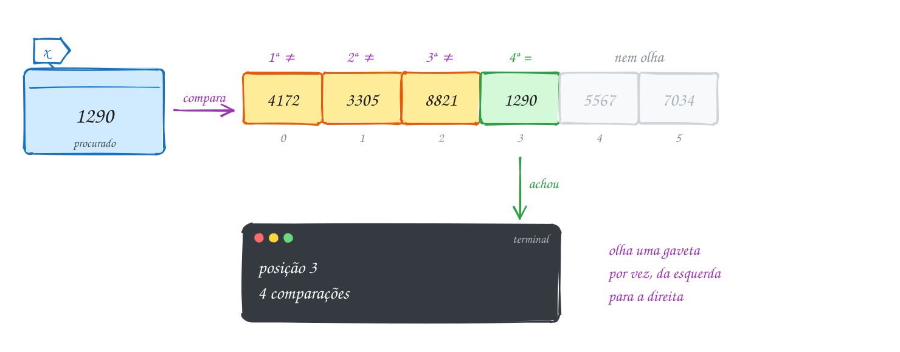</p>

A função conta as comparações num ponteiro:

```c
#include <stdio.h>

// devolve o índice de x em v[0..n-1], ou -1 se x não estiver lá
int busca(const int v[], int n, int x, int *comparacoes) {
    *comparacoes = 0;
    for (int i = 0; i < n; i++) {
        (*comparacoes)++;
        if (v[i] == x) {
            return i; // achou: para na hora
        }
    }
    return -1; // olhou todos e não achou
}

int main(void) {
    int matriculas[] = {4172, 3305, 8821, 1290, 5567, 7034};
    int n = sizeof matriculas / sizeof matriculas[0];
    int comparacoes;

    int pos = busca(matriculas, n, 1290, &comparacoes);
    printf("1290: posição %d, %d comparações\n", pos, comparacoes);

    pos = busca(matriculas, n, 9999, &comparacoes);
    printf("9999: posição %d, %d comparações\n", pos, comparacoes);
    return 0;
}
// Saída:
// 1290: posição 3, 4 comparações
// 9999: posição -1, 6 comparações
```

### Passo a passo

Teste de mesa da busca por 1290, uma linha por volta do laço:

| i | v[i] | `v[i] == 1290`? | comparações | estado da gaveta |
| --- | --- | --- | --- | --- |
| 0 | 4172 | não | 1 | amarela (olhada) |
| 1 | 3305 | não | 2 | amarela |
| 2 | 8821 | não | 3 | amarela |
| 3 | 1290 | **sim** | 4 | verde: `return 3` |
| 4 | 5567 | | | cinza (nem olhada) |
| 5 | 7034 | | | cinza |

Para 9999, as 6 linhas seriam "não" e a função só devolve `-1` depois da
última.

O fluxograma faz duas perguntas por volta: `i < n?` protege o vetor e
`v[i] == x?` é a busca de fato. O caminho verde dá a volta três vezes antes de
sair pelo Sim:

<p align="center">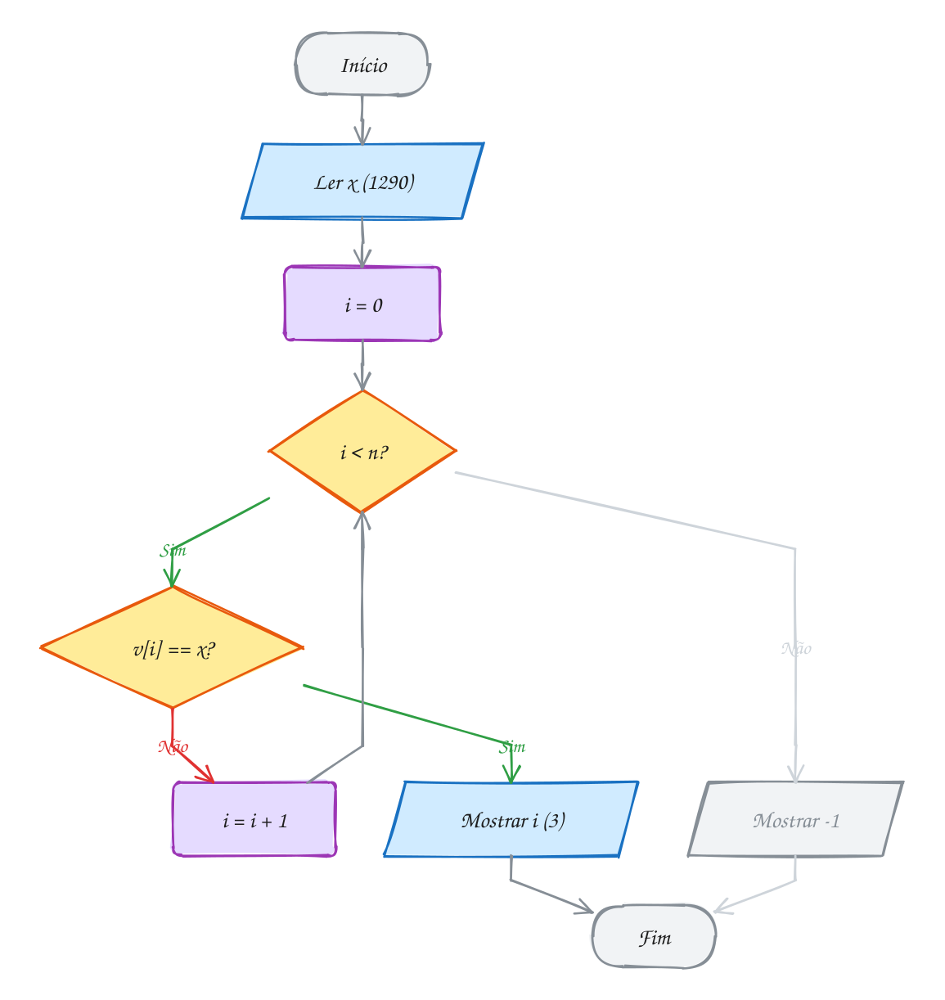</p>

> [!WARNING]
> Com `if (v[i] == x) return i; else return -1;` dentro do laço, a função olha
> só o primeiro elemento e desiste. "Não achei" só vale **depois** do laço.

> [!TIP]
> A **sentinela** copia a chave para uma gaveta extra no fim do vetor, e o laço
> deixa de testar `i < n`: uma pergunta a menos por volta (exemplo A178).

> [!NOTE]
> **Pergunta para você:** se a matrícula 3305 aparecesse nas posições 1 e 4,
> qual posição a função devolveria? E quantas comparações ela faria para achar
> 7034? O exemplo A177 mostra como achar todas as ocorrências.

### Hora de praticar

**Exemplo A177 · Quantas vezes o aluno passou na catraca**

```c
#include <stdio.h>

// procura x a partir da posição inicio; devolve o índice ou -1
int busca_a_partir(const int v[], int n, int x, int inicio, int *comparacoes) {
    for (int i = inicio; i < n; i++) {
        (*comparacoes)++;
        if (v[i] == x) {
            return i;
        }
    }
    return -1;
}

int main(void) {
    // registro do dia: cada número é uma passagem pela catraca, em ordem
    int passagens[] = {3305, 4172, 3305, 8821, 1290, 3305, 7034, 4172};
    int n = sizeof passagens / sizeof passagens[0];
    int procuradas[] = {3305, 1290, 5567};

    for (int k = 0; k < 3; k++) {
        int x = procuradas[k];
        int comparacoes = 0, vezes = 0;
        printf("%d passou nas posições:", x);
        // cada achado vira o ponto de partida da próxima busca
        int pos = busca_a_partir(passagens, n, x, 0, &comparacoes);
        while (pos != -1) {
            printf(" %d", pos);
            vezes++;
            pos = busca_a_partir(passagens, n, x, pos + 1, &comparacoes);
        }
        printf("%s -> %d vez(es), %d comparações\n",
               vezes == 0 ? " nenhuma" : "", vezes, comparacoes);
    }
    return 0;
}
// Saída:
// 3305 passou nas posições: 0 2 5 -> 3 vez(es), 8 comparações
// 1290 passou nas posições: 4 -> 1 vez(es), 8 comparações
// 5567 passou nas posições: nenhuma -> 0 vez(es), 8 comparações
```

```bash
gcc ~/LPEDC/material/A177.c -o ~/LPEDC/material/A177 && ~/LPEDC/material/A177
```

**Exemplo A178 · A sentinela no fim da fila**

```c
#include <stdio.h>

#define N 6

// busca comum: a cada volta, duas perguntas (i < n? e v[i] == x?)
int busca_comum(const int v[], int n, int x, int *perguntas) {
    *perguntas = 0;
    for (int i = 0; i < n; i++) {
        *perguntas += 2;          // i < n  e  v[i] == x
        if (v[i] == x) {
            return i;
        }
    }
    *perguntas += 1;              // o último i < n, que deu falso
    return -1;
}

// busca com sentinela: v precisa ter uma gaveta livre em v[n]
int busca_sentinela(int v[], int n, int x, int *perguntas) {
    v[n] = x;                     // a sentinela: agora o laço sempre acha
    int i = 0;
    *perguntas = 1;               // o primeiro v[i] != x
    while (v[i] != x) {
        i++;
        (*perguntas)++;
    }
    (*perguntas)++;               // i < n: achou a de verdade ou a sentinela?
    return i < n ? i : -1;
}

int main(void) {
    int matriculas[N + 1] = {4172, 3305, 8821, 1290, 5567, 7034}; // v[6] fica livre
    int procuradas[] = {4172, 7034, 9999};
    int p1, p2;

    printf("chave  posição  comum  sentinela\n");
    for (int k = 0; k < 3; k++) {
        int x = procuradas[k];
        int pos = busca_comum(matriculas, N, x, &p1);
        busca_sentinela(matriculas, N, x, &p2);
        printf("%5d  %7d  %5d  %9d\n", x, pos, p1, p2);
    }
    return 0;
}
// Saída:
// chave  posição  comum  sentinela
//  4172        0      2          2
//  7034        5     12          7
//  9999       -1     13          8
```

```bash
gcc ~/LPEDC/material/A178.c -o ~/LPEDC/material/A178 && ~/LPEDC/material/A178
```

#### Exercícios

**Exercício E529** · ★☆☆

O extrato do Pix do mês tem estes valores, em reais, do mais antigo para o
mais recente: 50, 120, 35, 50, 80, 50, 15. Você quer achar a ÚLTIMA
transação de R$ 50 (a mais recente). Escreva a função


```text
int ultima_ocorrencia(const int v[], int n, int x, int *comparacoes)
```


que devolve o índice da última ocorrência de x (ou -1) e conta as
comparações. Procure de um jeito que pare assim que achar. Teste com 50 e
com 200.


```text
Saída esperada:
Última de R$ 50: posição 5 (2 comparações)
Última de R$ 200: posição -1 (7 comparações)
```

```bash
gcc ~/LPEDC/material/E529.c -o ~/LPEDC/material/E529 && ~/LPEDC/material/E529
```

**Exercício E531** · ★★☆

A tabela de preços de uma loja está em ordem crescente:
12, 19, 25, 31, 38, 44, 52, 60, 73, 89. Escreva duas funções que devolvem o
índice (ou -1) e contam quantos elementos olharam:


```text
busca: a busca sequencial comum;
busca_ordenada: aproveita a ordem e desiste assim que encontra um preço
MAIOR que o procurado.
```


Teste as duas com R$ 47 (não existe) e R$ 60.


```text
Saída esperada:
R$ 47: comum -1 (10 olhados), ordenada -1 (7 olhados)
R$ 60: comum 7 (8 olhados), ordenada 7 (8 olhados)
```

```bash
gcc ~/LPEDC/material/E531.c -o ~/LPEDC/material/E531 && ~/LPEDC/material/E531
```

**Exercício E532** · ★★☆

O estoque do mercadinho é um vetor de structs:


```text
typedef struct { int codigo; char nome[20]; double preco; } Produto;
```


```text
{1010, "Arroz 5kg", 27.50}, {2050, "Café 500g", 18.90},
{3300, "Feijão 1kg", 8.40}, {4120, "Leite 1L", 5.20}
```


Escreva Produto *busca_produto(Produto v[], int n, int codigo), que devolve
o ENDEREÇO do produto dentro do vetor (ou NULL). No main, busque 2050,
mostre o produto e dê um reajuste de 10% pelo ponteiro devolvido. Depois
mostre estoque[1] direto do vetor e busque 9999.


```text
Saída esperada:
2050 Café 500g R$ 18.90
No vetor: Café 500g R$ 20.79
9999: não cadastrado
```

```bash
gcc ~/LPEDC/material/E532.c -o ~/LPEDC/material/E532 && ~/LPEDC/material/E532
```

**Exercício E534** · ★★★

Na agenda do celular você liga muito mais para umas pessoas do que para
outras. Uma heurística antiga é o MOVER PARA A FRENTE: toda vez que a busca
acha um contato, ele vai para a posição 0 e os anteriores andam uma casa.

Agenda inicial: "Chefe", "Banco", "Pizzaria", "Ana", "Mãe".
Acessos, nessa ordem: Mãe, Ana, Mãe, Mãe, Pizzaria, Mãe.

Mostre a agenda depois de cada acesso e compare o total de comparações com
uma busca que nunca mexe na agenda.


```text
Saída esperada:
Mãe -> Mãe Chefe Banco Pizzaria Ana
Ana -> Ana Mãe Chefe Banco Pizzaria
Mãe -> Mãe Ana Chefe Banco Pizzaria
Mãe -> Mãe Ana Chefe Banco Pizzaria
Pizzaria -> Pizzaria Mãe Ana Chefe Banco
Mãe -> Mãe Pizzaria Ana Chefe Banco
Sem mover: 27 comparações
Movendo para a frente: 20 comparações
```

```bash
gcc ~/LPEDC/material/E534.c -o ~/LPEDC/material/E534 && ~/LPEDC/material/E534
```

---

## 0090 · Busca binária

No jogo "pensei num número de 1 a 100", quem chuta 1, 2, 3... pode precisar de
100 tentativas. Quem chuta 50, ouve "menor", chuta 25 e assim por diante,
acerta em no máximo 7.

A **busca binária** é esse jogo num vetor **ordenado**. Olhe a gaveta do meio:
se ela tem a chave, acabou; se a chave é maior, descarte a esquerda; se é
menor, descarte a direita. Cada pergunta joga fora metade do que sobrou.

O código guarda o pedaço que ainda pode ter a chave entre `ini` e `fim` (os
dois inclusive). É um **invariante** (assunto 0073): "se `x` está no vetor,
está em `v[ini..fim]`". Quando `ini` passa de `fim`, o intervalo está vazio e a
resposta é `-1`.

Com 15 elementos sobram 15, 7, 3, 1: no máximo **4** voltas. Com um milhão, 20.
É o **O(log n)** do assunto 0072: quando `n` dobra, a busca ganha uma volta. O
pior caso é ⌊log₂ n⌋ + 1 voltas. A pré-condição é o preço: num vetor
bagunçado, a busca responde errado sem avisar.

O catálogo do atacadão tem 15 códigos em ordem e você procura o 216. O meio
(índice 7) tem 189, menor: a esquerda fica cinza. O novo meio (11) tem 245,
maior: a direita sai. Na terceira volta, o meio (9) é o 216:

<p align="center">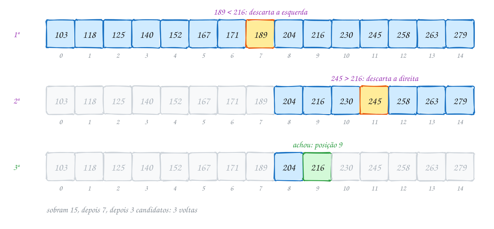</p>

Um `printf` mostra o intervalo de cada volta:

```c
#include <stdio.h>

// v está em ordem crescente; devolve o índice de x ou -1
int busca_binaria(const int v[], int n, int x, int *voltas) {
    int ini = 0, fim = n - 1;
    *voltas = 0;
    while (ini <= fim) {              // ainda sobra alguém no intervalo
        int meio = ini + (fim - ini) / 2;
        (*voltas)++;
        printf("  ini=%2d fim=%2d meio=%2d v[meio]=%d\n", ini, fim, meio, v[meio]);
        if (v[meio] == x) {
            return meio;
        }
        if (v[meio] < x) {
            ini = meio + 1;           // x só pode estar à direita
        } else {
            fim = meio - 1;           // x só pode estar à esquerda
        }
    }
    return -1;
}

int main(void) {
    int codigos[] = {103, 118, 125, 140, 152, 167, 171, 189,
                     204, 216, 230, 245, 258, 263, 279};
    int n = sizeof codigos / sizeof codigos[0];
    int voltas;

    printf("Procurando 216:\n");
    int pos = busca_binaria(codigos, n, 216, &voltas);
    printf("posição %d em %d voltas\n", pos, voltas);

    printf("Procurando 150:\n");
    pos = busca_binaria(codigos, n, 150, &voltas);
    printf("posição %d em %d voltas\n", pos, voltas);
    return 0;
}
// Saída:
// Procurando 216:
//   ini= 0 fim=14 meio= 7 v[meio]=189
//   ini= 8 fim=14 meio=11 v[meio]=245
//   ini= 8 fim=10 meio= 9 v[meio]=216
// posição 9 em 3 voltas
// Procurando 150:
//   ini= 0 fim=14 meio= 7 v[meio]=189
//   ini= 0 fim= 6 meio= 3 v[meio]=140
//   ini= 4 fim= 6 meio= 5 v[meio]=167
//   ini= 4 fim= 4 meio= 4 v[meio]=152
// posição -1 em 4 voltas
```

### Passo a passo

A busca por 150, que não está no catálogo:

| volta | ini | fim | meio | v[meio] | decisão |
| --- | --- | --- | --- | --- | --- |
| 1 | 0 | 14 | 7 | 189 | 189 > 150: `fim = 6` |
| 2 | 0 | 6 | 3 | 140 | 140 < 150: `ini = 4` |
| 3 | 4 | 6 | 5 | 167 | 167 > 150: `fim = 4` |
| 4 | 4 | 4 | 4 | 152 | 152 > 150: `fim = 3` |
| fim | 4 | 3 | | | `ini > fim`: devolve `-1` |

O `ini = 4` final é a posição em que o 150 **deveria** entrar para manter a
ordem (exemplo A180).

O fluxograma tem três perguntas por volta, e a volta mexe em `ini` **ou** em
`fim`, nunca nos dois:

<p align="center">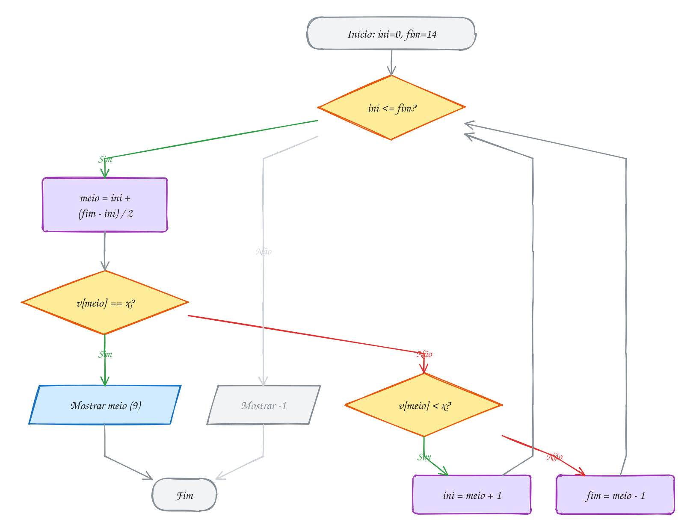</p>

> [!WARNING]
> Busca binária é famosa por erros de um. Com o intervalo fechado `[ini, fim]`,
> `while (ini < fim)` deixa de olhar o último candidato e `fim = meio` pode
> nunca encolher. Escolha um estilo (fechado, como acima, ou semiaberto
> `[ini, fim)`, como no A180) e siga as regras dele.

> [!TIP]
> Use `ini + (fim - ini) / 2`, e não `(ini + fim) / 2`: com mais de 1 bilhão de
> elementos, `ini + fim` passa de `INT_MAX` e causa **overflow**.

> [!NOTE]
> **Pergunta para você:** quantas voltas o código dá para achar o 103, o
> primeiro do catálogo? E qual é o máximo de voltas para 1000 elementos? Faça o
> teste de mesa antes de executar.

### Hora de praticar

**Exemplo A179 · Um milhão de notas fiscais**

```c
#include <stdio.h>

#define N 1000000

int sequencial(const int v[], int n, int x, long *passos) {
    *passos = 0;
    for (int i = 0; i < n; i++) {
        (*passos)++;
        if (v[i] == x) {
            return i;
        }
    }
    return -1;
}

int binaria(const int v[], int n, int x, long *passos) {
    int ini = 0, fim = n - 1;
    *passos = 0;
    while (ini <= fim) {
        int meio = ini + (fim - ini) / 2;
        (*passos)++;
        if (v[meio] == x) {
            return meio;
        }
        if (v[meio] < x) {
            ini = meio + 1;
        } else {
            fim = meio - 1;
        }
    }
    return -1;
}

int main(void) {
    static int notas[N];              // 4 MB: static, fora da pilha
    for (int i = 0; i < N; i++) {
        notas[i] = 500000 + 3 * i;    // números das notas, em ordem crescente
    }
    // a primeira, uma do meio, a última e uma que não existe
    int procuradas[] = {500000, 2000000, 3499997, 2000001};
    long ps, pb;

    printf("    nota   posição  sequencial  binária\n");
    for (int k = 0; k < 4; k++) {
        int pos = sequencial(notas, N, procuradas[k], &ps);
        binaria(notas, N, procuradas[k], &pb);
        printf("%8d  %8d  %10ld  %7ld\n", procuradas[k], pos, ps, pb);
    }
    return 0;
}
// Saída (a binária nunca passa de 20 voltas: 2^20 > 1 milhão):
//     nota   posição  sequencial  binária
//   500000         0           1       19
//  2000000    500000      500001       19
//  3499997    999999     1000000       20
//  2000001        -1     1000000       20
```

```bash
gcc ~/LPEDC/material/A179.c -o ~/LPEDC/material/A179 && ~/LPEDC/material/A179
```

**Exemplo A180 · Em qual faixa de frete cai o pacote?**

```c
#include <stdio.h>

// devolve a primeira posição com limite[i] >= peso (ou n, se nenhuma serve).
// Intervalo semiaberto [ini, fim): fim aponta uma gaveta DEPOIS do fim.
int primeira_faixa(const double limite[], int n, double peso, int *voltas) {
    int ini = 0, fim = n;
    *voltas = 0;
    while (ini < fim) {
        int meio = ini + (fim - ini) / 2;
        (*voltas)++;
        if (limite[meio] < peso) {
            ini = meio + 1;   // essa faixa é pequena demais
        } else {
            fim = meio;       // essa serve; talvez uma anterior também sirva
        }
    }
    return ini;
}

int main(void) {
    double limite[] = {1, 2, 5, 10, 20, 30};                    // até X kg
    double preco[] = {12.90, 18.50, 27.00, 39.90, 59.90, 84.00};
    int n = 6;
    double pesos[] = {7.5, 2.0, 0.3, 31.0};
    int voltas;

    for (int k = 0; k < 4; k++) {
        int f = primeira_faixa(limite, n, pesos[k], &voltas);
        if (f < n) {
            printf("%4.1f kg: faixa até %2.0f kg, R$ %5.2f (%d voltas)\n",
                   pesos[k], limite[f], preco[f], voltas);
        } else {
            printf("%4.1f kg: acima do limite (%d voltas)\n", pesos[k], voltas);
        }
    }
    return 0;
}
// Saída:
//  7.5 kg: faixa até 10 kg, R$ 39.90 (3 voltas)
//  2.0 kg: faixa até  2 kg, R$ 18.50 (3 voltas)
//  0.3 kg: faixa até  1 kg, R$ 12.90 (3 voltas)
// 31.0 kg: acima do limite (2 voltas)
```

```bash
gcc ~/LPEDC/material/A180.c -o ~/LPEDC/material/A180 && ~/LPEDC/material/A180
```

#### Exercícios

**Exercício E535** · ★☆☆

Os armários livres do vestiário estão numa lista ordenada:
4, 9, 13, 21, 30, 38, 47, 55, 62. Escreva void procura(const int v[], int
n, int x), uma busca binária que mostra cada volta (ini, fim, meio e o
valor do meio) e, no fim, a posição achada ou a mensagem de falha, sempre
com o total de voltas. No "não achou", mostre também os valores de ini e
fim que pararam o laço. Procure 47, 5 e 62.


```text
Saída esperada:
Procurando 47
ini=0 fim=8 meio=4 (30)
ini=5 fim=8 meio=6 (47)
achou na posição 6 em 2 voltas
Procurando 5
ini=0 fim=8 meio=4 (30)
ini=0 fim=3 meio=1 (9)
ini=0 fim=0 meio=0 (4)
não achou em 3 voltas (parou com ini=1 fim=0)
Procurando 62
ini=0 fim=8 meio=4 (30)
ini=5 fim=8 meio=6 (47)
ini=7 fim=8 meio=7 (55)
ini=8 fim=8 meio=8 (62)
achou na posição 8 em 4 voltas
```

```bash
gcc ~/LPEDC/material/E535.c -o ~/LPEDC/material/E535 && ~/LPEDC/material/E535
```

**Exercício E537** · ★★☆

As avaliações de um app (de 1 a 5 estrelas) já estão ordenadas:


```text
1, 1, 2, 3, 3, 3, 3, 4, 4, 5, 5, 5
```


Para cada nota de 1 a 5, mostre em que posições ela aparece e quantas vezes,
usando DUAS buscas binárias por nota (nada de percorrer o vetor contando):
uma acha a primeira posição com valor >= nota, a outra a primeira posição
com valor > nota.


```text
Saída esperada:
Nota 1: posições 0 a 1, 2 avaliações
Nota 2: posições 2 a 2, 1 avaliação
Nota 3: posições 3 a 6, 4 avaliações
Nota 4: posições 7 a 8, 2 avaliações
Nota 5: posições 9 a 11, 3 avaliações
```

```bash
gcc ~/LPEDC/material/E537.c -o ~/LPEDC/material/E537 && ~/LPEDC/material/E537
```

**Exercício E538** · ★★☆

Busca binária também funciona com strings, desde que estejam em ordem.
Escreva int busca_nome(const char *v[], int n, const char *nome, int *voltas)
e teste com as capitais abaixo, procurando "Natal" e "Palmas":


```text
"Aracaju", "Belém", "Boa Vista", "Cuiabá", "Curitiba", "Florianópolis",
"Fortaleza", "Goiânia", "Maceió", "Manaus", "Natal", "Recife",
"Salvador", "São Paulo", "Teresina", "Vitória"
```


```text
Saída esperada:
Natal: posição 10 (4 voltas)
Palmas: posição -1 (4 voltas)
```

```bash
gcc ~/LPEDC/material/E538.c -o ~/LPEDC/material/E538 && ~/LPEDC/material/E538
```

**Exercício E540** · ★★★

Busca binária não precisa de vetor: basta uma pergunta de sim ou não que
muda de resposta uma única vez. Um terreno quadrado tem que caber numa área
de A m². Qual o maior lado INTEIRO possível? Ou seja: o maior L com
L * L <= A. Sem sqrt: faça uma busca binária no intervalo de 0 a A e conte
as voltas. Teste com 50, 1000000, 2147395600 e 2147483647.


```text
Saída esperada:
50 m²: lado 7 m (6 voltas)
1000000 m²: lado 1000 m (20 voltas)
2147395600 m²: lado 46340 m (31 voltas)
2147483647 m²: lado 46340 m (31 voltas)
```

```bash
gcc ~/LPEDC/material/E540.c -o ~/LPEDC/material/E540 && ~/LPEDC/material/E540
```

---

## 0091 · Bubble sort

No app de delivery, cinco restaurantes prometem entregar em 42, 17, 35, 8 e 23
minutos. Para mostrá-los do mais rápido ao mais lento, o vetor precisa estar
**ordenado**.

O **bubble sort** (ordenação por bolha) compara **vizinhos**, `v[j]` com
`v[j + 1]`, e troca os dois se o da esquerda for maior. Uma varredura é uma
**passada**.

Em cada passada, o maior elemento vai parar na última gaveta. Daí vêm duas
regras:

- **n - 1 passadas bastam**: com os `n - 1` maiores no lugar, o que sobra já
  está na frente;
- a passada `k` não olha as últimas `k - 1` gavetas: o laço interno vai até
  `j < n - passada`.

A **bandeira** (`bool trocou`) dá uma terceira: passada sem troca significa
vetor ordenado, e o laço para.

No pior caso (vetor ao contrário), são `(n - 1) + (n - 2) + ... + 1 =
n(n - 1)/2` comparações, todas viram trocas: **O(n²)**. No melhor caso (vetor
em ordem, com bandeira), uma passada de `n - 1` comparações: **O(n)**.

Na passada 1 o 42 afunda até o fim (verde). Na 2, o 35 acha o seu lugar. Na
3, o 8 chega à frente. A passada 4 não troca nada e a bandeira encerra:

<p align="center"></p>

O código conta comparações e trocas:

```c
#include <stdio.h>
#include <stdbool.h>

void mostra(const int v[], int n) {
    for (int i = 0; i < n; i++) {
        printf("%3d", v[i]);
    }
    printf("\n");
}

void bubble_sort(int v[], int n) {
    int comparacoes = 0, trocas = 0;
    for (int passada = 1; passada < n; passada++) {
        bool trocou = false;
        // os últimos passada-1 já estão no lugar: nem olha
        for (int j = 0; j < n - passada; j++) {
            comparacoes++;
            if (v[j] > v[j + 1]) {      // vizinhos fora de ordem: troca
                int aux = v[j];
                v[j] = v[j + 1];
                v[j + 1] = aux;
                trocas++;
                trocou = true;
            }
        }
        printf("passada %d:", passada);
        mostra(v, n);
        if (!trocou) {
            break;                      // nenhuma troca: já está ordenado
        }
    }
    printf("%d comparações, %d trocas\n", comparacoes, trocas);
}

int main(void) {
    int minutos[] = {42, 17, 35, 8, 23};
    int n = 5;

    printf("início:   ");
    mostra(minutos, n);
    bubble_sort(minutos, n);
    return 0;
}
// Saída:
// início:    42 17 35  8 23
// passada 1: 17 35  8 23 42
// passada 2: 17  8 23 35 42
// passada 3:  8 17 23 35 42
// passada 4:  8 17 23 35 42
// 10 comparações, 7 trocas
```

### Passo a passo

A passada 1 por dentro; em negrito, o par comparado:

| j | antes | `v[j] > v[j+1]`? | depois |
| --- | --- | --- | --- |
| 0 | **42 17** 35 8 23 | sim, troca | 17 42 35 8 23 |
| 1 | 17 **42 35** 8 23 | sim, troca | 17 35 42 8 23 |
| 2 | 17 35 **42 8** 23 | sim, troca | 17 35 8 42 23 |
| 3 | 17 35 8 **42 23** | sim, troca | 17 35 8 23 42 |

Somando as quatro passadas: 4 + 3 + 2 + 1 = **10 comparações** e
4 + 2 + 1 + 0 = **7 trocas**. Esse 7 é o número de **inversões** do vetor
original, os pares na ordem errada (42 com 17, 35, 8 e 23; 17 com 8; 35 com 8
e 23). Cada troca de vizinhos desfaz uma inversão.

O laço de dentro (`j`) faz uma passada; o de fora repete enquanto a bandeira
indicar troca:

<p align="center">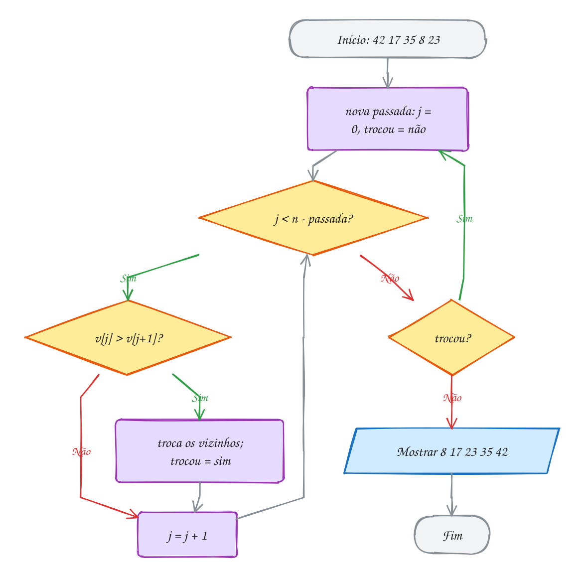</p>

> [!WARNING]
> `v[j] = v[j + 1]; v[j + 1] = v[j];` não troca nada: os dois ficam iguais.
> Use uma variável auxiliar. Com `j < n` no laço interno, a última volta lê
> `v[n]`, fora do vetor.

> [!TIP]
> O bubble faz uma troca por inversão (cerca de `n²/4` num vetor aleatório):
> serve para aprender, não para código real.

> [!NOTE]
> **Pergunta para você:** quantas passadas o bubble com bandeira faz no vetor
> `8 17 23 35 42`, que já está ordenado? E em `17 23 35 42 8`, com o menor no
> fim?

### Hora de praticar

**Exemplo A181 · Anagramas: borbulhando as letras**

```c
#include <stdio.h>
#include <stdbool.h>
#include <string.h>

// ordena as letras da string s com bubble sort (char também é número)
void ordena_letras(char s[], bool mostrar) {
    int n = (int) strlen(s);          // o '\0' do fim fica fora
    bool trocou = true;
    for (int passada = 1; passada < n && trocou; passada++) {
        trocou = false;
        for (int j = 0; j < n - passada; j++) {
            if (s[j] > s[j + 1]) {    // compara os códigos das letras
                char aux = s[j];
                s[j] = s[j + 1];
                s[j + 1] = aux;
                trocou = true;
            }
        }
        if (mostrar) {
            printf("  passada %d: %s\n", passada, s);
        }
    }
}

bool anagramas(const char *a, const char *b, bool mostrar) {
    char x[32], y[32];
    if (strlen(a) != strlen(b) || strlen(a) >= sizeof x) {
        return false;
    }
    strcpy(x, a);                     // ordena cópias: as originais ficam intactas
    strcpy(y, b);
    ordena_letras(x, mostrar);
    ordena_letras(y, false);
    return strcmp(x, y) == 0;         // mesmas letras ordenadas = anagramas
}

int main(void) {
    printf("ordenando \"pernambuco\":\n");
    bool r = anagramas("pernambuco", "cobrapenum", true);
    printf("pernambuco / cobrapenum: %s\n", r ? "anagramas" : "não");
    printf("amor / roma: %s\n", anagramas("amor", "roma", false) ? "anagramas" : "não");
    printf("pato / topo: %s\n", anagramas("pato", "topo", false) ? "anagramas" : "não");
    return 0;
}
// Saída (a passada 7 não troca nada: a bandeira encerra):
// ordenando "pernambuco":
//   passada 1: epnambrcou
//   passada 2: enambpcoru
//   passada 3: eambncopru
//   passada 4: aebmcnopru
//   passada 5: abecmnopru
//   passada 6: abcemnopru
//   passada 7: abcemnopru
// pernambuco / cobrapenum: anagramas
// amor / roma: anagramas
// pato / topo: não
```

```bash
gcc ~/LPEDC/material/A181.c -o ~/LPEDC/material/A181 && ~/LPEDC/material/A181
```

**Exemplo A182 · A bandeirinha que economiza passadas**

```c
#include <stdio.h>
#include <stdbool.h>

// versão básica: sempre faz todas as passadas
int bubble_basico(int v[], int n) {
    int comparacoes = 0;
    for (int passada = 1; passada < n; passada++) {
        for (int j = 0; j < n - passada; j++) {
            comparacoes++;
            if (v[j] > v[j + 1]) {
                int aux = v[j];
                v[j] = v[j + 1];
                v[j + 1] = aux;
            }
        }
    }
    return comparacoes;
}

// com a bandeira: para na primeira passada sem troca
int bubble_bandeira(int v[], int n) {
    int comparacoes = 0;
    bool trocou = true;
    for (int passada = 1; passada < n && trocou; passada++) {
        trocou = false;
        for (int j = 0; j < n - passada; j++) {
            comparacoes++;
            if (v[j] > v[j + 1]) {
                int aux = v[j];
                v[j] = v[j + 1];
                v[j + 1] = aux;
                trocou = true;
            }
        }
    }
    return comparacoes;
}

int main(void) {
    // ranking quase em ordem: só o último está fora do lugar
    int a[] = {12, 15, 21, 30, 34, 47, 52, 49};
    int b[] = {12, 15, 21, 30, 34, 47, 52, 49};
    // ao contrário: o pior caso
    int c[] = {52, 49, 47, 34, 30, 21, 15, 12};
    int d[] = {52, 49, 47, 34, 30, 21, 15, 12};

    printf("quase ordenado: básico %d, com bandeira %d\n",
           bubble_basico(a, 8), bubble_bandeira(b, 8));
    printf("invertido:      básico %d, com bandeira %d\n",
           bubble_basico(c, 8), bubble_bandeira(d, 8));
    return 0;
}
// Saída:
// quase ordenado: básico 28, com bandeira 13
// invertido:      básico 28, com bandeira 28
```

```bash
gcc ~/LPEDC/material/A182.c -o ~/LPEDC/material/A182 && ~/LPEDC/material/A182
```

#### Exercícios

**Exercício E541** · ★☆☆

No bolão da firma, os pontos de seis participantes são 18, 31, 7, 25, 31 e
12. Ordene com bubble sort (com a bandeira) em ordem DECRESCENTE, do líder
para o lanterna, e mostre o ranking.


```text
Saída esperada:
Ranking: 31 31 25 18 12 7
```

```bash
gcc ~/LPEDC/material/E541.c -o ~/LPEDC/material/E541 && ~/LPEDC/material/E541
```

**Exercício E543** · ★★☆

A turma de natação tem as idades 34, 19, 27, 45 e 22. Escreva um bubble
sort em ordem crescente, trocando com uma variável auxiliar. Mostre o
vetor ao fim de cada passada e, no fim, o total de trocas.


```text
Saída esperada:
passada 1: 19 27 34 22 45
passada 2: 19 27 22 34 45
passada 3: 19 22 27 34 45
passada 4: 19 22 27 34 45
5 trocas
```

```bash
gcc ~/LPEDC/material/E543.c -o ~/LPEDC/material/E543 && ~/LPEDC/material/E543
```

**Exercício E544** · ★★☆

Monte a tabela do campeonato. Cada time é uma struct:


```text
typedef struct { char nome[16]; int pontos; int vitorias; } Time;
```


```text
{"Fortaleza", 68, 19}, {"Flamengo", 70, 20}, {"Botafogo", 79, 23},
{"Palmeiras", 70, 21}, {"Inter", 65, 18}
```


Ordene com bubble sort: mais pontos primeiro; empatou nos pontos, mais
vitórias primeiro. Escreva uma função bool vem_depois(const Time *a,
const Time *b) com o critério e use-a no lugar do ">" do bubble.


```text
Saída esperada:
1º Botafogo   79 pts 23 vit
2º Palmeiras  70 pts 21 vit
3º Flamengo   70 pts 20 vit
4º Fortaleza  68 pts 19 vit
5º Inter      65 pts 18 vit
```

```bash
gcc ~/LPEDC/material/E544.c -o ~/LPEDC/material/E544 && ~/LPEDC/material/E544
```

**Exercício E545** · ★★★

O bubble tem um ponto fraco: elemento pequeno no fim (uma "tartaruga") anda
só UMA casa para a esquerda por passada. No vetor 2, 3, 4, 5, 6, 7, 8, 1, o
1 precisa de 7 passadas para chegar à frente.

O SHAKER SORT (coqueteleira) alterna o sentido: uma passada de ida
(esquerda para a direita, leva o maior para o fim) e uma de volta (direita
para a esquerda, traz o menor para a frente). Implemente o bubble com
bandeira e o shaker, conte passadas (ida e volta contam uma cada) e
comparações, e compare no vetor acima.


```text
Saída esperada:
bubble: 7 passadas, 28 comparações
shaker: 3 passadas, 18 comparações
resultado: 1 2 3 4 5 6 7 8
```

```bash
gcc ~/LPEDC/material/E545.c -o ~/LPEDC/material/E545 && ~/LPEDC/material/E545
```

---

## 0092 · Selection sort

Final da bateria de kart: os tempos da melhor volta, em segundos, foram 58, 31,
47, 19 e 26. Para montar o pódio, você procura o **menor** tempo, que é o
primeiro lugar.
Depois procura o menor entre os que **sobraram**, e assim por diante.

Esse é o **selection sort** (ordenação por seleção). O vetor tem uma parte
**pronta** à esquerda (os menores, na ordem final) e o resto à direita. Cada
passada `i`:

1. procura o **índice** do menor elemento em `v[i..n-1]`;
2. troca esse menor com `v[i]`. A gaveta `i` nunca mais muda.

Guarda-se o **índice**, não o valor, para poder trocar no fim (padrão
"maior/menor" do assunto 0025).

São `n(n - 1)/2` comparações em **todos** os casos, porque achar o menor exige
olhar todos os que sobraram: **O(n²)**, mesmo com o vetor em ordem. A
vantagem são as **trocas**: no máximo **uma por passada**, `n - 1` no total,
contra até `n(n - 1)/2` do bubble. Pesa quando mover um elemento é caro.

Cada linha é uma passada: a gaveta roxa é a posição `i`, a amarela é o menor
achado. Depois da troca, a gaveta vira verde e fica:

<p align="center">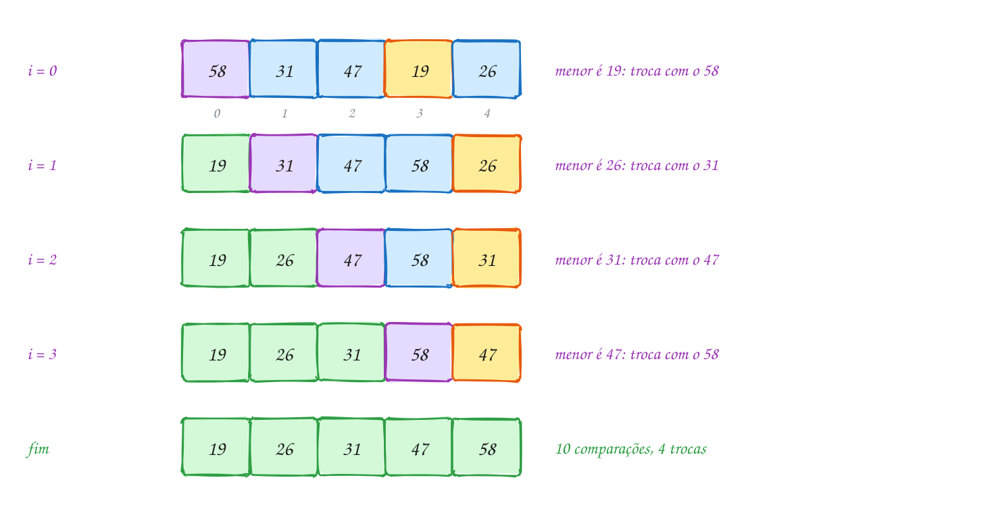</p>

Em C:

```c
#include <stdio.h>

void mostra(const int v[], int n) {
    for (int i = 0; i < n; i++) {
        printf("%3d", v[i]);
    }
    printf("\n");
}

void selection_sort(int v[], int n) {
    int comparacoes = 0, trocas = 0;
    for (int i = 0; i < n - 1; i++) {
        int menor = i;                    // índice do menor de v[i..n-1]
        for (int j = i + 1; j < n; j++) {
            comparacoes++;
            if (v[j] < v[menor]) {
                menor = j;
            }
        }
        if (menor != i) {                 // uma troca só por passada
            int aux = v[i];
            v[i] = v[menor];
            v[menor] = aux;
            trocas++;
        }
        printf("i = %d:  ", i);
        mostra(v, n);
    }
    printf("%d comparações, %d trocas\n", comparacoes, trocas);
}

int main(void) {
    int tempos[] = {58, 31, 47, 19, 26}; // segundos por volta
    int n = 5;

    printf("início: ");
    mostra(tempos, n);
    selection_sort(tempos, n);
    return 0;
}
// Saída:
// início:  58 31 47 19 26
// i = 0:   19 31 47 58 26
// i = 1:   19 26 47 58 31
// i = 2:   19 26 31 58 47
// i = 3:   19 26 31 47 58
// 10 comparações, 4 trocas
```

### Passo a passo

A passada `i = 0`. O `menor` começa na gaveta 0:

| j | v[j] | v[menor] antes | `v[j] < v[menor]`? | menor |
| --- | --- | --- | --- | --- |
| | | | | 0 (58) |
| 1 | 31 | 58 | sim | 1 (31) |
| 2 | 47 | 31 | não | 1 |
| 3 | 19 | 31 | sim | 3 (19) |
| 4 | 26 | 19 | não | 3 |

Fim da passada: troca `v[0]` (58) com `v[3]` (19), depois de quatro comparações.
As passadas seguintes fazem 3, 2 e 1 comparações: 10 no total.

No fluxograma, a caixa "acha o menor" esconde um laço inteiro (a tabela). A
troca fica **fora** dele:

<p align="center">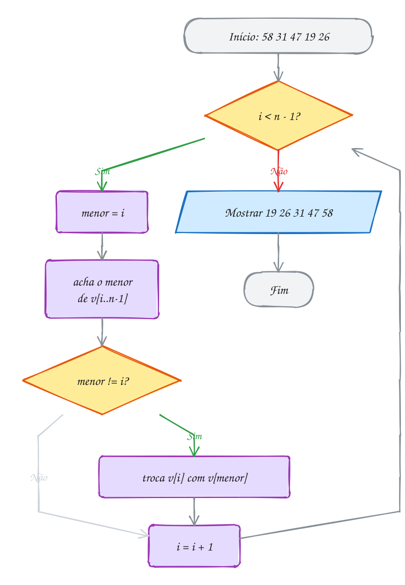</p>

> [!WARNING]
> Trocar **dentro** do laço que procura o menor ordena o vetor, mas perde a
> vantagem das poucas trocas. Esquecer de reiniciar `menor = i` a cada passada
> faz `menor` apontar para a parte pronta.

> [!TIP]
> A troca é de **longa distância** (o 19 salta da gaveta 3 para a 0), por isso
> o selection é **instável**: iguais podem trocar de ordem (exemplo A184). Ele
> ordena **in-place**, com **O(1)** de memória extra.

> [!NOTE]
> **Pergunta para você:** quantas comparações e quantas trocas o selection faz
> no vetor `19 26 31 47 58`, que já está ordenado? E o bubble com bandeira?

### Hora de praticar

**Exemplo A183 · Selection não se importa com a ordem de entrada**

```c
#include <stdio.h>

// selection sort que devolve comparações e trocas
void selection_sort(int v[], int n, int *comparacoes, int *trocas) {
    *comparacoes = 0;
    *trocas = 0;
    for (int i = 0; i < n - 1; i++) {
        int menor = i;
        for (int j = i + 1; j < n; j++) {
            (*comparacoes)++;           // o laço de dentro roda inteiro, sempre
            if (v[j] < v[menor]) {
                menor = j;
            }
        }
        if (menor != i) {
            int aux = v[i];
            v[i] = v[menor];
            v[menor] = aux;
            (*trocas)++;
        }
    }
}

void testa(const char *nome, int v[], int n) {
    int c, t;
    selection_sort(v, n, &c, &t);
    printf("%-11s %2d comparações, %d trocas\n", nome, c, t);
}

int main(void) {
    // pesos de caixas de mudança (kg): trocar caixa é caro, olhar é barato
    int ordenado[] = {5, 8, 12, 20, 25, 31};
    int invertido[] = {31, 25, 20, 12, 8, 5};
    int misturado[] = {20, 5, 31, 8, 25, 12};
    int menor_no_fim[] = {8, 12, 20, 25, 31, 5};

    testa("ordenado:", ordenado, 6);
    testa("invertido:", invertido, 6);
    testa("misturado:", misturado, 6);
    testa("5 no fim:", menor_no_fim, 6);
    return 0;
}
// Saída (comparações: sempre 5+4+3+2+1 = 15; trocas: nunca mais que n - 1 = 5):
// ordenado:   15 comparações, 0 trocas
// invertido:  15 comparações, 3 trocas
// misturado:  15 comparações, 3 trocas
// 5 no fim:   15 comparações, 5 trocas
```

```bash
gcc ~/LPEDC/material/A183.c -o ~/LPEDC/material/A183 && ~/LPEDC/material/A183
```

**Exemplo A184 · A troca que passa por cima**

```c
#include <stdio.h>

typedef struct {
    int nota;
    char nome[8];
} Aluno;

void mostra(const Aluno v[], int n) {
    for (int i = 0; i < n; i++) {
        printf(" %d-%s", v[i].nota, v[i].nome);
    }
    printf("\n");
}

// selection sort por nota
void selection_sort(Aluno v[], int n) {
    for (int i = 0; i < n - 1; i++) {
        int menor = i;
        for (int j = i + 1; j < n; j++) {
            if (v[j].nota < v[menor].nota) {
                menor = j;
            }
        }
        if (menor != i) {
            Aluno aux = v[i];
            v[i] = v[menor];
            v[menor] = aux;
        }
    }
}

int main(void) {
    // em ordem alfabética: Ana antes de Bia
    Aluno turma[] = {{7, "Ana"}, {7, "Bia"}, {5, "Caio"}};

    printf("antes: ");
    mostra(turma, 3);
    selection_sort(turma, 3);
    printf("depois:");
    mostra(turma, 3);
    printf("Bia passou na frente de Ana: a ordem dos empatados mudou.\n");
    return 0;
}
// Saída:
// antes:  7-Ana 7-Bia 5-Caio
// depois: 5-Caio 7-Bia 7-Ana
// Bia passou na frente de Ana: a ordem dos empatados mudou.
```

```bash
gcc ~/LPEDC/material/A184.c -o ~/LPEDC/material/A184 && ~/LPEDC/material/A184
```

#### Exercícios

**Exercício E547** · ★☆☆

Uma variação do selection: em vez de procurar o MENOR e pôr na frente,
procure o MAIOR e ponha no FIM. A parte pronta cresce pela direita. Ordene
os preços 89, 45, 120, 30, 75, 60 e mostre o vetor depois de cada passada
(fim é a gaveta que recebe o maior).


```text
Saída esperada:
fim = 5: 89 45 60 30 75 120
fim = 4: 75 45 60 30 89 120
fim = 3: 30 45 60 75 89 120
fim = 2: 30 45 60 75 89 120
fim = 1: 30 45 60 75 89 120
```

```bash
gcc ~/LPEDC/material/E547.c -o ~/LPEDC/material/E547 && ~/LPEDC/material/E547
```

**Exercício E549** · ★★☆

Monte a lista de chamada em ordem alfabética com selection sort. Os nomes
ficam em const char *alunos[] = {"Rafael", "Ana", "Lucas", "Beatriz",
"Diego", "Carla"}. Não copie letras: troque só os PONTEIROS. Mostre a lista
numerada e quantas trocas foram feitas.


```text
Saída esperada:
1. Ana
2. Beatriz
3. Carla
4. Diego
5. Lucas
6. Rafael
5 trocas de ponteiro
```

```bash
gcc ~/LPEDC/material/E549.c -o ~/LPEDC/material/E549 && ~/LPEDC/material/E549
```

**Exercício E550** · ★★☆

Um site de passagens achou 8 voos: R$ 420, 315, 689, 298, 512, 350, 275 e
601. A tela só mostra os 3 MAIS BARATOS. Ordenar tudo é desperdício: o
selection coloca um menor no lugar por passada, então bastam 3 passadas.
Escreva int k_menores(int v[], int n, int k), que faz só as k primeiras
passadas e devolve quantas comparações fez.


```text
Saída esperada:
3 mais baratas: R$ 275, R$ 298, R$ 315
18 comparações (ordenar tudo custaria 28)
```

```bash
gcc ~/LPEDC/material/E550.c -o ~/LPEDC/material/E550 && ~/LPEDC/material/E550
```

**Exercício E552** · ★★★

Os produtos de uma loja têm uma descrição de 200 bytes, então cada struct
é pesada de mover:


```text
typedef struct { int codigo; double preco; char descricao[200]; } Produto;
```


```text
{11, 249.90, "Fone sem fio"}, {12, 89.90, "Mouse"},
{13, 1299.00, "Monitor 24"}, {14, 159.90, "Teclado"},
{15, 49.90, "Mousepad"}
```


Mostre os produtos do mais barato ao mais caro SEM mexer no vetor loja.
Truque: crie int ordem[5] = {0, 1, 2, 3, 4} e ordene ESSE vetor com
selection sort, comparando loja[ordem[j]].preco. É a ORDENAÇÃO INDIRETA.
(O 216 é o tamanho do Produto numa máquina de 64 bits comum.)


```text
Saída esperada:
Do mais barato ao mais caro:
15 Mousepad      R$   49.90
12 Mouse         R$   89.90
14 Teclado       R$  159.90
11 Fone sem fio  R$  249.90
13 Monitor 24    R$ 1299.00
loja[0] continua sendo: Fone sem fio
3 trocas de 4 bytes, em vez de 216 bytes
```

```bash
gcc ~/LPEDC/material/E552.c -o ~/LPEDC/material/E552 && ~/LPEDC/material/E552
```

---

## 0093 · Insertion sort

Numa rodada de buraco, você recebe as cartas uma a uma: 7, 4, 9, 2, 5. Cada
carta nova é **encaixada** no lugar certo da mão, que já está em ordem.

Esse é o **insertion sort** (ordenação por inserção). A parte pronta é
`v[0..j-1]`, **em ordem entre si** (no selection, a parte pronta já estava no
lugar final). A cada passo:

1. guarde a próxima carta, `x = v[j]`;
2. ande para a esquerda empurrando uma casa para a direita cada elemento
   **maior** que `x` (um **deslocamento**, não uma troca);
3. ao achar alguém menor ou igual (ou o começo), ponha `x` em `v[i + 1]`.

Guardar `x` antes é obrigatório: o primeiro deslocamento escreve por cima de
`v[j]`.

Cada deslocamento desfaz uma inversão, como a troca do bubble, mas custa uma
escrita, não três. No pior caso (vetor ao contrário): `n(n - 1)/2`
comparações, **O(n²)**. No melhor (já ordenado): `n - 1`, **O(n)**. É o melhor
dos três simples; bibliotecas o usam para pedaços de 16 a 32 posições.

Cada linha é uma carta nova: verde é a mão arrumada, amarela é a carta que
entrou. O 9 não anda; o 2 atravessa a mão inteira:

<p align="center"></p>

A função `maior` só conta as comparações:

```c
#include <stdio.h>
#include <stdbool.h>

static int comparacoes = 0;

// a > b, contando a comparação
bool maior(int a, int b) {
    comparacoes++;
    return a > b;
}

void mostra(const int v[], int n) {
    for (int i = 0; i < n; i++) {
        printf("%3d", v[i]);
    }
    printf("\n");
}

void insertion_sort(int v[], int n) {
    int deslocamentos = 0;
    for (int j = 1; j < n; j++) {
        int x = v[j];                   // a carta que vai ser encaixada
        int i = j - 1;
        while (i >= 0 && maior(v[i], x)) {
            v[i + 1] = v[i];            // abre espaço: empurra para a direita
            deslocamentos++;
            i--;
        }
        v[i + 1] = x;                   // encaixa no buraco
        printf("j = %d (x = %d):", j, x);
        mostra(v, n);
    }
    printf("%d comparações, %d deslocamentos\n", comparacoes, deslocamentos);
}

int main(void) {
    int mao[] = {7, 4, 9, 2, 5};
    int n = 5;

    printf("início:       ");
    mostra(mao, n);
    insertion_sort(mao, n);
    return 0;
}
// Saída:
// início:         7  4  9  2  5
// j = 1 (x = 4):  4  7  9  2  5
// j = 2 (x = 9):  4  7  9  2  5
// j = 3 (x = 2):  2  4  7  9  5
// j = 4 (x = 5):  2  4  5  7  9
// 8 comparações, 6 deslocamentos
```

### Passo a passo

O encaixe do 2 (`j = 3`), o mais caro. A mão antes é `4 7 9 | 2 5`:

| i | v[i] | `v[i] > 2`? | o que acontece | vetor |
| --- | --- | --- | --- | --- |
| 2 | 9 | sim | `v[3] = 9` | 4 7 9 9 5 |
| 1 | 7 | sim | `v[2] = 7` | 4 7 7 9 5 |
| 0 | 4 | sim | `v[1] = 4` | 4 4 7 9 5 |
| -1 | | (`i >= 0` falso: nem compara) | `v[0] = 2` | 2 4 7 9 5 |

Foram três comparações e três deslocamentos. Somando todos os encaixes:
1 + 1 + 3 + 3 = **8 comparações** e 1 + 0 + 3 + 2 = **6 deslocamentos**.

O laço de dentro para por dois motivos: acabou o vetor ou achou alguém que
não é maior:

<p align="center"></p>

> [!WARNING]
> Escreva `while (i >= 0 && v[i] > x)`. Na ordem inversa, com `i = -1` o
> programa lê `v[-1]`. O curto-circuito do `&&` (assunto 0013) protege o vetor.

> [!TIP]
> O insertion sort é **estável**: o `>` (e não `>=`) para ao encontrar um
> igual, e `x` entra depois dele. Também é **online**: ordena à medida que os
> dados chegam.

> [!NOTE]
> **Pergunta para você:** se a condição fosse `v[i] >= x`, o vetor continuaria
> saindo ordenado? Quantos deslocamentos o código faria? E com dois elementos
> iguais? (O A185 mostra por que isso importa.)

### Hora de praticar

**Exemplo A185 · A triagem que respeita a ordem de chegada**

```c
#include <stdio.h>

typedef struct {
    char nome[10];
    int chegada;      // ordem em que entrou no pronto-socorro
    int prioridade;   // 1 = urgente, 2 = pouco urgente, 3 = não urgente
} Paciente;

// insertion sort por prioridade: só empurra quem é ESTRITAMENTE maior
void ordena_triagem(Paciente v[], int n) {
    for (int j = 1; j < n; j++) {
        Paciente x = v[j];              // a struct inteira é copiada
        int i = j - 1;
        while (i >= 0 && v[i].prioridade > x.prioridade) {
            v[i + 1] = v[i];
            i--;
        }
        v[i + 1] = x;                   // para atrás de quem tem a mesma prioridade
    }
}

int main(void) {
    Paciente fila[] = {
        {"Rita", 1, 3}, {"Paulo", 2, 2}, {"Joana", 3, 1},
        {"Caio", 4, 3}, {"Lia", 5, 1}, {"Beto", 6, 2},
    };
    int n = 6;

    ordena_triagem(fila, n);
    for (int k = 0; k < n; k++) {
        printf("prioridade %d: %-6s (chegou em %dº)\n",
               fila[k].prioridade, fila[k].nome, fila[k].chegada);
    }
    return 0;
}
// Saída (empatados na prioridade continuam na ordem de chegada: é estável):
// prioridade 1: Joana  (chegou em 3º)
// prioridade 1: Lia    (chegou em 5º)
// prioridade 2: Paulo  (chegou em 2º)
// prioridade 2: Beto   (chegou em 6º)
// prioridade 3: Rita   (chegou em 1º)
// prioridade 3: Caio   (chegou em 4º)
```

```bash
gcc ~/LPEDC/material/A185.c -o ~/LPEDC/material/A185 && ~/LPEDC/material/A185
```

**Exemplo A186 · Quase em ordem custa quase nada**

```c
#include <stdio.h>

// insertion sort que devolve as comparações e os deslocamentos
void insertion_sort(int v[], int n, int *comparacoes, int *deslocamentos) {
    *comparacoes = 0;
    *deslocamentos = 0;
    for (int j = 1; j < n; j++) {
        int x = v[j];
        int i = j - 1;
        while (i >= 0) {
            (*comparacoes)++;
            if (v[i] <= x) {
                break;                  // achou o lugar: para de empurrar
            }
            v[i + 1] = v[i];
            (*deslocamentos)++;
            i--;
        }
        v[i + 1] = x;
    }
}

void testa(const char *nome, int v[], int n) {
    int c, d;
    insertion_sort(v, n, &c, &d);
    printf("%-15s %2d comparações, %2d deslocamentos\n", nome, c, d);
}

int main(void) {
    // senhas de atendimento, n = 8
    int ordenado[] = {10, 20, 30, 40, 50, 60, 70, 80};
    int quase[] = {10, 20, 40, 30, 50, 60, 80, 70};  // dois pares trocados
    int invertido[] = {80, 70, 60, 50, 40, 30, 20, 10};

    testa("ordenado:", ordenado, 8);
    testa("quase ordenado:", quase, 8);
    testa("invertido:", invertido, 8);
    return 0;
}
// Saída:
// ordenado:        7 comparações,  0 deslocamentos
// quase ordenado:  9 comparações,  2 deslocamentos
// invertido:      28 comparações, 28 deslocamentos
```

```bash
gcc ~/LPEDC/material/A186.c -o ~/LPEDC/material/A186 && ~/LPEDC/material/A186
```

#### Exercícios

**Exercício E553** · ★☆☆

As notas de redação de cinco candidatos foram 650, 720, 580, 810 e 690.
Ordene com insertion sort em ordem DECRESCENTE (a maior primeiro) e mostre a
classificação.


```text
Saída esperada:
Classificação: 810 720 690 650 580
```

```bash
gcc ~/LPEDC/material/E553.c -o ~/LPEDC/material/E553 && ~/LPEDC/material/E553
```

**Exercício E555** · ★★☆

O fliperama guarda os 5 maiores recordes, do maior para o menor. Hoje o
ranking tem 4: 9800, 8750, 7200, 6100. Escreva


```text
void novo_recorde(int top[], int *n, int cap, int pontos)
```


que encaixa a nova pontuação no lugar certo, como UM passo do insertion
sort. Se o ranking já está cheio (n == cap), o último sai; se a pontuação
não supera o último de um ranking cheio, ela nem entra. Teste com 7500,
4000 e 9900, nessa ordem, e mostre o ranking depois de cada uma.


```text
Saída esperada:
7500: 9800 8750 7500 7200 6100
4000: não entrou no ranking
9900: 9900 9800 8750 7500 7200
```

```bash
gcc ~/LPEDC/material/E555.c -o ~/LPEDC/material/E555 && ~/LPEDC/material/E555
```

**Exercício E556** · ★★☆

Os pedidos de uma lanchonete chegam com o tempo de preparo, em minutos:
6, 3, 8, 3, 1. Escreva


```text
int ordena(int v[], int n, bool maior_ou_igual, bool mostrar)
```


com insertion sort crescente. Ela devolve o total de deslocamentos. Com
maior_ou_igual falso, o while desloca quando v[i] > x; com verdadeiro,
quando v[i] >= x. Com mostrar verdadeiro, imprime uma linha por encaixe.
No main, ordene o vetor com > (mostrando) e uma cópia com >= (sem
mostrar), e imprima os dois totais.


```text
Saída esperada:
j = 1 (x = 3 entrou na posição 0): 3 6 8 3 1 (deslocou 1)
j = 2 (x = 8 entrou na posição 2): 3 6 8 3 1 (deslocou 0)
j = 3 (x = 3 entrou na posição 1): 3 3 6 8 1 (deslocou 2)
j = 4 (x = 1 entrou na posição 0): 1 3 3 6 8 (deslocou 4)
total com >: 7
total com >=: 8
```

```bash
gcc ~/LPEDC/material/E556.c -o ~/LPEDC/material/E556 && ~/LPEDC/material/E556
```

**Exercício E557** · ★★★

As idades do grupo de corrida são 31, 12, 45, 27, 8 e 19. Escreva um
insertion sort crescente que mostra o vetor depois de cada encaixe e, no
fim, conta as comparações e os deslocamentos. Cuidado com o limite: teste
i >= 0 ANTES de ler v[i]. Conte uma comparação a cada v[i] <= x testado.


```text
Saída esperada:
j = 1: 12 31 45 27 8 19
j = 2: 12 31 45 27 8 19
j = 3: 12 27 31 45 8 19
j = 4: 8 12 27 31 45 19
j = 5: 8 12 19 27 31 45
13 comparações, 10 deslocamentos
```

```bash
gcc ~/LPEDC/material/E557.c -o ~/LPEDC/material/E557 && ~/LPEDC/material/E557
```

---

## 0094 · Merge sort

Duas monitoras entregam pilhas de provas, cada uma já em ordem de nota. Para
montar uma pilha só, você olha o topo das duas, pega a menor nota e repete.
Quando uma acaba, a outra vai inteira para o fim.

Juntar duas sequências ordenadas numa só é a **intercalação** (*merge*). Cada
comparação manda **um** elemento para o resultado, então juntar `n` elementos
custa no máximo `n - 1` comparações (exemplo A188).

O **merge sort** (ordenação por intercalação) usa **dividir e conquistar**:

1. **divida** o vetor ao meio;
2. **ordene** cada metade, com o próprio merge sort (recursão, assunto 0032);
3. **intercale** as duas metades ordenadas.

O caso base é o pedaço com 0 ou 1 elemento. O código usa o intervalo
**semiaberto** `[p, r)`: o pedaço tem `r - p` elementos e as metades `[p, q)`
e `[q, r)` se encaixam sem repetir ninguém. O Cormen usa o intervalo fechado
`A[p..r]`: muda a conta dos índices, não o algoritmo.

Dividir ao meio dá `log₂ n` níveis (8 elementos: 3 níveis), e em **cada**
nível as intercalações passam pelos `n` elementos: **O(n log n)** em **todos**
os casos. O preço é um vetor auxiliar (o **rascunho**): **O(n)** de memória
extra.

As notas descem divididas até pedaços de 1 e sobem intercaladas (verde):

<p align="center"></p>

O rascunho `w` é alocado **uma vez** no `main` e serve a todas as
intercalações:

```c
#include <stdio.h>
#include <stdlib.h>

static int comparacoes = 0;

// junta v[p..q-1] e v[q..r-1], já ordenados, usando w como rascunho
void intercala(int v[], int w[], int p, int q, int r) {
    int i = p, j = q, k = 0;
    while (i < q && j < r) {            // as duas metades ainda têm cartas
        comparacoes++;
        if (v[i] <= v[j]) {             // <= mantém a ordem dos iguais
            w[k++] = v[i++];
        } else {
            w[k++] = v[j++];
        }
    }
    while (i < q) w[k++] = v[i++];      // sobrou só a esquerda
    while (j < r) w[k++] = v[j++];      // sobrou só a direita
    for (k = 0; k < r - p; k++) {
        v[p + k] = w[k];                // devolve para o lugar
    }
    printf("intercala [%d, %d):", p, r);
    for (k = p; k < r; k++) printf(" %d", v[k]);
    printf("\n");
}

// ordena v[p..r-1] (intervalo semiaberto)
void merge_sort(int v[], int w[], int p, int r) {
    if (r - p < 2) {
        return;                         // 0 ou 1 elemento: já está ordenado
    }
    int q = p + (r - p) / 2;
    merge_sort(v, w, p, q);             // ordena a metade esquerda
    merge_sort(v, w, q, r);             // ordena a metade direita
    intercala(v, w, p, q, r);           // junta as duas
}

int main(void) {
    int notas[] = {52, 18, 33, 7, 41, 26, 60, 12};
    int n = 8;
    int *w = malloc(n * sizeof *w);     // um rascunho só, para todas as intercalações
    if (w == NULL) {
        return 1;
    }

    merge_sort(notas, w, 0, n);
    printf("%d comparações\n", comparacoes);
    free(w);
    return 0;
}
// Saída:
// intercala [0, 2): 18 52
// intercala [2, 4): 7 33
// intercala [0, 4): 7 18 33 52
// intercala [4, 6): 26 41
// intercala [6, 8): 12 60
// intercala [4, 8): 12 26 41 60
// intercala [0, 8): 7 12 18 26 33 41 52 60
// 17 comparações
```

A recursão termina a metade esquerda (`[0, 4)`) antes da direita (assunto
0031).

### Passo a passo

A última intercalação, `7 18 33 52` com `12 26 41 60`. `i` anda na esquerda,
`j` na direita:

| comparação | v[i] | v[j] | vai para o rascunho | rascunho |
| --- | --- | --- | --- | --- |
| 1 | 7 | 12 | 7 (esquerda) | 7 |
| 2 | 18 | 12 | 12 (direita) | 7 12 |
| 3 | 18 | 26 | 18 (esquerda) | 7 12 18 |
| 4 | 33 | 26 | 26 (direita) | 7 12 18 26 |
| 5 | 33 | 41 | 33 (esquerda) | ... 26 33 |
| 6 | 52 | 41 | 41 (direita) | ... 33 41 |
| 7 | 52 | 60 | 52 (esquerda) | ... 41 52 |
| | (esquerda acabou) | 60 | 60, sem comparar | ... 52 60 |

Sete comparações para 8 elementos, o máximo (`n - 1`). Somando os níveis:
4 + 6 + 7 = **17 comparações**. No fluxograma, cada caixa `merge_sort` repete
o fluxograma inteiro para uma metade:

<p align="center">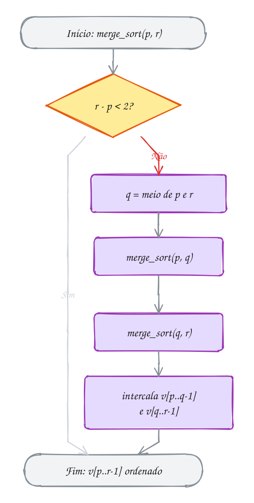</p>

> [!WARNING]
> Com o intervalo semiaberto, o caso base é `r - p < 2`. Com
> `if (p >= r) return;`, um pedaço de 1 elemento passa direto e
> `merge_sort(v, w, q, r)` recebe o mesmo pedaço para sempre: **estouro de
> pilha**. Misturar intervalo fechado e semiaberto dá o mesmo erro.

> [!TIP]
> O `<=` da intercalação pega o da **esquerda** em caso de empate: o merge
> sort é **estável**. A memória que pesa é o rascunho (1 milhão de `int` são
> 4 MB).

> [!NOTE]
> **Pergunta para você:** quantas comparações o código faria com as notas já em
> ordem, `7 12 18 26 33 41 52 60`? Pense na intercalação em que a metade
> esquerda inteira é menor que a direita.

### Hora de praticar

**Exemplo A187 · Merge sort sem recursão, de baixo para cima**

```c
#include <stdio.h>
#include <stdlib.h>

// junta v[p..q-1] e v[q..r-1], já ordenados, usando w como rascunho
void intercala(int v[], int w[], int p, int q, int r) {
    int i = p, j = q, k = 0;
    while (i < q && j < r) {
        w[k++] = (v[i] <= v[j]) ? v[i++] : v[j++];
    }
    while (i < q) w[k++] = v[i++];
    while (j < r) w[k++] = v[j++];
    for (k = 0; k < r - p; k++) {
        v[p + k] = w[k];
    }
}

void mostra(const int v[], int n) {
    for (int i = 0; i < n; i++) printf(" %d", v[i]);
    printf("\n");
}

int main(void) {
    int tempos[] = {41, 17, 33, 8, 52, 26, 12};   // 7: não é potência de 2
    int n = 7;
    int *w = malloc(n * sizeof *w);
    if (w == NULL) {
        return 1;
    }

    printf("início:     ");
    mostra(tempos, n);
    // blocos de 1 viram blocos de 2, que viram de 4, que viram de 8...
    for (int largura = 1; largura < n; largura *= 2) {
        for (int p = 0; p < n - largura; p += 2 * largura) {
            int q = p + largura;
            int r = p + 2 * largura;
            if (r > n) {
                r = n;                  // o último bloco pode ser mais curto
            }
            intercala(tempos, w, p, q, r);
        }
        printf("blocos de %d:", 2 * largura);
        mostra(tempos, n);
    }
    free(w);
    return 0;
}
// Saída (o 12 fica sozinho até a última rodada; 3 rodadas = log2 de 8):
// início:      41 17 33 8 52 26 12
// blocos de 2: 17 41 8 33 26 52 12
// blocos de 4: 8 17 33 41 12 26 52
// blocos de 8: 8 12 17 26 33 41 52
```

```bash
gcc ~/LPEDC/material/A187.c -o ~/LPEDC/material/A187 && ~/LPEDC/material/A187
```

**Exemplo A188 · Os pedidos das duas lojas numa fila só**

```c
#include <stdio.h>

// junta a[0..na-1] e b[0..nb-1], já ordenados, em c; devolve as comparações
int intercala(const int a[], int na, const int b[], int nb, int c[]) {
    int i = 0, j = 0, k = 0, comparacoes = 0;
    while (i < na && j < nb) {
        comparacoes++;
        if (a[i] <= b[j]) {
            c[k++] = a[i++];
        } else {
            c[k++] = b[j++];
        }
    }
    while (i < na) c[k++] = a[i++];   // uma das duas acabou:
    while (j < nb) c[k++] = b[j++];   // o resto da outra vem direto
    return comparacoes;
}

int main(void) {
    // horários dos pedidos (hhmm), cada loja já em ordem
    int loja_a[] = {812, 905, 1047, 1320};
    int loja_b[] = {750, 930, 1015, 1100, 1405};
    int todos[9];

    int c = intercala(loja_a, 4, loja_b, 5, todos);
    for (int k = 0; k < 9; k++) {
        printf("%s%02d:%02d", k > 0 ? " " : "", todos[k] / 100, todos[k] % 100);
    }
    printf("\n%d comparações para juntar 9 pedidos\n", c);
    return 0;
}
// Saída:
// 07:50 08:12 09:05 09:30 10:15 10:47 11:00 13:20 14:05
// 8 comparações para juntar 9 pedidos
```

```bash
gcc ~/LPEDC/material/A188.c -o ~/LPEDC/material/A188 && ~/LPEDC/material/A188
```

#### Exercícios

**Exercício E559** · ★☆☆

Duas turmas fizeram a mesma prova e cada professora mandou as notas em
ordem: turma A = 45, 60, 75, 90 e turma B = 50, 60, 85, 95, 98. Escreva


```text
int intercala(const int a[], int na, const int b[], int nb, int c[])
```


que junta as duas listas, em ordem, no vetor c e devolve quantas
comparações fez. Mostre o resultado.


```text
Saída esperada:
Notas: 45 50 60 60 75 85 90 95 98
7 comparações
```

```bash
gcc ~/LPEDC/material/E559.c -o ~/LPEDC/material/E559 && ~/LPEDC/material/E559
```

**Exercício E561** · ★★☆

A academia tem duas listas de presença, cada uma em ordem de matrícula e
sem repetidos dentro dela:


```text
manhã: 1021, 1034, 1050, 1077, 1090
tarde: 1010, 1034, 1066, 1077, 1095, 1102
```


Monte, numa passada só (estilo intercalação), a lista de alunos DIFERENTES
que treinaram no dia, em ordem, e conte quantos foram nos dois turnos.


```text
Saída esperada:
9 alunos diferentes: 1010 1021 1034 1050 1066 1077 1090 1095 1102
foram nos dois turnos: 2
```

```bash
gcc ~/LPEDC/material/E561.c -o ~/LPEDC/material/E561 && ~/LPEDC/material/E561
```

**Exercício E562** · ★★☆

A fila de pedidos de uma padaria chegou nesta ordem:


```text
typedef struct { char cliente[8]; int valor; } Pedido;
{"Ana", 50}, {"Bruno", 30}, {"Carla", 50}, {"Davi", 30}, {"Eva", 20}
```


Ordene por valor com merge sort (adapte o código do assunto para Pedido) e
mostre a fila. Quem empatou no valor deve continuar na ordem de chegada
(Bruno antes de Davi, Ana antes de Carla). Para ver o papel do <= da
intercalação, dê à intercala (e ao merge_sort) um parâmetro bool estavel:
verdadeiro compara com <=, falso compara com <. Ordene duas cópias da fila,
uma de cada jeito, e mostre as duas.


```text
Saída esperada:
com <=: Eva 20, Bruno 30, Davi 30, Ana 50, Carla 50
com <:  Eva 20, Davi 30, Bruno 30, Carla 50, Ana 50
```

```bash
gcc ~/LPEDC/material/E562.c -o ~/LPEDC/material/E562 && ~/LPEDC/material/E562
```

**Exercício E564** · ★★★

Ana e Bia ranquearam as mesmas 8 séries. Numerando as séries pela ordem da
Bia, o ranking da Ana fica: 3, 1, 7, 2, 8, 4, 6, 5. Quanto mais INVERSÕES
(pares fora de ordem) esse vetor tem, mais os gostos discordam. É assim que
sites de recomendação medem "pessoas parecidas com você".

Contar inversões com dois laços é O(n²). Faça em O(n log n) pegando carona
no merge sort: durante a intercalação, toda vez que um elemento da metade
DIREITA sai antes, ele estava invertido com todos os que ainda restam na
esquerda. Mostre o resultado do jeito rápido e confira com a força bruta.


```text
Saída esperada:
força bruta: 10 discordâncias
merge sort:  10 discordâncias
de 28 pares possíveis
```

```bash
gcc ~/LPEDC/material/E564.c -o ~/LPEDC/material/E564 && ~/LPEDC/material/E564
```

---

## 0095 · Quick sort

Black Friday: 7 fones de R$ 35, 12, 48, 7, 29, 51 e 20. Você escolhe o de
R$ 20 e faz dois montes: os que custam até 20 de um lado, os mais caros do
outro. O de 20 já está no lugar certo.

Esse é o **quick sort**, inventado por Tony Hoare em 1960. O elemento escolhido
é o **pivô**, e o passo de fazer os montes é a **separação** (ou
**partição**):

1. escolha o pivô (aqui, o **último** do pedaço, `v[r]`);
2. **separe**: rearranje o pedaço para ficar `menores ou iguais | pivô |
   maiores`. O pivô cai na sua posição **final**, `j`;
3. ordene, com o próprio quick sort, `v[p..j-1]` e `v[j+1..r]`.

No merge sort o trabalho está em juntar; aqui está em dividir, e juntar é
de graça. Não precisa de rascunho.

A separação de **Lomuto** (a `PARTITION` do Cormen) anda com `k` pelo pedaço e
mantém `j` na fronteira: tudo em `v[p..j-1]` é `<=` pivô. Achou um `<=` pivô?
Troca com `v[j]` e avança `j`. No fim, troca o pivô com `v[j]`. A de **Hoare**
(Ziviani, Tenenbaum) usa dois índices vindos das pontas.

O custo depende do pivô. Perto do meio, corta em metades: **O(n log n)**.
Sempre o menor ou o maior, um monte fica vazio e o outro com `n - 1`: **O(n²)**.
Com o pivô no fim, isso ocorre no vetor **já ordenado** (exemplo A190). Em
dados embaralhados, é O(n log n) na média.

O 20 (roxo) separa o vetor e fica verde, no lugar. Cada lado escolhe o seu pivô:

<p align="center">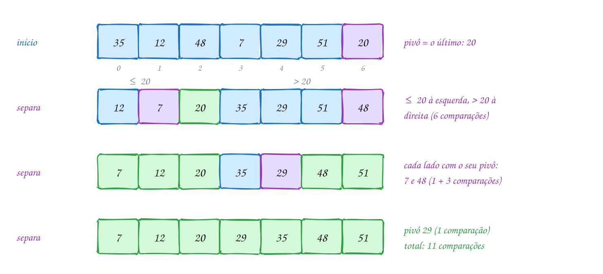</p>

Em C:

```c
#include <stdio.h>

static int comparacoes = 0;

void troca(int *a, int *b) {
    int aux = *a;
    *a = *b;
    *b = aux;
}

// separa v[p..r] em torno do pivô v[r]: menores ou iguais à esquerda,
// maiores à direita. Devolve a posição final do pivô.
int separa(int v[], int p, int r) {
    int pivo = v[r];
    int j = p;                          // v[p..j-1] são os <= pivô
    for (int k = p; k < r; k++) {
        comparacoes++;
        if (v[k] <= pivo) {
            troca(&v[j], &v[k]);
            j++;
        }
    }
    troca(&v[j], &v[r]);                // o pivô vai para o meio deles
    return j;
}

// ordena v[p..r] (intervalo fechado)
void quick_sort(int v[], int p, int r) {
    if (p >= r) {
        return;                         // 0 ou 1 elemento
    }
    int j = separa(v, p, r);
    printf("pivô %d foi para a posição %d:", v[j], j);
    for (int i = p; i <= r; i++) printf(" %d", v[i]);
    printf("\n");
    quick_sort(v, p, j - 1);            // o pivô já está no lugar:
    quick_sort(v, j + 1, r);            // fica fora das duas chamadas
}

int main(void) {
    int precos[] = {35, 12, 48, 7, 29, 51, 20};
    int n = 7;

    quick_sort(precos, 0, n - 1);
    printf("resultado:");
    for (int i = 0; i < n; i++) printf(" %d", precos[i]);
    printf("\n%d comparações\n", comparacoes);
    return 0;
}
// Saída:
// pivô 20 foi para a posição 2: 12 7 20 35 29 51 48
// pivô 7 foi para a posição 0: 7 12
// pivô 48 foi para a posição 5: 35 29 48 51
// pivô 29 foi para a posição 3: 29 35
// resultado: 7 12 20 29 35 48 51
// 11 comparações
```

### Passo a passo

A primeira separação, com pivô 20. `k` anda; `j` marca onde entra o próximo
"pequeno":

| k | v[k] | `v[k] <= 20`? | ação | vetor | j |
| --- | --- | --- | --- | --- | --- |
| | | | | 35 12 48 7 29 51 **20** | 0 |
| 0 | 35 | não | nada | 35 12 48 7 29 51 20 | 0 |
| 1 | 12 | sim | troca v[0] e v[1] | 12 35 48 7 29 51 20 | 1 |
| 2 | 48 | não | nada | 12 35 48 7 29 51 20 | 1 |
| 3 | 7 | sim | troca v[1] e v[3] | 12 7 48 35 29 51 20 | 2 |
| 4 | 29 | não | nada | 12 7 48 35 29 51 20 | 2 |
| 5 | 51 | não | nada | 12 7 48 35 29 51 20 | 2 |
| fim | | | troca v[2] e o pivô | 12 7 **20** 35 29 51 48 | 2 |

Seis comparações. Depois vêm `[12 7]` (1), `[35 29 51 48]` (3) e `[35 29]`
(1): **11 comparações**. O pivô fica fora das duas chamadas, e por isso o
problema sempre diminui:

<p align="center">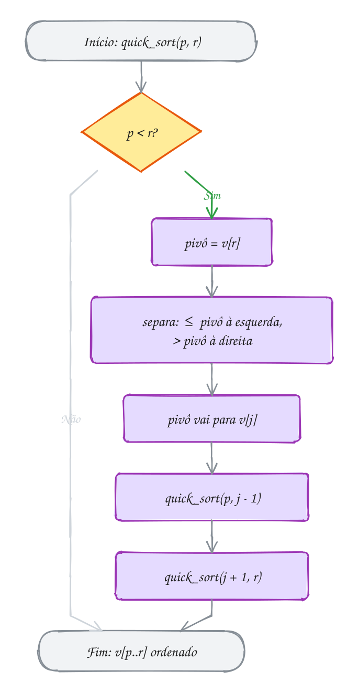</p>

> [!WARNING]
> Com `quick_sort(v, p, j)`, o pivô entra de novo no pedaço da esquerda. Se ele
> é o maior (`j == r`), a chamada recebe o mesmo pedaço e nunca para: estouro
> de pilha. As chamadas precisam bater com o que a separação promete sobre `j`.

> [!TIP]
> No pior caso a recursão desce `n` níveis (assunto 0031): 1 milhão de frames
> estouram a pilha de 8 MB do Linux. Defesas: **mediana de três** como pivô e
> recursão só no lado **menor** (no máximo `log₂ n` níveis).

> [!NOTE]
> **Pergunta para você:** o quick sort é estável? Pense em `3a 3b 1` (dois 3
> iguais, `a` chegou antes de `b`) quando o pivô é o 1. Faça a separação à mão
> antes de ler o assunto 0096.

### Hora de praticar

**Exemplo A189 · Duas pontas que se encontram: a separação de Hoare**

```c
#include <stdio.h>

static int trocas;

void troca(int *a, int *b) {
    int aux = *a;
    *a = *b;
    *b = aux;
    trocas++;
}

// Lomuto (a do texto): um índice só, varrendo da esquerda para a direita
int lomuto(int v[], int p, int r) {
    int pivo = v[r], j = p;
    for (int k = p; k < r; k++) {
        if (v[k] <= pivo) {
            troca(&v[j], &v[k]);
            j++;
        }
    }
    troca(&v[j], &v[r]);
    return j;
}

void quick_lomuto(int v[], int p, int r) {
    if (p >= r) return;
    int j = lomuto(v, p, r);
    quick_lomuto(v, p, j - 1);
    quick_lomuto(v, j + 1, r);
}

// Hoare: i vem da esquerda, j vem da direita; só troca quem está do lado errado.
// Devolve j tal que v[p..j] <= pivô <= v[j+1..r] (o pivô não fica "no lugar").
int hoare(int v[], int p, int r) {
    int pivo = v[p + (r - p) / 2];
    int i = p - 1, j = r + 1;
    while (1) {
        do { i++; } while (v[i] < pivo);    // para num que é >= pivô
        do { j--; } while (v[j] > pivo);    // para num que é <= pivô
        if (i >= j) {
            return j;                        // as pontas se cruzaram
        }
        troca(&v[i], &v[j]);
    }
}

void quick_hoare(int v[], int p, int r) {
    if (p >= r) return;
    int j = hoare(v, p, r);
    quick_hoare(v, p, j);                    // repare: j, e não j - 1
    quick_hoare(v, j + 1, r);
}

void mostra(const char *nome, const int v[], int n) {
    printf("%-7s %2d trocas:", nome, trocas);
    for (int i = 0; i < n; i++) printf(" %d", v[i]);
    printf("\n");
}

int main(void) {
    // idades na fila da vacinação
    int a[] = {67, 23, 81, 45, 30, 72, 18, 55, 39, 60};
    int b[] = {67, 23, 81, 45, 30, 72, 18, 55, 39, 60};
    int n = 10;

    trocas = 0;
    quick_lomuto(a, 0, n - 1);
    mostra("Lomuto:", a, n);

    trocas = 0;
    quick_hoare(b, 0, n - 1);
    mostra("Hoare:", b, n);
    return 0;
}
// O Lomuto conta até as trocas de alguém com ele mesmo; o Hoare só troca
// pares que estão do lado errado.
// Saída:
// Lomuto: 17 trocas: 18 23 30 39 45 55 60 67 72 81
// Hoare:   8 trocas: 18 23 30 39 45 55 60 67 72 81
```

```bash
gcc ~/LPEDC/material/A189.c -o ~/LPEDC/material/A189 && ~/LPEDC/material/A189
```

**Exemplo A190 · O pior caso: vetor que já chega em ordem**

```c
#include <stdio.h>
#include <stdbool.h>

static int comparacoes, profundidade, maior_profundidade;

void troca(int *a, int *b) {
    int aux = *a;
    *a = *b;
    *b = aux;
}

int separa(int v[], int p, int r) {
    int pivo = v[r], j = p;
    for (int k = p; k < r; k++) {
        comparacoes++;
        if (v[k] <= pivo) {
            troca(&v[j], &v[k]);
            j++;
        }
    }
    troca(&v[j], &v[r]);
    return j;
}

void quick_sort(int v[], int p, int r, bool pivo_do_meio) {
    if (p >= r) {
        return;
    }
    profundidade++;
    if (profundidade > maior_profundidade) {
        maior_profundidade = profundidade;
    }
    if (pivo_do_meio) {
        troca(&v[p + (r - p) / 2], &v[r]); // o do meio vira o pivô
    }
    int j = separa(v, p, r);
    quick_sort(v, p, j - 1, pivo_do_meio);
    quick_sort(v, j + 1, r, pivo_do_meio);
    profundidade--;
}

void testa(const char *nome, bool pivo_do_meio) {
    int v[16];
    for (int i = 0; i < 16; i++) {
        v[i] = (i + 1) * 5;             // 5, 10, ..., 80: já em ordem
    }
    comparacoes = profundidade = maior_profundidade = 0;
    quick_sort(v, 0, 15, pivo_do_meio);
    printf("%-14s %3d comparações, recursão com %2d níveis\n",
           nome, comparacoes, maior_profundidade);
}

int main(void) {
    testa("pivô no fim:", false);
    testa("pivô do meio:", true);
    return 0;
}
// Saída:
// pivô no fim:  120 comparações, recursão com 15 níveis
// pivô do meio:  38 comparações, recursão com  4 níveis
```

```bash
gcc ~/LPEDC/material/A190.c -o ~/LPEDC/material/A190 && ~/LPEDC/material/A190
```

#### Exercícios

**Exercício E565** · ★☆☆

As senhas de uma fila de exames são 9, 2, 6, 4, 8, 5. Escreva
int separa(int v[], int p, int r), a separação com o pivô no fim (v[r]),
que imprime "troca v[a] e v[b]" a cada troca, conta as comparações
(v[k] <= pivo) numa variável static e devolve a posição final do pivô. No
main, separe o vetor inteiro, mostre o vetor e a posição do pivô; depois
separe só o lado DIREITO do pivô, mostre de novo e, no fim, o total de
comparações.


```text
Saída esperada:
troca v[0] e v[1]
troca v[1] e v[3]
troca v[2] e v[5]
vetor: 2 4 5 9 8 6
pivô na posição 2
troca v[3] e v[5]
vetor: 2 4 5 6 8 9
pivô na posição 3
comparações: 7
```

```bash
gcc ~/LPEDC/material/E565.c -o ~/LPEDC/material/E565 && ~/LPEDC/material/E565
```

**Exercício E567** · ★★☆

Ordene a lista do mercado em ordem alfabética com quick sort (pivô no fim,
separação de Lomuto, como no texto do assunto), trocando só os ponteiros:


```text
const char *compras[] = {"leite", "arroz", "tomate", "café", "pão",
                         "banana", "ovos", "feijão"};
```


Conte as comparações de strings.


```text
Saída esperada:
arroz, banana, café, feijão, leite, ovos, pão, tomate
14 comparações
```

```bash
gcc ~/LPEDC/material/E567.c -o ~/LPEDC/material/E567 && ~/LPEDC/material/E567
```

**Exercício E568** · ★★☆

Os andares das entregas do prédio são 4, 9, 2, 7, 5 e 1. Escreva
void quick_sort(int v[], int n, int p, int r), recursivo, com separação de
Lomuto (pivô em v[r]). A cada separação, imprima o intervalo, a posição
final do pivô e o vetor. Chame as duas metades SEM o pivô (j - 1 e j + 1).


```text
Saída esperada:
separa [0..5]: pivô na posição 0 -> 1 9 2 7 5 4
separa [1..5]: pivô na posição 2 -> 1 2 4 7 5 9
separa [3..5]: pivô na posição 5 -> 1 2 4 7 5 9
separa [3..4]: pivô na posição 3 -> 1 2 4 5 7 9
Final: 1 2 4 5 7 9
```

```bash
gcc ~/LPEDC/material/E568.c -o ~/LPEDC/material/E568 && ~/LPEDC/material/E568
```

**Exercício E569** · ★★★

Os 11 corredores do grupo fizeram 5 km em 45, 22, 38, 31, 50, 27, 24, 41,
29, 35 e 33 minutos. Qual o tempo MEDIANO (o do meio, se a lista estivesse
ordenada)? Não precisa ordenar tudo: depois de um separa, o pivô está na
posição final j. Se j é a posição que você quer (k = n / 2), acabou. Se
k < j, a resposta está só no lado esquerdo; se k > j, só no direito. Isso é
o QUICKSELECT.

Escreva int quickselect(int v[], int n, int k), sem recursão (um while que
encolhe [p, r]), e compare as comparações com um quick sort completo numa
cópia do vetor.


```text
Saída esperada:
mediana: 33 min (quickselect: 10 comparações)
ordenando tudo: 33 min (23 comparações)
```

```bash
gcc ~/LPEDC/material/E569.c -o ~/LPEDC/material/E569 && ~/LPEDC/material/E569
```

---

## 0096 · Comparando: estabilidade, custo e qsort

A planilha de pedidos vem em ordem de horário, e a logística pede: "agrupa por
cidade, mas mantém a ordem de chegada dentro de cada cidade". Qual algoritmo
usar? Precisa escrever um?

Um algoritmo de ordenação é **estável** quando elementos com chave **igual**
saem na ordem relativa em que entraram. Se três pedidos de Recife chegaram como
R1, R3, R6, um algoritmo estável devolve R1, R3, R6; um instável pode
devolver R3, R1, R6. Com `int` isso não importa; com structs, importa.

Outros critérios:

- **custo** no melhor, no médio e no pior caso (o pior derruba o sistema);
- **memória extra**: **in-place** (O(1) a mais) ou rascunho O(n);
- **adaptativo**: fica mais rápido com o vetor quase em ordem.

Resumo do módulo:

| Algoritmo | Melhor | Médio | Pior | Memória extra | Estável |
| --- | --- | --- | --- | --- | --- |
| bubble (com bandeira) | O(n) | O(n²) | O(n²) | O(1) | sim |
| selection | O(n²) | O(n²) | O(n²) | O(1) | não |
| insertion | O(n) | O(n²) | O(n²) | O(1) | sim |
| merge | O(n log n) | O(n log n) | O(n log n) | O(n) | sim |
| quick | O(n log n) | O(n log n) | O(n²) | O(log n) a O(n) de pilha | não |
| heap (assunto 0103) | O(n log n) | O(n log n) | O(n log n) | O(1) | não |

Não existe o melhor de todos. O insertion ganha em vetores pequenos ou quase
ordenados. O merge garante n log n e estabilidade, ao custo de memória. O quick
é o mais rápido na média, mas tem pior caso O(n²) e não é estável. O selection
faz o mínimo de trocas.

Na prática, use o **`qsort`** da `stdlib.h`, genérico (assunto 0050, ponteiro
para função):

```text
void qsort(void *base, size_t n, size_t tamanho,
           int (*compara)(const void *, const void *));
```

O `qsort` não conhece o tipo dos elementos (por isso o `void *` e o
`tamanho`). A sua `compara` recebe dois ponteiros e devolve **negativo** se o
primeiro vem antes, **zero** se empatam e **positivo** se vem depois, como o
`strcmp`.

Por cidade, um algoritmo estável (insertion, merge) mantém R1, R3, R6. O
selection, com trocas de longa distância, entrega R3 antes de R1:

<p align="center"></p>

A norma **não promete** que o `qsort` é estável. Se a ordem dos empatados
importa, ponha o desempate na `compara`: cidade primeiro, horário depois. Isso
é uma **chave composta**; a **chave simples** é um campo só (assunto 0180).

```c
#include <stdio.h>
#include <stdlib.h>
#include <string.h>

typedef struct {
    int numero;
    int hora;          // hhmm
    char cidade[16];
} Pedido;

// contrato do qsort: negativo se a vem antes, 0 se empata, positivo se depois
int compara(const void *a, const void *b) {
    const Pedido *p = a;
    const Pedido *q = b;
    int c = strcmp(p->cidade, q->cidade);   // 1º critério: cidade
    if (c != 0) {
        return c;
    }
    return (p->hora > q->hora) - (p->hora < q->hora); // desempate: horário
}

int main(void) {
    Pedido pedidos[] = {           // chegaram nesta ordem (por horário)
        {101, 910, "Recife"},
        {102, 925, "Manaus"},
        {103, 1005, "Recife"},
        {104, 1040, "Natal"},
        {105, 1115, "Manaus"},
        {106, 1150, "Recife"},
    };
    size_t n = sizeof pedidos / sizeof pedidos[0];

    qsort(pedidos, n, sizeof pedidos[0], compara);

    for (size_t i = 0; i < n; i++) {
        printf("%-7s %02d:%02d  #%d\n", pedidos[i].cidade,
               pedidos[i].hora / 100, pedidos[i].hora % 100, pedidos[i].numero);
    }
    return 0;
}
// Saída:
// Manaus  09:25  #102
// Manaus  11:15  #105
// Natal   10:40  #104
// Recife  09:10  #101
// Recife  10:05  #103
// Recife  11:50  #106
```

### Passo a passo

O exemplo A192 roda os cinco algoritmos com 1000 números:

| n = 1000 | aleatório | ordenado | invertido |
| --- | --- | --- | --- |
| bubble | 499.122 | 999 | 499.500 |
| selection | 499.500 | 499.500 | 499.500 |
| insertion | 241.308 | 999 | 499.500 |
| merge | 8.696 | 4.932 | 5.044 |
| quick (pivô no fim) | 10.972 | 499.500 | 499.500 |

No aleatório, os O(n log n) fazem umas 50 vezes menos trabalho. No ordenado, o
bubble e o insertion fazem uma passada só e o quick com pivô no fim cai no pior
caso. O selection não percebe diferença.

O caminho marcado no fluxograma é o deste exemplo: a ordem de chegada cabe
como desempate na `compara`, então `qsort` resolve:

<p align="center">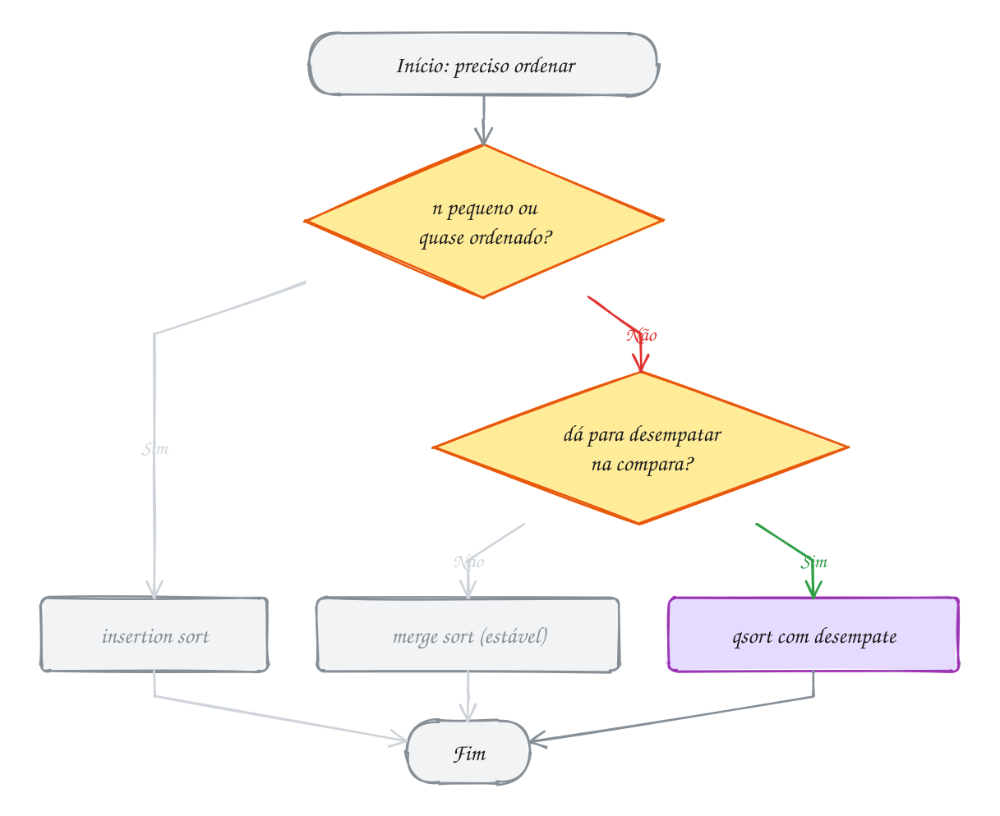</p>

> [!WARNING]
> `return *(const int *) a - *(const int *) b;` passa nos testes pequenos, mas
> com sinais opostos e valores grandes (`INT_MAX` e `-5`) a subtração dá
> **overflow** e a ordem sai errada. Escreva `return (x > y) - (x < y);`.

> [!TIP]
> A norma não diz qual algoritmo o `qsort` usa: não conte com estabilidade. Para
> buscar num vetor ordenado pela `compara`, use a **`bsearch`**, da `stdlib.h`.

> [!NOTE]
> **Pergunta para você:** se a `compara` só comparasse a cidade, a saída seria
> sempre igual? Em que ordem você esperaria os três pedidos de Recife?

### Hora de praticar

**Exemplo A191 · Duas vitrines do mesmo cardápio com qsort**

```c
#include <stdio.h>
#include <stdlib.h>
#include <string.h>

typedef struct {
    char nome[16];
    double preco;
    int calorias;
} Prato;

// o vetor ordenado é de Prato *: o qsort entrega o ENDEREÇO de cada ponteiro
int por_preco(const void *a, const void *b) {
    const Prato *p = *(const Prato *const *) a;
    const Prato *q = *(const Prato *const *) b;
    return (p->preco > q->preco) - (p->preco < q->preco);
}

int por_calorias_desc(const void *a, const void *b) {
    const Prato *p = *(const Prato *const *) a;
    const Prato *q = *(const Prato *const *) b;
    if (p->calorias != q->calorias) {
        return (p->calorias < q->calorias) - (p->calorias > q->calorias);
    }
    return strcmp(p->nome, q->nome);        // desempate: nome
}

void mostra(const char *titulo, Prato *const v[], size_t n) {
    printf("%s\n", titulo);
    for (size_t i = 0; i < n; i++) {
        printf("  %-10s R$ %5.2f %4d kcal\n", v[i]->nome, v[i]->preco, v[i]->calorias);
    }
}

int main(void) {
    Prato cardapio[] = {
        {"Coxinha", 7.50, 290}, {"Pastel", 9.00, 340}, {"Tapioca", 12.00, 250},
        {"Esfiha", 6.50, 250}, {"Cuscuz", 15.00, 480},
    };
    size_t n = sizeof cardapio / sizeof cardapio[0];
    Prato *vitrine1[5], *vitrine2[5];
    for (size_t i = 0; i < n; i++) {
        vitrine1[i] = vitrine2[i] = &cardapio[i];  // só endereços, nada copiado
    }

    qsort(vitrine1, n, sizeof vitrine1[0], por_preco);
    qsort(vitrine2, n, sizeof vitrine2[0], por_calorias_desc);

    mostra("Mais barato primeiro:", vitrine1, n);
    mostra("Mais calórico primeiro:", vitrine2, n);
    printf("cardapio[0] continua: %s (cada ponteiro tem %zu bytes, cada Prato %zu)\n",
           cardapio[0].nome, sizeof vitrine1[0], sizeof cardapio[0]);
    return 0;
}
// Saída (8 e 32 bytes numa máquina de 64 bits comum):
// Mais barato primeiro:
//   Esfiha     R$  6.50  250 kcal
//   Coxinha    R$  7.50  290 kcal
//   Pastel     R$  9.00  340 kcal
//   Tapioca    R$ 12.00  250 kcal
//   Cuscuz     R$ 15.00  480 kcal
// Mais calórico primeiro:
//   Cuscuz     R$ 15.00  480 kcal
//   Pastel     R$  9.00  340 kcal
//   Coxinha    R$  7.50  290 kcal
//   Esfiha     R$  6.50  250 kcal
//   Tapioca    R$ 12.00  250 kcal
// cardapio[0] continua: Coxinha (cada ponteiro tem 8 bytes, cada Prato 32)
```

```bash
gcc ~/LPEDC/material/A191.c -o ~/LPEDC/material/A191 && ~/LPEDC/material/A191
```

**Exemplo A192 · Cinco algoritmos, a mesma corrida**

```c
#include <stdio.h>
#include <stdlib.h>
#include <string.h>

#define N 1000

static long comparacoes;

// toda comparação de elementos passa por aqui e é contada
static int maior(int a, int b) {
    comparacoes++;
    return a > b;
}

static void troca(int *a, int *b) {
    int aux = *a;
    *a = *b;
    *b = aux;
}

static void bubble(int v[], int n) {
    int trocou = 1;
    for (int p = 1; p < n && trocou; p++) {
        trocou = 0;
        for (int j = 0; j < n - p; j++) {
            if (maior(v[j], v[j + 1])) {
                troca(&v[j], &v[j + 1]);
                trocou = 1;
            }
        }
    }
}

static void selection(int v[], int n) {
    for (int i = 0; i < n - 1; i++) {
        int m = i;
        for (int j = i + 1; j < n; j++) {
            if (maior(v[m], v[j])) {
                m = j;
            }
        }
        troca(&v[i], &v[m]);
    }
}

static void insertion(int v[], int n) {
    for (int j = 1; j < n; j++) {
        int x = v[j], i = j - 1;
        while (i >= 0 && maior(v[i], x)) {
            v[i + 1] = v[i];
            i--;
        }
        v[i + 1] = x;
    }
}

static void merge_rec(int v[], int w[], int p, int r) {
    if (r - p < 2) {
        return;
    }
    int q = p + (r - p) / 2;
    merge_rec(v, w, p, q);
    merge_rec(v, w, q, r);
    int i = p, j = q, k = 0;
    while (i < q && j < r) {
        w[k++] = maior(v[i], v[j]) ? v[j++] : v[i++];
    }
    while (i < q) w[k++] = v[i++];
    while (j < r) w[k++] = v[j++];
    memcpy(&v[p], w, (size_t) (r - p) * sizeof v[0]);
}

static void merge(int v[], int n) {
    int *w = malloc((size_t) n * sizeof *w);
    if (w == NULL) {
        return;
    }
    merge_rec(v, w, 0, n);
    free(w);
}

static void quick_rec(int v[], int p, int r) {
    if (p >= r) {
        return;
    }
    int j = p;
    for (int k = p; k < r; k++) {
        if (!maior(v[k], v[r])) {      // v[k] <= pivô
            troca(&v[j], &v[k]);
            j++;
        }
    }
    troca(&v[j], &v[r]);
    quick_rec(v, p, j - 1);
    quick_rec(v, j + 1, r);
}

static void quick(int v[], int n) {
    quick_rec(v, 0, n - 1);
}

// gerador de números próprio: dá a mesma sequência em qualquer máquina
static unsigned semente = 2024;
static int sorteia(void) {
    semente = semente * 1103515245u + 12345u;
    return (int) ((semente >> 16) % 10000);
}

int main(void) {
    static int base[3][N], v[N];
    for (int i = 0; i < N; i++) {
        base[0][i] = sorteia();       // aleatório
        base[1][i] = i;               // já ordenado
        base[2][i] = N - i;           // invertido
    }
    const char *nomes[] = {"bubble", "selection", "insertion", "merge", "quick"};
    void (*algoritmos[])(int[], int) = {bubble, selection, insertion, merge, quick};

    printf("n = 1000    aleatório   ordenado  invertido\n"); // alinhado à mão: o "ó" ocupa 2 bytes
    for (int a = 0; a < 5; a++) {
        printf("%-10s", nomes[a]);
        for (int c = 0; c < 3; c++) {
            memcpy(v, base[c], sizeof v);
            comparacoes = 0;
            algoritmos[a](v, N);
            printf(" %10ld", comparacoes);
        }
        printf("\n");
    }
    return 0;
}
// Saída:
// n = 1000    aleatório   ordenado  invertido
// bubble         499122        999     499500
// selection      499500     499500     499500
// insertion      241308        999     499500
// merge            8696       4932       5044
// quick           10972     499500     499500
```

```bash
gcc ~/LPEDC/material/A192.c -o ~/LPEDC/material/A192 && ~/LPEDC/material/A192
```

#### Exercícios

**Exercício E571** · ★☆☆

O app de combustível mostra o preço da gasolina em seis postos:
5.89, 6.19, 5.79, 6.05, 5.99 e 6.29. Ordene do MAIS CARO para o mais
barato com qsort e mostre um preço por linha.


```text
Saída esperada:
R$ 6.29
R$ 6.19
R$ 6.05
R$ 5.99
R$ 5.89
R$ 5.79
```

```bash
gcc ~/LPEDC/material/E571.c -o ~/LPEDC/material/E571 && ~/LPEDC/material/E571
```

**Exercício E573** · ★★☆

A playlist tem as bandas const char *bandas[] = {"Skank", "Titas",
"Legiao", "Raimundos", "Pitty", "Cazuza"} (sem acentos, para o strcmp não
se perder). Ordene com qsort duas vezes e mostre cada resultado numa linha:


```text
1) em ordem alfabética;
2) do nome mais curto para o mais comprido; empatou no tamanho, ordem
   alfabética.
```


```text
Saída esperada:
Cazuza Legiao Pitty Raimundos Skank Titas
Pitty Skank Titas Cazuza Legiao Raimundos
```

```bash
gcc ~/LPEDC/material/E573.c -o ~/LPEDC/material/E573 && ~/LPEDC/material/E573
```

**Exercício E574** · ★★☆

Os saldos (em centavos) de cinco contas de uma corretora são
2000000000, -1500000000, 15, -7 e 1000000000. Ordene do menor para o maior
com qsort e escreva a função de comparação SEM subtração (x - y estoura o
int quando os sinais são opostos). Mostre um saldo por linha.


```text
Saída esperada:
-1500000000
-7
15
1000000000
2000000000
```

```bash
gcc ~/LPEDC/material/E574.c -o ~/LPEDC/material/E574 && ~/LPEDC/material/E574
```

**Exercício E575** · ★★★

Uma agenda de contatos:


```text
typedef struct { char nome[16]; char telefone[16]; } Contato;
```


```text
{"Rafael", "81 99876-1234"}, {"Carla", "11 98765-4321"},
{"Bruno", "21 97654-3210"}, {"Marina", "31 96543-2109"},
{"Diego", "85 95432-1098"}
```


Ordene por nome com qsort e depois procure "Carla" e "Zeca" com bsearch:


```text
void *bsearch(const void *chave, const void *base, size_t n,
              size_t tamanho, int (*compara)(const void *, const void *));
```


Ela devolve o endereço do elemento achado ou NULL. Passe como chave a
própria string (const char *), sem montar um Contato.


```text
Saída esperada:
Carla: 11 98765-4321 (posição 1)
Zeca: não está na agenda
```

```bash
gcc ~/LPEDC/material/E575.c -o ~/LPEDC/material/E575 && ~/LPEDC/material/E575
```

---

## Desafios do módulo

Problemas para fechar o módulo, misturando os assuntos. Escreva em C e compile
com o gcc e as flags de estudo.

**1. Quantas voltas no pior caso?** Escreva a busca binária com um contador
de voltas do laço, devolvido por um ponteiro `int *voltas`. Num vetor criado
com `malloc` e preenchido só com pares (`v[i] = 2 * i`), busque **todos** os
ímpares de `-1` a `2n - 1` (todas essas buscas falham) e mostre o maior
número de voltas que alguma delas deu. Rode com `n = 5000` e com
`n = 5000000`.

<details><summary>Resposta</summary>

```text
n = 5000: no máximo 13 voltas
n = 5000000: no máximo 23 voltas
```

O intervalo cai pela metade a cada volta: o máximo é `⌊log₂ n⌋ + 1`. Para
5.000, 2¹² = 4096 ≤ 5000 < 8192 = 2¹³, então 13 voltas; para 5 milhões,
2²² ≤ 5.000.000 < 2²³, então 23. Mil vezes mais dados, só 10 voltas a mais.
Caminho: `ini = 0`, `fim = n - 1`, `(*voltas)++` logo no começo do `while
(ini <= fim)`, e no `main` um laço `for (int x = -1; x <= 2 * n - 1; x += 2)`
guardando o maior. Use `meio = ini + (fim - ini) / 2`; com 5 milhões, a
soma `ini + fim` ainda cabe em `int`, mas o hábito evita o estouro.

</details>

**2. O par que soma.** Dado um vetor ordenado `3 8 11 15 19 24 30` e um valor
`alvo = 34`, ache dois elementos que somam o alvo em O(n), sem laço dentro de
laço.

<details><summary>Resposta</summary>

Dois índices: `i = 0` no começo e `j = n - 1` no fim. Se `v[i] + v[j]` é
menor que o alvo, `i++`; se é maior, `j--`; se é igual, achou. Para 34: 3 + 30
= 33 (i++), 8 + 30 = 38 (j--), 8 + 24 = 32 (i++), 11 + 24 = 35 (j--), 11 + 19
= 30 (i++), **15 + 19 = 34**. Funciona porque o vetor está ordenado: cada passo
descarta um elemento que não pode fazer parte de nenhum par.

</details>

**3. Primeiro ordena, depois busca?** Você tem um vetor desordenado de
`n = 100.000` elementos e precisa responder `k` buscas. Escreva um programa
que calcule o custo dos dois planos em comparações: busca sequencial (uns
`n / 2` por busca) e ordenar (`n · log₂ n`) para depois fazer busca binária
(`log₂ n` por busca). Calcule `log₂ n` arredondado para cima com um laço que
dobra uma variável até passar de `n`. Mostre os dois custos para `k = 1, 10,
34, 35, 1000` e, com um `while`, o primeiro `k` em que ordenar fica mais
barato.

<details><summary>Resposta</summary>

```text
log2(n) arredondado para cima: 17
Ordenar: 1700000 comparações
k =    1: sequencial     50000, ordenar + binária  1700017
k =   10: sequencial    500000, ordenar + binária  1700170
k =   34: sequencial   1700000, ordenar + binária  1700578
k =   35: sequencial   1750000, ordenar + binária  1700595  <- ordenar ganha
k = 1000: sequencial  50000000, ordenar + binária  1717000  <- ordenar ganha
Ordenar compensa a partir de 35 buscas
```

Igualando `50.000 k = 1.700.000 + 17 k`, dá `k ≈ 34`: com mais de umas 34
buscas, ordenar compensa; com milhares, a diferença é enorme; com 1 ou 2,
ordenar é desperdício. Use `long` nas contas: com `k` acima de uns 43 mil,
`k * 50000` passa do `INT_MAX`. O `while (ordenar + k * lg >= k * (n /
2)) k++;` acha o ponto de virada.

</details>

**4. Ordenar 0, 1 e 2.** Um vetor tem só os valores 0, 1 e 2 (por exemplo,
`2 0 1 2 1 0 0 2 1`). Ordene em **uma passada**, in-place, sem contar
quantos há de cada.

<details><summary>Resposta</summary>

É a partição de três vias com pivô 1 (a "bandeira holandesa" de Dijkstra),
com `lt`, `i` e `gt`. 0 vai para a frente (`troca(v[lt], v[i])`, `lt++`,
`i++`), 2 vai para o fim (`troca(v[i], v[gt])`, `gt--`), 1 fica (`i++`).
Resultado: `0 0 0 1 1 1 2 2 2`, com n comparações.

</details>

**5. Ordenar sem comparar.** As notas de 3.000 candidatos são inteiros de 0 a
100. Ordene em O(n) usando um vetor `contagem[101]`.

<details><summary>Resposta</summary>

**Counting sort**: um laço conta quantas vezes cada nota aparece
(`contagem[nota]++`); outro laço percorre as notas de 0 a 100 e escreve cada
uma `contagem[nota]` vezes. São O(n + 101) passos e nenhuma comparação entre
elementos. Só funciona porque as chaves são inteiros num intervalo pequeno: o
limite de O(n log n) vale para algoritmos que **comparam**.

</details>

**6. O merge sort de baixo para cima.** Escreva o merge sort sem recursão:
intercale pedaços de tamanho 1, depois 2, 4, 8... até cobrir o vetor. Teste
com as notas do assunto 0094, `52 18 33 7 41 26 60 12`, e com um vetor de 7
elementos.

<details><summary>Resposta</summary>

Laço de fora: `for (int b = 1; b < n; b *= 2)`. Laço de dentro:
`for (int p = 0; p + b < n; p += 2 * b)` intercala `[p, p + b)` com
`[p + b, min(p + 2b, n))`. O cuidado é o último pedaço, que pode ser menor
(ou nem existir) quando `n` não é potência de 2. O resultado é
`7 12 18 26 33 41 52 60`.

</details>

**7. Quick sort que não estoura a pilha.** Mude o quick sort do assunto 0095 para
fazer a recursão só no lado **menor** e tratar o maior com um `while`. Meça a
maior profundidade de recursão num vetor já ordenado de 10.000 elementos,
antes e depois.

<details><summary>Resposta</summary>

Antes, com o pivô no fim, a profundidade chega a 9.999. Depois, cada chamada
recursiva recebe no máximo metade do pedaço atual, então a profundidade fica
abaixo de `log₂ 10.000 ≈ 14`. As comparações continuam O(n²) nesse caso: o
truque protege a **pilha**, não o tempo. Para o tempo, mude o pivô (meio ou
mediana de três).

</details>

**8. Quick sort híbrido.** Faça o quick sort chamar o insertion sort quando o
pedaço tiver menos de `L` elementos. Com o contador de comparações do A192,
teste `L = 1, 8, 16, 32` num vetor aleatório de 10.000.

<details><summary>Resposta</summary>

As comparações quase não mudam (às vezes até sobem um pouco), mas o tempo de
relógio costuma cair, com o melhor valor em geral entre 8 e 32: o insertion
não tem recursão nem chamadas, e pedaços pequenos cabem inteiros no cache. As bibliotecas de verdade fazem
isso.

</details>

**9. Mediana de duas listas.** Duas lojas têm listas ordenadas de preços, com
5 e 6 itens: `12 30 45 60 88` e `9 25 41 50 70 95`. Ache a mediana dos 11
preços sem criar um vetor novo.

<details><summary>Resposta</summary>

Faça a intercalação **sem gravar**: avance os dois índices como no merge,
contando quantos elementos já "saíram", e pare no 6º (o do meio de 11). A
sequência é 9, 12, 25, 30, 41, **45**: a mediana é **45**, com O(n) passos e
O(1) de memória.

</details>

**10. A compara que mente.** Esta compara foi escrita para ordenar do maior
para o menor: `return *(const int *) a < *(const int *) b;`. Ela compila.
Escreva-a ao lado da versão certa, `certa`, e mostre o que cada uma devolve
para os pares `(3, 7)`, `(7, 3)` e `(5, 5)`, marcando o par em que a errada
devolve 0 com números diferentes. Depois ordene `52 18 33 7 41 26 60 12` com
`qsort` e a `certa`.

<details><summary>Resposta</summary>

```text
(3, 7): errada  1, certa  1
(7, 3): errada  0, certa -1  <- a errada diz que empatam
(5, 5): errada  0, certa  0
60 52 41 33 26 18 12 7
```

A errada devolve só 0 ou 1, nunca negativo: quando `a > b`, ela diz ao
`qsort` que empatam. O contrato fica inconsistente (se `a` empata com `b` e
`b` empata com `c`, `a` deveria empatar com `c`), e o resultado depende de
como a biblioteca implementa o `qsort`: pode sair certo num computador e
errado em outro. Por isso o teste olha a **compara**, não só o vetor
ordenado. A certa é `int x = *(const int *) a, y = *(const int *) b; return
(x < y) - (x > y);`, que devolve -1, 0 ou 1 sem risco de estouro.

</details>

## Questões de provas do PPGI

Questões reais das provas de conhecimento do PPGI/UFAM, na íntegra e com o gabarito oficial. Resolva no papel, em 3 minutos por questão, e só depois abra o gabarito.

**Edital 032/2016 · Questão 04**

Se você tem que implementar um algoritmo de ordenação que tem um tempo de execução competitivo quando comparado a outros, e que não varia muito seu desempenho em função da entrada de dados fornecida. Qual das opções é melhor?

- a) Ordenação por inserção
- b) Heapsort
- c) Quicksort
- d) Tanto Quicksort quanto Heapsort atendem aos requisitos
- e) Hash

<details><summary>Gabarito</summary>

**B.** Heapsort faz O(n log n) em qualquer entrada; o Quicksort varia (pior caso O(n²)). Assunto 0096.

</details>

**Edital 032/2016 · Questão 10**

Considere os códigos de funções abaixo, assumindo que os mesmos são usados dentro de um programa e que os todos os cabeçalhos necessários são incluídos:

```c
/*QUADRO I) função que retorna 1 se a chave
de busca chave, passada como parâmetro, ocorre
dentro de um vetor de inteiros ordenado e
retorna 0 caso a chave não ocorra no vetor. O
vetor tem tamanho determinado pelo parâmetro
tm */
int buscaChave(int v[], int chave, int tm) {
  while((tm>= 0) && (v[tm]!= chave)) tm --;
  if (tm >= 0) return 1;
  return 0;
}
```

```c
/* QUADRO II) Conta ocorrências de uma
chave na lista encadeada, retornando o total de
ocorrências , zero caso a chave não ocorra
*/
int ContaOcorrenciasChave(tipoNo *prim, int
chave) {
  tipoNo *aux = prim;
  int cont = 0;
  int x;;
  for (x = 0; aux[x] != NULL; x++){
    if(aux[x]. dado == chave) cont++;
  }
  return cont;
}
```

Marque a alternativa correta dentre as afirmações abaixo:

- a) Os dois códigos executam as tarefas propostas sem gerar qualquer tipo de erro de lógica ou de vazamento de memória
- b) Apenas os código I executa sem erros a tarefa proposta
- c) Apenas o código II executa sem erros a tarefa proposta
- d) Os dois códigos geram erros de vazamento de memória ou de falha de segmentação
- e) Nenhuma das alternativas anteriores

<details><summary>Gabarito</summary>

**B.** Assunto 0089.

</details>

**Edital 032/2016 · Questão 16**

Considere um vetor não ordenado utilizado para armazenar chaves únicas (sem repetição). Pode-se afirmar que:

I) O melhor algoritmo para busca no vetor é a busca binária mesmo que o vetor não esteja ordenado, independente do número de elementos do vetor e da quantidade de buscas a serem realizadas\
II) Uma busca binária implementada no vetor não funcionaria adequadamente, fornecendo resultados errados a menos que fosse feita uma ordenação\
III) Um algoritmo de busca sequencial funcionaria e daria resultados comparando a chave com todas as posições do vetor na pior das hipóteses\

Sobre as afirmações, sabe-se que:

- a) Apenas as afirmações I e III estão corretas
- b) Apenas as afirmações II e III estão corretas
- c) Todas as afirmações estão corretas
- d) Todas as afirmações estão erradas
- e) Nenhuma das alternativas anteriores

<details><summary>Gabarito</summary>

**B.** I é falsa (a binária exige vetor ordenado), II e III são verdadeiras. Assunto 0089.

</details>

**Edital 032/2016 · Questão 18**

Considere que o vetor abaixo será ordenado com o algoritmo de ordenação por seleção

`4 5 2 3 17 2 1 22`

Considerando-se que o vetor tem sua primeira posição contada como 0 (zero), a primeira troca de valores entre posições do vetor ocorrerá entre:

- a) posição 0 e posição 2
- b) posição 0 e posição 7
- c) Posição 0 e posição 6
- d) Posição 1 e posição 6
- e) Posição 3 e posição 5

<details><summary>Gabarito</summary>

**C.** O menor é 1, na posição 6, que troca com a posição 0. Assunto 0092.

</details>

**Edital 032/2016 · Questão 19**

Considere os vetores abaixo

VetI: `1 2 3 4 5 6 8 7`
VetII: `7 8 8 5 4 3 2 1`

E considere as afirmações a seguir:

I) A ordenação por inserção é melhor que a ordenação por seleção em VetI se considerarmos o número de comparações entre chaves realizadas pelos dois algoritmos\
II) O RADIX sort executado em base 10 realiza um número menor de operações (instruções) nos dois casos quando comparado ao mergesort\
III) O RADIX sort executado em base 10 realiza um número menor de operações apenas em VetII quando comparado ao mergesort, ocorrendo o oposto em VetI\

Sobre as afirmações, sabe-se que:

- a) Apenas a afirmação I é verdadeira
- b) Apenas a afirmação II é verdadeira
- c) Apenas a afirmação III é verdadeira
- d) Apenas as afirmações I e II são verdadeiras
- e) Apenas as afirmações I e III são verdadeiras

<details><summary>Gabarito</summary>

**D.** I verdadeira (inserção faz ~n comparações em quase ordenado, seleção sempre n(n-1)/2); II verdadeira (radix de 1 dígito, ~n+10 passos contra ~n log n); III falsa. Assunto 0093.

</details>

**Edital 053/2016 · Questão 01**

Seja um vetor de inteiros com 400 elementos distintos ordenados em ordem crescente. Qual é o número máximo de iterações necessárias para encontrar um elemento qualquer desse vetor, caso seja utilizado o algoritmo de busca binária?

- a) 9
- b) 8
- c) 7
- d) 200
- e) 400

<details><summary>Gabarito</summary>

**A.** ⌊log2 400⌋+1 = 9; conferido em C (máximo de 9 iterações). Assunto 0090.

</details>

**Edital 053/2016 · Questão 04**

Considere que o vetor abaixo será ordenado com o algoritmo de ordenação por seleção.

`4 5 5 3 17 2 1 22`

Considerando-se que o vetor tem sua primeira posição contada como 0 (zero), a segunda troca de valores entre posições do vetor ocorrerá entre:

- a) Posição 0 e posição 2
- b) Posição 0 e posição 7
- c) Posição 1 e posição 5
- d) Posição 1 e posição 6
- e) Posição 3 e posição 5

<details><summary>Gabarito</summary>

**C.** 1ª troca 0 e 6 (vira 1 5 5 3 17 2 4 22); 2ª troca 1 e 5 (o 2). Conferido em C. Assunto 0092.

</details>

**Edital 053/2016 · Questão 15**

Considere as afirmações a seguir sobre os algoritmos de ordenação Quicksort, MergeSort, HeapSort e InsertionSort

I) São algoritmos estáveis: InsertionSort, QuickSort e MergeSorte\
II) Pior caso tem número de operações quadrático (proporcional a uma constante vezes n²): InsertionSort, QuickSort\
III) Utiliza um espaço extra proporcional a n² (proporcional ao quadrado do número de elementos): HeapSort,\
IV) A ordem das entradas é incapaz de influenciar o desempenho do algoritmo: InsertionSort, MergeSort\

Marque a alternativa que indica TODAS as afirmações INCORRETAS feitas:

- a) I e IV
- b) I , III e IV
- c) I, II e III
- d) I, II, III e IV
- e) II e IV

<details><summary>Gabarito</summary>

**B.** Incorretas: I (Quick não é estável), III (Heap usa O(1) extra), IV (Insertion depende da ordem). Assunto 0096.

</details>

**Edital 053/2016 · Questão 17**

Considere os códigos de funções abaixo, assumindo que os mesmos são usados dentro de um programa e que os todos os cabeçalhos necessários são incluídos:

```c
/*QUADRO I) função que retorna 1 se a chave
de busca chave, passada como parâmetro, ocorre
dentro de um vetor de inteiros ordenado e
retorna 0 caso a chave não ocorra no vetor. O
vetor tem tamanho determinado pelo parâmetro
tm */
int buscaChave(int v[],int chave,int tm) {
  while((tm>= 0) && (v[tm]!= chave)) tm--;
  if (tm >= 0) return 0;
  return 1;
}
```

```c
/* QUADRO II) Conta ocorrências de uma
chave na lista encadeada, retornando o total de
ocorrências , zero caso a chave não ocorra
*/
int ContaOcorrenciasChave(tipoNo *prim, int
chave) {
  tipoNo *aux = prim;
  int cont = 0;
  int x;
  for (x = 0; aux[x] != NULL; x++){
    if(aux[x]. dado == chave) cont++;
  }
  return x;
}
```

Marque a alternativa correta dentre as afirmações abaixo:

- a) Os dois códigos executam as tarefas propostas sem gerar qualquer tipo de erro de lógica ou de vazamento de memória
- b) Apenas o código I executa sem erros a tarefa proposta
- c) Apenas o código II executa sem erros a tarefa proposta
- d) Os dois códigos geram erros de vazamento de memória ou de falha de segmentação
- e) Nenhuma das alternativas anteriores

<details><summary>Gabarito</summary>

**E.** Assunto 0089.

</details>

**Edital 024/2017 · Questão 03**

Marque a alternativa CORRETA.
Qual dos algoritmos abaixo apresenta o menor custo (em termos de número movimentações de elementos realizadas) ao considerar-se, para cada algoritmo, a pior disposição possível para os elementos do vetor a ser ordenado. Considere que o vetor a ser ordenado é muito grande, acima de 1 milhão de elementos.

- a) Heapsort
- b) Quicksort
- c) Inserção
- d) Seleção
- e) Mergesort

<details><summary>Gabarito</summary>

**D.** seleção faz no máximo n-1 trocas; heap e merge movem O(n log n) Assunto 0092.

</details>

**Edital 024/2017 · Questão 12**

Sobre as afirmações abaixo:

I. A busca sequencial só pode ser realizada corretamente em vetores que não estejam ordenados\
II. A busca por uma chave em um vetor ordenado pode ser realizada corretamente com número constante de operações, não dependendo do tamanho do vetor.\
III. Pode-se encontrar o maior elemento de um vetor não ordenado com um algoritmo que realiza um número de operações proporcional ao tamanho do vetor na pior das situação possível para o algoritmo.\

Pode-se dizer que:

- a) Apenas I está correta
- b) Apenas II está correta
- c) Apenas III está correta
- d) Apenas II e III estão corretas
- e) Apenas I e III estão corretas

<details><summary>Gabarito</summary>

**C.** I falsa (sequencial vale em ordenado), II falsa (busca em vetor ordenado é O(log n)), III verdadeira (varredura O(n)) Assunto 0089.

</details>

**Edital 055/2017 · Questão 08**

Marque a alternativa CORRETA.
Considerando um array R que contém 1.000.000 de chaves ordenadas, assinale o número máximo de acessos a R necessários para encontrar uma determinada chave ao se utilizar o algoritmo de busca binária.

- A) 10
- B) 20
- C) 40
- D) 80
- E) 160

<details><summary>Gabarito</summary>

**B.** floor(log2 1.000.000)+1 = 20 Assunto 0090.

</details>

**Edital 055/2017 · Questão 12**

Qual dos algoritmos abaixo apresenta o menor custo (em termos de número comparações entre elementos) ao considerar-se que o vetor passado está previamente ordenado, a menos da ocorrência de duas chaves consecutivas que estão com posições trocadas. Considere que o vetor a ser ordenado é muito grande, com mais de 1 milhão de elementos.

- A) Heapsort.
- B) Quicksort.
- C) Inserção.
- D) Seleção.
- E) Nenhuma das anteriores, pois todos apresentam custo igual.

<details><summary>Gabarito</summary>

**C.** inserção faz cerca de n comparações; heap e quick fazem n log n ou pior; seleção n² Assunto 0093.

</details>

**Edital 055/2017 · Questão 14**

Sobre as afirmações abaixo:

I. Pode-se implementar uma busca em um vetor não ordenado a custo máximo inferior a n/2 operações, onde n é o número de elementos do vetor, desde que a chave buscada ocorra no vetor, não importando qual a posição em que a mesma ocorre.\
II. A busca por uma chave em um vetor ordenado pode ser realizada corretamente com um número de operações proporcional a log2 n, onde n é o número de elementos do vetor.\
III. O número de comparações realizadas para determinar se uma chave de busca está ou não em um vetor não ordenado é sempre menor do que o número de comparações envolvendo a mesma chave de busca em uma lista encadeada dinâmica, desde que a quantidade e a ordem dos elementos inseridos nas duas estruturas seja a mesma.\

Marque a alternativa CORRETA:

- A) Apenas a afirmativa I está correta.
- B) Apenas a afirmativa II está correta.
- C) Apenas a afirmativa III está correta.
- D) Todas as afirmativas estão corretas.
- E) Nenhuma das afirmativas está corretas.

<details><summary>Gabarito</summary>

**B.** I falsa (pior caso n), II verdadeira, III falsa (mesma contagem) Assunto 0089.

</details>

**Edital 055/2017 · Questão 19**

Suponha que você recebeu a tarefa de depurar uma implementação de Quicksort, cujo objetivo é classificar um vetor em ordem decrescente. Após a primeira etapa da partição ser concluída, o conteúdo do vetor está na seguinte ordem:

`20 22 24 18 13 9 3 10`

Qual das seguintes afirmações está CORRETA sobre a fase de partição?

- A) O pivô que gerou a partição pode ter o valor 13 ou 18.
- B) O pivô que gerou a partição pode ter o valor 13, mas não pode ter o valor 18.
- C) O pivô que gerou a partição pode ter o valor 18, mas não pode ter o valor 13.
- D) O pivô que gerou a partição não pode ter o valor 13 nem 18.
- E) O conteúdo do vetor não pode representar o resultado da etapa partição.

<details><summary>Gabarito</summary>

**A.** 18 (índice 3) e 13 (índice 4) separam maiores à esquerda e menores à direita Assunto 0095.

</details>

**Edital 023/2018 · Questão 01**

Dois vetores ordenados, contendo, cada um deles, N números inteiros, precisam ser unidos em outro vetor maior, que conterá os 2N números, que também serão armazenados de forma ordenada. A complexidade de tempo de melhor caso desse processo será, então,

- a) O(1), pois se precisa fazer apenas uma cópia simples de cada um dos elementos originais.
- b) O(log N), pois se usa a busca binária para determinar qual será o próximo elemento copiado para o vetor de destino.
- c) O(N), pois se precisa fazer uma cópia de cada um dos elementos originais, o que implica uma varredura completa de cada vetor de origem.
- d) O(Nlog N), pois se precisa fazer uma busca de cada elemento para depois inseri-lo no vetor de destino.
- e) O(N²), pois, como há dois vetores, precisa-se fazer dois laços de forma aninhada (um dentro do outro), gerando uma multiplicação das quantidades de elementos.

<details><summary>Gabarito</summary>

**C.** Intercalar dois vetores ordenados copia 2N elementos, então O(N) mesmo no melhor caso. Assunto 0094.

</details>

**Edital 023/2018 · Questão 12**

Considere o vetor ordenado abaixo e indique quais os valores serão comparados com a chave de busca de valor 20 se for realizada uma busca binária no vetor. Considere que a primeira posição do vetor é a posição 0.

`32 | 8 | 12 | 16 | 20 | 24 | 28 | 16 | 36`

- a) Chaves 20, 12, 8 e 4, nessa ordem
- b) Chaves 20, 28,32 e 36, nessa ordem
- c) Chaves 4, 8, 12, 16 e 20, nessa ordem
- d) Chaves 36, 32, 28 e 24, nessa ordem
- e) Apenas a chave 20

<details><summary>Gabarito</summary>

**E.** A posição do meio (índice 4) já vale 20: uma única comparação. Assunto 0090.

</details>

**Edital 023/2018 · Questão 14**

Considere as afirmações sobre busca binária:

I) é utilizada apenas sobre vetores ordenados\
II) pode determinar se uma chave está ou não com um número de comparações de chave inferior a 2log2 n passos, onde n é o tamanho do vetor.\
III) Supera a busca sequencial quando o vetor é grande, por exemplo com mais que mil elementos, e está ordenado.\

- a) Apenas as afirmações II e III estão corretas
- b) Apenas as afirmações I e II estão corretas
- c) Apenas as afirmações I e III estão corretas
- d) Todas as afirmações estão corretas
- e) Nenhuma das alternativas anteriores

<details><summary>Gabarito</summary>

**D.** As três são verdadeiras (ordenado, no máximo log2 n + 1 comparações, supera a sequencial em n grande). Assunto 0090.

</details>

**Edital 023/2018 · Questão 17**

Considerando os algoritmos de ordenação Quicksort, MergeSort, HeapSort e InsertionSort

I. São algoritmos estáveis: HeapSort, QuickSort e MergeSort\
II. A complexidade de uso de espaço é O(n²): HeapSort,\
III. A ordem das entradas é incapaz de influenciar o desempenho do algoritmo: InsertionSort, MergeSort\
IV. Melhor caso da complexidade de tempo em Ω(n) : InsertionSort\
V. A complexidade de uso de espaço é O(n): MergeSort\

Marque a alternativa que indica SOMENTE afirmações INCORRETAS feitas:

- a) I IV e V
- b) I , III e IV
- c) I, II, III e IV
- d) I, II e III
- e) II e V

<details><summary>Gabarito</summary>

**D.** I, II e III são falsas; IV e V são verdadeiras. A alternativa D lista só as incorretas. Assunto 0096.

</details>

**Edital 061/2018 · Questão 06**

Marque a alternativa CORRETA. O método de ordenação QuickSort (ordenação rápida) é um método sofisticado de ordenação de vetores que:

- a) Considera em cada passo somente um único elemento sucessor na sequência fonte e todos os elementos do vetor destino para encontrar o ponto correto da inserção.
- b) Ordena todos os elementos que estiverem a intervalos de 4 posições entre si na sequência corrente.
- c) É baseado nos princípios de ordenação por inserção direta através de incrementos decrescentes.
- d) O Quicksort é um algoritmo que pode usar espaço extra linear no pior caso.
- e) É baseado nos princípios de ordenação por seleção direta que consiste na seleção repetitiva da menor dentre as chaves de n elementos, e depois dentre os n-1 elementos restantes, e assim por diante.

<details><summary>Gabarito</summary>

**D.** No pior caso a pilha de recursão do quicksort chega a O(n). Assunto 0095.

</details>

**Edital 033/2019 · Questão 01**

Sabendo que o algoritmo Quick Sort classifica os elementos em ordem crescente usando o primeiro elemento como pivô, qual das seguintes sequências de entrada irá requerer o maior número de comparações quando o algoritmo for aplicado?

- a) 22 25 33 42 56 67 89
- b) 63 70 47 42 36 38 73
- c) 42 25 22 33 67 56 89
- d) 13 52 25 58 10 22 17
- e) 23 25 33 42 11 22 30

<details><summary>Gabarito</summary>

**A.** Com pivô no primeiro, a entrada já ordenada é o pior caso: 21 comparações contra 11 a 12 nas outras (rodado em C). Assunto 0095.

</details>

**Edital 033/2019 · Questão 14**

Dada a seguinte entrada (34, 8, 64, 51, 32, 21) e empregando o algoritmo Insertion Sort, qual será a aparência do array de elementos após a segunda rodada de ordenação?

- a) 8, 21, 32, 34, 51, 64
- b) 8, 32, 34, 51, 64, 21
- c) 8, 34, 51, 64, 32, 21
- d) 8, 34, 64, 51, 32, 21
- e) 8, 51, 64, 34, 32, 21

<details><summary>Gabarito</summary>

**D.** Após a 1ª rodada: 8 34 64 51 32 21; a 2ª insere o 64 sem mover nada. Assunto 0093.

</details>

**Edital 033/2019 · Questão 18**

Qual das afirmações abaixo sobre Insertion Sort está CORRETA?

- a) Existem arrays de tamanhos variados N tais que o Insertion Sort é executado em Θ(N).
- b) Existem arrays de tamanhos variados N tais que o Insertion Sort é executado em Θ(1).
- c) Existem arrays de tamanhos variados N tais que o Insertion Sort é executado em Θ(N³).
- d) Existem arrays de tamanhos variados N tais que o Insertion Sort é executado em Θ(2^N).
- e) Nenhuma das sentenças anteriores está correta.

<details><summary>Gabarito</summary>

**A.** Insertion sort em vetor já ordenado roda em Θ(N). Assunto 0093.

</details>

**Edital 060/2019 · Questão 04**

Considere um vetor com 25 elementos (posição 0 até a posição 24) que representam os números primos entre 1 a 100, em ordem crescente (Ex: [2, 3, 5, 7, 11, 13, ..., 89, 97]). Empregando pesquisa binária, quantos itens do vetor precisam ser examinados antes de se concluir que o número 52 não está no vetor e, portanto, não é primo?

- a) 12
- b) 7
- c) 5
- d) 1
- e) 4

<details><summary>Gabarito</summary>

**C.** Posições examinadas: 12, 18, 15, 13, 14 = 5. Assunto 0090.

</details>

**Edital 060/2019 · Questão 08**

Qual dos seguintes algoritmos apresenta tempo O(n) quando ordenando um vetor com n elementos idênticos de texto?

- a) Heapsort
- b) Insertion sort
- c) Mergesort
- d) Quicksort
- e) Nenhum dos algoritmos apresenta tempo O(n) para essa entrada

<details><summary>Gabarito</summary>

**B.** Insertion sort faz n-1 comparações em entrada ordenada ou igual. Assunto 0093.

</details>

**Edital 060/2019 · Questão 17**

Suponha que, no pior caso, um algoritmo Merge Sort leve 30 segundos para ordenar uma entrada de tamanho 64. Qual das opções a seguir se aproxima mais do tamanho máximo de entrada de um problema que pode ser resolvido em 6 minutos?

- a) 256
- b) 1024
- c) 512
- d) 2048
- e) 4096

<details><summary>Gabarito</summary>

**C.** c·n·log n: 64 x 6 = 384 ↔ 30 s; 360 s dá n·log n = 4608, que é 512 x 9. Assunto 0094.

</details>

**Edital 060/2019 · Questão 18**

Considere que os seguintes elementos {5,4,3,2,1} foram inseridos nesta ordem em um vetor. Em seguida, você aplicou o algoritmo Insertion Sort nele. Qual é a sequência de passos feitos durante o uso do Insertion Sort neste vetor?

- a) 4 5 3 2 1 / 3 4 5 2 1 / 2 3 4 5 1 / 1 2 3 4 5
- b) 5 4 3 1 2 / 5 4 1 2 3 / 5 1 2 3 4 / 1 2 3 4 5
- c) 4 3 2 1 5 / 3 2 1 5 4 / 2 1 5 4 3 / 1 5 4 3 2
- d) 4 5 3 2 1 / 2 3 4 5 1 / 3 4 5 2 1 / 1 2 3 4 5
- e) 4 5 3 1 2 / 2 3 4 5 1 / 3 4 5 2 1 / 1 2 3 4 5

<details><summary>Gabarito</summary>

**A.** Cada rodada insere o próximo elemento: 4 5 3 2 1, 3 4 5 2 1, 2 3 4 5 1, 1 2 3 4 5. Assunto 0093.

</details>

## Lista de exercícios práticos

30 exercícios que misturam os assuntos do módulo, no ritmo da prova do PPGI. Arquivos P1301.c a P1330.c, em `material/`; resoluções em `_respostas/13-busca-e-ordenacao/lista/`.

### ★☆☆ Aquecimento

**Exercício P1301** · ★☆☆ · A placa no estacionamento, com sentinela

A cancela do estacionamento guarda os números das placas que estão lá
dentro, sem ordem: 4821, 1307, 9954, 2210, 6638, 7012, 3389, 5146.

Escreva int busca_sentinela(int v[], int n, int x, int *comparacoes): ela
copia x para v[n] (a sentinela) e anda com um while que só testa
v[i] != x, sem testar i < n. No fim, devolve i se i < n, ou -1. Conte uma
comparação para cada v[i] olhado, inclusive o da sentinela. O vetor tem que
ter uma posição a mais (9 posições) para caber a sentinela.

Procure 2210, 5146 e 1000.


```text
Saída esperada:
Placa 2210: posição 3 (4 comparações)
Placa 5146: posição 7 (8 comparações)
Placa 1000: posição -1 (9 comparações)
```

**Dicas:**

1. Declare int placas[9] = {4821, ..., 5146}; e use n = 8.
2. Comece com comparacoes = 1 (o primeiro v[0] != x) e some 1 a cada i++.
3. Quem não está no vetor custa n + 1 comparações: a última é a sentinela.

```bash
gcc ~/LPEDC/material/P1301.c -o ~/LPEDC/material/P1301 && ~/LPEDC/material/P1301
```

---

**Exercício P1302** · ★☆☆ · Quantas voltas a busca binária dá

A tabela de preços da papelaria (em reais, em ordem crescente) tem 15
itens. Complete a busca binária (intervalo fechado [ini, fim]) para que ela
conte em *voltas quantas vezes o while rodou, e mostre o resultado para os
preços 33, 28, 3, 89 e 50.


```text
Saída esperada:
R$ 33: posição 7 (voltas: 1)
R$ 28: posição 6 (voltas: 4)
R$ 3: posição 0 (voltas: 4)
R$ 89: posição 14 (voltas: 4)
R$ 50: posição -1 (voltas: 4)
```

**Dicas:**

1. Some 1 em *voltas logo no começo do corpo do while.
2. O meio é ini + (fim - ini) / 2.
3. Com 15 elementos, o pior caso é ⌊log₂ 15⌋ + 1 = 4 voltas, achando ou não.

```bash
gcc ~/LPEDC/material/P1302.c -o ~/LPEDC/material/P1302 && ~/LPEDC/material/P1302
```

---

**Exercício P1303** · ★☆☆ · O bubble passada a passada

Os gols das 6 rodadas do time do bairro foram 3, 0, 5, 1, 4, 2. Escreva um
bubble sort crescente que mostre o vetor depois de CADA passada e pare
assim que uma passada inteira não fizer nenhuma troca (avisando com
"nenhuma troca: parou"). Na passada p, o laço interno vai de j = 0 até
j < n - p, comparando v[j] com v[j + 1].


```text
Saída esperada:
passada 1: 0 3 1 4 2 5
passada 2: 0 1 3 2 4 5
passada 3: 0 1 2 3 4 5
passada 4: 0 1 2 3 4 5
nenhuma troca: parou
```

**Dicas:**

1. Use um bool trocou = false no começo de cada passada.
2. A passada 3 já deixa tudo ordenado, mas o bubble só descobre isso na 4,
   quando nada troca.
3. Depois da passada p, os p maiores já estão no fim. É isso que a
   prova pergunta em "o vetor após a k-ésima passada".

```bash
gcc ~/LPEDC/material/P1303.c -o ~/LPEDC/material/P1303 && ~/LPEDC/material/P1303
```

---

**Exercício P1304** · ★☆☆ · Selection sort das senhas da farmácia

As senhas da fila da farmácia estão bagunçadas: 27, 12, 44, 8, 31, 19.
Complete o selection sort: em cada passada i, ache o menor de
senhas[i..n-1] e troque com senhas[i], mas SÓ troque se o menor não estiver
já em i. Mostre o vetor depois de cada passada e, no fim, quantas trocas
aconteceram de verdade.


```text
Saída esperada:
passada 1: 8 12 44 27 31 19
passada 2: 8 12 44 27 31 19
passada 3: 8 12 19 27 31 44
passada 4: 8 12 19 27 31 44
passada 5: 8 12 19 27 31 44
trocas: 2
```

**Dicas:**

1. Guarde o ÍNDICE do menor (int menor = i), não o valor.
2. Conte a troca dentro do if (menor != i).
3. O selection sempre faz n - 1 passadas: ele não percebe que o vetor
   ficou pronto na passada 3.

```bash
gcc ~/LPEDC/material/P1304.c -o ~/LPEDC/material/P1304 && ~/LPEDC/material/P1304
```

---

**Exercício P1305** · ★☆☆ · Insertion sort das encomendas

A transportadora carrega as encomendas da mais leve para a mais pesada.
Os pesos, em kg, chegaram nesta ordem: 14, 9, 22, 5, 17, 9. Escreva um
insertion sort que mostre o vetor depois de encaixar cada elemento
(j = 1 até j = 5). Use pesos[i] > x no while, para o algoritmo ser
estável.


```text
Saída esperada:
j = 1: 9 14 22 5 17 9
j = 2: 9 14 22 5 17 9
j = 3: 5 9 14 22 17 9
j = 4: 5 9 14 17 22 9
j = 5: 5 9 9 14 17 22
```

**Dicas:**

1. Guarde x = pesos[j] antes de deslocar: a posição j vai ser sobrescrita.
2. Desloque para a direita enquanto i >= 0 e pesos[i] > x; depois,
   pesos[i + 1] = x.
3. Depois do passo j, só a parte pesos[0..j] está garantidamente
   ordenada; o resto continua como chegou.

```bash
gcc ~/LPEDC/material/P1305.c -o ~/LPEDC/material/P1305 && ~/LPEDC/material/P1305
```

---

**Exercício P1306** · ★☆☆ · Intercalando as filas de embarque

No aeroporto, os passageiros dos portões A e B chegam já em ordem de
assento: A tem 4, 11, 18, 25, 30 e B tem 2, 9, 13. Complete a função
intercala, que junta as duas filas numa só, em ordem, e devolve quantas
comparações a[i] <= b[j] ela fez.


```text
Saída esperada:
fila: 2 4 9 11 13 18 25 30
comparações: 5
```

**Dicas:**

1. Enquanto as duas filas têm gente, compare as frentes e copie a menor.
2. Quando uma acaba, copie o resto da outra sem comparar nada.
3. O B acaba depois de 5 comparações (sai o 13); o 18, o 25 e o 30
   descem direto. O pior caso seria na + nb - 1 = 7.

```bash
gcc ~/LPEDC/material/P1306.c -o ~/LPEDC/material/P1306 && ~/LPEDC/material/P1306
```

---

**Exercício P1307** · ★☆☆ · Uma partição de Lomuto

O entregador do prédio tem os andares 12, 3, 17, 8, 21, 5, 10. Escreva a
partição de Lomuto (a PARTITION do Cormen): o pivô é o ÚLTIMO elemento, i
começa em p - 1, j vai de p a r - 1 e, quando v[j] <= pivô, i avança e
v[i] troca com v[j]. No fim, o pivô troca com v[i + 1], que é a posição
devolvida. Faça UMA partição do vetor inteiro e mostre o resultado.


```text
Saída esperada:
depois da partição: 3 8 5 10 21 17 12
pivô 10 na posição 3
```

**Dicas:**

1. Escreva void troca(int *a, int *b) e int particiona(int v[], int p, int r).
2. Faça à mão antes: o 3, o 8 e o 5 são <= 10 e vão para a frente, na
   ordem em que aparecem.
3. O lado direito (21 17 12) não fica ordenado: a partição só promete
   "menores ou iguais à esquerda, maiores à direita".

```bash
gcc ~/LPEDC/material/P1307.c -o ~/LPEDC/material/P1307 && ~/LPEDC/material/P1307
```

---

**Exercício P1308** · ★☆☆ · As capitais mais quentes primeiro

As máximas do dia em sete capitais foram 34, 29, 38, 22, 31, 36 e 27 graus.
O programa abaixo já ordena em ordem crescente com qsort. Estenda: escreva
a função decrescente (use a crescente, trocando a ordem dos argumentos),
ordene de novo do maior para o menor e mostre as 3 mais quentes.


```text
Saída esperada:
crescente: 22 27 29 31 34 36 38
decrescente: 38 36 34 31 29 27 22
as 3 mais quentes: 38 36 34
```

**Dicas:**

1. A compara recebe const void *; decrescente(a, b) pode só devolver
   crescente(b, a).
2. A crescente usa (x > y) - (x < y) em vez de x - y: a subtração pode
   estourar o int com valores grandes.

```bash
gcc ~/LPEDC/material/P1308.c -o ~/LPEDC/material/P1308 && ~/LPEDC/material/P1308
```

---

**Exercício P1309** · ★☆☆ · A busca binária que esquece a ponta

A secretaria procura matrículas num vetor ordenado com a busca binária
abaixo, que tem um erro de propósito: ela não acha algumas matrículas que
estão lá. Rode, veja quais falham e conserte (é uma mudança pequena).


```text
Saída esperada (depois do conserto):
10: 0
47: 3
98: 7
60: -1
```

**Dicas:**

1. Antes do conserto, o 10 e o 98 dão -1. Os dois são pontas do vetor.
2. O intervalo é fechado: [ini, fim] inclui as duas pontas. Quando
   ini == fim, ainda sobra uma posição para olhar.
3. Resposta esperada: a condição do while deve ser ini <= fim; aí a saída
   fica igual à de cima.

```bash
gcc ~/LPEDC/material/P1309.c -o ~/LPEDC/material/P1309 && ~/LPEDC/material/P1309
```

---

**Exercício P1310** · ★☆☆ · Todas as vezes que o ônibus passou

O fiscal anotou as linhas de ônibus que passaram no ponto, na ordem:
302, 115, 302, 640, 115, 302, 88, 640, 302, 115.

Escreva int todas(const int v[], int n, int x, int pos[]), que guarda em
pos[] TODAS as posições onde x aparece e devolve quantas são. No main,
consulte as linhas 302, 640 e 500.


```text
Saída esperada:
linha 302: 4 vez(es), posições 0 2 5 8
linha 640: 2 vez(es), posições 3 7
linha 500: 0 vez(es)
```

**Dicas:**

1. A busca não pode parar no primeiro achado: ela percorre o vetor todo.
2. Use um contador achou que também serve de índice: pos[achou++] = i.
3. Por isso, esta busca custa sempre n comparações, achando ou não.

```bash
gcc ~/LPEDC/material/P1310.c -o ~/LPEDC/material/P1310 && ~/LPEDC/material/P1310
```

### ★★☆ Para pensar

**Exercício P1311** · ★★☆ · O primeiro boleto do dia

O app do banco guarda os dias de vencimento dos boletos do mês, em ordem
crescente e com repetidos:


```text
2, 3, 5, 5, 5, 5, 9, 10, 12, 12, 12, 15, 18, 20, 20, 25
```


Ele quer a PRIMEIRA posição de um dia (o primeiro boleto daquele dia).
Escreva duas funções que devolvem essa posição (ou -1) e contam em *comp
quantas vezes compararam o vetor:


```text
int primeira_binaria(const int v[], int n, int x, int *comp)
int primeira_sequencial(const int v[], int n, int x, int *comp)
```


A binária não pode parar quando acha: ela guarda a posição e continua
procurando na metade da esquerda. Conte 1 comparação por volta do while
(na binária) e 1 por posição olhada (na sequencial). Teste os dias 5, 12,
20 e 7.


```text
Saída esperada:
dia 5: binária 2 (4 comp.), sequencial 2 (3 comp.)
dia 12: binária 8 (4 comp.), sequencial 8 (9 comp.)
dia 20: binária 13 (4 comp.), sequencial 13 (14 comp.)
dia 7: binária -1 (4 comp.), sequencial -1 (16 comp.)
```

**Dicas:**

1. Comece com achou = -1. Quando v[meio] == x, faça achou = meio e
   fim = meio - 1.
2. A binária sempre roda até o intervalo esvaziar: com 16 elementos, são 4
   ou 5 voltas, mesmo quando acha cedo.
3. Para o dia 5, a sequencial ganha: o 5 está logo no começo. A binária só
   vale a pena quando o vetor é grande ou o alvo está longe do início.

```bash
gcc ~/LPEDC/material/P1311.c -o ~/LPEDC/material/P1311 && ~/LPEDC/material/P1311
```

---

**Exercício P1312** · ★★☆ · Encaixando consultas na agenda

A agenda da clínica guarda os horários marcados em minutos desde a
meia-noite (480 é 8h00), em ordem crescente: 480, 540, 600, 660, 780, 840.
Chegam novos pedidos de horário: 615, 450, 900 e 600 (este já existe; o
novo entra ANTES do antigo).

Escreva:


```text
int ponto_insercao(const int v[], int n, int x)
  busca binária que devolve a primeira posição com v[i] >= x (de 0 a n)
int insere(int v[], int *n, int x)
  acha o ponto de inserção, desloca o resto uma casa para a direita,
  grava x, aumenta *n e devolve a posição
```


Mostre a agenda depois de cada inserção (o vetor tem capacidade 10).


```text
Saída esperada:
615 entrou na posição 3: 480 540 600 615 660 780 840
450 entrou na posição 0: 450 480 540 600 615 660 780 840
900 entrou na posição 8: 450 480 540 600 615 660 780 840 900
600 entrou na posição 3: 450 480 540 600 600 615 660 780 840 900
```

**Dicas:**

1. É a busca binária de sempre, com intervalo fechado, mas sem o "achou,
   devolve": se v[meio] < x, ini = meio + 1; senão, fim = meio - 1.
2. Quando o while termina, ini é o ponto de inserção. Faça o teste de mesa
   com x = 900: ini chega a 8 = n.
3. Desloque de trás para frente (i de *n até pos + 1), para não apagar
   ninguém.

```bash
gcc ~/LPEDC/material/P1312.c -o ~/LPEDC/material/P1312 && ~/LPEDC/material/P1312
```

---

**Exercício P1313** · ★★☆ · O bubble no melhor e no pior dia

Instrumente o bubble sort com parada antecipada (para quando uma passada
não troca nada): escreva


```text
void bubble(int v[], int n, int *comp, int *trocas, int *passadas)
```


que ordena v e devolve quantas comparações v[j] > v[j + 1] fez, quantas
trocas e quantas passadas rodou. Teste com três vetores de 6 senhas:
crescente 1 2 3 4 5 6, invertido 6 5 4 3 2 1 e misturado 4 1 6 2 5 3.
Mostre cada linha com printf("%-10s passadas %d, comparações %2d, trocas %2d\n", ...).


```text
Saída esperada:
crescente  passadas 1, comparações  5, trocas  0
invertido  passadas 5, comparações 15, trocas 15
misturado  passadas 4, comparações 14, trocas  7
```

**Dicas:**

1. A passada p compara j de 0 a n - p - 1: n - p comparações.
2. O melhor caso (já ordenado) faz uma passada só: n - 1 comparações, O(n).
3. O pior caso (invertido) troca em toda comparação: n(n - 1)/2 = 15.
4. O número de trocas é igual ao número de inversões do vetor: o
   misturado tem 7.

```bash
gcc ~/LPEDC/material/P1313.c -o ~/LPEDC/material/P1313 && ~/LPEDC/material/P1313
```

---

**Exercício P1314** · ★★☆ · Quick sort com a partição de Hoare

Ordene as notas 7, 2, 9, 4, 7, 1, 8, 3 com quick sort usando a partição de
HOARE do Cormen (problema 7-1): o pivô é x = v[p]; i começa em p - 1 e j em
r + 1; repita: "j-- até v[j] <= x", "i++ até v[i] >= x"; se i < j, troca
v[i] com v[j]; senão, devolve j. Depois, a recursão é quick(p, j) e
quick(j + 1, r): o pivô NÃO fica necessariamente na posição j.

O vetor e n são globais (já estão no esqueleto). A cada partição, mostre
o intervalo, o pivô, o j devolvido e o vetor inteiro; no fim, o vetor
ordenado.


```text
Saída esperada:
[0..7] pivô 7, j = 4: 3 2 1 4 7 9 8 7
[0..4] pivô 3, j = 1: 1 2 3 4 7 9 8 7
[0..1] pivô 1, j = 0: 1 2 3 4 7 9 8 7
[2..4] pivô 3, j = 2: 1 2 3 4 7 9 8 7
[3..4] pivô 4, j = 3: 1 2 3 4 7 9 8 7
[5..7] pivô 9, j = 6: 1 2 3 4 7 7 8 9
[5..6] pivô 7, j = 5: 1 2 3 4 7 7 8 9
final: 1 2 3 4 7 7 8 9
```

**Dicas:**

1. Use do { j--; } while (v[j] > x); e do { i++; } while (v[i] < x);
2. Guarde o pivô (v[p]) antes de chamar a partição, para poder mostrá-lo.
3. Na primeira partição, os 7 iguais ao pivô vão um para cada lado: Hoare
   para nos iguais, e é isso que deixa as metades equilibradas.

```bash
gcc ~/LPEDC/material/P1314.c -o ~/LPEDC/material/P1314 && ~/LPEDC/material/P1314
```

---

**Exercício P1315** · ★★☆ · Quem ordena sem bagunçar os empates

A lista da escola está em ordem alfabética: Ana (turma 2), Beto (1),
Caio (2), Duda (1), Eva (3), Fabio (2). A secretaria quer por turma,
mantendo a ordem alfabética dentro de cada turma, ou seja, uma ordenação
ESTÁVEL.

Escreva selection(Aluno v[], int n) e insertion(Aluno v[], int n), as duas
ordenando pelo campo turma (o selection troca o menor com v[i]; o insertion
usa > no while). Ordene duas cópias da lista e mostre as duas.


```text
typedef struct { char nome[10]; int turma; } Aluno;
```


```text
Saída esperada:
selection: Beto(1) Duda(1) Caio(2) Ana(2) Fabio(2) Eva(3)
insertion: Beto(1) Duda(1) Ana(2) Caio(2) Fabio(2) Eva(3)
```

**Dicas:**

1. Struct se copia com =, então dá para trocar com Aluno t = v[i]; ...
2. Faça o selection à mão: na passada 1 o Duda troca com a Ana, e a Ana
   vai parar DEPOIS do Caio. É a troca à distância que quebra a
   estabilidade.
3. O insertion só move um elemento por cima de vizinhos MAIORES; iguais
   nunca passam um pelo outro.

```bash
gcc ~/LPEDC/material/P1315.c -o ~/LPEDC/material/P1315 && ~/LPEDC/material/P1315
```

---

**Exercício P1316** · ★★☆ · Classificação do concurso com desempate

O edital do concurso da prefeitura diz: classifica primeiro quem tem a
maior nota; no empate, o candidato mais velho; persistindo, a ordem
alfabética do nome. Escreva a função compara para o qsort com essa chave
composta e mostre a classificação.


```text
Candidatos: Paulo 82 (30 anos), Rita 90 (25), Lucas 82 (41), Ana 82 (30),
Bruna 75 (52), Igor 90 (25), Celia 82 (41)
```


```text
Saída esperada:
1º Igor   nota 90, 25 anos
2º Rita   nota 90, 25 anos
3º Celia  nota 82, 41 anos
4º Lucas  nota 82, 41 anos
5º Ana    nota 82, 30 anos
6º Paulo  nota 82, 30 anos
7º Bruna  nota 75, 52 anos
```

**Dicas:**

1. Compare um critério de cada vez: só passe para o próximo se o atual
   empatar.
2. Para "maior primeiro", inverta: (y->nota > x->nota) - (y->nota < x->nota).
3. O último critério é strcmp(x->nome, y->nome).
4. Mostre cada linha com printf("%dº %-6s nota %d, %d anos\n", ...).

```bash
gcc ~/LPEDC/material/P1316.c -o ~/LPEDC/material/P1316 && ~/LPEDC/material/P1316
```

---

**Exercício P1317** · ★★☆ · O merge sort mostrando cada intercalação

Ordene os tempos de espera 38, 27, 43, 3, 9, 82, 10 (em minutos) com merge
sort, dividindo em q = (p + r) / 2. Instrumente a intercalação: no fim de
cada intercala(p, q, r), mostre o trecho v[p..r] já intercalado. Use um
vetor auxiliar global int aux[7].


```text
Saída esperada:
intercala [0..1]: 27 38
intercala [2..3]: 3 43
intercala [0..3]: 3 27 38 43
intercala [4..5]: 9 82
intercala [4..6]: 9 10 82
intercala [0..6]: 3 9 10 27 38 43 82
```

**Dicas:**

1. merge_sort(p, r): se p < r, ordena [p..q], ordena [q+1..r] e intercala.
2. A ordem das linhas é a ordem em que as chamadas TERMINAM: a metade
   esquerda inteira antes da direita. O trecho [6..6] (só o 10)
   não intercala nada.
3. São n - 1 = 6 intercalações para 7 elementos.

```bash
gcc ~/LPEDC/material/P1317.c -o ~/LPEDC/material/P1317 && ~/LPEDC/material/P1317
```

---

**Exercício P1318** · ★★☆ · O pior caso do quick sort, medido

O quick sort abaixo usa a partição de Lomuto (pivô no fim). Instrumente:

a) conte numa variável global comparacoes cada v[j] <= pivo;
b) acrescente um parâmetro prof em quick (a raiz chama com 0 e cada

```text
 chamada recursiva passa prof + 1) e guarde em profundidade_max a maior
 profundidade alcançada, contando também as chamadas com p >= r;
```

c) escreva testa(nome, v, n), que zera os contadores, ordena e mostra.

Rode no vetor crescente 1..10 e no misturado 6 3 9 1 8 2 10 5 7 4, e
mostre n(n-1)/2 para comparar.


```text
Saída esperada:
crescente  comparações 45, profundidade 9
misturado  comparações 20, profundidade 4
n(n-1)/2 = 45
```

**Dicas:**

1. Atualize profundidade_max logo no começo de quick, antes do if.
2. No crescente, o pivô é sempre o maior: cada partição deixa o lado
   direito vazio e o esquerdo com um a menos. 9 + 8 + ... + 1 = 45.
3. A profundidade 9 é a pilha de chamadas crescendo em O(n): com um vetor
   de um milhão já ordenado, o programa estouraria a pilha.

```bash
gcc ~/LPEDC/material/P1318.c -o ~/LPEDC/material/P1318 && ~/LPEDC/material/P1318
```

---

**Exercício P1319** · ★★☆ · Busca binária no ranking decrescente

O ranking do torneio de xadrez da escola está em ordem DECRESCENTE de
pontos: 980, 875, 870, 720, 650, 610, 455, 300. A busca abaixo foi copiada
de um vetor crescente e, aqui, erra quase tudo. Adapte a busca para vetor
decrescente e mostre a colocação (posição + 1) de quem fez 650, 980, 300 e
500 pontos.


```text
Saída esperada:
650 pontos: 5º lugar
980 pontos: 1º lugar
300 pontos: 8º lugar
500 pontos: ninguém
```

**Dicas:**

1. Rode antes: nenhuma das quatro é achada, porque a busca vai sempre
   para o lado errado.
2. No vetor decrescente, se v[meio] > x, o x está à DIREITA do meio.
3. Só uma comparação muda de sentido; o resto da busca fica igual.

```bash
gcc ~/LPEDC/material/P1319.c -o ~/LPEDC/material/P1319 && ~/LPEDC/material/P1319
```

---

**Exercício P1320** · ★★☆ · Um selection sort estável

Na lotérica, a fila foi anotada em ordem de chegada com a prioridade de
cada cliente (1 = mais urgente): A3, B2, C3, D1, E2, F1. O selection sort
abaixo ordena por prioridade, mas embaralha a ordem de chegada entre
empatados (o E passa na frente do B).

Escreva selection_estavel: ache o menor de v[i..n-1] como antes, mas em vez
de TROCAR, guarde o menor, empurre v[i..menor-1] uma casa para a direita e
grave o menor em v[i]. Ordene uma cópia com cada versão e mostre as duas.


```text
Saída esperada:
com troca  : D1 F1 E2 B2 C3 A3
deslocando : D1 F1 B2 E2 A3 C3
```

**Dicas:**

1. O deslocamento é o mesmo do insertion: for (k = menor; k > i; k--)
   v[k] = v[k - 1];
2. Como o menor é o PRIMEIRO menor (< e não <=), quem empatou com ele e
   veio antes já saiu; quem vem depois continua depois.
3. O preço: em vez de 1 troca por passada, até n - i movimentos. O
   selection perde a sua única vantagem (poucas escritas).

```bash
gcc ~/LPEDC/material/P1320.c -o ~/LPEDC/material/P1320 && ~/LPEDC/material/P1320
```

### ★★★ Desafio

**Exercício P1321** · ★★★ · As quedas de mais da metade

O preço de uma ação, em reais, nos últimos 8 pregões foi
40, 15, 22, 90, 10, 35, 8, 50. O analista chama de "queda forte" todo par
de dias i < j em que o preço do dia i é MAIS QUE O DOBRO do preço do dia j
(v[i] > 2 * v[j]). Quantas quedas fortes houve?

Escreva duas versões:


```text
long long forca_bruta(const int v[], int n)                    O(n²)
long long conta(int v[], int aux[], int p, int r)    O(n log n), merge sort
```


Na versão rápida, depois de ordenar as duas metades e ANTES de intercalar,
conte os pares (i na esquerda, j na direita) com v[i] > 2 * v[j]. Como as
duas metades estão ordenadas, o índice j só anda para a frente: um laço
em i com um while em j, os dois juntos em O(n). Depois, intercale normalmente.
Mostre os dois resultados e o vetor ordenado.


```text
Saída esperada:
força bruta: 9 pares
merge sort: 9 pares
ordenado: 8 10 15 22 35 40 50 90
```

**Dicas:**

1. É o mesmo truque da contagem de inversões, com outra condição. Não dá
   para contar DURANTE a intercalação, porque a condição v[i] > 2 * v[j]
   não é a mesma que decide quem sai primeiro.
2. Para cada i da esquerda, avance j enquanto j <= r e v[i] > 2 * v[j];
   some j - (q + 1). Quando i cresce, v[i] cresce, e o j antigo continua
   valendo.
3. Use 2LL * v[j] para a conta não estourar com preços grandes.
4. Resposta esperada: 9 pares (por exemplo, 40 > 2 · 15 e 90 > 2 · 35).

```bash
gcc ~/LPEDC/material/P1321.c -o ~/LPEDC/material/P1321 && ~/LPEDC/material/P1321
```

---

**Exercício P1322** · ★★★ · Três filiais, uma fila de pedidos

Três filiais de uma pizzaria mandam os números dos pedidos já em ordem:
Centro 3, 10, 21, 30; Norte 1, 12, 18; Sul 5, 7, 25, 40. A central quer uma
fila só, em ordem. Faça de dois jeitos e conte as comparações entre
elementos (variável global comparacoes):

a) intercala3: olha as três frentes de uma vez e tira a menor. Use uma

```text
 função auxiliar menor(v, i, n, w, j, m) que devolve 1 se a fila v ainda
 tem gente e (a fila w acabou ou v[i] <= w[j]); ela só conta comparação
 quando as DUAS filas têm gente. A frente de a sai se for menor que a de
 b E que a de c; senão sai a de b, se for menor que a de c; senão a de c.
```

b) duas a duas: intercala Centro com Norte num vetor temporário e depois o

```text
 resultado com Sul, com a intercala2 de sempre.
```


```text
Saída esperada:
de uma vez: 1 3 5 7 10 12 18 21 25 30 40
comparações: 19
duas a duas: 1 3 5 7 10 12 18 21 25 30 40
comparações: 15
```

**Dicas:**

1. O while de intercala3 continua enquanto ALGUMA fila tem gente
   (i < na || j < nb || k < nc).
2. O "de uma vez" gasta até 2 comparações por elemento; o "duas a duas",
   no máximo 1 por elemento em cada intercalação. Com muitas listas, o
   jeito certo de achar a menor frente é um heap (módulo 14).

```bash
gcc ~/LPEDC/material/P1322.c -o ~/LPEDC/material/P1322 && ~/LPEDC/material/P1322
```

---

**Exercício P1323** · ★★★ · Mediana de três contra o vetor ordenado

O quick sort com pivô no fim cai no pior caso justamente quando a lista
já vem ordenada, o que é comum (planilha exportada, senhas em ordem). A
defesa clássica é a MEDIANA DE TRÊS: antes de cada partição de v[p..r]
(com pelo menos 3 elementos), olhe v[p], v[m] e v[r], com
m = p + (r - p) / 2, ponha os três em ordem com até 3 trocas e leve a
mediana (que ficou em m) para v[r]. A partição de Lomuto não muda.

Escreva void quick(int v[], int p, int r, bool mediana) e conte as
comparações v[j] <= pivo (global comparacoes). Para cada vetor de 15
elementos (crescente 1..15, decrescente 15..1 e o misturado do esqueleto),
ordene uma cópia com cada versão e mostre:
printf("%-11s pivô no fim: %3d   mediana de três: %3d\n", ...).


```text
Saída esperada:
crescente   pivô no fim: 105   mediana de três:  34
decrescente pivô no fim: 105   mediana de três:  38
misturado   pivô no fim:  37   mediana de três:  36
```

**Dicas:**

1. Ordene os três assim: se v[m] < v[p], troca; se v[r] < v[p], troca; se
   v[r] < v[m], troca. Depois, troca v[m] com v[r].
2. Só conte as comparações da partição (as 3 da mediana ficam de fora).
3. 105 = 15 · 14 / 2: o pior caso. Com a mediana, o pivô do vetor ordenado
   é o elemento do meio, e o quick volta a dividir ao meio.
4. No vetor misturado quase não muda nada: a mediana não deixa o caso
   médio pior, só tira o pior caso dos dados "fáceis".

```bash
gcc ~/LPEDC/material/P1323.c -o ~/LPEDC/material/P1323 && ~/LPEDC/material/P1323
```

---

**Exercício P1324** · ★★★ · O quick sort com dois defeitos

Este quick sort deveria ordenar os tempos de corrida de 9 entregadores,
em minutos: 23, 8, 41, 15, 4, 36, 19, 2, 30. A partição de Lomuto tem DOIS
erros de propósito. O programa não quebra; só ordena errado. Ache os dois,
conserte e rode até sair:


```text
Saída esperada:
 2 4 8 15 19 23 30 36 41
```

**Dicas:**

1. Faça o teste de mesa da primeira partição (pivô 30): quais elementos o
   for olha? O 2, vizinho do pivô, é examinado?
2. Depois do for, onde está o pivô? A função devolve i + 1, mas o que tem
   em v[i + 1]?
3. Na Lomuto do Cormen, j vai de p até r - 1 (inclusive) e, no fim, o pivô
   troca de lugar com v[i + 1].
4. Resposta esperada: o for deve ser j < r (e não j < r - 1), e falta
   troca(&v[i + 1], &v[r]); antes do return. Com os dois consertos, a
   saída fica igual à de cima.

```bash
gcc ~/LPEDC/material/P1324.c -o ~/LPEDC/material/P1324 && ~/LPEDC/material/P1324
```

---

**Exercício P1325** · ★★★ · Duas passadas estáveis, uma chave composta

O motoboy quer as entregas agrupadas por bairro (em ordem alfabética) e,
dentro de cada bairro, por hora. Em vez de uma compara com dois critérios,
dá para ordenar DUAS VEZES com um algoritmo estável: primeiro pela chave
secundária (hora), depois pela principal (bairro). A segunda passada não
desfaz a primeira entre os empatados, justamente porque é estável.

Escreva por_hora e por_bairro, dois insertion sorts estáveis (o de bairro
compara com strcmp). Ordene uma cópia na ordem certa (hora, depois bairro)
e outra na ordem trocada (bairro, depois hora) e mostre as duas com
printf("  %-8s %02d:00 pedido %d\n", ...).


```text
typedef struct { char bairro[12]; int hora; int pedido; } Entrega;
```


```text
Entregas: Centro 15h (101), Aleixo 11h (102), Centro 9h (103),
Flores 14h (104), Aleixo 8h (105), Centro 12h (106), Flores 10h (107)
```


```text
Saída esperada:
hora, depois bairro (certo):
  Aleixo   08:00 pedido 105
  Aleixo   11:00 pedido 102
  Centro   09:00 pedido 103
  Centro   12:00 pedido 106
  Centro   15:00 pedido 101
  Flores   10:00 pedido 107
  Flores   14:00 pedido 104
bairro, depois hora (errado):
  Aleixo   08:00 pedido 105
  Centro   09:00 pedido 103
  Flores   10:00 pedido 107
  Aleixo   11:00 pedido 102
  Centro   12:00 pedido 106
  Flores   14:00 pedido 104
  Centro   15:00 pedido 101
```

**Dicas:**

1. Os dois insertion sorts usam > no while (strcmp(...) > 0 no de bairro).
2. Na ordem trocada, a última passada (por hora) manda: o bairro só serve
   de desempate entre horas iguais, e aqui nenhuma hora se repete.
3. Se você trocar o insertion por um selection na segunda passada, a ordem
   das horas dentro do bairro pode se perder. É a mesma ideia do radix sort
   (módulo 18).

```bash
gcc ~/LPEDC/material/P1325.c -o ~/LPEDC/material/P1325 && ~/LPEDC/material/P1325
```

---

**Exercício P1326** · ★★★ · Busca binária na escala que deu a volta

O painel do pronto-atendimento guarda as senhas na ordem em que foram
chamadas. A contagem vai até 99 e recomeça, então o vetor é crescente mas
"girado":


```text
61, 67, 72, 80, 94, 3, 9, 18, 26, 33, 40, 52
```


Escreva uma busca O(log n) nesse vetor:

a) int ponto_de_giro(const int v[], int n): a posição do menor elemento,

```text
 por busca binária. Enquanto ini < fim: se v[meio] > v[fim], o giro está
 à direita (ini = meio + 1); senão, fim = meio (o meio pode ser o menor).
```

b) int busca(const int v[], int ini, int fim, int x, int *voltas): a

```text
 binária normal num trecho, somando as voltas.
```

c) int busca_girada(const int v[], int n, int x, int *voltas): zera as

```text
 voltas, acha o giro g e faz UMA busca binária no trecho certo: [0, g-1]
 se g > 0 e x >= v[0]; senão, [g, n-1].
```


Mostre o giro e procure 80, 3, 33, 61, 52 e 50.


```text
Saída esperada:
giro na posição 5
80: posição 3 (voltas: 2)
3: posição 5 (voltas: 3)
33: posição 9 (voltas: 3)
61: posição 0 (voltas: 2)
52: posição 11 (voltas: 3)
50: posição -1 (voltas: 3)
```

**Dicas:**

1. Compare com v[fim], não com v[ini]: assim o caso sem giro (vetor todo
   crescente) também dá certo e devolve 0.
2. As duas partes, v[0..g-1] e v[g..n-1], são crescentes. Todo elemento da
   primeira é maior que todo elemento da segunda.
3. As voltas contadas são só as da busca do item (c), não as do giro.

```bash
gcc ~/LPEDC/material/P1326.c -o ~/LPEDC/material/P1326 && ~/LPEDC/material/P1326
```

---

**Exercício P1327** · ★★★ · O relatório dos três quadráticos

Monte um relatório que compara bubble, selection e insertion no mesmo
vetor. Cada um tem a assinatura void f(int v[], int n, int *comp, int *mov)
e conta:

- bubble (com parada antecipada): comp = comparações v[j] > v[j + 1],

```text
mov = trocas;
```

- selection: comp = comparações v[j] < v[menor], mov = trocas feitas (só

```text
quando menor != i);
```

- insertion: comp = cada vez que o while compara v[i] com x (inclusive a

```text
comparação que faz o laço parar), mov = deslocamentos v[i + 1] = v[i].
```


Escreva void relatorio(const char *nome, const int orig[], int n), que roda
os três numa CÓPIA de orig e mostra uma linha por algoritmo com
printf("  %-9s comparações %2d, movimentos %2d\n", ...). Rode com o
vetor misturado 5 2 8 1 9 3 7 4, o crescente 1 2 3 4 5 7 8 9 e o
decrescente 9 8 7 5 4 3 2 1.


```text
Saída esperada:
misturado:
  bubble    comparações 25, movimentos 13
  selection comparações 28, movimentos  5
  insertion comparações 18, movimentos 13
crescente:
  bubble    comparações  7, movimentos  0
  selection comparações 28, movimentos  0
  insertion comparações  7, movimentos  0
decrescente:
  bubble    comparações 28, movimentos 28
  selection comparações 28, movimentos  4
  insertion comparações 28, movimentos 28
```

**Dicas:**

1. No insertion, escreva o while como while (i >= 0) { comp++; if (v[i] <=
   x) break; ... } para contar também a comparação que para.
2. Um vetor de ponteiros para função deixa o relatório curto:
   void (*alg[])(int[], int, int *, int *) = {bubble, selection, insertion};
3. O selection compara sempre 28 = 8 · 7 / 2, mas é o que menos
   escreve. Bubble e insertion movem exatamente o número de inversões (13
   no misturado).

```bash
gcc ~/LPEDC/material/P1327.c -o ~/LPEDC/material/P1327 && ~/LPEDC/material/P1327
```

---

**Exercício P1328** · ★★★ · Merge sort na lista encadeada

Os valores dos pedidos da lanchonete (em reais) estão numa lista
encadeada: 58, 12, 97, 33, 12, 75, 4, 41, 66. Ordene a LISTA com merge
sort, sem vetor auxiliar e sem malloc durante a ordenação:

a) No *divide(No *l): corta a lista no meio com dois ponteiros (lento anda

```text
 1, rápido anda 2, rápido começa em l->prox) e devolve a segunda metade;
```

b) No *intercala(No *a, No *b): junta duas listas ordenadas RELIGANDO os

```text
 nós (use um nó "cabeça" local para não tratar o primeiro à parte);
```

c) No *merge_sort(No *l): lista vazia ou de um nó já está ordenada; senão,

```text
 divide, ordena as duas metades e intercala.
```


Monte a lista com malloc, mostre antes e depois e libere tudo no fim.


```text
Saída esperada:
antes : 58 12 97 33 12 75 4 41 66
depois: 4 12 12 33 41 58 66 75 97
```

**Dicas:**

1. Para montar na ordem certa com insere_inicio, insira de trás para frente.
2. Nó cabeça local: No cabeca = {0, NULL}; No *fim = &cabeca; ... e no fim
   devolva cabeca.prox.
3. Use <= na intercalação para o merge continuar estável.
4. Na lista, o merge sort é o algoritmo natural: não precisa de acesso por
   índice e não gasta memória extra, ao contrário do vetor.
5. Resposta esperada: a saída acima, limpa no AddressSanitizer.

```bash
gcc ~/LPEDC/material/P1328.c -o ~/LPEDC/material/P1328 && ~/LPEDC/material/P1328
```

---

**Exercício P1329** · ★★★ · Que algoritmo deixou o vetor assim?

Questão típica de prova: "o vetor 31 8 22 15 4 27 12 está sendo ordenado e,
num certo momento, está assim. Qual algoritmo, e em que passo?". Escreva um
programa que responde sozinho.

Escreva três funções que ordenam uma CÓPIA de orig e guardam o vetor depois
de cada passo em estados[k] (k = 0 é o passo 1), devolvendo quantos passos
deram:


```text
int bubble(const int orig[], int estados[][N])     passo = uma passada
                                                   (sem parada antecipada)
int selection(const int orig[], int estados[][N])  passo = uma passada i
int insertion(const int orig[], int estados[][N])  passo = um encaixe j
```


Depois, para cada pista, procure em qual algoritmo e passo ela aparece
(pegue o primeiro passo de cada algoritmo que bate). Se nenhum bater,
escreva "nenhum dos três".


```text
Pistas:
4 8 12 15 31 27 22
8 15 22 31 4 27 12
8 15 4 22 12 27 31
8 22 4 15 27 31 12
```


```text
Saída esperada:
pista 1: selection após o passo 3
pista 2: insertion após o passo 3
pista 3: bubble após o passo 2
pista 4: nenhum dos três
```

**Dicas:**

1. Use #define N 7. Um vetor int estados[N][N] cabe todos os passos.
2. Assinaturas iguais deixam você pôr as três funções num vetor:
   int (*alg[])(const int[], int[][N]) = {bubble, selection, insertion};
3. Para resolver de cabeça na prova: o selection deixa os k MENORES no
   começo, o bubble deixa os k MAIORES no fim, o insertion deixa os k + 1
   PRIMEIROS ordenados entre si (e o resto intacto).
4. A pista 4 parece bubble (31 no fim?), mas o 31 não está no fim.

```bash
gcc ~/LPEDC/material/P1329.c -o ~/LPEDC/material/P1329 && ~/LPEDC/material/P1329
```

---

**Exercício P1330** · ★★★ · A agenda do posto de saúde

O posto guarda as consultas como structs, fora de ordem:


```text
typedef struct { int data; int hora; char paciente[12]; } Consulta;
// data no formato aaaammdd, hora no formato hhmm
```


```text
{20261112, 1030, "Marta"}, {20261110, 900, "Joao"}, {20261112, 800, "Ivo"},
{20261111, 1400, "Sara"}, {20261110, 1500, "Lia"}, {20261112, 1330, "Davi"},
{20261110, 730, "Rosa"}, {20261114, 1000, "Tito"}
```


a) Ordene com qsort pela chave composta (data, depois hora).
b) Escreva int primeira_do_dia(const Consulta v[], int n, int data): busca

```text
 binária que devolve a primeira posição com v[i].data >= data (de 0 a n).
```

c) Escreva void lista_dia(v, n, data), que mostra o dia (dd/mm) e, a partir

```text
 da primeira posição, todas as consultas daquele dia; ou "nenhuma
 consulta".
```


Liste os dias 10, 12, 13 e 14 de novembro de 2026.


```text
Saída esperada:
10/11: 07:30 Rosa; 09:00 Joao; 15:00 Lia;
12/11: 08:00 Ivo; 10:30 Marta; 13:30 Davi;
13/11: nenhuma consulta
14/11: 10:00 Tito;
```

**Dicas:**

1. Na compara, só olhe a hora se as datas forem iguais.
2. O dia é data % 100 e o mês é data / 100 % 100; a hora é hora / 100 e os
   minutos, hora % 100. Use %02d.
3. Para o dia 13, a busca devolve a posição do Tito (o primeiro >= 13), que
   não é do dia 13: confira v[i].data antes de listar. Para um dia depois
   do último, ela devolve n.
4. A busca custa O(log n) e a listagem O(k), com k consultas no dia: é
   assim que agendas grandes respondem rápido.

```bash
gcc ~/LPEDC/material/P1330.c -o ~/LPEDC/material/P1330 && ~/LPEDC/material/P1330
```

## Para ler mais

- CORMEN, T. H.; LEISERSON, C. E.; RIVEST, R. L.; STEIN, C. *Algoritmos: teoria e prática*. 4. ed. Rio de Janeiro: GEN LTC, 2024. Caps. 2 (insertion sort e merge sort), 7 (quicksort) e 8 (estabilidade e ordenação em tempo linear).
- ZIVIANI, N. *Projeto de algoritmos: com implementações em Pascal e C*. 3. ed. São Paulo: Cengage Learning, 2010. Caps. 4 (ordenação) e 5 (pesquisa sequencial e binária).
- CELES, W.; CERQUEIRA, R.; RANGEL, J. L. *Introdução a estruturas de dados: com técnicas de programação em C*. 2. ed. Rio de Janeiro: Elsevier, 2016.
- FEOFILOFF, P. *Algoritmos em linguagem C*. Rio de Janeiro: Elsevier, 2009. Caps. de busca em vetor ordenado, ordenação elementar, mergesort e quicksort.
- TENENBAUM, A. M.; LANGSAM, Y.; AUGENSTEIN, M. J. *Estruturas de dados usando C*. São Paulo: Makron Books, 1995. Cap. 6 (classificação) e cap. 7 (busca).
- CELES, W.; RANGEL, J. L. *Apostila de estruturas de dados*. Rio de Janeiro: PUC-Rio, 2002. Parte III: ordenação e busca.
- LAUREANO, M. *Estrutura de dados com algoritmos e C*. Rio de Janeiro: Brasport, 2008. Caps. de busca e ordenação.
- ROCHA, A. M. A.; BORGES, A. R. O. S. *Programação, estruturas de dados e algoritmos em C*. Aveiro: Universidade de Aveiro. Cap. de pesquisa e ordenação.
- DEITEL, P.; DEITEL, H. *C: como programar*. 6. ed. São Paulo: Pearson Prentice Hall, 2011. Cap. 6 (classificação e pesquisa em arrays).
- KERNIGHAN, B. W.; RITCHIE, D. M. *C: a linguagem de programação padrão ANSI*. Rio de Janeiro: Campus, 1989. Seções 4.10 (recursão e quicksort) e 5.11 (ponteiros para funções).
- BLOCH, J. Extra, extra: read all about it: nearly all binary searches and mergesorts are broken. *Google Research Blog*, 2006. Disponível em: <https://research.google/blog/extra-extra-read-all-about-it-nearly-all-binary-searches-and-mergesorts-are-broken/>.
- CPPREFERENCE. *qsort, qsort_s* e *bsearch, bsearch_s*. Disponível em: <https://en.cppreference.com/w/c/algorithm>.
- LINUX MAN-PAGES. *qsort(3)* e *bsearch(3)*. Disponível em: <https://man7.org/linux/man-pages/man3/qsort.3.html>.
