<!-- Gerado por _gerador. Para mudar este arquivo, edite _gerador/modulos/13-busca-e-ordenacao/ e rode: cd _gerador && npm run gerar -->

# Módulo 13 · Busca e ordenação

Procurar e ordenar são as duas tarefas que um computador mais faz. A lista de
contatos do celular, o extrato do banco, o resultado de uma busca na loja
virtual, o índice de um banco de dados: tudo isso é dado sendo ordenado para
depois ser achado rápido.

Aqui você vai abrir as caixas pretas de buscar e ordenar. Vai ver por que uma
busca num vetor ordenado acha qualquer coisa entre um milhão de elementos em
20 passos, por que uma ordenação "óbvia" leva horas onde outra leva um
segundo, e por que a comparação `a - b`, tão comum numa função de comparar,
pode dar errado no C.

O módulo junta as ferramentas dos anteriores: vetores e ponteiros, recursão,
`malloc`, structs e, principalmente, o jeito de contar passos e pensar em
Big-O do módulo 10. Em cada algoritmo você vai **contar comparações e
trocas** e conferir que a teoria bate com a prática.

## O que você vai aprender

- **busca sequencial**: o básico, o custo O(n) e o truque da sentinela
- **busca binária**: O(log n) em vetor ordenado, invariantes e os famosos erros de um
- os três algoritmos simples, O(n²): **bubble sort**, **selection sort** e **insertion sort**
- os dois de dividir e conquistar, O(n log n): **merge sort** e **quick sort**
- **estabilidade**, ordenação in-place e como escolher o algoritmo certo
- usar o **`qsort`** e o **`bsearch`** da biblioteca, com funções de comparação corretas

## Como estudar cada assunto

1. Leia o texto e olhe o **diagrama da ideia**: cada linha de gavetas é um
   momento do algoritmo, com as cores contando o que acontece.
2. Leia o código. É o mesmo exemplo, com os mesmos valores.
3. Faça o **Passo a passo** com papel e lápis antes de conferir a tabela.
4. Siga o **fluxograma** com o dedo.
5. Rode os exemplos. Mude os vetores, compare as contagens.
6. Faça os exercícios. ★☆☆ é aquecimento, ★★☆ pede raciocínio, ★★★ é desafio.
   As dicas vêm logo abaixo do enunciado: tente antes de ler.

No meio de cada assunto tem uma **Pergunta para você**. Responda antes de rodar.

## As cores e as formas

Nos fluxogramas, caixa azul é dado entrando ou saindo, roxa é o programa
fazendo alguma coisa, amarela é pergunta. Verde é o caminho que o exemplo
segue; cinza, o que ele não usa.

Nos vetores dos diagramas da ideia, as cores contam o estado de cada gaveta:
**amarela** é a que está sendo comparada (ou o menor achado), **roxa** é a
posição ou o pivô da vez, **verde** é o que já está no lugar certo, **cinza**
é o que o algoritmo descartou ou nem olhou, **vermelha** é o que deu errado.

<p align="center"></p>

## Antes de começar

Os exemplos deste módulo cabem cada um num arquivo só: os algoritmos são
funções curtas, e ver a função inteira junto do `main` ajuda mais do que
separar em `.h` e `.c`. Quando um exercício precisa de uma versão diferente
do algoritmo, ele traz tudo no próprio arquivo.

Vários exemplos contam comparações com uma variável `static` de arquivo ou
com um ponteiro para contador. Isso não faz parte do algoritmo: é o
"cronômetro" que mostra o custo. Tempo de relógio varia de máquina para
máquina; o número de comparações, não.

Alguns exercícios de "ache o erro" trazem o bug de propósito, e o
AddressSanitizer (ou o UBSan) do `rodar` vai parar o programa. É esperado: o
enunciado avisa.

| # | Assunto | Pasta |
| --- | --- | --- |
| [0094](#0094--busca-sequencial) | Busca sequencial | [`0094-busca-sequencial/`](0094-busca-sequencial/) |
| [0095](#0095--busca-binária) | Busca binária | [`0095-busca-binaria/`](0095-busca-binaria/) |
| [0096](#0096--bubble-sort) | Bubble sort | [`0096-bubble-sort/`](0096-bubble-sort/) |
| [0097](#0097--selection-sort) | Selection sort | [`0097-selection-sort/`](0097-selection-sort/) |
| [0098](#0098--insertion-sort) | Insertion sort | [`0098-insertion-sort/`](0098-insertion-sort/) |
| [0099](#0099--merge-sort) | Merge sort | [`0099-merge-sort/`](0099-merge-sort/) |
| [0100](#0100--quick-sort) | Quick sort | [`0100-quick-sort/`](0100-quick-sort/) |
| [0101](#0101--comparando-estabilidade-custo-e-qsort) | Comparando: estabilidade, custo e qsort | [`0101-comparando/`](0101-comparando/) |

---

## 0094 · Busca sequencial

Você passa a carteirinha na catraca da academia. Em meio segundo ela responde
"liberado" ou "bloqueado". Por trás, o sistema procurou a sua matrícula numa
lista de alunos ativos. Como?

O jeito mais simples de procurar é o que você faria com uma pilha de fichas:
olhar a primeira, depois a segunda, depois a terceira, até achar ou acabar a
pilha. Isso é a **busca sequencial** (ou **busca linear**). Ela não exige nada
do vetor: pode estar em qualquer ordem.

O contrato é o de sempre no C: a função recebe o vetor, o tamanho e o valor
procurado (a **chave**), e devolve o **índice** onde achou. Se não achou,
devolve `-1`, que nunca é um índice válido. Você escreve o laço e passa o
tamanho, porque o vetor do C não sabe quantos elementos tem.

Quanto custa? Conte as **comparações** com a chave, que é o trabalho de
verdade:

- **melhor caso**: a chave está na posição 0. Uma comparação.
- **pior caso**: a chave está no fim ou não está no vetor. São `n`
  comparações. Para responder "não tem", a busca precisa olhar **todos**.
- **caso médio** (chave presente, em posição sorteada): `(n + 1) / 2`
  comparações, mais ou menos metade do vetor.

Em notação do assunto 0077, a busca sequencial é **O(n)**: dobrou o número de
alunos, dobrou o tempo da catraca no pior caso.

Vamos ver na prática. A academia tem 6 alunos ativos e a catraca procura a
matrícula 1290. Ela compara com 4172, 3305 e 8821 (diferentes, em amarelo) e
acha na quarta gaveta, a de índice 3. As duas últimas nem são olhadas:

<p align="center">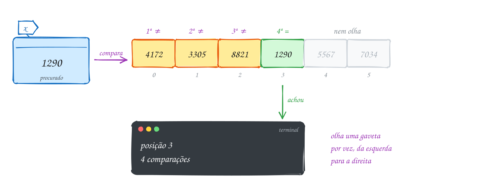</p>

O mesmo exemplo em C. A função conta as comparações num ponteiro, para você
ver o custo de cada busca:

```c
#include <stdio.h>

// devolve o índice de x em v[0..n-1], ou -1 se x não estiver lá
int busca(const int v[], int n, int x, int *comparacoes) {
    *comparacoes = 0;
    for (int i = 0; i < n; i++) {
        (*comparacoes)++;
        if (v[i] == x) {
            return i; // achou: para na hora
        }
    }
    return -1; // olhou todos e não achou
}

int main(void) {
    int matriculas[] = {4172, 3305, 8821, 1290, 5567, 7034};
    int n = sizeof matriculas / sizeof matriculas[0];
    int comparacoes;

    int pos = busca(matriculas, n, 1290, &comparacoes);
    printf("1290: posição %d, %d comparações\n", pos, comparacoes);

    pos = busca(matriculas, n, 9999, &comparacoes);
    printf("9999: posição %d, %d comparações\n", pos, comparacoes);
    return 0;
}
// Saída:
// 1290: posição 3, 4 comparações
// 9999: posição -1, 6 comparações
```

### Passo a passo

O teste de mesa da busca por 1290. Cada linha é uma volta do laço:

| i | v[i] | `v[i] == 1290`? | comparações | estado da gaveta |
| --- | --- | --- | --- | --- |
| 0 | 4172 | não | 1 | amarela (olhada) |
| 1 | 3305 | não | 2 | amarela |
| 2 | 8821 | não | 3 | amarela |
| 3 | 1290 | **sim** | 4 | verde: `return 3` |
| 4 | 5567 | | | cinza (nem olhada) |
| 5 | 7034 | | | cinza |

Para 9999, as 6 linhas seriam "não" e a função só devolve `-1` depois da
última.

Repara no fluxograma: são duas perguntas por volta. A primeira (`i < n?`)
protege o vetor; a segunda (`v[i] == x?`) é a busca de fato. O caminho verde
dá a volta três vezes antes de sair pelo Sim:

<p align="center">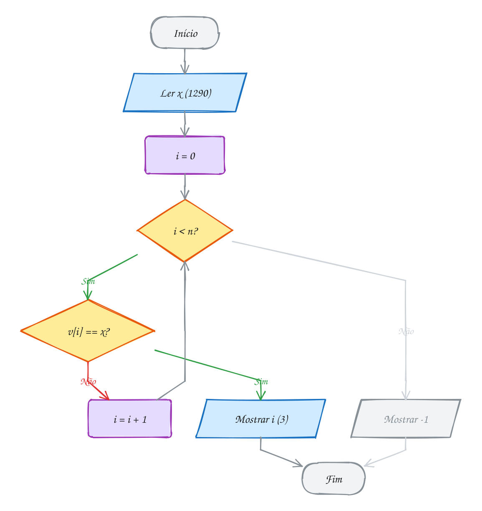</p>

> [!WARNING]
> O erro clássico é decidir cedo demais. Com `if (v[i] == x) return i; else
> return -1;` dentro do laço, a função olha **só o primeiro** elemento e
> desiste. "Não achei" só pode ser dito **depois** do laço, quando todos já
> foram olhados. O compilador não reclama: o programa roda e responde errado.

> [!TIP]
> **Por dentro do C:** `const int v[]` no parâmetro é, na verdade, um
> `const int *`: a função recebe só o endereço da gaveta 0, e `v[i]` é
> `*(v + i)`. Como as gavetas são vizinhas na memória, a busca sequencial lê
> os bytes em ordem, e o processador adora isso: ele traz da RAM blocos de 64
> bytes (uma **linha de cache**, 16 `int`) de uma vez. Por isso, em vetores
> pequenos (dezenas de elementos), a busca sequencial costuma ganhar de
> estruturas "mais espertas". Um truque antigo é a **sentinela**: copiar a
> chave para uma gaveta extra no fim. Aí o laço não precisa mais perguntar
> `i < n`, porque sempre vai achar. É uma pergunta a menos por volta (veja o
> exemplo A188).

> [!NOTE]
> **Pergunta para você:** se a matrícula 3305 aparecesse duas vezes no vetor,
> nas posições 1 e 4, qual posição a função devolveria? E quantas comparações
> ela faria para achar 7034? Responda e confira mudando o exemplo A187.

### Hora de praticar

Os arquivos ficam em [`0094-busca-sequencial/`](0094-busca-sequencial/). Os comandos funcionam de qualquer pasta do terminal. Nos exemplos, rode, mude, quebre e rode de novo. Nos exercícios, a resposta vai dentro do próprio arquivo. ★☆☆ é aquecimento, ★★☆ pede raciocínio e ★★★ é desafio.

**Exemplo A187 · A catraca procura a matrícula**

```c
#include <stdio.h>

// devolve o índice de x em v[0..n-1], ou -1 se x não estiver lá
int busca(const int v[], int n, int x, int *comparacoes) {
    *comparacoes = 0;
    for (int i = 0; i < n; i++) {
        (*comparacoes)++;
        if (v[i] == x) {
            return i; // achou: para na hora
        }
    }
    return -1; // olhou todos e não achou
}

int main(void) {
    int matriculas[] = {4172, 3305, 8821, 1290, 5567, 7034};
    int n = sizeof matriculas / sizeof matriculas[0];
    int comparacoes;

    int pos = busca(matriculas, n, 1290, &comparacoes);
    printf("1290: posição %d, %d comparações\n", pos, comparacoes);

    pos = busca(matriculas, n, 9999, &comparacoes);
    printf("9999: posição %d, %d comparações\n", pos, comparacoes);
    return 0;
}
// Saída:
// 1290: posição 3, 4 comparações
// 9999: posição -1, 6 comparações
```

```bash
~/LPEDC/rodar 13-busca-e-ordenacao/0094-busca-sequencial/A187.c
```

**Exemplo A188 · A sentinela no fim da fila**

```c
#include <stdio.h>

#define N 6

// busca comum: a cada volta, duas perguntas (i < n? e v[i] == x?)
int busca_comum(const int v[], int n, int x, int *perguntas) {
    *perguntas = 0;
    for (int i = 0; i < n; i++) {
        *perguntas += 2;          // i < n  e  v[i] == x
        if (v[i] == x) {
            return i;
        }
    }
    *perguntas += 1;              // o último i < n, que deu falso
    return -1;
}

// busca com sentinela: v precisa ter uma gaveta livre em v[n]
int busca_sentinela(int v[], int n, int x, int *perguntas) {
    v[n] = x;                     // a sentinela: agora o laço sempre acha
    int i = 0;
    *perguntas = 1;               // o primeiro v[i] != x
    while (v[i] != x) {
        i++;
        (*perguntas)++;
    }
    (*perguntas)++;               // i < n: achou a de verdade ou a sentinela?
    return i < n ? i : -1;
}

int main(void) {
    int matriculas[N + 1] = {4172, 3305, 8821, 1290, 5567, 7034}; // v[6] fica livre
    int procuradas[] = {4172, 7034, 9999};
    int p1, p2;

    printf("chave  posição  comum  sentinela\n");
    for (int k = 0; k < 3; k++) {
        int x = procuradas[k];
        int pos = busca_comum(matriculas, N, x, &p1);
        busca_sentinela(matriculas, N, x, &p2);
        printf("%5d  %7d  %5d  %9d\n", x, pos, p1, p2);
    }
    return 0;
}
// Saída:
// chave  posição  comum  sentinela
//  4172        0      2          2
//  7034        5     12          7
//  9999       -1     13          8
```

```bash
~/LPEDC/rodar 13-busca-e-ordenacao/0094-busca-sequencial/A188.c
```

#### Exercícios

**Exercício E559** · ★☆☆

O extrato do Pix do mês tem estes valores, em reais, do mais antigo para o
mais recente: 50, 120, 35, 50, 80, 50, 15. Você quer achar a ÚLTIMA
transação de R$ 50 (a mais recente). Escreva a função


```text
int ultima_ocorrencia(const int v[], int n, int x, int *comparacoes)
```


que devolve o índice da última ocorrência de x (ou -1) e conta as
comparações. Procure de um jeito que pare assim que achar. Teste com 50 e
com 200.


```text
Saída esperada:
Última de R$ 50: posição 5 (2 comparações)
Última de R$ 200: posição -1 (7 comparações)
```

**Dicas:**

1. Se você procurar do começo, só sabe que é a última depois de olhar tudo.
2. Comece em i = n - 1 e vá descendo até 0: a primeira que achar é a última.
3. Resposta esperada: posição 5 com 2 comparações (olha 15 e depois 50);
   para 200, -1 com 7 comparações.

```bash
~/LPEDC/rodar 13-busca-e-ordenacao/0094-busca-sequencial/E559.c
```

**Exercício E560** · ★☆☆

A portaria de uma festa confere o nome na lista de convidados. O programa
abaixo está quase pronto: falta só o miolo do laço que procura o nome.
Complete o trecho marcado para que, ao achar, ele guarde o índice em pos e
pare o laço.


```text
Saída esperada:
Lista: Ana Bruno Carla Diego Elisa
Carla: pode entrar (posição 2)
Fábio: não está na lista
```

**Dicas:**

1. Strings no C não se comparam com ==: isso compara endereços, não letras.
2. Use strcmp(convidados[i], nome), que devolve 0 quando são iguais.
3. Depois de pos = i, um break encerra o laço.
4. Resposta esperada: if (strcmp(convidados[i], nome) == 0) { pos = i;
   break; }

```bash
~/LPEDC/rodar 13-busca-e-ordenacao/0094-busca-sequencial/E560.c
```

**Exercício E561** · ★★☆

A tabela de preços de uma loja está em ordem crescente:
12, 19, 25, 31, 38, 44, 52, 60, 73, 89. Escreva duas funções que devolvem o
índice (ou -1) e contam quantos elementos olharam:


```text
busca: a busca sequencial comum;
busca_ordenada: aproveita a ordem e desiste assim que encontra um preço
MAIOR que o procurado.
```


Teste as duas com R$ 47 (não existe) e R$ 60.


```text
Saída esperada:
R$ 47: comum -1 (10 olhados), ordenada -1 (7 olhados)
R$ 60: comum 7 (8 olhados), ordenada 7 (8 olhados)
```

**Dicas:**

1. Num vetor crescente, se v[i] > x, todos depois de i também são maiores.
2. Na busca_ordenada, cada volta faz dois testes: v[i] == x e v[i] > x.
   Conte só um "olhado" por volta.
3. A melhora só aparece quando a chave NÃO está no vetor. Continua O(n).
4. Resposta esperada: a saída acima (47 para no 52, que é o 7º elemento).

```bash
~/LPEDC/rodar 13-busca-e-ordenacao/0094-busca-sequencial/E561.c
```

**Exercício E562** · ★★☆

O estoque do mercadinho é um vetor de structs:


```text
typedef struct { int codigo; char nome[20]; double preco; } Produto;
```


```text
{1010, "Arroz 5kg", 27.50}, {2050, "Café 500g", 18.90},
{3300, "Feijão 1kg", 8.40}, {4120, "Leite 1L", 5.20}
```


Escreva Produto *busca_produto(Produto v[], int n, int codigo), que devolve
o ENDEREÇO do produto dentro do vetor (ou NULL). No main, busque 2050,
mostre o produto e dê um reajuste de 10% pelo ponteiro devolvido. Depois
mostre estoque[1] direto do vetor e busque 9999.


```text
Saída esperada:
2050 Café 500g R$ 18.90
No vetor: Café 500g R$ 20.79
9999: não cadastrado
```

**Dicas:**

1. return &v[i]; devolve o endereço da gaveta i, não uma cópia.
2. Com o ponteiro, p->preco = p->preco * 1.10 muda o próprio vetor.
3. Sempre teste p != NULL antes de usar p->.
4. Resposta esperada: a saída acima (18,90 * 1,10 = 20,79).

```bash
~/LPEDC/rodar 13-busca-e-ordenacao/0094-busca-sequencial/E562.c
```

**Exercício E563** · ★★★

A função abaixo deveria devolver a PRIMEIRA posição da senha procurada no
painel do banco. Ela tem DOIS erros, de propósito. Rode com o rodar: o
AddressSanitizer vai reclamar de um deles. Ache os dois, explique e
conserte.


```text
Saída esperada (depois de consertar):
Primeira senha 7: posição 1
Primeira senha 99: posição -1
```

**Dicas:**

1. Quantas voltas o laço dá para n = 6? Qual o último i?
2. Mesmo sem o erro de memória, que posição ela devolve para 7: 1, 3 ou 5?
3. Resposta esperada: i <= n lê v[6], fora do vetor (stack-buffer-overflow);
   e, sem parar no primeiro encontro, pos guarda a ÚLTIMA ocorrência (5).
   Conserto: i < n e return i assim que achar.

```bash
~/LPEDC/rodar 13-busca-e-ordenacao/0094-busca-sequencial/E563.c
```

**Exercício E564** · ★★★

Na agenda do celular você liga muito mais para umas pessoas do que para
outras. Uma heurística antiga é o MOVER PARA A FRENTE: toda vez que a busca
acha um contato, ele vai para a posição 0 e os anteriores andam uma casa.

Agenda inicial: "Chefe", "Banco", "Pizzaria", "Ana", "Mãe".
Acessos, nessa ordem: Mãe, Ana, Mãe, Mãe, Pizzaria, Mãe.

Mostre a agenda depois de cada acesso e compare o total de comparações com
uma busca que nunca mexe na agenda.


```text
Saída esperada:
Mãe -> Mãe Chefe Banco Pizzaria Ana
Ana -> Ana Mãe Chefe Banco Pizzaria
Mãe -> Mãe Ana Chefe Banco Pizzaria
Mãe -> Mãe Ana Chefe Banco Pizzaria
Pizzaria -> Pizzaria Mãe Ana Chefe Banco
Mãe -> Mãe Pizzaria Ana Chefe Banco
Sem mover: 27 comparações
Movendo para a frente: 20 comparações
```

**Dicas:**

1. Use const char *agenda[5]: mover um contato é só mover ponteiros.
2. Achou na posição i? Guarde agenda[i], empurre agenda[i-1..0] uma casa
   para a direita (de trás para frente) e ponha o guardado em agenda[0].
3. Sem mover: Mãe custa 5 sempre, Ana 4, Pizzaria 3: 5+4+5+5+3+5 = 27.
4. Resposta esperada: a saída acima (5+5+2+1+5+2 = 20 comparações).

```bash
~/LPEDC/rodar 13-busca-e-ordenacao/0094-busca-sequencial/E564.c
```

---

## 0095 · Busca binária

Lembra da brincadeira "pensei num número de 1 a 100"? Quem chuta 1, 2, 3...
pode precisar de 100 tentativas. Quem chuta 50, ouve "menor", chuta 25 e assim
por diante, acerta em no máximo 7. A diferença é uma informação a mais: a
ordem.

A **busca binária** é esse jogo num vetor **ordenado**. Olhe a gaveta do
meio. Se ela tem a chave, acabou. Se a chave é maior, tudo o que está à
esquerda do meio é menor ainda e pode ser **descartado** de uma vez. Se é
menor, descarte a direita. Cada pergunta joga fora metade do que sobrou.

O código guarda o pedaço que ainda pode ter a chave entre dois índices, `ini`
e `fim` (os dois inclusive). Isso é um **invariante** (assunto 0078): "se `x`
está no vetor, está em `v[ini..fim]`". Cada volta encolhe o intervalo e mantém
o invariante. Quando `ini` passa de `fim`, o intervalo ficou vazio e a
resposta é `-1`.

Quantas voltas? Com 15 elementos sobram 15, 7, 3, 1: no máximo **4**. Com um
milhão, no máximo 20. Com um bilhão, 30. É o **O(log n)** do assunto 0077: a
cada vez que `n` dobra, a busca ganha só **uma** volta a mais.

O preço é a pré-condição: o vetor precisa estar em ordem. Num vetor bagunçado,
a busca binária não dá erro nenhum, só responde errado. Ordenar custa caro, e
é por isso que o resto do módulo existe.

Vamos ver na prática. O catálogo do atacadão tem 15 códigos em ordem e você
procura o 216. O meio (índice 7) tem 189, menor que 216: a metade esquerda
inteira fica cinza. O novo meio (11) tem 245, maior: a direita dele também
sai. Na terceira volta, o meio (9) é o 216:

<p align="center">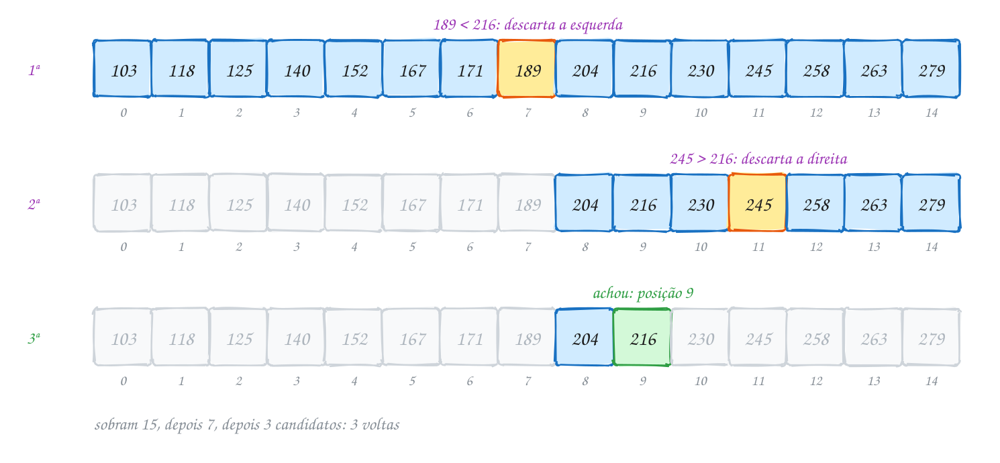</p>

O mesmo exemplo em C. O `printf` dentro do laço mostra o intervalo de cada
volta:

```c
#include <stdio.h>

// v está em ordem crescente; devolve o índice de x ou -1
int busca_binaria(const int v[], int n, int x, int *voltas) {
    int ini = 0, fim = n - 1;
    *voltas = 0;
    while (ini <= fim) {              // ainda sobra alguém no intervalo
        int meio = ini + (fim - ini) / 2;
        (*voltas)++;
        printf("  ini=%2d fim=%2d meio=%2d v[meio]=%d\n", ini, fim, meio, v[meio]);
        if (v[meio] == x) {
            return meio;
        }
        if (v[meio] < x) {
            ini = meio + 1;           // x só pode estar à direita
        } else {
            fim = meio - 1;           // x só pode estar à esquerda
        }
    }
    return -1;
}

int main(void) {
    int codigos[] = {103, 118, 125, 140, 152, 167, 171, 189,
                     204, 216, 230, 245, 258, 263, 279};
    int n = sizeof codigos / sizeof codigos[0];
    int voltas;

    printf("Procurando 216:\n");
    int pos = busca_binaria(codigos, n, 216, &voltas);
    printf("posição %d em %d voltas\n", pos, voltas);

    printf("Procurando 150:\n");
    pos = busca_binaria(codigos, n, 150, &voltas);
    printf("posição %d em %d voltas\n", pos, voltas);
    return 0;
}
// Saída:
// Procurando 216:
//   ini= 0 fim=14 meio= 7 v[meio]=189
//   ini= 8 fim=14 meio=11 v[meio]=245
//   ini= 8 fim=10 meio= 9 v[meio]=216
// posição 9 em 3 voltas
// Procurando 150:
//   ini= 0 fim=14 meio= 7 v[meio]=189
//   ini= 0 fim= 6 meio= 3 v[meio]=140
//   ini= 4 fim= 6 meio= 5 v[meio]=167
//   ini= 4 fim= 4 meio= 4 v[meio]=152
// posição -1 em 4 voltas
```

### Passo a passo

A busca por 150, que não está no catálogo. Repara no intervalo encolhendo até
ficar vazio:

| volta | ini | fim | meio | v[meio] | decisão |
| --- | --- | --- | --- | --- | --- |
| 1 | 0 | 14 | 7 | 189 | 189 > 150: `fim = 6` |
| 2 | 0 | 6 | 3 | 140 | 140 < 150: `ini = 4` |
| 3 | 4 | 6 | 5 | 167 | 167 > 150: `fim = 4` |
| 4 | 4 | 4 | 4 | 152 | 152 > 150: `fim = 3` |
| fim | 4 | 3 | | | `ini > fim`: devolve `-1` |

Repara que o `ini = 4` final é exatamente onde o 150 **deveria** estar para o
vetor continuar ordenado. Essa informação vale ouro (veja o exemplo A190).

Repara no fluxograma: diferente da busca sequencial, aqui são três perguntas
por volta. A volta termina mexendo em `ini` **ou** em `fim`, nunca nos dois:

<p align="center">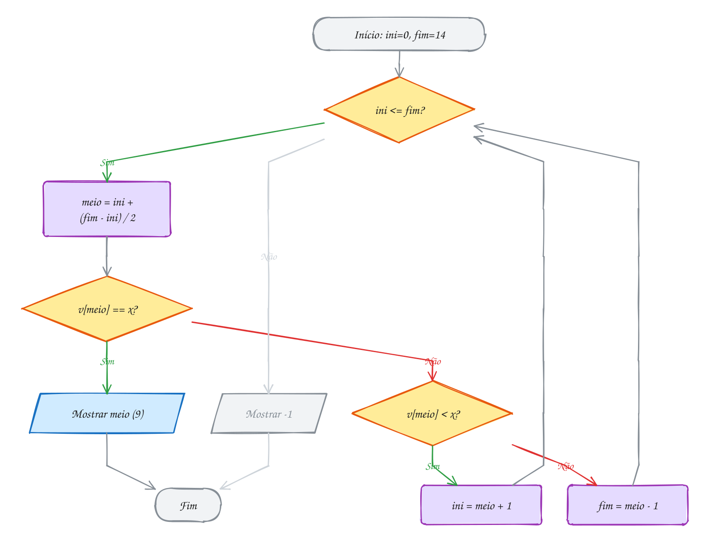</p>

> [!WARNING]
> Busca binária é famosa por erros de um. `while (ini < fim)` com o intervalo
> fechado `[ini, fim]` deixa de olhar o último candidato. E `fim = meio` (em
> vez de `meio - 1`) no intervalo fechado pode nunca encolher: com `ini = 4` e
> `fim = 4`, o meio é 4 de novo, para sempre. Escolha um estilo (fechado, como
> no A189, ou semiaberto `[ini, fim)`, como no A190) e siga as regras dele em
> todas as linhas.

> [!TIP]
> **Por dentro do C:** por que `ini + (fim - ini) / 2` e não
> `(ini + fim) / 2`? Num vetor com mais de 1 bilhão de elementos, `ini + fim`
> passa de `INT_MAX` (2.147.483.647) e dá **overflow**, que no C é
> comportamento indefinido. Esse bug ficou escondido por anos em
> implementações famosas da busca binária e só apareceu em 2006, quando os vetores ficaram
> grandes. Outro detalhe: a busca binária pula pela memória (índice 7, depois
> 11, depois 9), então não aproveita a linha de cache como a sequencial. Por
> isso, para vetores bem pequenos, a sequencial pode ganhar. A `stdlib.h` traz
> uma pronta, a `bsearch`, que você vai usar no assunto 0101.

> [!NOTE]
> **Pergunta para você:** quantas voltas o A189 dá para achar o 103, o
> primeiro do catálogo? E qual é o máximo de voltas para um vetor de 1000
> elementos? Faça o teste de mesa antes de rodar.

### Hora de praticar

Os arquivos ficam em [`0095-busca-binaria/`](0095-busca-binaria/). Os comandos funcionam de qualquer pasta do terminal. Nos exemplos, rode, mude, quebre e rode de novo. Nos exercícios, a resposta vai dentro do próprio arquivo. ★☆☆ é aquecimento, ★★☆ pede raciocínio e ★★★ é desafio.

**Exemplo A189 · O catálogo do atacadão**

```c
#include <stdio.h>

// v está em ordem crescente; devolve o índice de x ou -1
int busca_binaria(const int v[], int n, int x, int *voltas) {
    int ini = 0, fim = n - 1;
    *voltas = 0;
    while (ini <= fim) {              // ainda sobra alguém no intervalo
        int meio = ini + (fim - ini) / 2;
        (*voltas)++;
        printf("  ini=%2d fim=%2d meio=%2d v[meio]=%d\n", ini, fim, meio, v[meio]);
        if (v[meio] == x) {
            return meio;
        }
        if (v[meio] < x) {
            ini = meio + 1;           // x só pode estar à direita
        } else {
            fim = meio - 1;           // x só pode estar à esquerda
        }
    }
    return -1;
}

int main(void) {
    int codigos[] = {103, 118, 125, 140, 152, 167, 171, 189,
                     204, 216, 230, 245, 258, 263, 279};
    int n = sizeof codigos / sizeof codigos[0];
    int voltas;

    printf("Procurando 216:\n");
    int pos = busca_binaria(codigos, n, 216, &voltas);
    printf("posição %d em %d voltas\n", pos, voltas);

    printf("Procurando 150:\n");
    pos = busca_binaria(codigos, n, 150, &voltas);
    printf("posição %d em %d voltas\n", pos, voltas);
    return 0;
}
// Saída:
// Procurando 216:
//   ini= 0 fim=14 meio= 7 v[meio]=189
//   ini= 8 fim=14 meio=11 v[meio]=245
//   ini= 8 fim=10 meio= 9 v[meio]=216
// posição 9 em 3 voltas
// Procurando 150:
//   ini= 0 fim=14 meio= 7 v[meio]=189
//   ini= 0 fim= 6 meio= 3 v[meio]=140
//   ini= 4 fim= 6 meio= 5 v[meio]=167
//   ini= 4 fim= 4 meio= 4 v[meio]=152
// posição -1 em 4 voltas
```

```bash
~/LPEDC/rodar 13-busca-e-ordenacao/0095-busca-binaria/A189.c
```

**Exemplo A190 · Em qual faixa de frete cai o pacote?**

```c
#include <stdio.h>

// devolve a primeira posição com limite[i] >= peso (ou n, se nenhuma serve).
// Intervalo semiaberto [ini, fim): fim aponta uma gaveta DEPOIS do fim.
int primeira_faixa(const double limite[], int n, double peso, int *voltas) {
    int ini = 0, fim = n;
    *voltas = 0;
    while (ini < fim) {
        int meio = ini + (fim - ini) / 2;
        (*voltas)++;
        if (limite[meio] < peso) {
            ini = meio + 1;   // essa faixa é pequena demais
        } else {
            fim = meio;       // essa serve; talvez uma anterior também sirva
        }
    }
    return ini;
}

int main(void) {
    double limite[] = {1, 2, 5, 10, 20, 30};                    // até X kg
    double preco[] = {12.90, 18.50, 27.00, 39.90, 59.90, 84.00};
    int n = 6;
    double pesos[] = {7.5, 2.0, 0.3, 31.0};
    int voltas;

    for (int k = 0; k < 4; k++) {
        int f = primeira_faixa(limite, n, pesos[k], &voltas);
        if (f < n) {
            printf("%4.1f kg: faixa até %2.0f kg, R$ %5.2f (%d voltas)\n",
                   pesos[k], limite[f], preco[f], voltas);
        } else {
            printf("%4.1f kg: acima do limite (%d voltas)\n", pesos[k], voltas);
        }
    }
    return 0;
}
// Saída:
//  7.5 kg: faixa até 10 kg, R$ 39.90 (3 voltas)
//  2.0 kg: faixa até  2 kg, R$ 18.50 (3 voltas)
//  0.3 kg: faixa até  1 kg, R$ 12.90 (3 voltas)
// 31.0 kg: acima do limite (2 voltas)
```

```bash
~/LPEDC/rodar 13-busca-e-ordenacao/0095-busca-binaria/A190.c
```

#### Exercícios

**Exercício E565** · ★☆☆

Os armários livres do vestiário do clube estão numa lista ordenada, e o
programa abaixo procura dois números nela. SEM RODAR, escreva a saída exata
deste programa. Faça o teste de mesa com
ini, fim e meio em cada volta. Só depois rode para conferir.

**Dicas:**

1. n = 9, então a primeira volta tem ini = 0, fim = 8 e meio = 4.
2. Para o 5: depois de cada volta, anote o novo intervalo [ini, fim].
3. O laço para quando ini fica maior que fim.
4. Resposta esperada: para 47 aparecem meio=4 (30), meio=6 (47) e "achou na
   posição 6"; para 5 aparecem meio=4 (30), meio=1 (9), meio=0 (4) e "não
   achou".

```bash
~/LPEDC/rodar 13-busca-e-ordenacao/0095-busca-binaria/E565.c
```

**Exercício E566** · ★☆☆

Escreva a busca binária em versão RECURSIVA:


```text
int busca_rec(const int v[], int ini, int fim, int x)
```


que procura x em v[ini..fim] e devolve o índice ou -1. Teste com esta
lista de CEPs em ordem crescente (guardados como int; mostre com %08d para
o zero da frente aparecer):


```text
1310100, 4538132, 20040002, 30130010, 40020000,
50030230, 60060440, 70040010, 80010000, 90010150
```


```text
Saída esperada:
CEP 40020000: posição 4
CEP 22222222: posição -1
```

**Dicas:**

1. Dois casos base: intervalo vazio (ini > fim) e achou (v[meio] == x).
2. Caso recursivo: chame a função de novo só na metade que interessa.
3. Não esqueça o return antes da chamada recursiva: sem ele, o resultado
   lá de baixo se perde.
4. Resposta esperada: a saída acima; a primeira chamada é
   busca_rec(ceps, 0, 9, x).

```bash
~/LPEDC/rodar 13-busca-e-ordenacao/0095-busca-binaria/E566.c
```

**Exercício E567** · ★★☆

As avaliações de um app (de 1 a 5 estrelas) já estão ordenadas:


```text
1, 1, 2, 3, 3, 3, 3, 4, 4, 5, 5, 5
```


Para cada nota de 1 a 5, mostre em que posições ela aparece e quantas vezes,
usando DUAS buscas binárias por nota (nada de percorrer o vetor contando):
uma acha a primeira posição com valor >= nota, a outra a primeira posição
com valor > nota.


```text
Saída esperada:
Nota 1: posições 0 a 1, 2 avaliações
Nota 2: posições 2 a 2, 1 avaliação
Nota 3: posições 3 a 6, 4 avaliações
Nota 4: posições 7 a 8, 2 avaliações
Nota 5: posições 9 a 11, 3 avaliações
```

**Dicas:**

1. Use o estilo semiaberto do exemplo A190: ini = 0, fim = n, while (ini < fim).
2. As duas funções só diferem numa comparação: v[meio] < x ou v[meio] <= x.
3. Se a primeira dá a e a segunda dá b, a nota aparece b - a vezes, nas
   posições a até b - 1.
4. Resposta esperada: a saída acima. Com um milhão de avaliações, cada
   contagem custa umas 40 voltas, e não um milhão.

```bash
~/LPEDC/rodar 13-busca-e-ordenacao/0095-busca-binaria/E567.c
```

**Exercício E568** · ★★☆

Busca binária também funciona com strings, desde que estejam em ordem.
Escreva int busca_nome(const char *v[], int n, const char *nome, int *voltas)
e teste com as capitais abaixo, procurando "Natal" e "Palmas":


```text
"Aracaju", "Belém", "Boa Vista", "Cuiabá", "Curitiba", "Florianópolis",
"Fortaleza", "Goiânia", "Maceió", "Manaus", "Natal", "Recife",
"Salvador", "São Paulo", "Teresina", "Vitória"
```


```text
Saída esperada:
Natal: posição 10 (4 voltas)
Palmas: posição -1 (4 voltas)
```

**Dicas:**

1. strcmp(a, b) devolve negativo se a vem antes, 0 se iguais, positivo se
   a vem depois. É o "v[meio] < x" das strings.
2. Chame strcmp uma vez por volta e guarde o resultado num int.
3. Cuidado com acentos: strcmp compara BYTES. "Belo Horizonte" viria antes
   de "Belém", porque o 'é' em UTF-8 começa com um byte maior que o 'o'.
   Esta lista foi escolhida para não cair nessa armadilha.
4. Resposta esperada: a saída acima (meios 7, 11, 9 e 10 nas duas buscas).

```bash
~/LPEDC/rodar 13-busca-e-ordenacao/0095-busca-binaria/E568.c
```

**Exercício E569** · ★★★

Alguém "modernizou" a busca binária trocando int por size_t, "porque índice
nunca é negativo". O código compila sem nenhum aviso, acha o 35... e
explode ao procurar o 3. O erro é de propósito: rode com o rodar e leia o
que o AddressSanitizer diz. Explique o que acontece e conserte, mantendo
size_t.


```text
Saída esperada (depois de consertar):
35: posição 3
3: posição -1
vazio: posição -1
```

**Dicas:**

1. Faça o teste de mesa da busca pelo 3: quanto vale meio na última volta?
2. Quanto é 0 - 1 num tipo sem sinal? (assunto 0008)
3. O vetor vazio (n = 0) tem o mesmo problema logo na primeira linha.
4. Resposta esperada: fim = meio - 1 com meio = 0 dá a volta para SIZE_MAX,
   ini <= fim continua verdadeiro e v[meio] lê longe do vetor. Conserto:
   intervalo semiaberto (fim = n, while (ini < fim), fim = meio), que nunca
   subtrai 1 de um size_t.

```bash
~/LPEDC/rodar 13-busca-e-ordenacao/0095-busca-binaria/E569.c
```

**Exercício E570** · ★★★

Busca binária não precisa de vetor: basta uma pergunta de sim ou não que
muda de resposta uma única vez. Um terreno quadrado tem que caber numa área
de A m². Qual o maior lado INTEIRO possível? Ou seja: o maior L com
L * L <= A. Sem sqrt: faça uma busca binária no intervalo de 0 a A e conte
as voltas. Teste com 50, 1000000, 2147395600 e 2147483647.


```text
Saída esperada:
50 m²: lado 7 m (6 voltas)
1000000 m²: lado 1000 m (20 voltas)
2147395600 m²: lado 46340 m (31 voltas)
2147483647 m²: lado 46340 m (31 voltas)
```

**Dicas:**

1. Para L = 0, 1, 2, ... a resposta de "L * L <= A?" é sim, sim, ..., não,
   não. Você procura o último sim.
2. Use long long: com int, meio * meio estoura bem antes de 2 bilhões.
3. Invariante: a resposta está em [ini, fim]. Se meio serve, ini = meio;
   senão, fim = meio - 1. Pare quando ini == fim.
4. Com ini = meio, calcule meio arredondando para CIMA,
   ini + (fim - ini + 1) / 2; senão, com fim = ini + 1, o laço nunca acaba.
5. Resposta esperada: a saída acima (46340² = 2147395600).

```bash
~/LPEDC/rodar 13-busca-e-ordenacao/0095-busca-binaria/E570.c
```

---

## 0096 · Bubble sort

No app de delivery, cinco restaurantes prometem entregar em 42, 17, 35, 8 e
23 minutos. Você quer a lista do mais rápido para o mais lento. Para usar a
busca binária do assunto anterior, ou só para mostrar bonito, o vetor precisa
estar **ordenado**. Como ordenar?

O **bubble sort** (ordenação por bolha) é o algoritmo mais simples de
explicar: percorra o vetor comparando **vizinhos**, `v[j]` com `v[j + 1]`. Se
o da esquerda for maior, troque os dois. Isso é uma **passada**.

Repara no que uma passada faz com o maior elemento: ele ganha todas as
comparações e vai sendo carregado para a direita, troca após troca, até a
última gaveta. Ele "borbulha" até o fim (ou afunda, depende do seu ponto de
vista). Depois da passada 1, o maior está no lugar certo. Depois da passada 2,
o segundo maior também. Daí vêm duas regras:

- **n - 1 passadas bastam**: com os `n - 1` maiores no lugar, o que sobra só
  pode ser o menor, já na frente.
- a passada `k` não precisa olhar as últimas `k - 1` gavetas: elas já estão
  prontas. O laço interno vai até `j < n - passada`.

E uma terceira, a **bandeira** (`bool trocou`): se uma passada inteira não
trocou ninguém, todos os vizinhos estão em ordem, então o vetor está
ordenado. Pode parar.

Custo: no pior caso (vetor ao contrário), `(n - 1) + (n - 2) + ... + 1 =
n(n - 1)/2` comparações, e todas viram trocas. É **O(n²)**. Com a bandeira, o
melhor caso (vetor já em ordem) cai para uma passada só: `n - 1` comparações,
**O(n)**.

Vamos ver na prática. Na passada 1 o 42 ganha de todo mundo e afunda até o
fim (verde). Na passada 2 o 35 encontra o seu lugar. Na 3, o 8 chega à frente.
A passada 4 não troca nada, e a bandeira encerra:

<p align="center">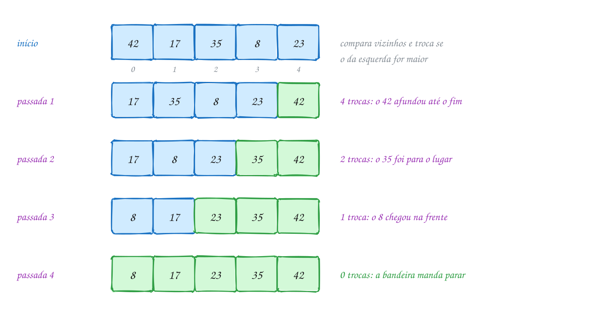</p>

O mesmo exemplo em C, contando comparações e trocas:

```c
#include <stdio.h>
#include <stdbool.h>

void mostra(const int v[], int n) {
    for (int i = 0; i < n; i++) {
        printf("%3d", v[i]);
    }
    printf("\n");
}

void bubble_sort(int v[], int n) {
    int comparacoes = 0, trocas = 0;
    for (int passada = 1; passada < n; passada++) {
        bool trocou = false;
        // os últimos passada-1 já estão no lugar: nem olha
        for (int j = 0; j < n - passada; j++) {
            comparacoes++;
            if (v[j] > v[j + 1]) {      // vizinhos fora de ordem: troca
                int aux = v[j];
                v[j] = v[j + 1];
                v[j + 1] = aux;
                trocas++;
                trocou = true;
            }
        }
        printf("passada %d:", passada);
        mostra(v, n);
        if (!trocou) {
            break;                      // nenhuma troca: já está ordenado
        }
    }
    printf("%d comparações, %d trocas\n", comparacoes, trocas);
}

int main(void) {
    int minutos[] = {42, 17, 35, 8, 23};
    int n = 5;

    printf("início:   ");
    mostra(minutos, n);
    bubble_sort(minutos, n);
    return 0;
}
// Saída:
// início:    42 17 35  8 23
// passada 1: 17 35  8 23 42
// passada 2: 17  8 23 35 42
// passada 3:  8 17 23 35 42
// passada 4:  8 17 23 35 42
// 10 comparações, 7 trocas
```

### Passo a passo

A passada 1 por dentro. Cada linha é uma comparação de vizinhos; em negrito, o
par comparado:

| j | antes | `v[j] > v[j+1]`? | depois |
| --- | --- | --- | --- |
| 0 | **42 17** 35 8 23 | sim, troca | 17 42 35 8 23 |
| 1 | 17 **42 35** 8 23 | sim, troca | 17 35 42 8 23 |
| 2 | 17 35 **42 8** 23 | sim, troca | 17 35 8 42 23 |
| 3 | 17 35 8 **42 23** | sim, troca | 17 35 8 23 42 |

Somando as quatro passadas: 4 + 3 + 2 + 1 = **10 comparações** e
4 + 2 + 1 + 0 = **7 trocas**. Esse 7 não é acaso: é o número de **inversões**
do vetor original, os pares que estão na ordem errada (42 com 17, 42 com 35,
42 com 8, 42 com 23, 17 com 8, 35 com 8 e 35 com 23). Cada troca de vizinhos
desfaz exatamente uma inversão.

Repara no fluxograma: são dois laços. O de dentro (`j`) faz uma passada; o de
fora repete passadas enquanto a bandeira disser que houve troca:

<p align="center">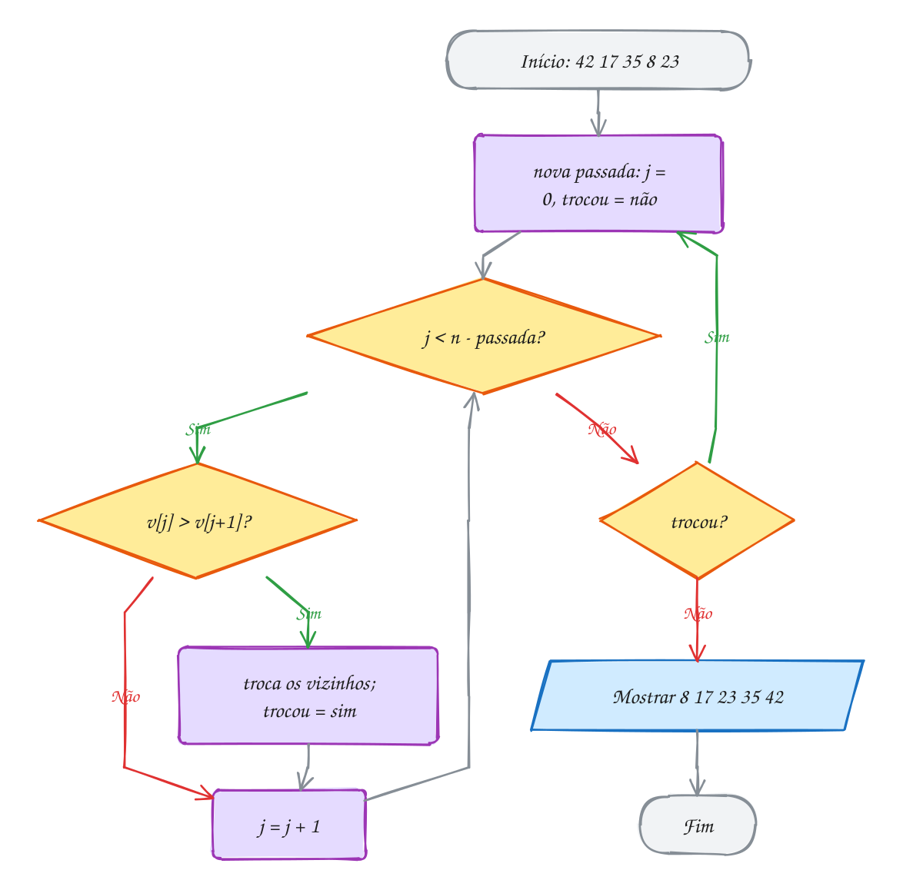</p>

> [!WARNING]
> Troca sem variável auxiliar não troca nada: `v[j] = v[j + 1]; v[j + 1] =
> v[j];` deixa os dois com o mesmo valor, porque o primeiro valor foi apagado
> na primeira linha. E cuidado com o limite do laço interno: com
> `j < n`, a última volta lê `v[n]`, uma gaveta depois do fim. O
> AddressSanitizer pega; o C sozinho, não.

> [!TIP]
> **Por dentro do C:** cada troca são **três** escritas na memória (`aux`,
> `v[j]`, `v[j + 1]`), e o bubble faz uma troca por inversão. Num vetor
> aleatório, metade dos pares está invertida: são cerca de `n²/4` trocas, ou
> `3n²/4` escritas. Com 100 mil elementos, isso dá uns 7,5 bilhões de
> escritas. É por isso que o bubble sort quase nunca aparece em código de
> verdade. Ele vale como primeira ordenação: mostra a ideia de inversão, de
> passada e de "a parte do fim já está pronta", que voltam em todos os outros.

> [!NOTE]
> **Pergunta para você:** quantas passadas o bubble com bandeira faz no vetor
> `8 17 23 35 42`, que já está ordenado? E em `17 23 35 42 8`, com o menor lá
> no fim? Faça a previsão e teste no A191.

### Hora de praticar

Os arquivos ficam em [`0096-bubble-sort/`](0096-bubble-sort/). Os comandos funcionam de qualquer pasta do terminal. Nos exemplos, rode, mude, quebre e rode de novo. Nos exercícios, a resposta vai dentro do próprio arquivo. ★☆☆ é aquecimento, ★★☆ pede raciocínio e ★★★ é desafio.

**Exemplo A191 · Os tempos de entrega borbulhando**

```c
#include <stdio.h>
#include <stdbool.h>

void mostra(const int v[], int n) {
    for (int i = 0; i < n; i++) {
        printf("%3d", v[i]);
    }
    printf("\n");
}

void bubble_sort(int v[], int n) {
    int comparacoes = 0, trocas = 0;
    for (int passada = 1; passada < n; passada++) {
        bool trocou = false;
        // os últimos passada-1 já estão no lugar: nem olha
        for (int j = 0; j < n - passada; j++) {
            comparacoes++;
            if (v[j] > v[j + 1]) {      // vizinhos fora de ordem: troca
                int aux = v[j];
                v[j] = v[j + 1];
                v[j + 1] = aux;
                trocas++;
                trocou = true;
            }
        }
        printf("passada %d:", passada);
        mostra(v, n);
        if (!trocou) {
            break;                      // nenhuma troca: já está ordenado
        }
    }
    printf("%d comparações, %d trocas\n", comparacoes, trocas);
}

int main(void) {
    int minutos[] = {42, 17, 35, 8, 23};
    int n = 5;

    printf("início:   ");
    mostra(minutos, n);
    bubble_sort(minutos, n);
    return 0;
}
// Saída:
// início:    42 17 35  8 23
// passada 1: 17 35  8 23 42
// passada 2: 17  8 23 35 42
// passada 3:  8 17 23 35 42
// passada 4:  8 17 23 35 42
// 10 comparações, 7 trocas
```

```bash
~/LPEDC/rodar 13-busca-e-ordenacao/0096-bubble-sort/A191.c
```

**Exemplo A192 · A bandeirinha que economiza passadas**

```c
#include <stdio.h>
#include <stdbool.h>

// versão básica: sempre faz todas as passadas
int bubble_basico(int v[], int n) {
    int comparacoes = 0;
    for (int passada = 1; passada < n; passada++) {
        for (int j = 0; j < n - passada; j++) {
            comparacoes++;
            if (v[j] > v[j + 1]) {
                int aux = v[j];
                v[j] = v[j + 1];
                v[j + 1] = aux;
            }
        }
    }
    return comparacoes;
}

// com a bandeira: para na primeira passada sem troca
int bubble_bandeira(int v[], int n) {
    int comparacoes = 0;
    bool trocou = true;
    for (int passada = 1; passada < n && trocou; passada++) {
        trocou = false;
        for (int j = 0; j < n - passada; j++) {
            comparacoes++;
            if (v[j] > v[j + 1]) {
                int aux = v[j];
                v[j] = v[j + 1];
                v[j + 1] = aux;
                trocou = true;
            }
        }
    }
    return comparacoes;
}

int main(void) {
    // ranking quase em ordem: só o último está fora do lugar
    int a[] = {12, 15, 21, 30, 34, 47, 52, 49};
    int b[] = {12, 15, 21, 30, 34, 47, 52, 49};
    // ao contrário: o pior caso
    int c[] = {52, 49, 47, 34, 30, 21, 15, 12};
    int d[] = {52, 49, 47, 34, 30, 21, 15, 12};

    printf("quase ordenado: básico %d, com bandeira %d\n",
           bubble_basico(a, 8), bubble_bandeira(b, 8));
    printf("invertido:      básico %d, com bandeira %d\n",
           bubble_basico(c, 8), bubble_bandeira(d, 8));
    return 0;
}
// Saída:
// quase ordenado: básico 28, com bandeira 13
// invertido:      básico 28, com bandeira 28
```

```bash
~/LPEDC/rodar 13-busca-e-ordenacao/0096-bubble-sort/A192.c
```

#### Exercícios

**Exercício E571** · ★☆☆

No bolão da firma, os pontos de seis participantes são 18, 31, 7, 25, 31 e
12. Ordene com bubble sort (com a bandeira) em ordem DECRESCENTE, do líder
para o lanterna, e mostre o ranking.


```text
Saída esperada:
Ranking: 31 31 25 18 12 7
```

**Dicas:**

1. Parta do bubble do exemplo A191.
2. Basta mudar uma comparação: troque quando o da esquerda for MENOR.
3. Os dois 31 empatados não são trocados entre si (31 < 31 é falso).
4. Resposta esperada: Ranking: 31 31 25 18 12 7

```bash
~/LPEDC/rodar 13-busca-e-ordenacao/0096-bubble-sort/E571.c
```

**Exercício E572** · ★☆☆

A fila do caixa preferencial tem senhas fora de ordem: 9, 4, 7, 1, 5. O
programa abaixo ordena com bubble sort (sem bandeira) e mostra o vetor no
fim de cada passada. SEM RODAR, escreva a saída exata, incluindo o total
de trocas. Depois rode e confira.

**Dicas:**

1. Na passada 1, o 9 ganha todas as comparações e vai para o fim.
2. Sem bandeira, o programa faz as 4 passadas mesmo se o vetor já estiver
   ordenado antes.
3. Conte as inversões do vetor original: é o total de trocas.
4. Resposta esperada: passada 1: 4 7 1 5 9; passada 2: 4 1 5 7 9; passada
   3: 1 4 5 7 9; passada 4: 1 4 5 7 9; trocas: 7 (as inversões: 9 com 4, 7, 1
   e 5; 4 com 1; 7 com 1 e 5).

```bash
~/LPEDC/rodar 13-busca-e-ordenacao/0096-bubble-sort/E572.c
```

**Exercício E573** · ★★☆

Este bubble sort deveria ordenar as idades da turma de natação: 34, 19,
27, 45, 22. Ele tem DOIS erros, de propósito. Rode: o sanitizer
("runtime error: index 5 out of bounds") acusa um deles. Ache os dois, explique e conserte.


```text
Saída esperada (depois de consertar):
19 22 27 34 45
```

**Dicas:**

1. Na passada 1, qual o maior valor de j? E de j + 1?
2. Conserte o primeiro erro e rode de novo: alguma idade sumiu e outra
   apareceu duas vezes?
3. Faça o teste de mesa da troca com idades[0] = 34 e idades[1] = 19.
4. Resposta esperada: o laço interno deve ser j < n - passada (com + 1, ele
   lê idades[5], fora do vetor); e a troca precisa de uma variável
   auxiliar: int aux = idades[j]; idades[j] = idades[j + 1];
   idades[j + 1] = aux;

```bash
~/LPEDC/rodar 13-busca-e-ordenacao/0096-bubble-sort/E573.c
```

**Exercício E574** · ★★☆

Monte a tabela do campeonato. Cada time é uma struct:


```text
typedef struct { char nome[16]; int pontos; int vitorias; } Time;
```


```text
{"Fortaleza", 68, 19}, {"Flamengo", 70, 20}, {"Botafogo", 79, 23},
{"Palmeiras", 70, 21}, {"Inter", 65, 18}
```


Ordene com bubble sort: mais pontos primeiro; empatou nos pontos, mais
vitórias primeiro. Escreva uma função bool vem_depois(const Time *a,
const Time *b) com o critério e use-a no lugar do ">" do bubble.


```text
Saída esperada:
1º Botafogo   79 pts 23 vit
2º Palmeiras  70 pts 21 vit
3º Flamengo   70 pts 20 vit
4º Fortaleza  68 pts 19 vit
5º Inter      65 pts 18 vit
```

**Dicas:**

1. Primeiro compare os pontos; só se forem iguais, compare as vitórias.
2. Struct se copia inteira com =: Time aux = tabela[j]; funciona.
3. Para alinhar: printf("%dº %-10s %2d pts %2d vit\n", ...).
4. Resposta esperada: a saída acima (Palmeiras passa o Flamengo pelas
   vitórias).

```bash
~/LPEDC/rodar 13-busca-e-ordenacao/0096-bubble-sort/E574.c
```

**Exercício E575** · ★★★

O bubble tem um ponto fraco: elemento pequeno no fim (uma "tartaruga") anda
só UMA casa para a esquerda por passada. No vetor 2, 3, 4, 5, 6, 7, 8, 1, o
1 precisa de 7 passadas para chegar à frente.

O SHAKER SORT (coqueteleira) alterna o sentido: uma passada de ida
(esquerda para a direita, leva o maior para o fim) e uma de volta (direita
para a esquerda, traz o menor para a frente). Implemente o bubble com
bandeira e o shaker, conte passadas (ida e volta contam uma cada) e
comparações, e compare no vetor acima.


```text
Saída esperada:
bubble: 7 passadas, 28 comparações
shaker: 3 passadas, 18 comparações
resultado: 1 2 3 4 5 6 7 8
```

**Dicas:**

1. Guarde a parte ainda bagunçada em v[ini..fim]. Depois da ida, fim--;
   depois da volta, ini++.
2. Na volta, compare v[j - 1] com v[j], com j descendo de fim até ini + 1.
3. Pare quando uma passada (de ida ou de volta) não trocar nada.
4. Resposta esperada: a saída acima. A ida troca só o 8 com o 1, a volta
   traz o 1 para a frente, e a terceira passada confirma que acabou.

```bash
~/LPEDC/rodar 13-busca-e-ordenacao/0096-bubble-sort/E575.c
```

**Exercício E576** · ★★★

Uma INVERSÃO é um par de posições i < j com v[i] > v[j]. Escreva:


```text
int inversoes(const int v[], int n)      conta os pares, com dois laços
int trocas_bubble(int v[], int n)        ordena e devolve quantas trocas fez
```


Teste com 42 17 35 8 23, com 6 5 4 3 2 1 e com 3 1 2 (conte as inversões
ANTES de ordenar). Depois explique, num comentário, por que os dois números
sempre dão iguais.


```text
Saída esperada:
n = 5: 7 inversões, 7 trocas
n = 6: 15 inversões, 15 trocas
n = 3: 2 inversões, 2 trocas
```

**Dicas:**

1. Na inversoes, o j começa em i + 1.
2. O que acontece com as inversões quando você troca dois VIZINHOS a > b?
   E com os outros pares?
3. No vetor invertido, todo par é uma inversão: n(n - 1)/2.
4. Resposta esperada: a saída acima. Cada troca de vizinhos desfaz
   exatamente uma inversão e não cria nenhuma; o vetor ordenado tem zero.

```bash
~/LPEDC/rodar 13-busca-e-ordenacao/0096-bubble-sort/E576.c
```

---

## 0097 · Selection sort

Final da bateria de kart com os amigos. Os tempos da melhor volta, em
segundos, foram 58, 31, 47, 19 e 26. Para montar o pódio, você faz o óbvio:
procura o **menor** tempo e chama o primeiro lugar. Depois procura o menor
entre os que **sobraram** e chama o segundo. E assim por diante.

Isso é o **selection sort** (ordenação por seleção). O vetor fica dividido em
duas partes: à esquerda, a parte **pronta** (os menores, já na ordem final);
à direita, o resto. Cada passada `i`:

1. procura o **índice** do menor elemento em `v[i..n-1]`;
2. troca esse menor com `v[i]`. Pronto: a gaveta `i` nunca mais muda.

Repare que a passada guarda o **índice** do menor, não o valor. É o índice
que permite fazer a troca no fim. É a mesma ideia do padrão "maior/menor" do
assunto 0030, rodando de novo a cada passada.

Custo: a passada 0 compara `n - 1` vezes, a 1 compara `n - 2` vezes... No
total, `n(n - 1)/2` comparações, **sempre**. Vetor bagunçado, ordenado ou ao
contrário, tanto faz: para saber qual é o menor, é preciso olhar todos os que
sobraram. Então é **O(n²)** em todos os casos.

A vantagem está nas **trocas**: no máximo **uma por passada**, ou seja, no
máximo `n - 1`. O bubble pode fazer `n(n - 1)/2`. Quando mover um elemento é
caro (structs grandes, um registro inteiro), isso pesa.

Vamos ver na prática. Em cada linha, a gaveta roxa é a posição `i` que vai
receber o menor, e a amarela é o menor que a passada achou. Depois da troca,
a gaveta vira verde e não sai mais do lugar:

<p align="center">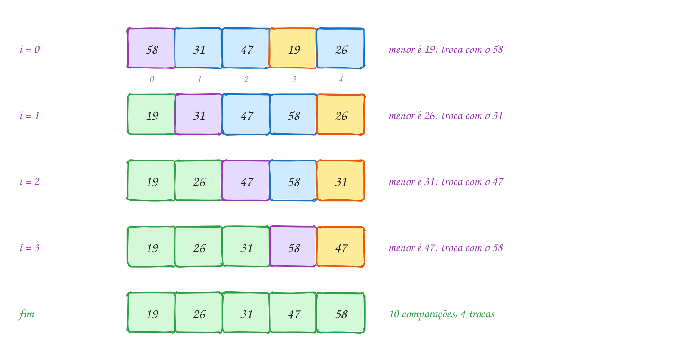</p>

O mesmo exemplo em C:

```c
#include <stdio.h>

void mostra(const int v[], int n) {
    for (int i = 0; i < n; i++) {
        printf("%3d", v[i]);
    }
    printf("\n");
}

void selection_sort(int v[], int n) {
    int comparacoes = 0, trocas = 0;
    for (int i = 0; i < n - 1; i++) {
        int menor = i;                    // índice do menor de v[i..n-1]
        for (int j = i + 1; j < n; j++) {
            comparacoes++;
            if (v[j] < v[menor]) {
                menor = j;
            }
        }
        if (menor != i) {                 // uma troca só por passada
            int aux = v[i];
            v[i] = v[menor];
            v[menor] = aux;
            trocas++;
        }
        printf("i = %d:  ", i);
        mostra(v, n);
    }
    printf("%d comparações, %d trocas\n", comparacoes, trocas);
}

int main(void) {
    int tempos[] = {58, 31, 47, 19, 26}; // segundos por volta
    int n = 5;

    printf("início: ");
    mostra(tempos, n);
    selection_sort(tempos, n);
    return 0;
}
// Saída:
// início:  58 31 47 19 26
// i = 0:   19 31 47 58 26
// i = 1:   19 26 47 58 31
// i = 2:   19 26 31 58 47
// i = 3:   19 26 31 47 58
// 10 comparações, 4 trocas
```

### Passo a passo

A passada `i = 0` por dentro. O `menor` começa apontando para a gaveta 0 e
vai sendo atualizado:

| j | v[j] | v[menor] antes | `v[j] < v[menor]`? | menor |
| --- | --- | --- | --- | --- |
| | | | | 0 (58) |
| 1 | 31 | 58 | sim | 1 (31) |
| 2 | 47 | 31 | não | 1 |
| 3 | 19 | 31 | sim | 3 (19) |
| 4 | 26 | 19 | não | 3 |

Fim da passada: troca `v[0]` (58) com `v[3]` (19). Quatro comparações, uma
troca. As passadas seguintes fazem 3, 2 e 1 comparações: 10 no total.

Repara no fluxograma: a caixa "acha o menor" esconde um laço inteiro (a
tabela acima). A troca acontece **fora** dele, uma vez por passada:

<p align="center">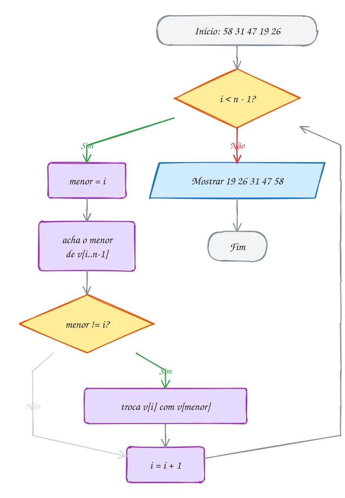</p>

> [!WARNING]
> O erro mais comum é trocar **dentro** do laço que procura o menor: toda vez
> que acha alguém menor, já troca. O vetor até sai ordenado, mas você perdeu a
> única vantagem do algoritmo e passou a fazer trocas como o bubble. Outro
> clássico: esquecer de reiniciar `menor = i` a cada passada. Aí `menor`
> continua apontando para uma gaveta da parte pronta, e a troca bagunça o que
> já estava certo.

> [!TIP]
> **Por dentro do C:** a troca do selection é de **longa distância**: o 19
> salta da gaveta 3 para a 0 de uma vez, e o 58 vai para a 3 passando por cima
> do 31 e do 47. Esse salto é o que torna o selection **instável**: dois
> elementos iguais podem trocar de ordem entre si (o exemplo A194 mostra a
> Bia passando na frente da Ana). Já em custo de memória ele é ótimo: ordena
> no próprio vetor, com uma variável `aux` e dois índices. Isso se chama
> ordenar **in-place**, com **O(1)** de memória extra.

> [!NOTE]
> **Pergunta para você:** quantas comparações e quantas trocas o selection faz
> no vetor `19 26 31 47 58`, que já está ordenado? E o bubble com bandeira, do
> assunto anterior? Responda antes de rodar.

### Hora de praticar

Os arquivos ficam em [`0097-selection-sort/`](0097-selection-sort/). Os comandos funcionam de qualquer pasta do terminal. Nos exemplos, rode, mude, quebre e rode de novo. Nos exercícios, a resposta vai dentro do próprio arquivo. ★☆☆ é aquecimento, ★★☆ pede raciocínio e ★★★ é desafio.

**Exemplo A193 · O pódio do kart, um de cada vez**

```c
#include <stdio.h>

void mostra(const int v[], int n) {
    for (int i = 0; i < n; i++) {
        printf("%3d", v[i]);
    }
    printf("\n");
}

void selection_sort(int v[], int n) {
    int comparacoes = 0, trocas = 0;
    for (int i = 0; i < n - 1; i++) {
        int menor = i;                    // índice do menor de v[i..n-1]
        for (int j = i + 1; j < n; j++) {
            comparacoes++;
            if (v[j] < v[menor]) {
                menor = j;
            }
        }
        if (menor != i) {                 // uma troca só por passada
            int aux = v[i];
            v[i] = v[menor];
            v[menor] = aux;
            trocas++;
        }
        printf("i = %d:  ", i);
        mostra(v, n);
    }
    printf("%d comparações, %d trocas\n", comparacoes, trocas);
}

int main(void) {
    int tempos[] = {58, 31, 47, 19, 26}; // segundos por volta
    int n = 5;

    printf("início: ");
    mostra(tempos, n);
    selection_sort(tempos, n);
    return 0;
}
// Saída:
// início:  58 31 47 19 26
// i = 0:   19 31 47 58 26
// i = 1:   19 26 47 58 31
// i = 2:   19 26 31 58 47
// i = 3:   19 26 31 47 58
// 10 comparações, 4 trocas
```

```bash
~/LPEDC/rodar 13-busca-e-ordenacao/0097-selection-sort/A193.c
```

**Exemplo A194 · A troca que passa por cima**

```c
#include <stdio.h>

typedef struct {
    int nota;
    char nome[8];
} Aluno;

void mostra(const Aluno v[], int n) {
    for (int i = 0; i < n; i++) {
        printf(" %d-%s", v[i].nota, v[i].nome);
    }
    printf("\n");
}

// selection sort por nota
void selection_sort(Aluno v[], int n) {
    for (int i = 0; i < n - 1; i++) {
        int menor = i;
        for (int j = i + 1; j < n; j++) {
            if (v[j].nota < v[menor].nota) {
                menor = j;
            }
        }
        if (menor != i) {
            Aluno aux = v[i];
            v[i] = v[menor];
            v[menor] = aux;
        }
    }
}

int main(void) {
    // em ordem alfabética: Ana antes de Bia
    Aluno turma[] = {{7, "Ana"}, {7, "Bia"}, {5, "Caio"}};

    printf("antes: ");
    mostra(turma, 3);
    selection_sort(turma, 3);
    printf("depois:");
    mostra(turma, 3);
    printf("Bia passou na frente de Ana: a ordem dos empatados mudou.\n");
    return 0;
}
// Saída:
// antes:  7-Ana 7-Bia 5-Caio
// depois: 5-Caio 7-Bia 7-Ana
// Bia passou na frente de Ana: a ordem dos empatados mudou.
```

```bash
~/LPEDC/rodar 13-busca-e-ordenacao/0097-selection-sort/A194.c
```

#### Exercícios

**Exercício E577** · ★☆☆

Uma variação do selection: em vez de procurar o MENOR e pôr na frente,
procure o MAIOR e ponha no FIM. A parte pronta cresce pela direita. Ordene
os preços 89, 45, 120, 30, 75, 60 e mostre o vetor depois de cada passada
(fim é a gaveta que recebe o maior).


```text
Saída esperada:
fim = 5: 89 45 60 30 75 120
fim = 4: 75 45 60 30 89 120
fim = 3: 30 45 60 75 89 120
fim = 2: 30 45 60 75 89 120
fim = 1: 30 45 60 75 89 120
```

**Dicas:**

1. O laço de fora: for (int fim = n - 1; fim > 0; fim--).
2. O de dentro procura o índice do maior em v[0..fim] (repare no <=).
3. Depois do laço de dentro, troque v[fim] com v[maior].
4. Resposta esperada: a saída acima. O vetor fica pronto em fim = 3, mas o
   selection não tem como saber disso e continua.

```bash
~/LPEDC/rodar 13-busca-e-ordenacao/0097-selection-sort/E577.c
```

**Exercício E578** · ★☆☆

Cinco caixas de uma mudança estão numeradas fora de ordem: 3, 1, 2, 5, 4.
SEM RODAR, escreva a saída exata do programa abaixo, incluindo o total de
trocas. Depois rode e confira.

**Dicas:**

1. Em cada passada i, ache o menor de v[i..4] e veja se ele já está em v[i].
2. Repare no if (menor != i): troca de alguém com ele mesmo não conta.
3. Resposta esperada: i = 0: 1 3 2 5 4; i = 1: 1 2 3 5 4; i = 2: 1 2 3 5
   4; i = 3: 1 2 3 4 5; trocas: 3.

```bash
~/LPEDC/rodar 13-busca-e-ordenacao/0097-selection-sort/E578.c
```

**Exercício E579** · ★★☆

Monte a lista de chamada em ordem alfabética com selection sort. Os nomes
ficam em const char *alunos[] = {"Rafael", "Ana", "Lucas", "Beatriz",
"Diego", "Carla"}. Não copie letras: troque só os PONTEIROS. Mostre a lista
numerada e quantas trocas foram feitas.


```text
Saída esperada:
1. Ana
2. Beatriz
3. Carla
4. Diego
5. Lucas
6. Rafael
5 trocas de ponteiro
```

**Dicas:**

1. "v[j] < v[menor]" vira strcmp(alunos[j], alunos[menor]) < 0.
2. A variável auxiliar da troca é um const char *, não um vetor de char.
3. Trocar ponteiros custa 8 bytes, seja o nome curto ou comprido.
4. Resposta esperada: a saída acima.

```bash
~/LPEDC/rodar 13-busca-e-ordenacao/0097-selection-sort/E579.c
```

**Exercício E580** · ★★☆

Um site de passagens achou 8 voos: R$ 420, 315, 689, 298, 512, 350, 275 e
601. A tela só mostra os 3 MAIS BARATOS. Ordenar tudo é desperdício: o
selection coloca um menor no lugar por passada, então bastam 3 passadas.
Escreva int k_menores(int v[], int n, int k), que faz só as k primeiras
passadas e devolve quantas comparações fez.


```text
Saída esperada:
3 mais baratas: R$ 275, R$ 298, R$ 315
18 comparações (ordenar tudo custaria 28)
```

**Dicas:**

1. É o selection de sempre com o laço de fora indo até i < k.
2. As passadas fazem 7, 6 e 5 comparações.
3. Ordenar tudo: n(n - 1)/2 = 28.
4. Resposta esperada: a saída acima. O resto do vetor (v[3..7]) fica fora
   de ordem, e tudo bem.

```bash
~/LPEDC/rodar 13-busca-e-ordenacao/0097-selection-sort/E580.c
```

**Exercício E581** · ★★★

Na estufa, as mudas precisam ficar em fila da mais baixa para a mais alta.
Este selection sort tem UM erro, de propósito: compila sem aviso, roda sem
reclamação do sanitizer e mesmo assim mostra


```text
40 15 21 28 33
```


Faça o teste de mesa das passadas i = 0 e i = 1, anotando o valor de menor,
explique o erro e conserte.


```text
Saída esperada (depois de consertar):
15 21 28 33 40
```

**Dicas:**

1. Em que linha menor recebe um valor? Quantas vezes essa linha roda?
2. Na passada 0, o 15 já está na gaveta 0: menor fica 0 e a troca é dele
   com ele mesmo. Para onde menor aponta quando a passada 1 começa?
3. Resposta esperada: menor é inicializado uma vez só, com 0, fora do laço
   de fora. Na passada 1 ele ainda vale 0 (o 15, o menor de todos), ninguém
   de v[2..4] é menor que 15, e a troca joga o 15 de volta para a gaveta 1
   e o 40 para a 0. Conserto: int menor = i; no começo de cada passada.

```bash
~/LPEDC/rodar 13-busca-e-ordenacao/0097-selection-sort/E581.c
```

**Exercício E582** · ★★★

Os produtos de uma loja têm uma descrição de 200 bytes, então cada struct
é pesada de mover:


```text
typedef struct { int codigo; double preco; char descricao[200]; } Produto;
```


```text
{11, 249.90, "Fone sem fio"}, {12, 89.90, "Mouse"},
{13, 1299.00, "Monitor 24"}, {14, 159.90, "Teclado"},
{15, 49.90, "Mousepad"}
```


Mostre os produtos do mais barato ao mais caro SEM mexer no vetor loja.
Truque: crie int ordem[5] = {0, 1, 2, 3, 4} e ordene ESSE vetor com
selection sort, comparando loja[ordem[j]].preco. É a ORDENAÇÃO INDIRETA.


```text
Saída esperada (o 216 é de uma máquina de 64 bits comum):
Do mais barato ao mais caro:
15 Mousepad      R$   49.90
12 Mouse         R$   89.90
14 Teclado       R$  159.90
11 Fone sem fio  R$  249.90
13 Monitor 24    R$ 1299.00
loja[0] continua sendo: Fone sem fio
3 trocas de 4 bytes, em vez de 216 bytes
```

**Dicas:**

1. ordem[k] responde "qual produto aparece em k-ésimo lugar?".
2. Compare pelos produtos, troque os índices: a troca é de int.
3. Para mostrar: const Produto *p = &loja[ordem[k]];
4. sizeof(Produto) é 4 + 4 de enchimento + 8 + 200 = 216. Use %zu.
5. Resposta esperada: a saída acima.

```bash
~/LPEDC/rodar 13-busca-e-ordenacao/0097-selection-sort/E582.c
```

---

## 0098 · Insertion sort

Rodada de buraco com a família. Você recebe as cartas uma a uma: 7, 4, 9, 2,
5. Ninguém espera chegarem todas para arrumar. A cada carta nova, você olha a
mão (que já está em ordem), acha o lugar dela e **encaixa**, empurrando as
maiores um pouco para o lado.

Esse é o **insertion sort** (ordenação por inserção). O vetor também tem uma
parte pronta à esquerda, `v[0..j-1]`, mas "pronta" aqui quer dizer **em
ordem entre si**, não "no lugar final" como no selection. A cada passo:

1. guarde a próxima carta, `x = v[j]`;
2. ande para a esquerda empurrando uma casa para a direita cada elemento
   **maior** que `x` (é um **deslocamento**, não uma troca);
3. quando achar alguém menor ou igual (ou o começo do vetor), ponha `x` no
   buraco que sobrou, `v[i + 1]`.

Repara que guardar `x` antes é obrigatório: o primeiro deslocamento escreve
por cima de `v[j]`.

O custo depende de **quanto** o vetor está bagunçado. Cada deslocamento
desfaz uma inversão (como cada troca do bubble), mas custa uma escrita, não
três. No pior caso (vetor ao contrário), cada carta anda até o começo:
`n(n - 1)/2` comparações, **O(n²)**. No melhor (já ordenado), cada carta
compara uma vez e fica: `n - 1` comparações, **O(n)**. E em vetor **quase**
ordenado, ele é quase linear. Isso o torna o melhor dos três algoritmos
simples na prática, e é por isso que bibliotecas de verdade usam insertion
para pedaços pequenos (até umas 16 a 32 posições).

Vamos ver na prática. Em cada linha, a parte verde é a mão já arrumada e a
amarela é a carta que acabou de entrar. O 9 não anda nada; o 2 atravessa a
mão inteira:

<p align="center">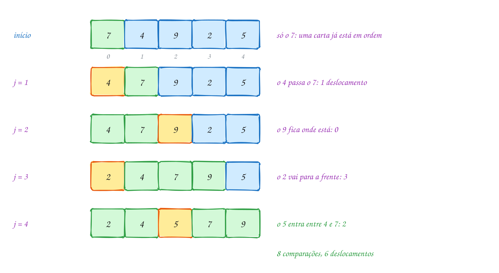</p>

O mesmo exemplo em C. A função `maior` só existe para contar as
comparações:

```c
#include <stdio.h>
#include <stdbool.h>

static int comparacoes = 0;

// a > b, contando a comparação
bool maior(int a, int b) {
    comparacoes++;
    return a > b;
}

void mostra(const int v[], int n) {
    for (int i = 0; i < n; i++) {
        printf("%3d", v[i]);
    }
    printf("\n");
}

void insertion_sort(int v[], int n) {
    int deslocamentos = 0;
    for (int j = 1; j < n; j++) {
        int x = v[j];                   // a carta que vai ser encaixada
        int i = j - 1;
        while (i >= 0 && maior(v[i], x)) {
            v[i + 1] = v[i];            // abre espaço: empurra para a direita
            deslocamentos++;
            i--;
        }
        v[i + 1] = x;                   // encaixa no buraco
        printf("j = %d (x = %d):", j, x);
        mostra(v, n);
    }
    printf("%d comparações, %d deslocamentos\n", comparacoes, deslocamentos);
}

int main(void) {
    int mao[] = {7, 4, 9, 2, 5};
    int n = 5;

    printf("início:       ");
    mostra(mao, n);
    insertion_sort(mao, n);
    return 0;
}
// Saída:
// início:         7  4  9  2  5
// j = 1 (x = 4):  4  7  9  2  5
// j = 2 (x = 9):  4  7  9  2  5
// j = 3 (x = 2):  2  4  7  9  5
// j = 4 (x = 5):  2  4  5  7  9
// 8 comparações, 6 deslocamentos
```

### Passo a passo

O encaixe do 2 (`j = 3`), o mais caro. A mão antes é `4 7 9 | 2 5`:

| i | v[i] | `v[i] > 2`? | o que acontece | vetor |
| --- | --- | --- | --- | --- |
| 2 | 9 | sim | `v[3] = 9` | 4 7 9 9 5 |
| 1 | 7 | sim | `v[2] = 7` | 4 7 7 9 5 |
| 0 | 4 | sim | `v[1] = 4` | 4 4 7 9 5 |
| -1 | | (`i >= 0` falso: nem compara) | `v[0] = 2` | 2 4 7 9 5 |

Três comparações, três deslocamentos. Repara nas linhas do meio: durante o
encaixe, o vetor tem um valor **repetido** e o 2 não está em lugar nenhum. Ele
está guardado em `x`. Somando todos os encaixes: 1 + 1 + 3 + 3 = **8
comparações** e 1 + 0 + 3 + 2 = **6 deslocamentos**.

Repara no fluxograma: o laço de dentro tem uma pergunta dupla. Ele para por
dois motivos diferentes: acabou o vetor, ou achou alguém que não é maior:

<p align="center">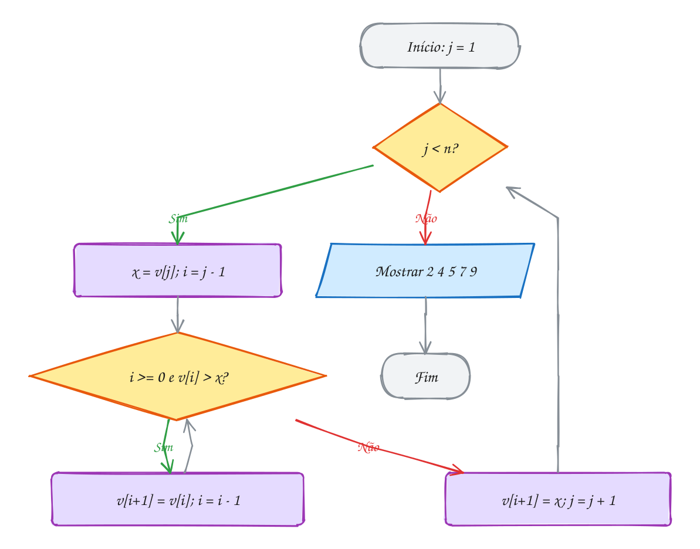</p>

> [!WARNING]
> A ordem das condições importa: `while (i >= 0 && v[i] > x)`. Escrita ao
> contrário, `while (v[i] > x && i >= 0)`, quando `i` chega a `-1` o programa
> lê `v[-1]` **antes** de perguntar se `i` é válido. É o curto-circuito do
> `&&` (assunto 0018) que protege o vetor: se `i >= 0` dá falso, o lado
> direito nem é avaliado.

> [!TIP]
> **Por dentro do C:** o laço de deslocamento é praticamente um `memmove`: ele
> empurra um bloco contínuo de memória uma casa para a direita. Por isso o
> insertion sort é tão rápido em vetores pequenos: acessa a memória em
> sequência, faz uma escrita por deslocamento e não chama função nenhuma. Ele
> também é **estável**: o `>` (e não `>=`) faz o laço parar ao encontrar um
> igual, e `x` entra **depois** dele. E é **online**: consegue ordenar à
> medida que os dados chegam, como as cartas na mão.

> [!NOTE]
> **Pergunta para você:** e se a condição fosse `v[i] >= x`? O vetor
> continuaria saindo ordenado? Quantos deslocamentos o A195 faria? E o que
> aconteceria com dois elementos iguais?

### Hora de praticar

Os arquivos ficam em [`0098-insertion-sort/`](0098-insertion-sort/). Os comandos funcionam de qualquer pasta do terminal. Nos exemplos, rode, mude, quebre e rode de novo. Nos exercícios, a resposta vai dentro do próprio arquivo. ★☆☆ é aquecimento, ★★☆ pede raciocínio e ★★★ é desafio.

**Exemplo A195 · Arrumando as cartas na mão**

```c
#include <stdio.h>
#include <stdbool.h>

static int comparacoes = 0;

// a > b, contando a comparação
bool maior(int a, int b) {
    comparacoes++;
    return a > b;
}

void mostra(const int v[], int n) {
    for (int i = 0; i < n; i++) {
        printf("%3d", v[i]);
    }
    printf("\n");
}

void insertion_sort(int v[], int n) {
    int deslocamentos = 0;
    for (int j = 1; j < n; j++) {
        int x = v[j];                   // a carta que vai ser encaixada
        int i = j - 1;
        while (i >= 0 && maior(v[i], x)) {
            v[i + 1] = v[i];            // abre espaço: empurra para a direita
            deslocamentos++;
            i--;
        }
        v[i + 1] = x;                   // encaixa no buraco
        printf("j = %d (x = %d):", j, x);
        mostra(v, n);
    }
    printf("%d comparações, %d deslocamentos\n", comparacoes, deslocamentos);
}

int main(void) {
    int mao[] = {7, 4, 9, 2, 5};
    int n = 5;

    printf("início:       ");
    mostra(mao, n);
    insertion_sort(mao, n);
    return 0;
}
// Saída:
// início:         7  4  9  2  5
// j = 1 (x = 4):  4  7  9  2  5
// j = 2 (x = 9):  4  7  9  2  5
// j = 3 (x = 2):  2  4  7  9  5
// j = 4 (x = 5):  2  4  5  7  9
// 8 comparações, 6 deslocamentos
```

```bash
~/LPEDC/rodar 13-busca-e-ordenacao/0098-insertion-sort/A195.c
```

**Exemplo A196 · Quase em ordem custa quase nada**

```c
#include <stdio.h>

// insertion sort que devolve as comparações e os deslocamentos
void insertion_sort(int v[], int n, int *comparacoes, int *deslocamentos) {
    *comparacoes = 0;
    *deslocamentos = 0;
    for (int j = 1; j < n; j++) {
        int x = v[j];
        int i = j - 1;
        while (i >= 0) {
            (*comparacoes)++;
            if (v[i] <= x) {
                break;                  // achou o lugar: para de empurrar
            }
            v[i + 1] = v[i];
            (*deslocamentos)++;
            i--;
        }
        v[i + 1] = x;
    }
}

void testa(const char *nome, int v[], int n) {
    int c, d;
    insertion_sort(v, n, &c, &d);
    printf("%-15s %2d comparações, %2d deslocamentos\n", nome, c, d);
}

int main(void) {
    // senhas de atendimento, n = 8
    int ordenado[] = {10, 20, 30, 40, 50, 60, 70, 80};
    int quase[] = {10, 20, 40, 30, 50, 60, 80, 70};  // dois pares trocados
    int invertido[] = {80, 70, 60, 50, 40, 30, 20, 10};

    testa("ordenado:", ordenado, 8);
    testa("quase ordenado:", quase, 8);
    testa("invertido:", invertido, 8);
    return 0;
}
// Saída:
// ordenado:        7 comparações,  0 deslocamentos
// quase ordenado:  9 comparações,  2 deslocamentos
// invertido:      28 comparações, 28 deslocamentos
```

```bash
~/LPEDC/rodar 13-busca-e-ordenacao/0098-insertion-sort/A196.c
```

#### Exercícios

**Exercício E583** · ★☆☆

As notas de redação de cinco candidatos foram 650, 720, 580, 810 e 690.
Ordene com insertion sort em ordem DECRESCENTE (a maior primeiro) e mostre a
classificação.


```text
Saída esperada:
Classificação: 810 720 690 650 580
```

**Dicas:**

1. Parta do insertion do exemplo A195 (pode tirar a contagem).
2. Agora quem precisa abrir espaço são os elementos MENORES que x.
3. Só muda uma comparação no while.
4. Resposta esperada: Classificação: 810 720 690 650 580

```bash
~/LPEDC/rodar 13-busca-e-ordenacao/0098-insertion-sort/E583.c
```

**Exercício E584** · ★☆☆

No check-in, as malas (em kg) precisam ir para a esteira da mais leve para
a mais pesada. O insertion sort abaixo está quase pronto: faltam DUAS
linhas, marcadas com "complete". Do jeito que está, ele compila, roda e
mostra o vetor bagunçado. Complete e confira.


```text
Saída esperada (depois de completar):
8 15 19 23 30
```

**Dicas:**

1. Dentro do while, a mala malas[i] é maior que x: ela anda uma casa para
   a direita.
2. Quando o while termina, i aponta para alguém que NÃO é maior que x (ou
   vale -1). O buraco está uma casa à direita de i.
3. Resposta esperada: malas[i + 1] = malas[i]; dentro do while e
   malas[i + 1] = x; depois dele.

```bash
~/LPEDC/rodar 13-busca-e-ordenacao/0098-insertion-sort/E584.c
```

**Exercício E585** · ★★☆

O fliperama guarda os 5 maiores recordes, do maior para o menor. Hoje o
ranking tem 4: 9800, 8750, 7200, 6100. Escreva


```text
void novo_recorde(int top[], int *n, int cap, int pontos)
```


que encaixa a nova pontuação no lugar certo, como UM passo do insertion
sort. Se o ranking já está cheio (n == cap), o último sai; se a pontuação
não supera o último de um ranking cheio, ela nem entra. Teste com 7500,
4000 e 9900, nessa ordem, e mostre o ranking depois de cada uma.


```text
Saída esperada:
7500: 9800 8750 7500 7200 6100
4000: não entrou no ranking
9900: 9900 9800 8750 7500 7200
```

**Dicas:**

1. Com espaço sobrando, comece a empurrar de i = n - 1 e aumente n no fim.
2. Cheio: o último vai ser descartado mesmo, então comece de i = n - 2 (o
   empurrão escreve por cima de top[n - 1]).
3. O ranking é decrescente: empurre enquanto top[i] < pontos.
4. Resposta esperada: a saída acima.

```bash
~/LPEDC/rodar 13-busca-e-ordenacao/0098-insertion-sort/E585.c
```

**Exercício E586** · ★★☆

Os pedidos de uma lanchonete chegam com o tempo de preparo, em minutos:
6, 3, 8, 3, 1. SEM RODAR, escreva a saída exata do programa abaixo: o vetor
depois de cada encaixe, quantos deslocamentos cada encaixe fez e o total.
Depois rode e confira.

**Dicas:**

1. Antes do j = 3, a parte arrumada é 3 6 8. Quem o segundo 3 empurra?
2. Ele para ao encontrar o primeiro 3, porque 3 > 3 é falso.
3. O 1 atravessa todo mundo.
4. Resposta esperada: j = 1: 3 6 8 3 1 (deslocou 1); j = 2: 3 6 8 3 1
   (deslocou 0); j = 3: 3 3 6 8 1 (deslocou 2); j = 4: 1 3 3 6 8 (deslocou
   4); total: 7.

```bash
~/LPEDC/rodar 13-busca-e-ordenacao/0098-insertion-sort/E586.c
```

**Exercício E587** · ★★★

Este insertion sort deveria ordenar as idades do grupo de corrida:
31, 12, 45, 27, 8, 19. Ele tem DOIS erros, de propósito. O primeiro faz o
sanitizer parar o programa; o segundo só aparece depois que você
consertar o primeiro. Ache os dois, explique e conserte.


```text
Saída esperada (depois de consertar):
8 12 19 27 31 45
```

**Dicas:**

1. Quando o 12 é encaixado, i chega a -1. O que o while faz primeiro?
2. Releia a seção sobre o curto-circuito do && (assunto 0018).
3. No fim do while, a posição i foi empurrada ou não? Onde está o buraco?
4. Resposta esperada: o while deve ser (i >= 0 && idades[i] > x), senão lê
   idades[-1]; e o encaixe é idades[i + 1] = x, não idades[i] = x.

```bash
~/LPEDC/rodar 13-busca-e-ordenacao/0098-insertion-sort/E587.c
```

**Exercício E588** · ★★★

Ideia aparentemente esperta: a parte v[0..j-1] já está ordenada, então dá
para achar o lugar de x com BUSCA BINÁRIA em vez de andar casa por casa.
Implemente essa "insertion binária" e compare com a normal no vetor
invertido 160, 150, ..., 10 (16 elementos), contando comparações e
deslocamentos. Depois responda num comentário: o algoritmo deixou de ser
O(n²)?


```text
Saída esperada:
normal:  120 comparações, 120 deslocamentos
binária:  49 comparações, 120 deslocamentos
ordenado? sim
```

**Dicas:**

1. Procure a PRIMEIRA posição de v[0..j-1] com valor maior que x (estilo
   semiaberto do A190, com v[meio] <= x). Assim os iguais ficam na ordem de
   chegada.
2. Achou a posição p? Empurre v[p..j-1] uma casa para a direita e ponha x
   em v[p].
3. Na normal, conte uma comparação por teste v[i] <= x feito.
4. Resposta esperada: a saída acima. As comparações caem, mas os
   deslocamentos não mudam: cada elemento ainda anda casa por casa, então
   continua O(n²).

```bash
~/LPEDC/rodar 13-busca-e-ordenacao/0098-insertion-sort/E588.c
```

---

## 0099 · Merge sort

Fim de semestre: duas monitoras corrigiram as provas da turma, cada uma
metade, e cada uma entregou a sua pilha já em ordem de nota. Para montar uma
pilha só, ninguém reordena tudo do zero. Você olha o topo das duas pilhas,
pega a menor nota, e repete. Quando uma pilha acaba, a outra vai inteira para
o fim.

Juntar duas sequências ordenadas numa só é a **intercalação** (em inglês,
*merge*). Ela é barata: cada comparação manda **um** elemento para o
resultado, então juntar `n` elementos custa no máximo `n - 1` comparações.
O exemplo A198 mostra a intercalação sozinha.

O **merge sort** (ordenação por intercalação) usa isso com a ideia de
**dividir e conquistar**:

1. **divida** o vetor ao meio;
2. **ordene** cada metade, com o próprio merge sort (recursão, assunto 0037);
3. **intercale** as duas metades ordenadas.

O caso base é o pedaço com 0 ou 1 elemento: ele já está ordenado, não há o
que fazer. O código usa o intervalo **semiaberto** `[p, r)`: `p` é o primeiro
e `r` é uma posição depois do último. Assim, o pedaço tem `r - p` elementos e
as metades `[p, q)` e `[q, r)` se encaixam sem sobrar nem repetir ninguém.

Por que é rápido? Dividir ao meio dá `log₂ n` níveis (8 elementos: 3 níveis).
Em **cada** nível, as intercalações juntas passam por todos os `n` elementos
uma vez. Total: `n log₂ n`, ou **O(n log n)**, e isso em **todos** os casos,
inclusive o pior. Para 1 milhão de elementos, são uns 20 milhões de passos,
contra 500 bilhões de um algoritmo O(n²).

O preço é memória: a intercalação precisa de um vetor auxiliar (o
**rascunho**) do tamanho do pedaço. O merge sort usa **O(n)** de memória
extra.

Vamos ver na prática. As notas descem sendo divididas até virar pares (e,
mais embaixo, pedaços de 1). Depois sobem sendo intercaladas, em verde, até
formar o vetor inteiro:

<p align="center">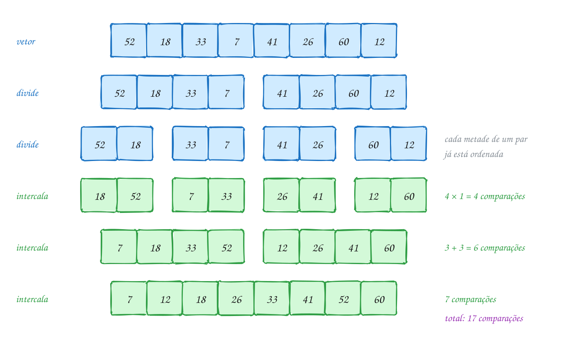</p>

O mesmo exemplo em C. O rascunho `w` é alocado **uma vez** no `main` e
emprestado para todas as intercalações:

```c
#include <stdio.h>
#include <stdlib.h>

static int comparacoes = 0;

// junta v[p..q-1] e v[q..r-1], já ordenados, usando w como rascunho
void intercala(int v[], int w[], int p, int q, int r) {
    int i = p, j = q, k = 0;
    while (i < q && j < r) {            // as duas metades ainda têm cartas
        comparacoes++;
        if (v[i] <= v[j]) {             // <= mantém a ordem dos iguais
            w[k++] = v[i++];
        } else {
            w[k++] = v[j++];
        }
    }
    while (i < q) w[k++] = v[i++];      // sobrou só a esquerda
    while (j < r) w[k++] = v[j++];      // sobrou só a direita
    for (k = 0; k < r - p; k++) {
        v[p + k] = w[k];                // devolve para o lugar
    }
    printf("intercala [%d, %d):", p, r);
    for (k = p; k < r; k++) printf(" %d", v[k]);
    printf("\n");
}

// ordena v[p..r-1] (intervalo semiaberto)
void merge_sort(int v[], int w[], int p, int r) {
    if (r - p < 2) {
        return;                         // 0 ou 1 elemento: já está ordenado
    }
    int q = p + (r - p) / 2;
    merge_sort(v, w, p, q);             // ordena a metade esquerda
    merge_sort(v, w, q, r);             // ordena a metade direita
    intercala(v, w, p, q, r);           // junta as duas
}

int main(void) {
    int notas[] = {52, 18, 33, 7, 41, 26, 60, 12};
    int n = 8;
    int *w = malloc(n * sizeof *w);     // um rascunho só, para todas as intercalações
    if (w == NULL) {
        return 1;
    }

    merge_sort(notas, w, 0, n);
    printf("%d comparações\n", comparacoes);
    free(w);
    return 0;
}
// Saída:
// intercala [0, 2): 18 52
// intercala [2, 4): 7 33
// intercala [0, 4): 7 18 33 52
// intercala [4, 6): 26 41
// intercala [6, 8): 12 60
// intercala [4, 8): 12 26 41 60
// intercala [0, 8): 7 12 18 26 33 41 52 60
// 17 comparações
```

Repara na ordem das linhas da saída: a recursão termina **toda** a metade
esquerda (`[0, 4)`) antes de começar a direita. É a pilha de chamadas do
assunto 0036 trabalhando.

### Passo a passo

A última intercalação, `7 18 33 52` com `12 26 41 60`. `i` anda na esquerda,
`j` na direita:

| comparação | v[i] | v[j] | vai para o rascunho | rascunho |
| --- | --- | --- | --- | --- |
| 1 | 7 | 12 | 7 (esquerda) | 7 |
| 2 | 18 | 12 | 12 (direita) | 7 12 |
| 3 | 18 | 26 | 18 (esquerda) | 7 12 18 |
| 4 | 33 | 26 | 26 (direita) | 7 12 18 26 |
| 5 | 33 | 41 | 33 (esquerda) | ... 26 33 |
| 6 | 52 | 41 | 41 (direita) | ... 33 41 |
| 7 | 52 | 60 | 52 (esquerda) | ... 41 52 |
| | (esquerda acabou) | 60 | 60, sem comparar | ... 52 60 |

Sete comparações para 8 elementos: o máximo, `n - 1`. Somando os níveis:
4 + 6 + 7 = **17 comparações**.

Repara no fluxograma: ele é curto porque a recursão esconde o trabalho. As
duas caixas `merge_sort` são o fluxograma inteiro de novo, para cada metade:

<p align="center">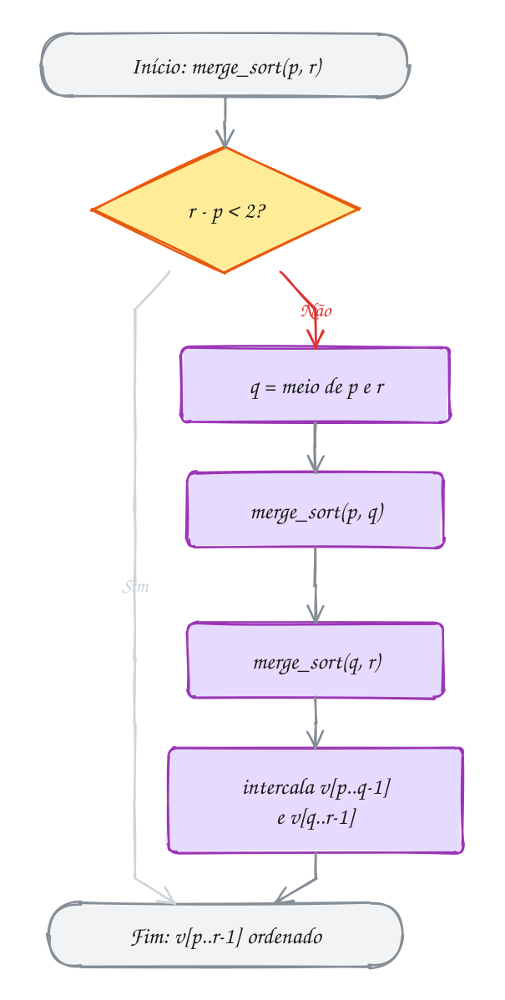</p>

> [!WARNING]
> Com o intervalo semiaberto, o caso base é `r - p < 2`, e não `p < r` virado
> ao contrário. Se você escrever `if (p >= r) return;`, um pedaço de 1
> elemento (`r = p + 1`) passa direto, `q` vira `p`, e a chamada
> `merge_sort(v, w, q, r)` recebe **o mesmo** pedaço de novo, para sempre.
> O programa morre com **estouro de pilha** (*stack overflow*). Misturar
> intervalo fechado num lugar e semiaberto em outro dá o mesmo resultado.

> [!TIP]
> **Por dentro do C:** a profundidade da recursão é só `log₂ n` (20 frames
> para 1 milhão de elementos), então a pilha não preocupa. A memória que pesa
> é o rascunho: 1 milhão de `int` são 4 MB. Alocar com `malloc` uma vez e
> passar `w` para baixo evita um `malloc`/`free` por intercalação (seriam
> quase 1 milhão de chamadas). E o `<=` da intercalação não é detalhe: em
> caso de empate, ele pega o da **esquerda** primeiro, mantendo a ordem
> original dos iguais. Isso faz o merge sort ser **estável**.

> [!NOTE]
> **Pergunta para você:** quantas comparações o A197 faria se as notas já
> estivessem em ordem, `7 12 18 26 33 41 52 60`? Pista: na intercalação, o
> que acontece quando a metade esquerda inteira é menor que a direita?

### Hora de praticar

Os arquivos ficam em [`0099-merge-sort/`](0099-merge-sort/). Os comandos funcionam de qualquer pasta do terminal. Nos exemplos, rode, mude, quebre e rode de novo. Nos exercícios, a resposta vai dentro do próprio arquivo. ★☆☆ é aquecimento, ★★☆ pede raciocínio e ★★★ é desafio.

**Exemplo A197 · Duas pilhas de provas viram uma**

```c
#include <stdio.h>
#include <stdlib.h>

static int comparacoes = 0;

// junta v[p..q-1] e v[q..r-1], já ordenados, usando w como rascunho
void intercala(int v[], int w[], int p, int q, int r) {
    int i = p, j = q, k = 0;
    while (i < q && j < r) {            // as duas metades ainda têm cartas
        comparacoes++;
        if (v[i] <= v[j]) {             // <= mantém a ordem dos iguais
            w[k++] = v[i++];
        } else {
            w[k++] = v[j++];
        }
    }
    while (i < q) w[k++] = v[i++];      // sobrou só a esquerda
    while (j < r) w[k++] = v[j++];      // sobrou só a direita
    for (k = 0; k < r - p; k++) {
        v[p + k] = w[k];                // devolve para o lugar
    }
    printf("intercala [%d, %d):", p, r);
    for (k = p; k < r; k++) printf(" %d", v[k]);
    printf("\n");
}

// ordena v[p..r-1] (intervalo semiaberto)
void merge_sort(int v[], int w[], int p, int r) {
    if (r - p < 2) {
        return;                         // 0 ou 1 elemento: já está ordenado
    }
    int q = p + (r - p) / 2;
    merge_sort(v, w, p, q);             // ordena a metade esquerda
    merge_sort(v, w, q, r);             // ordena a metade direita
    intercala(v, w, p, q, r);           // junta as duas
}

int main(void) {
    int notas[] = {52, 18, 33, 7, 41, 26, 60, 12};
    int n = 8;
    int *w = malloc(n * sizeof *w);     // um rascunho só, para todas as intercalações
    if (w == NULL) {
        return 1;
    }

    merge_sort(notas, w, 0, n);
    printf("%d comparações\n", comparacoes);
    free(w);
    return 0;
}
// Saída:
// intercala [0, 2): 18 52
// intercala [2, 4): 7 33
// intercala [0, 4): 7 18 33 52
// intercala [4, 6): 26 41
// intercala [6, 8): 12 60
// intercala [4, 8): 12 26 41 60
// intercala [0, 8): 7 12 18 26 33 41 52 60
// 17 comparações
```

```bash
~/LPEDC/rodar 13-busca-e-ordenacao/0099-merge-sort/A197.c
```

**Exemplo A198 · Os pedidos das duas lojas numa fila só**

```c
#include <stdio.h>

// junta a[0..na-1] e b[0..nb-1], já ordenados, em c; devolve as comparações
int intercala(const int a[], int na, const int b[], int nb, int c[]) {
    int i = 0, j = 0, k = 0, comparacoes = 0;
    while (i < na && j < nb) {
        comparacoes++;
        if (a[i] <= b[j]) {
            c[k++] = a[i++];
        } else {
            c[k++] = b[j++];
        }
    }
    while (i < na) c[k++] = a[i++];   // uma das duas acabou:
    while (j < nb) c[k++] = b[j++];   // o resto da outra vem direto
    return comparacoes;
}

int main(void) {
    // horários dos pedidos (hhmm), cada loja já em ordem
    int loja_a[] = {812, 905, 1047, 1320};
    int loja_b[] = {750, 930, 1015, 1100, 1405};
    int todos[9];

    int c = intercala(loja_a, 4, loja_b, 5, todos);
    for (int k = 0; k < 9; k++) {
        printf("%s%02d:%02d", k > 0 ? " " : "", todos[k] / 100, todos[k] % 100);
    }
    printf("\n%d comparações para juntar 9 pedidos\n", c);
    return 0;
}
// Saída:
// 07:50 08:12 09:05 09:30 10:15 10:47 11:00 13:20 14:05
// 8 comparações para juntar 9 pedidos
```

```bash
~/LPEDC/rodar 13-busca-e-ordenacao/0099-merge-sort/A198.c
```

#### Exercícios

**Exercício E589** · ★☆☆

Duas turmas fizeram a mesma prova e cada professora mandou as notas em
ordem: turma A = 45, 60, 75, 90 e turma B = 50, 60, 85, 95, 98. Escreva


```text
int intercala(const int a[], int na, const int b[], int nb, int c[])
```


que junta as duas listas, em ordem, no vetor c e devolve quantas
comparações fez. Mostre o resultado.


```text
Saída esperada:
Notas: 45 50 60 60 75 85 90 95 98
7 comparações
```

**Dicas:**

1. Três índices: i em a, j em b, k em c.
2. Enquanto as duas têm elementos, copie o menor das frentes e avance só o
   índice de quem foi copiado.
3. Quando uma acabar, copie o resto da outra sem comparar.
4. Resposta esperada: a saída acima. A turma A acaba depois da 7ª
   comparação, e 95 e 98 vêm direto.

```bash
~/LPEDC/rodar 13-busca-e-ordenacao/0099-merge-sort/E589.c
```

**Exercício E590** · ★☆☆

O programa abaixo não ordena nada: ele só mostra QUAIS chamadas o merge sort
faria para um vetor de 5 elementos, com um recuo de dois espaços por nível
de recursão. SEM RODAR, escreva a saída exata. Depois rode e confira.

**Dicas:**

1. Comece por ordena(0, 5): q = 0 + 5 / 2 = 2. As metades são [0, 2) e [2, 5).
2. A metade esquerda inteira (com todas as suas chamadas) é mostrada antes
   da direita.
3. Pedaços com menos de 2 elementos aparecem, mas não chamam ninguém.
4. Resposta esperada: 9 linhas, nesta ordem: [0, 5), [0, 2), [0, 1),
   [1, 2), [2, 5), [2, 3), [3, 5), [3, 4) e [4, 5). Recuo: nenhum na
   primeira; 2 espaços em [0, 2) e [2, 5); 4 em [0, 1), [1, 2), [2, 3) e
   [3, 5); 6 nas duas últimas.

```bash
~/LPEDC/rodar 13-busca-e-ordenacao/0099-merge-sort/E590.c
```

**Exercício E591** · ★★☆

A academia tem duas listas de presença, cada uma em ordem de matrícula e
sem repetidos dentro dela:


```text
manhã: 1021, 1034, 1050, 1077, 1090
tarde: 1010, 1034, 1066, 1077, 1095, 1102
```


Monte, numa passada só (estilo intercalação), a lista de alunos DIFERENTES
que treinaram no dia, em ordem, e conte quantos foram nos dois turnos.


```text
Saída esperada:
9 alunos diferentes: 1010 1021 1034 1050 1066 1077 1090 1095 1102
foram nos dois turnos: 2
```

**Dicas:**

1. É a intercalação com três casos em vez de dois: a[i] < b[j],
   a[i] > b[j] e a[i] == b[j].
2. No empate, copie uma vez só e avance i E j.
3. Faça a função devolver o tamanho do resultado.
4. Resposta esperada: a saída acima (1034 e 1077 estão nas duas).

```bash
~/LPEDC/rodar 13-busca-e-ordenacao/0099-merge-sort/E591.c
```

**Exercício E592** · ★★☆

A fila de pedidos de uma padaria chegou nesta ordem:


```text
typedef struct { char cliente[8]; int valor; } Pedido;
{"Ana", 50}, {"Bruno", 30}, {"Carla", 50}, {"Davi", 30}, {"Eva", 20}
```


Ordene por valor com merge sort (adapte o A197 para Pedido) e mostre a
fila. Quem empatou no valor deve continuar na ordem de chegada (Bruno antes
de Davi, Ana antes de Carla). Depois troque o <= da intercalação por < e
anote, num comentário, o que muda.


```text
Saída esperada:
Eva 20, Bruno 30, Davi 30, Ana 50, Carla 50
```

**Dicas:**

1. O rascunho agora é Pedido *w = malloc(n * sizeof *w); confira NULL e
   dê free no fim.
2. Compare v[i].valor <= v[j].valor; copie a struct inteira com =.
3. Com <, no empate a intercalação pega o da direita primeiro.
4. Resposta esperada: a saída acima; com <, sai Eva 20, Davi 30, Bruno 30,
   Carla 50, Ana 50 (deixa de ser estável).

```bash
~/LPEDC/rodar 13-busca-e-ordenacao/0099-merge-sort/E592.c
```

**Exercício E593** · ★★★

Este merge sort deveria ordenar as distâncias de corrida da semana, em km:
21, 5, 42, 10, 15, 3. Ele compila sem aviso, roda sem reclamação do
sanitizer e mostra


```text
10 10 15 3 15 3
```


Números somem e outros se repetem. Há UM erro, de propósito, numa única
linha. Ache, explique e conserte.


```text
Saída esperada (depois de consertar):
3 5 10 15 21 42
```

**Dicas:**

1. Coloque um printf no fim de intercala mostrando p, r e o vetor inteiro.
2. A primeira intercalação junta [1, 2) com [2, 3), os números 5 e 42.
   Depois dela, em que gavetas o 5 e o 42 aparecem? E o 21, onde foi parar?
3. Para onde vai o conteúdo do rascunho na cópia de volta?
4. Resposta esperada: a cópia de volta faz v[k] = w[k], que escreve no
   começo do vetor; o certo é v[p + k] = w[k]. Só a intercalação com
   p = 0 cai no lugar certo; as outras escrevem por cima de v[0..].

```bash
~/LPEDC/rodar 13-busca-e-ordenacao/0099-merge-sort/E593.c
```

**Exercício E594** · ★★★

Ana e Bia ranquearam as mesmas 8 séries. Numerando as séries pela ordem da
Bia, o ranking da Ana fica: 3, 1, 7, 2, 8, 4, 6, 5. Quanto mais INVERSÕES
(pares fora de ordem) esse vetor tem, mais os gostos discordam. É assim que
sites de recomendação medem "pessoas parecidas com você".

Contar inversões com dois laços é O(n²). Faça em O(n log n) pegando carona
no merge sort: durante a intercalação, toda vez que um elemento da metade
DIREITA sai antes, ele estava invertido com todos os que ainda restam na
esquerda. Mostre o resultado do jeito rápido e confira com a força bruta.


```text
Saída esperada:
força bruta: 10 discordâncias
merge sort:  10 discordâncias
de 28 pares possíveis
```

**Dicas:**

1. Se v[j] (direita) vai para o rascunho e ainda há q - i elementos na
   esquerda, some q - i às inversões.
2. conta(p, r) = conta(p, q) + conta(q, r) + o que a intercalação achou.
3. Rode a força bruta ANTES: a versão rápida ordena o vetor.
4. Use long long: com n = 100 mil, as inversões passam de 2 bilhões.
5. Resposta esperada: a saída acima.

```bash
~/LPEDC/rodar 13-busca-e-ordenacao/0099-merge-sort/E594.c
```

---

## 0100 · Quick sort

Black Friday: você tem 7 fones na lista, de R$ 35, 12, 48, 7, 29, 51 e 20 (é
promoção, vai). Em vez de comparar todos com todos, você escolhe um deles, o
de R$ 20, e faz dois montes: os que custam até 20 de um lado, os mais caros do
outro. O de 20 já está no lugar certo, entre os dois montes. Agora é só fazer
o mesmo dentro de cada monte.

Esse é o **quick sort**, inventado por Tony Hoare em 1960. O elemento
escolhido é o **pivô**, e o passo de fazer os montes é a **separação** (ou
**partição**):

1. escolha o pivô (aqui, o **último** do pedaço, `v[r]`);
2. **separe**: rearranje o pedaço para ficar `menores ou iguais | pivô |
   maiores`. O pivô cai na sua posição **final**, `j`;
3. ordene, com o próprio quick sort, `v[p..j-1]` e `v[j+1..r]`.

Compare com o merge sort. Lá, dividir é trivial (corta no meio) e o trabalho
está em **juntar**. Aqui, o trabalho está em **dividir**, e juntar é de graça:
depois das chamadas recursivas, não há nada a fazer. E não precisa de
rascunho: tudo acontece com trocas no próprio vetor.

A separação usada aqui (chamada de **Lomuto**) anda com `k` pelo pedaço e
mantém `j` na fronteira: tudo em `v[p..j-1]` é `<=` pivô. Achou alguém
`<=` pivô? Troca com `v[j]` e avança `j`. No fim, troca o pivô com `v[j]`.

O custo depende do pivô. Se ele cai perto do meio, o vetor é cortado em
metades, como no merge sort: **O(n log n)**. Se ele é sempre o menor ou o
maior, um dos montes fica vazio e o outro com `n - 1`: são `n` níveis e
**O(n²)**. Com o pivô no fim, isso acontece justamente no vetor **já
ordenado** (veja o exemplo A200). Na média, com dados embaralhados, o quick
sort é O(n log n) e costuma ser o mais rápido na prática.

Vamos ver na prática. O 20 (roxo) separa o vetor: 12 e 7 à esquerda, o resto
à direita, e ele fica verde, no lugar. Depois, cada lado escolhe o próprio
pivô (o último de cada pedaço):

<p align="center">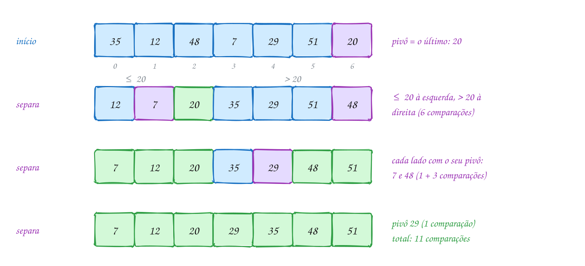</p>

O mesmo exemplo em C:

```c
#include <stdio.h>

static int comparacoes = 0;

void troca(int *a, int *b) {
    int aux = *a;
    *a = *b;
    *b = aux;
}

// separa v[p..r] em torno do pivô v[r]: menores ou iguais à esquerda,
// maiores à direita. Devolve a posição final do pivô.
int separa(int v[], int p, int r) {
    int pivo = v[r];
    int j = p;                          // v[p..j-1] são os <= pivô
    for (int k = p; k < r; k++) {
        comparacoes++;
        if (v[k] <= pivo) {
            troca(&v[j], &v[k]);
            j++;
        }
    }
    troca(&v[j], &v[r]);                // o pivô vai para o meio deles
    return j;
}

// ordena v[p..r] (intervalo fechado)
void quick_sort(int v[], int p, int r) {
    if (p >= r) {
        return;                         // 0 ou 1 elemento
    }
    int j = separa(v, p, r);
    printf("pivô %d foi para a posição %d:", v[j], j);
    for (int i = p; i <= r; i++) printf(" %d", v[i]);
    printf("\n");
    quick_sort(v, p, j - 1);            // o pivô já está no lugar:
    quick_sort(v, j + 1, r);            // fica fora das duas chamadas
}

int main(void) {
    int precos[] = {35, 12, 48, 7, 29, 51, 20};
    int n = 7;

    quick_sort(precos, 0, n - 1);
    printf("resultado:");
    for (int i = 0; i < n; i++) printf(" %d", precos[i]);
    printf("\n%d comparações\n", comparacoes);
    return 0;
}
// Saída:
// pivô 20 foi para a posição 2: 12 7 20 35 29 51 48
// pivô 7 foi para a posição 0: 7 12
// pivô 48 foi para a posição 5: 35 29 48 51
// pivô 29 foi para a posição 3: 29 35
// resultado: 7 12 20 29 35 48 51
// 11 comparações
```

### Passo a passo

A primeira separação, com pivô 20. `k` anda; `j` marca onde entra o próximo
"pequeno":

| k | v[k] | `v[k] <= 20`? | ação | vetor | j |
| --- | --- | --- | --- | --- | --- |
| | | | | 35 12 48 7 29 51 **20** | 0 |
| 0 | 35 | não | nada | 35 12 48 7 29 51 20 | 0 |
| 1 | 12 | sim | troca v[0] e v[1] | 12 35 48 7 29 51 20 | 1 |
| 2 | 48 | não | nada | 12 35 48 7 29 51 20 | 1 |
| 3 | 7 | sim | troca v[1] e v[3] | 12 7 48 35 29 51 20 | 2 |
| 4 | 29 | não | nada | 12 7 48 35 29 51 20 | 2 |
| 5 | 51 | não | nada | 12 7 48 35 29 51 20 | 2 |
| fim | | | troca v[2] e o pivô | 12 7 **20** 35 29 51 48 | 2 |

Seis comparações, e o 20 está na posição 2 para sempre. Depois vêm `[12 7]`
(1 comparação), `[35 29 51 48]` (3) e `[35 29]` (1): **11 comparações**.

Repara no fluxograma: o pivô não entra em nenhuma das duas chamadas
recursivas. É isso que garante que o problema sempre diminui:

<p align="center">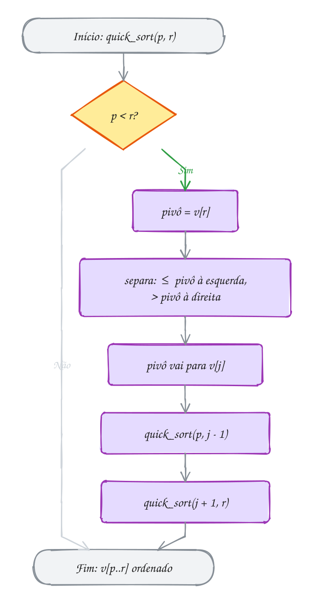</p>

> [!WARNING]
> Se as chamadas forem `quick_sort(v, p, j)` e `quick_sort(v, j + 1, r)`, o
> pivô entra de novo no pedaço da esquerda. Quando ele é o maior do pedaço
> (`j == r`), a chamada recebe **exatamente** o mesmo pedaço e nunca para:
> estouro de pilha. Outra armadilha: copiar uma separação de outro livro
> (Hoare, com dois índices que se cruzam) e manter as chamadas desta versão.
> Cada separação promete uma coisa diferente sobre `j`, e as chamadas
> precisam bater com a promessa.

> [!TIP]
> **Por dentro do C:** no pior caso, a recursão desce `n` níveis, e cada nível
> é um frame na pilha (assunto 0036). Com um vetor ordenado de 1 milhão de
> elementos e o pivô no fim, são 1 milhão de frames: a pilha de 8 MB do Linux
> estoura e o programa morre com *segmentation fault*. Implementações sérias
> se protegem de três jeitos: escolhem o pivô melhor (o do meio, um sorteado,
> ou a **mediana de três**: primeiro, meio e último), fazem a recursão só no
> lado **menor** e um laço no maior (a pilha fica com no máximo `log₂ n`
> níveis), e trocam para o insertion sort em pedaços pequenos.

> [!NOTE]
> **Pergunta para você:** o quick sort é estável? Pense no que acontece com
> `3a 3b 1` (dois 3 iguais, `a` chegou antes de `b`) quando o pivô é o 1.
> Faça a separação à mão antes de ler o assunto 0101.

### Hora de praticar

Os arquivos ficam em [`0100-quick-sort/`](0100-quick-sort/). Os comandos funcionam de qualquer pasta do terminal. Nos exemplos, rode, mude, quebre e rode de novo. Nos exercícios, a resposta vai dentro do próprio arquivo. ★☆☆ é aquecimento, ★★☆ pede raciocínio e ★★★ é desafio.

**Exemplo A199 · Os fones divididos pelo pivô**

```c
#include <stdio.h>

static int comparacoes = 0;

void troca(int *a, int *b) {
    int aux = *a;
    *a = *b;
    *b = aux;
}

// separa v[p..r] em torno do pivô v[r]: menores ou iguais à esquerda,
// maiores à direita. Devolve a posição final do pivô.
int separa(int v[], int p, int r) {
    int pivo = v[r];
    int j = p;                          // v[p..j-1] são os <= pivô
    for (int k = p; k < r; k++) {
        comparacoes++;
        if (v[k] <= pivo) {
            troca(&v[j], &v[k]);
            j++;
        }
    }
    troca(&v[j], &v[r]);                // o pivô vai para o meio deles
    return j;
}

// ordena v[p..r] (intervalo fechado)
void quick_sort(int v[], int p, int r) {
    if (p >= r) {
        return;                         // 0 ou 1 elemento
    }
    int j = separa(v, p, r);
    printf("pivô %d foi para a posição %d:", v[j], j);
    for (int i = p; i <= r; i++) printf(" %d", v[i]);
    printf("\n");
    quick_sort(v, p, j - 1);            // o pivô já está no lugar:
    quick_sort(v, j + 1, r);            // fica fora das duas chamadas
}

int main(void) {
    int precos[] = {35, 12, 48, 7, 29, 51, 20};
    int n = 7;

    quick_sort(precos, 0, n - 1);
    printf("resultado:");
    for (int i = 0; i < n; i++) printf(" %d", precos[i]);
    printf("\n%d comparações\n", comparacoes);
    return 0;
}
// Saída:
// pivô 20 foi para a posição 2: 12 7 20 35 29 51 48
// pivô 7 foi para a posição 0: 7 12
// pivô 48 foi para a posição 5: 35 29 48 51
// pivô 29 foi para a posição 3: 29 35
// resultado: 7 12 20 29 35 48 51
// 11 comparações
```

```bash
~/LPEDC/rodar 13-busca-e-ordenacao/0100-quick-sort/A199.c
```

**Exemplo A200 · O pior caso: vetor que já chega em ordem**

```c
#include <stdio.h>
#include <stdbool.h>

static int comparacoes, profundidade, maior_profundidade;

void troca(int *a, int *b) {
    int aux = *a;
    *a = *b;
    *b = aux;
}

int separa(int v[], int p, int r) {
    int pivo = v[r], j = p;
    for (int k = p; k < r; k++) {
        comparacoes++;
        if (v[k] <= pivo) {
            troca(&v[j], &v[k]);
            j++;
        }
    }
    troca(&v[j], &v[r]);
    return j;
}

void quick_sort(int v[], int p, int r, bool pivo_do_meio) {
    if (p >= r) {
        return;
    }
    profundidade++;
    if (profundidade > maior_profundidade) {
        maior_profundidade = profundidade;
    }
    if (pivo_do_meio) {
        troca(&v[p + (r - p) / 2], &v[r]); // o do meio vira o pivô
    }
    int j = separa(v, p, r);
    quick_sort(v, p, j - 1, pivo_do_meio);
    quick_sort(v, j + 1, r, pivo_do_meio);
    profundidade--;
}

void testa(const char *nome, bool pivo_do_meio) {
    int v[16];
    for (int i = 0; i < 16; i++) {
        v[i] = (i + 1) * 5;             // 5, 10, ..., 80: já em ordem
    }
    comparacoes = profundidade = maior_profundidade = 0;
    quick_sort(v, 0, 15, pivo_do_meio);
    printf("%-14s %3d comparações, recursão com %2d níveis\n",
           nome, comparacoes, maior_profundidade);
}

int main(void) {
    testa("pivô no fim:", false);
    testa("pivô do meio:", true);
    return 0;
}
// Saída:
// pivô no fim:  120 comparações, recursão com 15 níveis
// pivô do meio:  38 comparações, recursão com  4 níveis
```

```bash
~/LPEDC/rodar 13-busca-e-ordenacao/0100-quick-sort/A200.c
```

#### Exercícios

**Exercício E595** · ★☆☆

As senhas de uma fila de exames são 9, 2, 6, 4, 8, 5. O programa abaixo faz
UMA separação (só o separa, sem recursão), com o pivô no fim. SEM RODAR,
escreva a saída exata: cada troca feita, o vetor final e a posição do pivô.
Depois rode e confira.

**Dicas:**

1. O pivô é 5. Só 2 e 4 são <= 5.
2. k anda sempre; j só anda depois de uma troca.
3. No fim, o pivô troca de lugar com quem está em v[j].
4. Resposta esperada: troca v[0] e v[1]; troca v[1] e v[3]; troca v[2] e
   v[5]; vetor: 2 4 5 9 8 6; pivô na posição 2.

```bash
~/LPEDC/rodar 13-busca-e-ordenacao/0100-quick-sort/E595.c
```

**Exercício E596** · ★☆☆

Aquecimento de separação, sem pivô: o banco quer as contas no vermelho no
começo do relatório. Os saldos são 120, -45, 300, -10, 0, -80, 55. Escreva
int separa_negativos(int v[], int n), que deixa os negativos à esquerda e
devolve quantos são. Use o MESMO esquema do separa do A199: k anda pelo
vetor e j marca onde entra o próximo negativo (troca v[j] com v[k] e
avança j).


```text
Saída esperada:
-45 -10 -80 120 0 300 55
3 contas no vermelho
```

**Dicas:**

1. É o separa trocando "v[k] <= pivo" por "v[k] < 0", e sem a troca final
   do pivô.
2. O zero não é negativo: fica do lado direito.
3. Repare que a ordem dentro de cada lado muda (o -80 vem depois do -10).
4. Resposta esperada: a saída acima.

```bash
~/LPEDC/rodar 13-busca-e-ordenacao/0100-quick-sort/E596.c
```

**Exercício E597** · ★★☆

Ordene a lista do mercado em ordem alfabética com quick sort (pivô no fim,
separação de Lomuto, como no A199), trocando só os ponteiros:


```text
const char *compras[] = {"leite", "arroz", "tomate", "café", "pão",
                         "banana", "ovos", "feijão"};
```


Conte as comparações de strings.


```text
Saída esperada:
arroz, banana, café, feijão, leite, ovos, pão, tomate
14 comparações
```

**Dicas:**

1. A função troca recebe const char ** (o endereço de cada ponteiro).
2. v[k] <= pivo vira strcmp(v[k], pivo) <= 0.
3. O primeiro pivô é "feijão": ele separa arroz, café e banana do resto.
4. Resposta esperada: a saída acima.

```bash
~/LPEDC/rodar 13-busca-e-ordenacao/0100-quick-sort/E597.c
```

**Exercício E598** · ★★☆

Este quick sort deveria ordenar os andares das entregas do prédio: 4, 9, 2,
7. Ele tem UM erro, de propósito, numa única linha. Rode: o programa morre
e o AddressSanitizer fala em "stack-overflow". Ache o erro, explique por
que a recursão nunca termina e conserte.


```text
Saída esperada (depois de consertar):
2 4 7 9
```

**Dicas:**

1. Faça a primeira separação à mão: onde o 7 vai parar? Qual é o j?
2. Quais pedaços as duas chamadas recursivas recebem? Algum inclui o pivô?
3. Separe [4 2 7] à mão: o pivô 7 é o maior. Que j volta? Que chamada vem
   depois?
4. Resposta esperada: quick_sort(v, p, j) inclui o pivô; quando ele é o
   maior do pedaço, j == r e a chamada recebe o mesmo pedaço para sempre.
   O certo é quick_sort(v, p, j - 1).

```bash
~/LPEDC/rodar 13-busca-e-ordenacao/0100-quick-sort/E598.c
```

**Exercício E599** · ★★★

Os 11 corredores do grupo fizeram 5 km em 45, 22, 38, 31, 50, 27, 24, 41,
29, 35 e 33 minutos. Qual o tempo MEDIANO (o do meio, se a lista estivesse
ordenada)? Não precisa ordenar tudo: depois de um separa, o pivô está na
posição final j. Se j é a posição que você quer (k = n / 2), acabou. Se
k < j, a resposta está só no lado esquerdo; se k > j, só no direito. Isso é
o QUICKSELECT.

Escreva int quickselect(int v[], int n, int k), sem recursão (um while que
encolhe [p, r]), e compare as comparações com um quick sort completo numa
cópia do vetor.


```text
Saída esperada:
mediana: 33 min (quickselect: 10 comparações)
ordenando tudo: 33 min (23 comparações)
```

**Dicas:**

1. Reaproveite o separa do A199, contando comparações num static int.
2. Diferente do quick sort, o quickselect só segue UM dos lados.
3. Se p == r, sobrou um elemento só: é ele.
4. Na média, o quickselect é O(n): n + n/2 + n/4 + ... < 2n.
5. Resposta esperada: a saída acima.

```bash
~/LPEDC/rodar 13-busca-e-ordenacao/0100-quick-sort/E599.c
```

**Exercício E600** · ★★★

Num app de entregas, as avaliações vão de 1 a 3 estrelas: muitos valores
iguais. A separação de Lomuto sofre com isso: com 12 valores TODOS iguais,
cada separação manda todo mundo para a esquerda e o quick sort vira O(n²).

Implemente o quick sort de TRÊS VIAS: a separação deixa v[p..lt-1] menores
que o pivô, v[lt..gt] iguais e v[gt+1..r] maiores, e a recursão só olha os
menores e os maiores. Compare as comparações com o Lomuto (conte uma por
elemento examinado, mesmo que o teste tenha três saídas).


```text
estrelas: 2, 3, 1, 2, 2, 3, 1, 1, 2, 3, 2, 1
iguais:   doze vezes o 2
```


```text
Saída esperada:
1 a 3 estrelas: Lomuto 30, três vias 23 | 1 1 1 1 2 2 2 2 2 3 3 3
todos iguais:   Lomuto 66, três vias 12 | 2 2 2 2 2 2 2 2 2 2 2 2
```

**Dicas:**

1. Três índices: lt, i e gt. Comece com lt = i = p e gt = r; pivô = v[r].
2. v[i] < pivô: troca v[lt] com v[i], avança os dois. v[i] > pivô: troca
   v[i] com v[gt] e só diminui gt (o que veio de lá ainda não foi visto).
   Igual: só avança i.
3. O laço roda enquanto i <= gt. Depois, recursão em [p, lt-1] e [gt+1, r].
4. Todos iguais: uma passada só, sem recursão nenhuma. Lomuto: 11 + 10 +
   ... + 1 = 66.
5. Resposta esperada: a saída acima.

```bash
~/LPEDC/rodar 13-busca-e-ordenacao/0100-quick-sort/E600.c
```

---

## 0101 · Comparando: estabilidade, custo e qsort

Você exporta a planilha de pedidos da loja virtual. Ela vem em ordem de
horário. O pessoal da logística pede: "agrupa por cidade, mas dentro de cada
cidade mantém a ordem em que chegaram". Qual dos cinco algoritmos você usa? E
precisa mesmo escrever um?

Primeiro, um conceito novo. Um algoritmo de ordenação é **estável** quando
elementos com a **mesma chave** saem na mesma ordem relativa em que entraram.
Se três pedidos de Recife chegaram como R1, R3, R6, um algoritmo estável
ordenando por cidade devolve R1, R3, R6, nessa ordem. Um instável pode
devolver R3, R1, R6. Com `int` isso não importa (um 7 é igual ao outro); com
structs, importa muito.

Os outros critérios para escolher:

- **custo** no melhor, no médio e no pior caso (o pior caso é o que derruba
  um sistema em produção);
- **memória extra**: ordenar **in-place** (O(1) a mais) ou precisar de um
  rascunho O(n);
- **adaptativo**: fica mais rápido quando o vetor já está quase em ordem.

O resumo do módulo inteiro:

| Algoritmo | Melhor | Médio | Pior | Memória extra | Estável |
| --- | --- | --- | --- | --- | --- |
| bubble (com bandeira) | O(n) | O(n²) | O(n²) | O(1) | sim |
| selection | O(n²) | O(n²) | O(n²) | O(1) | não |
| insertion | O(n) | O(n²) | O(n²) | O(1) | sim |
| merge | O(n log n) | O(n log n) | O(n log n) | O(n) | sim |
| quick | O(n log n) | O(n log n) | O(n²) | O(log n) a O(n) de pilha | não |

Não existe o melhor de todos. O insertion ganha em vetores pequenos ou quase
ordenados. O merge garante n log n e estabilidade, pagando memória. O quick é
o mais rápido na média e não usa rascunho, mas tem o pior caso O(n²) e não é
estável. O selection faz o mínimo de trocas. O bubble... ensina.

Na prática, você quase nunca escreve um desses: a `stdlib.h` traz o
**`qsort`**, genérico, que apareceu no assunto 0055 (ponteiro para função):

```text
void qsort(void *base, size_t n, size_t tamanho,
           int (*compara)(const void *, const void *));
```

Ele não sabe o tipo dos elementos (por isso o `void *` e o `tamanho`). Quem
sabe é a sua função `compara`, que recebe dois ponteiros e devolve
**negativo** se o primeiro vem antes, **zero** se empatam e **positivo** se
vem depois. É o mesmo contrato do `strcmp`.

Vamos ver na prática. Os pedidos chegam por horário. Ordenando por cidade, um
algoritmo estável (insertion, merge) mantém R1, R3, R6. O selection sort, com
as suas trocas de longa distância, entrega R3 antes de R1:

<p align="center">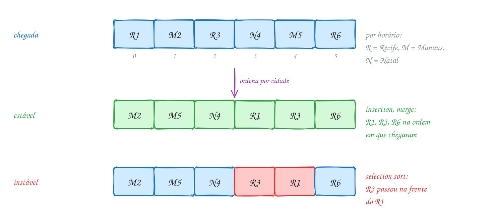</p>

A norma do C **não promete** que o `qsort` é estável. Então, quando a ordem
dos empatados importa, ponha o desempate na própria `compara`. É o que o
código abaixo faz: cidade primeiro, horário depois.

```c
#include <stdio.h>
#include <stdlib.h>
#include <string.h>

typedef struct {
    int numero;
    int hora;          // hhmm
    char cidade[16];
} Pedido;

// contrato do qsort: negativo se a vem antes, 0 se empata, positivo se depois
int compara(const void *a, const void *b) {
    const Pedido *p = a;
    const Pedido *q = b;
    int c = strcmp(p->cidade, q->cidade);   // 1º critério: cidade
    if (c != 0) {
        return c;
    }
    return (p->hora > q->hora) - (p->hora < q->hora); // desempate: horário
}

int main(void) {
    Pedido pedidos[] = {           // chegaram nesta ordem (por horário)
        {101, 910, "Recife"},
        {102, 925, "Manaus"},
        {103, 1005, "Recife"},
        {104, 1040, "Natal"},
        {105, 1115, "Manaus"},
        {106, 1150, "Recife"},
    };
    size_t n = sizeof pedidos / sizeof pedidos[0];

    qsort(pedidos, n, sizeof pedidos[0], compara);

    for (size_t i = 0; i < n; i++) {
        printf("%-7s %02d:%02d  #%d\n", pedidos[i].cidade,
               pedidos[i].hora / 100, pedidos[i].hora % 100, pedidos[i].numero);
    }
    return 0;
}
// Saída:
// Manaus  09:25  #102
// Manaus  11:15  #105
// Natal   10:40  #104
// Recife  09:10  #101
// Recife  10:05  #103
// Recife  11:50  #106
```

### Passo a passo

Os números de verdade. O exemplo A202 roda os cinco algoritmos do módulo com
os mesmos 1000 números e conta as comparações:

| n = 1000 | aleatório | ordenado | invertido |
| --- | --- | --- | --- |
| bubble | 499.122 | 999 | 499.500 |
| selection | 499.500 | 499.500 | 499.500 |
| insertion | 241.308 | 999 | 499.500 |
| merge | 8.696 | 4.932 | 5.044 |
| quick (pivô no fim) | 10.972 | 499.500 | 499.500 |

Leia a tabela por coluna. No aleatório, os O(n log n) fazem umas 50 vezes
menos trabalho. No ordenado, o bubble e o insertion fazem uma passada só,
enquanto o quick com pivô no fim cai no pior caso. O selection nem percebe a
diferença entre as três colunas.

Repara no fluxograma: é um guia de decisão, não um algoritmo. O caminho
marcado é o deste exemplo: a ordem de chegada importa, mas cabe como
desempate na `compara` (o horário), então `qsort` resolve:

<p align="center">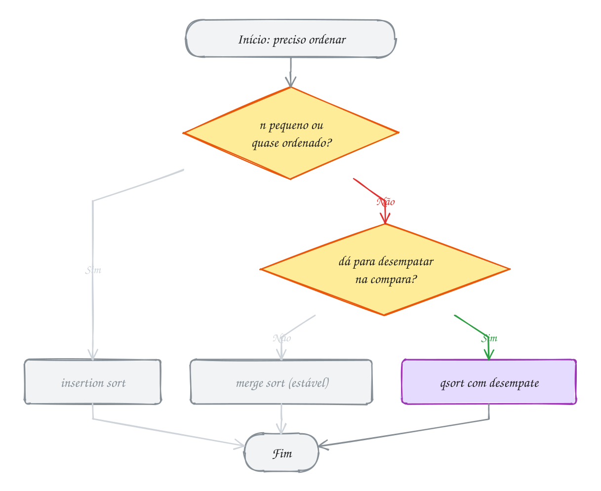</p>

> [!WARNING]
> A `compara` preguiçosa `return *(const int *) a - *(const int *) b;`
> parece certa e passa nos testes com números pequenos. Com valores grandes de
> sinais opostos (por exemplo, `INT_MAX` e `-5`), a subtração dá **overflow**:
> o resultado vira negativo e a ordem sai errada. Escreva
> `return (x > y) - (x < y);`, que devolve -1, 0 ou 1 sem fazer conta.

> [!TIP]
> **Por dentro do C:** o `qsort` move os elementos byte a byte (ele só sabe o
> `tamanho`) e chama a sua `compara` por um **ponteiro para função** a cada
> comparação. Essa chamada indireta impede o compilador de colar a
> comparação dentro do laço, então, para `int`, um sort escrito à mão pode
> ser mais rápido. A norma também não diz qual algoritmo o `qsort` usa: as
> bibliotecas usam variações de quick sort (com proteção contra o pior caso)
> ou de merge sort. Por isso, nunca conte com estabilidade nem com um custo
> exato. Para buscar num vetor ordenado pelo mesmo critério, a mesma
> `stdlib.h` traz a **`bsearch`**, com a mesma `compara`.

> [!NOTE]
> **Pergunta para você:** se a `compara` do A201 só comparasse a cidade (sem o
> desempate por horário), a saída seria sempre a mesma? Em que ordem você
> esperaria os três pedidos de Recife? Rode algumas vezes, troque a ordem do
> vetor de entrada e veja.

### Hora de praticar

Os arquivos ficam em [`0101-comparando/`](0101-comparando/). Os comandos funcionam de qualquer pasta do terminal. Nos exemplos, rode, mude, quebre e rode de novo. Nos exercícios, a resposta vai dentro do próprio arquivo. ★☆☆ é aquecimento, ★★☆ pede raciocínio e ★★★ é desafio.

**Exemplo A201 · Os pedidos agrupados por cidade com qsort**

```c
#include <stdio.h>
#include <stdlib.h>
#include <string.h>

typedef struct {
    int numero;
    int hora;          // hhmm
    char cidade[16];
} Pedido;

// contrato do qsort: negativo se a vem antes, 0 se empata, positivo se depois
int compara(const void *a, const void *b) {
    const Pedido *p = a;
    const Pedido *q = b;
    int c = strcmp(p->cidade, q->cidade);   // 1º critério: cidade
    if (c != 0) {
        return c;
    }
    return (p->hora > q->hora) - (p->hora < q->hora); // desempate: horário
}

int main(void) {
    Pedido pedidos[] = {           // chegaram nesta ordem (por horário)
        {101, 910, "Recife"},
        {102, 925, "Manaus"},
        {103, 1005, "Recife"},
        {104, 1040, "Natal"},
        {105, 1115, "Manaus"},
        {106, 1150, "Recife"},
    };
    size_t n = sizeof pedidos / sizeof pedidos[0];

    qsort(pedidos, n, sizeof pedidos[0], compara);

    for (size_t i = 0; i < n; i++) {
        printf("%-7s %02d:%02d  #%d\n", pedidos[i].cidade,
               pedidos[i].hora / 100, pedidos[i].hora % 100, pedidos[i].numero);
    }
    return 0;
}
// Saída:
// Manaus  09:25  #102
// Manaus  11:15  #105
// Natal   10:40  #104
// Recife  09:10  #101
// Recife  10:05  #103
// Recife  11:50  #106
```

```bash
~/LPEDC/rodar 13-busca-e-ordenacao/0101-comparando/A201.c
```

**Exemplo A202 · Cinco algoritmos, a mesma corrida**

```c
#include <stdio.h>
#include <stdlib.h>
#include <string.h>

#define N 1000

static long comparacoes;

// toda comparação de elementos passa por aqui e é contada
static int maior(int a, int b) {
    comparacoes++;
    return a > b;
}

static void troca(int *a, int *b) {
    int aux = *a;
    *a = *b;
    *b = aux;
}

static void bubble(int v[], int n) {
    int trocou = 1;
    for (int p = 1; p < n && trocou; p++) {
        trocou = 0;
        for (int j = 0; j < n - p; j++) {
            if (maior(v[j], v[j + 1])) {
                troca(&v[j], &v[j + 1]);
                trocou = 1;
            }
        }
    }
}

static void selection(int v[], int n) {
    for (int i = 0; i < n - 1; i++) {
        int m = i;
        for (int j = i + 1; j < n; j++) {
            if (maior(v[m], v[j])) {
                m = j;
            }
        }
        troca(&v[i], &v[m]);
    }
}

static void insertion(int v[], int n) {
    for (int j = 1; j < n; j++) {
        int x = v[j], i = j - 1;
        while (i >= 0 && maior(v[i], x)) {
            v[i + 1] = v[i];
            i--;
        }
        v[i + 1] = x;
    }
}

static void merge_rec(int v[], int w[], int p, int r) {
    if (r - p < 2) {
        return;
    }
    int q = p + (r - p) / 2;
    merge_rec(v, w, p, q);
    merge_rec(v, w, q, r);
    int i = p, j = q, k = 0;
    while (i < q && j < r) {
        w[k++] = maior(v[i], v[j]) ? v[j++] : v[i++];
    }
    while (i < q) w[k++] = v[i++];
    while (j < r) w[k++] = v[j++];
    memcpy(&v[p], w, (size_t) (r - p) * sizeof v[0]);
}

static void merge(int v[], int n) {
    int *w = malloc((size_t) n * sizeof *w);
    if (w == NULL) {
        return;
    }
    merge_rec(v, w, 0, n);
    free(w);
}

static void quick_rec(int v[], int p, int r) {
    if (p >= r) {
        return;
    }
    int j = p;
    for (int k = p; k < r; k++) {
        if (!maior(v[k], v[r])) {      // v[k] <= pivô
            troca(&v[j], &v[k]);
            j++;
        }
    }
    troca(&v[j], &v[r]);
    quick_rec(v, p, j - 1);
    quick_rec(v, j + 1, r);
}

static void quick(int v[], int n) {
    quick_rec(v, 0, n - 1);
}

// gerador de números próprio: dá a mesma sequência em qualquer máquina
static unsigned semente = 2024;
static int sorteia(void) {
    semente = semente * 1103515245u + 12345u;
    return (int) ((semente >> 16) % 10000);
}

int main(void) {
    static int base[3][N], v[N];
    for (int i = 0; i < N; i++) {
        base[0][i] = sorteia();       // aleatório
        base[1][i] = i;               // já ordenado
        base[2][i] = N - i;           // invertido
    }
    const char *nomes[] = {"bubble", "selection", "insertion", "merge", "quick"};
    void (*algoritmos[])(int[], int) = {bubble, selection, insertion, merge, quick};

    printf("n = 1000    aleatório   ordenado  invertido\n"); // alinhado à mão: o "ó" ocupa 2 bytes
    for (int a = 0; a < 5; a++) {
        printf("%-10s", nomes[a]);
        for (int c = 0; c < 3; c++) {
            memcpy(v, base[c], sizeof v);
            comparacoes = 0;
            algoritmos[a](v, N);
            printf(" %10ld", comparacoes);
        }
        printf("\n");
    }
    return 0;
}
// Saída:
// n = 1000    aleatório   ordenado  invertido
// bubble         499122        999     499500
// selection      499500     499500     499500
// insertion      241308        999     499500
// merge            8696       4932       5044
// quick           10972     499500     499500
```

```bash
~/LPEDC/rodar 13-busca-e-ordenacao/0101-comparando/A202.c
```

#### Exercícios

**Exercício E601** · ★☆☆

O app de combustível mostra o preço da gasolina em seis postos:
5.89, 6.19, 5.79, 6.05, 5.99 e 6.29. Ordene do MAIS CARO para o mais
barato com qsort e mostre um preço por linha.


```text
Saída esperada:
R$ 6.29
R$ 6.19
R$ 6.05
R$ 5.99
R$ 5.89
R$ 5.79
```

**Dicas:**

1. A compara recebe const void *: converta para const double * e leia.
2. Decrescente: devolva negativo quando o primeiro for MAIOR.
3. Não devolva x - y: com double, 0.1 vira 0 ao converter para int.
   Use (x < y) - (x > y).
4. Resposta esperada: a saída acima.

```bash
~/LPEDC/rodar 13-busca-e-ordenacao/0101-comparando/E601.c
```

**Exercício E602** · ★☆☆

Para cada situação, escolha UM algoritmo do módulo (bubble, selection,
insertion, merge, quick ou o qsort da biblioteca) e justifique em uma
linha. Responda como comentário.


```text
a) Um placar de 20 jogadores, reordenado a cada ponto marcado (o vetor
   está sempre quase em ordem).
b) A lista de alunos já está em ordem alfabética e você quer ordenar
   por nota sem bagunçar a ordem alfabética dos empatados, sem mexer
   na compara.
c) Registros enormes num cartão de memória lento: cada troca custa
   caro, comparar é barato.
d) Um servidor que ordena dados enviados por usuários e não pode, de jeito
   nenhum, cair num caso O(n²).
e) Ordenar um vetor de structs num programa comum, sem requisitos
   especiais.
f) Em que situação real o bubble sort é a melhor escolha?
```

**Dicas:**

1. Releia a tabela de custo e estabilidade do assunto.
2. "Adaptativo" e "estável" são as palavras-chave de a) e b).
3. Resposta esperada: a) insertion; b) merge (estável); c) selection (no
   máximo n - 1 trocas); d) merge (n log n garantido); e) qsort; f) em
   nenhuma: o insertion faz o mesmo papel melhor.

```bash
~/LPEDC/rodar 13-busca-e-ordenacao/0101-comparando/E602.c
```

**Exercício E603** · ★★☆

A playlist tem as bandas const char *bandas[] = {"Skank", "Titas",
"Legiao", "Raimundos", "Pitty", "Cazuza"} (sem acentos, para o strcmp não
se perder). Ordene com qsort duas vezes e mostre cada resultado numa linha:


```text
1) em ordem alfabética;
2) do nome mais curto para o mais comprido; empatou no tamanho, ordem
   alfabética.
```


```text
Saída esperada:
Cazuza Legiao Pitty Raimundos Skank Titas
Pitty Skank Titas Cazuza Legiao Raimundos
```

**Dicas:**

1. Cada elemento do vetor é um const char *. O qsort passa para a compara
   o ENDEREÇO do elemento, ou seja, um ponteiro para ponteiro.
2. Leia assim: const char *x = *(const char *const *) a;
3. O erro clássico é fazer strcmp(a, b) direto: compara os bytes dos
   ponteiros, não as letras.
4. Resposta esperada: a saída acima.

```bash
~/LPEDC/rodar 13-busca-e-ordenacao/0101-comparando/E603.c
```

**Exercício E604** · ★★☆

Os saldos (em centavos) de cinco contas de uma corretora precisam sair do
menor para o maior. A compara abaixo é a "versão curta" que aparece em
muito tutorial. O erro é de propósito: rode e veja o UBSan reclamar
("signed integer overflow") e a ordem sair errada. Explique o que acontece
e conserte sem mudar o tipo int.


```text
Saída esperada (depois de consertar):
-1500000000
-7
15
1000000000
2000000000
```

**Dicas:**

1. Quanto é 2000000000 - (-1500000000)? Cabe num int (assunto 0008)?
2. A compara não precisa devolver a diferença, só o SINAL certo.
3. (x > y) - (x < y) vale 1, 0 ou -1 e nunca estoura.
4. Resposta esperada: x - y dá overflow com valores grandes de sinais
   opostos; o resultado vira negativo e a compara diz que 2000000000 vem
   antes de -1500000000. Conserto: return (x > y) - (x < y);

```bash
~/LPEDC/rodar 13-busca-e-ordenacao/0101-comparando/E604.c
```

**Exercício E605** · ★★★

Uma agenda de contatos:


```text
typedef struct { char nome[16]; char telefone[16]; } Contato;
```


```text
{"Rafael", "81 99876-1234"}, {"Carla", "11 98765-4321"},
{"Bruno", "21 97654-3210"}, {"Marina", "31 96543-2109"},
{"Diego", "85 95432-1098"}
```


Ordene por nome com qsort e depois procure "Carla" e "Zeca" com bsearch:


```text
void *bsearch(const void *chave, const void *base, size_t n,
              size_t tamanho, int (*compara)(const void *, const void *));
```


Ela devolve o endereço do elemento achado ou NULL. Passe como chave a
própria string (const char *), sem montar um Contato.


```text
Saída esperada:
Carla: 11 98765-4321 (posição 1)
Zeca: não está na agenda
```

**Dicas:**

1. São duas funções de comparação: a do qsort recebe dois Contato *; a do
   bsearch recebe a CHAVE no 1º argumento (const char *) e um Contato * no
   2º.
2. As duas precisam usar o mesmo critério (strcmp nos nomes), senão a busca
   binária se perde.
3. A posição é a diferença de ponteiros c - agenda; o tipo é ptrdiff_t e o
   formato é %td.
4. Resposta esperada: a saída acima (ordenada: Bruno, Carla, Diego,
   Marina, Rafael).

```bash
~/LPEDC/rodar 13-busca-e-ordenacao/0101-comparando/E605.c
```

**Exercício E606** · ★★★

O boletim está em ordem alfabética: Ana 8, Bruno 9, Caio 8, Duda 7,
Enzo 9, Fabi 8, Gui 7. A coordenação quer por nota, da maior para a menor,
e, entre empatados, a ordem alfabética de antes. O qsort não promete ser
estável, então FORCE a estabilidade: acrescente à struct um campo ordem
com a posição original de cada aluno e use-o como desempate.


```text
typedef struct { char nome[10]; int nota; int ordem; } Aluno;
```


```text
Saída esperada:
9 Bruno
9 Enzo
8 Ana
8 Caio
8 Fabi
7 Duda
7 Gui
```

**Dicas:**

1. Antes do qsort, um laço faz turma[i].ordem = i.
2. Na compara: notas diferentes decidem (decrescente); notas iguais,
   decide a ordem (crescente).
3. Com esse desempate, não existem dois elementos "iguais" para a compara,
   então a estabilidade do algoritmo deixa de importar.
4. Resposta esperada: a saída acima.

```bash
~/LPEDC/rodar 13-busca-e-ordenacao/0101-comparando/E606.c
```

---

## Desafios do módulo

Problemas para fechar o módulo, misturando os assuntos. Escreva em C e rode
com o `rodar`.

**1. Quantas voltas no pior caso?** Uma busca binária num vetor ordenado de
5.000 CPFs falhou (o CPF não estava lá). Quantas voltas do laço ela deu, no
máximo? E num vetor de 5 milhões?

<details><summary>Resposta</summary>

O intervalo cai pela metade a cada volta: o máximo é `⌊log₂ n⌋ + 1`. Para
5.000, 2¹² = 4096 ≤ 5000 < 8192 = 2¹³, então **13 voltas**. Para 5 milhões,
2²² = 4.194.304 ≤ 5.000.000 < 2²³, então **23 voltas**. Mil vezes mais dados,
só 10 voltas a mais.

</details>

**2. O par que soma.** Dado um vetor ordenado `3 8 11 15 19 24 30` e um valor
`alvo = 34`, ache dois elementos que somam o alvo em O(n), sem laço dentro de
laço.

<details><summary>Resposta</summary>

Dois índices: `i = 0` no começo e `j = n - 1` no fim. Se `v[i] + v[j]` é
menor que o alvo, `i++`; se é maior, `j--`; se é igual, achou. Para 34: 3 + 30
= 33 (i++), 8 + 30 = 38 (j--), 8 + 24 = 32 (i++), 11 + 24 = 35 (j--), 11 + 19
= 30 (i++), **15 + 19 = 34**. Funciona porque o vetor está ordenado: cada passo
descarta um elemento que não pode fazer parte de nenhum par.

</details>

**3. Primeiro ordena, depois busca?** Você tem um vetor desordenado de `n =
100.000` elementos e precisa responder `k` buscas. A partir de quantas buscas
vale a pena ordenar (n log₂ n ≈ 1,7 milhão de comparações) e usar busca
binária (17 por busca), em vez de fazer busca sequencial (uns n/2 = 50 mil por
busca)?

<details><summary>Resposta</summary>

Sequencial: `50.000 k`. Ordenar e buscar: `1.700.000 + 17 k`. Igualando,
`k ≈ 34`. Com **mais de umas 34 buscas**, ordenar compensa; com milhares de
buscas, a diferença é enorme. Com 1 ou 2 buscas, ordenar é desperdício.

</details>

**4. Ordenar 0, 1 e 2.** Um vetor tem só os valores 0, 1 e 2 (por exemplo,
`2 0 1 2 1 0 0 2 1`). Ordene em **uma passada**, in-place, sem contar
quantos há de cada.

<details><summary>Resposta</summary>

É a partição de três vias do exercício E600 com pivô 1 (a "bandeira holandesa"
de Dijkstra): `lt`, `i` e `gt`. 0 vai para a frente (`troca(v[lt], v[i])`,
`lt++`, `i++`), 2 vai para o fim (`troca(v[i], v[gt])`, `gt--`), 1 fica
(`i++`). Resultado: `0 0 0 1 1 1 2 2 2`, com n comparações.

</details>

**5. Ordenar sem comparar.** As notas de 3.000 candidatos são inteiros de 0 a
100. Ordene em O(n) usando um vetor `contagem[101]`.

<details><summary>Resposta</summary>

**Counting sort**: um laço conta quantas vezes cada nota aparece
(`contagem[nota]++`); outro laço percorre as notas de 0 a 100 e escreve cada
uma `contagem[nota]` vezes. São O(n + 101) passos e nenhuma comparação entre
elementos. Só funciona porque as chaves são inteiros num intervalo pequeno: o
limite de O(n log n) vale para algoritmos que **comparam**.

</details>

**6. O merge sort de baixo para cima.** Escreva o merge sort sem recursão:
intercale pedaços de tamanho 1, depois 2, 4, 8... até cobrir o vetor. Teste
com as notas do assunto 0099, `52 18 33 7 41 26 60 12`, e com um vetor de 7
elementos.

<details><summary>Resposta</summary>

Laço de fora: `for (int b = 1; b < n; b *= 2)`. Laço de dentro:
`for (int p = 0; p + b < n; p += 2 * b)` intercala `[p, p + b)` com
`[p + b, min(p + 2b, n))`. O cuidado é o último pedaço, que pode ser menor
(ou nem existir) quando `n` não é potência de 2. O resultado é
`7 12 18 26 33 41 52 60`.

</details>

**7. Quick sort que não estoura a pilha.** Mude o quick sort do A199 para
fazer a recursão só no lado **menor** e tratar o maior com um `while`. Meça a
maior profundidade de recursão num vetor já ordenado de 10.000 elementos,
antes e depois.

<details><summary>Resposta</summary>

Antes, com o pivô no fim, a profundidade chega a 9.999. Depois, cada chamada
recursiva recebe no máximo metade do pedaço atual, então a profundidade fica
abaixo de `log₂ 10.000 ≈ 14`. As comparações continuam O(n²) nesse caso: o
truque protege a **pilha**, não o tempo. Para o tempo, mude o pivô (meio ou
mediana de três).

</details>

**8. Quick sort híbrido.** Faça o quick sort chamar o insertion sort quando o
pedaço tiver menos de `L` elementos. Com o contador de comparações do A202,
teste `L = 1, 8, 16, 32` num vetor aleatório de 10.000.

<details><summary>Resposta</summary>

As comparações quase não mudam (às vezes até sobem um pouco), mas o tempo de
relógio costuma cair, com o melhor valor em geral entre 8 e 32: o insertion
não tem recursão nem chamadas, e pedaços pequenos cabem inteiros no cache. É o que as bibliotecas de verdade fazem. Moral: comparações são um bom
modelo, mas não são tudo.

</details>

**9. Mediana de duas listas.** Duas lojas têm listas ordenadas de preços, com
5 e 6 itens: `12 30 45 60 88` e `9 25 41 50 70 95`. Ache a mediana dos 11
preços sem criar um vetor novo.

<details><summary>Resposta</summary>

Faça a intercalação **sem gravar**: avance os dois índices como no merge,
contando quantos elementos já "saíram", e pare no 6º (o do meio de 11). A
sequência é 9, 12, 25, 30, 41, **45**: a mediana é **45**, com O(n) passos e
O(1) de memória.

</details>

**10. A compara que mente.** Esta compara foi escrita para ordenar do maior
para o menor: `return *(const int *) a < *(const int *) b;`. Ela compila. O
que está errado e o que pode acontecer?

<details><summary>Resposta</summary>

Ela devolve só 0 ou 1, nunca negativo. Para o `qsort`, "0" quer dizer
"empate" e "1" quer dizer "a vem depois": quando `a > b`, ela diz que empatam.
O contrato fica inconsistente (se `a` empata com `b` e `b` empata com `c`,
`a` deveria empatar com `c`), e o resultado depende de como a biblioteca
implementa o `qsort`: pode sair certo num computador e errado em outro. O
certo é `return (x < y) - (x > y);`.

</details>

## Para ler mais

- FEOFILOFF, P. *Algoritmos em linguagem C*. Rio de Janeiro: Elsevier, 2009. Caps. de busca em vetor ordenado, ordenação elementar, mergesort e quicksort.
- TENENBAUM, A. M.; LANGSAM, Y.; AUGENSTEIN, M. J. *Estruturas de dados usando C*. São Paulo: Makron Books, 1995. Cap. 6 (classificação) e cap. 7 (busca).
- CELES, W.; RANGEL, J. L. *Apostila de estruturas de dados*. Rio de Janeiro: PUC-Rio, 2002. Parte III: ordenação e busca.
- LAUREANO, M. *Estrutura de dados com algoritmos e C*. Rio de Janeiro: Brasport, 2008. Caps. de busca e ordenação.
- ROCHA, A. M. A.; BORGES, A. R. O. S. *Programação, estruturas de dados e algoritmos em C*. Aveiro: Universidade de Aveiro. Cap. de pesquisa e ordenação.
- DEITEL, P.; DEITEL, H. *C: como programar*. 6. ed. São Paulo: Pearson Prentice Hall, 2011. Cap. 6 (classificação e pesquisa em arrays).
- KERNIGHAN, B. W.; RITCHIE, D. M. *C: a linguagem de programação padrão ANSI*. Rio de Janeiro: Campus, 1989. Seções 4.10 (recursão e quicksort) e 5.11 (ponteiros para funções).
- CORMEN, T. H. et al. *Algoritmos: teoria e prática*. 3. ed. Rio de Janeiro: Elsevier, 2012. Caps. 2 (insertion sort e merge sort) e 7 (quicksort).
- BLOCH, J. Extra, extra: read all about it: nearly all binary searches and mergesorts are broken. *Google Research Blog*, 2006. Disponível em: <https://research.google/blog/extra-extra-read-all-about-it-nearly-all-binary-searches-and-mergesorts-are-broken/>.
- CPPREFERENCE. *qsort, qsort_s* e *bsearch, bsearch_s*. Disponível em: <https://en.cppreference.com/w/c/algorithm>.
- LINUX MAN-PAGES. *qsort(3)* e *bsearch(3)*. Disponível em: <https://man7.org/linux/man-pages/man3/qsort.3.html>.
