<!-- Gerado por _gerador. Para mudar este arquivo, edite _gerador/modulos/14-arvores/ e rode: cd _gerador && npm run gerar -->

# Módulo 14 · Árvores

> [!IMPORTANT]
> **Mundo 5 · Árvores · Rota do jogo: etapa 17 de 29**
>
> **Missão:** montar árvore binária, ABB, AVL e heap.
>
> **Vem de:** [Módulo 18 · Ordenação além da comparação e seleção](18-ordenacao-linear.md). **Segue para:** [Módulo 22 · Árvores e conjuntos avançados](22-arvores-avancadas.md).
>
> **Checkpoints desta fase:**
> - [ ] Ler os assuntos 0097 a 0104 e refazer os exemplos
> - [ ] Resolver os 4 exercícios de cada assunto, escrevendo o código sozinho
> - [ ] Fechar a lista prática (P1401 a P1430)
> - [ ] Enfrentar os desafios do módulo
> - [ ] Chefão: resolver as questões de prova do módulo sem consultar

Árvores guardam hierarquias e buscam descendo um caminho. O módulo cobre
árvore binária e percursos, BST (busca, inserção, remoção), AVL, heap e
heapsort. Usa recursão (0032), `malloc` (0054), TAD (0074), a fila (0085) e a
busca binária (0090). O módulo 15 troca a árvore pela tabela hash.

## O que você vai aprender

- vocabulário: **raiz**, **filho**, **folha**, **altura** e **profundidade**
- **árvore binária** em C e os quatro **percursos**: pré-ordem, em ordem,
  pós-ordem e por nível
- **BST**: busca, inserção e os três casos da **remoção**
- por que a BST pode virar lista e como a **AVL** se equilibra com
  **rotações**
- **heap** num vetor e **fila de prioridade**
- **heapsort**: O(n log n) sem memória extra
- um programa que junta BST e heap

## Antes de começar

Do 0098 em diante, cada assunto tem um TAD na pasta (`arvore.h`, `bst.h`,
`avl.h`, `heap.h`, `cadastro.h`); abra também o `.c`, que tem o algoritmo. Nos
desenhos, aresta verde é o caminho da busca e nó vermelho é o que sai ou está
desequilibrado. Desenhe no papel e use a saída para conferir.

O comando compila junto o `.c` de apoio da pasta (como `bst.c`):

```bash
gcc ~/LPEDC/material/A197.c ~/LPEDC/material/0099-bst.c -o ~/LPEDC/material/A197 && ~/LPEDC/material/A197
```

**Altura conta arestas** em todo o módulo: folha vale 0 e árvore vazia, -1.

| # | Assunto |
| --- | --- |
| [0097](#0097--árvores) | Árvores |
| [0098](#0098--árvore-binária-e-percursos) | Árvore binária e percursos |
| [0099](#0099--bst-busca-e-inserção) | BST: busca e inserção |
| [0100](#0100--bst-remoção) | BST: remoção |
| [0101](#0101--avl-balanceamento-e-rotações) | AVL: balanceamento e rotações |
| [0102](#0102--heap-e-fila-de-prioridade) | Heap e fila de prioridade |
| [0103](#0103--heapsort) | Heapsort |
| [0104](#0104--juntando-tudo) | Juntando tudo |

---

> [!NOTE]
> Cada assunto é um capítulo: **Conceito** (a explicação), **Exemplos de uso** (programas que compilam sozinhos: rode com o comando abaixo de cada um e compare com a saída no fim do código) e **Exercícios** (cada um é um arquivo em `material/` com o esqueleto, as dicas e o espaço para a resposta; resoluções em `_respostas/14-arvores/`).

## 0097 · Árvores

### Conceito

- **Árvore**: estrutura em que cada elemento tem um só "de cima" e pode ter
  vários "de baixo". Serve para pastas, organogramas e sumários
  (TENENBAUM; LANGSAM; AUGENSTEIN, 1995, cap. 5).
- **Definição recursiva**: uma árvore é um nó, a **raiz**, com zero ou mais
  árvores penduradas embaixo. Por isso quase toda função de árvore resolve
  cada filho e junta as respostas (FEOFILOFF, 2009).
- **Profundidade** (ou **nível**): quantas arestas separam o nó da raiz. A
  raiz tem profundidade 0 (CELES; RANGEL, 2002).
- **Altura**: o caminho mais longo, em arestas, do nó até uma folha. A altura
  da árvore é a da raiz; folha tem altura 0 e árvore vazia, -1
  (FEOFILOFF, 2009).
- **Liberar**: cada nó vem de um `malloc`, como na lista encadeada; o `free`
  vem depois dos filhos (CELES; RANGEL, 2002).

| Termo | O que é | Nas pastas |
| --- | --- | --- |
| **nó** | cada elemento da árvore | cada pasta |
| **raiz** | o nó do topo, o único sem pai | `casa` |
| **pai** e **filho** | o nó de cima e os nós ligados logo abaixo | `contas` é pai de `luz` |
| **irmãos** | filhos do mesmo pai | `praia` e `natal` |
| **folha** | nó sem filhos | `praia`, `natal`, `agua`, `2025`, `musica` |
| **subárvore** | um nó com tudo que está embaixo dele | `contas` com `agua`, `luz` e `2025` |
| **grau** | quantos filhos o nó tem; o da árvore é o maior deles | `casa` tem grau 3 |

> [!WARNING]
> Aqui a altura conta **arestas**. Há livros que contam nós, e a mesma árvore
> ganha 1 a mais; não misture. Na hora de liberar, primeiro as subárvores: com
> `free(n)` **antes** dos filhos, o laço lê memória já devolvida.

### Exemplos de uso

As pastas de um computador: `casa` tem `fotos`, `contas` e `musica`, e `luz`
fica dentro de `contas`. São 9 nós, 5 folhas (em verde) e altura 3, de `casa`
até `2025`:

<p align="center">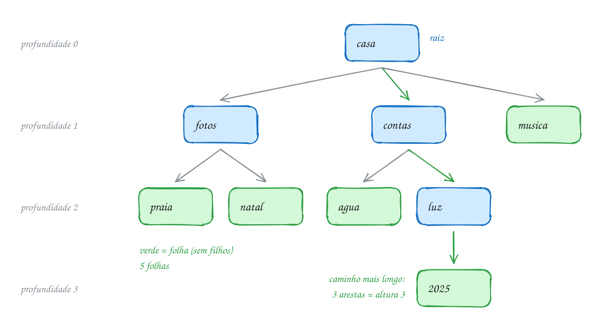</p>

```c
#include <stdio.h>
#include <stdlib.h>
#include <string.h>

#define MAX_FILHOS 4

typedef struct No {
    char nome[16];
    struct No *filhos[MAX_FILHOS]; // ponteiros para as subpastas
    int qtd;                       // quantas subpastas tem
} No;

No *novo(const char *nome) {
    No *n = malloc(sizeof(No));
    if (n == NULL) {
        exit(1);
    }
    strcpy(n->nome, nome);
    n->qtd = 0;
    return n;
}

No *adiciona(No *pai, const char *nome) {
    No *filho = novo(nome);
    pai->filhos[pai->qtd++] = filho;
    return filho;
}

void mostra(const No *n, int profundidade) {
    // %*s com "" imprime 2 * profundidade espaços: o recuo
    printf("%*s%s (%d)\n", 2 * profundidade, "", n->nome, profundidade);
    for (int i = 0; i < n->qtd; i++) {
        mostra(n->filhos[i], profundidade + 1);
    }
}

int conta_folhas(const No *n) {
    if (n->qtd == 0) {
        return 1; // sem filhos: é folha
    }
    int total = 0;
    for (int i = 0; i < n->qtd; i++) {
        total += conta_folhas(n->filhos[i]);
    }
    return total;
}

int altura(const No *n) {
    int maior = -1;
    for (int i = 0; i < n->qtd; i++) {
        int h = altura(n->filhos[i]);
        if (h > maior) {
            maior = h;
        }
    }
    return maior + 1; // folha: -1 + 1 = 0
}

void libera(No *n) {
    for (int i = 0; i < n->qtd; i++) {
        libera(n->filhos[i]); // os filhos primeiro
    }
    free(n);
}

int main(void) {
    No *casa = novo("casa");
    No *fotos = adiciona(casa, "fotos");
    No *contas = adiciona(casa, "contas");
    adiciona(casa, "musica");
    adiciona(fotos, "praia");
    adiciona(fotos, "natal");
    adiciona(contas, "agua");
    No *luz = adiciona(contas, "luz");
    adiciona(luz, "2025");

    mostra(casa, 0);
    printf("Folhas: %d\n", conta_folhas(casa));
    printf("Altura: %d\n", altura(casa));
    libera(casa);
    return 0;
}
// Saída:
// casa (0)
//   fotos (1)
//     praia (2)
//     natal (2)
//   contas (1)
//     agua (2)
//     luz (2)
//       2025 (3)
//   musica (1)
// Folhas: 5
// Altura: 3
```

A `altura` não trata a folha à parte: ela não entra no laço, `maior` fica em -1
e a função devolve 0. Em `casa`, os filhos respondem 1, 2 e 0, e ela devolve
2 + 1 = 3:

<p align="center">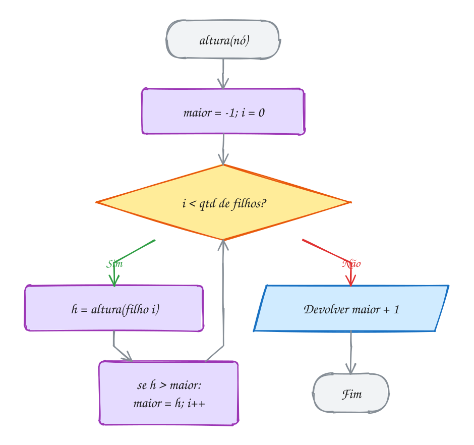</p>

**Exemplo A193 · Os mesmos nós, alturas diferentes**

```c
#include <stdio.h>
#include <stdlib.h>
#include <string.h>

#define MAX_FILHOS 4

typedef struct No {
    char nome[16];
    struct No *filhos[MAX_FILHOS];
    int qtd;
} No;

No *novo(const char *nome) {
    No *n = malloc(sizeof(No));
    if (n == NULL) {
        exit(1);
    }
    strcpy(n->nome, nome);
    n->qtd = 0;
    return n;
}

No *adiciona(No *pai, const char *nome) {
    No *filho = novo(nome);
    pai->filhos[pai->qtd++] = filho;
    return filho;
}

int conta_folhas(const No *n) {
    if (n->qtd == 0) {
        return 1;
    }
    int total = 0;
    for (int i = 0; i < n->qtd; i++) {
        total += conta_folhas(n->filhos[i]);
    }
    return total;
}

int altura(const No *n) {
    int maior = -1;
    for (int i = 0; i < n->qtd; i++) {
        int h = altura(n->filhos[i]);
        if (h > maior) {
            maior = h;
        }
    }
    return maior + 1;
}

// o maior grau da árvore: compara o nó com o maior grau de cada filho
int maior_grau(const No *n) {
    int maior = n->qtd;
    for (int i = 0; i < n->qtd; i++) {
        int g = maior_grau(n->filhos[i]);
        if (g > maior) {
            maior = g;
        }
    }
    return maior;
}

void libera(No *n) {
    for (int i = 0; i < n->qtd; i++) {
        libera(n->filhos[i]);
    }
    free(n);
}

void resumo(const char *titulo, const No *raiz) {
    printf("%-10s folhas %d, altura %d, maior grau %d\n", titulo,
           conta_folhas(raiz), altura(raiz), maior_grau(raiz));
}

int main(void) {
    // larga: o grupo da família, todo mundo direto embaixo do admin
    No *grupo = novo("admin");
    adiciona(grupo, "mae");
    adiciona(grupo, "pai");
    adiciona(grupo, "tia");
    adiciona(grupo, "primo");

    // funda: o sumário de um livro, cada item dentro do anterior
    No *livro = novo("livro");
    No *p = adiciona(livro, "cap 1");
    p = adiciona(p, "secao 1.1");
    p = adiciona(p, "item 1.1.1");
    adiciona(p, "nota");

    // caso de borda: um nó sozinho já é uma árvore (e é raiz e folha)
    No *sozinho = novo("rascunho");

    resumo("larga:", grupo);     // 5 nós
    resumo("funda:", livro);     // 5 nós
    resumo("sozinho:", sozinho); // 1 nó

    libera(grupo);
    libera(livro);
    libera(sozinho);
    return 0;
}
// Saída:
// larga:     folhas 4, altura 1, maior grau 4
// funda:     folhas 1, altura 4, maior grau 1
// sozinho:   folhas 1, altura 0, maior grau 0
```

```bash
gcc ~/LPEDC/material/A193.c -o ~/LPEDC/material/A193 && ~/LPEDC/material/A193
```

**Exemplo A194 · O organograma com dois ponteiros**

```c
#include <stdio.h>
#include <stdlib.h>
#include <string.h>

// "primeiro filho / próximo irmão": qualquer quantidade de filhos
// cabe em só dois ponteiros por nó
typedef struct No {
    char cargo[16];
    struct No *filho; // o primeiro filho
    struct No *irmao; // o próximo irmão (mesmo pai)
} No;

No *novo(const char *cargo) {
    No *n = malloc(sizeof(No));
    if (n == NULL) {
        exit(1);
    }
    strcpy(n->cargo, cargo);
    n->filho = NULL;
    n->irmao = NULL;
    return n;
}

// coloca o novo filho no fim da fila de irmãos
No *contrata(No *chefe, const char *cargo) {
    No *n = novo(cargo);
    if (chefe->filho == NULL) {
        chefe->filho = n;
    } else {
        No *p = chefe->filho;
        while (p->irmao != NULL) {
            p = p->irmao;
        }
        p->irmao = n;
    }
    return n;
}

// grau = quantos filhos o nó tem: anda pela fila de irmãos
int grau(const No *n) {
    int g = 0;
    for (const No *p = n->filho; p != NULL; p = p->irmao) {
        g++;
    }
    return g;
}

void mostra(const No *n, int nivel) {
    printf("%*s%s: grau %d\n", 2 * nivel, "", n->cargo, grau(n));
    for (const No *p = n->filho; p != NULL; p = p->irmao) {
        mostra(p, nivel + 1);
    }
}

void libera(No *n) {
    while (n != NULL) {
        No *prox = n->irmao; // guarda antes do free
        libera(n->filho);
        free(n);
        n = prox;
    }
}

int main(void) {
    No *dona = novo("dona");
    No *gerente = contrata(dona, "gerente");
    No *padeiro = contrata(dona, "padeiro");
    contrata(gerente, "caixa 1");
    contrata(gerente, "caixa 2");
    contrata(gerente, "entregador");
    contrata(padeiro, "ajudante");

    mostra(dona, 0);
    printf("Tamanho de um nó: %zu bytes\n", sizeof(No));

    libera(dona);
    return 0;
}
// Saída:
// dona: grau 2
//   gerente: grau 3
//     caixa 1: grau 0
//     caixa 2: grau 0
//     entregador: grau 0
//   padeiro: grau 1
//     ajudante: grau 0
// Tamanho de um nó: 32 bytes
```

```bash
gcc ~/LPEDC/material/A194.c -o ~/LPEDC/material/A194 && ~/LPEDC/material/A194
```

### Exercícios

**Exercício E577** · ★☆☆

O site de uma loja organiza os produtos em categorias:

```text
loja
├── eletronicos
│   ├── celulares
│   └── tvs
│       ├── oled
│       └── led
├── casa
│   └── cozinha
└── moda
```

Escreva as funções novo, adiciona(pai, nome), altura e libera, monte a
árvore no main e escreva ficha(n, prof), que imprime uma linha por
categoria, recuada 2 espaços por nível, com a profundidade, o grau e a
palavra "folha" quando o nó não tem filhos. Por fim, imprima a altura.

```text
Saída esperada:
loja: prof 0, grau 3
  eletronicos: prof 1, grau 2
    celulares: prof 2, grau 0, folha
    tvs: prof 2, grau 2
      oled: prof 3, grau 0, folha
      led: prof 3, grau 0, folha
  casa: prof 1, grau 1
    cozinha: prof 2, grau 0, folha
  moda: prof 1, grau 0, folha
Altura: 3
```

**Exercício E579** · ★★☆

As pastas de um computador formam esta árvore:

```text
casa
├── fotos
│   ├── praia
│   └── natal
├── contas
│   ├── agua
│   └── luz
│       └── 2025
└── musica
```

Escreva profundidade_de(raiz, nome), que procura uma pasta pelo nome e
devolve a profundidade dela (a raiz tem profundidade 0), ou -1 se a pasta
não existir. Monte a árvore no main e teste luz, casa, 2025 e videos.

```text
Saída esperada:
luz: 2
casa: 0
2025: 3
videos: -1
```

**Exercício E580** · ★★☆

Cada pasta guarda arquivos soltos (campo mb, em megabytes):

```text
casa (5)
├── fotos (10)
│   ├── praia (300)
│   └── natal (120)
└── contas (2)
    ├── agua (5)
    └── luz (8)
```

Escreva tamanho(n), que soma a pasta com tudo que está dentro dela, e duas
funções que mostram o tamanho total de cada pasta:

- du(n): imprime "<total> MB  <nome>", com cada pasta DEPOIS de todas as

```text
subpastas dela (a raiz por último);
```

- arvore(n, prof): imprime "nome (total MB)", a pasta ANTES das

```text
subpastas, recuada 2 espaços por nível.
```

```text
Saída esperada:
-- du --
300 MB  praia
120 MB  natal
430 MB  fotos
5 MB  agua
8 MB  luz
15 MB  contas
450 MB  casa
-- arvore --
casa (450 MB)
  fotos (430 MB)
    praia (300 MB)
    natal (120 MB)
  contas (15 MB)
    agua (5 MB)
    luz (8 MB)
```

**Exercício E582** · ★★★

O menu do app de delivery é uma árvore:

```text
app
├── lanches
│   ├── x-salada
│   └── x-bacon
└── bebidas
    ├── suco
    └── refri
        ├── lata
        └── 2 litros
```

Escreva um programa (struct, montagem, função e liberação) que imprime o
caminho da raiz até cada folha, com "/" entre os nomes, como um endereço
de pasta, e no fim conta os caminhos.

```text
Saída esperada:
app/lanches/x-salada
app/lanches/x-bacon
app/bebidas/suco
app/bebidas/refri/lata
app/bebidas/refri/2 litros
Total de caminhos: 5
```

---

## 0098 · Árvore binária e percursos

### Conceito

- **Árvore binária**: ou é **vazia** (`NULL`), ou é um nó com uma
  **subárvore esquerda** e uma **subárvore direita**. Cada nó tem no máximo
  dois filhos (CORMEN et al., 2024, cap. 12).
- **O lado importa**: `A` com `B` à esquerda e `A` com `B` à direita são
  árvores diferentes (TENENBAUM; LANGSAM; AUGENSTEIN, 1995, cap. 5).
- **Percurso**: um jeito de visitar todos os nós uma vez. Os três recursivos
  só mudam a posição da visita em relação às duas chamadas (FEOFILOFF, 2009).
- **Por nível**: usa uma **fila** (assunto 0085). Tira o nó da frente, mostra
  e põe os filhos no fim (CELES; RANGEL, 2002).
- **Árvore de expressão**: operadores nos nós internos, números nas folhas.
  A pós-ordem é a ordem de calcular (assunto 0084)
  (TENENBAUM; LANGSAM; AUGENSTEIN, 1995, cap. 5).
- **Ponteiros nulos**: uma árvore binária com `n` nós tem `n + 1` ponteiros
  `NULL`. A recursão usa altura + 1 chamadas na pilha
  (TENENBAUM; LANGSAM; AUGENSTEIN, 1995, cap. 7).

| Percurso | Ordem | Em `(8-3)*(4+2)` |
| --- | --- | --- |
| **pré-ordem** | raiz, esquerda, direita | `* - 8 3 + 4 2` (notação prefixa) |
| **em ordem** | esquerda, raiz, direita | `8 - 3 * 4 + 2` (infixa, sem parênteses) |
| **pós-ordem** | esquerda, direita, raiz | `8 3 - 4 2 + *` (pós-fixa, a da calculadora HP) |
| **por nível** | linha por linha, de cima para baixo | `* - + 8 3 4 2` |

> [!WARNING]
> A em ordem **perde os parênteses**: `8 - 3 * 4 + 2` dá `8 - 12 + 2 = -2`, e
> não 30. Para mostrar a fórmula certa, abra `(` antes de cada subárvore e
> feche depois (exemplo A196).

### Exemplos de uso

A conta do churrasco, `=(8-3)*(4+2)` = 30: 8 pessoas, 3 não bebem, e cada uma
paga R$ 4 de cerveja e R$ 2 de gelo. Os operadores ficam nos nós internos
(roxo) e os números nas folhas (azul):

<p align="center">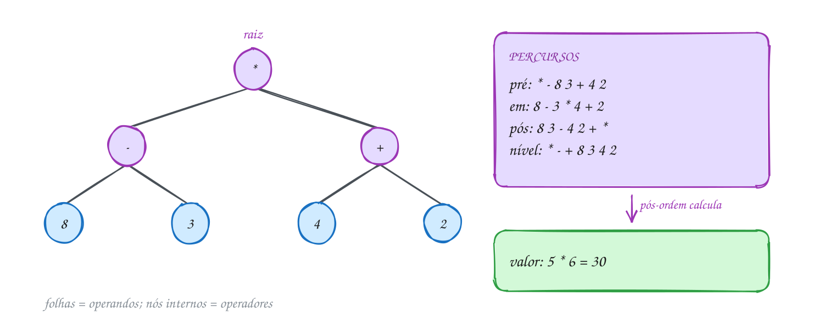</p>

O nó guarda um `char` (dígito ou operador) e dois ponteiros. O resto é um TAD
(assunto 0074), `arvore.h` e `arvore.c`:

```c
typedef struct No {
    char info;
    struct No *esq; // subárvore da esquerda
    struct No *dir; // subárvore da direita
} No;
```

O cliente monta a árvore de baixo para cima com `arv_cria(info, esq, dir)` e
chama os percursos:

```c
#include <stdio.h>
#include "arvore.h"

int main(void) {
    // (8 - 3) * (4 + 2): 8 pessoas, 3 não bebem; cerveja R$ 4 + gelo R$ 2
    No *menos = arv_cria('-', arv_cria('8', NULL, NULL), arv_cria('3', NULL, NULL));
    No *mais = arv_cria('+', arv_cria('4', NULL, NULL), arv_cria('2', NULL, NULL));
    No *raiz = arv_cria('*', menos, mais);

    printf("Pré-ordem:");
    arv_pre_ordem(raiz);
    printf("\nEm ordem: ");
    arv_em_ordem(raiz);
    printf("\nPós-ordem:");
    arv_pos_ordem(raiz);
    printf("\nPor nível:");
    arv_por_nivel(raiz);
    printf("\nNós: %d, altura: %d\n", arv_conta(raiz), arv_altura(raiz));

    raiz = arv_libera(raiz);
    return 0;
}
// Saída:
// Pré-ordem: * - 8 3 + 4 2
// Em ordem:  8 - 3 * 4 + 2
// Pós-ordem: 8 3 - 4 2 + *
// Por nível: * - + 8 3 4 2
// Nós: 7, altura: 2
```

Dentro do `arvore.c`, a em ordem tem três linhas de verdade:

```c
void arv_em_ordem(const No *r) {
    if (r == NULL) {
        return;
    }
    arv_em_ordem(r->esq);
    printf(" %c", r->info);
    arv_em_ordem(r->dir);
}
```

O caso base é a árvore vazia. Mover o `printf` dá a pré-ordem ou a pós-ordem:

<p align="center">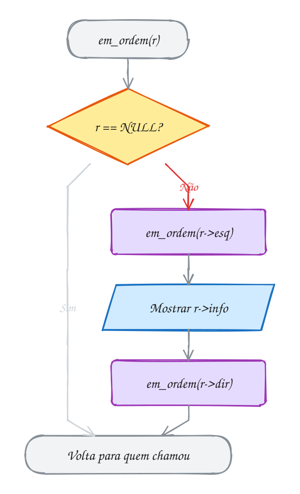</p>

#### Passo a passo

A pilha de chamadas da em ordem, a partir da raiz `*`. Cada linha é um
`printf`:

| Pilha de chamadas (topo à direita) | Mostra | Na tela até aqui |
| --- | --- | --- |
| `*` → `-` → `8` | 8 | `8` |
| `*` → `-` | - | `8 -` |
| `*` → `-` → `3` | 3 | `8 - 3` |
| `*` | * | `8 - 3 *` |
| `*` → `+` → `4` | 4 | `8 - 3 * 4` |
| `*` → `+` | + | `8 - 3 * 4 +` |
| `*` → `+` → `2` | 2 | `8 - 3 * 4 + 2` |

**Exemplo A195 · Duas árvores com a mesma em ordem**

```c
#include <stdio.h>
#include "0098-arvore.h"

void percursos(const char *titulo, const No *r) {
    printf("%s\n  pré:", titulo);
    arv_pre_ordem(r);
    printf("\n  em:");
    arv_em_ordem(r);
    printf("\n  pós:");
    arv_pos_ordem(r);
    printf("\n  altura %d\n", arv_altura(r));
}

int main(void) {
    // equilibrada: B na raiz, A à esquerda, C à direita
    No *cheia = arv_cria('B', arv_cria('A', NULL, NULL), arv_cria('C', NULL, NULL));

    // torta: cada nó só tem filho à direita (parece uma lista)
    No *torta = arv_cria('A', NULL, arv_cria('B', NULL, arv_cria('C', NULL, NULL)));

    // caso de borda: árvore vazia (os percursos não mostram nada)
    No *vazia = NULL;

    percursos("cheia:", cheia);
    percursos("torta:", torta);
    percursos("vazia:", vazia);

    // a em ordem é igual nas duas primeiras: sozinha ela não diz a forma;
    // a pré-ordem (ou a pós) junto com ela já diz
    cheia = arv_libera(cheia);
    torta = arv_libera(torta);
    return 0;
}
// Saída:
// cheia:
//   pré: B A C
//   em: A B C
//   pós: A C B
//   altura 1
// torta:
//   pré: A B C
//   em: A B C
//   pós: C B A
//   altura 2
// vazia:
//   pré:
//   em:
//   pós:
//   altura -1
```

```bash
gcc ~/LPEDC/material/A195.c ~/LPEDC/material/0098-arvore.c -o ~/LPEDC/material/A195 && ~/LPEDC/material/A195
```

**Exemplo A196 · Calculando a árvore de expressão**

```c
#include <stdio.h>
#include "0098-arvore.h"

// folha é um dígito; nó interno é um operador aplicado às duas subárvores
int avalia(const No *r) {
    if (r->esq == NULL && r->dir == NULL) {
        return r->info - '0'; // '8' vira 8
    }
    int a = avalia(r->esq); // primeiro as subárvores (pós-ordem)...
    int b = avalia(r->dir);
    switch (r->info) {      // ...depois o operador da raiz
    case '+': return a + b;
    case '-': return a - b;
    case '*': return a * b;
    default:  return a / b;
    }
}

// em ordem com parênteses em volta de cada operação
void mostra(const No *r) {
    if (r->esq == NULL && r->dir == NULL) {
        printf("%c", r->info);
        return;
    }
    printf("(");
    mostra(r->esq);
    printf(" %c ", r->info);
    mostra(r->dir);
    printf(")");
}

int main(void) {
    No *raiz = arv_cria('*',
                        arv_cria('-', arv_cria('8', NULL, NULL), arv_cria('3', NULL, NULL)),
                        arv_cria('+', arv_cria('4', NULL, NULL), arv_cria('2', NULL, NULL)));

    mostra(raiz);
    printf(" = %d\n", avalia(raiz));

    // troca a subárvore da direita: em vez de (4 + 2), só 9
    raiz->dir = arv_libera(raiz->dir); // poda primeiro (senão vaza)
    raiz->dir = arv_cria('9', NULL, NULL);
    mostra(raiz);
    printf(" = %d\n", avalia(raiz));

    raiz = arv_libera(raiz);
    return 0;
}
// Saída:
// ((8 - 3) * (4 + 2)) = 30
// ((8 - 3) * 9) = 45
```

```bash
gcc ~/LPEDC/material/A196.c ~/LPEDC/material/0098-arvore.c -o ~/LPEDC/material/A196 && ~/LPEDC/material/A196
```

### Exercícios

**Exercício E583** · ★☆☆

Com arv_cria, do TAD arvore.h, monte esta árvore, imprima os quatro
percursos (pré-ordem, em ordem, pós-ordem e por nível), a quantidade de
nós e a altura, e libere com arv_libera.

```text
M
├── esq: G
│   ├── esq: C
│   └── dir: J
└── dir: T
    └── dir: X
```

```text
Saída esperada:
Pré-ordem: M G C J T X
Em ordem:  C G J M T X
Pós-ordem: C J G X T M
Por nível: M G T C J X
Nós: 6, altura: 2
```

```bash
gcc ~/LPEDC/material/E583.c ~/LPEDC/material/0098-arvore.c -o ~/LPEDC/material/E583 && ~/LPEDC/material/E583
```

**Exercício E585** · ★★☆

Com o TAD arvore.h, monte a árvore da expressão (8 - 3) * (4 + 2): raiz
'*', filho esquerdo '-' (com 8 e 3) e filho direito '+' (com 4 e 2).
Escreva espelha(r), que troca de lugar, em todo nó, a subárvore da
esquerda com a da direita. Não crie nós novos: troque só ponteiros.
Imprima a em ordem antes e depois.

```text
Saída esperada:
Antes:  8 - 3 * 4 + 2
Depois: 2 + 4 * 3 - 8
```

```bash
gcc ~/LPEDC/material/E585.c ~/LPEDC/material/0098-arvore.c -o ~/LPEDC/material/E585 && ~/LPEDC/material/E585
```

**Exercício E586** · ★★☆

Com o TAD arvore.h, monte a árvore (8 - 3) * (4 + 2): raiz '*', filho
esquerdo '-' (com 8 e 3) e filho direito '+' (com 4 e 2). Escreva
deitada(r, nivel), que desenha a árvore deitada: a raiz na coluna 0 e cada
nível 4 espaços mais à direita. A subárvore da DIREITA aparece em cima e a
da esquerda embaixo.

```text
Saída esperada:
        2
    +
        4
*
        3
    -
        8
```

```bash
gcc ~/LPEDC/material/E586.c ~/LPEDC/material/0098-arvore.c -o ~/LPEDC/material/E586 && ~/LPEDC/material/E586
```

**Exercício E588** · ★★★

Uma árvore binária cabe numa string: escreva a pré-ordem e marque cada
subárvore vazia com um ponto. A árvore da expressão vira "*-8..3..+4..2.."
e a árvore M, G, T, C, J, X do E583 vira "MGC..J..T.X..".

Com o TAD arvore.h, escreva constroi(s, &pos), que lê a string a partir de
s[pos] e devolve a árvore montada com arv_cria. Para cada string, mostre a
em ordem, a pós-ordem, o número de nós e a altura.

```text
Saída esperada:
*-8..3..+4..2..
  em ordem:  8 - 3 * 4 + 2
  pós-ordem: 8 3 - 4 2 + *
  nós: 7, altura: 2
MGC..J..T.X..
  em ordem:  C G J M T X
  pós-ordem: C J G X T M
  nós: 6, altura: 2
```

```bash
gcc ~/LPEDC/material/E588.c ~/LPEDC/material/0098-arvore.c -o ~/LPEDC/material/E588 && ~/LPEDC/material/E588
```

---

## 0099 · BST: busca e inserção

### Conceito

- **Árvore binária de busca** (**BST**, *binary search tree*): árvore binária
  em que, em **todo** nó, a subárvore esquerda só tem chaves menores e a
  direita só tem chaves maiores (CORMEN et al., 2024, cap. 12).
- **Busca**: compara com a raiz. Igual, achou; menor, desce à esquerda; maior,
  à direita; `NULL`, a chave não existe. É a busca binária (assunto 0090) na
  árvore (FEOFILOFF, 2009).
- **Inserção**: a mesma descida. No `NULL` em que a busca falharia entra o nó
  novo, sempre como **folha**. A função devolve a raiz da subárvore e o pai
  faz `r->esq = bst_insere(r->esq, chave)`. Chave repetida é ignorada
  (FEOFILOFF, 2009).
- **Em ordem crescente**: a em ordem de uma BST sai ordenada. O nó logo depois
  é o **sucessor**, o logo antes é o **antecessor**; o menor fica mais à
  esquerda e o maior, mais à direita (CORMEN et al., 2024, cap. 12).
- **Custo**: no máximo **altura** + 1 comparações. Numa árvore cheia, perto de
  log₂ n: 7 chaves, 3 níveis; um milhão, uns 20 (ZIVIANI, 2010, cap. 5).

> [!WARNING]
> A forma da BST depende da **ordem de chegada**. As sete matrículas em ordem
> crescente formam uma lista disfarçada de altura 6 (exemplo A198). E sem
> `raiz = bst_insere(raiz, ...)` o nó criado se perde.

### Exemplos de uso

A catraca da academia procura matrículas. Sete alunos chegaram na ordem 50,
30, 70, 20, 40, 60 e 80. A busca do 60 passa por 50 e 70; a do 45 desce 50,
30, 40 e cai no `NULL` à direita do 40:

<p align="center">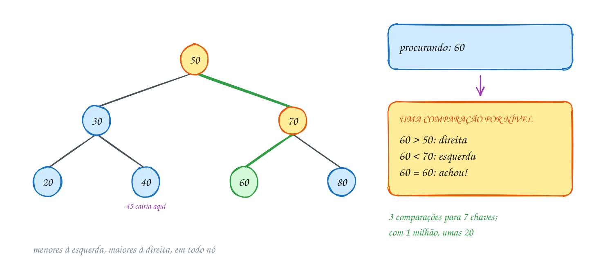</p>

O TAD fica em `bst.h` e `bst.c`. As duas funções principais:

```c
No *bst_insere(No *r, int chave) {
    if (r == NULL) {
        return novo_no(chave); // achou o lugar vazio: vira folha
    }
    if (chave < r->chave) {
        r->esq = bst_insere(r->esq, chave);
    } else if (chave > r->chave) {
        r->dir = bst_insere(r->dir, chave);
    }
    return r; // igual: já existe, não insere de novo
}

No *bst_busca(No *r, int chave) {
    while (r != NULL && r->chave != chave) {
        r = chave < r->chave ? r->esq : r->dir;
    }
    return r;
}
```

A busca dispensa recursão: um laço desce um nível por volta. O exemplo mostra
o caminho:

```c
#include <stdio.h>
#include "bst.h"

void procura(const No *r, int chave) {
    printf("Busca %d:", chave);
    while (r != NULL) {
        printf(" %d", r->chave);
        if (chave == r->chave) {
            printf(" -> achou\n");
            return;
        }
        r = chave < r->chave ? r->esq : r->dir;
    }
    printf(" -> NULL, não existe\n");
}

int main(void) {
    int matriculas[] = {50, 30, 70, 20, 40, 60, 80};
    No *raiz = NULL;
    for (int i = 0; i < 7; i++) {
        raiz = bst_insere(raiz, matriculas[i]);
    }

    printf("Em ordem:");
    bst_em_ordem(raiz);
    printf("\n");
    procura(raiz, 60);
    procura(raiz, 45);
    printf("Altura: %d\n", bst_altura(raiz));

    raiz = bst_libera(raiz);
    return 0;
}
// Saída:
// Em ordem: 20 30 40 50 60 70 80
// Busca 60: 50 70 60 -> achou
// Busca 45: 50 30 40 -> NULL, não existe
// Altura: 2
```

Cada volta faz no máximo duas perguntas e desce um nível. O caminho verde é a
busca do 60:

<p align="center">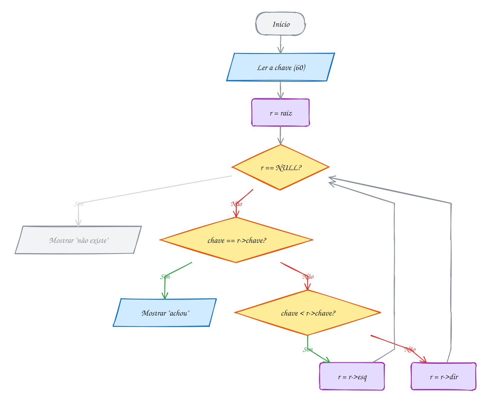</p>

**Exemplo A197 · Onde cada pedido vai morar**

```c
#include <stdio.h>
#include "0099-bst.h"

// antes de inserir, refaz a descida que o insere vai fazer e conta onde a
// chave vai virar folha (ou se já existe)
void anuncia(const No *r, int chave) {
    printf("%2d:", chave);
    if (r == NULL) {
        printf(" árvore vazia, vira a raiz\n");
        return;
    }
    while (1) {
        printf(" %d", r->chave);
        if (chave == r->chave) {
            printf(" -> já existe, ignorado\n");
            return;
        }
        const No *prox = chave < r->chave ? r->esq : r->dir;
        if (prox == NULL) {
            printf(" -> filho %s do %d\n", chave < r->chave ? "esquerdo" : "direito", r->chave);
            return;
        }
        r = prox;
    }
}

int main(void) {
    // números dos pedidos da lanchonete, na ordem em que chegaram
    int pedidos[] = {42, 17, 63, 8, 25, 50, 25, 30};
    No *raiz = NULL;
    for (int i = 0; i < 8; i++) {
        anuncia(raiz, pedidos[i]);
        raiz = bst_insere(raiz, pedidos[i]);
    }

    // o primeiro que chegou continua na raiz: inserir nunca mexe no que já está
    printf("Raiz: %d\n", raiz->chave);
    printf("Altura: %d\n", bst_altura(raiz));

    raiz = bst_libera(raiz);
    return 0;
}
// Saída:
// 42: árvore vazia, vira a raiz
// 17: 42 -> filho esquerdo do 42
// 63: 42 -> filho direito do 42
//  8: 42 17 -> filho esquerdo do 17
// 25: 42 17 -> filho direito do 17
// 50: 42 63 -> filho esquerdo do 63
// 25: 42 17 25 -> já existe, ignorado
// 30: 42 17 25 -> filho direito do 25
// Raiz: 42
// Altura: 3
```

```bash
gcc ~/LPEDC/material/A197.c ~/LPEDC/material/0099-bst.c -o ~/LPEDC/material/A197 && ~/LPEDC/material/A197
```

**Exemplo A198 · A ordem de chegada muda a árvore**

```c
#include <stdio.h>
#include "0099-bst.h"

No *monta(const int v[], int n) {
    No *r = NULL;
    for (int i = 0; i < n; i++) {
        r = bst_insere(r, v[i]);
    }
    return r;
}

int main(void) {
    int embaralhada[] = {50, 30, 70, 20, 40, 60, 80};
    int crescente[] = {20, 30, 40, 50, 60, 70, 80};

    No *a = monta(embaralhada, 7);
    No *b = monta(crescente, 7);

    // as duas guardam as mesmas chaves: a em ordem é igual
    printf("A em ordem:");
    bst_em_ordem(a);
    printf("\nB em ordem:");
    bst_em_ordem(b);
    printf("\n");

    // mas a forma é outra: B virou uma lista, tudo pendurado à direita
    printf("Altura de A: %d\n", bst_altura(a));
    printf("Altura de B: %d\n", bst_altura(b));
    printf("Raiz de B: %d, filho esquerdo: %s\n", b->chave, b->esq == NULL ? "NULL" : "existe");

    a = bst_libera(a);
    b = bst_libera(b);
    return 0;
}
// Saída:
// A em ordem: 20 30 40 50 60 70 80
// B em ordem: 20 30 40 50 60 70 80
// Altura de A: 2
// Altura de B: 6
// Raiz de B: 20, filho esquerdo: NULL
```

```bash
gcc ~/LPEDC/material/A198.c ~/LPEDC/material/0099-bst.c -o ~/LPEDC/material/A198 && ~/LPEDC/material/A198
```

### Exercícios

**Exercício E589** · ★☆☆

O posto de saúde guarda as senhas de atendimento numa BST. Com o TAD
bst.h, insira, nesta ordem, 45 20 70 10 30 60 90 25. Escreva
nivel_de(r, chave), que desce pela árvore como a busca e devolve a
profundidade da chave (a raiz tem nível 0), ou -1 se a chave não estiver
lá. Mostre a em ordem, a altura e o nível das senhas 45, 70, 30, 25 e 65.

```text
Saída esperada:
Em ordem: 10 20 25 30 45 60 70 90
Altura: 3
Senha 45: nível 0
Senha 70: nível 1
Senha 30: nível 2
Senha 25: nível 3
Senha 65: nível -1
```

```bash
gcc ~/LPEDC/material/E589.c ~/LPEDC/material/0099-bst.c -o ~/LPEDC/material/E589 && ~/LPEDC/material/E589
```

**Exercício E591** · ★★☆

Uma loja guarda os preços (em reais, inteiros) numa BST. Com o TAD bst.h,
insira, nesta ordem, 50 30 70 20 40 60 80 10 90. O cliente quer ver só o
que custa de R$ 35 a R$ 65. Escreva faixa(r, min, max, &visitados), que
imprime em ordem crescente as chaves em [min, max] e conta os nós que
visitou. Não entre numa subárvore que não pode ter resposta: se a chave do
nó é menor que min, nada à esquerda dele serve.

```text
Saída esperada:
Entre 35 e 65: 40 50 60
Nós visitados: 5 de 9
```

```bash
gcc ~/LPEDC/material/E591.c ~/LPEDC/material/0099-bst.c -o ~/LPEDC/material/E591 && ~/LPEDC/material/E591
```

**Exercício E592** · ★★☆

Escreva insere_sem_recursao(No **raiz, int chave): a inserção na BST com um
laço, recebendo o ENDEREÇO da raiz. A função não devolve nada e o main não
faz raiz = .... Chave repetida é ignorada. Com o TAD bst.h (só o tipo No,
bst_em_ordem, bst_altura e bst_libera), insira as matrículas
50 30 70 20 40 60 80 30 e mostre a em ordem e a altura.

```text
Saída esperada:
Em ordem: 20 30 40 50 60 70 80
Altura: 2
```

```bash
gcc ~/LPEDC/material/E592.c ~/LPEDC/material/0099-bst.c -o ~/LPEDC/material/E592 && ~/LPEDC/material/E592
```

**Exercício E594** · ★★★

Na rifa da festa junina, alguns números de bilhete foram vendidos mais de
uma vez. Os números anotados, na ordem da venda:

```text
23 8 41 15 8 30 23 4 41 12 41
```

Com o TAD bst.h, escreva um programa que avisa cada número repetido no
momento em que ele aparece, e depois mostra os números distintos em ordem
crescente, quantos são e a altura da árvore.

```text
Saída esperada:
Repetido: 8
Repetido: 23
Repetido: 41
Repetido: 41
Distintos: 4 8 12 15 23 30 41
Quantos: 7
Altura: 3
```

```bash
gcc ~/LPEDC/material/E594.c ~/LPEDC/material/0099-bst.c -o ~/LPEDC/material/E594 && ~/LPEDC/material/E594
```

---

## 0100 · BST: remoção

### Conceito

- **Remoção**: a busca acha o nó; o que fazer depende de **quantos filhos**
  ele tem (TENENBAUM; LANGSAM; AUGENSTEIN, 1995, cap. 7).
- **Folha ou um filho**: o filho que existe sobe para o lugar do nó. Na folha
  esse filho é `NULL`, então é um código só (CORMEN et al., 2024, cap. 12).
- **Dois filhos**: o lugar vai para o **sucessor**, a menor chave da
  subárvore direita. Desça uma vez à direita e depois à esquerda até não dar
  mais (CORMEN et al., 2024, cap. 12).
- **O sucessor não tem filho esquerdo**: removê-lo cai num caso fácil. Usar o
  **antecessor** (a maior da esquerda) também funciona, mas a árvore final
  sai diferente (FEOFILOFF, 2009).
- **Retorno**: como na inserção, a função devolve a raiz da subárvore. O pai
  faz `r->esq = bst_remove(r->esq, chave)` e o cliente,
  `raiz = bst_remove(raiz, ...)`. Custo O(altura) (CELES; RANGEL, 2002).

| Caso | O que fazer | No exemplo |
| --- | --- | --- |
| **folha** | dá `free` e o pai passa a apontar para `NULL` | remover o 20 |
| **um filho** | o filho sobe para o lugar dele; o avô "pula" o nó | remover o 40: o 45 sobe |
| **dois filhos** | troca pelo **sucessor** e remove o sucessor | remover o 30: o 35 assume |

> [!WARNING]
> `bst_remove(raiz->esq, 20);` sem atribuir o retorno dá `free` no 20 mas deixa
> o pai apontando para o endereço antigo: **ponteiro solto**, que o
> AddressSanitizer acusa como `heap-use-after-free`. Vale também para `raiz`.

### Exemplos de uso

Três alunos cancelaram o plano, e as matrículas 30, 40 e 20 saem. O 30 tem
dois filhos: o sucessor fica à direita (40) e depois à esquerda (35). O 35
ocupa o lugar do 30, e o 35 de baixo, que era folha, sai:

<p align="center">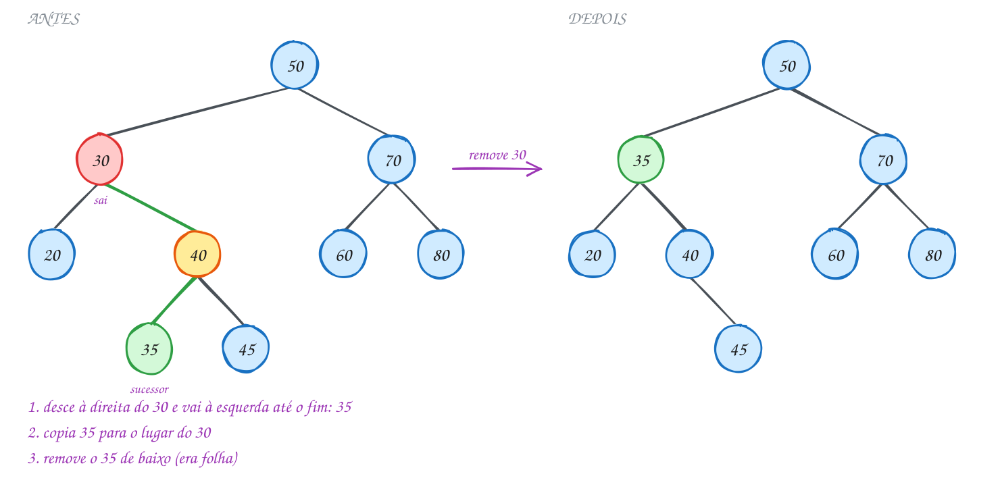</p>

A função completa, no `bst.c`. Ela copia **só a chave**; com uma struct
grande, compensa religar ponteiros:

```c
No *bst_remove(No *r, int chave) {
    if (r == NULL) {
        return NULL; // não achou: nada a remover
    }
    if (chave < r->chave) {
        r->esq = bst_remove(r->esq, chave);
    } else if (chave > r->chave) {
        r->dir = bst_remove(r->dir, chave);
    } else if (r->esq == NULL || r->dir == NULL) {
        // folha ou um filho: o filho (ou NULL) sobe para o lugar do nó
        No *filho = r->esq != NULL ? r->esq : r->dir;
        free(r);
        return filho;
    } else {
        // dois filhos: copia o sucessor (o menor da direita) e remove ele lá
        No *suc = r->dir;
        while (suc->esq != NULL) {
            suc = suc->esq;
        }
        r->chave = suc->chave;
        r->dir = bst_remove(r->dir, suc->chave);
    }
    return r;
}
```

O cliente remove as três matrículas e mostra a pré-ordem, que revela a
**forma** da árvore (a em ordem sairia sempre crescente):

```c
#include <stdio.h>
#include "bst.h"

void pre(const No *r) {
    if (r == NULL) {
        return;
    }
    printf(" %d", r->chave);
    pre(r->esq);
    pre(r->dir);
}

void mostra(const char *rotulo, const No *r) {
    printf("%-11s pré:", rotulo);
    pre(r);
    printf("\n");
}

int main(void) {
    int matriculas[] = {50, 30, 70, 20, 40, 60, 80, 35, 45};
    No *raiz = NULL;
    for (int i = 0; i < 9; i++) {
        raiz = bst_insere(raiz, matriculas[i]);
    }
    mostra("Antes", raiz);

    raiz = bst_remove(raiz, 30); // dois filhos: o sucessor 35 assume
    mostra("Remove 30", raiz);
    raiz = bst_remove(raiz, 40); // um filho: o 45 sobe
    mostra("Remove 40", raiz);
    raiz = bst_remove(raiz, 20); // folha: só sai
    mostra("Remove 20", raiz);
    raiz = bst_remove(raiz, 99); // não existe: nada muda
    mostra("Remove 99", raiz);

    raiz = bst_libera(raiz);
    return 0;
}
// Saída:
// Antes       pré: 50 30 20 40 35 45 70 60 80
// Remove 30   pré: 50 35 20 40 45 70 60 80
// Remove 40   pré: 50 35 20 45 70 60 80
// Remove 20   pré: 50 35 45 70 60 80
// Remove 99   pré: 50 35 45 70 60 80
```

O caminho verde é a chamada que encontra o 30: cai no caso de dois filhos,
copia o 35 e faz uma **segunda remoção**, do 35, que termina no caso fácil:

<p align="center">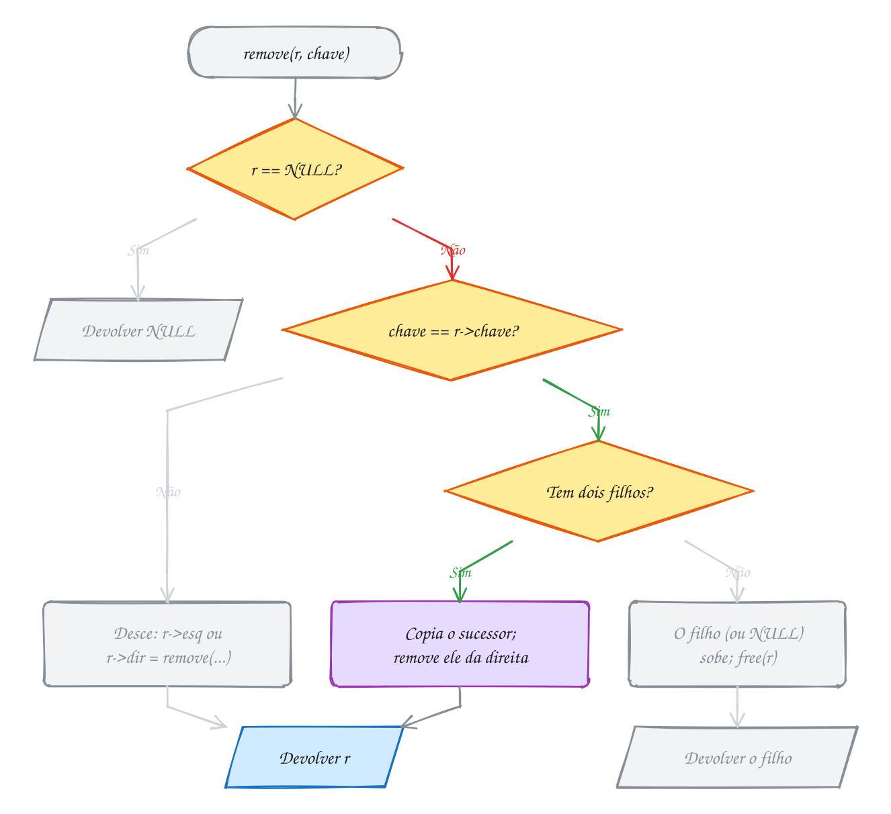</p>

**Exemplo A199 · Quando o sucessor também tem filho**

```c
#include <stdio.h>
#include "0100-bst.h"

void pre(const No *r) {
    if (r == NULL) {
        return;
    }
    printf(" %d", r->chave);
    pre(r->esq);
    pre(r->dir);
}

void mostra(const char *rotulo, const No *r) {
    printf("%-14s pré:", rotulo);
    pre(r);
    printf(" (raiz %d)\n", r->chave);
}

int main(void) {
    // códigos dos produtos do estoque do mercadinho
    int codigos[] = {40, 20, 60, 50, 70, 55, 52};
    No *raiz = NULL;
    for (int i = 0; i < 7; i++) {
        raiz = bst_insere(raiz, codigos[i]);
    }
    mostra("Antes", raiz);

    // a raiz tem dois filhos; o sucessor (50) não é folha: tem o 55 à direita.
    // o 50 sobe para a raiz e o 55 (com o 52) sobe para o lugar dele
    raiz = bst_remove(raiz, 40);
    mostra("Remove 40", raiz);

    // o 20 era o único à esquerda: agora a raiz só tem filho direito
    raiz = bst_remove(raiz, 20);
    mostra("Remove 20", raiz);

    // raiz com UM filho: nada de sucessor, o filho direito vira a raiz
    raiz = bst_remove(raiz, 50);
    mostra("Remove 50", raiz);

    raiz = bst_libera(raiz);
    return 0;
}
// Saída:
// Antes          pré: 40 20 60 50 55 52 70 (raiz 40)
// Remove 40      pré: 50 20 60 55 52 70 (raiz 50)
// Remove 20      pré: 50 60 55 52 70 (raiz 50)
// Remove 50      pré: 60 55 52 70 (raiz 60)
```

```bash
gcc ~/LPEDC/material/A199.c ~/LPEDC/material/0100-bst.c -o ~/LPEDC/material/A199 && ~/LPEDC/material/A199
```

**Exemplo A200 · Até a raiz vai embora**

```c
#include <stdio.h>
#include "0100-bst.h"

int main(void) {
    int matriculas[] = {50, 30, 70, 20, 40, 60, 80};
    No *raiz = NULL;
    for (int i = 0; i < 7; i++) {
        raiz = bst_insere(raiz, matriculas[i]);
    }

    // remove sempre a raiz: o ponteiro raiz muda a cada passo
    while (raiz != NULL) {
        int sai = raiz->chave;
        raiz = bst_remove(raiz, sai);
        printf("Saiu %d, nova raiz: ", sai);
        if (raiz == NULL) {
            printf("NULL (árvore vazia)\n");
        } else {
            printf("%d, em ordem:", raiz->chave);
            bst_em_ordem(raiz);
            printf("\n");
        }
    }
    return 0; // nada a liberar: remove já deu free em cada nó
}
// Saída:
// Saiu 50, nova raiz: 60, em ordem: 20 30 40 60 70 80
// Saiu 60, nova raiz: 70, em ordem: 20 30 40 70 80
// Saiu 70, nova raiz: 80, em ordem: 20 30 40 80
// Saiu 80, nova raiz: 30, em ordem: 20 30 40
// Saiu 30, nova raiz: 40, em ordem: 20 40
// Saiu 40, nova raiz: 20, em ordem: 20
// Saiu 20, nova raiz: NULL (árvore vazia)
```

```bash
gcc ~/LPEDC/material/A200.c ~/LPEDC/material/0100-bst.c -o ~/LPEDC/material/A200 && ~/LPEDC/material/A200
```

### Exercícios

**Exercício E595** · ★☆☆

Com o TAD bst.h, monte a BST inserindo 60 25 80 10 40 70 90 35 50 e
remova, um de cada vez, o 10, o 80 e o 25 com bst_remove. Escreva
pre(r), a pré-ordem, e caso(r, chave), que acha o nó da chave e devolve
"folha", "um filho", "dois filhos" ou "não existe". Chame caso ANTES de
cada remoção e mostre a pré-ordem depois. O rótulo ocupa 24 colunas:
use printf("%-24spré", rotulo).

```text
Saída esperada:
Antes:                  pré 60 25 10 40 35 50 80 70 90
Sem o 10 (folha):       pré 60 25 40 35 50 80 70 90
Sem o 80 (dois filhos): pré 60 25 40 35 50 90 70
Sem o 25 (um filho):    pré 60 40 35 50 90 70
```

```bash
gcc ~/LPEDC/material/E595.c ~/LPEDC/material/0100-bst.c -o ~/LPEDC/material/E595 && ~/LPEDC/material/E595
```

**Exercício E597** · ★★☆

O bst_remove do TAD usa o sucessor nos casos de dois filhos. Escreva
remove_antecessor(r, chave), a mesma remoção, mas que usa o ANTECESSOR: a
maior chave da subárvore esquerda. Com o TAD bst.h, insira as matrículas
50 30 70 20 40 60 80 35 45, escreva pre(r) (pré-ordem) e remova o 30 e
depois o 50.

```text
Saída esperada:
Antes:     pré 50 30 20 40 35 45 70 60 80
Sem o 30:  pré 50 20 40 35 45 70 60 80
Sem o 50:  pré 45 20 40 35 70 60 80
```

```bash
gcc ~/LPEDC/material/E597.c ~/LPEDC/material/0100-bst.c -o ~/LPEDC/material/E597 && ~/LPEDC/material/E597
```

**Exercício E598** · ★★☆

A academia chama os alunos pela ordem de matrícula, sempre o menor número
primeiro. Com o TAD bst.h, insira as matrículas 50 30 70 20 40 60 80 35 45
e escreva No *remove_menor(No *r, int *menor): remove o nó mais à esquerda
(que tem no máximo um filho), guarda a chave em *menor e devolve a nova
raiz. Chame-a até a árvore esvaziar, numerando as chamadas.

```text
Saída esperada:
Chamada 1: matrícula 20
Chamada 2: matrícula 30
Chamada 3: matrícula 35
Chamada 4: matrícula 40
Chamada 5: matrícula 45
Chamada 6: matrícula 50
Chamada 7: matrícula 60
Chamada 8: matrícula 70
Chamada 9: matrícula 80
Árvore vazia: sim
```

```bash
gcc ~/LPEDC/material/E598.c ~/LPEDC/material/0100-bst.c -o ~/LPEDC/material/E598 && ~/LPEDC/material/E598
```

**Exercício E599** · ★★★

A academia vai encerrar a turma das matrículas de 35 a 65. Com o TAD
bst.h, insira 50 30 70 20 40 60 80 35 45 e escreva remove_faixa(r, a, b),
que remove da BST todas as chaves em [a, b] e devolve a nova raiz. Mostre
a em ordem antes e depois e, no fim, a chave da raiz e a altura.

```text
Saída esperada:
Antes:  20 30 35 40 45 50 60 70 80
Depois: 20 30 70 80
Raiz: 70, altura: 2
```

```bash
gcc ~/LPEDC/material/E599.c ~/LPEDC/material/0100-bst.c -o ~/LPEDC/material/E599 && ~/LPEDC/material/E599
```

---

## 0101 · AVL: balanceamento e rotações

### Conceito

- **AVL**: BST que se conserta a cada inserção. Em **todo** nó, as alturas
  das duas subárvores diferem de no máximo 1 (ADELSON-VELSKY; LANDIS, 1962).
- **Fator de balanceamento**: `fb = altura(esq) - altura(dir)`. Na AVL vale
  -1, 0 ou 1; 2 é "pesado à esquerda" e -2, "pesado à direita". Há livros que
  invertem a conta: o sinal troca, a regra não
  (TENENBAUM; LANGSAM; AUGENSTEIN, 1995, cap. 7).
- **Altura garantida**: no máximo uns 1,44 · log₂ n. Mil chaves cabem em
  altura 9, e não 999 (TENENBAUM; LANGSAM; AUGENSTEIN, 1995, cap. 7).
- **Inserção**: pendura a folha como na BST. Na **volta** da recursão, cada
  ancestral atualiza a altura e confere o fator (CORMEN et al., 2024).
- **Rotação**: um filho sobe e o pai desce, sem quebrar a ordem da BST. Na
  rotação à esquerda em `r`, o filho direito `d` sobe e a antiga subárvore
  esquerda de `d` vira a direita de `r`. Custa O(1) (CORMEN et al., 2024,
  cap. 13).
- **Rotação dupla**: para o "zigue-zague". A primeira rotação, no filho,
  endireita; a segunda, no nó, equilibra. Cada inserção faz no máximo uma
  rotação, simples ou dupla (TENENBAUM; LANGSAM; AUGENSTEIN, 1995, cap. 7).
- **Outras árvores equilibradas**: a **rubro-negra** (0177) e a **árvore B**
  (0146) também garantem O(log n) (CORMEN et al., 2024, caps. 13 e 18).

| Caso | Fator do nó | Fator do filho pesado | Conserto |
| --- | --- | --- | --- |
| esquerda-esquerda | +2 | +1 ou 0 (esquerdo) | rotação à direita no nó |
| direita-direita | -2 | -1 ou 0 (direito) | rotação à esquerda no nó |
| esquerda-direita | +2 | -1 (esquerdo) | à esquerda no filho, depois à direita no nó |
| direita-esquerda | -2 | +1 (direito) | à direita no filho, depois à esquerda no nó |

> [!WARNING]
> No zigue-zague, a rotação simples **não conserta**: só espelha o problema.
> Por isso o código olha o fator do **filho**. E ligue a nova raiz de volta no
> pai (`return rot_esquerda(r)`); senão o pai aponta para o nó que desceu.

### Exemplos de uso

A lanchonete numera os pedidos em ordem crescente, e a BST comum viraria uma
lista. Na AVL, inserir 10, 20 e 30 gira o 10 à esquerda e o 20 sobe. Depois,
com 20 (10, 40 (30, 50)), o 25 pede rotação dupla e o 30 vai para a raiz:

<p align="center">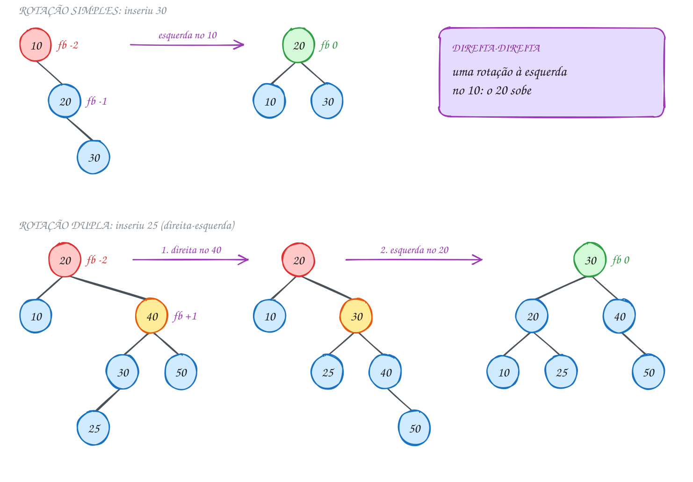</p>

Rotações e rebalanceamento, no `avl.c`:

```c
static No *rot_esquerda(No *r) {
    No *d = r->dir;
    r->dir = d->esq; // a subárvore do meio muda de pai
    d->esq = r;
    atualiza(r);     // r agora está embaixo: primeiro ele
    atualiza(d);
    return d;        // d é a nova raiz desta subárvore
}

static No *rebalanceia(No *r) {
    atualiza(r);
    int fb = avl_fator(r);
    if (fb > 1) {                    // pesado à esquerda
        if (avl_fator(r->esq) < 0) { // zigue-zague: dupla
            r->esq = rot_esquerda(r->esq);
        }
        return rot_direita(r);
    }
    if (fb < -1) {                   // pesado à direita
        if (avl_fator(r->dir) > 0) { // zigue-zague: dupla
            r->dir = rot_direita(r->dir);
        }
        return rot_esquerda(r);
    }
    return r;
}
```

A `avl_insere` é a `bst_insere` terminando em `return rebalanceia(r)`. O
cliente insere os pedidos e mostra a pré-ordem:

```c
#include <stdio.h>
#include "avl.h"

int main(void) {
    int pedidos[] = {10, 20, 30, 40, 50, 25};
    No *raiz = NULL;

    for (int i = 0; i < 6; i++) {
        raiz = avl_insere(raiz, pedidos[i]);
        printf("Insere %d: pré", pedidos[i]);
        avl_pre_ordem(raiz);
        printf(" | altura %d | rotações %d\n", avl_altura(raiz), avl_rotacoes());
    }

    raiz = avl_libera(raiz);
    return 0;
}
// Saída:
// Insere 10: pré 10 | altura 0 | rotações 0
// Insere 20: pré 10 20 | altura 1 | rotações 0
// Insere 30: pré 20 10 30 | altura 1 | rotações 1
// Insere 40: pré 20 10 30 40 | altura 2 | rotações 1
// Insere 50: pré 20 10 40 30 50 | altura 2 | rotações 2
// Insere 25: pré 30 20 10 25 40 50 | altura 2 | rotações 4
```

O caminho verde é o do nó 20 quando o 25 chega: fator -2, filho direito com
fator +1, então duas rotações:

<p align="center">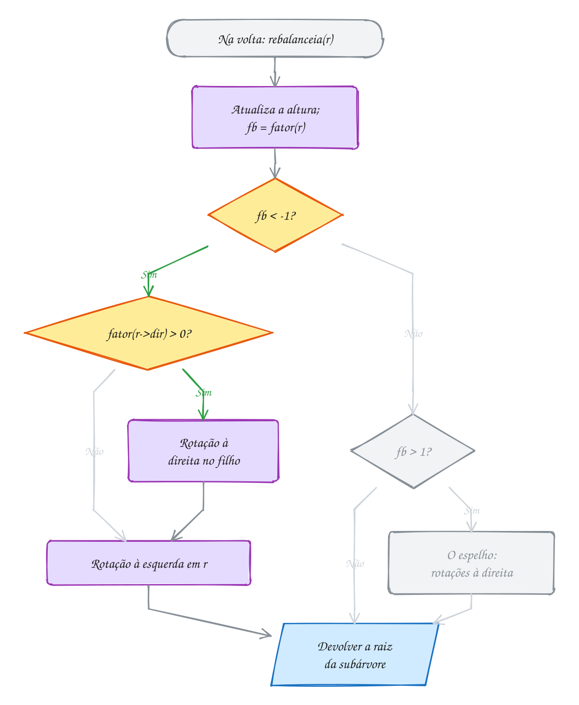</p>

#### Passo a passo

| Insere | Quem fica desequilibrado | Caso | Rotação | Raiz depois |
| --- | --- | --- | --- | --- |
| 10, 20 | ninguém | | | 10 |
| 30 | 10 (fb -2; filho 20 com -1) | direita-direita | esquerda no 10 | 20 |
| 40 | ninguém (20 fica com -1) | | | 20 |
| 50 | 30 (fb -2; filho 40 com -1) | direita-direita | esquerda no 30 | 20 |
| 25 | 20 (fb -2; filho 40 com +1) | direita-esquerda | direita no 40, esquerda no 20 | 30 |

Sem a AVL, a sequência daria uma BST de altura 4.

**Exemplo A201 · Os quatro casos, três chaves cada**

```c
#include <stdio.h>
#include "0101-avl.h"

// insere as três chaves numa AVL nova e mostra quantas rotações custou
void testa(const char *caso, int a, int b, int c) {
    int antes = avl_rotacoes(); // o contador é um só para o programa todo
    No *r = NULL;
    r = avl_insere(r, a);
    r = avl_insere(r, b);
    r = avl_insere(r, c);
    printf("%-18s %d %d %d -> pré", caso, a, b, c);
    avl_pre_ordem(r);
    printf(" | rotações %d\n", avl_rotacoes() - antes);
    r = avl_libera(r);
}

int main(void) {
    // em linha reta: uma rotação simples resolve
    testa("esquerda-esquerda", 30, 20, 10);
    testa("direita-direita", 10, 20, 30);
    // em zigue-zague: primeiro endireita o filho, depois gira o avô
    testa("esquerda-direita", 30, 10, 20);
    testa("direita-esquerda", 10, 30, 20);
    // nenhum desequilíbrio: o do meio chegou primeiro
    testa("nenhum caso", 20, 10, 30);
    return 0;
}
// Saída:
// esquerda-esquerda  30 20 10 -> pré 20 10 30 | rotações 1
// direita-direita    10 20 30 -> pré 20 10 30 | rotações 1
// esquerda-direita   30 10 20 -> pré 20 10 30 | rotações 2
// direita-esquerda   10 30 20 -> pré 20 10 30 | rotações 2
// nenhum caso        20 10 30 -> pré 20 10 30 | rotações 0
```

```bash
gcc ~/LPEDC/material/A201.c ~/LPEDC/material/0101-avl.c -o ~/LPEDC/material/A201 && ~/LPEDC/material/A201
```

**Exemplo A202 · Mil pedidos: BST comum contra AVL**

```c
#include <stdio.h>
#include <stdlib.h>
#include "0101-avl.h"

// uma BST comum, sem balancear, só para comparar (nomes diferentes do TAD)
typedef struct Comum {
    int chave;
    struct Comum *esq, *dir;
} Comum;

Comum *comum_insere(Comum *r, int chave) {
    if (r == NULL) {
        Comum *n = malloc(sizeof(Comum));
        if (n == NULL) {
            exit(1);
        }
        n->chave = chave;
        n->esq = n->dir = NULL;
        return n;
    }
    if (chave < r->chave) {
        r->esq = comum_insere(r->esq, chave);
    } else if (chave > r->chave) {
        r->dir = comum_insere(r->dir, chave);
    }
    return r;
}

int comum_altura(const Comum *r) {
    if (r == NULL) {
        return -1;
    }
    int he = comum_altura(r->esq);
    int hd = comum_altura(r->dir);
    return 1 + (he > hd ? he : hd);
}

void comum_libera(Comum *r) {
    if (r != NULL) {
        comum_libera(r->esq);
        comum_libera(r->dir);
        free(r);
    }
}

int main(void) {
    Comum *bst = NULL;
    No *avl = NULL;
    for (int pedido = 1; pedido <= 1000; pedido++) { // em ordem crescente
        bst = comum_insere(bst, pedido);
        avl = avl_insere(avl, pedido);
    }

    printf("BST comum: altura %d\n", comum_altura(bst));
    printf("AVL:       altura %d, raiz %d, rotações %d\n",
           avl_altura(avl), avl->chave, avl_rotacoes());
    printf("Busca do pedido 1000: até %d comparações na BST, até %d na AVL\n",
           comum_altura(bst) + 1, avl_altura(avl) + 1);

    comum_libera(bst);
    avl = avl_libera(avl);
    return 0;
}
// Saída:
// BST comum: altura 999
// AVL:       altura 9, raiz 512, rotações 990
// Busca do pedido 1000: até 1000 comparações na BST, até 10 na AVL
```

```bash
gcc ~/LPEDC/material/A202.c ~/LPEDC/material/0101-avl.c -o ~/LPEDC/material/A202 && ~/LPEDC/material/A202
```

### Exercícios

**Exercício E601** · ★☆☆

Monte à mão esta árvore binária, sem campo de altura (struct Arv: chave,
esq, dir):

```text
50
├── esq: 30
│   ├── esq: 20
│   │   └── esq: 10
│   └── dir: 40
└── dir: 70
    └── dir: 80
        └── dir: 90
```

Escreva altura(r) e relatorio(r). A relatorio mostra, em pré-ordem, a
altura e o fator de balanceamento (altura da esquerda menos altura da
direita) de cada nó, marca com "<- desequilibrado" quem tem fator fora de
-1..1 e devolve quantos nós estão assim. O main diz se a árvore é AVL.

```text
Saída esperada:
50: altura 3, fator 0
30: altura 2, fator 1
20: altura 1, fator 1
10: altura 0, fator 0
40: altura 0, fator 0
70: altura 2, fator -2 <- desequilibrado
80: altura 1, fator -1
90: altura 0, fator 0
É AVL? não
```

```bash
gcc ~/LPEDC/material/E601.c ~/LPEDC/material/0101-avl.c -o ~/LPEDC/material/E601 && ~/LPEDC/material/E601
```

**Exercício E603** · ★★☆

Use o struct Arv do E601 (chave, esq, dir, sem campo de altura). Escreva
altura_se_avl(r): devolve a altura da árvore se ela respeitar a regra da
AVL em todos os nós, ou -2 se algum nó tiver fator fora de -1..1. Visite
cada nó UMA vez só. Teste duas árvores:

```text
Árvore 1: a do E601.
Árvore 2: a mesma, mas com a subárvore direita da raiz trocada por
          80 (filhos 70 e 90).
```

```text
Saída esperada:
Árvore 1: não é AVL
Árvore 2: é AVL, altura 3
```

```bash
gcc ~/LPEDC/material/E603.c ~/LPEDC/material/0101-avl.c -o ~/LPEDC/material/E603 && ~/LPEDC/material/E603
```

**Exercício E604** · ★★☆

Com o TAD avl.h (o struct No tem chave, altura, esq e dir), escreva
atualiza_altura(r), gira_direita(r) e gira_esquerda(r). Cada rotação
recalcula as duas alturas na ordem certa e devolve a nova raiz. Escreva
também no(chave, esq, dir), que cria um nó já com a altura certa. Gire à
esquerda duas árvores montadas à mão: t1 = 10 -> dir 20 -> dir 30 e t2 =
raiz 40 (esq 20; dir 60 com filhos 50 e 70). Mostre a pré-ordem
(avl_pre_ordem) e a altura da raiz.

```text
Saída esperada:
Teste 1: pré 20 10 30 | altura da raiz 1
Teste 2: pré 60 40 20 50 70 | altura da raiz 2
```

```bash
gcc ~/LPEDC/material/E604.c ~/LPEDC/material/0101-avl.c -o ~/LPEDC/material/E604 && ~/LPEDC/material/E604
```

**Exercício E606** · ★★★

Escreva uma AVL (sem o avl.h) que, a cada rotação, imprime qual dos
quatro casos aconteceu e em qual nó. Insira estes pedidos, nesta ordem:

```text
30 25 15 45 60 35 20
```

Pedidos que não causam rotação não imprimem nada. No fim, mostre a em
ordem e a pré-ordem.

```text
Saída esperada:
Insere 15: esquerda-esquerda no 30
Insere 60: direita-direita no 30
Insere 35: direita-esquerda no 25
Insere 20: esquerda-direita no 25
Em ordem: 15 20 25 30 35 45 60
Pré-ordem: 30 20 15 25 45 35 60
```

```bash
gcc ~/LPEDC/material/E606.c ~/LPEDC/material/0101-avl.c -o ~/LPEDC/material/E606 && ~/LPEDC/material/E606
```

---

## 0102 · Heap e fila de prioridade

### Conceito

- **Fila de prioridade**: cada item entra com uma prioridade e sai primeiro o
  de **maior** prioridade (CORMEN et al., 2024, cap. 6).
- **Heap de máximo**: árvore binária com duas regras. **Forma**: completa,
  todos os níveis cheios menos talvez o último, que enche da esquerda para a
  direita. **Ordem**: todo pai é maior ou igual aos filhos, e o máximo fica na
  raiz (CORMEN et al., 2024, cap. 6).
- **Regra mais fraca que a da BST**: esquerda e direita não se comparam. O
  heap só responde "quem é o maior?" (TENENBAUM; LANGSAM; AUGENSTEIN, 1995,
  cap. 6).
- **Heap em vetor**: a forma completa deixa guardar a árvore nível por nível,
  sem buracos e sem ponteiros (FEOFILOFF, 2009).
- **Inserir**: o novo entra no fim e **sobe**, trocando com o pai enquanto for
  maior. **Remover o máximo**: o último vai para a raiz e **desce**, trocando
  com o **maior** filho. As duas custam até a altura, ⌊log₂ n⌋; no Cormen a
  descida é a `MAX-HEAPIFY` (CORMEN et al., 2024, cap. 6).
- **Heap de mínimo**: as comparações invertidas; o menor fica na raiz
  (FEOFILOFF, 2009).
- **Dois heaps diferentes**: este heap (estrutura de dados) não tem relação
  com o heap do `malloc` (assunto 0053) (FEOFILOFF, 2009).

| Quem | Índice com `v[0]` na raiz | No Cormen (`A[1..n]`) |
| --- | --- | --- |
| pai de `i` | `(i - 1) / 2` (divisão inteira) | `⌊i/2⌋` |
| filho esquerdo | `2 * i + 1` | `2i` |
| filho direito | `2 * i + 2` | `2i + 1` |

| Onde guardar | Inserir | Tirar o máximo |
| --- | --- | --- |
| vetor solto | O(1) | O(n) |
| vetor ordenado | O(n) | O(1) |
| heap | O(log n) | O(log n) |

> [!WARNING]
> Na descida, troque com o **maior** dos filhos; trocar com o menor quebra o
> heap. Confira `f + 1 < h->n` antes de ler `v[f + 1]`, e numa questão veja em
> que índice o vetor começa.

### Exemplos de uso

No pronto-socorro, chegam pacientes com gravidade 40, 70, 20, 90, 50 e 30. O
heap fica `[90 70 30 40 50 20]`. O 70 está no índice 1, e os filhos dele, nos
índices 3 e 4:

<p align="center">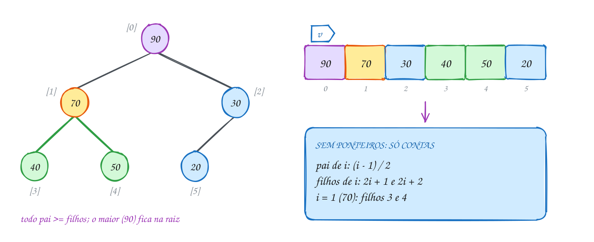</p>

O TAD guarda o vetor, quantos elementos tem e quantos cabem. As duas peças do
`heap.c`:

```c
// o elemento em i sobe enquanto for maior que o pai
static void sobe(Heap *h, int i) {
    while (i > 0 && h->v[(i - 1) / 2] < h->v[i]) {
        troca(&h->v[(i - 1) / 2], &h->v[i]);
        i = (i - 1) / 2;
    }
}

// o elemento em i desce, trocando com o MAIOR dos filhos
static void desce(Heap *h, int i) {
    while (2 * i + 1 < h->n) {
        int f = 2 * i + 1;                       // filho esquerdo
        if (f + 1 < h->n && h->v[f + 1] > h->v[f]) {
            f++;                                 // o direito é maior
        }
        if (h->v[i] >= h->v[f]) {
            break;                               // já está no lugar
        }
        troca(&h->v[i], &h->v[f]);
        i = f;
    }
}
```

O cliente só vê `heap_insere` e `heap_remove`:

```c
#include <stdio.h>
#include "heap.h"

int main(void) {
    // gravidade de cada paciente, na ordem em que chegaram (maior = mais urgente)
    int chegada[] = {40, 70, 20, 90, 50, 30};
    Heap *fila = heap_cria(10);

    for (int i = 0; i < 6; i++) {
        heap_insere(fila, chegada[i]);
        printf("Chega %d: ", chegada[i]);
        heap_mostra(fila);
        printf("\n");
    }
    for (int i = 0; i < 2; i++) {
        int atendido = heap_remove(fila);
        printf("Atende %d: ", atendido);
        heap_mostra(fila);
        printf("\n");
    }

    heap_libera(fila);
    return 0;
}
// Saída:
// Chega 40: [40]
// Chega 70: [70 40]
// Chega 20: [70 40 20]
// Chega 90: [90 70 20 40]
// Chega 50: [90 70 20 40 50]
// Chega 30: [90 70 30 40 50 20]
// Atende 90: [70 50 30 40 20]
// Atende 70: [50 40 30 20]
```

O fluxograma segue a subida do 30: entra no índice 5, o pai (índice 2) é o 20,
menor, e eles trocam. O novo pai é o 90, e a subida para:

<p align="center">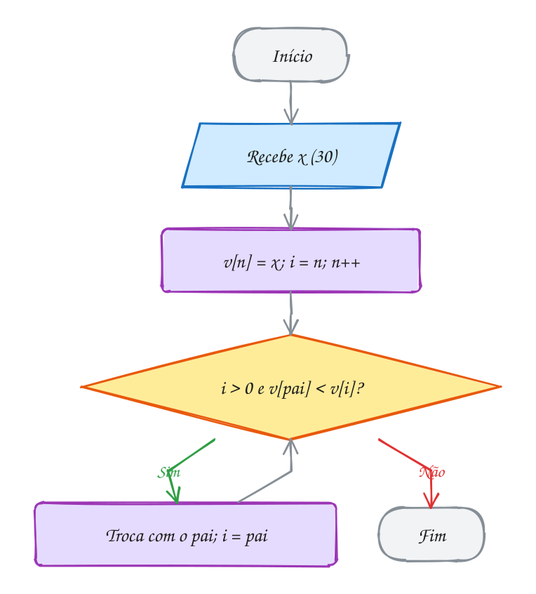</p>

#### Passo a passo

A remoção do 90. O último (20) vai para a raiz e desce pelo filho maior:

| Passo | Vetor | `i` | Filhos de `i` | Maior filho | Troca? |
| --- | --- | --- | --- | --- | --- |
| tira o 90, o 20 vai para `v[0]` | `[20 70 30 40 50]` | 0 | 70, 30 | 70 (índice 1) | sim |
| | `[70 20 30 40 50]` | 1 | 40, 50 | 50 (índice 4) | sim |
| | `[70 50 30 40 20]` | 4 | (nenhum) | | para |

**Exemplo A203 · O leilão com vagas contadas**

```c
#include <stdio.h>
#include "0102-heap.h"

int main(void) {
    // lances (em R$) por uma bicicleta usada; o leiloeiro só anota 4
    int lances[] = {300, 450, 450, 200, 500};
    Heap *mesa = heap_cria(4);

    for (int i = 0; i < 5; i++) {
        // heap_insere avisa quando não cabe: o vetor tem tamanho fixo, e o
        // heap recusa até o maior lance de todos
        if (heap_insere(mesa, lances[i])) {
            printf("Lance R$ %d anotado: ", lances[i]);
        } else {
            printf("Lance R$ %d recusado, mesa cheia: ", lances[i]);
        }
        heap_mostra(mesa);
        printf("\n");
    }

    // olhar o topo não tira ninguém
    printf("Maior lance agora: R$ %d\n", heap_topo(mesa));
    printf("Olhei de novo: R$ %d\n", heap_topo(mesa));

    // empate: os dois 450 continuam lá, um depois do outro
    while (!heap_vazio(mesa)) {
        printf("Sai R$ %d\n", heap_remove(mesa));
    }

    heap_libera(mesa);
    return 0;
}
// Saída:
// Lance R$ 300 anotado: [300]
// Lance R$ 450 anotado: [450 300]
// Lance R$ 450 anotado: [450 300 450]
// Lance R$ 200 anotado: [450 300 450 200]
// Lance R$ 500 recusado, mesa cheia: [450 300 450 200]
// Maior lance agora: R$ 450
// Olhei de novo: R$ 450
// Sai R$ 450
// Sai R$ 450
// Sai R$ 300
// Sai R$ 200
```

```bash
gcc ~/LPEDC/material/A203.c ~/LPEDC/material/0102-heap.c -o ~/LPEDC/material/A203 && ~/LPEDC/material/A203
```

**Exemplo A204 · Fila de prioridade com nome**

```c
#include <stdio.h>

#define CAP 8

// um heap de structs: a prioridade decide, o nome vai junto
typedef struct {
    int gravidade;
    const char *nome;
} Paciente;

typedef struct {
    Paciente v[CAP];
    int n;
} Triagem;

void troca(Paciente *a, Paciente *b) {
    Paciente t = *a; // struct inteira copiada de uma vez
    *a = *b;
    *b = t;
}

void chega(Triagem *t, int gravidade, const char *nome) {
    int i = t->n++;
    t->v[i] = (Paciente){gravidade, nome};
    while (i > 0 && t->v[(i - 1) / 2].gravidade < t->v[i].gravidade) {
        troca(&t->v[(i - 1) / 2], &t->v[i]);
        i = (i - 1) / 2;
    }
}

Paciente atende(Triagem *t) {
    Paciente primeiro = t->v[0];
    t->v[0] = t->v[--t->n];
    int i = 0;
    while (2 * i + 1 < t->n) {
        int f = 2 * i + 1;
        if (f + 1 < t->n && t->v[f + 1].gravidade > t->v[f].gravidade) {
            f++;
        }
        if (t->v[i].gravidade >= t->v[f].gravidade) {
            break;
        }
        troca(&t->v[i], &t->v[f]);
        i = f;
    }
    return primeiro;
}

int main(void) {
    Triagem t = {.n = 0};
    chega(&t, 40, "Ana (febre)");
    chega(&t, 70, "Bruno (fratura)");
    chega(&t, 20, "Carla (receita)");
    chega(&t, 90, "Davi (infarto)");
    chega(&t, 50, "Eva (corte)");

    while (t.n > 0) {
        Paciente p = atende(&t);
        printf("%2d  %s\n", p.gravidade, p.nome);
    }
    return 0;
}
// Saída:
// 90  Davi (infarto)
// 70  Bruno (fratura)
// 50  Eva (corte)
// 40  Ana (febre)
// 20  Carla (receita)
```

```bash
gcc ~/LPEDC/material/A204.c ~/LPEDC/material/0102-heap.c -o ~/LPEDC/material/A204 && ~/LPEDC/material/A204
```

### Exercícios

**Exercício E607** · ★☆☆

No heap, a árvore mora no vetor: os filhos de i estão em 2i + 1 e 2i + 2.
Escreva mostra_filhos(v, n), que, para cada posição, mostra o valor e quem
são os filhos (só os que existem, com índice menor que n). Teste com o
heap da triagem {90, 70, 30, 40, 50, 20}.

```text
Saída esperada:
v[0] = 90: filhos 70 e 30
v[1] = 70: filhos 40 e 50
v[2] = 30: filho 20
v[3] = 40: folha
v[4] = 50: folha
v[5] = 20: folha
```

```bash
gcc ~/LPEDC/material/E607.c ~/LPEDC/material/0102-heap.c -o ~/LPEDC/material/E607 && ~/LPEDC/material/E607
```

**Exercício E609** · ★★☆

Na fila de prioridade, é comum tirar o máximo e logo colocar um valor
novo. Escreva troca_topo(h, x), que faz isso numa operação só: guarda o
máximo, põe x na raiz (v[0]), faz x descer até o lugar certo e devolve o
máximo antigo. Suponha o heap não vazio. O TAD heap.h deixa os campos v e
n à mostra, mas a função desce do heap.c é static: escreva a sua. Insira
15, 35, 25, 45 e 5, mostre o heap com heap_mostra e troque o topo por 40
e depois por 10.

```text
Saída esperada:
depois das 5 inserções: [45 35 25 15 5]
saiu 45, entrou 40: [40 35 25 15 5]
saiu 40, entrou 10: [35 15 25 10 5]
```

```bash
gcc ~/LPEDC/material/E609.c ~/LPEDC/material/0102-heap.c -o ~/LPEDC/material/E609 && ~/LPEDC/material/E609
```

**Exercício E610** · ★★☆

No banco, a fila é por senha: a MENOR senha é chamada primeiro. Você só
tem o TAD heap.h, que é um heap de MÁXIMO, e não pode mexer nele. As
senhas foram entregues nesta ordem: 7, 3, 9, 1, 5. Escreva o main para
chamar as senhas na ordem certa.

```text
Saída esperada:
Chamando senha 1
Chamando senha 3
Chamando senha 5
Chamando senha 7
Chamando senha 9
```

```bash
gcc ~/LPEDC/material/E610.c ~/LPEDC/material/0102-heap.c -o ~/LPEDC/material/E610 && ~/LPEDC/material/E610
```

**Exercício E611** · ★★★

O professor quer o pódio: as 3 maiores notas da turma. Em vez de ordenar
o vetor inteiro, use um heap de MÍNIMO com espaço para 3, que guarda as 3
maiores vistas até agora, com a menor delas na raiz. Para cada nota: se o
heap tem menos de 3, insira; senão, se a nota é maior que a raiz, a raiz
sai e a nota entra. Escreva o heap por conta própria (o heap.h é de
máximo). Notas: 72 95 60 88 91 45 98 83 77 90 66 85.

```text
Saída esperada:
Pódio: 98 95 91
```

```bash
gcc ~/LPEDC/material/E611.c ~/LPEDC/material/0102-heap.c -o ~/LPEDC/material/E611 && ~/LPEDC/material/E611
```

---

## 0103 · Heapsort

### Conceito

- **Heapsort**: ordena tirando o máximo do heap n vezes. Tudo no **mesmo
  vetor**: o heap encolhe uma casa a cada máximo, e essa casa livre no fim é o
  lugar final dele (CORMEN et al., 2024, cap. 6).
- **Fase 1, construir o heap**: cada **pai** desce, do último (`n / 2 - 1`)
  até a raiz. As folhas já são heaps, e a fase custa só O(n). É a
  `BUILD-MAX-HEAP` do Cormen (CORMEN et al., 2024, cap. 6).
- **Fase 2, ordenar**: troca a raiz com o último do heap, encolhe o heap e faz
  a nova raiz descer. O vetor fica com o heap no começo e a parte ordenada no
  fim (FEOFILOFF, 2009).
- **Custo**: n - 1 descidas de no máximo log₂ n níveis, O(n log n)
  **sempre**. O quick sort (0095) pode cair em O(n²) e o merge sort (0094)
  precisa de vetor extra (TENENBAUM; LANGSAM; AUGENSTEIN, 1995, cap. 6).
- **In-place e não estável**: usa O(1) de memória, sem recursão, mas pode
  trocar a ordem de chaves iguais. Na prática o quick sort costuma ser mais
  rápido (TENENBAUM; LANGSAM; AUGENSTEIN, 1995, cap. 6).

> [!WARNING]
> Na fase 2, o `desce` recebe o tamanho **do heap** (`fim`), não o do vetor
> (`n`). Com `desce(v, n, 0)`, a raiz trata os já ordenados como filhos e
> desfaz o trabalho, sem aviso: os índices continuam válidos.

### Exemplos de uso

Os tempos da corrida de rua chegaram como 52, 18, 73, 40, 91, 25 e 66. Depois
da fase 1, o heap é `[91 52 73 40 18 25 66]`. O 91 troca com o 66 e fica no
fim, em verde; o 66 desce pelo maior filho (73):

<p align="center">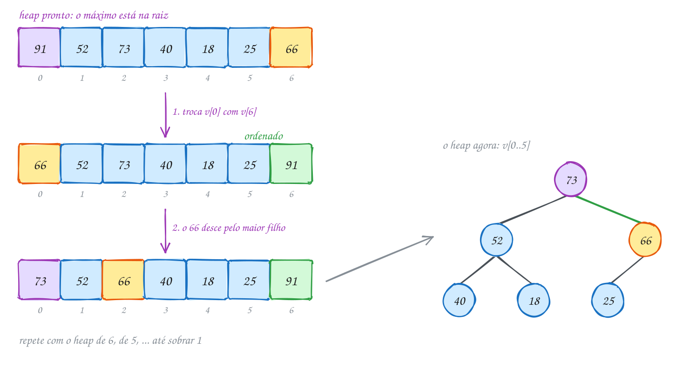</p>

O `desce` é o do heap, com o tamanho atual do heap como parâmetro. A `mostra`
separa o heap da parte ordenada com `|`:

```c
#include <stdio.h>

void troca(int *a, int *b) {
    int t = *a;
    *a = *b;
    *b = t;
}

// mostra o heap (v[0..fim-1]) e a parte já ordenada, separados por |
void mostra(const char *rotulo, const int v[], int n, int fim) {
    printf("%-12s", rotulo);
    for (int i = 0; i < n; i++) {
        printf(i == fim ? " | %d" : " %d", v[i]);
    }
    printf("\n");
}

// desce v[i] dentro do heap v[0..n-1], trocando com o maior filho
void desce(int v[], int n, int i) {
    while (2 * i + 1 < n) {
        int f = 2 * i + 1;
        if (f + 1 < n && v[f + 1] > v[f]) {
            f++;
        }
        if (v[i] >= v[f]) {
            break;
        }
        troca(&v[i], &v[f]);
        i = f;
    }
}

void heapsort(int v[], int n) {
    // fase 1: transforma o vetor em heap, do último pai até a raiz
    for (int i = n / 2 - 1; i >= 0; i--) {
        desce(v, n, i);
    }
    mostra("heap:", v, n, n);
    // fase 2: o máximo vai para o fim; o heap encolhe uma casa
    for (int fim = n - 1; fim > 0; fim--) {
        troca(&v[0], &v[fim]);
        desce(v, fim, 0);
        mostra("", v, n, fim);
    }
}

int main(void) {
    int tempos[] = {52, 18, 73, 40, 91, 25, 66}; // minutos de cada corredor
    int n = 7;

    mostra("antes:", tempos, n, n);
    heapsort(tempos, n);
    return 0;
}
// Saída:
// antes:       52 18 73 40 91 25 66
// heap:        91 52 73 40 18 25 66
//              73 52 66 40 18 25 | 91
//              66 52 25 40 18 | 73 91
//              52 40 25 18 | 66 73 91
//              40 18 25 | 52 66 73 91
//              25 18 | 40 52 66 73 91
//              18 | 25 40 52 66 73 91
```

No fluxograma, a fase 1 é uma caixa só, e o laço da fase 2 repete trocar e
descer até `fim` chegar a 0:

<p align="center">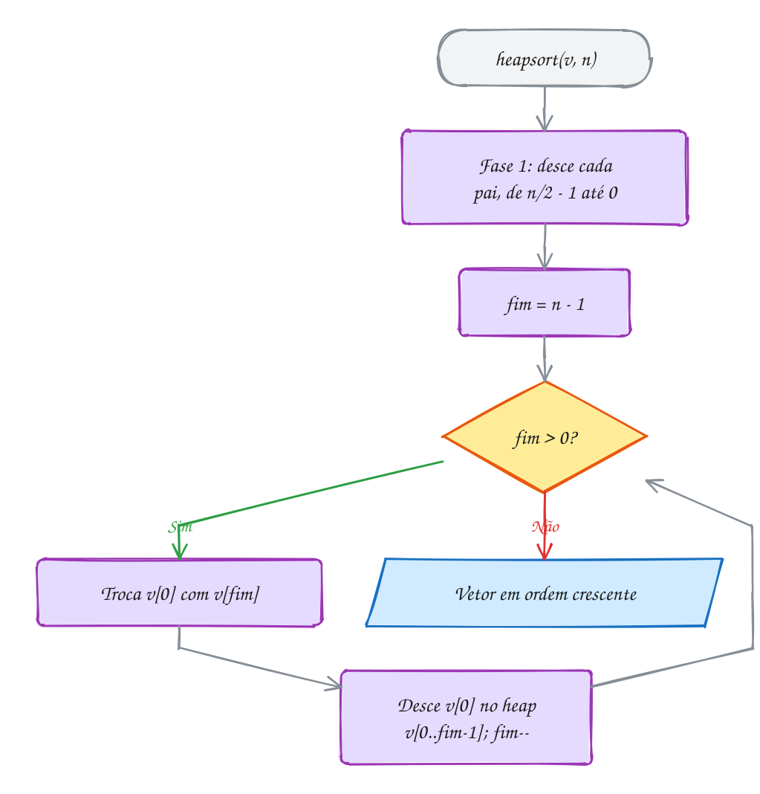</p>

#### Passo a passo

A fase 1. Os pais são os índices 2, 1 e 0 (`n / 2 - 1 = 2`):

| Pai que desce | Filhos | O que acontece | Vetor |
| --- | --- | --- | --- |
| `v[2] = 73` | 25 e 66 | 73 já é o maior: fica | `52 18 73 40 91 25 66` |
| `v[1] = 18` | 40 e 91 | troca com o 91 | `52 91 73 40 18 25 66` |
| `v[0] = 52` | 91 e 73 | troca com o 91; depois, filhos 40 e 18: fica | `91 52 73 40 18 25 66` |

**Exemplo A205 · Empate na chegada: o heapsort não é estável**

```c
#include <stdio.h>

typedef struct {
    const char *nome;
    int tempo; // minutos
} Corredor;

void troca(Corredor *a, Corredor *b) {
    Corredor t = *a;
    *a = *b;
    *b = t;
}

// o mesmo desce do texto, comparando só o campo tempo
void desce(Corredor v[], int n, int i) {
    while (2 * i + 1 < n) {
        int f = 2 * i + 1;
        if (f + 1 < n && v[f + 1].tempo > v[f].tempo) {
            f++;
        }
        if (v[i].tempo >= v[f].tempo) {
            break;
        }
        troca(&v[i], &v[f]);
        i = f;
    }
}

void heapsort(Corredor v[], int n) {
    for (int i = n / 2 - 1; i >= 0; i--) {
        desce(v, n, i);
    }
    for (int fim = n - 1; fim > 0; fim--) {
        troca(&v[0], &v[fim]);
        desce(v, fim, 0);
    }
}

void mostra(const char *rotulo, const Corredor v[], int n) {
    printf("%s", rotulo);
    for (int i = 0; i < n; i++) {
        printf(" %s %d", v[i].nome, v[i].tempo);
        printf(i < n - 1 ? "," : "\n");
    }
}

int main(void) {
    // na ordem de chegada: Ana chegou antes de Caio, Bia antes de Duda
    Corredor v[] = {{"Ana", 40}, {"Bia", 25}, {"Caio", 40}, {"Duda", 25}, {"Edu", 30}};
    int n = 5;

    mostra("Chegada:", v, n);
    heapsort(v, n);
    mostra("Ordem:  ", v, n);
    // os tempos estão em ordem, mas os empatados trocaram de lugar:
    // Duda passou na frente de Bia e Caio na frente de Ana
    return 0;
}
// Saída:
// Chegada: Ana 40, Bia 25, Caio 40, Duda 25, Edu 30
// Ordem:   Duda 25, Bia 25, Edu 30, Caio 40, Ana 40
```

```bash
gcc ~/LPEDC/material/A205.c -o ~/LPEDC/material/A205 && ~/LPEDC/material/A205
```

**Exemplo A206 · Heapsort não tem dia ruim**

```c
#include <stdio.h>
#include <stdlib.h>

long comparacoes = 0; // contador global, só para o experimento

void troca(int *a, int *b) {
    int t = *a;
    *a = *b;
    *b = t;
}

void desce(int v[], int n, int i) {
    while (2 * i + 1 < n) {
        int f = 2 * i + 1;
        if (f + 1 < n) {
            comparacoes++;
            if (v[f + 1] > v[f]) {
                f++;
            }
        }
        comparacoes++;
        if (v[i] >= v[f]) {
            break;
        }
        troca(&v[i], &v[f]);
        i = f;
    }
}

void heapsort(int v[], int n) {
    for (int i = n / 2 - 1; i >= 0; i--) {
        desce(v, n, i);
    }
    for (int fim = n - 1; fim > 0; fim--) {
        troca(&v[0], &v[fim]);
        desce(v, fim, 0);
    }
}

void insertion(int v[], int n) {
    for (int i = 1; i < n; i++) {
        int x = v[i];
        int j = i - 1;
        while (j >= 0) {
            comparacoes++;
            if (v[j] <= x) {
                break;
            }
            v[j + 1] = v[j]; // empurra para a direita
            j--;
        }
        v[j + 1] = x;
    }
}

int main(void) {
    int n = 1000;
    int *a = malloc(n * sizeof(int));
    int *b = malloc(n * sizeof(int));
    if (a == NULL || b == NULL) {
        return 1;
    }
    for (int i = 0; i < n; i++) {
        a[i] = b[i] = n - i; // decrescente: o pior caso do insertion sort
    }

    comparacoes = 0;
    insertion(a, n);
    printf("Insertion sort: %ld comparações\n", comparacoes);

    comparacoes = 0;
    heapsort(b, n);
    printf("Heapsort:       %ld comparações\n", comparacoes);

    printf("Ordenados? %s\n", a[0] == 1 && a[n - 1] == n && b[0] == 1 && b[n - 1] == n ? "sim" : "não");
    free(a);
    free(b);
    return 0;
}
// Saída:
// Insertion sort: 499500 comparações
// Heapsort:       15965 comparações
// Ordenados? sim
```

```bash
gcc ~/LPEDC/material/A206.c -o ~/LPEDC/material/A206 && ~/LPEDC/material/A206
```

### Exercícios

**Exercício E613** · ★☆☆

Escreva troca, desce(v, n, i) (heap de máximo) e mostra(v, n, fim). No
vetor {3, 9, 2, 7, 5, 8}, faça a fase 1 do heapsort (descer cada pai, do
último até a raiz), mostrando o vetor depois de cada pai descer. Depois
faça só os DOIS primeiros passos da fase 2 (o máximo vai para o fim e o
heap encolhe uma casa). Mostre o vetor entre colchetes; nos passos da
fase 2, uma barra separa a parte já ordenada.

```text
Saída esperada:
pai 2 desceu: [3 9 8 7 5 2]
pai 1 desceu: [3 9 8 7 5 2]
pai 0 desceu: [9 7 8 3 5 2]
fase 2:       [8 7 2 3 5 | 9]
fase 2:       [7 5 2 3 | 8 9]
```

**Exercício E615** · ★★☆

Há dois jeitos de montar o heap da fase 1: inserir os elementos um a um
(cada um SOBE, como no heap_insere) ou descer cada pai, do último até a
raiz (o jeito do texto). Escreva as duas funções, contando as trocas, e
rode nos tempos da corrida {52, 18, 73, 40, 91, 25, 66}, cada uma numa
cópia do vetor. Escreva também eh_heap(v, n) e confira se os dois
resultados são heaps de máximo, mesmo sendo diferentes.

```text
Saída esperada:
Por inserções:    [91 73 66 18 40 25 52], 5 trocas
Descendo os pais: [91 52 73 40 18 25 66], 2 trocas
Os dois são heaps? sim
```

**Exercício E616** · ★★☆

O heapsort percebe quando o vetor já vem arrumado? Meça. Escreva um
heapsort em que desce(v, n, i) devolve quantas trocas fez, e
testa(nome, v, n), que soma as trocas do desce em cada fase (a troca do
v[0] com o v[fim] da fase 2 não entra na conta) e mostra os totais e o
vetor final. Teste um vetor crescente, um decrescente e um com tudo igual:
{1..7}, {7..1} e {5, 5, 5, 5, 5, 5, 5}.

```text
Saída esperada:
crescente:   fase 1: 4 trocas, fase 2: 6 trocas -> 1 2 3 4 5 6 7
decrescente: fase 1: 0 trocas, fase 2: 5 trocas -> 1 2 3 4 5 6 7
iguais:      fase 1: 0 trocas, fase 2: 0 trocas -> 5 5 5 5 5 5 5
```

**Exercício E618** · ★★★

A organização da corrida quer os inscritos em ordem alfabética. Escreva um
heapsort para um vetor de strings (const char *), comparando com strcmp, e
ordene: Paula, Bruno, Zeca, Ana, Marcos, Carla, Igor, Beatriz.

```text
Saída esperada:
Ana
Beatriz
Bruno
Carla
Igor
Marcos
Paula
Zeca
```

---

## 0104 · Juntando tudo

### Conceito

- **Cada estrutura no seu papel**: achar, inserir e remover pela chave é
  trabalho de **BST**, O(altura). "Os maiores" por outro critério é trabalho
  de **heap** (CORMEN et al., 2024, caps. 6 e 12).
- **Registro no nó**: o nó guarda uma struct inteira. Uma parte é a
  **chave**, que ordena a árvore; o resto vai junto
  (KERNIGHAN; RITCHIE, 1989, seção 6.5).
- **Ponteiro para dentro da árvore**: a busca pode devolver o endereço do
  registro. Quem chama muda os campos comuns, mas nunca a chave, que quebraria
  a regra da BST (CELES; RANGEL, 2002).
- **Os k maiores**: copie para um vetor, monte o heap em O(n) e tire o máximo
  k vezes. É a fase 2 do heapsort interrompida; não precisa ordenar tudo
  (TENENBAUM; LANGSAM; AUGENSTEIN, 1995, cap. 6).
- **Structs grandes**: o heap pode guardar **ponteiros** (`Aluno *v[]`) e
  trocar só os ponteiros (exercício E618) (CELES; CERQUEIRA; RANGEL, 2016).

> [!WARNING]
> O ponteiro de `cad_busca` aponta para dentro de um nó e vale só até a próxima
> remoção: `cad_remove` pode liberar esse nó ou copiar outro aluno por cima
> dele. Busque de novo depois de mexer na árvore e nunca altere `a->matricula`.

### Exemplos de uso

A academia troca a planilha por um cadastro em BST, com a matrícula como
chave. A catraca acha o 60 (Fabio) descendo 50, 70 e 60 e soma um treino. O
30 (Bruno) cancela, e um heap pelos treinos entrega o pódio:

<p align="center">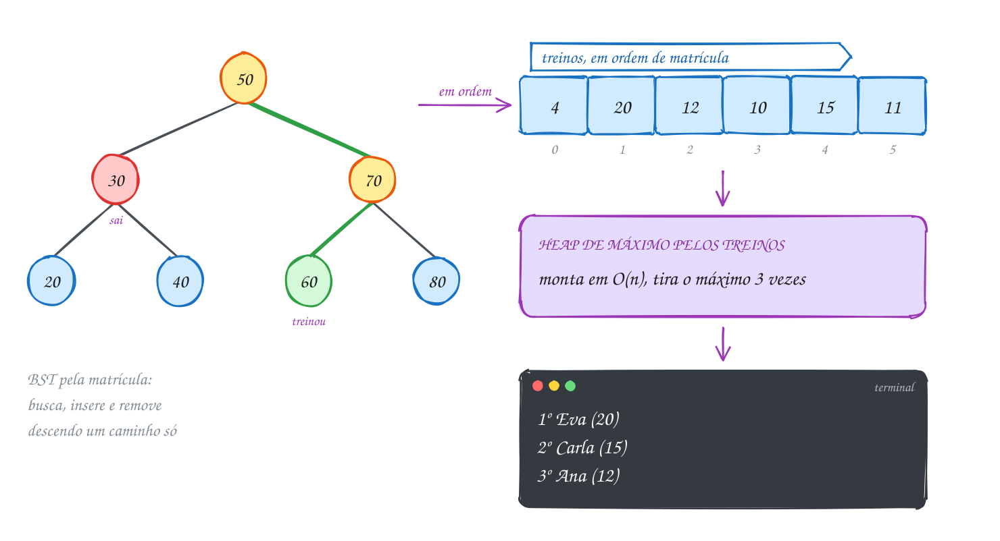</p>

O nó do TAD (`cadastro.h` e `cadastro.c`) guarda a struct do aluno:

```c
typedef struct {
    int matricula;
    char nome[20];
    int treinos; // treinos no mês
} Aluno;

typedef struct NoAluno {
    Aluno a;
    struct NoAluno *esq;
    struct NoAluno *dir;
} NoAluno;
```

As funções são as da BST (`cad_insere`, `cad_busca`, `cad_remove`,
`cad_lista`), com `r->a.matricula` no lugar de `r->chave`. Na remoção com dois
filhos, `r->a = suc->a` copia a struct inteira do sucessor. O ranking copia os
alunos para um vetor (`cad_para_vetor`, em ordem) e monta o heap sobre ele:

```c
#include <stdio.h>
#include "cadastro.h"

#define MAX 16

// heap de máximo pelos treinos, para o ranking
void desce(Aluno v[], int n, int i) {
    while (2 * i + 1 < n) {
        int f = 2 * i + 1;
        if (f + 1 < n && v[f + 1].treinos > v[f].treinos) {
            f++;
        }
        if (v[i].treinos >= v[f].treinos) {
            break;
        }
        Aluno t = v[i];
        v[i] = v[f];
        v[f] = t;
        i = f;
    }
}

// mostra os k que mais treinaram: monta o heap e tira o máximo k vezes
void ranking(const NoAluno *r, int k) {
    Aluno v[MAX];
    int n = cad_para_vetor(r, v, 0); // cópia: a árvore não muda
    for (int i = n / 2 - 1; i >= 0; i--) {
        desce(v, n, i);
    }
    for (int pos = 1; pos <= k && n > 0; pos++) {
        printf("  %dº %s (%d)\n", pos, v[0].nome, v[0].treinos);
        v[0] = v[--n];
        desce(v, n, 0);
    }
}

int main(void) {
    Aluno turma[] = {
        {50, "Ana", 12}, {30, "Bruno", 8}, {70, "Carla", 15}, {20, "Davi", 4},
        {40, "Eva", 20}, {60, "Fabio", 9}, {80, "Gil", 11},
    };
    NoAluno *cad = NULL;
    for (int i = 0; i < 7; i++) {
        cad = cad_insere(cad, turma[i]);
    }

    printf("Alunos (%d, altura %d):\n", cad_conta(cad), cad_altura(cad));
    cad_lista(cad);

    Aluno *a = cad_busca(cad, 60); // a catraca registra mais um treino
    if (a != NULL) {
        a->treinos++;
        printf("Catraca: %s agora tem %d treinos\n", a->nome, a->treinos);
    }

    cad = cad_remove(cad, 30); // Bruno cancelou
    printf("Sem o 30: %d alunos\n", cad_conta(cad));

    printf("Ranking do mês:\n");
    ranking(cad, 3);

    cad = cad_libera(cad);
    return 0;
}
// Saída:
// Alunos (7, altura 2):
//    20  Davi      4 treinos
//    30  Bruno     8 treinos
//    40  Eva      20 treinos
//    50  Ana      12 treinos
//    60  Fabio     9 treinos
//    70  Carla    15 treinos
//    80  Gil      11 treinos
// Catraca: Fabio agora tem 10 treinos
// Sem o 30: 6 alunos
// Ranking do mês:
//   1º Eva (20)
//   2º Carla (15)
//   3º Ana (12)
```

O exemplo A208 comanda o cadastro pelo teclado (`i 50 Ana 12`, `b 50`,
`r 50`, `l`). O fluxograma é uma sequência de operações na BST e, no fim, um
laço sobre o heap:

<p align="center">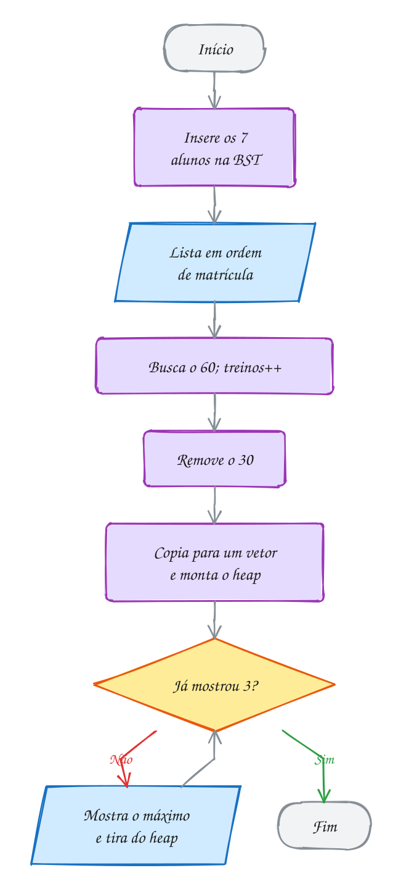</p>

**Exemplo A207 · Trocar a matrícula não é editar o campo**

```c
#include <stdio.h>
#include "0104-cadastro.h"

void confere(NoAluno *cad, int matricula) {
    Aluno *a = cad_busca(cad, matricula);
    printf("  busca %d: %s\n", matricula, a != NULL ? a->nome : "não achou");
}

int main(void) {
    Aluno turma[] = {
        {45, "Lia", 10}, {25, "Rui", 6}, {65, "Teo", 14}, {15, "Ivo", 3}, {35, "Mel", 8},
    };
    NoAluno *cad = NULL;
    for (int i = 0; i < 5; i++) {
        cad = cad_insere(cad, turma[i]);
    }

    // Ivo ganhou a matrícula 90. Jeito ERRADO: mudar o campo pelo ponteiro
    Aluno *ivo = cad_busca(cad, 15);
    ivo->matricula = 90;
    printf("Editando o campo:\n");
    cad_lista(cad);   // o 90 aparece no começo: está no lugar do 15
    confere(cad, 90); // a busca vai para a direita e nunca o encontra
    ivo->matricula = 15; // desfaz, para seguir com a árvore certa

    // jeito CERTO: copia o aluno, remove pela chave velha, insere com a nova
    Aluno copia = *cad_busca(cad, 15); // copia antes: o remove dá free no nó
    cad = cad_remove(cad, 15);
    copia.matricula = 90;
    cad = cad_insere(cad, copia);
    printf("Removendo e inserindo:\n");
    cad_lista(cad);
    confere(cad, 90);
    confere(cad, 15);

    cad = cad_libera(cad);
    return 0;
}
// Saída:
// Editando o campo:
//    90  Ivo       3 treinos
//    25  Rui       6 treinos
//    35  Mel       8 treinos
//    45  Lia      10 treinos
//    65  Teo      14 treinos
//   busca 90: não achou
// Removendo e inserindo:
//    25  Rui       6 treinos
//    35  Mel       8 treinos
//    45  Lia      10 treinos
//    65  Teo      14 treinos
//    90  Ivo       3 treinos
//   busca 90: Ivo
//   busca 15: não achou
```

```bash
gcc ~/LPEDC/material/A207.c ~/LPEDC/material/0104-cadastro.c -o ~/LPEDC/material/A207 && ~/LPEDC/material/A207
```

**Exemplo A208 · A recepção digitando comandos**

```c
#include <stdio.h>
#include "0104-cadastro.h"

// comandos, um por linha:
//   i MATRICULA NOME TREINOS   insere      b MATRICULA   busca
//   r MATRICULA                remove      l             lista
//   q                          sai
int main(void) {
    NoAluno *cad = NULL;
    char cmd;

    while (scanf(" %c", &cmd) == 1 && cmd != 'q') {
        Aluno a;
        int mat;
        if (cmd == 'i' && scanf("%d %19s %d", &a.matricula, a.nome, &a.treinos) == 3) {
            cad = cad_insere(cad, a);
            printf("ok: %s entrou\n", a.nome);
        } else if (cmd == 'b' && scanf("%d", &mat) == 1) {
            Aluno *achou = cad_busca(cad, mat);
            if (achou != NULL) {
                printf("%d: %s, %d treinos\n", mat, achou->nome, achou->treinos);
            } else {
                printf("%d: não encontrado\n", mat);
            }
        } else if (cmd == 'r' && scanf("%d", &mat) == 1) {
            cad = cad_remove(cad, mat);
            printf("ok: %d saiu\n", mat);
        } else if (cmd == 'l') {
            printf("%d alunos, altura %d:\n", cad_conta(cad), cad_altura(cad));
            cad_lista(cad);
        } else {
            printf("comando inválido\n");
        }
    }

    cad = cad_libera(cad);
    return 0;
}
// Teste: printf 'i 50 Ana 12\ni 30 Bruno 8\ni 70 Carla 15\nb 30\nr 50\nb 50\nl\nq\n' | ~/LPEDC/rodar 14-arvores/0104-juntando-tudo/A208.c
// Saída:
// ok: Ana entrou
// ok: Bruno entrou
// ok: Carla entrou
// 30: Bruno, 8 treinos
// ok: 50 saiu
// 50: não encontrado
// 2 alunos, altura 1:
//    30  Bruno     8 treinos
//    70  Carla    15 treinos
```

```bash
gcc ~/LPEDC/material/A208.c ~/LPEDC/material/0104-cadastro.c -o ~/LPEDC/material/A208 && ~/LPEDC/material/A208
```

### Exercícios

**Exercício E619** · ★☆☆

A academia dá um brinde a quem treinou pelo menos 10 vezes no mês. Com o
TAD cadastro.h, insira estes alunos (matrícula, nome, treinos):

```text
{50, "Ana", 12}, {30, "Bruno", 8}, {70, "Carla", 15}, {20, "Davi", 4},
{40, "Eva", 20}, {60, "Fabio", 9}, {80, "Gil", 11}
```

Escreva conta_brinde(r), que conta esses alunos, e mostra_brinde(r), que
imprime o nome deles em ordem de matrícula.

```text
Saída esperada:
Ganham brinde: Eva Ana Carla Gil
Total: 4
```

```bash
gcc ~/LPEDC/material/E619.c ~/LPEDC/material/0104-cadastro.c -o ~/LPEDC/material/E619 && ~/LPEDC/material/E619
```

**Exercício E621** · ★★☆

A academia importou os alunos de uma planilha em ordem crescente de
matrícula, e a BST virou uma fila indiana. Com o TAD cadastro.h, insira
nesta ordem (matrícula, nome, treinos):

```text
{20, "Davi", 4}, {30, "Bruno", 8}, {40, "Eva", 20}, {50, "Ana", 12},
{60, "Fabio", 9}, {70, "Carla", 15}, {80, "Gil", 11}
```

Escreva rebalanceia(r): copie os alunos para um vetor (cad_para_vetor, já
em ordem), libere a árvore velha e monte uma nova inserindo SEMPRE O DO
MEIO primeiro. A função devolve a raiz nova. Escreva também uma função
que imprime as matrículas em ordem.

```text
Saída esperada:
Antes:  altura 6
Depois: altura 2, raiz 50 (Ana)
Alunos em ordem: 20 30 40 50 60 70 80
```

```bash
gcc ~/LPEDC/material/E621.c ~/LPEDC/material/0104-cadastro.c -o ~/LPEDC/material/E621 && ~/LPEDC/material/E621
```

**Exercício E622** · ★★☆

Com o TAD cadastro.h, insira os alunos (matrícula, nome, treinos):

```text
{50, "Ana", 12}, {30, "Bruno", 8}, {70, "Carla", 15}, {20, "Davi", 4},
{40, "Eva", 20}, {60, "Fabio", 9}, {80, "Gil", 11}
```

Escreva proxima(r, x): devolve a MENOR matrícula maior que x, ou -1 se não
houver. Não percorra a árvore inteira: desça um caminho só. Teste com 45,
50, 10 e 80.

```text
Saída esperada:
depois de 45: 50
depois de 50: 60
depois de 10: 20
depois de 80: -1
```

```bash
gcc ~/LPEDC/material/E622.c ~/LPEDC/material/0104-cadastro.c -o ~/LPEDC/material/E622 && ~/LPEDC/material/E622
```

**Exercício E624** · ★★★

Lista de espera do posto de saúde. Cada linha da entrada traz um nome e
uma prioridade (maior = mais urgente). Um nome que já está na lista é
recusado. No fim da entrada, chame todos, do mais urgente ao menos
urgente. Use:
- uma BST de nomes (compare com strcmp) para saber se o nome já entrou;
- um heap de máximo de structs {prioridade, nome} para a ordem de chamada.

```text
Entrada:
Ana 3
Beto 5
Caio 1
Ana 4
Dani 4
Edu 2
```

```text
Saída esperada:
Ana já está na lista
Chamando: Beto (5)
Chamando: Dani (4)
Chamando: Ana (3)
Chamando: Edu (2)
Chamando: Caio (1)
```

```bash
gcc ~/LPEDC/material/E624.c ~/LPEDC/material/0104-cadastro.c -o ~/LPEDC/material/E624 && ~/LPEDC/material/E624
```

---

## Lista do módulo

30 exercícios que misturam os assuntos do módulo, no ritmo da prova. Arquivos P1401.c a P1430.c, em `material/`; resoluções em `_respostas/14-arvores/lista/`.

### ★☆☆ Aquecimento

**Exercício P1401** · ★☆☆ · O organograma, nível por nível

O organograma de uma pequena empresa é uma árvore binária: a Diretora tem
Vendas à esquerda e TI à direita; Vendas tem Loja e Online; Online tem só
Site, à direita; TI tem só Suporte, à esquerda.

Monte a árvore com uma função No *novo(nome, esq, dir) e escreva:

```text
int altura(const No *r)          altura em ARESTAS (vazia = -1)
void mostra(const No *r, int prof)   pré-ordem com 2 espaços por nível
```

mostra imprime cada nó com a profundidade (recebida no parâmetro) e a
altura dele. No fim, mostre a altura da árvore e libere tudo.

```text
Saída esperada:
Diretora (profundidade 0, altura 3)
  Vendas (profundidade 1, altura 2)
    Loja (profundidade 2, altura 0)
    Online (profundidade 2, altura 1)
      Site (profundidade 3, altura 0)
  TI (profundidade 1, altura 1)
    Suporte (profundidade 2, altura 0)
altura da árvore: 3
```

---

**Exercício P1402** · ★☆☆ · A BST das senhas e os três percursos

Insira as senhas 50, 30, 70, 20, 40, 60, 80, 35, 65, nesta ordem, numa
árvore binária de busca vazia (menor à esquerda, maior à direita, repetida
é ignorada). Mostre os percursos pré-ordem, em ordem e pós-ordem e libere
a árvore.

```text
Saída esperada:
pré: 50 30 20 40 35 70 60 65 80
em:  20 30 35 40 50 60 65 70 80
pós: 20 35 40 30 65 60 80 70 50
```

---

**Exercício P1403** · ★☆☆ · Procurando o CEP na BST

A transportadora guarda os prefixos de CEP atendidos numa BST. O main já
insere 690, 420, 810, 150, 530, 770, 950, 480, 600. Complete:

```text
const No *busca(const No *r, int chave, int *visitados)
  busca SEM recursão (um while que desce pela árvore), contando quantos
  nós olhou;
int minimo(const No *r) e int maximo(const No *r)
  sem recursão: o menor é o nó mais à esquerda; o maior, o mais à direita.
```

```text
Saída esperada:
600: achou (visitados: 4)
950: achou (visitados: 3)
690: achou (visitados: 1)
500: não achou (visitados: 4)
menor: 150, maior: 950
```

---

**Exercício P1404** · ★☆☆ · A árvore genealógica, uma geração por linha

Complete por_nivel, o percurso por nível (largura), mostrando cada nível
numa linha. Use uma fila num vetor No *fila[32] com índices ini e fim. O
truque para separar os níveis: no começo de cada volta, os que estão na
fila (fim - ini) são exatamente os do nível atual. Tire esses todos,
imprimindo e enfileirando os filhos, e só então passe de linha.

```text
Saída esperada:
nível 0: Joana
nível 1: Pedro Carla
nível 2: Lara Davi Tomas
nível 3: Nina Yuri Zoe
```

---

**Exercício P1405** · ★☆☆ · O heap de lances do leilão

No leilão online, o maior lance tem que estar sempre à mão. Os lances
chegam nesta ordem: 120, 340, 200, 510, 90, 450, 380. Escreva
void insere(int heap[], int *n, int x), que coloca x no fim de um heap de
MÁXIMO (raiz em heap[0], pai de i em (i - 1) / 2) e faz ele subir enquanto
for maior que o pai. Mostre o vetor depois de cada inserção.

```text
Saída esperada:
depois do 120: 120
depois do 340: 340 120
depois do 200: 340 120 200
depois do 510: 510 340 200 120
depois do 90: 510 340 200 120 90
depois do 450: 510 340 450 120 90 200
depois do 380: 510 340 450 120 90 200 380
```

---

**Exercício P1406** · ★☆☆ · Chamando os pacientes mais urgentes

No pronto-socorro, as urgências dos pacientes já estão num heap de máximo:
95, 80, 70, 40, 75, 30, 65, 10. A função desce está pronta. Escreva
int extrai_max(int heap[], int *n): guarda a raiz, leva o último elemento
para a raiz, diminui n e faz a raiz descer. Chame três pacientes,
mostrando o heap que sobra a cada chamada.

```text
Saída esperada:
chamou 95, sobrou: 80 75 70 40 10 30 65
chamou 80, sobrou: 75 65 70 40 10 30
chamou 75, sobrou: 70 65 30 40 10
```

---

**Exercício P1407** · ★☆☆ · O fator de cada nó

Insira os pedidos 40, 20, 60, 10, 30, 25, 35, 70, 27 numa BST comum (sem
balancear). Escreva bool fatores(const No *r), que percorre a árvore EM
ORDEM mostrando o fator de balanceamento de cada nó,
altura(esq) - altura(dir), e devolve true se todos os fatores estão entre
-1 e 1. No fim, diga se a árvore poderia ser uma AVL.

```text
Saída esperada:
10: fator 0
20: fator -2
25: fator -1
27: fator 0
30: fator 1
35: fator 0
40: fator 2
60: fator -1
70: fator 0
é AVL? não
```

---

**Exercício P1408** · ★☆☆ · A altura que contava nós

A árvore abaixo guarda os quilômetros das paradas de uma linha de ônibus.
A função altura tem um erro de propósito: ela não segue a convenção do
módulo (altura em ARESTAS, folha com altura 0, árvore vazia com -1). Rode,
veja os números errados e conserte.

```text
Saída esperada (depois do conserto):
altura da folha: 0
altura da árvore: 3
altura da vazia: -1
```

**Resposta esperada:** if (r == NULL) return -1; e a saída fica igual à de cima.

---

**Exercício P1409** · ★☆☆ · Contando os nós pelo número de filhos

Insira os preços 45, 22, 67, 10, 30, 55, 80, 5, 27, 90, 85 numa BST e
escreva void conta_graus(const No *r, int grau[3]), que soma em grau[g]
quantos nós têm g filhos (0, 1 ou 2). Mostre as três contagens, o total e
confira a propriedade das árvores binárias: folhas = (nós com 2 filhos) + 1.

```text
Saída esperada:
folhas (0 filhos): 4
com 1 filho: 4
com 2 filhos: 3
total: 11 nós
folhas = (2 filhos) + 1? sim
```

---

**Exercício P1410** · ★☆☆ · Montando o heap de uma vez

As quantidades de 9 produtos no estoque estão num vetor desordenado:
4, 17, 9, 23, 8, 31, 12, 2, 19. Transforme o vetor num heap de máximo com o
BUILD-MAX-HEAP: chame desce(v, n, i) para cada pai, do último
(i = n / 2 - 1) até a raiz (i = 0). Mostre o vetor depois de cada desce.
A função desce está pronta.

```text
Saída esperada:
desce(3): 4 17 9 23 8 31 12 2 19
desce(2): 4 17 31 23 8 9 12 2 19
desce(1): 4 23 31 19 8 9 12 2 17
desce(0): 31 23 12 19 8 9 4 2 17
```

### ★★☆ Para pensar

**Exercício P1411** · ★★☆ · Sucessor e antecessor sem ponteiro para o pai

A agenda de um consultório guarda os horários (em minutos) numa BST cujos
nós NÃO têm ponteiro para o pai. O main insere 50, 30, 70, 20, 40, 60, 80,
35, 45, 65. Escreva, sem recursão, descendo a partir da raiz:

```text
int sucessor(const No *r, int x)     menor chave MAIOR que x, ou -1
int antecessor(const No *r, int x)   maior chave MENOR que x, ou -1
```

Mostre os dois para 40, 45, 65, 20 e 80.

```text
Saída esperada:
40: antecessor 35, sucessor 45
45: antecessor 40, sucessor 50
65: antecessor 60, sucessor 70
20: antecessor -1, sucessor 30
80: antecessor 70, sucessor -1
```

---

**Exercício P1412** · ★★☆ · Remoções em sequência na BST

Os armários do clube ficam numa BST montada com 50, 30, 70, 20, 40, 60, 80,
35, 45, 65. Escreva No *remove_chave(No *r, int chave) com os três casos
(folha, um filho, dois filhos) e, no caso de dois filhos, use o SUCESSOR
(o menor da subárvore direita), como no Cormen: copie a chave dele para o
nó e remova o sucessor da subárvore direita. Remova 20, 60, 30 e 50, nesta
ordem, mostrando a pré-ordem depois de cada remoção.

```text
Saída esperada:
início:    50 30 20 40 35 45 70 60 65 80
sem o 20: 50 30 40 35 45 70 60 65 80
sem o 60: 50 30 40 35 45 70 65 80
sem o 30: 50 40 35 45 70 65 80
sem o 50: 65 40 35 45 70 80
```

---

**Exercício P1413** · ★★☆ · O k-ésimo menor tempo da maratona

Os tempos (em minutos) de 11 corredores foram inseridos numa BST: 212, 185,
240, 170, 199, 228, 265, 192, 205, 251, 178. Escreva
const No *k_esimo(const No *r, int *k), que faz a em ordem e para no
k-ésimo nó visitado (o k é gasto: cada nó visitado faz (*k)--, e quem
zera o k é a resposta). Devolve NULL se a árvore tiver menos de k nós.
Mostre o 1º, o 3º, o 8º, o 11º e o 12º menores e a mediana, o
((n + 1) / 2)-ésimo.

```text
Saída esperada:
1º menor: 170 min
3º menor: 185 min
8º menor: 228 min
11º menor: 265 min
12º menor: não existe
mediana (6º de 11): 205 min
```

---

**Exercício P1414** · ★★☆ · Reconstruindo a árvore pela pós-ordem

Uma árvore binária (não é BST) de números distintos foi salva em dois
percursos:

```text
em ordem:  4 2 7 5 1 3 6
pós-ordem: 4 7 5 2 6 3 1
```

Escreva No *monta(em, ini, fim, pos, &ultimo), que reconstrói a árvore de
em[ini..fim]. A raiz é o último elemento ainda não usado da pós-ordem
(pos[*ultimo], e *ultimo diminui); a posição dela na em ordem separa o lado
esquerdo do direito. Mostre a pré-ordem e a altura da árvore montada e
libere tudo.

```text
Saída esperada:
pré: 1 2 4 5 7 3 6
altura: 3
```

---

**Exercício P1415** · ★★☆ · A AVL contando as rotações

Escreva uma AVL do zero (nó com chave, alt, esq e dir; altura em arestas,
vazia = -1; fator = alt(esq) - alt(dir)) e insira os pedidos 10, 30, 20, 5,
4, 40, 50, 45, 8, 9. Depois de cada inserção, mostre a pré-ordem e, se
houve rotação, qual foi. Guarde o nome numa variável global
const char *ultima_rotacao, zerada ("") antes de cada inserção:

- fator > 1 e fator(esq) >= 0: "simples à direita (LL)"
- fator > 1 e fator(esq) < 0: "dupla esquerda-direita (LR)"
- fator < -1 e fator(dir) <= 0: "simples à esquerda (RR)"
- fator < -1 e fator(dir) > 0: "dupla direita-esquerda (RL)"

```text
Saída esperada:
+10: 10
+30: 10 30
+20: 20 10 30   <- rotação dupla direita-esquerda (RL)
+5: 20 10 5 30
+4: 20 5 4 10 30   <- rotação simples à direita (LL)
+40: 20 5 4 10 30 40
+50: 20 5 4 10 40 30 50   <- rotação simples à esquerda (RR)
+45: 20 5 4 10 40 30 50 45
+8: 20 5 4 10 8 40 30 50 45
+9: 20 5 4 9 8 10 40 30 50 45   <- rotação dupla esquerda-direita (LR)
altura final: 3
```

---

**Exercício P1416** · ★★☆ · A fila de prioridade da impressora

A impressora do escritório atende por prioridade (1 é a mais urgente) e,
no empate, por ordem de chegada. Escreva um heap de MÍNIMO de structs:

```text
typedef struct { char dono[10]; int prioridade; int chegada; } Trabalho;
```

```text
int antes(const Trabalho *a, const Trabalho *b)   a sai antes de b?
void insere(Trabalho h[], int *n, Trabalho t)    sobe
Trabalho extrai(Trabalho h[], int *n)            desce
```

Chegam, nesta ordem (chegada de 1 a 6): Caixa 3, Gerente 1, RH 2, Vendas 3,
Diretor 1, Estoque 2. Insira todos e depois extraia até esvaziar.

```text
Saída esperada:
ordem de impressão:
  Gerente  prioridade 1, chegou em 2
  Diretor  prioridade 1, chegou em 5
  RH       prioridade 2, chegou em 3
  Estoque  prioridade 2, chegou em 6
  Caixa    prioridade 3, chegou em 1
  Vendas   prioridade 3, chegou em 4
```

---

**Exercício P1417** · ★★☆ · As 4 passagens mais baratas

Um site de passagens recebe os preços um de cada vez e quer, no fim, as
k = 4 MAIS BARATAS, sem guardar todos os preços. Use um heap de MÁXIMO com
no máximo 4 elementos: enquanto ele não está cheio, insira; depois, se o
preço novo for menor que a raiz (a mais cara das 4 guardadas), ele toma o
lugar da raiz e desce. No fim, tire os 4 do heap para mostrar do mais
barato para o mais caro.

```text
Preços: 780 455 920 610 390 1200 505 430 870 399 640 415
```

```text
Saída esperada:
as 4 mais baratas: 390 399 415 430
```

---

**Exercício P1418** · ★★☆ · O heapsort passo a passo

Ordene as notas 6, 9, 2, 7, 10, 4, 8 com heapsort e mostre o estado do
vetor como a prova pede: depois de construir o heap (BUILD-MAX-HEAP) e
depois de cada passo da fase 2 (troca a raiz com o último da parte heap e
faz a nova raiz descer). Separe com " | " a parte heap da parte já
ordenada. Conte TODAS as trocas (as do desce e as da raiz com o fim) numa
global trocas.

```text
Saída esperada:
heap:      10 9 8 7 6 4 2
passo 1:   9 7 8 2 6 4 | 10
passo 2:   8 7 4 2 6 | 9 10
passo 3:   7 6 4 2 | 8 9 10
passo 4:   6 2 4 | 7 8 9 10
passo 5:   4 2 | 6 7 8 9 10
passo 6:   2 | 4 6 7 8 9 10
trocas: 15
```

---

**Exercício P1419** · ★★☆ · O ancestral comum das estações

As estações de uma ferrovia foram guardadas numa BST pelo quilômetro:
60, 25, 90, 10, 40, 75, 120, 30, 50, 80. Escreva:

```text
const No *ancestral(const No *r, int a, int b)
  o ancestral comum mais baixo de a e b, sem recursão: enquanto a e b
  estão do mesmo lado de r, desça para esse lado; quando se separam (ou
  um deles é r), r é a resposta;
int profundidade(const No *r, int x)
  quantas arestas da raiz até x.
```

A distância (em arestas) entre a e b é prof(a) + prof(b) - 2 · prof(ancestral).
Mostre para os pares (30, 50), (10, 50), (80, 120), (30, 80) e (25, 30).

```text
Saída esperada:
30 e 50: ancestral 40, distância 2
10 e 50: ancestral 25, distância 3
80 e 120: ancestral 90, distância 3
30 e 80: ancestral 60, distância 6
25 e 30: ancestral 25, distância 2
```

---

**Exercício P1420** · ★★☆ · Em ordem sem recursão

A recursão da em ordem usa a pilha de chamadas do C. Troque por uma pilha
sua: escreva void em_ordem_iterativa(const No *r) com const No *pilha[32].
O laço: desça para a esquerda empilhando cada nó; quando chegar em NULL,
desempilhe, imprima e vá para a direita do desempilhado. Repita enquanto
houver nó atual ou pilha não vazia. Mostre também o maior tamanho que a
pilha alcançou.

O main insere os códigos 41, 20, 65, 11, 29, 50, 91, 32, 72, 99.

```text
Saída esperada:
em ordem: 11 20 29 32 41 50 65 72 91 99
pilha chegou a 3 nós
```

### ★★★ Desafio

**Exercício P1421** · ★★★ · Remoção na AVL

O assunto 0101 fez a inserção na AVL. A remoção é a da BST (com o sucessor
no caso de dois filhos) mais um detalhe: na VOLTA da recursão, cada nó do
caminho atualiza a altura e gira se ficou desbalanceado. Diferente da
inserção, uma remoção pode exigir rotação em mais de um nível.

O esqueleto traz o nó, alt, atualiza, fator e as duas rotações. Escreva:

```text
No *rebalanceia(No *r)   atualiza, olha o fator, gira e guarda o nome da
                         rotação ("LL", "LR", "RR" ou "RL") na global
                         rotacao; usada pela inserção E pela remoção
No *insere(No *r, int chave)
No *remove_chave(No *r, int chave)
```

Insira 40, 20, 60, 10, 30, 50, 70, 5, 25, 35, 45 e remova 70, 45, 60 e 5,
mostrando a pré-ordem, a rotação (se houve) e a altura depois de cada
remoção.

```text
Saída esperada:
início: 40 20 10 5 30 25 35 60 50 45 70
sem o 70: 40 20 10 5 30 25 35 50 45 60   (rotação LL)  altura 3
sem o 45: 40 20 10 5 30 25 35 50 60  altura 3
sem o 60: 20 10 5 40 30 25 35 50   (rotação LL)  altura 3
sem o 5: 30 20 10 25 40 35 50   (rotação RL)  altura 2
```

---

**Exercício P1422** · ★★★ · A BST de volta a partir da pré-ordem

Um sistema salva a BST do estoque gravando só a pré-ordem (é o jeito
clássico: a pré-ordem de uma BST basta para remontá-la). Escreva

```text
No *monta(const int pre[], int n, int *i, int min, int max)
```

que remonta a árvore em O(n): se pre[*i] cabe no intervalo ABERTO
(min, max), ele vira um nó, *i avança e os filhos são montados com
(min, chave) à esquerda e (chave, max) à direita; senão, devolve NULL.
Se, no fim, *i < n, a sequência não é pré-ordem de BST nenhuma.

Escreva testa(nome, pre, n), que monta a partir de i = 0 com INT_MIN e
INT_MAX, mostra a em ordem e a pós-ordem (ou o erro) e libera a árvore.

```text
backup 1: 45 20 10 30 25 35 70 60 90
backup 2: 45 20 50 30 60
backup 3: 8 5 1 7 10 12
```

```text
Saída esperada:
backup 1: ok
  em:  10 20 25 30 35 45 60 70 90
  pós: 10 25 35 30 20 60 90 70 45
backup 2: não é pré-ordem de BST (parou no 30, posição 3)
backup 3: ok
  em:  1 5 7 8 10 12
  pós: 1 7 5 12 10 8
```

---

**Exercício P1423** · ★★★ · A árvore da expressão

A calculadora da escola recebe contas em notação posfixa (operandos de um
dígito, separados por espaço) e monta a ÁRVORE DA EXPRESSÃO: as folhas
são os números, cada nó interno é um operador com seus dois operandos como
filhos. Escreva:

```text
No *monta(const char *posfixa)   com uma pilha de árvores: dígito vira
                                 folha empilhada; operador desempilha a
                                 direita, depois a esquerda, e empilha o
                                 nó novo
void infixa(const No *r)         em ordem, com parênteses em cada operador
void prefixa(const No *r)        pré-ordem
int avalia(const No *r)          pós-ordem: avalia os filhos, depois opera
int altura(const No *r)
```

Rode com "3 4 + 2 *", "9 5 - 8 2 / *" e "6 2 3 * + 8 4 - /" e libere cada
árvore.

```text
Saída esperada:
posfixa: 3 4 + 2 *
  infixa: ((3 + 4) * 2)
  prefixa: * + 3 4 2
  valor: 14, altura: 2
posfixa: 9 5 - 8 2 / *
  infixa: ((9 - 5) * (8 / 2))
  prefixa: * - 9 5 / 8 2
  valor: 16, altura: 2
posfixa: 6 2 3 * + 8 4 - /
  infixa: ((6 + (2 * 3)) / (8 - 4))
  prefixa: / + 6 * 2 3 - 8 4
  valor: 3, altura: 3
```

---

**Exercício P1424** · ★★★ · O heap que escolhia o filho errado

O RH paga os bônus do maior para o menor usando um heap de máximo: monta o
heap e extrai a raiz até esvaziar. Os bônus (em reais) são 300, 1500, 800,
1200, 900, 400, 1100, 700. A função desce tem UM erro de propósito, numa
linha só. O programa não quebra, mas a ordem de pagamento sai errada.
Ache, conserte e rode até sair:

```text
Saída esperada:
ordem de pagamento: 1500 1200 1100 900 800 700 400 300
```

**Resposta esperada:** a linha certa é if (f + 1 < n && v[f + 1] > v[f]) f++; e a saída fica igual à de cima.

---

**Exercício P1425** · ★★★ · O paciente que piorou na fila

No pronto-socorro, a fila é um heap de máximo pela gravidade (no empate,
sai a ficha menor). Mas um paciente pode PIORAR enquanto espera, e aí ele
tem que subir na fila. Para isso, o heap precisa saber onde cada paciente
está: guarde no heap só os ids (fichas) e mantenha pos[id] = índice do
paciente no heap, atualizado em TODA troca.

```text
typedef struct {
    int heap[MAX];       // ids
    int pos[MAX];        // pos[id]
    int gravidade[MAX];  // gravidade[id]
    int n;
} Fila;
```

Escreva antes, troca (que corrige pos[] dos dois), sobe, desce,
chega(f, id, g), piorou(f, id, g) (a gravidade só aumenta, então só sobe)
e atende(f), que devolve o id atendido.

Chegam as fichas 0 a 5 com gravidades 3, 5, 2, 4, 2, 1. Atenda uma; a
ficha 5 piora para 4; a ficha 2 piora para 6; atenda todo mundo.

```text
Saída esperada:
atendido: ficha 1
ficha 5 piorou para 4
ficha 2 piorou para 6
atendido: ficha 2 (gravidade 6)
atendido: ficha 3 (gravidade 4)
atendido: ficha 5 (gravidade 4)
atendido: ficha 0 (gravidade 3)
atendido: ficha 4 (gravidade 2)
```

---

**Exercício P1426** · ★★★ · Juntando k listas com um heap

Quatro lojas de uma rede mandam os valores das vendas do dia, cada lista
já em ordem crescente:

```text
loja 0: 12 40 77
loja 1: 5 18 19 60 95
loja 2: 33
loja 3: 7 21 50 88
```

Junte tudo numa sequência ordenada usando um heap de MÍNIMO com no máximo
k = 4 itens. Cada item guarda o valor, de qual lista veio e o índice nela:

```text
typedef struct { int valor; int lista; int indice; } Item;
```

Comece pondo a frente de cada lista no heap. Repita: a raiz é o menor de
todos; imprima; se a lista dela tem próximo, ele toma o lugar da raiz;
senão, o último do heap vai para a raiz e o heap encolhe; desça a raiz.

```text
Saída esperada:
juntas: 5 7 12 18 19 21 33 40 50 60 77 88 95
```

---

**Exercício P1427** · ★★★ · A mediana que acompanha o fluxo

O app de delivery mostra, a cada pedido entregue, a MEDIANA do tempo de
entrega do dia até agora. Os tempos chegam assim, em minutos:
35, 12, 50, 20, 41, 8, 27, 60. Ordenar tudo a cada pedido seria caro; use
DOIS heaps:

- baixo: heap de MÁXIMO com a metade menor dos tempos;
- alto: heap de MÍNIMO com a metade maior.

Para cada tempo x: se baixo está vazio ou x <= raiz de baixo, ele entra em
baixo; senão, em alto. Depois equilibre: baixo pode ter no máximo um a mais
que alto (se tiver dois a mais, passe a raiz de baixo para alto; se alto
ficar maior, passe a raiz de alto para baixo). A mediana é a raiz de
baixo (quantidade ímpar) ou a média das duas raízes (par).

```text
Saída esperada:
chegou 35: mediana 35.0
chegou 12: mediana 23.5
chegou 50: mediana 35.0
chegou 20: mediana 27.5
chegou 41: mediana 35.0
chegou  8: mediana 27.5
chegou 27: mediana 27.0
chegou 60: mediana 31.0
```

---

**Exercício P1428** · ★★★ · BST comum contra AVL na planilha ordenada

A academia importou 31 alunos de uma planilha que já vinha em ordem de
matrícula (1, 2, ..., 31). Meça o estrago numa BST comum e compare com uma
AVL. O esqueleto traz o nó com alt, atualiza, fator e as rotações.
Escreva:

```text
No *insere_bst(No *r, int chave)    sem balancear
No *insere_avl(No *r, int chave)    com as rotações
int altura_real(const No *r)        percorrendo (a BST não mantém alt)
int comparacoes(const No *r, int x) nós visitados até achar x
```

Insira 1..31 nas duas e, para cada uma, procure TODAS as 31 chaves: mostre
a altura, a pior busca, o total de comparações e a média.

```text
Saída esperada:
BST: altura 30, pior busca 31, total 496, média 16.00
AVL: altura 4, pior busca 5, total 129, média 4.16
```

---

**Exercício P1429** · ★★★ · O maior caminho da rede de sensores

Os sensores de uma plantação formam uma árvore binária, com a central no
sensor 1. Uma mensagem entre dois sensores percorre o caminho da árvore, e
a engenharia quer o maior caminho possível entre DOIS sensores quaisquer
(o DIÂMETRO da árvore), em arestas, e o sensor onde esse caminho faz a
curva (o nó mais alto dele).

```text
1 tem filhos 2 e 3
2 tem filhos 4 e 5;      3 tem só o filho direito 7
4 tem filhos 8 e 9;      5 tem só o filho direito 10
8 tem só o esquerdo 12;  10 tem só o direito 13;  13 tem só o esquerdo 14
```

Escreva int altura_e_diametro(const No *r, int *diametro, int *curva), que
devolve a altura de r (vazia = -1) e, de passagem, testa o maior caminho
que faz a curva em r: (he + 1) + (hd + 1) arestas. Uma única pós-ordem
resolve tudo em O(n).

```text
Saída esperada:
altura: 5
maior caminho: 7 arestas, fazendo a curva no sensor 2
```

---

**Exercício P1430** · ★★★ · O heapsort que embaralhava os empates

O resultado da corrida de rua precisa sair por tempo e, no empate, pela
ordem de inscrição (o número de peito). Os inscritos, em ordem:

```text
#101 42 min, #102 38, #103 42, #104 35, #105 38, #106 42, #107 35
```

```text
typedef struct { int numero; int tempo; int ordem; } Corredor;
```

Escreva um heapsort de Corredor (heap de máximo, fase 1 com BUILD e fase 2
trocando a raiz com o fim). Toda comparação passa por
int maior(const Corredor *a, const Corredor *b). Com a global usa_ordem = 0,
maior compara só o tempo; com usa_ordem = 1, desempata pelo campo ordem.
Ordene duas cópias, uma de cada jeito, e mostre as duas.

```text
Saída esperada:
só o tempo  : #104(35) #107(35) #102(38) #105(38) #106(42) #103(42) #101(42)
tempo, ordem: #104(35) #107(35) #102(38) #105(38) #101(42) #103(42) #106(42)
```

---

## Desafios do módulo

Problemas para fechar o módulo, misturando os assuntos. Escreva em C e compile
com o gcc e as flags de estudo. Quando o desafio citar `avl.h` ou `heap.h`,
copie o `.h` e o `.c` do assunto para a pasta do seu arquivo.

**1. Quantos nós cabem?** Escreva `int max_nos(int h)`, que soma os níveis
cheios (1 + 2 + 4 + ...) de uma árvore binária de altura `h`, e mostre o menor
e o maior número de nós de uma árvore de altura 4. Com um `while`, ache a
menor altura que comporta 1000 chaves. Depois confira na prática com uma BST:
insira 1, 2, ..., 1000 em ordem e mostre a altura; libere, insira as mesmas
chaves "pelo meio" (uma função recursiva que insere o meio de `[ini, fim]` e
depois chama a si mesma para cada metade) e mostre a altura de novo.

<details><summary>Resposta</summary>

```text
Altura 4: de 5 a 31 nós
1000 chaves: altura mínima 9, máxima 999
BST inserindo 1, 2, ..., 1000: altura 999
BST inserindo pelo meio: altura 9
```

O mínimo de altura h é uma fila indiana, h + 1 nós; o máximo é 2^(h+1) - 1,
todos os níveis cheios. Altura 8 comporta só 511 nós, altura 9 comporta 1023:
por isso 9. Inserir em ordem dá a pior árvore possível, uma lista de 1000 nós
(a recursão da altura desce 1000 níveis e ainda cabe na pilha). Inserir pelo
meio dá a melhor. A altura é a de sempre: vazia vale -1, e cada nó vale
1 + o maior dos filhos.

</details>

**2. Reconstrua a árvore.** Uma árvore binária de `char` tem pré-ordem
`FBADCEGIH` e em ordem `ABCDEFGHI`. Escreva `No *reconstroi(const char *pre,
const char *em, int n)`, que monta a árvore a partir das duas strings, e
mostre a árvore com recuo de dois espaços por nível (prefixo `e: ` para filho
esquerdo e `d: ` para direito) e a pós-ordem.

<details><summary>Resposta</summary>

```text
F
  e: B
    e: A
    d: D
      e: C
      d: E
  d: G
    d: I
      e: H
Pós-ordem: A C E D B H I G F
```

A pré-ordem diz que `pre[0]` é a raiz; ache a posição `k` dela em `em`: os `k`
primeiros de `em` são a subárvore esquerda, e o resto depois dela, a direita.
Em código: `r->esq = reconstroi(pre + 1, em, k)` e `r->dir = reconstroi(pre +
1 + k, em + k + 1, n - 1 - k)`, com `n == 0` devolvendo `NULL`. O recuo é
`printf("%*s%s%c\n", 2 * nivel, "", lado, r->info)`. Com pré-ordem e
pós-ordem sozinhas não dá para reconstruir sempre: um filho único pode ser
esquerdo ou direito.

</details>

**3. Conte as BSTs.** Gere as 6 ordens de inserção das chaves 1, 2 e 3 (três
`for` de 1 a 3, pulando as repetidas), insira cada ordem numa BST vazia e
mostre a pré-ordem que sai. Como a pré-ordem de uma BST identifica a árvore,
guarde as pré-ordens já vistas numa matriz `int vistas[6][3]` e conte quantas
BSTs diferentes apareceram e quantas ordens deram raiz 2.

<details><summary>Resposta</summary>

```text
ordem 1 2 3 -> pré-ordem 1 2 3
ordem 1 3 2 -> pré-ordem 1 3 2
ordem 2 1 3 -> pré-ordem 2 1 3
ordem 2 3 1 -> pré-ordem 2 1 3
ordem 3 1 2 -> pré-ordem 3 1 2
ordem 3 2 1 -> pré-ordem 3 2 1
BSTs diferentes: 5
Ordens que dão raiz 2: 2
```

A de raiz 2 (a equilibrada) sai de duas ordens, 2 1 3 e 2 3 1; cada uma das
outras quatro sai de uma ordem só. Inserir em ordem aleatória favorece as
árvores mais equilibradas. A pré-ordem vai para um vetor com um contador
passado por ponteiro (`v[(*n)++] = r->chave`), e libere cada árvore antes da
próxima ordem.

</details>

**4. A BST de nomes.** Faça uma BST de nomes (`char nome[16]` no nó, comparação
com `strcmp`) e insira, nesta ordem, Maria, Carlos, Tiago, Ana, Fernanda, Rui
e Zélia. Mostre a altura e os nós por onde passa a busca por "Fernanda". Por
fim, insira também "Élio" e mostre todos os nomes em ordem.

<details><summary>Resposta</summary>

```text
Altura: 2
Busca por Fernanda: Maria Carlos Fernanda
Em ordem: Ana Carlos Fernanda Maria Rui Tiago Zélia Élio
```

Maria na raiz; Carlos (Ana, Fernanda) à esquerda; Tiago (Rui, Zélia) à
direita. A busca é um `while` que mostra o nome do nó antes de decidir o lado
com `strcmp`. O "Élio" no fim é a pegadinha: `strcmp` compara bytes, e em
UTF-8 o `É` começa com o byte 195, maior que qualquer letra sem acento. Por
isso ele fica depois de "Zélia".

</details>

**5. Remoções em sequência.** Monte a BST inserindo 50, 30, 70, 20, 40, 60 e
80 e, usando a remoção pelo **sucessor** do assunto 0100, remova 50, depois
60, depois 70. Mostre a pré-ordem no início e depois de cada remoção.

<details><summary>Resposta</summary>

```text
Início: 50 30 20 40 70 60 80
Sem o 50: 60 30 20 40 70 80
Sem o 60: 70 30 20 40 80
Sem o 70: 80 30 20 40
```

Sem o 50, o sucessor 60 sobe. Sem o 60 (raiz de novo, dois filhos), o
sucessor 70 sobe e o 80 fica à direita dele. Sem o 70, o sucessor é o 80, que
era folha. Remover sempre pelo sucessor deixa a árvore pendendo para a
esquerda. A pré-ordem é `printf(" %d", r->chave)` antes das duas
chamadas recursivas.

</details>

**6. AVL de 1 a 10.** Com o `avl.h` do assunto 0101, insira 1, 2, ..., 10
numa AVL vazia e mostre a pré-ordem, a raiz, a altura (`avl_altura`) e
quantas rotações simples aconteceram (`avl_rotacoes`).

<details><summary>Resposta</summary>

```text
Pré-ordem: 4 2 1 3 8 6 5 7 9 10
Raiz: 4
Altura: 3
Rotações: 6
```

As 6 rotações são todas à esquerda, ao inserir 3, 5, 6, 7, 9 e 10: inserir em
ordem sempre pende a árvore para a direita. Numa BST comum a mesma sequência
daria altura 9; a AVL fica com 3, o mínimo para 10 nós. A raiz está em
`r->chave`, porque o `avl.h` deixa a struct à mostra.

</details>

**7. A AVL mais magra.** Escreva `No *magra(int h)`, que monta a AVL com o
**menor** número de nós de altura `h`: a raiz tem, à esquerda, `magra(h - 1)`
e, à direita, `magra(h - 2)` (altura negativa é `NULL`). Para h de 0 a 5,
mostre quantos nós ela tem, quantos tem a árvore cheia da mesma altura, a
altura medida e se todo nó tem fator entre -1 e 1.

<details><summary>Resposta</summary>

```text
 h  magra  cheia  altura  AVL?
 0      1      1       0  sim
 1      2      3       1  sim
 2      4      7       2  sim
 3      7     15       3  sim
 4     12     31       4  sim
 5     20     63       5  sim
```

N(h) = N(h - 1) + N(h - 2) + 1: uma subárvore com altura h - 1, a outra com
h - 2, mais a raiz. Como cresce como Fibonacci, a altura de uma AVL fica
abaixo de uns 1,44 · log₂ n. A cheia começa em 1 e vira `2 * cheia + 1` a cada
nível. A conferência de AVL é recursiva: o fator da raiz entre -1 e 1 **e** as
duas subárvores AVL.

</details>

**8. Heap ou BST?** Insira os preços 45, 12, 78, 33, 90, 5 e 61 num heap de
máximo (`heap.h`) e numa BST. Mostre o vetor do heap e, para cada estrutura,
conte quantos nós ou posições você olha para: achar o menor, achar o maior e
buscar o 33. No heap, o menor só pode estar nas folhas (de `n / 2` a
`n - 1`), e a busca é sequencial. No fim, liste os preços em ordem pela BST
(em ordem) e pelo heap (esvaziando com `heap_remove`).

<details><summary>Resposta</summary>

```text
Heap: [90 78 61 12 33 5 45]
BST, menor: 5 (3 nós)
BST, maior: 90 (3 nós)
Heap, maior: 90 (1 posição)
Heap, menor: 5 (4 posições: as folhas)
BST, busca 33: 3 nós
Heap, busca 33: 5 posições
BST em ordem: 5 12 33 45 61 78 90
Heap esvaziado: 90 78 61 45 33 12 5
```

O heap só é bom no que ele promete: o maior em O(1). Menor e maior a qualquer
momento, busca por uma chave qualquer e listagem em ordem são da BST (a
listagem pelo heap **destrói** o heap; com um milhão de preços, olhar as
folhas seria olhar meio milhão). Já "atender sempre o pedido mais antigo de
uma lista que muda" é de um heap de mínimo pela hora do pedido. Para saber se
um CPF está cadastrado, a BST ganha do heap, e no módulo 15 a tabela hash
ganha das duas.

</details>

**9. Heap de 1 a 7.** Com o `heap.h`, insira 1, 2, 3, 4, 5, 6 e 7, nesta
ordem, num heap de máximo vazio e mostre o vetor com `heap_mostra`. Remova o
máximo duas vezes, mostrando o vetor depois de cada remoção.

<details><summary>Resposta</summary>

```text
[7 4 6 1 3 2 5]
sem o 7: [6 4 5 1 3 2]
sem o 6: [5 4 2 1 3]
```

Cada número novo entra no fim e sobe enquanto for maior que o pai, por isso o
7 chega à raiz e o 1 vai parar na posição 3. Sem o 7, o último (5) vai para a
raiz e desce pelo 6; sem o 6, o 2 vai para a raiz e desce pelo 5.

</details>

**10. Os 10 maiores de um milhão.** Gere um milhão de números, um de cada vez,
com `x = i * 7919 % 1000003` para `i` de 1 a 1.000.000 (faça a conta em
`long`), sem guardar todos. Mantenha um **heap de mínimo** com 10 posições: os
10 primeiros enchem o heap; depois, cada número que for maior que a raiz
entra no lugar dela e desce. No fim, mostre os 10 maiores do maior para o
menor, quantos números entraram no lugar da raiz e quantos bytes o heap usa,
comparando com guardar o milhão.

<details><summary>Resposta</summary>

```text
Os 10 maiores: 1000002 1000001 1000000 999999 999998 999997 999996 999995 999994 999993
Trocas na raiz: 199
Memória do heap: 40 bytes (guardar tudo: 4000000 bytes)
```

Cada número custa uma comparação com a raiz e, só quando entra, uma descida de
log₂ 10 ≈ 3 níveis: O(n log 10). Ordenar tudo custaria O(n log n), uns 20
milhões de comparações, e guardaria tudo; um heap de máximo com todos também
guardaria tudo. O `desce` do heap de mínimo é o do `heap.c` com os sinais
trocados (troca com o **menor** filho). Para mostrar do maior para o menor,
tire a raiz 10 vezes guardando de trás para frente num vetor. É o exercício
E611 em escala.

</details>

## Questões do POSCOMP

Questões reais do POSCOMP (SBC) sobre este módulo. O enunciado está no caderno oficial: abra o link, resolva e confira o gabarito.

| Ano | Questão | Assunto | Gabarito | Prova |
| --- | --- | --- | --- | --- |
| 2019 | 23 | Terminologia e propriedades de árvores | B | [caderno](https://www.sbc.org.br/wp-content/uploads/2025/02/0518.002_Exame_POSCOMP_2019.pdf) |
| 2023 | 25 | Propriedades e operações de árvores binárias de busca | E | [caderno](https://www.sbc.org.br/wp-content/uploads/2025/02/0761.001_Exame_POSCOMP_2023.pdf) |
| 2024 | 26 | Caminhamento em árvore, raiz primeiro (pré-ordem) | D | [caderno](https://www2.uesb.br/curso/cienciadacomputacao/wp-content/uploads/2026/05/caderno_2024.pdf) |

O gabarito de 2023 vem de um blog de terceiros que reproduz o gabarito definitivo; confira no PDF oficial da SBC.

## Questões de provas do PPGI

Questões reais das provas de conhecimento do PPGI/UFAM, na íntegra e com o gabarito oficial. Resolva no papel, em 3 minutos por questão, e só depois abra o gabarito.

**Edital 032/2016 · Questão 12**

Marque a resposta correta. Ao inserirmos as chaves 1, 2 e 3, 4, 5, 6 em uma árvore AVL, sua altura (medida como a quantidade máxima de nós em um caminho entre a raiz e uma folha da árvore, incluindo a raiz e a folha na conta) será:

- a) 2
- b) 3
- c) 4
- d) 5
- e) 6

<details><summary>Gabarito</summary>

**B.** Inserir 1..6 dá raiz 4, esquerda 2(1,3), direita 5(-,6): 3 nós no maior caminho. Assunto 0101.

</details>

**Edital 032/2016 · Questão 13**

Sobre uma árvore binária de pesquisa sem balanceamento, pode-se afirmar que:

I) São estruturas de dados que, quando degeneradas, têm custo de inserção proporcional ao número de chaves inseridas\
II) Não servem para armazenar dados quando deseja-se ter acesso aos mesmos de maneira ordenada\
III) Têm como principal custo extra de memória os dois apontadores que indicam os nós à esquerda e à direita de cada nó criado\

Sobre as afirmações, sabe-se que:

- a) Apenas I é verdadeira
- b) Apenas I e II são verdadeiras
- c) Todas as afirmações são verdadeiras
- d) Apenas II e III são verdadeiras
- e) Nenhuma das alternativas anteriores está correta

<details><summary>Gabarito</summary>

**E.** I e III são verdadeiras, II é falsa, e "I e III" não está entre as letras. Assunto 0099.

</details>

**Edital 032/2016 · Questão 14**

Sobre árvores binárias de pesquisa sem balanceamento, pode-se afirmar que:

I) É uma estrutura de dados inerentemente recursiva, sendo impossível implementar uma busca em uma árvore de maneira não recursiva\
II) É uma estrutura de dados inerentemente recursiva, sendo impossível implementar uma inserção em uma árvore de maneira não recursiva\
III) Em muitos casos práticos, pode ter custo de busca com número de operações proporcional a log n, onde n é o número de elementos inseridos na árvore\

Sobre as afirmações, sabe-se que:

- a) Apenas I e II estão corretas
- b) Apenas III está correta
- c) Apenas I e III estão corretas
- d) Apenas II e III estão corretas
- e) Nenhuma das alternativas anteriores

<details><summary>Gabarito</summary>

**B.** I e II são falsas (busca e inserção têm versão iterativa); III é verdadeira (árvore razoavelmente balanceada). Assunto 0099.

</details>

**Edital 032/2016 · Questão 15**

Marque a resposta correta. Ao inserirmos as chaves 1, 2 e 3, 4, 5, 6 em uma árvore AVL, a diferença de altura entre as sub-árvores à esquerda e à direita do nó raiz será:

- a) 0
- b) 1
- c) 2
- d) 3
- e) 4

<details><summary>Gabarito</summary>

**A.** Mesma árvore da Q12: subárvore esquerda 2(1,3) e direita 5(-,6) têm altura 2, diferença 0. Assunto 0101.

</details>

**Edital 053/2016 · Questão 03**

As seguintes afirmações sobre árvores estão corretas, com EXCEÇÃO de:

- a) É um grafo conexo que admite ciclos.
- b) É um grafo conexo e há exatamente um caminho entre dois vértices quaisquer.
- c) Uma árvore com n vértices possui n-1 arestas.
- d) Toda árvore é um grafo, mas nem todo grafo é uma árvore.
- e) Uma união disjunta de árvores forma uma floresta

<details><summary>Gabarito</summary>

**A.** Árvore é grafo conexo e acíclico; "admite ciclos" é a exceção. Assunto 0097.

</details>

**Edital 053/2016 · Questão 07**

Considere a estrutura de dados Árvore Binária de Busca (ABB). Se inserirmos numa ABB inicialmente vazia os nós: 60, 10, 20, 80, 15, 75, 12 e 77, nessa ordem. Dado que a raiz encontra-se no nível 1, a altura da árvore e o nível do nó 15, respectivamente, serão:

- a) 5 e 4
- b) 5 e 5
- c) 6 e 5
- d) 6 e 4
- e) 7 e 3

<details><summary>Gabarito</summary>

**A.** Com raiz no nível 1: altura 5 (caminho 60-10-20-15-12), nível do 15 é 4; conferido em C. Assunto 0099.

</details>

**Edital 053/2016 · Questão 11**

As sequências que representam os percursos da árvore da figura em pós-ordem e in-ordem são, respectivamente:

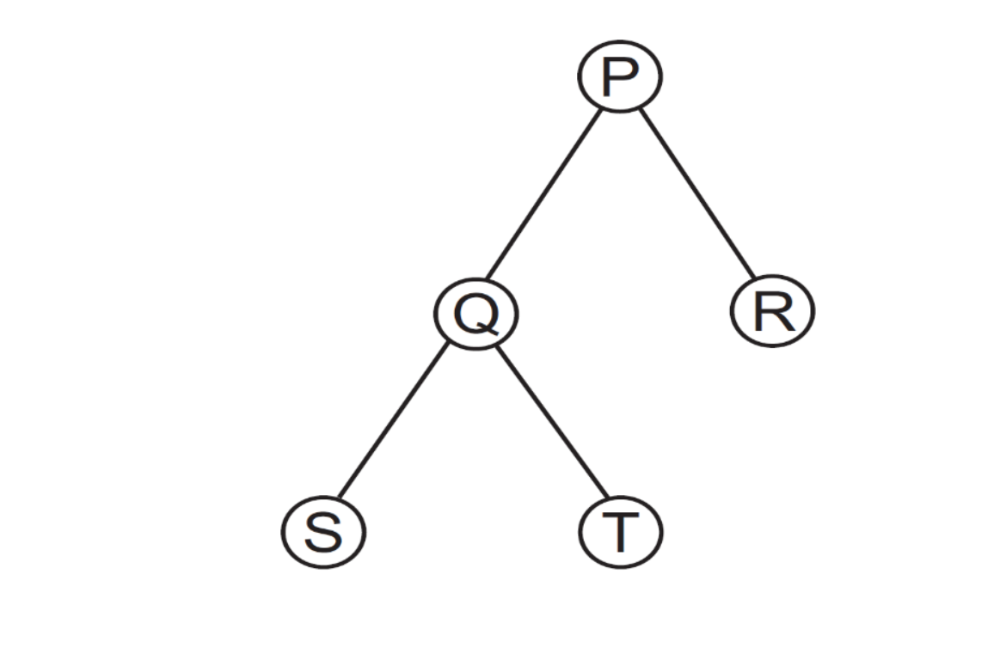

- a) P Q S T R e P Q S T R
- b) S T Q P R e S T Q R P
- c) S T Q R P e S Q T P R
- d) R P Q T S e S T Q R P
- e) P T Q R S e P Q S T R

<details><summary>Gabarito</summary>

**C.** Assunto 0098.

</details>

**Edital 053/2016 · Questão 13**

Em uma árvore AVL, todos os nós têm grau

- a) 0, 1 ou 2.
- b) divisível por 2.
- c) 2
- d) 1 e 2
- e) maior ou igual a 2.

<details><summary>Gabarito</summary>

**A.** Nó de AVL é binário: grau 0, 1 ou 2. Assunto 0101.

</details>

**Edital 053/2016 · Questão 14**

A estrutura de dados conhecida como Árvore Binária de Busca (ABB) encontra diversas aplicações em soluções práticas. Sobre esta estrutura é CORRETO afirmar:

- a) Uma ABB é um conjunto finito de nós que possui um nó especial, chamado raiz, do qual partem os nós de duas árvores binárias distintas: a da esquerda e a da direita.
- b) Quando os elementos a serem inseridos na ABB estão em ordem crescente, resulta em uma ABB com altura mínima.
- c) Para se utilizar uma ABB como método de ordenação, basta fazer o caminhamento ou percurso "em-ordem" e obter todos os elementos ordenados.
- d) Uma característica que confere à ABB grande agilidade na pesquisa e recuperação de elementos é que seus nós são sempre rearranjados de forma que a árvore resultante é sempre perfeitamente balanceada.
- e) ABB são um caso especial de listas encadeadas em que nenhum nó aponta para mais de 2 sucessores.

<details><summary>Gabarito</summary>

**A.** Assunto 0099.

</details>

**Edital 053/2016 · Questão 16**

Uma árvore AVL é uma árvore binária de busca com balanceamento automático que respeita algumas propriedades fundamentais. Como todas as árvores, ela tem uma propriedade chamada altura. Sabendo que a altura de uma folha é igual a um e que a altura de um nó pai é igual ao máximo das alturas de seus filhos mais um, qual estrutura NÃO pode representar uma árvore AVL?

- a) Uma árvore com três nós e altura igual a três
- b) Uma árvore com seis nós e altura igual a três
- c) Uma árvore com três nós e altura igual a dois
- d) Uma árvore vazia
- e) Uma árvore com dois nós

<details><summary>Gabarito</summary>

**A.** Três nós em altura 3 é cadeia, fator de balanceamento 2: não é AVL. Assunto 0101.

</details>

**Edital 053/2016 · Questão 18**

Considere as definições a seguir.

I) O nível do nó raiz de uma árvore é 1.\
II) O nível de qualquer nó subsequente é igual ao nível do seu nó pai mais 1.\
III) A profundidade de uma árvore é igual ao maior nível encontrado dentre todos os seus nós\

Partindo-se das premissas acima, a menor e a maior quantidade de nós, respectivamente, que poderiam existir em uma árvore binária de profundidade 4 são:

- a) 4 e 15
- b) 3 e 15
- c) 3 e 16
- d) 4 e 16
- e) 5 e 14

<details><summary>Gabarito</summary>

**A.** Mínimo é 1 nó por nível (4), máximo é 2^4-1 = 15. Assunto 0097.

</details>

**Edital 053/2016 · Questão 19**

Uma árvore binária completa tem no 5º nível uma quantidade de nós igual a

- a) 16
- b) 15
- c) 31
- d) 64
- e) 32

<details><summary>Gabarito</summary>

**A.** Nível 5 tem 2^(5-1) = 16 nós. Assunto 0097.

</details>

**Edital 053/2016 · Questão 20**

Considere uma árvore binária de busca cujos nós armazenam números inteiros variando de 1 a 100, na qual se quer buscar o número 54. Qual das seguintes sequências representa uma sequência de busca válida dentro desta árvore?

- a) 5, 18, 34, 60, 40, 52, 54
- b) 25, 27, 28, 26, 60, 50, 58, 54
- c) 37, 70, 32, <não encontrou>
- d) 40, 70, 43, 44, 73, 57, 54
- e) Nenhuma das alternativas anteriores

<details><summary>Gabarito</summary>

**A.** Só a sequência A respeita os limites da ABB em todos os passos (B, C e D violam). Assunto 0099.

</details>

**Edital 024/2017 · Questão 01**

Avaliando as seguintes sentenças a respeito de estrutura de dados:

I. A diferença entre árvore binária de busca e árvores AVL é o fato de que a segunda pode se reconfigurar dinamicamente, com o intuito de manter um bom nível de balanceamento.\
II. Uma pilha garante que o último elemento inserido seja localizado no seu topo. Porém, do ponto de vista conceitual, qualquer elemento da pilha pode ser removido, ainda que não esteja no seu topo.\
III. Do ponto de vista conceitual, não há diferença alguma entre uma estrutura de array e uma lista encadeada.\
IV. Tabelas hash são estruturas de dados indicadas para armazenar grande volume de dados. Apesar dessas estruturas permitirem acesso indexado, mais de um elemento pode ter o mesmo índice. Elementos com o mesmo índice podem ser armazenados em uma mesma lista encadeada.\

É CORRETO afirmar que:

- a) apenas I e IV são verdadeiras.
- b) apenas I é verdadeira.
- c) apenas III e IV são verdadeiras.
- d) apenas II e III são verdadeiras.
- e) apenas I, II e IV são verdadeiras.

<details><summary>Gabarito</summary>

**A.** I e IV verdadeiras; II falsa (pilha só remove do topo), III falsa (array é contíguo, lista não) Assunto 0101.

</details>

**Edital 024/2017 · Questão 02**

Marque a alternativa CORRETA.
Qual dos algoritmos abaixo apresenta o menor custo (em termos de número comparações entre elementos) ao considerar-se, para cada algoritmo, a pior disposição possível para os elementos do vetor a ser ordenado. Considere que o vetor a ser ordenado é muito grande, acima de 1 milhão de elementos.

- a) Heapsort
- b) Quicksort
- c) Inserção
- d) Seleção
- e) Nenhuma das anteriores porque todos apresentam custo igual

<details><summary>Gabarito</summary>

**A.** pior caso: heapsort O(n log n); quicksort, inserção e seleção O(n²) Assunto 0103.

</details>

**Edital 024/2017 · Questão 08**

Considere as seguintes árvores onde são apresentados apenas os valores das chaves em cada nó, sem mostrar o valor de outros campos eventualmente existentes. Considerando em todos os casos que as árvores não estão em processo de rotação por inserção de chaves, estando portanto em seu estado final após a inserção do conjunto de chaves mostrado.

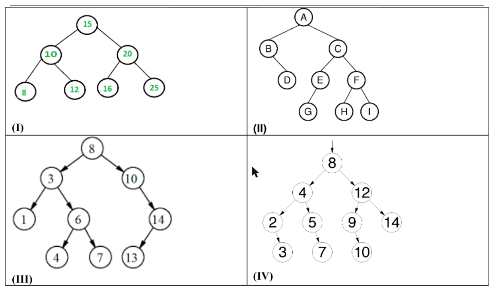

É CORRETO afirmar que:

- a) Apenas a árvore do quadro I poderia ser uma árvore AVL
- b) Todas as opções apresentadas nos quadros de I a IV podem ser exemplos de árvores AVL
- c) Nenhuma das 4 opções apresentadas podem ser exemplos de árvores AVL
- d) Apenas as opções I e III podem ser exemplos de árvores AVL
- e) Nenhuma das alternativas anteriores (de A até D) está correta

<details><summary>Gabarito</summary>

**E.** Assunto 0101.

</details>

**Edital 024/2017 · Questão 10**

Considere as seguintes árvores onde são apresentados apenas os valores das chaves em cada nó, sem mostrar o valor de outros campos eventualmente existentes. Considerando em todos os casos que as árvores não estão em processo de rotação por inserção de chaves, estando portanto em seu estado final após a inserção do conjunto de chaves mostrado.

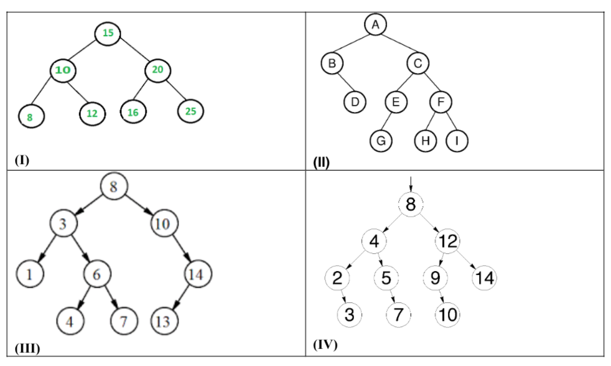

É CORRETO afirmar que:

- a) Apenas a árvore do quadro I poderia ser uma árvore binária de pesquisa sem balanceamento
- b) Todas as 4 opções podem ser exemplos de árvores binárias de pesquisa sem balanceamento
- c) Nenhuma das 4 opções pode ser uma árvore binária de pesquisa sem balanceamento
- d) Apenas as opções II e III podem de árvores binárias de pesquisa sem balanceamento
- e) Nenhuma das alternativas anteriores (de A até D) está correta

<details><summary>Gabarito</summary>

**E.** Assunto 0099.

</details>

**Edital 024/2017 · Questão 11**

Sabendo que um arvore binária com 5 nós tem como resultados dos seus percursos pós-ordem e in-ordem, respectivamente S T Q R P e S Q T P R.
É CORRETO afirmar:

- a) O nó raiz tem o valor P
- b) Q é um nó folha
- c) S é um nó interno
- d) T é filho de S
- e) Todas as alternativas estão corretas

<details><summary>Gabarito</summary>

**A.** pós-ordem dá raiz P; Q tem filhos S e T; S e T são folhas Assunto 0098.

</details>

**Edital 024/2017 · Questão 16**

Considere que o vetor a seguir é uma heap mínima (assuma índice do array iniciando em zero)

`4 5 7 10 13 11 15 22`

Marque a alternativa que contem a afirmativa CORRETA:

- a) Essa heap possui todos os nós folhas na mesma altura
- b) Ao alterar o valor 22 por 6, 2 trocas são necessárias para corrigir a heap
- c) O valor no índice 7 precisa ser necessariamente menor que o do índice 4
- d) O valor no índice 6 precisa ser obrigatoriamente maior que o do índice 1
- e) Ao alterar o valor 13 por 8, nada precisa ser feito para corrigir a heap

<details><summary>Gabarito</summary>

**E.** índice 4 (13) é folha com pai 5; trocar por 8 mantém a heap; em b só há 1 troca (6 sobe de 10, para abaixo de 5) Assunto 0102.

</details>

**Edital 055/2017 · Questão 04**

Observe a árvore binária de pesquisa sem balanceamento:

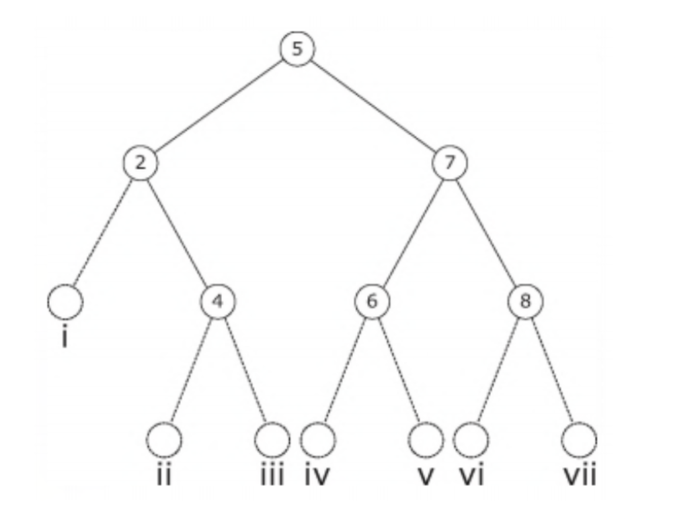

Considere as afirmativas a seguir.

I. Os nós 6 e 8 são irmãos.\
II. O nó 4 é uma das raízes da árvore.\
III. O nó com valor 3, ao ser inserido, ocuparia a posição iv.\
IV. O nó com valor 1, ao ser inserido, ocuparia a posição i.\

Marque a alternativa CORRETA:

- A) Apenas a afirmativa III está correta.
- B) Apenas as afirmativas I e IV estão corretas.
- C) Apenas as afirmativas II e III estão corretas.
- D) Apenas as afirmativas I, II e IV estão corretas.
- E) Todas as afirmativas estão corretas.

<details><summary>Gabarito</summary>

**B.** Assunto 0099.

</details>

**Edital 055/2017 · Questão 07**

Marque a alternativa CORRETA.
Suponha que T seja uma árvore binária de pesquisa sem balanceamento inicialmente vazia, e considere a inserção dos elementos 30, 50, 60, 20, 40, 10 e 25 em T, exatamente nessa ordem. Qual das sequências abaixo corresponde a um percurso de T em pré-ordem?

- A) 30 50 60 40 20 25 10
- B) 10 25 20 40 60 50 30
- C) 10 20 25 30 40 50 60
- D) 30 20 10 25 50 40 60
- E) 60 50 40 30 25 20 10

<details><summary>Gabarito</summary>

**D.** raiz 30, esquerda 20 (10, 25), direita 50 (40, 60); pré-ordem 30 20 10 25 50 40 60 Assunto 0098.

</details>

**Edital 055/2017 · Questão 16**

Considere as seguintes árvores onde são apresentados apenas os valores das chaves em cada nó, sem mostrar o valor de outros campos eventualmente existentes. Além disso, note que em todos os casos, as árvores não estão em processo de rotação por inserção de chaves, estando portanto em seu estado final após a inserção do conjunto de chaves mostrado.

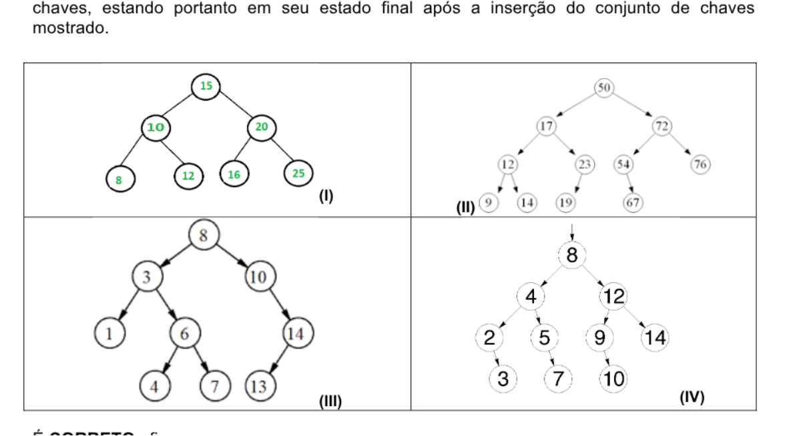

É CORRETO afirmar que:

- A) Apenas a árvore do quadro I poderia ser uma árvore AVL.
- B) Apenas a árvore III não poderia ser uma árvore AVL.
- C) Nenhuma das 4 opções apresentadas poderiam ser exemplos de árvores AVL.
- D) Apenas as opções I e II podem ser exemplos de árvores AVL.
- E) Nenhuma das alternativas anteriores (de A, B, C ou D) está correta.

<details><summary>Gabarito</summary>

**B.** Assunto 0101.

</details>

**Edital 055/2017 · Questão 20**

Ao inserirmos as chaves 2, 4, 6, 8, 10 e 12, nessa ordem, em uma árvore AVL que estava originalmente vazia, a diferença de altura entre a sub-árvores que está à direita da raiz e a sub-árvore que está à esquerda da raiz será:

- A) 0.
- B) 2.
- C) 4.
- D) 6.
- E) 8.

<details><summary>Gabarito</summary>

**A.** rodando AVL (programa em C): raiz 8, esquerda 4 (2, 6), direita 10 (12); diferença 0 Assunto 0101.

</details>

**Edital 023/2018 · Questão 03**

Analise as duas afirmativas a seguir, relacionadas a árvores de busca:

I. Uma árvore AVL é uma árvore binária de busca autobalanceada que respeita algumas propriedades fundamentais.\
II. Como todas as árvores, ela tem uma propriedade chamada altura, que é igual ao valor da altura de sua raiz.\

Sabendo que a altura de uma folha é igual a um (01) e que a altura de um nó pai é igual ao máximo das alturas de seus filhos mais um, qual estrutura NÃO pode representar uma árvore AVL?

- a) Uma árvore vazia
- b) Uma árvore com dois nós
- c) Uma árvore com três nós e altura igual a dois
- d) Uma árvore com três nós e altura igual a três
- e) Uma árvore com seis nós e altura igual a três

<details><summary>Gabarito</summary>

**D.** Com folha de altura 1, três nós em altura três é uma cadeia, com fator de balanceamento 2 na raiz. Assunto 0101.

</details>

**Edital 023/2018 · Questão 04**

Um heap (fila de prioridade) é uma estrutura de dados muito importante, que tem duas utilidades principais: organizar acesso a um recurso com base na prioridade dos requerentes (processos, impressões, etc.) ou servir como base a um algoritmo de ordenação muito eficiente denominado heapsort. Para poder servir a esses propósitos, um heap possui uma série de propriedades especiais que têm que ser mantidas por todas as operações nelas realizadas. Levando em consideração estas propriedades, analise as afirmativas abaixo.

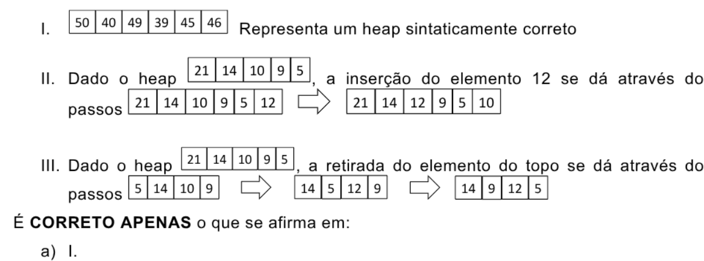

I. `50 40 49 39 45 46` representa um heap sintaticamente correto\
II. Dado o heap `21 14 10 9 5`, a inserção do elemento 12 se dá através dos passos `21 14 10 9 5 12` ⇒ `21 14 12 9 5 10`\
III. Dado o heap `21 14 10 9 5`, a retirada do elemento do topo se dá através dos passos `5 14 10 9` ⇒ `14 5 12 9` ⇒ `14 9 12 5`\

É CORRETO APENAS o que se afirma em:

- a) I.
- b) II.
- c) III.
- d) I e II.
- e) II e III.

<details><summary>Gabarito</summary>

**B.** Assunto 0102.

</details>

**Edital 023/2018 · Questão 06**

Uma lista ordenada de N números é inserida em uma pilha e depois retirada, sendo que, a cada POP, o elemento retirado é inserido em uma árvore de busca binária. Após a completa inserção de todos os elementos nesta árvore, são feitas buscas de números na mesma. O tempo médio de busca de um número nesta árvore é

- a) O(1)
- b) O(log N)
- c) O(N)
- d) O(Nlog N)
- e) O(N2)

<details><summary>Gabarito</summary>

**C.** Lista ordenada pela pilha sai ordenada ao contrário e a ABB degenera em lista: busca O(N). Assunto 0099.

</details>

**Edital 023/2018 · Questão 07**

Assinale cada afirmativa abaixo como verdadeira (V) ou falsa (F). Em seguida, marque a opção que corresponde à sequência CORRETA.

( ) Uma árvore não-vazia é balanceada AVL se, pelo menos, uma de suas árvores, esquerda ou direita, for balanceada AVL;
( ) As árvores cheias são árvores balanceadas AVL;
( ) Uma boa condição de balanceamento AVL deve assegurar que a altura de uma árvore com n nós é da ordem de O(log n);
( ) Uma árvore AVL é uma árvore balanceada pela altura;
( ) Ao inserir ou remover um item em uma árvore AVL, o custo adicional para balancear esta árvore é da ordem de O(n/2).

- a) V - V - F - V - V
- b) F - V - V - V - F
- c) V - F - F - V - F
- d) F - V - V - F - V
- e) F - F - V - V - F

<details><summary>Gabarito</summary>

**B.** F-V-V-V-F: AVL exige as duas subárvores AVL, cheias são AVL e o custo de balancear é O(log n), não O(n/2). Assunto 0101.

</details>

**Edital 023/2018 · Questão 08**

Considere uma estrutura do tipo árvore binária que começa vazia. Nela são introduzidos os números 2, 10, 5, 7, 1, 0 e 8, exatamente nessa ordem. Se essa árvore for lida em pós-ordem, que sequência de números será impressa?

- a) 2, 1, 0, 8, 7, 5, 10
- b) 2, 1, 0, 10, 5, 7, 8
- c) 0, 1, 8, 7, 5, 10, 2
- d) 0, 1, 2, 8, 7, 5, 10
- e) 0, 1, 2, 10, 5, 7, 8

<details><summary>Gabarito</summary>

**C.** Rodado em C: pós-ordem `0 1 8 7 5 10 2`. Assunto 0098.

</details>

**Edital 023/2018 · Questão 10**

Considere a seguinte árvore de pesquisa binária:

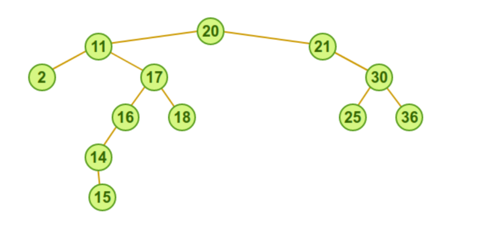

Ao executarmos o procedimento de remoção da raiz, na nova árvore binária de busca, teremos como novo nó raiz:

- a) 11
- b) 2
- c) 17
- d) 18
- e) Nenhuma das anteriores

<details><summary>Gabarito</summary>

**D.** Assunto 0100.

</details>

**Edital 023/2018 · Questão 15**

As árvores são estruturas de dados poderosas e se subdividem em vários tipos, cada um dos quais com suas características próprias. Relacione os tipos de árvores, apresentados na coluna da esquerda, com as suas respectivas características, indicadas na coluna da direita:

| Tipo de árvore | Característica |
|---|---|
| I – Heap | W – Pode degenerar se os elementos forem inseridos de forma ordenada. |
| II – Rubro-Negra | X – É balanceada. |
| III – Avore AVL | Y – Têm altura sempre proporcional/próxima a O(log2 n), onde n é o número de nós que contém. |
| IV – Árvores binária de busca | Z – São sempre completas. |

Estão CORRETAS as associações:

- a) I–X, IV–Z, II–Y
- b) I–Z, IV–X, III–W
- c) I–Z, IV–X, III–Y
- d) I–Y, IV–W, III–X
- e) I–X, IV–W, II–Y

<details><summary>Gabarito</summary>

**D.** Heap com altura log n, ABB que degenera, AVL balanceada. Ver observação. Assunto 0101.

</details>

**Edital 023/2018 · Questão 16**

Sobre o algoritmo de ordenação heapsort, marque a alternativa CORRETA:

- a) Utiliza ordenação por árvore de decisão, ao invés de ordenação por comparação
- b) A estrutura de dados que utiliza, chamada heap, pode ser interpretada como uma árvore binária
- c) Seu desempenho de pior caso é pior do que o do algoritmo quicksort
- d) Todas as alternativas estão corretas
- e) Nenhuma das alternativas está correta

<details><summary>Gabarito</summary>

**B.** O heap é uma árvore binária em vetor; o pior caso do heapsort é O(n log n), melhor que o do quicksort. Assunto 0103.

</details>

**Edital 061/2018 · Questão 05**

A árvore binária de busca, formada pela inserção dos números 100, 80, 25, 72, 23, 42 e 5, nesta ordem, terá como nós folha os números __I__ e __II__, e como pai do nó 72 o número __III__. As lacunas I, II e III são preenchidas CORRETAMENTE e, respectivamente, por:

- a) 100 – 80 – 100
- b) 5 – 42 – 25
- c) 23 – 25 – 72
- d) 25 – 72 – 100
- e) 72 – 5 – 23

<details><summary>Gabarito</summary>

**B.** Folhas 5 e 42, pai do 72 é o 25. Assunto 0099.

</details>

**Edital 061/2018 · Questão 13**

Suponha que uma Árvore Binária de Busca possui números entre 1 e 1000 e que se quer procurar pelo número 363. Qual sequência abaixo NÃO poderia ser a sequência de nós examinados?

- a) 2, 252, 401, 398, 330, 344, 397, 363.
- b) 924, 220, 911, 244, 898, 258, 362, 363.
- c) 925, 202, 911, 240, 912, 245, 363.
- d) 2, 399, 387, 219, 266, 382, 381, 278, 363.
- e) 935, 278, 347, 621, 350, 392, 358, 363.

<details><summary>Gabarito</summary>

**C.** Só a C é impossível: após 911 vem 240 (à direita de 202, esquerda de 911), e o 912 sairia do intervalo (240, 911). A nova E é válida (350, 392, 358 cabem). Assunto 0099.

</details>

**Edital 061/2018 · Questão 15**

Se em uma árvore binária de pesquisa a diferença de altura entre a subárvore à esquerda e a subarvore à direita de um dos nós for maior que 1, pode-se concluir que:

- a) A árvore é uma árvore AVL.
- b) Trata-se com certeza de uma árvore binária sem balanceamento.
- c) Trata-se com certeza de uma árvore vermelho e preto.
- d) Tal árvore não pode existir por não se tratar de uma árvore binária de pesquisa.
- e) Nenhuma das alternativas anteriores está correta.

<details><summary>Gabarito</summary>

**E.** A ABB com diferença maior que 1 não é AVL, mas pode ser rubro-negra: nada se conclui com certeza. Assunto 0101.

</details>

**Edital 061/2018 · Questão 19**

Quanto ao algoritmo e estrutura de dados no caso de árvore AVL, analise as afirmativas abaixo como verdadeiras (V) ou falsas (F) e assinale a alternativa que apresenta a sequência CORRETA de cima para baixo:

( ) Uma árvore AVL é dita balanceada quando, para cada nó da árvore, a diferença entre as alturas das suas sub-árvores (direita e esquerda) não é maior do que um.
( ) Caso haja diferença de altura maior que 1 ente as sub-árvores à direita e à esquerda de qualquer nó, é necessário que se realizem rotações com o objetivo de reduzir tal diferença.
( ) A operação de rotação realizada em um ponto da árvore, após a inserção, pode resultar em uma árvore ainda desbalanceada, podendo ser necessária a realização de novas rotações que, na pior das hipóteses, podem ser propagadas até a raiz.

- a) F-V-V
- b) F-F-V
- c) V-F-F
- d) V-V-F
- e) V-V-V

<details><summary>Gabarito</summary>

**D.** V-V-F: após inserção uma rotação (simples ou dupla) basta; a propagação até a raiz é da remoção. Assunto 0101.

</details>

**Edital 033/2019 · Questão 02**

A parte essencial do Heap Sort é a construção do heap máximo. Considerando a árvore mostrada abaixo, o nó 24 viola a propriedade do heap máximo. Uma vez que o procedimento de heap é aplicado a ele, em que posição ele estará?

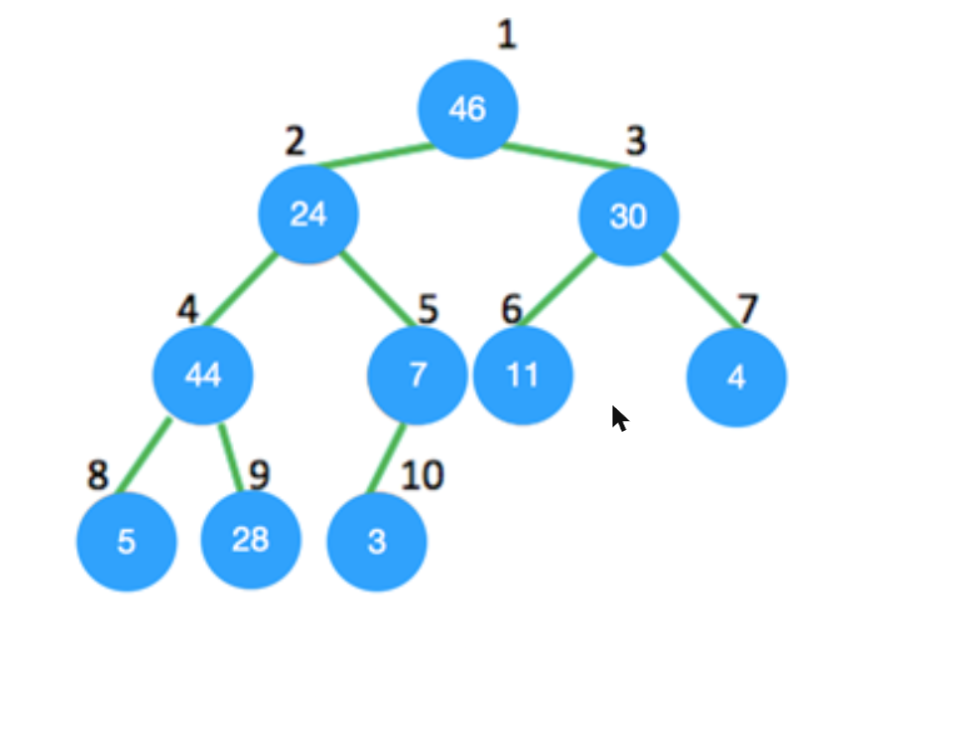

- a) 4
- b) 5
- c) 8
- d) 9
- e) 6

<details><summary>Gabarito</summary>

**D.** Assunto 0102.

</details>

**Edital 033/2019 · Questão 04**

A figura abaixo mostra uma árvore B de ordem 5. Qual é o resultado da remoção do nó 130 dessa árvore?

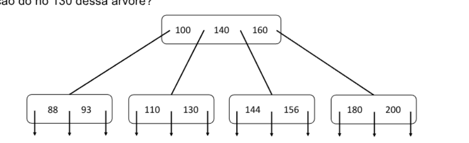

Alternativas a) e b):

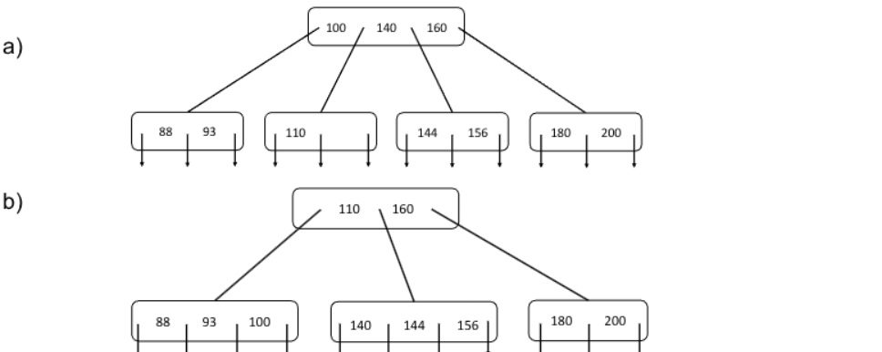

Alternativas c) e d):

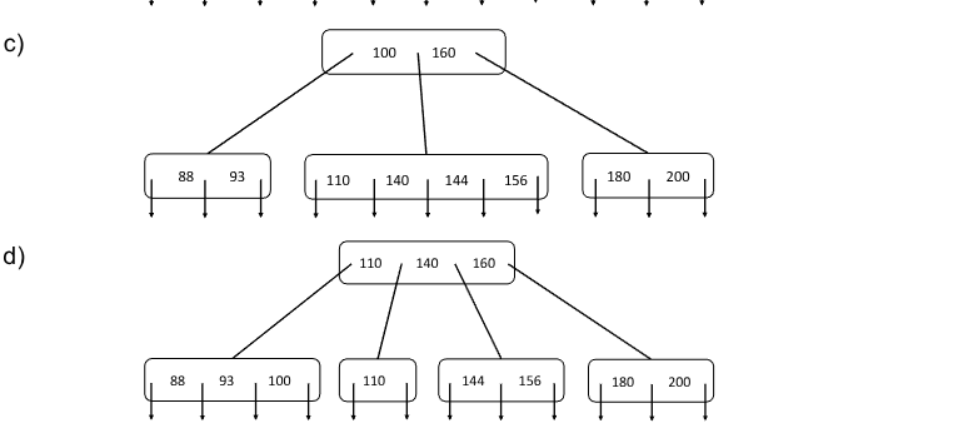

- e) Nenhuma das anteriores

<details><summary>Gabarito</summary>

**C.** Folha `110` fica com 1 chave; irmãos têm o mínimo (2) e não emprestam, então funde com a direita: `110 140 144 156`, raiz `100 160`. Assunto 0097.

</details>

**Edital 033/2019 · Questão 08**

Quais são, respectivamente, o pior caso e o caso médio de uma árvore de busca binária em termos de complexidade?

- a) O(n), O(n)
- b) O(logn), O(logn)
- c) O(logn), O(n)
- d) O(n), O(logn)
- e) Nenhuma das respostas anteriores.

<details><summary>Gabarito</summary>

**D.** ABB sem balanceamento: pior caso O(n), caso médio O(log n). Assunto 0099.

</details>

**Edital 033/2019 · Questão 09**

Uma árvore B de ordem 4 e de altura 3, onde ordem é o número máximo de filhos em cada nó, terá um máximo de chaves igual a?

- a) 255
- b) 63
- c) 127
- d) 188
- e) 256

<details><summary>Gabarito</summary>

**A.** Ordem 4 (4 filhos, 3 chaves), altura 3 em arestas (Cormen): 1+4+16+64 = 85 nós, 85 x 3 = 255 chaves. Assunto 0097.

</details>

**Edital 033/2019 · Questão 12**

Qual é a altura máxima de qualquer árvore AVL com 7 nós? Assuma que a altura de uma árvore com um único nó seja 0.

- a) 2
- b) 3
- c) 4
- d) 5
- e) 6

<details><summary>Gabarito</summary>

**B.** Mínimo de nós por altura em AVL: 1, 2, 4, 7; 7 nós cabem em altura 3 (nó único = 0). Assunto 0101.

</details>

**Edital 033/2019 · Questão 16**

Ao se representar a heap máxima da figura abaixo em um array, a ordem dos elementos no array será a seguinte:

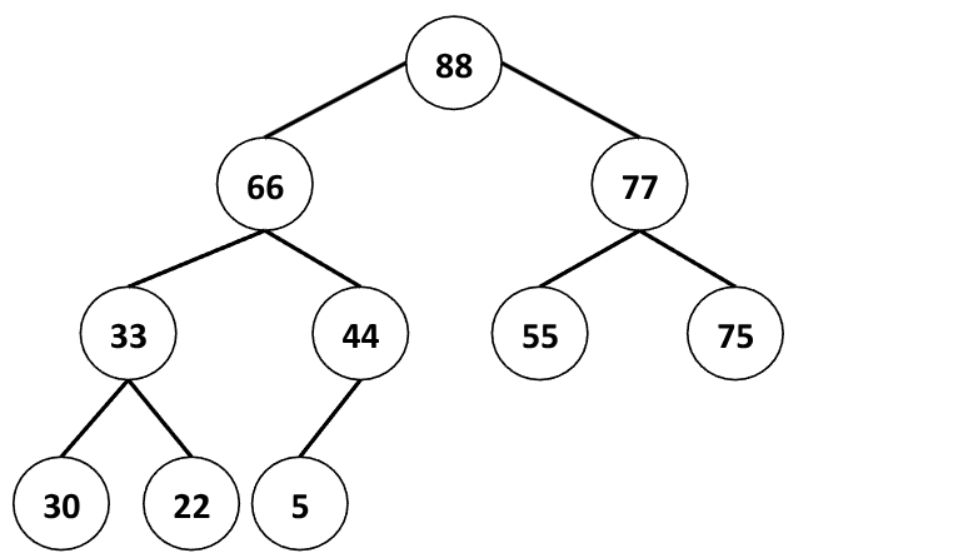

- a) 88 66 33 44 30 22 5 77 55 75
- b) 86 77 55 75 66 33 44 30 22 5
- c) 86 77 75 66 55 44 33 30 22 5
- d) 5 22 30 75 55 44 33 77 66 86
- e) 88 66 77 33 44 55 75 30 22 5

<details><summary>Gabarito</summary>

**E.** Array por níveis: 88 66 77 33 44 55 75 30 22 5. Assunto 0102.

</details>

**Edital 033/2019 · Questão 19**

Ao se construir uma árvore AVL, inicialmente vazia, com as seguintes chaves na ordem indicada - 2, 3, 5, 6, 9, 8, 7, 4, 1 – e sabendo que que se uma inserção fizer com que a árvore fique desequilibrada, é necessário executar as rotações para manter o equilíbrio, o resultado final da árvore AVL é:

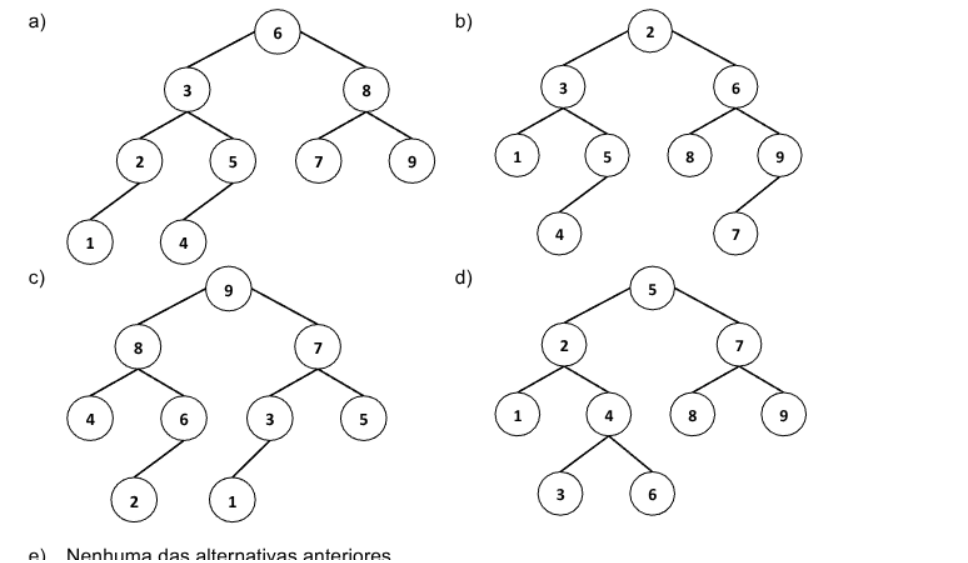

- e) Nenhuma das alternativas anteriores

<details><summary>Gabarito</summary>

**A.** Rodado em C: raiz 6; 3 e 8; 2, 5, 7, 9; 1, 4. Assunto 0101.

</details>

**Edital 033/2019 · Questão 20**

Sobre as afirmações abaixo, marque a alternativa CORRETA

I. A subárvore da raiz de um árvore vermelho e preto é sempre uma árvore vermelha e preta.\
II. O irmão de uma referência de filho nulo em uma árvore vermelha e preta é outra referência de filho nulo ou um nó vermelho.\
III. A pior complexidade de tempo da operação de inserção em uma árvore AVL é O(log n), onde n é o número de nós na árvore.\

- a) Somente a sentença I está correta
- b) As sentenças II e III estão correta
- c) Somente a sentença III está correta
- d) As sentenças I e III estão correta
- e) Somente a sentença II está correta

<details><summary>Gabarito</summary>

**B.** I falsa (a raiz de uma subárvore pode ser vermelha); II e III verdadeiras. Assunto 0101.

</details>

**Edital 060/2019 · Questão 02**

Dado os seguintes elementos (10, 20, 15, 25, 30, 16, 18, 19), qual desenho representa uma árvore AVL, inicialmente vazia, que é preenchida com esses elementos, na ordem apresentada, e que tem as devidas rotações efetuadas?

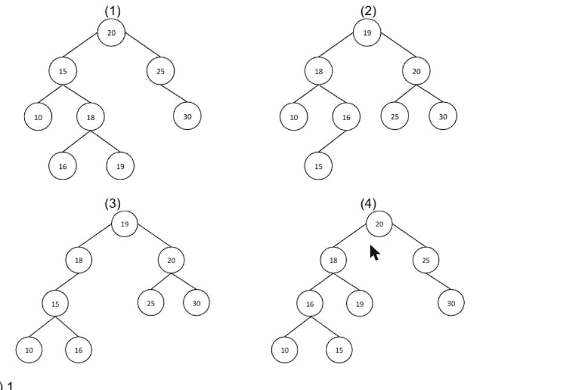

- a) 1
- b) 2
- c) 3
- d) 4
- e) Nenhuma das árvores desenhadas representa uma AVL

<details><summary>Gabarito</summary>

**A.** Assunto 0101.

</details>

**Edital 060/2019 · Questão 09**

Qual das afirmações a seguir é VERDADEIRA sobre árvores rubro-negra (vermelho e preto)?

- a) O caminho do nó raiz até o nó folha mais distante não é maior que o dobro do número de nós do caminho da raiz para a folha mais próxima
- b) O caminho do nó raiz para um nó folha ou para um nó nulo deve conter o mesmo número de nós pretos e vermelhos.
- c) A raiz pode ser vermelha
- d) Se um nó for vermelho, os nós filhos somente serão pretos. O inverso também acontece, ou seja, se um nó for preto, seus nós filhos somente serão vermelhos.
- e) Nenhumas das afirmações é verdadeira

<details><summary>Gabarito</summary>

**A.** Propriedade da rubro-negra: caminho mais longo no máximo o dobro do mais curto. Assunto 0101.

</details>

**Edital 060/2019 · Questão 12**

Quais das seguintes árvores abaixo respeita as regras básicas de balanceamento de árvores AVL?

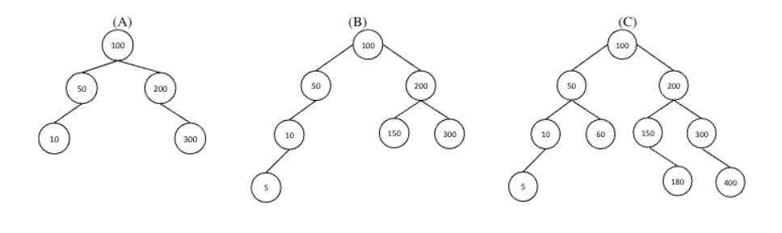

- a) Somente B
- b) A, B e C
- c) B e C
- d) A e C
- e) Nenhuma das árvores é AVL

<details><summary>Gabarito</summary>

**D.** A e C respeitam o fator de balanceamento; em B, o 50 fica com subárvore esquerda de altura 2 e direita vazia. Assunto 0101.

</details>

**Edital 060/2019 · Questão 15**

Comparando árvores AVL e rubro-negras, qual das seguintes afirmações é VERDADEIRA:

- a) As árvores AVL tendem a ter altura menor em comparação com as árvores rubro-negras, mas podem causar mais rotações durante operações de inserção e exclusão.
- b) As alturas das árvores AVL e rubro-negras são as mesmas, mas as árvores AVL podem causar mais rotações durante a inserção e exclusão.
- c) As árvores rubro-negras tendem a ter altura menor em comparação com as árvores AVL, mas podem causar mais rotações durante a inserção e exclusão.
- d) As alturas das árvores AVL e rubro-negras são as mesmas, mas as árvores rubro-negras podem causar mais rotações durante a inserção e exclusão.
- e) Todas as afirmações anteriores são falsas

<details><summary>Gabarito</summary>

**A.** AVL é mais rígida (altura menor) e rotaciona mais. Assunto 0101.

</details>

## Para ler mais

- CORMEN, T. H.; LEISERSON, C. E.; RIVEST, R. L.; STEIN, C. *Algoritmos: teoria e prática*. 4. ed. Rio de Janeiro: GEN LTC, 2024. Caps. 6 (heapsort e filas de prioridade), 12 (árvores de busca binária), 13 (árvores rubro-negras) e 18 (árvores B); problema 13-3 (árvores AVL).
- ZIVIANI, N. *Projeto de algoritmos: com implementações em Pascal e C*. 3. ed. São Paulo: Cengage Learning, 2010. Caps. 5 (pesquisa em memória primária: árvores de pesquisa) e 6 (árvores B).
- FEOFILOFF, P. *Algoritmos em linguagem C*. Rio de Janeiro: Elsevier, 2009. Capítulos sobre heapsort, árvores binárias e árvores binárias de busca.
- CELES, W.; RANGEL, J. L. *Apostila de estruturas de dados*. Rio de Janeiro: PUC-Rio, 2002. Capítulos sobre árvores e árvores binárias de busca.
- CELES, W.; CERQUEIRA, R.; RANGEL, J. L. *Introdução a estruturas de dados: com técnicas de programação em C*. 2. ed. Rio de Janeiro: Elsevier, 2016.
- TENENBAUM, A. M.; LANGSAM, Y.; AUGENSTEIN, M. J. *Estruturas de dados usando C*. São Paulo: Makron Books, 1995. Caps. 5 (árvores), 6 (classificação: heapsort) e 7 (busca: árvores balanceadas).
- DEITEL, P.; DEITEL, H. *C: como programar*. 6. ed. São Paulo: Pearson, 2011. Cap. 12: estruturas de dados (árvores binárias de busca).
- LAUREANO, M. *Estrutura de dados com algoritmos e C*. Rio de Janeiro: Brasport, 2008. Capítulo sobre árvores.
- ROCHA, A. M. A.; BORGES, A. R. O. S. *Programação, estruturas de dados e algoritmos em C*. Aveiro: Universidade de Aveiro. Apostila.
- ADELSON-VELSKY, G. M.; LANDIS, E. M. An algorithm for the organization of information. *Soviet Mathematics Doklady*, v. 3, p. 1259-1263, 1962.
- KERNIGHAN, B. W.; RITCHIE, D. M. *C: a linguagem de programação padrão ANSI*. Rio de Janeiro: Campus, 1989. Seção 6.5: estruturas autorreferenciadas (a árvore de palavras).
- CPPREFERENCE. *qsort, qsort_s*. Disponível em: <https://en.cppreference.com/w/c/algorithm/qsort>.
