<!-- Gerado por _gerador. Para mudar este arquivo, edite _gerador/modulos/14-arvores/ e rode: cd _gerador && npm run gerar -->

# Módulo 14 · Árvores

Até aqui, toda estrutura de dados do curso era uma fila de elementos: vetor,
lista, pilha, fila. Cada um tinha um antes e um depois. Só que muita coisa no
mundo não é fila, é **hierarquia**: as pastas do computador, a árvore
genealógica, o organograma da empresa, o sumário de um livro, a fórmula de uma
planilha. Para isso existe a **árvore**.

A árvore também resolve um problema que ficou aberto no módulo de busca: a
busca binária é rápida, mas exige um vetor ordenado, e inserir no meio de um
vetor custa caro. A **árvore binária de busca** busca e insere descendo um único
caminho. Quando ela fica torta, a **AVL** a endireita com rotações. E quando
você só precisa do maior elemento, o **heap** faz isso morando num vetor
comum, sem ponteiro nenhum, e de quebra ainda ordena (o **heapsort**).

Quase tudo aqui é recursivo. Uma árvore é um nó com árvores menores
penduradas, então a função que resolve a árvore resolve cada subárvore e junta
as respostas. Se a recursão do módulo 04 ficou meio nebulosa, este é o momento
de ela fazer sentido.

## O que você vai aprender

- o vocabulário das árvores: **raiz**, **filho**, **folha**, **altura** e **profundidade**
- a **árvore binária** em C e os quatro **percursos**: pré-ordem, em ordem, pós-ordem e por nível
- a **árvore binária de busca** (BST): busca, inserção e os três casos da **remoção**
- por que a BST pode virar uma lista, e como a **AVL** se equilibra com **rotações**
- o **heap** num vetor e a **fila de prioridade**
- o **heapsort**: ordenar em O(n log n) sem memória extra
- montar um programa que junta BST e heap, cada um no que faz melhor

## Como estudar cada assunto

1. Leia o texto e olhe o **diagrama da ideia**: é o exemplo desenhado, com as
   mesmas chaves do código.
2. Leia o código. A partir do 0098, cada assunto tem um **TAD** na pasta
   (`arvore.h`, `bst.h`, `avl.h`, `heap.h`, `cadastro.h`) e o exemplo só usa a
   interface. Abra o `.c` do TAD também: é lá que mora o algoritmo.
3. Siga o **fluxograma** com o dedo: é o caminho que o exemplo faz.
4. Rode os exemplos. Mude a ordem das inserções, remova outra chave, rode de novo.
5. Faça os exercícios. ★☆☆ é aquecimento, ★★☆ pede raciocínio, ★★★ é desafio.
   As dicas vêm logo abaixo do enunciado: tente antes de ler.

Em árvore, **papel e lápis** são obrigatórios. Desenhe a árvore antes de rodar,
a cada inserção e a cada remoção, e só depois rode o programa para conferir o
desenho com a saída.

## As cores e as formas

Caixa azul é dado entrando ou saindo, roxa é o programa fazendo alguma coisa,
amarela é pergunta. Verde é o caminho que o exemplo segue; cinza, o que ele não
usa. Nos desenhos de árvore, as arestas verdes marcam o caminho de uma busca, e
o nó vermelho é o que vai sair ou o que está desequilibrado.

<p align="center"></p>

## Antes de começar

Você precisa estar à vontade com **recursão** (assuntos 0032 e 0033),
**ponteiros para struct** e `->` (0062), `malloc` e `free` (0054) e a ideia de
**TAD** com `.h` e `.c` (0074). A fila do assunto 0085 aparece no percurso por
nível, e o assunto 0090 (busca binária) é o primo da BST.

O `rodar` compila junto os `.c` de apoio da pasta (como `bst.c`). Por isso os
comandos dos exemplos e exercícios são os de sempre:

```bash
~/LPEDC/rodar 14-arvores/0099-bst-busca-insercao/A197.c
```

Uma convenção vale para o módulo todo: **altura conta arestas**. Uma folha tem
altura 0 e a árvore vazia tem altura -1. Alguns livros contam nós (folha com
altura 1). Quando for consultar outro material, confira qual é a convenção.

| # | Assunto | Pasta |
| --- | --- | --- |
| [0097](#0097--árvores) | Árvores | [`0097-arvores/`](0097-arvores/) |
| [0098](#0098--árvore-binária-e-percursos) | Árvore binária e percursos | [`0098-arvore-binaria/`](0098-arvore-binaria/) |
| [0099](#0099--bst-busca-e-inserção) | BST: busca e inserção | [`0099-bst-busca-insercao/`](0099-bst-busca-insercao/) |
| [0100](#0100--bst-remoção) | BST: remoção | [`0100-bst-remocao/`](0100-bst-remocao/) |
| [0101](#0101--avl-balanceamento-e-rotações) | AVL: balanceamento e rotações | [`0101-avl/`](0101-avl/) |
| [0102](#0102--heap-e-fila-de-prioridade) | Heap e fila de prioridade | [`0102-heap/`](0102-heap/) |
| [0103](#0103--heapsort) | Heapsort | [`0103-heapsort/`](0103-heapsort/) |
| [0104](#0104--juntando-tudo) | Juntando tudo | [`0104-juntando-tudo/`](0104-juntando-tudo/) |

---

## 0097 · Árvores

Abra o gerenciador de arquivos. Dentro de `casa` tem `fotos`, `contas` e
`musica`. Dentro de `fotos` tem `praia` e `natal`. Dentro de `contas` tem `agua`
e `luz`, e dentro de `luz` tem a pasta `2025`, com os boletos do ano. Nenhuma
lista, pilha ou fila desenha isso direito: uma pasta tem **várias** subpastas,
e cada subpasta tem as suas.

Essa forma de "um em cima, vários embaixo" é uma **árvore**. Você convive com
ela o tempo todo: a árvore genealógica da família, o organograma da empresa, o
chaveamento da Copa, o sumário de um livro (capítulos, seções, subseções).

Na computação a árvore cresce de cabeça para baixo. O vocabulário:

| Termo | O que é | Nas pastas |
| --- | --- | --- |
| **nó** | cada elemento da árvore | cada pasta |
| **raiz** | o nó do topo, o único sem pai | `casa` |
| **pai** e **filho** | o nó de cima e os nós ligados logo abaixo | `contas` é pai de `luz` |
| **irmãos** | filhos do mesmo pai | `praia` e `natal` |
| **folha** | nó sem filhos | `praia`, `natal`, `agua`, `2025`, `musica` |
| **subárvore** | um nó com tudo que está embaixo dele | `contas` com `agua`, `luz` e `2025` |
| **grau** | quantos filhos o nó tem | `casa` tem grau 3 |

Duas medidas aparecem em tudo daqui para a frente. A **profundidade** de um nó
é quantas arestas (ligações) existem entre ele e a raiz: `casa` tem
profundidade 0, `luz` tem 2. A **altura** de um nó é o tamanho do caminho mais
longo dele até uma folha. A altura da árvore é a altura da raiz.

Neste curso, altura se mede em **arestas**: uma folha tem altura 0 e uma árvore
vazia tem altura -1. Tem livro que conta nós em vez de arestas (folha com
altura 1). Nenhum está errado; só não misture.

A definição mais útil de árvore é **recursiva**: uma árvore é um nó (a raiz)
com zero ou mais árvores penduradas embaixo. Por isso quase toda função de
árvore é recursiva: resolva para cada filho e combine as respostas. Contar
folhas? Some as folhas de cada filho. Altura? Pegue a maior altura entre os
filhos e some 1.

Vamos ver na prática. A árvore das pastas tem 9 nós, 5 folhas (em verde) e
altura 3: o caminho mais longo vai de `casa` até `2025`, passando por `contas` e
`luz`:

<p align="center">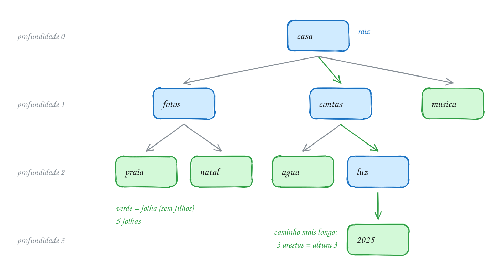</p>

Em C, cada pasta vira um nó com um nome e um vetor de ponteiros para os filhos.
Cada nó é criado com `malloc`, igual aos nós da lista encadeada:

```c
#include <stdio.h>
#include <stdlib.h>
#include <string.h>

#define MAX_FILHOS 4

typedef struct No {
    char nome[16];
    struct No *filhos[MAX_FILHOS]; // ponteiros para as subpastas
    int qtd;                       // quantas subpastas tem
} No;

No *novo(const char *nome) {
    No *n = malloc(sizeof(No));
    if (n == NULL) {
        exit(1);
    }
    strcpy(n->nome, nome);
    n->qtd = 0;
    return n;
}

No *adiciona(No *pai, const char *nome) {
    No *filho = novo(nome);
    pai->filhos[pai->qtd++] = filho;
    return filho;
}

void mostra(const No *n, int profundidade) {
    // %*s com "" imprime 2 * profundidade espaços: o recuo
    printf("%*s%s (%d)\n", 2 * profundidade, "", n->nome, profundidade);
    for (int i = 0; i < n->qtd; i++) {
        mostra(n->filhos[i], profundidade + 1);
    }
}

int conta_folhas(const No *n) {
    if (n->qtd == 0) {
        return 1; // sem filhos: é folha
    }
    int total = 0;
    for (int i = 0; i < n->qtd; i++) {
        total += conta_folhas(n->filhos[i]);
    }
    return total;
}

int altura(const No *n) {
    int maior = -1;
    for (int i = 0; i < n->qtd; i++) {
        int h = altura(n->filhos[i]);
        if (h > maior) {
            maior = h;
        }
    }
    return maior + 1; // folha: -1 + 1 = 0
}

void libera(No *n) {
    for (int i = 0; i < n->qtd; i++) {
        libera(n->filhos[i]); // os filhos primeiro
    }
    free(n);
}

int main(void) {
    No *casa = novo("casa");
    No *fotos = adiciona(casa, "fotos");
    No *contas = adiciona(casa, "contas");
    adiciona(casa, "musica");
    adiciona(fotos, "praia");
    adiciona(fotos, "natal");
    adiciona(contas, "agua");
    No *luz = adiciona(contas, "luz");
    adiciona(luz, "2025");

    mostra(casa, 0);
    printf("Folhas: %d\n", conta_folhas(casa));
    printf("Altura: %d\n", altura(casa));
    libera(casa);
    return 0;
}
// Saída:
// casa (0)
//   fotos (1)
//     praia (2)
//     natal (2)
//   contas (1)
//     agua (2)
//     luz (2)
//       2025 (3)
//   musica (1)
// Folhas: 5
// Altura: 3
```

Repara no fluxograma da `altura`: não existe um caso especial para a folha. Ela
não entra no laço, `maior` fica em -1 e a função devolve 0. Cada pasta pergunta
a altura dos filhos e soma 1 à maior resposta. Em `casa`, os filhos respondem 1
(`fotos`), 2 (`contas`) e 0 (`musica`), e ela devolve 2 + 1 = 3:

<p align="center">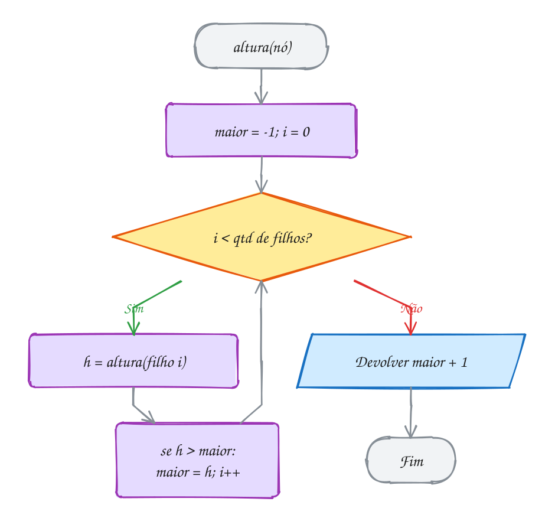</p>

> [!WARNING]
> A ordem do `free` importa. Se `libera` fizer `free(n)` **antes** de visitar os
> filhos, o laço seguinte lê `n->qtd` e `n->filhos[i]` de memória já devolvida:
> é uso depois de liberar, e o AddressSanitizer acusa na hora. Numa árvore,
> libere de baixo para cima: primeiro as subárvores, por último o nó.

> [!TIP]
> **Por dentro do C:** este nó ocupa 56 bytes: 16 do nome, 4 ponteiros de 8
> bytes (32), 4 do `int` e mais 4 de enchimento (*padding*) para o tamanho ficar
> múltiplo de 8. Uma folha gasta os mesmos 56 bytes, com 4 ponteiros sem uso. O
> exemplo A194 mostra a saída clássica: **primeiro filho / próximo irmão**. Cada
> nó guarda só dois ponteiros, um para o primeiro filho e outro para o próximo
> irmão, e aceita qualquer número de filhos. Repare que isso é, na prática, uma
> árvore binária, o assunto seguinte.

> [!NOTE]
> **Pergunta para você:** se você criar a pasta `2026` dentro de `2025`, o que
> muda na saída? Quantas folhas e qual altura? E se criar `2026` dentro de
> `musica`? Responda antes de mudar o código e rodar.

### Hora de praticar

Os arquivos ficam em [`0097-arvores/`](0097-arvores/). Os comandos funcionam de qualquer pasta do terminal. Nos exemplos, rode, mude, quebre e rode de novo. Nos exercícios, a resposta vai dentro do próprio arquivo. ★☆☆ é aquecimento, ★★☆ pede raciocínio e ★★★ é desafio.

**Exemplo A193 · Os mesmos nós, alturas diferentes**

```c
#include <stdio.h>
#include <stdlib.h>
#include <string.h>

#define MAX_FILHOS 4

typedef struct No {
    char nome[16];
    struct No *filhos[MAX_FILHOS];
    int qtd;
} No;

No *novo(const char *nome) {
    No *n = malloc(sizeof(No));
    if (n == NULL) {
        exit(1);
    }
    strcpy(n->nome, nome);
    n->qtd = 0;
    return n;
}

No *adiciona(No *pai, const char *nome) {
    No *filho = novo(nome);
    pai->filhos[pai->qtd++] = filho;
    return filho;
}

int conta_folhas(const No *n) {
    if (n->qtd == 0) {
        return 1;
    }
    int total = 0;
    for (int i = 0; i < n->qtd; i++) {
        total += conta_folhas(n->filhos[i]);
    }
    return total;
}

int altura(const No *n) {
    int maior = -1;
    for (int i = 0; i < n->qtd; i++) {
        int h = altura(n->filhos[i]);
        if (h > maior) {
            maior = h;
        }
    }
    return maior + 1;
}

// o maior grau da árvore: compara o nó com o maior grau de cada filho
int maior_grau(const No *n) {
    int maior = n->qtd;
    for (int i = 0; i < n->qtd; i++) {
        int g = maior_grau(n->filhos[i]);
        if (g > maior) {
            maior = g;
        }
    }
    return maior;
}

void libera(No *n) {
    for (int i = 0; i < n->qtd; i++) {
        libera(n->filhos[i]);
    }
    free(n);
}

void resumo(const char *titulo, const No *raiz) {
    printf("%-10s folhas %d, altura %d, maior grau %d\n", titulo,
           conta_folhas(raiz), altura(raiz), maior_grau(raiz));
}

int main(void) {
    // larga: o grupo da família, todo mundo direto embaixo do admin
    No *grupo = novo("admin");
    adiciona(grupo, "mae");
    adiciona(grupo, "pai");
    adiciona(grupo, "tia");
    adiciona(grupo, "primo");

    // funda: o sumário de um livro, cada item dentro do anterior
    No *livro = novo("livro");
    No *p = adiciona(livro, "cap 1");
    p = adiciona(p, "secao 1.1");
    p = adiciona(p, "item 1.1.1");
    adiciona(p, "nota");

    // caso de borda: um nó sozinho já é uma árvore (e é raiz e folha)
    No *sozinho = novo("rascunho");

    resumo("larga:", grupo);     // 5 nós
    resumo("funda:", livro);     // 5 nós
    resumo("sozinho:", sozinho); // 1 nó

    libera(grupo);
    libera(livro);
    libera(sozinho);
    return 0;
}
// Saída:
// larga:     folhas 4, altura 1, maior grau 4
// funda:     folhas 1, altura 4, maior grau 1
// sozinho:   folhas 1, altura 0, maior grau 0
```

```bash
~/LPEDC/rodar 14-arvores/0097-arvores/A193.c
```

**Exemplo A194 · O organograma com dois ponteiros**

```c
#include <stdio.h>
#include <stdlib.h>
#include <string.h>

// "primeiro filho / próximo irmão": qualquer quantidade de filhos
// cabe em só dois ponteiros por nó
typedef struct No {
    char cargo[16];
    struct No *filho; // o primeiro filho
    struct No *irmao; // o próximo irmão (mesmo pai)
} No;

No *novo(const char *cargo) {
    No *n = malloc(sizeof(No));
    if (n == NULL) {
        exit(1);
    }
    strcpy(n->cargo, cargo);
    n->filho = NULL;
    n->irmao = NULL;
    return n;
}

// coloca o novo filho no fim da fila de irmãos
No *contrata(No *chefe, const char *cargo) {
    No *n = novo(cargo);
    if (chefe->filho == NULL) {
        chefe->filho = n;
    } else {
        No *p = chefe->filho;
        while (p->irmao != NULL) {
            p = p->irmao;
        }
        p->irmao = n;
    }
    return n;
}

// grau = quantos filhos o nó tem: anda pela fila de irmãos
int grau(const No *n) {
    int g = 0;
    for (const No *p = n->filho; p != NULL; p = p->irmao) {
        g++;
    }
    return g;
}

void mostra(const No *n, int nivel) {
    printf("%*s%s: grau %d\n", 2 * nivel, "", n->cargo, grau(n));
    for (const No *p = n->filho; p != NULL; p = p->irmao) {
        mostra(p, nivel + 1);
    }
}

void libera(No *n) {
    while (n != NULL) {
        No *prox = n->irmao; // guarda antes do free
        libera(n->filho);
        free(n);
        n = prox;
    }
}

int main(void) {
    No *dona = novo("dona");
    No *gerente = contrata(dona, "gerente");
    No *padeiro = contrata(dona, "padeiro");
    contrata(gerente, "caixa 1");
    contrata(gerente, "caixa 2");
    contrata(gerente, "entregador");
    contrata(padeiro, "ajudante");

    mostra(dona, 0);
    printf("Tamanho de um nó: %zu bytes\n", sizeof(No));

    libera(dona);
    return 0;
}
// Saída:
// dona: grau 2
//   gerente: grau 3
//     caixa 1: grau 0
//     caixa 2: grau 0
//     entregador: grau 0
//   padeiro: grau 1
//     ajudante: grau 0
// Tamanho de um nó: 32 bytes
```

```bash
~/LPEDC/rodar 14-arvores/0097-arvores/A194.c
```

#### Exercícios

**Exercício E577** · ★☆☆

O site de uma loja organiza os produtos em categorias, e o main já monta
esta árvore:


```text
loja
├── eletronicos
│   ├── celulares
│   └── tvs
│       ├── oled
│       └── led
├── casa
│   └── cozinha
└── moda
```


Complete a função ficha, que imprime uma linha por categoria, recuada 2
espaços por nível, com a profundidade, o grau e a palavra "folha" quando o
nó não tem filhos. Depois o main imprime a altura da árvore (a função
altura já está pronta):


```text
Saída esperada:
loja: prof 0, grau 3
  eletronicos: prof 1, grau 2
    celulares: prof 2, grau 0, folha
    tvs: prof 2, grau 2
      oled: prof 3, grau 0, folha
      led: prof 3, grau 0, folha
  casa: prof 1, grau 1
    cozinha: prof 2, grau 0, folha
  moda: prof 1, grau 0, folha
Altura: 3
```

**Dicas:**

1. O grau de um nó é o próprio n->qtd. Folha é quem tem qtd == 0.
2. Imprima o nó e depois chame ficha para cada filho com prof + 1. O recuo
   sai com printf("%*s", 2 * prof, "").
3. Resposta esperada: as 9 linhas acima e "Altura: 3".

```bash
~/LPEDC/rodar 14-arvores/0097-arvores/E577.c
```

**Exercício E578** · ★☆☆

Complete a função conta_nos, que devolve quantos nós a árvore tem (a raiz
conta). O main monta o organograma de uma escola:


```text
diretora
├── coordenador
│   ├── prof. ana
│   └── prof. bruno
└── secretaria
```


```text
Saída esperada:
Pessoas na escola: 5
```

**Dicas:**

1. Pense recursivo: o nó vale 1, mais os nós de cada filho.
2. Folha não entra no laço e devolve só o 1 dela.
3. Resposta esperada: Pessoas na escola: 5

```bash
~/LPEDC/rodar 14-arvores/0097-arvores/E578.c
```

**Exercício E579** · ★★☆

Escreva a função profundidade_de(raiz, nome), que procura uma pasta pelo
nome e devolve a profundidade dela (a raiz tem profundidade 0). Se a pasta
não existir, devolve -1. O main já monta a árvore das pastas do texto
(casa, fotos, contas, musica, praia, natal, agua, luz, 2025) e testa quatro
nomes:


```text
Saída esperada:
luz: 2
casa: 0
2025: 3
videos: -1
```

**Dicas:**

1. Use um parâmetro a mais: uma função auxiliar busca(n, nome, prof) que
   já sabe a profundidade do nó em que está.
2. Se o nome do nó é o procurado (strcmp == 0), devolva prof. Senão, tente
   cada filho com prof + 1 e devolva a primeira resposta diferente de -1.
3. Resposta esperada: luz: 2, casa: 0, 2025: 3, videos: -1.

```bash
~/LPEDC/rodar 14-arvores/0097-arvores/E579.c
```

**Exercício E580** · ★★☆

Cada pasta guarda alguns arquivos soltos (o campo mb, em megabytes). A
função tamanho, já pronta, soma a pasta com tudo que está dentro dela, sem
imprimir nada. Escreva duas funções que mostram as pastas com o tamanho
total de cada uma, em ordens diferentes:

- du(n): imprime "<total> MB  <nome>" como o comando du do Linux, com cada

```text
pasta aparecendo DEPOIS de todas as subpastas dela (a raiz por último);
```

- arvore(n, prof): imprime como o gerenciador de arquivos, a pasta ANTES

```text
das subpastas, recuada 2 espaços por nível.
```


```text
Saída esperada:
-- du --
300 MB  praia
120 MB  natal
430 MB  fotos
5 MB  agua
8 MB  luz
15 MB  contas
450 MB  casa
-- arvore --
casa (450 MB)
  fotos (430 MB)
    praia (300 MB)
    natal (120 MB)
  contas (15 MB)
    agua (5 MB)
    luz (8 MB)
```

**Dicas:**

1. As duas funções têm o mesmo laço pelos filhos. O que muda é onde fica o
   printf: depois do laço (du) ou antes dele (arvore).
2. Em du, faça a função devolver o total: some n->mb com o que cada filho
   devolve e imprima no fim. Assim cada pasta é somada uma vez só.
3. Resposta esperada: as duas listas acima; fotos = 10 + 300 + 120 = 430 e
   casa = 5 + 430 + 15 = 450.

```bash
~/LPEDC/rodar 14-arvores/0097-arvores/E580.c
```

**Exercício E581** · ★★★

Ache o bug. Este programa monta a árvore da família e deveria mostrar:


```text
Saída esperada:
Altura da família: 2
```


e terminar sem nenhum erro de memória. Ele tem DOIS bugs (de propósito):
um dá o número errado e o outro faz o AddressSanitizer parar o programa
com "heap-use-after-free". Rode, leia o relatório, ache os dois e conserte.


```text
vovo
├── mae
│   ├── voce
│   └── irma
└── tio
```

**Dicas:**

1. Calcule à mão o que a altura devolve para uma folha. Pela convenção do
   curso, folha tem altura 0.
2. No relatório do ASan, procure a linha do "READ" e a linha do "freed by".
   Depois de free(n), ainda dá para ler n->qtd?
3. Resposta esperada: (1) "int maior = 0" faz a folha devolver 1 e a
   árvore dar 3; o certo é começar com -1. (2) libera chama free(n) antes
   de visitar os filhos e depois lê n->qtd e n->filhos de memória
   devolvida; o free tem que vir depois do laço. Consertado: "Altura da
   família: 2", sem erro.

```bash
~/LPEDC/rodar 14-arvores/0097-arvores/E581.c
```

**Exercício E582** · ★★★

O menu do app de delivery é uma árvore:


```text
app
├── lanches
│   ├── x-salada
│   └── x-bacon
└── bebidas
    ├── suco
    └── refri
        ├── lata
        └── 2 litros
```


Escreva do zero (struct, montagem, função e liberação) um programa que
imprime o caminho da raiz até cada folha, com "/" entre os nomes, como um
endereço de pasta, e no fim conta os caminhos:


```text
Saída esperada:
app/lanches/x-salada
app/lanches/x-bacon
app/bebidas/suco
app/bebidas/refri/lata
app/bebidas/refri/2 litros
Total de caminhos: 5
```

**Dicas:**

1. Guarde o caminho até o nó atual num vetor const char *trilha[10] e
   passe junto a profundidade: caminhos(n, trilha, prof).
2. Ao entrar no nó, faça trilha[prof] = n->nome. Se for folha, imprima
   trilha[0..prof] separados por "/" e devolva 1; senão, chame para cada
   filho com prof + 1 e some.
3. Resposta esperada: as 5 linhas acima e "Total de caminhos: 5". Libere
   tudo: o rodar não pode acusar vazamento.

```bash
~/LPEDC/rodar 14-arvores/0097-arvores/E582.c
```

---

## 0098 · Árvore binária e percursos

Churrasco no sábado: vão 8 pessoas, 3 não bebem, e quem bebe paga R$ 4 de
cerveja mais R$ 2 de gelo. Na planilha você digita `=(8-3)*(4+2)` e ela
responde 30. Como a planilha sabe que a subtração e a soma vêm antes da
multiplicação? Ela monta uma **árvore** com a fórmula.

Uma **árvore binária** é uma árvore em que cada nó tem **no máximo dois
filhos**, e cada filho tem lado: o da **esquerda** ou o da **direita**. A
definição recursiva é curta: uma árvore binária é **vazia** (`NULL`) ou é um nó
com uma **subárvore esquerda** e uma **subárvore direita**, que também são
árvores binárias.

Lado importa. Um nó `A` com filho `B` à esquerda e um nó `A` com filho `B` à
direita são árvores **diferentes**. Isso não existia nas pastas do assunto
anterior, onde só contava a ordem dos filhos.

Em C, o nó é uma struct com o dado e dois ponteiros. Aqui o dado é um `char`,
que guarda um dígito ou um operador:

```c
typedef struct No {
    char info;
    struct No *esq; // subárvore da esquerda
    struct No *dir; // subárvore da direita
} No;
```

O resto vira um **TAD**: `arvore.h` com os protótipos, `arvore.c` com a
implementação, como no assunto 0074. Diferente da pilha e da fila, a struct fica
à mostra no `.h`, porque os exercícios precisam andar pelos nós. A função
`arv_cria(info, esq, dir)` monta um nó com as duas subárvores prontas, então
dá para construir a árvore de baixo para cima.

Montada a árvore, como visitar todos os nós? Existem quatro ordens clássicas, os
**percursos**:

| Percurso | Ordem | Na fórmula |
| --- | --- | --- |
| **pré-ordem** | raiz, esquerda, direita | `* - 8 3 + 4 2` (notação prefixa) |
| **em ordem** | esquerda, raiz, direita | `8 - 3 * 4 + 2` (infixa, sem parênteses) |
| **pós-ordem** | esquerda, direita, raiz | `8 3 - 4 2 + *` (pós-fixa, a da calculadora HP) |
| **por nível** | linha por linha, de cima para baixo | `* - + 8 3 4 2` |

Os três primeiros são recursivos e mudam só a posição do `printf` em relação às
duas chamadas. O por nível não desce por um lado e depois pelo outro: ele usa
uma **fila** (assunto 0085). Tira um nó da frente, mostra, põe os filhos dele no
fim, e repete até a fila esvaziar.

A pós-ordem é a ordem natural para **calcular**: você só aplica o `*` depois de
saber quanto valem as duas subárvores. É o mesmo algoritmo da pilha com notação
pós-fixa do assunto 0084, só que agora a árvore está desenhada.

Vamos ver na prática. Os operadores ficam nos nós internos (roxo) e os números
nas folhas (azul). Cada percurso lê a mesma árvore numa ordem diferente:

<p align="center">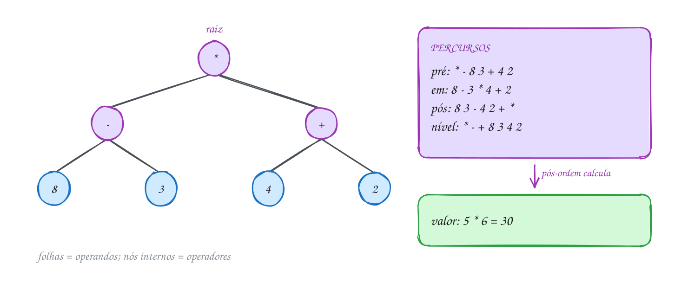</p>

O cliente do TAD monta a árvore de baixo para cima e chama os percursos:

```c
#include <stdio.h>
#include "arvore.h"

int main(void) {
    // (8 - 3) * (4 + 2): 8 pessoas, 3 não bebem; cerveja R$ 4 + gelo R$ 2
    No *menos = arv_cria('-', arv_cria('8', NULL, NULL), arv_cria('3', NULL, NULL));
    No *mais = arv_cria('+', arv_cria('4', NULL, NULL), arv_cria('2', NULL, NULL));
    No *raiz = arv_cria('*', menos, mais);

    printf("Pré-ordem:");
    arv_pre_ordem(raiz);
    printf("\nEm ordem: ");
    arv_em_ordem(raiz);
    printf("\nPós-ordem:");
    arv_pos_ordem(raiz);
    printf("\nPor nível:");
    arv_por_nivel(raiz);
    printf("\nNós: %d, altura: %d\n", arv_conta(raiz), arv_altura(raiz));

    raiz = arv_libera(raiz);
    return 0;
}
// Saída:
// Pré-ordem: * - 8 3 + 4 2
// Em ordem:  8 - 3 * 4 + 2
// Pós-ordem: 8 3 - 4 2 + *
// Por nível: * - + 8 3 4 2
// Nós: 7, altura: 2
```

Dentro do `arvore.c`, a em ordem tem três linhas de verdade:

```c
void arv_em_ordem(const No *r) {
    if (r == NULL) {
        return;
    }
    arv_em_ordem(r->esq);
    printf(" %c", r->info);
    arv_em_ordem(r->dir);
}
```

Repara no fluxograma: o caso base é a árvore vazia. Num nó de verdade, a função
resolve a esquerda inteira, mostra a raiz e só então resolve a direita. Troque a
caixa azul de lugar e você tem a pré-ordem (antes) ou a pós-ordem (depois):

<p align="center">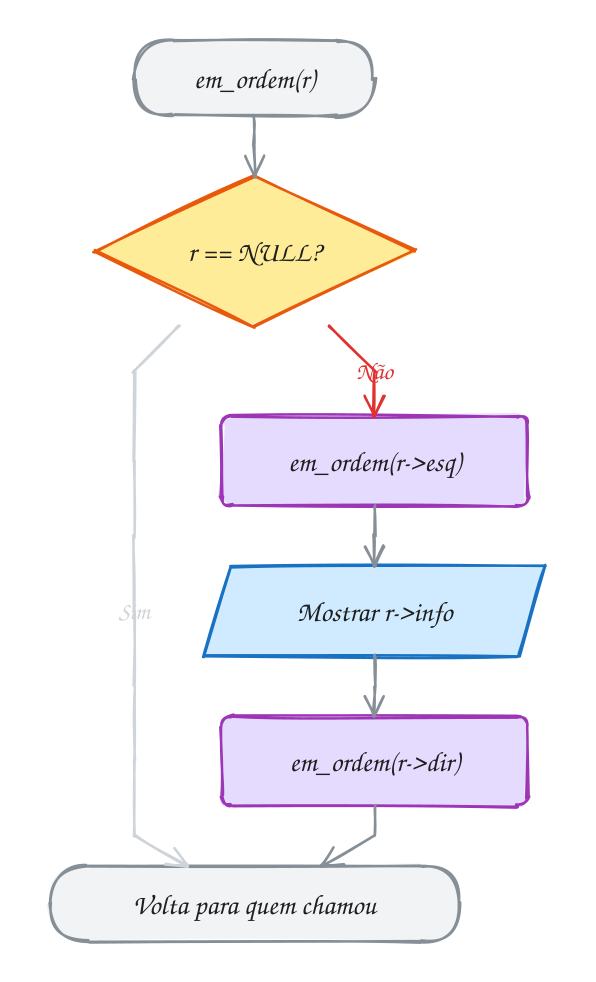</p>

### Passo a passo

A pilha de chamadas da em ordem, a partir da raiz `*`. Cada linha é o momento em
que um `printf` acontece:

| Pilha de chamadas (topo à direita) | Mostra | Na tela até aqui |
| --- | --- | --- |
| `*` → `-` → `8` | 8 | `8` |
| `*` → `-` | - | `8 -` |
| `*` → `-` → `3` | 3 | `8 - 3` |
| `*` | * | `8 - 3 *` |
| `*` → `+` → `4` | 4 | `8 - 3 * 4` |
| `*` → `+` | + | `8 - 3 * 4 +` |
| `*` → `+` → `2` | 2 | `8 - 3 * 4 + 2` |

> [!WARNING]
> A em ordem **perde os parênteses**. `8 - 3 * 4 + 2`, lido por uma pessoa (ou
> pelo C), dá `8 - 12 + 2 = -2`, e não 30. A árvore não precisa de parênteses
> porque a forma dela já diz o que vem primeiro. Para mostrar a fórmula certa,
> a em ordem precisa abrir um `(` antes de cada subárvore e fechar depois. O
> exemplo A196 faz isso e calcula o valor em pós-ordem.

> [!TIP]
> **Por dentro do C:** cada nó ocupa 24 bytes: 1 do `char`, 7 de enchimento para
> alinhar os ponteiros e 2 ponteiros de 8 bytes. Uma árvore com `n` nós tem
> `n + 1` ponteiros `NULL` (aqui, 7 nós e 8 `NULL`, todos nas folhas). A
> recursão usa a pilha de chamadas: a profundidade máxima é a altura + 1 frames.
> Numa árvore equilibrada de um milhão de nós são uns 20 frames; numa árvore
> "torta", em fila indiana, seria um milhão, e a pilha estoura.

> [!NOTE]
> **Pergunta para você:** se a em ordem de uma árvore é `B A C` e a pré-ordem é
> `A B C`, quem é a raiz? Quem fica à esquerda? Desenhe. E com em ordem `A B C`
> e pré-ordem `A B C`, como fica a árvore?

### Hora de praticar

Os arquivos ficam em [`0098-arvore-binaria/`](0098-arvore-binaria/). Os comandos funcionam de qualquer pasta do terminal. Nos exemplos, rode, mude, quebre e rode de novo. Nos exercícios, a resposta vai dentro do próprio arquivo. ★☆☆ é aquecimento, ★★☆ pede raciocínio e ★★★ é desafio.

**Exemplo A195 · Duas árvores com a mesma em ordem**

```c
#include <stdio.h>
#include "arvore.h"

void percursos(const char *titulo, const No *r) {
    printf("%s\n  pré:", titulo);
    arv_pre_ordem(r);
    printf("\n  em:");
    arv_em_ordem(r);
    printf("\n  pós:");
    arv_pos_ordem(r);
    printf("\n  altura %d\n", arv_altura(r));
}

int main(void) {
    // equilibrada: B na raiz, A à esquerda, C à direita
    No *cheia = arv_cria('B', arv_cria('A', NULL, NULL), arv_cria('C', NULL, NULL));

    // torta: cada nó só tem filho à direita (parece uma lista)
    No *torta = arv_cria('A', NULL, arv_cria('B', NULL, arv_cria('C', NULL, NULL)));

    // caso de borda: árvore vazia (os percursos não mostram nada)
    No *vazia = NULL;

    percursos("cheia:", cheia);
    percursos("torta:", torta);
    percursos("vazia:", vazia);

    // a em ordem é igual nas duas primeiras: sozinha ela não diz a forma;
    // a pré-ordem (ou a pós) junto com ela já diz
    cheia = arv_libera(cheia);
    torta = arv_libera(torta);
    return 0;
}
// Saída:
// cheia:
//   pré: B A C
//   em: A B C
//   pós: A C B
//   altura 1
// torta:
//   pré: A B C
//   em: A B C
//   pós: C B A
//   altura 2
// vazia:
//   pré:
//   em:
//   pós:
//   altura -1
```

```bash
~/LPEDC/rodar 14-arvores/0098-arvore-binaria/A195.c
```

**Exemplo A196 · Calculando a árvore de expressão**

```c
#include <stdio.h>
#include "arvore.h"

// folha é um dígito; nó interno é um operador aplicado às duas subárvores
int avalia(const No *r) {
    if (r->esq == NULL && r->dir == NULL) {
        return r->info - '0'; // '8' vira 8
    }
    int a = avalia(r->esq); // primeiro as subárvores (pós-ordem)...
    int b = avalia(r->dir);
    switch (r->info) {      // ...depois o operador da raiz
    case '+': return a + b;
    case '-': return a - b;
    case '*': return a * b;
    default:  return a / b;
    }
}

// em ordem com parênteses em volta de cada operação
void mostra(const No *r) {
    if (r->esq == NULL && r->dir == NULL) {
        printf("%c", r->info);
        return;
    }
    printf("(");
    mostra(r->esq);
    printf(" %c ", r->info);
    mostra(r->dir);
    printf(")");
}

int main(void) {
    No *raiz = arv_cria('*',
                        arv_cria('-', arv_cria('8', NULL, NULL), arv_cria('3', NULL, NULL)),
                        arv_cria('+', arv_cria('4', NULL, NULL), arv_cria('2', NULL, NULL)));

    mostra(raiz);
    printf(" = %d\n", avalia(raiz));

    // troca a subárvore da direita: em vez de (4 + 2), só 9
    raiz->dir = arv_libera(raiz->dir); // poda primeiro (senão vaza)
    raiz->dir = arv_cria('9', NULL, NULL);
    mostra(raiz);
    printf(" = %d\n", avalia(raiz));

    raiz = arv_libera(raiz);
    return 0;
}
// Saída:
// ((8 - 3) * (4 + 2)) = 30
// ((8 - 3) * 9) = 45
```

```bash
~/LPEDC/rodar 14-arvores/0098-arvore-binaria/A196.c
```

#### Exercícios

**Exercício E583** · ★☆☆

Monte esta árvore com arv_cria, do TAD arvore.h, e imprima os quatro
percursos (pré-ordem, em ordem, pós-ordem e por nível), a quantidade de
nós e a altura. Depois libere a árvore com arv_libera.


```text
M
├── esq: G
│   ├── esq: C
│   └── dir: J
└── dir: T
    └── dir: X
```


```text
Saída esperada:
Pré-ordem: M G C J T X
Em ordem:  C G J M T X
Pós-ordem: C J G X T M
Por nível: M G T C J X
Nós: 6, altura: 2
```

**Dicas:**

1. Monte de baixo para cima: as folhas são arv_cria('C', NULL, NULL) e
   companhia. T não tem filho esquerdo: o 2º argumento dele é NULL.
2. Cada função de percurso imprime um espaço antes de cada letra; use
   printf("Pré-ordem:") e chame arv_pre_ordem(raiz) logo depois.
3. Resposta esperada: as 5 linhas acima.

```bash
~/LPEDC/rodar 14-arvores/0098-arvore-binaria/E583.c
```

**Exercício E584** · ★☆☆

Complete as funções conta_folhas e conta_internos. Na árvore da conta do
churrasco, (8 - 3) * (4 + 2), as folhas são os números e os nós internos
são os operadores.


```text
Saída esperada:
Números: 4
Operadores: 3
```

**Dicas:**

1. Árvore vazia: 0. Folha: esq e dir são NULL.
2. conta_internos pode ser arv_conta(r) - conta_folhas(r), mas tente
   escrever a versão recursiva também.
3. Resposta esperada: Números: 4 e Operadores: 3.

```bash
~/LPEDC/rodar 14-arvores/0098-arvore-binaria/E584.c
```

**Exercício E585** · ★★☆

Escreva a função espelha(r), que transforma a árvore na sua imagem no
espelho: em todo nó, a subárvore da esquerda troca de lugar com a da
direita. Não crie nós novos; só troque ponteiros. O main imprime a em
ordem antes e depois:


```text
Saída esperada:
Antes:  8 - 3 * 4 + 2
Depois: 2 + 4 * 3 - 8
```

**Dicas:**

1. Árvore vazia: nada a fazer.
2. Troque r->esq com r->dir usando um ponteiro auxiliar e chame espelha
   nas duas subárvores (antes ou depois da troca, tanto faz).
3. Resposta esperada: Antes: 8 - 3 * 4 + 2 e Depois: 2 + 4 * 3 - 8. Repare
   que a em ordem do espelho é a em ordem original de trás para frente.

```bash
~/LPEDC/rodar 14-arvores/0098-arvore-binaria/E585.c
```

**Exercício E586** · ★★☆

Escreva a função deitada(r, nivel), que desenha a árvore deitada no
terminal: a raiz fica na coluna 0, e cada nível desce 4 espaços para a
direita. A subárvore da DIREITA aparece em cima e a da esquerda embaixo,
como se você girasse o desenho 90 graus para a esquerda. Para a árvore
(8 - 3) * (4 + 2):


```text
Saída esperada:
        2
    +
        4
*
        3
    -
        8
```

**Dicas:**

1. É uma em ordem ao contrário: direita, raiz, esquerda.
2. Para recuar, use printf("%*s%c\n", 4 * nivel, "", r->info).
3. Resposta esperada: o desenho acima (7 linhas; o '*' sem recuo, '+' e '-'
   com 4 espaços, os números com 8).

```bash
~/LPEDC/rodar 14-arvores/0098-arvore-binaria/E586.c
```

**Exercício E587** · ★★★

Ache o bug. A função por_nivel deveria mostrar a árvore do churrasco nível
por nível, mas mostra outra ordem:


```text
Saída esperada:
* - + 8 3 4 2
```


```text
Saída que aparece:
* + 2 4 - 3 8
```


O programa não quebra e o AddressSanitizer não reclama: o erro é de
lógica. Ache a linha errada, conserte e rode até aparecer a saída
esperada.

**Dicas:**

1. Uma fila tira da frente e põe no fim. Olhe de onde sai o "atual".
2. Com ini sempre em 0 e fila[--fim], o último que entrou é o primeiro que
   sai.
3. Resposta esperada: a linha "const No *atual = fila[--fim];" deveria ser
   "fila[ini++]". Do jeito errado, o vetor vira uma PILHA, e a saída é uma
   pré-ordem espelhada (raiz, direita, esquerda), porque o filho direito
   entra por último e sai primeiro. Consertado: * - + 8 3 4 2.

```bash
~/LPEDC/rodar 14-arvores/0098-arvore-binaria/E587.c
```

**Exercício E588** · ★★★

Dá para guardar uma árvore binária numa string: escreva a pré-ordem e
marque cada subárvore vazia com um ponto. A árvore do churrasco vira
"*-8..3..+4..2.." e a árvore M, G, T, C, J, X do E583 vira "MGC..J..T.X..".

Escreva a função constroi(s, &pos), que lê a string a partir de s[pos] e
devolve a árvore montada com arv_cria. O main testa as duas strings:


```text
Saída esperada:
*-8..3..+4..2..
  em ordem:  8 - 3 * 4 + 2
  pós-ordem: 8 3 - 4 2 + *
  nós: 7, altura: 2
MGC..J..T.X..
  em ordem:  C G J M T X
  pós-ordem: C J G X T M
  nós: 6, altura: 2
```

**Dicas:**

1. Leia o caractere s[*pos] e avance (*pos)++. Se for '.', a subárvore é
   vazia: devolva NULL.
2. Senão, ele é a raiz: monte a esquerda com uma chamada recursiva, depois
   a direita com outra, e só então chame arv_cria. Cuidado: chame as duas
   recursões em linhas separadas, porque a ordem de avaliação dos
   argumentos de uma função não é garantida em C.
3. Resposta esperada: a saída acima.

```bash
~/LPEDC/rodar 14-arvores/0098-arvore-binaria/E588.c
```

---

## 0099 · BST: busca e inserção

A academia do bairro guarda os alunos pela matrícula. Na catraca, o sistema
precisa achar a matrícula na hora. Num vetor ordenado, a busca binária
(assunto 0090) acha rápido, mas cada aluno novo obriga a empurrar metade do
vetor para abrir espaço. Numa lista encadeada, inserir é barato, mas a busca
passa por um nó de cada vez. Dá para ter as duas coisas?

Dá: a **árvore binária de busca**, ou **BST** (*binary search tree*). É uma
árvore binária com uma regra que vale em **todo** nó: as chaves da subárvore
esquerda são **menores** que a do nó, e as da subárvore direita são **maiores**.

Com essa regra, buscar vira a busca binária andando pela árvore. Compare a chave
procurada com a raiz. Igual? Achou. Menor? Tudo que interessa está à esquerda,
então a metade da direita fica para trás. Maior? Vá para a direita. Se chegar
num `NULL`, a chave não existe.

**Inserir** é a mesma descida: procure a chave e, no `NULL` onde a busca
falharia, pendure um nó novo. Todo nó entra como **folha**; ninguém sai do lugar.
Por isso a inserção recursiva devolve a raiz da subárvore e o pai faz
`r->esq = bst_insere(r->esq, chave)`: na maioria das chamadas nada muda, e no
`NULL` o ponteiro do pai passa a apontar para o nó novo. Chave repetida é
ignorada neste TAD.

E o bônus: a **em ordem** de uma BST sai em ordem crescente. Esquerda (todos
menores), raiz, direita (todos maiores). Você ganha uma ordenação de graça.

O custo da busca é o número de níveis que ela desce: no máximo a **altura** + 1
comparações. Numa árvore cheinha, cada nível dobra o número de nós, e a altura
fica perto de log₂ n. Com 7 chaves são 3 níveis; com um milhão, uns 20.

Vamos ver na prática. Sete alunos chegaram nesta ordem: 50, 30, 70, 20, 40, 60
e 80. A busca pelo 60 compara com 50 (vai para a direita), com 70 (vai para a
esquerda) e acha. A busca pelo 45 desce 50, 30, 40 e cai no `NULL` à direita do
40: é ali que o 45 entraria se fosse inserido:

<p align="center">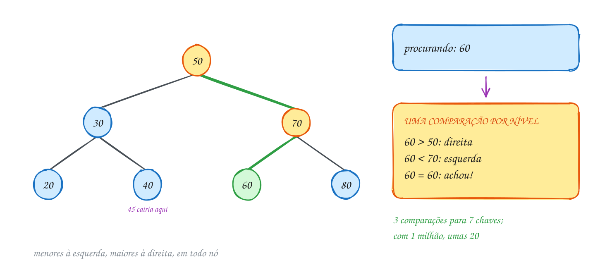</p>

O TAD fica em `bst.h` e `bst.c`. As duas funções principais:

```c
No *bst_insere(No *r, int chave) {
    if (r == NULL) {
        return novo_no(chave); // achou o lugar vazio: vira folha
    }
    if (chave < r->chave) {
        r->esq = bst_insere(r->esq, chave);
    } else if (chave > r->chave) {
        r->dir = bst_insere(r->dir, chave);
    }
    return r; // igual: já existe, não insere de novo
}

No *bst_busca(No *r, int chave) {
    while (r != NULL && r->chave != chave) {
        r = chave < r->chave ? r->esq : r->dir;
    }
    return r;
}
```

A busca nem precisa de recursão: é um laço que desce um nível por volta. No
exemplo, uma versão que mostra o caminho:

```c
#include <stdio.h>
#include "bst.h"

void procura(const No *r, int chave) {
    printf("Busca %d:", chave);
    while (r != NULL) {
        printf(" %d", r->chave);
        if (chave == r->chave) {
            printf(" -> achou\n");
            return;
        }
        r = chave < r->chave ? r->esq : r->dir;
    }
    printf(" -> NULL, não existe\n");
}

int main(void) {
    int matriculas[] = {50, 30, 70, 20, 40, 60, 80};
    No *raiz = NULL;
    for (int i = 0; i < 7; i++) {
        raiz = bst_insere(raiz, matriculas[i]);
    }

    printf("Em ordem:");
    bst_em_ordem(raiz);
    printf("\n");
    procura(raiz, 60);
    procura(raiz, 45);
    printf("Altura: %d\n", bst_altura(raiz));

    raiz = bst_libera(raiz);
    return 0;
}
// Saída:
// Em ordem: 20 30 40 50 60 70 80
// Busca 60: 50 70 60 -> achou
// Busca 45: 50 30 40 -> NULL, não existe
// Altura: 2
```

Repara no fluxograma: cada volta do laço faz no máximo duas perguntas sobre o
nó atual e desce um nível. O caminho verde é a busca do 60: direita no 50,
esquerda no 70, achou:

<p align="center">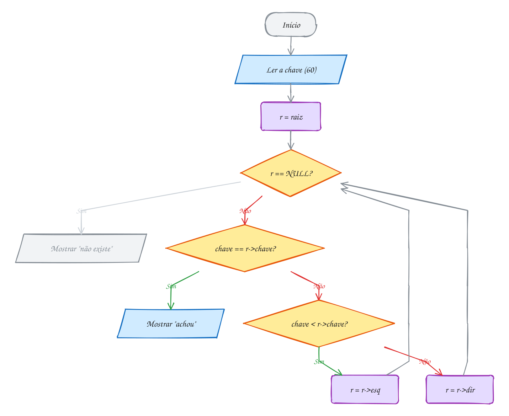</p>

> [!WARNING]
> A forma da BST depende da **ordem de chegada**. As mesmas sete matrículas
> inseridas em ordem crescente (20, 30, ..., 80) formam uma "árvore" em que todo
> nó só tem filho direito: uma lista encadeada disfarçada, com altura 6. A busca
> pelo 80 passa pelos 7 nós, e a promessa do log₂ n vai embora. O exemplo A198
> mostra isso, e o assunto 0101 resolve.

> [!TIP]
> **Por dentro do C:** repare no `raiz = bst_insere(raiz, ...)`. A árvore começa
> como `NULL` e só o primeiro `insere` muda a raiz. Se você esquecer a
> atribuição, o nó criado se perde: a variável `raiz` continua `NULL` e o
> AddressSanitizer acusa vazamento no fim. Outra saída é passar o endereço da
> raiz (`No **`), como no `scanf`. O exercício E592 faz assim. Cada nó ocupa 24
> bytes (4 do `int`, 4 de enchimento, 16 dos ponteiros), contra 4 bytes por
> chave num vetor: a BST troca memória por inserção barata.

> [!NOTE]
> **Pergunta para você:** em que ordem você inseriria as chaves 10, 20, 30, 40,
> 50, 60 e 70 para a árvore ficar com altura 2? Existe mais de uma resposta?

### Hora de praticar

Os arquivos ficam em [`0099-bst-busca-insercao/`](0099-bst-busca-insercao/). Os comandos funcionam de qualquer pasta do terminal. Nos exemplos, rode, mude, quebre e rode de novo. Nos exercícios, a resposta vai dentro do próprio arquivo. ★☆☆ é aquecimento, ★★☆ pede raciocínio e ★★★ é desafio.

**Exemplo A197 · Onde cada pedido vai morar**

```c
#include <stdio.h>
#include "bst.h"

// antes de inserir, refaz a descida que o insere vai fazer e conta onde a
// chave vai virar folha (ou se já existe)
void anuncia(const No *r, int chave) {
    printf("%2d:", chave);
    if (r == NULL) {
        printf(" árvore vazia, vira a raiz\n");
        return;
    }
    while (1) {
        printf(" %d", r->chave);
        if (chave == r->chave) {
            printf(" -> já existe, ignorado\n");
            return;
        }
        const No *prox = chave < r->chave ? r->esq : r->dir;
        if (prox == NULL) {
            printf(" -> filho %s do %d\n", chave < r->chave ? "esquerdo" : "direito", r->chave);
            return;
        }
        r = prox;
    }
}

int main(void) {
    // números dos pedidos da lanchonete, na ordem em que chegaram
    int pedidos[] = {42, 17, 63, 8, 25, 50, 25, 30};
    No *raiz = NULL;
    for (int i = 0; i < 8; i++) {
        anuncia(raiz, pedidos[i]);
        raiz = bst_insere(raiz, pedidos[i]);
    }

    // o primeiro que chegou continua na raiz: inserir nunca mexe no que já está
    printf("Raiz: %d\n", raiz->chave);
    printf("Altura: %d\n", bst_altura(raiz));

    raiz = bst_libera(raiz);
    return 0;
}
// Saída:
// 42: árvore vazia, vira a raiz
// 17: 42 -> filho esquerdo do 42
// 63: 42 -> filho direito do 42
//  8: 42 17 -> filho esquerdo do 17
// 25: 42 17 -> filho direito do 17
// 50: 42 63 -> filho esquerdo do 63
// 25: 42 17 25 -> já existe, ignorado
// 30: 42 17 25 -> filho direito do 25
// Raiz: 42
// Altura: 3
```

```bash
~/LPEDC/rodar 14-arvores/0099-bst-busca-insercao/A197.c
```

**Exemplo A198 · A ordem de chegada muda a árvore**

```c
#include <stdio.h>
#include "bst.h"

No *monta(const int v[], int n) {
    No *r = NULL;
    for (int i = 0; i < n; i++) {
        r = bst_insere(r, v[i]);
    }
    return r;
}

int main(void) {
    int embaralhada[] = {50, 30, 70, 20, 40, 60, 80};
    int crescente[] = {20, 30, 40, 50, 60, 70, 80};

    No *a = monta(embaralhada, 7);
    No *b = monta(crescente, 7);

    // as duas guardam as mesmas chaves: a em ordem é igual
    printf("A em ordem:");
    bst_em_ordem(a);
    printf("\nB em ordem:");
    bst_em_ordem(b);
    printf("\n");

    // mas a forma é outra: B virou uma lista, tudo pendurado à direita
    printf("Altura de A: %d\n", bst_altura(a));
    printf("Altura de B: %d\n", bst_altura(b));
    printf("Raiz de B: %d, filho esquerdo: %s\n", b->chave, b->esq == NULL ? "NULL" : "existe");

    a = bst_libera(a);
    b = bst_libera(b);
    return 0;
}
// Saída:
// A em ordem: 20 30 40 50 60 70 80
// B em ordem: 20 30 40 50 60 70 80
// Altura de A: 2
// Altura de B: 6
// Raiz de B: 20, filho esquerdo: NULL
```

```bash
~/LPEDC/rodar 14-arvores/0099-bst-busca-insercao/A198.c
```

#### Exercícios

**Exercício E589** · ★☆☆

O posto de saúde guarda as senhas de atendimento numa BST. O main insere,
nesta ordem:


```text
45 20 70 10 30 60 90 25
```


Complete a função nivel_de(r, chave), que desce pela árvore como a busca e
devolve a profundidade da chave (a raiz tem nível 0), ou -1 se a chave não
estiver lá. O main mostra a em ordem, a altura e o nível de algumas senhas:


```text
Saída esperada:
Em ordem: 10 20 25 30 45 60 70 90
Altura: 3
Senha 45: nível 0
Senha 70: nível 1
Senha 30: nível 2
Senha 25: nível 3
Senha 65: nível -1
```

**Dicas:**

1. Use um laço igual ao de bst_busca e um contador que começa em 0 e sobe
   1 a cada vez que você desce um nível.
2. Se o laço terminar com r == NULL, a chave não existe: devolva -1.
3. Resposta esperada: a saída acima. O 25 fica embaixo de 45, 20 e 30.

```bash
~/LPEDC/rodar 14-arvores/0099-bst-busca-insercao/E589.c
```

**Exercício E590** · ★☆☆

Complete menor_chave e maior_chave, que devolvem a menor e a maior
matrícula da academia. Use um laço (sem recursão) e não visite a árvore
inteira: aproveite a regra da BST. Pode supor que a árvore não é vazia.


```text
Saída esperada:
Matrícula mais antiga: 20
Matrícula mais nova: 80
```

**Dicas:**

1. Onde mora a menor chave? Ninguém à esquerda dela pode existir.
2. Desça pela esquerda enquanto r->esq != NULL. Cuidado: o nó mais à
   esquerda não precisa ser folha; ele pode ter filho direito.
3. Resposta esperada: 20 e 80.

```bash
~/LPEDC/rodar 14-arvores/0099-bst-busca-insercao/E590.c
```

**Exercício E591** · ★★☆

A loja guarda os preços dos produtos (em reais, inteiros) numa BST. O
cliente quer ver só o que custa entre R$ 35 e R$ 65. Escreva
faixa(r, min, max, &visitados), que imprime em ordem crescente as chaves
no intervalo [min, max] e conta quantos nós a função visitou.

O desafio: não entre numa subárvore que não pode ter resposta. Se a chave
do nó já é menor que min, nada à esquerda dele serve.


```text
Saída esperada:
Entre 35 e 65: 40 50 60
Nós visitados: 5 de 9
```

**Dicas:**

1. Comece como uma em ordem e conte cada chamada com r != NULL.
2. Só desça para a esquerda se r->chave > min; só desça para a direita se
   r->chave < max; só imprima se min <= r->chave <= max.
3. Resposta esperada: 40 50 60, com 5 nós visitados (50, 30, 40, 70, 60).
   Os nós 20, 80, 10 e 90 nunca são tocados.

```bash
~/LPEDC/rodar 14-arvores/0099-bst-busca-insercao/E591.c
```

**Exercício E592** · ★★☆

Escreva insere_sem_recursao(No **raiz, int chave): a inserção na BST com um
laço, recebendo o ENDEREÇO da raiz. Assim a função não devolve nada e o
main não precisa fazer raiz = .... Repetida é ignorada.

O main insere as matrículas 50 30 70 20 40 60 80 30 e mostra:


```text
Saída esperada:
Em ordem: 20 30 40 50 60 70 80
Altura: 2
```

**Dicas:**

1. Use No **p = raiz. Enquanto *p != NULL, compare e faça
   p = &(*p)->esq ou p = &(*p)->dir. Se a chave for igual, saia.
2. Quando o laço parar com *p == NULL, p é o endereço do ponteiro que
   precisa apontar para o nó novo (pode ser a própria raiz!). Faça o
   malloc, preencha e faça *p = novo.
3. Resposta esperada: a saída acima (o 30 repetido não entra).

```bash
~/LPEDC/rodar 14-arvores/0099-bst-busca-insercao/E592.c
```

**Exercício E593** · ★★★

Ache o bug. A função eh_bst deveria dizer se uma árvore respeita a regra da
BST. As duas árvores abaixo foram montadas à mão (sem bst_insere):


```text
árvore 1          árvore 2
50                50
├── esq: 30       ├── esq: 30
│   ├── esq: 20   │   ├── esq: 20
│   └── dir: 60   │   └── dir: 40
└── dir: 80       └── dir: 80
    ├── esq: 70       ├── esq: 70
    └── dir: 90       └── dir: 90
```


```text
Saída que aparece:
Árvore 1: é BST
Árvore 2: é BST
Busca 60 na árvore 1: não achou
```


A árvore 1 NÃO é BST, e a prova é a terceira linha: o 60 está lá, mas a
busca não acha. Conserte eh_bst para dar "não é BST" na árvore 1 e "é BST"
na árvore 2, e rode para conferir.

**Dicas:**

1. A função só compara cada nó com os FILHOS. Olhe o 60 em relação ao 50.
2. A regra vale para a subárvore inteira: cada nó tem uma faixa permitida.
   Escreva entre(r, min, max): a raiz começa com (INT_MIN, INT_MAX); ao
   descer para a esquerda, o máximo vira r->chave; para a direita, o
   mínimo vira r->chave.
3. Resposta esperada: o 60 é maior que o pai (30), mas está à esquerda do
   50, então devia ser menor que 50. Corrigido: "Árvore 1: não é BST" e
   "Árvore 2: é BST". (A busca continua não achando o 60 na árvore 1:
   a culpa é da árvore, não da busca.)

```bash
~/LPEDC/rodar 14-arvores/0099-bst-busca-insercao/E593.c
```

**Exercício E594** · ★★★

Na rifa da festa junina, cada bilhete vendido foi anotado num caderno, mas
alguns números foram vendidos duas (ou três!) vezes. Os números anotados,
na ordem da venda:


```text
23 8 41 15 8 30 23 4 41 12 41
```


Escreva do zero um programa que usa o TAD bst.h para: avisar cada número
repetido no momento em que ele aparece, mostrar os números distintos em
ordem crescente, quantos são e a altura da árvore.


```text
Saída esperada:
Repetido: 8
Repetido: 23
Repetido: 41
Repetido: 41
Distintos: 4 8 12 15 23 30 41
Quantos: 7
Altura: 3
```

**Dicas:**

1. Antes de inserir, pergunte com bst_busca se o número já está na árvore.
2. Conte os distintos ao inserir (ou escreva uma função que conta nós).
3. Resposta esperada: a saída acima. Repare que cada número repetido custa
   só uma descida pela árvore, e não uma varredura do caderno inteiro.

```bash
~/LPEDC/rodar 14-arvores/0099-bst-busca-insercao/E594.c
```

---

## 0100 · BST: remoção

Fim do mês na academia: três alunos cancelaram o plano, e as matrículas 30, 40
e 20 precisam sair da árvore. Inserir era fácil porque todo nó novo entra como
folha. Remover é mais delicado: o nó que sai pode estar no meio da árvore, com
filhos pendurados que não podem se perder, e a regra da BST tem que continuar
valendo depois.

Primeiro, a busca de sempre acha o nó. Depois, tudo depende de **quantos
filhos** ele tem. São três casos:

| Caso | O que fazer | No exemplo |
| --- | --- | --- |
| **folha** | dá `free` e o pai passa a apontar para `NULL` | remover o 20 |
| **um filho** | o filho sobe para o lugar dele; o avô "pula" o nó | remover o 40: o 45 sobe |
| **dois filhos** | troca pelo **sucessor** e remove o sucessor | remover o 30: o 35 assume |

Os dois primeiros casos são o mesmo código: "o filho que existe sobe", e na
folha esse filho é `NULL`. O terceiro é o interessante. Quem pode ocupar o lugar
do 30 sem quebrar a regra? Alguém maior que tudo à esquerda e menor que tudo à
direita. Dois candidatos servem: o **sucessor** (a menor chave da subárvore
direita) e o **antecessor** (a maior da esquerda). Este TAD usa o sucessor.

Para achar o sucessor, desça **uma vez à direita** e depois **à esquerda até
não dar mais**. Esse nó nunca tem filho esquerdo (senão não seria o menor), então
removê-lo cai num dos casos fáceis. O truque: copie a chave do sucessor para o
nó do 30 e chame a remoção do 35 na subárvore direita.

Como na inserção, a função devolve a raiz da subárvore depois da mudança, e o
pai faz `r->esq = bst_remove(r->esq, chave)`. É assim que o avô fica sabendo que
o neto subiu. E quando a chave removida é a da raiz da árvore inteira, o
`raiz = bst_remove(raiz, ...)` do cliente atualiza a raiz.

Vamos ver na prática. O 30 tem dois filhos. A partir dele, a busca do sucessor
vai para a direita (40) e depois para a esquerda até o fim (35). O 35 vai para o
lugar do 30, e o 35 de baixo, que era folha, sai:

<p align="center">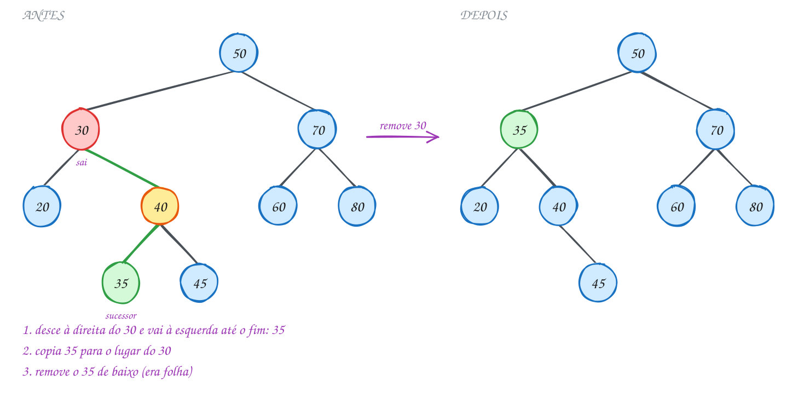</p>

A função completa, no `bst.c`:

```c
No *bst_remove(No *r, int chave) {
    if (r == NULL) {
        return NULL; // não achou: nada a remover
    }
    if (chave < r->chave) {
        r->esq = bst_remove(r->esq, chave);
    } else if (chave > r->chave) {
        r->dir = bst_remove(r->dir, chave);
    } else if (r->esq == NULL || r->dir == NULL) {
        // folha ou um filho: o filho (ou NULL) sobe para o lugar do nó
        No *filho = r->esq != NULL ? r->esq : r->dir;
        free(r);
        return filho;
    } else {
        // dois filhos: copia o sucessor (o menor da direita) e remove ele lá
        No *suc = r->dir;
        while (suc->esq != NULL) {
            suc = suc->esq;
        }
        r->chave = suc->chave;
        r->dir = bst_remove(r->dir, suc->chave);
    }
    return r;
}
```

O cliente remove as três matrículas e mostra a pré-ordem depois de cada passo.
A pré-ordem começa pela raiz e desce, então ela revela a **forma** da árvore (a em
ordem sairia sempre crescente e não mostraria nada):

```c
#include <stdio.h>
#include "bst.h"

void pre(const No *r) {
    if (r == NULL) {
        return;
    }
    printf(" %d", r->chave);
    pre(r->esq);
    pre(r->dir);
}

void mostra(const char *rotulo, const No *r) {
    printf("%-11s pré:", rotulo);
    pre(r);
    printf("\n");
}

int main(void) {
    int matriculas[] = {50, 30, 70, 20, 40, 60, 80, 35, 45};
    No *raiz = NULL;
    for (int i = 0; i < 9; i++) {
        raiz = bst_insere(raiz, matriculas[i]);
    }
    mostra("Antes", raiz);

    raiz = bst_remove(raiz, 30); // dois filhos: o sucessor 35 assume
    mostra("Remove 30", raiz);
    raiz = bst_remove(raiz, 40); // um filho: o 45 sobe
    mostra("Remove 40", raiz);
    raiz = bst_remove(raiz, 20); // folha: só sai
    mostra("Remove 20", raiz);
    raiz = bst_remove(raiz, 99); // não existe: nada muda
    mostra("Remove 99", raiz);

    raiz = bst_libera(raiz);
    return 0;
}
// Saída:
// Antes       pré: 50 30 20 40 35 45 70 60 80
// Remove 30   pré: 50 35 20 40 45 70 60 80
// Remove 40   pré: 50 35 20 45 70 60 80
// Remove 20   pré: 50 35 45 70 60 80
// Remove 99   pré: 50 35 45 70 60 80
```

Repara no fluxograma: o caminho verde é a chamada que encontra o 30. Ela cai no
caso de dois filhos, copia o 35 e faz uma **segunda remoção**, dessa vez do 35,
que vai terminar no caso fácil (o 35 é folha):

<p align="center">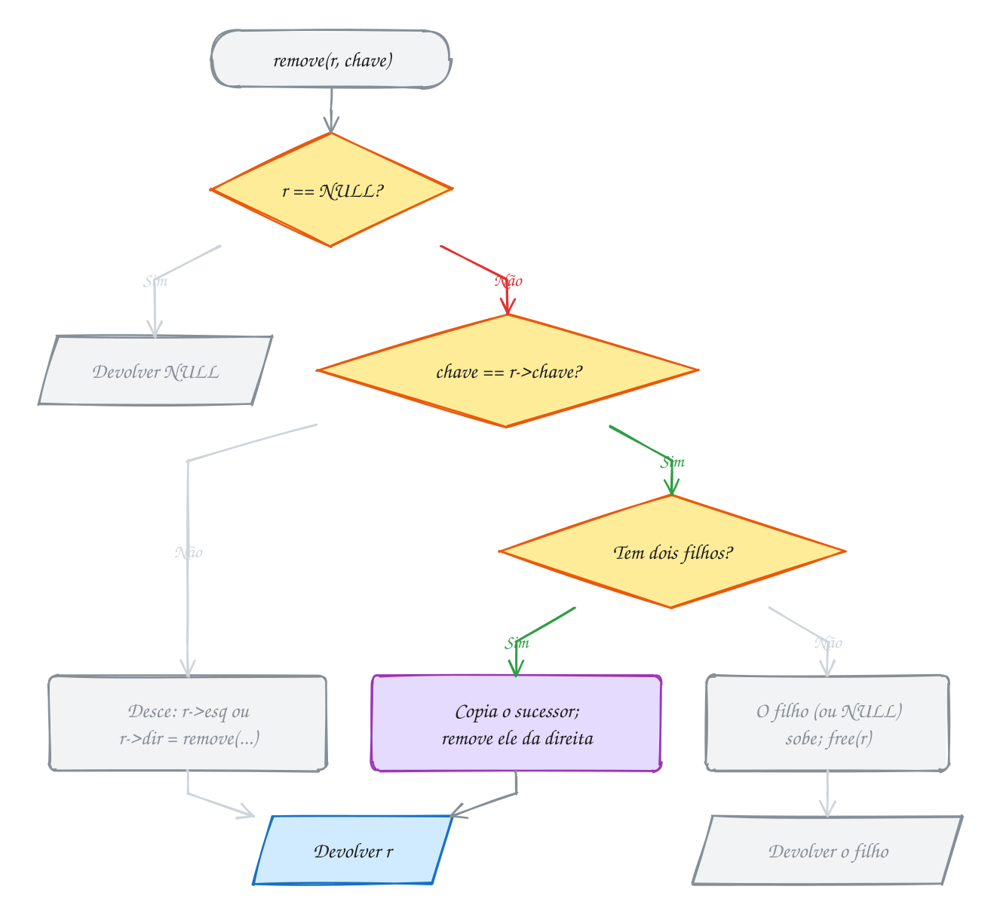</p>

> [!WARNING]
> Esquecer de atribuir o retorno é o erro clássico. Com `bst_remove(raiz->esq,
> 20);` solto, a função dá `free` no 20, mas o pai continua apontando para o
> endereço antigo: um **ponteiro solto**. A próxima em ordem lê memória
> devolvida e o AddressSanitizer acusa `heap-use-after-free`. A mesma coisa na
> raiz: remover a última chave sem `raiz = ...` deixa `raiz` apontando para o
> nada.

> [!TIP]
> **Por dentro do C:** a remoção com dois filhos não move nó nenhum: ela copia
> **só a chave** e libera o nó do sucessor, lá embaixo. É barato com um `int`.
> Se o nó guardasse uma struct grande (nome, endereço, histórico), copiar
> custaria caro e invalidaria ponteiros que alguém guardou para o nó. Aí a saída
> é religar os ponteiros e mover o nó inteiro, sem copiar dado (o livro do
> Feofiloff faz assim). O custo continua O(altura): uma descida para achar o nó,
> outra para achar o sucessor.

> [!NOTE]
> **Pergunta para você:** na árvore do início, se você remover o **50** (a raiz),
> quem assume o lugar? E se depois remover a nova raiz, quem assume? Confira
> com o exemplo A200.

### Hora de praticar

Os arquivos ficam em [`0100-bst-remocao/`](0100-bst-remocao/). Os comandos funcionam de qualquer pasta do terminal. Nos exemplos, rode, mude, quebre e rode de novo. Nos exercícios, a resposta vai dentro do próprio arquivo. ★☆☆ é aquecimento, ★★☆ pede raciocínio e ★★★ é desafio.

**Exemplo A199 · Quando o sucessor também tem filho**

```c
#include <stdio.h>
#include "bst.h"

void pre(const No *r) {
    if (r == NULL) {
        return;
    }
    printf(" %d", r->chave);
    pre(r->esq);
    pre(r->dir);
}

void mostra(const char *rotulo, const No *r) {
    printf("%-14s pré:", rotulo);
    pre(r);
    printf(" (raiz %d)\n", r->chave);
}

int main(void) {
    // códigos dos produtos do estoque do mercadinho
    int codigos[] = {40, 20, 60, 50, 70, 55, 52};
    No *raiz = NULL;
    for (int i = 0; i < 7; i++) {
        raiz = bst_insere(raiz, codigos[i]);
    }
    mostra("Antes", raiz);

    // a raiz tem dois filhos; o sucessor (50) não é folha: tem o 55 à direita.
    // o 50 sobe para a raiz e o 55 (com o 52) sobe para o lugar dele
    raiz = bst_remove(raiz, 40);
    mostra("Remove 40", raiz);

    // o 20 era o único à esquerda: agora a raiz só tem filho direito
    raiz = bst_remove(raiz, 20);
    mostra("Remove 20", raiz);

    // raiz com UM filho: nada de sucessor, o filho direito vira a raiz
    raiz = bst_remove(raiz, 50);
    mostra("Remove 50", raiz);

    raiz = bst_libera(raiz);
    return 0;
}
// Saída:
// Antes          pré: 40 20 60 50 55 52 70 (raiz 40)
// Remove 40      pré: 50 20 60 55 52 70 (raiz 50)
// Remove 20      pré: 50 60 55 52 70 (raiz 50)
// Remove 50      pré: 60 55 52 70 (raiz 60)
```

```bash
~/LPEDC/rodar 14-arvores/0100-bst-remocao/A199.c
```

**Exemplo A200 · Até a raiz vai embora**

```c
#include <stdio.h>
#include "bst.h"

int main(void) {
    int matriculas[] = {50, 30, 70, 20, 40, 60, 80};
    No *raiz = NULL;
    for (int i = 0; i < 7; i++) {
        raiz = bst_insere(raiz, matriculas[i]);
    }

    // remove sempre a raiz: o ponteiro raiz muda a cada passo
    while (raiz != NULL) {
        int sai = raiz->chave;
        raiz = bst_remove(raiz, sai);
        printf("Saiu %d, nova raiz: ", sai);
        if (raiz == NULL) {
            printf("NULL (árvore vazia)\n");
        } else {
            printf("%d, em ordem:", raiz->chave);
            bst_em_ordem(raiz);
            printf("\n");
        }
    }
    return 0; // nada a liberar: remove já deu free em cada nó
}
// Saída:
// Saiu 50, nova raiz: 60, em ordem: 20 30 40 60 70 80
// Saiu 60, nova raiz: 70, em ordem: 20 30 40 70 80
// Saiu 70, nova raiz: 80, em ordem: 20 30 40 80
// Saiu 80, nova raiz: 30, em ordem: 20 30 40
// Saiu 30, nova raiz: 40, em ordem: 20 40
// Saiu 40, nova raiz: 20, em ordem: 20
// Saiu 20, nova raiz: NULL (árvore vazia)
```

```bash
~/LPEDC/rodar 14-arvores/0100-bst-remocao/A200.c
```

#### Exercícios

**Exercício E595** · ★☆☆

O main monta a BST inserindo nesta ordem:


```text
60 25 80 10 40 70 90 35 50
```


e depois remove, um de cada vez, o 10, o 80 e o 25. Complete a função
caso(r, chave), que acha o nó da chave e devolve qual dos três casos da
remoção ele é: "folha", "um filho" ou "dois filhos" (ou "não existe"). O
main chama caso ANTES de cada bst_remove e mostra a pré-ordem depois:


```text
Saída esperada:
Antes:                  pré 60 25 10 40 35 50 80 70 90
Sem o 10 (folha):       pré 60 25 40 35 50 80 70 90
Sem o 80 (dois filhos): pré 60 25 40 35 50 90 70
Sem o 25 (um filho):    pré 60 40 35 50 90 70
```

**Dicas:**

1. Ache o nó com bst_busca. Se vier NULL, devolva "não existe".
2. Conte quantos dos dois ponteiros (esq e dir) não são NULL: 0, 1 ou 2.
3. Resposta esperada: a saída acima. O 25 tinha dois filhos no começo, mas
   depois que o 10 saiu ficou só com o 40.

```bash
~/LPEDC/rodar 14-arvores/0100-bst-remocao/E595.c
```

**Exercício E596** · ★☆☆

No banco, as senhas de espera ficam numa BST e a menor senha é sempre a
próxima a ser chamada. Complete remove_menor(r, &senha): ela tira o nó com
a menor chave, guarda essa chave em *senha e devolve a nova raiz. Não use
bst_remove: escreva a remoção direto. Pode supor a árvore não vazia.


```text
Saída esperada:
Chamando 20, restam: 30 40 50 70
Chamando 30, restam: 40 50 70
Chamando 40, restam: 50 70
```

**Dicas:**

1. O menor é o nó mais à esquerda. Ele não tem filho esquerdo, mas pode ter
   filho direito.
2. Recursivo: se r->esq == NULL, o menor é r: guarde a chave, pegue
   r->dir, dê free(r) e devolva r->dir guardado. Senão,
   r->esq = remove_menor(r->esq, senha) e devolva r.
3. Resposta esperada: a saída acima. Na terceira chamada, o 40 é o menor e
   a raiz 30 já saiu: quem é a raiz depois?

```bash
~/LPEDC/rodar 14-arvores/0100-bst-remocao/E596.c
```

**Exercício E597** · ★★☆

O bst_remove do TAD usa o sucessor. Escreva remove_antecessor(r, chave),
a mesma remoção, mas que no caso de dois filhos usa o ANTECESSOR: a maior
chave da subárvore esquerda. Teste na árvore das matrículas do texto,
removendo o 30 e depois o 50:


```text
Saída esperada:
Antes:     pré 50 30 20 40 35 45 70 60 80
Sem o 30:  pré 50 20 40 35 45 70 60 80
Sem o 50:  pré 45 20 40 35 70 60 80
```

**Dicas:**

1. O antecessor: desça uma vez à esquerda e depois à direita até o fim.
   Ele nunca tem filho direito.
2. Copie a chave dele para r e chame remove_antecessor(r->esq, ...) com a
   chave do antecessor.
3. Resposta esperada: a saída acima. Sem o 30, o 20 assume (era folha).
   Sem o 50, o 45 vira a raiz.

```bash
~/LPEDC/rodar 14-arvores/0100-bst-remocao/E597.c
```

**Exercício E598** · ★★☆

Ache o bug. Esta é uma cópia da remoção do TAD com UMA linha diferente.
Ela deveria remover o 30 da árvore das matrículas, mas depois da remoção
o 35 aparece duas vezes:


```text
Saída esperada:
Em ordem: 20 35 40 45 50 60 70 80
```


```text
Saída que aparece:
Em ordem: 20 35 35 40 45 50 60 70 80
```


Ache a linha, conserte e rode até aparecer a saída esperada.

**Dicas:**

1. O 35 foi copiado para o lugar do 30. E depois, qual chave a chamada
   recursiva tenta remover da subárvore direita?
2. Existe algum 30 na subárvore direita do (antigo) 30?
3. Resposta esperada: a última linha do else (a dos dois filhos),
   "r->dir = remove_errado(r->dir, chave);", deveria usar suc->chave.
   Com chave (30), a recursão procura um 30 que não existe à direita e
   não remove nada: o 35 fica duplicado. Não há
   erro de memória porque nenhum nó foi liberado nem perdido; o bst_libera
   do fim libera todos. Consertado: 20 35 40 45 50 60 70 80.

```bash
~/LPEDC/rodar 14-arvores/0100-bst-remocao/E598.c
```

**Exercício E599** · ★★★

A academia vai encerrar a turma das matrículas de 35 a 65. Escreva
remove_faixa(r, a, b), que remove da BST todas as chaves no intervalo
[a, b] e devolve a nova raiz. Teste na árvore das matrículas do texto:


```text
Saída esperada:
Antes:  20 30 35 40 45 50 60 70 80
Depois: 20 30 70 80
Raiz: 70, altura: 2
```

**Dicas:**

1. Pense em pós-ordem: primeiro limpe as duas subárvores
   (r->esq = remove_faixa(r->esq, a, b), idem à direita) e só depois
   decida o que fazer com o próprio r.
2. Se a chave de r estiver na faixa, use r = bst_remove(r, r->chave).
   Como as subárvores já foram limpas, nenhuma chave da faixa sobra lá.
   (Bônus: dá para pular subárvores inteiras, como no E591.)
3. Resposta esperada: a saída acima. A raiz 50 sai; o sucessor dela, já
   sem o 60, é o 70.

```bash
~/LPEDC/rodar 14-arvores/0100-bst-remocao/E599.c
```

**Exercício E600** · ★★★

Ache o bug (este programa quebra de propósito). A recepção guarda um
ponteiro para a ficha do aluno 35, porque vai precisar dela depois. Em
seguida cancela a matrícula 30 e tenta mostrar a ficha do 35:


```text
Saída esperada:
Ficha guardada: 35
Ficha depois de remover o 30: 35
```


Mas o AddressSanitizer para o programa com "heap-use-after-free". O 35
nem foi removido! Rode, leia o relatório (procure "freed by"), conserte
sem mexer no bst.c e rode de novo até sair a saída esperada, sem erro.

**Dicas:**

1. O 30 tem dois filhos. Quem é o sucessor dele? O que o bst_remove faz com
   o NÓ do sucessor depois de copiar a chave?
2. A chave 35 continua na árvore, mas em outro nó (o que antes era do 30).
3. Resposta esperada: o bst_remove copiou o 35 para o nó do 30 e deu free
   no nó original do 35, justamente o que o ponteiro "ficha" guardava. A
   ficha virou um ponteiro solto. Conserto: depois de qualquer remoção,
   busque de novo (ficha = bst_busca(raiz, 35)). Moral: um ponteiro para
   um nó só vale até a próxima mudança na árvore.

```bash
~/LPEDC/rodar 14-arvores/0100-bst-remocao/E600.c
```

---

## 0101 · AVL: balanceamento e rotações

A lanchonete numera os pedidos: 10, 20, 30, 40... Eles chegam **sempre em ordem
crescente**. Se você guardar os pedidos numa BST comum, cada pedido novo vira
filho direito do anterior, e a árvore vira uma lista com altura n - 1. Com mil
pedidos, achar o último custa mil comparações. A BST é ótima até receber dados
ordenados, que é justamente o que mais acontece na vida real.

A saída é uma BST que se **conserta sozinha** a cada inserção. A mais antiga
delas é a **AVL** (das iniciais de Adelson-Velsky e Landis, que a publicaram em
1962). A regra: em **todo** nó, as alturas das duas subárvores diferem de no
máximo 1.

Para conferir a regra, cada nó guarda a própria altura e calcula o **fator de
balanceamento**: `fb = altura(esq) - altura(dir)`. Na AVL, todo nó tem fator
-1, 0 ou 1. Fator 2 quer dizer "pesado à esquerda"; -2, "pesado à direita".

Com essa regra, a altura de uma AVL nunca passa de uns 1,44 · log₂ n. Mil
pedidos cabem em altura 9, e não 999.

A inserção começa igual à da BST: desce e pendura uma folha. A diferença está
na **volta** da recursão. Cada ancestral do nó novo, de baixo para cima,
atualiza a altura e confere o fator. Se achar um 2 ou um -2, conserta ali mesmo
com uma **rotação**.

Uma **rotação** é uma troca de dois ponteiros que faz um filho subir e o pai
descer, **sem quebrar a ordem da BST**. Na rotação à esquerda no nó `r`, o filho
direito `d` sobe, `r` vira filho esquerdo de `d`, e a antiga subárvore esquerda
de `d` (chaves entre `r` e `d`) passa a ser a direita de `r`. A em ordem
continua igual; só a forma muda.

Qual rotação usar depende de onde o peso está:

| Caso | Fator do nó | Fator do filho pesado | Conserto |
| --- | --- | --- | --- |
| esquerda-esquerda | +2 | +1 ou 0 (esquerdo) | rotação à direita no nó |
| direita-direita | -2 | -1 ou 0 (direito) | rotação à esquerda no nó |
| esquerda-direita | +2 | -1 (esquerdo) | à esquerda no filho, depois à direita no nó |
| direita-esquerda | -2 | +1 (direito) | à direita no filho, depois à esquerda no nó |

Os dois últimos são a **rotação dupla**: o caminho até o nó novo faz um
"zigue-zague", e uma rotação só não resolve. A primeira rotação endireita o
zigue-zague; a segunda equilibra.

Vamos ver na prática. Inserir 10, 20 e 30 deixa o 10 com fator -2 e o filho com
-1: direita-direita, uma rotação à esquerda no 10 e o 20 sobe. Mais adiante,
com a árvore 20 (10, 40 (30, 50)), inserir o 25 deixa o 20 com -2 e o filho 40
com +1: zigue-zague, rotação dupla. O 30 acaba na raiz:

<p align="center">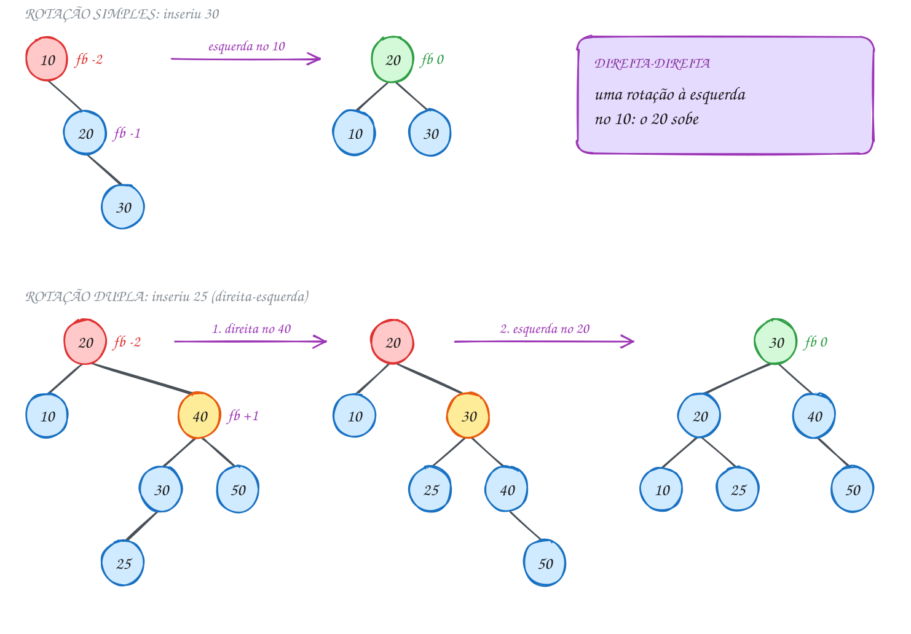</p>

As rotações e o rebalanceamento, no `avl.c`:

```c
static No *rot_esquerda(No *r) {
    No *d = r->dir;
    r->dir = d->esq; // a subárvore do meio muda de pai
    d->esq = r;
    atualiza(r);     // r agora está embaixo: primeiro ele
    atualiza(d);
    return d;        // d é a nova raiz desta subárvore
}

static No *rebalanceia(No *r) {
    atualiza(r);
    int fb = avl_fator(r);
    if (fb > 1) {                    // pesado à esquerda
        if (avl_fator(r->esq) < 0) { // zigue-zague: dupla
            r->esq = rot_esquerda(r->esq);
        }
        return rot_direita(r);
    }
    if (fb < -1) {                   // pesado à direita
        if (avl_fator(r->dir) > 0) { // zigue-zague: dupla
            r->dir = rot_direita(r->dir);
        }
        return rot_esquerda(r);
    }
    return r;
}
```

A `avl_insere` é a `bst_insere` com uma linha trocada: em vez de `return r`, ela
termina com `return rebalanceia(r)`. O cliente insere os pedidos e acompanha a
forma da árvore pela pré-ordem:

```c
#include <stdio.h>
#include "avl.h"

int main(void) {
    int pedidos[] = {10, 20, 30, 40, 50, 25};
    No *raiz = NULL;

    for (int i = 0; i < 6; i++) {
        raiz = avl_insere(raiz, pedidos[i]);
        printf("Insere %d: pré", pedidos[i]);
        avl_pre_ordem(raiz);
        printf(" | altura %d | rotações %d\n", avl_altura(raiz), avl_rotacoes());
    }

    raiz = avl_libera(raiz);
    return 0;
}
// Saída:
// Insere 10: pré 10 | altura 0 | rotações 0
// Insere 20: pré 10 20 | altura 1 | rotações 0
// Insere 30: pré 20 10 30 | altura 1 | rotações 1
// Insere 40: pré 20 10 30 40 | altura 2 | rotações 1
// Insere 50: pré 20 10 40 30 50 | altura 2 | rotações 2
// Insere 25: pré 30 20 10 25 40 50 | altura 2 | rotações 4
```

Repara no fluxograma: é o que cada ancestral faz na volta. O caminho verde é o
do nó 20 quando o 25 chega: fator -2, filho direito com fator +1, então duas
rotações:

<p align="center">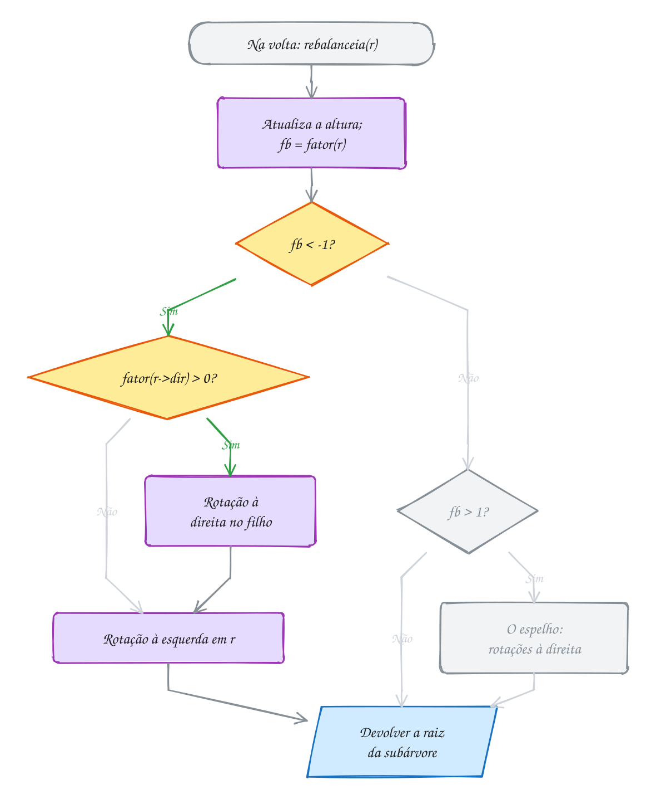</p>

### Passo a passo

| Insere | Quem fica desequilibrado | Caso | Rotação | Raiz depois |
| --- | --- | --- | --- | --- |
| 10, 20 | ninguém | | | 10 |
| 30 | 10 (fb -2; filho 20 com -1) | direita-direita | esquerda no 10 | 20 |
| 40 | ninguém (20 fica com -1) | | | 20 |
| 50 | 30 (fb -2; filho 40 com -1) | direita-direita | esquerda no 30 | 20 |
| 25 | 20 (fb -2; filho 40 com +1) | direita-esquerda | direita no 40, esquerda no 20 | 30 |

Sem a AVL, a mesma sequência daria uma BST de altura 4 (10, 20, 30, 40, 50 em
fila, com o 25 pendurado no 30).

> [!WARNING]
> No zigue-zague, a rotação simples **não conserta**: ela só espelha o
> problema. Na árvore 20 (10, 40 (30 (25), 50)), girar à esquerda no 20 faz o 40
> subir com fator +2 do outro lado. Por isso o código olha o fator do **filho**
> antes de girar. Outro erro comum: girar e não ligar o resultado de volta no
> pai. A rotação devolve a nova raiz da subárvore; sem `r->dir = rot_direita(r->dir)`
> ou `return rot_esquerda(r)`, o pai continua apontando para o nó que desceu.

> [!TIP]
> **Por dentro do C:** a AVL guarda um `int altura` a mais em cada nó, e mesmo
> assim o nó continua com 24 bytes: os 4 bytes de enchimento que a BST
> desperdiçava entre o `int chave` e os ponteiros agora guardam a altura. Uma
> rotação mexe em 3 ponteiros e 2 alturas, custo O(1). Cada inserção faz no
> máximo uma rotação (simples ou dupla) e sobe O(log n) níveis atualizando
> alturas. O exemplo A202 insere mil pedidos em ordem: a BST comum fica com
> altura 999, a AVL com 9.

> [!NOTE]
> **Pergunta para você:** insira 1, 2, 3, 4, 5, 6 e 7, nesta ordem, numa AVL
> vazia. Quantas rotações acontecem e qual é a árvore final? Desenhe antes de
> conferir no exercício E602.

### Hora de praticar

Os arquivos ficam em [`0101-avl/`](0101-avl/). Os comandos funcionam de qualquer pasta do terminal. Nos exemplos, rode, mude, quebre e rode de novo. Nos exercícios, a resposta vai dentro do próprio arquivo. ★☆☆ é aquecimento, ★★☆ pede raciocínio e ★★★ é desafio.

**Exemplo A201 · Os quatro casos, três chaves cada**

```c
#include <stdio.h>
#include "avl.h"

// insere as três chaves numa AVL nova e mostra quantas rotações custou
void testa(const char *caso, int a, int b, int c) {
    int antes = avl_rotacoes(); // o contador é um só para o programa todo
    No *r = NULL;
    r = avl_insere(r, a);
    r = avl_insere(r, b);
    r = avl_insere(r, c);
    printf("%-18s %d %d %d -> pré", caso, a, b, c);
    avl_pre_ordem(r);
    printf(" | rotações %d\n", avl_rotacoes() - antes);
    r = avl_libera(r);
}

int main(void) {
    // em linha reta: uma rotação simples resolve
    testa("esquerda-esquerda", 30, 20, 10);
    testa("direita-direita", 10, 20, 30);
    // em zigue-zague: primeiro endireita o filho, depois gira o avô
    testa("esquerda-direita", 30, 10, 20);
    testa("direita-esquerda", 10, 30, 20);
    // nenhum desequilíbrio: o do meio chegou primeiro
    testa("nenhum caso", 20, 10, 30);
    return 0;
}
// Saída:
// esquerda-esquerda  30 20 10 -> pré 20 10 30 | rotações 1
// direita-direita    10 20 30 -> pré 20 10 30 | rotações 1
// esquerda-direita   30 10 20 -> pré 20 10 30 | rotações 2
// direita-esquerda   10 30 20 -> pré 20 10 30 | rotações 2
// nenhum caso        20 10 30 -> pré 20 10 30 | rotações 0
```

```bash
~/LPEDC/rodar 14-arvores/0101-avl/A201.c
```

**Exemplo A202 · Mil pedidos: BST comum contra AVL**

```c
#include <stdio.h>
#include <stdlib.h>
#include "avl.h"

// uma BST comum, sem balancear, só para comparar (nomes diferentes do TAD)
typedef struct Comum {
    int chave;
    struct Comum *esq, *dir;
} Comum;

Comum *comum_insere(Comum *r, int chave) {
    if (r == NULL) {
        Comum *n = malloc(sizeof(Comum));
        if (n == NULL) {
            exit(1);
        }
        n->chave = chave;
        n->esq = n->dir = NULL;
        return n;
    }
    if (chave < r->chave) {
        r->esq = comum_insere(r->esq, chave);
    } else if (chave > r->chave) {
        r->dir = comum_insere(r->dir, chave);
    }
    return r;
}

int comum_altura(const Comum *r) {
    if (r == NULL) {
        return -1;
    }
    int he = comum_altura(r->esq);
    int hd = comum_altura(r->dir);
    return 1 + (he > hd ? he : hd);
}

void comum_libera(Comum *r) {
    if (r != NULL) {
        comum_libera(r->esq);
        comum_libera(r->dir);
        free(r);
    }
}

int main(void) {
    Comum *bst = NULL;
    No *avl = NULL;
    for (int pedido = 1; pedido <= 1000; pedido++) { // em ordem crescente
        bst = comum_insere(bst, pedido);
        avl = avl_insere(avl, pedido);
    }

    printf("BST comum: altura %d\n", comum_altura(bst));
    printf("AVL:       altura %d, raiz %d, rotações %d\n",
           avl_altura(avl), avl->chave, avl_rotacoes());
    printf("Busca do pedido 1000: até %d comparações na BST, até %d na AVL\n",
           comum_altura(bst) + 1, avl_altura(avl) + 1);

    comum_libera(bst);
    avl = avl_libera(avl);
    return 0;
}
// Saída:
// BST comum: altura 999
// AVL:       altura 9, raiz 512, rotações 990
// Busca do pedido 1000: até 1000 comparações na BST, até 10 na AVL
```

```bash
~/LPEDC/rodar 14-arvores/0101-avl/A202.c
```

#### Exercícios

**Exercício E601** · ★☆☆

O main monta à mão esta BST (sem campo de altura, com o struct Arv do
próprio arquivo):


```text
50
├── esq: 30
│   ├── esq: 20
│   │   └── esq: 10
│   └── dir: 40
└── dir: 70
    └── dir: 80
        └── dir: 90
```


Complete altura(r) e relatorio(r). A relatorio mostra, em pré-ordem, a
altura e o fator de balanceamento (altura da esquerda menos altura da
direita) de cada nó, e marca com "<- desequilibrado" quem tem fator fora
de -1..1. No fim, o main diz se a árvore é AVL.


```text
Saída esperada:
50: altura 3, fator 0
30: altura 2, fator 1
20: altura 1, fator 1
10: altura 0, fator 0
40: altura 0, fator 0
70: altura 2, fator -2 <- desequilibrado
80: altura 1, fator -1
90: altura 0, fator 0
É AVL? não
```

**Dicas:**

1. altura: vazia devolve -1; senão, 1 + a maior altura entre os filhos.
2. relatorio devolve quantos nós desequilibrados achou (o do nó mais os
   das duas subárvores); a árvore é AVL quando o total é 0.
3. Resposta esperada: a saída acima. O 70 cai no caso direita-direita.

```bash
~/LPEDC/rodar 14-arvores/0101-avl/E601.c
```

**Exercício E602** · ★☆☆

O main insere os pedidos de 1 a 7, em ordem, numa AVL do TAD avl.h. Com 5
e com 7 chaves ele mostra a pré-ordem e chama fatores(r), que você vai
escrever: ela percorre a árvore em ordem e mostra cada chave com o fator
de balanceamento dela entre parênteses (use avl_fator).


```text
Saída esperada:
Com 5 chaves: pré 2 1 4 3 5
  fatores: 1(0) 2(-1) 3(0) 4(0) 5(0)
Com 7 chaves: pré 4 2 1 3 6 5 7
  fatores: 1(0) 2(0) 3(0) 4(0) 5(0) 6(0) 7(0)
Rotações: 4
```

**Dicas:**

1. É uma em ordem: esquerda, o nó, direita. Árvore vazia não imprime nada.
2. Cada chave sai como printf(" %d(%d)", r->chave, avl_fator(r)).
3. Resposta esperada: a saída acima. Com 5 chaves a raiz 2 pende para a
   direita (fator -1) e mesmo assim é AVL; com 7 a árvore fica perfeita.

```bash
~/LPEDC/rodar 14-arvores/0101-avl/E602.c
```

**Exercício E603** · ★★☆

Escreva altura_se_avl(r): ela devolve a altura da árvore se ela respeitar a
regra da AVL em todos os nós, ou -2 se algum nó tiver fator fora de
-1..1. A árvore aqui é uma árvore binária simples, sem campo de altura (o
struct Arv do próprio arquivo). Regra extra: visite cada nó UMA vez só.

O main testa a árvore do E601 e a versão consertada dela:


```text
Saída esperada:
Árvore 1: não é AVL
Árvore 2: é AVL, altura 3
```

**Dicas:**

1. A solução ingênua chama uma função altura() em cada nó, e cada chamada
   percorre a subárvore de novo: O(n²). Calcule a altura e confira o
   fator na mesma volta da recursão.
2. Vazia devolve -1. Peça a altura das duas subárvores; se alguma vier -2,
   devolva -2. Se a diferença passar de 1, devolva -2. Senão, devolva
   1 + a maior.
3. Resposta esperada: a saída acima.

```bash
~/LPEDC/rodar 14-arvores/0101-avl/E603.c
```

**Exercício E604** · ★★☆

A rotação à direita está pronta. Complete gira_esquerda(r), o espelho
dela: o filho direito sobe, r desce para a esquerda, a subárvore do meio
muda de pai e as duas alturas são recalculadas na ordem certa. Ela devolve
a nova raiz. Os testes giram duas árvores montadas à mão:


```text
Saída esperada:
Teste 1: pré 20 10 30 | altura da raiz 1
Teste 2: pré 60 40 20 50 70 | altura da raiz 2
```

**Dicas:**

1. Copie gira_direita e troque esq por dir em todo lugar.
2. A subárvore do meio é d->esq: ela vira r->dir. Atualize primeiro r (que
   ficou embaixo) e depois d.
3. Resposta esperada: a saída acima. No teste 2, o 50 era filho esquerdo
   do 60 e passa a ser filho direito do 40.

```bash
~/LPEDC/rodar 14-arvores/0101-avl/E604.c
```

**Exercício E605** · ★★★

Ache o bug. Esta é uma AVL escrita do zero (sem o avl.h), com UM erro
numa das rotações. Ela insere os pedidos de 1 a 15, em ordem. Uma AVL
certa termina perfeita, com altura 3, e a altura guardada na raiz bate
com a altura de verdade (contada percorrendo a árvore):


```text
Saída esperada:
pré: 8 4 2 1 3 6 5 7 12 10 9 11 14 13 15
altura guardada na raiz: 3, altura real: 3
```


Rode e compare. O programa não quebra; o erro é de lógica. Ache a linha,
conserte e rode até a saída ficar igual à esperada.

**Dicas:**

1. A altura de um nó é calculada a partir das alturas dos filhos. Depois
   da rotação, quem é filho de quem?
2. Compare gira_esq com gira_dir, linha por linha.
3. Resposta esperada: em gira_esq, "atualiza(d);" vem antes de
   "atualiza(r);". Mas r virou filho de d: d é recalculado com a altura
   VELHA de r, e a altura de d fica errada. Os fatores dos ancestrais saem
   errados, e a árvore deixa de girar quando devia. Trocando as duas
   linhas, a saída fica igual à esperada.

```bash
~/LPEDC/rodar 14-arvores/0101-avl/E605.c
```

**Exercício E606** · ★★★

Escreva do zero (sem o avl.h) uma AVL que, a cada rotação, conta qual dos
quatro casos aconteceu e em qual nó. Insira estes pedidos, nesta ordem:


```text
30 25 15 45 60 35 20
```


```text
Saída esperada:
Insere 15: esquerda-esquerda no 30
Insere 60: direita-direita no 30
Insere 35: direita-esquerda no 25
Insere 20: esquerda-direita no 25
Em ordem: 15 20 25 30 35 45 60
Pré-ordem: 30 20 15 25 45 35 60
```


(Pedidos que não causam rotação não imprimem nada.)

**Dicas:**

1. Struct com chave, altura, esq e dir; funções altura, fator, atualiza,
   gira_dir e gira_esq como no texto.
2. Para imprimir "Insere X", passe a chave que está sendo inserida como
   parâmetro extra da função recursiva. O caso sai do fator do nó (+2 ou
   -2) e do fator do filho do lado pesado.
3. Resposta esperada: a saída acima. Libere tudo no fim.

```bash
~/LPEDC/rodar 14-arvores/0101-avl/E606.c
```

---

## 0102 · Heap e fila de prioridade

No pronto-socorro, ninguém é atendido por ordem de chegada. A triagem dá uma
nota de gravidade a cada paciente, e o próximo a entrar é sempre o **mais
grave** de quem está esperando. Chegou alguém com infarto? Passa na frente de
todo mundo.

Isso é uma **fila de prioridade**: você insere elementos com uma prioridade e
sempre tira o de **maior** prioridade. Dá para fazer com o que você já sabe, mas
tudo custa caro. Num vetor solto, inserir é O(1) e achar o máximo é O(n). Num
vetor ordenado, tirar o máximo é O(1), mas inserir é O(n). Numa BST, os dois são
O(log n) só se ela estiver equilibrada.

O **heap** (de máximo) faz as duas operações em O(log n), sempre, e sem um
ponteiro sequer. Ele é uma árvore binária com duas regras:

- **forma**: a árvore é **completa**: todos os níveis cheios, menos talvez o
  último, que se enche da esquerda para a direita;
- **ordem**: todo pai é **maior ou igual** aos filhos. Logo, o máximo está
  sempre na raiz.

Repare que a regra de ordem é mais fraca que a da BST: não importa quem fica à
esquerda ou à direita, nem se um primo é maior que o outro. Por isso o heap não
serve para buscar uma chave qualquer. Ele só sabe responder "quem é o maior?".

A regra de forma é o pulo do gato. Uma árvore completa cabe **num vetor**, nível
por nível, sem buracos. A raiz fica em `v[0]` e, para qualquer índice `i`:

| Quem | Índice |
| --- | --- |
| pai de `i` | `(i - 1) / 2` (divisão inteira) |
| filho esquerdo | `2 * i + 1` |
| filho direito | `2 * i + 2` |

As duas operações consertam o heap andando por um único caminho:

- **inserir**: o novo entra no fim do vetor (a próxima vaga da árvore) e **sobe**:
  enquanto for maior que o pai, troca com ele;
- **remover o máximo**: a raiz sai, o último elemento do vetor vai para o lugar
  dela e **desce**: enquanto for menor que algum filho, troca com o **maior**
  dos filhos.

A árvore tem altura ⌊log₂ n⌋, então subir ou descer custa no máximo isso.

Vamos ver na prática. Chegam pacientes com gravidade 40, 70, 20, 90, 50 e 30.
Depois das seis chegadas, o heap é `[90 70 30 40 50 20]`. A árvore e o vetor são
a mesma coisa: o 70 está no índice 1, e os filhos dele ficam nos índices 3 e 4:

<p align="center">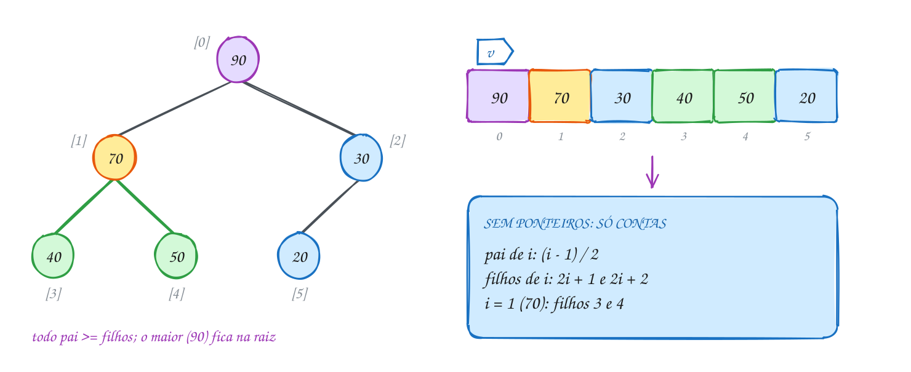</p>

O TAD guarda o vetor, quantos elementos tem e quantos cabem. As duas peças do
`heap.c` que fazem o trabalho:

```c
// o elemento em i sobe enquanto for maior que o pai
static void sobe(Heap *h, int i) {
    while (i > 0 && h->v[(i - 1) / 2] < h->v[i]) {
        troca(&h->v[(i - 1) / 2], &h->v[i]);
        i = (i - 1) / 2;
    }
}

// o elemento em i desce, trocando com o MAIOR dos filhos
static void desce(Heap *h, int i) {
    while (2 * i + 1 < h->n) {
        int f = 2 * i + 1;                       // filho esquerdo
        if (f + 1 < h->n && h->v[f + 1] > h->v[f]) {
            f++;                                 // o direito é maior
        }
        if (h->v[i] >= h->v[f]) {
            break;                               // já está no lugar
        }
        troca(&h->v[i], &h->v[f]);
        i = f;
    }
}
```

O cliente só vê `heap_insere` e `heap_remove`:

```c
#include <stdio.h>
#include "heap.h"

int main(void) {
    // gravidade de cada paciente, na ordem em que chegaram (maior = mais urgente)
    int chegada[] = {40, 70, 20, 90, 50, 30};
    Heap *fila = heap_cria(10);

    for (int i = 0; i < 6; i++) {
        heap_insere(fila, chegada[i]);
        printf("Chega %d: ", chegada[i]);
        heap_mostra(fila);
        printf("\n");
    }
    for (int i = 0; i < 2; i++) {
        int atendido = heap_remove(fila);
        printf("Atende %d: ", atendido);
        heap_mostra(fila);
        printf("\n");
    }

    heap_libera(fila);
    return 0;
}
// Saída:
// Chega 40: [40]
// Chega 70: [70 40]
// Chega 20: [70 40 20]
// Chega 90: [90 70 20 40]
// Chega 50: [90 70 20 40 50]
// Chega 30: [90 70 30 40 50 20]
// Atende 90: [70 50 30 40 20]
// Atende 70: [50 40 30 20]
```

Repara no fluxograma: é a subida do 30, o último a chegar. Ele entra no índice
5, o pai dele (índice 2) é o 20, menor: troca. Agora o 30 está no índice 2 e o
pai é o 90: para. Uma troca só:

<p align="center">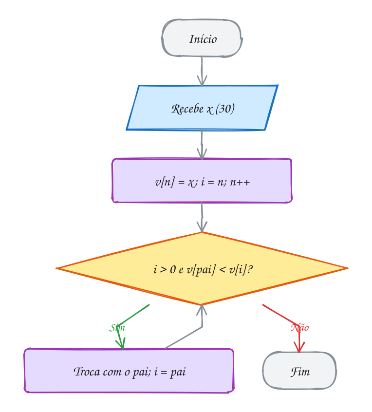</p>

### Passo a passo

A remoção do 90. O último (20) vai para a raiz e desce pelo filho maior:

| Passo | Vetor | `i` | Filhos de `i` | Maior filho | Troca? |
| --- | --- | --- | --- | --- | --- |
| tira o 90, o 20 vai para `v[0]` | `[20 70 30 40 50]` | 0 | 70, 30 | 70 (índice 1) | sim |
| | `[70 20 30 40 50]` | 1 | 40, 50 | 50 (índice 4) | sim |
| | `[70 50 30 40 20]` | 4 | (nenhum) | | para |

> [!WARNING]
> Na descida, troque com o **maior** dos filhos, não com o primeiro que for
> maior que o pai. No passo 1, o 20 é menor que o 70 e também que o 30. Trocar
> com o 30 colocaria o 30 na raiz, acima do 70: o heap quebra, e o próximo
> "atende" chamaria o paciente errado. O mesmo cuidado vale para o último
> filho: `f + 1 < h->n` confere se o filho direito existe antes de ler
> `v[f + 1]`.

> [!TIP]
> **Por dentro do C:** a palavra **heap** tem dois sentidos em C, e eles não
> têm nada a ver um com o outro. O heap do `malloc` (assunto 0053) é a região
> da memória para alocação dinâmica; o heap deste assunto é uma estrutura de
> dados. Aqui o heap de dados até mora no heap de memória (o `heap_cria` faz
> `malloc` do vetor), mas é coincidência. E por morar num vetor contíguo, o
> heap não gasta 16 bytes de ponteiros por elemento como a BST, e percorre a
> memória em sequência, o que o cache do processador adora.

> [!NOTE]
> **Pergunta para você:** o vetor `[90 70 30 40 50 20]` é um heap. E o vetor
> `[90 30 70 40 50 20]`? Desenhe a árvore e confira a regra em cada pai. Um vetor
> em ordem **decrescente** é sempre um heap?

### Hora de praticar

Os arquivos ficam em [`0102-heap/`](0102-heap/). Os comandos funcionam de qualquer pasta do terminal. Nos exemplos, rode, mude, quebre e rode de novo. Nos exercícios, a resposta vai dentro do próprio arquivo. ★☆☆ é aquecimento, ★★☆ pede raciocínio e ★★★ é desafio.

**Exemplo A203 · O leilão com vagas contadas**

```c
#include <stdio.h>
#include "heap.h"

int main(void) {
    // lances (em R$) por uma bicicleta usada; o leiloeiro só anota 4
    int lances[] = {300, 450, 450, 200, 500};
    Heap *mesa = heap_cria(4);

    for (int i = 0; i < 5; i++) {
        // heap_insere avisa quando não cabe: o vetor tem tamanho fixo, e o
        // heap recusa até o maior lance de todos
        if (heap_insere(mesa, lances[i])) {
            printf("Lance R$ %d anotado: ", lances[i]);
        } else {
            printf("Lance R$ %d recusado, mesa cheia: ", lances[i]);
        }
        heap_mostra(mesa);
        printf("\n");
    }

    // olhar o topo não tira ninguém
    printf("Maior lance agora: R$ %d\n", heap_topo(mesa));
    printf("Olhei de novo: R$ %d\n", heap_topo(mesa));

    // empate: os dois 450 continuam lá, um depois do outro
    while (!heap_vazio(mesa)) {
        printf("Sai R$ %d\n", heap_remove(mesa));
    }

    heap_libera(mesa);
    return 0;
}
// Saída:
// Lance R$ 300 anotado: [300]
// Lance R$ 450 anotado: [450 300]
// Lance R$ 450 anotado: [450 300 450]
// Lance R$ 200 anotado: [450 300 450 200]
// Lance R$ 500 recusado, mesa cheia: [450 300 450 200]
// Maior lance agora: R$ 450
// Olhei de novo: R$ 450
// Sai R$ 450
// Sai R$ 450
// Sai R$ 300
// Sai R$ 200
```

```bash
~/LPEDC/rodar 14-arvores/0102-heap/A203.c
```

**Exemplo A204 · Fila de prioridade com nome**

```c
#include <stdio.h>

#define CAP 8

// um heap de structs: a prioridade decide, o nome vai junto
typedef struct {
    int gravidade;
    const char *nome;
} Paciente;

typedef struct {
    Paciente v[CAP];
    int n;
} Triagem;

void troca(Paciente *a, Paciente *b) {
    Paciente t = *a; // struct inteira copiada de uma vez
    *a = *b;
    *b = t;
}

void chega(Triagem *t, int gravidade, const char *nome) {
    int i = t->n++;
    t->v[i] = (Paciente){gravidade, nome};
    while (i > 0 && t->v[(i - 1) / 2].gravidade < t->v[i].gravidade) {
        troca(&t->v[(i - 1) / 2], &t->v[i]);
        i = (i - 1) / 2;
    }
}

Paciente atende(Triagem *t) {
    Paciente primeiro = t->v[0];
    t->v[0] = t->v[--t->n];
    int i = 0;
    while (2 * i + 1 < t->n) {
        int f = 2 * i + 1;
        if (f + 1 < t->n && t->v[f + 1].gravidade > t->v[f].gravidade) {
            f++;
        }
        if (t->v[i].gravidade >= t->v[f].gravidade) {
            break;
        }
        troca(&t->v[i], &t->v[f]);
        i = f;
    }
    return primeiro;
}

int main(void) {
    Triagem t = {.n = 0};
    chega(&t, 40, "Ana (febre)");
    chega(&t, 70, "Bruno (fratura)");
    chega(&t, 20, "Carla (receita)");
    chega(&t, 90, "Davi (infarto)");
    chega(&t, 50, "Eva (corte)");

    while (t.n > 0) {
        Paciente p = atende(&t);
        printf("%2d  %s\n", p.gravidade, p.nome);
    }
    return 0;
}
// Saída:
// 90  Davi (infarto)
// 70  Bruno (fratura)
// 50  Eva (corte)
// 40  Ana (febre)
// 20  Carla (receita)
```

```bash
~/LPEDC/rodar 14-arvores/0102-heap/A204.c
```

#### Exercícios

**Exercício E607** · ★☆☆

No heap, a árvore mora no vetor e ninguém guarda ponteiro: os filhos de i
estão em 2i + 1 e 2i + 2. Complete a função mostra_filhos(v, n), que, para
cada posição do vetor, mostra o valor e quem são os filhos dele (só os que
existem, isto é, com índice menor que n). Teste com o heap da triagem
depois das seis chegadas:


```text
Saída esperada:
v[0] = 90: filhos 70 e 30
v[1] = 70: filhos 40 e 50
v[2] = 30: filho 20
v[3] = 40: folha
v[4] = 50: folha
v[5] = 20: folha
```

**Dicas:**

1. Calcule esq = 2 * i + 1 e dir = 2 * i + 2.
2. Se esq >= n, é folha. Se só esq < n, tem um filho. Senão, tem os dois.
3. Resposta esperada: a saída acima. Só o v[2] tem um filho só: num heap,
   no máximo um nó fica nessa situação.

```bash
~/LPEDC/rodar 14-arvores/0102-heap/E607.c
```

**Exercício E608** · ★☆☆

Complete eh_heap(v, n): devolve true se o vetor v[0..n-1] for um heap de
máximo. O main testa cinco vetores:


```text
Saída esperada:
a) heap
b) não é heap
c) heap
d) não é heap
e) heap
```

**Dicas:**

1. Basta um laço: para i de 1 até n - 1, se v[i] > v[(i - 1) / 2], não é.
2. Também dá para olhar do ponto de vista do pai (filhos 2i + 1 e 2i + 2),
   mas aí precisa conferir se os filhos existem.
3. Resposta esperada: a saída acima.

```bash
~/LPEDC/rodar 14-arvores/0102-heap/E608.c
```

**Exercício E609** · ★★☆

Na fila de prioridade, é comum tirar o máximo e logo em seguida colocar um
valor novo. Fazer heap_remove e depois heap_insere dá duas descidas/subidas.
Escreva troca_topo(h, x), que faz isso numa operação só: guarda o máximo,
põe x na raiz (v[0]), faz x descer até o lugar certo e devolve o máximo
antigo. Pode supor o heap não vazio. A struct Heap do heap.h tem os campos
v e n à mostra, mas a função desce do heap.c é static: escreva a sua.

O main insere 15, 35, 25, 45 e 5 e depois troca o topo duas vezes:


```text
Saída esperada:
depois das 5 inserções: [45 35 25 15 5]
saiu 45, entrou 40: [40 35 25 15 5]
saiu 40, entrou 10: [35 15 25 10 5]
```

**Dicas:**

1. A descida: enquanto 2i + 1 < n, escolha o MAIOR filho f; se v[i] já é
   >= v[f], pare; senão troque v[i] com v[f] e siga com i = f.
2. Na segunda troca, o 10 desce duas vezes: primeiro troca com o 35 e
   depois com o 15.
3. Resposta esperada: a saída acima.

```bash
~/LPEDC/rodar 14-arvores/0102-heap/E609.c
```

**Exercício E610** · ★★☆

No banco, a fila é por senha: a MENOR senha é chamada primeiro. Você só
tem o TAD heap.h, que é um heap de MÁXIMO, e não pode mexer nele. As
senhas foram entregues nesta ordem: 7, 3, 9, 1, 5. Escreva o main para
chamar as senhas na ordem certa:


```text
Saída esperada:
Chamando senha 1
Chamando senha 3
Chamando senha 5
Chamando senha 7
Chamando senha 9
```

**Dicas:**

1. O maior de -7, -3, -9, -1 e -5 é qual?
2. Guarde cada senha com o sinal trocado e troque o sinal de novo ao tirar.
3. Resposta esperada: a saída acima, usando só heap_cria, heap_insere,
   heap_remove, heap_vazio e heap_libera.

```bash
~/LPEDC/rodar 14-arvores/0102-heap/E610.c
```

**Exercício E611** · ★★★

O professor quer o pódio: as 3 maiores notas da turma (de 0 a 100). Em vez
de ordenar o vetor inteiro, use um heap de MÍNIMO com espaço para 3: ele
guarda as 3 maiores vistas até agora, com a menor delas na raiz. Para cada
nota nova: se o heap tem menos de 3, insira; senão, se a nota for maior
que a raiz, a raiz sai e a nota entra. Escreva tudo do zero (o heap.h é
de máximo; aqui você precisa do contrário).


```text
Notas: 72 95 60 88 91 45 98 83 77 90 66 85
```


```text
Saída esperada:
Pódio: 98 95 91
```

**Dicas:**

1. Um min-heap é o heap do texto com os sinais das comparações trocados:
   sobe enquanto for MENOR que o pai; desce trocando com o MENOR filho.
2. "A raiz sai e a nota entra" pode ser feito numa operação só:
   v[0] = nota e depois desce a partir do 0.
3. Resposta esperada: Pódio: 98 95 91. Para imprimir do maior para o
   menor, tire os 3 do min-heap (saem 91, 95, 98) guardando num vetor e
   mostre de trás para frente. Com n notas e pódio de k, o custo é
   O(n log k), e não O(n log n).

```bash
~/LPEDC/rodar 14-arvores/0102-heap/E611.c
```

**Exercício E612** · ★★★

Ache o bug. Este heap de máximo foi escrito sem o TAD. Chegam pacientes
com gravidade 40, 70, 20, 90, 30 e 50, e todos são atendidos. A ordem
deveria ser da maior para a menor gravidade:


```text
Saída esperada:
Atendimento: 90 70 50 40 30 20
```


```text
Saída que aparece:
Atendimento: 90 70 40 30 50 20
```


O programa não quebra; o erro é de lógica, numa linha da descida. Ache,
conserte e rode até a ordem de atendimento ficar igual à esperada.

**Dicas:**

1. Depois das chegadas o vetor é [90 70 50 40 30 20]. Faça à mão a
   remoção do 90 e depois a do 70, seguindo o código ao pé da letra.
2. Na segunda remoção o 30 está na raiz, com os filhos 40 e 50. Com quem o
   código troca? E com quem deveria trocar?
3. Resposta esperada: a linha "if (v[f] <= v[i] && f + 1 < n)" só olha o
   filho direito quando o esquerdo não serve. Ela troca com o PRIMEIRO
   filho maior que o pai, e não com o MAIOR: o 40 sobe para a raiz acima
   do 50. O certo é "if (f + 1 < n && v[f + 1] > v[f])". Consertado:
   90 70 50 40 30 20.

```bash
~/LPEDC/rodar 14-arvores/0102-heap/E612.c
```

---

## 0103 · Heapsort

Fim da corrida de rua do bairro. Os tempos dos corredores, em minutos, foram
anotados na ordem de chegada ao posto de controle: 52, 18, 73, 40, 91, 25 e 66.
Você precisa do ranking em ordem crescente, no próprio vetor, sem alocar outro.

O heap do assunto anterior já sabe tirar o maior, um de cada vez, em O(log n).
Tire os n elementos e eles saem em ordem decrescente. Esse é o **heapsort**:
ordenar usando um heap. O truque que deixa tudo **no mesmo vetor** é perceber
que, a cada máximo que sai, o heap encolhe uma casa, e essa casa livre no fim é
exatamente onde o máximo deve ficar.

O algoritmo tem duas fases:

1. **Construir o heap** dentro do próprio vetor. Dá para inserir um por um (cada
   inserção sobe), mas existe um jeito melhor: as folhas já são heaps de um
   elemento só, então basta fazer cada **pai** descer, do último pai
   (`n / 2 - 1`) até a raiz. Essa construção custa só O(n).
2. **Ordenar**: troque a raiz (o máximo) com o último elemento do heap. O máximo
   está no lugar definitivo. Diminua o heap em uma casa e faça a nova raiz
   descer. Repita até o heap ter um elemento só.

Durante a fase 2, o vetor tem duas partes: o **heap** no começo e a parte
**ordenada** no fim, com os maiores elementos já na posição final. A divisão
anda uma casa para a esquerda por volta.

O custo: a fase 1 é O(n) e a fase 2 faz n - 1 descidas de no máximo log₂ n
níveis. Total O(n log n), e isso vale **sempre**, até no pior caso. O quick sort
(assunto 0095) costuma ser mais rápido na média, mas pode cair em O(n²); o
merge sort (0094) garante n log n, mas precisa de um vetor extra. O heapsort
garante n log n sem memória extra.

Vamos ver na prática. Depois da fase 1, o vetor dos tempos é o heap
`[91 52 73 40 18 25 66]`. No primeiro passo da fase 2, o 91 troca com o 66 e
fica no fim, verde. O 66 vai para a raiz e desce pelo maior filho (73). O heap
agora tem 6 elementos:

<p align="center">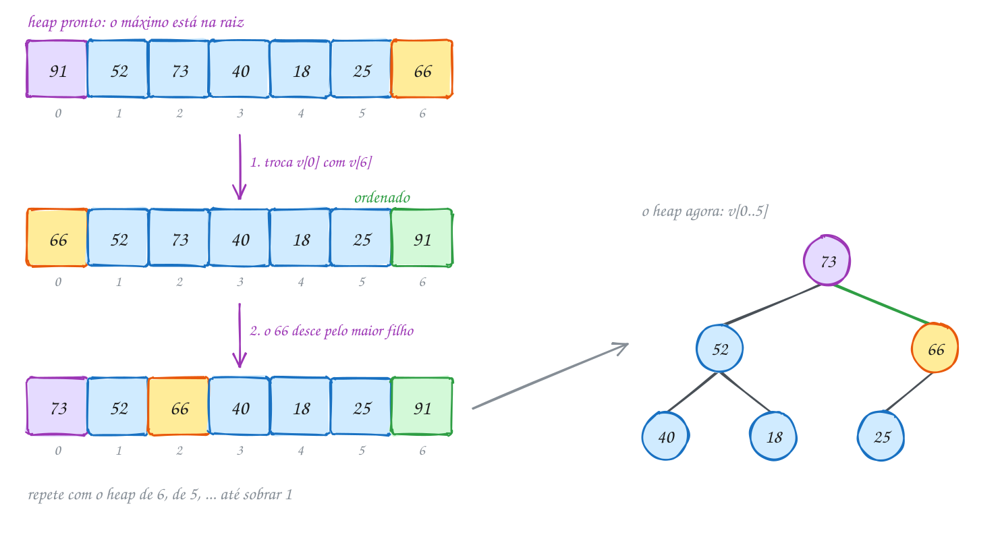</p>

O `desce` é o mesmo do heap, só que recebe o vetor e o tamanho atual do heap.
A função `mostra` imprime a parte do heap e a parte ordenada, separadas por `|`:

```c
#include <stdio.h>

void troca(int *a, int *b) {
    int t = *a;
    *a = *b;
    *b = t;
}

// mostra o heap (v[0..fim-1]) e a parte já ordenada, separados por |
void mostra(const char *rotulo, const int v[], int n, int fim) {
    printf("%-12s", rotulo);
    for (int i = 0; i < n; i++) {
        printf(i == fim ? " | %d" : " %d", v[i]);
    }
    printf("\n");
}

// desce v[i] dentro do heap v[0..n-1], trocando com o maior filho
void desce(int v[], int n, int i) {
    while (2 * i + 1 < n) {
        int f = 2 * i + 1;
        if (f + 1 < n && v[f + 1] > v[f]) {
            f++;
        }
        if (v[i] >= v[f]) {
            break;
        }
        troca(&v[i], &v[f]);
        i = f;
    }
}

void heapsort(int v[], int n) {
    // fase 1: transforma o vetor em heap, do último pai até a raiz
    for (int i = n / 2 - 1; i >= 0; i--) {
        desce(v, n, i);
    }
    mostra("heap:", v, n, n);
    // fase 2: o máximo vai para o fim; o heap encolhe uma casa
    for (int fim = n - 1; fim > 0; fim--) {
        troca(&v[0], &v[fim]);
        desce(v, fim, 0);
        mostra("", v, n, fim);
    }
}

int main(void) {
    int tempos[] = {52, 18, 73, 40, 91, 25, 66}; // minutos de cada corredor
    int n = 7;

    mostra("antes:", tempos, n, n);
    heapsort(tempos, n);
    return 0;
}
// Saída:
// antes:       52 18 73 40 91 25 66
// heap:        91 52 73 40 18 25 66
//              73 52 66 40 18 25 | 91
//              66 52 25 40 18 | 73 91
//              52 40 25 18 | 66 73 91
//              40 18 25 | 52 66 73 91
//              25 18 | 40 52 66 73 91
//              18 | 25 40 52 66 73 91
```

Repara no fluxograma: a fase 1 é uma caixa só, e o laço da fase 2 faz sempre o
mesmo par de coisas, trocar e descer, até `fim` chegar a 0:

<p align="center">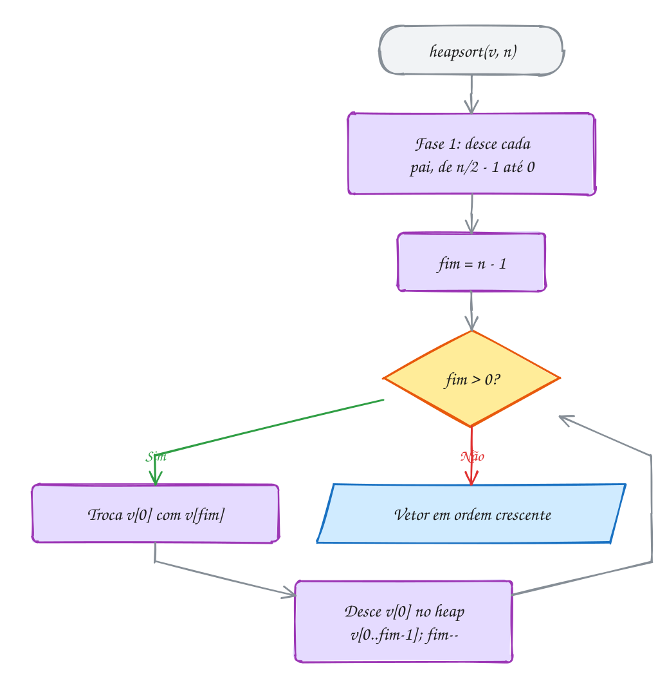</p>

### Passo a passo

A fase 1 nos tempos da corrida. Os pais são os índices 2, 1 e 0 (`n / 2 - 1 = 2`):

| Pai que desce | Filhos | O que acontece | Vetor |
| --- | --- | --- | --- |
| `v[2] = 73` | 25 e 66 | 73 já é o maior: fica | `52 18 73 40 91 25 66` |
| `v[1] = 18` | 40 e 91 | troca com o 91 | `52 91 73 40 18 25 66` |
| `v[0] = 52` | 91 e 73 | troca com o 91; depois, filhos 40 e 18: fica | `91 52 73 40 18 25 66` |

> [!WARNING]
> Na fase 2, o `desce` recebe o tamanho **do heap** (`fim`), e não o tamanho do
> vetor (`n`). Com `desce(v, n, 0)`, a raiz enxerga os elementos já ordenados no
> fim como se fossem filhos, puxa o 91 de volta para o heap e desfaz o
> trabalho. O vetor sai embaralhado, sem nenhum aviso do compilador ou do
> AddressSanitizer: os índices continuam dentro do vetor.

> [!TIP]
> **Por dentro do C:** o heapsort é **in-place**: além do vetor, usa só umas
> poucas variáveis (`i`, `f`, `fim` e a temporária da troca), O(1) de memória,
> sem recursão. O lado ruim é o acesso à memória: `desce` pula de `i` para
> `2i + 1`, cada vez mais longe, e nos vetores grandes isso sai do cache. Por
> isso, na prática, o quick sort costuma ganhar. Bibliotecas como a do C++
> usam o *introsort*: quick sort, e se a recursão ficar funda demais (sinal do
> pior caso), troca para heapsort. E o heapsort **não é estável**: dois tempos
> iguais podem trocar de ordem.

> [!NOTE]
> **Pergunta para você:** o exemplo A206 ordena mil números em ordem
> decrescente com insertion sort e com heapsort. Quantas comparações você acha
> que cada um faz? Chute antes de rodar. E se o vetor já estivesse em ordem
> crescente, qual dos dois ganharia?

### Hora de praticar

Os arquivos ficam em [`0103-heapsort/`](0103-heapsort/). Os comandos funcionam de qualquer pasta do terminal. Nos exemplos, rode, mude, quebre e rode de novo. Nos exercícios, a resposta vai dentro do próprio arquivo. ★☆☆ é aquecimento, ★★☆ pede raciocínio e ★★★ é desafio.

**Exemplo A205 · Empate na chegada: o heapsort não é estável**

```c
#include <stdio.h>

typedef struct {
    const char *nome;
    int tempo; // minutos
} Corredor;

void troca(Corredor *a, Corredor *b) {
    Corredor t = *a;
    *a = *b;
    *b = t;
}

// o mesmo desce do texto, comparando só o campo tempo
void desce(Corredor v[], int n, int i) {
    while (2 * i + 1 < n) {
        int f = 2 * i + 1;
        if (f + 1 < n && v[f + 1].tempo > v[f].tempo) {
            f++;
        }
        if (v[i].tempo >= v[f].tempo) {
            break;
        }
        troca(&v[i], &v[f]);
        i = f;
    }
}

void heapsort(Corredor v[], int n) {
    for (int i = n / 2 - 1; i >= 0; i--) {
        desce(v, n, i);
    }
    for (int fim = n - 1; fim > 0; fim--) {
        troca(&v[0], &v[fim]);
        desce(v, fim, 0);
    }
}

void mostra(const char *rotulo, const Corredor v[], int n) {
    printf("%s", rotulo);
    for (int i = 0; i < n; i++) {
        printf(" %s %d", v[i].nome, v[i].tempo);
        printf(i < n - 1 ? "," : "\n");
    }
}

int main(void) {
    // na ordem de chegada: Ana chegou antes de Caio, Bia antes de Duda
    Corredor v[] = {{"Ana", 40}, {"Bia", 25}, {"Caio", 40}, {"Duda", 25}, {"Edu", 30}};
    int n = 5;

    mostra("Chegada:", v, n);
    heapsort(v, n);
    mostra("Ordem:  ", v, n);
    // os tempos estão em ordem, mas os empatados trocaram de lugar:
    // Duda passou na frente de Bia e Caio na frente de Ana
    return 0;
}
// Saída:
// Chegada: Ana 40, Bia 25, Caio 40, Duda 25, Edu 30
// Ordem:   Duda 25, Bia 25, Edu 30, Caio 40, Ana 40
```

```bash
~/LPEDC/rodar 14-arvores/0103-heapsort/A205.c
```

**Exemplo A206 · Heapsort não tem dia ruim**

```c
#include <stdio.h>
#include <stdlib.h>

long comparacoes = 0; // contador global, só para o experimento

void troca(int *a, int *b) {
    int t = *a;
    *a = *b;
    *b = t;
}

void desce(int v[], int n, int i) {
    while (2 * i + 1 < n) {
        int f = 2 * i + 1;
        if (f + 1 < n) {
            comparacoes++;
            if (v[f + 1] > v[f]) {
                f++;
            }
        }
        comparacoes++;
        if (v[i] >= v[f]) {
            break;
        }
        troca(&v[i], &v[f]);
        i = f;
    }
}

void heapsort(int v[], int n) {
    for (int i = n / 2 - 1; i >= 0; i--) {
        desce(v, n, i);
    }
    for (int fim = n - 1; fim > 0; fim--) {
        troca(&v[0], &v[fim]);
        desce(v, fim, 0);
    }
}

void insertion(int v[], int n) {
    for (int i = 1; i < n; i++) {
        int x = v[i];
        int j = i - 1;
        while (j >= 0) {
            comparacoes++;
            if (v[j] <= x) {
                break;
            }
            v[j + 1] = v[j]; // empurra para a direita
            j--;
        }
        v[j + 1] = x;
    }
}

int main(void) {
    int n = 1000;
    int *a = malloc(n * sizeof(int));
    int *b = malloc(n * sizeof(int));
    if (a == NULL || b == NULL) {
        return 1;
    }
    for (int i = 0; i < n; i++) {
        a[i] = b[i] = n - i; // decrescente: o pior caso do insertion sort
    }

    comparacoes = 0;
    insertion(a, n);
    printf("Insertion sort: %ld comparações\n", comparacoes);

    comparacoes = 0;
    heapsort(b, n);
    printf("Heapsort:       %ld comparações\n", comparacoes);

    printf("Ordenados? %s\n", a[0] == 1 && a[n - 1] == n && b[0] == 1 && b[n - 1] == n ? "sim" : "não");
    free(a);
    free(b);
    return 0;
}
// Saída:
// Insertion sort: 499500 comparações
// Heapsort:       15965 comparações
// Ordenados? sim
```

```bash
~/LPEDC/rodar 14-arvores/0103-heapsort/A206.c
```

#### Exercícios

**Exercício E613** · ★☆☆

As funções troca, mostra e desce já estão prontas. Complete o main para
rodar a fase 1 do heapsort no vetor [3 9 2 7 5 8] (descer cada pai, do
último até a raiz), mostrando o vetor depois de cada pai descer, e depois
só os DOIS primeiros passos da fase 2 (o máximo vai para o fim e o heap
encolhe uma casa), mostrando o vetor com a barra separando a parte já
ordenada:


```text
Saída esperada:
pai 2 desceu: [3 9 8 7 5 2]
pai 1 desceu: [3 9 8 7 5 2]
pai 0 desceu: [9 7 8 3 5 2]
fase 2:       [8 7 2 3 5 | 9]
fase 2:       [7 5 2 3 | 8 9]
```

**Dicas:**

1. Com n = 6, o último pai é o índice n / 2 - 1 = 2. O laço vai de 2 até
   0, chamando desce(v, n, i) e depois mostra(v, n, n).
2. Na fase 2, troque v[0] com v[fim], chame desce(v, fim, 0) e mostre com
   mostra(v, n, fim). Faça só para fim = 5 e fim = 4.
3. Resposta esperada: a saída acima. O pai 1 não se mexe: 9 já é maior
   que 7 e 5. Quando o 3 desce da raiz, ele desce dois níveis.

```bash
~/LPEDC/rodar 14-arvores/0103-heapsort/E613.c
```

**Exercício E614** · ★☆☆

A tabela do campeonato precisa dos pontos em ordem DECRESCENTE (o líder
primeiro). Troque o heap de máximo por um heap de mínimo e o mesmo
heapsort passa a deixar o menor no fim de cada passo. Complete desce_min,
que desce v[i] trocando com o MENOR filho enquanto ele for menor que v[i].


```text
Pontos: 45 62 38 70 51 29 66
```


```text
Saída esperada:
Tabela: 70 66 62 51 45 38 29
```

**Dicas:**

1. Copie o desce do texto e inverta as duas comparações.
2. Escolha f como o menor dos filhos; pare se v[i] <= v[f].
3. Resposta esperada: Tabela: 70 66 62 51 45 38 29

```bash
~/LPEDC/rodar 14-arvores/0103-heapsort/E614.c
```

**Exercício E615** · ★★☆

Existem dois jeitos de montar o heap da fase 1: inserir os elementos um a
um (cada um SOBE, como no heap_insere) ou descer cada pai, do último até a
raiz (o jeito do texto). Escreva as duas funções, contando as trocas, e
rode nos tempos da corrida (52 18 73 40 91 25 66), cada uma numa cópia do
vetor. No fim, escreva também eh_heap(v, n) e confira se os dois
resultados são heaps de máximo, mesmo sendo diferentes:


```text
Saída esperada:
Por inserções:    [91 73 66 18 40 25 52], 5 trocas
Descendo os pais: [91 52 73 40 18 25 66], 2 trocas
Os dois são heaps? sim
```

**Dicas:**

1. Por inserções: para k de 1 até n - 1, faça v[k] subir enquanto for
   maior que v[(k - 1) / 2]. A parte v[0..k-1] já é heap.
2. Some 1 no contador a cada troca (passe um int * para as funções). Em
   eh_heap, basta conferir v[i] <= v[(i - 1) / 2] para todo i >= 1.
3. Resposta esperada: a saída acima. Os dois são heaps válidos: a regra
   só exige pai >= filhos, e existem vários vetores que a respeitam. O
   método dos pais faz menos trabalho porque metade dos elementos (as
   folhas) nem se mexe; em geral ele é O(n) e o das inserções, O(n log n).

```bash
~/LPEDC/rodar 14-arvores/0103-heapsort/E615.c
```

**Exercício E616** · ★★☆

O heapsort percebe quando o vetor já vem arrumado? Meça. Modifique desce
para devolver quantas trocas fez e complete testa(nome, v, n): ela roda o
heapsort somando as trocas do desce em cada fase (a troca do v[0] com o
v[fim] da fase 2 não entra na conta) e mostra os totais e o vetor final.
O main testa um vetor crescente, um decrescente e um com tudo igual:


```text
Saída esperada:
crescente:   fase 1: 4 trocas, fase 2: 6 trocas -> 1 2 3 4 5 6 7
decrescente: fase 1: 0 trocas, fase 2: 5 trocas -> 1 2 3 4 5 6 7
iguais:      fase 1: 0 trocas, fase 2: 0 trocas -> 5 5 5 5 5 5 5
```

**Dicas:**

1. Em desce, crie int trocas = 0, some 1 a cada troca e devolva no fim
   (troque o void por int).
2. Em testa, faça fase1 += desce(v, n, i) no laço dos pais e
   fase2 += desce(v, fim, 0) no laço da fase 2. Para o rótulo alinhado,
   use printf("%-12s ...", nome).
3. Resposta esperada: a saída acima. Vetor crescente é o "contrário" de um
   heap: a fase 1 trabalha. O decrescente já é heap, mas a fase 2 trabalha
   do mesmo jeito: o heapsort não aproveita a ordem que o vetor já tinha.

```bash
~/LPEDC/rodar 14-arvores/0103-heapsort/E616.c
```

**Exercício E617** · ★★★

Ache o bug. Este heapsort ordena os tempos de uma corrida infantil:


```text
Saída esperada:
1 2 3 4 5 6 7
```


Mas a saída sai fora de ordem. A fase 2 está certa e o desce também. O
erro está numa linha só da fase 1. Ache, conserte e rode até sair a
saída esperada.

**Dicas:**

1. Mostre o vetor logo depois da fase 1 e confira: ele é um heap?
2. O desce só funciona se as duas subárvores do nó JÁ forem heaps.
   Descendo de cima para baixo, quando a raiz desce, os filhos dela já
   foram arrumados?
3. Resposta esperada: o laço da fase 1 vai de 0 até n / 2 - 1 (de cima
   para baixo). Depois dele o vetor é [3 5 7 4 2 6 1], que não é heap (o 3
   está acima do 5 e do 7). O certo é de n / 2 - 1 até 0: assim cada pai
   desce sobre subárvores que já são heaps. Consertado: 1 2 3 4 5 6 7.

```bash
~/LPEDC/rodar 14-arvores/0103-heapsort/E617.c
```

**Exercício E618** · ★★★

A organização da corrida quer a lista dos inscritos em ordem alfabética.
Escreva do zero um heapsort para um vetor de strings (const char *),
comparando com strcmp, e ordene:


```text
Nomes: Paula Bruno Zeca Ana Marcos Carla Igor Beatriz
```


```text
Saída esperada:
Ana
Beatriz
Bruno
Carla
Igor
Marcos
Paula
Zeca
```

**Dicas:**

1. É o heapsort do texto com duas trocas: o vetor é de const char *, e
   "v[a] > v[b]" vira "strcmp(v[a], v[b]) > 0".
2. A troca só troca os PONTEIROS: as letras não saem do lugar. Por isso a
   função recebe const char *v[] e a troca usa um const char * auxiliar.
3. Resposta esperada: a lista acima, um nome por linha.

```bash
~/LPEDC/rodar 14-arvores/0103-heapsort/E618.c
```

---

## 0104 · Juntando tudo

A academia do bairro quer largar a planilha. O sistema novo precisa de três
coisas: achar um aluno pela matrícula na hora em que ele passa na catraca,
cadastrar e cancelar matrículas a qualquer momento, e, no fim do mês, mostrar o
pódio de quem mais treinou.

Cada pedido combina com uma estrutura deste módulo. Achar, inserir e remover
pela matrícula é trabalho de **BST**: cada operação desce um caminho só, O(altura).
O pódio pede "os maiores" por outro critério, os treinos, e a BST está ordenada
pela matrícula, não pelos treinos. Para isso existe o **heap**.

A diferença em relação aos assuntos anteriores é o dado. Agora o nó não guarda
um `int` solto, e sim uma **struct** com matrícula, nome e treinos. A matrícula
é a **chave**: é ela que decide esquerda ou direita. O resto vai junto, de
carona. O TAD fica em `cadastro.h` e `cadastro.c`:

```c
typedef struct {
    int matricula;
    char nome[20];
    int treinos; // treinos no mês
} Aluno;

typedef struct NoAluno {
    Aluno a;
    struct NoAluno *esq;
    struct NoAluno *dir;
} NoAluno;
```

As funções são as da BST (`cad_insere`, `cad_busca`, `cad_remove`, `cad_lista`),
trocando `r->chave` por `r->a.matricula`. Dois detalhes mudam:

- `cad_busca` devolve um `Aluno *`, um ponteiro para o aluno **dentro** da
  árvore. Quem chama pode alterar os treinos direto, sem remover e inserir de
  novo. Só não pode alterar a matrícula: isso quebraria a regra da BST;
- na remoção com dois filhos, `r->a = suc->a` copia a struct inteira do
  sucessor, com nome e tudo.

E o pódio? A árvore não pode ser reordenada pelos treinos, senão a busca pela
matrícula deixa de funcionar. Então o ranking **copia** os alunos para um vetor
(`cad_para_vetor`, uma em ordem que vai enchendo o vetor), monta um heap de
máximo **pelos treinos** nesse vetor, em O(n), e tira o máximo três vezes. É a
fase 2 do heapsort interrompida depois de três passos: para pegar os k maiores,
não precisa ordenar tudo.

Vamos ver na prática. Sete alunos se matriculam. A catraca acha o 60 (Fabio)
descendo 50, 70, 60 e soma um treino. O 30 (Bruno) cancela. No fim, os treinos
dos seis que sobraram vão para o vetor, em ordem de matrícula, e o heap entrega o
pódio:

<p align="center">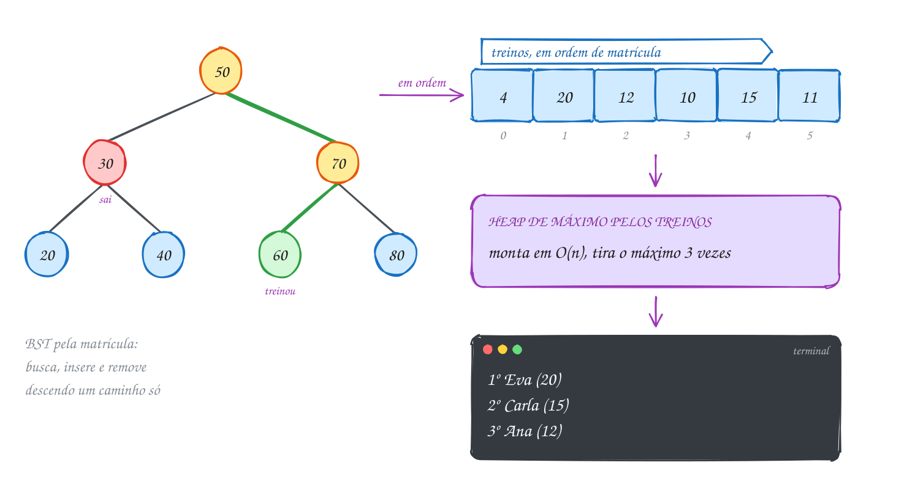</p>

O programa usa o TAD para o cadastro e escreve o heap do ranking direto sobre um
vetor de `Aluno`:

```c
#include <stdio.h>
#include "cadastro.h"

#define MAX 16

// heap de máximo pelos treinos, para o ranking
void desce(Aluno v[], int n, int i) {
    while (2 * i + 1 < n) {
        int f = 2 * i + 1;
        if (f + 1 < n && v[f + 1].treinos > v[f].treinos) {
            f++;
        }
        if (v[i].treinos >= v[f].treinos) {
            break;
        }
        Aluno t = v[i];
        v[i] = v[f];
        v[f] = t;
        i = f;
    }
}

// mostra os k que mais treinaram: monta o heap e tira o máximo k vezes
void ranking(const NoAluno *r, int k) {
    Aluno v[MAX];
    int n = cad_para_vetor(r, v, 0); // cópia: a árvore não muda
    for (int i = n / 2 - 1; i >= 0; i--) {
        desce(v, n, i);
    }
    for (int pos = 1; pos <= k && n > 0; pos++) {
        printf("  %dº %s (%d)\n", pos, v[0].nome, v[0].treinos);
        v[0] = v[--n];
        desce(v, n, 0);
    }
}

int main(void) {
    Aluno turma[] = {
        {50, "Ana", 12}, {30, "Bruno", 8}, {70, "Carla", 15}, {20, "Davi", 4},
        {40, "Eva", 20}, {60, "Fabio", 9}, {80, "Gil", 11},
    };
    NoAluno *cad = NULL;
    for (int i = 0; i < 7; i++) {
        cad = cad_insere(cad, turma[i]);
    }

    printf("Alunos (%d, altura %d):\n", cad_conta(cad), cad_altura(cad));
    cad_lista(cad);

    Aluno *a = cad_busca(cad, 60); // a catraca registra mais um treino
    if (a != NULL) {
        a->treinos++;
        printf("Catraca: %s agora tem %d treinos\n", a->nome, a->treinos);
    }

    cad = cad_remove(cad, 30); // Bruno cancelou
    printf("Sem o 30: %d alunos\n", cad_conta(cad));

    printf("Ranking do mês:\n");
    ranking(cad, 3);

    cad = cad_libera(cad);
    return 0;
}
// Saída:
// Alunos (7, altura 2):
//    20  Davi      4 treinos
//    30  Bruno     8 treinos
//    40  Eva      20 treinos
//    50  Ana      12 treinos
//    60  Fabio     9 treinos
//    70  Carla    15 treinos
//    80  Gil      11 treinos
// Catraca: Fabio agora tem 10 treinos
// Sem o 30: 6 alunos
// Ranking do mês:
//   1º Eva (20)
//   2º Carla (15)
//   3º Ana (12)
```

Repara no fluxograma: o programa é uma sequência de operações na BST e, no fim,
um laço curto sobre o heap. Cada estrutura faz o que sabe fazer bem:

<p align="center">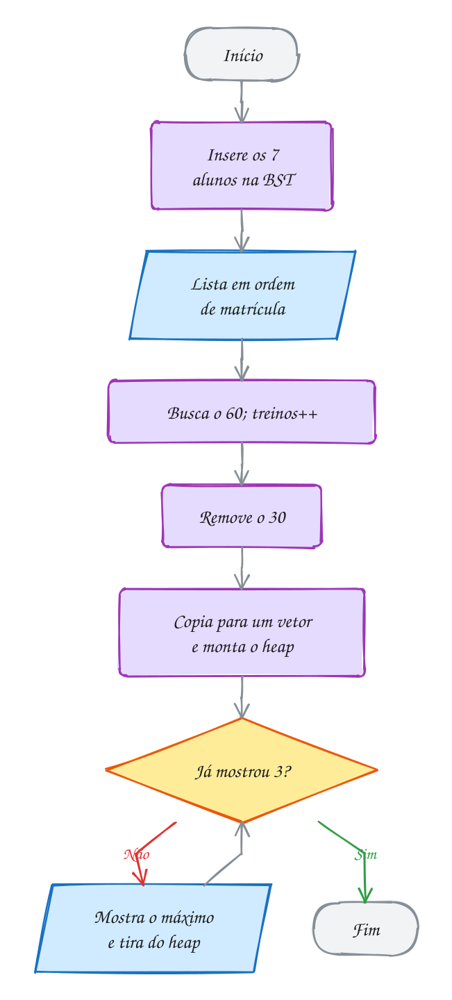</p>

O exemplo A208 é o mesmo cadastro, agora comandado pelo teclado: a recepção
digita `i 50 Ana 12` para inserir, `b 50` para buscar, `r 50` para remover e `l`
para listar.

> [!WARNING]
> O ponteiro devolvido por `cad_busca` aponta para dentro de um nó. Ele vale até
> a próxima remoção: se o `cad_remove` liberar esse nó (ou copiar outro aluno por
> cima dele, no caso de dois filhos), o ponteiro passa a apontar para memória
> devolvida ou para outro aluno. Use o ponteiro na hora e busque de novo depois de
> mexer na árvore. E nunca altere `a->matricula` por ele: o aluno ficaria no
> lugar errado da BST e as buscas não o achariam mais.

> [!TIP]
> **Por dentro do C:** `n->a = a` e `Aluno t = v[i]` copiam a struct inteira,
> 28 bytes (4 da matrícula, 20 do nome e 4 dos treinos), com uma atribuição só:
> o compilador gera a cópia dos bytes por você, sem `memcpy` à mão. Com structs
> grandes, copiar a cada troca do heap pesa. Aí o normal é montar o heap com um
> vetor de **ponteiros** para os alunos (`Aluno *v[]`) e trocar só os ponteiros, 8
> bytes cada, como no exercício E618 com as strings.

> [!NOTE]
> **Pergunta para você:** se Gil (80) treinar mais 5 vezes antes do ranking, o
> pódio muda? E se os sete alunos tivessem se matriculado em ordem crescente de
> matrícula (20, 30, ..., 80), qual seria a altura mostrada na primeira linha?

### Hora de praticar

Os arquivos ficam em [`0104-juntando-tudo/`](0104-juntando-tudo/). Os comandos funcionam de qualquer pasta do terminal. Nos exemplos, rode, mude, quebre e rode de novo. Nos exercícios, a resposta vai dentro do próprio arquivo. ★☆☆ é aquecimento, ★★☆ pede raciocínio e ★★★ é desafio.

**Exemplo A207 · Trocar a matrícula não é editar o campo**

```c
#include <stdio.h>
#include "cadastro.h"

void confere(NoAluno *cad, int matricula) {
    Aluno *a = cad_busca(cad, matricula);
    printf("  busca %d: %s\n", matricula, a != NULL ? a->nome : "não achou");
}

int main(void) {
    Aluno turma[] = {
        {45, "Lia", 10}, {25, "Rui", 6}, {65, "Teo", 14}, {15, "Ivo", 3}, {35, "Mel", 8},
    };
    NoAluno *cad = NULL;
    for (int i = 0; i < 5; i++) {
        cad = cad_insere(cad, turma[i]);
    }

    // Ivo ganhou a matrícula 90. Jeito ERRADO: mudar o campo pelo ponteiro
    Aluno *ivo = cad_busca(cad, 15);
    ivo->matricula = 90;
    printf("Editando o campo:\n");
    cad_lista(cad);   // o 90 aparece no começo: está no lugar do 15
    confere(cad, 90); // a busca vai para a direita e nunca o encontra
    ivo->matricula = 15; // desfaz, para seguir com a árvore certa

    // jeito CERTO: copia o aluno, remove pela chave velha, insere com a nova
    Aluno copia = *cad_busca(cad, 15); // copia antes: o remove dá free no nó
    cad = cad_remove(cad, 15);
    copia.matricula = 90;
    cad = cad_insere(cad, copia);
    printf("Removendo e inserindo:\n");
    cad_lista(cad);
    confere(cad, 90);
    confere(cad, 15);

    cad = cad_libera(cad);
    return 0;
}
// Saída:
// Editando o campo:
//    90  Ivo       3 treinos
//    25  Rui       6 treinos
//    35  Mel       8 treinos
//    45  Lia      10 treinos
//    65  Teo      14 treinos
//   busca 90: não achou
// Removendo e inserindo:
//    25  Rui       6 treinos
//    35  Mel       8 treinos
//    45  Lia      10 treinos
//    65  Teo      14 treinos
//    90  Ivo       3 treinos
//   busca 90: Ivo
//   busca 15: não achou
```

```bash
~/LPEDC/rodar 14-arvores/0104-juntando-tudo/A207.c
```

**Exemplo A208 · A recepção digitando comandos**

```c
#include <stdio.h>
#include "cadastro.h"

// comandos, um por linha:
//   i MATRICULA NOME TREINOS   insere      b MATRICULA   busca
//   r MATRICULA                remove      l             lista
//   q                          sai
int main(void) {
    NoAluno *cad = NULL;
    char cmd;

    while (scanf(" %c", &cmd) == 1 && cmd != 'q') {
        Aluno a;
        int mat;
        if (cmd == 'i' && scanf("%d %19s %d", &a.matricula, a.nome, &a.treinos) == 3) {
            cad = cad_insere(cad, a);
            printf("ok: %s entrou\n", a.nome);
        } else if (cmd == 'b' && scanf("%d", &mat) == 1) {
            Aluno *achou = cad_busca(cad, mat);
            if (achou != NULL) {
                printf("%d: %s, %d treinos\n", mat, achou->nome, achou->treinos);
            } else {
                printf("%d: não encontrado\n", mat);
            }
        } else if (cmd == 'r' && scanf("%d", &mat) == 1) {
            cad = cad_remove(cad, mat);
            printf("ok: %d saiu\n", mat);
        } else if (cmd == 'l') {
            printf("%d alunos, altura %d:\n", cad_conta(cad), cad_altura(cad));
            cad_lista(cad);
        } else {
            printf("comando inválido\n");
        }
    }

    cad = cad_libera(cad);
    return 0;
}
// Teste: printf 'i 50 Ana 12\ni 30 Bruno 8\ni 70 Carla 15\nb 30\nr 50\nb 50\nl\nq\n' | ~/LPEDC/rodar 14-arvores/0104-juntando-tudo/A208.c
// Saída:
// ok: Ana entrou
// ok: Bruno entrou
// ok: Carla entrou
// 30: Bruno, 8 treinos
// ok: 50 saiu
// 50: não encontrado
// 2 alunos, altura 1:
//    30  Bruno     8 treinos
//    70  Carla    15 treinos
```

```bash
~/LPEDC/rodar 14-arvores/0104-juntando-tudo/A208.c
```

#### Exercícios

**Exercício E619** · ★☆☆

A academia dá um brinde para quem treinou pelo menos 10 vezes no mês.
Complete conta_brinde(r), que percorre o cadastro e conta esses alunos, e
mostra_brinde(r), que imprime o nome deles em ordem de matrícula.


```text
Saída esperada:
Ganham brinde: Eva Ana Carla Gil
Total: 4
```

**Dicas:**

1. Os dois são percursos da árvore inteira: o critério (treinos) não é a
   chave, então não dá para podar nada.
2. mostra_brinde é uma em ordem com um if antes do printf.
3. Resposta esperada: Eva (20), Ana (12), Carla (15) e Gil (11). Total: 4.

```bash
~/LPEDC/rodar 14-arvores/0104-juntando-tudo/E619.c
```

**Exercício E620** · ★☆☆

Complete a função resumo(cad), que mostra numa linha a matrícula e o nome
de quem está na raiz do cadastro, a altura e a quantidade de alunos, ou
"cadastro vazio" se não houver ninguém. O main chama resumo depois de
inserir seis alunos e depois de cada remoção da raiz:


```text
Saída esperada:
raiz 40 (Teo), altura 2, 6 alunos
raiz 50 (Joana), altura 2, 5 alunos
raiz 60 (Caio), altura 2, 4 alunos
raiz 20 (Paulo), altura 1, 3 alunos
raiz 30 (Lia), altura 1, 2 alunos
raiz 10 (Rita), altura 0, 1 alunos
cadastro vazio
```

**Dicas:**

1. A raiz é o próprio ponteiro cad: os dados estão em cad->a.matricula e
   cad->a.nome. Teste cad == NULL antes de usar.
2. A altura e a contagem vêm prontas do TAD: cad_altura e cad_conta.
3. Resposta esperada: a saída acima. Quando o 60 sai, ele só tinha filho
   esquerdo: o 20 sobe direto para a raiz, sem sucessor.

```bash
~/LPEDC/rodar 14-arvores/0104-juntando-tudo/E620.c
```

**Exercício E621** · ★★☆

A academia importou os alunos de uma planilha em ordem crescente de
matrícula, e a BST virou uma fila indiana (altura 6 com 7 alunos). Escreva
rebalanceia(r): copie os alunos para um vetor (já em ordem, com
cad_para_vetor), libere a árvore velha e monte uma nova inserindo SEMPRE O
DO MEIO primeiro. A função devolve a raiz nova.


```text
Saída esperada:
Antes:  altura 6
Depois: altura 2, raiz 50 (Ana)
Alunos em ordem: 20 30 40 50 60 70 80
```

**Dicas:**

1. Uma função auxiliar monta(r, v, ini, fim): se ini > fim, devolve r. Senão,
   meio = (ini + fim) / 2; insere v[meio]; chama monta para v[ini..meio-1]
   e para v[meio+1..fim].
2. Como o do meio entra antes das duas metades, ele vira a raiz da
   subárvore, e cada metade fica de um lado. É a busca binária ao
   contrário.
3. Resposta esperada: a saída acima.

```bash
~/LPEDC/rodar 14-arvores/0104-juntando-tudo/E621.c
```

**Exercício E622** · ★★☆

Matrícula nova precisa de um número livre, e a recepção quer saber qual é
a próxima matrícula ocupada depois de um número qualquer. Escreva
proxima(r, x): devolve a MENOR matrícula maior que x, ou -1 se não houver.
Não percorra a árvore inteira: desça um caminho só.


```text
Saída esperada:
depois de 45: 50
depois de 50: 60
depois de 10: 20
depois de 80: -1
```

**Dicas:**

1. Desça da raiz. Se a matrícula do nó for maior que x, ela é uma
   candidata: guarde e vá para a esquerda, procurando uma menor que ainda
   seja maior que x. Senão, vá para a direita.
2. Quando chegar no NULL, a última candidata guardada é a resposta.
3. Resposta esperada: a saída acima. Para 50, o caminho é 50 (não serve),
   70 (candidata), 60 (candidata melhor), NULL.

```bash
~/LPEDC/rodar 14-arvores/0104-juntando-tudo/E622.c
```

**Exercício E623** · ★★★

Ache o bug. Esta função copia faz o mesmo que cad_para_vetor: deveria
colocar os alunos no vetor em ordem de matrícula. Mas a lista sai errada:


```text
Saída esperada:
copiados: 7
20 Davi, 30 Bruno, 40 Eva, 50 Ana, 60 Fabio, 70 Carla, 80 Gil
```


```text
Saída que aparece:
copiados: 3
50 Ana, 70 Carla, 80 Gil
```


Ache a linha errada, conserte e rode até sair a saída esperada.

**Dicas:**

1. pos é passado por VALOR. Quando a chamada da esquerda coloca 3 alunos
   no vetor, a chamada de cima fica sabendo?
2. Siga a chamada da raiz: a esquerda escreve em v[0], v[1], v[2]... e
   depois a raiz escreve onde?
3. Resposta esperada: a linha "copia(r->esq, v, pos);" ignora o valor
   devolvido. O certo é "pos = copia(r->esq, v, pos);". Do jeito errado,
   cada nó escreve por cima do que a subárvore esquerda escreveu: a raiz
   sobrescreve v[0] com o 50, o 70 sobrescreve o 60 em v[1] e o 80 vai
   para v[2]. Só os nós do caminho mais à direita sobrevivem: 3.
   Consertado, os 7 aparecem em ordem.

```bash
~/LPEDC/rodar 14-arvores/0104-juntando-tudo/E623.c
```

**Exercício E624** · ★★★

Lista de espera do posto de saúde. Cada linha da entrada traz um nome e
uma prioridade (maior = mais urgente). Um nome que já está na lista é
recusado. No fim da entrada, o programa chama todos, do mais urgente ao
menos urgente. Escreva do zero, usando:
- uma BST de nomes (compare com strcmp) para saber se o nome já entrou;
- um heap de máximo de structs {prioridade, nome} para a ordem de chamada.

Teste com:

```text
printf 'Ana 3\nBeto 5\nCaio 1\nAna 4\nDani 4\nEdu 2\n' | ~/LPEDC/rodar 14-arvores/0104-juntando-tudo/E624.c
```


```text
Saída esperada:
Ana já está na lista
Chamando: Beto (5)
Chamando: Dani (4)
Chamando: Ana (3)
Chamando: Edu (2)
Chamando: Caio (1)
```

**Dicas:**

1. Leia com while (scanf("%19s %d", nome, &prio) == 2). Os nós da BST e
   os elementos do heap guardam uma CÓPIA do nome (char nome[20] e
   strcpy), porque o buffer de leitura é reaproveitado a cada linha.
2. Um heap de até 32 pacientes num vetor fixo basta. Para cada linha: se o
   nome está na BST, avise; senão, insira na BST e no heap.
3. Resposta esperada: a saída acima. O segundo "Ana" (prioridade 4) é
   recusado e a Ana fica com a prioridade 3. Libere a BST no fim.

```bash
~/LPEDC/rodar 14-arvores/0104-juntando-tudo/E624.c
```

---

## Desafios do módulo

Problemas para resolver no papel e, quando fizer sentido, num arquivo `.c` seu.
Eles misturam os assuntos do módulo.

**1. Quantos nós cabem?** Uma árvore binária tem altura 4. Qual é o menor e o
maior número de nós que ela pode ter? E uma BST com 1000 chaves: qual é a menor
altura possível? E a maior?

<details><summary>Resposta</summary>

Altura 4: no mínimo **5 nós** (uma fila indiana) e no máximo **31** (2⁵ - 1,
todos os níveis cheios). Em geral, entre h + 1 e 2^(h+1) - 1. Com 1000 chaves, a
menor altura é **9**: altura 8 comporta no máximo 511 nós, e altura 9 comporta
1023. A maior é **999** (inserção em ordem).

</details>

**2. Reconstrua a árvore.** Uma árvore binária tem pré-ordem `F B A D C E G I H`
e em ordem `A B C D E F G H I`. Desenhe a árvore e dê a pós-ordem.

<details><summary>Resposta</summary>

A pré-ordem diz que **F** é a raiz; na em ordem, tudo antes de F (`A B C D E`)
fica à esquerda e o resto (`G H I`) à direita. Repetindo nas partes: F (B (A, D
(C, E)), G (-, I (H, -))). Pós-ordem: **A C E D B H I G F**. Caminho: a
pré-ordem dá as raízes, a em ordem separa os lados. (Com pré-ordem e pós-ordem
sozinhas não dá para reconstruir sempre: um filho único pode ser esquerdo ou
direito.)

</details>

**3. Conte as BSTs.** Com as chaves 1, 2 e 3, quantas BSTs diferentes existem?
Das 6 ordens de inserção, quantas geram a árvore com raiz 2?

<details><summary>Resposta</summary>

São **5** BSTs. A de raiz 2 (a equilibrada) sai de **2** ordens: 2 1 3 e 2 3 1.
Cada uma das outras quatro sai de uma ordem só. Inserir em ordem aleatória
favorece as árvores mais equilibradas.

</details>

**4. A BST de nomes.** Insira numa BST, nesta ordem, os nomes Maria, Carlos,
Tiago, Ana, Fernanda, Rui e Zélia (comparação alfabética com `strcmp`). Qual é a
altura? Por quais nós passa a busca por "Fernanda"?

<details><summary>Resposta</summary>

Maria na raiz; Carlos (Ana, Fernanda) à esquerda; Tiago (Rui, Zélia) à direita.
Altura **2**. A busca por Fernanda passa por **Maria, Carlos, Fernanda**. Cuidado
com acentos: `strcmp` compara bytes, e em UTF-8 as letras acentuadas ficam
depois de todas as letras sem acento ("Élio" viria depois de "Zélia").

</details>

**5. Remoções em sequência.** Na BST 50 (30 (20, 40), 70 (60, 80)), remova 50,
depois 60, depois 70 (sempre pelo sucessor). Dê a pré-ordem depois de cada passo.

<details><summary>Resposta</summary>

Sem o 50: o sucessor 60 sobe, pré **60 30 20 40 70 80**. Sem o 60 (raiz de novo,
dois filhos): o sucessor 70 sobe e o 80 fica à direita dele, pré **70 30 20 40
80**. Sem o 70: o sucessor é o 80, que era folha, pré **80 30 20 40**. Repare
como remover sempre pelo sucessor deixa a árvore pendendo para a esquerda.

</details>

**6. AVL de 1 a 10.** Insira 1, 2, ..., 10 numa AVL vazia. Qual é a raiz no fim
e qual é a altura? Quantas rotações simples aconteceram?

<details><summary>Resposta</summary>

Raiz **4**, altura **3**, com **6** rotações simples (todas à esquerda: ao
inserir 3, 5, 6, 7, 9 e 10). Pré-ordem final: 4 2 1 3 8 6 5 7 9 10. Confira com o
`avl.h`: insira de 1 a 10 e chame `avl_pre_ordem` e `avl_rotacoes`.

</details>

**7. A AVL mais magra.** Qual é o **menor** número de nós de uma AVL de altura
h? Calcule para h = 0 a 5 e compare com a árvore cheia.

<details><summary>Resposta</summary>

N(0) = 1, N(1) = 2 e N(h) = N(h - 1) + N(h - 2) + 1: uma subárvore com altura
h - 1, a outra com h - 2, mais a raiz. Valores: **1, 2, 4, 7, 12, 20**. A árvore
cheia de altura 5 tem 63 nós. Como N(h) cresce como Fibonacci, a altura de uma
AVL fica abaixo de uns 1,44 · log₂ n.

</details>

**8. Heap ou BST?** Para cada caso, diga se usaria heap ou BST: (a) achar o
menor e o maior a qualquer momento; (b) atender sempre o pedido mais antigo de
uma lista que muda; (c) listar os produtos em ordem de preço; (d) saber se o
CPF 123 está cadastrado.

<details><summary>Resposta</summary>

(a) **BST**: menor e maior são as pontas (um heap de máximo não acha o mínimo
rápido); (b) **heap de mínimo** pela hora do pedido; (c) **BST** pelo preço
(em ordem dá a lista; um heap teria que ser esvaziado); (d) **BST** (o heap não
busca uma chave qualquer; no módulo 15, a tabela hash ganha das duas).

</details>

**9. Heap de 1 a 7.** Insira 1, 2, 3, 4, 5, 6 e 7, nesta ordem, num heap de
máximo vazio (com `heap_insere`). Qual é o vetor? Remova o máximo duas vezes e
dê o vetor de novo.

<details><summary>Resposta</summary>

Depois das inserções: **[7 4 6 1 3 2 5]**. Sem o 7: o 5 vai para a raiz e desce
pelo 6, **[6 4 5 1 3 2]**. Sem o 6: o 2 vai para a raiz e desce pelo 5,
**[5 4 2 1 3]**.

</details>

**10. Os 10 maiores de um milhão.** Você recebe um milhão de números, um de cada
vez, e no fim precisa dos 10 maiores. Compare três jeitos: ordenar tudo, usar
um heap de máximo com todos e usar um heap de mínimo com 10. Quanto custa cada
um e quanta memória usa?

<details><summary>Resposta</summary>

Ordenar: O(n log n), cerca de 20 milhões de comparações, e guarda tudo. Heap de
máximo com todos: montar O(n) e tirar 10 vezes O(10 log n), mas também guarda
tudo. **Heap de mínimo com 10**: cada número compara com a raiz e, se for maior,
entra no lugar dela, O(n log 10), uns 3 milhões de passos no pior caso, e
guarda só 10 números. É o exercício E611 em escala.

</details>

## Para ler mais

- FEOFILOFF, P. *Algoritmos em linguagem C*. Rio de Janeiro: Elsevier, 2009. Capítulos sobre heapsort, árvores binárias e árvores binárias de busca.
- CELES, W.; RANGEL, J. L. *Apostila de estruturas de dados*. Rio de Janeiro: PUC-Rio, 2002. Capítulos sobre árvores e árvores binárias de busca.
- CELES, W.; CERQUEIRA, R.; RANGEL, J. L. *Introdução a estruturas de dados: com técnicas de programação em C*. Rio de Janeiro: Elsevier, 2004.
- TENENBAUM, A. M.; LANGSAM, Y.; AUGENSTEIN, M. J. *Estruturas de dados usando C*. São Paulo: Makron Books, 1995. Caps. 5 (árvores), 6 (classificação: heapsort) e 7 (busca: árvores balanceadas).
- DEITEL, P.; DEITEL, H. *C: como programar*. 6. ed. São Paulo: Pearson, 2011. Cap. 12: estruturas de dados (árvores binárias de busca).
- LAUREANO, M. *Estrutura de dados com algoritmos e C*. Rio de Janeiro: Brasport, 2008. Capítulo sobre árvores.
- ROCHA, A. M. A.; BORGES, A. R. O. S. *Programação, estruturas de dados e algoritmos em C*. Aveiro: Universidade de Aveiro. Apostila.
- CORMEN, T. H. et al. *Algoritmos: teoria e prática*. 3. ed. Rio de Janeiro: Elsevier, 2012. Caps. 6 (heapsort) e 12 (árvores de busca binária).
- ADELSON-VELSKY, G. M.; LANDIS, E. M. An algorithm for the organization of information. *Soviet Mathematics Doklady*, v. 3, p. 1259-1263, 1962.
- KERNIGHAN, B. W.; RITCHIE, D. M. *C: a linguagem de programação padrão ANSI*. Rio de Janeiro: Campus, 1989. Seção 6.5: estruturas autorreferenciadas (a árvore de palavras).
- CPPREFERENCE. *qsort, qsort_s*. Disponível em: <https://en.cppreference.com/w/c/algorithm/qsort>.
