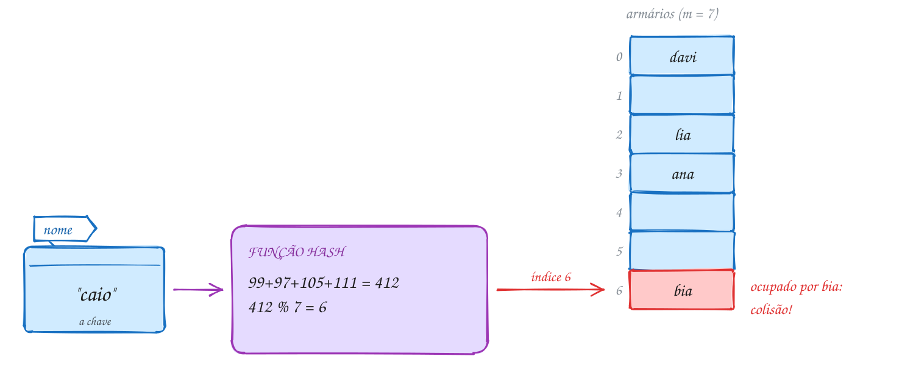
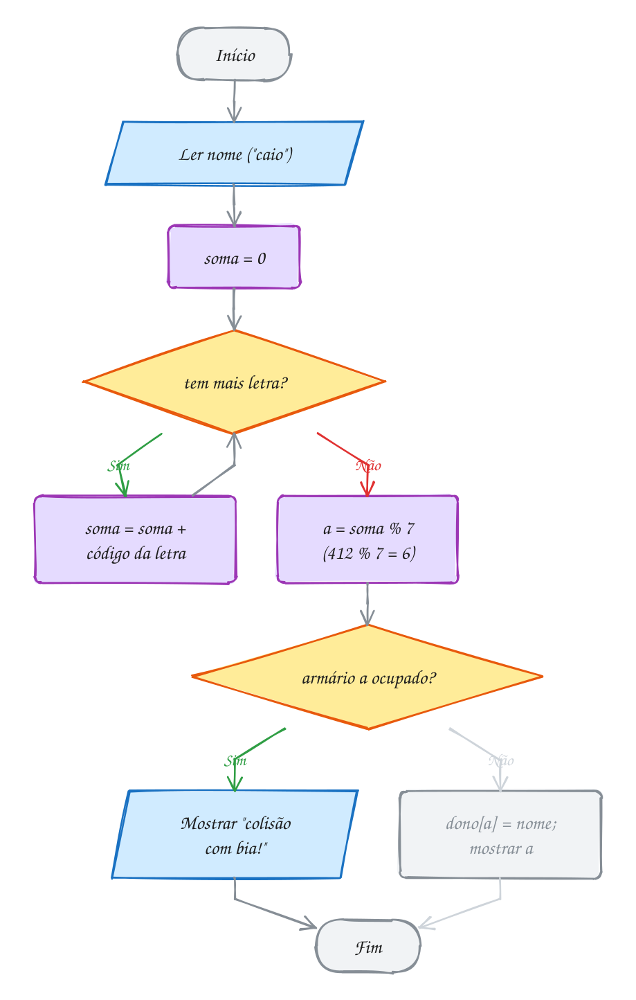
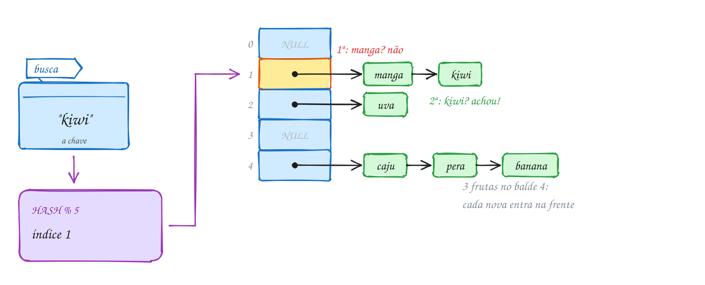
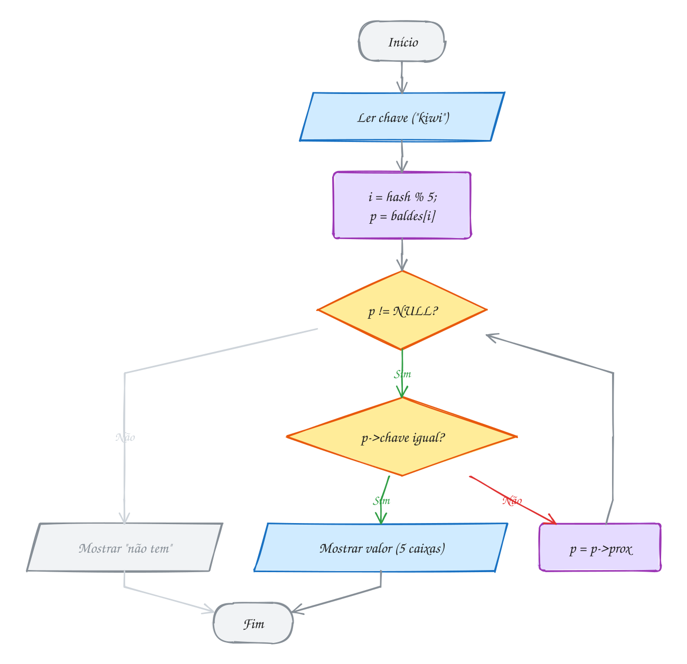
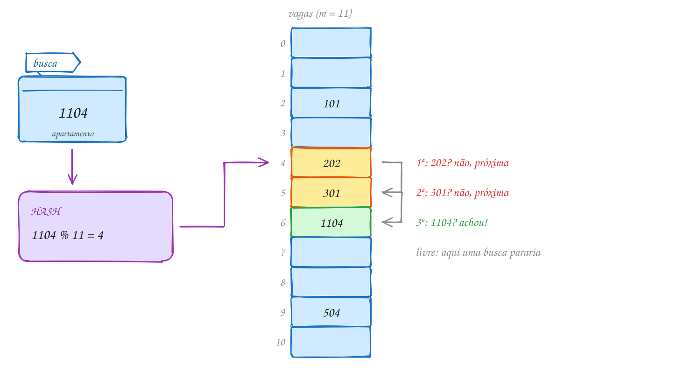
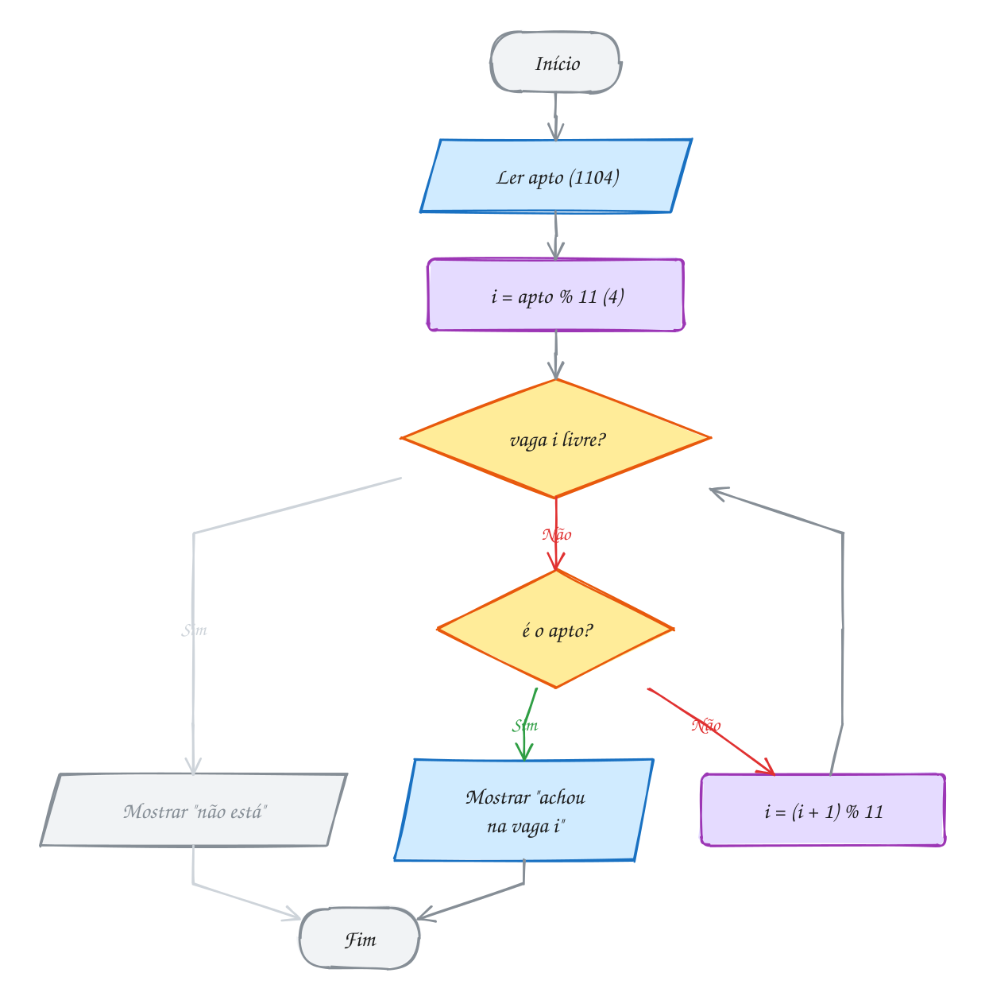
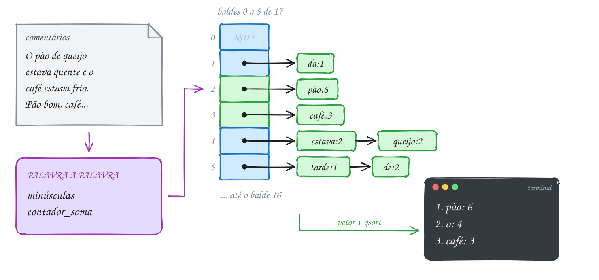
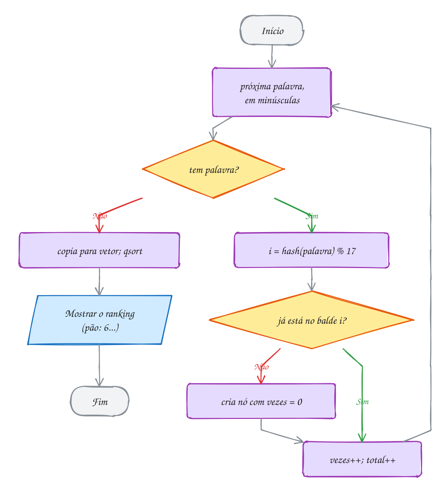
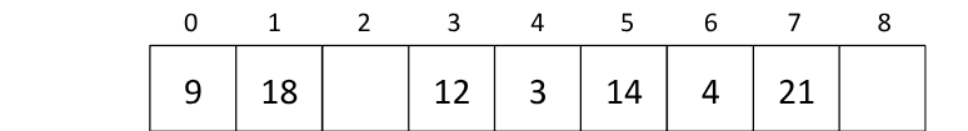

<!-- Gerado por _gerador. Para mudar este arquivo, edite _gerador/modulos/15-hash/ e rode: cd _gerador && npm run gerar -->

# Módulo 15 · Tabelas hash

> [!IMPORTANT]
> **Mundo 6 · Tabelas hash · Rota do jogo: etapa 19 de 29**
>
> **Missão:** montar tabelas hash com encadeamento e endereçamento aberto.
>
> **Vem de:** [Módulo 22 · Árvores e conjuntos avançados](22-arvores-avancadas.md). **Segue para:** [Módulo 28 · Estruturas: o que faltava](28-estruturas-complementos.md).
>
> **Checkpoints desta fase:**
> - [ ] Ler os assuntos 0105 a 0108 e refazer os exemplos
> - [ ] Resolver os 4 exercícios de cada assunto, escrevendo o código sozinho
> - [ ] Fechar a lista prática (P1501 a P1530)
> - [ ] Enfrentar os desafios do módulo
> - [ ] Chefão: resolver as questões de prova do módulo sem consultar

A tabela hash troca a procura por uma conta: a função hash leva a chave a um
índice e o acesso custa O(1) na média. O módulo cobre função hash, colisão,
encadeamento, endereçamento aberto e termina num contador de palavras. Usa a
lista encadeada (módulo 11) e compara com a busca binária e a BST (13 e 14).

## O que você vai aprender

- **função hash**, **colisão**, **fator de carga** e endereçamento direto
- hash para inteiros (`k % m`, `m` primo) e para texto (polinômio de base 31, em `unsigned`)
- **encadeamento**: inserir, buscar, remover e liberar cada corrente
- **endereçamento aberto**: sondagem linear e marca de **removida**
- custo (comparações, sondagens, agrupamento) e **rehash**
- a tabela como contador e como conjunto

## Antes de começar

Usa listas (módulo 11), `malloc`/`free`, structs, ponteiro para função e
`qsort`. Cada assunto traz um TAD na pasta (`tabela`, `aberta`, `palavras`,
com `.h` e `.c`), e o comando compila tudo junto:

```bash
gcc ~/LPEDC/material/A211.c ~/LPEDC/material/0106-tabela.c -o ~/LPEDC/material/A211 && ~/LPEDC/material/A211
```

Nos desenhos, cada balde é uma gaveta com o índice à esquerda e a lista à
direita; vermelho marca colisão.

| # | Assunto |
| --- | --- |
| [0105](#0105--a-ideia-e-a-função-hash) | A ideia e a função hash |
| [0106](#0106--encadeamento) | Encadeamento |
| [0107](#0107--endereçamento-aberto) | Endereçamento aberto |
| [0108](#0108--juntando-tudo-o-contador-de-palavras) | Juntando tudo: o contador de palavras |

---

> [!NOTE]
> Cada assunto é um capítulo: **Conceito** (a explicação), **Exemplos de uso** (programas que compilam sozinhos: rode com o comando abaixo de cada um e compare com a saída no fim do código) e **Exercícios** (cada um é um arquivo em `material/` com o esqueleto, as dicas e o espaço para a resposta; resoluções em `_respostas/15-hash/`).

## 0105 · A ideia e a função hash

### Conceito

- **Endereçamento direto**: a chave é o próprio índice do vetor e o acesso
  custa O(1). Falha quando a chave é grande (um CPF tem 11 dígitos) ou não é
  número (TENENBAUM; LANGSAM; AUGENSTEIN, 1995, cap. 7).
- **Função hash**: recebe a chave e devolve um índice de `0` a `m - 1`, com
  `m` o tamanho da tabela. O vetor é a **tabela hash** e cada posição é um
  **balde** (CORMEN et al., 2024, cap. 11).
- **Boa função**: **determinística** (mesma chave, mesmo índice), **rápida** e
  **espalhadora** (chaves diferentes em baldes diferentes). Deve depender de
  todas as partes da chave (TENENBAUM; LANGSAM; AUGENSTEIN, 1995, cap. 7).
- **Método da divisão**: `h(k) = k mod m`, em C `k % m`. Prefira `m` primo e
  longe de potência de 2: com `m = 2^p`, o resto só vê os `p` bits de baixo
  (CORMEN et al., 2024, cap. 11). O **da multiplicação** fica para o 0178.
- **Colisão**: duas chaves diferentes no mesmo balde. Há mais chaves possíveis
  que baldes, então ela **vai** acontecer; trata-se nos assuntos 0106 e 0107
  (KNUTH, 1998, seção 6.4).
- **Fator de carga**: `α = n / m`, itens por balde. 5 itens em 7 baldes dão
  α ≈ 0,71; perto de 1, as colisões crescem (CORMEN et al., 2024, cap. 11).
- **Bytes sem sinal**: no gcc de PC, `char` tem sinal e letra acentuada em
  UTF-8 vira byte negativo. A função lê `unsigned char` e soma em `unsigned`,
  cujo estouro é definido (KERNIGHAN; RITCHIE, 1988, seção 6.6).

> [!WARNING]
> A soma **não vê a ordem das letras**: "amor", "roma", "mora" e "ramo" somam
> 431 e caem no mesmo balde. Use o **polinômio** `h = h * 31 + letra`, que
> multiplica cada letra pela sua posição (exemplo A210).

### Exemplos de uso

O guarda-volumes da academia tem 7 armários, e a regra é "soma dos códigos das
letras, resto por 7". "caio" soma 412 e cai no 6; "bia" soma 300, também dá 6
e chegou antes. Os outros três caem em armários livres:

<p align="center"></p>

No código, o vetor `dono` é a tabela e `NULL` é armário vazio. O programa só
**detecta** a colisão:

```c
#include <stdio.h>

#define ARMARIOS 7

// função hash: soma os códigos das letras e reduz para 0..6
int armario(const char *nome) {
    unsigned soma = 0;
    for (int i = 0; nome[i] != '\0'; i++) {
        soma += (unsigned char)nome[i]; // o byte da letra, sempre >= 0
    }
    return (int)(soma % ARMARIOS);
}

int main(void) {
    const char *dono[ARMARIOS] = {NULL}; // NULL = armário vazio
    const char *alunos[] = {"ana", "davi", "lia", "bia", "caio"};

    for (int i = 0; i < 5; i++) {
        int a = armario(alunos[i]);
        if (dono[a] == NULL) {
            dono[a] = alunos[i];
            printf("%-4s -> armário %d\n", alunos[i], a);
        } else {
            printf("%-4s -> armário %d (colisão com %s!)\n", alunos[i], a, dono[a]);
        }
    }
    return 0;
}
// Saída:
// ana  -> armário 3
// davi -> armário 0
// lia  -> armário 2
// bia  -> armário 6
// caio -> armário 6 (colisão com bia!)
```

O fluxograma mostra o caminho do "caio": quatro voltas no laço, índice 6,
armário ocupado, colisão:

<p align="center"></p>

**Exemplo A209 · DDD direto no vetor**

```c
#include <stdio.h>

#define FAIXA 100 // DDDs vão de 11 a 99: cabem num vetor de 100

int main(void) {
    // endereçamento direto: a própria chave é o índice (o "hash" é k)
    const char *estado[FAIXA] = {NULL}; // NULL = DDD sem dono
    estado[11] = "SP";
    estado[21] = "RJ";
    estado[31] = "MG";
    estado[61] = "DF";
    estado[71] = "BA";
    estado[91] = "PA";

    int consultas[] = {61, 11, 10, 91, 120};
    for (int i = 0; i < 5; i++) {
        int ddd = consultas[i];
        if (ddd < 0 || ddd >= FAIXA) {
            printf("DDD %3d -> fora da faixa\n", ddd); // nunca indexe sem conferir
        } else if (estado[ddd] == NULL) {
            printf("DDD %3d -> não existe\n", ddd);
        } else {
            printf("DDD %3d -> %s\n", ddd, estado[ddd]); // um passo: O(1)
        }
    }

    int usadas = 0;
    for (int i = 0; i < FAIXA; i++) {
        if (estado[i] != NULL) {
            usadas++;
        }
    }
    printf("posições usadas: %d de %d\n", usadas, FAIXA); // o resto é desperdício
    return 0;
}
// Saída:
// DDD  61 -> DF
// DDD  11 -> SP
// DDD  10 -> não existe
// DDD  91 -> PA
// DDD 120 -> fora da faixa
// posições usadas: 6 de 100
```

```bash
gcc ~/LPEDC/material/A209.c -o ~/LPEDC/material/A209 && ~/LPEDC/material/A209
```

**Exemplo A210 · Anagramas: soma contra polinômio**

```c
#include <stdio.h>

#define M 11

// soma dos códigos: a ordem das letras não importa (ruim)
unsigned hash_soma(const char *s) {
    unsigned h = 0;
    for (int i = 0; s[i] != '\0'; i++) {
        h += (unsigned char)s[i];
    }
    return h % M;
}

// polinômio de base 31: cada letra pesa conforme a posição
unsigned hash_pol(const char *s) {
    unsigned h = 0;
    for (int i = 0; s[i] != '\0'; i++) {
        h = h * 31 + (unsigned char)s[i];
    }
    return h % M;
}

int main(void) {
    const char *palavras[] = {"amor", "roma", "mora", "ramo"};

    printf("palavra  soma  polinômio\n");
    for (int i = 0; i < 4; i++) {
        printf("%-7s  %4u  %9u\n", palavras[i], hash_soma(palavras[i]), hash_pol(palavras[i]));
    }
    return 0;
}
// Saída:
// palavra  soma  polinômio
// amor        2          3
// roma        2          5
// mora        2          2
// ramo        2          7
```

```bash
gcc ~/LPEDC/material/A210.c -o ~/LPEDC/material/A210 && ~/LPEDC/material/A210
```

### Exercícios

**Exercício E625** · ★☆☆

A lanchonete guarda os pedidos numa prateleira de 11 nichos. O nicho de um
pedido é o resto da divisão do número do pedido por 11. Escreva a função
"int nicho(int pedido)" e mostre o nicho dos pedidos 1043, 2210, 3876, 5521
e 7019, um por linha. Quando o nicho já tiver um pedido anterior, acrescente
"(colide com NNNN)".

```text
Saída esperada:
pedido 1043 -> nicho 9
pedido 2210 -> nicho 10
pedido 3876 -> nicho 4
pedido 5521 -> nicho 10 (colide com 2210)
pedido 7019 -> nicho 1
```

**Exercício E627** · ★★☆

Escreva a função "unsigned hash_pol(const char *s)", o hash polinomial de
base 31: começa com h = 0 e, para cada byte da string, faz h = h * 31 + byte
(h unsigned; converta cada char para unsigned char). Ela devolve h % 13.
Mostre o hash de "pix", "ted", "doc" e "boleto", com o nome alinhado à
esquerda em 6 colunas.

```text
Saída esperada:
pix    -> 0
ted    -> 8
doc    -> 8
boleto -> 1
```

**Exercício E628** · ★★☆

Na loja de material de construção, todo código de produto termina em 0: 120,
350, 470, 590, 610, 230, 740, 860, 980 e 440. Escreva um programa que espalha
esses 10 códigos com "codigo % m" e mostra quantos caíram em cada balde, com
uma estrela por código (número do balde em 2 colunas). No fim de cada tabela,
mostre quantos baldes ficaram vazios. Faça para m = 10 e para m = 11.

```text
Saída esperada:
m = 10
 0: **********
 1:
 2:
 3:
 4:
 5:
 6:
 7:
 8:
 9:
vazios: 9
m = 11
 0: *
 1: *
 2: *
 3: *
 4:
 5: *
 6:
 7: *
 8: *
 9: *
10: **
vazios: 2
```

**Exercício E630** · ★★★

O compilador reconhece palavras reservadas o tempo todo. Para um conjunto
fixo de chaves, dá para achar um hash "perfeito": uma tabela sem colisão.
Com o hash polinomial de base 31 (h = h * 31 + byte, em unsigned), ache o
MENOR m, a partir de 8, em que as 8 palavras abaixo caem em baldes todos
diferentes: int, char, if, else, for, while, return e void. Mostre o m
encontrado e o balde de cada palavra.

```text
Saída esperada:
m = 14
int -> 5
char -> 10
if -> 11
else -> 1
for -> 7
while -> 13
return -> 4
void -> 8
```

---

## 0106 · Encadeamento

### Conceito

- **Encadeamento** (ou encadeamento separado): cada balde guarda a **cabeça
  de uma lista encadeada** com os itens que caíram ali. A tabela vira um vetor
  de ponteiros, `No *baldes[m]` (CORMEN et al., 2024, cap. 11).
- **Operações**: calcule `i = hash(chave) % m` e use a lista de `baldes[i]`
  (módulo 11). Inserir procura a chave; se não achar, põe um nó **no início**
  em O(1). Buscar e remover andam só nessa lista (CELES; RANGEL, 2002).
- **Custo médio**: com hash que espalha bem, cada lista tem em média α nós e
  a busca custa Θ(1 + α). Se `m` cresce com `n`, α fica constante e a busca é
  O(1) na média (CORMEN et al., 2024, cap. 11).
- **Pior caso**: um hash ruim joga tudo num balde, a tabela vira uma lista só
  e a busca é O(n) (TENENBAUM; LANGSAM; AUGENSTEIN, 1995, cap. 7).
- **Nunca enche**: α pode passar de 1 (exemplo A211: 8 itens em 2 baldes)
  (TENENBAUM; LANGSAM; AUGENSTEIN, 1995, cap. 7).
- **Liberar**: cada nó é um `malloc`. `tabela_libera` dá `free` em todos,
  guardando o `prox` antes; `free(t->baldes)` sozinho vaza as listas
  (CELES; CERQUEIRA; RANGEL, 2016).

> [!WARNING]
> Compare chave de texto com `strcmp`, nunca com `==`: `p->chave == chave`
> compara **endereços**. O nó guarda a sua **cópia** da chave, porque o buffer
> de quem chamou é reaproveitado.

### Exemplos de uso

O hortifrúti guarda o estoque em 5 baldes, com o hash polinomial do 0105.
Banana, uva, pera, kiwi, manga e caju caem em 4, 2, 4, 1, 1 e 4; cada nova
entra no início. Buscar "kiwi" vai ao balde 1 e faz 2 comparações:

<p align="center"></p>

A estrutura segue o padrão TAD: `tabela.h` com a interface e o tipo opaco,
`tabela.c` com o nó, os baldes e as operações:

```c
typedef struct No {
    char chave[TAM_CHAVE]; // cópia da chave (não um ponteiro emprestado)
    int valor;
    struct No *prox;
} No;

struct Tabela {
    int m;       // número de baldes
    int n;       // número de itens
    No **baldes; // vetor de m cabeças de lista
};

bool tabela_busca(const Tabela *t, const char *chave, int *valor, int *comparacoes) {
    int i = (int)(hash(chave) % (unsigned)t->m);
    int olhados = 0;
    for (No *p = t->baldes[i]; p != NULL; p = p->prox) {
        olhados++;
        if (strcmp(p->chave, chave) == 0) {
            *valor = p->valor;
            if (comparacoes != NULL) {
                *comparacoes = olhados;
            }
            return true;
        }
    }
    if (comparacoes != NULL) {
        *comparacoes = olhados;
    }
    return false;
}
```

O cliente conhece só o `tabela.h`:

```c
#include <stdio.h>
#include "tabela.h"

int main(void) {
    Tabela *estoque = tabela_cria(5);
    if (estoque == NULL) {
        return 1;
    }
    const char *frutas[] = {"banana", "uva", "pera", "kiwi", "manga", "caju"};
    int caixas[] = {12, 30, 8, 5, 20, 14};
    for (int i = 0; i < 6; i++) {
        tabela_insere(estoque, frutas[i], caixas[i]);
    }
    tabela_mostra(estoque);

    int qtd, olhados;
    if (tabela_busca(estoque, "kiwi", &qtd, &olhados)) {
        printf("kiwi: %d caixas (%d comparações)\n", qtd, olhados);
    }
    if (!tabela_busca(estoque, "limao", &qtd, &olhados)) {
        printf("limao: não tem (%d comparações)\n", olhados);
    }
    tabela_libera(estoque);
    return 0;
}
// Saída:
// [0]
// [1] -> manga:20 -> kiwi:5
// [2] -> uva:30
// [3]
// [4] -> caju:14 -> pera:8 -> banana:12
// kiwi: 5 caixas (2 comparações)
// limao: não tem (0 comparações)
```

No fluxograma da busca, o hash leva ao balde e o resto é o laço de lista. O
"kiwi" dá uma volta (passa pela manga) e para no Sim; o "limao" cai no balde
0, vazio, e sai pelo Não:

<p align="center"></p>

**Exemplo A211 · Poucos baldes: a tabela não enche**

```c
#include <stdio.h>
#include "0106-tabela.h"

#define N 8

// insere as verduras numa tabela de m baldes e mede o custo de achar cada uma
void testa(int m, const char *nomes[], const int qtd[]) {
    Tabela *t = tabela_cria(m);
    if (t == NULL) {
        return;
    }
    for (int i = 0; i < N; i++) {
        tabela_insere(t, nomes[i], qtd[i]);
    }
    printf("m = %d, n = %d, fator de carga = %.2f\n", m, tabela_tamanho(t),
           (double)tabela_tamanho(t) / m);
    tabela_mostra(t);

    int total = 0;
    for (int i = 0; i < N; i++) {
        int valor, comp;
        if (tabela_busca(t, nomes[i], &valor, &comp)) {
            total += comp; // soma o custo de achar cada uma
        }
    }
    printf("média para achar: %.2f comparações\n\n", (double)total / N);
    tabela_libera(t);
}

int main(void) {
    const char *verduras[N] = {"alface", "couve", "rucula", "agriao",
                               "salsa", "cebolinha", "coentro", "espinafre"};
    int macos[N] = {40, 25, 18, 12, 30, 35, 22, 10};

    testa(2, verduras, macos);  // α = 4: correntes longas, mas cabe tudo
    testa(11, verduras, macos); // α < 1: quase um passo por busca
    return 0;
}
// Saída:
// m = 2, n = 8, fator de carga = 4.00
// [0] -> coentro:22 -> salsa:30 -> rucula:18 -> couve:25 -> alface:40
// [1] -> espinafre:10 -> cebolinha:35 -> agriao:12
// média para achar: 2.62 comparações
//
// m = 11, n = 8, fator de carga = 0.73
// [0] -> cebolinha:35
// [1]
// [2] -> alface:40
// [3] -> rucula:18
// [4] -> agriao:12
// [5]
// [6] -> couve:25
// [7]
// [8] -> espinafre:10
// [9]
// [10] -> coentro:22 -> salsa:30
// média para achar: 1.12 comparações
```

```bash
gcc ~/LPEDC/material/A211.c ~/LPEDC/material/0106-tabela.c -o ~/LPEDC/material/A211 && ~/LPEDC/material/A211
```

**Exemplo A212 · Fim de feira: atualizar, remover e o fator de carga**

```c
#include <stdio.h>
#include "0106-tabela.h"

#define BALDES 5

int main(void) {
    Tabela *estoque = tabela_cria(BALDES);
    if (estoque == NULL) {
        return 1;
    }
    tabela_insere(estoque, "banana", 12);
    tabela_insere(estoque, "uva", 30);
    tabela_insere(estoque, "pera", 8);

    tabela_insere(estoque, "banana", 18); // chave repetida: só troca o valor
    tabela_remove(estoque, "uva");        // a uva acabou
    tabela_insere(estoque, "limao", 9);   // chegou fruta nova
    tabela_mostra(estoque);

    int n = tabela_tamanho(estoque);
    printf("itens: %d, fator de carga: %.2f\n", n, (double)n / BALDES);

    if (!tabela_remove(estoque, "uva")) {
        printf("uva: já tinha saído\n");
    }
    tabela_libera(estoque);
    return 0;
}
// Saída:
// [0] -> limao:9
// [1]
// [2]
// [3]
// [4] -> pera:8 -> banana:18
// itens: 3, fator de carga: 0.60
// uva: já tinha saído
```

```bash
gcc ~/LPEDC/material/A212.c ~/LPEDC/material/0106-tabela.c -o ~/LPEDC/material/A212 && ~/LPEDC/material/A212
```

### Exercícios

**Exercício E631** · ★☆☆

Escreva uma tabela com encadeamento de 5 baldes (h(k) = k % 5; cada número
novo entra no INÍCIO da corrente) com as funções insere, mostra e libera.
Insira 12, 7, 20, 17, 3 e 25, nessa ordem. A função mostra imprime um balde
por linha, com os números na ordem da corrente, e no fim os baldes vazios e
o tamanho da corrente mais comprida.

```text
Saída esperada:
[0] 25 20
[1]
[2] 17 7 12
[3] 3
[4]
vazios: 2, maior corrente: 3
```

```bash
gcc ~/LPEDC/material/E631.c ~/LPEDC/material/0106-tabela.c -o ~/LPEDC/material/E631 && ~/LPEDC/material/E631
```

**Exercício E633** · ★★☆

No balcão da pizzaria, os pedidos prontos ficam numa tabela com 4 baldes e
encadeamento (h = pedido % 4, inserção no início da corrente). Quando o
cliente retira, o pedido sai da tabela. Escreva do zero: o nó, insere,
"bool remove_pedido(No *baldes[], int pedido)", mostra e libera. Insira
101, 205, 309, 120, 222 e 315, mostre, retire 205, 309 e 999, e mostre de
novo.

```text
Saída esperada:
[0] 120
[1] 309 205 101
[2] 222
[3] 315
pedido 205 retirado
pedido 309 retirado
pedido 999 não existe
[0] 120
[1] 101
[2] 222
[3] 315
```

```bash
gcc ~/LPEDC/material/E633.c ~/LPEDC/material/0106-tabela.c -o ~/LPEDC/material/E633 && ~/LPEDC/material/E633
```

**Exercício E634** · ★★☆

Um colega sugeriu usar o tamanho do nome como função hash ("é rápido!").
Compare as duas funções numa tabela com 8 baldes e estas 10 cidades:

```text
recife natal manaus belem santos maceio osasco palmas macapa cuiaba
```

Para cada função (tamanho: strlen(s); polinômio: h = h * 31 + byte, em
unsigned), mostre quantas cidades caem em cada balde, o tamanho da maior
corrente e a média de comparações para achar uma cidade que está na
tabela. Use um ponteiro para função para não escrever a análise duas vezes.

```text
Saída esperada:
tamanho  : 0 0 0 0 0 2 8 0 | maior: 8 | média: 3.9
polinomio: 2 2 1 1 3 1 0 0 | maior: 3 | média: 1.5
```

```bash
gcc ~/LPEDC/material/E634.c ~/LPEDC/material/0106-tabela.c -o ~/LPEDC/material/E634 && ~/LPEDC/material/E634
```

**Exercício E636** · ★★★

No encadeamento a tabela nunca enche, mas as correntes crescem. A solução
das bibliotecas é o rehash: quando o fator de carga passa de 1 (n > m), a
tabela cria um vetor de baldes com 2 * m + 1 posições e muda cada nó para o
balde novo, sem malloc de nó. Escreva a tabela de inteiros (struct com m, n
e o vetor de baldes, alocado com calloc) com insere, cresce, mostra e
libera. Comece com m = 2, insira 14, 5, 23, 8, 19, 40, 12, 31, 21 e 2, avise
cada vez que a tabela crescer e mostre o resultado.

```text
Saída esperada:
cresceu: m = 5
cresceu: m = 11
n = 10, m = 11
[0]
[1] 12 23
[2] 2
[3] 14
[4]
[5] 5
[6]
[7] 40
[8] 19 8
[9] 31
[10] 21
```

```bash
gcc ~/LPEDC/material/E636.c ~/LPEDC/material/0106-tabela.c -o ~/LPEDC/material/E636 && ~/LPEDC/material/E636
```

---

## 0107 · Endereçamento aberto

### Conceito

- **Endereçamento aberto**: sem lista. Os itens ficam **dentro do vetor**, e
  quem colide tenta outras posições numa sequência fixa. Cada tentativa é uma
  **sondagem** (CORMEN et al., 2024, cap. 11).
- **Sondagem linear**: começa em `chave % m` e anda uma casa por vez, dando a
  volta no fim: `i = (i + 1) % m`. No Cormen, `h(k, i) = (h'(k) + i) mod m`
  (CORMEN et al., 2024, cap. 11).
- **Outros passos**: a **quadrática**, `(h'(k) + c₁i + c₂i²) mod m`, e a
  **dispersão dupla**, `(h₁(k) + i · h₂(k)) mod m` (assunto 0179)
  (TENENBAUM; LANGSAM; AUGENSTEIN, 1995, cap. 7).
- **Operações**: inserir sonda até uma posição livre. Buscar sonda até achar
  a chave ou uma posição **livre**, onde ela teria parado (ZIVIANI, 2010,
  cap. 5).
- **Lápide**: remover marca a posição como **removida** (*tombstone*, o
  `DELETED` do Cormen). A busca passa reto e a inserção pode reaproveitá-la
  (CORMEN et al., 2024, cap. 11).
- **A tabela enche**: α nunca passa de 1. As ocupadas formam blocos que
  atraem mais chaves, o **agrupamento primário**. Com α = 0,5, uma busca sem
  sucesso olha 2,5 posições; com 0,9, cerca de 50 (KNUTH, 1998, seção 6.4).
- **Reconstruir**: passando de 70% a 75% de ocupação, crie uma tabela maior e
  reinsira tudo (exemplo A213). Num bloco só, sem `malloc` por item, a cache
  ajuda (TENENBAUM; LANGSAM; AUGENSTEIN, 1995, cap. 7).

> [!WARNING]
> Remover **não** é marcar a posição como livre. Se a vaga 5 (do 301) volta a
> `LIVRE`, a busca pelo 1104 começa na 4, vê a 5 livre e diz "não está",
> embora ele esteja na 6. Use a lápide (exemplo A214).

### Exemplos de uso

O estacionamento do condomínio tem 11 vagas, e a vaga é o apartamento com
resto por 11. O 301 dá 4, ocupada, e para na 5; o 1104 tenta 4, 5 e para na
6. Buscar o 1104 custa 3 sondagens:

<p align="center"></p>

O TAD é `aberta.h` (interface) e `aberta.c` (vetor de vagas, cada uma com
**estado** `LIVRE`, `OCUPADA` ou `REMOVIDA`). A busca é este laço:

```c
// anda a partir de chave % m até achar a chave ou uma posição LIVRE;
// passa reto pelas REMOVIDAS. Devolve a posição da chave ou -1.
static int procura(const Aberta *t, int chave, int *sondagens) {
    int i = chave % t->m;
    int olhadas = 0;
    for (int passo = 0; passo < t->m; passo++) {
        olhadas++;
        if (t->v[i].estado == LIVRE) {
            break; // a corrente de tentativas acaba aqui
        }
        if (t->v[i].estado == OCUPADA && t->v[i].chave == chave) {
            if (sondagens != NULL) {
                *sondagens = olhadas;
            }
            return i;
        }
        i = (i + 1) % t->m; // a próxima, dando a volta no fim
    }
    if (sondagens != NULL) {
        *sondagens = olhadas;
    }
    return -1;
}
```

O programa do condomínio:

```c
#include <stdio.h>
#include "aberta.h"

int main(void) {
    Aberta *vagas = aberta_cria(11);
    if (vagas == NULL) {
        return 1;
    }
    int aptos[] = {101, 202, 301, 1104, 504};
    int horas[] = {7, 8, 8, 9, 10};
    for (int i = 0; i < 5; i++) {
        int s;
        int vaga = aberta_insere(vagas, aptos[i], horas[i], &s);
        printf("apto %4d: hash %d -> vaga %d, sondagens: %d\n", aptos[i], aptos[i] % 11, vaga, s);
    }
    aberta_mostra(vagas);

    int hora, s;
    if (aberta_busca(vagas, 1104, &hora, &s)) {
        printf("1104 entrou às %dh, sondagens: %d\n", hora, s);
    }
    if (!aberta_busca(vagas, 303, &hora, &s)) {
        printf("303 não está, sondagens: %d\n", s);
    }
    aberta_libera(vagas);
    return 0;
}
// Saída:
// apto  101: hash 2 -> vaga 2, sondagens: 1
// apto  202: hash 4 -> vaga 4, sondagens: 1
// apto  301: hash 4 -> vaga 5, sondagens: 2
// apto 1104: hash 4 -> vaga 6, sondagens: 3
// apto  504: hash 9 -> vaga 9, sondagens: 1
// [ 0] -
// [ 1] -
// [ 2] 101
// [ 3] -
// [ 4] 202
// [ 5] 301
// [ 6] 1104
// [ 7] -
// [ 8] -
// [ 9] 504
// [10] -
// 1104 entrou às 9h, sondagens: 3
// 303 não está, sondagens: 2
```

No fluxograma, "está livre?" encerra sem sucesso e "é o carro?" encerra com
sucesso; senão, anda uma vaga. O 1104 é achado na 6; o 303 para na 7, livre:

<p align="center"></p>

**Exemplo A213 · Garagem lotando: a volta no fim e a tabela cheia**

```c
#include <stdio.h>
#include "0107-aberta.h"

#define VAGAS 7

int main(void) {
    Aberta *garagem = aberta_cria(VAGAS);
    if (garagem == NULL) {
        return 1;
    }
    // vários apartamentos caem no fim do vetor (hash 5 e 6)
    int aptos[] = {13, 20, 5, 27, 12, 3, 8, 41};
    int ocupadas = 0;
    for (int i = 0; i < 8; i++) {
        int s;
        int vaga = aberta_insere(garagem, aptos[i], 18, &s);
        if (vaga < 0) {
            printf("apto %2d: hash %d -> garagem cheia! (%d sondagens)\n", aptos[i], aptos[i] % VAGAS, s);
        } else {
            ocupadas++;
            printf("apto %2d: hash %d -> vaga %d, sondagens: %d, carga %.2f\n",
                   aptos[i], aptos[i] % VAGAS, vaga, s, (double)ocupadas / VAGAS);
        }
    }
    aberta_mostra(garagem); // um bloco só: quem cai nele anda até o fim
    aberta_libera(garagem);
    return 0;
}
// Saída:
// apto 13: hash 6 -> vaga 6, sondagens: 1, carga 0.14
// apto 20: hash 6 -> vaga 0, sondagens: 2, carga 0.29
// apto  5: hash 5 -> vaga 5, sondagens: 1, carga 0.43
// apto 27: hash 6 -> vaga 1, sondagens: 3, carga 0.57
// apto 12: hash 5 -> vaga 2, sondagens: 5, carga 0.71
// apto  3: hash 3 -> vaga 3, sondagens: 1, carga 0.86
// apto  8: hash 1 -> vaga 4, sondagens: 4, carga 1.00
// apto 41: hash 6 -> garagem cheia! (7 sondagens)
// [ 0] 20
// [ 1] 27
// [ 2] 12
// [ 3] 3
// [ 4] 8
// [ 5] 5
// [ 6] 13
```

```bash
gcc ~/LPEDC/material/A213.c ~/LPEDC/material/0107-aberta.c -o ~/LPEDC/material/A213 && ~/LPEDC/material/A213
```

**Exemplo A214 · O carro do 301 saiu: a marca de removida**

```c
#include <stdio.h>
#include "0107-aberta.h"

int main(void) {
    Aberta *vagas = aberta_cria(11);
    if (vagas == NULL) {
        return 1;
    }
    int aptos[] = {101, 202, 301, 1104, 504};
    for (int i = 0; i < 5; i++) {
        aberta_insere(vagas, aptos[i], 8, NULL);
    }

    aberta_remove(vagas, 301); // a vaga 5 vira "removida", não livre
    int hora, s;
    if (aberta_busca(vagas, 1104, &hora, &s)) {
        printf("1104 ainda é encontrado, sondagens: %d\n", s); // passa pela 5
    }

    // 103 % 11 = 4. Olha a 4 (ocupada), a 5 (removida: guarda), a 6 e a 7
    // (livre: o 103 não está na tabela) e só então usa a 5
    int vaga = aberta_insere(vagas, 103, 11, &s);
    printf("103 -> vaga %d, sondagens: %d\n", vaga, s);
    aberta_mostra(vagas);
    aberta_libera(vagas);
    return 0;
}
// Saída:
// 1104 ainda é encontrado, sondagens: 3
// 103 -> vaga 5, sondagens: 4
// [ 0] -
// [ 1] -
// [ 2] 101
// [ 3] -
// [ 4] 202
// [ 5] 103
// [ 6] 1104
// [ 7] -
// [ 8] -
// [ 9] 504
// [10] -
```

```bash
gcc ~/LPEDC/material/A214.c ~/LPEDC/material/0107-aberta.c -o ~/LPEDC/material/A214 && ~/LPEDC/material/A214
```

### Exercícios

**Exercício E637** · ★☆☆

Escreva um programa com uma tabela de 7 inteiros, todos começando com -1
(livre), que insere 10, 24, 5, 17 e 31 com sondagem linear (h = k % 7; se
ocupada, tenta a próxima, dando a volta no fim) e mostra a tabela.

```text
Saída esperada:
[0] 31
[1] -
[2] -
[3] 10
[4] 24
[5] 5
[6] 17
```

```bash
gcc ~/LPEDC/material/E637.c ~/LPEDC/material/0107-aberta.c -o ~/LPEDC/material/E637 && ~/LPEDC/material/E637
```

**Exercício E639** · ★★☆

Os armários da escola usam endereçamento aberto com 7 posições (h = k % 7,
sondagem linear) e o enum Estado { LIVRE, OCUPADA, REMOVIDA }. Escreva
"guarda" e "bool busca(const Armario t[], int chave, int *sondagens)", que
conta as sondagens, para ao achar a chave (true) ou uma posição LIVRE
(false), passa reto pelas REMOVIDAS e nunca dá mais de 7 passos. Guarde 14,
21 e 28 (vão para 0, 1 e 2), marque a posição do 21 como REMOVIDA e busque
28 e 35.

```text
Saída esperada:
28: achou, sondagens: 3
35: não está, sondagens: 4
```

```bash
gcc ~/LPEDC/material/E639.c ~/LPEDC/material/0107-aberta.c -o ~/LPEDC/material/E639 && ~/LPEDC/material/E639
```

**Exercício E640** · ★★☆

Uma tabela com endereçamento aberto enche. Escreva "int insere(int tab[],
int chave)" para uma tabela de 5 posições (-1 = livre, h = k % 5,
sondagem linear) que devolve a posição usada ou -1 se a tabela estiver
cheia, sem nunca entrar em laço infinito. Insira 12, 7, 3, 9, 15 e 20 e
mostre a posição e o fator de carga depois de cada inserção.

```text
Saída esperada:
12 -> 2 (carga 0.20)
7 -> 3 (carga 0.40)
3 -> 4 (carga 0.60)
9 -> 0 (carga 0.80)
15 -> 1 (carga 1.00)
20: tabela cheia!
```

```bash
gcc ~/LPEDC/material/E640.c ~/LPEDC/material/0107-aberta.c -o ~/LPEDC/material/E640 && ~/LPEDC/material/E640
```

**Exercício E642** · ★★★

A sondagem linear forma blocos; o hash duplo usa i = (i + passo) % m com
passo = 1 + k % 10 (m = 11, primo: o passo visita todas as posições).
Escreva uma função que simula as inserções das chaves 5 16 27 8 38 19 30 2
numa tabela de 11 posições, recebendo o passo por ponteiro para função.
Mostre as sondagens de cada inserção e o total, primeiro com passo 1 e
depois com o hash duplo.

```text
Saída esperada:
linear: 1 2 3 1 5 3 4 1 | total: 20
duplo : 1 2 2 1 2 2 2 4 | total: 16
```

```bash
gcc ~/LPEDC/material/E642.c ~/LPEDC/material/0107-aberta.c -o ~/LPEDC/material/E642 && ~/LPEDC/material/E642
```

---

## 0108 · Juntando tudo: o contador de palavras

### Conceito

- **Tabela como dicionário**: a chave é a palavra e o valor é a contagem.
  Cada palavra do texto vira uma busca e um `+1` (KERNIGHAN; RITCHIE, 1988,
  seção 6.6).
- **Quebrar em palavras**: `ctype.h` testa letras e passa para minúsculas,
  para "Pão" e "pão" contarem juntas (CPPREFERENCE, s.d.).
- **Encadeamento** (0106): `contador_soma` soma 1 à palavra do balde ou cria o
  nó com a palavra **copiada** (CELES; RANGEL, 2002).
- **Ranking com `qsort`** (0050 e 0096): a tabela não guarda ordem. As
  contagens vão para um vetor, ordenado por vezes e, no empate, pela palavra
  (TENENBAUM; LANGSAM; AUGENSTEIN, 1995, cap. 7).
- **Custo**: com `N` palavras e `d` diferentes, a busca sequencial custa
  O(N · d); a tabela custa O(N) em média, mais O(d log d) do `qsort`
  (CORMEN et al., 2024, cap. 11).
- **Base e `m` sem fator comum**: com base 31 e `m = 31`, o balde depende só
  da última letra. O exemplo usa `m = 17` (CORMEN et al., 2024, cap. 11).
- **O vetor aponta para a tabela**: cada `palavra` de `Contagem` aponta para
  um nó, então `free(lista)` vem antes de `contador_libera`
  (CELES; CERQUEIRA; RANGEL, 2016).

> [!WARNING]
> `isalpha` e `tolower` exigem um `unsigned char` (0 a 255) ou `EOF`. Os bytes
> do "ã" em UTF-8 são negativos num `char` com sinal, e `isalpha(s[i])` com
> negativo é **comportamento indefinido**. Use `isalpha((unsigned char)s[i])`.

### Exemplos de uso

A padaria quer saber do que os clientes falam nos comentários do app. São 31
palavras, 17 diferentes, em 17 baldes. O "pão" cai no balde 2 e chega a 6;
"estava" e "queijo" dividem o balde 4. O `qsort` monta o ranking:

<p align="center"></p>

O `main` conhece só as funções do TAD `palavras.h`. O `eh_letra` trata todo
byte a partir de 128 como letra, e "pão" e "café" ficam inteiras:

```c
#include <stdio.h>
#include <stdlib.h>
#include <string.h>
#include <ctype.h>
#include "palavras.h"

// letra = letra ASCII ou qualquer byte de um caractere UTF-8 (>= 128)
int eh_letra(char c) {
    unsigned char u = (unsigned char)c;
    return isalpha(u) || u >= 128;
}

// copia a próxima palavra de *p para buf, em minúsculas, e avança *p.
// devolve 0 quando o texto acaba
int proxima_palavra(const char **p, char *buf, size_t tam) {
    while (**p != '\0' && !eh_letra(**p)) {
        (*p)++; // pula espaço, pontuação, número
    }
    if (**p == '\0') {
        return 0;
    }
    size_t n = 0;
    while (eh_letra(**p)) {
        if (n < tam - 1) {
            buf[n++] = (char)tolower((unsigned char)**p);
        }
        (*p)++;
    }
    buf[n] = '\0';
    return 1;
}

// mais vezes primeiro; no empate, ordem alfabética
int compara(const void *a, const void *b) {
    const Contagem *x = a;
    const Contagem *y = b;
    if (x->vezes != y->vezes) {
        return y->vezes - x->vezes;
    }
    return strcmp(x->palavra, y->palavra);
}

int main(void) {
    const char *texto =
        "O pão de queijo estava quente e o café estava frio. "
        "Pão bom, café ruim: o pão de queijo salva a padaria. "
        "O café da tarde? Pão, pão e mais pão!";

    Contador *c = contador_cria(17);
    if (c == NULL) {
        return 1;
    }
    char palavra[TAM_PALAVRA];
    const char *p = texto;
    while (proxima_palavra(&p, palavra, sizeof palavra)) {
        contador_soma(c, palavra);
    }

    int n = contador_distintas(c);
    printf("%d palavras, %d diferentes\n", contador_total(c), n);
    Contagem *lista = contador_lista(c);
    if (lista != NULL) {
        qsort(lista, (size_t)n, sizeof lista[0], compara);
        for (int i = 0; i < 5 && i < n; i++) {
            printf("%d. %s: %d\n", i + 1, lista[i].palavra, lista[i].vezes);
        }
        free(lista);
    }
    contador_libera(c);
    return 0;
}
// Saída:
// 31 palavras, 17 diferentes
// 1. pão: 6
// 2. o: 4
// 3. café: 3
// 4. de: 2
// 5. e: 2
```

No fluxograma, "já está no balde?" ocorre 31 vezes: 14 Sim e 17 Não (uma por
palavra diferente, que cria o nó com 0). Os dois caminhos se juntam no
`vezes++`:

<p align="center"></p>

**Exemplo A215 · Enquete da pizzaria: contar e consultar**

```c
#include <stdio.h>
#include <stdlib.h>
#include <ctype.h>
#include "0108-palavras.h"

// copia o voto para buf em minúsculas: "CALABRESA" e "calabresa" são um só
void normaliza(const char *voto, char *buf, size_t tam) {
    size_t n = 0;
    for (; voto[n] != '\0' && n < tam - 1; n++) {
        buf[n] = (char)tolower((unsigned char)voto[n]);
    }
    buf[n] = '\0';
}

int main(void) {
    const char *votos[] = {"Calabresa", "mussarela", "CALABRESA", "portuguesa",
                           "frango", "Mussarela", "calabresa", "Frango",
                           "calabresa", "marguerita"};
    int n_votos = (int)(sizeof votos / sizeof votos[0]);

    Contador *c = contador_cria(7);
    if (c == NULL) {
        return 1;
    }
    char sabor[TAM_PALAVRA];
    for (int i = 0; i < n_votos; i++) {
        normaliza(votos[i], sabor, sizeof sabor);
        contador_soma(c, sabor);
    }
    printf("%d votos, %d sabores\n", contador_total(c), contador_distintas(c));

    // consulta direta: um balde, sem percorrer os votos de novo
    const char *perguntas[] = {"frango", "calabresa", "atum"};
    for (int i = 0; i < 3; i++) {
        printf("%-9s: %d voto(s)\n", perguntas[i], contador_vezes(c, perguntas[i]));
    }

    // o vencedor: basta uma passada no vetor, sem qsort
    Contagem *lista = contador_lista(c);
    if (lista != NULL) {
        int melhor = 0;
        for (int i = 1; i < contador_distintas(c); i++) {
            if (lista[i].vezes > lista[melhor].vezes) {
                melhor = i;
            }
        }
        printf("vencedor: %s\n", lista[melhor].palavra);
        free(lista); // antes de liberar a tabela: a lista aponta para ela
    }
    contador_libera(c);
    return 0;
}
// Saída:
// 10 votos, 5 sabores
// frango   : 2 voto(s)
// calabresa: 4 voto(s)
// atum     : 0 voto(s)
// vencedor: calabresa
```

```bash
gcc ~/LPEDC/material/A215.c ~/LPEDC/material/0108-palavras.c -o ~/LPEDC/material/A215 && ~/LPEDC/material/A215
```

**Exemplo A216 · Contando as palavras de qualquer texto (entrada padrão)**

```c
#include <stdio.h>
#include <stdlib.h>
#include <string.h>
#include <ctype.h>
#include "0108-palavras.h"

int eh_letra(char c) {
    unsigned char u = (unsigned char)c;
    return isalpha(u) || u >= 128;
}

int proxima_palavra(const char **p, char *buf, size_t tam) {
    while (**p != '\0' && !eh_letra(**p)) {
        (*p)++;
    }
    if (**p == '\0') {
        return 0;
    }
    size_t n = 0;
    while (eh_letra(**p)) {
        if (n < tam - 1) {
            buf[n++] = (char)tolower((unsigned char)**p);
        }
        (*p)++;
    }
    buf[n] = '\0';
    return 1;
}

int compara(const void *a, const void *b) {
    const Contagem *x = a;
    const Contagem *y = b;
    if (x->vezes != y->vezes) {
        return y->vezes - x->vezes;
    }
    return strcmp(x->palavra, y->palavra);
}

int main(void) {
    Contador *c = contador_cria(101);
    if (c == NULL) {
        return 1;
    }
    char linha[256]; // linha maior que isso chega em pedaços
    char palavra[TAM_PALAVRA];
    while (fgets(linha, sizeof linha, stdin) != NULL) {
        const char *p = linha;
        while (proxima_palavra(&p, palavra, sizeof palavra)) {
            contador_soma(c, palavra);
        }
    }

    int n = contador_distintas(c);
    Contagem *lista = contador_lista(c);
    if (lista == NULL) {
        contador_libera(c);
        return 1;
    }
    qsort(lista, (size_t)n, sizeof lista[0], compara);
    int uma_vez = 0;
    for (int i = 0; i < n; i++) {
        if (lista[i].vezes == 1) {
            uma_vez++;
        }
    }
    printf("%d palavras, %d diferentes, %d aparecem uma vez só\n", contador_total(c), n, uma_vez);
    for (int i = 0; i < 3 && i < n; i++) {
        printf("%d. %s: %d\n", i + 1, lista[i].palavra, lista[i].vezes);
    }
    printf("\"casa\" aparece %d vezes\n", contador_vezes(c, "casa"));
    free(lista);
    contador_libera(c);
    return 0;
}
// Para testar com um arquivo: ~/LPEDC/rodar A216.c < texto.txt
// Exemplo:
// $ printf 'Quem casa quer casa.\nQuem não casa, quer casar!\n' | ~/LPEDC/rodar A216.c
// 9 palavras, 5 diferentes, 2 aparecem uma vez só
// 1. casa: 3
// 2. quem: 2
// 3. quer: 2
// "casa" aparece 3 vezes
```

```bash
gcc ~/LPEDC/material/A216.c ~/LPEDC/material/0108-palavras.c -o ~/LPEDC/material/A216 && ~/LPEDC/material/A216
```

### Exercícios

**Exercício E643** · ★☆☆

O primeiro passo do contador é quebrar o texto em palavras. Escreva um
programa que percorre a frase "Bom dia, Brasil! Bom dia, São Paulo.",
mostra cada palavra em minúsculas, uma por linha, e no fim o total.
Palavra é uma sequência de letras; letra é o que isalpha aceita ou
qualquer byte de 128 para cima (os pedaços de "ã" em UTF-8).

```text
Saída esperada:
bom
dia
brasil
bom
dia
são
paulo
7 palavras
```

```bash
gcc ~/LPEDC/material/E643.c ~/LPEDC/material/0108-palavras.c -o ~/LPEDC/material/E643 && ~/LPEDC/material/E643
```

**Exercício E645** · ★★☆

Às vezes você não quer contar tudo, só saber se algo já apareceu. Use uma
tabela hash como CONJUNTO (só chaves, sem contagem) para achar a primeira
palavra que aparece pela segunda vez na frase

```text
Quem parte e reparte fica com a maior parte
```

e em que posição ela se repete. Ignore maiúsculas. Use 13 baldes,
encadeamento e o hash polinomial.

```text
Saída esperada:
primeira repetida: parte (palavra 9)
```

```bash
gcc ~/LPEDC/material/E645.c ~/LPEDC/material/0108-palavras.c -o ~/LPEDC/material/E645 && ~/LPEDC/material/E645
```

**Exercício E646** · ★★☆

Escreva a função compara para o qsort ordenar um vetor de "Contagem"
(struct com "const char *palavra" e "int vezes") com mais vezes primeiro e,
no empate, em ordem alfabética. Ordene a lista da feira (feira 3, banana 5,
alface 3, ovo 5, queijo 1, caqui 3) e mostre uma por linha.

```text
Saída esperada:
banana 5
ovo 5
alface 3
caqui 3
feira 3
queijo 1
```

```bash
gcc ~/LPEDC/material/E646.c ~/LPEDC/material/0108-palavras.c -o ~/LPEDC/material/E646 && ~/LPEDC/material/E646
```

**Exercício E647** · ★★★

Escreva um contador de palavras com tabela de encadeamento de 5 baldes
(hash h = h * 31 + byte em unsigned, resto por 5; nó novo entra no início
da corrente). Separe a frase "sol e mar e sol e pera e lua" copiando cada
palavra para o mesmo vetor "char atual[16]", reaproveitado; cada nó guarda
a sua cópia. Mostre "palavra: vezes" balde a balde, libere a tabela e
acrescente o número de palavras diferentes.

```text
Saída esperada:
mar: 1
e: 4
lua: 1
pera: 1
sol: 2
diferentes: 5
```

```bash
gcc ~/LPEDC/material/E647.c ~/LPEDC/material/0108-palavras.c -o ~/LPEDC/material/E647 && ~/LPEDC/material/E647
```

---

## Lista do módulo

30 exercícios que misturam os assuntos do módulo, no ritmo da prova. Arquivos P1501.c a P1530.c, em `material/`; resoluções em `_respostas/15-hash/lista/`.

### ★☆☆ Aquecimento

**Exercício P1501** · ★☆☆ · Cem baldes ou noventa e sete?

Os números de pedido de uma loja online terminam sempre em 00 ou 50:
31250, 48700, 52150, 61900, 77350, 80200, 93450, 15600. Escreva
void distribui(const int chaves[], int n, int m), que usa o método da
divisão, h(k) = k % m, e mostra quantos baldes foram usados, quantas
colisões houve (em cada balde, todo mundo depois do primeiro conta como
colisão) e o balde de cada pedido. Rode com m = 100 e com m = 97.

```text
Saída esperada:
m = 100: baldes usados 2, colisões 6
  31250 -> 50
  48700 -> 0
  52150 -> 50
  61900 -> 0
  77350 -> 50
  80200 -> 0
  93450 -> 50
  15600 -> 0
m = 97: baldes usados 8, colisões 0
  31250 -> 16
  48700 -> 6
  52150 -> 61
  61900 -> 14
  77350 -> 41
  80200 -> 78
  93450 -> 39
  15600 -> 80
```

---

**Exercício P1502** · ★☆☆ · As encomendas nos escaninhos

A portaria do prédio guarda as encomendas numa tabela hash com 7 baldes,
h(k) = k % 7, e ENCADEAMENTO: cada balde é uma lista encadeada, e a
encomenda nova entra no INÍCIO da lista do seu balde. Insira os códigos
40, 23, 17, 52, 11, 66, 5, 31, 26, mostre a tabela balde por balde e
libere tudo.

```text
Saída esperada:
0:
1:
2: 23
3: 31 66 52 17
4: 11
5: 26 5 40
6:
```

**Resposta esperada:** a saída acima, limpa no AddressSanitizer.

---

**Exercício P1503** · ★☆☆ · Sondagem linear nos armários

Os armários da academia usam endereçamento aberto com m = 11 posições,
h(k) = k % 11 e sondagem LINEAR: (h(k) + i) % 11, para i = 0, 1, 2, ...
Escreva int insere(int tab[], int k), que devolve quantas posições olhou
até achar uma vazia (VAZIO = -1). Insira 35, 46, 13, 24, 57, 10, 21, 2,
mostre as sondagens de cada um e a tabela final (_ para posição vazia).

```text
Saída esperada:
35 (h = 2): sondagens 1
46 (h = 2): sondagens 2
13 (h = 2): sondagens 3
24 (h = 2): sondagens 4
57 (h = 2): sondagens 5
10 (h = 10): sondagens 1
21 (h = 10): sondagens 2
2 (h = 2): sondagens 6
tabela: 21 _ 35 46 13 24 57 2 _ _ 10
```

---

**Exercício P1504** · ★☆☆ · Sondagem quadrática nas vagas

O estacionamento usa uma tabela com m = 8 vagas e sondagem QUADRÁTICA:
h(k, i) = (k % 8 + (i + i²) / 2) % 8, para i = 0, 1, 2, ... (o caso
c₁ = c₂ = 1/2 do Cormen; os deslocamentos são 0, 1, 3, 6, 10, ...).
Escreva int insere(int tab[], int k), que devolve a posição onde k ficou
(ou -1). Insira 12, 20, 4, 28, 13, 36 e mostre a tabela final.

```text
Saída esperada:
12 -> posição 4
20 -> posição 5
4 -> posição 7
28 -> posição 2
13 -> posição 6
36 -> posição 3
tabela: _ _ 28 36 12 20 13 4
```

---

**Exercício P1505** · ★☆☆ · Dispersão dupla no guarda-volumes

O guarda-volumes da rodoviária tem m = 13 posições e usa DISPERSÃO DUPLA:
h(k, i) = (h1(k) + i · h2(k)) % 13, com h1(k) = k % 13 e
h2(k) = 1 + (k % 11). Escreva h1, h2 e int insere(int tab[], int k), que
devolve a posição. Insira os tickets 27, 40, 53, 14, 66, 1 (todos com
h1 = 1) e mostre a tabela final.

```text
Saída esperada:
27 (h1 = 1, h2 = 6) -> posição 1
40 (h1 = 1, h2 = 8) -> posição 9
53 (h1 = 1, h2 = 10) -> posição 11
14 (h1 = 1, h2 = 4) -> posição 5
66 (h1 = 1, h2 = 1) -> posição 2
1 (h1 = 1, h2 = 2) -> posição 3
tabela: _ 27 66 1 _ 14 _ _ _ 40 _ 53 _
```

---

**Exercício P1506** · ★☆☆ · O fator de carga subindo

Uma tabela com encadeamento tem m = 5 baldes e h(k) = k % 5. Para estudar
só os tamanhos, nem precisa de lista: guarde int tamanho[5] com o
comprimento de cada corrente. Insira as senhas 12, 7, 30, 22, 15, 9, 41, 3,
17, 25 e, depois de cada inserção, mostre n, o fator de carga
α = n / m e o tamanho da maior corrente.

```text
Saída esperada:
n =  1: alfa = 0.2, maior corrente = 1
n =  2: alfa = 0.4, maior corrente = 2
n =  3: alfa = 0.6, maior corrente = 2
n =  4: alfa = 0.8, maior corrente = 3
n =  5: alfa = 1.0, maior corrente = 3
n =  6: alfa = 1.2, maior corrente = 3
n =  7: alfa = 1.4, maior corrente = 3
n =  8: alfa = 1.6, maior corrente = 3
n =  9: alfa = 1.8, maior corrente = 4
n = 10: alfa = 2.0, maior corrente = 4
```

---

**Exercício P1507** · ★☆☆ · O hash djb2 dos nomes

Um hash clássico para strings é o djb2: começa com h = 5381 e, para cada
caractere c, faz h = h * 33 + c. Complete a função djb2 (com
unsigned long long, para o estouro ser bem definido) e mostre o hash e o
balde (h % 16) de cada nome.

```text
Saída esperada:
ana   193486357 -> balde 5
bia   193487281 -> balde 1
caio  6385107873 -> balde 1
davi  6385144233 -> balde 9
eva   193490977 -> balde 1
abc   193485963 -> balde 11
acb   193485995 -> balde 11
```

---

**Exercício P1508** · ★☆☆ · Quanto custa procurar na corrente

A secretaria guarda os RAs numa tabela com encadeamento de 5 baldes,
h(k) = k % 5, inserindo no início da corrente. O main insere 21, 6, 11,
33, 18, 40, 16, 3. Complete int busca(No *t[], int k, int *comp), que
devolve 1 se achou e conta em *comp quantas chaves comparou, e procure 21,
16, 33, 40, 26 e 8.

```text
Saída esperada:
21: achou (comparações: 4)
16: achou (comparações: 1)
33: achou (comparações: 3)
40: achou (comparações: 1)
26: não achou (comparações: 4)
8: não achou (comparações: 3)
```

---

**Exercício P1509** · ★☆☆ · A busca que desistia cedo

A tabela abaixo (m = 11, sondagem linear) insere 14, 25, 7, 36, 19. A
inserção está certa, mas a busca tem um erro de propósito: ela diz que o
25 e o 36 não estão lá. Rode, entenda e conserte a busca.

```text
Saída esperada (depois do conserto):
14: posição 3
25: posição 4
36: posição 5
19: posição 8
47: posição -1
```

**Resposta esperada:** a busca só pode devolver -1 ao achar uma posição VAZIA (ou depois de olhar as M posições). Tire o else que devolve -1 e deixe a sondagem continuar; a saída fica igual à de cima.

---

**Exercício P1510** · ★☆☆ · O método da multiplicação

O método da MULTIPLICAÇÃO do Cormen calcula h(k) = ⌊m · (k · A mod 1)⌋:
multiplica k por uma constante 0 < A < 1, fica só com a parte fracionária
e multiplica por m. A vantagem: o m pode ser potência de 2 sem estragar a
distribuição. Escreva int h_mult(int k) com m = 16 e A = 0.6180339887 (a
sugestão de Knuth, (√5 - 1)/2) e compare com a divisão k % 16 para os
códigos 100, 101, 102, 103, 200, 300, 1000, 1024.

```text
Saída esperada:
 100: divisão  4, multiplicação 12
 101: divisão  5, multiplicação  6
 102: divisão  6, multiplicação  0
 103: divisão  7, multiplicação 10
 200: divisão  8, multiplicação  9
 300: divisão 12, multiplicação  6
1000: divisão  8, multiplicação  0
1024: divisão  0, multiplicação 13
```

### ★★☆ Para pensar

**Exercício P1511** · ★★☆ · A lápide que segura a busca

Os escaninhos da biblioteca usam endereçamento aberto com m = 7, sondagem
linear e h(k) = k % 7. VAZIO = -1 e LAPIDE = -2 (a marca DELETED do
Cormen). Escreva:

```text
int busca(const int t[], int k)     passa reto pela lápide, para no VAZIO
void insere(int t[], int k)         ocupa o primeiro VAZIO ou LAPIDE
void remove_chave(int t[], int k, int marca)   troca k por marca
void mostra(const char *rotulo, const int t[])  _ vazio, X lápide
```

Monte DUAS tabelas iguais com 10, 17, 24, 5, 12. Remova o 17 de uma
marcando VAZIO e da outra marcando LAPIDE, procure o 24 nas duas e, na
tabela com lápide, insira o 31. Os rótulos têm 11 colunas ("início:    ",
"sem lápide:", ...) e mostra imprime cada posição com um espaço antes.

```text
Saída esperada:
início:     12 _ _ 10 17 24 5
sem lápide: 12 _ _ 10 _ 24 5
com lápide: 12 _ _ 10 X 24 5
busca 24 sem lápide: -1
busca 24 com lápide: 5
entra o 31: 12 _ _ 10 31 24 5
```

---

**Exercício P1512** · ★★☆ · Contando as palavras do trava-língua

Conte quantas vezes cada palavra aparece no trava-língua

```text
o rato roeu a roupa do rei de roma e o rei riu do rato
```

com uma tabela hash de 7 baldes, encadeamento (palavra nova entra no
início da corrente) e o hash djb2 (h = 5381; h = h * 33 + c), balde =
djb2 % 7. Cada nó guarda a palavra (char palavra[16]), o contador e o
prox. Separe as palavras pelos espaços, andando na frase caractere por
caractere. No fim, mostre cada balde com palavra=vezes, os totais, e
libere a tabela.

```text
Saída esperada:
0: e=1
1: riu=1 do=2
2: roma=1 rato=2
3: a=1 roeu=1 o=2
4: rei=2 roupa=1
5: de=1
6:
15 palavras, 11 distintas
```

**Resposta esperada:** a saída acima, limpa no AddressSanitizer.

---

**Exercício P1513** · ★★☆ · Quantos pares fecham o vale-presente

Você ganhou um vale de R$ 100 e quer saber quantos PARES de produtos da
vitrine custam exatamente R$ 100 juntos. Os preços (com repetidos) são
20, 30, 50, 30, 70, 20, 80, 50, 45. Conte os pares i < j em O(n) com uma
tabela hash que guarda, para cada preço, QUANTAS VEZES ele já apareceu:
para cada preço p, na ordem, some à resposta quantos (100 - p) já foram
vistos e só então registre p.

Use endereçamento aberto com m = 17 e sondagem linear, em dois vetores
globais: int chave[17] (VAZIO = -1) e int vezes[17]. Mostre cada preço que
fecha algum par e, no fim, compare com a força bruta (dois laços).

```text
Saída esperada:
R$ 70 com os R$ 30 anteriores: +2
R$ 80 com os R$ 20 anteriores: +2
R$ 50 com os R$ 50 anteriores: +1
pares com hash: 5, força bruta: 5
```

---

**Exercício P1514** · ★★☆ · A tabela que cresce sozinha

Uma tabela com endereçamento aberto (sondagem linear, h(k) = k % m) começa
com m = 5 e não deixa o fator de carga passar de 0,5. Antes de cada
inserção, se 2 · (n + 1) > m, ela faz REHASH: cria uma tabela com m novo =
o primeiro primo >= 2 · m, reinsere todas as chaves (com o m novo!) e
libera a antiga. Use

```text
typedef struct { int *t; int m, n; } Tabela;
```

e malloc para o vetor. Insira 12, 7, 33, 21, 18, 40, 9, mostrando a tabela
depois de cada inserção (e avisando cada rehash).

```text
Saída esperada:
+12
  m =  5: _ _ 12 _ _
+7
  m =  5: _ _ 12 7 _
rehash: 5 -> 11
+33
  m = 11: 33 12 _ _ _ _ _ 7 _ _ _
+21
  m = 11: 33 12 _ _ _ _ _ 7 _ _ 21
+18
  m = 11: 33 12 _ _ _ _ _ 7 18 _ 21
rehash: 11 -> 23
+40
  m = 23: _ _ _ _ _ _ _ 7 _ _ 33 _ 12 _ _ _ _ 40 18 _ _ 21 _
+9
  m = 23: _ _ _ _ _ _ _ 7 _ 9 33 _ 12 _ _ _ _ 40 18 _ _ 21 _
n = 7, alfa = 0.30
```

**Resposta esperada:** a saída acima, limpa no AddressSanitizer.

---

**Exercício P1515** · ★★☆ · Três sondagens, as mesmas chaves

Compare as três sondagens numa tabela de m = 13 posições, com as mesmas
chaves 13, 26, 39, 52, 1, 14 (as quatro primeiras com h = 0, as duas
últimas com h = 1). As funções recebem a chave k e a tentativa i:

```text
linear:      (k % 13 + i) % 13
quadrática:  (k % 13 + i * i) % 13
dupla:       (k % 13 + i * (1 + k % 11)) % 13
```

Escreva testa(nome, sonda, chaves, n), que recebe a sondagem como ponteiro
para função, monta a tabela do zero, conta o TOTAL de posições olhadas e
mostra a tabela final com printf("%-10s sondagens %2d:", ...).

```text
Saída esperada:
linear     sondagens 19: 13 26 39 52 1 14 _ _ _ _ _ _ _
quadrática sondagens 15: 13 26 1 _ 39 14 _ _ _ 52 _ _ _
dupla      sondagens 13: 13 1 _ _ 14 26 _ 39 _ 52 _ _ _
```

---

**Exercício P1516** · ★★☆ · Cancelando matrículas na tabela encadeada

A academia guarda as matrículas numa tabela com encadeamento de 5 baldes,
h(k) = k % 5, inserindo no início. O main insere 101, 206, 311, 416, 122,
227, 133. Escreva int remove_chave(No *t[], int k), que tira k da corrente
e libera o nó (devolve 1) ou devolve 0 se não achar. Remova 311 (meio da
corrente), 416 (começo), 101 (fim) e 999 (não existe), e libere o resto no
fim usando a própria remove_chave.

```text
Saída esperada:
início:
  0:
  1: 416 311 206 101
  2: 227 122
  3: 133
  4:
remove 311: ok
remove 416: ok
remove 101: ok
remove 999: não existe
fim:
  0:
  1: 206
  2: 227 122
  3: 133
  4:
```

**Resposta esperada:** a saída acima, limpa no AddressSanitizer.

---

**Exercício P1517** · ★★☆ · O primeiro crachá repetido na catraca

A catraca da fábrica registrou os crachás na ordem em que passaram:
4821, 3307, 9954, 1220, 6638, 3307, 4821, 7012, 9954. A segurança quer o
PRIMEIRO crachá que passou pela segunda vez (o que repetiu mais cedo).
Use um conjunto hash: endereçamento aberto, m = 17, sondagem linear,
VAZIO = -1, com a função bool ja_viu(int t[], int k), que devolve true se
k já estava e, se não estava, guarda k. Pare na primeira repetição.

```text
Saída esperada:
primeiro repetido: 3307, na passagem 6
```

---

**Exercício P1518** · ★★☆ · O produto mais vendido do dia

O caixa do mercadinho registrou estes códigos de produto, um por item
vendido:

```text
78912 55301 78912 10450 55301 78912 33017 10450
55301 55301 90008 78912 55301 33017
```

Conte as vendas de cada código com uma tabela hash: endereçamento aberto,
m = 23, sondagem linear, dois vetores globais int codigo[23] (VAZIO = -1)
e int vendas[23]. Depois, percorra a TABELA (na ordem das posições),
mostrando cada código e as vendas, e diga quantos produtos distintos houve
e qual foi o mais vendido.

```text
Saída esperada:
10450: vendas 2
55301: vendas 5
90008: vendas 1
33017: vendas 2
78912: vendas 4
5 produtos distintos; mais vendido: 55301 (5 vendas)
```

---

**Exercício P1519** · ★★☆ · Medindo os blocos da sondagem linear

Insira 27, 40, 2, 15, 8, 21, 34, 50, 11 numa tabela de m = 13 com sondagem
linear (h(k) = k % 13) e meça o AGRUPAMENTO PRIMÁRIO: mostre a tabela, cada
bloco de posições ocupadas seguidas (com a posição onde começa e o
tamanho) e o maior bloco. Um bloco pode dar a volta no fim da tabela.

```text
Saída esperada:
tabela: _ 27 40 2 15 _ _ _ 8 21 34 50 11
bloco começando em 1, tamanho 4
bloco começando em 8, tamanho 5
maior bloco: 5
```

---

**Exercício P1520** · ★★☆ · O estacionamento pela placa

O estacionamento cobra R$ 5,00 por hora e acha o carro pela placa com uma
tabela hash de structs: m = 11, endereçamento aberto, sondagem linear,
balde = djb2(placa) % 11. Placa vazia ("") marca posição livre.

```text
typedef struct { char placa[8]; int entrada; } Carro;
```

Escreva entra(t, placa, hora) e const Carro *procura(t, placa). Entram
QWE1A23 às 8h, RTY4B56 às 9h, JKL7C89 às 9h, ZXC0D12 às 11h e MNB3E45 às
13h. Às 15h, saem JKL7C89, MNB3E45 e AAA0A00 (que nunca entrou).

```text
Saída esperada:
JKL7C89: entrou às 9h, ficou 6h, paga R$ 30,00
MNB3E45: entrou às 13h, ficou 2h, paga R$ 10,00
AAA0A00: não entrou aqui
```

### ★★★ Desafio

**Exercício P1521** · ★★★ · O contador da feira que cresce sozinho

Conte as frutas da lista da feira com uma tabela de encadeamento que
CRESCE: ela começa com m = 3 baldes e, sempre que uma palavra NOVA faz
n > m (α > 1), faz rehash para 2m + 1 baldes. No rehash, os nós são
MOVIDOS para as correntes novas (nada de malloc nem de copiar palavras).

```text
typedef struct No { char palavra[16]; int vezes; struct No *prox; } No;
typedef struct { No **baldes; int m, n; } Tabela;
```

Use djb2 % m como balde e insira no início da corrente. A lista é:
banana maca uva banana pera maca banana limao uva kiwi manga pera banana
caju coco figo. No fim, mostre os baldes, as estatísticas e libere tudo
(os nós e o vetor de baldes).

```text
Saída esperada:
rehash depois de "pera": 3 -> 7 baldes
rehash depois de "caju": 7 -> 15 baldes
0: figo=1
1: maca=2 uva=2
2:
3:
4:
5:
6: coco=1
7: manga=1
8:
9: limao=1
10: banana=4
11:
12: kiwi=1 caju=1
13: pera=2
14:
16 palavras, 10 distintas, m = 15, alfa = 0.67, maior corrente = 2
```

**Resposta esperada:** a saída acima, limpa no AddressSanitizer.

---

**Exercício P1522** · ★★★ · Quando as lápides tomam conta

A lápide resolve a remoção no endereçamento aberto, mas cobra um preço: a
busca SEM sucesso só para no VAZIO, então as lápides deixam as buscas tão
caras quanto se as chaves ainda estivessem lá. Meça isso.

Tabela global int t[11] (VAZIO = -1, LAPIDE = -2), sondagem linear,
h(k) = k % 11. Escreva busca(k, &sondagens), insere(k) (não duplica,
reaproveita lápide), remove_chave(k) (marca lápide), reconstroi() (tira as
chaves vivas, limpa a tabela e reinsere só elas) e relatorio(quando), que
mostra a tabela (_ vazio, X lápide), as vivas, as lápides e a média de
sondagens de 11 buscas sem sucesso, uma começando em cada posição (use as
chaves 1100 a 1110: 1100 + h começa em h). Use printf("%-11s", quando).

Insira 22, 34, 46, 58, 13, 70, 81, 92; remova 22, 46, 13, 81, 92;
reconstrua.

```text
Saída esperada:
cheia:      22 34 46 58 13 70 81 92 _ _ _
  vivas 8, lápides 0, busca sem sucesso: 4.27 sondagens
removidas:  X 34 X 58 X 70 X X _ _ _
  vivas 3, lápides 5, busca sem sucesso: 4.27 sondagens
refeita:    _ 34 _ 58 70 _ _ _ _ _ _
  vivas 3, lápides 0, busca sem sucesso: 1.36 sondagens
```

---

**Exercício P1523** · ★★★ · O cadastro que duplicava pacientes

O posto de saúde guarda as fichas numa tabela aberta (m = 11, sondagem
linear, VAZIO = -1, LAPIDE = -2). Ela insere 10, 21, 32, 43, 5 (os quatro
primeiros com h = 10), remove o 21, procura o 32 e o 43 e tenta inserir o
32 DE NOVO (insere devolve -1 se a ficha já existe) e o 54. O código tem
DOIS erros de propósito: um na busca e um na inserção. Ache, conserte e
rode até sair:

```text
Saída esperada:
tabela: 21 32 43 _ _ 5 _ _ _ _ 10
busca 32: 1
busca 43: 2
insere 32 de novo: -1
insere 54: 0
tabela: 54 32 43 _ _ 5 _ _ _ _ 10
```

**Resposta esperada:** a busca para só no VAZIO (a lápide é pulada), e a inserção chama busca(t, k) primeiro e devolve -1 se achar. Com os dois consertos, a saída fica igual à de cima.

---

**Exercício P1524** · ★★★ · Os períodos em que o caixa zerou

O caixa da cantina registrou as movimentações de 10 dias, em reais:
50, -20, -30, 10, 40, -50, 20, -20, 30, -30. Quantos PERÍODOS de dias
seguidos (do dia i ao dia j) têm soma exatamente zero?

Truque: com S(j) = soma dos dias 1..j (e S(0) = 0), o período i+1..j zera
quando S(j) == S(i). Então, para cada dia j, a resposta ganha o número de
vezes que o saldo S(j) já tinha aparecido antes. Guarde essas contagens
numa tabela hash aberta (m = 31, sondagem linear) com três vetores
globais: int usada[31], soma[31], vezes[31]. Comece registrando S(0) = 0
uma vez. Mostre cada dia que fecha algum período e, no fim, compare com a
força bruta.

```text
Saída esperada:
dia 3 (saldo 0): +1
dia 5 (saldo 50): +1
dia 6 (saldo 0): +2
dia 8 (saldo 0): +3
dia 9 (saldo 30): +1
dia 10 (saldo 0): +4
períodos que zeram: 12 (força bruta: 12)
```

---

**Exercício P1525** · ★★★ · Quem joga futebol e vôlei

A escolinha tem duas listas de inscritos (com um nome repetido por
engano):

```text
futebol: Lia Rui Davi Bia Caio Rui Nina
vôlei:   Bia Theo Lia Gil Nina Ana
```

Monte um CONJUNTO hash de nomes para cada esporte (encadeamento, 7 baldes,
djb2 % 7, sem repetidos) com bool contem(t, nome) e adiciona(t, nome).
Mostre, na ordem das listas e sem repetir ninguém: quem está nos dois,
quem está só no futebol, quem está só no vôlei, e o total de pessoas
diferentes (o tamanho da união). Libere os conjuntos no fim.

```text
Saída esperada:
os dois: Lia Bia Nina
só futebol: Rui Davi Caio
só vôlei: Theo Gil Ana
nos dois: 3, total de pessoas: 9
```

**Resposta esperada:** a saída acima, limpa no AddressSanitizer.

---

**Exercício P1526** · ★★★ · O cache das páginas mais recentes

O navegador guarda as 3 páginas usadas mais recentemente (cache LRU).
Quando o cache está cheio e chega uma página nova, sai a usada há mais
tempo. As duas operações precisam ser O(1), e isso pede DUAS estruturas
juntas:

- uma lista DUPLA, da mais recente (frente) à mais antiga (fundo): mover

```text
para a frente e tirar do fundo é O(1);
```

- uma tabela hash com encadeamento (7 baldes, id % 7) que leva do id da

```text
página direto ao nó da lista.
```

```text
typedef struct Pagina {
    int id;
    struct Pagina *ant, *prox;   // lista dupla
    struct Pagina *prox_balde;   // corrente do balde
} Pagina;
```

Escreva int acessa(Cache *c, int id): se a página está no cache, é um
acerto e ela vai para a frente; se não, é uma falta: se o cache está
cheio, a do fundo sai (da lista E da tabela, com free) e a nova entra na
frente. Acessos: 10 20 10 30 40 20 10 40 50 40.

```text
Saída esperada:
página 10: falta, cache: 10
página 20: falta, cache: 20 10
página 10: acerto, cache: 10 20
página 30: falta, cache: 30 10 20
página 40: (sai 20) falta, cache: 40 30 10
página 20: (sai 10) falta, cache: 20 40 30
página 10: (sai 30) falta, cache: 10 20 40
página 40: acerto, cache: 40 10 20
página 50: (sai 20) falta, cache: 50 40 10
página 40: acerto, cache: 40 50 10
acertos: 3 de 10
```

**Resposta esperada:** a saída acima, limpa no AddressSanitizer.

---

**Exercício P1527** · ★★★ · Dispersão dupla com o tamanho errado

Na dispersão dupla, h(k, i) = (h1(k) + i · h2(k)) % m, a sequência de k só
visita todas as m posições se h2(k) e m não tiverem divisor comum. Com m
primo isso sempre vale; com m = 8, um passo par deixa metade da tabela de
fora. Mostre o problema.

Use h1(k) = k % m e h2(k) = 1 + k % (m - 1). Escreva:

```text
int sondagem(int k, int i, int m)
int visitadas(int k, int m)    quantas posições DIFERENTES a sequência
                               de k visita em m tentativas
void testa(int m, const int chaves[], int n)
```

testa monta a tabela do zero e, para cada chave, mostra h2, quantas
posições ela visita e onde ficou (ou "NÃO COUBE", se as m tentativas só
acharam posições ocupadas). Rode com m = 8 e com m = 11, chaves
3, 19, 43, 99, 59, 27.

```text
Saída esperada:
m = 8:
  3: h2 = 4, visita 2 de 8 posições, ficou na 3
  19: h2 = 6, visita 4 de 8 posições, ficou na 1
  43: h2 = 2, visita 4 de 8 posições, ficou na 5
  99: h2 = 2, visita 4 de 8 posições, ficou na 7
  59: h2 = 4, visita 2 de 8 posições, NÃO COUBE
  27: h2 = 7, visita 8 de 8 posições, ficou na 2
m = 11:
  3: h2 = 4, visita 11 de 11 posições, ficou na 3
  19: h2 = 10, visita 11 de 11 posições, ficou na 8
  43: h2 = 4, visita 11 de 11 posições, ficou na 10
  99: h2 = 10, visita 11 de 11 posições, ficou na 0
  59: h2 = 10, visita 11 de 11 posições, ficou na 4
  27: h2 = 8, visita 11 de 11 posições, ficou na 5
```

---

**Exercício P1528** · ★★★ · A teoria do fator de carga, medida

O Cormen e o Knuth dizem quanto custa, em média, uma busca SEM sucesso no
endereçamento aberto com fator de carga α:

```text
sondagem linear:                  (1 + 1/(1 - α)²) / 2
hashing uniforme (≈ dispersão dupla):  1 / (1 - α)
```

Confira na prática. Tabela de M = 1009 posições, sondagem linear
(k % M + i) % M e dupla (k % M + i · (1 + k % (M - 1))) % M. Para cada α
em 0,5, 0,75 e 0,9: reinicie a semente, encha a tabela com n = α · M
chaves sorteadas e meça a média de posições olhadas em 2000 buscas de
chaves que NÃO estão lá (1000000 + sorteio), até achar um VAZIO.

Use este gerador, para o resultado ser igual em qualquer máquina:

```text
unsigned long long semente = 2026;
int sorteia(void) {
    semente = (semente * 1103515245ULL + 12345ULL) % 2147483648ULL;
    return (int)(semente % 1000000);
}
```

```text
Saída esperada:
alfa  linear (teoria)   dupla (teoria)
0.50   2.57 ( 2.50)      2.02 ( 2.00)
0.75   9.14 ( 8.50)      3.88 ( 4.00)
0.90  49.35 (50.50)      9.73 (10.00)
```

---

**Exercício P1529** · ★★★ · As três palavras mais usadas

Ache as 3 palavras mais frequentes do texto

```text
o sol nasce e o mar brilha e o vento sopra e o barco sai do cais e o
sol se poe no mar
```

em duas etapas: (1) conte com uma tabela de encadeamento (11 baldes,
djb2 % 11); (2) monte um vetor de PONTEIROS para os nós (No **, com
malloc do tamanho certo), ordene esse vetor com qsort (mais vezes
primeiro; empate em ordem alfabética) e mostre os 3 primeiros. Libere o
vetor e a tabela.

```text
Saída esperada:
15 palavras distintas
1º o: 5
2º e: 4
3º mar: 2
```

**Resposta esperada:** a saída acima, limpa no AddressSanitizer.

---

**Exercício P1530** · ★★★ · O carro que passou duas vezes mais rápido

O radar da avenida anotou as placas na ordem das passagens:

```text
ABC1D23 QWE4R56 ZXC7V89 ABC1D23 JKL0M12 QWE4R56 POI3U45 ZXC7V89
JKL0M12 QWE4R56
```

Para cada placa que já tinha passado, a DISTÂNCIA é quantas passagens
separam esta da anterior da mesma placa. Ache a menor distância (no
empate, a que aparece primeiro) numa passada só, com uma tabela hash que
guarda, para cada placa, a posição da última passagem:

```text
typedef struct { char placa[8]; int ultima; } Registro;
```

Use endereçamento aberto (m = 17, sondagem linear, djb2 % 17, placa ""
= livre) e uma função Registro *registro(t, placa, &nova) que devolve o
registro da placa, criando se for nova. Mostre cada volta e o resultado.

```text
Saída esperada:
ABC1D23 voltou (distância 3)
QWE4R56 voltou (distância 4)
ZXC7V89 voltou (distância 5)
JKL0M12 voltou (distância 4)
QWE4R56 voltou (distância 4)
menor intervalo: ABC1D23, passagens 1 e 4 (distância 3)
```

---

## Desafios do módulo

Problemas extras que misturam os assuntos do módulo. Todos pedem código:
resolva num arquivo seu e compile com as flags de estudo.

**1. Base e tamanho brigando.** Um colega usou o hash polinomial de base 31
(`h = h * 31 + c`) com uma tabela de `m = 31` baldes, e quase todas as
palavras caíram em poucos baldes. Escreva `unsigned hash(const char *s,
unsigned m)` e uma função que imprime o balde de cada palavra de `{"casa",
"mesa", "bola", "pato", "gato", "rato", "sapo", "dado", "vaso", "copo",
"lua", "rua"}` e quantos baldes diferentes foram usados. Rode com `m = 31` e
com `m = 37`.

<details><summary>Resposta</summary>

```
m = 31: 4 4 4 18 18 18 18 18 18 18 4 4 -> 2 baldes usados
m = 37: 15 34 0 27 10 2 32 14 32 33 27 21 -> 10 baldes usados
```

</details>

**2. Sondagem linear contada.** Tabela com `m = 7`, `h(k) = k % 7`,
sondagem linear e `-1` marcando posição vazia. Escreva o `insere`, que
devolve quantas posições olhou, e o `busca`, que conta as sondagens até
achar a chave ou uma vazia. Insira 15, 22, 9, 4 e 29, mostrando onde cada um
ficou e as sondagens, o total, a tabela inteira e quantas sondagens custa
buscar o 36, que não está lá.

<details><summary>Resposta</summary>

```
15 -> [1], sondagens: 1
22 -> [2], sondagens: 2
9 -> [3], sondagens: 2
4 -> [4], sondagens: 1
29 -> [5], sondagens: 5
total: 11
[0] -
[1] 15
[2] 22
[3] 9
[4] 4
[5] 29
[6] -
busca 36: nao esta com 6 sondagens
```

</details>

**3. Média de comparações.** Monte uma tabela com encadeamento de 5 baldes
(`h(k) = k % 5`, inserindo no fim de cada corrente) com as chaves 0, 5, 10,
1, 3 e 8, o que dá correntes de 3, 1, 0, 2 e 0 nós. Escreva uma busca que
conta as comparações. Mostre os baldes, a média de comparações para buscar
cada uma das 6 chaves que estão lá e a média para buscar 100, 101, 102, 103
e 104 (uma chave ausente em cada balde).

<details><summary>Resposta</summary>

```
[0] 0 5 10
[1] 1
[2]
[3] 3 8
[4]
com sucesso: 10 comparacoes / 6 = 1.67
sem sucesso: 6 comparacoes / 5 = 1.20
```

</details>

**4. A remoção que quebra tudo.** Tabela aberta com `m = 5`,
`h(k) = k % 5` e um vetor de estados (`LIVRE`, `OCUPADA`, `REMOVIDA`, com
`enum`). Entram 10, 15 e 20 (vão para 0, 1 e 2) e o 15 sai. Escreva uma
busca que para numa posição `LIVRE`, pula as `REMOVIDA` e conta as
sondagens. Faça duas rodadas: na primeira, a remoção marca a posição do 15
como `LIVRE`; na segunda, como `REMOVIDA`. Em cada uma, busque o 20.

<details><summary>Resposta</summary>

```
marcando livre: 20 nao encontrado (2 sondagens)
marcando removida: 20 na posicao 2 (3 sondagens)
```

</details>

**5. Hash de número negativo.** Escreva `int h_errado(int k)`, que devolve
`k % 10`, e `int h_certo(int k, int m)`, que sempre devolve um índice de 0 a
`m - 1`. Imprima os dois para os saldos -37, 42, -10 e -5.

<details><summary>Resposta</summary>

```
 -37: errado  -7, certo 3
  42: errado   2, certo 2
 -10: errado   0, certo 0
  -5: errado  -5, certo 5
```

</details>

**6. Dois preços que fecham a conta.** Você tem um vale de R$ 50 e os
preços 12, 31, 7, 19 e 43. Escreva um programa que ache um par que soma
exatamente 50 numa passada só, usando uma tabela hash como conjunto
(endereçamento aberto com `m = 11`, funções `insere` e `contem`): para cada
preço `p`, pergunte se `50 - p` já está no conjunto; se não, guarde `p`.
Imprima cada passo.

<details><summary>Resposta</summary>

```
12: 38 nao esta, guarda 12
31: 19 nao esta, guarda 31
7: 43 nao esta, guarda 7
19: 31 ja esta -> par 31 + 19
```

</details>

**7. Hash ou árvore?** A agenda precisa listar os contatos em ordem
alfabética e achar "todos entre Ana e Bia". Insira `{"Caio", "Ana", "Bruno",
"Bia", "Davi", "Alice", "Beto"}` numa tabela hash com encadeamento (`m = 7`,
hash polinomial de base 31, inserindo no início da corrente) e numa árvore
binária de busca. Imprima a tabela balde a balde, a árvore em ordem e, só
com a árvore, os nomes entre "Ana" e "Bia" (inclusive).

<details><summary>Resposta</summary>

```
hash (balde a balde): Beto Caio Alice Davi Ana Bia Bruno
arvore (em ordem): Alice Ana Beto Bia Bruno Caio Davi
entre Ana e Bia: Ana Beto Bia
```

</details>

**8. Crescer sem copiar.** Uma tabela aberta com `m = 7` (sondagem linear,
`h(k) = k % m`) tem as chaves 10, 24, 31, 45 e 52 e vai crescer para
`m = 17`. Escreva `insere` e `busca` que recebem o vetor e o `m`. Mostre a
tabela velha; depois copie o vetor velho para o começo de um novo de 17
posições, posição por posição, e busque as 5 chaves; por fim, monte outra
tabela de 17 **reinserindo** cada chave e busque de novo. Marque com `(?)` as
chaves não encontradas.

<details><summary>Resposta</summary>

```
velha (m = 7): 52 - - 10 24 31 45
copiando posicao por posicao: 10(?) 24(?) 31(?) 45(?) 52(?) -> acha 0 de 5
reinserindo: 10 24 31 45 52 -> acha 5 de 5
```

</details>

**9. A letra mais comum, sem colisão.** Conte quantas vezes cada letra de
"a" a "z" aparece no texto `"a arara azul voa sobre a casa da vovo"` usando
só um `int conta[26]` com `conta[c - 'a']++`. Imprima as letras que
aparecem, com a contagem, e a mais comum.

<details><summary>Resposta</summary>

```
a: 10
b: 1
c: 1
d: 1
e: 1
l: 1
o: 4
r: 3
s: 2
u: 1
v: 3
z: 1
mais comum: a (10 vezes)
```

</details>

## Questões do POSCOMP

Questões reais do POSCOMP (SBC) sobre este módulo. O enunciado está no caderno oficial: abra o link, resolva e confira o gabarito.

| Ano | Questão | Assunto | Gabarito | Prova |
| --- | --- | --- | --- | --- |
| 2019 | 34 | Busca por chave: hash e árvores digitais | B | [caderno](https://www.sbc.org.br/wp-content/uploads/2025/02/0518.002_Exame_POSCOMP_2019.pdf) |
| 2023 | 24 | Funções hash, endereçamento aberto e encadeamento | B | [caderno](https://www.sbc.org.br/wp-content/uploads/2025/02/0761.001_Exame_POSCOMP_2023.pdf) |
| 2024 | 23 | Complexidade de busca em tabela hash | B | [caderno](https://www2.uesb.br/curso/cienciadacomputacao/wp-content/uploads/2026/05/caderno_2024.pdf) |
| 2025 | 26 | Resolução de colisões por lista encadeada | a conferir no gabarito oficial | [caderno](https://www2.uesb.br/curso/cienciadacomputacao/wp-content/uploads/2026/05/caderno_2025.pdf) |

O gabarito de 2023 vem de um blog de terceiros que reproduz o gabarito definitivo; confira no PDF oficial da SBC. O gabarito oficial de 2025 não estava disponível quando este material foi montado.

## Questões de provas do PPGI

Questões reais das provas de conhecimento do PPGI/UFAM, na íntegra e com o gabarito oficial. Resolva no papel, em 3 minutos por questão, e só depois abra o gabarito.

**Edital 032/2016 · Questão 09**

Considere as afirmações sobre um hash por encadeamento:

I) Suas colisões secundárias podem prejudicar seu desempenho\
II) Não funciona com número de chaves maior que o tamanho da tabela hash\
III) O número médio de operações esperado para realizar uma inserção é constante quando computado em função do tamanho da tabela se o hash for bem projetado\

Sobre as afirmações, sabe-se que:

- a) Todas são verdadeiras
- b) Todas são falsas
- c) Apenas I e III são verdadeiras
- d) Apenas III é verdadeira
- e) Apenas I e II são verdadeiras

<details><summary>Gabarito</summary>

**D.** I é falsa (colisão secundária é do endereçamento aberto), II é falsa (encadeamento aceita mais chaves que a tabela), III é verdadeira. Assunto 0105.

</details>

**Edital 053/2016 · Questão 10**

Considere as afirmações sobre um hash linear (sem encadeamento):

I) É obrigatório o uso de várias funções de hash\
II) Não funciona com número de chaves maior que o tamanho da tabela hash\
III) Quando acontece uma colisão, o valor a ser inserido é colocado no local no lugar do já existente.\

Sobre as afirmações, sabe-se que:

- a) Todas são verdadeiras
- b) Todas são falsas
- c) Apenas I e III são verdadeiras
- d) Apenas II é verdadeira
- e) Apenas I e II são verdadeiras

<details><summary>Gabarito</summary>

**D.** I falsa, II verdadeira (endereçamento aberto não passa de M chaves), III falsa (vai para a próxima posição livre). Assunto 0107.

</details>

**Edital 053/2016 · Questão 12**

Considere as afirmações sobre hash linear e hash encadeado

I) Hash encadeado funciona melhor em disco, pois as chaves sempre ficam próximas uma das outras, facilitando a varredura.\
II) Para uma tabela hash de tamanho M, tanto o hash linear quanto o hash encadeado podem receber uma quantidade de chaves C, onde C > M.\
III) Quanto acontece uma colisão no hash encadeado, a chave é inserida na posição livre mais próxima da chave original.\

Sobre as afirmações, sabe-se que:

- a) Todas são verdadeiras
- b) Todas são falsas
- c) Apenas I e III são verdadeiras
- d) Apenas II é verdadeira
- e) Apenas I e II são verdadeiras

<details><summary>Gabarito</summary>

**B.** I falsa (disco), II falsa (o linear não aceita C>M), III falsa (colisão no encadeado entra na lista). Assunto 0106.

</details>

**Edital 024/2017 · Questão 07**

Considere as seguintes afirmações:

I. Hash por encadeamento nunca apresenta colisões secundárias\
II. Hash por encadeamento jamais permite que o número de comparações entre chaves em uma operação de busca passe de log n, onde n é o número de chaves inseridas no hash.\
III. Hash por encadeamento realiza sempre menos comparações entre chaves do que qualquer hash por endereçamento aberto.\

Marque a alternativa CORRETA:

- a) Apenas a afirmação I é verdadeira
- b) Apenas a afirmação II é verdadeira
- c) Apenas a afirmação III é verdadeira
- d) Apenas as afirmações II e III são verdadeiras
- e) Nenhuma das alternativas anteriores está correta

<details><summary>Gabarito</summary>

**A.** colisão secundária é de endereçamento aberto, então I é verdadeira; II e III falsas (pior caso é n, e aberto pode ganhar do encadeado) Assunto 0106.

</details>

**Edital 024/2017 · Questão 14**

Considere as afirmações sobre um hash linear (sem encadeamento):

I. No evento de uma colisão, o valor a ser inserido é sempre colocado no início do array;\
II. A busca pela chave é realizada utilizando busca binária (mais eficiente)\
III. É obrigatório o uso de funções diferentes para inserção e remoção de chaves\
IV. É projetado para funcionar com arrays de tamanho previamente definido.\

Sobre as afirmações, sabe-se que:

- a) Todas são verdadeiras
- b) Todas são falsas
- c) Apenas II e IV são verdadeiras
- d) Apenas IV é verdadeira
- e) Apenas I e II são verdadeiras

<details><summary>Gabarito</summary>

**D.** só IV: tamanho fixo; sondagem linear não usa busca binária nem coloca no início Assunto 0107.

</details>

**Edital 024/2017 · Questão 15**

Considere as afirmações sobre hash linear vs hash encadeado

I. Para uma tabela hash de tamanho M, tanto o hash linear quanto o hash encadeado podem receber uma quantidade de chaves C, onde C > M.\
II. Quanto acontece uma colisão no hash encadeado, a chave é inserida na posição livre mais próxima da chave original.\
III. Hash linear funciona melhor em disco, pois as chaves obrigatoriamente ficam em espaços separados de memória, facilitando a varredura.\
IV. O uso de uma segunda função de hash (no hash encadeado), garante um melhor espalhamento das chaves pela tabela hash\

Sobre as afirmações, sabe-se que:

- a) Todas são verdadeiras
- b) Todas são falsas
- c) Apenas I e III são verdadeiras
- d) Apenas III é verdadeira
- e) Apenas I e II são verdadeiras

<details><summary>Gabarito</summary>

**B.** I falsa (linear não passa de M), II descreve o linear, III sem sentido, IV é dispersão dupla, não encadeamento Assunto 0106.

</details>

**Edital 055/2017 · Questão 05**

Quando um algoritmo de hash produz um endereço para uma chave e esse endereço já está ocupado, isso é chamado de __________.

- A) Sinônimo
- B) Inicial
- C) Prospecção
- D) Colisão
- E) Overflow

<details><summary>Gabarito</summary>

**D.** endereço já ocupado é colisão Assunto 0105.

</details>

**Edital 055/2017 · Questão 06**

Considere uma tabela hash com resolução de colisões por encadeamento com as seguintes características:

- As chaves são as letras A,B,C,D,H,J,K,M,N,O,P,R,S,T,U;
- A tabela possui 11 posições, referenciadas pelos índices de 0 até 10;
- A função de hash é definida como hash(x)=posição(x) mod 11, onde x é a chave, e posição(x) é a posição da chave no alfabeto ABCDEFGHIJKLMNOPQRSTUVWXYZ, tal que posição("A") retorna 1 e posição("Z") retorna 26.

Analise as afirmativas sobre a tabela após seu preenchimento com as chaves listadas acima.

I. Nenhuma chave foi alocada à posição 6;\
II. A chave "K" foi alocada à posição zero;\
III. As chaves "B" e "N" colidiram na posição 3;\
IV. Apenas uma letra foi alocada à posição 9.\

Com base nessas afirmativas, marque a alternativa CORRETA:

- A) Apenas as afirmativas I e II estão corretas.
- B) Apenas as afirmativas I e IV estão corretas.
- C) Apenas as afirmativas I, II e IV estão corretas.
- D) Apenas as afirmativas II e III.
- E) Apenas as afirmativas II, III e IV estão corretas.

<details><summary>Gabarito</summary>

**C.** posições: K=0, N=3 (não B), T=9 sozinho, nada em 6; I, II e IV verdadeiras, III falsa Assunto 0106.

</details>

**Edital 055/2017 · Questão 15**

Considere as seguintes afirmações:

I. Hash por encadeamento pode apresentar colisões secundárias.\
II. Hash por encadeamento pode permitir que o número de comparações entre chaves em uma operação de busca passe de √n, onde n é o número de chaves inseridas no hash.\
III. Hash por endereçamento aberto realiza sempre menos comparações entre chaves do que qualquer hash por encadeamento.\

Marque a alternativa CORRETA:

- A) Apenas a afirmação I é verdadeira.
- B) Apenas a afirmação II é verdadeira.
- C) Apenas a afirmação III é verdadeira.
- D) Apenas as afirmações II e III são verdadeiras.
- E) Apenas as afirmações I e III são verdadeiras.

<details><summary>Gabarito</summary>

**B.** Assunto 0106.

</details>

**Edital 023/2018 · Questão 18**

Considere uma tabela de espalhamento (hash table) de comprimento igual a 11, na qual a técnica de resolução de colisões utilizada é a de encadeamento. Nessa tabela, as posições são numeradas (indexadas) com os valores 0, 1, 2, ..., 10, o mapeamento de chaves para posições usa a função hash definida por h(k) = k mod 11, onde k é o valor da chave, e mod é o operador de módulo, e os números 1, 5, 18, 20, 4, 12, 10, 34, 15, 28 e 17 foram as chaves inseridas, nessa ordem, nessa tabela de espalhamento que estava inicialmente vazia. Qual a quantidade de posições em que houve colisão durante as inserções das chaves?

- a) 0
- b) 1
- c) 2
- d) 3
- e) 4

<details><summary>Gabarito</summary>

**D.** Rodado em C: colidem as posições 1 (1, 12, 34), 4 (4, 15) e 6 (28, 17): três posições. Assunto 0105.

</details>

**Edital 061/2018 · Questão 01**

Considere um arquivo sequencial com 10.000 registros, cujas chaves identificadoras são números inteiros de até 8 dígitos. Para criar um índice tipo hashing para esse arquivo, contendo endereços de 0 até 11.999, a mais adequada definição para uma função de hashing f(x), onde x é uma chave e (a mod b) é o resto da divisão de a por b, seria:

- a) f = x mod 1000 + 12
- b) f = x mod 12000
- c) f = x / 10000
- d) f = x / 11999
- e) f = (x – 11999) /10000

<details><summary>Gabarito</summary>

**B.** `x mod 12000` cobre exatamente 0 a 11.999; a A só gera 1000 endereços. Assunto 0105.

</details>

**Edital 061/2018 · Questão 16**

Considere as seguintes afirmações:

I. Hash por encadeamento nunca apresenta colisões secundárias\
II. Hash por encadeamento jamais permite que o número de comparações entre chaves em uma operação de busca passe de log n, onde n é o número de chaves inseridas no hash.\
III. Hash por encadeamento realiza sempre menos comparações entre chaves do que qualquer hash por endereçamento aberto.\

Agora marque a alternativa CORRETA:

- a) Apenas a afirmação I é verdadeira
- b) Apenas a afirmação II é verdadeira
- c) Apenas a afirmação III é verdadeira
- d) Apenas as afirmações II e III são verdadeiras
- e) Nenhuma das alternativas anteriores está correta

<details><summary>Gabarito</summary>

**A.** Só a I é verdadeira (colisão secundária é conceito de endereçamento aberto); II e III são falsas. Assunto 0106.

</details>

**Edital 061/2018 · Questão 18**

Considere as afirmações sobre um hash por encadeamento:

I. Tem como desvantagem o fato de não ordenar as chaves inseridas\
II. O número médio de operações esperado para realizar uma busca é constante se o hash for bem projetado\
III. Mesmo quando bem implementado, ocupa mais espaço extra do que uma árvore B em memória.\

Sobre as afirmações, sabe-se que:

- a) Todas as afirmações são verdadeiras
- b) Todas as afirmações são falsas
- c) Apenas as afirmações I e III são verdadeiras
- d) Apenas a afirmação III é verdadeira
- e) Apenas as afirmações I e II são verdadeiras

<details><summary>Gabarito</summary>

**E.** I e II são verdadeiras; a III é duvidosa. Ver observação. Assunto 0106.

</details>

**Edital 060/2019 · Questão 01**

Suponha que você tenha a seguinte tabela hash implementada utilizando endereçamento aberto com sondagem linear (linear probing). A função hash que você está usando é uma função modular, h(x) = x MOD 9.



Qual das ordens abaixo pode ser a ordem em que os elementos foram adicionados à hash? Assuma que a hash nunca tenha sido redimensionada e que nenhum elemento tenha sido excluído ainda.

- a) 9, 14, 4, 18, 21, 3, 12
- b) 12, 3, 14, 18, 4, 9, 21
- c) 12, 14, 3, 9, 4, 18, 21
- d) 9, 12, 14, 3, 21, 18, 4
- e) 18, 9, 12, 3, 14, 4, 21

<details><summary>Gabarito</summary>

**C.** Rodado em C: só a ordem de C gera 9 18 _ 12 3 14 4 21 (as de b e e trocam 9 e 18). Assunto 0107.

</details>

**Edital 060/2019 · Questão 06**

Marque a alternativa CORRETA. Sobre um hash com encadeamento e com tabela de tamanho 100, pode-se dizer que:

- a) Para casos em que se insere um número n muito grande de chaves, o tempo no caso médio de busca será O(1)
- b) Para casos em que se insere um número n muito grande de chaves, o tempo de busca no pior caso será O(1)
- c) Para casos em que se insere um número n muito grande de chaves, o tempo no caso médio de busca será O(n)
- d) Para casos em que se insere um número n muito grande de chaves, o tempo de busca no pior caso será O(log n)
- e) Nenhuma das alternativas anteriores

<details><summary>Gabarito</summary>

**C.** Com m fixo, a cadeia média tem n/100 nós, que é O(n). Assunto 0106.

</details>

## Para ler mais

- CORMEN, T. H.; LEISERSON, C. E.; RIVEST, R. L.; STEIN, C. *Algoritmos: teoria e prática*. 4. ed. Rio de Janeiro: GEN LTC, 2024. Cap. 11: tabelas de espalhamento.
- ZIVIANI, N. *Projeto de algoritmos: com implementações em Pascal e C*. 3. ed. São Paulo: Cengage Learning, 2010. Cap. 5: pesquisa em memória primária (transformação de chave).
- CELES, W.; RANGEL, J. L. *Apostila de estruturas de dados*. Rio de Janeiro: PUC-Rio, Departamento de Informática, 2002. Cap. de tabelas de dispersão.
- CELES, W.; CERQUEIRA, R.; RANGEL, J. L. *Introdução a estruturas de dados: com técnicas de programação em C*. 2. ed. Rio de Janeiro: Elsevier, 2016.
- TENENBAUM, A. M.; LANGSAM, Y.; AUGENSTEIN, M. J. *Estruturas de dados usando C*. São Paulo: Makron Books, 1995. Cap. 7: busca (espalhamento).
- FEOFILOFF, P. *Algoritmos em linguagem C*. Rio de Janeiro: Elsevier, 2009.
- KERNIGHAN, B. W.; RITCHIE, D. M. *The C programming language*. 2. ed. Englewood Cliffs: Prentice Hall, 1988. Seção 6.6: table lookup.
- KNUTH, D. E. *The art of computer programming*: volume 3: sorting and searching. 2. ed. Reading: Addison-Wesley, 1998. Seção 6.4: hashing.
- CPPREFERENCE. *isalpha*. Disponível em: <https://en.cppreference.com/w/c/string/byte/isalpha>.
