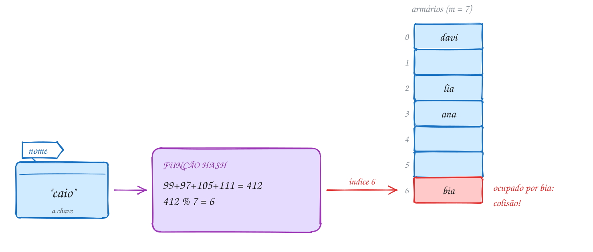
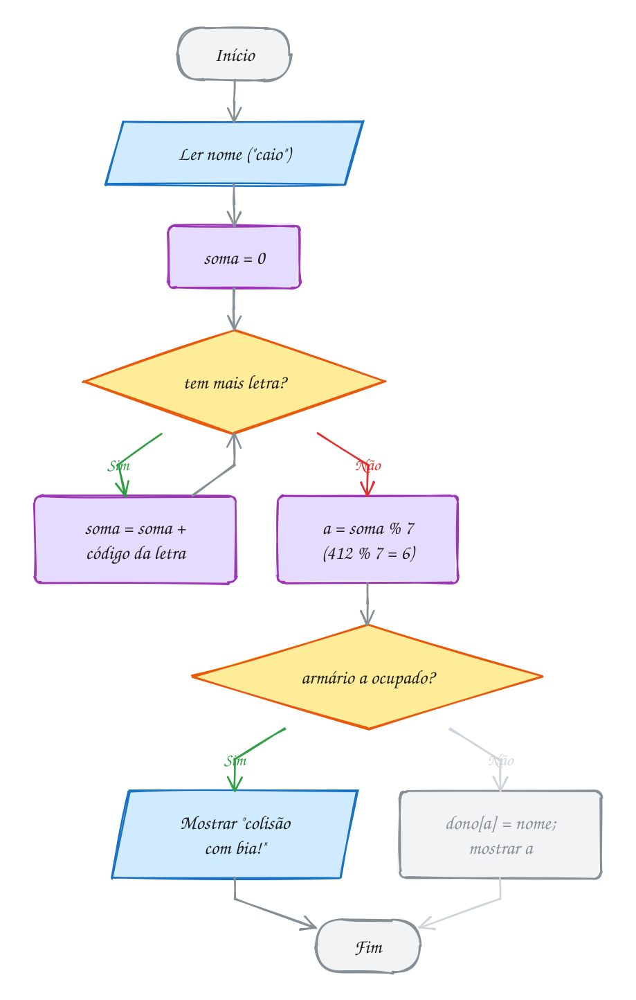
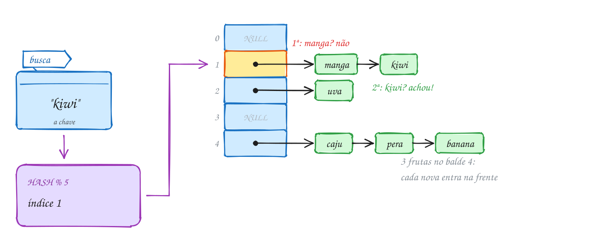
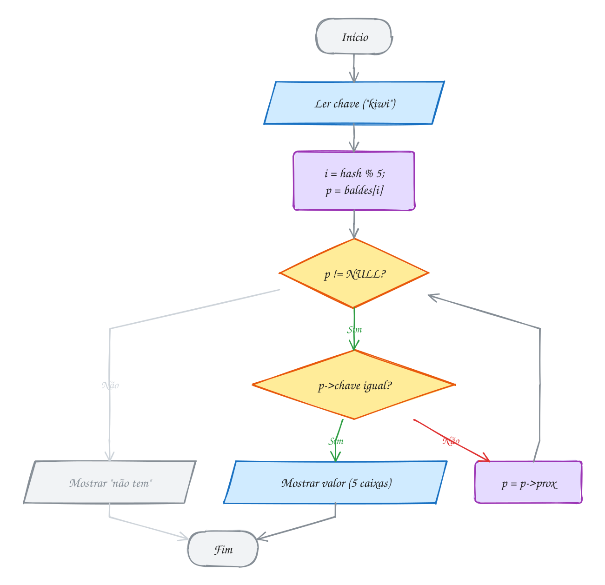
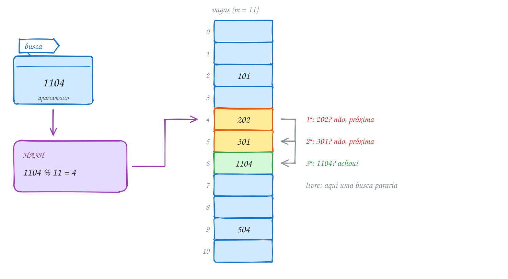
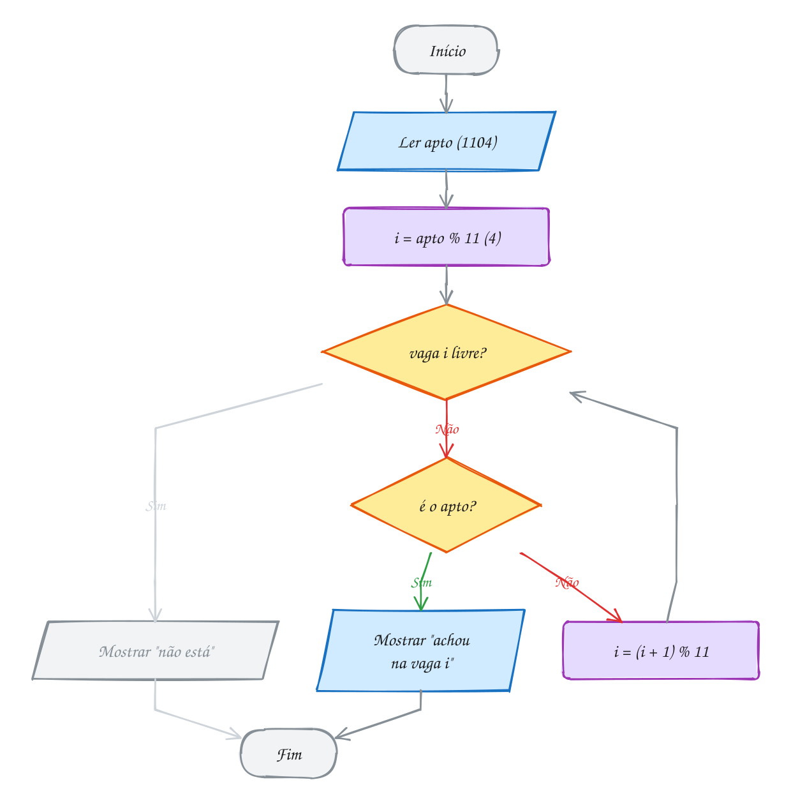
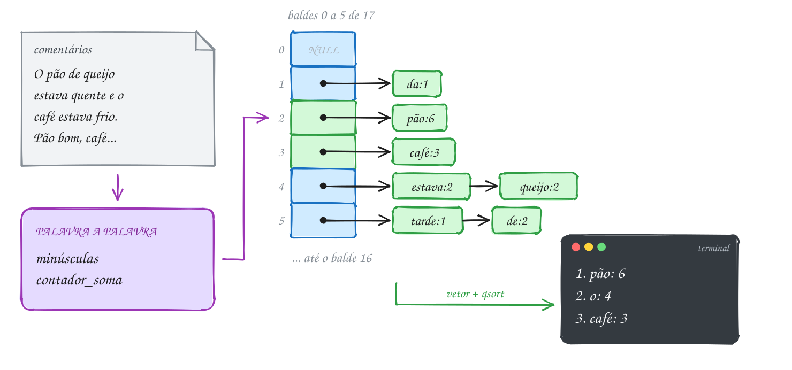
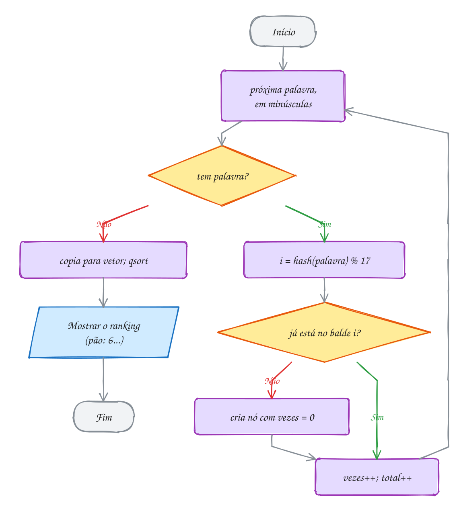

<!-- Gerado por _gerador. Para mudar este arquivo, edite _gerador/modulos/15-hash/ e rode: cd _gerador && npm run gerar -->

# Módulo 15 · Tabelas hash

Até aqui, achar uma coisa sempre custou alguma procura: O(n) na lista, O(log
n) na busca binária e na árvore equilibrada. A tabela hash troca a procura
por uma **conta**: uma função transforma a chave num índice de vetor, e o
acesso ao vetor custa O(1). É a estrutura de dados mais usada na prática.

Dicionários, conjuntos e caches de quase todo software são tabelas hash por
baixo. No C não tem nada disso pronto, e é aí que você entende como elas
funcionam: a função
hash que mistura os bytes da chave, o que acontece quando duas chaves caem no
mesmo lugar, por que a tabela cresce quando enche e por que ela não guarda
ordem nenhuma.

O módulo tem duas famílias para tratar colisão: o **encadeamento**, que
pendura uma lista em cada balde, e o **endereçamento aberto**, que procura
outra posição dentro do próprio vetor. Termina com um contador de palavras
de verdade, que junta tabela, strings, `qsort` e memória dinâmica.

## O que você vai aprender

- o que é **endereçamento direto**, **função hash**, **colisão** e **fator de carga**
- escrever funções hash boas para inteiros (`k % m`, com `m` primo) e para texto (polinômio de base 31, em `unsigned`)
- montar uma tabela com **encadeamento**: inserir, buscar, remover e liberar cada corrente
- montar uma tabela com **endereçamento aberto** e sondagem linear, com a marca de **removida**
- medir o custo: comparações, sondagens, agrupamento e quando crescer a tabela (**rehash**)
- usar a tabela como contador e como conjunto, num programa completo

## Como estudar cada assunto

1. Leia o texto e olhe o **diagrama da ideia**: é o exemplo desenhado.
2. Leia o código. É o mesmo exemplo, com os mesmos valores.
3. Siga o **fluxograma** com o dedo: é o caminho que o programa faz.
4. Rode os exemplos. Mude um valor, quebre de propósito, rode de novo.
5. Faça os exercícios. ★☆☆ é aquecimento, ★★☆ pede raciocínio, ★★★ é desafio.
   As dicas vêm logo abaixo do enunciado: tente antes de ler.

No meio de cada assunto tem uma **Pergunta para você**. Responda antes de rodar.

## As cores e as formas

Caixa azul é dado entrando ou saindo, roxa é o programa fazendo alguma coisa,
amarela é pergunta. Verde é o caminho que o exemplo segue; cinza, o que ele não
usa; vermelho, erro ou colisão. Nas tabelas, cada balde é uma gaveta com o
índice à esquerda, e a corrente de nós sai dela para a direita.

<p align="center"></p>

## Antes de começar

Este módulo usa listas encadeadas (módulo 11) o tempo todo: inserir no
início, percorrer e remover guardando o anterior. Usa também `malloc`/`free`,
structs, ponteiro para função e `qsort`. Se algo disso estiver nebuloso,
revise antes.

As tabelas seguem o padrão TAD: `tabela.h`/`tabela.c` (encadeamento),
`aberta.h`/`aberta.c` (endereçamento aberto) e `palavras.h`/`palavras.c`
(o contador) ficam na pasta de cada assunto, e o `rodar` compila tudo junto:

```bash
~/LPEDC/rodar 15-hash/0106-encadeamento/A211.c
```

Os exercícios trazem a própria implementação dentro do arquivo, para você
escrever cada pedaço com as mãos.

| # | Assunto | Pasta |
| --- | --- | --- |
| [0105](#0105--a-ideia-e-a-função-hash) | A ideia e a função hash | [`0105-hashing/`](0105-hashing/) |
| [0106](#0106--encadeamento) | Encadeamento | [`0106-encadeamento/`](0106-encadeamento/) |
| [0107](#0107--endereçamento-aberto) | Endereçamento aberto | [`0107-enderecamento-aberto/`](0107-enderecamento-aberto/) |
| [0108](#0108--juntando-tudo-o-contador-de-palavras) | Juntando tudo: o contador de palavras | [`0108-juntando-tudo/`](0108-juntando-tudo/) |

---

## 0105 · A ideia e a função hash

Na academia, o guarda-volumes tem 7 armários. A recepcionista não procura um
armário vago de porta em porta, nem anota numa lista quem ficou onde. Ela
aplica uma **regra** ao seu nome e a regra devolve o número do armário. Na
saída, a mesma regra diz onde estão as suas coisas, sem procurar nada.

Você já viu buscas de todo tipo: sequencial em O(n), binária em O(log n), na
árvore de busca em O(log n) se ela estiver equilibrada. Existe uma busca ainda
melhor, que você usa desde o começo do curso: `v[i]`. Acessar um vetor pelo
índice custa **O(1)**, não importa o tamanho.

Quando a chave já é um número pequeno, dá para usá-la direto como índice. Os
DDDs vão de 11 a 99, então `const char *estado[100]` resolve: `estado[61]` é
"DF", em um passo. Isso é **endereçamento direto** (exemplo A209). O problema aparece quando
a chave é grande ou não é número: um CPF tem 11 dígitos (um vetor de 100
bilhões de posições para guardar 50 alunos?) e um nome nem é número.

A saída é uma **função hash** (função de espalhamento): ela pega a chave, seja
qual for, e devolve um índice entre `0` e `m - 1`, onde `m` é o tamanho da
tabela. O vetor que guarda os itens nessas posições é a **tabela hash**, e cada
posição é um **balde**.

Uma boa função hash tem três qualidades:

- **determinística**: a mesma chave dá sempre o mesmo índice, senão você não
  acha mais o que guardou;
- **rápida**: custa pouco calcular, senão perde a graça do O(1);
- **espalha bem**: chaves diferentes caem em baldes diferentes, sem amontoar.

Para inteiros, a função clássica é o resto: `k % m`. Para texto, o jeito mais
simples é somar os códigos das letras e tirar o resto. Só que existem mais
chaves possíveis do que baldes, então duas chaves diferentes **vão** cair no
mesmo balde um dia. Isso é uma **colisão**. Não dá para evitar, só deixar
rara e saber tratar (os próximos dois assuntos).

A conta que mede o aperto da tabela é o **fator de carga**: `α = n / m`, o
número de itens dividido pelo número de baldes. Com 5 alunos em 7 armários,
α ≈ 0,71. Quanto mais perto de 1 (ou acima), mais colisão.

Vamos ver na prática. Os 5 alunos chegam na ordem ana, davi, lia, bia e caio.
A regra é "soma dos códigos das letras, resto por 7". Para "caio": 99 + 97 +
105 + 111 = 412, e 412 % 7 = 6. Só que "bia" (98 + 105 + 97 = 300) também deu
6, e chegou antes. Os outros três caem em armários livres:

<p align="center"></p>

O mesmo guarda-volumes em C. O vetor `dono` é a tabela: `NULL` quer dizer
armário vazio. O programa só **detecta** a colisão; resolver fica para o
próximo assunto:

```c
#include <stdio.h>

#define ARMARIOS 7

// função hash: soma os códigos das letras e reduz para 0..6
int armario(const char *nome) {
    unsigned soma = 0;
    for (int i = 0; nome[i] != '\0'; i++) {
        soma += (unsigned char)nome[i]; // o byte da letra, sempre >= 0
    }
    return (int)(soma % ARMARIOS);
}

int main(void) {
    const char *dono[ARMARIOS] = {NULL}; // NULL = armário vazio
    const char *alunos[] = {"ana", "davi", "lia", "bia", "caio"};

    for (int i = 0; i < 5; i++) {
        int a = armario(alunos[i]);
        if (dono[a] == NULL) {
            dono[a] = alunos[i];
            printf("%-4s -> armário %d\n", alunos[i], a);
        } else {
            printf("%-4s -> armário %d (colisão com %s!)\n", alunos[i], a, dono[a]);
        }
    }
    return 0;
}
// Saída:
// ana  -> armário 3
// davi -> armário 0
// lia  -> armário 2
// bia  -> armário 6
// caio -> armário 6 (colisão com bia!)
```

Repara no fluxograma: a função hash é só um laço que acumula a soma, letra por
letra, e um resto no final. O caminho mostrado é o do "caio": quatro voltas no
laço, índice 6, armário ocupado, colisão:

<p align="center"></p>

> [!WARNING]
> Somar os códigos é fácil, mas a soma **não vê a ordem das letras**. "amor",
> "roma", "mora" e "ramo" têm as mesmas letras, então dão a mesma soma (431) e
> caem todos no mesmo balde. Anagramas são comuns em nomes e códigos ("AB12" e
> "BA21"). Use o **polinômio**: `h = h * 31 + letra`. Cada letra é
> multiplicada pela sua posição, e a ordem passa a contar (exemplo A210).

> [!TIP]
> **Por dentro do C:** o C não tem "letra"; tem bytes. Em UTF-8, o "ã" ocupa
> dois bytes, `0xC3 0xA3`, e no gcc para PC o tipo `char` tem **sinal**: esses
> bytes valem -61 e -93. Somados num `int`, podem deixar a soma negativa, e o
> resto de um negativo em C é negativo: `-98 % 8` dá `-2`, índice fora do vetor. Por isso a função converte
> para `unsigned char` (0 a 255) e acumula num `unsigned`. E tem mais um
> motivo: estourar um `unsigned` é definido (a conta dá a volta, módulo 2³²),
> enquanto estourar um `int` é comportamento indefinido. O polinômio estoura o
> tempo todo, de propósito.

> [!NOTE]
> **Pergunta para você:** se a tabela tivesse 10 armários em vez de 7, quais
> alunos colidiriam? Faça as contas com as somas (ana 304, davi 420, lia 310,
> bia 300, caio 412) antes de trocar `7` por `10` no código acima e rodar.

### Hora de praticar

Os arquivos ficam em [`0105-hashing/`](0105-hashing/). Os comandos funcionam de qualquer pasta do terminal. Nos exemplos, rode, mude, quebre e rode de novo. Nos exercícios, a resposta vai dentro do próprio arquivo. ★☆☆ é aquecimento, ★★☆ pede raciocínio e ★★★ é desafio.

**Exemplo A209 · DDD direto no vetor**

```c
#include <stdio.h>

#define FAIXA 100 // DDDs vão de 11 a 99: cabem num vetor de 100

int main(void) {
    // endereçamento direto: a própria chave é o índice (o "hash" é k)
    const char *estado[FAIXA] = {NULL}; // NULL = DDD sem dono
    estado[11] = "SP";
    estado[21] = "RJ";
    estado[31] = "MG";
    estado[61] = "DF";
    estado[71] = "BA";
    estado[91] = "PA";

    int consultas[] = {61, 11, 10, 91, 120};
    for (int i = 0; i < 5; i++) {
        int ddd = consultas[i];
        if (ddd < 0 || ddd >= FAIXA) {
            printf("DDD %3d -> fora da faixa\n", ddd); // nunca indexe sem conferir
        } else if (estado[ddd] == NULL) {
            printf("DDD %3d -> não existe\n", ddd);
        } else {
            printf("DDD %3d -> %s\n", ddd, estado[ddd]); // um passo: O(1)
        }
    }

    int usadas = 0;
    for (int i = 0; i < FAIXA; i++) {
        if (estado[i] != NULL) {
            usadas++;
        }
    }
    printf("posições usadas: %d de %d\n", usadas, FAIXA); // o resto é desperdício
    return 0;
}
// Saída:
// DDD  61 -> DF
// DDD  11 -> SP
// DDD  10 -> não existe
// DDD  91 -> PA
// DDD 120 -> fora da faixa
// posições usadas: 6 de 100
```

```bash
~/LPEDC/rodar 15-hash/0105-hashing/A209.c
```

**Exemplo A210 · Anagramas: soma contra polinômio**

```c
#include <stdio.h>

#define M 11

// soma dos códigos: a ordem das letras não importa (ruim)
unsigned hash_soma(const char *s) {
    unsigned h = 0;
    for (int i = 0; s[i] != '\0'; i++) {
        h += (unsigned char)s[i];
    }
    return h % M;
}

// polinômio de base 31: cada letra pesa conforme a posição
unsigned hash_pol(const char *s) {
    unsigned h = 0;
    for (int i = 0; s[i] != '\0'; i++) {
        h = h * 31 + (unsigned char)s[i];
    }
    return h % M;
}

int main(void) {
    const char *palavras[] = {"amor", "roma", "mora", "ramo"};

    printf("palavra  soma  polinômio\n");
    for (int i = 0; i < 4; i++) {
        printf("%-7s  %4u  %9u\n", palavras[i], hash_soma(palavras[i]), hash_pol(palavras[i]));
    }
    return 0;
}
// Saída:
// palavra  soma  polinômio
// amor        2          3
// roma        2          5
// mora        2          2
// ramo        2          7
```

```bash
~/LPEDC/rodar 15-hash/0105-hashing/A210.c
```

#### Exercícios

**Exercício E625** · ★☆☆

A lanchonete guarda os pedidos do dia numa prateleira com 11 nichos. O
nicho de cada pedido é o resto da divisão do número do pedido por 11.
Escreva a função "int nicho(int pedido)" e mostre o nicho dos pedidos
1043, 2210, 3876, 5521 e 7019, um por linha, no formato abaixo. Quando o
nicho já estiver ocupado por um pedido anterior, acrescente na linha
"(colide com NNNN)".


```text
Saída esperada:
pedido 1043 -> nicho 9
pedido 2210 -> nicho 10
...
```

**Dicas:**

1. A função hash de inteiros é só "return pedido % 11;".
2. Guarde os 5 números num vetor e percorra com um for. Um vetor
   "int dono[11] = {0};" lembra qual pedido ocupou cada nicho (0 = vazio).
3. Resposta esperada: 1043 -> 9, 2210 -> 10, 3876 -> 4,
   5521 -> 10 (colide com 2210) e 7019 -> 1.

```bash
~/LPEDC/rodar 15-hash/0105-hashing/E625.c
```

**Exercício E626** · ★☆☆

O programa abaixo mostra o balde de 4 palavras com a soma dos códigos e
M = 5. Estenda o programa: escreva a função "unsigned soma(const char *s)",
que devolve a soma dos códigos SEM o resto, e, depois da lista, compare
todos os pares de palavras. Para cada par que cai no mesmo balde, mostre
os dois nomes e as duas somas completas. Assim você vê qual colisão vem
de anagrama (somas iguais) e qual é só acaso do resto (somas diferentes).


```text
Saída esperada:
sol=4
los=4
Sol=2
lua=2
sol e los colidem (somas 334 e 334)
Sol e lua colidem (somas 302 e 322)
```

**Dicas:**

1. h() pode chamar soma() e só tirar o resto: "return soma(s) % M;".
2. Pares sem repetir: "for (i = 0; i < 4; i++) for (j = i + 1; j < 4; j++)".
3. Resposta esperada: a saída acima. "sol" e "los" são anagramas;
   "Sol" e "lua" só têm o mesmo resto por 5 ('S' = 83 não é 's' = 115).

```bash
~/LPEDC/rodar 15-hash/0105-hashing/E626.c
```

**Exercício E627** · ★★☆

Complete a função hash_pol, que calcula o hash polinomial de base 31 de uma
string e devolve o resto por M (13). A regra: começa com h = 0 e, para cada
byte da string, faz h = h * 31 + byte. Use unsigned para h e converta
cada char para unsigned char antes de somar.


```text
Saída esperada:
pix    -> 0
ted    -> 8
doc    -> 8
boleto -> 1
```

**Dicas:**

1. O laço é o mesmo da soma; só muda a conta de dentro.
2. Não se preocupe se h estourar: em unsigned a conta dá a volta, e isso
   é bem definido em C.
3. Resposta esperada: a saída acima ("ted" e "doc" colidem com M = 13).

```bash
~/LPEDC/rodar 15-hash/0105-hashing/E627.c
```

**Exercício E628** · ★★☆

Na loja de material de construção, todo código de produto termina em 0:
120, 350, 470, 590, 610, 230, 740, 860, 980 e 440. Escreva um programa que
espalha esses 10 códigos com "codigo % m" e mostra quantos caíram em cada
balde, com uma estrela por código. No fim de cada tabela, mostre quantos
baldes ficaram vazios. Faça para m = 10 e para m = 11.


```text
Saída esperada (começo):
m = 10
 0: **********
 1:
...
vazios: 9
```

**Dicas:**

1. Um vetor "int conta[11] = {0};" e "conta[codigo % m]++" para cada código.
2. Faça uma função "void distribui(const int codigos[], int n, int m)"
   e chame duas vezes.
3. Resposta esperada: com m = 10, os 10 códigos caem no balde 0
   (vazios: 9). Com m = 11: um código em cada balde, menos o 4 e o 6
   (vazios: 2) e o 10, com dois (120 e 230). Com m = 10, o resto só olha
   o último dígito, que é sempre 0; um m primo usa o número inteiro.

```bash
~/LPEDC/rodar 15-hash/0105-hashing/E628.c
```

**Exercício E629** · ★★★

O hortifrúti conta quantas frutas caem em cada um dos 8 baldes. O
programa abaixo funciona com "banana" e "uva", mas o AddressSanitizer
reclama quando entra "maçã". O erro está aí de propósito. Faça assim:

1. No primeiro for do main, antes de contar, acrescente um printf que

```text
 mostre o índice de cada fruta ("banana -> 1"). Rode e veja o índice
 que sai para "maçã" logo antes do erro.
```

2. Conserte a função indice() para que funcione com qualquer texto em

```text
 UTF-8. Rode de novo: o sanitizer não pode reclamar.
```


```text
Saída esperada (depois do conserto):
banana -> 1
uva -> 4
maçã -> 6
balde 0: 0
balde 1: 1
...
```

**Dicas:**

1. Em UTF-8, "ç" é 0xC3 0xA7 e "ã" é 0xC3 0xA3. Quanto vale 0xC3 num
   char com sinal?
2. Em C, o resto de um número negativo é negativo: -98 % 8 dá -2.
3. Resposta esperada: antes do conserto, "maçã -> -2" (os bytes viram
   -61, -89, -61 e -93 e a soma dá -98). Acumulando num unsigned e
   convertendo cada byte para unsigned char, "maçã" cai no balde 6 e a
   contagem fica 1 no balde 1, 1 no 4 e 1 no 6.

```bash
~/LPEDC/rodar 15-hash/0105-hashing/E629.c
```

**Exercício E630** · ★★★

O compilador precisa reconhecer as palavras reservadas o tempo todo. Para
um conjunto fixo de chaves, dá para achar uma tabela sem nenhuma colisão:
um hash "perfeito". Com o hash polinomial de base 31 (h = h * 31 + byte,
em unsigned), descubra o MENOR m, a partir de 8, em que as 8 palavras
abaixo caem em baldes todos diferentes:


```text
int  char  if  else  for  while  return  void
```


Mostre o m encontrado e o balde de cada palavra.


```text
Saída esperada (formato):
m = ...
int -> ...
char -> ...
```

**Dicas:**

1. Calcule o hash polinomial completo uma vez (sem o resto) e guarde num
   vetor de unsigned; o resto por m muda a cada tentativa.
2. Para testar um m: um vetor "bool usado[64]" zerado; se algum balde já
   estiver usado, esse m não serve.
3. Resposta esperada: m = 14, com int -> 5, char -> 10, if -> 11,
   else -> 1, for -> 7, while -> 13, return -> 4, void -> 8. (Com a soma
   dos códigos, o menor m seria 18.)

```bash
~/LPEDC/rodar 15-hash/0105-hashing/E630.c
```

---

## 0106 · Encadeamento

No hortifrúti, o estoque fica em 5 prateleiras numeradas. A regra da casa diz
em qual prateleira vai cada fruta. Quando duas frutas caem na mesma
prateleira, ninguém joga uma fora: elas ficam **lado a lado**, em fila. Para
achar o kiwi, você vai direto à prateleira 1 e olha só o que está ali.

Essa é a primeira forma de tratar colisão: o **encadeamento** (ou
encadeamento separado). Cada balde da tabela deixa de guardar um item e passa a
guardar a **cabeça de uma lista encadeada**, a corrente com todos os itens
cujo hash caiu ali. A tabela vira um vetor de ponteiros: `No *baldes[m]`.

As três operações são as de lista que você já conhece (módulo 11), com um
passo a mais na frente: calcular o balde.

- **inserir**: calcula `i = hash(chave) % m`, procura a chave na lista de
  `baldes[i]`; se achar, troca o valor; se não, cria um nó e põe **no início**
  da lista, em O(1);
- **buscar**: calcula `i` e percorre só a lista de `baldes[i]`;
- **remover**: calcula `i` e faz a remoção de lista, guardando o anterior.

Quanto custa? Com uma função hash que espalha bem, cada lista tem, em média,
`α = n / m` nós (o fator de carga). Buscar custa O(1 + α): o cálculo do hash
mais uma lista curta. Se `m` cresce junto com `n`, α fica constante e a busca
fica O(1) na média. No pior caso, com um hash ruim que joga tudo num balde
só, a tabela vira uma lista única e a busca volta a ser O(n).

No encadeamento a tabela **nunca enche**: α pode passar de 1, as listas só
ficam mais compridas (o exemplo A211 põe 8 itens em 2 baldes). Algumas implementações, quando uma corrente fica
comprida demais, até trocam a lista por uma árvore.

Vamos ver na prática. Seis frutas entram na ordem banana, uva, pera, kiwi,
manga e caju, com o hash polinomial do assunto anterior e `m = 5`. Os índices
saem 4, 2, 4, 1, 1 e 4. Como cada nova entra no início da corrente, o balde 4
termina com caju, pera, banana. Para buscar "kiwi", a busca vai ao balde 1,
compara com "manga" (não é), depois com "kiwi" (é): 2 comparações, sem olhar
nenhum outro balde:

<p align="center"></p>

A estrutura segue o padrão TAD: `tabela.h` com a interface e o tipo opaco,
`tabela.c` com o nó, os baldes e as operações. O coração da implementação:

```c
typedef struct No {
    char chave[TAM_CHAVE]; // cópia da chave (não um ponteiro emprestado)
    int valor;
    struct No *prox;
} No;

struct Tabela {
    int m;       // número de baldes
    int n;       // número de itens
    No **baldes; // vetor de m cabeças de lista
};

bool tabela_busca(const Tabela *t, const char *chave, int *valor, int *comparacoes) {
    int i = (int)(hash(chave) % (unsigned)t->m);
    int olhados = 0;
    for (No *p = t->baldes[i]; p != NULL; p = p->prox) {
        olhados++;
        if (strcmp(p->chave, chave) == 0) {
            *valor = p->valor;
            if (comparacoes != NULL) {
                *comparacoes = olhados;
            }
            return true;
        }
    }
    if (comparacoes != NULL) {
        *comparacoes = olhados;
    }
    return false;
}
```

E o cliente, que só conhece o `tabela.h`:

```c
#include <stdio.h>
#include "tabela.h"

int main(void) {
    Tabela *estoque = tabela_cria(5);
    if (estoque == NULL) {
        return 1;
    }
    const char *frutas[] = {"banana", "uva", "pera", "kiwi", "manga", "caju"};
    int caixas[] = {12, 30, 8, 5, 20, 14};
    for (int i = 0; i < 6; i++) {
        tabela_insere(estoque, frutas[i], caixas[i]);
    }
    tabela_mostra(estoque);

    int qtd, olhados;
    if (tabela_busca(estoque, "kiwi", &qtd, &olhados)) {
        printf("kiwi: %d caixas (%d comparações)\n", qtd, olhados);
    }
    if (!tabela_busca(estoque, "limao", &qtd, &olhados)) {
        printf("limao: não tem (%d comparações)\n", olhados);
    }
    tabela_libera(estoque);
    return 0;
}
// Saída:
// [0]
// [1] -> manga:20 -> kiwi:5
// [2] -> uva:30
// [3]
// [4] -> caju:14 -> pera:8 -> banana:12
// kiwi: 5 caixas (2 comparações)
// limao: não tem (0 comparações)
```

Repara no fluxograma da busca: o hash leva direto ao balde, e daí em diante é
o laço de sempre de lista encadeada. O "kiwi" dá uma volta no laço (passa pela
manga) e para no Sim. O "limao" cai no balde 0, que está vazio, e sai pelo Não
logo na primeira pergunta:

<p align="center"></p>

> [!WARNING]
> Chave de texto se compara com `strcmp`, nunca com `==`. `p->chave == chave`
> compara **endereços**: diz se as duas strings moram no mesmo lugar da
> memória, não se têm as mesmas letras. O programa compila, às vezes até
> funciona (o compilador pode juntar literais iguais num endereço só) e quebra
> quando a chave vem do teclado ou de um arquivo. O mesmo vale ao guardar: o
> nó tem a sua **cópia** da chave, porque o buffer de quem chamou vai ser
> reaproveitado.

> [!TIP]
> **Por dentro do C:** com `m = 5`, os baldes são um bloco de 5 ponteiros (40
> bytes) contíguo no heap. Cada nó é um `malloc` separado: 32 bytes da chave,
> 4 do valor, 4 de preenchimento e 8 do `prox`, `sizeof(No)` = 48, espalhados
> em qualquer canto da memória. Por isso o `tabela_libera` precisa andar em
> **todas** as correntes dando `free` em cada nó, guardando o `prox` antes; um
> `free(t->baldes)` sozinho solta só os 40 bytes das cabeças e vaza o resto. E
> como os nós ficam longe uns dos outros, percorrer uma corrente comprida custa
> caro para a cache do processador.

> [!NOTE]
> **Pergunta para você:** o "limao" cai no balde 0. Se você inserir "limao"
> com 9 caixas e depois buscar "coco" (que também cai no balde 0), quantas
> comparações a busca faz? E se a inserção fosse no fim da corrente, mudaria
> alguma coisa? Teste mudando o `main` acima.

### Hora de praticar

Os arquivos ficam em [`0106-encadeamento/`](0106-encadeamento/). Os comandos funcionam de qualquer pasta do terminal. Nos exemplos, rode, mude, quebre e rode de novo. Nos exercícios, a resposta vai dentro do próprio arquivo. ★☆☆ é aquecimento, ★★☆ pede raciocínio e ★★★ é desafio.

**Exemplo A211 · Poucos baldes: a tabela não enche**

```c
#include <stdio.h>
#include "tabela.h"

#define N 8

// insere as verduras numa tabela de m baldes e mede o custo de achar cada uma
void testa(int m, const char *nomes[], const int qtd[]) {
    Tabela *t = tabela_cria(m);
    if (t == NULL) {
        return;
    }
    for (int i = 0; i < N; i++) {
        tabela_insere(t, nomes[i], qtd[i]);
    }
    printf("m = %d, n = %d, fator de carga = %.2f\n", m, tabela_tamanho(t),
           (double)tabela_tamanho(t) / m);
    tabela_mostra(t);

    int total = 0;
    for (int i = 0; i < N; i++) {
        int valor, comp;
        if (tabela_busca(t, nomes[i], &valor, &comp)) {
            total += comp; // soma o custo de achar cada uma
        }
    }
    printf("média para achar: %.2f comparações\n\n", (double)total / N);
    tabela_libera(t);
}

int main(void) {
    const char *verduras[N] = {"alface", "couve", "rucula", "agriao",
                               "salsa", "cebolinha", "coentro", "espinafre"};
    int macos[N] = {40, 25, 18, 12, 30, 35, 22, 10};

    testa(2, verduras, macos);  // α = 4: correntes longas, mas cabe tudo
    testa(11, verduras, macos); // α < 1: quase um passo por busca
    return 0;
}
// Saída:
// m = 2, n = 8, fator de carga = 4.00
// [0] -> coentro:22 -> salsa:30 -> rucula:18 -> couve:25 -> alface:40
// [1] -> espinafre:10 -> cebolinha:35 -> agriao:12
// média para achar: 2.62 comparações
//
// m = 11, n = 8, fator de carga = 0.73
// [0] -> cebolinha:35
// [1]
// [2] -> alface:40
// [3] -> rucula:18
// [4] -> agriao:12
// [5]
// [6] -> couve:25
// [7]
// [8] -> espinafre:10
// [9]
// [10] -> coentro:22 -> salsa:30
// média para achar: 1.12 comparações
```

```bash
~/LPEDC/rodar 15-hash/0106-encadeamento/A211.c
```

**Exemplo A212 · Fim de feira: atualizar, remover e o fator de carga**

```c
#include <stdio.h>
#include "tabela.h"

#define BALDES 5

int main(void) {
    Tabela *estoque = tabela_cria(BALDES);
    if (estoque == NULL) {
        return 1;
    }
    tabela_insere(estoque, "banana", 12);
    tabela_insere(estoque, "uva", 30);
    tabela_insere(estoque, "pera", 8);

    tabela_insere(estoque, "banana", 18); // chave repetida: só troca o valor
    tabela_remove(estoque, "uva");        // a uva acabou
    tabela_insere(estoque, "limao", 9);   // chegou fruta nova
    tabela_mostra(estoque);

    int n = tabela_tamanho(estoque);
    printf("itens: %d, fator de carga: %.2f\n", n, (double)n / BALDES);

    if (!tabela_remove(estoque, "uva")) {
        printf("uva: já tinha saído\n");
    }
    tabela_libera(estoque);
    return 0;
}
// Saída:
// [0] -> limao:9
// [1]
// [2]
// [3]
// [4] -> pera:8 -> banana:18
// itens: 3, fator de carga: 0.60
// uva: já tinha saído
```

```bash
~/LPEDC/rodar 15-hash/0106-encadeamento/A212.c
```

#### Exercícios

**Exercício E631** · ★☆☆

Uma tabela com encadeamento tem 5 baldes e usa h(k) = k % 5. Cada número
novo entra no INÍCIO da corrente do seu balde. O programa abaixo já insere
12, 7, 20, 17, 3 e 25, nessa ordem, e já libera a memória. Escreva a
função mostra: ela imprime um balde por linha, com os números na ordem em
que aparecem na corrente, e no fim mostra quantos baldes ficaram vazios e
o tamanho da corrente mais comprida.


```text
Saída esperada:
[0] 25 20
[1]
[2] 17 7 12
[3] 3
[4]
vazios: 2, maior corrente: 3
```

**Dicas:**

1. Para cada balde, ande com "for (No *p = baldes[b]; p != NULL;
   p = p->prox)" contando os nós.
2. Corrente com 0 nós soma um vazio; guarde a maior contagem vista.
3. Resposta esperada: a saída acima. Inserir no início inverte a ordem:
   o último a chegar fica na frente.

```bash
~/LPEDC/rodar 15-hash/0106-encadeamento/E631.c
```

**Exercício E632** · ★☆☆

A academia guarda as matrículas numa tabela com 7 baldes e encadeamento
(h = matricula % 7). A inserção e a liberação já estão prontas. Complete a
função busca: ela percorre a corrente do balde certo, conta em
*comparacoes quantos nós olhou e devolve true se achou a matrícula.


```text
Saída esperada:
5005: achou (3 comparações)
4000: não achou (0 comparações)
```

**Dicas:**

1. O balde é matricula % M; a corrente começa em baldes[matricula % M].
2. Use "(*comparacoes)++" a cada nó visitado, antes de comparar.
3. Resposta esperada: a saída acima. 5005, 7210 e 2016 caem no balde 0, e
   a corrente ficou 2016 -> 7210 -> 5005. O balde 3, do 4000, está vazio.

```bash
~/LPEDC/rodar 15-hash/0106-encadeamento/E632.c
```

**Exercício E633** · ★★☆

No balcão da pizzaria, os pedidos prontos ficam numa tabela com 4 baldes e
encadeamento (h = pedido % 4, inserção no início da corrente). Quando o
cliente retira, o pedido sai da tabela. Escreva do zero: o nó, insere,
"bool remove_pedido(No *baldes[], int pedido)", mostra e libera. Insira
101, 205, 309, 120, 222 e 315, mostre, retire 205, 309 e 999, e mostre de
novo.


```text
Saída esperada:
[0] 120
[1] 309 205 101
[2] 222
[3] 315
pedido 205 retirado
pedido 309 retirado
pedido 999 não existe
[0] 120
[1] 101
[2] 222
[3] 315
```

**Dicas:**

1. É a remoção de lista encadeada do módulo 11, aplicada só à corrente
   de baldes[pedido % 4]. Guarde o anterior enquanto anda.
2. Cuidado com o primeiro nó da corrente (o 309): não tem anterior, então
   quem muda é a própria cabeça, baldes[1].
3. Resposta esperada: a saída acima, e o AddressSanitizer quieto (todo nó
   removido leva free, e o libera solta o resto).

```bash
~/LPEDC/rodar 15-hash/0106-encadeamento/E633.c
```

**Exercício E634** · ★★☆

Um colega sugeriu usar o tamanho do nome como função hash ("é rápido!").
Compare as duas funções numa tabela com 8 baldes e estas 10 cidades:


```text
recife natal manaus belem santos maceio osasco palmas macapa cuiaba
```


Para cada função (tamanho: strlen(s); polinômio: h = h * 31 + byte, em
unsigned), mostre quantas cidades caem em cada balde, o tamanho da maior
corrente e a média de comparações para achar uma cidade que está na
tabela. Use um ponteiro para função para não escrever a análise duas vezes.


```text
Saída esperada:
tamanho  : 0 0 0 0 0 2 8 0 | maior: 8 | média: 3.9
polinomio: 2 2 1 1 3 1 0 0 | maior: 3 | média: 1.5
```

**Dicas:**

1. Não precisa montar as listas: para medir, basta contar quantas chaves
   caem em cada balde.
2. Numa corrente de k nós, achar o 1º custa 1 comparação, o 2º custa 2...
   o total da corrente é 1 + 2 + ... + k = k * (k + 1) / 2. Some todas e
   divida por 10.
3. Resposta esperada: a saída acima. Com o tamanho, só existem nomes de 5
   e 6 letras, então 8 cidades amontoam num balde: a tabela vira quase uma
   lista.

```bash
~/LPEDC/rodar 15-hash/0106-encadeamento/E634.c
```

**Exercício E635** · ★★★

A lista de convidados do aniversário fica numa tabela com encadeamento. O
programa mostra a tabela certinho, mas o gcc dá um aviso e o
AddressSanitizer acusa "heap-use-after-free" no fim. O erro está aí de
propósito. Rode, leia o aviso e o relatório e conserte a função libera.
Aproveite e faça libera devolver quantos nós soltou ("int libera(...)"),
e mostre esse número no fim do main. Rode de novo: nenhum aviso do gcc e
nenhuma reclamação do sanitizer.


```text
Saída esperada:
[0] rita
[1] tiago
[2] lara joao
liberados: 4
```

**Dicas:**

1. O relatório mostra duas pilhas: onde o nó foi liberado e onde ele foi
   usado depois. Compare as duas linhas.
2. Depois do free(p), a memória de *p não é mais sua, nem para ler p->prox.
   Às vezes "funciona" sem o sanitizer só porque o free não apaga os bytes
   na hora.
3. Resposta esperada: a saída acima. O conserto é guardar o próximo antes:
   "No *prox = p->prox; free(p); p = prox;", contando cada free.

```bash
~/LPEDC/rodar 15-hash/0106-encadeamento/E635.c
```

**Exercício E636** · ★★★

No encadeamento a tabela nunca enche, mas as correntes crescem. A solução
das bibliotecas é o rehash: quando o fator de carga passa de 1 (n > m), a
tabela cria um vetor de baldes maior, com 2 * m + 1 posições, e muda cada
nó para o seu balde novo, sem fazer malloc de nó nenhum.

Escreva a tabela de inteiros (struct com m, n e o vetor de baldes alocado
com calloc) com insere, cresce, mostra e libera. Comece com m = 2, insira
14, 5, 23, 8, 19, 40, 12, 31, 21 e 2, avise cada vez que a tabela crescer
e mostre o resultado final.


```text
Saída esperada:
cresceu: m = 5
cresceu: m = 11
n = 10, m = 11
[0]
[1] 12 23
[2] 2
...
[10] 21
```

**Dicas:**

1. O balde de cada nó muda com o m (k % 5 não é k % 11): por isso não dá
   para copiar o vetor velho, tem que redistribuir nó por nó.
2. Para mudar um nó de lugar: guarde p->prox, faça p->prox = novos[i] e
   novos[i] = p. Depois do laço, free no vetor velho.
3. Resposta esperada: cresce ao inserir o 3º número (m vira 5) e o 6º
   (m vira 11). No fim: [1] 12 23, [2] 2, [3] 14, [5] 5, [7] 40,
   [8] 19 8, [9] 31, [10] 21 e os outros vazios. A ordem dentro de uma
   corrente pode mudar conforme a sua implementação; o conteúdo, não.

```bash
~/LPEDC/rodar 15-hash/0106-encadeamento/E636.c
```

---

## 0107 · Endereçamento aberto

O estacionamento de visitantes do condomínio tem 11 vagas, numeradas de 0 a
10. A regra da portaria: a vaga do carro é o número do apartamento com resto
por 11. Se a vaga estiver ocupada, você tenta a **próxima**. E a seguinte. Na
saída, o porteiro faz o mesmo caminho para achar o carro.

Essa é a segunda forma de tratar colisão: o **endereçamento aberto**. Não tem
lista nenhuma. Os itens ficam **dentro do próprio vetor**, e quem colide
procura outra posição livre na tabela, seguindo uma sequência fixa de
tentativas. Cada tentativa é uma **sondagem**.

A sequência mais simples é a **sondagem linear**: começa em `h = chave % m` e
anda uma casa por vez, dando a volta no fim: `i = (i + 1) % m`.

- **inserir**: sonda a partir de `h` até achar uma posição livre;
- **buscar**: sonda a partir de `h` até achar a chave (achou) ou uma posição
  **livre** (não está: se estivesse, teria parado ali);
- **remover**: é aqui que mora a pegadinha (o aviso abaixo explica).

Como tudo cabe no vetor, a tabela **enche**: `α = n / m` nunca passa de 1. E
fica lenta bem antes disso. Na sondagem linear, as ocupadas formam blocos
seguidos, e qualquer chave que cai num bloco vai parar no fim dele, deixando o
bloco ainda maior. Isso é o **agrupamento primário**. Com α = 0,5 uma busca
sem sucesso olha 2,5 posições em média; com α = 0,9, cerca de 50. A regra
prática: não passe de 70% a 75% de ocupação. Passou, crie uma tabela maior e
reinsira tudo (o exemplo A213 lota uma tabela
de 7 vagas e mostra as sondagens crescendo).

Vamos ver na prática. Entram os carros dos apartamentos 101, 202, 301, 1104
e 504. O 101 vai para a vaga 2 e o 202 para a 4. O 301 também dá 4 (301 % 11
= 4), encontra a 4 ocupada e para na 5. O 1104 dá 4 de novo: tenta a 4, a 5,
e para na 6. O 504 vai direto para a 9. Na busca pelo 1104, o porteiro refaz
o mesmo caminho: 3 sondagens:

<p align="center"></p>

O TAD segue o padrão de sempre: `aberta.h` com a interface, `aberta.c` com o
vetor de vagas, cada uma com um **estado**: `LIVRE`, `OCUPADA` ou `REMOVIDA`.
A busca, dentro do `aberta.c`, é este laço:

```c
// anda a partir de chave % m até achar a chave ou uma posição LIVRE;
// passa reto pelas REMOVIDAS. Devolve a posição da chave ou -1.
static int procura(const Aberta *t, int chave, int *sondagens) {
    int i = chave % t->m;
    int olhadas = 0;
    for (int passo = 0; passo < t->m; passo++) {
        olhadas++;
        if (t->v[i].estado == LIVRE) {
            break; // a corrente de tentativas acaba aqui
        }
        if (t->v[i].estado == OCUPADA && t->v[i].chave == chave) {
            if (sondagens != NULL) {
                *sondagens = olhadas;
            }
            return i;
        }
        i = (i + 1) % t->m; // a próxima, dando a volta no fim
    }
    if (sondagens != NULL) {
        *sondagens = olhadas;
    }
    return -1;
}
```

E o programa do condomínio:

```c
#include <stdio.h>
#include "aberta.h"

int main(void) {
    Aberta *vagas = aberta_cria(11);
    if (vagas == NULL) {
        return 1;
    }
    int aptos[] = {101, 202, 301, 1104, 504};
    int horas[] = {7, 8, 8, 9, 10};
    for (int i = 0; i < 5; i++) {
        int s;
        int vaga = aberta_insere(vagas, aptos[i], horas[i], &s);
        printf("apto %4d: hash %d -> vaga %d, sondagens: %d\n", aptos[i], aptos[i] % 11, vaga, s);
    }
    aberta_mostra(vagas);

    int hora, s;
    if (aberta_busca(vagas, 1104, &hora, &s)) {
        printf("1104 entrou às %dh, sondagens: %d\n", hora, s);
    }
    if (!aberta_busca(vagas, 303, &hora, &s)) {
        printf("303 não está, sondagens: %d\n", s);
    }
    aberta_libera(vagas);
    return 0;
}
// Saída:
// apto  101: hash 2 -> vaga 2, sondagens: 1
// apto  202: hash 4 -> vaga 4, sondagens: 1
// apto  301: hash 4 -> vaga 5, sondagens: 2
// apto 1104: hash 4 -> vaga 6, sondagens: 3
// apto  504: hash 9 -> vaga 9, sondagens: 1
// [ 0] -
// [ 1] -
// [ 2] 101
// [ 3] -
// [ 4] 202
// [ 5] 301
// [ 6] 1104
// [ 7] -
// [ 8] -
// [ 9] 504
// [10] -
// 1104 entrou às 9h, sondagens: 3
// 303 não está, sondagens: 2
```

Repara no fluxograma da busca: são duas perguntas por vaga. "Está livre?"
encerra a busca sem sucesso; "é o carro?" encerra com sucesso. Se nenhuma das
duas, anda uma vaga. O 1104 passa duas vezes pelo laço (vagas 4 e 5) e é
achado na 6. O 303 começa na 6, não é ele, e para na 7, livre:

<p align="center"></p>

> [!WARNING]
> Remover **não** é marcar a posição como livre. Se o carro do 301 sai e a
> vaga 5 volta a ser `LIVRE`, a busca pelo 1104 começa na 4, vê a 5 livre e
> conclui "não está", embora ele esteja na 6. A vaga livre corta o caminho de
> quem tinha pulado por ela. A solução é uma terceira marca, **removida**
> (lápide, *tombstone*): a busca passa reto por ela, e a inserção pode
> reaproveitá-la. O exemplo A214 mostra isso. O custo: com muitas remoções, as
> lápides acumulam e as buscas sem sucesso ficam longas, até você reconstruir
> a tabela.

> [!TIP]
> **Por dentro do C:** cada `Vaga` tem `chave`, `valor` e `estado`: 3 × 4 =
> 12 bytes, e as 11 vagas são **um bloco só** de 132 bytes. Sem `malloc` por
> item, sem ponteiro `prox`, sem nó espalhado pelo heap. Andar para a próxima
> vaga é andar 12 bytes na memória, e o processador já trouxe as vizinhas para
> a cache junto com a primeira. Por isso o endereçamento aberto costuma ganhar
> do encadeamento na prática, mesmo fazendo mais sondagens. Muitas tabelas
> hash de bibliotecas usam endereçamento aberto (com sondagens mais espertas
> que a linear).

> [!NOTE]
> **Pergunta para você:** depois dos 5 carros, chega o do apartamento 1203
> (1203 % 11 = 4). Em qual vaga ele para, e com quantas sondagens? E quantas
> sondagens custa, depois disso, buscar um apartamento que não está e que cai
> na vaga 4?

### Hora de praticar

Os arquivos ficam em [`0107-enderecamento-aberto/`](0107-enderecamento-aberto/). Os comandos funcionam de qualquer pasta do terminal. Nos exemplos, rode, mude, quebre e rode de novo. Nos exercícios, a resposta vai dentro do próprio arquivo. ★☆☆ é aquecimento, ★★☆ pede raciocínio e ★★★ é desafio.

**Exemplo A213 · Garagem lotando: a volta no fim e a tabela cheia**

```c
#include <stdio.h>
#include "aberta.h"

#define VAGAS 7

int main(void) {
    Aberta *garagem = aberta_cria(VAGAS);
    if (garagem == NULL) {
        return 1;
    }
    // vários apartamentos caem no fim do vetor (hash 5 e 6)
    int aptos[] = {13, 20, 5, 27, 12, 3, 8, 41};
    int ocupadas = 0;
    for (int i = 0; i < 8; i++) {
        int s;
        int vaga = aberta_insere(garagem, aptos[i], 18, &s);
        if (vaga < 0) {
            printf("apto %2d: hash %d -> garagem cheia! (%d sondagens)\n", aptos[i], aptos[i] % VAGAS, s);
        } else {
            ocupadas++;
            printf("apto %2d: hash %d -> vaga %d, sondagens: %d, carga %.2f\n",
                   aptos[i], aptos[i] % VAGAS, vaga, s, (double)ocupadas / VAGAS);
        }
    }
    aberta_mostra(garagem); // um bloco só: quem cai nele anda até o fim
    aberta_libera(garagem);
    return 0;
}
// Saída:
// apto 13: hash 6 -> vaga 6, sondagens: 1, carga 0.14
// apto 20: hash 6 -> vaga 0, sondagens: 2, carga 0.29
// apto  5: hash 5 -> vaga 5, sondagens: 1, carga 0.43
// apto 27: hash 6 -> vaga 1, sondagens: 3, carga 0.57
// apto 12: hash 5 -> vaga 2, sondagens: 5, carga 0.71
// apto  3: hash 3 -> vaga 3, sondagens: 1, carga 0.86
// apto  8: hash 1 -> vaga 4, sondagens: 4, carga 1.00
// apto 41: hash 6 -> garagem cheia! (7 sondagens)
// [ 0] 20
// [ 1] 27
// [ 2] 12
// [ 3] 3
// [ 4] 8
// [ 5] 5
// [ 6] 13
```

```bash
~/LPEDC/rodar 15-hash/0107-enderecamento-aberto/A213.c
```

**Exemplo A214 · O carro do 301 saiu: a marca de removida**

```c
#include <stdio.h>
#include "aberta.h"

int main(void) {
    Aberta *vagas = aberta_cria(11);
    if (vagas == NULL) {
        return 1;
    }
    int aptos[] = {101, 202, 301, 1104, 504};
    for (int i = 0; i < 5; i++) {
        aberta_insere(vagas, aptos[i], 8, NULL);
    }

    aberta_remove(vagas, 301); // a vaga 5 vira "removida", não livre
    int hora, s;
    if (aberta_busca(vagas, 1104, &hora, &s)) {
        printf("1104 ainda é encontrado, sondagens: %d\n", s); // passa pela 5
    }

    // 103 % 11 = 4. Olha a 4 (ocupada), a 5 (removida: guarda), a 6 e a 7
    // (livre: o 103 não está na tabela) e só então usa a 5
    int vaga = aberta_insere(vagas, 103, 11, &s);
    printf("103 -> vaga %d, sondagens: %d\n", vaga, s);
    aberta_mostra(vagas);
    aberta_libera(vagas);
    return 0;
}
// Saída:
// 1104 ainda é encontrado, sondagens: 3
// 103 -> vaga 5, sondagens: 4
// [ 0] -
// [ 1] -
// [ 2] 101
// [ 3] -
// [ 4] 202
// [ 5] 103
// [ 6] 1104
// [ 7] -
// [ 8] -
// [ 9] 504
// [10] -
```

```bash
~/LPEDC/rodar 15-hash/0107-enderecamento-aberto/A214.c
```

#### Exercícios

**Exercício E637** · ★☆☆

Escreva um programa com uma tabela de 7 inteiros, todos começando com -1
(livre), que insere 10, 24, 5, 17 e 31 com sondagem linear (h = k % 7; se
ocupada, tenta a próxima, dando a volta no fim) e mostra a tabela.


```text
Saída esperada:
[0] 31
[1] -
[2] -
[3] 10
[4] 24
[5] 5
[6] 17
```

**Dicas:**

1. Um while que anda enquanto tab[i] != -1, com i = (i + 1) % 7.
2. Faça à mão antes: 10, 24, 17 e 31 têm hash 3; o 5 tem hash 5.
3. Resposta esperada: a saída acima. O 31 tenta 3, 4, 5 e 6, todas
   ocupadas, dá a volta e para na 0.

```bash
~/LPEDC/rodar 15-hash/0107-enderecamento-aberto/E637.c
```

**Exercício E638** · ★☆☆

O programa abaixo insere 16, 8, 3, 24 e 11 numa tabela de 8 posições com
sondagem linear e mostra a vaga e as sondagens de cada inserção. Estenda o
programa: depois das inserções, busque as chaves 24 e 19 com a mesma
sondagem (começa em k % 8, anda uma casa por vez, para ao achar a chave
ou uma vaga livre) e mostre o resultado de cada busca.


```text
Saída esperada (as 5 primeiras linhas já saem hoje):
16: vaga 0 (1)
8: vaga 1 (2)
3: vaga 3 (1)
24: vaga 2 (3)
11: vaga 4 (2)
busca 24: vaga 2 (3 sondagens)
busca 19: não está (3 sondagens)
```

**Dicas:**

1. A busca é o mesmo while da inserção, com uma condição a mais: pare
   quando tab[i] == 0 (livre) ou tab[i] == chave.
2. Conte as sondagens do mesmo jeito: s começa em 1 e soma a cada passo.
3. Resposta esperada: a saída acima. O 19 tem hash 3: olha a 3 (o 3), a
   4 (o 11) e para na 5, livre.

```bash
~/LPEDC/rodar 15-hash/0107-enderecamento-aberto/E638.c
```

**Exercício E639** · ★★☆

Os armários da escola usam endereçamento aberto com 7 posições e marca de
removido. Guardaram 14, 21 e 28 (todos com hash 0: vão para 0, 1 e 2), e
depois o 21 foi retirado, deixando a posição 1 como REMOVIDA. Complete a
função busca: ela conta as sondagens, para ao achar a chave (true) ou uma
posição LIVRE (false), passa reto pelas REMOVIDAS e nunca dá mais de M
passos.


```text
Saída esperada:
28: achou, sondagens: 3
35: não está, sondagens: 4
```

**Dicas:**

1. Use um for de M passos e, dentro, "(*sondagens)++" logo no começo.
2. A ordem dos testes importa: primeiro "é LIVRE?" (para), depois
   "OCUPADA e chave igual?" (achou); senão, i = (i + 1) % M.
3. Resposta esperada: a saída acima. O 35 olha 0, 1 (removida, segue),
   2 e para na 3, livre. Se a busca parasse na REMOVIDA, não acharia o 28.

```bash
~/LPEDC/rodar 15-hash/0107-enderecamento-aberto/E639.c
```

**Exercício E640** · ★★☆

Uma tabela com endereçamento aberto enche. Escreva "int insere(int tab[],
int chave)" para uma tabela de 5 posições (-1 = livre, h = k % 5,
sondagem linear) que devolve a posição usada ou -1 se a tabela estiver
cheia, sem nunca entrar em laço infinito. Insira 12, 7, 3, 9, 15 e 20 e
mostre a posição e o fator de carga depois de cada inserção.


```text
Saída esperada:
12 -> 2 (carga 0.20)
7 -> 3 (carga 0.40)
3 -> 4 (carga 0.60)
9 -> 0 (carga 0.80)
15 -> 1 (carga 1.00)
20: tabela cheia!
```

**Dicas:**

1. Um "while (tab[i] != -1)" sozinho roda para sempre numa tabela cheia.
2. Limite as tentativas: um for de no máximo 5 passos. Se nenhum passo
   achou vaga livre, devolva -1.
3. Resposta esperada: a saída acima. Repare que o 9 e o 15 só entram
   dando a volta no fim do vetor.

```bash
~/LPEDC/rodar 15-hash/0107-enderecamento-aberto/E640.c
```

**Exercício E641** · ★★★

No clube, os armários usam sondagem linear com 7 posições. O programa
abaixo guarda 9, 13, 20 e 4, mas o AddressSanitizer acusa
"stack-buffer-overflow" ao guardar o 20. O erro está aí de propósito.
Rode, leia o relatório e conserte a função insere. Depois faça insere
devolver quantas sondagens usou ("int insere(...)") e mostre esse número
para cada chave, antes da tabela.


```text
Saída esperada depois do conserto:
9: 1 sondagem(ns)
13: 1 sondagem(ns)
20: 2 sondagem(ns)
4: 1 sondagem(ns)
[0] 20
[1] 0
[2] 9
[3] 0
[4] 4
[5] 0
[6] 13
```

**Dicas:**

1. 20 % 7 = 6. Quem está na vaga 6? Qual é a "próxima" depois da 6?
2. Num vetor de 7 posições, o maior índice é 6: "i = i + 1" chega a 7.
3. Resposta esperada: a saída acima. O conserto é "i = (i + 1) % M", que
   volta para a vaga 0; conte as sondagens com uma variável que começa
   em 1 e soma a cada passo do while.

```bash
~/LPEDC/rodar 15-hash/0107-enderecamento-aberto/E641.c
```

**Exercício E642** · ★★★

A sondagem linear sofre com o agrupamento: chaves com o mesmo hash formam
um bloco que cresce. O hash duplo resolve com um passo que depende da
chave: em vez de i = (i + 1) % m, faz i = (i + passo) % m, com
passo = 1 + k % 10. Com m = 11 (primo), qualquer passo de 1 a 10 visita
todas as posições.

Escreva uma função que simula as inserções numa tabela de 11 posições e
recebe o passo como ponteiro para função. Para as chaves


```text
5 16 27 8 38 19 30 2
```


mostre as sondagens de cada inserção e o total, primeiro com passo 1
(linear), depois com o hash duplo.


```text
Saída esperada:
linear: 1 2 3 1 5 3 4 1 | total: 20
duplo : 1 2 2 1 2 2 2 4 | total: 16
```

**Dicas:**

1. "int passo_linear(int k)" devolve 1 (use (void)k para calar o aviso
   de parâmetro não usado) e "int passo_duplo(int k)" devolve 1 + k % 10.
2. A função recebe "int (*passo)(int)" e começa cada simulação com a
   tabela toda livre.
3. Resposta esperada: a saída acima. Na linear, 5, 16, 27 e 38 (hash 5)
   formam um bloco 5-6-7 que engole o 8 e cresce até a 9; o 38 paga 5
   sondagens. No duplo, cada um salta com o seu passo e o bloco não se
   forma.

```bash
~/LPEDC/rodar 15-hash/0107-enderecamento-aberto/E642.c
```

---

## 0108 · Juntando tudo: o contador de palavras

A padaria do bairro recebeu dezenas de comentários no app de entrega e quer
saber do que os clientes mais falam. Um programa lê o texto, conta cada
palavra e mostra o ranking.

É o problema perfeito para uma tabela hash: a chave é a palavra, o valor é a
contagem, e cada palavra do texto vira uma busca seguida de `+1`. O programa
junta peças de vários módulos:

- **strings e `ctype.h`**: quebrar o texto em palavras e passar para
  minúsculas, para "Pão" e "pão" contarem juntas;
- **a tabela com encadeamento** (assunto 0106), agora como o TAD
  `palavras.h`: `contador_soma` procura a palavra no seu balde e soma 1, ou
  cria o nó com a palavra **copiada**;
- **vetor + `qsort`** (assuntos 0050 e 0096): a tabela não tem ordem nenhuma,
  então, para o ranking, as contagens vão para um vetor, que é ordenado por
  número de vezes e, no empate, em ordem alfabética.

Por que não um vetor com busca sequencial? Com `N` palavras no texto e `d`
diferentes, isso custa O(N · d). Com a tabela, O(N) em média, mais
O(d log d) do `qsort` no fim. Num livro de 100 mil palavras, 10 mil
diferentes: um bilhão de comparações contra algumas centenas de milhares.

Vamos ver na prática. O texto tem 31 palavras, 17 diferentes. A tabela tem
17 baldes, um fator de carga de 1. O "pão" cai no balde 2 e chega a 6; o
"café", no balde 3, chega a 3; "estava" e "queijo" dividem o balde 4. No
fim, a lista vai para o vetor, o `qsort` ordena e o ranking sai:

<p align="center"></p>

O programa completo. O TAD `palavras.h` fica na pasta, e o
`main` só conhece as funções dele:

```c
#include <stdio.h>
#include <stdlib.h>
#include <string.h>
#include <ctype.h>
#include "palavras.h"

// letra = letra ASCII ou qualquer byte de um caractere UTF-8 (>= 128)
int eh_letra(char c) {
    unsigned char u = (unsigned char)c;
    return isalpha(u) || u >= 128;
}

// copia a próxima palavra de *p para buf, em minúsculas, e avança *p.
// devolve 0 quando o texto acaba
int proxima_palavra(const char **p, char *buf, size_t tam) {
    while (**p != '\0' && !eh_letra(**p)) {
        (*p)++; // pula espaço, pontuação, número
    }
    if (**p == '\0') {
        return 0;
    }
    size_t n = 0;
    while (eh_letra(**p)) {
        if (n < tam - 1) {
            buf[n++] = (char)tolower((unsigned char)**p);
        }
        (*p)++;
    }
    buf[n] = '\0';
    return 1;
}

// mais vezes primeiro; no empate, ordem alfabética
int compara(const void *a, const void *b) {
    const Contagem *x = a;
    const Contagem *y = b;
    if (x->vezes != y->vezes) {
        return y->vezes - x->vezes;
    }
    return strcmp(x->palavra, y->palavra);
}

int main(void) {
    const char *texto =
        "O pão de queijo estava quente e o café estava frio. "
        "Pão bom, café ruim: o pão de queijo salva a padaria. "
        "O café da tarde? Pão, pão e mais pão!";

    Contador *c = contador_cria(17);
    if (c == NULL) {
        return 1;
    }
    char palavra[TAM_PALAVRA];
    const char *p = texto;
    while (proxima_palavra(&p, palavra, sizeof palavra)) {
        contador_soma(c, palavra);
    }

    int n = contador_distintas(c);
    printf("%d palavras, %d diferentes\n", contador_total(c), n);
    Contagem *lista = contador_lista(c);
    if (lista != NULL) {
        qsort(lista, (size_t)n, sizeof lista[0], compara);
        for (int i = 0; i < 5 && i < n; i++) {
            printf("%d. %s: %d\n", i + 1, lista[i].palavra, lista[i].vezes);
        }
        free(lista);
    }
    contador_libera(c);
    return 0;
}
// Saída:
// 31 palavras, 17 diferentes
// 1. pão: 6
// 2. o: 4
// 3. café: 3
// 4. de: 2
// 5. e: 2
```

Repara no fluxograma: o laço principal é "pega a próxima palavra e soma". A
pergunta "já está no balde?" é feita 31 vezes. O Sim acontece 14 vezes; o
Não, 17, uma para cada palavra diferente, e cria o nó com 0. Os dois caminhos
se juntam no `vezes++`, como no `contador_soma`. Quando o texto acaba, sai o
ranking:

<p align="center"></p>

> [!WARNING]
> `isalpha`, `tolower` e companhia recebem um `int` que precisa ser um valor
> de `unsigned char` (0 a 255) ou `EOF`. Num texto UTF-8, o "ã" chega como
> os bytes `0xC3 0xA3`, que num `char` com sinal valem -61 e -93. Passar
> `isalpha(s[i])` com valor negativo é **comportamento indefinido**: muitas
> bibliotecas usam o valor como índice de uma tabela interna e leem fora
> dela. Converta sempre: `isalpha((unsigned char)s[i])`. O mesmo byte
> negativo, somado num `int`, dá índice negativo na sua tabela hash. Aqui o
> `eh_letra` trata todo byte de 128 para cima como parte da palavra, e assim
> "pão" e "café" ficam inteiras.

> [!TIP]
> **Por dentro do C:** cada nó tem 32 bytes de palavra, 4 da contagem, 4 de
> preenchimento e 8 do `prox`: 48 bytes. As 17 palavras ocupam 17 `malloc`
> de 48 bytes, mais 136 bytes do vetor de 17 ponteiros. O vetor de
> `Contagem` **não copia** as palavras: cada `palavra` aponta para dentro de
> um nó da tabela. Por isso o `free(lista)` vem antes do `contador_libera`,
> e usar a lista depois de liberar a tabela seria ponteiro solto. E um
> detalhe do hash: com base 31 e `m = 31`, `h * 31 % 31` é sempre 0, e o
> balde passa a depender **só da última letra**. Base e `m` não podem ter
> fator comum; por isso o exemplo usa 17.

> [!NOTE]
> **Pergunta para você:** o ranking tem "o", "de" e "e" logo no topo, que não
> dizem nada sobre a padaria. Como você ignoraria essas palavras (as
> *stopwords*) usando a própria tabela hash? E que palavra seria a 3ª do
> ranking depois disso?

### Hora de praticar

Os arquivos ficam em [`0108-juntando-tudo/`](0108-juntando-tudo/). Os comandos funcionam de qualquer pasta do terminal. Nos exemplos, rode, mude, quebre e rode de novo. Nos exercícios, a resposta vai dentro do próprio arquivo. ★☆☆ é aquecimento, ★★☆ pede raciocínio e ★★★ é desafio.

**Exemplo A215 · Enquete da pizzaria: contar e consultar**

```c
#include <stdio.h>
#include <stdlib.h>
#include <ctype.h>
#include "palavras.h"

// copia o voto para buf em minúsculas: "CALABRESA" e "calabresa" são um só
void normaliza(const char *voto, char *buf, size_t tam) {
    size_t n = 0;
    for (; voto[n] != '\0' && n < tam - 1; n++) {
        buf[n] = (char)tolower((unsigned char)voto[n]);
    }
    buf[n] = '\0';
}

int main(void) {
    const char *votos[] = {"Calabresa", "mussarela", "CALABRESA", "portuguesa",
                           "frango", "Mussarela", "calabresa", "Frango",
                           "calabresa", "marguerita"};
    int n_votos = (int)(sizeof votos / sizeof votos[0]);

    Contador *c = contador_cria(7);
    if (c == NULL) {
        return 1;
    }
    char sabor[TAM_PALAVRA];
    for (int i = 0; i < n_votos; i++) {
        normaliza(votos[i], sabor, sizeof sabor);
        contador_soma(c, sabor);
    }
    printf("%d votos, %d sabores\n", contador_total(c), contador_distintas(c));

    // consulta direta: um balde, sem percorrer os votos de novo
    const char *perguntas[] = {"frango", "calabresa", "atum"};
    for (int i = 0; i < 3; i++) {
        printf("%-9s: %d voto(s)\n", perguntas[i], contador_vezes(c, perguntas[i]));
    }

    // o vencedor: basta uma passada no vetor, sem qsort
    Contagem *lista = contador_lista(c);
    if (lista != NULL) {
        int melhor = 0;
        for (int i = 1; i < contador_distintas(c); i++) {
            if (lista[i].vezes > lista[melhor].vezes) {
                melhor = i;
            }
        }
        printf("vencedor: %s\n", lista[melhor].palavra);
        free(lista); // antes de liberar a tabela: a lista aponta para ela
    }
    contador_libera(c);
    return 0;
}
// Saída:
// 10 votos, 5 sabores
// frango   : 2 voto(s)
// calabresa: 4 voto(s)
// atum     : 0 voto(s)
// vencedor: calabresa
```

```bash
~/LPEDC/rodar 15-hash/0108-juntando-tudo/A215.c
```

**Exemplo A216 · Contando as palavras de qualquer texto (entrada padrão)**

```c
#include <stdio.h>
#include <stdlib.h>
#include <string.h>
#include <ctype.h>
#include "palavras.h"

int eh_letra(char c) {
    unsigned char u = (unsigned char)c;
    return isalpha(u) || u >= 128;
}

int proxima_palavra(const char **p, char *buf, size_t tam) {
    while (**p != '\0' && !eh_letra(**p)) {
        (*p)++;
    }
    if (**p == '\0') {
        return 0;
    }
    size_t n = 0;
    while (eh_letra(**p)) {
        if (n < tam - 1) {
            buf[n++] = (char)tolower((unsigned char)**p);
        }
        (*p)++;
    }
    buf[n] = '\0';
    return 1;
}

int compara(const void *a, const void *b) {
    const Contagem *x = a;
    const Contagem *y = b;
    if (x->vezes != y->vezes) {
        return y->vezes - x->vezes;
    }
    return strcmp(x->palavra, y->palavra);
}

int main(void) {
    Contador *c = contador_cria(101);
    if (c == NULL) {
        return 1;
    }
    char linha[256]; // linha maior que isso chega em pedaços
    char palavra[TAM_PALAVRA];
    while (fgets(linha, sizeof linha, stdin) != NULL) {
        const char *p = linha;
        while (proxima_palavra(&p, palavra, sizeof palavra)) {
            contador_soma(c, palavra);
        }
    }

    int n = contador_distintas(c);
    Contagem *lista = contador_lista(c);
    if (lista == NULL) {
        contador_libera(c);
        return 1;
    }
    qsort(lista, (size_t)n, sizeof lista[0], compara);
    int uma_vez = 0;
    for (int i = 0; i < n; i++) {
        if (lista[i].vezes == 1) {
            uma_vez++;
        }
    }
    printf("%d palavras, %d diferentes, %d aparecem uma vez só\n", contador_total(c), n, uma_vez);
    for (int i = 0; i < 3 && i < n; i++) {
        printf("%d. %s: %d\n", i + 1, lista[i].palavra, lista[i].vezes);
    }
    printf("\"casa\" aparece %d vezes\n", contador_vezes(c, "casa"));
    free(lista);
    contador_libera(c);
    return 0;
}
// Para testar com um arquivo: ~/LPEDC/rodar A216.c < texto.txt
// Exemplo:
// $ printf 'Quem casa quer casa.\nQuem não casa, quer casar!\n' | ~/LPEDC/rodar A216.c
// 9 palavras, 5 diferentes, 2 aparecem uma vez só
// 1. casa: 3
// 2. quem: 2
// 3. quer: 2
// "casa" aparece 3 vezes
```

```bash
~/LPEDC/rodar 15-hash/0108-juntando-tudo/A216.c
```

#### Exercícios

**Exercício E643** · ★☆☆

O primeiro passo do contador é quebrar o texto em palavras. Escreva um
programa que percorre a frase "Bom dia, Brasil! Bom dia, São Paulo.",
mostra cada palavra em minúsculas, uma por linha, e no fim o total.
Palavra é uma sequência de letras; letra é o que isalpha aceita ou
qualquer byte de 128 para cima (os pedaços de "ã" em UTF-8).


```text
Saída esperada:
bom
dia
brasil
bom
dia
são
paulo
7 palavras
```

**Dicas:**

1. Dois laços dentro de um: o primeiro pula o que não é letra, o segundo
   mostra as letras com putchar(tolower(...)).
2. Sempre converta para unsigned char antes de chamar isalpha e tolower.
3. Resposta esperada: a saída acima. O "São" sai como "são": o tolower
   muda o 'S' e deixa os bytes do "ã" como estão.

```bash
~/LPEDC/rodar 15-hash/0108-juntando-tudo/E643.c
```

**Exercício E644** · ★☆☆

Um contador de palavras usa 4 baldes, encadeamento com inserção no início
e a função hash "soma dos códigos % 4". O programa abaixo já tem o nó, a
função hash e o main, que conta "ovo sal mel las sal" e mostra cada balde.
Complete a função conta: ela procura a palavra na corrente do seu balde;
se achar, soma 1; se não, cria um nó com uma CÓPIA da palavra e vezes = 1,
no início da corrente.


```text
Saída esperada:
[0] las:1 sal:2 ovo:1
[1]
[2] mel:1
[3]
```

**Dicas:**

1. ovo = 340, sal = 320, mel = 318, las = 320: ovo, sal e las caem no 0.
2. Compare com strcmp; copie com snprintf(novo->palavra,
   sizeof novo->palavra, "%s", w). O segundo "sal" não cria nó.
3. Resposta esperada: a saída acima. "las" e "sal" são anagramas e a soma
   junta os dois no mesmo balde; o strcmp é que separa as contagens.

```bash
~/LPEDC/rodar 15-hash/0108-juntando-tudo/E644.c
```

**Exercício E645** · ★★☆

Às vezes você não quer contar tudo, só saber se algo já apareceu. Use uma
tabela hash como CONJUNTO (só chaves, sem contagem) para achar a primeira
palavra que aparece pela segunda vez na frase


```text
Quem parte e reparte fica com a maior parte
```


e em que posição ela se repete. Ignore maiúsculas. Use 13 baldes,
encadeamento e o hash polinomial.


```text
Saída esperada:
primeira repetida: parte (palavra 9)
```

**Dicas:**

1. Escreva "bool viu_antes(No *baldes[], const char *w)": procura a
   palavra no seu balde; se achar, devolve true; senão guarda uma cópia e
   devolve false.
2. "reparte" não é "parte": a tabela compara a palavra inteira com
   strcmp. Não esqueça de liberar os nós antes de sair.
3. Resposta esperada: a saída acima. Custo: O(n) em média, contra O(n²)
   de comparar cada palavra com todas as anteriores.

```bash
~/LPEDC/rodar 15-hash/0108-juntando-tudo/E645.c
```

**Exercício E646** · ★★☆

A tabela já contou as palavras da lista da feira e entregou o vetor
abaixo, fora de ordem. Complete a função compara para o qsort deixar o
ranking com mais vezes primeiro e, no empate, em ordem alfabética.


```text
Saída esperada:
banana 5
ovo 5
alface 3
caqui 3
feira 3
queijo 1
```

**Dicas:**

1. compara recebe dois const void *: converta para const Contagem *.
2. Devolva um número negativo se a deve vir antes de b. Para "mais vezes
   primeiro", a conta é y->vezes - x->vezes; no empate, use strcmp.
3. Resposta esperada: a saída acima.

```bash
~/LPEDC/rodar 15-hash/0108-juntando-tudo/E646.c
```

**Exercício E647** · ★★★

Este contador lê as palavras de uma frase, uma por vez, no mesmo vetor
"atual", e conta numa tabela com encadeamento. Ele compila sem aviso e o
AddressSanitizer fica quieto, mas o resultado está errado. O erro está aí
de propósito. Rode, veja o que sai e conserte para que, com a frase
"sol e mar e sol e pera e lua", cada palavra tenha a sua contagem certa.
Acrescente no fim uma linha com o número de palavras diferentes.


```text
Saída esperada depois do conserto (a ordem é a dos baldes):
mar: 1
e: 4
lua: 1
pera: 1
sol: 2
diferentes: 5
```

**Dicas:**

1. Olhe o campo palavra do nó: ele guarda as letras ou um endereço? Para
   onde aponta cada nó quando a próxima palavra é lida em "atual"?
2. "pera" cai no mesmo balde de "sol": na busca, o strcmp compara "atual"
   com ele mesmo e dá igual, por isso a pera some e o sol ganha 1 a mais.
3. Resposta esperada: a saída acima. O nó precisa da sua cópia:
   "char palavra[16];" e snprintf(novo->palavra, sizeof novo->palavra,
   "%s", atual). Para o total, conte os nós ao imprimir.

```bash
~/LPEDC/rodar 15-hash/0108-juntando-tudo/E647.c
```

**Exercício E648** · ★★★

No assunto 0105 a soma dos códigos juntava os anagramas por acidente.
Agora junte de propósito. A "assinatura" de uma palavra são as suas
letras em ordem: "roma", "mora" e "amor" têm a mesma assinatura, "amor".
Use uma tabela hash cuja chave é a assinatura e cujo valor é o grupo de
palavras com ela. Para a lista


```text
amor pato roma sala topa mora alas lata ramo cafe
```


mostre os grupos com 2 palavras ou mais, um por linha, na ordem em que o
grupo apareceu pela primeira vez.


```text
Saída esperada:
amor roma mora ramo
pato topa
sala alas
```

**Dicas:**

1. Assinatura: copie a palavra e ordene as letras com qsort (cada
   elemento tem 1 byte; a comparação é a diferença entre os dois char).
2. O nó do balde é um grupo: a assinatura, um vetor de palavras, o
   número de palavras e o prox. Para imprimir na ordem de chegada, guarde
   também um vetor com os ponteiros dos grupos na ordem em que nasceram.
3. Resposta esperada: a saída acima. "lata" e "cafe" ficam sozinhas e não
   aparecem. É o mesmo truque do contador: muda só o que vira chave.

```bash
~/LPEDC/rodar 15-hash/0108-juntando-tudo/E648.c
```

---

## Desafios do módulo

Problemas extras, misturando os assuntos do módulo. Todos pedem código:
resolva num arquivo seu e rode com o `rodar`.

**1. Base e tamanho brigando.** Um colega usou o hash polinomial de base 31
(`h = h * 31 + c`) com uma tabela de `m = 31` baldes, e quase todas as
palavras caíram em poucos baldes. Escreva `unsigned hash(const char *s,
unsigned m)` e uma função que imprime o balde de cada palavra de `{"casa",
"mesa", "bola", "pato", "gato", "rato", "sapo", "dado", "vaso", "copo",
"lua", "rua"}` e quantos baldes diferentes foram usados. Rode com `m = 31` e
com `m = 37`.

<details><summary>Resposta</summary>

```
m = 31: 4 4 4 18 18 18 18 18 18 18 4 4 -> 2 baldes usados
m = 37: 15 34 0 27 10 2 32 14 32 33 27 21 -> 10 baldes usados
```

Dica: marque os baldes usados num vetor de flags. Com `m = 31`, o resto de
`h * 31` por 31 é sempre 0: sobra só `c % 31`, o código da **última letra**
(`'a'` dá 4, `'o'` dá 18). Use um `m` sem fator comum com a base: um primo
diferente de 31, como 37, 101 ou 1009.

</details>

**2. Sondagem linear contada.** Tabela com `m = 7`, `h(k) = k % 7`,
sondagem linear e `-1` marcando posição vazia. Escreva o `insere`, que
devolve quantas posições olhou, e o `busca`, que conta as sondagens até
achar a chave ou uma vazia. Insira 15, 22, 9, 4 e 29, mostrando onde cada um
ficou e as sondagens, o total, a tabela inteira e quantas sondagens custa
buscar o 36, que não está lá.

<details><summary>Resposta</summary>

```
15 -> [1], sondagens: 1
22 -> [2], sondagens: 2
9 -> [3], sondagens: 2
4 -> [4], sondagens: 1
29 -> [5], sondagens: 5
total: 11
[0] -
[1] 15
[2] 22
[3] 9
[4] 4
[5] 29
[6] -
busca 36: nao esta com 6 sondagens
```

Dica: o laço anda com `i = (i + 1) % M` e soma 1 a cada posição olhada; na
busca, limite a `M` voltas para não girar para sempre numa tabela cheia. O
29 (hash 1) tenta 1, 2, 3, 4 e 5; o 36 olha de 1 a 5 e para na 6, livre. Um
bloco de 5 ocupadas seguidas é o agrupamento primário em ação.

</details>

**3. Média de comparações.** Monte uma tabela com encadeamento de 5 baldes
(`h(k) = k % 5`, inserindo no fim de cada corrente) com as chaves 0, 5, 10,
1, 3 e 8, o que dá correntes de 3, 1, 0, 2 e 0 nós. Escreva uma busca que
conta as comparações. Mostre os baldes, a média de comparações para buscar
cada uma das 6 chaves que estão lá e a média para buscar 100, 101, 102, 103
e 104 (uma chave ausente em cada balde).

<details><summary>Resposta</summary>

```
[0] 0 5 10
[1] 1
[2]
[3] 3 8
[4]
com sucesso: 10 comparacoes / 6 = 1.67
sem sucesso: 6 comparacoes / 5 = 1.20
```

Dica: achar o k-ésimo nó de uma corrente custa k comparações, (1 + 2 + 3) +
1 + (1 + 2) = 10. Sem sucesso, a busca percorre a corrente inteira:
(3 + 1 + 0 + 2 + 0) / 5 = 1,2, que é exatamente o fator de carga α = 6/5.
Libere as correntes no fim.

</details>

**4. A remoção que quebra tudo.** Tabela aberta com `m = 5`,
`h(k) = k % 5` e um vetor de estados (`LIVRE`, `OCUPADA`, `REMOVIDA`, com
`enum`). Entram 10, 15 e 20 (vão para 0, 1 e 2) e o 15 sai. Escreva uma
busca que para numa posição `LIVRE`, pula as `REMOVIDA` e conta as
sondagens. Faça duas rodadas: na primeira, a remoção marca a posição do 15
como `LIVRE`; na segunda, como `REMOVIDA`. Em cada uma, busque o 20.

<details><summary>Resposta</summary>

```
marcando livre: 20 nao encontrado (2 sondagens)
marcando removida: 20 na posicao 2 (3 sondagens)
```

Dica: escreva uma função `rodada(int marca, const char *nome)` que zera a
tabela, insere os três, remove o 15 com a marca dada e busca o 20. Com
`LIVRE`, a busca vê o buraco na 1 e conclui que o 20 não está, embora ele
esteja na 2. Uma inserção nova com hash 0 pode reaproveitar a posição
`REMOVIDA`, depois de conferir que a chave não existe adiante.

</details>

**5. Hash de número negativo.** Escreva `int h_errado(int k)`, que devolve
`k % 10`, e `int h_certo(int k, int m)`, que sempre devolve um índice de 0 a
`m - 1`. Imprima os dois para os saldos -37, 42, -10 e -5.

<details><summary>Resposta</summary>

```
 -37: errado  -7, certo 3
  42: errado   2, certo 2
 -10: errado   0, certo 0
  -5: errado  -5, certo 5
```

Dica: em C, o resto tem o sinal do dividendo, então `-37 % 10` é -7, um
índice fora do vetor. O conserto é `((k % m) + m) % m`, que soma `m` a um
resto negativo e não estraga os positivos. Outro caminho é converter antes
para `unsigned` (o valor muda, mas fica sempre no intervalo certo).

</details>

**6. Dois preços que fecham a conta.** Você tem um vale de R$ 50 e os
preços 12, 31, 7, 19 e 43. Escreva um programa que ache um par que soma
exatamente 50 numa passada só, usando uma tabela hash como conjunto
(endereçamento aberto com `m = 11`, funções `insere` e `contem`): para cada
preço `p`, pergunte se `50 - p` já está no conjunto; se não, guarde `p`.
Imprima cada passo.

<details><summary>Resposta</summary>

```
12: 38 nao esta, guarda 12
31: 19 nao esta, guarda 31
7: 43 nao esta, guarda 7
19: 31 ja esta -> par 31 + 19
```

Dica: pare no primeiro par achado e imprima "nenhum par" se o laço terminar.
Cuidado com `50 - p` negativo (um preço maior que o vale): não procure. É
O(n) em média, contra O(n²) de testar todos os pares.

</details>

**7. Hash ou árvore?** A agenda precisa listar os contatos em ordem
alfabética e achar "todos entre Ana e Bia". Insira `{"Caio", "Ana", "Bruno",
"Bia", "Davi", "Alice", "Beto"}` numa tabela hash com encadeamento (`m = 7`,
hash polinomial de base 31, inserindo no início da corrente) e numa árvore
binária de busca. Imprima a tabela balde a balde, a árvore em ordem e, só
com a árvore, os nomes entre "Ana" e "Bia" (inclusive).

<details><summary>Resposta</summary>

```
hash (balde a balde): Beto Caio Alice Davi Ana Bia Bruno
arvore (em ordem): Alice Ana Beto Bia Bruno Caio Davi
entre Ana e Bia: Ana Beto Bia
```

Dica: o intervalo é um percurso em ordem com poda: só desça à esquerda se
"Ana" for menor que o nó, e à direita se o nó for menor que "Bia". A tabela
espalha as chaves de propósito e não guarda ordem: para listar em ordem ou
por intervalo, ela teria que ordenar tudo a cada consulta. Para só perguntar
"existe?" (palavras reservadas de um compilador, cache de sessões), a hash
ganha com O(1) médio.

</details>

**8. Crescer sem copiar.** Uma tabela aberta com `m = 7` (sondagem linear,
`h(k) = k % m`) tem as chaves 10, 24, 31, 45 e 52 e vai crescer para
`m = 17`. Escreva `insere` e `busca` que recebem o vetor e o `m`. Mostre a
tabela velha; depois copie o vetor velho para o começo de um novo de 17
posições, posição por posição, e busque as 5 chaves; por fim, monte outra
tabela de 17 **reinserindo** cada chave e busque de novo. Marque com `(?)` as
chaves não encontradas.

<details><summary>Resposta</summary>

```
velha (m = 7): 52 - - 10 24 31 45
copiando posicao por posicao: 10(?) 24(?) 31(?) 45(?) 52(?) -> acha 0 de 5
reinserindo: 10 24 31 45 52 -> acha 5 de 5
```

Dica: as cinco chaves têm `k % 7 == 3` e se amontoam a partir da posição 3
(o 52 dá a volta até a 0). Com `m = 17`, `k % 17` aponta para outras
posições, que na cópia estão vazias, e a busca desiste. Reinserir custa O(n),
mas como acontece só quando a tabela dobra, o custo diluído por inserção
continua O(1), igual ao vetor que cresce com `realloc` (módulo 07).

</details>

**9. A letra mais comum, sem colisão.** Conte quantas vezes cada letra de
"a" a "z" aparece no texto `"a arara azul voa sobre a casa da vovo"` usando
só um `int conta[26]` com `conta[c - 'a']++`. Imprima as letras que
aparecem, com a contagem, e a mais comum.

<details><summary>Resposta</summary>

```
a: 10
b: 1
c: 1
d: 1
e: 1
l: 1
o: 4
r: 3
s: 2
u: 1
v: 3
z: 1
mais comum: a (10 vezes)
```

Dica: só conte os caracteres entre `'a'` e `'z'` (o espaço fica de fora) e
troque a mais comum só quando a contagem for **maior**, para o empate ficar
com a primeira letra. A "função hash" `c - 'a'` leva as 26 chaves possíveis
em 26 posições diferentes: zero colisões. É o endereçamento direto, uma
tabela hash perfeita, possível porque o universo de chaves é pequeno e
conhecido.

</details>

## Para ler mais

- CELES, W.; RANGEL, J. L. *Apostila de estruturas de dados*. Rio de Janeiro: PUC-Rio, Departamento de Informática, 2002. Cap. de tabelas de dispersão.
- CELES, W.; CERQUEIRA, R.; RANGEL, J. L. *Introdução a estruturas de dados: com técnicas de programação em C*. Rio de Janeiro: Elsevier, 2004.
- TENENBAUM, A. M.; LANGSAM, Y.; AUGENSTEIN, M. J. *Estruturas de dados usando C*. São Paulo: Makron Books, 1995. Cap. 7: busca (espalhamento).
- FEOFILOFF, P. *Algoritmos em linguagem C*. Rio de Janeiro: Elsevier, 2009.
- KERNIGHAN, B. W.; RITCHIE, D. M. *The C programming language*. 2. ed. Englewood Cliffs: Prentice Hall, 1988. Seção 6.6: table lookup.
- CORMEN, T. H. et al. *Algoritmos: teoria e prática*. 3. ed. Rio de Janeiro: Elsevier, 2012. Cap. 11: tabelas de espalhamento.
- KNUTH, D. E. *The art of computer programming*: volume 3: sorting and searching. 2. ed. Reading: Addison-Wesley, 1998. Seção 6.4: hashing.
- CPPREFERENCE. *isalpha*. Disponível em: <https://en.cppreference.com/w/c/string/byte/isalpha>.
