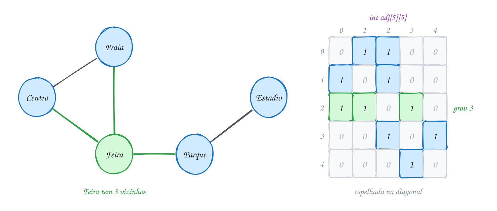
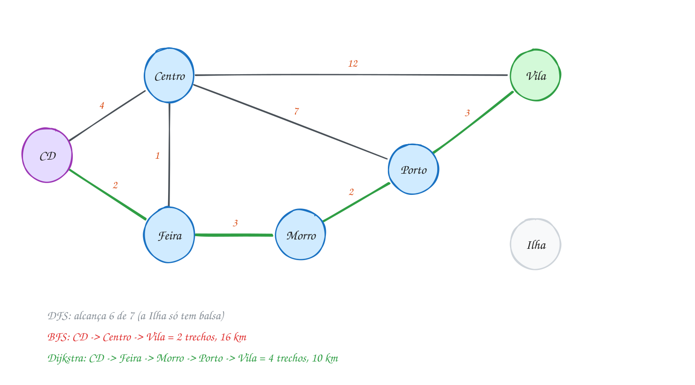
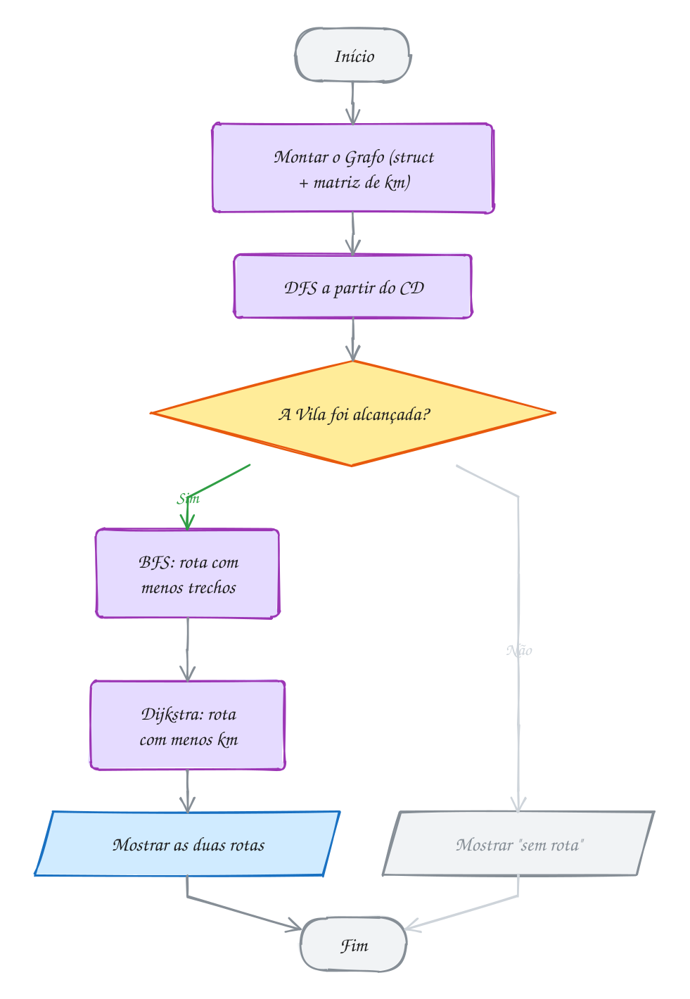

<!-- Gerado por _gerador. Para mudar este arquivo, edite _gerador/modulos/16-grafos/ e rode: cd _gerador && npm run gerar -->

# Módulo 16 · Grafos

Lista, pilha, fila, árvore, hash: até aqui toda estrutura tinha uma forma
bem comportada. Cada nó tinha um próximo, ou um pai, ou um balde. O mundo
real não é tão educado. Ruas se cruzam e fecham voltas, pessoas se seguem sem
reciprocidade, pacotes dependem uns dos outros. Para tudo isso existe o
**grafo**: pontos e ligações, sem regra de forma.

Fora da sala de aula, grafo aparece em todo canto. O GPS que acha a rota, a
rede social que sugere amigos, o gerenciador de pacotes que ordena as
dependências e reclama de dependência circular, o roteador que escolhe por
onde mandar o pacote: todos rodam alguma variação dos algoritmos deste módulo.

A pergunta deixa de ser "qual é o próximo?" e passa a ser "quem são os
vizinhos, e em que ordem eu visito?". Quase tudo aqui é a mesma **busca** com
uma estrutura auxiliar diferente: a pilha da recursão (DFS), a fila (BFS) ou
o "menor primeiro" (Dijkstra). O módulo usa muito do que veio antes:
matrizes, `malloc`, listas, filas, pilhas, recursão, structs e heap.

## O que você vai aprender

- o vocabulário de **grafos**: vértice, aresta, grau, caminho, ciclo, grafo dirigido e ponderado
- as duas representações: **matriz de adjacência** e **lista de adjacência**, e quando usar cada uma
- a **busca em largura** (BFS) com fila, e o menor caminho em número de arestas
- a **busca em profundidade** (DFS) com recursão ou pilha: componentes, ciclos e ordenação topológica
- o algoritmo de **Dijkstra** para o caminho mínimo com pesos, e a armadilha do INFINITO que estoura
- escolher o algoritmo certo para cada pergunta, e um bônus: a **árvore geradora mínima** com Prim

## Antes de começar

Você vai usar sem cerimônia: matrizes (0039), structs e `typedef` (0059 e
0060), `malloc` e `free` (0054), lista encadeada (0076), pilha (0082), fila
(0085), recursão (0032) e, no último assunto, heap (0102). Se algum desses
estiver enferrujado, revise antes.

Nos desenhos, a origem da busca fica roxa, o destino verde, e as arestas
verdes são as que a busca usou (a árvore da busca ou a rota final). Faça o
teste de mesa da fila, da pilha ou do vetor de distâncias no papel (em
grafos, ele é metade do aprendizado) e responda a **Pergunta para você**
antes de rodar.

Os vértices são números de 0 a V-1, e o nome de cada um fica num vetor de
strings à parte. Os exemplos examinam os vizinhos em ordem crescente de
índice, o que decide empates e a ordem da visita: mude a numeração e a saída
muda, sem estar errada.

O assunto 0109 traz o TAD `grafo.h` + `grafo.c` com lista de adjacência; o
`rodar` compila o `grafo.c` junto com os arquivos daquela pasta. Nos outros
assuntos, cada arquivo traz tudo dentro dele, com matriz de adjacência, para
o algoritmo ficar inteiro na tela.

| # | Assunto | Pasta |
| --- | --- | --- |
| [0109](#0109--grafos) | Grafos | [`0109-grafos/`](16-grafos/0109-grafos/) |
| [0110](#0110--bfs-busca-em-largura) | BFS: busca em largura | [`0110-bfs/`](16-grafos/0110-bfs/) |
| [0111](#0111--dfs-busca-em-profundidade) | DFS: busca em profundidade | [`0111-dfs/`](16-grafos/0111-dfs/) |
| [0112](#0112--dijkstra-caminho-mínimo) | Dijkstra: caminho mínimo | [`0112-dijkstra/`](16-grafos/0112-dijkstra/) |
| [0113](#0113--juntando-tudo-a-central-de-entregas) | Juntando tudo: a central de entregas | [`0113-juntando-tudo/`](16-grafos/0113-juntando-tudo/) |

---

## 0109 · Grafos

A prefeitura inaugurou cinco ciclovias ligando Centro, Praia, Feira, Parque e
Estádio. Você quer um app que responda: de onde dá para ir direto para onde?
Qual ponto tem mais ligações? Dá para chegar no Estádio saindo da Praia?

Lista não serve: ela é uma fila indiana, cada item tem um próximo. Árvore
também não: cada nó tem um pai só e não existe volta. Aqui o Centro liga na
Praia **e** na Feira, e a Praia liga de volta na Feira, fechando um triângulo.
Para isso existe o **grafo**.

Um grafo é um conjunto de **vértices** (os pontos) e de **arestas** (as
ligações entre pares de pontos). Aqui os vértices são os cinco lugares e as
arestas, as cinco ciclovias. Toda árvore é um grafo, mas um grafo pode ter
ciclos e partes soltas. O Cormen escreve **G = (V, E)** e usa V e E também
para as quantidades: é daí que vêm o Θ(V²) e o Θ(V + E) deste módulo.

O vocabulário do módulo:

- **vizinhos** (ou adjacentes): dois vértices ligados por uma aresta;
- **grau**: quantas arestas tocam o vértice (a Feira tem grau 3);
- **caminho**: uma sequência de vértices vizinhos (Praia, Feira, Parque);
- **ciclo**: um caminho que volta ao começo (Centro, Praia, Feira, Centro);
- **conexo**: dá para ir de qualquer vértice a qualquer outro.

Se a ligação tem mão única, o grafo é **dirigido** e cada aresta vira uma seta
(seguir alguém no Instagram não obriga a pessoa a seguir de volta). Aí cada
vértice tem **grau de saída** e **grau de entrada**, e a soma dos graus de
saída é o número de arestas. Se a aresta carrega um número, como minutos ou
reais, o grafo é **ponderado** (com peso). As ciclovias valem nos dois
sentidos e ainda não têm peso.

No C, vértice é um **número de 0 a V-1**. O nome fica num vetor à parte
(`nomes[2]` é `"Feira"`). Para guardar as arestas existem duas representações
clássicas:

- **matriz de adjacência**: `int adj[V][V]`, com `adj[i][j] = 1` quando existe
  aresta de `i` para `j`. Perguntar "i e j são vizinhos?" custa O(1). Listar os
  vizinhos de `i` custa O(V), porque você varre a linha inteira.
- **lista de adjacência**: um vetor de V listas encadeadas; a lista de `i`
  guarda só os vizinhos de `i`. Ocupa O(V + E) (E é o número de arestas) e
  listar os vizinhos custa só o grau.

Uma rede social guarda, para cada usuário, a lista de quem ele segue: uma
lista de adjacência. O C não traz nenhuma das duas pronta: ou você aloca a
matriz, ou monta as listas com `malloc`.

Cada ciclovia liga um 1 em **duas** casas da matriz,
`adj[a][b]` e `adj[b][a]`, por isso a matriz de um grafo não dirigido é
espelhada na diagonal. A Feira tem três vizinhos, e a linha 2 tem três 1:

<p align="center"></p>

No código, as arestas entram como pares e o grau sai somando cada linha:

```c
#include <stdio.h>

#define V 5 // número de vértices (pontos da cidade)

int main(void) {
    const char *nomes[V] = {"Centro", "Praia", "Feira", "Parque", "Estadio"};
    int adj[V][V] = {0}; // adj[i][j] == 1: existe ciclovia entre i e j

    // as ciclovias, como pares de vértices
    int ciclovias[][2] = {{0, 1}, {0, 2}, {1, 2}, {2, 3}, {3, 4}};
    int total = (int)(sizeof ciclovias / sizeof ciclovias[0]);

    for (int k = 0; k < total; k++) {
        int a = ciclovias[k][0];
        int b = ciclovias[k][1];
        adj[a][b] = 1;
        adj[b][a] = 1; // não dirigido: vale nos dois sentidos
    }

    printf("     0 1 2 3 4\n");
    int soma_graus = 0;
    for (int i = 0; i < V; i++) {
        int grau = 0;
        printf("  %d ", i);
        for (int j = 0; j < V; j++) {
            printf(" %d", adj[i][j]);
            grau += adj[i][j]; // o grau é a soma da linha
        }
        printf("  %-8s grau %d\n", nomes[i], grau);
        soma_graus += grau;
    }
    printf("Soma dos graus: %d = 2 x %d ciclovias\n", soma_graus, total);
    return 0;
}
// Saída:
//      0 1 2 3 4
//   0  0 1 1 0 0  Centro   grau 2
//   1  1 0 1 0 0  Praia    grau 2
//   2  1 1 0 1 0  Feira    grau 3
//   3  0 0 1 0 1  Parque   grau 2
//   4  0 0 0 1 0  Estadio  grau 1
// Soma dos graus: 10 = 2 x 5 ciclovias
```

O programa primeiro monta a estrutura (uma volta por aresta, marcando os dois
sentidos) e só depois responde perguntas sobre ela. Todo algoritmo de grafo
deste módulo segue essa ordem:

<p align="center"></p>

Repare na última linha da saída. Cada aresta encosta em dois vértices e soma
1 no grau de cada um, então a soma dos graus é sempre o dobro do número de
arestas. Serve de teste rápido: soma ímpar indica um sentido esquecido.

O exemplo A217 guarda na matriz o tamanho de cada estrada em vez do 1 (um
grafo ponderado) e mostra um vértice isolado, de linha toda zerada. O A218
mostra a outra representação, a lista de adjacência, como um TAD
(`grafo.h` + `grafo.c`) e com arestas dirigidas: quem segue quem.

> [!WARNING]
> Em grafo não dirigido, a aresta entra **nos dois sentidos**: `adj[a][b] = 1`
> e `adj[b][a] = 1`. Esquecer um deles cria um grafo dirigido sem querer: o
> Centro "vai" para a Praia, mas a Praia não volta. O compilador não reclama;
> o erro aparece mais tarde, quando a busca não acha um caminho que existe.

> [!TIP]
> **Por dentro do C:** `int adj[5][5]` são 25 `int` seguidos na memória, linha
> após linha: 100 bytes. Com 100 mil vértices seriam 10¹⁰ casas, 40 GB, quase
> todas com zero, porque um mapa de ruas real tem poucos vizinhos por esquina.
> Na lista de adjacência cada aresta vira um nó `{ int destino; No *prox; }`
> de 16 bytes (4 do `int`, 4 de alinhamento e 8 do ponteiro): com 300 mil
> arestas, uns 5 MB. Regra prática: grafo pequeno ou denso, matriz; grafo
> grande e esparso, lista.

> [!NOTE]
> **Pergunta para você:** se a prefeitura abrir uma ciclovia entre Praia e
> Estádio, quais números da saída mudam? Preveja a nova matriz e a soma dos
> graus antes de mudar o programa acima.

### Hora de praticar

Arquivos em [`0109-grafos/`](16-grafos/0109-grafos/).

**Exemplo A217 · Quilômetros na matriz e a vila isolada**

```c
#include <stdio.h>

#define V 5

int main(void) {
    const char *nomes[V] = {"Sede", "Vila", "Sitio", "Porto", "Ilha"};
    int km[V][V] = {0}; // grafo ponderado: km[i][j] é o tamanho da estrada; 0 = sem estrada

    int estradas[][3] = {{0, 1, 12}, {0, 3, 30}, {1, 2, 8}, {2, 3, 15}}; // {a, b, km}
    int total = (int)(sizeof estradas / sizeof estradas[0]);
    for (int k = 0; k < total; k++) {
        int a = estradas[k][0], b = estradas[k][1];
        km[a][b] = estradas[k][2];
        km[b][a] = estradas[k][2]; // mão dupla: o mesmo peso nos dois sentidos
    }

    // "i e j são vizinhos?" é olhar uma casa só: O(1)
    int perguntas[][2] = {{0, 1}, {0, 2}, {3, 2}};
    for (int k = 0; k < 3; k++) {
        int a = perguntas[k][0], b = perguntas[k][1];
        if (km[a][b]) printf("%s-%s: estrada de %d km\n", nomes[a], nomes[b], km[a][b]);
        else printf("%s-%s: sem estrada direta\n", nomes[a], nomes[b]);
    }

    // listar os vizinhos é varrer a linha inteira: O(V)
    int isolados = 0;
    for (int i = 0; i < V; i++) {
        int grau = 0;
        printf("%-5s:", nomes[i]);
        for (int j = 0; j < V; j++) {
            if (km[i][j]) {
                printf(" %s(%d)", nomes[j], km[i][j]);
                grau++;
            }
        }
        if (grau == 0) {
            printf(" ninguém, grau 0"); // vértice isolado: a linha inteira é zero
            isolados++;
        }
        printf("\n");
    }

    int soma_km = 0;
    for (int i = 0; i < V; i++)
        for (int j = i + 1; j < V; j++) soma_km += km[i][j]; // acima da diagonal: cada estrada uma vez
    printf("Rede: %d estradas, %d km\n", total, soma_km);
    if (isolados > 0) printf("Vértices isolados: %d, então o grafo não é conexo\n", isolados);
    return 0;
}
// Saída:
// Sede-Vila: estrada de 12 km
// Sede-Sitio: sem estrada direta
// Porto-Sitio: estrada de 15 km
// Sede : Vila(12) Porto(30)
// Vila : Sede(12) Sitio(8)
// Sitio: Vila(8) Porto(15)
// Porto: Sede(30) Sitio(15)
// Ilha : ninguém, grau 0
// Rede: 4 estradas, 65 km
// Vértices isolados: 1, então o grafo não é conexo
```

```bash
~/LPEDC/rodar 16-grafos/0109-grafos/A217.c
```

**Exemplo A218 · Quem segue quem: lista de adjacência**

```c
#include <stdio.h>

#include "grafo.h"

int main(void) {
    const char *nomes[] = {"Ana", "Bia", "Caio", "Duda"};
    Grafo *g = grafo_criar(4);
    if (g == NULL) return 1;

    // aresta dirigida: seguir não é recíproco
    grafo_ligar(g, 0, 1); // Ana segue Bia
    grafo_ligar(g, 0, 2); // Ana segue Caio
    grafo_ligar(g, 1, 2); // Bia segue Caio
    grafo_ligar(g, 2, 0); // Caio segue Ana
    grafo_ligar(g, 3, 2); // Duda segue Caio

    grafo_mostrar(g, nomes);
    printf("\n");
    for (int v = 0; v < 4; v++)
        printf("%-5s segue %d, tem %d seguidor(es)\n", nomes[v],
               grafo_grau_saida(g, v), grafo_grau_entrada(g, v));

    grafo_liberar(g);
    return 0;
}
// Saída:
// Ana   -> Caio Bia
// Bia   -> Caio
// Caio  -> Ana
// Duda  -> Caio
//
// Ana   segue 2, tem 1 seguidor(es)
// Bia   segue 1, tem 1 seguidor(es)
// Caio  segue 1, tem 3 seguidor(es)
// Duda  segue 1, tem 0 seguidor(es)
```

```bash
~/LPEDC/rodar 16-grafos/0109-grafos/A218.c
```

#### Exercícios

**Exercício E649** · ★☆☆

Uma companhia aérea regional tem voos diretos, de ida e volta, entre
quatro capitais: Recife (0), Salvador (1), Fortaleza (2) e Natal (3). Os
voos são: Recife-Salvador, Recife-Fortaleza, Recife-Natal e
Fortaleza-Natal.

Monte a matriz de adjacência (grafo não dirigido), mostre a matriz e conte
quantos voos existem olhando só para a matriz (não vale contar os pares à
mão):


```text
Saída esperada:
     0 1 2 3
  0  0 1 1 1
  1  1 0 0 0
  2  1 0 0 1
  3  1 0 1 0
Voos diretos: 4
```

**Dicas:**

1. int adj[4][4] = {0}; e, para cada voo, marque adj[a][b] e adj[b][a].
2. Cada voo aparece duas vezes na matriz. Some só a parte de cima da
   diagonal (j > i) ou some tudo e divida por 2.
3. Resposta esperada: a matriz acima e "Voos diretos: 4".

```bash
~/LPEDC/rodar 16-grafos/0109-grafos/E649.c
```

**Exercício E650** · ★☆☆

Depois do churrasco, a turma anotou quem ficou devendo Pix para quem num
grafo DIRIGIDO: deve[i][j] == 1 quer dizer que i deve para j. A matriz já
está no esqueleto. Complete o programa: para cada pessoa, mostre para
quantos ela deve (setas que saem) e de quantos ela recebe (setas que
chegam). No fim, mostre quem não deve para ninguém e quem não recebe de
ninguém.


```text
Saída esperada:
Leo deve para 2 e recebe de 1
Mia deve para 1 e recebe de 2
Rui deve para 0 e recebe de 3
Sol deve para 3 e recebe de 0
Sem dívidas: Rui
Ninguém deve para: Sol
```

**Dicas:**

1. Somar a LINHA i conta as setas que saem de i: para quantos i deve.
2. Somar a COLUNA i (deve[j][i], com j variando) conta as setas que
   chegam em i: de quantos i recebe.
3. Resposta esperada: a saída acima.

```bash
~/LPEDC/rodar 16-grafos/0109-grafos/E650.c
```

**Exercício E651** · ★★☆

O bairro tem quatro esquinas, A (0), B (1), C (2) e D (3). A prefeitura
mandou a lista de ruas como um vetor de struct, uma entrada por SENTIDO
permitido: {0, 1} quer dizer que dá para ir de A para B. Uma rua de mão
dupla aparece duas vezes ({0, 1} e {1, 0}).

O esqueleto já traz os dados. Complete o programa: monte a matriz de
adjacência DIRIGIDA a partir do vetor e, para cada par de esquinas ligadas,
diga se a rua é de mão dupla ou de mão única (e em que sentido). No fim,
mostre quantas há de cada tipo.


```text
Saída esperada:
Sentidos cadastrados: 7
A-B: mão dupla
A-C: mão dupla
A-D: mão única (D -> A)
B-C: mão única (B -> C)
C-D: mão única (C -> D)
Mão única: 3, mão dupla: 2
```

**Dicas:**

1. Para cada struct do vetor, adj[r.de][r.para] = 1 (só nesse sentido).
2. Olhe cada par uma vez só: i de 0 a 3 e j de i + 1 a 3. Se
   adj[i][j] e adj[j][i] valem 1, é mão dupla; se só um vale 1, mão única.
3. A letra da esquina i é 'A' + i (char é número, assunto 0040).
4. Resposta esperada: a saída acima.

```bash
~/LPEDC/rodar 16-grafos/0109-grafos/E651.c
```

**Exercício E652** · ★★☆

Este programa tem DOIS erros de propósito. Ele monta o grafo NÃO dirigido
do grupo de estudos (quem estuda com quem) e mostra o grau de cada pessoa.
Rode com o rodar: o sanitizer acusa um dos erros. O outro é silencioso e só
aparece nos números. Ache os dois, conserte e rode de novo até a saída
bater com a esperada.


```text
Saída esperada depois do conserto:
Ana estuda com 2 pessoa(s)
Beto estuda com 3 pessoa(s)
Cris estuda com 2 pessoa(s)
Davi estuda com 1 pessoa(s)
Soma dos graus: 8
```

**Dicas:**

1. Leia a mensagem do sanitizer: ela diz o índice e o tamanho do vetor.
2. Com 4 duplas de estudo, a soma dos graus deveria ser 2 x 4 = 8. Um
   resultado ímpar é sinal de aresta guardada num sentido só.
3. Resposta esperada: o laço interno usa j <= V (lê adj[i][4], fora da
   linha; o certo é j < V) e a aresta só é marcada em adj[a][b] (falta
   adj[b][a] = 1). Consertado, mostra a saída acima.

```bash
~/LPEDC/rodar 16-grafos/0109-grafos/E652.c
```

**Exercício E653** · ★★★

Pegue a matriz das ciclovias do texto do assunto (já está no esqueleto) e
converta para LISTA de adjacência alocada com malloc: um vetor de 5
ponteiros, cada um apontando para a lista encadeada dos vizinhos daquele
ponto. Regras:

- os vizinhos de cada lista aparecem em ordem crescente de índice;
- cada nó custa O(1) para inserir (nada de percorrer a lista até o fim);
- conte quantos nós foram alocados;
- libere tudo no final (o rodar não pode acusar vazamento).


```text
Saída esperada:
Centro  -> Praia Feira
Praia   -> Centro Feira
Feira   -> Centro Praia Parque
Parque  -> Feira Estadio
Estadio -> Parque
Nós alocados: 10
```

**Dicas:**

1. typedef struct No { int destino; struct No *prox; } No; e
   No *lista[V] = {NULL};
2. Inserir no início é O(1), mas inverte a ordem. Truque: percorra as
   colunas de trás para frente (j de V-1 até 0); a última inserida, a menor,
   fica na frente.
3. Para liberar, guarde p->prox numa variável antes do free(p).
4. Resposta esperada: a saída acima; 10 nós porque são 5 arestas, cada uma
   guardada nos dois sentidos.

```bash
~/LPEDC/rodar 16-grafos/0109-grafos/E653.c
```

**Exercício E654** · ★★★

Você está montando a "sugestão de amizade" de uma rede social. A amizade é
recíproca (grafo não dirigido) e as pessoas são Ana (0), Bia (1), Caio (2),
Duda (3), Edu (4) e Fabi (5). As amizades:


```text
Ana-Bia, Ana-Caio, Bia-Caio, Bia-Duda, Caio-Duda, Caio-Edu, Duda-Fabi,
Edu-Fabi
```


Para cada par que AINDA NÃO é amigo, conte os amigos em comum. Mostre os
pares com 2 ou mais amigos em comum, cada par uma vez só:


```text
Saída esperada:
Ana e Duda: 2 amigos em comum
Caio e Fabi: 2 amigos em comum
Duda e Edu: 2 amigos em comum
```

**Dicas:**

1. Amigo em comum de i e j é um k com adj[i][k] e adj[k][j] valendo 1.
   Isso é um caminho de comprimento 2 entre i e j.
2. Três laços: i, j > i (pares sem repetir) e k. Pule os pares que já são
   amigos (adj[i][j] == 1).
3. Curiosidade: a contagem é exatamente a casa [i][j] do produto da matriz
   por ela mesma (adj x adj).
4. Resposta esperada: a saída acima.

```bash
~/LPEDC/rodar 16-grafos/0109-grafos/E654.c
```

---

## 0110 · BFS: busca em largura

Você quer uma indicação para a vaga que a Rita, recrutadora, está anunciando
no LinkedIn. Você não conhece a Rita. Conhece o Max e a Nina; eles conhecem
outras pessoas, que conhecem outras. Qual é a corrente mais curta de
apresentações até ela?

O "conexão de 2º grau" do LinkedIn é essa ideia (nada a ver com o grau do
vértice do assunto anterior: ali o grau é a **distância**). A rede é
um grafo não dirigido: pessoas são vértices, conexões são arestas. A pergunta é
o **menor caminho em número de arestas** de Lia (você) até Rita.

A **busca em largura** (BFS, de *breadth-first search*) responde isso
explorando o grafo em ondas, como uma pedra jogada no lago:

- onda 0: a origem, Lia;
- onda 1: todo mundo a uma aresta de Lia (Max e Nina);
- onda 2: os vizinhos deles que ninguém viu ainda (Otto e Pedro);
- onda 3: Rita.

Para visitar na ordem das ondas, a BFS usa uma **fila** (assunto 0085): quem
foi descoberto primeiro é processado primeiro. O laço é sempre o mesmo: tira
`u` da frente da fila e, para cada vizinho `v` ainda não descoberto, anota
`dist[v] = dist[u] + 1`, guarda `pai[v] = u` e põe `v` no fim da fila.

O vetor `dist[]` faz dois papéis: guarda a distância e, com `-1`, diz "ainda
não descoberto". Ele impede a busca de andar em círculos: num grafo, ao
contrário da árvore, dá para chegar no mesmo vértice por caminhos diferentes
(Otto é vizinho de Max **e** de Nina).

O vetor `pai[]` guarda quem descobriu cada vértice. Os pares (pai, filho)
formam a **árvore da BFS**, e seguir `pai[]` a partir de Rita até chegar em
`-1` dá o caminho mais curto, de trás para frente.

O Cormen escreve a mesma BFS com **cores**: **branco** é o vértice ainda não
descoberto (o nosso `dist == -1`), **cinza** é o que está na fila e **preto**
o que já saiu dela. O `v.d` dele é o nosso `dist[v]`, e o `v.π` (pi), o
`pai[v]`. Mesma busca, outros nomes.

No desenho, as setas verdes são as arestas da árvore da BFS (cada uma liga um
vértice a quem o descobriu), o número em cima de cada pessoa é a distância e,
embaixo, está a fila na ordem em que cada um entrou:

<p align="center"></p>

O código monta a matriz, roda a BFS a partir de Lia e reconstrói o caminho:

```c
#include <stdio.h>

#define V 6

int main(void) {
    const char *nomes[V] = {"Lia", "Max", "Nina", "Otto", "Pedro", "Rita"};
    int adj[V][V] = {0};
    int conexoes[][2] = {{0, 1}, {0, 2}, {1, 3}, {2, 3}, {2, 4}, {3, 5}, {4, 5}};
    for (int k = 0; k < 7; k++) {
        adj[conexoes[k][0]][conexoes[k][1]] = 1;
        adj[conexoes[k][1]][conexoes[k][0]] = 1;
    }

    int dist[V], pai[V];
    for (int v = 0; v < V; v++) {
        dist[v] = -1; // -1: ainda não descoberto
        pai[v] = -1;
    }

    int fila[V]; // cada vértice entra uma vez só: V posições bastam
    int inicio = 0, fim = 0;
    int origem = 0; // Lia
    dist[origem] = 0;
    fila[fim++] = origem;

    printf("Ordem da visita:\n");
    while (inicio < fim) {
        int u = fila[inicio++]; // tira da frente
        printf("  %-5s distância %d\n", nomes[u], dist[u]);
        for (int v = 0; v < V; v++) {
            if (adj[u][v] && dist[v] == -1) {
                dist[v] = dist[u] + 1; // marca ao ENTRAR na fila
                pai[v] = u;
                fila[fim++] = v;
            }
        }
    }

    // o caminho sai de trás para frente, seguindo pai[]
    int destino = 5; // Rita
    int caminho[V], n = 0;
    for (int v = destino; v != -1; v = pai[v]) caminho[n++] = v;
    printf("Caminho até %s:", nomes[destino]);
    for (int i = n - 1; i >= 0; i--) printf(" %s%s", nomes[caminho[i]], i > 0 ? " ->" : "");
    printf(" (distância %d)\n", dist[destino]);
    return 0;
}
// Saída:
// Ordem da visita:
//   Lia   distância 0
//   Max   distância 1
//   Nina  distância 1
//   Otto  distância 2
//   Pedro distância 2
//   Rita  distância 3
// Caminho até Rita: Lia -> Max -> Otto -> Rita (distância 3)
```

Quem controla tudo é a pergunta "a fila esvaziou?". Cada volta tira um
vértice e pode colocar vários; quando ninguém novo aparece, a fila seca e a
busca termina:

<p align="center"></p>

### Passo a passo

Cada linha é uma volta do `while`. Otto já foi descoberto por Max, então
quando Nina olha para ele, nada acontece:

| Tira | Vizinhos novos | dist anotada | Fila depois |
| --- | --- | --- | --- |
| (início) | | Lia = 0 | Lia |
| Lia | Max, Nina | 1, 1 | Max, Nina |
| Max | Otto | 2 | Nina, Otto |
| Nina | Pedro (Otto já tem dist) | 2 | Otto, Pedro |
| Otto | Rita | 3 | Pedro, Rita |
| Pedro | nenhum (Rita já tem dist) | | Rita |
| Rita | nenhum | | (vazia) |

A distância só cresce na fila: primeiro saem todos os de distância 1, depois
todos os de 2. Por isso o primeiro caminho que alcança Rita é o mais curto.
Isso vale porque toda aresta "custa" 1. Com pesos diferentes (minutos, reais)
a BFS erra, e é aí que entra Dijkstra (assunto 0112).

O exemplo A219 agrupa as pessoas por onda e mostra quem a BFS nunca alcança
(um grafo com uma parte solta). O A220 roda a mesma BFS numa grade: cada casa
de um galpão é um vértice, e os vizinhos são as casas de cima, de baixo, da
esquerda e da direita. Não há matriz de adjacência; os vizinhos saem de uma
conta.

> [!WARNING]
> Marque o vértice como descoberto **ao colocar na fila**, não ao tirar. Se
> você só marca ao tirar, Otto entra duas vezes (uma por Max, outra por Nina) e,
> num grafo maior, o mesmo vértice entra muitas vezes. A fila de V posições
> estoura, e o vértice aparece repetido na ordem de visita.

> [!TIP]
> **Por dentro do C:** a fila da BFS é um `int fila[V]` com dois índices,
> `inicio` e `fim`. Como cada vértice entra uma vez só, `fim` nunca passa de V,
> e a fila circular é dispensável. Tirar do início deslocando todos os
> elementos uma casa para trás custaria O(n) a cada saída; aqui,
> `fila[inicio++]` é O(1). O custo total da BFS é O(V²) com matriz (para cada
> vértice, varre a linha inteira) e O(V + E) com lista de adjacência. Os três
> vetores (`dist`, `pai`, `fila`) somam 3 × 6 × 4 = 72 bytes na pilha.

> [!NOTE]
> **Pergunta para você:** se a conexão entre Max e Otto sumir, qual passa a ser
> o caminho até Rita, e quem descobre Otto? Preveja a nova tabela antes de
> apagar o par `{1, 3}` no programa acima.

### Hora de praticar

Arquivos em [`0110-bfs/`](16-grafos/0110-bfs/).

**Exemplo A219 · As ondas da BFS e quem fica de fora**

```c
#include <stdio.h>

#define V 8

int main(void) {
    const char *nomes[V] = {"Bruna", "Caio", "Davi", "Eva", "Fred", "Gil", "Hugo", "Iara"};
    int adj[V][V] = {0};
    // Gil e Hugo só conhecem um ao outro: formam uma parte solta do grafo
    int conhece[][2] = {{0, 1}, {0, 2}, {1, 3}, {2, 3}, {3, 4}, {4, 7}, {5, 6}};
    int total = (int)(sizeof conhece / sizeof conhece[0]);
    for (int k = 0; k < total; k++) {
        adj[conhece[k][0]][conhece[k][1]] = 1;
        adj[conhece[k][1]][conhece[k][0]] = 1;
    }

    int dist[V], fila[V], inicio = 0, fim = 0;
    for (int v = 0; v < V; v++) dist[v] = -1;
    dist[0] = 0; // a fofoca começa com a Bruna
    fila[fim++] = 0;
    int maior = 0;
    while (inicio < fim) {
        int u = fila[inicio++];
        if (dist[u] > maior) maior = dist[u];
        for (int v = 0; v < V; v++)
            if (adj[u][v] && dist[v] == -1) {
                dist[v] = dist[u] + 1;
                fila[fim++] = v;
            }
    }

    // agrupa por distância: cada linha é uma onda
    for (int d = 0; d <= maior; d++) {
        printf("Onda %d:", d);
        for (int v = 0; v < V; v++)
            if (dist[v] == d) printf(" %s", nomes[v]);
        printf("\n");
    }

    // quem a fila nunca recebeu continua com -1
    printf("Nunca ficam sabendo:");
    for (int v = 0; v < V; v++)
        if (dist[v] == -1) printf(" %s", nomes[v]);
    printf("\nA fila recebeu %d de %d pessoas\n", fim, V);
    return 0;
}
// Saída:
// Onda 0: Bruna
// Onda 1: Caio Davi
// Onda 2: Eva
// Onda 3: Fred
// Onda 4: Iara
// Nunca ficam sabendo: Gil Hugo
// A fila recebeu 6 de 8 pessoas
```

```bash
~/LPEDC/rodar 16-grafos/0110-bfs/A219.c
```

**Exemplo A220 · O robô no galpão: BFS numa grade**

```c
#include <stdio.h>

#define L 5
#define C 7

int main(void) {
    // # é prateleira; o robô sai de S e vai até E (a expedição)
    char mapa[L][C + 1] = {
        "S..#...",
        ".#.#.#.",
        ".#...#.",
        ".###.#.",
        ".....#E",
    };
    // cada casa é um vértice; os vizinhos são cima, baixo, esquerda e direita
    int dl[4] = {-1, 1, 0, 0};
    int dc[4] = {0, 0, -1, 1};

    int dist[L][C], pai[L * C];
    for (int l = 0; l < L; l++)
        for (int c = 0; c < C; c++) dist[l][c] = -1;

    int fila[L * C]; // a casa (l, c) entra na fila como o número l * C + c
    int inicio = 0, fim = 0;
    dist[0][0] = 0;
    pai[0] = -1;
    fila[fim++] = 0;

    while (inicio < fim) {
        int u = fila[inicio++];
        int l = u / C, c = u % C;
        for (int k = 0; k < 4; k++) {
            int nl = l + dl[k], nc = c + dc[k];
            if (nl < 0 || nl >= L || nc < 0 || nc >= C) continue; // fora do galpão
            if (mapa[nl][nc] == '#' || dist[nl][nc] != -1) continue;
            dist[nl][nc] = dist[l][c] + 1;
            pai[nl * C + nc] = u;
            fila[fim++] = nl * C + nc;
        }
    }

    printf("Passos até a expedição: %d\n", dist[L - 1][C - 1]);
    // marca o caminho com * voltando pelos pais (sem apagar S e E)
    for (int u = pai[(L - 1) * C + (C - 1)]; u > 0; u = pai[u]) mapa[u / C][u % C] = '*';
    for (int l = 0; l < L; l++) printf("%s\n", mapa[l]);
    return 0;
}
// Saída:
// Passos até a expedição: 14
// S**#***
// .#*#*#*
// .#***#*
// .###.#*
// .....#E
```

```bash
~/LPEDC/rodar 16-grafos/0110-bfs/A220.c
```

#### Exercícios

**Exercício E655** · ★☆☆

O mapa abaixo liga seis bairros por linhas de ônibus diretas (grafo não
dirigido). O programa já roda uma BFS a partir da Penha e mostra a ordem
da visita com a distância de cada bairro. Estenda o programa: acrescente
o vetor pai[] (quem descobriu cada bairro) e, depois da linha da ordem,
mostre uma linha por bairro, em ordem de índice, dizendo quem o descobriu.


```text
Saída esperada:
Penha(0) Lapa(1) Moema(1) Tatuape(1) Centro(2) Saude(2)
Centro: descoberto por Lapa
Lapa: descoberto por Penha
Moema: descoberto por Penha
Penha: origem
Saude: descoberto por Moema
Tatuape: descoberto por Penha
```

**Dicas:**

1. int pai[V], todos começando com -1 (a origem continua com -1).
2. Anote pai[v] = u no mesmo lugar em que o código anota dist[v].
3. Repare na Saude: ela é vizinha de Moema e de Tatuape, mas quem a
   descobre é quem sai primeiro da fila.
4. Resposta esperada: a saída acima.

```bash
~/LPEDC/rodar 16-grafos/0110-bfs/E655.c
```

**Exercício E656** · ★☆☆

A Vó mandou um áudio no grupo da família, e cada pessoa só encaminha para
quem tem contato direto (grafo não dirigido). Em que "rodada" o áudio chega
em cada um? Rodada 0 é a própria Vó, rodada 1 são os contatos dela, e assim
por diante: é a distância da BFS.

O programa está quase pronto. Falta o miolo da BFS, no lugar marcado com
"COMPLETE AQUI": anotar a rodada do vizinho e colocá-lo na fila. Hoje ele
compila, mas só mostra a Vó.


```text
Saída esperada:
Vó: rodada 0
Tia: rodada 1
Pai: rodada 1
Primo: rodada 2
Mãe: rodada 2
Eu: rodada 3
Rodadas até todos ouvirem: 3
```

**Dicas:**

1. São duas linhas: rodada[v] = rodada[u] + 1; e fila[fim++] = v;
2. Por que dá para marcar a rodada já aqui, antes de o vizinho sair da
   fila? Porque é isso que impede que ele entre duas vezes.
3. Resposta esperada: a saída acima.

```bash
~/LPEDC/rodar 16-grafos/0110-bfs/E656.c
```

**Exercício E657** · ★★☆

Mesmo mapa de ônibus do E655 (já está no esqueleto). Você mora na Lapa e
precisa ir à Saude pegando o menor número de ônibus. Rode uma BFS a partir
da Lapa guardando pai[] e escreva uma função RECURSIVA que imprime o
caminho na ordem certa, da origem ao destino:


```text
void imprimir_caminho(const int pai[], int v);
```


Existe outro caminho com 3 ônibus (Lapa, Penha, Tatuape, Saude). Para ver
quem decide o empate, rode a BFS uma segunda vez examinando os vizinhos
de trás para frente (v de V-1 até 0) e mostre o caminho que ela acha.


```text
Saída esperada:
Lapa -> Centro -> Moema -> Saude
Ônibus: 3
Ao contrário: Lapa -> Penha -> Tatuape -> Saude
Ônibus: 3
```

**Dicas:**

1. pai[origem] = -1. Na função: se pai[v] != -1, imprima primeiro o
   caminho até pai[v] (chamada recursiva) e depois " -> " e o nome de v.
2. A recursão desfaz a inversão: o pai é impresso antes do filho, igual a
   uma pilha (assunto 0084).
3. Para não escrever a BFS duas vezes, ponha-a numa função com um
   parâmetro bool crescente e use v = crescente ? k : V - 1 - k.
4. Resposta esperada: a saída acima. Os dois caminhos são mínimos; quem
   entra primeiro na fila descobre os vizinhos primeiro.

```bash
~/LPEDC/rodar 16-grafos/0110-bfs/E657.c
```

**Exercício E658** · ★★☆

Depois do temporal, a companhia de energia sabe quais cabos entre os oito
bairros (A a H) continuam inteiros. Bairros ligados, direta ou
indiretamente, formam um grupo que pode ser religado de uma vez. Os cabos
inteiros são:


```text
A-B, B-C, D-E, F-G, G-H, F-H
```


Escreva um programa que descobre os grupos (as COMPONENTES CONEXAS do
grafo) usando BFS e mostra cada um:


```text
Saída esperada:
Grupo 1: A B C
Grupo 2: D E
Grupo 3: F G H
Total de grupos: 3
```

**Dicas:**

1. Uma BFS a partir de A visita só o grupo de A. Quem sobrar sem visita
   está em outro grupo.
2. Laço externo: para cada bairro v ainda não visitado, comece uma BFS
   nova a partir de v e some 1 nos grupos.
3. Um vetor visitado[] só, compartilhado por todas as BFS.
4. Resposta esperada: a saída acima.

```bash
~/LPEDC/rodar 16-grafos/0110-bfs/E658.c
```

**Exercício E659** · ★★★

A prefeitura quer saber, para cada quarteirão do bairro, a quantos
quarteirões de distância fica o posto de saúde MAIS PRÓXIMO. No mapa, P é
posto, # é área sem passagem (rio, linha de trem) e . é quarteirão. Anda-se
só para cima, baixo, esquerda e direita.


```text
P...#...
.##.#.#.
....#.#P
.#......
...#..#.
```


Mostre o mapa com a distância de cada quarteirão (0 nos postos, # onde não
passa):


```text
Saída esperada:
0123#432
1##4#5#1
2345#4#0
3#554321
456#54#2
Pior distância: 6
```

**Dicas:**

1. Rodar uma BFS por posto e tirar o mínimo funciona, mas dá para fazer
   uma BFS só: coloque TODOS os postos na fila no começo, com distância 0.
2. A fila mistura as ondas dos dois postos, e cada casa é descoberta
   primeiro pelo posto mais perto. É a BFS de várias origens.
3. A distância cabe num dígito aqui: imprima com '0' + dist.
4. Resposta esperada: a saída acima. A pior casa é a da linha 4, coluna 2
   (contando do 0): 6 quarteirões até o posto da esquerda.

```bash
~/LPEDC/rodar 16-grafos/0110-bfs/E659.c
```

**Exercício E660** · ★★★

Este programa tem um erro de propósito. Ele deveria mostrar a ordem em que
uma corrente de WhatsApp chega em cada pessoa, a partir da Ana. Rode com o
rodar: o AddressSanitizer acusa um estouro do vetor fila. Conserte mexendo
no MOMENTO em que o vértice é marcado (não vale aumentar a fila). Para
provar que ninguém entra duas vezes, acrescente um contador que soma 1 a
cada fila[fim++] e mostre o total no fim. Rode de novo e confira.


```text
Saída esperada depois do conserto:
Ana Bia Cadu Dani
Entradas na fila: 4
```

**Dicas:**

1. Simule a fila no papel. Quando Bia sai, Dani entra. Quando Cadu sai,
   Dani já foi marcada?
2. A marcação só acontece quando o vértice SAI da fila. Entre entrar e
   sair, ele pode ser colocado de novo por outro vizinho: Dani entraria
   duas vezes, e a fila de 4 posições precisaria de 5.
3. Resposta esperada: marque visitado[v] no momento em que v entra na
   fila (e marque a origem antes do laço). Assim cada pessoa entra uma vez
   só: "Ana Bia Cadu Dani" e "Entradas na fila: 4".

```bash
~/LPEDC/rodar 16-grafos/0110-bfs/E660.c
```

---

## 0111 · DFS: busca em profundidade

Sábado no parque estadual. Da Sede saem duas trilhas, uma para o Lago e outra
para a Ponte. Você escolhe o Lago e vai em frente: Gruta, Topo, Bica. Na Bica
a trilha acaba. Você volta pelo mesmo caminho até achar uma bifurcação com
trilha nova. Só no fim, já de volta à Sede, você pega a trilha da Ponte.

Esse jeito de explorar é a **busca em profundidade** (DFS, de *depth-first
search*): seguir um caminho o mais fundo possível e, quando não há mais nada
novo, **voltar** até a última escolha que ficou pendente. A volta tem nome:
**backtracking**: o fio de Ariadne no labirinto do Minotauro.

A BFS explora em ondas, com uma fila. A DFS explora em mergulhos, com uma
**pilha**, e a pilha de chamadas (assunto 0031) já vem de graça. Por isso a
DFS cabe numa função recursiva de quatro linhas: marca o vértice e, para cada
vizinho não visitado, chama a si mesma.

Quando a chamada de `dfs(Bica)` termina, o C volta sozinho para `dfs(Topo)`,
que continua o laço de onde parou. Esse "continua de onde parou" é o
backtracking, e quem guarda o ponto de parada é o frame de cada chamada.

Como na BFS, o vetor `visitado[]` é obrigatório. Lago, Gruta e Topo formam um
**ciclo**; sem a marca, `dfs(Topo)` chamaria `dfs(Lago)` de novo, que chamaria
`dfs(Gruta)`, e a recursão nunca acabaria.

As arestas por onde a DFS desce formam a **árvore da DFS**. As outras, que
levam a um vértice que já está na pilha (como Topo–Lago), são **arestas de
retorno**. Num grafo não dirigido, achar uma aresta de retorno é achar um
ciclo. Além disso, a DFS conta componentes, resolve labirintos e ordena
tarefas com pré-requisitos.

O Cormen põe um **relógio** na DFS: cada vértice ganha um tempo de
**descoberta** `v.d` (a chamada começa) e um de **término** `v.f` (ela acaba),
e as cores branco, cinza (na pilha) e preto (terminado). Contando de 1, a Sede
fica com 1/12 e a Bica com 5/6. O `DFS(G)` dele ainda recomeça de **todo**
vértice branco, formando uma floresta que cobre as partes soltas. Num grafo
**dirigido**, as arestas fora da árvore são de **retorno** (para um ancestral
cinza: há ciclo), de **avanço** (para um descendente preto) ou de
**cruzamento** (para outro preto). Os vértices em ordem decrescente de `v.f`
dão a **ordenação topológica** de um grafo dirigido acíclico. Com lista de
adjacências, tudo custa O(V + E).

No desenho, os números mostram a ordem da visita e as arestas verdes são as
da árvore. À direita está a pilha de chamadas no momento mais fundo, quando a
Bica é visitada:

<p align="center"></p>

O código imprime cada vértice com um recuo proporcional à profundidade da
chamada. Dá para ver a árvore na saída:

```c
#include <stdbool.h>
#include <stdio.h>

#define V 6

const char *nomes[V] = {"Sede", "Lago", "Gruta", "Ponte", "Topo", "Bica"};
int adj[V][V];
bool visitado[V];

void dfs(int u, int nivel) {
    visitado[u] = true;
    printf("%*s%s\n", 2 * nivel, "", nomes[u]); // recuo = profundidade
    for (int v = 0; v < V; v++)
        if (adj[u][v] && !visitado[v]) dfs(v, nivel + 1); // desce antes de olhar o próximo
}

int main(void) {
    int trilhas[][2] = {{0, 1}, {0, 3}, {1, 2}, {1, 4}, {2, 4}, {4, 5}};
    for (int k = 0; k < 6; k++) {
        adj[trilhas[k][0]][trilhas[k][1]] = 1;
        adj[trilhas[k][1]][trilhas[k][0]] = 1;
    }

    dfs(0, 0); // começa na Sede
    return 0;
}
// Saída:
// Sede
//   Lago
//     Gruta
//       Topo
//         Bica
//   Ponte
```

Aqui não existe a pergunta "acabou?" da fila da BFS. Cada chamada pergunta
apenas "tenho vizinho novo?": se tem, desce; se não tem, volta para quem
chamou. O programa termina quando a primeira chamada, a da Sede, não tem mais
para onde descer:

<p align="center"></p>

Compare as ordens a partir da Sede. A DFS visita Sede, Lago, Gruta, Topo,
Bica, Ponte: a Ponte, vizinha direta da Sede, fica para o fim. A BFS visitaria
Sede, Lago, Ponte, Gruta, Topo, Bica. Nenhuma está errada; servem a perguntas
diferentes. A DFS **não** dá o caminho mais curto: ela chegou ao Topo pela
Gruta (três trilhas), mas o Lago liga direto no Topo (duas).

O exemplo A221 usa a DFS para separar as arestas de árvore das de retorno e
contar os ciclos de uma rede de cabos. O A222 faz a mesma DFS sem recursão,
com uma pilha explícita, e mostra a pilha a cada passo.

> [!WARNING]
> Recursão funda estoura a pilha. Cada chamada ocupa um frame, e a pilha do
> programa tem poucos megabytes (8 MB é o comum no Linux). Uma DFS recursiva
> num labirinto de 1000 × 1000 casas pode empilhar um milhão de chamadas e
> morrer com *stack overflow*. Para grafos grandes, use a versão com pilha
> explícita alocada com `malloc`, como no A222.

> [!TIP]
> **Por dentro do C:** cada `dfs(u, nivel)` empilha um frame com o endereço
> de retorno, os parâmetros `u` e `nivel` e o `v` do laço: algumas dezenas de
> bytes. No ponto mais fundo deste exemplo há cinco frames de `dfs` sobre o de
> `main`. O `v` de cada frame é o "qual trilha eu já testei nesta
> bifurcação". Já `visitado[]` e `adj[]` são globais: ficam na área de dados,
> fora da pilha, e todas as chamadas enxergam o mesmo vetor. Se `visitado`
> fosse local dentro de `dfs`, cada chamada teria a sua cópia, zerada, e a
> marca não serviria para nada.

> [!NOTE]
> **Pergunta para você:** se a trilha Lago–Gruta for interditada, qual passa a
> ser a ordem da DFS a partir da Sede, e qual o recuo de cada linha? Preveja
> antes de apagar o par `{1, 2}` no programa acima.

### Hora de praticar

Arquivos em [`0111-dfs/`](16-grafos/0111-dfs/).

**Exemplo A221 · Cabos do escritório: arestas de árvore e de retorno**

```c
#include <stdio.h>

#define V 6

const char *nomes[V] = {"Servidor", "Recepcao", "RH", "Financeiro", "Diretoria", "Copa"};
int adj[V][V];
int ordem[V]; // em que momento cada sala foi descoberta; 0 = ainda não
int relogio = 0;
int de_arvore = 0, de_retorno = 0;

void dfs(int u, int pai) {
    ordem[u] = ++relogio;
    for (int v = 0; v < V; v++) {
        if (!adj[u][v]) continue;
        if (ordem[v] == 0) { // sala nova: a DFS desce por este cabo
            printf("desce   %s -> %s\n", nomes[u], nomes[v]);
            de_arvore++;
            dfs(v, u);
        } else if (v != pai && ordem[v] < ordem[u]) {
            // v já está na pilha, acima de u: este cabo fecha um ciclo
            printf("retorno %s -> %s (ciclo)\n", nomes[u], nomes[v]);
            de_retorno++;
        }
        // v == pai: é o cabo por onde u chegou; não conta como ciclo
    }
}

int main(void) {
    int cabos[][2] = {{0, 1}, {0, 2}, {1, 2}, {2, 3}, {3, 4}, {0, 4}, {4, 5}};
    int total = (int)(sizeof cabos / sizeof cabos[0]);
    for (int k = 0; k < total; k++) {
        adj[cabos[k][0]][cabos[k][1]] = 1;
        adj[cabos[k][1]][cabos[k][0]] = 1;
    }

    dfs(0, -1); // o Servidor não tem pai
    printf("Cabos: %d = %d de árvore + %d de retorno\n", total, de_arvore, de_retorno);
    printf("Para não ter ciclo nenhum, bastariam %d cabos (V - 1)\n", V - 1);
    return 0;
}
// Saída:
// desce   Servidor -> Recepcao
// desce   Recepcao -> RH
// retorno RH -> Servidor (ciclo)
// desce   RH -> Financeiro
// desce   Financeiro -> Diretoria
// retorno Diretoria -> Servidor (ciclo)
// desce   Diretoria -> Copa
// Cabos: 7 = 5 de árvore + 2 de retorno
// Para não ter ciclo nenhum, bastariam 5 cabos (V - 1)
```

```bash
~/LPEDC/rodar 16-grafos/0111-dfs/A221.c
```

**Exemplo A222 · A pilha que a recursão escondia**

```c
#include <stdbool.h>
#include <stdio.h>

#define V 6
#define ARESTAS 6

int main(void) {
    const char *nomes[V] = {"Sede", "Lago", "Gruta", "Ponte", "Topo", "Bica"};
    int adj[V][V] = {0};
    int trilhas[ARESTAS][2] = {{0, 1}, {0, 3}, {1, 2}, {1, 4}, {2, 4}, {4, 5}};
    for (int k = 0; k < ARESTAS; k++) {
        adj[trilhas[k][0]][trilhas[k][1]] = 1;
        adj[trilhas[k][1]][trilhas[k][0]] = 1;
    }

    bool visitado[V] = {false};
    int pilha[2 * ARESTAS + 1]; // cada aresta empilha no máximo 2 vezes, + a origem
    int topo = 0;
    pilha[topo++] = 0; // Sede

    while (topo > 0) {
        int u = pilha[--topo]; // tira do topo
        if (visitado[u]) {
            printf("tira %-5s (já visitado)\n", nomes[u]);
            continue;
        }
        visitado[u] = true;
        // empilha de trás para frente: o vizinho de menor índice fica no topo
        for (int v = V - 1; v >= 0; v--)
            if (adj[u][v] && !visitado[v]) pilha[topo++] = v;

        printf("tira %-5s pilha:", nomes[u]);
        for (int i = 0; i < topo; i++) printf(" %s", nomes[pilha[i]]);
        printf("\n");
    }
    return 0;
}
// Saída:
// tira Sede  pilha: Ponte Lago
// tira Lago  pilha: Ponte Topo Gruta
// tira Gruta pilha: Ponte Topo Topo
// tira Topo  pilha: Ponte Topo Bica
// tira Bica  pilha: Ponte Topo
// tira Topo  (já visitado)
// tira Ponte pilha:
```

```bash
~/LPEDC/rodar 16-grafos/0111-dfs/A222.c
```

#### Exercícios

**Exercício E661** · ★☆☆

O mapa de um shopping liga seis áreas por corredores (grafo não dirigido).
O programa abaixo faz uma DFS a partir do Hall e imprime cada área com um
recuo de 2 espaços por nível de profundidade. Estenda o programa: na
frente de cada nome, mostre o número da visita (1 para a primeira área
visitada, 2 para a segunda...) e, no fim, mostre qual área ficou mais
funda na árvore da DFS e em que nível.


```text
Saída esperada:
1 Hall
  2 Praça
    3 Cinema
    4 Loja
      5 Banco
        6 Saída
Mais fundo: Saída (nível 4)
```

**Dicas:**

1. Um contador global, somado no começo de dfs, dá o número da visita.
2. Duas globais guardam o maior nível visto e quem estava nele; atualize
   dentro de dfs, comparando com o parâmetro nivel.
3. Repare no Banco: ele é vizinho direto do Hall, mas a DFS chega nele
   pela Praça e pela Loja, no nível 3.
4. Resposta esperada: a saída acima.

```bash
~/LPEDC/rodar 16-grafos/0111-dfs/E661.c
```

**Exercício E662** · ★☆☆

No centro da cidade todas as ruas são de mão única (grafo DIRIGIDO). As
ligações diretas são:


```text
Casa -> Mercado, Mercado -> Escola, Escola -> Casa,
Escola -> Praça, Hospital -> Mercado
```


Com os índices Casa 0, Mercado 1, Escola 2, Hospital 3 e Praça 4, escreva
uma DFS recursiva que lista todos os lugares alcançáveis a partir de uma
origem, na ordem da visita. Rode para a Casa e para o Hospital (zere o
visitado entre uma busca e outra) e diga se a Casa alcança o Hospital.


```text
Saída esperada:
De Casa: Casa Mercado Escola Praça
De Hospital: Hospital Mercado Escola Casa Praça
Casa chega no Hospital? não
```

**Dicas:**

1. Em grafo dirigido, adj[u][v] = 1 só no sentido da seta.
2. A função é a mesma do texto, sem o recuo. Para zerar entre as buscas,
   um laço com visitado[v] = false.
3. Resposta esperada: a saída acima. O Hospital alcança todo mundo, mas
   ninguém chega nele: nenhuma seta entra no Hospital.

```bash
~/LPEDC/rodar 16-grafos/0111-dfs/E662.c
```

**Exercício E663** · ★★☆

Uma foto de satélite do litoral virou uma grade: # é terra e ~ é água.
Terras vizinhas na horizontal ou na vertical (diagonal não conta) formam
uma ilha. Quantas ilhas há e qual o tamanho da maior?


```text
##~~~#~
#~~~##~
~~#~~~~
~###~~#
~~#~~##
```


Use DFS recursiva: ao achar uma terra ainda não visitada, "pinte" a ilha
inteira a partir dela, contando as casas.


```text
Saída esperada:
Ilha 1: 3 casa(s)
Ilha 2: 3 casa(s)
Ilha 3: 5 casa(s)
Ilha 4: 3 casa(s)
Total: 4 ilhas, a maior tem 5 casas
```

**Dicas:**

1. A grade é um grafo implícito: cada casa é um vértice e os vizinhos são
   as 4 casas ao redor (como no A220, só que com DFS).
2. int pintar(int l, int c): se (l, c) está fora da grade, é água ou já
   foi visitada, devolve 0; senão marca e devolve 1 + pintar das 4 vizinhas.
3. Dá para marcar trocando o '#' por outro caractere, sem vetor extra.
4. Resposta esperada: a saída acima (ilhas numeradas na ordem em que a
   varredura linha por linha encontra cada uma).

```bash
~/LPEDC/rodar 16-grafos/0111-dfs/E663.c
```

**Exercício E664** · ★★☆

Você vai montar a ordem das disciplinas de um curso. Uma seta A -> B quer
dizer "A é pré-requisito de B" (grafo dirigido, sem ciclo):


```text
Lógica -> C, C -> Ponteiros, Ponteiros -> Estruturas,
Estruturas -> Grafos, Discreta -> Grafos, Lógica -> Discreta
```


Índices: Lógica 0, C 1, Ponteiros 2, Estruturas 3, Grafos 4, Discreta 5.

Escreva a ORDENAÇÃO TOPOLÓGICA com DFS: quando uma chamada dfs(u)
TERMINA (depois de visitar todos os sucessores), anote u numa lista. A
lista lida de trás para frente é uma ordem em que todo pré-requisito vem
antes. Comece a DFS de cada vértice não visitado, em ordem de índice.


```text
Saída esperada:
Ordem de término: Grafos Estruturas Ponteiros C Discreta Lógica
Ordem para cursar: Lógica Discreta C Ponteiros Estruturas Grafos
```

**Dicas:**

1. A anotação vai DEPOIS do laço dos vizinhos (pós-ordem, como no percurso
   de árvore do assunto 0098).
2. Uma disciplina só termina depois de todas que dependem dela; por isso a
   ordem de término é a ordem de estudo invertida.
3. Resposta esperada: a saída acima. Outras ordens também seriam válidas
   (Lógica, C, Discreta...), mas esta é a que a DFS em ordem de índice dá.

```bash
~/LPEDC/rodar 16-grafos/0111-dfs/E664.c
```

**Exercício E665** · ★★★

O gerenciador de pacotes reclamou de dependência circular no seu projeto. Os pacotes são
app 0, api 1, auth 2, db 3, log 4 e utils 5, e uma seta A -> B quer dizer
"A importa B":


```text
app -> api, app -> auth, api -> db, api -> log, auth -> db,
db -> utils, utils -> log, log -> auth
```


Escreva uma DFS com TRÊS cores para achar o ciclo e mostrá-lo:

- BRANCO: ainda não visitado;
- CINZA: a chamada dele está aberta (ele está na pilha de chamadas);
- PRETO: a chamada já terminou.

Uma seta para um vértice CINZA fecha um ciclo. Guarde pai[] para
reconstruir o ciclo. Rode duas vezes: com o grafo acima e sem a seta
log -> auth.


```text
Saída esperada:
Com log -> auth: ciclo db -> utils -> log -> auth -> db
Sem log -> auth: sem ciclo
```

**Dicas:**

1. Use enum { BRANCO, CINZA, PRETO } (assunto 0063).
2. Por que não basta "visitado"? Sem log -> auth, a DFS termina db pelo
   caminho app -> api -> db; depois, vindo de app -> auth, a seta
   auth -> db encontra db já visitado. Isso não é ciclo: db está PRETO,
   não CINZA.
3. Achou a seta u -> v com v CINZA? O ciclo é v, ..., u, v. Siga pai[] de
   u até v, guardando num vetor, e imprima de trás para frente.
4. Resposta esperada: a saída acima (a DFS começa no app e visita os
   vizinhos em ordem de índice).

```bash
~/LPEDC/rodar 16-grafos/0111-dfs/E665.c
```

**Exercício E666** · ★★★

Num escape room, as portas só abrem num sentido (grafo dirigido). A função
existe_caminho deveria dizer se dá para sair de uma sala e chegar em outra.
O programa tem DOIS erros de propósito e responde "não" para tudo. Rode,
ache os dois, conserte e rode de novo até a saída bater com a esperada.
Atenção: depois de consertar o primeiro, a resposta do meio continua
errada.


```text
Saída esperada depois do conserto:
Sala 0 -> Sala 4: sim
Sala 3 -> Sala 4: sim
Sala 4 -> Sala 0: não
```

**Dicas:**

1. Quando a chamada recursiva acha o destino, ela devolve true. Quem
   recebe esse true?
2. A segunda pergunta começa com o vetor visitado como a primeira deixou.
   As salas 1 e 2 já estão marcadas.
3. Resposta esperada: (1) o valor da chamada recursiva é jogado fora; o
   certo é "if (existe_caminho(v, destino)) return true;". (2) visitado[]
   não é zerado entre as perguntas; zere antes de cada consulta. Consertado,
   mostra a saída acima.

```bash
~/LPEDC/rodar 16-grafos/0111-dfs/E666.c
```

---

## 0112 · Dijkstra: caminho mínimo

Domingo de sol, e você quer sair de casa e chegar à praia o mais rápido
possível. O Waze conhece o tempo de cada rua: Casa até a Padaria são 4 minutos,
Casa até a Escola, 1; da Escola até a Padaria, mais 2. Ir direto para a Padaria
parece óbvio, mas passar pela Escola dá 3 minutos e ganha da rua direta.

Agora o grafo é **ponderado**: cada aresta tem um **peso** (minutos, km,
reais). O menor caminho deixa de ser o de menos arestas e passa a ser o de
**menor soma de pesos**. A BFS não serve mais: ela acharia Casa, Padaria,
Praia (duas ruas, 14 minutos) e perderia o caminho de 11 minutos com quatro
ruas.

O algoritmo de **Dijkstra** resolve isso quando nenhum peso é negativo. Ele
guarda três vetores:

- `dist[v]`: o melhor tempo **conhecido até agora** de Casa até `v`
  (começa com 0 em Casa e INFINITO no resto);
- `fixo[v]`: se `dist[v]` já é definitivo;
- `anterior[v]`: de onde se chega em `v` no melhor caminho (o `pai[]` da BFS).

A cada passo, Dijkstra pega o vértice **não fixo de menor `dist`**, declara
essa distância definitiva e **relaxa** as arestas que saem dele. Relaxar é
perguntar: "passar por `u` encurta o caminho até `v`?" Em código,
`dist[u] + peso[u][v] < dist[v]`. Se sim, atualiza `dist[v]` e `anterior[v]`.
No Cormen, o começo se chama `INITIALIZE-SINGLE-SOURCE`, o teste é o
`RELAX(u, v, w)`, os vetores são `v.d` e `v.π`, e os fixos formam o conjunto S.

Dá para fixar o menor porque, com pesos não negativos, qualquer outro caminho
até ele passaria por um vértice que já tem `dist` maior ou igual, e somar
pesos só aumenta. É um algoritmo **guloso**: a melhor escolha
de agora nunca precisa ser desfeita. Com uma aresta **negativa**, esse
argumento cai e o Dijkstra pode fixar uma distância errada; aí entra o
Bellman-Ford (assunto 0154), que relaxa todas as arestas V - 1 vezes.

No mapa, os números nas arestas são minutos e o número em cima de cada lugar
é a `dist` final. As arestas verdes formam a rota até a Praia; embaixo está o
vetor `dist` no fim:

<p align="center"></p>

O código usa matriz de pesos (0 quer dizer "sem rua direta") e reconstrói a
rota pelo `anterior[]`, igual à BFS:

```c
#include <limits.h>
#include <stdbool.h>
#include <stdio.h>

#define V 5
#define INFINITO INT_MAX // "ainda não sei chegar"

int main(void) {
    const char *nomes[V] = {"Casa", "Escola", "Padaria", "Mercado", "Praia"};
    int peso[V][V] = {0}; // minutos; 0 = sem rua direta
    int ruas[][3] = {{0, 2, 4}, {0, 1, 1}, {1, 2, 2}, {2, 3, 5}, {1, 3, 8}, {3, 4, 3}, {2, 4, 10}};
    for (int k = 0; k < 7; k++) {
        peso[ruas[k][0]][ruas[k][1]] = ruas[k][2];
        peso[ruas[k][1]][ruas[k][0]] = ruas[k][2]; // mão dupla
    }

    int dist[V], anterior[V];
    bool fixo[V]; // distância definitiva?
    for (int v = 0; v < V; v++) {
        dist[v] = INFINITO;
        anterior[v] = -1;
        fixo[v] = false;
    }
    dist[0] = 0; // saindo de Casa

    for (int passo = 0; passo < V; passo++) {
        // escolhe o vértice não fixo com a menor distância conhecida
        int u = -1;
        for (int v = 0; v < V; v++)
            if (!fixo[v] && dist[v] != INFINITO && (u == -1 || dist[v] < dist[u])) u = v;
        if (u == -1) break; // o que sobrou é inalcançável
        fixo[u] = true;

        // relaxa: passar por u encurta o caminho até v?
        for (int v = 0; v < V; v++) {
            if (peso[u][v] && !fixo[v] && dist[u] + peso[u][v] < dist[v]) {
                dist[v] = dist[u] + peso[u][v];
                anterior[v] = u;
            }
        }
    }

    for (int v = 0; v < V; v++) printf("%s: %d min\n", nomes[v], dist[v]);

    int rota[V], n = 0;
    for (int v = 4; v != -1; v = anterior[v]) rota[n++] = v;
    printf("Rota até a Praia:");
    for (int i = n - 1; i >= 0; i--) printf(" %s%s", nomes[rota[i]], i > 0 ? " ->" : "");
    printf("\n");
    return 0;
}
// Saída:
// Casa: 0 min
// Escola: 1 min
// Padaria: 3 min
// Mercado: 8 min
// Praia: 11 min
// Rota até a Praia: Casa -> Escola -> Padaria -> Mercado -> Praia
```

A estrutura é a da BFS, com a fila trocada por "escolher o menor `dist` não
fixo". O laço termina quando todos estão fixos ou quando o menor que sobrou é
INFINITO:

<p align="center"></p>

### Passo a passo

Cada linha fixa um vértice e relaxa os vizinhos dele. A Padaria começa com 4
(rua direta) e cai para 3; o Mercado cai de 9 para 8:

| Fixa | Casa | Escola | Padaria | Mercado | Praia |
| --- | --- | --- | --- | --- | --- |
| (início) | 0 | ∞ | ∞ | ∞ | ∞ |
| Casa (0) | **0** | 1 | 4 | ∞ | ∞ |
| Escola (1) | | **1** | 3 | 9 | ∞ |
| Padaria (3) | | | **3** | 8 | 13 |
| Mercado (8) | | | | **8** | 11 |
| Praia (11) | | | | | **11** |

O exemplo A223 para o Dijkstra assim que o destino é fixado, sem calcular o
mapa inteiro. O A224 usa Dijkstra num grafo dirigido (passagens de ônibus em
reais), dentro de uma função, e trata uma cidade que nenhuma linha alcança.

> [!WARNING]
> `INT_MAX` como INFINITO é prático, mas `INT_MAX + 3` **estoura**: é
> comportamento indefinido em `int` com sinal, e na prática vira um número
> negativo que "ganha" de todo mundo no `<`. Acontece quando o algoritmo
> escolhe um vértice inalcançável e soma o peso das arestas dele. Por isso o
> código só escolhe `u` com `dist[u] != INFINITO` e para quando não sobra
> ninguém. Outra saída é usar um INFINITO folgado, como `1000000000`, que ainda
> cabe somado a um peso.

> [!TIP]
> **Por dentro do C:** com matriz, cada um dos V passos varre V vértices para
> achar o menor e mais V para relaxar: O(V²). Para um mapa de 5 lugares, nada.
> Para as 100 mil esquinas de uma cidade, 10¹⁰ operações. O Waze de verdade usa
> lista de adjacência e um **heap** (a fila de prioridade do assunto 0102) para
> achar o menor em O(log V): O((V + E) log V). Os três vetores ocupam
> 4 + 4 + 1 bytes por vértice (`int`, `int`, `bool`); a matriz, 4 × V² bytes,
> e é ela que limita o tamanho do grafo.

> [!NOTE]
> **Pergunta para você:** se a rua Padaria–Praia passar a levar 7 minutos em
> vez de 10, qual é a nova rota e o novo tempo até a Praia? Refaça a tabela
> antes de trocar o `10` no programa acima.

### Hora de praticar

Arquivos em [`0112-dijkstra/`](16-grafos/0112-dijkstra/).

**Exemplo A223 · O entregador que para quando chega**

```c
#include <limits.h>
#include <stdbool.h>
#include <stdio.h>

#define V 7
#define INFINITO INT_MAX

int main(void) {
    const char *nomes[V] = {"Loja", "Banco", "Igreja", "Museu", "Teatro", "Estadio", "Aeroporto"};
    int minutos[V][V] = {0}; // de bicicleta; 0 = sem rua direta
    int ruas[][3] = {{0, 1, 2}, {0, 2, 5}, {1, 2, 1}, {1, 3, 7}, {2, 3, 3},
                     {3, 4, 4}, {4, 5, 6}, {2, 6, 20}, {5, 6, 2}};
    int total = (int)(sizeof ruas / sizeof ruas[0]);
    for (int k = 0; k < total; k++) {
        minutos[ruas[k][0]][ruas[k][1]] = ruas[k][2];
        minutos[ruas[k][1]][ruas[k][0]] = ruas[k][2];
    }

    int origem = 0, destino = 3; // da Loja até o Museu
    int dist[V], anterior[V];
    bool fixo[V] = {false};
    for (int v = 0; v < V; v++) {
        dist[v] = INFINITO;
        anterior[v] = -1;
    }
    dist[origem] = 0;

    int fixados = 0;
    for (int passo = 0; passo < V; passo++) {
        int u = -1;
        for (int v = 0; v < V; v++)
            if (!fixo[v] && dist[v] != INFINITO && (u == -1 || dist[v] < dist[u])) u = v;
        if (u == -1) break;
        fixo[u] = true;
        fixados++;
        printf("fixa %-6s %2d min\n", nomes[u], dist[u]);
        // fixado é definitivo: nada que venha depois melhora o Museu
        if (u == destino) break;
        for (int v = 0; v < V; v++)
            if (minutos[u][v] && !fixo[v] && dist[u] + minutos[u][v] < dist[v]) {
                dist[v] = dist[u] + minutos[u][v];
                anterior[v] = u;
            }
    }

    int rota[V], n = 0;
    for (int v = destino; v != -1; v = anterior[v]) rota[n++] = v;
    printf("Rota:");
    for (int i = n - 1; i >= 0; i--) printf(" %s%s", nomes[rota[i]], i > 0 ? " ->" : "");
    printf(" (%d min)\n", dist[destino]);
    // rodando até o fim, o Aeroporto cairia para 18 (Museu, Teatro, Estadio)
    printf("Fixou %d de %d lugares; o Aeroporto ficou com dist ", fixados, V);
    if (dist[6] == INFINITO) printf("INFINITO\n");
    else printf("%d, que não é a resposta final\n", dist[6]);
    return 0;
}
// Saída:
// fixa Loja    0 min
// fixa Banco   2 min
// fixa Igreja  3 min
// fixa Museu   6 min
// Rota: Loja -> Banco -> Igreja -> Museu (6 min)
// Fixou 4 de 7 lugares; o Aeroporto ficou com dist 23, que não é a resposta final
```

```bash
~/LPEDC/rodar 16-grafos/0112-dijkstra/A223.c
```

**Exemplo A224 · Passagens de ônibus e a cidade sem rota**

```c
#include <limits.h>
#include <stdbool.h>
#include <stdio.h>

#define V 6
#define INFINITO INT_MAX

const char *nomes[V] = {"Recife", "Caruaru", "Garanhuns", "Petrolina", "Olinda", "Noronha"};
int preco[V][V]; // R$ da passagem; 0 = sem linha direta (grafo dirigido)

void dijkstra(int origem, int dist[], int anterior[]) {
    bool fixo[V] = {false};
    for (int v = 0; v < V; v++) {
        dist[v] = INFINITO;
        anterior[v] = -1;
    }
    dist[origem] = 0;
    for (int passo = 0; passo < V; passo++) {
        int u = -1;
        for (int v = 0; v < V; v++)
            if (!fixo[v] && dist[v] != INFINITO && (u == -1 || dist[v] < dist[u])) u = v;
        if (u == -1) break; // sem mais ninguém alcançável: para antes de somar com INFINITO
        fixo[u] = true;
        for (int v = 0; v < V; v++)
            if (preco[u][v] && dist[u] + preco[u][v] < dist[v]) {
                dist[v] = dist[u] + preco[u][v];
                anterior[v] = u;
            }
    }
}

void imprimir_rota(const int anterior[], int v) {
    if (anterior[v] != -1) {
        imprimir_rota(anterior, anterior[v]);
        printf(" -> ");
    }
    printf("%s", nomes[v]);
}

int main(void) {
    int linhas[][3] = {{0, 1, 40}, {0, 4, 5}, {4, 1, 38}, {1, 2, 35},
                       {0, 2, 80}, {2, 3, 120}, {1, 3, 170}};
    for (int k = 0; k < 7; k++) preco[linhas[k][0]][linhas[k][1]] = linhas[k][2];

    int dist[V], anterior[V];
    dijkstra(0, dist, anterior);
    for (int v = 1; v < V; v++) {
        if (dist[v] == INFINITO) {
            printf("%-9s sem rota de ônibus\n", nomes[v]);
            continue;
        }
        printf("%-9s R$ %3d  ", nomes[v], dist[v]);
        imprimir_rota(anterior, v);
        printf("\n");
    }
    return 0;
}
// Saída:
// Caruaru   R$  40  Recife -> Caruaru
// Garanhuns R$  75  Recife -> Caruaru -> Garanhuns
// Petrolina R$ 195  Recife -> Caruaru -> Garanhuns -> Petrolina
// Olinda    R$   5  Recife -> Olinda
// Noronha   sem rota de ônibus
```

```bash
~/LPEDC/rodar 16-grafos/0112-dijkstra/A224.c
```

#### Exercícios

**Exercício E667** · ★☆☆

Um centro de distribuição (CD) entrega em quatro bairros, A, B, C e D. As
ruas são de mão dupla e os pesos são km:


```text
CD-A 7, CD-B 2, B-A 3, B-C 8, A-C 1, A-D 6, C-D 2
```


O esqueleto já monta o grafo e roda o Dijkstra a partir do CD, mas não
mostra nada. Faça o programa imprimir o próprio teste de mesa: depois de
relaxar os vizinhos de cada vértice fixado, mostre quem foi fixado e o
vetor dist inteiro (use - para INFINITO). No fim, mostre o caminho até D
seguindo anterior[] e a distância.


```text
Saída esperada:
Fixa CD: dist = 0 7 2 - -
Fixa B: dist = 0 5 2 10 -
Fixa A: dist = 0 5 2 6 11
Fixa C: dist = 0 5 2 6 8
Fixa D: dist = 0 5 2 6 8
Caminho até D: CD -> B -> A -> C -> D (8 km)
```

**Dicas:**

1. O printf da linha vai no fim do corpo do for (passo), depois do laço
   que relaxa. Um laço interno imprime dist[v] ou "-".
2. O caminho sai de trás para frente: guarde num vetor seguindo
   anterior[] a partir de D e imprima do fim para o começo.
3. Resposta esperada: a saída acima. Repare no A, que cai de 7 para 5
   quando o B é fixado, e no D, que cai de 11 para 8.

```bash
~/LPEDC/rodar 16-grafos/0112-dijkstra/E667.c
```

**Exercício E668** · ★☆☆

O programa calcula o menor tempo, em minutos, saindo da estação Sé até as
outras estações do metrô. Os trilhos (mão dupla) são:


```text
Sé-Luz 3, Sé-República 4, Luz-República 2, República-Paulista 6,
Sé-Paulista 11, Paulista-Pinheiros 7, República-Pinheiros 15
```


Tudo está pronto, menos o RELAXAMENTO, no lugar marcado com "COMPLETE
AQUI". Hoje o programa compila, mas diz que só a Sé é alcançável. Complete.


```text
Saída esperada:
Sé: 0 min
Luz: 3 min
República: 4 min
Paulista: 10 min
Pinheiros: 17 min
```

**Dicas:**

1. A pergunta é: existe trilho de u para v, v não está fixo, e
   dist[u] + tempo[u][v] < dist[v]?
2. Se sim, dist[v] recebe a soma. (Aqui não precisa do anterior.)
3. Resposta esperada: a saída acima. Repare na Paulista: o trilho direto
   da Sé leva 11, mas Sé -> República -> Paulista leva 10.

```bash
~/LPEDC/rodar 16-grafos/0112-dijkstra/E668.c
```

**Exercício E669** · ★★☆

Um motoboy sai do restaurante (R) para entregar em cinco clientes. As
ruas são de mão dupla e os pesos são km:


```text
R-Ana 2, R-Beto 6, Ana-Beto 3, Ana-Caio 7, Beto-Caio 2, Beto-Dani 9,
Caio-Dani 3, Caio-Eva 8, Dani-Eva 1
```


Escreva o programa completo: Dijkstra a partir do R guardando anterior[],
e mostre, para cada cliente, a distância e a rota (com uma função
recursiva). No fim, diga qual cliente fica mais longe.


```text
Saída esperada:
Ana: 2 km  R -> Ana
Beto: 5 km  R -> Ana -> Beto
Caio: 7 km  R -> Ana -> Beto -> Caio
Dani: 10 km  R -> Ana -> Beto -> Caio -> Dani
Eva: 11 km  R -> Ana -> Beto -> Caio -> Dani -> Eva
Mais longe: Eva (11 km)
```

**Dicas:**

1. Índices: R 0, Ana 1, Beto 2, Caio 3, Dani 4, Eva 5. Matriz de pesos com
   0 para "sem rua".
2. A rota recursiva é a do A224: imprime primeiro a rota até anterior[v],
   depois " -> " e o nome de v.
3. Resposta esperada: a saída acima. Repare que todas as rotas formam uma
   linha só: a árvore de caminhos mínimos deste mapa é um caminho.

```bash
~/LPEDC/rodar 16-grafos/0112-dijkstra/E669.c
```

**Exercício E670** · ★★☆

A cidade quer saber quanto tempo uma ambulância leva de cada bairro ATÉ o
Hospital. As ruas são de mão única (grafo dirigido), em minutos:


```text
Norte -> Hospital 9, Norte -> Leste 2, Leste -> Hospital 4,
Leste -> Oeste 1, Sul -> Oeste 3, Sul -> Norte 1,
Oeste -> Hospital 5, Hospital -> Sul 1
```


Índices: Hospital 0, Norte 1, Sul 2, Leste 3, Oeste 4.

Rodar Dijkstra uma vez a partir de cada bairro funciona, mas gasta 4
execuções. Faça com UMA só: rode Dijkstra a partir do Hospital no grafo
TRANSPOSTO (todas as setas invertidas). A distância do Hospital até X no
grafo invertido é a distância de X até o Hospital no grafo original.


```text
Saída esperada:
Norte: 6 min
Sul: 7 min
Leste: 4 min
Oeste: 5 min
```

**Dicas:**

1. Transpor a matriz é trocar linha por coluna: inv[j][i] = rua[i][j].
2. Cuidado com a armadilha: Dijkstra no grafo ORIGINAL a partir do Hospital
   responde outra pergunta (do Hospital até os bairros) e dá outros números.
3. Resposta esperada: a saída acima. Norte vai por Leste (2 + 4 = 6, e não
   9 direto); Sul vai por Norte (1 + 6 = 7, e não 3 + 5 = 8 por Oeste).

```bash
~/LPEDC/rodar 16-grafos/0112-dijkstra/E670.c
```

**Exercício E671** · ★★★

Este programa tem um erro de propósito. Ele calcula o voo mais barato
saindo de São Paulo. Manaus e Belém têm voo entre si, mas nenhum voo liga
as duas ao resto do mapa. Rode com o rodar: o UndefinedBehaviorSanitizer
acusa "signed integer overflow" e aponta a linha da conta que estoura.
Conserte sem trocar o valor de INFINITO e rode de novo até a saída bater
com a esperada, sem nenhum aviso do sanitizer.


```text
Saída esperada depois do conserto:
Rio: R$ 200
BH: R$ 250
Manaus: sem voo
Belém: sem voo
```

**Dicas:**

1. Depois de fixar SP, Rio e BH, quem o laço escolhe como u? Qual é o
   dist[u] dele?
2. INT_MAX + 300 não cabe num int. Em int com sinal isso é comportamento
   indefinido; na prática vira um número negativo.
3. Resposta esperada: a escolha de u aceita vértices com dist == INFINITO;
   ao escolher Manaus, a conta dist[u] + preco[u][v] faz INT_MAX + 300. O
   conserto: só escolher u com dist[u] != INFINITO e sair do laço (break)
   quando não houver nenhum. Consertado, mostra a saída acima.

```bash
~/LPEDC/rodar 16-grafos/0112-dijkstra/E671.c
```

**Exercício E672** · ★★★

Um app de entregas calcula o custo de cada trecho em reais (grafo
dirigido). Um parceiro oferece cashback: o trecho B -> A DEVOLVE R$ 3, e o
programador colocou peso -3 nele. Os trechos:


```text
Base -> A 5, Base -> B 6, B -> A -3, A -> C 1
```


O Dijkstra do esqueleto roda sem erro, mas dá a resposta errada. Estenda o
programa em duas partes, depois das linhas que ele já imprime:

Primeiro, a CONFERÊNCIA: percorra todas as arestas u -> v e mostre cada
uma que ainda consegue encurtar dist[v] (dist[u] + custo < dist[v]). Num
resultado certo, nenhuma aparece.

Depois, o CERTO: calcule as distâncias de novo num vetor separado com o
algoritmo de Bellman-Ford: comece com 0 na Base e INFINITO no resto e
relaxe TODAS as arestas, repetindo isso V - 1 vezes, sem fixar ninguém.


```text
Saída esperada:
A: R$ 5
B: R$ 6
C: R$ 6
Ainda encurta: B -> A (6 + -3 = 3 < 5)
Com Bellman-Ford:
A: R$ 3
B: R$ 6
C: R$ 4
```

**Dicas:**

1. Simule o Dijkstra: fixa Base; A = 5, B = 6. O menor é A, que é FIXADO
   com 5. Quando B é fixado e olha para A, A já está fixo: o código nem
   tenta. Dijkstra supõe pesos NÃO negativos.
2. Na conferência e no Bellman-Ford, pule u com dist INFINITO antes de
   somar (INT_MAX + peso estoura).
3. Bellman-Ford: três laços, volta de 0 a V-2, u e v. Um caminho mínimo
   tem no máximo V - 1 arestas, e cada volta acerta pelo menos mais uma.
4. Resposta esperada: a saída acima. A = 3 (Base -> B -> A: 6 - 3) e
   C = 4 (Base -> B -> A -> C).

```bash
~/LPEDC/rodar 16-grafos/0112-dijkstra/E672.c
```

---

## 0113 · Juntando tudo: a central de entregas

Você está escrevendo o backend de uma transportadora pequena. O centro de
distribuição (CD) atende seis lugares, e o gerente faz três perguntas: dá para
chegar em todos de caminhão? Qual rota passa por menos trechos (menos
paradas, menos chance de atraso)? E qual rota roda menos quilômetros (menos
diesel)?

Cada pergunta tem o seu algoritmo:

| Pergunta | Algoritmo | Estrutura auxiliar |
| --- | --- | --- |
| Quem dá para alcançar? Quantos grupos? Tem ciclo? | DFS | pilha (a recursão) |
| Menor caminho em número de arestas | BFS | fila |
| Menor caminho em soma de pesos (pesos >= 0) | Dijkstra | vetor `dist` (ou heap) |
| Ligar todos com o menor custo total | Prim | vetor `chave` |

As três primeiras usam o mesmo esqueleto: um vetor de marcas, um vetor
`pai[]` para reconstruir o caminho e um laço que "descobre" vizinhos. O que
muda é a **ordem** em que os vértices saem: pilha, fila ou "menor `dist`".

O programa do módulo junta tudo num tipo `Grafo` (uma `struct` com o número
de vértices, os nomes e a matriz de km) e numa função para cada algoritmo.
As funções recebem `const Grafo *`: a struct passa de 300 bytes, e copiá-la
a cada chamada seria desperdício. O `const` promete que ninguém mexe no mapa.

A Ilha só tem balsa, então a DFS a deixa de fora. A BFS acha a rota de 2
trechos pelo Centro, com a estrada longa de 12 km. Dijkstra acha a de 4
trechos, em verde, com 10 km:

<p align="center"></p>

No código, `bfs` e `dijkstra` preenchem o mesmo tipo de vetor `pai[]`, por
isso uma única `mostrar_rota` serve para os dois:

```c
#include <limits.h>
#include <stdbool.h>
#include <stdio.h>

#define MAX 8
#define INFINITO INT_MAX

typedef struct {
    int n;
    const char *nomes[MAX];
    int km[MAX][MAX]; // 0 = sem estrada
} Grafo;

void ligar(Grafo *g, int a, int b, int km) {
    g->km[a][b] = km;
    g->km[b][a] = km;
}

// DFS: marca tudo que dá para alcançar a partir de u
void dfs(const Grafo *g, int u, bool visitado[]) {
    visitado[u] = true;
    for (int v = 0; v < g->n; v++)
        if (g->km[u][v] && !visitado[v]) dfs(g, v, visitado);
}

// BFS: menor número de trechos
void bfs(const Grafo *g, int origem, int pai[]) {
    int fila[MAX], inicio = 0, fim = 0;
    bool visto[MAX] = {false};
    for (int v = 0; v < g->n; v++) pai[v] = -1;
    visto[origem] = true;
    fila[fim++] = origem;
    while (inicio < fim) {
        int u = fila[inicio++];
        for (int v = 0; v < g->n; v++)
            if (g->km[u][v] && !visto[v]) {
                visto[v] = true;
                pai[v] = u;
                fila[fim++] = v;
            }
    }
}

// Dijkstra: menor soma de km
void dijkstra(const Grafo *g, int origem, int pai[]) {
    int dist[MAX];
    bool fixo[MAX] = {false};
    for (int v = 0; v < g->n; v++) {
        dist[v] = INFINITO;
        pai[v] = -1;
    }
    dist[origem] = 0;
    for (int passo = 0; passo < g->n; passo++) {
        int u = -1;
        for (int v = 0; v < g->n; v++)
            if (!fixo[v] && dist[v] != INFINITO && (u == -1 || dist[v] < dist[u])) u = v;
        if (u == -1) break;
        fixo[u] = true;
        for (int v = 0; v < g->n; v++)
            if (g->km[u][v] && !fixo[v] && dist[u] + g->km[u][v] < dist[v]) {
                dist[v] = dist[u] + g->km[u][v];
                pai[v] = u;
            }
    }
}

// mostra o caminho guardado em pai[] e soma trechos e km
void mostrar_rota(const Grafo *g, const int pai[], int destino) {
    int rota[MAX], n = 0, total = 0;
    for (int v = destino; v != -1; v = pai[v]) rota[n++] = v;
    for (int i = n - 1; i >= 0; i--) {
        printf("%s%s", g->nomes[rota[i]], i > 0 ? " -> " : "");
        if (i > 0) total += g->km[rota[i]][rota[i - 1]];
    }
    printf(" (%d trechos, %d km)\n", n - 1, total);
}

int main(void) {
    Grafo g = {.n = 7, .nomes = {"CD", "Centro", "Feira", "Porto", "Morro", "Vila", "Ilha"}};
    ligar(&g, 0, 1, 4);
    ligar(&g, 0, 2, 2);
    ligar(&g, 2, 1, 1);
    ligar(&g, 1, 3, 7);
    ligar(&g, 2, 4, 3);
    ligar(&g, 4, 3, 2);
    ligar(&g, 3, 5, 3);
    ligar(&g, 1, 5, 12);
    // a Ilha (6) só tem balsa: nenhuma estrada

    int cd = 0, vila = 5;
    bool visitado[MAX] = {false};
    dfs(&g, cd, visitado);
    int alcancaveis = 0;
    for (int v = 0; v < g.n; v++) alcancaveis += visitado[v];
    printf("Alcançáveis a partir do CD: %d de %d (fora:", alcancaveis, g.n);
    for (int v = 0; v < g.n; v++)
        if (!visitado[v]) printf(" %s", g.nomes[v]);
    printf(")\n");

    if (!visitado[vila]) {
        printf("Sem rota até %s\n", g.nomes[vila]);
        return 0;
    }
    int pai[MAX];
    bfs(&g, cd, pai);
    printf("Menos trechos: ");
    mostrar_rota(&g, pai, vila);
    dijkstra(&g, cd, pai);
    printf("Menos km:      ");
    mostrar_rota(&g, pai, vila);
    return 0;
}
// Saída:
// Alcançáveis a partir do CD: 6 de 7 (fora: Ilha)
// Menos trechos: CD -> Centro -> Vila (2 trechos, 16 km)
// Menos km:      CD -> Feira -> Morro -> Porto -> Vila (4 trechos, 10 km)
```

A DFS vem primeiro, como porteiro: se a Vila estivesse fora da rede, não
faria sentido procurar rota nenhuma.

<p align="center"></p>

"Menor caminho" sozinho não diz nada: menor em quê? Se toda aresta custa o
mesmo, a BFS resolve em O(V + E) e é mais simples. Se os pesos variam, a BFS
devolve uma resposta errada sem nenhum aviso, como os 16 km acima.

O exemplo A225 compara BFS e Dijkstra destino por destino num mapa com duas
partes soltas, e usa a DFS para contar as partes. O A226 traz um quarto
problema: ligar cinco cidades com fibra óptica gastando o mínimo. Agora não
se busca um caminho de A até B, e sim uma **árvore geradora mínima**: um
conjunto de cabos que conecta todo mundo com a menor soma. O
algoritmo de **Prim** faz isso com o código do Dijkstra trocando uma linha: em
vez de `dist[u] + custo < dist[v]`, compara só `custo < chave[v]`.

> [!WARNING]
> Na matriz de pesos, `0` quer dizer "sem aresta". Isso só funciona se nenhum
> peso real puder ser zero. Se um trecho pode custar R$ 0 (um pedágio isento,
> uma conexão gratuita), use outra marca, como `-1`, ou uma matriz `bool`
> separada para dizer se a aresta existe. Senão o algoritmo some com a
> estrada sem aviso.

> [!TIP]
> **Por dentro do C:** `Grafo g` mora inteiro na pilha de `main`: 4 bytes do
> `n`, 8 ponteiros de 8 bytes para os nomes (as strings em si ficam na área
> de literais, só de leitura) e 64 `int` da matriz: 328 bytes, contando 4 de
> alinhamento depois do `n`. Passar `&g` copia só 8 bytes. A inicialização
> `{.n = 7, .nomes = {...}}` usa **inicializadores designados** do C99: o que
> não foi citado, como a matriz `km`, começa zerado. Com `MAX` 1000 a matriz
> teria 4 MB, metade da pilha inteira: aí a struct vai para o heap, com
> `malloc`.

> [!NOTE]
> **Pergunta para você:** se a estrada Centro–Vila cair de 12 para 5 km, as
> duas rotas viram a mesma? Quantos km e quantos trechos? Preveja antes de
> mudar o programa acima.

### Hora de praticar

Arquivos em [`0113-juntando-tudo/`](16-grafos/0113-juntando-tudo/).

**Exemplo A225 · Mudanças: BFS ou Dijkstra, destino por destino**

```c
#include <limits.h>
#include <stdbool.h>
#include <stdio.h>

#define MAX 8
#define INFINITO INT_MAX

typedef struct {
    int n;
    const char *nomes[MAX];
    int km[MAX][MAX]; // 0 = sem estrada
} Grafo;

void ligar(Grafo *g, int a, int b, int km) {
    g->km[a][b] = km;
    g->km[b][a] = km;
}

// DFS: pinta com o número do grupo tudo que se alcança a partir de u
void dfs(const Grafo *g, int u, int grupo[], int cor) {
    grupo[u] = cor;
    for (int v = 0; v < g->n; v++)
        if (g->km[u][v] && grupo[v] == 0) dfs(g, v, grupo, cor);
}

// BFS: pai[] da rota com menos trechos
void bfs(const Grafo *g, int origem, int pai[]) {
    int fila[MAX], inicio = 0, fim = 0;
    bool visto[MAX] = {false};
    for (int v = 0; v < g->n; v++) pai[v] = -1;
    visto[origem] = true;
    fila[fim++] = origem;
    while (inicio < fim) {
        int u = fila[inicio++];
        for (int v = 0; v < g->n; v++)
            if (g->km[u][v] && !visto[v]) {
                visto[v] = true;
                pai[v] = u;
                fila[fim++] = v;
            }
    }
}

// Dijkstra: pai[] da rota com menos km
void dijkstra(const Grafo *g, int origem, int pai[]) {
    int dist[MAX];
    bool fixo[MAX] = {false};
    for (int v = 0; v < g->n; v++) {
        dist[v] = INFINITO;
        pai[v] = -1;
    }
    dist[origem] = 0;
    for (int passo = 0; passo < g->n; passo++) {
        int u = -1;
        for (int v = 0; v < g->n; v++)
            if (!fixo[v] && dist[v] != INFINITO && (u == -1 || dist[v] < dist[u])) u = v;
        if (u == -1) break;
        fixo[u] = true;
        for (int v = 0; v < g->n; v++)
            if (g->km[u][v] && !fixo[v] && dist[u] + g->km[u][v] < dist[v]) {
                dist[v] = dist[u] + g->km[u][v];
                pai[v] = u;
            }
    }
}

// soma os km da rota guardada em pai[] e conta os trechos
int km_da_rota(const Grafo *g, const int pai[], int destino, int *trechos) {
    int total = 0;
    *trechos = 0;
    for (int v = destino; pai[v] != -1; v = pai[v]) {
        total += g->km[pai[v]][v];
        (*trechos)++;
    }
    return total;
}

int main(void) {
    Grafo g = {.n = 8, .nomes = {"Base", "Alto", "Baixo", "Rio", "Serra", "Mar", "Lagoa", "Dunas"}};
    ligar(&g, 0, 1, 5);
    ligar(&g, 0, 2, 2);
    ligar(&g, 2, 1, 2);
    ligar(&g, 1, 4, 9);
    ligar(&g, 2, 3, 3);
    ligar(&g, 3, 4, 3);
    ligar(&g, 4, 5, 2);
    ligar(&g, 3, 5, 8);
    ligar(&g, 6, 7, 4); // Lagoa e Dunas: estrada só entre elas

    int grupo[MAX] = {0}, grupos = 0;
    for (int v = 0; v < g.n; v++)
        if (grupo[v] == 0) dfs(&g, v, grupo, ++grupos);
    printf("Grupos ligados por estrada: %d\n\n", grupos);

    int base = 0, pai_bfs[MAX], pai_dij[MAX];
    bfs(&g, base, pai_bfs);
    dijkstra(&g, base, pai_dij);

    printf("Destino   %-19s%s\n", "BFS", "Dijkstra");
    for (int v = 1; v < g.n; v++) {
        if (grupo[v] != grupo[base]) { // a DFS já respondeu: nem adianta procurar
            printf("%-8s  sem estrada a partir da Base\n", g.nomes[v]);
            continue;
        }
        int t_bfs, t_dij;
        int km_bfs = km_da_rota(&g, pai_bfs, v, &t_bfs);
        int km_dij = km_da_rota(&g, pai_dij, v, &t_dij);
        printf("%-8s  %d trecho(s) %2d km  %d trecho(s) %2d km%s\n", g.nomes[v], t_bfs, km_bfs, t_dij,
               km_dij, km_bfs > km_dij ? "  <- a BFS roda mais" : "");
    }
    return 0;
}
// Saída:
// Grupos ligados por estrada: 2
//
// Destino   BFS                Dijkstra
// Alto      1 trecho(s)  5 km  2 trecho(s)  4 km  <- a BFS roda mais
// Baixo     1 trecho(s)  2 km  1 trecho(s)  2 km
// Rio       2 trecho(s)  5 km  2 trecho(s)  5 km
// Serra     2 trecho(s) 14 km  3 trecho(s)  8 km  <- a BFS roda mais
// Mar       3 trecho(s) 16 km  4 trecho(s) 10 km  <- a BFS roda mais
// Lagoa     sem estrada a partir da Base
// Dunas     sem estrada a partir da Base
```

```bash
~/LPEDC/rodar 16-grafos/0113-juntando-tudo/A225.c
```

**Exemplo A226 · Fibra óptica pelo menor custo: o algoritmo de Prim**

```c
#include <limits.h>
#include <stdbool.h>
#include <stdio.h>

#define V 5
#define INFINITO INT_MAX

int main(void) {
    const char *nomes[V] = {"Natal", "Mossoró", "Caicó", "Currais Novos", "Pau dos Ferros"};
    int custo[V][V] = {0}; // R$ mil para passar o cabo; 0 = trecho inviável
    int trechos[][3] = {{0, 1, 28}, {0, 2, 25}, {0, 3, 18}, {1, 2, 20},
                        {1, 4, 16}, {2, 3, 9},  {2, 4, 22}, {3, 1, 24}};
    for (int k = 0; k < 8; k++) {
        custo[trechos[k][0]][trechos[k][1]] = trechos[k][2];
        custo[trechos[k][1]][trechos[k][0]] = trechos[k][2];
    }

    // chave[v]: o cabo MAIS BARATO que liga v a alguma cidade já na rede
    int chave[V], pai[V];
    bool na_rede[V] = {false};
    for (int v = 0; v < V; v++) {
        chave[v] = INFINITO;
        pai[v] = -1;
    }
    chave[0] = 0; // a rede começa em Natal

    int total = 0;
    for (int passo = 0; passo < V; passo++) {
        int u = -1;
        for (int v = 0; v < V; v++)
            if (!na_rede[v] && chave[v] != INFINITO && (u == -1 || chave[v] < chave[u])) u = v;
        if (u == -1) break;
        na_rede[u] = true;
        total += chave[u];
        if (pai[u] != -1) printf("%s - %s: R$ %d mil\n", nomes[pai[u]], nomes[u], chave[u]);

        // a diferença para o Dijkstra: compara só o cabo, não a soma desde Natal
        for (int v = 0; v < V; v++)
            if (custo[u][v] && !na_rede[v] && custo[u][v] < chave[v]) {
                chave[v] = custo[u][v];
                pai[v] = u;
            }
    }
    printf("Custo total: R$ %d mil\n", total);
    return 0;
}
// Saída:
// Natal - Currais Novos: R$ 18 mil
// Currais Novos - Caicó: R$ 9 mil
// Caicó - Mossoró: R$ 20 mil
// Mossoró - Pau dos Ferros: R$ 16 mil
// Custo total: R$ 63 mil
```

```bash
~/LPEDC/rodar 16-grafos/0113-juntando-tudo/A226.c
```

#### Exercícios

**Exercício E673** · ★☆☆

Até aqui os grafos vinham escritos no código. Escreva um programa que LÊ
o grafo do teclado (não dirigido): primeiro o número de vértices n (até
20) e de arestas e; depois e linhas com "a b". Mostre os vizinhos e o grau
de cada vértice. Ignore, com um aviso, arestas com vértice fora de 0..n-1
ou laço (a == b), e confira o retorno do scanf.


```text
Teste: printf '5 6\n0 1\n0 2\n1 2\n2 3\n3 4\n1 4\n' | ~/LPEDC/rodar ...
Saída esperada:
0: 1 2 (grau 2)
1: 0 2 4 (grau 3)
2: 0 1 3 (grau 3)
3: 2 4 (grau 2)
4: 1 3 (grau 2)
```


```text
Teste com erro: printf '3 2\n0 1\n1 7\n'
Aresta inválida: 1 7
0: 1 (grau 1)
1: 0 (grau 1)
2: (grau 0)
```

**Dicas:**

1. Declare int adj[20][20] = {0}; e use só as n primeiras linhas e colunas.
2. scanf("%d %d", &a, &b) != 2 quer dizer que a entrada acabou ou veio
   lixo: pare com uma mensagem.
3. Resposta esperada: as saídas acima.

```bash
~/LPEDC/rodar 16-grafos/0113-juntando-tudo/E673.c
```

**Exercício E674** · ★☆☆

O programa abaixo roda os três algoritmos do módulo no mesmo grafo
ponderado não dirigido, sempre a partir de A, e mostra a ordem da BFS, a
da DFS e as distâncias do Dijkstra:


```text
A-B 1, A-C 4, A-E 9, B-D 2, C-D 1, D-E 3
```


Estenda o programa: guarde um pai[] na BFS e outro no Dijkstra e, no fim,
mostre as duas rotas até E com a soma dos pesos de cada uma.


```text
Saída esperada:
BFS: A B C E D
DFS: A B D C E
Dijkstra: A=0 B=1 C=4 D=3 E=6
Menos arestas até E: A -> E (9)
Menos peso até E: A -> B -> D -> E (6)
```

**Dicas:**

1. Anote pai[v] = u onde a BFS marca visto[v] e onde o Dijkstra melhora
   dist[v]. Comece os dois vetores com -1.
2. Uma função void mostrar_rota(const int pai[], int destino) serve para
   os dois: guarda a rota num vetor seguindo pai[], imprime de trás para
   frente e soma peso[rota[i]][rota[i - 1]].
3. Resposta esperada: a saída acima. A BFS ignora os pesos e fica com a
   aresta direta de 9.

```bash
~/LPEDC/rodar 16-grafos/0113-juntando-tudo/E674.c
```

**Exercício E675** · ★★☆

A prefeitura vai construir um pronto-socorro num dos seis lugares do mapa
do texto do assunto (sem a Ilha). O critério: o lugar onde a PIOR
distância até qualquer outro é a menor possível. As estradas, em km
(mão dupla):


```text
CD-Centro 4, CD-Feira 2, Feira-Centro 1, Centro-Porto 7, Feira-Morro 3,
Morro-Porto 2, Porto-Vila 3, Centro-Vila 12
```


Para cada lugar, rode Dijkstra a partir dele, ache a maior distância (e
até onde é) e escolha o melhor.


```text
Saída esperada:
CD     pior caso: 10 km (até Vila)
Centro pior caso:  9 km (até Vila)
Feira  pior caso:  8 km (até Vila)
Porto  pior caso:  7 km (até CD)
Morro  pior caso:  5 km (até CD)
Vila   pior caso: 10 km (até CD)
Melhor lugar para o hospital: Morro (ninguém a mais de 5 km)
```

**Dicas:**

1. Ponha o Dijkstra numa função void dijkstra(int origem, int dist[]) e
   chame uma vez por lugar (índices: CD 0, Centro 1, Feira 2, Porto 3,
   Morro 4, Vila 5).
2. A maior distância a partir de um vértice se chama excentricidade; o
   vértice de menor excentricidade é o CENTRO do grafo.
3. Formato: printf("%-6s pior caso: %2d km (até %s)\n", ...).
4. Resposta esperada: a saída acima. Em empate de maior distância, fica o
   primeiro destino encontrado (o Morro está a 5 km do CD e da Vila).

```bash
~/LPEDC/rodar 16-grafos/0113-juntando-tudo/E675.c
```

**Exercício E676** · ★★☆

No futebol da firma, algumas duplas não podem jogar no mesmo time (são
rivais). Você precisa dividir as seis pessoas em DOIS times sem nenhuma
dupla de rivais junta. Pessoas: Ana 0, Bruno 1, Carla 2, Diego 3, Elisa 4,
Fábio 5. Rivalidades (não dirigido):


```text
Ana-Bruno, Ana-Diego, Carla-Bruno, Carla-Fábio, Elisa-Diego
```


Use BFS para "pintar" cada pessoa com o time 0 ou 1: a origem fica no
time 0 e cada rival descoberto vai para o time contrário de quem o
descobriu. Se um rival já pintado estiver no MESMO time, a divisão é
impossível. Depois, acrescente a rivalidade Ana-Carla e tente de novo.


```text
Saída esperada:
Time 1: Ana Carla Elisa
Time 2: Bruno Diego Fábio
Impossível: Bruno e Carla ficariam no mesmo time
```

**Dicas:**

1. Vetor time[] com -1 (sem time), 0 ou 1. O time do rival é 1 - time[u].
2. Faça o laço externo das componentes (assunto 0110, E658): pode haver
   gente sem rival nenhum ou grupos soltos.
3. Um grafo que dá para dividir assim se chama BIPARTIDO. Ele deixa de
   ser bipartido quando aparece um ciclo de tamanho ímpar: Ana, Bruno,
   Carla, Ana.
4. Resposta esperada: a saída acima.

```bash
~/LPEDC/rodar 16-grafos/0113-juntando-tudo/E676.c
```

**Exercício E677** · ★★★

Escada de palavras: transformar uma palavra em outra trocando UMA letra
por vez, e cada passo tem de ser uma palavra da lista. Ex.: GATO, GATA,
MATA... Ache a escada mais curta. A lista já está no esqueleto.

Ninguém monta a matriz: duas palavras são vizinhas quando têm o mesmo
tamanho e diferem em exatamente uma posição. A aresta sai de uma conta,
como as casas do galpão do A220. Rode uma BFS e reconstrua a escada com
pai[]. Teste com GATO -> BOLA, CASA -> ROSA, MOTO -> CAMA e GATO -> PEIXE.


```text
Saída esperada:
GATO -> BOLA em 5 passo(s): GATO GATA MATA MALA MOLA BOLA
CASA -> ROSA em 10 passo(s): CASA CAMA LAMA LATA MATA MALA MOLA BOLA BOTA ROTA ROSA
MOTO -> CAMA em 5 passo(s): MOTO MATO MATA LATA LAMA CAMA
GATO -> PEIXE: impossível
```

**Dicas:**

1. bool vizinhas(const char *a, const char *b): strlen igual e um só
   a[i] != b[i]. int indice(const char *p) acha a posição com strcmp.
2. A BFS é a do texto do assunto 0110, trocando "adj[u][v]" por "vizinhas(palavras[u],
   palavras[v])".
3. Empates: GATO -> MATO -> MATA também leva a BOLA em 5 passos; a BFS
   fica com GATA porque ela vem antes na lista.
4. Resposta esperada: a saída acima.

```bash
~/LPEDC/rodar 16-grafos/0113-juntando-tudo/E677.c
```

**Exercício E678** · ★★★

O Dijkstra do módulo custa O(V²): para achar o menor dist ele varre o
vetor todo. Escreva a versão "de verdade", com LISTA de adjacência
(malloc) e um HEAP mínimo de pares (dist, vértice) (assunto 0102), para o
mapa rodoviário abaixo (km, mão dupla), saindo de Porto Alegre:


```text
Porto Alegre-Canoas 15, Canoas-Novo Hamburgo 25,
Novo Hamburgo-Gramado 60, Porto Alegre-Gramado 115,
Novo Hamburgo-Caxias 90, Gramado-Caxias 45, Caxias-Bento 40,
Porto Alegre-Torres 200, Caxias-Torres 210, Porto Alegre-Pelotas 260,
Canoas-Caxias 120
```


Índices: Porto Alegre 0, Canoas 1, Novo Hamburgo 2, Gramado 3, Caxias 4,
Bento 5, Torres 6, Pelotas 7. Conte quantos itens saem do heap.


```text
Saída esperada:
Canoas         15 km
Novo Hamburgo  40 km
Gramado       100 km
Caxias        130 km
Bento         170 km
Torres        200 km
Pelotas       260 km
Itens tirados do heap: 10
```

**Dicas:**

1. Truque que dispensa "diminuir chave": sempre que dist[v] melhorar,
   empurre (dist nova, v) no heap. Ao tirar um item com dist maior que
   dist[v], ele é velho: ignore.
2. Por isso o heap pode ter mais que V itens: cada aresta empurra no
   máximo duas vezes, então 2E + 1 posições bastam.
3. Libere todos os nós das listas no fim (o rodar acusa vazamento).
4. Resposta esperada: a saída acima. Saem 10 itens: os 8 vértices e 2
   velhos (Gramado com 115 e Caxias com 135), que foram superados antes
   de sair.

```bash
~/LPEDC/rodar 16-grafos/0113-juntando-tudo/E678.c
```

---

## Desafios do módulo

Problemas para fechar o módulo, misturando os assuntos. Escreva em C e rode
com o `rodar`.

**1. Contando arestas.** Escreva `int arestas(const int grau[], int n)`, que
recebe os graus dos vértices de um grafo não dirigido e devolve quantas
arestas ele tem, ou -1 se esses graus forem impossíveis. Teste com 10
vértices de grau 3 e com 7 vértices de grau 3. Depois monte numa matriz de
adjacência 10 × 10 um grafo de verdade com todos os graus 3 (ligue cada `i` a
`(i + 1) % 10` e a `(i + 5) % 10`) e confira, contando os 1 da matriz, quantas
arestas ele tem e se todos os graus deram 3.

<details><summary>Resposta</summary>

```text
10 vértices de grau 3: 15 arestas
7 vértices de grau 3: impossível (soma dos graus ímpar)
Grafo montado: 15 arestas, todos de grau 3: sim
```

Cada aresta soma 1 no grau de cada ponta, então a soma dos graus é o dobro das
arestas: 30 / 2 = 15. Com 7 vértices de grau 3 a soma seria 21, ímpar: não
existe. Todo grafo tem um número par de vértices de grau ímpar. Na matriz,
cada aresta aparece duas vezes (`adj[i][j]` e `adj[j][i]`), por isso a soma dos
1 também se divide por 2.

</details>

**2. Matriz ou lista?** Um mapa tem 10 mil esquinas e 30 mil ruas de mão
dupla. Com `sizeof`, calcule quanta memória gasta a matriz de adjacência de
`int` e quanto gasta a lista de adjacência com nós `struct No { int destino;
struct No *prox; }` (cada rua vira dois nós, mais um vetor de 10 mil
ponteiros para as cabeças). Mostre o `sizeof(No)`, os dois totais em bytes e
quantas vezes a matriz é maior. Use `long` nas contas.

<details><summary>Resposta</summary>

```text
sizeof(No) = 16 bytes
Matriz: 400000000 bytes (400.0 MB)
Lista: 960000 + 80000 = 1040000 bytes (1.04 MB)
A matriz gasta 384 vezes mais
```

(Num computador de 64 bits; com ponteiros de 4 bytes os números da lista
mudam.) O nó tem 4 bytes do `int`, 4 de preenchimento para alinhar o
ponteiro e 8 do ponteiro. A matriz guarda 100 milhões de casas, quase todas
zero: para grafos esparsos, a lista ganha de longe. `10000 * 10000 * 4` passa
do `INT_MAX`, por isso o `long`.

</details>

**3. Qual algoritmo? As ilhas.** Quantas ilhas há num mapa é uma pergunta de
componentes, e tanto a BFS quanto a DFS respondem. Neste mapa, `#` é terra e
`.` é água, e duas casas de terra vizinhas (cima, baixo, esquerda, direita)
são a mesma ilha:

```text
##..#...
#...##..
..#....#
......##
##.#....
```

Escreva `int dfs(...)` recursiva e `int bfs(...)` com fila, as duas marcando
as casas de uma ilha e devolvendo o tamanho dela. Varra o mapa linha por linha
e, a cada terra ainda não visitada, chame a busca. Mostre, para cada uma, os
tamanhos na ordem em que as ilhas aparecem e o total.

<details><summary>Resposta</summary>

```text
DFS: tamanhos 3 3 1 3 2 1 -> 6 ilhas
BFS: tamanhos 3 3 1 3 2 1 -> 6 ilhas
```

Só a ordem de visita **dentro** de cada ilha muda; a contagem é a mesma. Para
as outras perguntas do módulo: o menor número de cliques entre duas páginas é
**BFS** (todo clique custa 1); o voo mais barato é **Dijkstra** (preços são
pesos positivos); achar import circular e ordenar disciplinas com
pré-requisito são **DFS** (ou o Kahn, com fila, do desafio 4). Uma assinatura
`void conta(const char *nome, int (*busca)(int[L][C], int, int))` deixa o
mesmo laço de varredura servir às duas.

</details>

**4. A mudança, com fila.** Tarefas: 0 alugar caminhão, 1 encaixotar, 2
desmontar móveis, 3 carregar, 4 descarregar, 5 montar móveis, 6 ligar a
internet nova. Precedências: 0, 1 e 2 antes de 3; 3 antes de 4; 4 antes de 5.
Escreva a ordenação topológica de **Kahn**: conte quantas setas chegam em
cada tarefa, ponha numa fila as que têm zero, e a cada tarefa tirada
desconte 1 das sucessoras. Em que ordem sai, examinando em ordem de índice?
Quantas "rodadas" de tarefas em paralelo são necessárias?

<details><summary>Resposta</summary>

Ordem: **alugar, encaixotar, desmontar, internet, carregar, descarregar,
montar** (0, 1, 2, 6, 3, 4, 5). Rodadas: {0, 1, 2, 6}, {3}, {4}, {5}: **4
rodadas**. Se no fim sobrar tarefa que nunca chegou a zero, o grafo tem
ciclo e não existe ordem possível.

</details>

**5. Dijkstra no grafo dirigido.** Monte numa matriz de pesos o grafo
dirigido S→A 3, S→B 7, A→B 2, A→C 6, B→C 1, C→T 2, B→T 8 (só `peso[a][b]`, sem
a volta) e rode o Dijkstra de S. Mostre os vértices na ordem em que são
fixados, com a distância de cada um, e o caminho até T voltando pelo `pai[]`.

<details><summary>Resposta</summary>

```text
Fixados: S(0) A(3) B(5) C(6) T(8)
Caminho até T: S -> A -> B -> C -> T (custo 8)
```

B fica com 5 (via A), melhor que os 7 diretos; C com 6 (via B); T com 8 (via
C), melhor que os 13 por B direto. O código é o do assunto 0112; a única
diferença do não dirigido é preencher a matriz numa direção só. Para mostrar o
caminho na ordem certa, guarde os vértices de `pai[]` num vetor e imprima de
trás para frente.

</details>

**6. Quantos caminhos mínimos?** Grafo não dirigido: A-B, A-C, B-D, C-D, D-E,
D-F, E-G, F-G. Adapte a BFS a partir de A para contar, em `cont[v]`, quantos
caminhos com o menor número de arestas chegam a cada vértice, e mostre
`dist` e `cont` de todos.

<details><summary>Resposta</summary>

```text
A: dist 0, caminhos 1
B: dist 1, caminhos 1
C: dist 1, caminhos 1
D: dist 2, caminhos 2
E: dist 3, caminhos 2
F: dist 3, caminhos 2
G: dist 4, caminhos 4
```

Os 4 caminhos até G: A-B-D-E-G, A-B-D-F-G, A-C-D-E-G e A-C-D-F-G. Comece com
`cont[A] = 1`. Ao examinar a aresta u-v: se v é novo, `dist[v] = dist[u] + 1`
e `cont[v] = cont[u]`; se v já foi visto e `dist[v] == dist[u] + 1`, então
`cont[v] += cont[u]` (mais um jeito de chegar com o mesmo tamanho). Como a BFS
tira os vértices por camada, `cont[u]` já está completo quando u sai da fila.

</details>

**7. Estrada crítica.** Pegue o mapa da transportadora do assunto 0113 e
escreva `void criticas(Grafo *g)`: para cada estrada, apague (km 0), rode a
DFS do CD e veja se o número de lugares alcançáveis caiu; depois recoloque o
km. Mostre as estradas críticas, ou "nenhuma estrada crítica". Rode no mapa
original e depois de ligar a Ilha à Vila com uma ponte de 6 km.

<details><summary>Resposta</summary>

```text
Mapa do assunto 0113:
  nenhuma estrada crítica
Com a ponte Vila-Ilha:
  crítica: Vila-Ilha
```

No mapa original, toda estrada está em algum ciclo (CD-Centro-Feira,
Centro-Porto-Morro-Feira, Centro-Porto-Vila): se uma cai, sempre há outro
caminho. A ponte nova é o único acesso à Ilha. Compare com o total de antes
de apagar, não com `g->n`: no mapa original a Ilha já está fora. Percorra só
`b > a` para testar cada estrada uma vez. Custa O(E · (V + E)); essas
arestas se chamam **pontes**, e existe um algoritmo com uma DFS só (Tarjan)
para achar todas.

</details>

**8. Kruskal contra Prim.** Refaça a fibra óptica do A226 com o algoritmo de
**Kruskal**: ordene todos os trechos do mais barato ao mais caro e aceite cada
um que não feche ciclo. Em que ordem os trechos entram? O total muda?

<details><summary>Resposta</summary>

Entram Caicó–Currais Novos (9), Mossoró–Pau dos Ferros (16), Natal–Currais
Novos (18) e Mossoró–Caicó (20); os seguintes fechariam ciclo. Total **R$ 63
mil**, o mesmo do Prim (a árvore é a mesma, só a ordem muda). Para saber se
fecha ciclo, guarde em `grupo[v]` o "chefe" de cada vértice e só aceite a
aresta se os chefes forem diferentes (a ideia do union-find).

</details>

**9. Todas as distâncias.** Rodar Dijkstra a partir de cada vértice dá a
tabela de todas as distâncias. Existe um jeito com três laços aninhados, o
**Floyd-Warshall**: `para k, para i, para j: d[i][j] = min(d[i][j], d[i][k] +
d[k][j])`. Escreva-o para o mapa do assunto 0113 (com a Ilha), começando com
`d[i][i] = 0`, os km das estradas e `INFINITO` no resto, e mostre a tabela
(`-` quando não há caminho) e quantas vezes o laço de dentro rodou.

<details><summary>Resposta</summary>

```text
            CD Centro  Feira  Porto  Morro   Vila   Ilha
CD           0      3      2      7      5     10      -
Centro       3      0      1      6      4      9      -
Feira        2      1      0      5      3      8      -
Porto        7      6      5      0      2      3      -
Morro        5      4      3      2      0      5      -
Vila        10      9      8      3      5      0      -
Ilha         -      -      -      -      -      -      0
Passos do laço de dentro: 343
```

São V³ = 7³ = 343 passos: O(V³), igual a V execuções do Dijkstra com matriz,
com código bem menor. O cuidado é o do assunto 0112: com `INT_MAX`,
`d[i][k] + d[k][j]` estoura. Use `#define INFINITO 1000000000`, que somado
duas vezes ainda cabe em `int`, e mostre `-` quando `d[i][j] >= INFINITO`.
A linha do CD confere com o Dijkstra do assunto 0113: 10 km até a Vila.

</details>

**10. Labirinto com lama.** Num galpão como o do A220, casas com `~` têm
lama: entrar nelas custa 5 em vez de 1.

```text
S.~~~.E
.#~#.#.
.......
```

Rode a BFS e o Dijkstra (cada casa é um vértice; o peso da aresta é o custo
de entrar na casa de destino) de S até E. Para cada um, mostre quantos passos
o caminho tem, o custo total e o mapa com o caminho marcado com `*`.

<details><summary>Resposta</summary>

```text
BFS: 6 passos, custo 18
S*****E
.#~#.#.
.......
Dijkstra: 10 passos, custo 10
S.~~~.E
*#~#.#*
*******
```

A BFS conta casas, não custo: acha o caminho com menos passos, que atravessa
três casas de lama (1 + 5 + 5 + 5 + 1 + 1 = 18). O Dijkstra dá a volta por
baixo e chega com 10. Os vizinhos continuam saindo da conta das 4 direções;
só a fila vira "o menor `dist` primeiro", com `dist[u] + custo(v)` no lugar de
`dist[u] + 1`. A casa `u` é o número `l * C + c`, como no A220.

</details>

## Lista de exercícios práticos

30 exercícios que misturam os assuntos do módulo, no ritmo da prova do PPGI. Arquivos em [`lista/`](16-grafos/lista/); resoluções em `_respostas/16-grafos/lista/`.

### ★☆☆ Aquecimento

**Exercício P1601** · ★☆☆ · Grau das paradas e número de linhas

A matriz do esqueleto liga seis bairros de Manaus por linhas de ônibus
diretas, de ida e volta (grafo NÃO dirigido): adj[i][j] == 1 quer dizer que
uma linha liga i e j. Escreva do zero um programa que mostre:

- o grau de cada bairro (quantas linhas saem dele);
- a soma dos graus e o número de linhas (arestas), calculado pela soma;
- o bairro com o maior grau (no empate, o de menor índice);
- os bairros "ponta de linha", com grau 1.


```text
Saída esperada:
Centro        grau 3
Adrianopolis  grau 3
Cidade Nova   grau 2
Ponta Negra   grau 1
Compensa      grau 2
Aleixo        grau 3
Soma dos graus: 14
Linhas (arestas): 7
Maior grau: Centro (3)
Ponta de linha: Ponta Negra
```

**Dicas:**

1. O grau de i é a soma da linha i da matriz.
2. Cada aresta i-j aparece duas vezes na matriz (adj[i][j] e adj[j][i]):
   por isso a soma dos graus é sempre o dobro do número de arestas.
3. Para o maior grau, troque o campeão só quando o grau for estritamente
   maior: assim o empate fica com o primeiro.
4. Resposta esperada: soma dos graus 14, 7 linhas, maior grau Centro (3),
   e a única ponta de linha é Ponta Negra.

```bash
~/LPEDC/rodar 16-grafos/lista/P1601.c
```

---

**Exercício P1602** · ★☆☆ · Voos diretos: graus de entrada e de saída

Uma companhia aérea tem voos diretos entre seis capitais. Voo é de mão
única: o voo Manaus -> Belém não garante o voo Belém -> Manaus (grafo
DIRIGIDO). O esqueleto traz o vetor voos[], um par {origem, destino} por voo.

Escreva o programa que:

- monte a matriz de adjacência m[V][V] a partir de voos[];
- mostre, para cada capital, o grau de SAÍDA (voos que partem) e o grau de
ENTRADA (voos que chegam);
- confira que as duas somas dão o número de voos;
- mostre o "hub" (a capital com o maior grau de entrada);
- conte os pares de capitais com voo nos DOIS sentidos.


```text
Saída esperada:
Manaus     saída 3  entrada 2
Belem      saída 1  entrada 1
Brasilia   saída 3  entrada 3
Sao Paulo  saída 2  entrada 2
Recife     saída 1  entrada 2
Boa Vista  saída 1  entrada 1
Voos: 11 | soma das saídas 11 | soma das entradas 11
Hub: Brasilia (3 chegadas)
Ida e volta: Manaus <-> Brasilia
Ida e volta: Manaus <-> Boa Vista
Ida e volta: Brasilia <-> Sao Paulo
Ida e volta: Sao Paulo <-> Recife
Pares com ida e volta: 4
```

**Dicas:**

1. Num grafo dirigido, a saída de i é a soma da LINHA i, e a entrada de j é
   a soma da COLUNA j.
2. Cada voo soma 1 em uma saída e 1 em uma entrada: as duas somas são
   iguais ao número de arestas (e não ao dobro, como no não dirigido).
3. Para os pares de ida e volta, olhe só i < j e teste m[i][j] && m[j][i]:
   assim cada par conta uma vez.
4. Resposta esperada: 11 voos nas duas somas, hub Brasilia (3 chegadas) e
   4 pares com ida e volta.

```bash
~/LPEDC/rodar 16-grafos/lista/P1602.c
```

---

**Exercício P1603** · ★☆☆ · Da lista para a matriz: o cadastro torto

A rede de amigos de um grupo de corrida está guardada em LISTA de adjacência
(listas encadeadas com malloc). Amizade é recíproca, então toda ligação
deveria aparecer nas duas listas. Só que alguém cadastrou uma amizade em um
sentido só.

Complete as duas funções:


```text
void lista_para_matriz(No *lista[], int m[V][V]);
int confere_simetria(int m[V][V]);
```


A primeira zera m e marca m[u][v] = 1 para cada nó v da lista de u. A
segunda mostra cada par i < j com m[i][j] != m[j][i] e devolve quantos
achou. O main já monta as listas, chama as duas funções, mostra a matriz e
libera tudo.


```text
Saída esperada:
       A B C D E
Ana    0 1 1 0 0
Bruno  1 0 1 0 1
Carla  1 1 0 1 0
Davi   0 0 1 0 1
Eva    0 1 0 0 0
Torto: Davi e Eva
Pares tortos: 1
```

**Dicas:**

1. Percorra a lista de cada u com um ponteiro: for (No *p = lista[u]; p;
   p = p->prox) m[u][p->v] = 1;
2. A conversão custa O(V + E) para percorrer as listas, mais O(V²) para
   zerar a matriz: a matriz sempre cobra V².
3. Na simetria, compare só a metade de cima (j > i): cada par aparece uma
   vez.
4. Resposta esperada: a matriz acima e um único par torto, Davi e Eva.

```bash
~/LPEDC/rodar 16-grafos/lista/P1603.c
```

---

**Exercício P1604** · ★☆☆ · O grupo de estudos é completo?

Cinco colegas que vão fazer a prova do mestrado montaram um grupo de estudos.
A matriz do esqueleto diz quem já estudou junto com quem (não dirigido). O
grupo só fica "completo" quando TODO par de pessoas já estudou junto: é o
grafo completo K5, com 5·4/2 = 10 arestas.

Escreva:


```text
int arestas(int m[V][V]);
bool completo(int m[V][V]);
```


e um main que mostre quantas arestas há, quantas o K5 teria, os pares que
ainda faltam e, depois de marcar esses pares na matriz (as sessões que
faltam), se o grupo ficou completo.


```text
Saída esperada:
Arestas: 7 de 10
completo: não
Falta: Iara-Luana
Falta: Joao-Moacir
Falta: Kaue-Luana
Depois das sessões: 10 arestas
completo: sim
```

**Dicas:**

1. Conte só a metade de cima da matriz (i < j): cada aresta uma vez.
2. Um grafo simples com n vértices é completo quando tem n(n - 1)/2 arestas,
   ou, do jeito direto, quando m[i][j] == 1 para todo i != j.
3. Ao marcar um par que falta, marque os dois sentidos: m[i][j] = m[j][i] = 1.
4. Resposta esperada: 7 arestas de 10, faltam Iara-Luana, Joao-Moacir e
   Kaue-Luana; depois, "completo: sim".

```bash
~/LPEDC/rodar 16-grafos/lista/P1604.c
```

---

**Exercício P1605** · ★☆☆ · O complemento: quem ainda precisa ser apresentado

No coffee break de um congresso em Manaus, a organização quer apresentar
quem ainda não se conhece. A matriz conhece[][] (não dirigida) diz quem já
se conhece. O grafo das apresentações que faltam é o COMPLEMENTO: tem uma
aresta i-j (com i != j) exatamente quando conhece[i][j] == 0.

Escreva void complemento(int g[V][V], int c[V][V]) e um main que mostre,
para cada pessoa, quem ela ainda precisa conhecer, o número de arestas dos
dois grafos e a soma, que tem de dar o número de arestas do grafo completo.


```text
Saída esperada:
Raimundo : Ubiratan Vania
Socorro  : Ubiratan Vania Wesley
Tiago    : Vania Wesley
Ubiratan : Raimundo Socorro Wesley
Vania    : Raimundo Socorro Tiago
Wesley   : Socorro Tiago Ubiratan
conhece: 7 | complemento: 8 | total: 15 = 6·5/2
```

**Dicas:**

1. c[i][j] = (i != j && !g[i][j]). A diagonal fica 0: ninguém é
   apresentado a si mesmo.
2. Toda aresta possível (são V(V - 1)/2) está em g ou em c, nunca nas duas.
3. Para mostrar "ninguém", use um contador por pessoa.
4. Resposta esperada: 7 arestas em conhece, 8 no complemento, 15 no total.

```bash
~/LPEDC/rodar 16-grafos/lista/P1605.c
```

---

**Exercício P1606** · ★☆☆ · Quem me segue: o grafo transposto

Numa rede social, "u segue v" é uma seta u -> v (grafo dirigido). O
esqueleto guarda, em lista de adjacência, QUEM CADA PERFIL SEGUE. Para
mostrar os SEGUIDORES de cada perfil, você precisa do grafo TRANSPOSTO: o
mesmo grafo com todas as setas invertidas (cada u -> v vira v -> u).

Complete No **transposta(No *lista[]), que cria (com malloc) as listas do
transposto, e mostre os seguidores de cada perfil em ordem alfabética.
Libere as duas listas no fim.


```text
Saída esperada:
Ana segue: Beto Cris
Beto segue: Cris
Cris segue: Ana
Dani segue: Ana Cris
Enzo segue: Dani
Seguidores de Ana: Cris Dani
Seguidores de Beto: Ana
Seguidores de Cris: Ana Beto Dani
Seguidores de Dani: Enzo
Seguidores de Enzo: ninguém
```

**Dicas:**

1. Para cada u e cada nó v da lista de u, insira u na lista de v do
   transposto. Custo: O(V + E).
2. insere() põe no COMEÇO da lista. Se você percorrer u de V - 1 até 0, os
   seguidores ficam em ordem crescente de índice.
3. O vetor de cabeças do transposto também precisa de malloc (ou calloc,
   que já zera os ponteiros).
4. Resposta esperada: a saída acima. Ana tem 2 seguidores; Enzo, nenhum.

```bash
~/LPEDC/rodar 16-grafos/lista/P1606.c
```

---

**Exercício P1607** · ★☆☆ · BFS a partir da rodoviária: d e π

Você chegou à rodoviária de Manaus, no bairro Flores, e quer saber quantas
baldeações de ônibus separam Flores de cada bairro. As linhas diretas (mão
dupla) estão na matriz do esqueleto.

Complete void bfs(int s, int d[], int pi[]) no estilo do Cormen: d[v] é a
distância (em arestas) de s até v, ou -1 se v não foi alcançado, e pi[v] é o
predecessor de v na árvore da BFS, ou -1 (NIL). Examine os vizinhos em ordem
de índice. O main já mostra a tabela. Acrescente na bfs um printf com a
ordem em que os bairros SAEM da fila.


```text
Saída esperada:
Saem da fila: Flores Parque Dez Aleixo Centro Cachoeirinha Coroado Educandos Japiim
bairro        d  pi
Flores        0  NIL
Parque Dez    1  Flores
Aleixo        1  Flores
Centro        2  Parque Dez
Educandos     3  Centro
Cachoeirinha  2  Parque Dez
Japiim        3  Cachoeirinha
Coroado       2  Aleixo
```

**Dicas:**

1. Comece com d[v] = -1 e pi[v] = -1 para todo v; depois d[s] = 0 e s
   entra na fila.
2. Ao tirar u da fila, para cada v com adj[u][v] e d[v] == -1: d[v] =
   d[u] + 1, pi[v] = u, v entra na fila. Marcar na ENTRADA da fila evita que
   um bairro entre duas vezes.
3. Cada vértice entra uma vez na fila: um vetor de V posições basta.
4. Resposta esperada: a saída acima. Os mais longe são Educandos e Japiim
   (d = 3), e Educandos tem π = Centro.

```bash
~/LPEDC/rodar 16-grafos/lista/P1607.c
```

---

**Exercício P1608** · ★☆☆ · Conserte a BFS das trilhas do bosque

Conserte o programa. Ele deveria mostrar a quantos trechos de trilha cada
ponto do bosque fica da Entrada (grafo não dirigido) e por onde se chega,
mas o colega deixou DOIS erros de propósito. Não há erro de memória: o
programa roda até o fim, só que as distâncias e os predecessores saem
errados.


```text
Saída que aparece:
Entrada    d=0  pi=NIL
Lago       d=1  pi=Lago
Viveiro    d=1  pi=Viveiro
Mirante    d=2  pi=Mirante
Orquidario d=2  pi=Orquidario
Torre      d=3  pi=Torre
Cafe       d=3  pi=Cafe
```


```text
Saída esperada:
Entrada    d=0  pi=NIL
Lago       d=1  pi=Entrada
Viveiro    d=1  pi=Entrada
Mirante    d=2  pi=Lago
Orquidario d=2  pi=Viveiro
Torre      d=3  pi=Mirante
Cafe       d=2  pi=Lago
```

**Dicas:**

1. Uma fila tira do COMEÇO (ini++) e põe no FIM (fim++). Tirar do fim
   transforma a fila em pilha, e a "BFS" deixa de andar por camadas.
2. O predecessor de v é quem o descobriu: o u que acabou de sair da fila.
3. Confira à mão: Lago e Viveiro são vizinhos da Entrada, então têm d = 1.
4. Resposta esperada: a segunda saída acima; a Torre fica a 3 trechos, pelo
   Mirante.

```bash
~/LPEDC/rodar 16-grafos/lista/P1608.c
```

---

**Exercício P1609** · ★☆☆ · DFS com relógio: os tempos d e f

No parque, as trilhas são de sentido único (grafo DIRIGIDO):


```text
Portao -> Lago, Portao -> Viveiro, Lago -> Mirante, Mirante -> Portao,
Viveiro -> Mirante, Viveiro -> Cascata, Quiosque -> Cascata,
Quiosque -> Viveiro
```


Complete a DFS no estilo do Cormen. Um relógio global começa em 0 e avança
a cada descoberta e a cada término: d[u] é o tempo em que u fica CINZA e
f[u] o tempo em que fica PRETO. O laço do main tenta os vértices em ordem de
índice e começa uma árvore nova em cada vértice ainda branco. Mostre também
a ordem em que os vértices terminam.


```text
Saída esperada:
Portao     1/10
Lago       2/ 5
Mirante    3/ 4
Viveiro    6/ 9
Cascata    7/ 8
Quiosque  11/12
Terminam: Mirante Lago Cascata Viveiro Portao Quiosque
```

**Dicas:**

1. dfs_visita(u): d[u] = ++relogio; cor[u] = CINZA; para cada v com
   adj[u][v] e cor[v] == BRANCO, dfs_visita(v); depois cor[u] = PRETO e
   f[u] = ++relogio.
2. Com V vértices, o relógio termina em 2V: cada vértice gasta um tique ao
   ser descoberto e outro ao terminar.
3. O Quiosque não é alcançado a partir do Portão: ele abre uma segunda
   árvore e recebe d = 11.
4. Resposta esperada: Portao 1/10, Lago 2/5, Mirante 3/4, Viveiro 6/9,
   Cascata 7/8, Quiosque 11/12.

```bash
~/LPEDC/rodar 16-grafos/lista/P1609.c
```

---

**Exercício P1610** · ★☆☆ · Comunidades do rio: quantas lanchas faltam

Nove comunidades ribeirinhas do Rio Negro (0 a 8) são ligadas por linhas
de lancha de ida e volta:


```text
0-1, 1-2, 0-2, 3-4, 5-6, 6-7, 5-7
```


A comunidade 8 está isolada. Um grupo de comunidades que se alcançam, direta
ou indiretamente, é um COMPONENTE CONEXO. Para ligar k componentes num só
bastam k - 1 linhas novas (uma ligando cada grupo ao seguinte).

Escreva do zero um programa que rotule os componentes com uma DFS (comp[v] =
número do componente), mostre os membros de cada componente e quantas linhas
novas são necessárias.


```text
Saída esperada:
Componente 0: 0 1 2
Componente 1: 3 4
Componente 2: 5 6 7
Componente 3: 8
Componentes: 4
Linhas novas necessárias: 3
```

**Dicas:**

1. Comece com comp[v] = -1. Para cada v ainda sem rótulo, chame
   dfs(v, k) com o próximo número k e some 1 em k.
2. dfs(u, k): comp[u] = k; visite todo vizinho sem rótulo com o mesmo k.
3. Componente com um vértice só também conta: a comunidade 8 é um
   componente.
4. Resposta esperada: 4 componentes, logo 3 linhas novas.

```bash
~/LPEDC/rodar 16-grafos/lista/P1610.c
```

### ★★☆ Para pensar

**Exercício P1611** · ★★☆ · Menos conexões até Porto Alegre

Você sai de Manaus e quer chegar a outra capital com o MENOR número de
voos. A companhia voa nos dois sentidos nos trechos da matriz do esqueleto
(não dirigido). Oiapoque está no cadastro, mas a companhia não voa para lá.

Rode uma BFS a partir de Manaus guardando pi[] e escreva, SEM recursão:


```text
int caminho(const int pi[], int s, int t, int rota[]);
```


Ela devolve o número de voos de s até t e preenche rota[] com as cidades na
ordem da viagem, de s até t; se t não foi alcançado, devolve -1. Mostre a
rota para Porto Alegre, Fortaleza e Oiapoque.


```text
Saída esperada:
Porto Alegre: Manaus -> Brasilia -> Recife -> Rio -> Porto Alegre (4 voos, d = 4)
Fortaleza: Manaus -> Belem -> Fortaleza (2 voos, d = 2)
Oiapoque: sem rota
```

**Dicas:**

1. Andar por pi[] a partir de t dá o caminho DE TRÁS PARA FRENTE: guarde
   t, pi[t], pi[pi[t]], ... até chegar em s, e depois inverta o vetor.
2. Se t != s e pi[t] == -1, t não foi descoberto: devolva -1.
3. O número de voos é o número de cidades na rota menos 1, e tem de bater
   com d[t] da BFS.
4. Resposta esperada: Porto Alegre em 4 voos (Manaus, Brasilia, Recife,
   Rio, Porto Alegre), Fortaleza em 2 e Oiapoque sem rota.

```bash
~/LPEDC/rodar 16-grafos/lista/P1611.c
```

---

**Exercício P1612** · ★★☆ · Os links do site: os quatro tipos de aresta

O site de uma loja de açaí tem sete páginas, e cada link é uma seta
(grafo DIRIGIDO), guardada na matriz do esqueleto. Rode uma DFS (laço
principal e vizinhos em ordem de índice) e classifique cada link no momento
em que ele é examinado, de u para v:

- ÁRVORE: v é branco (a DFS desce por ele);
- RETORNO: v é cinza (v é ancestral de u: ciclo);
- AVANÇO: v é preto e d[u] < d[v] (v é descendente de u já terminado);
- CRUZAMENTO: v é preto e d[u] > d[v] (outro ramo ou outra árvore).

Mostre cada link com o tipo, na ordem em que a DFS os examina, e a contagem
de cada tipo.


```text
Saída esperada:
Home     -> Blog     árvore
Blog     -> Post     árvore
Post     -> Home     retorno
Post     -> Contato  árvore
Home     -> Loja     árvore
Loja     -> Contato  cruzamento
Loja     -> Carrinho árvore
Carrinho -> Loja     retorno
Home     -> Post     avanço
Ajuda    -> Home     cruzamento
Ajuda    -> Contato  cruzamento
árvore 5, retorno 2, avanço 1, cruzamento 3
```

**Dicas:**

1. Use enum { BRANCO, CINZA, PRETO }, d[] e um relógio, como no Cormen.
2. Classifique ANTES da chamada recursiva: depois dela, v já virou preto.
3. Avanço e cruzamento só existem em grafo dirigido; num não dirigido toda
   aresta é de árvore ou de retorno.
4. Resposta esperada: 5 de árvore, 2 de retorno, 1 de avanço e 3 de
   cruzamento (11 links).

```bash
~/LPEDC/rodar 16-grafos/lista/P1612.c
```

---

**Exercício P1613** · ★★☆ · Dois turnos de prova e a aresta que estraga

A coordenação quer marcar as provas finais em DOIS turnos, manhã e tarde.
Duas disciplinas com alunos em comum (uma aresta do grafo não dirigido) não
podem cair no mesmo turno. Isso só é possível se o grafo for BIPARTIDO.

Escreva bool bipartido(int adj[V][V], int turno[]), que colore o grafo com
BFS (turno 0 = manhã, 1 = tarde), começando uma BFS nova em cada vértice
ainda sem turno (o grafo pode ter vários componentes). Ao achar uma aresta
com as duas pontas no mesmo turno, mostre essa aresta e devolva false.

Teste no grafo do esqueleto e, depois, no mesmo grafo com a aresta extra
Calculo-Fisica.


```text
Saída esperada:
Bipartido:
  Calculo     manhã
  Algoritmos  tarde
  Fisica      manhã
  Discreta    tarde
  Ingles      manhã
  Estatistica tarde
Com Calculo-Fisica:
Conflito: Algoritmos-Fisica no mesmo turno
Não é bipartido
```

**Dicas:**

1. Comece com turno[v] = -1. A raiz de cada BFS recebe 0; cada vizinho
   novo recebe 1 - turno[u].
2. Se o vizinho já tem turno e é igual ao de u, a aresta fecha um ciclo de
   tamanho ímpar: não existe divisão em dois turnos.
3. Os vértices sem nenhuma aresta (ou de outro componente) precisam da
   BFS nova: sem ela ficam com -1.
4. Resposta esperada: o primeiro grafo é bipartido; o segundo não, e a
   aresta que estraga aparece ao examinar Algoritmos-Fisica.

```bash
~/LPEDC/rodar 16-grafos/lista/P1613.c
```

---

**Exercício P1614** · ★★☆ · O anel na rede de água: ache e mostre o ciclo

A rede de canos de água de um bairro liga sete pontos (não dirigido). Para
a manutenção, interessa saber se existe um ANEL (ciclo) e por onde ele
passa: num anel, a água chega a um ponto por dois caminhos.

Escreva uma DFS com pai[] que, ao achar uma aresta u-v com v já visitado e
v != pai[u] (aresta de retorno), mostre o ciclo inteiro subindo por pai[] de
u até v. Pare na primeira que achar. Rode na rede do esqueleto e, depois,
sem o cano Valvula-Caixa.


```text
Saída esperada:
Ciclo: Posto -> Escola -> Caixa -> Valvula -> Posto
Sem Valvula-Caixa: sem ciclo
```

**Dicas:**

1. Num grafo não dirigido, a aresta para o pai não conta: é o mesmo cano
   por onde a DFS chegou.
2. Quando u enxerga um v visitado que não é o pai, v é um ancestral de u
   na árvore da DFS. Subir de u por pai[] até v percorre o ciclo.
3. Use uma variável global achou para parar a DFS assim que o ciclo for
   mostrado.
4. Resposta esperada: Posto -> Escola -> Caixa -> Valvula -> Posto (a DFS
   desce Reservatorio, Valvula, Caixa, Escola, Posto, e Posto enxerga
   Valvula) e, sem o cano, "sem ciclo".

```bash
~/LPEDC/rodar 16-grafos/lista/P1614.c
```

---

**Exercício P1615** · ★★☆ · Dijkstra do centro de distribuição, com a rota

Um centro de distribuição (CD) no Distrito Industrial de Manaus entrega em
seis bairros. As ruas são de mão dupla, com a distância em km na matriz
peso[][] do esqueleto (0 = não há rua direta).

Escreva o Dijkstra O(V²), sem heap: a cada rodada, escolha o vértice NÃO
FECHADO de menor dist, feche-o e relaxe as arestas que saem dele, guardando
pi[]. Depois mostre, para cada bairro, a distância e a rota a partir do CD
(use uma função recursiva para imprimir a rota na ordem certa).


```text
Saída esperada:
Japiim        4 km: CD -> Japiim
Coroado       6 km: CD -> Japiim -> Coroado
Aleixo        9 km: CD -> Japiim -> Coroado -> Aleixo
Centro       13 km: CD -> Japiim -> Centro
Flores       15 km: CD -> Japiim -> Coroado -> Aleixo -> Flores
Ponta Negra  25 km: CD -> Japiim -> Coroado -> Aleixo -> Flores -> Ponta Negra
```

**Dicas:**

1. dist[CD] = 0 e dist[v] = INF para os outros. São V rodadas, e cada uma
   varre o vetor dist[] inteiro: O(V²), bom para grafos densos.
2. Relaxar u-v: se dist[u] + peso[u][v] < dist[v], então dist[v] =
   dist[u] + peso[u][v] e pi[v] = u.
3. Para a rota: rota(v) chama rota(pi[v]) antes de imprimir v, se pi[v]
   não é -1.
4. Resposta esperada: Ponta Negra a 25 km, por CD -> Japiim -> Coroado ->
   Aleixo -> Flores -> Ponta Negra; o Centro sai mais perto pelo Japiim
   (13 km) do que pelo Aleixo (14 km).

```bash
~/LPEDC/rodar 16-grafos/lista/P1615.c
```

---

**Exercício P1616** · ★★☆ · Conserte o Dijkstra das balsas

Conserte o programa. Ele calcula o menor tempo de viagem de balsa, em
horas, saindo de Manaus para cidades do Amazonas (trechos de ida e volta,
peso 0 = não há balsa direta). O código tem DOIS erros de propósito: um na
escolha do próximo vértice e outro no relaxamento. Ele termina e não tem
erro de memória, mas a resposta está errada:


```text
Saída que aparece:
Manacapuru   3 h
Itacoatiara  6 h
Parintins   18 h
Coari       30 h
Tefe         0 h
```


Depois do conserto:


```text
Saída esperada:
Manacapuru   3 h
Itacoatiara  6 h
Parintins   16 h
Coari       23 h
Tefe        35 h
```

**Dicas:**

1. Olhe a escolha do mínimo: um vértice já fechado continua com o menor
   dist para sempre. Se ele puder ser escolhido de novo, o algoritmo nunca
   sai do lugar.
2. Na matriz, peso 0 quer dizer "não há aresta". Um relaxamento que não
   testa isso acha que existe uma balsa de 0 horas entre quaisquer duas
   cidades.
3. Um bom teste: Tefe não tem balsa direta de Manaus. Se aparecer com 0 h,
   o relaxamento está usando uma aresta que não existe.
4. Resposta esperada: Manacapuru 3 h, Itacoatiara 6 h, Parintins 16 h,
   Coari 23 h, Tefe 35 h.

```bash
~/LPEDC/rodar 16-grafos/lista/P1616.c
```

---

**Exercício P1617** · ★★☆ · Amigos de amigos: o quadrado do grafo

A sugestão de amizade de uma rede social mostra "amigos de amigos". Em
grafos, isso é o QUADRADO do grafo: G² tem a aresta i-j (i != j) quando G
tem um caminho de uma ou duas arestas entre i e j.

Escreva void quadrado(int g[V][V], int q[V][V]), que monta G² pela matriz em
O(V³), e um main que mostre as arestas de G, as de G² e as SUGESTÕES (as
arestas de G² que não estão em G), cada par uma vez.


```text
Saída esperada:
Arestas em G: 5 | em G²: 10
Sugestões:
  Aline-Caua
  Aline-Flora
  Bento-Dora
  Caua-Edson
  Caua-Flora
```

**Dicas:**

1. q[i][j] = 1 se g[i][j] == 1 ou se existe k com g[i][k] && g[k][j].
2. É o produto de matrizes trocando "soma" por "ou" e "vezes" por "e":
   por isso custa O(V³).
3. Não esqueça de deixar a diagonal em 0: i é vizinho de vizinho de si
   mesmo, mas ninguém recebe sugestão de amizade consigo.
4. Resposta esperada: 5 arestas em G, 10 em G², e 5 sugestões, começando
   por Aline-Caua e Aline-Flora.

```bash
~/LPEDC/rodar 16-grafos/lista/P1617.c
```

---

**Exercício P1618** · ★★☆ · O caminho do entregador desenhado na grade

O mapa de um condomínio virou uma grade: # é muro, . é passagem, S é a
portaria e E é o bloco da entrega. O entregador anda uma casa por vez, na
horizontal ou na vertical. Cada casa é um vértice e cada vizinha livre é
uma aresta: é um grafo, mesmo sem matriz de adjacência.

Rode uma BFS a partir de S, guardando o pai de cada casa (casa = l * C + c),
e mostre o número de passos até E e o mapa com o caminho marcado com *
(sem apagar S e E). Examine as direções na ordem cima, baixo, esquerda,
direita.


```text
Saída esperada:
Passos: 16
S**#****
.#*#*##*
.#***#**
.##.#.*#
....#.E.
```

**Dicas:**

1. Os vizinhos saem de dois vetores: dl[] = {-1, 1, 0, 0} e
   dc[] = {0, 0, -1, 1}. Confira os limites da grade antes de ler mapa[][].
2. A fila guarda o número da casa; l = casa / C e c = casa % C.
3. Para marcar o caminho, ande de E para trás por pai[] até chegar em S,
   trocando cada '.' por '*'.
4. Resposta esperada: 16 passos e o mapa acima.

```bash
~/LPEDC/rodar 16-grafos/lista/P1618.c
```

---

**Exercício P1619** · ★★☆ · Instrumente: a BFS na matriz e na lista

A BFS custa O(V²) com matriz e O(V + E) com lista de adjacência. Confira
isso contando operações. O esqueleto tem uma BFS na matriz. Faça três
coisas:

1. Acrescente um contador global consultas que soma 1 a cada vez que a BFS
OLHA uma posição adj[u][v] da matriz.
2. Escreva bfs_lista(), a mesma BFS sobre uma lista de adjacência com
malloc, contando 1 a cada nó de lista visitado.
3. Rode as duas num "grafo caminho" (a linha de ônibus que vai parando:
0-1, 1-2, ..., (n-2)-(n-1)) com n = 10, 100 e 1000, conferindo que as
duas BFS dão o mesmo d[n - 1].


```text
Saída esperada:
n =   10: matriz d =   9,     100 consultas | lista d =   9,   18 consultas
n =  100: matriz d =  99,   10000 consultas | lista d =  99,  198 consultas
n = 1000: matriz d = 999, 1000000 consultas | lista d = 999, 1998 consultas
```

**Dicas:**

1. Na matriz, cada vértice que sai da fila varre a linha inteira: V
   consultas por vértice, V² no total, tenha o grafo muitas arestas ou não.
2. Na lista, cada vértice percorre só os seus vizinhos: a soma dos graus,
   que é 2E. No grafo caminho, E = n - 1.
3. A matriz de 1000 × 1000 pode ser global e de char (1 MB); a lista cabe
   em 2E nós. Libere a lista no fim de cada rodada.
4. Resposta esperada: com n = 1000, a matriz faz 1000000 consultas e a
   lista 1998, e as duas dão d = 999.

```bash
~/LPEDC/rodar 16-grafos/lista/P1619.c
```

---

**Exercício P1620** · ★★☆ · A celebridade da festa em O(V)

Na festa de lançamento de um livro, conhece[i][j] == 1 quer dizer que i
conhece j (grafo DIRIGIDO: conhecer não é recíproco). A CELEBRIDADE é quem
todos conhecem e não conhece ninguém: em grafos, um vértice com grau de
entrada V - 1 e grau de saída 0 (o "sumidouro universal" do Cormen).

Olhar a matriz inteira custa V² consultas. Escreva int celebridade(int
c[V][V]) com no máximo 3(V - 1) consultas: devolve o índice ou -1. Conte as
consultas e teste nas duas festas do esqueleto.


```text
Saída esperada:
Festa 1: Rubem (15 consultas de 36)
Festa 2: sem celebridade (13 consultas de 36)
```

**Dicas:**

1. Eliminação: comece com candidato = 0. Para i de 1 a V - 1, se o
   candidato conhece i, ele não é celebridade (e i ainda pode ser): troque o
   candidato por i. Se não conhece, i não é celebridade (alguém não o
   conhece). Cada consulta elimina uma pessoa: V - 1 consultas.
2. Sobra um candidato, que ainda precisa ser conferido: para todo i !=
   candidato, c[candidato][i] == 0 e c[i][candidato] == 1. Mais 2(V - 1)
   consultas, no máximo.
3. Faça a consulta passar por uma função que soma 1 num contador global.
4. Resposta esperada: na festa 1 a celebridade é Rubem, com 15 consultas
   (5 na eliminação + 10 na conferência, de 36 da matriz inteira);
   na festa 2 não há celebridade.

```bash
~/LPEDC/rodar 16-grafos/lista/P1620.c
```

### ★★★ Desafio

**Exercício P1621** · ★★★ · As duas jarras do vendedor de caldo de cana

Na feira, o vendedor de caldo de cana só tem uma jarra de 3 L e outra de
5 L, sem marcação, e um cliente pediu exatamente 4 L. Ele pode, a cada
passo: encher uma jarra, esvaziar uma jarra, ou despejar uma na outra até a
de origem esvaziar ou a de destino encher.

Isso é um grafo implícito: cada ESTADO (a, b), com a litros na primeira
jarra e b na segunda, é um vértice, e cada operação é uma aresta dirigida.
A BFS a partir de (0, 0) acha a sequência com o MENOR número de passos.

Escreva void jarras(int A, int B, int alvo), que roda a BFS no grafo de
estados (estado = a * (B + 1) + b), para no primeiro estado com a == alvo
ou b == alvo, e mostra os passos, ou "impossível". Tente as operações nesta
ordem: enche A, enche B, esvazia A, esvazia B, A -> B, B -> A. Mostre
também quantos estados a BFS descobriu. Rode jarras(3, 5, 4) e
jarras(4, 6, 3).


```text
Saída esperada:
Jarras de 3 L e 5 L, alvo 4 L: 6 passos (15 estados descobertos)
  enche B   -> (0, 5)
  B -> A    -> (3, 2)
  esvazia A -> (0, 2)
  B -> A    -> (2, 0)
  enche B   -> (2, 5)
  B -> A    -> (3, 4)
Jarras de 4 L e 6 L, alvo 3 L: impossível (10 estados descobertos)
```

**Dicas:**

1. São (A + 1)(B + 1) estados no máximo; os vetores dist[], pai[] e op[]
   (a operação que levou até ali) cabem num tamanho fixo, como 11 * 11.
2. Despejar A em B: passa x = min(a, B - b) litros; o novo estado é
   (a - x, b + x).
3. Para mostrar o caminho, guarde em pai[] o estado anterior e em op[] o
   nome da operação; percorra de trás para frente para um vetor e imprima
   ao contrário.
4. Com 4 L e 6 L, todo estado alcançável tem quantidades pares: 3 L é
   impossível, e a BFS termina sem achar o alvo.
5. Resposta esperada: 4 L em 6 passos (enche B, B -> A, esvazia A, B -> A,
   enche B, B -> A, terminando em (3, 4)); 3 L com 4 e 6 é impossível.

```bash
~/LPEDC/rodar 16-grafos/lista/P1621.c
```

---

**Exercício P1622** · ★★★ · O cavalo do torneio de xadrez da escola

No torneio de xadrez da escola, o desafio é levar o cavalo de a1 até h8 com
o menor número de lances. Cada casa do tabuleiro 8 × 8 é um vértice, e o
cavalo liga uma casa às (até) oito casas em "L" a partir dela: um grafo em
grade sem matriz de adjacência, com os vizinhos calculados na hora.

Escreva um programa que rode uma BFS a partir de a1 e mostre:

- o tabuleiro com o número mínimo de lances até cada casa (linha 8 em
cima, coluna a à esquerda);
- quantas casas ficam à distância máxima, e qual é essa distância;
- um caminho mínimo de a1 até h8, com as casas na notação do xadrez.

Use os saltos nesta ordem: (+1,+2), (+2,+1), (+2,-1), (+1,-2), (-1,-2),
(-2,-1), (-2,+1), (-1,+2), com (coluna, linha).


```text
Saída esperada:
8  5 4 5 4 5 4 5 6
7  4 3 4 3 4 5 4 5
6  3 4 3 4 3 4 5 4
5  2 3 2 3 4 3 4 5
4  3 2 3 2 3 4 3 4
3  2 1 4 3 2 3 4 5
2  3 4 1 2 3 4 3 4
1  0 3 2 3 2 3 4 5
   a b c d e f g h
Distância máxima: 6 lances (1 casa)
a1 até h8 em 6 lances: a1 b3 c5 d7 f8 g6 h8
```

**Dicas:**

1. Numere a casa como linha * 8 + coluna, com a1 = 0 e h8 = 63. Na
   notação, a coluna vira 'a' + coluna e a linha vira '1' + linha.
2. Para imprimir com a linha 8 em cima, percorra as linhas de 7 até 0.
3. A BFS dá UM caminho mínimo, e qual ele é depende da ordem dos saltos;
   o número de lances não depende.
4. Resposta esperada: h8 a 6 lances de a1, e é a única casa tão longe:
   o canto oposto.

```bash
~/LPEDC/rodar 16-grafos/lista/P1622.c
```

---

**Exercício P1623** · ★★★ · Dijkstra com heap indexado e diminuir-chave

O Dijkstra do Cormen põe TODOS os vértices numa fila de prioridade mínima
pela chave dist e, a cada relaxamento que melhora dist[v], chama
DIMINUIR-CHAVE(v). Com heap binário, cada operação custa O(lg V), e o total
fica O((V + E) lg V).

Para diminuir a chave de v é preciso saber ONDE v está no heap: guarde
pos[v] (o índice de v no vetor do heap, ou -1 se já saiu) e atualize pos[]
em toda troca.

Escreva esse Dijkstra com lista de adjacência (malloc) para as estradas
da região de Manaus (km, mão dupla, no esqueleto), saindo de Manaus. Mostre
a ordem em que os vértices saem do heap com a distância, e conte as
extrações e as chamadas de diminuir-chave.


```text
Saída esperada:
sai Manaus             0 km
sai Iranduba          27 km
sai Rio Preto da Eva  80 km
sai Manacapuru        87 km
sai Careiro          100 km
sai Pres. Figueiredo 107 km
sai Novo Airao       202 km
sai Itacoatiara      250 km
Extrações: 8 | diminuir-chave: 10
Itacoatiara: 250 km, chegando por Rio Preto da Eva
```

**Dicas:**

1. O heap guarda vértices em h[0..tam-1] e compara dist[h[i]]. Pai de i é
   (i - 1) / 2; filhos 2i + 1 e 2i + 2.
2. troca(i, j) troca h[i] com h[j] e acerta pos[h[i]] = i e pos[h[j]] = j.
   Esquecer o pos[] é o erro clássico: o diminuir-chave sobe o vértice
   errado.
3. diminuir_chave(v): dist[v] já diminuiu; suba a partir de pos[v]
   enquanto o pai tiver dist maior.
4. Ao contrário do heap "preguiçoso" (que empurra cópias), aqui o heap
   nunca passa de V itens e cada vértice sai uma vez só: V extrações.
5. Resposta esperada: 8 extrações e 10 diminuir-chave; Itacoatiara a 250
   km, por Rio Preto da Eva.

```bash
~/LPEDC/rodar 16-grafos/lista/P1623.c
```

---

**Exercício P1624** · ★★★ · Mesmo tempo, menos baldeações

O app de ônibus calcula o trajeto mais rápido do Terminal 1, no Centro, até
a Ponta Negra (minutos, mão dupla, no esqueleto). Só que há DOIS trajetos de
40 minutos: um com 4 trechos (4 ônibus) e outro com 2. O Dijkstra comum
fica com o que encontrar primeiro.

Escreva o Dijkstra O(V²) com uma chave de DOIS critérios: compare primeiro
o tempo e, no empate, o número de trechos. Mostre o trajeto do Dijkstra
comum e o do Dijkstra com desempate, com tempo e trechos.


```text
Saída esperada:
Comum: Terminal 1 -> Cachoeirinha -> Sao Jorge -> Dom Pedro -> Ponta Negra (40 min, 4 trechos)
Com desempate: Terminal 1 -> Alvorada -> Ponta Negra (40 min, 2 trechos)
```

**Dicas:**

1. Guarde dist[v] e trechos[v]. Uma função melhor(t1, b1, t2, b2) devolve
   true se t1 < t2, ou se t1 == t2 e b1 < b2.
2. Use essa função nos dois lugares: na escolha do próximo vértice e no
   relaxamento (o candidato é dist[u] + w com trechos[u] + 1).
3. Funciona porque a chave (tempo, trechos) só cresce ao andar por uma
   aresta de peso >= 0: a mesma condição que deixa o Dijkstra correto.
4. Faça uma função só com um parâmetro bool desempata, para não escrever o
   Dijkstra duas vezes.
5. Resposta esperada: o comum vai pelo Sao Jorge e Dom Pedro (4 trechos); o
   com desempate vai pelo Alvorada (2 trechos); os dois levam 40 min.

```bash
~/LPEDC/rodar 16-grafos/lista/P1624.c
```

---

**Exercício P1625** · ★★★ · Entrega com parada obrigatória na farmácia

Um motoboy sai da Loja, precisa PASSAR na Farmácia para pegar um remédio e
só então ir à casa do Cliente. As ruas do centro são de mão única (grafo
DIRIGIDO), com o tempo em minutos na matriz do esqueleto.

O caminho mínimo com parada obrigatória é o mínimo de Loja até Farmácia
emendado no mínimo de Farmácia até Cliente: rode o Dijkstra duas vezes, com
origens diferentes. Escreva um programa que mostre:

- o trajeto e o tempo direto Loja -> Cliente (sem a parada);
- o trajeto completo Loja -> ... -> Farmácia -> ... -> Cliente e o tempo;
- quantos minutos a parada custou a mais;
- o tempo de volta da Farmácia para a Loja, que NÃO é igual ao de ida
(mão única).


```text
Saída esperada:
Direto: Loja -> Praca -> Igreja -> Cliente (14 min)
Com a parada: Loja -> Praca -> Farmacia -> Mercado -> Cliente (9 + 13 = 22 min)
A parada custou 8 min a mais
Loja -> Farmacia: 9 min | Farmacia -> Loja: 13 min
```

**Dicas:**

1. Escreva dijkstra(s, dist, pi) e chame com s = Loja e com s = Farmacia.
   Guarde os resultados em vetores diferentes.
2. Para emendar, imprima o caminho até a Farmácia com o primeiro pi[] e o
   resto com o segundo, sem repetir a Farmácia.
3. Num grafo dirigido, dist(a, b) e dist(b, a) podem ser diferentes. A
   matriz não é simétrica.
4. Resposta esperada: direto 14 min; com a parada, 22 min (8 a mais); a
   volta Farmácia -> Loja leva 13 min, contra 9 da ida.

```bash
~/LPEDC/rodar 16-grafos/lista/P1625.c
```

---

**Exercício P1626** · ★★★ · O teorema dos parênteses no aeroporto

Os corredores do aeroporto de Manaus são de mão única (grafo DIRIGIDO,
vértices A a H no esqueleto). Rode a DFS do Cormen (laço principal e
vizinhos em ordem de índice) e escreva "(X" quando X é descoberto e "X)"
quando termina. O resultado é uma expressão de parênteses bem formada: é o
TEOREMA DOS PARÊNTESES. Para dois vértices u e v, os intervalos [d, f] ou
são disjuntos, ou um está inteiro dentro do outro, e v é descendente de u
na floresta da DFS exatamente quando d[u] < d[v] < f[v] < f[u].

Mostre:

- a expressão de parênteses;
- d/f de cada vértice;
- quantos pares {u, v} têm intervalos aninhados, quantos disjuntos e
quantos se cruzam "pela metade" (tem de dar 0);
- os descendentes de B pelo teste dos intervalos e, para conferir, subindo
por pi[] de cada vértice até achar (ou não) o B.


```text
Saída esperada:
(A (B (C (D (E E) D) C) B) A) (F F) (G (H H) G)
A  1/10
B  2/ 9
C  3/ 8
D  4/ 7
E  5/ 6
F 11/12
G 13/16
H 14/15
Pares: 11 aninhados, 17 disjuntos, 0 cruzados
Descendentes de B (intervalos): C D E
Descendentes de B (pi):         C D E
```

**Dicas:**

1. Ponha os printf de "(X" e "X)" nos mesmos lugares em que d[u] e f[u]
   recebem ++relogio.
2. Para cada par i < j: aninhado se um intervalo contém o outro; disjunto
   se f[i] < d[j] ou f[j] < d[i]; senão, cruzado.
3. v é descendente de u pelo pi[] se, subindo v, pi[v], pi[pi[v]], ...,
   aparece u antes de -1.
4. Com 8 vértices há 28 pares. Os que estão na mesma linha de ancestrais
   são aninhados (os 10 pares da cadeia A-B-C-D-E e o par G-H); o resto é
   disjunto.
5. Resposta esperada: três árvores, (A ... A) (F F) (G (H H) G); 11 pares
   aninhados, 17 disjuntos, 0 cruzados; descendentes de B: C D E.

```bash
~/LPEDC/rodar 16-grafos/lista/P1626.c
```

---

**Exercício P1627** · ★★★ · Quem alcança quem no centro histórico

No centro histórico de Manaus, as ruas do esqueleto são de mão única
(grafo DIRIGIDO). A prefeitura quer duas respostas:

1. O FECHO TRANSITIVO: alc[u][v] == 1 se dá para ir de u até v (u sempre
alcança a si mesmo). Calcule rodando uma BFS a partir de CADA vértice:
V buscas de O(V + E) cada, com lista de adjacência. Use a matriz só
para guardar o resultado.
2. Os GRUPOS DE IDA E VOLTA: u e v estão no mesmo grupo quando alc[u][v] e
alc[v][u]. Mostre cada grupo uma vez (rotule com o menor índice) e diga
quantos pares (u, v), u != v, têm caminho de u para v.


```text
Saída esperada:
de \ para    0 1 2 3 4 5 6
0 Teatro     1 1 1 1 1 1 1
1 Praca      1 1 1 1 1 1 1
2 Palacio    0 0 1 1 1 1 1
3 Mercado    0 0 0 1 1 1 1
4 Porto      0 0 0 1 1 1 1
5 Alfandega  0 0 0 1 1 1 1
6 Matriz     0 0 0 0 0 0 1
Grupo: Teatro Praca
Grupo: Palacio
Grupo: Mercado Porto Alfandega
Grupo: Matriz
Grupos de ida e volta: 4 | pares com caminho: 25
```

**Dicas:**

1. Monte a lista de adjacência a partir de ruas[] com malloc e libere no
   fim. A BFS a partir de s marca alc[s][v] = 1 para cada v descoberto.
2. Os grupos são as COMPONENTES FORTEMENTE CONEXAS. Aqui elas saem do fecho
   em O(V²), sem algoritmo novo: grupo[v] = o menor u com alc[u][v] e
   alc[v][u].
3. Um grupo com um vértice só é um ponto de onde se sai e não se volta.
4. Resposta esperada: 4 grupos ({Teatro, Praca}, {Palacio}, {Mercado, Porto,
   Alfandega}, {Matriz}) e 25 pares com caminho.

```bash
~/LPEDC/rodar 16-grafos/lista/P1627.c
```

---

**Exercício P1628** · ★★★ · A rede de fibra do campus é uma árvore?

A rede de fibra de um campus liga seis prédios (não dirigido). Ela é uma
ÁRVORE quando é conexa e não tem ciclo; aí tem exatamente V - 1 cabos. Mas
a recíproca engana: ter V - 1 cabos não basta.

Escreva void diagnostico(const char *titulo, int cabos[][2], int e), que
monta a matriz, roda uma DFS por componente e mostra:

- V, E e o número de componentes;
- cada cabo que fecha ciclo (aresta de retorno, mostrada uma vez só);
- se é árvore; se não for, quantos cabos sobram (E - (V - componentes)) e
quantos faltam para ligar tudo (componentes - 1).

Rode nas três redes do esqueleto.


```text
Saída esperada:
Rede A:
  V = 6, E = 5, componentes = 1
  é árvore
Rede B:
  ciclo fechado por ICE-Reitoria
  V = 6, E = 5, componentes = 2
  não é árvore: sobram 1 cabo(s) (E - (V - comp) = 1), faltam 1
Rede C:
  ciclo fechado por Restaurante-Biblioteca
  ciclo fechado por Hospital-Reitoria
  V = 6, E = 7, componentes = 1
  não é árvore: sobram 2 cabo(s) (E - (V - comp) = 2), faltam 0
```

**Dicas:**

1. Uma DFS com pai[] e d[]: ao ver um vizinho v já visitado, com v !=
   pai[u] e d[v] < d[u], a aresta u-v é de retorno. O teste d[v] < d[u]
   evita mostrar o mesmo cabo duas vezes (quando a DFS o vê do outro lado).
2. Cada componente com k vértices tem uma árvore da DFS com k - 1 arestas.
   Logo, as arestas de árvore somam V - componentes, e as de retorno são o
   resto: E - (V - componentes).
3. A rede B é a pegadinha: tem 5 cabos (V - 1), mas um ciclo e dois
   componentes.
4. Resposta esperada: A é árvore; B tem 2 componentes e o ciclo fechado por
   ICE-Reitoria; C tem 2 cabos sobrando (Restaurante-Biblioteca e
   Hospital-Reitoria, nessa ordem da DFS).

```bash
~/LPEDC/rodar 16-grafos/lista/P1628.c
```

---

**Exercício P1629** · ★★★ · Três representações do mesmo bairro em grade

Um bairro planejado tem ruas em grade: 30 × 30 esquinas, cada esquina
ligada às vizinhas de cima, baixo, esquerda e direita (não dirigido). A
esquina (l, c) é o vértice l * 30 + c.

Escreva um programa que:

1. gere a LISTA DE ARESTAS da grade (cada rua uma vez, como par u-v);
2. converta a lista de arestas em MATRIZ de adjacência e em LISTA de
adjacência (malloc);
3. rode a BFS a partir da esquina 0 nas duas representações, contando as
consultas (posições da matriz olhadas / nós de lista visitados), e
confira que o d[] de todos os 900 vértices bate;
4. mostre a memória de cada representação, calculada com sizeof, e quanto
a matriz ocuparia numa grade de 1000 × 1000.


```text
Saída esperada:
V = 900, E = 1740
BFS: d máximo 58 | d igual nas duas: sim
Consultas: matriz 810000, lista 3480
Memória: arestas 13920 bytes, lista 62880 bytes, matriz 3240000 bytes
Grade 1000 x 1000: matriz de 4000000000000 bytes
```

**Dicas:**

1. Arestas da grade: para cada esquina, a da direita (se c + 1 < 30) e a
   de baixo (se l + 1 < 30). São 2 · 30 · 29 = 1740 ruas.
2. A matriz de 900 × 900 int tem 3,24 MB: deixe-a global (ou static), não
   na pilha.
3. Memória: matriz V² · sizeof(int); lista V · sizeof(No *) + 2E ·
   sizeof(No); arestas E · 2 · sizeof(int). Num sistema de 64 bits,
   sizeof(No) é 16 (int + ponteiro, com 4 bytes de alinhamento).
4. Resposta esperada: d máximo 58 (o canto oposto), 810000 consultas na
   matriz contra 3480 na lista, e a grade de um milhão de esquinas pediria
   4 TB de matriz.

```bash
~/LPEDC/rodar 16-grafos/lista/P1629.c
```

---

**Exercício P1630** · ★★★ · Fuga do incêndio no galpão

Um galpão em grade pegou fogo. # é parede, F é onde há fogo agora, P é a
pessoa e . é passagem. A cada minuto, o fogo se espalha para as casas
vizinhas (cima, baixo, esquerda, direita) e a pessoa anda uma casa. Ela
escapa ao chegar a uma casa da BORDA da grade e sair por ela, e só pode
entrar numa casa se chegar ANTES do fogo (chegar no mesmo minuto não vale).

São duas BFS em grade:

1. uma BFS com VÁRIAS origens (todas as casas F entram na fila no tempo 0)
calcula fogo[casa], o minuto em que o fogo chega;
2. uma BFS a partir de P anda só por casas com passo < fogo[casa].

Escreva int fuga(char mapa[][C + 1]), que devolve o número de minutos até
sair (passos até a casa da borda + 1 para sair), ou -1. Mostre também o
mapa do fogo (minuto em que chega em cada casa, # nas paredes) para o
primeiro galpão. Rode nos dois galpões do esqueleto.


```text
Saída esperada:
Fogo no galpão 1 (minuto em que chega):
  #  #  #  3  #  #  #  #  #
  #  0  1  2  #  8  9 10  #
  #  1  #  3  #  7  # 11  #
  #  2  3  4  5  6  # 12 13
  #  #  #  #  #  #  #  #  #
Galpão 1: 9 minutos
Galpão 2: -1
```

**Dicas:**

1. Casas que o fogo nunca alcança ficam com fogo = INT_MAX (ou um número
   grande): a pessoa sempre pode entrar nelas.
2. Na BFS da pessoa, a casa v só entra se passo[u] + 1 < fogo[v]. A
   própria P está no tempo 0 e o fogo ainda não está nela.
3. Ao tirar da fila uma casa na borda (l == 0, l == L - 1, c == 0 ou
   c == C - 1), a resposta é passo + 1.
4. Resposta esperada: no galpão 1, a saída de cima (5 minutos sem fogo)
   está fechada pelo fogo, e a pessoa sai pela direita em 9 minutos; no
   galpão 2, o fogo fecha a única saída e a resposta é -1.

```bash
~/LPEDC/rodar 16-grafos/lista/P1630.c
```

## Questões no estilo da prova

Questões objetivas no formato da prova do PPGI. Resolva no papel, marque a
letra e só depois abra o gabarito. Sempre que a questão traz código, dá para
conferir rodando.

**1.** O grafo não dirigido abaixo tem os vértices A a H e as arestas A–B,
A–D, B–C, B–E, C–F, D–E, E–F, E–G, F–H e G–H. Uma busca em largura (BFS)
começa em A e examina os vizinhos de cada vértice em ordem alfabética. Em que
ordem os vértices saem da fila?

- (A) A, B, C, D, E, F, G, H
- (B) A, B, D, C, E, F, G, H
- (C) A, B, C, F, E, D, G, H
- (D) A, D, B, E, C, G, F, H
- (E) A, B, D, E, C, F, G, H

<details><summary>Gabarito</summary>

**B.** A descobre B e D (distância 1). B descobre C e E (distância 2); D não
descobre ninguém, porque E já está na fila. C descobre F, E descobre G
(distância 3), e F descobre H (distância 4). A ordem da fila é a ordem da
descoberta: A, B, D, C, E, F, G, H. A alternativa (C) é a ordem da DFS no
mesmo grafo. Veja 0110.

</details>

**2.** Uma DFS no estilo do Cormen percorre o grafo **dirigido** com as arestas
A→B, A→D, B→C, C→A, C→E, D→E, E→F e F→D. O laço principal tenta os vértices
em ordem alfabética, as listas de adjacência estão em ordem alfabética, e o
relógio começa em 1 (cada descoberta e cada término avança o relógio). Quais
são o tempo de descoberta e o de término de E (`E.d / E.f`)?

- (A) 4 / 7
- (B) 5 / 8
- (C) 6 / 7
- (D) 3 / 10
- (E) 4 / 9

<details><summary>Gabarito</summary>

**E.** A desce para B (2), B para C (3). C→A leva a um vértice cinza (aresta
de retorno), então C desce para E (4), E para F (5) e F para D (6). D→E é outra
aresta de retorno, e D termina em 7. Na volta: F termina em 8, **E em 9**, C em
10, B em 11 e A em 12 (A→D já encontra D preto). Tempos: A 1/12, B 2/11, C
3/10, E 4/9, F 5/8, D 6/7. Veja 0111.

</details>

**3.** Um grafo não dirigido simples tem 7 vértices e 10 arestas. Seis dos
graus são 1, 2, 2, 3, 3 e 4. Qual é o grau do sétimo vértice?

- (A) 3
- (B) 4
- (C) 5
- (D) 6
- (E) não existe grafo assim

<details><summary>Gabarito</summary>

**C.** A soma dos graus é o dobro do número de arestas: 2 × 10 = 20. Os seis
graus conhecidos somam 15, então falta 5. Um grau 5 cabe num grafo de 7
vértices (o máximo é 6), e a sequência 5, 4, 3, 3, 2, 2, 1 é realizável. Veja
0109.

</details>

**4.** Sobre as representações de um grafo G = (V, E), assinale a afirmação
correta.

- (A) A lista de adjacências ocupa Θ(V²) de memória, qualquer que seja E.
- (B) Na matriz de adjacências, listar todos os vizinhos de um vértice custa
  Θ(grau do vértice).
- (C) Na lista de adjacências, saber se a aresta (u, v) existe custa O(1).
- (D) A matriz ocupa Θ(V²) e responde "(u, v) é aresta?" em O(1); a lista
  ocupa Θ(V + E) e é a escolha natural para grafos esparsos.
- (E) Num grafo não dirigido, a lista de adjacências guarda cada aresta uma
  vez só.

<details><summary>Gabarito</summary>

**D.** A matriz tem V² casas, mesmo com poucas arestas, e consultar
`adj[u][v]` é O(1). A lista guarda só o que existe: V cabeças mais um nó por
aresta dirigida (duas por aresta não dirigida, por isso a (E) está errada).
Listar os vizinhos na matriz custa Θ(V), porque a linha inteira é varrida.
Veja 0109.

</details>

**5.** Rode o Dijkstra a partir de `s` no grafo **dirigido** com os pesos
s→a 4, s→b 1, b→a 2, a→c 1, b→c 5, c→d 3, b→d 8, d→t 1 e c→t 6. Qual é a
ordem em que os vértices são extraídos da fila de prioridade e qual é o valor
final de `t.d`?

- (A) s, b, a, c, d, t; `t.d` = 8
- (B) s, b, a, c, t, d; `t.d` = 10
- (C) s, a, b, c, d, t; `t.d` = 9
- (D) s, b, c, a, d, t; `t.d` = 8
- (E) s, b, a, d, c, t; `t.d` = 7

<details><summary>Gabarito</summary>

**A.** Depois de `s`: a = 4, b = 1. Extrai b (1) e relaxa: a cai para 3, c = 6,
d = 9. Extrai a (3): c cai para 4. Extrai c (4): d cai para 7, t = 10. Extrai
d (7): t cai para 8. Por último, t. Não há empate em nenhum passo. O caminho
é s, b, a, c, d, t, com custo 1 + 2 + 1 + 3 + 1 = 8. Veja 0112.

</details>

**6.** Sobre caminhos mínimos, assinale a afirmação correta.

- (A) A BFS acha o caminho de menor peso em qualquer grafo ponderado.
- (B) O Dijkstra está correto com pesos negativos, desde que não haja ciclo
  de peso negativo.
- (C) O Bellman-Ford roda em O(V · E), aceita pesos negativos e detecta um
  ciclo negativo alcançável a partir da origem.
- (D) Com heap binário e lista de adjacências, o Dijkstra custa Θ(V³).
- (E) O Floyd-Warshall resolve só o problema de fonte única.

<details><summary>Gabarito</summary>

**C.** O Bellman-Ford relaxa todas as arestas V - 1 vezes e, numa passada a
mais, qualquer relaxamento que ainda melhore uma distância denuncia um ciclo
negativo. O Dijkstra fixa um vértice de vez e pode errar com uma aresta
negativa que aparece depois, mesmo sem ciclo negativo. Com heap, ele custa
O((V + E) log V). A BFS só serve quando todas as arestas custam o mesmo, e o
Floyd-Warshall calcula **todos os pares**. Veja 0112 e 0154.

</details>

**7.** Qual é a complexidade da BFS abaixo, em função do número de vértices
`n` e de arestas `m`, sabendo que cada vértice entra na fila no máximo uma vez?

```c
while (inicio < fim) {
    int u = fila[inicio++];
    for (int v = 0; v < n; v++) {
        if (adj[u][v] && dist[v] == -1) {
            dist[v] = dist[u] + 1;
            fila[fim++] = v;
        }
    }
}
```

- (A) Θ(n + m)
- (B) Θ(n²)
- (C) Θ(m log n)
- (D) Θ(n · m)
- (E) Θ(m)

<details><summary>Gabarito</summary>

**B.** Com matriz de adjacências, cada vértice que sai da fila varre a linha
inteira, de `n` casas, tenha ele muitos ou poucos vizinhos. Se o grafo é
conexo, os `n` vértices passam pela fila: n × n. O Θ(n + m) da BFS vale com
lista de adjacências. Veja 0110.

</details>

**8.** Na DFS da questão 2, como fica a classificação das arestas?

- (A) A→D é de árvore, e o grafo é acíclico.
- (B) A→D é de retorno, e é ela que prova que o grafo tem ciclo.
- (C) A→D é de cruzamento, e C→A é de avanço.
- (D) Não há aresta de retorno, então o grafo admite ordenação topológica.
- (E) A→D é de avanço; C→A e D→E são de retorno, então o grafo tem ciclo e
  não admite ordenação topológica.

<details><summary>Gabarito</summary>

**E.** Quando A examina A→D, D já está preto e é descendente de A (A.d = 1 <
D.d = 6): aresta de **avanço**. C→A e D→E chegam a vértices cinzas, ainda na
pilha de chamadas: arestas de **retorno**. Um grafo dirigido tem ciclo se e
somente se a DFS acha aresta de retorno; aqui há dois ciclos (A, B, C e D, E,
F). Veja 0111.

</details>

**9.** Qual é o peso total da árvore geradora mínima do grafo não dirigido com
as arestas A–B 4, A–C 1, B–C 3, B–D 2, C–D 5, C–E 7, D–E 6, D–F 8 e E–F 3?

- (A) 13
- (B) 14
- (C) 16
- (D) 15
- (E) 18

<details><summary>Gabarito</summary>

**D.** No Kruskal, em ordem de peso: A–C (1), B–D (2), B–C (3) e E–F (3)
entram; A–B (4) e C–D (5) fechariam ciclo; D–E (6) liga os dois grupos. São 5
arestas para 6 vértices: 1 + 2 + 3 + 3 + 6 = 15. O Prim a partir de qualquer
vértice chega à mesma soma. Veja 0113 (Prim) e, no módulo 23, 0152 e 0153.

</details>

**10.** Um grafo não dirigido tem 12 vértices e 3 componentes conexos, e cada
componente é uma árvore. Quantas arestas ele tem?

- (A) 9
- (B) 10
- (C) 11
- (D) 12
- (E) depende do formato das árvores

<details><summary>Gabarito</summary>

**A.** Uma árvore com k vértices tem k - 1 arestas. Somando as três
componentes: (k₁ - 1) + (k₂ - 1) + (k₃ - 1) = 12 - 3 = 9, qualquer que seja o
tamanho de cada uma. Veja 0109 e 0111 (contar componentes com DFS).

</details>

## Para ler mais

- TENENBAUM, A. M.; LANGSAM, Y.; AUGENSTEIN, M. J. *Estruturas de dados usando C*. São Paulo: Makron Books, 1995. Cap. 8: grafos e suas aplicações.
- FEOFILOFF, P. *Algoritmos em linguagem C*. Rio de Janeiro: Elsevier, 2009. Cap. 5: filas e distâncias em uma rede.
- FEOFILOFF, P. *Algoritmos para grafos*. São Paulo: IME-USP. Disponível em: <https://www.ime.usp.br/~pf/algoritmos_para_grafos/>.
- CELES, W.; RANGEL, J. L. *Apostila de estruturas de dados*. Rio de Janeiro: PUC-Rio, 2002. Tipos abstratos de dados, pilhas e filas.
- CORMEN, T. H. et al. *Algoritmos: teoria e prática*. 4. ed. Rio de Janeiro: GEN LTC, 2024. Parte VI: cap. 20 (BFS, DFS com tempos de descoberta e término, ordenação topológica), cap. 21 (árvore geradora mínima) e cap. 22 (caminhos mínimos de fonte única, RELAX e Dijkstra).
- ZIVIANI, N. *Projeto de algoritmos com implementações em Pascal e C*. 3. ed. São Paulo: Cengage Learning, 2010. Cap. 7: algoritmos em grafos.
- DIJKSTRA, E. W. A note on two problems in connexion with graphs. *Numerische Mathematik*, v. 1, p. 269-271, 1959.
- KERNIGHAN, B. W.; RITCHIE, D. M. *C: a linguagem de programação padrão ANSI*. Rio de Janeiro: Campus, 1989.
- CPPREFERENCE. *Numeric limits* (`INT_MAX`) e *Arithmetic operators* (estouro de inteiro com sinal). Disponível em: <https://en.cppreference.com/w/c/types/limits>.
