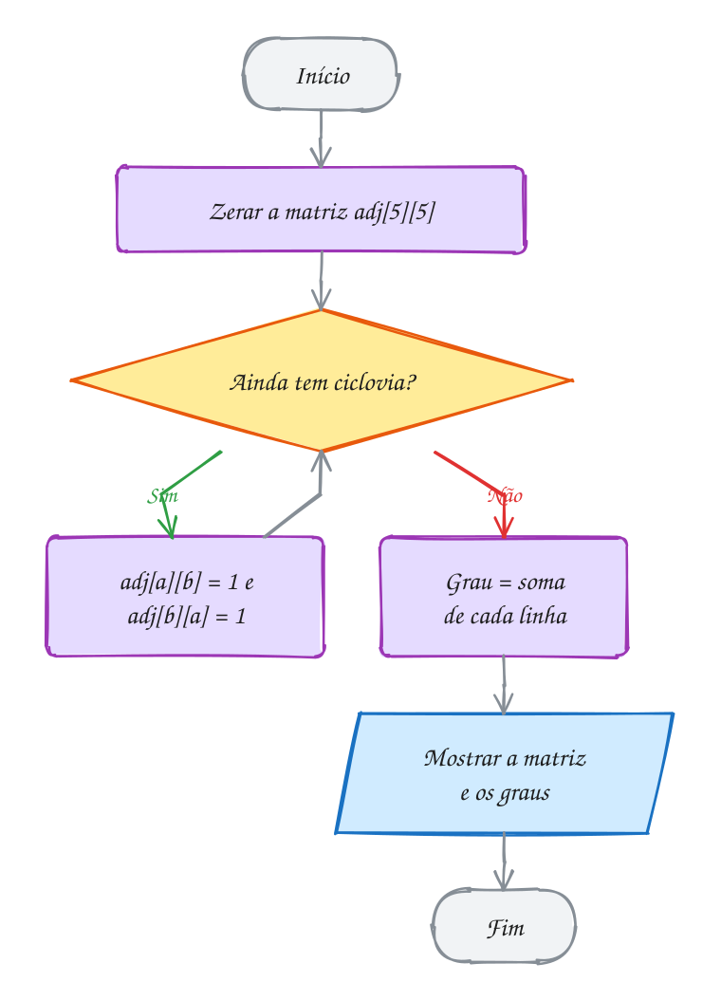
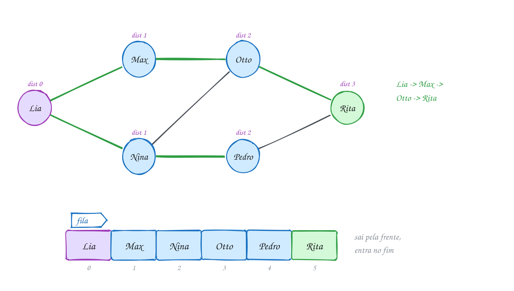
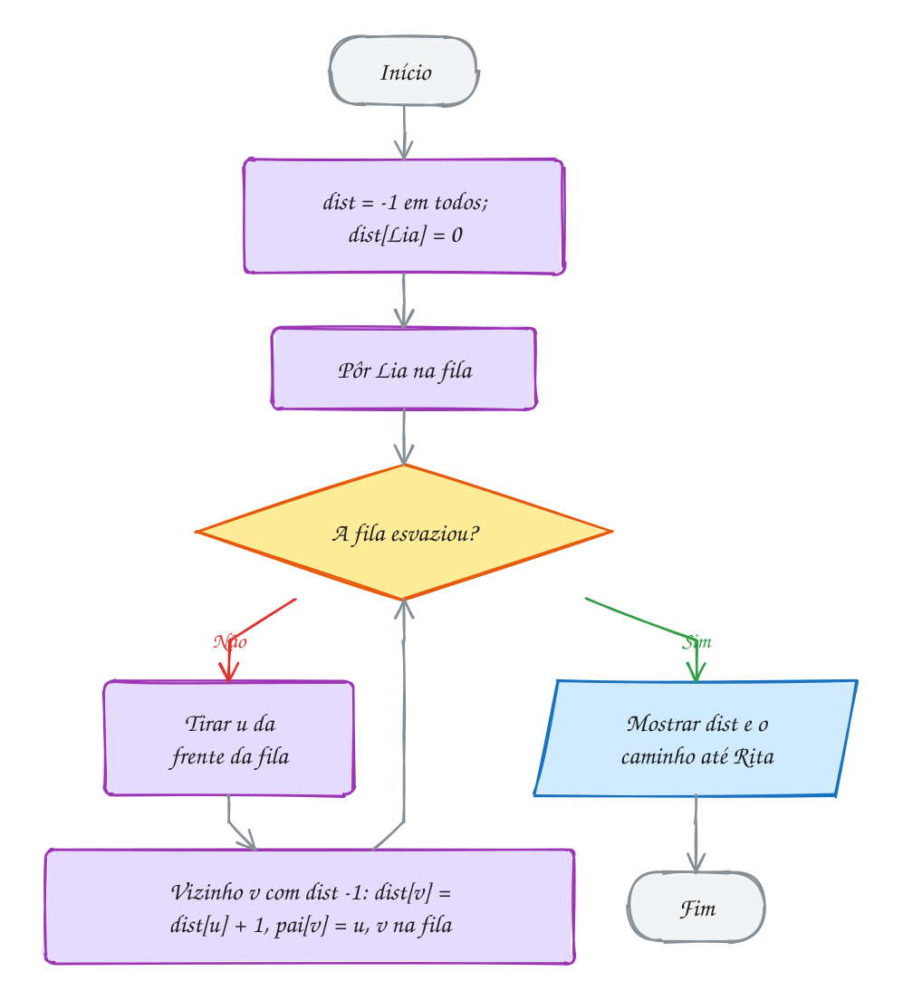
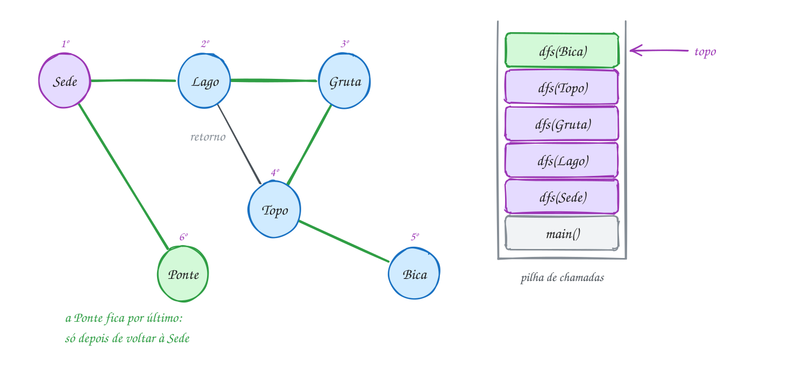
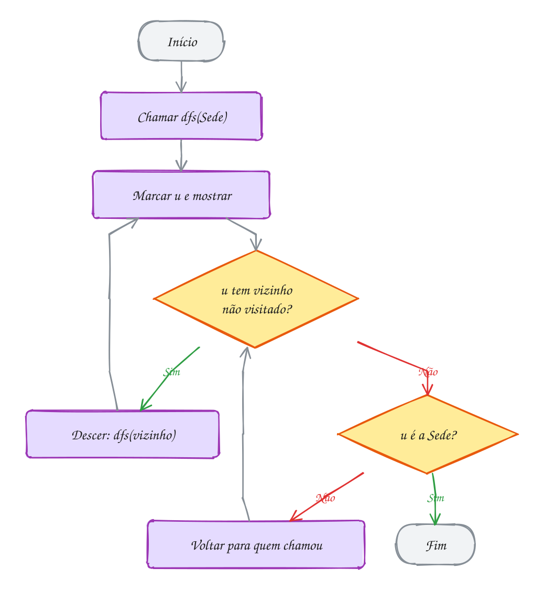
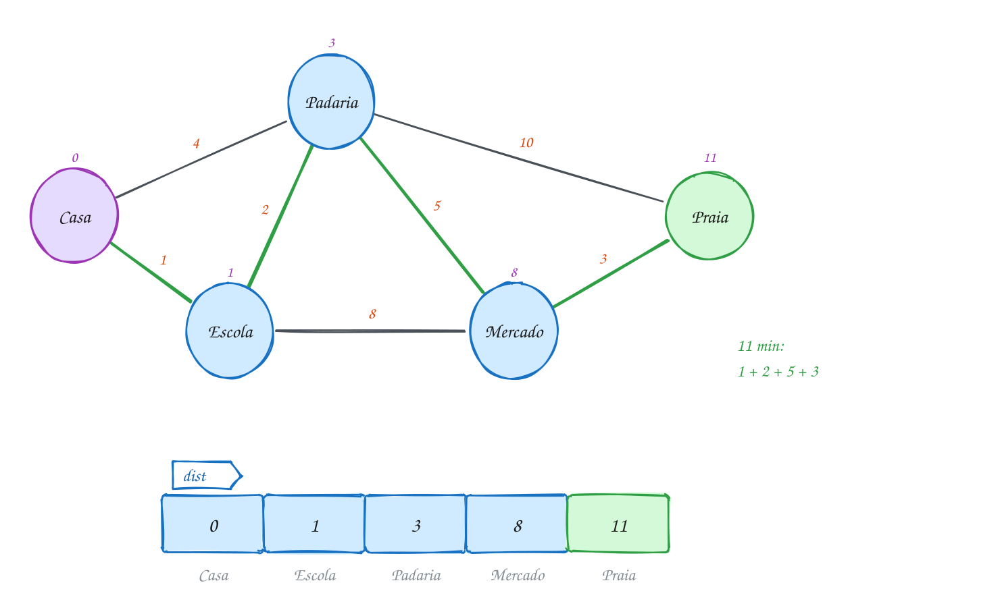
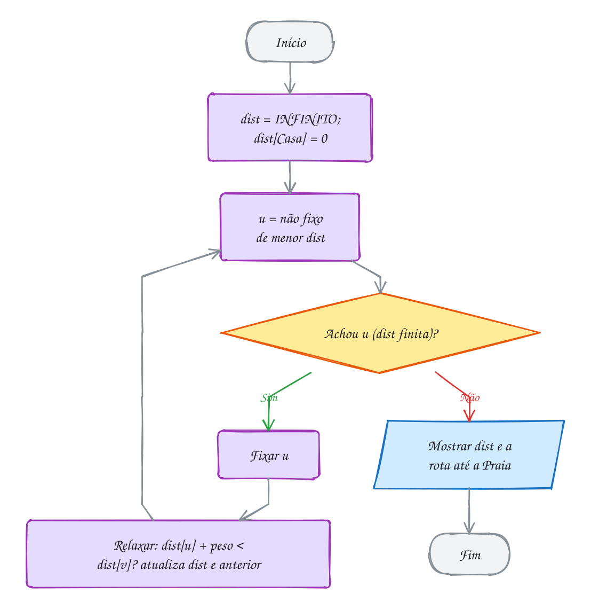

<!-- Gerado por _gerador. Para mudar este arquivo, edite _gerador/modulos/16-grafos/ e rode: cd _gerador && npm run gerar -->

# Módulo 16 · Grafos

> [!IMPORTANT]
> **Mundo 7 · Grafos · Rota do jogo: etapa 21 de 29**
>
> **Missão:** representar grafos e percorrer com BFS, DFS e Dijkstra.
>
> **Vem de:** [Módulo 28 · Estruturas: o que faltava](28-estruturas-complementos.md). **Segue para:** [Módulo 23 · Grafos: estrutura e caminhos](23-grafos-avancados.md).
>
> **Checkpoints desta fase:**
> - [ ] Ler os assuntos 0109 a 0113 e refazer os exemplos
> - [ ] Resolver os 4 exercícios de cada assunto, escrevendo o código sozinho
> - [ ] Fechar a lista prática (P1601 a P1630)
> - [ ] Enfrentar os desafios do módulo
> - [ ] Chefão: resolver as questões de prova do módulo sem consultar

Grafo é pontos e ligações, sem regra de forma: ruas, redes sociais,
dependências. O módulo cobre representação, BFS, DFS e Dijkstra, quase tudo a
mesma busca com fila, pilha ou "menor primeiro". Usa fila e pilha (módulo 12),
a lista dos baldes (módulo 15) e o heap (módulo 14).

## O que você vai aprender

- vocabulário: vértice, aresta, grau, caminho, ciclo, grafo dirigido e ponderado
- **matriz** e **lista de adjacência**, e quando usar cada uma
- **BFS**: menor caminho em número de arestas
- **DFS**: componentes, ciclos e ordenação topológica
- **Dijkstra**: caminho mínimo com pesos
- escolher o algoritmo para cada pergunta e, de bônus, a **árvore geradora
  mínima** com Prim

## Antes de começar

Usa matrizes (0039), structs (0059 e 0060), `malloc` e `free` (0054), lista
(0076), pilha (0082), fila (0085), recursão (0032) e heap (0102).

Vértices são números de 0 a V-1, com os nomes num vetor à parte. Os vizinhos
são examinados em ordem crescente de índice, o que decide empates: outra
numeração muda a saída sem estar errada. O 0109 traz o TAD `grafo.h` e
`grafo.c` (lista de adjacência); os demais arquivos usam matriz e são
completos.

| # | Assunto |
| --- | --- |
| [0109](#0109--grafos) | Grafos |
| [0110](#0110--bfs-busca-em-largura) | BFS: busca em largura |
| [0111](#0111--dfs-busca-em-profundidade) | DFS: busca em profundidade |
| [0112](#0112--dijkstra-caminho-mínimo) | Dijkstra: caminho mínimo |
| [0113](#0113--juntando-tudo-a-central-de-entregas) | Juntando tudo: a central de entregas |

---

## 1. Conceitos gerais

### 0109 · Grafos

- **Grafo**: um conjunto de **vértices** (pontos) e de **arestas** (ligações
  entre pares). O Cormen escreve **G = (V, E)** e usa V e E também para as
  quantidades, de onde vêm Θ(V²) e Θ(V + E) (CORMEN et al., 2024, cap. 20).
- **Diferente da árvore**: toda árvore é um grafo, mas um grafo pode ter
  ciclos e partes soltas (TENENBAUM; LANGSAM; AUGENSTEIN, 1995, cap. 8).
- **Vocabulário**: **vizinhos** são ligados por aresta; **grau** é quantas
  arestas tocam o vértice; **caminho** é uma sequência de vizinhos; **ciclo**
  volta ao começo; **conexo** liga todos a todos (ZIVIANI, 2010, cap. 7).
- **Dirigido e ponderado**: com mão única, cada aresta é uma seta e o vértice
  tem **grau de saída** e **de entrada**. Com um número na aresta (minutos,
  reais), o grafo é **ponderado** (CORMEN et al., 2024, cap. 20).
- **Soma dos graus**: cada aresta soma 1 no grau de dois vértices, então a
  soma é o dobro do número de arestas (ZIVIANI, 2010, cap. 7).
- **Vértice no C**: um número de 0 a V-1; os nomes ficam num vetor à parte
  (`nomes[2]` é `"Feira"`) (FEOFILOFF, 2009).

| Representação | Espaço | "i e j são vizinhos?" | Listar vizinhos de `i` |
| --- | --- | --- | --- |
| **matriz** `int adj[V][V]` | O(V²) | O(1) | O(V), a linha inteira |
| **lista de adjacência** | O(V + E) | o grau de `i` | o grau de `i` |

Com 100 mil vértices, a matriz teria 10¹⁰ casas, quase todas zero. Grafo
pequeno ou denso, matriz; grande e esparso, lista.

> [!WARNING]
> Em grafo não dirigido, a aresta entra **nos dois sentidos**: `adj[a][b] = 1`
> e `adj[b][a] = 1`. Esquecer um cria um grafo dirigido sem querer, e o erro
> só aparece quando a busca não acha um caminho que existe.

### 0110 · BFS: busca em largura

- **Distância**: o menor número de arestas num caminho de `s` até `v`. Não
  confunda com o grau do 0109 (FEOFILOFF, 2009, cap. 5).
- **Busca em largura** (BFS, *breadth-first search*): explora em ondas a
  partir da origem. Primeiro quem está a 1 aresta, depois a 2, e assim por
  diante (CORMEN et al., 2024, cap. 20).
- **Fila** (0085): quem foi descoberto primeiro sai primeiro. O laço tira `u`
  da frente e, para cada vizinho `v` novo, faz `dist[v] = dist[u] + 1`,
  `pai[v] = u` e põe `v` no fim (FEOFILOFF, 2009, cap. 5).
- **`dist[]` com -1**: marca o "não descoberto" e impede andar em círculos,
  porque dá para chegar ao mesmo vértice por caminhos diferentes
  (FEOFILOFF, 2009, cap. 5).
- **Árvore da BFS**: os pares (`pai[v]`, `v`). Seguir `pai[]` do destino até
  `-1` dá o caminho mais curto, de trás para frente
  (CORMEN et al., 2024, cap. 20).
- **Cores do Cormen**: **branco** é o não descoberto, **cinza** o que está na
  fila e **preto** o que já saiu; `v.d` é `dist[v]` e `v.π`, `pai[v]`
  (CORMEN et al., 2024, cap. 20).
- **Custo**: cada vértice entra na fila uma vez, então `int fila[V]` basta.
  O(V²) com matriz e O(V + E) com lista (ZIVIANI, 2010, cap. 7).
- **Só vale sem peso**: o primeiro caminho achado é o mais curto porque toda
  aresta custa 1. Com pesos, entra Dijkstra (0112) (CORMEN et al., 2024,
  cap. 22).

> [!WARNING]
> Marque o vértice como descoberto **ao pôr na fila**, não ao tirar. Marcando
> ao tirar, um vértice com dois vizinhos já vistos entra duas vezes e a fila
> estoura.

### 0111 · DFS: busca em profundidade

- **Busca em profundidade** (DFS, *depth-first search*): vai o mais fundo
  possível e, sem nada novo, **volta** à última escolha pendente, o
  **backtracking** (CORMEN et al., 2024, cap. 20).
- **Pilha**: a DFS usa a pilha de chamadas (0031). A função marca o vértice e
  chama a si mesma para cada vizinho não visitado; ao voltar, o frame lembra
  onde o laço parou (TENENBAUM; LANGSAM; AUGENSTEIN, 1995, cap. 8).
- **`visitado[]`**: obrigatório, como na BFS. Num ciclo, sem a marca, a
  recursão nunca acaba (ZIVIANI, 2010, cap. 7).
- **Árvore da DFS e arestas de retorno**: a DFS desce pelas arestas da
  árvore. Uma aresta que leva a um vértice ainda na pilha é **de retorno**; em
  grafo não dirigido, achar uma é achar um ciclo (CORMEN et al., 2024,
  cap. 20).
- **Relógio do Cormen**: cada vértice ganha tempo de **descoberta** `v.d` e de
  **término** `v.f`, com cores branco, cinza (na pilha) e preto. `DFS(G)`
  recomeça de todo vértice branco (CORMEN et al., 2024, cap. 20).
- **Grafo dirigido**: as outras arestas são de **retorno** (para ancestral
  cinza: há ciclo), de **avanço** (descendente preto) ou de **cruzamento**
  (outro preto). A ordem decrescente de `v.f` dá a **ordenação topológica**
  de um grafo acíclico (CORMEN et al., 2024, cap. 20).
- **Custo e caminho**: O(V + E) com lista. A DFS **não** dá o caminho mais
  curto; para isso há a BFS (FEOFILOFF, 2009, cap. 5).

> [!WARNING]
> Recursão funda estoura a pilha (8 MB é o comum no Linux): um labirinto de
> 1000 × 1000 casas pode empilhar um milhão de chamadas. Em grafos grandes,
> use pilha explícita com `malloc`, como no A222.

### 0112 · Dijkstra: caminho mínimo

- **Grafo ponderado**: cada aresta tem um **peso** (minutos, km, reais). O
  menor caminho é o de **menor soma de pesos**, não o de menos arestas; aí a
  BFS erra (CORMEN et al., 2024, cap. 22).
- **Dijkstra**: acha os menores caminhos a partir de uma origem quando
  **nenhum peso é negativo** (DIJKSTRA, 1959).
- **O que ele guarda**: `dist[v]`, o melhor tempo **conhecido** até `v` (0 na
  origem, INFINITO no resto); `fixo[v]`, se ele já é definitivo; `anterior[v]`,
  de onde se chega em `v` (o `pai[]` da BFS) (ZIVIANI, 2010, cap. 7).
- **Relaxar**: se `dist[u] + peso[u][v] < dist[v]`, atualiza `dist[v]` e
  `anterior[v]`. No Cormen é `RELAX(u, v, w)`, com `v.d`, `v.π` e o conjunto S
  dos fixos (CORMEN et al., 2024, cap. 22).
- **Guloso**: a cada passo fixa o não fixo de menor `dist` e relaxa as arestas
  dele; a escolha nunca se desfaz. É seguro porque, sem pesos negativos, outro
  caminho até ele passaria por um vértice de `dist` maior ou igual
  (CORMEN et al., 2024, cap. 22).
- **Peso negativo**: o argumento cai e o Dijkstra erra sem avisar. Aí entra o
  Bellman-Ford (0154), que relaxa todas as arestas V - 1 vezes
  (CORMEN et al., 2024, cap. 22).
- **Custo**: com matriz, cada um dos V passos varre V vértices, O(V²). Com
  lista e **heap** (0102), O((V + E) log V) (CORMEN et al., 2024, cap. 22).

> [!WARNING]
> `INT_MAX + 3` **estoura**: comportamento indefinido em `int` com sinal, que
> na prática vira negativo e "ganha" no `<`. Por isso o código só escolhe `u`
> com `dist[u] != INFINITO`. Um INFINITO folgado (`1000000000`) também evita o
> estouro (CPPREFERENCE, s.d.).

### 0113 · Juntando tudo: a central de entregas

- **Um esqueleto, três buscas**: DFS, BFS e Dijkstra usam marcas, `pai[]` e um
  laço que descobre vizinhos. Muda a **ordem** de saída: pilha, fila ou "menor
  `dist`" (CORMEN et al., 2024, caps. 20 e 22).
- **"Menor em quê?"**: com arestas de mesmo custo, a BFS basta, em O(V + E).
  Com pesos variados, ela erra sem aviso (FEOFILOFF, 2009, cap. 5).
- **Alcance primeiro**: a DFS diz quem dá para alcançar. Se o destino está
  fora, não há rota a calcular (TENENBAUM; LANGSAM; AUGENSTEIN, 1995, cap. 8).
- **Árvore geradora mínima**: o conjunto de arestas que liga todos os
  vértices com a menor soma de pesos (CORMEN et al., 2024, cap. 21).
- **Prim**: é o Dijkstra com uma linha trocada. Em vez de
  `dist[u] + custo < dist[v]`, compara só `custo < chave[v]`
  (CORMEN et al., 2024, cap. 21).
- **Grafo como struct**: `Grafo` junta vértices, nomes e matriz de km. As
  funções recebem `const Grafo *`: passa 8 bytes em vez de 328 e promete não
  mexer no mapa (KERNIGHAN; RITCHIE, 1989).
- **Inicializador designado** (C99): `{.n = 7, .nomes = {...}}` cita só os
  campos que quer; o resto, como `km`, começa zerado (ISO/IEC, 2018).

| Pergunta | Algoritmo | Estrutura auxiliar |
| --- | --- | --- |
| Quem dá para alcançar? Quantos grupos? Tem ciclo? | DFS | pilha (a recursão) |
| Menor caminho em número de arestas | BFS | fila |
| Menor caminho em soma de pesos (pesos >= 0) | Dijkstra | vetor `dist` (ou heap) |
| Ligar todos com o menor custo total | Prim | vetor `chave` |

> [!WARNING]
> Na matriz de pesos, `0` quer dizer "sem aresta", o que só funciona se nenhum
> peso real for zero. Se um trecho pode custar R$ 0, use outra marca,
> como `-1`.

---

## 2. Exemplos de uso

Cada exemplo compila sozinho. Rode com o comando abaixo dele e compare com a saída no fim do código.

### 0109 · Grafos

Cinco ciclovias ligam Centro, Praia, Feira, Parque e Estádio, nos dois
sentidos e sem peso. A matriz sai simétrica; a Feira tem três vizinhos, e a
linha 2 tem três 1:

<p align="center"></p>

As arestas entram como pares, e o grau sai da soma de cada linha. Soma ímpar
indicaria um sentido esquecido:

```c
#include <stdio.h>

#define V 5 // número de vértices (pontos da cidade)

int main(void) {
    const char *nomes[V] = {"Centro", "Praia", "Feira", "Parque", "Estadio"};
    int adj[V][V] = {0}; // adj[i][j] == 1: existe ciclovia entre i e j

    // as ciclovias, como pares de vértices
    int ciclovias[][2] = {{0, 1}, {0, 2}, {1, 2}, {2, 3}, {3, 4}};
    int total = (int)(sizeof ciclovias / sizeof ciclovias[0]);

    for (int k = 0; k < total; k++) {
        int a = ciclovias[k][0];
        int b = ciclovias[k][1];
        adj[a][b] = 1;
        adj[b][a] = 1; // não dirigido: vale nos dois sentidos
    }

    printf("     0 1 2 3 4\n");
    int soma_graus = 0;
    for (int i = 0; i < V; i++) {
        int grau = 0;
        printf("  %d ", i);
        for (int j = 0; j < V; j++) {
            printf(" %d", adj[i][j]);
            grau += adj[i][j]; // o grau é a soma da linha
        }
        printf("  %-8s grau %d\n", nomes[i], grau);
        soma_graus += grau;
    }
    printf("Soma dos graus: %d = 2 x %d ciclovias\n", soma_graus, total);
    return 0;
}
// Saída:
//      0 1 2 3 4
//   0  0 1 1 0 0  Centro   grau 2
//   1  1 0 1 0 0  Praia    grau 2
//   2  1 1 0 1 0  Feira    grau 3
//   3  0 0 1 0 1  Parque   grau 2
//   4  0 0 0 1 0  Estadio  grau 1
// Soma dos graus: 10 = 2 x 5 ciclovias
```

Primeiro monta-se a estrutura, depois respondem-se as perguntas; todo
algoritmo do módulo segue essa ordem. O A217 guarda pesos na matriz e o A218
usa a lista de adjacência como TAD:

<p align="center"></p>

**Exemplo A217 · Quilômetros na matriz e a vila isolada**

```c
#include <stdio.h>

#define V 5

int main(void) {
    const char *nomes[V] = {"Sede", "Vila", "Sitio", "Porto", "Ilha"};
    int km[V][V] = {0}; // grafo ponderado: km[i][j] é o tamanho da estrada; 0 = sem estrada

    int estradas[][3] = {{0, 1, 12}, {0, 3, 30}, {1, 2, 8}, {2, 3, 15}}; // {a, b, km}
    int total = (int)(sizeof estradas / sizeof estradas[0]);
    for (int k = 0; k < total; k++) {
        int a = estradas[k][0], b = estradas[k][1];
        km[a][b] = estradas[k][2];
        km[b][a] = estradas[k][2]; // mão dupla: o mesmo peso nos dois sentidos
    }

    // "i e j são vizinhos?" é olhar uma casa só: O(1)
    int perguntas[][2] = {{0, 1}, {0, 2}, {3, 2}};
    for (int k = 0; k < 3; k++) {
        int a = perguntas[k][0], b = perguntas[k][1];
        if (km[a][b]) printf("%s-%s: estrada de %d km\n", nomes[a], nomes[b], km[a][b]);
        else printf("%s-%s: sem estrada direta\n", nomes[a], nomes[b]);
    }

    // listar os vizinhos é varrer a linha inteira: O(V)
    int isolados = 0;
    for (int i = 0; i < V; i++) {
        int grau = 0;
        printf("%-5s:", nomes[i]);
        for (int j = 0; j < V; j++) {
            if (km[i][j]) {
                printf(" %s(%d)", nomes[j], km[i][j]);
                grau++;
            }
        }
        if (grau == 0) {
            printf(" ninguém, grau 0"); // vértice isolado: a linha inteira é zero
            isolados++;
        }
        printf("\n");
    }

    int soma_km = 0;
    for (int i = 0; i < V; i++)
        for (int j = i + 1; j < V; j++) soma_km += km[i][j]; // acima da diagonal: cada estrada uma vez
    printf("Rede: %d estradas, %d km\n", total, soma_km);
    if (isolados > 0) printf("Vértices isolados: %d, então o grafo não é conexo\n", isolados);
    return 0;
}
// Saída:
// Sede-Vila: estrada de 12 km
// Sede-Sitio: sem estrada direta
// Porto-Sitio: estrada de 15 km
// Sede : Vila(12) Porto(30)
// Vila : Sede(12) Sitio(8)
// Sitio: Vila(8) Porto(15)
// Porto: Sede(30) Sitio(15)
// Ilha : ninguém, grau 0
// Rede: 4 estradas, 65 km
// Vértices isolados: 1, então o grafo não é conexo
```

```bash
gcc ~/LPEDC/material/A217.c ~/LPEDC/material/0109-grafo.c -o ~/LPEDC/material/A217 && ~/LPEDC/material/A217
```

**Exemplo A218 · Quem segue quem: lista de adjacência**

```c
#include <stdio.h>

#include "0109-grafo.h"

int main(void) {
    const char *nomes[] = {"Ana", "Bia", "Caio", "Duda"};
    Grafo *g = grafo_criar(4);
    if (g == NULL) return 1;

    // aresta dirigida: seguir não é recíproco
    grafo_ligar(g, 0, 1); // Ana segue Bia
    grafo_ligar(g, 0, 2); // Ana segue Caio
    grafo_ligar(g, 1, 2); // Bia segue Caio
    grafo_ligar(g, 2, 0); // Caio segue Ana
    grafo_ligar(g, 3, 2); // Duda segue Caio

    grafo_mostrar(g, nomes);
    printf("\n");
    for (int v = 0; v < 4; v++)
        printf("%-5s segue %d, tem %d seguidor(es)\n", nomes[v],
               grafo_grau_saida(g, v), grafo_grau_entrada(g, v));

    grafo_liberar(g);
    return 0;
}
// Saída:
// Ana   -> Caio Bia
// Bia   -> Caio
// Caio  -> Ana
// Duda  -> Caio
//
// Ana   segue 2, tem 1 seguidor(es)
// Bia   segue 1, tem 1 seguidor(es)
// Caio  segue 1, tem 3 seguidor(es)
// Duda  segue 1, tem 0 seguidor(es)
```

```bash
gcc ~/LPEDC/material/A218.c ~/LPEDC/material/0109-grafo.c -o ~/LPEDC/material/A218 && ~/LPEDC/material/A218
```

### 0110 · BFS: busca em largura

Lia quer uma indicação para a vaga da recrutadora Rita. A onda 1 é Max e
Nina; a 2, Otto e Pedro; a 3, Rita. As setas verdes são a árvore da BFS, e o
número de cada pessoa é a distância:

<p align="center"></p>

O código monta a matriz, roda a BFS a partir de Lia e reconstrói o caminho:

```c
#include <stdio.h>

#define V 6

int main(void) {
    const char *nomes[V] = {"Lia", "Max", "Nina", "Otto", "Pedro", "Rita"};
    int adj[V][V] = {0};
    int conexoes[][2] = {{0, 1}, {0, 2}, {1, 3}, {2, 3}, {2, 4}, {3, 5}, {4, 5}};
    for (int k = 0; k < 7; k++) {
        adj[conexoes[k][0]][conexoes[k][1]] = 1;
        adj[conexoes[k][1]][conexoes[k][0]] = 1;
    }

    int dist[V], pai[V];
    for (int v = 0; v < V; v++) {
        dist[v] = -1; // -1: ainda não descoberto
        pai[v] = -1;
    }

    int fila[V]; // cada vértice entra uma vez só: V posições bastam
    int inicio = 0, fim = 0;
    int origem = 0; // Lia
    dist[origem] = 0;
    fila[fim++] = origem;

    printf("Ordem da visita:\n");
    while (inicio < fim) {
        int u = fila[inicio++]; // tira da frente
        printf("  %-5s distância %d\n", nomes[u], dist[u]);
        for (int v = 0; v < V; v++) {
            if (adj[u][v] && dist[v] == -1) {
                dist[v] = dist[u] + 1; // marca ao ENTRAR na fila
                pai[v] = u;
                fila[fim++] = v;
            }
        }
    }

    // o caminho sai de trás para frente, seguindo pai[]
    int destino = 5; // Rita
    int caminho[V], n = 0;
    for (int v = destino; v != -1; v = pai[v]) caminho[n++] = v;
    printf("Caminho até %s:", nomes[destino]);
    for (int i = n - 1; i >= 0; i--) printf(" %s%s", nomes[caminho[i]], i > 0 ? " ->" : "");
    printf(" (distância %d)\n", dist[destino]);
    return 0;
}
// Saída:
// Ordem da visita:
//   Lia   distância 0
//   Max   distância 1
//   Nina  distância 1
//   Otto  distância 2
//   Pedro distância 2
//   Rita  distância 3
// Caminho até Rita: Lia -> Max -> Otto -> Rita (distância 3)
```

A busca termina quando a fila esvazia. O A219 agrupa por onda e o A220 roda a
BFS numa grade:

<p align="center"></p>

#### Passo a passo

Cada linha é uma volta do `while`. Otto já foi descoberto por Max; quando Nina
o vê, nada acontece:

| Tira | Vizinhos novos | dist anotada | Fila depois |
| --- | --- | --- | --- |
| (início) | | Lia = 0 | Lia |
| Lia | Max, Nina | 1, 1 | Max, Nina |
| Max | Otto | 2 | Nina, Otto |
| Nina | Pedro (Otto já tem dist) | 2 | Otto, Pedro |
| Otto | Rita | 3 | Pedro, Rita |
| Pedro | nenhum (Rita já tem dist) | | Rita |
| Rita | nenhum | | (vazia) |

**Exemplo A219 · As ondas da BFS e quem fica de fora**

```c
#include <stdio.h>

#define V 8

int main(void) {
    const char *nomes[V] = {"Bruna", "Caio", "Davi", "Eva", "Fred", "Gil", "Hugo", "Iara"};
    int adj[V][V] = {0};
    // Gil e Hugo só conhecem um ao outro: formam uma parte solta do grafo
    int conhece[][2] = {{0, 1}, {0, 2}, {1, 3}, {2, 3}, {3, 4}, {4, 7}, {5, 6}};
    int total = (int)(sizeof conhece / sizeof conhece[0]);
    for (int k = 0; k < total; k++) {
        adj[conhece[k][0]][conhece[k][1]] = 1;
        adj[conhece[k][1]][conhece[k][0]] = 1;
    }

    int dist[V], fila[V], inicio = 0, fim = 0;
    for (int v = 0; v < V; v++) dist[v] = -1;
    dist[0] = 0; // a fofoca começa com a Bruna
    fila[fim++] = 0;
    int maior = 0;
    while (inicio < fim) {
        int u = fila[inicio++];
        if (dist[u] > maior) maior = dist[u];
        for (int v = 0; v < V; v++)
            if (adj[u][v] && dist[v] == -1) {
                dist[v] = dist[u] + 1;
                fila[fim++] = v;
            }
    }

    // agrupa por distância: cada linha é uma onda
    for (int d = 0; d <= maior; d++) {
        printf("Onda %d:", d);
        for (int v = 0; v < V; v++)
            if (dist[v] == d) printf(" %s", nomes[v]);
        printf("\n");
    }

    // quem a fila nunca recebeu continua com -1
    printf("Nunca ficam sabendo:");
    for (int v = 0; v < V; v++)
        if (dist[v] == -1) printf(" %s", nomes[v]);
    printf("\nA fila recebeu %d de %d pessoas\n", fim, V);
    return 0;
}
// Saída:
// Onda 0: Bruna
// Onda 1: Caio Davi
// Onda 2: Eva
// Onda 3: Fred
// Onda 4: Iara
// Nunca ficam sabendo: Gil Hugo
// A fila recebeu 6 de 8 pessoas
```

```bash
gcc ~/LPEDC/material/A219.c -o ~/LPEDC/material/A219 && ~/LPEDC/material/A219
```

**Exemplo A220 · O robô no galpão: BFS numa grade**

```c
#include <stdio.h>

#define L 5
#define C 7

int main(void) {
    // # é prateleira; o robô sai de S e vai até E (a expedição)
    char mapa[L][C + 1] = {
        "S..#...",
        ".#.#.#.",
        ".#...#.",
        ".###.#.",
        ".....#E",
    };
    // cada casa é um vértice; os vizinhos são cima, baixo, esquerda e direita
    int dl[4] = {-1, 1, 0, 0};
    int dc[4] = {0, 0, -1, 1};

    int dist[L][C], pai[L * C];
    for (int l = 0; l < L; l++)
        for (int c = 0; c < C; c++) dist[l][c] = -1;

    int fila[L * C]; // a casa (l, c) entra na fila como o número l * C + c
    int inicio = 0, fim = 0;
    dist[0][0] = 0;
    pai[0] = -1;
    fila[fim++] = 0;

    while (inicio < fim) {
        int u = fila[inicio++];
        int l = u / C, c = u % C;
        for (int k = 0; k < 4; k++) {
            int nl = l + dl[k], nc = c + dc[k];
            if (nl < 0 || nl >= L || nc < 0 || nc >= C) continue; // fora do galpão
            if (mapa[nl][nc] == '#' || dist[nl][nc] != -1) continue;
            dist[nl][nc] = dist[l][c] + 1;
            pai[nl * C + nc] = u;
            fila[fim++] = nl * C + nc;
        }
    }

    printf("Passos até a expedição: %d\n", dist[L - 1][C - 1]);
    // marca o caminho com * voltando pelos pais (sem apagar S e E)
    for (int u = pai[(L - 1) * C + (C - 1)]; u > 0; u = pai[u]) mapa[u / C][u % C] = '*';
    for (int l = 0; l < L; l++) printf("%s\n", mapa[l]);
    return 0;
}
// Saída:
// Passos até a expedição: 14
// S**#***
// .#*#*#*
// .#***#*
// .###.#*
// .....#E
```

```bash
gcc ~/LPEDC/material/A220.c -o ~/LPEDC/material/A220 && ~/LPEDC/material/A220
```

### 0111 · DFS: busca em profundidade

Da Sede do parque saem trilhas para o Lago e a Ponte. A DFS desce Lago,
Gruta, Topo e Bica, volta e só no fim pega a Ponte. Os números são a ordem da
visita, as arestas verdes são a árvore e à direita fica a pilha na Bica:

<p align="center"></p>

O código imprime cada vértice com recuo proporcional à profundidade.
`visitado[]` e `adj[]` são globais, e todas as chamadas veem o mesmo vetor:

```c
#include <stdbool.h>
#include <stdio.h>

#define V 6

const char *nomes[V] = {"Sede", "Lago", "Gruta", "Ponte", "Topo", "Bica"};
int adj[V][V];
bool visitado[V];

void dfs(int u, int nivel) {
    visitado[u] = true;
    printf("%*s%s\n", 2 * nivel, "", nomes[u]); // recuo = profundidade
    for (int v = 0; v < V; v++)
        if (adj[u][v] && !visitado[v]) dfs(v, nivel + 1); // desce antes de olhar o próximo
}

int main(void) {
    int trilhas[][2] = {{0, 1}, {0, 3}, {1, 2}, {1, 4}, {2, 4}, {4, 5}};
    for (int k = 0; k < 6; k++) {
        adj[trilhas[k][0]][trilhas[k][1]] = 1;
        adj[trilhas[k][1]][trilhas[k][0]] = 1;
    }

    dfs(0, 0); // começa na Sede
    return 0;
}
// Saída:
// Sede
//   Lago
//     Gruta
//       Topo
//         Bica
//   Ponte
```

Cada chamada só pergunta "tenho vizinho novo?": se tem, desce; se não, volta.
A BFS daria Sede, Lago, Ponte, Gruta, Topo, Bica. O A221 conta ciclos e o
A222 usa pilha explícita:

<p align="center"></p>

**Exemplo A221 · Cabos do escritório: arestas de árvore e de retorno**

```c
#include <stdio.h>

#define V 6

const char *nomes[V] = {"Servidor", "Recepcao", "RH", "Financeiro", "Diretoria", "Copa"};
int adj[V][V];
int ordem[V]; // em que momento cada sala foi descoberta; 0 = ainda não
int relogio = 0;
int de_arvore = 0, de_retorno = 0;

void dfs(int u, int pai) {
    ordem[u] = ++relogio;
    for (int v = 0; v < V; v++) {
        if (!adj[u][v]) continue;
        if (ordem[v] == 0) { // sala nova: a DFS desce por este cabo
            printf("desce   %s -> %s\n", nomes[u], nomes[v]);
            de_arvore++;
            dfs(v, u);
        } else if (v != pai && ordem[v] < ordem[u]) {
            // v já está na pilha, acima de u: este cabo fecha um ciclo
            printf("retorno %s -> %s (ciclo)\n", nomes[u], nomes[v]);
            de_retorno++;
        }
        // v == pai: é o cabo por onde u chegou; não conta como ciclo
    }
}

int main(void) {
    int cabos[][2] = {{0, 1}, {0, 2}, {1, 2}, {2, 3}, {3, 4}, {0, 4}, {4, 5}};
    int total = (int)(sizeof cabos / sizeof cabos[0]);
    for (int k = 0; k < total; k++) {
        adj[cabos[k][0]][cabos[k][1]] = 1;
        adj[cabos[k][1]][cabos[k][0]] = 1;
    }

    dfs(0, -1); // o Servidor não tem pai
    printf("Cabos: %d = %d de árvore + %d de retorno\n", total, de_arvore, de_retorno);
    printf("Para não ter ciclo nenhum, bastariam %d cabos (V - 1)\n", V - 1);
    return 0;
}
// Saída:
// desce   Servidor -> Recepcao
// desce   Recepcao -> RH
// retorno RH -> Servidor (ciclo)
// desce   RH -> Financeiro
// desce   Financeiro -> Diretoria
// retorno Diretoria -> Servidor (ciclo)
// desce   Diretoria -> Copa
// Cabos: 7 = 5 de árvore + 2 de retorno
// Para não ter ciclo nenhum, bastariam 5 cabos (V - 1)
```

```bash
gcc ~/LPEDC/material/A221.c -o ~/LPEDC/material/A221 && ~/LPEDC/material/A221
```

**Exemplo A222 · A pilha que a recursão escondia**

```c
#include <stdbool.h>
#include <stdio.h>

#define V 6
#define ARESTAS 6

int main(void) {
    const char *nomes[V] = {"Sede", "Lago", "Gruta", "Ponte", "Topo", "Bica"};
    int adj[V][V] = {0};
    int trilhas[ARESTAS][2] = {{0, 1}, {0, 3}, {1, 2}, {1, 4}, {2, 4}, {4, 5}};
    for (int k = 0; k < ARESTAS; k++) {
        adj[trilhas[k][0]][trilhas[k][1]] = 1;
        adj[trilhas[k][1]][trilhas[k][0]] = 1;
    }

    bool visitado[V] = {false};
    int pilha[2 * ARESTAS + 1]; // cada aresta empilha no máximo 2 vezes, + a origem
    int topo = 0;
    pilha[topo++] = 0; // Sede

    while (topo > 0) {
        int u = pilha[--topo]; // tira do topo
        if (visitado[u]) {
            printf("tira %-5s (já visitado)\n", nomes[u]);
            continue;
        }
        visitado[u] = true;
        // empilha de trás para frente: o vizinho de menor índice fica no topo
        for (int v = V - 1; v >= 0; v--)
            if (adj[u][v] && !visitado[v]) pilha[topo++] = v;

        printf("tira %-5s pilha:", nomes[u]);
        for (int i = 0; i < topo; i++) printf(" %s", nomes[pilha[i]]);
        printf("\n");
    }
    return 0;
}
// Saída:
// tira Sede  pilha: Ponte Lago
// tira Lago  pilha: Ponte Topo Gruta
// tira Gruta pilha: Ponte Topo Topo
// tira Topo  pilha: Ponte Topo Bica
// tira Bica  pilha: Ponte Topo
// tira Topo  (já visitado)
// tira Ponte pilha:
```

```bash
gcc ~/LPEDC/material/A222.c -o ~/LPEDC/material/A222 && ~/LPEDC/material/A222
```

### 0112 · Dijkstra: caminho mínimo

Rumo à praia, o Waze sabe que Casa até Padaria leva 4 minutos, mas Casa,
Escola, Padaria leva 3. A BFS acharia Casa, Padaria, Praia (14 minutos). Os
números das arestas são minutos, o de cada lugar é a `dist` final e as arestas
verdes formam a rota de 11 minutos:

<p align="center"></p>

O código usa matriz de pesos (0 é "sem rua direta") e reconstrói a rota pelo
`anterior[]`:

```c
#include <limits.h>
#include <stdbool.h>
#include <stdio.h>

#define V 5
#define INFINITO INT_MAX // "ainda não sei chegar"

int main(void) {
    const char *nomes[V] = {"Casa", "Escola", "Padaria", "Mercado", "Praia"};
    int peso[V][V] = {0}; // minutos; 0 = sem rua direta
    int ruas[][3] = {{0, 2, 4}, {0, 1, 1}, {1, 2, 2}, {2, 3, 5}, {1, 3, 8}, {3, 4, 3}, {2, 4, 10}};
    for (int k = 0; k < 7; k++) {
        peso[ruas[k][0]][ruas[k][1]] = ruas[k][2];
        peso[ruas[k][1]][ruas[k][0]] = ruas[k][2]; // mão dupla
    }

    int dist[V], anterior[V];
    bool fixo[V]; // distância definitiva?
    for (int v = 0; v < V; v++) {
        dist[v] = INFINITO;
        anterior[v] = -1;
        fixo[v] = false;
    }
    dist[0] = 0; // saindo de Casa

    for (int passo = 0; passo < V; passo++) {
        // escolhe o vértice não fixo com a menor distância conhecida
        int u = -1;
        for (int v = 0; v < V; v++)
            if (!fixo[v] && dist[v] != INFINITO && (u == -1 || dist[v] < dist[u])) u = v;
        if (u == -1) break; // o que sobrou é inalcançável
        fixo[u] = true;

        // relaxa: passar por u encurta o caminho até v?
        for (int v = 0; v < V; v++) {
            if (peso[u][v] && !fixo[v] && dist[u] + peso[u][v] < dist[v]) {
                dist[v] = dist[u] + peso[u][v];
                anterior[v] = u;
            }
        }
    }

    for (int v = 0; v < V; v++) printf("%s: %d min\n", nomes[v], dist[v]);

    int rota[V], n = 0;
    for (int v = 4; v != -1; v = anterior[v]) rota[n++] = v;
    printf("Rota até a Praia:");
    for (int i = n - 1; i >= 0; i--) printf(" %s%s", nomes[rota[i]], i > 0 ? " ->" : "");
    printf("\n");
    return 0;
}
// Saída:
// Casa: 0 min
// Escola: 1 min
// Padaria: 3 min
// Mercado: 8 min
// Praia: 11 min
// Rota até a Praia: Casa -> Escola -> Padaria -> Mercado -> Praia
```

É a estrutura da BFS, com a fila trocada por "menor `dist` não fixo". O laço
acaba com todos fixos ou quando o menor que sobrou é INFINITO:

<p align="center"></p>

#### Passo a passo

Cada linha fixa um vértice e relaxa os vizinhos: a Padaria cai de 4 para 3 e o
Mercado de 9 para 8:

| Fixa | Casa | Escola | Padaria | Mercado | Praia |
| --- | --- | --- | --- | --- | --- |
| (início) | 0 | ∞ | ∞ | ∞ | ∞ |
| Casa (0) | **0** | 1 | 4 | ∞ | ∞ |
| Escola (1) | | **1** | 3 | 9 | ∞ |
| Padaria (3) | | | **3** | 8 | 13 |
| Mercado (8) | | | | **8** | 11 |
| Praia (11) | | | | | **11** |

O exemplo A223 para ao fixar o destino. O A224 usa grafo dirigido (ônibus, em
reais) e trata uma cidade que nenhuma linha alcança.

**Exemplo A223 · O entregador que para quando chega**

```c
#include <limits.h>
#include <stdbool.h>
#include <stdio.h>

#define V 7
#define INFINITO INT_MAX

int main(void) {
    const char *nomes[V] = {"Loja", "Banco", "Igreja", "Museu", "Teatro", "Estadio", "Aeroporto"};
    int minutos[V][V] = {0}; // de bicicleta; 0 = sem rua direta
    int ruas[][3] = {{0, 1, 2}, {0, 2, 5}, {1, 2, 1}, {1, 3, 7}, {2, 3, 3},
                     {3, 4, 4}, {4, 5, 6}, {2, 6, 20}, {5, 6, 2}};
    int total = (int)(sizeof ruas / sizeof ruas[0]);
    for (int k = 0; k < total; k++) {
        minutos[ruas[k][0]][ruas[k][1]] = ruas[k][2];
        minutos[ruas[k][1]][ruas[k][0]] = ruas[k][2];
    }

    int origem = 0, destino = 3; // da Loja até o Museu
    int dist[V], anterior[V];
    bool fixo[V] = {false};
    for (int v = 0; v < V; v++) {
        dist[v] = INFINITO;
        anterior[v] = -1;
    }
    dist[origem] = 0;

    int fixados = 0;
    for (int passo = 0; passo < V; passo++) {
        int u = -1;
        for (int v = 0; v < V; v++)
            if (!fixo[v] && dist[v] != INFINITO && (u == -1 || dist[v] < dist[u])) u = v;
        if (u == -1) break;
        fixo[u] = true;
        fixados++;
        printf("fixa %-6s %2d min\n", nomes[u], dist[u]);
        // fixado é definitivo: nada que venha depois melhora o Museu
        if (u == destino) break;
        for (int v = 0; v < V; v++)
            if (minutos[u][v] && !fixo[v] && dist[u] + minutos[u][v] < dist[v]) {
                dist[v] = dist[u] + minutos[u][v];
                anterior[v] = u;
            }
    }

    int rota[V], n = 0;
    for (int v = destino; v != -1; v = anterior[v]) rota[n++] = v;
    printf("Rota:");
    for (int i = n - 1; i >= 0; i--) printf(" %s%s", nomes[rota[i]], i > 0 ? " ->" : "");
    printf(" (%d min)\n", dist[destino]);
    // rodando até o fim, o Aeroporto cairia para 18 (Museu, Teatro, Estadio)
    printf("Fixou %d de %d lugares; o Aeroporto ficou com dist ", fixados, V);
    if (dist[6] == INFINITO) printf("INFINITO\n");
    else printf("%d, que não é a resposta final\n", dist[6]);
    return 0;
}
// Saída:
// fixa Loja    0 min
// fixa Banco   2 min
// fixa Igreja  3 min
// fixa Museu   6 min
// Rota: Loja -> Banco -> Igreja -> Museu (6 min)
// Fixou 4 de 7 lugares; o Aeroporto ficou com dist 23, que não é a resposta final
```

```bash
gcc ~/LPEDC/material/A223.c -o ~/LPEDC/material/A223 && ~/LPEDC/material/A223
```

**Exemplo A224 · Passagens de ônibus e a cidade sem rota**

```c
#include <limits.h>
#include <stdbool.h>
#include <stdio.h>

#define V 6
#define INFINITO INT_MAX

const char *nomes[V] = {"Recife", "Caruaru", "Garanhuns", "Petrolina", "Olinda", "Noronha"};
int preco[V][V]; // R$ da passagem; 0 = sem linha direta (grafo dirigido)

void dijkstra(int origem, int dist[], int anterior[]) {
    bool fixo[V] = {false};
    for (int v = 0; v < V; v++) {
        dist[v] = INFINITO;
        anterior[v] = -1;
    }
    dist[origem] = 0;
    for (int passo = 0; passo < V; passo++) {
        int u = -1;
        for (int v = 0; v < V; v++)
            if (!fixo[v] && dist[v] != INFINITO && (u == -1 || dist[v] < dist[u])) u = v;
        if (u == -1) break; // sem mais ninguém alcançável: para antes de somar com INFINITO
        fixo[u] = true;
        for (int v = 0; v < V; v++)
            if (preco[u][v] && dist[u] + preco[u][v] < dist[v]) {
                dist[v] = dist[u] + preco[u][v];
                anterior[v] = u;
            }
    }
}

void imprimir_rota(const int anterior[], int v) {
    if (anterior[v] != -1) {
        imprimir_rota(anterior, anterior[v]);
        printf(" -> ");
    }
    printf("%s", nomes[v]);
}

int main(void) {
    int linhas[][3] = {{0, 1, 40}, {0, 4, 5}, {4, 1, 38}, {1, 2, 35},
                       {0, 2, 80}, {2, 3, 120}, {1, 3, 170}};
    for (int k = 0; k < 7; k++) preco[linhas[k][0]][linhas[k][1]] = linhas[k][2];

    int dist[V], anterior[V];
    dijkstra(0, dist, anterior);
    for (int v = 1; v < V; v++) {
        if (dist[v] == INFINITO) {
            printf("%-9s sem rota de ônibus\n", nomes[v]);
            continue;
        }
        printf("%-9s R$ %3d  ", nomes[v], dist[v]);
        imprimir_rota(anterior, v);
        printf("\n");
    }
    return 0;
}
// Saída:
// Caruaru   R$  40  Recife -> Caruaru
// Garanhuns R$  75  Recife -> Caruaru -> Garanhuns
// Petrolina R$ 195  Recife -> Caruaru -> Garanhuns -> Petrolina
// Olinda    R$   5  Recife -> Olinda
// Noronha   sem rota de ônibus
```

```bash
gcc ~/LPEDC/material/A224.c -o ~/LPEDC/material/A224 && ~/LPEDC/material/A224
```

### 0113 · Juntando tudo: a central de entregas

Uma transportadora tem um centro de distribuição (CD) e seis lugares a
atender. A Ilha só tem balsa, e a DFS a deixa de fora. A BFS acha a rota de 2
trechos pelo Centro (16 km); o Dijkstra, a de 4 trechos, em verde (10 km):

<p align="center"></p>

`bfs` e `dijkstra` preenchem o mesmo `pai[]`, e uma só `mostrar_rota` serve aos
dois:

```c
#include <limits.h>
#include <stdbool.h>
#include <stdio.h>

#define MAX 8
#define INFINITO INT_MAX

typedef struct {
    int n;
    const char *nomes[MAX];
    int km[MAX][MAX]; // 0 = sem estrada
} Grafo;

void ligar(Grafo *g, int a, int b, int km) {
    g->km[a][b] = km;
    g->km[b][a] = km;
}

// DFS: marca tudo que dá para alcançar a partir de u
void dfs(const Grafo *g, int u, bool visitado[]) {
    visitado[u] = true;
    for (int v = 0; v < g->n; v++)
        if (g->km[u][v] && !visitado[v]) dfs(g, v, visitado);
}

// BFS: menor número de trechos
void bfs(const Grafo *g, int origem, int pai[]) {
    int fila[MAX], inicio = 0, fim = 0;
    bool visto[MAX] = {false};
    for (int v = 0; v < g->n; v++) pai[v] = -1;
    visto[origem] = true;
    fila[fim++] = origem;
    while (inicio < fim) {
        int u = fila[inicio++];
        for (int v = 0; v < g->n; v++)
            if (g->km[u][v] && !visto[v]) {
                visto[v] = true;
                pai[v] = u;
                fila[fim++] = v;
            }
    }
}

// Dijkstra: menor soma de km
void dijkstra(const Grafo *g, int origem, int pai[]) {
    int dist[MAX];
    bool fixo[MAX] = {false};
    for (int v = 0; v < g->n; v++) {
        dist[v] = INFINITO;
        pai[v] = -1;
    }
    dist[origem] = 0;
    for (int passo = 0; passo < g->n; passo++) {
        int u = -1;
        for (int v = 0; v < g->n; v++)
            if (!fixo[v] && dist[v] != INFINITO && (u == -1 || dist[v] < dist[u])) u = v;
        if (u == -1) break;
        fixo[u] = true;
        for (int v = 0; v < g->n; v++)
            if (g->km[u][v] && !fixo[v] && dist[u] + g->km[u][v] < dist[v]) {
                dist[v] = dist[u] + g->km[u][v];
                pai[v] = u;
            }
    }
}

// mostra o caminho guardado em pai[] e soma trechos e km
void mostrar_rota(const Grafo *g, const int pai[], int destino) {
    int rota[MAX], n = 0, total = 0;
    for (int v = destino; v != -1; v = pai[v]) rota[n++] = v;
    for (int i = n - 1; i >= 0; i--) {
        printf("%s%s", g->nomes[rota[i]], i > 0 ? " -> " : "");
        if (i > 0) total += g->km[rota[i]][rota[i - 1]];
    }
    printf(" (%d trechos, %d km)\n", n - 1, total);
}

int main(void) {
    Grafo g = {.n = 7, .nomes = {"CD", "Centro", "Feira", "Porto", "Morro", "Vila", "Ilha"}};
    ligar(&g, 0, 1, 4);
    ligar(&g, 0, 2, 2);
    ligar(&g, 2, 1, 1);
    ligar(&g, 1, 3, 7);
    ligar(&g, 2, 4, 3);
    ligar(&g, 4, 3, 2);
    ligar(&g, 3, 5, 3);
    ligar(&g, 1, 5, 12);
    // a Ilha (6) só tem balsa: nenhuma estrada

    int cd = 0, vila = 5;
    bool visitado[MAX] = {false};
    dfs(&g, cd, visitado);
    int alcancaveis = 0;
    for (int v = 0; v < g.n; v++) alcancaveis += visitado[v];
    printf("Alcançáveis a partir do CD: %d de %d (fora:", alcancaveis, g.n);
    for (int v = 0; v < g.n; v++)
        if (!visitado[v]) printf(" %s", g.nomes[v]);
    printf(")\n");

    if (!visitado[vila]) {
        printf("Sem rota até %s\n", g.nomes[vila]);
        return 0;
    }
    int pai[MAX];
    bfs(&g, cd, pai);
    printf("Menos trechos: ");
    mostrar_rota(&g, pai, vila);
    dijkstra(&g, cd, pai);
    printf("Menos km:      ");
    mostrar_rota(&g, pai, vila);
    return 0;
}
// Saída:
// Alcançáveis a partir do CD: 6 de 7 (fora: Ilha)
// Menos trechos: CD -> Centro -> Vila (2 trechos, 16 km)
// Menos km:      CD -> Feira -> Morro -> Porto -> Vila (4 trechos, 10 km)
```

A DFS vem primeiro, como porteiro: com a Vila fora da rede, não há rota. O
A225 conta as partes soltas de um mapa e o A226 liga cinco cidades com fibra
óptica pelo Prim:

<p align="center"></p>

**Exemplo A225 · Mudanças: BFS ou Dijkstra, destino por destino**

```c
#include <limits.h>
#include <stdbool.h>
#include <stdio.h>

#define MAX 8
#define INFINITO INT_MAX

typedef struct {
    int n;
    const char *nomes[MAX];
    int km[MAX][MAX]; // 0 = sem estrada
} Grafo;

void ligar(Grafo *g, int a, int b, int km) {
    g->km[a][b] = km;
    g->km[b][a] = km;
}

// DFS: pinta com o número do grupo tudo que se alcança a partir de u
void dfs(const Grafo *g, int u, int grupo[], int cor) {
    grupo[u] = cor;
    for (int v = 0; v < g->n; v++)
        if (g->km[u][v] && grupo[v] == 0) dfs(g, v, grupo, cor);
}

// BFS: pai[] da rota com menos trechos
void bfs(const Grafo *g, int origem, int pai[]) {
    int fila[MAX], inicio = 0, fim = 0;
    bool visto[MAX] = {false};
    for (int v = 0; v < g->n; v++) pai[v] = -1;
    visto[origem] = true;
    fila[fim++] = origem;
    while (inicio < fim) {
        int u = fila[inicio++];
        for (int v = 0; v < g->n; v++)
            if (g->km[u][v] && !visto[v]) {
                visto[v] = true;
                pai[v] = u;
                fila[fim++] = v;
            }
    }
}

// Dijkstra: pai[] da rota com menos km
void dijkstra(const Grafo *g, int origem, int pai[]) {
    int dist[MAX];
    bool fixo[MAX] = {false};
    for (int v = 0; v < g->n; v++) {
        dist[v] = INFINITO;
        pai[v] = -1;
    }
    dist[origem] = 0;
    for (int passo = 0; passo < g->n; passo++) {
        int u = -1;
        for (int v = 0; v < g->n; v++)
            if (!fixo[v] && dist[v] != INFINITO && (u == -1 || dist[v] < dist[u])) u = v;
        if (u == -1) break;
        fixo[u] = true;
        for (int v = 0; v < g->n; v++)
            if (g->km[u][v] && !fixo[v] && dist[u] + g->km[u][v] < dist[v]) {
                dist[v] = dist[u] + g->km[u][v];
                pai[v] = u;
            }
    }
}

// soma os km da rota guardada em pai[] e conta os trechos
int km_da_rota(const Grafo *g, const int pai[], int destino, int *trechos) {
    int total = 0;
    *trechos = 0;
    for (int v = destino; pai[v] != -1; v = pai[v]) {
        total += g->km[pai[v]][v];
        (*trechos)++;
    }
    return total;
}

int main(void) {
    Grafo g = {.n = 8, .nomes = {"Base", "Alto", "Baixo", "Rio", "Serra", "Mar", "Lagoa", "Dunas"}};
    ligar(&g, 0, 1, 5);
    ligar(&g, 0, 2, 2);
    ligar(&g, 2, 1, 2);
    ligar(&g, 1, 4, 9);
    ligar(&g, 2, 3, 3);
    ligar(&g, 3, 4, 3);
    ligar(&g, 4, 5, 2);
    ligar(&g, 3, 5, 8);
    ligar(&g, 6, 7, 4); // Lagoa e Dunas: estrada só entre elas

    int grupo[MAX] = {0}, grupos = 0;
    for (int v = 0; v < g.n; v++)
        if (grupo[v] == 0) dfs(&g, v, grupo, ++grupos);
    printf("Grupos ligados por estrada: %d\n\n", grupos);

    int base = 0, pai_bfs[MAX], pai_dij[MAX];
    bfs(&g, base, pai_bfs);
    dijkstra(&g, base, pai_dij);

    printf("Destino   %-19s%s\n", "BFS", "Dijkstra");
    for (int v = 1; v < g.n; v++) {
        if (grupo[v] != grupo[base]) { // a DFS já respondeu: nem adianta procurar
            printf("%-8s  sem estrada a partir da Base\n", g.nomes[v]);
            continue;
        }
        int t_bfs, t_dij;
        int km_bfs = km_da_rota(&g, pai_bfs, v, &t_bfs);
        int km_dij = km_da_rota(&g, pai_dij, v, &t_dij);
        printf("%-8s  %d trecho(s) %2d km  %d trecho(s) %2d km%s\n", g.nomes[v], t_bfs, km_bfs, t_dij,
               km_dij, km_bfs > km_dij ? "  <- a BFS roda mais" : "");
    }
    return 0;
}
// Saída:
// Grupos ligados por estrada: 2
//
// Destino   BFS                Dijkstra
// Alto      1 trecho(s)  5 km  2 trecho(s)  4 km  <- a BFS roda mais
// Baixo     1 trecho(s)  2 km  1 trecho(s)  2 km
// Rio       2 trecho(s)  5 km  2 trecho(s)  5 km
// Serra     2 trecho(s) 14 km  3 trecho(s)  8 km  <- a BFS roda mais
// Mar       3 trecho(s) 16 km  4 trecho(s) 10 km  <- a BFS roda mais
// Lagoa     sem estrada a partir da Base
// Dunas     sem estrada a partir da Base
```

```bash
gcc ~/LPEDC/material/A225.c -o ~/LPEDC/material/A225 && ~/LPEDC/material/A225
```

**Exemplo A226 · Fibra óptica pelo menor custo: o algoritmo de Prim**

```c
#include <limits.h>
#include <stdbool.h>
#include <stdio.h>

#define V 5
#define INFINITO INT_MAX

int main(void) {
    const char *nomes[V] = {"Natal", "Mossoró", "Caicó", "Currais Novos", "Pau dos Ferros"};
    int custo[V][V] = {0}; // R$ mil para passar o cabo; 0 = trecho inviável
    int trechos[][3] = {{0, 1, 28}, {0, 2, 25}, {0, 3, 18}, {1, 2, 20},
                        {1, 4, 16}, {2, 3, 9},  {2, 4, 22}, {3, 1, 24}};
    for (int k = 0; k < 8; k++) {
        custo[trechos[k][0]][trechos[k][1]] = trechos[k][2];
        custo[trechos[k][1]][trechos[k][0]] = trechos[k][2];
    }

    // chave[v]: o cabo MAIS BARATO que liga v a alguma cidade já na rede
    int chave[V], pai[V];
    bool na_rede[V] = {false};
    for (int v = 0; v < V; v++) {
        chave[v] = INFINITO;
        pai[v] = -1;
    }
    chave[0] = 0; // a rede começa em Natal

    int total = 0;
    for (int passo = 0; passo < V; passo++) {
        int u = -1;
        for (int v = 0; v < V; v++)
            if (!na_rede[v] && chave[v] != INFINITO && (u == -1 || chave[v] < chave[u])) u = v;
        if (u == -1) break;
        na_rede[u] = true;
        total += chave[u];
        if (pai[u] != -1) printf("%s - %s: R$ %d mil\n", nomes[pai[u]], nomes[u], chave[u]);

        // a diferença para o Dijkstra: compara só o cabo, não a soma desde Natal
        for (int v = 0; v < V; v++)
            if (custo[u][v] && !na_rede[v] && custo[u][v] < chave[v]) {
                chave[v] = custo[u][v];
                pai[v] = u;
            }
    }
    printf("Custo total: R$ %d mil\n", total);
    return 0;
}
// Saída:
// Natal - Currais Novos: R$ 18 mil
// Currais Novos - Caicó: R$ 9 mil
// Caicó - Mossoró: R$ 20 mil
// Mossoró - Pau dos Ferros: R$ 16 mil
// Custo total: R$ 63 mil
```

```bash
gcc ~/LPEDC/material/A226.c -o ~/LPEDC/material/A226 && ~/LPEDC/material/A226
```

---

## 3. Exercícios práticos

Cada exercício é um arquivo em `material/` com o esqueleto, as dicas e o espaço para a resposta. Compile como os exemplos: `gcc ~/LPEDC/material/E007.c -o ~/LPEDC/material/E007 && ~/LPEDC/material/E007`. Resoluções em `_respostas/16-grafos/`.

### 0109 · Grafos

**Exercício E649** · ★☆☆

Uma companhia aérea regional tem voos diretos, de ida e volta, entre
quatro capitais: Recife (0), Salvador (1), Fortaleza (2) e Natal (3). Os
voos são: Recife-Salvador, Recife-Fortaleza, Recife-Natal e
Fortaleza-Natal.

Monte a matriz de adjacência (grafo não dirigido), mostre a matriz e conte
quantos voos existem olhando só para a matriz (não vale contar os pares à
mão):

```text
Saída esperada:
     0 1 2 3
  0  0 1 1 1
  1  1 0 0 0
  2  1 0 0 1
  3  1 0 1 0
Voos diretos: 4
```

```bash
gcc ~/LPEDC/material/E649.c ~/LPEDC/material/0109-grafo.c -o ~/LPEDC/material/E649 && ~/LPEDC/material/E649
```

**Exercício E651** · ★★☆

O bairro tem quatro esquinas, A (0), B (1), C (2) e D (3). A prefeitura listou
as ruas num vetor de "Rua" (struct com "int de, para"), uma entrada por
SENTIDO permitido; {0, 1} é ir de A para B. Os sentidos são {0, 1}, {1, 0},
{1, 2}, {2, 3}, {3, 0}, {0, 2} e {2, 0}. Monte a matriz de adjacência
DIRIGIDA a partir do vetor e, para cada par de esquinas ligadas, diga se a
rua é de mão dupla ou única (e o sentido). No fim, conte cada tipo.

```text
Saída esperada:
Sentidos cadastrados: 7
A-B: mão dupla
A-C: mão dupla
A-D: mão única (D -> A)
B-C: mão única (B -> C)
C-D: mão única (C -> D)
Mão única: 3, mão dupla: 2
```

```bash
gcc ~/LPEDC/material/E651.c ~/LPEDC/material/0109-grafo.c -o ~/LPEDC/material/E651 && ~/LPEDC/material/E651
```

**Exercício E652** · ★★☆

O grupo de estudos tem Ana (0), Beto (1), Cris (2) e Davi (3). As duplas que
estudam juntas são Ana-Beto, Ana-Cris, Beto-Cris e Beto-Davi. Monte a matriz
de adjacência do grafo NÃO dirigido e mostre o grau de cada pessoa (soma da
linha da matriz) e a soma dos graus.

```text
Saída esperada:
Ana estuda com 2 pessoa(s)
Beto estuda com 3 pessoa(s)
Cris estuda com 2 pessoa(s)
Davi estuda com 1 pessoa(s)
Soma dos graus: 8
```

```bash
gcc ~/LPEDC/material/E652.c ~/LPEDC/material/0109-grafo.c -o ~/LPEDC/material/E652 && ~/LPEDC/material/E652
```

**Exercício E653** · ★★★

Converta a matriz das ciclovias (no esqueleto) para uma LISTA de adjacência
com malloc: um vetor de 5 ponteiros, cada um para a lista encadeada dos
vizinhos do ponto. Regras: os vizinhos de cada lista saem em ordem crescente
de índice; inserir um nó custa O(1) (sem percorrer a lista até o fim); conte
os nós alocados; libere tudo no final, sem vazamento.

```text
Saída esperada:
Centro  -> Praia Feira
Praia   -> Centro Feira
Feira   -> Centro Praia Parque
Parque  -> Feira Estadio
Estadio -> Parque
Nós alocados: 10
```

```bash
gcc ~/LPEDC/material/E653.c ~/LPEDC/material/0109-grafo.c -o ~/LPEDC/material/E653 && ~/LPEDC/material/E653
```

### 0110 · BFS: busca em largura

**Exercício E655** · ★☆☆

O mapa liga seis bairros por linhas de ônibus diretas (grafo não dirigido):
Centro (0), Lapa (1), Moema (2), Penha (3), Saude (4) e Tatuape (5). As
linhas são Centro-Lapa, Centro-Moema, Lapa-Penha, Moema-Penha, Moema-Saude,
Penha-Tatuape e Saude-Tatuape. Escreva uma BFS a partir da Penha que mostra,
numa linha, a ordem da visita com a distância de cada bairro e, depois, uma
linha por bairro (em ordem de índice) dizendo quem o descobriu (vetor pai[]).

```text
Saída esperada:
Penha(0) Lapa(1) Moema(1) Tatuape(1) Centro(2) Saude(2)
Centro: descoberto por Lapa
Lapa: descoberto por Penha
Moema: descoberto por Penha
Penha: origem
Saude: descoberto por Moema
Tatuape: descoberto por Penha
```

**Exercício E657** · ★★☆

Mesmo mapa de ônibus do E655 (já está no esqueleto). Você mora na Lapa e
precisa ir à Saude pegando o menor número de ônibus. Rode uma BFS a partir
da Lapa guardando pai[] e escreva uma função RECURSIVA que imprime o
caminho na ordem certa, da origem ao destino:

```text
void imprimir_caminho(const int pai[], int v);
```

Existe outro caminho com 3 ônibus (Lapa, Penha, Tatuape, Saude). Para ver
quem decide o empate, rode a BFS uma segunda vez examinando os vizinhos
de trás para frente (v de V-1 até 0) e mostre o caminho que ela acha.

```text
Saída esperada:
Lapa -> Centro -> Moema -> Saude
Ônibus: 3
Ao contrário: Lapa -> Penha -> Tatuape -> Saude
Ônibus: 3
```

**Exercício E658** · ★★☆

Depois do temporal, a companhia de energia sabe quais cabos entre os oito
bairros (A a H) continuam inteiros. Bairros ligados, direta ou
indiretamente, formam um grupo que pode ser religado de uma vez. Os cabos
inteiros são:

```text
A-B, B-C, D-E, F-G, G-H, F-H
```

Escreva um programa que descobre os grupos (as COMPONENTES CONEXAS do
grafo) usando BFS e mostra cada um:

```text
Saída esperada:
Grupo 1: A B C
Grupo 2: D E
Grupo 3: F G H
Total de grupos: 3
```

**Exercício E659** · ★★★

Para cada quarteirão do mapa, ache a distância até o posto de saúde mais
próximo com uma BFS que começa com todos os postos na fila. P é posto, # é
área sem passagem e . é quarteirão; anda-se para cima, baixo, esquerda e
direita. Mapa: "P...#...", ".##.#.#.", "....#.#P", ".#......", "...#..#.".
Mostre o mapa com as distâncias (0 nos postos, # onde não passa) e a pior
distância.

```text
Saída esperada:
0123#432
1##4#5#1
2345#4#0
3#554321
456#54#2
Pior distância: 6
```

### 0111 · DFS: busca em profundidade

**Exercício E661** · ★☆☆

O shopping tem seis áreas, Hall (0), Cinema (1), Praça (2), Loja (3), Banco
(4) e Saída (5), ligadas por corredores (grafo não dirigido): Hall-Praça,
Hall-Banco, Cinema-Praça, Praça-Loja, Loja-Banco e Banco-Saída. Escreva uma
DFS recursiva a partir do Hall (vizinhos em ordem de índice) que imprime cada
área com o número da visita (1, 2, 3...) e 2 espaços de recuo por nível de
profundidade. No fim, mostre qual área ficou mais funda e em que nível.

```text
Saída esperada:
1 Hall
  2 Praça
    3 Cinema
    4 Loja
      5 Banco
        6 Saída
Mais fundo: Saída (nível 4)
```

**Exercício E663** · ★★☆

Uma foto de satélite virou uma grade: # é terra e ~ é água. Terras vizinhas
na horizontal ou na vertical formam uma ilha. Com DFS recursiva, que pinta
a ilha inteira ao achar terra ainda não visitada, mostre o tamanho de cada
ilha, o total de ilhas e o tamanho da maior. Grade: "##~~~#~", "#~~~##~",
"~~#~~~~", "~###~~#", "~~#~~##".

```text
Saída esperada:
Ilha 1: 3 casa(s)
Ilha 2: 3 casa(s)
Ilha 3: 5 casa(s)
Ilha 4: 3 casa(s)
Total: 4 ilhas, a maior tem 5 casas
```

**Exercício E664** · ★★☆

Disciplinas: Lógica 0, C 1, Ponteiros 2, Estruturas 3, Grafos 4, Discreta
5. Pré-requisitos (A -> B: A vem antes de B): Lógica -> C, C -> Ponteiros,
Ponteiros -> Estruturas, Estruturas -> Grafos, Discreta -> Grafos, Lógica
-> Discreta. Escreva a ordenação topológica com DFS (vértices e sucessores
em ordem de índice): anote cada vértice ao TERMINAR dfs(u). Mostre a ordem
de término e, lida de trás para frente, a ordem para cursar.

```text
Saída esperada:
Ordem de término: Grafos Estruturas Ponteiros C Discreta Lógica
Ordem para cursar: Lógica Discreta C Ponteiros Estruturas Grafos
```

**Exercício E665** · ★★★

Os pacotes de um projeto são app 0, api 1, auth 2, db 3, log 4 e utils 5, e
uma seta A -> B quer dizer "A importa B":

```text
app -> api, app -> auth, api -> db, api -> log, auth -> db,
db -> utils, utils -> log, log -> auth
```

Escreva uma DFS com TRÊS cores (branco, cinza, preto) que acha o ciclo e o
mostra, reconstruído com pai[]: uma seta para um vértice CINZA fecha um
ciclo. Rode com o grafo acima e sem a seta log -> auth.

```text
Saída esperada:
Com log -> auth: ciclo db -> utils -> log -> auth -> db
Sem log -> auth: sem ciclo
```

### 0112 · Dijkstra: caminho mínimo

**Exercício E667** · ★☆☆

Um centro de distribuição entrega em quatro bairros (CD 0, A 1, B 2, C 3 e D
4). As ruas são de mão dupla, com pesos em km: CD-A 7, CD-B 2, B-A 3, B-C 8,
A-C 1, A-D 6 e C-D 2. Escreva o Dijkstra a partir do CD, com matriz de pesos,
dist[] e anterior[], e imprima o teste de mesa: depois de relaxar os
vizinhos de cada vértice fixado, mostre quem foi fixado e o vetor dist
inteiro (- para INFINITO). No fim, mostre o caminho até D e a distância.

```text
Saída esperada:
Fixa CD: dist = 0 7 2 - -
Fixa B: dist = 0 5 2 10 -
Fixa A: dist = 0 5 2 6 11
Fixa C: dist = 0 5 2 6 8
Fixa D: dist = 0 5 2 6 8
Caminho até D: CD -> B -> A -> C -> D (8 km)
```

**Exercício E669** · ★★☆

Um motoboy sai do restaurante (R) para entregar em cinco clientes. As
ruas são de mão dupla e os pesos são km:

```text
R-Ana 2, R-Beto 6, Ana-Beto 3, Ana-Caio 7, Beto-Caio 2, Beto-Dani 9,
Caio-Dani 3, Caio-Eva 8, Dani-Eva 1
```

Escreva o programa completo: Dijkstra a partir do R guardando anterior[],
e mostre, para cada cliente, a distância e a rota (com uma função
recursiva). No fim, diga qual cliente fica mais longe.

```text
Saída esperada:
Ana: 2 km  R -> Ana
Beto: 5 km  R -> Ana -> Beto
Caio: 7 km  R -> Ana -> Beto -> Caio
Dani: 10 km  R -> Ana -> Beto -> Caio -> Dani
Eva: 11 km  R -> Ana -> Beto -> Caio -> Dani -> Eva
Mais longe: Eva (11 km)
```

**Exercício E670** · ★★☆

Ruas de mão única, em minutos, entre Hospital 0, Norte 1, Sul 2, Leste 3 e
Oeste 4: Norte -> Hospital 9, Norte -> Leste 2, Leste -> Hospital 4, Leste
-> Oeste 1, Sul -> Oeste 3, Sul -> Norte 1, Oeste -> Hospital 5, Hospital
-> Sul 1. Com UMA só execução de Dijkstra, a partir do Hospital no grafo
transposto (setas invertidas), mostre quanto a ambulância leva de cada
bairro até o Hospital.

```text
Saída esperada:
Norte: 6 min
Sul: 7 min
Leste: 4 min
Oeste: 5 min
```

**Exercício E671** · ★★★

Escreva o voo mais barato saindo de São Paulo (SP 0, Rio 1, BH 2, Manaus 3 e
Belém 4). Os voos são de ida e volta, em reais: SP-Rio 200, SP-BH 250,
Rio-BH 180 e Manaus-Belém 300. Nenhum voo liga Manaus e Belém ao resto do
mapa. Use Dijkstra com INFINITO = INT_MAX e nunca some com o INFINITO (a
conta estoura o int). Mostre o preço até cada cidade ou "sem voo".

```text
Saída esperada:
Rio: R$ 200
BH: R$ 250
Manaus: sem voo
Belém: sem voo
```

### 0113 · Juntando tudo: a central de entregas

**Exercício E674** · ★☆☆

Grafo ponderado não dirigido de cinco vértices, A a E: A-B 1, A-C 4, A-E 9,
B-D 2, C-D 1 e D-E 3. Escreva um programa que, a partir de A (vizinhos em
ordem de índice), mostra a ordem da BFS, a da DFS e as distâncias do
Dijkstra. Guarde um pai[] na BFS e outro no Dijkstra e mostre as duas rotas
até E, com a soma dos pesos de cada uma.

```text
Saída esperada:
BFS: A B C E D
DFS: A B D C E
Dijkstra: A=0 B=1 C=4 D=3 E=6
Menos arestas até E: A -> E (9)
Menos peso até E: A -> B -> D -> E (6)
```

**Exercício E675** · ★★☆

A prefeitura vai construir um pronto-socorro num de seis lugares (CD, Centro,
Feira, Porto, Morro e Vila). O critério: a menor "pior distância" até
qualquer outro lugar. As estradas, em km (mão dupla):

```text
CD-Centro 4, CD-Feira 2, Feira-Centro 1, Centro-Porto 7, Feira-Morro 3,
Morro-Porto 2, Porto-Vila 3, Centro-Vila 12
```

Para cada lugar, rode Dijkstra a partir dele, ache a maior distância (e até
onde) e escolha o melhor.

```text
Saída esperada:
CD     pior caso: 10 km (até Vila)
Centro pior caso:  9 km (até Vila)
Feira  pior caso:  8 km (até Vila)
Porto  pior caso:  7 km (até CD)
Morro  pior caso:  5 km (até CD)
Vila   pior caso: 10 km (até CD)
Melhor lugar para o hospital: Morro (ninguém a mais de 5 km)
```

**Exercício E676** · ★★☆

No futebol da firma, rivais não podem ficar no mesmo time. Divida Ana 0,
Bruno 1, Carla 2, Diego 3, Elisa 4 e Fábio 5 em dois times com uma BFS
(vizinhos por índice) que pinta a origem com 0 e cada rival descoberto com
a cor oposta. Rivalidades: Ana-Bruno, Ana-Diego, Carla-Bruno, Carla-Fábio,
Elisa-Diego. Mostre os times; depois acrescente Ana-Carla e mostre o
primeiro conflito achado: "Impossível: X e Y ficariam no mesmo time".

```text
Saída esperada:
Time 1: Ana Carla Elisa
Time 2: Bruno Diego Fábio
Impossível: Bruno e Carla ficariam no mesmo time
```

**Exercício E677** · ★★★

Escada de palavras: transformar uma palavra em outra trocando UMA letra por
vez, e cada passo tem de ser uma palavra da lista (GATO, GATA, MATA...). Ache
a escada mais curta. A lista já está no esqueleto. Ninguém monta a matriz:
duas palavras são vizinhas quando têm o mesmo tamanho e diferem em
exatamente uma posição. Rode uma BFS e reconstrua a escada com pai[]. Teste
GATO -> BOLA, CASA -> ROSA, MOTO -> CAMA e GATO -> PEIXE.

```text
Saída esperada:
GATO -> BOLA em 5 passo(s): GATO GATA MATA MALA MOLA BOLA
CASA -> ROSA em 10 passo(s): CASA CAMA LAMA LATA MATA MALA MOLA BOLA BOTA ROTA ROSA
MOTO -> CAMA em 5 passo(s): MOTO MATO MATA LATA LAMA CAMA
GATO -> PEIXE: impossível
```

### Lista do módulo

30 exercícios que misturam os assuntos do módulo, no ritmo da prova. Arquivos P1601.c a P1630.c, em `material/`; resoluções em `_respostas/16-grafos/lista/`.

#### ★☆☆ Aquecimento

**Exercício P1601** · ★☆☆ · Grau das paradas e número de linhas

A matriz do esqueleto liga seis bairros de Manaus por linhas de ônibus
diretas, de ida e volta (grafo NÃO dirigido): adj[i][j] == 1 quer dizer que
uma linha liga i e j. Escreva do zero um programa que mostre:

- o grau de cada bairro (quantas linhas saem dele);
- a soma dos graus e o número de linhas (arestas), calculado pela soma;
- o bairro com o maior grau (no empate, o de menor índice);
- os bairros "ponta de linha", com grau 1.

```text
Saída esperada:
Centro        grau 3
Adrianopolis  grau 3
Cidade Nova   grau 2
Ponta Negra   grau 1
Compensa      grau 2
Aleixo        grau 3
Soma dos graus: 14
Linhas (arestas): 7
Maior grau: Centro (3)
Ponta de linha: Ponta Negra
```

**Resposta esperada:** soma dos graus 14, 7 linhas, maior grau Centro (3), e a única ponta de linha é Ponta Negra.

---

**Exercício P1602** · ★☆☆ · Voos diretos: graus de entrada e de saída

Uma companhia aérea tem voos diretos entre seis capitais. Voo é de mão
única: o voo Manaus -> Belém não garante o voo Belém -> Manaus (grafo
DIRIGIDO). O esqueleto traz o vetor voos[], um par {origem, destino} por voo.

Escreva o programa que:

- monte a matriz de adjacência m[V][V] a partir de voos[];
- mostre, para cada capital, o grau de SAÍDA (voos que partem) e o grau de
ENTRADA (voos que chegam);
- confira que as duas somas dão o número de voos;
- mostre o "hub" (a capital com o maior grau de entrada);
- conte os pares de capitais com voo nos DOIS sentidos.

```text
Saída esperada:
Manaus     saída 3  entrada 2
Belem      saída 1  entrada 1
Brasilia   saída 3  entrada 3
Sao Paulo  saída 2  entrada 2
Recife     saída 1  entrada 2
Boa Vista  saída 1  entrada 1
Voos: 11 | soma das saídas 11 | soma das entradas 11
Hub: Brasilia (3 chegadas)
Ida e volta: Manaus <-> Brasilia
Ida e volta: Manaus <-> Boa Vista
Ida e volta: Brasilia <-> Sao Paulo
Ida e volta: Sao Paulo <-> Recife
Pares com ida e volta: 4
```

**Resposta esperada:** 11 voos nas duas somas, hub Brasilia (3 chegadas) e 4 pares com ida e volta.

---

**Exercício P1603** · ★☆☆ · Da lista para a matriz: o cadastro torto

A rede de amigos de um grupo de corrida está guardada em LISTA de adjacência
(listas encadeadas com malloc). Amizade é recíproca, então toda ligação
deveria aparecer nas duas listas. Só que alguém cadastrou uma amizade em um
sentido só.

Complete as duas funções:

```text
void lista_para_matriz(No *lista[], int m[V][V]);
int confere_simetria(int m[V][V]);
```

A primeira zera m e marca m[u][v] = 1 para cada nó v da lista de u. A
segunda mostra cada par i < j com m[i][j] != m[j][i] e devolve quantos
achou. O main já monta as listas, chama as duas funções, mostra a matriz e
libera tudo.

```text
Saída esperada:
       A B C D E
Ana    0 1 1 0 0
Bruno  1 0 1 0 1
Carla  1 1 0 1 0
Davi   0 0 1 0 1
Eva    0 1 0 0 0
Torto: Davi e Eva
Pares tortos: 1
```

**Resposta esperada:** a matriz acima e um único par torto, Davi e Eva.

---

**Exercício P1604** · ★☆☆ · O grupo de estudos é completo?

Cinco colegas que vão fazer a prova do mestrado montaram um grupo de estudos.
A matriz do esqueleto diz quem já estudou junto com quem (não dirigido). O
grupo só fica "completo" quando TODO par de pessoas já estudou junto: é o
grafo completo K5, com 5·4/2 = 10 arestas.

Escreva:

```text
int arestas(int m[V][V]);
bool completo(int m[V][V]);
```

e um main que mostre quantas arestas há, quantas o K5 teria, os pares que
ainda faltam e, depois de marcar esses pares na matriz (as sessões que
faltam), se o grupo ficou completo.

```text
Saída esperada:
Arestas: 7 de 10
completo: não
Falta: Iara-Luana
Falta: Joao-Moacir
Falta: Kaue-Luana
Depois das sessões: 10 arestas
completo: sim
```

**Resposta esperada:** 7 arestas de 10, faltam Iara-Luana, Joao-Moacir e Kaue-Luana; depois, "completo: sim".

---

**Exercício P1605** · ★☆☆ · O complemento: quem ainda precisa ser apresentado

No coffee break de um congresso em Manaus, a organização quer apresentar
quem ainda não se conhece. A matriz conhece[][] (não dirigida) diz quem já
se conhece. O grafo das apresentações que faltam é o COMPLEMENTO: tem uma
aresta i-j (com i != j) exatamente quando conhece[i][j] == 0.

Escreva void complemento(int g[V][V], int c[V][V]) e um main que mostre,
para cada pessoa, quem ela ainda precisa conhecer, o número de arestas dos
dois grafos e a soma, que tem de dar o número de arestas do grafo completo.

```text
Saída esperada:
Raimundo : Ubiratan Vania
Socorro  : Ubiratan Vania Wesley
Tiago    : Vania Wesley
Ubiratan : Raimundo Socorro Wesley
Vania    : Raimundo Socorro Tiago
Wesley   : Socorro Tiago Ubiratan
conhece: 7 | complemento: 8 | total: 15 = 6·5/2
```

**Resposta esperada:** 7 arestas em conhece, 8 no complemento, 15 no total.

---

**Exercício P1606** · ★☆☆ · Quem me segue: o grafo transposto

Numa rede social, "u segue v" é uma seta u -> v (grafo dirigido). O
esqueleto guarda, em lista de adjacência, QUEM CADA PERFIL SEGUE. Para
mostrar os SEGUIDORES de cada perfil, você precisa do grafo TRANSPOSTO: o
mesmo grafo com todas as setas invertidas (cada u -> v vira v -> u).

Complete No **transposta(No *lista[]), que cria (com malloc) as listas do
transposto, e mostre os seguidores de cada perfil em ordem alfabética.
Libere as duas listas no fim.

```text
Saída esperada:
Ana segue: Beto Cris
Beto segue: Cris
Cris segue: Ana
Dani segue: Ana Cris
Enzo segue: Dani
Seguidores de Ana: Cris Dani
Seguidores de Beto: Ana
Seguidores de Cris: Ana Beto Dani
Seguidores de Dani: Enzo
Seguidores de Enzo: ninguém
```

**Resposta esperada:** Ana tem 2 seguidores; Enzo, nenhum.

---

**Exercício P1607** · ★☆☆ · BFS a partir da rodoviária: d e π

Você chegou à rodoviária de Manaus, no bairro Flores, e quer saber quantas
baldeações de ônibus separam Flores de cada bairro. As linhas diretas (mão
dupla) estão na matriz do esqueleto.

Complete void bfs(int s, int d[], int pi[]) no estilo do Cormen: d[v] é a
distância (em arestas) de s até v, ou -1 se v não foi alcançado, e pi[v] é o
predecessor de v na árvore da BFS, ou -1 (NIL). Examine os vizinhos em ordem
de índice. O main já mostra a tabela. Acrescente na bfs um printf com a
ordem em que os bairros SAEM da fila.

```text
Saída esperada:
Saem da fila: Flores Parque Dez Aleixo Centro Cachoeirinha Coroado Educandos Japiim
bairro        d  pi
Flores        0  NIL
Parque Dez    1  Flores
Aleixo        1  Flores
Centro        2  Parque Dez
Educandos     3  Centro
Cachoeirinha  2  Parque Dez
Japiim        3  Cachoeirinha
Coroado       2  Aleixo
```

**Resposta esperada:** Os mais longe são Educandos e Japiim (d = 3), e Educandos tem π = Centro.

---

**Exercício P1608** · ★☆☆ · Conserte a BFS das trilhas do bosque

Conserte o programa. Ele deveria mostrar a quantos trechos de trilha cada
ponto do bosque fica da Entrada (grafo não dirigido) e por onde se chega,
mas o colega deixou DOIS erros de propósito. Não há erro de memória: o
programa roda até o fim, só que as distâncias e os predecessores saem
errados.

```text
Saída que aparece:
Entrada    d=0  pi=NIL
Lago       d=1  pi=Lago
Viveiro    d=1  pi=Viveiro
Mirante    d=2  pi=Mirante
Orquidario d=2  pi=Orquidario
Torre      d=3  pi=Torre
Cafe       d=3  pi=Cafe
```

```text
Saída esperada:
Entrada    d=0  pi=NIL
Lago       d=1  pi=Entrada
Viveiro    d=1  pi=Entrada
Mirante    d=2  pi=Lago
Orquidario d=2  pi=Viveiro
Torre      d=3  pi=Mirante
Cafe       d=2  pi=Lago
```

**Resposta esperada:** a segunda saída acima; a Torre fica a 3 trechos, pelo Mirante.

---

**Exercício P1609** · ★☆☆ · DFS com relógio: os tempos d e f

No parque, as trilhas são de sentido único (grafo DIRIGIDO):

```text
Portao -> Lago, Portao -> Viveiro, Lago -> Mirante, Mirante -> Portao,
Viveiro -> Mirante, Viveiro -> Cascata, Quiosque -> Cascata,
Quiosque -> Viveiro
```

Complete a DFS no estilo do Cormen. Um relógio global começa em 0 e avança
a cada descoberta e a cada término: d[u] é o tempo em que u fica CINZA e
f[u] o tempo em que fica PRETO. O laço do main tenta os vértices em ordem de
índice e começa uma árvore nova em cada vértice ainda branco. Mostre também
a ordem em que os vértices terminam.

```text
Saída esperada:
Portao     1/10
Lago       2/ 5
Mirante    3/ 4
Viveiro    6/ 9
Cascata    7/ 8
Quiosque  11/12
Terminam: Mirante Lago Cascata Viveiro Portao Quiosque
```

**Resposta esperada:** Portao 1/10, Lago 2/5, Mirante 3/4, Viveiro 6/9, Cascata 7/8, Quiosque 11/12.

---

**Exercício P1610** · ★☆☆ · Comunidades do rio: quantas lanchas faltam

Nove comunidades ribeirinhas do Rio Negro (0 a 8) são ligadas por linhas
de lancha de ida e volta:

```text
0-1, 1-2, 0-2, 3-4, 5-6, 6-7, 5-7
```

A comunidade 8 está isolada. Um grupo de comunidades que se alcançam, direta
ou indiretamente, é um COMPONENTE CONEXO. Para ligar k componentes num só
bastam k - 1 linhas novas (uma ligando cada grupo ao seguinte).

Escreva do zero um programa que rotule os componentes com uma DFS (comp[v] =
número do componente), mostre os membros de cada componente e quantas linhas
novas são necessárias.

```text
Saída esperada:
Componente 0: 0 1 2
Componente 1: 3 4
Componente 2: 5 6 7
Componente 3: 8
Componentes: 4
Linhas novas necessárias: 3
```

**Resposta esperada:** 4 componentes, logo 3 linhas novas.

#### ★★☆ Para pensar

**Exercício P1611** · ★★☆ · Menos conexões até Porto Alegre

Você sai de Manaus e quer chegar a outra capital com o MENOR número de
voos. A companhia voa nos dois sentidos nos trechos da matriz do esqueleto
(não dirigido). Oiapoque está no cadastro, mas a companhia não voa para lá.

Rode uma BFS a partir de Manaus guardando pi[] e escreva, SEM recursão:

```text
int caminho(const int pi[], int s, int t, int rota[]);
```

Ela devolve o número de voos de s até t e preenche rota[] com as cidades na
ordem da viagem, de s até t; se t não foi alcançado, devolve -1. Mostre a
rota para Porto Alegre, Fortaleza e Oiapoque.

```text
Saída esperada:
Porto Alegre: Manaus -> Brasilia -> Recife -> Rio -> Porto Alegre (4 voos, d = 4)
Fortaleza: Manaus -> Belem -> Fortaleza (2 voos, d = 2)
Oiapoque: sem rota
```

**Resposta esperada:** Porto Alegre em 4 voos (Manaus, Brasilia, Recife, Rio, Porto Alegre), Fortaleza em 2 e Oiapoque sem rota.

---

**Exercício P1612** · ★★☆ · Os links do site: os quatro tipos de aresta

O site de uma loja de açaí tem sete páginas, e cada link é uma seta
(grafo DIRIGIDO), guardada na matriz do esqueleto. Rode uma DFS (laço
principal e vizinhos em ordem de índice) e classifique cada link no momento
em que ele é examinado, de u para v:

- ÁRVORE: v é branco (a DFS desce por ele);
- RETORNO: v é cinza (v é ancestral de u: ciclo);
- AVANÇO: v é preto e d[u] < d[v] (v é descendente de u já terminado);
- CRUZAMENTO: v é preto e d[u] > d[v] (outro ramo ou outra árvore).

Mostre cada link com o tipo, na ordem em que a DFS os examina, e a contagem
de cada tipo.

```text
Saída esperada:
Home     -> Blog     árvore
Blog     -> Post     árvore
Post     -> Home     retorno
Post     -> Contato  árvore
Home     -> Loja     árvore
Loja     -> Contato  cruzamento
Loja     -> Carrinho árvore
Carrinho -> Loja     retorno
Home     -> Post     avanço
Ajuda    -> Home     cruzamento
Ajuda    -> Contato  cruzamento
árvore 5, retorno 2, avanço 1, cruzamento 3
```

**Resposta esperada:** 5 de árvore, 2 de retorno, 1 de avanço e 3 de cruzamento (11 links).

---

**Exercício P1613** · ★★☆ · Dois turnos de prova e a aresta que estraga

A coordenação quer marcar as provas finais em DOIS turnos, manhã e tarde.
Duas disciplinas com alunos em comum (uma aresta do grafo não dirigido) não
podem cair no mesmo turno. Isso só é possível se o grafo for BIPARTIDO.

Escreva bool bipartido(int adj[V][V], int turno[]), que colore o grafo com
BFS (turno 0 = manhã, 1 = tarde), começando uma BFS nova em cada vértice
ainda sem turno (o grafo pode ter vários componentes). Ao achar uma aresta
com as duas pontas no mesmo turno, mostre essa aresta e devolva false.

Teste no grafo do esqueleto e, depois, no mesmo grafo com a aresta extra
Calculo-Fisica.

```text
Saída esperada:
Bipartido:
  Calculo     manhã
  Algoritmos  tarde
  Fisica      manhã
  Discreta    tarde
  Ingles      manhã
  Estatistica tarde
Com Calculo-Fisica:
Conflito: Algoritmos-Fisica no mesmo turno
Não é bipartido
```

**Resposta esperada:** o primeiro grafo é bipartido; o segundo não, e a aresta que estraga aparece ao examinar Algoritmos-Fisica.

---

**Exercício P1614** · ★★☆ · O anel na rede de água: ache e mostre o ciclo

A rede de canos de água de um bairro liga sete pontos (não dirigido). Para
a manutenção, interessa saber se existe um ANEL (ciclo) e por onde ele
passa: num anel, a água chega a um ponto por dois caminhos.

Escreva uma DFS com pai[] que, ao achar uma aresta u-v com v já visitado e
v != pai[u] (aresta de retorno), mostre o ciclo inteiro subindo por pai[] de
u até v. Pare na primeira que achar. Rode na rede do esqueleto e, depois,
sem o cano Valvula-Caixa.

```text
Saída esperada:
Ciclo: Posto -> Escola -> Caixa -> Valvula -> Posto
Sem Valvula-Caixa: sem ciclo
```

**Resposta esperada:** Posto -> Escola -> Caixa -> Valvula -> Posto (a DFS desce Reservatorio, Valvula, Caixa, Escola, Posto, e Posto enxerga Valvula) e, sem o cano, "sem ciclo".

---

**Exercício P1615** · ★★☆ · Dijkstra do centro de distribuição, com a rota

Um centro de distribuição (CD) no Distrito Industrial de Manaus entrega em
seis bairros. As ruas são de mão dupla, com a distância em km na matriz
peso[][] do esqueleto (0 = não há rua direta).

Escreva o Dijkstra O(V²), sem heap: a cada rodada, escolha o vértice NÃO
FECHADO de menor dist, feche-o e relaxe as arestas que saem dele, guardando
pi[]. Depois mostre, para cada bairro, a distância e a rota a partir do CD
(use uma função recursiva para imprimir a rota na ordem certa).

```text
Saída esperada:
Japiim        4 km: CD -> Japiim
Coroado       6 km: CD -> Japiim -> Coroado
Aleixo        9 km: CD -> Japiim -> Coroado -> Aleixo
Centro       13 km: CD -> Japiim -> Centro
Flores       15 km: CD -> Japiim -> Coroado -> Aleixo -> Flores
Ponta Negra  25 km: CD -> Japiim -> Coroado -> Aleixo -> Flores -> Ponta Negra
```

**Resposta esperada:** Ponta Negra a 25 km, por CD -> Japiim -> Coroado -> Aleixo -> Flores -> Ponta Negra; o Centro sai mais perto pelo Japiim (13 km) do que pelo Aleixo (14 km).

---

**Exercício P1616** · ★★☆ · Conserte o Dijkstra das balsas

Conserte o programa. Ele calcula o menor tempo de viagem de balsa, em
horas, saindo de Manaus para cidades do Amazonas (trechos de ida e volta,
peso 0 = não há balsa direta). O código tem DOIS erros de propósito: um na
escolha do próximo vértice e outro no relaxamento. Ele termina e não tem
erro de memória, mas a resposta está errada:

```text
Saída que aparece:
Manacapuru   3 h
Itacoatiara  6 h
Parintins   18 h
Coari       30 h
Tefe         0 h
```

Depois do conserto:

```text
Saída esperada:
Manacapuru   3 h
Itacoatiara  6 h
Parintins   16 h
Coari       23 h
Tefe        35 h
```

**Resposta esperada:** Manacapuru 3 h, Itacoatiara 6 h, Parintins 16 h, Coari 23 h, Tefe 35 h.

---

**Exercício P1617** · ★★☆ · Amigos de amigos: o quadrado do grafo

A sugestão de amizade de uma rede social mostra "amigos de amigos". Em
grafos, isso é o QUADRADO do grafo: G² tem a aresta i-j (i != j) quando G
tem um caminho de uma ou duas arestas entre i e j.

Escreva void quadrado(int g[V][V], int q[V][V]), que monta G² pela matriz em
O(V³), e um main que mostre as arestas de G, as de G² e as SUGESTÕES (as
arestas de G² que não estão em G), cada par uma vez.

```text
Saída esperada:
Arestas em G: 5 | em G²: 10
Sugestões:
  Aline-Caua
  Aline-Flora
  Bento-Dora
  Caua-Edson
  Caua-Flora
```

**Resposta esperada:** 5 arestas em G, 10 em G², e 5 sugestões, começando por Aline-Caua e Aline-Flora.

---

**Exercício P1618** · ★★☆ · O caminho do entregador desenhado na grade

O mapa de um condomínio virou uma grade: # é muro, . é passagem, S é a
portaria e E é o bloco da entrega. O entregador anda uma casa por vez, na
horizontal ou na vertical. Cada casa é um vértice e cada vizinha livre é
uma aresta: é um grafo, mesmo sem matriz de adjacência.

Rode uma BFS a partir de S, guardando o pai de cada casa (casa = l * C + c),
e mostre o número de passos até E e o mapa com o caminho marcado com *
(sem apagar S e E). Examine as direções na ordem cima, baixo, esquerda,
direita.

```text
Saída esperada:
Passos: 16
S**#****
.#*#*##*
.#***#**
.##.#.*#
....#.E.
```

**Resposta esperada:** 16 passos e o mapa acima.

---

**Exercício P1619** · ★★☆ · Instrumente: a BFS na matriz e na lista

A BFS custa O(V²) com matriz e O(V + E) com lista de adjacência. Confira
isso contando operações. O esqueleto tem uma BFS na matriz. Faça três
coisas:

1. Acrescente um contador global consultas que soma 1 a cada vez que a BFS
OLHA uma posição adj[u][v] da matriz.
2. Escreva bfs_lista(), a mesma BFS sobre uma lista de adjacência com
malloc, contando 1 a cada nó de lista visitado.
3. Rode as duas num "grafo caminho" (a linha de ônibus que vai parando:
0-1, 1-2, ..., (n-2)-(n-1)) com n = 10, 100 e 1000, conferindo que as
duas BFS dão o mesmo d[n - 1].

```text
Saída esperada:
n =   10: matriz d =   9,     100 consultas | lista d =   9,   18 consultas
n =  100: matriz d =  99,   10000 consultas | lista d =  99,  198 consultas
n = 1000: matriz d = 999, 1000000 consultas | lista d = 999, 1998 consultas
```

**Resposta esperada:** com n = 1000, a matriz faz 1000000 consultas e a lista 1998, e as duas dão d = 999.

---

**Exercício P1620** · ★★☆ · A celebridade da festa em O(V)

Na festa de lançamento de um livro, conhece[i][j] == 1 quer dizer que i
conhece j (grafo DIRIGIDO: conhecer não é recíproco). A CELEBRIDADE é quem
todos conhecem e não conhece ninguém: em grafos, um vértice com grau de
entrada V - 1 e grau de saída 0 (o "sumidouro universal" do Cormen).

Olhar a matriz inteira custa V² consultas. Escreva int celebridade(int
c[V][V]) com no máximo 3(V - 1) consultas: devolve o índice ou -1. Conte as
consultas e teste nas duas festas do esqueleto.

```text
Saída esperada:
Festa 1: Rubem (15 consultas de 36)
Festa 2: sem celebridade (13 consultas de 36)
```

**Resposta esperada:** na festa 1 a celebridade é Rubem, com 15 consultas (5 na eliminação + 10 na conferência, de 36 da matriz inteira); na festa 2 não há celebridade.

#### ★★★ Desafio

**Exercício P1621** · ★★★ · As duas jarras do vendedor de caldo de cana

Na feira, o vendedor de caldo de cana só tem uma jarra de 3 L e outra de
5 L, sem marcação, e um cliente pediu exatamente 4 L. Ele pode, a cada
passo: encher uma jarra, esvaziar uma jarra, ou despejar uma na outra até a
de origem esvaziar ou a de destino encher.

Isso é um grafo implícito: cada ESTADO (a, b), com a litros na primeira
jarra e b na segunda, é um vértice, e cada operação é uma aresta dirigida.
A BFS a partir de (0, 0) acha a sequência com o MENOR número de passos.

Escreva void jarras(int A, int B, int alvo), que roda a BFS no grafo de
estados (estado = a * (B + 1) + b), para no primeiro estado com a == alvo
ou b == alvo, e mostra os passos, ou "impossível". Tente as operações nesta
ordem: enche A, enche B, esvazia A, esvazia B, A -> B, B -> A. Mostre
também quantos estados a BFS descobriu. Rode jarras(3, 5, 4) e
jarras(4, 6, 3).

```text
Saída esperada:
Jarras de 3 L e 5 L, alvo 4 L: 6 passos (15 estados descobertos)
  enche B   -> (0, 5)
  B -> A    -> (3, 2)
  esvazia A -> (0, 2)
  B -> A    -> (2, 0)
  enche B   -> (2, 5)
  B -> A    -> (3, 4)
Jarras de 4 L e 6 L, alvo 3 L: impossível (10 estados descobertos)
```

**Resposta esperada:** 4 L em 6 passos (enche B, B -> A, esvazia A, B -> A, enche B, B -> A, terminando em (3, 4)); 3 L com 4 e 6 é impossível.

---

**Exercício P1622** · ★★★ · O cavalo do torneio de xadrez da escola

No torneio de xadrez da escola, o desafio é levar o cavalo de a1 até h8 com
o menor número de lances. Cada casa do tabuleiro 8 × 8 é um vértice, e o
cavalo liga uma casa às (até) oito casas em "L" a partir dela: um grafo em
grade sem matriz de adjacência, com os vizinhos calculados na hora.

Escreva um programa que rode uma BFS a partir de a1 e mostre:

- o tabuleiro com o número mínimo de lances até cada casa (linha 8 em
cima, coluna a à esquerda);
- quantas casas ficam à distância máxima, e qual é essa distância;
- um caminho mínimo de a1 até h8, com as casas na notação do xadrez.

Use os saltos nesta ordem: (+1,+2), (+2,+1), (+2,-1), (+1,-2), (-1,-2),
(-2,-1), (-2,+1), (-1,+2), com (coluna, linha).

```text
Saída esperada:
8  5 4 5 4 5 4 5 6
7  4 3 4 3 4 5 4 5
6  3 4 3 4 3 4 5 4
5  2 3 2 3 4 3 4 5
4  3 2 3 2 3 4 3 4
3  2 1 4 3 2 3 4 5
2  3 4 1 2 3 4 3 4
1  0 3 2 3 2 3 4 5
   a b c d e f g h
Distância máxima: 6 lances (1 casa)
a1 até h8 em 6 lances: a1 b3 c5 d7 f8 g6 h8
```

**Resposta esperada:** h8 a 6 lances de a1, e é a única casa tão longe: o canto oposto.

---

**Exercício P1623** · ★★★ · Dijkstra com heap indexado e diminuir-chave

O Dijkstra do Cormen põe TODOS os vértices numa fila de prioridade mínima
pela chave dist e, a cada relaxamento que melhora dist[v], chama
DIMINUIR-CHAVE(v). Com heap binário, cada operação custa O(lg V), e o total
fica O((V + E) lg V).

Para diminuir a chave de v é preciso saber ONDE v está no heap: guarde
pos[v] (o índice de v no vetor do heap, ou -1 se já saiu) e atualize pos[]
em toda troca.

Escreva esse Dijkstra com lista de adjacência (malloc) para as estradas
da região de Manaus (km, mão dupla, no esqueleto), saindo de Manaus. Mostre
a ordem em que os vértices saem do heap com a distância, e conte as
extrações e as chamadas de diminuir-chave.

```text
Saída esperada:
sai Manaus             0 km
sai Iranduba          27 km
sai Rio Preto da Eva  80 km
sai Manacapuru        87 km
sai Careiro          100 km
sai Pres. Figueiredo 107 km
sai Novo Airao       202 km
sai Itacoatiara      250 km
Extrações: 8 | diminuir-chave: 10
Itacoatiara: 250 km, chegando por Rio Preto da Eva
```

**Resposta esperada:** 8 extrações e 10 diminuir-chave; Itacoatiara a 250 km, por Rio Preto da Eva.

---

**Exercício P1624** · ★★★ · Mesmo tempo, menos baldeações

O app de ônibus calcula o trajeto mais rápido do Terminal 1, no Centro, até
a Ponta Negra (minutos, mão dupla, no esqueleto). Só que há DOIS trajetos de
40 minutos: um com 4 trechos (4 ônibus) e outro com 2. O Dijkstra comum
fica com o que encontrar primeiro.

Escreva o Dijkstra O(V²) com uma chave de DOIS critérios: compare primeiro
o tempo e, no empate, o número de trechos. Mostre o trajeto do Dijkstra
comum e o do Dijkstra com desempate, com tempo e trechos.

```text
Saída esperada:
Comum: Terminal 1 -> Cachoeirinha -> Sao Jorge -> Dom Pedro -> Ponta Negra (40 min, 4 trechos)
Com desempate: Terminal 1 -> Alvorada -> Ponta Negra (40 min, 2 trechos)
```

**Resposta esperada:** o comum vai pelo Sao Jorge e Dom Pedro (4 trechos); o com desempate vai pelo Alvorada (2 trechos); os dois levam 40 min.

---

**Exercício P1625** · ★★★ · Entrega com parada obrigatória na farmácia

Um motoboy sai da Loja, precisa PASSAR na Farmácia para pegar um remédio e
só então ir à casa do Cliente. As ruas do centro são de mão única (grafo
DIRIGIDO), com o tempo em minutos na matriz do esqueleto.

O caminho mínimo com parada obrigatória é o mínimo de Loja até Farmácia
emendado no mínimo de Farmácia até Cliente: rode o Dijkstra duas vezes, com
origens diferentes. Escreva um programa que mostre:

- o trajeto e o tempo direto Loja -> Cliente (sem a parada);
- o trajeto completo Loja -> ... -> Farmácia -> ... -> Cliente e o tempo;
- quantos minutos a parada custou a mais;
- o tempo de volta da Farmácia para a Loja, que NÃO é igual ao de ida
(mão única).

```text
Saída esperada:
Direto: Loja -> Praca -> Igreja -> Cliente (14 min)
Com a parada: Loja -> Praca -> Farmacia -> Mercado -> Cliente (9 + 13 = 22 min)
A parada custou 8 min a mais
Loja -> Farmacia: 9 min | Farmacia -> Loja: 13 min
```

**Resposta esperada:** direto 14 min; com a parada, 22 min (8 a mais); a volta Farmácia -> Loja leva 13 min, contra 9 da ida.

---

**Exercício P1626** · ★★★ · O teorema dos parênteses no aeroporto

Os corredores do aeroporto de Manaus são de mão única (grafo DIRIGIDO,
vértices A a H no esqueleto). Rode a DFS do Cormen (laço principal e
vizinhos em ordem de índice) e escreva "(X" quando X é descoberto e "X)"
quando termina. O resultado é uma expressão de parênteses bem formada: é o
TEOREMA DOS PARÊNTESES. Para dois vértices u e v, os intervalos [d, f] ou
são disjuntos, ou um está inteiro dentro do outro, e v é descendente de u
na floresta da DFS exatamente quando d[u] < d[v] < f[v] < f[u].

Mostre:

- a expressão de parênteses;
- d/f de cada vértice;
- quantos pares {u, v} têm intervalos aninhados, quantos disjuntos e
quantos se cruzam "pela metade" (tem de dar 0);
- os descendentes de B pelo teste dos intervalos e, para conferir, subindo
por pi[] de cada vértice até achar (ou não) o B.

```text
Saída esperada:
(A (B (C (D (E E) D) C) B) A) (F F) (G (H H) G)
A  1/10
B  2/ 9
C  3/ 8
D  4/ 7
E  5/ 6
F 11/12
G 13/16
H 14/15
Pares: 11 aninhados, 17 disjuntos, 0 cruzados
Descendentes de B (intervalos): C D E
Descendentes de B (pi):         C D E
```

**Resposta esperada:** três árvores, (A ... A) (F F) (G (H H) G); 11 pares aninhados, 17 disjuntos, 0 cruzados; descendentes de B: C D E.

---

**Exercício P1627** · ★★★ · Quem alcança quem no centro histórico

No centro histórico de Manaus, as ruas do esqueleto são de mão única
(grafo DIRIGIDO). A prefeitura quer duas respostas:

1. O FECHO TRANSITIVO: alc[u][v] == 1 se dá para ir de u até v (u sempre
alcança a si mesmo). Calcule rodando uma BFS a partir de CADA vértice:
V buscas de O(V + E) cada, com lista de adjacência. Use a matriz só
para guardar o resultado.
2. Os GRUPOS DE IDA E VOLTA: u e v estão no mesmo grupo quando alc[u][v] e
alc[v][u]. Mostre cada grupo uma vez (rotule com o menor índice) e diga
quantos pares (u, v), u != v, têm caminho de u para v.

```text
Saída esperada:
de \ para    0 1 2 3 4 5 6
0 Teatro     1 1 1 1 1 1 1
1 Praca      1 1 1 1 1 1 1
2 Palacio    0 0 1 1 1 1 1
3 Mercado    0 0 0 1 1 1 1
4 Porto      0 0 0 1 1 1 1
5 Alfandega  0 0 0 1 1 1 1
6 Matriz     0 0 0 0 0 0 1
Grupo: Teatro Praca
Grupo: Palacio
Grupo: Mercado Porto Alfandega
Grupo: Matriz
Grupos de ida e volta: 4 | pares com caminho: 25
```

**Resposta esperada:** 4 grupos ({Teatro, Praca}, {Palacio}, {Mercado, Porto, Alfandega}, {Matriz}) e 25 pares com caminho.

---

**Exercício P1628** · ★★★ · A rede de fibra do campus é uma árvore?

A rede de fibra de um campus liga seis prédios (não dirigido). Ela é uma
ÁRVORE quando é conexa e não tem ciclo; aí tem exatamente V - 1 cabos. Mas
a recíproca engana: ter V - 1 cabos não basta.

Escreva void diagnostico(const char *titulo, int cabos[][2], int e), que
monta a matriz, roda uma DFS por componente e mostra:

- V, E e o número de componentes;
- cada cabo que fecha ciclo (aresta de retorno, mostrada uma vez só);
- se é árvore; se não for, quantos cabos sobram (E - (V - componentes)) e
quantos faltam para ligar tudo (componentes - 1).

Rode nas três redes do esqueleto.

```text
Saída esperada:
Rede A:
  V = 6, E = 5, componentes = 1
  é árvore
Rede B:
  ciclo fechado por ICE-Reitoria
  V = 6, E = 5, componentes = 2
  não é árvore: sobram 1 cabo(s) (E - (V - comp) = 1), faltam 1
Rede C:
  ciclo fechado por Restaurante-Biblioteca
  ciclo fechado por Hospital-Reitoria
  V = 6, E = 7, componentes = 1
  não é árvore: sobram 2 cabo(s) (E - (V - comp) = 2), faltam 0
```

**Resposta esperada:** A é árvore; B tem 2 componentes e o ciclo fechado por ICE-Reitoria; C tem 2 cabos sobrando (Restaurante-Biblioteca e Hospital-Reitoria, nessa ordem da DFS).

---

**Exercício P1629** · ★★★ · Três representações do mesmo bairro em grade

Um bairro planejado tem ruas em grade: 30 × 30 esquinas, cada esquina
ligada às vizinhas de cima, baixo, esquerda e direita (não dirigido). A
esquina (l, c) é o vértice l * 30 + c.

Escreva um programa que:

1. gere a LISTA DE ARESTAS da grade (cada rua uma vez, como par u-v);
2. converta a lista de arestas em MATRIZ de adjacência e em LISTA de
adjacência (malloc);
3. rode a BFS a partir da esquina 0 nas duas representações, contando as
consultas (posições da matriz olhadas / nós de lista visitados), e
confira que o d[] de todos os 900 vértices bate;
4. mostre a memória de cada representação, calculada com sizeof, e quanto
a matriz ocuparia numa grade de 1000 × 1000.

```text
Saída esperada:
V = 900, E = 1740
BFS: d máximo 58 | d igual nas duas: sim
Consultas: matriz 810000, lista 3480
Memória: arestas 13920 bytes, lista 62880 bytes, matriz 3240000 bytes
Grade 1000 x 1000: matriz de 4000000000000 bytes
```

**Resposta esperada:** d máximo 58 (o canto oposto), 810000 consultas na matriz contra 3480 na lista, e a grade de um milhão de esquinas pediria 4 TB de matriz.

---

**Exercício P1630** · ★★★ · Fuga do incêndio no galpão

Um galpão em grade pegou fogo. # é parede, F é onde há fogo agora, P é a
pessoa e . é passagem. A cada minuto, o fogo se espalha para as casas
vizinhas (cima, baixo, esquerda, direita) e a pessoa anda uma casa. Ela
escapa ao chegar a uma casa da BORDA da grade e sair por ela, e só pode
entrar numa casa se chegar ANTES do fogo (chegar no mesmo minuto não vale).

São duas BFS em grade:

1. uma BFS com VÁRIAS origens (todas as casas F entram na fila no tempo 0)
calcula fogo[casa], o minuto em que o fogo chega;
2. uma BFS a partir de P anda só por casas com passo < fogo[casa].

Escreva int fuga(char mapa[][C + 1]), que devolve o número de minutos até
sair (passos até a casa da borda + 1 para sair), ou -1. Mostre também o
mapa do fogo (minuto em que chega em cada casa, # nas paredes) para o
primeiro galpão. Rode nos dois galpões do esqueleto.

```text
Saída esperada:
Fogo no galpão 1 (minuto em que chega):
  #  #  #  3  #  #  #  #  #
  #  0  1  2  #  8  9 10  #
  #  1  #  3  #  7  # 11  #
  #  2  3  4  5  6  # 12 13
  #  #  #  #  #  #  #  #  #
Galpão 1: 9 minutos
Galpão 2: -1
```

**Resposta esperada:** no galpão 1, a saída de cima (5 minutos sem fogo) está fechada pelo fogo, e a pessoa sai pela direita em 9 minutos; no galpão 2, o fogo fecha a única saída e a resposta é -1.

---

### Desafios do módulo

Problemas para fechar o módulo, misturando os assuntos. Escreva em C e rode
com as flags de estudo.

**1. Contando arestas.** Escreva `int arestas(const int grau[], int n)`, que
recebe os graus dos vértices de um grafo não dirigido e devolve quantas
arestas ele tem, ou -1 se esses graus forem impossíveis. Teste com 10
vértices de grau 3 e com 7 vértices de grau 3. Depois monte numa matriz de
adjacência 10 × 10 um grafo de verdade com todos os graus 3 (ligue cada `i` a
`(i + 1) % 10` e a `(i + 5) % 10`) e confira, contando os 1 da matriz, quantas
arestas ele tem e se todos os graus deram 3.

<details><summary>Resposta</summary>

```text
10 vértices de grau 3: 15 arestas
7 vértices de grau 3: impossível (soma dos graus ímpar)
Grafo montado: 15 arestas, todos de grau 3: sim
```

Cada aresta soma 1 no grau de cada ponta, então a soma dos graus é o dobro das
arestas: 30 / 2 = 15. Com 7 vértices de grau 3 a soma seria 21, ímpar: não
existe. Todo grafo tem um número par de vértices de grau ímpar. Na matriz,
cada aresta aparece duas vezes (`adj[i][j]` e `adj[j][i]`), por isso a soma dos
1 também se divide por 2.

</details>

**2. Matriz ou lista?** Um mapa tem 10 mil esquinas e 30 mil ruas de mão
dupla. Com `sizeof`, calcule quanta memória gasta a matriz de adjacência de
`int` e quanto gasta a lista de adjacência com nós `struct No { int destino;
struct No *prox; }` (cada rua vira dois nós, mais um vetor de 10 mil
ponteiros para as cabeças). Mostre o `sizeof(No)`, os dois totais em bytes e
quantas vezes a matriz é maior. Use `long` nas contas.

<details><summary>Resposta</summary>

```text
sizeof(No) = 16 bytes
Matriz: 400000000 bytes (400.0 MB)
Lista: 960000 + 80000 = 1040000 bytes (1.04 MB)
A matriz gasta 384 vezes mais
```

(Num computador de 64 bits; com ponteiros de 4 bytes os números da lista
mudam.) O nó tem 4 bytes do `int`, 4 de preenchimento para alinhar o
ponteiro e 8 do ponteiro. A matriz guarda 100 milhões de casas, quase todas
zero: para grafos esparsos, a lista ganha de longe. `10000 * 10000 * 4` passa
do `INT_MAX`, por isso o `long`.

</details>

**3. Qual algoritmo? As ilhas.** Quantas ilhas há num mapa é uma pergunta de
componentes, e tanto a BFS quanto a DFS respondem. Neste mapa, `#` é terra e
`.` é água, e duas casas de terra vizinhas (cima, baixo, esquerda, direita)
são a mesma ilha:

```text
##..#...
#...##..
..#....#
......##
##.#....
```

Escreva `int dfs(...)` recursiva e `int bfs(...)` com fila, as duas marcando
as casas de uma ilha e devolvendo o tamanho dela. Varra o mapa linha por linha
e, a cada terra ainda não visitada, chame a busca. Mostre, para cada uma, os
tamanhos na ordem em que as ilhas aparecem e o total.

<details><summary>Resposta</summary>

```text
DFS: tamanhos 3 3 1 3 2 1 -> 6 ilhas
BFS: tamanhos 3 3 1 3 2 1 -> 6 ilhas
```

Só a ordem de visita **dentro** de cada ilha muda; a contagem é a mesma. Para
as outras perguntas do módulo: o menor número de cliques entre duas páginas é
**BFS** (todo clique custa 1); o voo mais barato é **Dijkstra** (preços são
pesos positivos); achar import circular e ordenar disciplinas com
pré-requisito são **DFS** (ou o Kahn, com fila, do desafio 4). Uma assinatura
`void conta(const char *nome, int (*busca)(int[L][C], int, int))` deixa o
mesmo laço de varredura servir às duas.

</details>

**4. A mudança, com fila.** Tarefas: 0 alugar caminhão, 1 encaixotar, 2
desmontar móveis, 3 carregar, 4 descarregar, 5 montar móveis, 6 ligar a
internet nova. Precedências: 0, 1 e 2 antes de 3; 3 antes de 4; 4 antes de 5.
Escreva a ordenação topológica de **Kahn**: conte quantas setas chegam em
cada tarefa, ponha numa fila as que têm zero, e a cada tarefa tirada
desconte 1 das sucessoras. Em que ordem sai, examinando em ordem de índice?
Quantas "rodadas" de tarefas em paralelo são necessárias?

<details><summary>Resposta</summary>

Ordem: **alugar, encaixotar, desmontar, internet, carregar, descarregar,
montar** (0, 1, 2, 6, 3, 4, 5). Rodadas: {0, 1, 2, 6}, {3}, {4}, {5}: **4
rodadas**. Se no fim sobrar tarefa que nunca chegou a zero, o grafo tem
ciclo e não existe ordem possível.

</details>

**5. Dijkstra no grafo dirigido.** Monte numa matriz de pesos o grafo
dirigido S→A 3, S→B 7, A→B 2, A→C 6, B→C 1, C→T 2, B→T 8 (só `peso[a][b]`, sem
a volta) e rode o Dijkstra de S. Mostre os vértices na ordem em que são
fixados, com a distância de cada um, e o caminho até T voltando pelo `pai[]`.

<details><summary>Resposta</summary>

```text
Fixados: S(0) A(3) B(5) C(6) T(8)
Caminho até T: S -> A -> B -> C -> T (custo 8)
```

B fica com 5 (via A), melhor que os 7 diretos; C com 6 (via B); T com 8 (via
C), melhor que os 13 por B direto. O código é o do assunto 0112; a única
diferença do não dirigido é preencher a matriz numa direção só. Para mostrar o
caminho na ordem certa, guarde os vértices de `pai[]` num vetor e imprima de
trás para frente.

</details>

**6. Quantos caminhos mínimos?** Grafo não dirigido: A-B, A-C, B-D, C-D, D-E,
D-F, E-G, F-G. Adapte a BFS a partir de A para contar, em `cont[v]`, quantos
caminhos com o menor número de arestas chegam a cada vértice, e mostre
`dist` e `cont` de todos.

<details><summary>Resposta</summary>

```text
A: dist 0, caminhos 1
B: dist 1, caminhos 1
C: dist 1, caminhos 1
D: dist 2, caminhos 2
E: dist 3, caminhos 2
F: dist 3, caminhos 2
G: dist 4, caminhos 4
```

Os 4 caminhos até G: A-B-D-E-G, A-B-D-F-G, A-C-D-E-G e A-C-D-F-G. Comece com
`cont[A] = 1`. Ao examinar a aresta u-v: se v é novo, `dist[v] = dist[u] + 1`
e `cont[v] = cont[u]`; se v já foi visto e `dist[v] == dist[u] + 1`, então
`cont[v] += cont[u]` (mais um jeito de chegar com o mesmo tamanho). Como a BFS
tira os vértices por camada, `cont[u]` já está completo quando u sai da fila.

</details>

**7. Estrada crítica.** Pegue o mapa da transportadora do assunto 0113 e
escreva `void criticas(Grafo *g)`: para cada estrada, apague (km 0), rode a
DFS do CD e veja se o número de lugares alcançáveis caiu; depois recoloque o
km. Mostre as estradas críticas, ou "nenhuma estrada crítica". Rode no mapa
original e depois de ligar a Ilha à Vila com uma ponte de 6 km.

<details><summary>Resposta</summary>

```text
Mapa do assunto 0113:
  nenhuma estrada crítica
Com a ponte Vila-Ilha:
  crítica: Vila-Ilha
```

No mapa original, toda estrada está em algum ciclo (CD-Centro-Feira,
Centro-Porto-Morro-Feira, Centro-Porto-Vila): se uma cai, sempre há outro
caminho. A ponte nova é o único acesso à Ilha. Compare com o total de antes
de apagar, não com `g->n`: no mapa original a Ilha já está fora. Percorra só
`b > a` para testar cada estrada uma vez. Custa O(E · (V + E)); essas
arestas se chamam **pontes**, e existe um algoritmo com uma DFS só (Tarjan)
para achar todas.

</details>

**8. Kruskal contra Prim.** Refaça a fibra óptica do A226 com o algoritmo de
**Kruskal**: ordene todos os trechos do mais barato ao mais caro e aceite cada
um que não feche ciclo. Em que ordem os trechos entram? O total muda?

<details><summary>Resposta</summary>

Entram Caicó–Currais Novos (9), Mossoró–Pau dos Ferros (16), Natal–Currais
Novos (18) e Mossoró–Caicó (20); os seguintes fechariam ciclo. Total **R$ 63
mil**, o mesmo do Prim (a árvore é a mesma, só a ordem muda). Para saber se
fecha ciclo, guarde em `grupo[v]` o "chefe" de cada vértice e só aceite a
aresta se os chefes forem diferentes (a ideia do union-find).

</details>

**9. Todas as distâncias.** Rodar Dijkstra a partir de cada vértice dá a
tabela de todas as distâncias. Existe um jeito com três laços aninhados, o
**Floyd-Warshall**: `para k, para i, para j: d[i][j] = min(d[i][j], d[i][k] +
d[k][j])`. Escreva-o para o mapa do assunto 0113 (com a Ilha), começando com
`d[i][i] = 0`, os km das estradas e `INFINITO` no resto, e mostre a tabela
(`-` quando não há caminho) e quantas vezes o laço de dentro rodou.

<details><summary>Resposta</summary>

```text
            CD Centro  Feira  Porto  Morro   Vila   Ilha
CD           0      3      2      7      5     10      -
Centro       3      0      1      6      4      9      -
Feira        2      1      0      5      3      8      -
Porto        7      6      5      0      2      3      -
Morro        5      4      3      2      0      5      -
Vila        10      9      8      3      5      0      -
Ilha         -      -      -      -      -      -      0
Passos do laço de dentro: 343
```

São V³ = 7³ = 343 passos: O(V³), igual a V execuções do Dijkstra com matriz,
com código bem menor. O cuidado é o do assunto 0112: com `INT_MAX`,
`d[i][k] + d[k][j]` estoura. Use `#define INFINITO 1000000000`, que somado
duas vezes ainda cabe em `int`, e mostre `-` quando `d[i][j] >= INFINITO`.
A linha do CD confere com o Dijkstra do assunto 0113: 10 km até a Vila.

</details>

**10. Labirinto com lama.** Num galpão como o do A220, casas com `~` têm
lama: entrar nelas custa 5 em vez de 1.

```text
S.~~~.E
.#~#.#.
.......
```

Rode a BFS e o Dijkstra (cada casa é um vértice; o peso da aresta é o custo
de entrar na casa de destino) de S até E. Para cada um, mostre quantos passos
o caminho tem, o custo total e o mapa com o caminho marcado com `*`.

<details><summary>Resposta</summary>

```text
BFS: 6 passos, custo 18
S*****E
.#~#.#.
.......
Dijkstra: 10 passos, custo 10
S.~~~.E
*#~#.#*
*******
```

A BFS conta casas, não custo: acha o caminho com menos passos, que atravessa
três casas de lama (1 + 5 + 5 + 5 + 1 + 1 = 18). O Dijkstra dá a volta por
baixo e chega com 10. Os vizinhos continuam saindo da conta das 4 direções;
só a fila vira "o menor `dist` primeiro", com `dist[u] + custo(v)` no lugar de
`dist[u] + 1`. A casa `u` é o número `l * C + c`, como no A220.

</details>

### Questões do POSCOMP

Questões reais do POSCOMP (SBC) sobre este módulo. O enunciado está no caderno oficial: abra o link, resolva e confira o gabarito.

| Ano | Questão | Assunto | Gabarito | Prova |
| --- | --- | --- | --- | --- |
| 2019 | 32 | Conceitos básicos de grafos, grau | D | [caderno](https://www.sbc.org.br/wp-content/uploads/2025/02/0518.002_Exame_POSCOMP_2019.pdf) |
| 2019 | 37 | Algoritmo de busca em grafo a partir da origem | B | [caderno](https://www.sbc.org.br/wp-content/uploads/2025/02/0518.002_Exame_POSCOMP_2019.pdf) |
| 2023 | 48 | Conceito de caminho em grafos | B | [caderno](https://www.sbc.org.br/wp-content/uploads/2025/02/0761.001_Exame_POSCOMP_2023.pdf) |
| 2023 | 49 | Conceitos básicos de grafos, orientação, incidência | A | [caderno](https://www.sbc.org.br/wp-content/uploads/2025/02/0761.001_Exame_POSCOMP_2023.pdf) |
| 2023 | 50 | Conjunto independente de vértices | B | [caderno](https://www.sbc.org.br/wp-content/uploads/2025/02/0761.001_Exame_POSCOMP_2023.pdf) |
| 2024 | 5 | Máximo de arestas em grafo sem ciclo | A | [caderno](https://www2.uesb.br/curso/cienciadacomputacao/wp-content/uploads/2026/05/caderno_2024.pdf) |
| 2024 | 48 | Modelagem de ruas como grafo misto | C | [caderno](https://www2.uesb.br/curso/cienciadacomputacao/wp-content/uploads/2026/05/caderno_2024.pdf) |
| 2024 | 49 | Terminologia de grafos: arestas paralelas | A | [caderno](https://www2.uesb.br/curso/cienciadacomputacao/wp-content/uploads/2026/05/caderno_2024.pdf) |
| 2024 | 50 | Terminologia de grafos: definição de ciclo | B | [caderno](https://www2.uesb.br/curso/cienciadacomputacao/wp-content/uploads/2026/05/caderno_2024.pdf) |
| 2025 | 48 | Conceitos de grafos orientados e não orientados | a conferir no gabarito oficial | [caderno](https://www2.uesb.br/curso/cienciadacomputacao/wp-content/uploads/2026/05/caderno_2025.pdf) |
| 2025 | 50 | Busca em largura (BFS) por distância | a conferir no gabarito oficial | [caderno](https://www2.uesb.br/curso/cienciadacomputacao/wp-content/uploads/2026/05/caderno_2025.pdf) |

O gabarito de 2023 vem de um blog de terceiros que reproduz o gabarito definitivo; confira no PDF oficial da SBC. O gabarito oficial de 2025 não estava disponível quando este material foi montado.

### Questões no estilo da prova

Questões objetivas no formato da prova do PPGI. Resolva no papel, marque a
letra e só depois abra o gabarito. Nas de simulação, desenhe o grafo e
anote a fila, a pilha ou a tabela de distâncias a cada passo. Quando o
enunciado não disser outra coisa, os vizinhos são examinados em ordem
alfabética (ou numérica) e o grafo é simples.

**1.** Considere as afirmações sobre as representações de um grafo
G = (V, E):

I. A matriz de adjacências ocupa Θ(V²) de memória, qualquer que seja o número
de arestas.
II. A lista de adjacências ocupa Θ(V + E).
III. Na lista de adjacências, testar se a aresta (u, v) existe custa O(1) no
pior caso.
IV. Num grafo não dirigido, a soma dos graus de todos os vértices é 2|E|.

Marque a alternativa **CORRETA**.

- (A) Apenas I e II.
- (B) Apenas I, II e IV.
- (C) Apenas III e IV.
- (D) Apenas I e III.
- (E) I, II, III e IV.

<details><summary>Gabarito</summary>

**B.** A III é falsa: na lista é preciso percorrer os vizinhos de `u`, o que custa
O(grau de u) e, no pior caso, O(V). É a matriz que responde em O(1). A IV é o
lema do aperto de mãos: cada aresta soma 1 ao grau de cada ponta. Veja 0109.

</details>

**2.** Considere as afirmações sobre a busca em largura (BFS) e a busca em
profundidade (DFS), ambas sobre listas de adjacências:

I. A BFS usa uma fila e, em grafo não ponderado, calcula o menor número de
arestas da origem até cada vértice alcançável.
II. A BFS pode usar uma pilha no lugar da fila sem mudar a ordem em que os
vértices são visitados.
III. As duas custam Θ(V + E).

Marque a alternativa **CORRETA**.

- (A) Apenas I.
- (B) Apenas II.
- (C) Apenas II e III.
- (D) Apenas I e III.
- (E) I, II e III.

<details><summary>Gabarito</summary>

**D.** Trocar a fila por uma pilha transforma a BFS numa variante da DFS: a
ordem de visita muda, e a garantia de menor distância some (II falsa). Em
ambas, cada vértice entra uma vez e cada aresta é examinada uma ou duas vezes,
o que dá Θ(V + E) com lista de adjacências. Veja 0110 e 0111.

</details>

**3.** Considere as afirmações sobre o algoritmo de Dijkstra:

I. Ele exige que todos os pesos das arestas sejam não negativos.
II. Quando um vértice sai da fila de prioridade, a distância dele já é a
definitiva.
III. Com pesos negativos ele continua correto, desde que o grafo seja
conexo.
IV. Com heap binário e lista de adjacências, custa O((V + E) log V).

Marque a alternativa **CORRETA**.

- (A) Apenas I, II e IV.
- (B) Apenas I e II.
- (C) Apenas II e III.
- (D) I, II, III e IV.
- (E) Apenas III e IV.

<details><summary>Gabarito</summary>

**A.** A III é falsa: a conectividade não ajuda. Com uma aresta negativa, um
vértice já extraído pode ganhar um caminho melhor depois, e o argumento de que
a distância é definitiva deixa de valer. Para pesos negativos use Bellman-Ford.
Veja 0112.

</details>

**4.** O grafo não dirigido tem as arestas S–A, S–C, A–B, A–D, B–E, C–D, D–F,
E–G, F–G e F–H. Uma BFS começa em S. Em que ordem os vértices saem da fila?

- (A) S, A, B, C, D, E, F, G, H
- (B) S, A, B, D, C, E, F, G, H
- (C) S, A, C, B, D, E, F, G, H
- (D) S, C, A, D, B, F, E, G, H
- (E) S, A, C, D, B, E, F, H, G

<details><summary>Gabarito</summary>

**C.** S descobre A e C (distância 1). A descobre B e D; C só vê D, que já foi
descoberto (distância 2). B descobre E e D descobre F (distância 3). E
descobre G, e F vê G e descobre H (distância 4). A fila sai por distância
crescente: S; A, C; B, D; E, F; G, H. Veja 0110.

</details>

**5.** Uma DFS percorre o grafo **dirigido** de vértices 1 a 6 e arestas 1→2,
1→3, 2→4, 3→4, 3→6, 4→5, 5→2 e 6→5. O laço principal tenta os vértices em
ordem crescente, os vizinhos também, e o relógio começa em 1 (cada descoberta
e cada término avança o relógio). Quais são o tempo de descoberta e o de
término do vértice 3 (`d / f`)?

- (A) 8 / 10
- (B) 9 / 10
- (C) 3 / 6
- (D) 8 / 12
- (E) 8 / 11

<details><summary>Gabarito</summary>

**E.** A DFS desce 1 (d=1), 2 (2), 4 (3), 5 (4); em 5 a aresta 5→2 aponta para 2,
que ainda está aberto: é uma aresta de retorno, e o grafo tem ciclo. 5 termina
em 5, 4 em 6, 2 em 7. Volta ao 1, que desce para 3 (d=8), cujo vizinho 4 já
terminou; 3 desce para 6 (d=9), 6 vê 5 (já terminou) e termina em 10; 3 termina
em 11 e o 1, em 12. A (D) mistura o `d` do 3 com o `f` do 1. Veja 0111.

</details>

**6.** Rode o Dijkstra a partir de `s` no grafo **dirigido** com as arestas
s→a 7, s→b 2, b→a 3, b→c 8, a→c 2, a→d 4, c→d 1, c→t 6 e d→t 2. Qual é a ordem
em que os vértices saem da fila de prioridade e o valor final de `t.d`?

- (A) s, b, a, d, c, t; `t.d` = 10
- (B) s, b, a, c, d, t; `t.d` = 10
- (C) s, a, b, c, d, t; `t.d` = 11
- (D) s, b, a, c, d, t; `t.d` = 9
- (E) s, b, c, a, d, t; `t.d` = 14

<details><summary>Gabarito</summary>

**B.** Distâncias finais: b = 2, a = 5 (por b, não pelo 7 direto), c = 7 (a→c), d = 8
(c→d, melhor que a→d, que daria 9) e t = 10 (d→t). A ordem de extração é a das
distâncias crescentes: s(0), b(2), a(5), c(7), d(8), t(10). O caminho de peso
mínimo é s, b, a, c, d, t. Veja 0112.

</details>

**7.** Um grafo não dirigido simples tem 8 vértices e todos têm grau 3. Quantas
arestas ele tem?

- (A) 24
- (B) 8
- (C) 11
- (D) 12
- (E) 16

<details><summary>Gabarito</summary>

**D.** A soma dos graus é 8 · 3 = 24, e cada aresta é contada duas vezes (uma em
cada ponta): |E| = 24/2 = 12. A (A) é a soma dos graus, esquecendo de dividir
por 2. Veja 0109.

</details>

**8.** O trecho abaixo é uma DFS recursiva sobre um grafo representado por
matriz de adjacências. Para o grafo não dirigido com as arestas 0–1 e 1–2 e
a chamada `dfs(0)`, o que acontece?

```c
#define N 3
int adj[N][N];
int visitado[N];

void dfs(int u) {
    for (int v = 0; v < N; v++)
        if (adj[u][v] && !visitado[v])
            dfs(v);
    visitado[u] = 1;
}
```

- (A) A recursão não termina (estouro de pilha): o vértice só é marcado depois do laço, e `dfs(1)` volta a chamar `dfs(0)`.
- (B) Visita 0, 1 e 2 uma vez cada e termina.
- (C) Visita só o vértice 0, porque `visitado[0]` já vale 1.
- (D) Falta um `free(visitado)` no fim da função.
- (E) Acessa `adj[3][0]`, fora da matriz.

<details><summary>Gabarito</summary>

**A.** A marcação está no lugar errado. `dfs(0)` chama `dfs(1)` (0 ainda não está
marcado); `dfs(1)` enxerga o vizinho 0, ainda "não visitado", e chama `dfs(0)`
de novo, e assim por diante. Rodando, o programa termina em falha de
segmentação por estouro da pilha. A marca `visitado[u] = 1` tem de vir antes do
laço. Veja 0111.

</details>

**9.** Sobre BFS, DFS e ordenação topológica, marque a alternativa
**INCORRETA**.

- (A) A BFS visita os vértices em ordem crescente de distância (em arestas) a partir da origem.
- (B) Num grafo dirigido, a DFS encontra uma aresta de retorno se e somente se o grafo tem ciclo.
- (C) Num grafo não dirigido, a DFS gera apenas arestas de árvore e de retorno.
- (D) A ordenação topológica só existe para grafo dirigido sem ciclo.
- (E) A BFS a partir de `s` alcança todos os vértices do grafo, qualquer que seja ele.

<details><summary>Gabarito</summary>

**E.** O "qualquer que seja ele" derruba a alternativa: num grafo desconexo, ou
num dirigido sem caminho de `s` até alguns vértices, a BFS só alcança os
vértices acessíveis a partir de `s`. As demais são verdadeiras: a fila garante
a ordem por distância (A), o ciclo é a aresta de retorno (B), em grafo não
dirigido não há avanço nem cruzamento (C) e a ordenação topológica exige DAG
(D). Veja 0110 e 0111.

</details>

**10.** Sobre grafos não dirigidos, marque a alternativa **CORRETA**.

- (A) Todo grafo com `n` vértices e `n − 1` arestas é uma árvore.
- (B) Um grafo conexo com `n` vértices tem pelo menos `n` arestas.
- (C) Um grafo conexo com `n` vértices e exatamente `n − 1` arestas não tem ciclo, ou seja, é uma árvore.
- (D) O número de vértices de grau ímpar pode ser ímpar.
- (E) Um grafo simples com `n` vértices pode ter até `n²` arestas.

<details><summary>Gabarito</summary>

**C.** Conexo exige no mínimo `n − 1` arestas, e com exatamente `n − 1` não
sobra aresta para fechar ciclo. A (A) falha porque o grafo pode ser desconexo e
ainda ter um ciclo (um triângulo mais vértices isolados). A (D) é impossível
pelo lema do aperto de mãos: a soma dos graus é par. O máximo num grafo simples
é `n(n − 1)/2`, não `n²` (E). Veja 0109 e 0150.

</details>

## Para ler mais

- TENENBAUM, A. M.; LANGSAM, Y.; AUGENSTEIN, M. J. *Estruturas de dados usando C*. São Paulo: Makron Books, 1995. Cap. 8: grafos e suas aplicações.
- FEOFILOFF, P. *Algoritmos em linguagem C*. Rio de Janeiro: Elsevier, 2009. Cap. 5: filas e distâncias em uma rede.
- FEOFILOFF, P. *Algoritmos para grafos*. São Paulo: IME-USP. Disponível em: <https://www.ime.usp.br/~pf/algoritmos_para_grafos/>.
- CELES, W.; RANGEL, J. L. *Apostila de estruturas de dados*. Rio de Janeiro: PUC-Rio, 2002. Tipos abstratos de dados, pilhas e filas.
- CORMEN, T. H. et al. *Algoritmos: teoria e prática*. 4. ed. Rio de Janeiro: GEN LTC, 2024. Parte VI: cap. 20 (BFS, DFS com tempos de descoberta e término, ordenação topológica), cap. 21 (árvore geradora mínima) e cap. 22 (caminhos mínimos de fonte única, RELAX e Dijkstra).
- ZIVIANI, N. *Projeto de algoritmos com implementações em Pascal e C*. 3. ed. São Paulo: Cengage Learning, 2010. Cap. 7: algoritmos em grafos.
- DIJKSTRA, E. W. A note on two problems in connexion with graphs. *Numerische Mathematik*, v. 1, p. 269-271, 1959.
- KERNIGHAN, B. W.; RITCHIE, D. M. *C: a linguagem de programação padrão ANSI*. Rio de Janeiro: Campus, 1989.
- ISO/IEC. *ISO/IEC 9899:2018*: Information technology: Programming languages: C. Genebra: ISO, 2018.
- CPPREFERENCE. *Numeric limits* (`INT_MAX`) e *Arithmetic operators* (estouro de inteiro com sinal). Disponível em: <https://en.cppreference.com/w/c/types/limits>.
