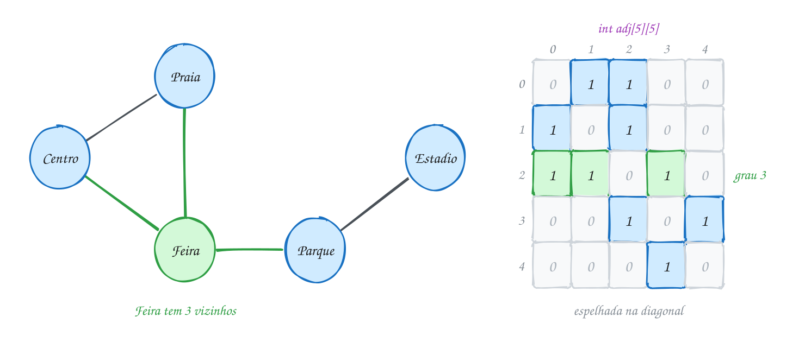
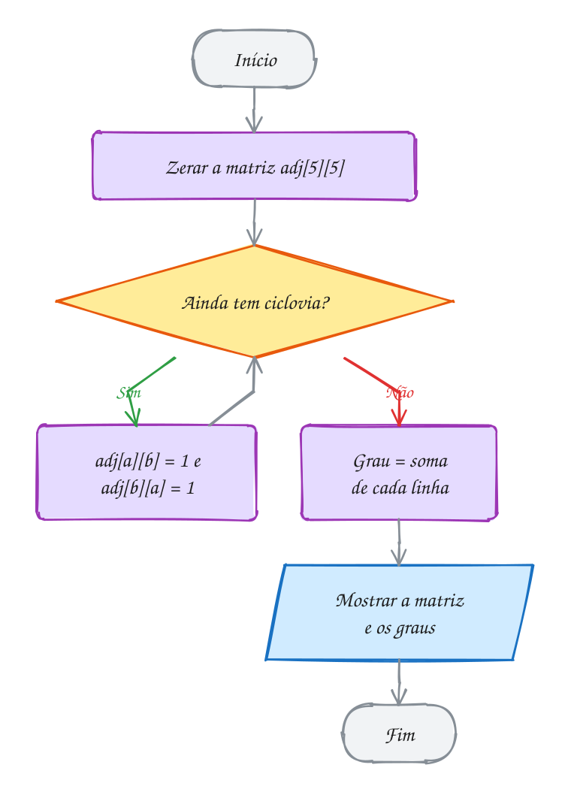
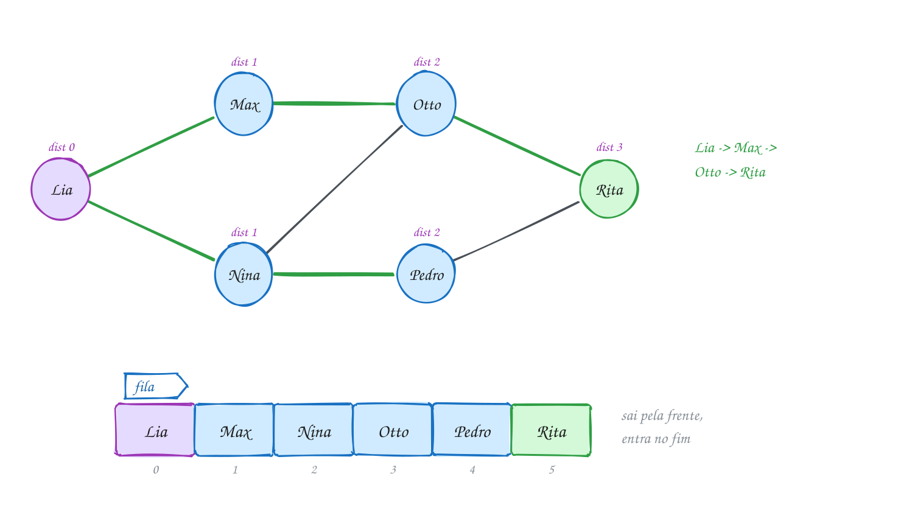
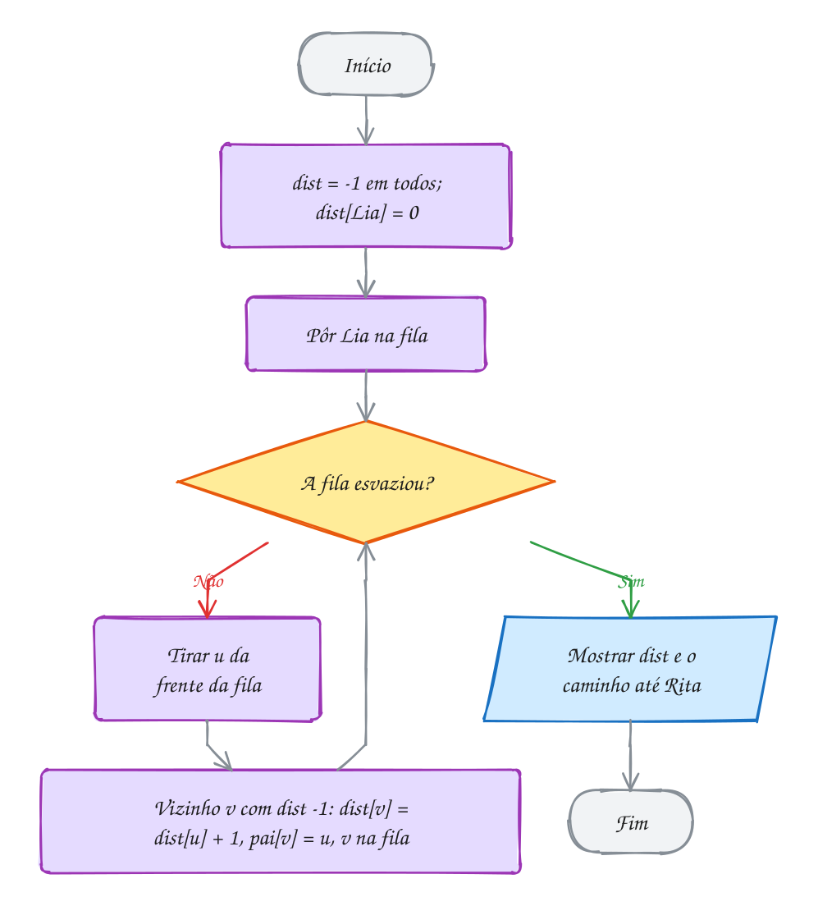
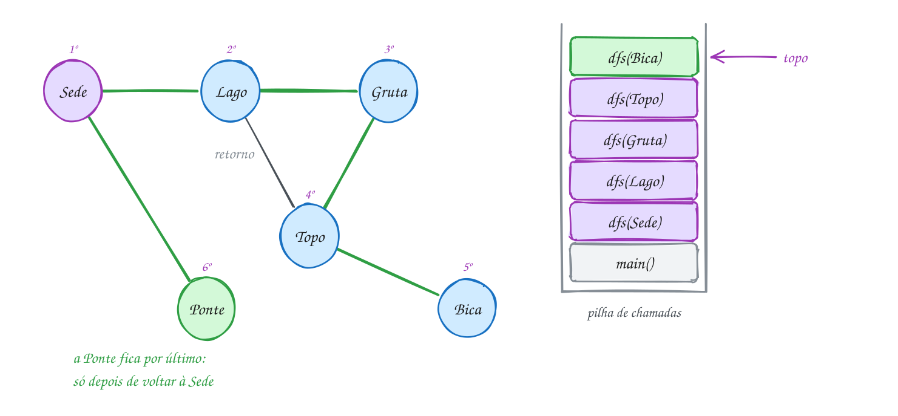
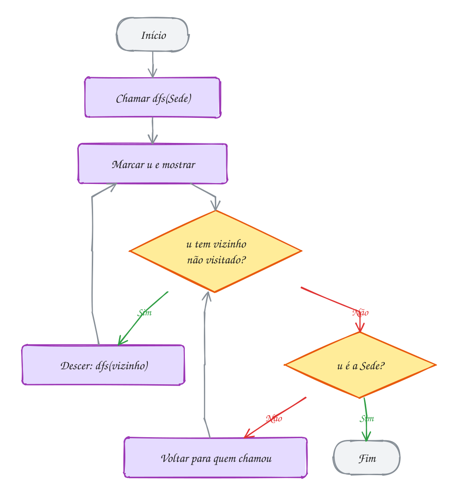
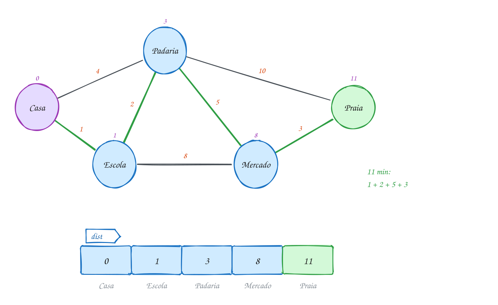
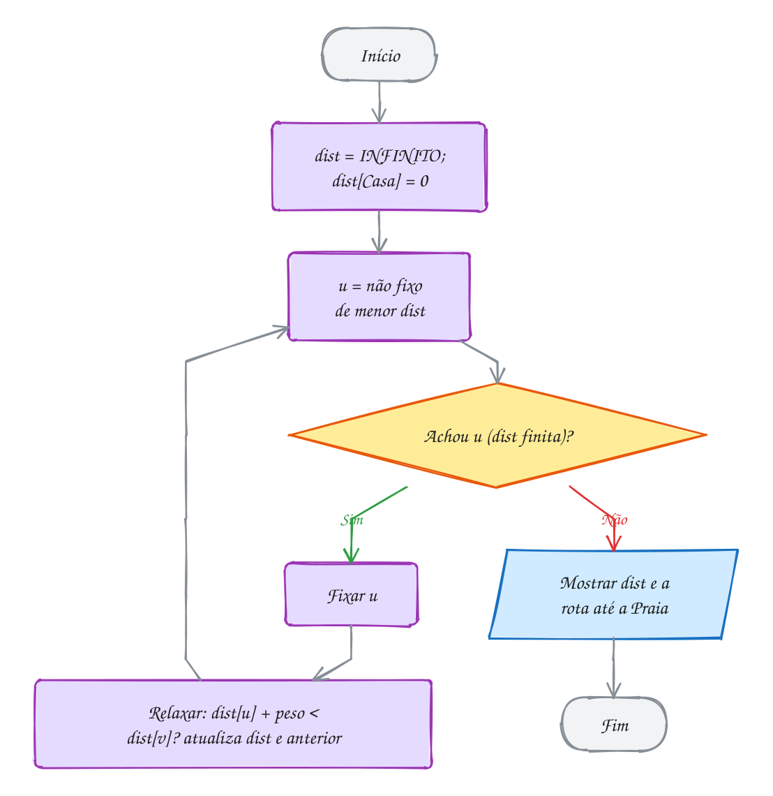
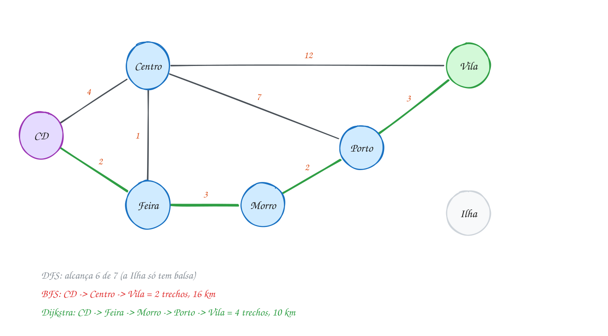
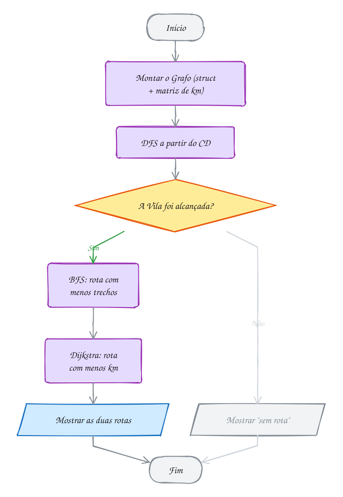

<!-- Gerado por _gerador. Para mudar este arquivo, edite _gerador/modulos/16-grafos/ e rode: cd _gerador && npm run gerar -->

# Módulo 16 · Grafos

Lista, pilha, fila, árvore, hash: até aqui toda estrutura tinha uma forma
bem comportada. Cada nó tinha um próximo, ou um pai, ou um balde. O mundo
real não é tão educado. Ruas se cruzam e fecham voltas, pessoas se seguem sem
reciprocidade, pacotes dependem uns dos outros. Para tudo isso existe o
**grafo**: pontos e ligações, sem regra de forma.

Grafo é a estrutura que mais aparece fora da sala de aula. O GPS que acha a
rota, a rede social que sugere amigos, o `npm` que descobre a ordem de
instalar dependências e reclama de import circular, o roteador que escolhe
por onde mandar o pacote: todos rodam alguma variação dos algoritmos deste
módulo.

A mudança na cabeça é parar de perguntar "qual é o próximo?" e começar a
perguntar "quem são os vizinhos, e em que ordem eu visito?". Quase tudo aqui
é a mesma ideia de **busca**, com uma estrutura auxiliar diferente: a pilha
da recursão (DFS), a fila (BFS) ou o "menor primeiro" (Dijkstra). Este módulo
fecha o curso juntando o que veio antes: matrizes, `malloc`, listas, filas,
pilhas, recursão, structs e heap.

## O que você vai aprender

- o vocabulário de **grafos**: vértice, aresta, grau, caminho, ciclo, grafo dirigido e ponderado
- as duas representações: **matriz de adjacência** e **lista de adjacência**, e quando usar cada uma
- a **busca em largura** (BFS) com fila, e o menor caminho em número de arestas
- a **busca em profundidade** (DFS) com recursão ou pilha: componentes, ciclos e ordenação topológica
- o algoritmo de **Dijkstra** para o caminho mínimo com pesos, e a armadilha do INFINITO que estoura
- escolher o algoritmo certo para cada pergunta, e um bônus: a **árvore geradora mínima** com Prim

## Como estudar cada assunto

1. Leia o texto e olhe o **diagrama da ideia**: é o exemplo desenhado, com o
   grafo e a ordem da visita marcada.
2. Leia o código. É o mesmo exemplo, com os mesmos vértices e pesos.
3. Siga o **fluxograma** com o dedo e faça o **teste de mesa** da fila, da
   pilha ou do vetor de distâncias. Em grafos, o teste de mesa é metade do
   aprendizado.
4. Rode os exemplos. Apague uma aresta, mude um peso, troque a origem, rode
   de novo e veja a ordem mudar.
5. Faça os exercícios. ★☆☆ é aquecimento, ★★☆ pede raciocínio, ★★★ é desafio.
   As dicas ficam escondidas: abra só se travar.

No meio de cada assunto tem uma **Pergunta para você**. Responda antes de rodar.

## As cores e as formas

Caixa azul é dado entrando ou saindo, roxa é o programa fazendo alguma coisa,
amarela é pergunta. Verde é o caminho que o exemplo segue; cinza, o que ele não
usa. Nos grafos, a origem da busca fica roxa, o destino verde, e as arestas
verdes são as que a busca usou (a árvore da busca ou a rota final).

<p align="center"></p>

## Antes de começar

Você vai usar sem cerimônia: matrizes (0044), structs e `typedef` (0064 e
0065), `malloc` e `free` (0059), lista encadeada (0081), pilha (0087), fila
(0090), recursão (0037) e, no último assunto, heap (0107). Se algum desses
estiver enferrujado, dê uma revisada antes.

Os vértices são sempre números de 0 a V-1, e o nome de cada um fica num
vetor de strings à parte. Nos exemplos, os vizinhos são examinados em ordem
crescente de índice. Isso decide empates e a ordem da visita: se você mudar a
numeração, a saída muda, e não está errada.

O assunto 0114 traz o TAD `grafo.h` + `grafo.c` com lista de adjacência; o
`rodar` compila o `grafo.c` junto com os arquivos daquela pasta. Nos outros
assuntos, cada arquivo traz tudo dentro dele, com matriz de adjacência, para
o algoritmo ficar inteiro na tela.

| # | Assunto | Pasta |
| --- | --- | --- |
| [0114](#0114--grafos) | Grafos | [`0114-grafos/`](0114-grafos/) |
| [0115](#0115--bfs-busca-em-largura) | BFS: busca em largura | [`0115-bfs/`](0115-bfs/) |
| [0116](#0116--dfs-busca-em-profundidade) | DFS: busca em profundidade | [`0116-dfs/`](0116-dfs/) |
| [0117](#0117--dijkstra-caminho-mínimo) | Dijkstra: caminho mínimo | [`0117-dijkstra/`](0117-dijkstra/) |
| [0118](#0118--juntando-tudo-a-central-de-entregas) | Juntando tudo: a central de entregas | [`0118-juntando-tudo/`](0118-juntando-tudo/) |

---

## 0114 · Grafos

A prefeitura inaugurou cinco ciclovias ligando Centro, Praia, Feira, Parque e
Estádio. Você quer um app que responda: de onde dá para ir direto para onde?
Qual ponto tem mais ligações? Dá para chegar no Estádio saindo da Praia?

Lista não serve: ela é uma fila indiana, cada item tem um próximo. Árvore
também não: cada nó tem um pai só e não existe volta. Aqui o Centro liga na
Praia **e** na Feira, e a Praia liga de volta na Feira, fechando um triângulo.
Para isso existe o **grafo**.

Um grafo é um conjunto de **vértices** (os pontos) e de **arestas** (as
ligações entre pares de pontos). Os vértices da ciclovia são os cinco lugares;
as arestas, as cinco ciclovias. Toda árvore é um grafo, mas um grafo pode ter
ciclos e partes soltas.

O vocabulário que você vai usar o módulo inteiro:

- **vizinhos** (ou adjacentes): dois vértices ligados por uma aresta;
- **grau**: quantas arestas tocam o vértice (a Feira tem grau 3);
- **caminho**: uma sequência de vértices vizinhos (Praia, Feira, Parque);
- **ciclo**: um caminho que volta ao começo (Centro, Praia, Feira, Centro);
- **conexo**: dá para ir de qualquer vértice a qualquer outro.

Se a ligação tem mão única, o grafo é **dirigido** e cada aresta vira uma seta
(seguir alguém no Instagram não obriga a pessoa a seguir de volta). Se a
aresta carrega um número, como minutos ou reais, o grafo é **ponderado**. As
ciclovias valem nos dois sentidos e ainda não têm peso.

No C, vértice é um **número de 0 a V-1**. O nome bonito fica num vetor à parte
(`nomes[2]` é `"Feira"`). Para guardar as arestas existem duas representações
clássicas:

- **matriz de adjacência**: `int adj[V][V]`, com `adj[i][j] = 1` quando existe
  aresta de `i` para `j`. Perguntar "i e j são vizinhos?" custa O(1). Listar os
  vizinhos de `i` custa O(V), porque você varre a linha inteira.
- **lista de adjacência**: um vetor de V listas encadeadas; a lista de `i`
  guarda só os vizinhos de `i`. Ocupa O(V + E) (E é o número de arestas) e
  listar os vizinhos custa só o grau.

No TypeScript você já usou lista de adjacência sem dar esse nome: um
`Map<string, string[]>` que diz, para cada usuário, quem ele segue. No C não
tem `Map` nem array que cresce: ou você aloca a matriz, ou monta as listas com
`malloc`.

Vamos ver na prática. Cada ciclovia liga um 1 em **duas** casas da matriz,
`adj[a][b]` e `adj[b][a]`, por isso a matriz de um grafo não dirigido é
espelhada na diagonal. A Feira tem três vizinhos, e a linha 2 tem três 1:

<p align="center"></p>

No código, as arestas entram como pares e o grau sai somando cada linha:

```c
#include <stdio.h>

#define V 5 // número de vértices (pontos da cidade)

int main(void) {
    const char *nomes[V] = {"Centro", "Praia", "Feira", "Parque", "Estadio"};
    int adj[V][V] = {0}; // adj[i][j] == 1: existe ciclovia entre i e j

    // as ciclovias, como pares de vértices
    int ciclovias[][2] = {{0, 1}, {0, 2}, {1, 2}, {2, 3}, {3, 4}};
    int total = (int)(sizeof ciclovias / sizeof ciclovias[0]);

    for (int k = 0; k < total; k++) {
        int a = ciclovias[k][0];
        int b = ciclovias[k][1];
        adj[a][b] = 1;
        adj[b][a] = 1; // não dirigido: vale nos dois sentidos
    }

    printf("     0 1 2 3 4\n");
    int soma_graus = 0;
    for (int i = 0; i < V; i++) {
        int grau = 0;
        printf("  %d ", i);
        for (int j = 0; j < V; j++) {
            printf(" %d", adj[i][j]);
            grau += adj[i][j]; // o grau é a soma da linha
        }
        printf("  %-8s grau %d\n", nomes[i], grau);
        soma_graus += grau;
    }
    printf("Soma dos graus: %d = 2 x %d ciclovias\n", soma_graus, total);
    return 0;
}
// Saída:
//      0 1 2 3 4
//   0  0 1 1 0 0  Centro   grau 2
//   1  1 0 1 0 0  Praia    grau 2
//   2  1 1 0 1 0  Feira    grau 3
//   3  0 0 1 0 1  Parque   grau 2
//   4  0 0 0 1 0  Estadio  grau 1
// Soma dos graus: 10 = 2 x 5 ciclovias
```

Repara no fluxograma: primeiro o programa monta a estrutura (uma volta por
aresta, marcando os dois sentidos) e só depois responde perguntas sobre ela.
Todo algoritmo de grafo deste módulo segue essa ordem:

<p align="center"></p>

A última linha não é coincidência. Cada aresta encosta em dois vértices e
soma 1 no grau de cada um, então a soma dos graus é sempre o dobro do número
de arestas. Isso serve de teste rápido: se a soma der ímpar, você esqueceu um
dos sentidos em algum lugar.

O exemplo A228 mostra a outra representação, a lista de adjacência, como um
TAD (`grafo.h` + `grafo.c`) e com arestas dirigidas: quem segue quem.

> [!WARNING]
> Em grafo não dirigido, a aresta entra **nos dois sentidos**: `adj[a][b] = 1`
> e `adj[b][a] = 1`. Esquecer um deles cria um grafo dirigido sem querer: o
> Centro "vai" para a Praia, mas a Praia não volta. O compilador não reclama, e
> o erro só aparece mais tarde, quando a busca não acha um caminho que existe.

> [!TIP]
> **Por dentro do C:** `int adj[5][5]` são 25 `int` seguidos na memória, linha
> após linha: 100 bytes. Com 100 mil vértices seriam 10¹⁰ casas, 40 GB, quase
> todas com zero, porque um mapa de ruas real tem poucos vizinhos por esquina.
> Na lista de adjacência cada aresta vira um nó `{ int destino; No *prox; }`
> de 16 bytes (4 do `int`, 4 de alinhamento e 8 do ponteiro): com 300 mil
> arestas, uns 5 MB. Regra prática: grafo pequeno ou denso, matriz; grafo
> grande e esparso, lista.

> [!NOTE]
> **Pergunta para você:** se a prefeitura abrir uma ciclovia entre Praia e
> Estádio, quais números da saída mudam? Preveja a nova matriz e a soma dos
> graus antes de mudar o A227.

### Hora de praticar

Os arquivos ficam em [`0114-grafos/`](0114-grafos/). Os comandos funcionam de qualquer pasta do terminal. Nos exemplos, rode, mude, quebre e rode de novo. Nos exercícios, a resposta vai dentro do próprio arquivo. ★☆☆ é aquecimento, ★★☆ pede raciocínio e ★★★ é desafio.

**Exemplo A227 · A ciclovia na matriz**

```c
#include <stdio.h>

#define V 5 // número de vértices (pontos da cidade)

int main(void) {
    const char *nomes[V] = {"Centro", "Praia", "Feira", "Parque", "Estadio"};
    int adj[V][V] = {0}; // adj[i][j] == 1: existe ciclovia entre i e j

    // as ciclovias, como pares de vértices
    int ciclovias[][2] = {{0, 1}, {0, 2}, {1, 2}, {2, 3}, {3, 4}};
    int total = (int)(sizeof ciclovias / sizeof ciclovias[0]);

    for (int k = 0; k < total; k++) {
        int a = ciclovias[k][0];
        int b = ciclovias[k][1];
        adj[a][b] = 1;
        adj[b][a] = 1; // não dirigido: vale nos dois sentidos
    }

    printf("     0 1 2 3 4\n");
    int soma_graus = 0;
    for (int i = 0; i < V; i++) {
        int grau = 0;
        printf("  %d ", i);
        for (int j = 0; j < V; j++) {
            printf(" %d", adj[i][j]);
            grau += adj[i][j]; // o grau é a soma da linha
        }
        printf("  %-8s grau %d\n", nomes[i], grau);
        soma_graus += grau;
    }
    printf("Soma dos graus: %d = 2 x %d ciclovias\n", soma_graus, total);
    return 0;
}
// Saída:
//      0 1 2 3 4
//   0  0 1 1 0 0  Centro   grau 2
//   1  1 0 1 0 0  Praia    grau 2
//   2  1 1 0 1 0  Feira    grau 3
//   3  0 0 1 0 1  Parque   grau 2
//   4  0 0 0 1 0  Estadio  grau 1
// Soma dos graus: 10 = 2 x 5 ciclovias
```

```bash
~/LPEDC/rodar 16-grafos/0114-grafos/A227.c
```

**Exemplo A228 · Quem segue quem: lista de adjacência**

```c
#include <stdio.h>

#include "grafo.h"

int main(void) {
    const char *nomes[] = {"Ana", "Bia", "Caio", "Duda"};
    Grafo *g = grafo_criar(4);
    if (g == NULL) return 1;

    // aresta dirigida: seguir não é recíproco
    grafo_ligar(g, 0, 1); // Ana segue Bia
    grafo_ligar(g, 0, 2); // Ana segue Caio
    grafo_ligar(g, 1, 2); // Bia segue Caio
    grafo_ligar(g, 2, 0); // Caio segue Ana
    grafo_ligar(g, 3, 2); // Duda segue Caio

    grafo_mostrar(g, nomes);
    printf("\n");
    for (int v = 0; v < 4; v++)
        printf("%-5s segue %d, tem %d seguidor(es)\n", nomes[v],
               grafo_grau_saida(g, v), grafo_grau_entrada(g, v));

    grafo_liberar(g);
    return 0;
}
// Saída:
// Ana   -> Caio Bia
// Bia   -> Caio
// Caio  -> Ana
// Duda  -> Caio
//
// Ana   segue 2, tem 1 seguidor(es)
// Bia   segue 1, tem 1 seguidor(es)
// Caio  segue 1, tem 3 seguidor(es)
// Duda  segue 1, tem 0 seguidor(es)
```

```bash
~/LPEDC/rodar 16-grafos/0114-grafos/A228.c
```

#### Exercícios

**Exercício E679** · ★☆☆

Uma companhia aérea regional tem voos diretos, de ida e volta, entre
quatro capitais: Recife (0), Salvador (1), Fortaleza (2) e Natal (3). Os
voos são: Recife-Salvador, Recife-Fortaleza, Recife-Natal e
Fortaleza-Natal.

Monte a matriz de adjacência (grafo não dirigido), mostre a matriz e conte
quantos voos existem olhando só para a matriz (não vale contar os pares à
mão):


```text
Saída esperada:
     0 1 2 3
  0  0 1 1 1
  1  1 0 0 0
  2  1 0 0 1
  3  1 0 1 0
Voos diretos: 4
```

<details>
<summary>Dicas</summary>

1. int adj[4][4] = {0}; e, para cada voo, marque adj[a][b] e adj[b][a].
2. Cada voo aparece duas vezes na matriz. Some só a parte de cima da
   diagonal (j > i) ou some tudo e divida por 2.
3. Resposta esperada: a matriz acima e "Voos diretos: 4".

</details>

```bash
~/LPEDC/rodar 16-grafos/0114-grafos/E679.c
```

**Exercício E680** · ★☆☆

Depois do churrasco, a turma anotou quem ficou devendo Pix para quem num
grafo DIRIGIDO: deve[i][j] == 1 quer dizer que i deve para j. Sem rodar,
preveja o que o programa abaixo mostra. Só depois rode e confira.

<details>
<summary>Dicas</summary>

1. Somar a LINHA i conta as setas que saem de i: para quantos i deve.
2. Somar a COLUNA i conta as setas que chegam em i: de quantos i recebe.
3. Resposta esperada:
   Leo deve para 2 e recebe de 1
   Mia deve para 1 e recebe de 2
   Rui deve para 0 e recebe de 3
   Sol deve para 3 e recebe de 0
   Sem dívidas: Rui

</details>

```bash
~/LPEDC/rodar 16-grafos/0114-grafos/E680.c
```

**Exercício E681** · ★★☆

O bairro tem quatro esquinas, A (0), B (1), C (2) e D (3). A prefeitura
mandou a lista de ruas como um vetor de struct, uma entrada por SENTIDO
permitido: {0, 1} quer dizer que dá para ir de A para B. Uma rua de mão
dupla aparece duas vezes ({0, 1} e {1, 0}).

O esqueleto já traz os dados. Complete o programa: monte a matriz de
adjacência DIRIGIDA a partir do vetor e, para cada par de esquinas ligadas,
diga se a rua é de mão dupla ou de mão única (e em que sentido). No fim,
mostre quantas há de cada tipo.


```text
Saída esperada:
Sentidos cadastrados: 7
A-B: mão dupla
A-C: mão dupla
A-D: mão única (D -> A)
B-C: mão única (B -> C)
C-D: mão única (C -> D)
Mão única: 3, mão dupla: 2
```

<details>
<summary>Dicas</summary>

1. Para cada struct do vetor, adj[r.de][r.para] = 1 (só nesse sentido).
2. Olhe cada par uma vez só: i de 0 a 3 e j de i + 1 a 3. Se
   adj[i][j] e adj[j][i] valem 1, é mão dupla; se só um vale 1, mão única.
3. A letra da esquina i é 'A' + i (char é número, assunto 0045).
4. Resposta esperada: a saída acima.

</details>

```bash
~/LPEDC/rodar 16-grafos/0114-grafos/E681.c
```

**Exercício E682** · ★★☆

Este programa tem DOIS erros de propósito. Ele monta o grafo NÃO dirigido
do grupo de estudos (quem estuda com quem) e mostra o grau de cada pessoa.
Rode com o rodar: o sanitizer acusa um dos erros. O outro é silencioso e só
aparece nos números. Ache os dois e conserte.


```text
Saída esperada depois do conserto:
Ana estuda com 2 pessoa(s)
Beto estuda com 3 pessoa(s)
Cris estuda com 2 pessoa(s)
Davi estuda com 1 pessoa(s)
Soma dos graus: 8
```

<details>
<summary>Dicas</summary>

1. Leia a mensagem do sanitizer: ela diz o índice e o tamanho do vetor.
2. Com 4 duplas de estudo, a soma dos graus deveria ser 2 x 4 = 8. Um
   resultado ímpar é sinal de aresta guardada num sentido só.
3. Resposta esperada: o laço interno usa j <= V (lê adj[i][4], fora da
   linha; o certo é j < V) e a aresta só é marcada em adj[a][b] (falta
   adj[b][a] = 1). Consertado, mostra a saída acima.

</details>

```bash
~/LPEDC/rodar 16-grafos/0114-grafos/E682.c
```

**Exercício E683** · ★★★

Pegue a matriz das ciclovias do exemplo A227 (já está no esqueleto) e
converta para LISTA de adjacência alocada com malloc: um vetor de 5
ponteiros, cada um apontando para a lista encadeada dos vizinhos daquele
ponto. Regras:

- os vizinhos de cada lista aparecem em ordem crescente de índice;
- cada nó custa O(1) para inserir (nada de percorrer a lista até o fim);
- conte quantos nós foram alocados;
- libere tudo no final (o rodar não pode acusar vazamento).


```text
Saída esperada:
Centro  -> Praia Feira
Praia   -> Centro Feira
Feira   -> Centro Praia Parque
Parque  -> Feira Estadio
Estadio -> Parque
Nós alocados: 10
```

<details>
<summary>Dicas</summary>

1. typedef struct No { int destino; struct No *prox; } No; e
   No *lista[V] = {NULL};
2. Inserir no início é O(1), mas inverte a ordem. Truque: percorra as
   colunas de trás para frente (j de V-1 até 0); a última inserida, a menor,
   fica na frente.
3. Para liberar, guarde p->prox numa variável antes do free(p).
4. Resposta esperada: a saída acima; 10 nós porque são 5 arestas, cada uma
   guardada nos dois sentidos.

</details>

```bash
~/LPEDC/rodar 16-grafos/0114-grafos/E683.c
```

**Exercício E684** · ★★★

Você está montando a "sugestão de amizade" de uma rede social. A amizade é
recíproca (grafo não dirigido) e as pessoas são Ana (0), Bia (1), Caio (2),
Duda (3), Edu (4) e Fabi (5). As amizades:


```text
Ana-Bia, Ana-Caio, Bia-Caio, Bia-Duda, Caio-Duda, Caio-Edu, Duda-Fabi,
Edu-Fabi
```


Para cada par que AINDA NÃO é amigo, conte os amigos em comum. Mostre os
pares com 2 ou mais amigos em comum, cada par uma vez só:


```text
Saída esperada:
Ana e Duda: 2 amigos em comum
Caio e Fabi: 2 amigos em comum
Duda e Edu: 2 amigos em comum
```

<details>
<summary>Dicas</summary>

1. Amigo em comum de i e j é um k com adj[i][k] e adj[k][j] valendo 1.
   Isso é um caminho de comprimento 2 entre i e j.
2. Três laços: i, j > i (pares sem repetir) e k. Pule os pares que já são
   amigos (adj[i][j] == 1).
3. Curiosidade: a contagem é exatamente a casa [i][j] do produto da matriz
   por ela mesma (adj x adj).
4. Resposta esperada: a saída acima.

</details>

```bash
~/LPEDC/rodar 16-grafos/0114-grafos/E684.c
```

---

## 0115 · BFS: busca em largura

Você quer uma indicação para a vaga que a Rita, recrutadora, está anunciando
no LinkedIn. Você não conhece a Rita. Conhece o Max e a Nina; eles conhecem
outras pessoas, que conhecem outras. Qual é a corrente mais curta de
apresentações até ela?

Quem já reparou no "conexão de 2º grau" do LinkedIn viu essa ideia (nada a
ver com o grau do vértice do assunto anterior: ali é a **distância**). A rede é
um grafo não dirigido: pessoas são vértices, conexões são arestas. A pergunta é
o **menor caminho em número de arestas** de Lia (você) até Rita.

A **busca em largura** (BFS, de *breadth-first search*) responde isso
explorando o grafo em ondas, como uma pedra jogada no lago:

- onda 0: a origem, Lia;
- onda 1: todo mundo a uma aresta de Lia (Max e Nina);
- onda 2: os vizinhos deles que ninguém viu ainda (Otto e Pedro);
- onda 3: Rita.

Para visitar na ordem das ondas, a BFS usa uma **fila** (assunto 0090): quem
foi descoberto primeiro é processado primeiro. O laço é sempre o mesmo: tira
`u` da frente da fila e, para cada vizinho `v` ainda não descoberto, anota
`dist[v] = dist[u] + 1`, guarda `pai[v] = u` e põe `v` no fim da fila.

O vetor `dist[]` faz dois papéis. Guarda a distância e, com `-1`, diz "ainda
não descoberto". É ele que impede a busca de andar em círculos: num grafo, ao
contrário da árvore, dá para chegar no mesmo vértice por caminhos diferentes
(Otto é vizinho de Max **e** de Nina).

O vetor `pai[]` guarda quem descobriu cada vértice. Os pares (pai, filho)
formam a **árvore da BFS**, e seguir `pai[]` a partir de Rita até chegar em
`-1` dá o caminho mais curto, de trás para frente.

Vamos ver na prática. As setas verdes são as arestas da árvore da BFS (cada
uma liga um vértice a quem o descobriu); o número em cima de cada pessoa é a
distância; embaixo, a fila na ordem em que cada um entrou:

<p align="center"></p>

O código monta a matriz, roda a BFS a partir de Lia e reconstrói o caminho:

```c
#include <stdio.h>

#define V 6

int main(void) {
    const char *nomes[V] = {"Lia", "Max", "Nina", "Otto", "Pedro", "Rita"};
    int adj[V][V] = {0};
    int conexoes[][2] = {{0, 1}, {0, 2}, {1, 3}, {2, 3}, {2, 4}, {3, 5}, {4, 5}};
    for (int k = 0; k < 7; k++) {
        adj[conexoes[k][0]][conexoes[k][1]] = 1;
        adj[conexoes[k][1]][conexoes[k][0]] = 1;
    }

    int dist[V], pai[V];
    for (int v = 0; v < V; v++) {
        dist[v] = -1; // -1: ainda não descoberto
        pai[v] = -1;
    }

    int fila[V]; // cada vértice entra uma vez só: V posições bastam
    int inicio = 0, fim = 0;
    int origem = 0; // Lia
    dist[origem] = 0;
    fila[fim++] = origem;

    printf("Ordem da visita:\n");
    while (inicio < fim) {
        int u = fila[inicio++]; // tira da frente
        printf("  %-5s distância %d\n", nomes[u], dist[u]);
        for (int v = 0; v < V; v++) {
            if (adj[u][v] && dist[v] == -1) {
                dist[v] = dist[u] + 1; // marca ao ENTRAR na fila
                pai[v] = u;
                fila[fim++] = v;
            }
        }
    }

    // o caminho sai de trás para frente, seguindo pai[]
    int destino = 5; // Rita
    int caminho[V], n = 0;
    for (int v = destino; v != -1; v = pai[v]) caminho[n++] = v;
    printf("Caminho até %s:", nomes[destino]);
    for (int i = n - 1; i >= 0; i--) printf(" %s%s", nomes[caminho[i]], i > 0 ? " ->" : "");
    printf(" (distância %d)\n", dist[destino]);
    return 0;
}
// Saída:
// Ordem da visita:
//   Lia   distância 0
//   Max   distância 1
//   Nina  distância 1
//   Otto  distância 2
//   Pedro distância 2
//   Rita  distância 3
// Caminho até Rita: Lia -> Max -> Otto -> Rita (distância 3)
```

Repara no fluxograma: a pergunta "a fila esvaziou?" controla tudo. Cada volta
tira um vértice e pode colocar vários; quando ninguém novo aparece, a fila
seca e a busca termina:

<p align="center"></p>

### Passo a passo

Cada linha é uma volta do `while`. Otto já foi descoberto por Max, então
quando Nina olha para ele, nada acontece:

| Tira | Vizinhos novos | dist anotada | Fila depois |
| --- | --- | --- | --- |
| (início) | | Lia = 0 | Lia |
| Lia | Max, Nina | 1, 1 | Max, Nina |
| Max | Otto | 2 | Nina, Otto |
| Nina | Pedro (Otto já tem dist) | 2 | Otto, Pedro |
| Otto | Rita | 3 | Pedro, Rita |
| Pedro | nenhum (Rita já tem dist) | | Rita |
| Rita | nenhum | | (vazia) |

A distância só cresce na fila: primeiro saem todos os de distância 1, depois
todos os de 2. Por isso o primeiro caminho que alcança Rita é o mais curto.
Isso vale porque toda aresta "custa" 1. Com pesos diferentes (minutos, reais)
a BFS erra, e é aí que entra Dijkstra (assunto 0117).

O exemplo A230 usa a mesma BFS numa grade: cada casa de um galpão é um
vértice e os vizinhos são as casas de cima, de baixo, da esquerda e da direita.
Ninguém monta matriz de adjacência; os vizinhos saem de uma conta.

> [!WARNING]
> Marque o vértice como descoberto **ao colocar na fila**, não ao tirar. Se
> você só marca ao tirar, Otto entra duas vezes (uma por Max, outra por Nina) e,
> num grafo maior, o mesmo vértice entra muitas vezes. A fila de V posições
> estoura, e o vértice aparece repetido na ordem de visita.

> [!TIP]
> **Por dentro do C:** a fila da BFS é só `int fila[V]` com dois índices,
> `inicio` e `fim`. Como cada vértice entra uma vez só, `fim` nunca passa de V e
> não precisa nem da fila circular. Compare com o JS: `fila.shift()` num array
> anda com todos os elementos uma casa para trás, O(n) a cada saída; aqui,
> `fila[inicio++]` é O(1). O custo total da BFS é O(V²) com matriz (para cada
> vértice, varre a linha inteira) e O(V + E) com lista de adjacência. Os três
> vetores (`dist`, `pai`, `fila`) somam 3 × 6 × 4 = 72 bytes na pilha.

> [!NOTE]
> **Pergunta para você:** se a conexão entre Max e Otto sumir, qual passa a ser
> o caminho até Rita, e quem descobre Otto? Preveja a nova tabela antes de
> apagar o par `{1, 3}` no A229.

### Hora de praticar

Os arquivos ficam em [`0115-bfs/`](0115-bfs/). Os comandos funcionam de qualquer pasta do terminal. Nos exemplos, rode, mude, quebre e rode de novo. Nos exercícios, a resposta vai dentro do próprio arquivo. ★☆☆ é aquecimento, ★★☆ pede raciocínio e ★★★ é desafio.

**Exemplo A229 · A recrutadora a três conexões**

```c
#include <stdio.h>

#define V 6

int main(void) {
    const char *nomes[V] = {"Lia", "Max", "Nina", "Otto", "Pedro", "Rita"};
    int adj[V][V] = {0};
    int conexoes[][2] = {{0, 1}, {0, 2}, {1, 3}, {2, 3}, {2, 4}, {3, 5}, {4, 5}};
    for (int k = 0; k < 7; k++) {
        adj[conexoes[k][0]][conexoes[k][1]] = 1;
        adj[conexoes[k][1]][conexoes[k][0]] = 1;
    }

    int dist[V], pai[V];
    for (int v = 0; v < V; v++) {
        dist[v] = -1; // -1: ainda não descoberto
        pai[v] = -1;
    }

    int fila[V]; // cada vértice entra uma vez só: V posições bastam
    int inicio = 0, fim = 0;
    int origem = 0; // Lia
    dist[origem] = 0;
    fila[fim++] = origem;

    printf("Ordem da visita:\n");
    while (inicio < fim) {
        int u = fila[inicio++]; // tira da frente
        printf("  %-5s distância %d\n", nomes[u], dist[u]);
        for (int v = 0; v < V; v++) {
            if (adj[u][v] && dist[v] == -1) {
                dist[v] = dist[u] + 1; // marca ao ENTRAR na fila
                pai[v] = u;
                fila[fim++] = v;
            }
        }
    }

    // o caminho sai de trás para frente, seguindo pai[]
    int destino = 5; // Rita
    int caminho[V], n = 0;
    for (int v = destino; v != -1; v = pai[v]) caminho[n++] = v;
    printf("Caminho até %s:", nomes[destino]);
    for (int i = n - 1; i >= 0; i--) printf(" %s%s", nomes[caminho[i]], i > 0 ? " ->" : "");
    printf(" (distância %d)\n", dist[destino]);
    return 0;
}
// Saída:
// Ordem da visita:
//   Lia   distância 0
//   Max   distância 1
//   Nina  distância 1
//   Otto  distância 2
//   Pedro distância 2
//   Rita  distância 3
// Caminho até Rita: Lia -> Max -> Otto -> Rita (distância 3)
```

```bash
~/LPEDC/rodar 16-grafos/0115-bfs/A229.c
```

**Exemplo A230 · O robô no galpão: BFS numa grade**

```c
#include <stdio.h>

#define L 5
#define C 7

int main(void) {
    // # é prateleira; o robô sai de S e vai até E (a expedição)
    char mapa[L][C + 1] = {
        "S..#...",
        ".#.#.#.",
        ".#...#.",
        ".###.#.",
        ".....#E",
    };
    // cada casa é um vértice; os vizinhos são cima, baixo, esquerda e direita
    int dl[4] = {-1, 1, 0, 0};
    int dc[4] = {0, 0, -1, 1};

    int dist[L][C], pai[L * C];
    for (int l = 0; l < L; l++)
        for (int c = 0; c < C; c++) dist[l][c] = -1;

    int fila[L * C]; // a casa (l, c) entra na fila como o número l * C + c
    int inicio = 0, fim = 0;
    dist[0][0] = 0;
    pai[0] = -1;
    fila[fim++] = 0;

    while (inicio < fim) {
        int u = fila[inicio++];
        int l = u / C, c = u % C;
        for (int k = 0; k < 4; k++) {
            int nl = l + dl[k], nc = c + dc[k];
            if (nl < 0 || nl >= L || nc < 0 || nc >= C) continue; // fora do galpão
            if (mapa[nl][nc] == '#' || dist[nl][nc] != -1) continue;
            dist[nl][nc] = dist[l][c] + 1;
            pai[nl * C + nc] = u;
            fila[fim++] = nl * C + nc;
        }
    }

    printf("Passos até a expedição: %d\n", dist[L - 1][C - 1]);
    // marca o caminho com * voltando pelos pais (sem apagar S e E)
    for (int u = pai[(L - 1) * C + (C - 1)]; u > 0; u = pai[u]) mapa[u / C][u % C] = '*';
    for (int l = 0; l < L; l++) printf("%s\n", mapa[l]);
    return 0;
}
// Saída:
// Passos até a expedição: 14
// S**#***
// .#*#*#*
// .#***#*
// .###.#*
// .....#E
```

```bash
~/LPEDC/rodar 16-grafos/0115-bfs/A230.c
```

#### Exercícios

**Exercício E685** · ★☆☆

O mapa abaixo liga seis bairros por linhas de ônibus diretas (grafo não
dirigido). O programa roda uma BFS a partir da Penha. Sem rodar, preveja a
ordem em que os bairros são visitados e a distância de cada um. Faça a
tabela da fila no papel. Depois rode e confira.

<details>
<summary>Dicas</summary>

1. Os vizinhos são examinados em ordem de índice (v de 0 a 5).
2. A Penha (3) é vizinha de Lapa (1), Moema (2) e Tatuape (5): os três
   entram na fila nessa ordem, todos com distância 1.
3. Resposta esperada:
   Penha(0) Lapa(1) Moema(1) Tatuape(1) Centro(2) Saude(2)

</details>

```bash
~/LPEDC/rodar 16-grafos/0115-bfs/E685.c
```

**Exercício E686** · ★☆☆

A Vó mandou um áudio no grupo da família, e cada pessoa só encaminha para
quem tem contato direto (grafo não dirigido). Em que "rodada" o áudio chega
em cada um? Rodada 0 é a própria Vó, rodada 1 são os contatos dela, e assim
por diante: é a distância da BFS.

O programa está quase pronto. Falta o miolo da BFS, no lugar marcado com
"COMPLETE AQUI": anotar a rodada do vizinho e colocá-lo na fila. Hoje ele
compila, mas só mostra a Vó.


```text
Saída esperada:
Vó: rodada 0
Tia: rodada 1
Pai: rodada 1
Primo: rodada 2
Mãe: rodada 2
Eu: rodada 3
Rodadas até todos ouvirem: 3
```

<details>
<summary>Dicas</summary>

1. São duas linhas: rodada[v] = rodada[u] + 1; e fila[fim++] = v;
2. Por que dá para marcar a rodada já aqui, antes de o vizinho sair da
   fila? Porque é isso que impede que ele entre duas vezes.
3. Resposta esperada: a saída acima.

</details>

```bash
~/LPEDC/rodar 16-grafos/0115-bfs/E686.c
```

**Exercício E687** · ★★☆

Mesmo mapa de ônibus do E685 (já está no esqueleto). Você mora na Lapa e
precisa ir à Saude pegando o menor número de ônibus. Rode uma BFS a partir
da Lapa guardando pai[] e escreva uma função RECURSIVA que imprime o
caminho na ordem certa, da origem ao destino:


```text
void imprimir_caminho(const int pai[], int v);
```


```text
Saída esperada:
Lapa -> Centro -> Moema -> Saude
Ônibus: 3
```


Existe outro caminho com 3 ônibus (Lapa, Penha, Tatuape, Saude). Explique,
num comentário, por que a sua BFS escolheu o que passa pelo Centro.

<details>
<summary>Dicas</summary>

1. pai[origem] = -1. Na função: se pai[v] != -1, imprima primeiro o
   caminho até pai[v] (chamada recursiva) e depois " -> " e o nome de v.
2. A recursão desfaz a inversão: o pai é impresso antes do filho, igual a
   uma pilha (assunto 0089).
3. Resposta esperada: a saída acima. O Centro (índice 0) é examinado antes
   da Penha (3) como vizinho da Lapa; por isso Moema é descoberta pelo
   Centro, e a Saude por Moema, antes que o ramo da Penha chegue lá.

</details>

```bash
~/LPEDC/rodar 16-grafos/0115-bfs/E687.c
```

**Exercício E688** · ★★☆

Depois do temporal, a companhia de energia sabe quais cabos entre os oito
bairros (A a H) continuam inteiros. Bairros ligados, direta ou
indiretamente, formam um grupo que pode ser religado de uma vez. Os cabos
inteiros são:


```text
A-B, B-C, D-E, F-G, G-H, F-H
```


Escreva um programa que descobre os grupos (as COMPONENTES CONEXAS do
grafo) usando BFS e mostra cada um:


```text
Saída esperada:
Grupo 1: A B C
Grupo 2: D E
Grupo 3: F G H
Total de grupos: 3
```

<details>
<summary>Dicas</summary>

1. Uma BFS a partir de A visita só o grupo de A. Quem sobrar sem visita
   está em outro grupo.
2. Laço externo: para cada bairro v ainda não visitado, comece uma BFS
   nova a partir de v e some 1 nos grupos.
3. Um vetor visitado[] só, compartilhado por todas as BFS.
4. Resposta esperada: a saída acima.

</details>

```bash
~/LPEDC/rodar 16-grafos/0115-bfs/E688.c
```

**Exercício E689** · ★★★

A prefeitura quer saber, para cada quarteirão do bairro, a quantos
quarteirões de distância fica o posto de saúde MAIS PRÓXIMO. No mapa, P é
posto, # é área sem passagem (rio, linha de trem) e . é quarteirão. Anda-se
só para cima, baixo, esquerda e direita.


```text
P...#...
.##.#.#.
....#.#P
.#......
...#..#.
```


Mostre o mapa com a distância de cada quarteirão (0 nos postos, # onde não
passa):


```text
Saída esperada:
0123#432
1##4#5#1
2345#4#0
3#554321
456#54#2
Pior distância: 6
```

<details>
<summary>Dicas</summary>

1. Rodar uma BFS por posto e tirar o mínimo funciona, mas dá para fazer
   uma BFS só: coloque TODOS os postos na fila no começo, com distância 0.
2. A fila mistura as ondas dos dois postos, e cada casa é descoberta
   primeiro pelo posto mais perto. É a BFS de várias origens.
3. A distância cabe num dígito aqui: imprima com '0' + dist.
4. Resposta esperada: a saída acima. A pior casa é a da linha 4, coluna 2
   (contando do 0): 6 quarteirões até o posto da esquerda.

</details>

```bash
~/LPEDC/rodar 16-grafos/0115-bfs/E689.c
```

**Exercício E690** · ★★★

Este programa tem um erro de propósito. Ele deveria mostrar a ordem em que
uma corrente de WhatsApp chega em cada pessoa, a partir da Ana. Rode com o
rodar: o AddressSanitizer acusa um estouro do vetor fila. Responda num
comentário: por que a fila de V posições, que deveria bastar, estourou?
Quem entrou nela duas vezes? Depois conserte mexendo no MOMENTO em que o
vértice é marcado.


```text
Saída esperada depois do conserto:
Ana Bia Cadu Dani
```

<details>
<summary>Dicas</summary>

1. Simule a fila no papel. Quando Bia sai, Dani entra. Quando Cadu sai,
   Dani já foi marcada?
2. A marcação só acontece quando o vértice SAI da fila. Entre entrar e
   sair, ele pode ser colocado de novo por outro vizinho.
3. Resposta esperada: Dani entra duas vezes (por Bia e por Cadu), então a
   fila precisaria de 5 posições e tem 4. O conserto é marcar visitado[v]
   no momento em que v entra na fila (e marcar a origem antes do laço).
   Assim cada pessoa entra uma vez só e a saída é "Ana Bia Cadu Dani".

</details>

```bash
~/LPEDC/rodar 16-grafos/0115-bfs/E690.c
```

---

## 0116 · DFS: busca em profundidade

Sábado no parque estadual. Da Sede saem duas trilhas, uma para o Lago e outra
para a Ponte. Você escolhe o Lago e vai em frente: Gruta, Topo, Bica. Na Bica
a trilha acaba. Você volta pelo mesmo caminho até achar uma bifurcação com
trilha nova. Só no fim, já de volta à Sede, você pega a trilha da Ponte.

Esse jeito de explorar é a **busca em profundidade** (DFS, de *depth-first
search*): seguir um caminho o mais fundo possível e, quando não há mais nada
novo, **voltar** até a última escolha que ficou pendente. A volta tem nome:
**backtracking**. É o fio de Ariadne no labirinto do Minotauro.

A BFS do assunto anterior explora em ondas, usando uma fila. A DFS explora em
mergulhos, usando uma **pilha**. E você já tem uma pilha de graça: a pilha de
chamadas (assunto 0036). Por isso a DFS cabe numa função recursiva de quatro
linhas: marca o vértice, e para cada vizinho não visitado, chama a si mesma.

Quando a chamada de `dfs(Bica)` termina, o C volta sozinho para `dfs(Topo)`,
que continua o laço de onde parou. Esse "continua de onde parou" é o
backtracking, e quem guarda o ponto de parada é o frame de cada chamada.

O vetor `visitado[]` continua obrigatório. Lago, Gruta e Topo formam um
**ciclo**; sem a marca, `dfs(Topo)` chamaria `dfs(Lago)` de novo, que chamaria
`dfs(Gruta)`, e a recursão nunca acabaria.

As arestas por onde a DFS desce formam a **árvore da DFS**. As outras, que
levam a um vértice que já está na pilha (como Topo–Lago), são **arestas de
retorno**. Num grafo não dirigido, achar uma aresta de retorno é achar um
ciclo. Isso, junto com contar componentes, resolver labirintos e ordenar
tarefas com pré-requisitos, é o que faz a DFS valer o assunto.

Vamos ver na prática. Os números mostram a ordem da visita; as arestas verdes
são as da árvore. À direita, a pilha de chamadas no momento mais fundo, quando
a Bica é visitada:

<p align="center"></p>

O código imprime cada vértice com um recuo proporcional à profundidade da
chamada. Dá para ver a árvore na saída:

```c
#include <stdbool.h>
#include <stdio.h>

#define V 6

const char *nomes[V] = {"Sede", "Lago", "Gruta", "Ponte", "Topo", "Bica"};
int adj[V][V];
bool visitado[V];

void dfs(int u, int nivel) {
    visitado[u] = true;
    printf("%*s%s\n", 2 * nivel, "", nomes[u]); // recuo = profundidade
    for (int v = 0; v < V; v++)
        if (adj[u][v] && !visitado[v]) dfs(v, nivel + 1); // desce antes de olhar o próximo
}

int main(void) {
    int trilhas[][2] = {{0, 1}, {0, 3}, {1, 2}, {1, 4}, {2, 4}, {4, 5}};
    for (int k = 0; k < 6; k++) {
        adj[trilhas[k][0]][trilhas[k][1]] = 1;
        adj[trilhas[k][1]][trilhas[k][0]] = 1;
    }

    dfs(0, 0); // começa na Sede
    return 0;
}
// Saída:
// Sede
//   Lago
//     Gruta
//       Topo
//         Bica
//   Ponte
```

Repara no fluxograma: não existe uma pergunta "acabou?" como na fila da BFS.
Cada chamada pergunta só "tenho vizinho novo?". Se tem, desce; se não tem,
volta para quem chamou. O programa termina quando a primeira chamada, a da
Sede, não tem mais para onde descer:

<p align="center"></p>

Compare as ordens a partir da Sede. A DFS visita Sede, Lago, Gruta, Topo,
Bica, Ponte: a Ponte, vizinha direta da Sede, fica para o fim. A BFS visitaria
Sede, Lago, Ponte, Gruta, Topo, Bica. Nenhuma está errada; servem a perguntas
diferentes. A DFS **não** dá o caminho mais curto: ela chegou ao Topo pela
Gruta (três trilhas), mas o Lago liga direto no Topo (duas).

O exemplo A232 faz a mesma DFS sem recursão, com uma pilha explícita, e
mostra a pilha a cada passo.

> [!WARNING]
> Recursão funda estoura a pilha. Cada chamada ocupa um frame, e a pilha do
> programa tem poucos megabytes (8 MB é o comum no Linux). Uma DFS recursiva
> num labirinto de 1000 × 1000 casas pode empilhar um milhão de chamadas e
> morrer com *stack overflow*. Para grafos grandes, use a versão com pilha
> explícita alocada com `malloc`, como no A232.

> [!TIP]
> **Por dentro do C:** cada `dfs(u, nivel)` empilha um frame com o endereço
> de retorno, os parâmetros `u` e `nivel` e o `v` do laço: algumas dezenas de
> bytes. No ponto mais fundo deste exemplo há cinco frames de `dfs` sobre o de
> `main`. O `v` de cada frame é exatamente "qual trilha eu já testei nesta
> bifurcação". Já `visitado[]` e `adj[]` são globais: ficam na área de dados,
> fora da pilha, e todas as chamadas enxergam o mesmo vetor. Se `visitado`
> fosse local dentro de `dfs`, cada chamada teria a sua cópia, zerada, e a
> marca não serviria para nada.

> [!NOTE]
> **Pergunta para você:** se a trilha Lago–Gruta for interditada, qual passa a
> ser a ordem da DFS a partir da Sede, e qual o recuo de cada linha? Preveja
> antes de apagar o par `{1, 2}` no A231.

### Hora de praticar

Os arquivos ficam em [`0116-dfs/`](0116-dfs/). Os comandos funcionam de qualquer pasta do terminal. Nos exemplos, rode, mude, quebre e rode de novo. Nos exercícios, a resposta vai dentro do próprio arquivo. ★☆☆ é aquecimento, ★★☆ pede raciocínio e ★★★ é desafio.

**Exemplo A231 · Trilhas do parque: DFS recursiva**

```c
#include <stdbool.h>
#include <stdio.h>

#define V 6

const char *nomes[V] = {"Sede", "Lago", "Gruta", "Ponte", "Topo", "Bica"};
int adj[V][V];
bool visitado[V];

void dfs(int u, int nivel) {
    visitado[u] = true;
    printf("%*s%s\n", 2 * nivel, "", nomes[u]); // recuo = profundidade
    for (int v = 0; v < V; v++)
        if (adj[u][v] && !visitado[v]) dfs(v, nivel + 1); // desce antes de olhar o próximo
}

int main(void) {
    int trilhas[][2] = {{0, 1}, {0, 3}, {1, 2}, {1, 4}, {2, 4}, {4, 5}};
    for (int k = 0; k < 6; k++) {
        adj[trilhas[k][0]][trilhas[k][1]] = 1;
        adj[trilhas[k][1]][trilhas[k][0]] = 1;
    }

    dfs(0, 0); // começa na Sede
    return 0;
}
// Saída:
// Sede
//   Lago
//     Gruta
//       Topo
//         Bica
//   Ponte
```

```bash
~/LPEDC/rodar 16-grafos/0116-dfs/A231.c
```

**Exemplo A232 · A pilha que a recursão escondia**

```c
#include <stdbool.h>
#include <stdio.h>

#define V 6
#define ARESTAS 6

int main(void) {
    const char *nomes[V] = {"Sede", "Lago", "Gruta", "Ponte", "Topo", "Bica"};
    int adj[V][V] = {0};
    int trilhas[ARESTAS][2] = {{0, 1}, {0, 3}, {1, 2}, {1, 4}, {2, 4}, {4, 5}};
    for (int k = 0; k < ARESTAS; k++) {
        adj[trilhas[k][0]][trilhas[k][1]] = 1;
        adj[trilhas[k][1]][trilhas[k][0]] = 1;
    }

    bool visitado[V] = {false};
    int pilha[2 * ARESTAS + 1]; // cada aresta empilha no máximo 2 vezes, + a origem
    int topo = 0;
    pilha[topo++] = 0; // Sede

    while (topo > 0) {
        int u = pilha[--topo]; // tira do topo
        if (visitado[u]) {
            printf("tira %-5s (já visitado)\n", nomes[u]);
            continue;
        }
        visitado[u] = true;
        // empilha de trás para frente: o vizinho de menor índice fica no topo
        for (int v = V - 1; v >= 0; v--)
            if (adj[u][v] && !visitado[v]) pilha[topo++] = v;

        printf("tira %-5s pilha:", nomes[u]);
        for (int i = 0; i < topo; i++) printf(" %s", nomes[pilha[i]]);
        printf("\n");
    }
    return 0;
}
// Saída:
// tira Sede  pilha: Ponte Lago
// tira Lago  pilha: Ponte Topo Gruta
// tira Gruta pilha: Ponte Topo Topo
// tira Topo  pilha: Ponte Topo Bica
// tira Bica  pilha: Ponte Topo
// tira Topo  (já visitado)
// tira Ponte pilha:
```

```bash
~/LPEDC/rodar 16-grafos/0116-dfs/A232.c
```

#### Exercícios

**Exercício E691** · ★☆☆

O mapa de um shopping liga seis áreas por corredores (grafo não dirigido).
O programa abaixo faz uma DFS a partir do Hall e imprime cada área com um
recuo de 2 espaços por nível de profundidade.

a) Sem rodar, preveja a saída, com os recuos.
b) Faça à mão a ordem da BFS a partir do Hall (vizinhos em ordem de

```text
 índice) e compare.
```

<details>
<summary>Dicas</summary>

1. Desenhe o grafo. Hall (0) liga em Praça (2) e Banco (4); a DFS desce
   pela Praça primeiro, porque 2 < 4.
2. O Banco é vizinho direto do Hall, mas a DFS chega nele por outro
   caminho, bem mais fundo.
3. Resposta esperada:
   a) Hall / Praça (2 espaços) / Cinema (4) / Loja (4) / Banco (6) /
      Saída (8), uma por linha.
   b) BFS: Hall, Praça, Banco, Cinema, Loja, Saída.

</details>

```bash
~/LPEDC/rodar 16-grafos/0116-dfs/E691.c
```

**Exercício E692** · ★☆☆

No centro da cidade todas as ruas são de mão única (grafo DIRIGIDO). As
ligações diretas são:


```text
Casa -> Mercado, Mercado -> Escola, Escola -> Casa,
Escola -> Praça, Hospital -> Mercado
```


Com os índices Casa 0, Mercado 1, Escola 2, Hospital 3 e Praça 4, escreva
uma DFS recursiva que lista todos os lugares alcançáveis a partir de uma
origem, na ordem da visita. Rode para a Casa e para o Hospital (zere o
visitado entre uma busca e outra) e diga se a Casa alcança o Hospital.


```text
Saída esperada:
De Casa: Casa Mercado Escola Praça
De Hospital: Hospital Mercado Escola Casa Praça
Casa chega no Hospital? não
```

<details>
<summary>Dicas</summary>

1. Em grafo dirigido, adj[u][v] = 1 só no sentido da seta.
2. A função é a mesma do A231, sem o recuo. Para zerar entre as buscas,
   um laço com visitado[v] = false.
3. Resposta esperada: a saída acima. O Hospital alcança todo mundo, mas
   ninguém chega nele: nenhuma seta entra no Hospital.

</details>

```bash
~/LPEDC/rodar 16-grafos/0116-dfs/E692.c
```

**Exercício E693** · ★★☆

Uma foto de satélite do litoral virou uma grade: # é terra e ~ é água.
Terras vizinhas na horizontal ou na vertical (diagonal não conta) formam
uma ilha. Quantas ilhas há e qual o tamanho da maior?


```text
##~~~#~
#~~~##~
~~#~~~~
~###~~#
~~#~~##
```


Use DFS recursiva: ao achar uma terra ainda não visitada, "pinte" a ilha
inteira a partir dela, contando as casas.


```text
Saída esperada:
Ilha 1: 3 casa(s)
Ilha 2: 3 casa(s)
Ilha 3: 5 casa(s)
Ilha 4: 3 casa(s)
Total: 4 ilhas, a maior tem 5 casas
```

<details>
<summary>Dicas</summary>

1. A grade é um grafo implícito: cada casa é um vértice e os vizinhos são
   as 4 casas ao redor (como no A230, só que com DFS).
2. int pintar(int l, int c): se (l, c) está fora da grade, é água ou já
   foi visitada, devolve 0; senão marca e devolve 1 + pintar das 4 vizinhas.
3. Dá para marcar trocando o '#' por outro caractere, sem vetor extra.
4. Resposta esperada: a saída acima (ilhas numeradas na ordem em que a
   varredura linha por linha encontra cada uma).

</details>

```bash
~/LPEDC/rodar 16-grafos/0116-dfs/E693.c
```

**Exercício E694** · ★★☆

Você vai montar a ordem das disciplinas de um curso. Uma seta A -> B quer
dizer "A é pré-requisito de B" (grafo dirigido, sem ciclo):


```text
Lógica -> C, C -> Ponteiros, Ponteiros -> Estruturas,
Estruturas -> Grafos, Discreta -> Grafos, Lógica -> Discreta
```


Índices: Lógica 0, C 1, Ponteiros 2, Estruturas 3, Grafos 4, Discreta 5.

Escreva a ORDENAÇÃO TOPOLÓGICA com DFS: quando uma chamada dfs(u)
TERMINA (depois de visitar todos os sucessores), anote u numa lista. A
lista lida de trás para frente é uma ordem em que todo pré-requisito vem
antes. Comece a DFS de cada vértice não visitado, em ordem de índice.


```text
Saída esperada:
Ordem de término: Grafos Estruturas Ponteiros C Discreta Lógica
Ordem para cursar: Lógica Discreta C Ponteiros Estruturas Grafos
```

<details>
<summary>Dicas</summary>

1. A anotação vai DEPOIS do laço dos vizinhos (pós-ordem, como no percurso
   de árvore do assunto 0103).
2. Uma disciplina só termina depois de todas que dependem dela; por isso a
   ordem de término é a ordem de estudo invertida.
3. Resposta esperada: a saída acima. Outras ordens também seriam válidas
   (Lógica, C, Discreta...), mas esta é a que a DFS em ordem de índice dá.

</details>

```bash
~/LPEDC/rodar 16-grafos/0116-dfs/E694.c
```

**Exercício E695** · ★★★

O npm reclamou de dependência circular no seu projeto. Os pacotes são
app 0, api 1, auth 2, db 3, log 4 e utils 5, e uma seta A -> B quer dizer
"A importa B":


```text
app -> api, app -> auth, api -> db, api -> log, auth -> db,
db -> utils, utils -> log, log -> auth
```


Escreva uma DFS com TRÊS cores para achar o ciclo e mostrá-lo:

- BRANCO: ainda não visitado;
- CINZA: a chamada dele está aberta (ele está na pilha de chamadas);
- PRETO: a chamada já terminou.

Uma seta para um vértice CINZA fecha um ciclo. Guarde pai[] para
reconstruir o ciclo. Rode duas vezes: com o grafo acima e sem a seta
log -> auth.


```text
Saída esperada:
Com log -> auth: ciclo db -> utils -> log -> auth -> db
Sem log -> auth: sem ciclo
```

<details>
<summary>Dicas</summary>

1. Use enum { BRANCO, CINZA, PRETO } (assunto 0068).
2. Por que não basta "visitado"? Sem log -> auth, a DFS termina db pelo
   caminho app -> api -> db; depois, vindo de app -> auth, a seta
   auth -> db encontra db já visitado. Isso não é ciclo: db está PRETO,
   não CINZA.
3. Achou a seta u -> v com v CINZA? O ciclo é v, ..., u, v. Siga pai[] de
   u até v, guardando num vetor, e imprima de trás para frente.
4. Resposta esperada: a saída acima (a DFS começa no app e visita os
   vizinhos em ordem de índice).

</details>

```bash
~/LPEDC/rodar 16-grafos/0116-dfs/E695.c
```

**Exercício E696** · ★★★

Num escape room, as portas só abrem num sentido (grafo dirigido). A função
existe_caminho deveria dizer se dá para sair de uma sala e chegar em outra.
O programa tem DOIS erros de propósito e responde "não" para tudo. Rode,
ache os dois e conserte. Atenção: depois de consertar o primeiro, a
resposta do meio continua errada.


```text
Saída esperada depois do conserto:
Sala 0 -> Sala 4: sim
Sala 3 -> Sala 4: sim
Sala 4 -> Sala 0: não
```

<details>
<summary>Dicas</summary>

1. Quando a chamada recursiva acha o destino, ela devolve true. Quem
   recebe esse true?
2. A segunda pergunta começa com o vetor visitado como a primeira deixou.
   As salas 1 e 2 já estão marcadas.
3. Resposta esperada: (1) o valor da chamada recursiva é jogado fora; o
   certo é "if (existe_caminho(v, destino)) return true;". (2) visitado[]
   não é zerado entre as perguntas; zere antes de cada consulta. Consertado,
   mostra a saída acima.

</details>

```bash
~/LPEDC/rodar 16-grafos/0116-dfs/E696.c
```

---

## 0117 · Dijkstra: caminho mínimo

Domingo de sol, e você quer sair de casa e chegar à praia o mais rápido
possível. O Waze conhece o tempo de cada rua: Casa até a Padaria são 4 minutos,
Casa até a Escola, 1; da Escola até a Padaria, mais 2. Ir direto para a Padaria
parece óbvio, mas passar pela Escola dá 3 minutos e ganha da rua direta.

Agora o grafo é **ponderado**: cada aresta tem um **peso** (minutos, km,
reais). O menor caminho deixa de ser o de menos arestas e passa a ser o de
**menor soma de pesos**. A BFS não serve mais: ela acharia Casa, Padaria,
Praia (duas ruas, 14 minutos) e perderia o caminho de 11 minutos com quatro
ruas.

O algoritmo de **Dijkstra** resolve isso quando nenhum peso é negativo. Ele
guarda três vetores:

- `dist[v]`: o melhor tempo **conhecido até agora** de Casa até `v`
  (começa com 0 em Casa e INFINITO no resto);
- `fixo[v]`: se `dist[v]` já é definitivo;
- `anterior[v]`: de onde se chega em `v` no melhor caminho (o `pai[]` da BFS).

A cada passo, Dijkstra pega o vértice **não fixo de menor `dist`**, declara
essa distância definitiva e **relaxa** as arestas que saem dele. Relaxar é
perguntar: "passar por `u` encurta o caminho até `v`?" Em código,
`dist[u] + peso[u][v] < dist[v]`. Se sim, atualiza `dist[v]` e `anterior[v]`.

Por que dá para fixar o menor? Porque, com pesos não negativos, qualquer
outro caminho até ele passaria por um vértice que já tem `dist` maior ou
igual, e somar pesos só aumenta. É um algoritmo **guloso**: a melhor escolha
de agora nunca precisa ser desfeita.

Vamos ver na prática. Os números nas arestas são minutos; o número em cima de
cada lugar é a `dist` final; as arestas verdes formam a rota até a Praia, e
embaixo está o vetor `dist` no fim:

<p align="center"></p>

O código usa matriz de pesos (0 quer dizer "sem rua direta") e reconstrói a
rota pelo `anterior[]`, igual à BFS:

```c
#include <limits.h>
#include <stdbool.h>
#include <stdio.h>

#define V 5
#define INFINITO INT_MAX // "ainda não sei chegar"

int main(void) {
    const char *nomes[V] = {"Casa", "Escola", "Padaria", "Mercado", "Praia"};
    int peso[V][V] = {0}; // minutos; 0 = sem rua direta
    int ruas[][3] = {{0, 2, 4}, {0, 1, 1}, {1, 2, 2}, {2, 3, 5}, {1, 3, 8}, {3, 4, 3}, {2, 4, 10}};
    for (int k = 0; k < 7; k++) {
        peso[ruas[k][0]][ruas[k][1]] = ruas[k][2];
        peso[ruas[k][1]][ruas[k][0]] = ruas[k][2]; // mão dupla
    }

    int dist[V], anterior[V];
    bool fixo[V]; // distância definitiva?
    for (int v = 0; v < V; v++) {
        dist[v] = INFINITO;
        anterior[v] = -1;
        fixo[v] = false;
    }
    dist[0] = 0; // saindo de Casa

    for (int passo = 0; passo < V; passo++) {
        // escolhe o vértice não fixo com a menor distância conhecida
        int u = -1;
        for (int v = 0; v < V; v++)
            if (!fixo[v] && dist[v] != INFINITO && (u == -1 || dist[v] < dist[u])) u = v;
        if (u == -1) break; // o que sobrou é inalcançável
        fixo[u] = true;

        // relaxa: passar por u encurta o caminho até v?
        for (int v = 0; v < V; v++) {
            if (peso[u][v] && !fixo[v] && dist[u] + peso[u][v] < dist[v]) {
                dist[v] = dist[u] + peso[u][v];
                anterior[v] = u;
            }
        }
    }

    for (int v = 0; v < V; v++) printf("%s: %d min\n", nomes[v], dist[v]);

    int rota[V], n = 0;
    for (int v = 4; v != -1; v = anterior[v]) rota[n++] = v;
    printf("Rota até a Praia:");
    for (int i = n - 1; i >= 0; i--) printf(" %s%s", nomes[rota[i]], i > 0 ? " ->" : "");
    printf("\n");
    return 0;
}
// Saída:
// Casa: 0 min
// Escola: 1 min
// Padaria: 3 min
// Mercado: 8 min
// Praia: 11 min
// Rota até a Praia: Casa -> Escola -> Padaria -> Mercado -> Praia
```

Repara no fluxograma: é a mesma estrutura da BFS, com a fila trocada por
"escolher o menor `dist` não fixo". O laço termina quando todos estão fixos
ou quando o menor que sobrou é INFINITO:

<p align="center"></p>

### Passo a passo

Cada linha fixa um vértice e relaxa os vizinhos dele. Repare na Padaria, que
começa com 4 (rua direta) e cai para 3, e no Mercado, que cai de 9 para 8:

| Fixa | Casa | Escola | Padaria | Mercado | Praia |
| --- | --- | --- | --- | --- | --- |
| (início) | 0 | ∞ | ∞ | ∞ | ∞ |
| Casa (0) | **0** | 1 | 4 | ∞ | ∞ |
| Escola (1) | | **1** | 3 | 9 | ∞ |
| Padaria (3) | | | **3** | 8 | 13 |
| Mercado (8) | | | | **8** | 11 |
| Praia (11) | | | | | **11** |

O exemplo A234 usa Dijkstra num grafo dirigido (passagens de ônibus em
reais), dentro de uma função, e trata uma cidade que nenhuma linha alcança.

> [!WARNING]
> `INT_MAX` como INFINITO é prático, mas `INT_MAX + 3` **estoura**: é
> comportamento indefinido em `int` com sinal, e na prática vira um número
> negativo que "ganha" de todo mundo no `<`. Isso acontece quando o algoritmo
> escolhe um vértice inalcançável e soma o peso das arestas dele. Por isso o
> código só escolhe `u` com `dist[u] != INFINITO` e para quando não sobra
> ninguém. Outra saída é usar um INFINITO folgado, como `1000000000`, que ainda
> cabe somado a um peso.

> [!TIP]
> **Por dentro do C:** com matriz, cada um dos V passos varre V vértices para
> achar o menor e mais V para relaxar: O(V²). Para um mapa de 5 lugares, nada.
> Para as 100 mil esquinas de uma cidade, 10¹⁰ operações. O Waze de verdade usa
> lista de adjacência e um **heap** (a fila de prioridade do assunto 0107) para
> achar o menor em O(log V): O((V + E) log V). Os três vetores ocupam
> 4 + 4 + 1 bytes por vértice (`int`, `int`, `bool`); a matriz, 4 × V² bytes,
> e é ela que limita o tamanho do grafo.

> [!NOTE]
> **Pergunta para você:** se a rua Padaria–Praia passar a levar 7 minutos em
> vez de 10, qual é a nova rota e o novo tempo até a Praia? Refaça a tabela
> antes de trocar o `10` no A233.

### Hora de praticar

Os arquivos ficam em [`0117-dijkstra/`](0117-dijkstra/). Os comandos funcionam de qualquer pasta do terminal. Nos exemplos, rode, mude, quebre e rode de novo. Nos exercícios, a resposta vai dentro do próprio arquivo. ★☆☆ é aquecimento, ★★☆ pede raciocínio e ★★★ é desafio.

**Exemplo A233 · O caminho mais rápido até a praia**

```c
#include <limits.h>
#include <stdbool.h>
#include <stdio.h>

#define V 5
#define INFINITO INT_MAX // "ainda não sei chegar"

int main(void) {
    const char *nomes[V] = {"Casa", "Escola", "Padaria", "Mercado", "Praia"};
    int peso[V][V] = {0}; // minutos; 0 = sem rua direta
    int ruas[][3] = {{0, 2, 4}, {0, 1, 1}, {1, 2, 2}, {2, 3, 5}, {1, 3, 8}, {3, 4, 3}, {2, 4, 10}};
    for (int k = 0; k < 7; k++) {
        peso[ruas[k][0]][ruas[k][1]] = ruas[k][2];
        peso[ruas[k][1]][ruas[k][0]] = ruas[k][2]; // mão dupla
    }

    int dist[V], anterior[V];
    bool fixo[V]; // distância definitiva?
    for (int v = 0; v < V; v++) {
        dist[v] = INFINITO;
        anterior[v] = -1;
        fixo[v] = false;
    }
    dist[0] = 0; // saindo de Casa

    for (int passo = 0; passo < V; passo++) {
        // escolhe o vértice não fixo com a menor distância conhecida
        int u = -1;
        for (int v = 0; v < V; v++)
            if (!fixo[v] && dist[v] != INFINITO && (u == -1 || dist[v] < dist[u])) u = v;
        if (u == -1) break; // o que sobrou é inalcançável
        fixo[u] = true;

        // relaxa: passar por u encurta o caminho até v?
        for (int v = 0; v < V; v++) {
            if (peso[u][v] && !fixo[v] && dist[u] + peso[u][v] < dist[v]) {
                dist[v] = dist[u] + peso[u][v];
                anterior[v] = u;
            }
        }
    }

    for (int v = 0; v < V; v++) printf("%s: %d min\n", nomes[v], dist[v]);

    int rota[V], n = 0;
    for (int v = 4; v != -1; v = anterior[v]) rota[n++] = v;
    printf("Rota até a Praia:");
    for (int i = n - 1; i >= 0; i--) printf(" %s%s", nomes[rota[i]], i > 0 ? " ->" : "");
    printf("\n");
    return 0;
}
// Saída:
// Casa: 0 min
// Escola: 1 min
// Padaria: 3 min
// Mercado: 8 min
// Praia: 11 min
// Rota até a Praia: Casa -> Escola -> Padaria -> Mercado -> Praia
```

```bash
~/LPEDC/rodar 16-grafos/0117-dijkstra/A233.c
```

**Exemplo A234 · Passagens de ônibus e a cidade sem rota**

```c
#include <limits.h>
#include <stdbool.h>
#include <stdio.h>

#define V 6
#define INFINITO INT_MAX

const char *nomes[V] = {"Recife", "Caruaru", "Garanhuns", "Petrolina", "Olinda", "Noronha"};
int preco[V][V]; // R$ da passagem; 0 = sem linha direta (grafo dirigido)

void dijkstra(int origem, int dist[], int anterior[]) {
    bool fixo[V] = {false};
    for (int v = 0; v < V; v++) {
        dist[v] = INFINITO;
        anterior[v] = -1;
    }
    dist[origem] = 0;
    for (int passo = 0; passo < V; passo++) {
        int u = -1;
        for (int v = 0; v < V; v++)
            if (!fixo[v] && dist[v] != INFINITO && (u == -1 || dist[v] < dist[u])) u = v;
        if (u == -1) break; // sem mais ninguém alcançável: para antes de somar com INFINITO
        fixo[u] = true;
        for (int v = 0; v < V; v++)
            if (preco[u][v] && dist[u] + preco[u][v] < dist[v]) {
                dist[v] = dist[u] + preco[u][v];
                anterior[v] = u;
            }
    }
}

void imprimir_rota(const int anterior[], int v) {
    if (anterior[v] != -1) {
        imprimir_rota(anterior, anterior[v]);
        printf(" -> ");
    }
    printf("%s", nomes[v]);
}

int main(void) {
    int linhas[][3] = {{0, 1, 40}, {0, 4, 5}, {4, 1, 38}, {1, 2, 35},
                       {0, 2, 80}, {2, 3, 120}, {1, 3, 170}};
    for (int k = 0; k < 7; k++) preco[linhas[k][0]][linhas[k][1]] = linhas[k][2];

    int dist[V], anterior[V];
    dijkstra(0, dist, anterior);
    for (int v = 1; v < V; v++) {
        if (dist[v] == INFINITO) {
            printf("%-9s sem rota de ônibus\n", nomes[v]);
            continue;
        }
        printf("%-9s R$ %3d  ", nomes[v], dist[v]);
        imprimir_rota(anterior, v);
        printf("\n");
    }
    return 0;
}
// Saída:
// Caruaru   R$  40  Recife -> Caruaru
// Garanhuns R$  75  Recife -> Caruaru -> Garanhuns
// Petrolina R$ 195  Recife -> Caruaru -> Garanhuns -> Petrolina
// Olinda    R$   5  Recife -> Olinda
// Noronha   sem rota de ônibus
```

```bash
~/LPEDC/rodar 16-grafos/0117-dijkstra/A234.c
```

#### Exercícios

**Exercício E697** · ★☆☆

Um centro de distribuição (CD) entrega em quatro bairros, A, B, C e D. As
ruas são de mão dupla e os pesos são km:


```text
CD-A 7, CD-B 2, B-A 3, B-C 8, A-C 1, A-D 6, C-D 2
```


Sem escrever código, faça o teste de mesa do Dijkstra a partir do CD numa
tabela como a do texto: uma linha por vértice fixado, mostrando o vetor
dist depois de relaxar os vizinhos. Diga a distância final de cada bairro e
o caminho até D.

<details>
<summary>Dicas</summary>

1. Comece com CD = 0 e o resto ∞. Fixar o CD deixa A = 7 e B = 2.
2. O próximo a fixar é sempre o de menor dist entre os não fixos: o B.
   Passando por B, A cai de 7 para 5.
3. Resposta esperada: ordem de fixação CD (0), B (2), A (5), C (6), D (8).
   Finais: A = 5, B = 2, C = 6, D = 8. Caminho até D: CD -> B -> A -> C -> D
   (2 + 3 + 1 + 2 = 8 km).

</details>

```bash
~/LPEDC/rodar 16-grafos/0117-dijkstra/E697.c
```

**Exercício E698** · ★☆☆

O programa calcula o menor tempo, em minutos, saindo da estação Sé até as
outras estações do metrô. Os trilhos (mão dupla) são:


```text
Sé-Luz 3, Sé-República 4, Luz-República 2, República-Paulista 6,
Sé-Paulista 11, Paulista-Pinheiros 7, República-Pinheiros 15
```


Tudo está pronto, menos o RELAXAMENTO, no lugar marcado com "COMPLETE
AQUI". Hoje o programa compila, mas diz que só a Sé é alcançável. Complete.


```text
Saída esperada:
Sé: 0 min
Luz: 3 min
República: 4 min
Paulista: 10 min
Pinheiros: 17 min
```

<details>
<summary>Dicas</summary>

1. A pergunta é: existe trilho de u para v, v não está fixo, e
   dist[u] + tempo[u][v] < dist[v]?
2. Se sim, dist[v] recebe a soma. (Aqui não precisa do anterior.)
3. Resposta esperada: a saída acima. Repare na Paulista: o trilho direto
   da Sé leva 11, mas Sé -> República -> Paulista leva 10.

</details>

```bash
~/LPEDC/rodar 16-grafos/0117-dijkstra/E698.c
```

**Exercício E699** · ★★☆

Um motoboy sai do restaurante (R) para entregar em cinco clientes. As
ruas são de mão dupla e os pesos são km:


```text
R-Ana 2, R-Beto 6, Ana-Beto 3, Ana-Caio 7, Beto-Caio 2, Beto-Dani 9,
Caio-Dani 3, Caio-Eva 8, Dani-Eva 1
```


Escreva o programa completo: Dijkstra a partir do R guardando anterior[],
e mostre, para cada cliente, a distância e a rota (com uma função
recursiva). No fim, diga qual cliente fica mais longe.


```text
Saída esperada:
Ana: 2 km  R -> Ana
Beto: 5 km  R -> Ana -> Beto
Caio: 7 km  R -> Ana -> Beto -> Caio
Dani: 10 km  R -> Ana -> Beto -> Caio -> Dani
Eva: 11 km  R -> Ana -> Beto -> Caio -> Dani -> Eva
Mais longe: Eva (11 km)
```

<details>
<summary>Dicas</summary>

1. Índices: R 0, Ana 1, Beto 2, Caio 3, Dani 4, Eva 5. Matriz de pesos com
   0 para "sem rua".
2. A rota recursiva é a do A234: imprime primeiro a rota até anterior[v],
   depois " -> " e o nome de v.
3. Resposta esperada: a saída acima. Repare que todas as rotas formam uma
   linha só: a árvore de caminhos mínimos deste mapa é um caminho.

</details>

```bash
~/LPEDC/rodar 16-grafos/0117-dijkstra/E699.c
```

**Exercício E700** · ★★☆

A cidade quer saber quanto tempo uma ambulância leva de cada bairro ATÉ o
Hospital. As ruas são de mão única (grafo dirigido), em minutos:


```text
Norte -> Hospital 9, Norte -> Leste 2, Leste -> Hospital 4,
Leste -> Oeste 1, Sul -> Oeste 3, Sul -> Norte 1,
Oeste -> Hospital 5, Hospital -> Sul 1
```


Índices: Hospital 0, Norte 1, Sul 2, Leste 3, Oeste 4.

Rodar Dijkstra uma vez a partir de cada bairro funciona, mas gasta 4
execuções. Faça com UMA só: rode Dijkstra a partir do Hospital no grafo
TRANSPOSTO (todas as setas invertidas). A distância do Hospital até X no
grafo invertido é a distância de X até o Hospital no grafo original.


```text
Saída esperada:
Norte: 6 min
Sul: 7 min
Leste: 4 min
Oeste: 5 min
```

<details>
<summary>Dicas</summary>

1. Transpor a matriz é trocar linha por coluna: inv[j][i] = rua[i][j].
2. Cuidado com a armadilha: Dijkstra no grafo ORIGINAL a partir do Hospital
   responde outra pergunta (do Hospital até os bairros) e dá outros números.
3. Resposta esperada: a saída acima. Norte vai por Leste (2 + 4 = 6, e não
   9 direto); Sul vai por Norte (1 + 6 = 7, e não 3 + 5 = 8 por Oeste).

</details>

```bash
~/LPEDC/rodar 16-grafos/0117-dijkstra/E700.c
```

**Exercício E701** · ★★★

Este programa tem um erro de propósito. Ele calcula o voo mais barato
saindo de São Paulo. Manaus e Belém têm voo entre si, mas nenhum voo liga
as duas ao resto do mapa. Rode com o rodar: o UndefinedBehaviorSanitizer
acusa "signed integer overflow". Explique num comentário em que linha e por
que a conta estoura, e conserte sem trocar o valor de INFINITO.


```text
Saída esperada depois do conserto:
Rio: R$ 200
BH: R$ 250
Manaus: sem voo
Belém: sem voo
```

<details>
<summary>Dicas</summary>

1. Depois de fixar SP, Rio e BH, quem o laço escolhe como u? Qual é o
   dist[u] dele?
2. INT_MAX + 300 não cabe num int. Em int com sinal isso é comportamento
   indefinido; na prática vira um número negativo.
3. Resposta esperada: a escolha de u aceita vértices com dist == INFINITO;
   ao escolher Manaus, a conta dist[u] + preco[u][v] faz INT_MAX + 300. O
   conserto: só escolher u com dist[u] != INFINITO e sair do laço (break)
   quando não houver nenhum. Consertado, mostra a saída acima.

</details>

```bash
~/LPEDC/rodar 16-grafos/0117-dijkstra/E701.c
```

**Exercício E702** · ★★★

Um app de entregas calcula o custo de cada trecho em reais (grafo
dirigido). Um parceiro oferece cashback: o trecho B -> A DEVOLVE R$ 3, e o
programador colocou peso -3 nele. Os trechos:


```text
Base -> A 5, Base -> B 6, B -> A -3, A -> C 1
```


a) Sem rodar, preveja o que o Dijkstra abaixo mostra.
b) Calcule à mão o custo mínimo de verdade até A e até C.
c) Explique por que o Dijkstra erra aqui. Qual hipótese do algoritmo foi

```text
 quebrada?
```

<details>
<summary>Dicas</summary>

1. Simule: fixa Base; A = 5, B = 6. O menor é A, que é FIXADO com 5.
2. Quando B é fixado e olha para A, A já está fixo: o código nem tenta.
   E mesmo se tentasse, C já teria sido calculado com o A antigo.
3. Resposta esperada:
   a) A: R$ 5 / B: R$ 6 / C: R$ 6
   b) A = 3 (Base -> B -> A: 6 - 3) e C = 4 (Base -> B -> A -> C).
   c) Dijkstra supõe pesos NÃO negativos: ao fixar o menor dist, assume que
      nenhum caminho por outro vértice pode ficar mais barato, porque somar
      pesos só aumenta. Com peso negativo, um caminho mais longo pode
      ficar mais barato depois. (Para isso existe o algoritmo de
      Bellman-Ford.)

</details>

```bash
~/LPEDC/rodar 16-grafos/0117-dijkstra/E702.c
```

---

## 0118 · Juntando tudo: a central de entregas

Você está escrevendo o backend de uma transportadora pequena. O centro de
distribuição (CD) atende seis lugares, e o gerente faz três perguntas: dá para
chegar em todos de caminhão? Qual rota passa por menos trechos (menos
paradas, menos chance de atraso)? E qual rota roda menos quilômetros (menos
diesel)?

Cada pergunta tem o seu algoritmo, e o módulo inteiro serve para você
escolher sem pensar duas vezes:

| Pergunta | Algoritmo | Estrutura auxiliar |
| --- | --- | --- |
| Quem dá para alcançar? Quantos grupos? Tem ciclo? | DFS | pilha (a recursão) |
| Menor caminho em número de arestas | BFS | fila |
| Menor caminho em soma de pesos (pesos >= 0) | Dijkstra | vetor `dist` (ou heap) |
| Ligar todos com o menor custo total | Prim | vetor `chave` |

As três primeiras usam o mesmo esqueleto: um vetor de marcas, um vetor
`pai[]` para reconstruir o caminho e um laço que "descobre" vizinhos. O que
muda é a **ordem** em que os vértices saem: pilha, fila ou "menor `dist`".

O programa do módulo junta tudo num tipo `Grafo` (uma `struct` com o número
de vértices, os nomes e a matriz de km) e numa função para cada algoritmo.
As funções recebem `const Grafo *`: a struct passa de 300 bytes, e copiá-la
inteira a cada chamada seria desperdício. O `const` promete
que ninguém mexe no mapa.

Vamos ver na prática. A Ilha só tem balsa, então a DFS a deixa de fora. A BFS
acha a rota de 2 trechos pelo Centro, com a estrada longa de 12 km. Dijkstra
acha a de 4 trechos, em verde, com 10 km:

<p align="center"></p>

O código completo. Repare como `bfs` e `dijkstra` preenchem o mesmo tipo de
vetor `pai[]`, e por isso uma única `mostrar_rota` serve para os dois:

```c
#include <limits.h>
#include <stdbool.h>
#include <stdio.h>

#define MAX 8
#define INFINITO INT_MAX

typedef struct {
    int n;
    const char *nomes[MAX];
    int km[MAX][MAX]; // 0 = sem estrada
} Grafo;

void ligar(Grafo *g, int a, int b, int km) {
    g->km[a][b] = km;
    g->km[b][a] = km;
}

// DFS: marca tudo que dá para alcançar a partir de u
void dfs(const Grafo *g, int u, bool visitado[]) {
    visitado[u] = true;
    for (int v = 0; v < g->n; v++)
        if (g->km[u][v] && !visitado[v]) dfs(g, v, visitado);
}

// BFS: menor número de trechos
void bfs(const Grafo *g, int origem, int pai[]) {
    int fila[MAX], inicio = 0, fim = 0;
    bool visto[MAX] = {false};
    for (int v = 0; v < g->n; v++) pai[v] = -1;
    visto[origem] = true;
    fila[fim++] = origem;
    while (inicio < fim) {
        int u = fila[inicio++];
        for (int v = 0; v < g->n; v++)
            if (g->km[u][v] && !visto[v]) {
                visto[v] = true;
                pai[v] = u;
                fila[fim++] = v;
            }
    }
}

// Dijkstra: menor soma de km
void dijkstra(const Grafo *g, int origem, int pai[]) {
    int dist[MAX];
    bool fixo[MAX] = {false};
    for (int v = 0; v < g->n; v++) {
        dist[v] = INFINITO;
        pai[v] = -1;
    }
    dist[origem] = 0;
    for (int passo = 0; passo < g->n; passo++) {
        int u = -1;
        for (int v = 0; v < g->n; v++)
            if (!fixo[v] && dist[v] != INFINITO && (u == -1 || dist[v] < dist[u])) u = v;
        if (u == -1) break;
        fixo[u] = true;
        for (int v = 0; v < g->n; v++)
            if (g->km[u][v] && !fixo[v] && dist[u] + g->km[u][v] < dist[v]) {
                dist[v] = dist[u] + g->km[u][v];
                pai[v] = u;
            }
    }
}

// mostra o caminho guardado em pai[] e soma trechos e km
void mostrar_rota(const Grafo *g, const int pai[], int destino) {
    int rota[MAX], n = 0, total = 0;
    for (int v = destino; v != -1; v = pai[v]) rota[n++] = v;
    for (int i = n - 1; i >= 0; i--) {
        printf("%s%s", g->nomes[rota[i]], i > 0 ? " -> " : "");
        if (i > 0) total += g->km[rota[i]][rota[i - 1]];
    }
    printf(" (%d trechos, %d km)\n", n - 1, total);
}

int main(void) {
    Grafo g = {.n = 7, .nomes = {"CD", "Centro", "Feira", "Porto", "Morro", "Vila", "Ilha"}};
    ligar(&g, 0, 1, 4);
    ligar(&g, 0, 2, 2);
    ligar(&g, 2, 1, 1);
    ligar(&g, 1, 3, 7);
    ligar(&g, 2, 4, 3);
    ligar(&g, 4, 3, 2);
    ligar(&g, 3, 5, 3);
    ligar(&g, 1, 5, 12);
    // a Ilha (6) só tem balsa: nenhuma estrada

    int cd = 0, vila = 5;
    bool visitado[MAX] = {false};
    dfs(&g, cd, visitado);
    int alcancaveis = 0;
    for (int v = 0; v < g.n; v++) alcancaveis += visitado[v];
    printf("Alcançáveis a partir do CD: %d de %d (fora:", alcancaveis, g.n);
    for (int v = 0; v < g.n; v++)
        if (!visitado[v]) printf(" %s", g.nomes[v]);
    printf(")\n");

    if (!visitado[vila]) {
        printf("Sem rota até %s\n", g.nomes[vila]);
        return 0;
    }
    int pai[MAX];
    bfs(&g, cd, pai);
    printf("Menos trechos: ");
    mostrar_rota(&g, pai, vila);
    dijkstra(&g, cd, pai);
    printf("Menos km:      ");
    mostrar_rota(&g, pai, vila);
    return 0;
}
// Saída:
// Alcançáveis a partir do CD: 6 de 7 (fora: Ilha)
// Menos trechos: CD -> Centro -> Vila (2 trechos, 16 km)
// Menos km:      CD -> Feira -> Morro -> Porto -> Vila (4 trechos, 10 km)
```

Repara no fluxograma: a DFS vem primeiro, como um porteiro. Se a Vila
estivesse fora da rede, não faria sentido procurar rota nenhuma:

<p align="center"></p>

A diferença entre as duas rotas é a lição do módulo. "Menor caminho" não
existe sozinho: menor em quê? Se toda aresta custa o mesmo, a BFS resolve em
O(V + E) e é mais simples. Se os pesos variam, a BFS dá uma resposta errada
com toda a confiança, como os 16 km acima.

O exemplo A236 traz um quarto problema: ligar cinco cidades com fibra óptica
gastando o mínimo. Não é caminho de A até B, é uma **árvore geradora
mínima**: um conjunto de cabos que conecta todo mundo com a menor soma. O
algoritmo de **Prim** faz isso com o código do Dijkstra trocando uma linha: em
vez de `dist[u] + custo < dist[v]`, compara só `custo < chave[v]`.

> [!WARNING]
> Na matriz de pesos, `0` quer dizer "sem aresta". Isso só funciona se nenhum
> peso real puder ser zero. Se um trecho pode custar R$ 0 (um pedágio isento,
> uma conexão gratuita), use outra marca, como `-1`, ou uma matriz `bool`
> separada para dizer se a aresta existe. Senão o algoritmo some com a
> estrada sem avisar.

> [!TIP]
> **Por dentro do C:** `Grafo g` mora inteiro na pilha de `main`: 4 bytes do
> `n`, 8 ponteiros de 8 bytes para os nomes (as strings em si ficam na área
> de literais, só de leitura) e 64 `int` da matriz: 328 bytes, contando 4 de
> alinhamento depois do `n`. Passar `&g` copia só 8 bytes. A inicialização
> `{.n = 7, .nomes = {...}}` usa **inicializadores designados** do C99: o que
> não foi citado, como a matriz `km`, começa zerado. Com `MAX` 1000 a matriz
> teria 4 MB, metade da pilha inteira: aí a struct vai para o heap, com
> `malloc`.

> [!NOTE]
> **Pergunta para você:** se a estrada Centro–Vila cair de 12 para 5 km, as
> duas rotas viram a mesma? Quantos km e quantos trechos? Preveja antes de
> mudar o A235.

### Hora de praticar

Os arquivos ficam em [`0118-juntando-tudo/`](0118-juntando-tudo/). Os comandos funcionam de qualquer pasta do terminal. Nos exemplos, rode, mude, quebre e rode de novo. Nos exercícios, a resposta vai dentro do próprio arquivo. ★☆☆ é aquecimento, ★★☆ pede raciocínio e ★★★ é desafio.

**Exemplo A235 · A central de entregas: DFS, BFS e Dijkstra juntos**

```c
#include <limits.h>
#include <stdbool.h>
#include <stdio.h>

#define MAX 8
#define INFINITO INT_MAX

typedef struct {
    int n;
    const char *nomes[MAX];
    int km[MAX][MAX]; // 0 = sem estrada
} Grafo;

void ligar(Grafo *g, int a, int b, int km) {
    g->km[a][b] = km;
    g->km[b][a] = km;
}

// DFS: marca tudo que dá para alcançar a partir de u
void dfs(const Grafo *g, int u, bool visitado[]) {
    visitado[u] = true;
    for (int v = 0; v < g->n; v++)
        if (g->km[u][v] && !visitado[v]) dfs(g, v, visitado);
}

// BFS: menor número de trechos
void bfs(const Grafo *g, int origem, int pai[]) {
    int fila[MAX], inicio = 0, fim = 0;
    bool visto[MAX] = {false};
    for (int v = 0; v < g->n; v++) pai[v] = -1;
    visto[origem] = true;
    fila[fim++] = origem;
    while (inicio < fim) {
        int u = fila[inicio++];
        for (int v = 0; v < g->n; v++)
            if (g->km[u][v] && !visto[v]) {
                visto[v] = true;
                pai[v] = u;
                fila[fim++] = v;
            }
    }
}

// Dijkstra: menor soma de km
void dijkstra(const Grafo *g, int origem, int pai[]) {
    int dist[MAX];
    bool fixo[MAX] = {false};
    for (int v = 0; v < g->n; v++) {
        dist[v] = INFINITO;
        pai[v] = -1;
    }
    dist[origem] = 0;
    for (int passo = 0; passo < g->n; passo++) {
        int u = -1;
        for (int v = 0; v < g->n; v++)
            if (!fixo[v] && dist[v] != INFINITO && (u == -1 || dist[v] < dist[u])) u = v;
        if (u == -1) break;
        fixo[u] = true;
        for (int v = 0; v < g->n; v++)
            if (g->km[u][v] && !fixo[v] && dist[u] + g->km[u][v] < dist[v]) {
                dist[v] = dist[u] + g->km[u][v];
                pai[v] = u;
            }
    }
}

// mostra o caminho guardado em pai[] e soma trechos e km
void mostrar_rota(const Grafo *g, const int pai[], int destino) {
    int rota[MAX], n = 0, total = 0;
    for (int v = destino; v != -1; v = pai[v]) rota[n++] = v;
    for (int i = n - 1; i >= 0; i--) {
        printf("%s%s", g->nomes[rota[i]], i > 0 ? " -> " : "");
        if (i > 0) total += g->km[rota[i]][rota[i - 1]];
    }
    printf(" (%d trechos, %d km)\n", n - 1, total);
}

int main(void) {
    Grafo g = {.n = 7, .nomes = {"CD", "Centro", "Feira", "Porto", "Morro", "Vila", "Ilha"}};
    ligar(&g, 0, 1, 4);
    ligar(&g, 0, 2, 2);
    ligar(&g, 2, 1, 1);
    ligar(&g, 1, 3, 7);
    ligar(&g, 2, 4, 3);
    ligar(&g, 4, 3, 2);
    ligar(&g, 3, 5, 3);
    ligar(&g, 1, 5, 12);
    // a Ilha (6) só tem balsa: nenhuma estrada

    int cd = 0, vila = 5;
    bool visitado[MAX] = {false};
    dfs(&g, cd, visitado);
    int alcancaveis = 0;
    for (int v = 0; v < g.n; v++) alcancaveis += visitado[v];
    printf("Alcançáveis a partir do CD: %d de %d (fora:", alcancaveis, g.n);
    for (int v = 0; v < g.n; v++)
        if (!visitado[v]) printf(" %s", g.nomes[v]);
    printf(")\n");

    if (!visitado[vila]) {
        printf("Sem rota até %s\n", g.nomes[vila]);
        return 0;
    }
    int pai[MAX];
    bfs(&g, cd, pai);
    printf("Menos trechos: ");
    mostrar_rota(&g, pai, vila);
    dijkstra(&g, cd, pai);
    printf("Menos km:      ");
    mostrar_rota(&g, pai, vila);
    return 0;
}
// Saída:
// Alcançáveis a partir do CD: 6 de 7 (fora: Ilha)
// Menos trechos: CD -> Centro -> Vila (2 trechos, 16 km)
// Menos km:      CD -> Feira -> Morro -> Porto -> Vila (4 trechos, 10 km)
```

```bash
~/LPEDC/rodar 16-grafos/0118-juntando-tudo/A235.c
```

**Exemplo A236 · Fibra óptica pelo menor custo: o algoritmo de Prim**

```c
#include <limits.h>
#include <stdbool.h>
#include <stdio.h>

#define V 5
#define INFINITO INT_MAX

int main(void) {
    const char *nomes[V] = {"Natal", "Mossoró", "Caicó", "Currais Novos", "Pau dos Ferros"};
    int custo[V][V] = {0}; // R$ mil para passar o cabo; 0 = trecho inviável
    int trechos[][3] = {{0, 1, 28}, {0, 2, 25}, {0, 3, 18}, {1, 2, 20},
                        {1, 4, 16}, {2, 3, 9},  {2, 4, 22}, {3, 1, 24}};
    for (int k = 0; k < 8; k++) {
        custo[trechos[k][0]][trechos[k][1]] = trechos[k][2];
        custo[trechos[k][1]][trechos[k][0]] = trechos[k][2];
    }

    // chave[v]: o cabo MAIS BARATO que liga v a alguma cidade já na rede
    int chave[V], pai[V];
    bool na_rede[V] = {false};
    for (int v = 0; v < V; v++) {
        chave[v] = INFINITO;
        pai[v] = -1;
    }
    chave[0] = 0; // a rede começa em Natal

    int total = 0;
    for (int passo = 0; passo < V; passo++) {
        int u = -1;
        for (int v = 0; v < V; v++)
            if (!na_rede[v] && chave[v] != INFINITO && (u == -1 || chave[v] < chave[u])) u = v;
        if (u == -1) break;
        na_rede[u] = true;
        total += chave[u];
        if (pai[u] != -1) printf("%s - %s: R$ %d mil\n", nomes[pai[u]], nomes[u], chave[u]);

        // a diferença para o Dijkstra: compara só o cabo, não a soma desde Natal
        for (int v = 0; v < V; v++)
            if (custo[u][v] && !na_rede[v] && custo[u][v] < chave[v]) {
                chave[v] = custo[u][v];
                pai[v] = u;
            }
    }
    printf("Custo total: R$ %d mil\n", total);
    return 0;
}
// Saída:
// Natal - Currais Novos: R$ 18 mil
// Currais Novos - Caicó: R$ 9 mil
// Caicó - Mossoró: R$ 20 mil
// Mossoró - Pau dos Ferros: R$ 16 mil
// Custo total: R$ 63 mil
```

```bash
~/LPEDC/rodar 16-grafos/0118-juntando-tudo/A236.c
```

#### Exercícios

**Exercício E703** · ★☆☆

Até aqui os grafos vinham escritos no código. Escreva um programa que LÊ
o grafo do teclado (não dirigido): primeiro o número de vértices n (até
20) e de arestas e; depois e linhas com "a b". Mostre os vizinhos e o grau
de cada vértice. Ignore, com um aviso, arestas com vértice fora de 0..n-1
ou laço (a == b), e confira o retorno do scanf.


```text
Teste: printf '5 6\n0 1\n0 2\n1 2\n2 3\n3 4\n1 4\n' | ~/LPEDC/rodar ...
Saída esperada:
0: 1 2 (grau 2)
1: 0 2 4 (grau 3)
2: 0 1 3 (grau 3)
3: 2 4 (grau 2)
4: 1 3 (grau 2)
```


```text
Teste com erro: printf '3 2\n0 1\n1 7\n'
Aresta inválida: 1 7
0: 1 (grau 1)
1: 0 (grau 1)
2: (grau 0)
```

<details>
<summary>Dicas</summary>

1. Declare int adj[20][20] = {0}; e use só as n primeiras linhas e colunas.
2. scanf("%d %d", &a, &b) != 2 quer dizer que a entrada acabou ou veio
   lixo: pare com uma mensagem.
3. Resposta esperada: as saídas acima.

</details>

```bash
~/LPEDC/rodar 16-grafos/0118-juntando-tudo/E703.c
```

**Exercício E704** · ★☆☆

O programa abaixo roda os três algoritmos do módulo no mesmo grafo
ponderado não dirigido, sempre a partir de A:


```text
A-B 1, A-C 4, A-E 9, B-D 2, C-D 1, D-E 3
```


Sem rodar, preveja as três linhas da saída. Depois rode e confira.

<details>
<summary>Dicas</summary>

1. BFS e DFS ignoram os pesos: olham só se a aresta existe.
2. Na DFS, de B você desce para D antes de voltar para C.
3. Dijkstra: E tem aresta direta de 9, mas A -> B -> D -> E custa 6.
4. Resposta esperada:
   BFS: A B C E D
   DFS: A B D C E
   Dijkstra: A=0 B=1 C=4 D=3 E=6

</details>

```bash
~/LPEDC/rodar 16-grafos/0118-juntando-tudo/E704.c
```

**Exercício E705** · ★★☆

A prefeitura vai construir um pronto-socorro num dos seis lugares do mapa
do A235 (sem a Ilha). O critério: o lugar onde a PIOR distância até
qualquer outro é a menor possível. As estradas, em km (mão dupla):


```text
CD-Centro 4, CD-Feira 2, Feira-Centro 1, Centro-Porto 7, Feira-Morro 3,
Morro-Porto 2, Porto-Vila 3, Centro-Vila 12
```


Para cada lugar, rode Dijkstra a partir dele, ache a maior distância (e
até onde é) e escolha o melhor.


```text
Saída esperada:
CD     pior caso: 10 km (até Vila)
Centro pior caso:  9 km (até Vila)
Feira  pior caso:  8 km (até Vila)
Porto  pior caso:  7 km (até CD)
Morro  pior caso:  5 km (até CD)
Vila   pior caso: 10 km (até CD)
Melhor lugar para o hospital: Morro (ninguém a mais de 5 km)
```

<details>
<summary>Dicas</summary>

1. Ponha o Dijkstra numa função void dijkstra(int origem, int dist[]) e
   chame uma vez por lugar (índices: CD 0, Centro 1, Feira 2, Porto 3,
   Morro 4, Vila 5).
2. A maior distância a partir de um vértice se chama excentricidade; o
   vértice de menor excentricidade é o CENTRO do grafo.
3. Formato: printf("%-6s pior caso: %2d km (até %s)\n", ...).
4. Resposta esperada: a saída acima. Em empate de maior distância, fica o
   primeiro destino encontrado (o Morro está a 5 km do CD e da Vila).

</details>

```bash
~/LPEDC/rodar 16-grafos/0118-juntando-tudo/E705.c
```

**Exercício E706** · ★★☆

No futebol da firma, algumas duplas não podem jogar no mesmo time (são
rivais). Você precisa dividir as seis pessoas em DOIS times sem nenhuma
dupla de rivais junta. Pessoas: Ana 0, Bruno 1, Carla 2, Diego 3, Elisa 4,
Fábio 5. Rivalidades (não dirigido):


```text
Ana-Bruno, Ana-Diego, Carla-Bruno, Carla-Fábio, Elisa-Diego
```


Use BFS para "pintar" cada pessoa com o time 0 ou 1: a origem fica no
time 0 e cada rival descoberto vai para o time contrário de quem o
descobriu. Se um rival já pintado estiver no MESMO time, a divisão é
impossível. Depois, acrescente a rivalidade Ana-Carla e tente de novo.


```text
Saída esperada:
Time 1: Ana Carla Elisa
Time 2: Bruno Diego Fábio
Impossível: Bruno e Carla ficariam no mesmo time
```

<details>
<summary>Dicas</summary>

1. Vetor time[] com -1 (sem time), 0 ou 1. O time do rival é 1 - time[u].
2. Faça o laço externo das componentes (assunto 0115, E688): pode haver
   gente sem rival nenhum ou grupos soltos.
3. Um grafo que dá para dividir assim se chama BIPARTIDO. Ele deixa de
   ser bipartido quando aparece um ciclo de tamanho ímpar: Ana, Bruno,
   Carla, Ana.
4. Resposta esperada: a saída acima.

</details>

```bash
~/LPEDC/rodar 16-grafos/0118-juntando-tudo/E706.c
```

**Exercício E707** · ★★★

Escada de palavras: transformar uma palavra em outra trocando UMA letra
por vez, e cada passo tem de ser uma palavra da lista. Ex.: GATO, GATA,
MATA... Ache a escada mais curta. A lista já está no esqueleto.

Ninguém monta a matriz: duas palavras são vizinhas quando têm o mesmo
tamanho e diferem em exatamente uma posição. A aresta sai de uma conta,
como as casas do galpão do A230. Rode uma BFS e reconstrua a escada com
pai[]. Teste com GATO -> BOLA, CASA -> ROSA, MOTO -> CAMA e GATO -> PEIXE.


```text
Saída esperada:
GATO -> BOLA em 5 passo(s): GATO GATA MATA MALA MOLA BOLA
CASA -> ROSA em 10 passo(s): CASA CAMA LAMA LATA MATA MALA MOLA BOLA BOTA ROTA ROSA
MOTO -> CAMA em 5 passo(s): MOTO MATO MATA LATA LAMA CAMA
GATO -> PEIXE: impossível
```

<details>
<summary>Dicas</summary>

1. bool vizinhas(const char *a, const char *b): strlen igual e um só
   a[i] != b[i]. int indice(const char *p) acha a posição com strcmp.
2. A BFS é a do A229, trocando "adj[u][v]" por "vizinhas(palavras[u],
   palavras[v])".
3. Empates: GATO -> MATO -> MATA também leva a BOLA em 5 passos; a BFS
   fica com GATA porque ela vem antes na lista.
4. Resposta esperada: a saída acima.

</details>

```bash
~/LPEDC/rodar 16-grafos/0118-juntando-tudo/E707.c
```

**Exercício E708** · ★★★

O Dijkstra do módulo custa O(V²): para achar o menor dist ele varre o
vetor todo. Escreva a versão "de verdade", com LISTA de adjacência
(malloc) e um HEAP mínimo de pares (dist, vértice) (assunto 0107), para o
mapa rodoviário abaixo (km, mão dupla), saindo de Porto Alegre:


```text
Porto Alegre-Canoas 15, Canoas-Novo Hamburgo 25,
Novo Hamburgo-Gramado 60, Porto Alegre-Gramado 115,
Novo Hamburgo-Caxias 90, Gramado-Caxias 45, Caxias-Bento 40,
Porto Alegre-Torres 200, Caxias-Torres 210, Porto Alegre-Pelotas 260,
Canoas-Caxias 120
```


Índices: Porto Alegre 0, Canoas 1, Novo Hamburgo 2, Gramado 3, Caxias 4,
Bento 5, Torres 6, Pelotas 7. Conte quantos itens saem do heap.


```text
Saída esperada:
Canoas         15 km
Novo Hamburgo  40 km
Gramado       100 km
Caxias        130 km
Bento         170 km
Torres        200 km
Pelotas       260 km
Itens tirados do heap: 10
```

<details>
<summary>Dicas</summary>

1. Truque que dispensa "diminuir chave": sempre que dist[v] melhorar,
   empurre (dist nova, v) no heap. Ao tirar um item com dist maior que
   dist[v], ele é velho: ignore.
2. Por isso o heap pode ter mais que V itens: cada aresta empurra no
   máximo duas vezes, então 2E + 1 posições bastam.
3. Libere todos os nós das listas no fim (o rodar acusa vazamento).
4. Resposta esperada: a saída acima. Saem 10 itens: os 8 vértices e 2
   velhos (Gramado com 115 e Caxias com 135), que foram superados antes
   de sair.

</details>

```bash
~/LPEDC/rodar 16-grafos/0118-juntando-tudo/E708.c
```

---

## Desafios do módulo

Problemas para resolver no papel ou num arquivo seu. Misturam os assuntos do
módulo.

**1. Contando arestas.** Um grafo não dirigido tem 10 vértices, todos de grau
3. Quantas arestas ele tem? Existe um grafo não dirigido com 7 vértices, todos
de grau 3?

<details><summary>Resposta</summary>

A soma dos graus é o dobro das arestas: 10 × 3 = 30, então **15 arestas**.
Com 7 vértices de grau 3 a soma seria 21, ímpar: **não existe**. Todo grafo
tem um número par de vértices de grau ímpar.

</details>

**2. Matriz ou lista?** Um mapa tem 10 mil esquinas e 30 mil ruas de mão
dupla. Quanta memória gasta a matriz de `int`? E a lista de adjacência com
nós de 16 bytes?

<details><summary>Resposta</summary>

Matriz: 10⁴ × 10⁴ × 4 bytes = **400 MB**, quase tudo zero. Lista: cada rua
vira 2 nós, 60 mil × 16 bytes = 960 KB, mais 80 KB do vetor de ponteiros:
**cerca de 1 MB**. Para grafos esparsos, a lista ganha de longe.

</details>

**3. Qual algoritmo?** Para cada pergunta, diga se você usaria BFS, DFS ou
Dijkstra: (a) o menor número de cliques para ir de uma página da Wikipédia a
outra; (b) se existe import circular num projeto; (c) o voo mais barato entre
duas cidades; (d) quantas ilhas há num mapa; (e) a ordem para cursar
disciplinas com pré-requisitos.

<details><summary>Resposta</summary>

(a) **BFS** (todo clique custa 1); (b) **DFS** com três cores; (c)
**Dijkstra** (preços são pesos, todos positivos); (d) **BFS ou DFS**, tanto
faz: é contar componentes; (e) **DFS** (pós-ordem invertida) ou o algoritmo
de Kahn, com fila.

</details>

**4. A mudança, com fila.** Tarefas: 0 alugar caminhão, 1 encaixotar, 2
desmontar móveis, 3 carregar, 4 descarregar, 5 montar móveis, 6 ligar a
internet nova. Precedências: 0, 1 e 2 antes de 3; 3 antes de 4; 4 antes de 5.
Escreva a ordenação topológica de **Kahn**: conte quantas setas chegam em
cada tarefa, ponha numa fila as que têm zero, e a cada tarefa tirada
desconte 1 das sucessoras. Em que ordem sai, examinando em ordem de índice?
Quantas "rodadas" de tarefas em paralelo são necessárias?

<details><summary>Resposta</summary>

Ordem: **alugar, encaixotar, desmontar, internet, carregar, descarregar,
montar** (0, 1, 2, 6, 3, 4, 5). Rodadas: {0, 1, 2, 6}, {3}, {4}, {5}: **4
rodadas**. Se no fim sobrar tarefa que nunca chegou a zero, o grafo tem
ciclo e não existe ordem possível.

</details>

**5. Dijkstra à mão.** Grafo dirigido: S→A 3, S→B 7, A→B 2, A→C 6, B→C 1,
C→T 2, B→T 8. Qual a distância de S a cada vértice e qual o caminho até T?

<details><summary>Resposta</summary>

Fixa S (0), A (3), B (5, via A, melhor que 7), C (6, via B), T (8, via C;
por B direto daria 13). Caminho: **S → A → B → C → T, custo 8**.

</details>

**6. Quantos caminhos mínimos?** Grafo não dirigido: A-B, A-C, B-D, C-D,
D-E, D-F, E-G, F-G. Quantos caminhos diferentes, todos com o menor número de
arestas, ligam A a G? Como adaptar a BFS para contar?

<details><summary>Resposta</summary>

**4 caminhos** de 4 arestas: A-B-D-E-G, A-B-D-F-G, A-C-D-E-G, A-C-D-F-G.
Na BFS, guarde `cont[origem] = 1` e, ao examinar a aresta u-v: se v é novo,
`cont[v] = cont[u]`; se `dist[v] == dist[u] + 1`, `cont[v] += cont[u]`.

</details>

**7. Estrada crítica.** No mapa da transportadora do A235 (sem a Ilha), existe
alguma estrada que, se cair, deixa algum lugar sem acesso ao CD? Como
descobrir com o que você já sabe?

<details><summary>Resposta</summary>

**Nenhuma.** Toda estrada está em algum ciclo (CD-Centro-Feira,
Centro-Porto-Morro-Feira, Centro-Porto-Vila). Método simples: para cada
aresta, apague, rode uma DFS do CD e veja se todos foram visitados; depois
recoloque. Custa O(E · (V + E)). Essas arestas se chamam **pontes**, e existe
um algoritmo com uma DFS só (Tarjan) para achar todas.

</details>

**8. Kruskal contra Prim.** Refaça a fibra óptica do A236 com o algoritmo de
**Kruskal**: ordene todos os trechos do mais barato ao mais caro e aceite cada
um que não feche ciclo. Em que ordem os trechos entram? O total muda?

<details><summary>Resposta</summary>

Entram Caicó–Currais Novos (9), Mossoró–Pau dos Ferros (16), Natal–Currais
Novos (18) e Mossoró–Caicó (20); os seguintes fechariam ciclo. Total **R$ 63
mil**, o mesmo do Prim (a árvore é a mesma, só a ordem muda). Para saber se
fecha ciclo, guarde em `grupo[v]` o "chefe" de cada vértice e só aceite a
aresta se os chefes forem diferentes (a ideia do union-find).

</details>

**9. Todas as distâncias.** Rodar Dijkstra a partir de cada vértice dá a
tabela de todas as distâncias. Existe um jeito com três laços aninhados,
o **Floyd-Warshall**: `para k, para i, para j: d[i][j] = min(d[i][j],
d[i][k] + d[k][j])`. Qual o custo? Qual cuidado com o INFINITO?

<details><summary>Resposta</summary>

**O(V³)**: igual a V execuções do Dijkstra com matriz, mas com código bem
menor. O cuidado é o mesmo do assunto 0117: `d[i][k] + d[k][j]` estoura se um
dos dois for `INT_MAX`. Teste antes de somar, ou use um INFINITO folgado,
como `1000000000`, que somado duas vezes ainda cabe em `int`.

</details>

**10. Labirinto com lama.** No galpão do A230, algumas casas têm lama: entrar
nelas custa 5 passos em vez de 1. A BFS ainda acha o caminho mais rápido? O
que você usaria?

<details><summary>Resposta</summary>

**Não**: a BFS conta casas, não custo. Use **Dijkstra** na grade: cada casa é
um vértice, e o peso da aresta é o custo de entrar na casa de destino. Os
vizinhos continuam saindo da conta das 4 direções; só a fila vira "o menor
`dist` primeiro".

</details>

## Para ler mais

- TENENBAUM, A. M.; LANGSAM, Y.; AUGENSTEIN, M. J. *Estruturas de dados usando C*. São Paulo: Makron Books, 1995. Cap. 8: grafos e suas aplicações.
- FEOFILOFF, P. *Algoritmos em linguagem C*. Rio de Janeiro: Elsevier, 2009. Cap. 5: filas e distâncias em uma rede.
- FEOFILOFF, P. *Algoritmos para grafos*. São Paulo: IME-USP. Disponível em: <https://www.ime.usp.br/~pf/algoritmos_para_grafos/>.
- CELES, W.; RANGEL, J. L. *Apostila de estruturas de dados*. Rio de Janeiro: PUC-Rio, 2002. Tipos abstratos de dados, pilhas e filas.
- CORMEN, T. H. et al. *Algoritmos: teoria e prática*. 3. ed. Rio de Janeiro: Elsevier, 2012. Parte VI: algoritmos de grafos.
- DIJKSTRA, E. W. A note on two problems in connexion with graphs. *Numerische Mathematik*, v. 1, p. 269-271, 1959.
- KERNIGHAN, B. W.; RITCHIE, D. M. *C: a linguagem de programação padrão ANSI*. Rio de Janeiro: Campus, 1989.
- CPPREFERENCE. *Numeric limits* (`INT_MAX`) e *Arithmetic operators* (estouro de inteiro com sinal). Disponível em: <https://en.cppreference.com/w/c/types/limits>.
