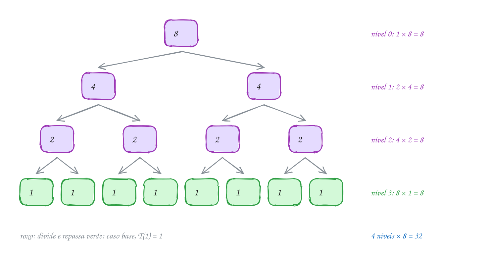
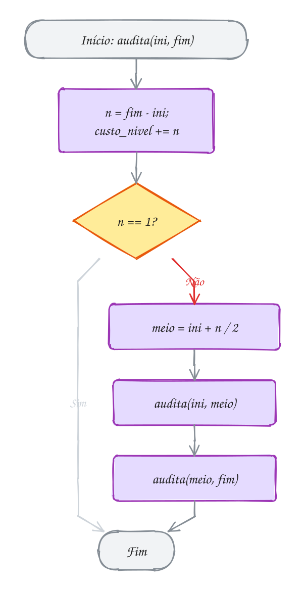
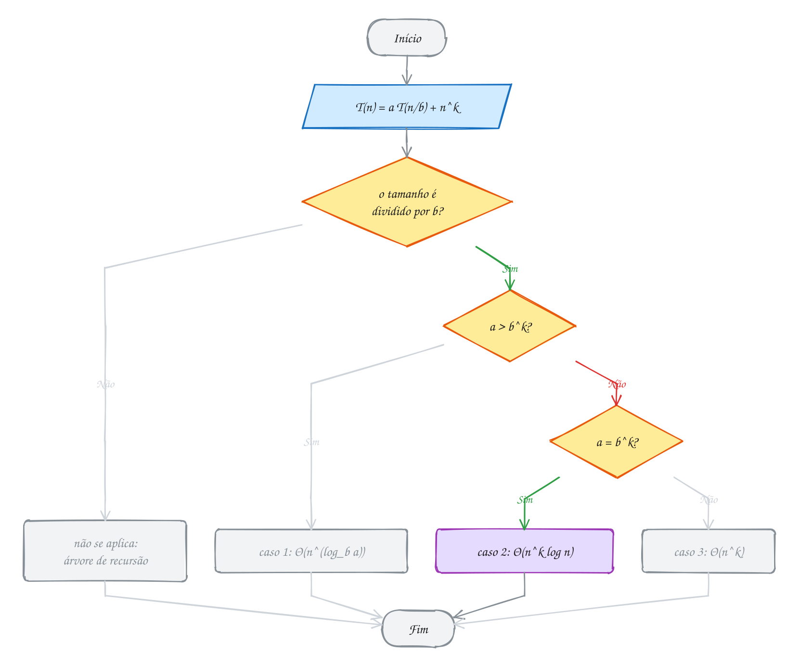
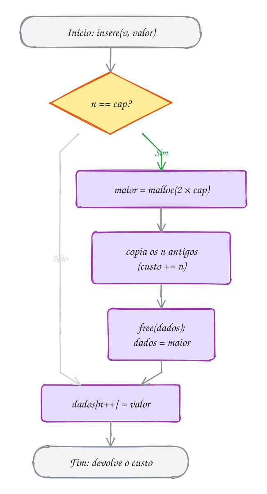
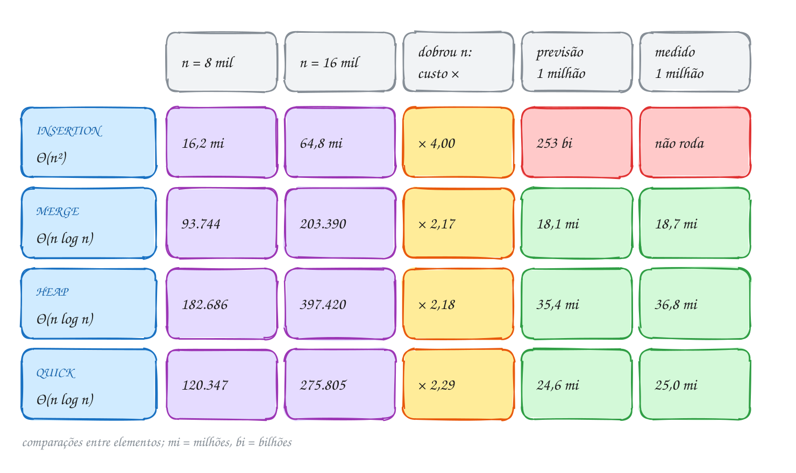

<!-- Gerado por _gerador. Para mudar este arquivo, edite _gerador/modulos/17-analise-avancada/ e rode: cd _gerador && npm run gerar -->

# Módulo 17 · Medindo algoritmos recursivos

> [!IMPORTANT]
> **Mundo 8 · Técnicas de projeto · Rota do jogo: etapa 24 de 29**
>
> **Missão:** resolver recorrências e aplicar o teorema mestre.
>
> **Vem de:** [Módulo 29 · Grafos: ciclos e cortes; problemas difíceis](29-grafos-e-np.md). **Segue para:** [Módulo 19 · Enumeração e backtracking](19-backtracking.md).
>
> **Checkpoints desta fase:**
> - [ ] Ler os assuntos 0114 a 0118 e refazer os exemplos
> - [ ] Resolver os 4 exercícios de cada assunto, escrevendo o código sozinho
> - [ ] Fechar a lista prática (P1701 a P1730)
> - [ ] Enfrentar os desafios do módulo
> - [ ] Chefão: resolver as questões de prova do módulo sem consultar

Contar laços (módulo 10) não mede função recursiva. O módulo cobre
recorrências, árvore de recursão, teorema mestre, análise amortizada e o
limite Ω(n log n) da ordenação, e fecha prevendo o tempo de quatro ordenações.
Dá prova aos "n log n" dos módulos 13 e 14.

## O que você vai aprender

- a **recorrência** de uma função recursiva e a **árvore de recursão**
- `T(n-1)` contra `T(n/2)`: "duas chamadas" pode ser Θ(n) ou Θ(2ⁿ)
- o **teorema mestre**: os três casos e quando ele **não** se aplica
- a **análise amortizada**: método agregado e do banqueiro
- a **árvore de decisão** e o limite **Ω(n log n)** da ordenação por comparação
- as notações **Θ** e **Ω**, ao lado do **O**
- **medir** com `clock()` e contadores, e **prever** o tempo

## Antes de começar

Usa recursão (0031 a 0033), Big-O (0071 e 0072), vetor que cresce (0055 e
0075), pilha (0082), fila (0085), merge e quick sort (módulo 13), heap (0102 e
0103) e ponteiro para função (0050).

Matemática: `log₂ n` é quantas vezes n se divide por 2 até chegar em 1
(`log₂ 1024 = 10`); `log_b a` é o expoente que leva `b` a `a` (`log₃ 9 = 2`).
`log2` e `log` ficam em `<math.h>`; as flags de estudo já ligam `-lm`.

O 0118 traz o TAD `ordena.h` e `ordena.c`, com as quatro ordenações e um
contador de comparações. Os tempos variam entre execuções; as comparações, não.

| # | Assunto |
| --- | --- |
| [0114](#0114--recorrências-e-árvore-de-recursão) | Recorrências e árvore de recursão |
| [0115](#0115--teorema-mestre) | Teorema mestre |
| [0116](#0116--análise-amortizada) | Análise amortizada |
| [0117](#0117--limite-inferior-da-ordenação) | Limite inferior da ordenação |
| [0118](#0118--juntando-tudo) | Juntando tudo |

---

> [!NOTE]
> Cada assunto é um capítulo: **Conceito** (a explicação), **Exemplos de uso** (programas que compilam sozinhos: rode com o comando abaixo de cada um e compare com a saída no fim do código) e **Exercícios** (cada um é um arquivo em `material/` com o esqueleto, as dicas e o espaço para a resposta; resoluções em `_respostas/17-analise-avancada/`).

## 0114 · Recorrências e árvore de recursão

### Conceito

No módulo 10, você mediu o custo de um algoritmo contando as voltas dos laços.
Uma função recursiva quase não tem laço: o trabalho está espalhado pelas
chamadas que ela faz a si mesma. Pense na contabilidade de uma rede de
farmácias. A chefe recebe um lote de notas fiscais, confere o lote inteiro,
divide em dois lotes iguais e entrega cada metade a um auditor, que faz o
mesmo com a sua metade. Com uma nota só, o auditor confere e para. Quantas
notas são olhadas no total? Contar laços não responde.

A ferramenta para isso é a **recorrência**: uma equação que dá o custo de uma
função recursiva para uma entrada de tamanho `n` em termos do custo dela para
entradas menores, mais um caso base que diz quanto custa a menor entrada
(CORMEN et al., 2024, cap. 4). Chamando de `T(n)` o custo de conferir um lote
de `n` notas, a auditoria fica assim:

```text
T(1) = 1                  (caso base: confere a nota e para)
T(n) = 2 T(n/2) + n       (duas chamadas com metade, mais n de trabalho)
```

Para escrever a recorrência a partir do código, faça três perguntas. Quantas
chamadas recursivas a função faz, e com que tamanho? Aqui são 2, com metade
cada, e isso vira o termo `2 T(n/2)`. Quanto trabalho ela faz fora das
chamadas? Aqui, olhar as `n` notas, e isso vira o `+ n`. Qual é o caso base e
quanto ele custa? Aqui, `T(1) = 1` (ZIVIANI, 2010, cap. 2).

A recorrência tem `T` dos dois lados, então ainda não diz quanto custa.
**Resolver** é chegar numa fórmula só em `n`. O jeito mais visual é a **árvore
de recursão**: cada chamada vira um nó, e dentro do nó fica o trabalho que ela
faz sozinha, sem contar as filhas. Depois você soma **nível por nível**
(LINTZMAYER; MOTA, 2023). Na auditoria, o nível 0 é a chefe, com `n` notas. O
nível 1 tem 2 auditores com `n/2` cada, que somam `n`. O nível `k` tem `2^k`
chamadas de `n/2^k` notas, e de novo a soma dá `n`. Os lotes caem pela metade
até chegar em 1, o que leva `log₂ n` divisões, então há `log₂ n + 1` níveis.
O total é `n log₂ n + n`, ou **Θ(n log n)**.

O símbolo **Θ** (teta) diz que a função cresce **exatamente** naquele ritmo. O
`O` do assunto 0072 é um teto: garante que o custo não passa daquilo. O Θ é
teto e piso ao mesmo tempo: o custo nem passa nem fica abaixo daquele ritmo,
fora constantes. As definições formais estão no assunto 0166 (CORMEN et al.,
2024, cap. 3).

A árvore também serve para chutar a resposta de uma recorrência difícil. O
chute então é confirmado pelo **método da substituição**: você supõe que a
resposta vale para entradas menores e prova por indução que vale para `n`. O
cuidado é chegar **exatamente** na expressão chutada no passo da indução; uma
constante a mais que "não faz diferença" invalida a prova (CORMEN et al.,
2024, cap. 4). O terceiro método, o teorema mestre, é o assunto 0115.

A árvore mostra ainda os dois recursos que uma função recursiva gasta, porque
ela é o filme da pilha de chamadas do assunto 0031. O **tempo** é a soma de
todos os nós: para 8 notas, são `2n - 1 = 15` chamadas. A **memória** é a
altura da árvore, porque só os frames de um caminho da raiz até uma folha
ficam vivos ao mesmo tempo: no máximo `log₂ n + 1 = 4` (FEOFILOFF, 2009).

A forma da recorrência decide a forma da árvore, e a forma da árvore decide o
resultado. Uma chamada só, com tamanho caindo de 1 em 1, dá uma linha de `n`
nós. Uma chamada só, com tamanho caindo pela metade, dá uma linha de `log n`
nós. Duas chamadas com tamanho caindo de 1 em 1 dão uma árvore que dobra a
cada nível. A tabela reúne os casos que mais aparecem:

| recorrência | árvore | resultado | exemplo |
| --- | --- | --- | --- |
| `T(n) = T(n-1) + 1` | uma linha de n nós | Θ(n) | percorrer lista recursivamente |
| `T(n) = T(n/2) + 1` | uma linha de log n nós | Θ(log n) | busca binária |
| `T(n) = T(n-1) + n` | uma linha, nós encolhendo | Θ(n²) | selection sort recursivo |
| `T(n) = 2 T(n/2) + n` | binária, log n níveis de custo n | Θ(n log n) | merge sort, a auditoria |
| `T(n) = 2 T(n-1) + 1` | binária, n níveis que dobram | Θ(2ⁿ) | Hanói (assunto 0033) |

> [!WARNING]
> "Duas chamadas recursivas" não diz nada sozinho: decide o **tamanho** de cada
> chamada. `2 T(n/2) + 1` (máximo dividindo o vetor) dá Θ(n); `2 T(n-1) + 1`
> (Hanói) dá Θ(2ⁿ): para `n = 30`, mais de um bilhão de chamadas.

### Exemplos de uso

A chefe da contabilidade confere um lote de notas, divide em dois e passa
cada metade a um auditor, que faz o mesmo. Com 8 notas, cada caixa é uma
chamada; cada linha soma 8, e são 4 linhas:

<p align="center"></p>

O código soma as notas de cada nível num vetor indexado pela profundidade e
confere `n log₂ n + n` para lotes maiores:

```c
#include <stdio.h>

#define MAX_NIVEIS 32

long custo_nivel[MAX_NIVEIS]; // notas conferidas em cada nível da recursão

// confere o lote [ini, fim): olha todas as notas e divide o lote em dois
void audita(int ini, int fim, int nivel) {
    int n = fim - ini;
    custo_nivel[nivel] += n;            // trabalho fora das chamadas: n
    if (n == 1) {
        return;                         // caso base: uma nota só
    }
    int meio = ini + n / 2;
    audita(ini, meio, nivel + 1);       // T(n/2)
    audita(meio, fim, nivel + 1);       // T(n/2)
}

// zera os níveis, audita n notas e devolve o total
long total_auditado(int n, int mostrar) {
    for (int k = 0; k < MAX_NIVEIS; k++) {
        custo_nivel[k] = 0;
    }
    audita(0, n, 0);
    long total = 0;
    for (int k = 0; k < MAX_NIVEIS && custo_nivel[k] > 0; k++) {
        if (mostrar) {
            printf("nível %d: %ld notas\n", k, custo_nivel[k]);
        }
        total += custo_nivel[k];
    }
    return total;
}

int main(void) {
    printf("total: %ld notas\n\n", total_auditado(8, 1));

    int tamanhos[] = {8, 64, 1024, 1048576};
    int lg[] = {3, 6, 10, 20};          // log2 de cada tamanho
    printf("      n         T(n)   n log n + n\n");
    for (int i = 0; i < 4; i++) {
        int n = tamanhos[i];
        printf("%7d %12ld %12ld\n", n, total_auditado(n, 0), (long)n * lg[i] + n);
    }
    return 0;
}
// Saída:
// nível 0: 8 notas
// nível 1: 8 notas
// nível 2: 8 notas
// nível 3: 8 notas
// total: 32 notas
//
//       n         T(n)   n log n + n
//       8           32           32
//      64          448          448
//    1024        11264        11264
// 1048576     22020096     22020096
```

O fluxograma é a função `audita` e não tem laço: as duas caixas `audita` são
o `2 T(n/2)` e a caixa `custo_nivel += n` é o `+ n`:

<p align="center"></p>

#### Passo a passo

Abrir o `T` até o caso base, com `n = 8`:

| passo | conta | valor |
| --- | --- | --- |
| T(1) | caso base | 1 |
| T(2) | 2 · T(1) + 2 = 2 + 2 | 4 |
| T(4) | 2 · T(2) + 4 = 8 + 4 | 12 |
| T(8) | 2 · T(4) + 8 = 24 + 8 | **32** |

Bate com a árvore (4 níveis de 8) e com o programa.

**Exemplo A227 · Duas chamadas, destinos diferentes**

```c
#include <stdio.h>

long chamadas = 0; // contador global: quantas vezes alguma função foi chamada

// maior valor de v[ini..fim-1] dividindo ao meio: T(n) = 2 T(n/2) + 1
int maximo(const int v[], int ini, int fim) {
    chamadas++;
    if (fim - ini == 1) {
        return v[ini];
    }
    int meio = ini + (fim - ini) / 2;
    int a = maximo(v, ini, meio);
    int b = maximo(v, meio, fim);
    return a > b ? a : b;
}

// Fibonacci ingênuo: T(n) = T(n-1) + T(n-2) + 1
long fib(int n) {
    chamadas++;
    if (n < 2) {
        return n;
    }
    return fib(n - 1) + fib(n - 2);
}

// soma de 1 a n, uma chamada por vez: T(n) = T(n-1) + 1
long soma(int n) {
    chamadas++;
    if (n == 0) {
        return 0;
    }
    return n + soma(n - 1);
}

int main(void) {
    int vendas[30];
    for (int i = 0; i < 30; i++) {
        vendas[i] = (i * 37) % 101; // vendas do dia, valores "embaralhados"
    }

    printf(" n | maximo: 2 T(n/2) + 1  | fib: T(n-1) + T(n-2) + 1  | soma: T(n-1) + 1\n");
    for (int n = 10; n <= 30; n += 10) {
        chamadas = 0;
        int m = maximo(vendas, 0, n);
        long c_max = chamadas;

        chamadas = 0;
        long f = fib(n);
        long c_fib = chamadas;

        chamadas = 0;
        long s = soma(n);
        long c_soma = chamadas;

        printf("%2d | %3d em %2ld chamadas    | %6ld em %7ld chamadas | %3ld em %2ld chamadas\n",
               n, m, c_max, f, c_fib, s, c_soma);
    }
    return 0;
}
// Saída:
//  n | maximo: 2 T(n/2) + 1  | fib: T(n-1) + T(n-2) + 1  | soma: T(n-1) + 1
// 10 |  94 em 19 chamadas    |     55 em     177 chamadas |  55 em 11 chamadas
// 20 |  97 em 39 chamadas    |   6765 em   21891 chamadas | 210 em 21 chamadas
// 30 |  97 em 59 chamadas    | 832040 em 2692537 chamadas | 465 em 31 chamadas
```

```bash
gcc ~/LPEDC/material/A227.c -o ~/LPEDC/material/A227 && ~/LPEDC/material/A227
```

**Exemplo A228 · Hanói: a árvore em que cada nível dobra**

```c
#include <stdio.h>

#define MAX_DISCOS 25

long movimentos_nivel[MAX_DISCOS]; // movimentos feitos em cada nível da recursão

// move n discos de 'de' para 'para' usando 'aux': T(n) = 2 T(n-1) + 1
void hanoi(int n, char de, char para, char aux, int nivel, int mostrar) {
    if (n == 0) {
        return;
    }
    if (mostrar) {
        printf("%*shanoi(%d, %c -> %c)\n", 2 * nivel, "", n, de, para);
    }
    hanoi(n - 1, de, aux, para, nivel + 1, mostrar); // tira os n-1 de cima
    movimentos_nivel[nivel]++;                       // move o disco maior: o "+ 1"
    hanoi(n - 1, aux, para, de, nivel + 1, mostrar); // põe os n-1 por cima
}

long resolve(int n, int mostrar) {
    for (int k = 0; k < MAX_DISCOS; k++) {
        movimentos_nivel[k] = 0;
    }
    hanoi(n, 'A', 'C', 'B', 0, mostrar);
    long total = 0;
    for (int k = 0; k < n; k++) {
        total += movimentos_nivel[k];
    }
    return total;
}

int main(void) {
    printf("A árvore de chamadas com 3 discos (o recuo é o nível):\n");
    resolve(3, 1);

    printf("\nCom 5 discos, nível por nível:\n");
    long total = resolve(5, 0);
    for (int k = 0; k < 5; k++) {
        printf("nível %d: %2ld × hanoi(%d), 1 movimento cada\n", k, movimentos_nivel[k], 5 - k);
    }
    printf("total: %ld = 2^5 - 1\n", total);

    printf("\n n   movimentos\n");
    for (int n = 5; n <= 20; n += 5) {
        printf("%2d %12ld\n", n, resolve(n, 0));
    }
    return 0;
}
// Saída:
// A árvore de chamadas com 3 discos (o recuo é o nível):
// hanoi(3, A -> C)
//   hanoi(2, A -> B)
//     hanoi(1, A -> C)
//     hanoi(1, C -> B)
//   hanoi(2, B -> C)
//     hanoi(1, B -> A)
//     hanoi(1, A -> C)
//
// Com 5 discos, nível por nível:
// nível 0:  1 × hanoi(5), 1 movimento cada
// nível 1:  2 × hanoi(4), 1 movimento cada
// nível 2:  4 × hanoi(3), 1 movimento cada
// nível 3:  8 × hanoi(2), 1 movimento cada
// nível 4: 16 × hanoi(1), 1 movimento cada
// total: 31 = 2^5 - 1
//
//  n   movimentos
//  5           31
// 10         1023
// 15        32767
// 20      1048575
```

```bash
gcc ~/LPEDC/material/A228.c -o ~/LPEDC/material/A228 && ~/LPEDC/material/A228
```

### Exercícios

**Exercício E679** · ★☆☆

A busca binária recursiva segue T(n) = T(n/2) + 1. Confira no computador:
escreva "int busca(const int v[], int ini, int fim, int x)", que procura x
em v[ini..fim-1] (ordenado) e conta as chamadas num contador global. Com
cpfs[i] = 10 * (i + 1) para 1024 posições, busque 5 (menor que todos: pior
caso) nos primeiros n elementos, para n = 1, 2, 4, ..., 1024, e mostre as
chamadas de cada busca.

```text
Saída esperada:
   n  chamadas
   1  2
   2  3
   4  4
   8  5
  16  6
  32  7
  64  8
 128  9
 256  10
 512  11
1024  12
```

**Exercício E681** · ★★☆

Um comparador de preços confere um lote assim: compara cada preço com todos
os do lote (n² comparações), divide o lote ao meio e confere cada metade do
mesmo jeito: T(n) = 2 T(n/2) + n², T(1) = 1. Escreva a função recursiva
que conta as comparações POR NÍVEL da recursão e mostre os níveis para n = 8
e, depois, o total para n = 16, 32 e 64 ao lado de 2n² - n. Preços:
preco[i] = 5 + (i * 13) % 40, e um par é suspeito quando um preço passa do
dobro do outro (conte também os suspeitos, sem mostrar).

```text
Saída esperada:
nível 0: 64 comparações
nível 1: 32 comparações
nível 2: 16 comparações
nível 3: 8 comparações
total: 120
 n  T(n)  2n² - n
16   496   496
32  2016  2016
64  8128  8128
```

**Exercício E682** · ★★☆

Escreva do zero um selection sort RECURSIVO, sem laço externo:
ordena(v, n) procura o maior de v[0..n-1], troca com v[n-1] e chama
ordena(v, n - 1). Cada chamada mostra quantas comparações fez, e o main
mostra o total e o vetor ordenado. Os preços são:

```text
42 17 88 5 63 29 71 10
```

```text
Saída esperada:
ordena(8): 7 comparações
ordena(7): 6 comparações
ordena(6): 5 comparações
ordena(5): 4 comparações
ordena(4): 3 comparações
ordena(3): 2 comparações
ordena(2): 1 comparação
total: 28 = 8 · 7 / 2
5 10 17 29 42 63 71 88
```

**Exercício E684** · ★★★

O fib ingênuo faz C(n) chamadas: C(0) = C(1) = 1 e C(n) = C(n-1) + C(n-2) +
1. Escreva fib(n), recursiva, com contador global de chamadas;
conta_chamadas(n), que calcula C(n) com laço; e fib_laco(n), que calcula
F(n) com laço. Para n = 5, 10, ..., 25, mostre as chamadas contadas, C(n) e
2F(n+1) - 1. No fim, só com laço, mostre C(40) e a razão C(40) / C(39).

```text
Saída esperada:
 n  contadas    C(n)  2F(n+1)-1
 5        15      15         15
10       177     177        177
15      1973    1973       1973
20     21891   21891      21891
25    242785  242785     242785
C(40) = 331160281
C(40) / C(39) = 1.6180
```

---

## 0115 · Teorema mestre

### Conceito

Montar a árvore de recursão do assunto 0114 para cada algoritmo funciona, mas
cansa. Na declaração do Imposto de Renda, você não refaz a conta da alíquota:
acha a sua faixa na tabela e lê o resultado. O **teorema mestre** é essa
tabela para as recorrências de divisão e conquista: alguém já somou a árvore
em geral, e o resultado cabe em três linhas (CORMEN et al., 2024, cap. 4).

A forma mais usada, simplificada, é esta:

```text
T(n) = a T(n/b) + n^k
```

Cada letra responde uma das perguntas do 0114. O `a`, que vale pelo menos 1,
é **quantas chamadas** cada chamada faz. O `b`, maior que 1, é **quanto o
tamanho encolhe**: cada chamada recebe `n/b`. E `n^k` é o **trabalho fora das
chamadas**: `k = 0` quer dizer trabalho constante, `k = 1` quer dizer
trabalho linear (LINTZMAYER; MOTA, 2023). O merge sort, com duas metades e uma
intercalação linear, tem `a = 2`, `b = 2` e `k = 1`.

Para ver de onde vêm as três linhas, monte a árvore dessa forma geral. O nível
`j` tem `a^j` chamadas, cada uma com tamanho `n/b^j`, e cada uma trabalha
`(n/b^j)^k`. Multiplicando, o nível `j` custa `n^k · (a/b^k)^j`. Repare no que
isso diz: de um nível para o seguinte, o custo é multiplicado sempre pelo
mesmo número, a razão `a/b^k` (LINTZMAYER; MOTA, 2023). Toda a análise se
resume a comparar `a` com `b^k`, e só há três possibilidades.

Se `a > b^k`, a razão passa de 1 e o custo **cresce** a cada nível. O último
nível, o das folhas, manda no total: ele tem `a^(log_b n) = n^(log_b a)` folhas,
e os níveis de cima somam só um múltiplo fixo dele. O resultado é
Θ(n^(log_b a)). Se `a = b^k`, a razão é 1 e todo nível custa o mesmo `n^k`.
São `log_b n + 1` níveis, e o total é Θ(n^k log n). Se `a < b^k`, a razão fica
abaixo de 1 e o custo **cai** a cada nível. A raiz sozinha já é uma fração
fixa do total, e o resultado é Θ(n^k).

| caso | comparação | o custo por nível... | quem pesa | resultado |
| --- | --- | --- | --- | --- |
| 1 | `a > b^k` | **cresce** a cada nível | as folhas | Θ(n^(log_b a)) |
| 2 | `a = b^k` | fica **igual** | todos os níveis | Θ(n^k log n) |
| 3 | `a < b^k` | **cai** a cada nível | a raiz | Θ(n^k) |

Aplicar é ler `a`, `b` e `k` no código, calcular `b^k` e achar a linha. A
busca binária faz uma chamada com metade e trabalho constante: `a = 1`,
`b^k = 2^0 = 1`, caso 2, Θ(log n). O merge sort tem `a = 2` e `b^k = 2`, caso
2, Θ(n log n). A multiplicação de polinômios de Karatsuba faz 3 produtos de
metade do tamanho com trabalho linear: `a = 3 > 2`, caso 1, Θ(n^(log₂ 3)), que
é cerca de Θ(n^1,585).

| algoritmo | a | b | k | b^k | resultado |
| --- | --- | --- | --- | --- | --- |
| busca binária | 1 | 2 | 0 | 1 | caso 2: Θ(log n) |
| máximo dividindo ao meio | 2 | 2 | 0 | 1 | caso 1: Θ(n) |
| merge sort | 2 | 2 | 1 | 2 | caso 2: Θ(n log n) |
| multiplicar polinômios com 3 produtos (Karatsuba) | 3 | 2 | 1 | 2 | caso 1: Θ(n^1,585) |
| algo que lê tudo e segue numa metade | 1 | 2 | 1 | 2 | caso 3: Θ(n) |

O Cormen enuncia o teorema numa forma mais geral, `T(n) = a T(n/b) + f(n)`,
em que o trabalho `f(n)` pode ser qualquer função e é comparado com
`n^(log_b a)`, o número de folhas. No caso 1, `f(n)` fica abaixo de
`n^(log_b a)` por um fator polinomial, e as folhas mandam. No caso 2, `f(n)`
é Θ(n^(log_b a) · logᵖ n) com p ≥ 0, e o resultado ganha mais um fator de log:
Θ(n^(log_b a) · log^(p+1) n). Com p = 1, `2 T(n/2) + n log n` dá
Θ(n log² n), o que o exemplo A230 mede. No caso 3, `f(n)` fica acima por um
fator polinomial **e** precisa cumprir a condição de regularidade
`a f(n/b) ≤ c f(n)` para alguma constante c < 1; aí o resultado é Θ(f(n))
(CORMEN et al., 2024, cap. 4).

O teorema não cobre tudo. Em `T(n) = T(n-1) + n`, o tamanho cai subtraindo, e
não existe `b`. Em `T(n) = T(n/3) + T(2n/3) + n`, os pedaços têm tamanhos
diferentes. Nesses casos, volte à árvore de recursão, que sempre funciona
(LINTZMAYER; MOTA, 2023).

Um detalhe do C. O `n / 2` no código é divisão inteira, e arredondar para cima
ou para baixo não muda o Θ (CORMEN et al., 2024, cap. 4). O que muda é o caso
base: com `if (n == 1)`, uma chamada com `n = 0` passa reto, `0 / 2` dá 0 de
novo e a pilha estoura. Prefira `if (n <= 1)`.

> [!WARNING]
> Quatro estagiários com metade cada um é `4 T(n/2)`, não `4 T(n/4)`. Em
> `T(n) = 2 T(n-1) + 1` (Hanói) não existe `b`: `n - 1` não é `n` dividido por
> nada. Use a árvore, que dá Θ(2ⁿ).

### Exemplos de uso

Um revisor lê as `n` páginas de um contrato e repassa **metade** a `a`
estagiários, que fazem o mesmo. Com `b = 2` e `k = 1`, `b^k = 2`, e `a = 1`,
2 ou 4 cai numa linha diferente. O desenho mostra cada árvore para `n = 16`:

<p align="center"></p>

O código faz as `a` chamadas de verdade e, no fim, dobra o `n` para ver por
quanto o total é multiplicado:

```c
#include <stdio.h>

// o revisor lê as n páginas e repassa metade do contrato para 'a' estagiários
// T(n) = a T(n/2) + n, T(1) = 1
long paginas(int a, int n) {
    if (n == 1) {
        return 1;                        // uma página: lê e pronto
    }
    long total = n;                      // f(n) = n: lê tudo
    for (int i = 0; i < a; i++) {
        total += paginas(a, n / 2);      // a chamadas com metade
    }
    return total;
}

int main(void) {
    printf("    n      a = 1      a = 2      a = 4\n");
    for (int n = 16; n <= 1024; n *= 2) {
        printf("%5d", n);
        for (int a = 1; a <= 4; a *= 2) {
            printf(" %10ld", paginas(a, n));
        }
        printf("\n");
    }
    printf("\nquando n dobra (512 -> 1024), o total multiplica por:\n");
    for (int a = 1; a <= 4; a *= 2) {
        printf("a = %d: %.2f\n", a, (double)paginas(a, 1024) / paginas(a, 512));
    }
    return 0;
}
// Saída:
//     n      a = 1      a = 2      a = 4
//    16         31         80        496
//    32         63        192       2016
//    64        127        448       8128
//   128        255       1024      32640
//   256        511       2304     130816
//   512       1023       5120     523776
//  1024       2047      11264    2096128
//
// quando n dobra (512 -> 1024), o total multiplica por:
// a = 1: 2.00
// a = 2: 2.20
// a = 4: 4.00
```

Com `a = 1`, caso 3: Θ(n), total `2n - 1`. Com `a = 2`, caso 2: Θ(n log n),
exatamente `n log₂ n + n`. Com `a = 4`, caso 1: Θ(n²), total `2n² - n`. O
fluxograma é o teorema como receita; o caminho marcado é o de `a = 2`:

<p align="center"></p>

**Exemplo A229 · A tabela do teorema mestre em código**

```c
#include <math.h>
#include <stdio.h>

typedef struct {
    const char *nome;
    int a, b, k; // T(n) = a T(n/b) + n^k
} Recorrencia;

// b^k com inteiros: comparar a com b^k sem passar por double
long potencia(int b, int k) {
    long p = 1;
    for (int i = 0; i < k; i++) {
        p *= b;
    }
    return p;
}

// escreve n^k de um jeito legível em s: "1", "n", "n^2"...
void texto_nk(char s[], int tam, int k) {
    if (k == 0) {
        snprintf(s, tam, "1");
    } else if (k == 1) {
        snprintf(s, tam, "n");
    } else {
        snprintf(s, tam, "n^%d", k);
    }
}

void classifica(Recorrencia r) {
    char nk[8];
    texto_nk(nk, sizeof nk, r.k);
    printf("%d T(n/%d) + %-3s -> ", r.a, r.b, nk);

    long bk = potencia(r.b, r.k);
    if (r.a > bk) {
        double e = log(r.a) / log(r.b);  // log_b a, em double
        if (fabs(e - round(e)) < 1e-9) {
            printf("folhas: Θ(n^%.0f)", e); // expoente inteiro (com tolerância)
        } else {
            printf("folhas: Θ(n^%.3f)", e);
        }
    } else if (r.a == bk) {
        if (r.k == 0) {
            printf("empate: Θ(log n)");     // n^0 log n = log n
        } else {
            printf("empate: Θ(%s log n)", nk);
        }
    } else {
        printf("raiz: Θ(%s)", nk);
    }
    printf("   [%s]\n", r.nome);
}

int main(void) {
    Recorrencia lista[] = {
        {"busca binária", 1, 2, 0},
        {"busca em 3 partes", 1, 3, 0},
        {"máximo pelas metades", 2, 2, 0},
        {"merge sort", 2, 2, 1},
        {"Karatsuba", 3, 2, 1},
        {"matriz por blocos", 8, 2, 2},
        {"Strassen", 7, 2, 2},
        {"lê tudo e segue numa metade", 1, 2, 1},
        {"3 terços e trabalho n²", 3, 3, 2},
    };
    int total = sizeof lista / sizeof lista[0];
    for (int i = 0; i < total; i++) {
        classifica(lista[i]);
    }
    return 0;
}
// Saída:
// 1 T(n/2) + 1   -> empate: Θ(log n)   [busca binária]
// 1 T(n/3) + 1   -> empate: Θ(log n)   [busca em 3 partes]
// 2 T(n/2) + 1   -> folhas: Θ(n^1)   [máximo pelas metades]
// 2 T(n/2) + n   -> empate: Θ(n log n)   [merge sort]
// 3 T(n/2) + n   -> folhas: Θ(n^1.585)   [Karatsuba]
// 8 T(n/2) + n^2 -> folhas: Θ(n^3)   [matriz por blocos]
// 7 T(n/2) + n^2 -> folhas: Θ(n^2.807)   [Strassen]
// 1 T(n/2) + n   -> raiz: Θ(n)   [lê tudo e segue numa metade]
// 3 T(n/3) + n^2 -> raiz: Θ(n^2)   [3 terços e trabalho n²]
```

```bash
gcc ~/LPEDC/material/A229.c -o ~/LPEDC/material/A229 -lm && ~/LPEDC/material/A229
```

**Exemplo A230 · Quando a tabela não serve: medindo na mão**

```c
#include <stdio.h>

// log2 inteiro: quantas vezes dá para dividir n por 2
int lg(long n) {
    int k = 0;
    while (n > 1) {
        n /= 2;
        k++;
    }
    return k;
}

// T(n) = 2 T(n/2) + n log n: o trabalho fica entre n e n^(1+algo)
long t_nlogn(long n) {
    if (n <= 1) {
        return 1;
    }
    return 2 * t_nlogn(n / 2) + n * lg(n);
}

// T(n) = T(n/3) + T(2n/3) + n: pedaços de tamanhos diferentes
long t_desigual(long n) {
    if (n <= 1) {
        return 1;
    }
    return t_desigual(n / 3) + t_desigual(2 * n / 3) + n;
}

// T(n) = T(n-1) + n: o tamanho cai subtraindo (calculado com laço)
long t_subtrai(long n) {
    long t = 1; // T(1)
    for (long i = 2; i <= n; i++) {
        t += i;
    }
    return t;
}

int main(void) {
    // se T/(n lg n) cresce sem parar, não é n log n; se T/(n lg² n) para
    // perto de uma constante, é Θ(n log² n)
    printf("2 T(n/2) + n log n:\n");
    printf("      n  T/(n lg n)  T/(n lg² n)\n");
    for (long n = 1024; n <= 1048576; n *= 32) {
        double t = t_nlogn(n);
        int l = lg(n);
        printf("%7ld %10.2f %11.3f\n", n, t / ((double)n * l), t / ((double)n * l * l));
    }

    // todo nível custa no máximo n, e são uns log n níveis: Θ(n log n)
    printf("\nT(n/3) + T(2n/3) + n:\n");
    printf("      n  T/(n lg n)\n");
    for (long n = 1024; n <= 1048576; n *= 32) {
        printf("%7ld %10.2f\n", n, t_desigual(n) / ((double)n * lg(n)));
    }

    // dobrar n quadruplica o total: Θ(n²), nada a ver com o "a = 1"
    printf("\nT(n-1) + n, dobrando n:\n");
    for (long n = 1000; n <= 8000; n *= 2) {
        printf("T(%ld) / T(%ld) = %.2f\n", 2 * n, n, (double)t_subtrai(2 * n) / t_subtrai(n));
    }
    return 0;
}
// Saída:
// 2 T(n/2) + n log n:
//       n  T/(n lg n)  T/(n lg² n)
//    1024       5.60       0.560
//   32768       8.07       0.538
// 1048576      10.55       0.527
//
// T(n/3) + T(2n/3) + n:
//       n  T/(n lg n)
//    1024       1.05
//   32768       1.06
// 1048576       1.07
//
// T(n-1) + n, dobrando n:
// T(2000) / T(1000) = 4.00
// T(4000) / T(2000) = 4.00
// T(8000) / T(4000) = 4.00
// T(16000) / T(8000) = 4.00
```

```bash
gcc ~/LPEDC/material/A230.c -o ~/LPEDC/material/A230 && ~/LPEDC/material/A230
```

### Exercícios

**Exercício E685** · ★☆☆

Escreva "int caso(int a, int b, int k)": recebe T(n) = a T(n/b) + n^k e
devolve o caso do teorema mestre (1 se a > b^k, 2 se a = b^k, 3 se a < b^k),
com b^k calculado em inteiros por uma função potencia(b, k) com laço. Teste
as recorrências (a, b, k) = (2,2,1), (4,2,1), (1,2,1), (9,3,2), (5,4,1),
(2,4,1) e (16,4,2), mostrando o caso e a classe: folhas Θ(n^(log_b a)),
empate Θ(n^k log n) ou raiz Θ(n^k).

```text
Saída esperada:
 2 T(n/2) + n^1 -> caso 2, empate: Θ(n^k log n)
 4 T(n/2) + n^1 -> caso 1, folhas: Θ(n^(log_b a))
 1 T(n/2) + n^1 -> caso 3, raiz: Θ(n^k)
 9 T(n/3) + n^2 -> caso 2, empate: Θ(n^k log n)
 5 T(n/4) + n^1 -> caso 1, folhas: Θ(n^(log_b a))
 2 T(n/4) + n^1 -> caso 3, raiz: Θ(n^k)
16 T(n/4) + n^2 -> caso 2, empate: Θ(n^k log n)
```

**Exercício E687** · ★★☆

As 1024 notas de um concurso (0 a 10) estão em ordem crescente:
notas[i] = i * 11 / 1024. Escreva duas funções recursivas, com um contador
global de chamadas. conta_lento(v, ini, fim, x) conta as notas x olhando
SEMPRE as duas metades (T(n) = 2 T(n/2) + 1, caso 1, Θ(n)). primeira(v, ini,
fim, x) devolve a primeira posição de v[ini..fim-1] com valor >= x (ou fim),
seguindo só UMA metade (T(n) = T(n/2) + 1, caso 2, Θ(log n)). As notas 7 são
primeira(..., 8) - primeira(..., 7).

```text
Saída esperada:
lento:  93 notas 7 em 2047 chamadas
rápido: 93 notas 7 em 22 chamadas
```

**Exercício E688** · ★★☆

Escreva duas buscas recursivas em v[0..N-1] = 0, 2, 4, ... (N = 1000000),
contando cada comparação com v[...]. binaria(ini, fim, x): compara x ==
v[meio] e depois x < v[meio]. ternaria(ini, fim, x): com terco = (fim -
ini) / 3, m1 = ini + terco e m2 = fim - 1 - terco, compara x == v[m1], x ==
v[m2], x < v[m1] e x > v[m2]. Faça 1000 buscas por números ímpares, x = 2 *
((i * 7919) % N) + 1 (i de 0 a 999), e mostre a média de comparações de
cada uma.

```text
Saída esperada:
binária: 39.9 comparações por busca
ternária: 47.3 comparações por busca
```

**Exercício E689** · ★★★

Escreva multiplica4 (quatro produtos de metades) e multiplica3 (Karatsuba:
p0 = a0·b0, p2 = a1·b1, p1 = (a0 + a1)·(b0 + b1) - p0 - p2, resultado p0 +
p1·x^h + p2·x^(2h), h = n/2), recursivas, "void f(const long a[], const
long b[], int n, long r[])", com n potência de 2, r com 2n - 1
coeficientes, n = 1 multiplicando direto e um contador global de
multiplicações. Teste a = 1 2 3 4 e b = 5 6 7 8; depois n = 64, 128 e 256
com x[i] = i % 10 e y[i] = (3 * i) % 7, conferindo que os resultados são
iguais.

```text
Saída esperada:
4 produtos: 5 16 34 60 61 52 32  (16 multiplicações)
3 produtos: 5 16 34 60 61 52 32  (9 multiplicações)
n =  64:   4096 contra   729 multiplicações, mesmo resultado
n = 128:  16384 contra  2187 multiplicações, mesmo resultado
n = 256:  65536 contra  6561 multiplicações, mesmo resultado
```

---

## 0116 · Análise amortizada

### Conceito

Mudar de apartamento custa um dia inteiro carregando **todos** os móveis. Mas
mudança é rara, e ninguém mede o custo de morar num lugar pela pior semana do
ano. A análise deste assunto faz a mesma conta com operações de uma estrutura
de dados.

O caso clássico é o vetor que cresce, do assunto 0075. Inserir no fim custa
uma escrita, até o vetor encher. Cheio, é preciso alocar um vetor maior e
**copiar tudo** para ele. Olhando uma inserção isolada no pior caso, ela custa
O(n), e a conta pessimista diria que `n` inserções custam O(n²). Essa conta
erra porque as inserções caras não vêm em sequência: depois de uma cópia
grande, vêm muitas inserções baratas até o próximo aperto (ROVAI, 2018).

A **análise amortizada** olha para isso do jeito certo. Ela mede o custo de
uma **sequência** de operações no pior caso e divide pelo número de operações.
O resultado é o **custo amortizado** de cada operação, e ele é uma garantia
sobre o total: nenhuma sorte entra na conta (CORMEN et al., 2024, cap. 16). O
Cormen ensina três maneiras de fazer essa conta, e as três chegam ao mesmo
número para o vetor que dobra.

O **método agregado** soma tudo de uma vez. Comece com capacidade 1 e dobre
sempre que encher. As `n` inserções fazem `n` escritas. As cópias acontecem
quando a capacidade passa de 1 para 2, de 2 para 4, de 4 para 8, e copiam
`1 + 2 + 4 + ...` elementos. Essa soma de potências de 2 fica abaixo de `2n`,
porque cada termo é maior que todos os anteriores juntos. O total é menor que
`3n`, e dividindo por `n` cada inserção custa **O(1) amortizado** (CORMEN et
al., 2024, cap. 16).

O **método do banqueiro**, também chamado de contábil, troca a soma por um
cofrinho. Cada inserção paga **3 moedas**: 1 pela própria escrita e 2 que vão
para o cofrinho. Quando a capacidade `c` enche e vira `2c`, os `c/2` elementos
que entraram depois da última cópia guardaram 2 moedas cada, `c` moedas no
total, e isso paga exatamente as `c` cópias. Se o cofrinho nunca fica
negativo, nenhuma operação deixou de ser paga, e o custo amortizado é 3
(SZWARCFITER; MARKENZON, 2010).

O **método do potencial** formaliza o cofrinho. Em vez de contar moedas, você
define uma função Φ do estado da estrutura, o **potencial**, que mede a
"energia guardada". Para o vetor, Φ = 2 · n - capacidade, com `n` os elementos
guardados. O custo amortizado de uma operação é o custo real mais a variação
do potencial: real + Φ(depois) - Φ(antes). Uma inserção barata aumenta Φ em 2;
uma cópia grande gasta o potencial acumulado (CORMEN et al., 2024, cap. 16).

Dois mal-entendidos rondam esse assunto. O primeiro é confundir amortizado com
**caso médio**. O caso médio supõe que as entradas são sorteadas e calcula uma
média sobre elas. O amortizado não sorteia nada: vale para a **pior**
sequência possível. O segundo é achar que o amortizado promete que cada
operação é rápida. Ele promete o total. Um sistema que não pode travar nem
por um instante, como o controle de um freio, precisa de outra solução
(SZWARCFITER; MARKENZON, 2010).

A técnica serve para outras estruturas. Num **contador binário** que soma 1 a
cada passo, uma soma pode trocar muitos bits (de 0111 para 1000 trocam 4), mas
em média cada soma troca menos de 2 bits (exemplo A231). Numa pilha com a
operação `multipop(k)`, que tira `k` itens de uma vez, um `multipop` pode ser
caro, mas cada item só sai uma vez depois de ter entrado uma vez (exemplo
A232) (CORMEN et al., 2024, cap. 16).

No C, o vetor que cresce usa `realloc` (assunto 0055), que às vezes consegue
esticar o bloco no lugar e nem copia. A análise conta o pior caso, copiar
tudo. O preço que sobra é memória: logo depois de dobrar, metade do vetor está
vazia (CORTÉS, 2015). Use o `realloc` seguro, guardando o resultado num
ponteiro à parte e conferindo `NULL` antes de trocar.

> [!WARNING]
> Crescer por **tamanho fixo** estraga tudo. Com `nova = cap + 10`, as cópias
> são 10, 20, 30...: quase **500 milhões** para 100.000 inserções, contra
> 131.071 dobrando. Qualquer fator maior que 1 (1,5 ou 2) dá O(1) amortizado;
> somar uma constante, não.

### Exemplos de uso

O app do banco guarda o histórico de Pix num vetor de 1 posição que dobra ao
encher. Chegam 16 Pix; as inserções 2, 3, 5 e 9 são as mudanças, em vermelho,
e o cofrinho cai nelas e se recupera:

<p align="center"></p>

O `insere` devolve o custo real. O vetor cresce com `malloc`, cópia e `free`
à mão, para contar cada cópia:

```c
#include <stdio.h>
#include <stdlib.h>

typedef struct {
    int *dados;
    int n;   // quantos tem
    int cap; // quantos cabem
} Vetor;

// insere no fim e devolve o custo: 1 escrita + as cópias, se precisou crescer
int insere(Vetor *v, int valor) {
    int custo = 1;
    if (v->n == v->cap) {
        int nova = v->cap * 2;                       // dobra
        int *maior = malloc(nova * sizeof *maior);
        if (maior == NULL) {
            exit(1);
        }
        for (int i = 0; i < v->n; i++) {
            maior[i] = v->dados[i];                  // a mudança: copia tudo
            custo++;
        }
        free(v->dados);
        v->dados = maior;
        v->cap = nova;
    }
    v->dados[v->n++] = valor;
    return custo;
}

int main(void) {
    Vetor v = {malloc(sizeof(int)), 0, 1};
    if (v.dados == NULL) {
        return 1;
    }
    int total = 0, cofrinho = 0;
    printf("Pix  custo  cofrinho\n");
    for (int i = 1; i <= 16; i++) {
        int custo = insere(&v, 100 * i);             // valor do Pix, tanto faz
        total += custo;
        cofrinho += 3 - custo;                       // cada inserção paga 3
        printf("%3d  %5d  %8d\n", i, custo, cofrinho);
    }
    printf("total: %d para 16 inserções (%.2f por inserção)\n", total, total / 16.0);
    free(v.dados);
    return 0;
}
// Saída:
// Pix  custo  cofrinho
//   1      1         2
//   2      2         3
//   3      3         3
//   4      1         5
//   5      5         3
//   6      1         5
//   7      1         7
//   8      1         9
//   9      9         3
//  10      1         5
//  11      1         7
//  12      1         9
//  13      1        11
//  14      1        13
//  15      1        15
//  16      1        17
// total: 31 para 16 inserções (1.94 por inserção)
```

As cópias somam `1 + 2 + 4 + 8 = 15`, mais 16 escritas: 31, menos de `2 · 16`.
O fluxograma segue a 9ª inserção, a mais cara: 8 de 8 ocupados, e o caminho
passa pela mudança inteira:

<p align="center"></p>

**Exemplo A231 · O contador binário da catraca**

```c
#include <stdio.h>

#define BITS 24

// soma 1 ao contador (bit 0 em b[0]) e devolve quantos bits mudaram
int incrementa(int b[]) {
    int i = 0, trocas = 0;
    while (i < BITS && b[i] == 1) {
        b[i] = 0;                 // o vai-um zera os 1 do fim
        trocas++;
        i++;
    }
    if (i < BITS) {
        b[i] = 1;                 // e acende o primeiro 0
        trocas++;
    }
    return trocas;
}

void mostra(const int b[], int bits) {
    for (int i = bits - 1; i >= 0; i--) {
        printf("%d", b[i]);
    }
}

int main(void) {
    int b[BITS] = {0};
    int total = 0;
    printf("passou  contador  bits trocados\n");
    for (int k = 1; k <= 16; k++) {
        int t = incrementa(b);
        total += t;
        printf("%6d     ", k);
        mostra(b, 5);
        printf("  %d\n", t);
    }
    printf("16 passageiros: %d trocas (pior caso de um incremento: 5)\n\n", total);

    // um milhão de passageiros: quanto cada bit trocou
    int c[BITS] = {0};
    long por_bit[BITS] = {0}, soma = 0;
    for (long k = 1; k <= 1000000; k++) {
        int antes[BITS];
        for (int i = 0; i < BITS; i++) {
            antes[i] = c[i];
        }
        soma += incrementa(c);
        for (int i = 0; i < BITS; i++) {
            if (c[i] != antes[i]) {
                por_bit[i]++;
            }
        }
    }
    for (int i = 0; i < 4; i++) {
        printf("bit %d trocou %ld vezes\n", i, por_bit[i]);
    }
    printf("...\n1000000 incrementos: %ld trocas (%.6f por incremento)\n", soma, soma / 1e6);
    return 0;
}
// Saída:
// passou  contador  bits trocados
//      1     00001  1
//      2     00010  2
//      3     00011  1
//      4     00100  3
//      5     00101  1
//      6     00110  2
//      7     00111  1
//      8     01000  4
//      9     01001  1
//     10     01010  2
//     11     01011  1
//     12     01100  3
//     13     01101  1
//     14     01110  2
//     15     01111  1
//     16     10000  5
// 16 passageiros: 31 trocas (pior caso de um incremento: 5)
//
// bit 0 trocou 1000000 vezes
// bit 1 trocou 500000 vezes
// bit 2 trocou 250000 vezes
// bit 3 trocou 125000 vezes
// ...
// 1000000 incrementos: 1999993 trocas (1.999993 por incremento)
```

```bash
gcc ~/LPEDC/material/A231.c -o ~/LPEDC/material/A231 && ~/LPEDC/material/A231
```

**Exemplo A232 · Pilha de pratos com multipop**

```c
#include <stdio.h>

#define CAP 1000000

typedef struct {
    int v[CAP];
    int topo; // quantos pratos tem
} Pilha;

int empilha(Pilha *p, int prato) {
    p->v[p->topo++] = prato;
    return 1;                              // custo 1
}

// tira até k pratos de uma vez; custo = quantos saíram de verdade
int multipop(Pilha *p, int k) {
    int saiu = 0;
    while (saiu < k && p->topo > 0) {
        p->topo--;
        saiu++;
    }
    return saiu;
}

int main(void) {
    Pilha p = {.topo = 0};
    // o que acontece na cozinha: 'E' = chega um prato sujo, 'L' = a
    // lava-louças leva até k pratos
    char tipo[] = {'E', 'E', 'E', 'E', 'E', 'L', 'E', 'E', 'L', 'E', 'E', 'E', 'E', 'L', 'L'};
    int k[] = {0, 0, 0, 0, 0, 3, 0, 0, 10, 0, 0, 0, 0, 2, 5};
    int ops = sizeof tipo / sizeof tipo[0];

    int total = 0, empilhados = 0, prato = 0, maior_custo = 0;
    for (int i = 0; i < ops; i++) {
        int custo;
        if (tipo[i] == 'E') {
            custo = empilha(&p, ++prato);
            empilhados++;
        } else {
            custo = multipop(&p, k[i]);
            printf("lava até %2d: saíram %d, sobraram %d\n", k[i], custo, p.topo);
        }
        total += custo;
        if (custo > maior_custo) {
            maior_custo = custo;
        }
    }
    printf("%d operações, %d empilhamentos\n", ops, empilhados);
    printf("operação mais cara: %d; custo total: %d <= 2 × %d\n\n", maior_custo, total, empilhados);

    // um mês de cozinha: 1 milhão de operações; 1 em cada 50 é lavar, e a
    // lava-louças leva até (i / 50) % 120 pratos (de 0 a 119)
    p.topo = 0;
    long total_mes = 0, emp_mes = 0;
    int pior = 0;
    for (int i = 1; i <= 1000000; i++) {
        int custo = (i % 50 == 0) ? multipop(&p, (i / 50) % 120) : empilha(&p, i);
        if (i % 50 != 0) {
            emp_mes++;
        }
        total_mes += custo;
        if (custo > pior) {
            pior = custo;
        }
    }
    printf("mês: %ld empilhamentos, pior operação %d, total %ld <= %ld\n",
           emp_mes, pior, total_mes, 2 * emp_mes);
    return 0;
}
// Saída:
// lava até  3: saíram 3, sobraram 2
// lava até 10: saíram 4, sobraram 0
// lava até  2: saíram 2, sobraram 2
// lava até  5: saíram 2, sobraram 0
// 15 operações, 11 empilhamentos
// operação mais cara: 4; custo total: 22 <= 2 × 11
//
// mês: 980000 empilhamentos, pior operação 98, total 1959271 <= 1960000
```

```bash
gcc ~/LPEDC/material/A232.c -o ~/LPEDC/material/A232 && ~/LPEDC/material/A232
```

### Exercícios

**Exercício E691** · ★☆☆

Escreva um vetor dinâmico de int (struct Vetor com dados, n, cap e
"long copias") que começa com capacidade 1 e dobra ao encher; cada elemento
copiado numa mudança soma 1 em copias. Para n = 10, 100, 1000 e 1000000,
crie um vetor novo, insira n números, mostre as cópias e a média de cópias
por inserção, e libere o vetor.

```text
Saída esperada:
      n    cópias  cópias/n
     10        15      1.50
    100       127      1.27
   1000      1023      1.02
1000000   1048575      1.05
```

**Exercício E693** · ★★☆

Muitas bibliotecas crescem o vetor por 1,5, e não por 2, para sobrar menos
memória. Continua O(1) amortizado? Escreva o vetor dinâmico de int (struct
Vetor com dados, n, cap, "long copias" e "int mudancas", capacidade inicial
1) com insere(v, valor, num, den): a nova capacidade é cap * num / den. Escreva
testa(nome, num, den, n), que insere n números e mostra mudanças, cópias,
cópias por inserção e a sobra (cap - n). Rode com n = 1000000 para 3/2 e 2/1.
Atenção: com cap = 1, a conta 1 * 3 / 2 dá 1; a nova capacidade tem de ser
sempre maior que a antiga.

```text
Saída esperada:
fator  mudanças    cópias  cópias/n     sobra
x 1,5        34    2099753     2.10     49869
x 2          20    1048575     1.05     48576
```

**Exercício E694** · ★★☆

O contador binário tem custo amortizado menor que 2 por incremento. E se
também puder DIMINUIR? Com um contador de 10 bits (b[i] é o bit i), escreva
incrementa(b) e decrementa(b), que devolvem quantos bits mudaram (no
decremento, os 0 do fim viram 1 e o primeiro 1 vira 0), e carrega(b, x), que
coloca o número x nos bits. No main, faça 100 incrementos a partir de 0 e
100 operações alternando incrementa e decrementa (começando por incrementa)
a partir de 511 (0111111111).

```text
Saída esperada:
100 incrementos a partir de 0: 197 trocas (1.97 por operação)
inc/dec alternados a partir de 511: 1000 trocas (10.00 por operação)
```

**Exercício E695** · ★★★

Monte uma fila de pedidos com duas pilhas, entrada e saida. enfileira(x)
empilha x na entrada; desenfileira() passa TODOS os itens da entrada para a
saida se esta estiver vazia e desempilha da saida, devolvendo o custo (1 +
transferências) por um ponteiro. Conte as transferências num contador
global. Sequência: enfileira 1 a 5, atende 2, enfileira 6 e 7, atende 4,
enfileira 8, atende 2. Depois, com as pilhas zeradas, faça 1 milhão de
operações: na operação i, se i for múltiplo de 3 e a fila não estiver
vazia, atenda; senão, enfileire i.

```text
Saída esperada:
atendidos: 1 2 3 4 5 6 7 8
8 pedidos, 8 transferências
666667 enfileirados, 524286 transferências, pior atendimento: 262145
```

---

## 0117 · Limite inferior da ordenação

### Conceito

Até aqui, toda análise media **um algoritmo**: o merge sort faz Θ(n log n), o
insertion sort faz Θ(n²). Agora a pergunta muda de lado e passa a ser sobre o
**problema**. Existe algum jeito de ordenar com menos trabalho do que o merge
sort, ou ele já é o melhor possível? Para responder, você precisa de um
argumento que valha para todo algoritmo, inclusive os que ninguém inventou
ainda.

Esse tipo de resposta se chama **limite inferior**: uma afirmação de que
nenhum método resolve o problema gastando menos do que certa quantidade
(SZWARCFITER; MARKENZON, 2010). Um limite superior se prova mostrando um
algoritmo. Um limite inferior exige mostrar que todos os algoritmos possíveis
gastam pelo menos aquilo.

O argumento precisa de uma regra do jogo. Imagine três encomendas nos
Correios e uma balança de dois pratos, que só diz qual lado pesa mais. Você
não pode ler o peso; só pode comparar duas encomendas por vez. Os algoritmos
que funcionam assim formam a **ordenação por comparação**: eles só aprendem a
ordem dos elementos perguntando "x é maior que y?" (CORMEN et al., 2024,
cap. 8). Todos os do módulo 13 são assim, o heapsort também, e o `qsort` da
biblioteca idem: ele recebe o vetor como `void *` e só fica sabendo da ordem
pelas respostas da função `compara`.

Para enxergar todas as execuções de um algoritmo desses de uma vez, use a
**árvore de decisão**. Cada nó interno é uma pergunta, como "A pesa mais que
B?". Cada aresta é uma resposta, sim ou não. Cada folha é uma ordem final dos
elementos. Rodar o algoritmo numa entrada é descer da raiz até uma folha,
seguindo as respostas. O número de perguntas no pior caso é o caminho mais
longo da raiz até uma folha, a **altura** da árvore (CORMEN et al., 2024,
cap. 8).

Agora o argumento, em três passos. Com `n` elementos distintos, há `n!`
ordens possíveis, e cada uma precisa de uma folha só dela: se duas ordens
diferentes caíssem na mesma folha, o algoritmo daria a mesma resposta para as
duas, e uma delas sairia errada. Cada pergunta tem 2 respostas, então uma
árvore de altura `h` tem no máximo `2^h` folhas. Juntando, `2^h ≥ n!`, isto é,
**`h ≥ log₂(n!)`** (LINTZMAYER; MOTA, 2023). Com 3 encomendas há `3! = 6`
ordens; altura 2 só comporta 4 folhas, então nenhum método garante a ordem com
menos de 3 pesagens.

Falta ver quanto vale `log₂(n!)`. O fatorial é o produto de `n` números, e
metade deles é pelo menos `n/2`. Por isso `n!` passa de `(n/2)^(n/2)`, e
`log₂(n!)` cresce no mesmo ritmo de `n log₂ n`. Toda ordenação por comparação
faz **Ω(n log n)** comparações no pior caso. O **Ω** (ômega) é o piso, o
oposto do teto `O`: diz que o custo não fica abaixo daquele ritmo (TENENBAUM;
LANGSAM; AUGENSTEIN, 1995, cap. 6). Para `n = 1000`, alguma entrada obriga
qualquer implementação do `qsort` a chamar a `compara` mais de 8.530 vezes.

O merge sort e o heapsort fazem O(n log n) comparações no pior caso e
encostam nesse piso. Algoritmos assim se chamam **assintoticamente ótimos**:
fora constantes, ninguém que só compara faz melhor (CORMEN et al., 2024,
cap. 8). A tabela compara o limite com o que o merge sort gasta:

| n | n! | limite ⌈log₂ n!⌉ | merge sort (pior caso) |
| --- | --- | --- | --- |
| 3 | 6 | 3 | 3 |
| 4 | 24 | 5 | 5 |
| 5 | 120 | 7 | 8 |
| 10 | 3.628.800 | 22 | 25 |
| 1000 | (2.568 dígitos) | 8.530 | 8.977 |

> [!WARNING]
> O limite vale para o **pior caso** de **qualquer** algoritmo que só compara.
> O insertion sort ordena um vetor já em ordem com `n - 1` comparações, e o
> counting sort (módulo 18) usa o valor como **índice** e escapa do limite.

### Exemplos de uso

Nos Correios, três encomendas e uma balança de dois pratos. Há `3! = 6`
ordens e altura 2 só dá 4 folhas: são precisas 3 pesagens. O desenho é o
insertion sort de 3 elementos; o caminho verde (A = 5, B = 9, C = 2 kg) acaba
na folha C A B:

<p align="center"></p>

O programa passa as 6 ordens pela balança; `mais_pesada` anota cada pergunta:

```c
#include <stdio.h>

typedef struct {
    char nome;
    int peso; // kg
} Encomenda;

int pesagens = 0;

// a balança de dois pratos: x é mais pesada que y? (anota a pergunta)
int mais_pesada(Encomenda x, Encomenda y) {
    pesagens++;
    int resposta = x.peso > y.peso;
    printf("%c>%c? %s  ", x.nome, y.nome, resposta ? "sim" : "não");
    return resposta;
}

// insertion sort de 3 encomendas, do mais leve ao mais pesado, só com a balança
void ordena3(Encomenda e[]) {
    for (int i = 1; i < 3; i++) {
        Encomenda atual = e[i];
        int j = i - 1;
        while (j >= 0 && mais_pesada(e[j], atual)) {
            e[j + 1] = e[j];
            j--;
        }
        e[j + 1] = atual;
    }
}

int main(void) {
    // as 3! = 6 maneiras de os pesos 2, 5 e 9 kg chegarem como A, B e C
    int chegada[6][3] = {{2, 5, 9}, {2, 9, 5}, {5, 2, 9}, {5, 9, 2}, {9, 2, 5}, {9, 5, 2}};
    int pior = 0;
    for (int k = 0; k < 6; k++) {
        Encomenda e[3] = {{'A', chegada[k][0]}, {'B', chegada[k][1]}, {'C', chegada[k][2]}};
        printf("%d %d %d | ", chegada[k][0], chegada[k][1], chegada[k][2]);
        pesagens = 0;
        ordena3(e);
        printf("%s-> %c %c %c (%d)\n", pesagens == 2 ? "          " : "",  // alinha
               e[0].nome, e[1].nome, e[2].nome, pesagens);
        if (pesagens > pior) {
            pior = pesagens;
        }
    }
    printf("pior caso: %d pesagens\n", pior);
    return 0;
}
// Saída:
// 2 5 9 | A>B? não  B>C? não            -> A B C (2)
// 2 9 5 | A>B? não  B>C? sim  A>C? não  -> A C B (3)
// 5 2 9 | A>B? sim  A>C? não            -> B A C (2)
// 5 9 2 | A>B? não  B>C? sim  A>C? sim  -> C A B (3)
// 9 2 5 | A>B? sim  A>C? sim  B>C? não  -> B C A (3)
// 9 5 2 | A>B? sim  A>C? sim  B>C? sim  -> C B A (3)
// pior caso: 3 pesagens
```

Cada linha é um caminho da raiz a uma folha, e o pior caso, 3, iguala o
limite: para 3 elementos, o insertion sort é **ótimo**. O fluxograma é o
argumento inteiro, para qualquer método que só compara:

<p align="center"></p>

**Exemplo A233 · Quem encosta no limite**

```c
#include <math.h>
#include <stdio.h>
#include <stdlib.h>

long comparacoes = 0;

int menor(int a, int b) {
    comparacoes++;
    return a < b;
}

void insertion(int v[], int n) {
    for (int i = 1; i < n; i++) {
        int x = v[i], j = i - 1;
        while (j >= 0 && menor(x, v[j])) {
            v[j + 1] = v[j];
            j--;
        }
        v[j + 1] = x;
    }
}

void merge_sort(int v[], int w[], int p, int r) {
    if (r - p < 2) {
        return;
    }
    int q = p + (r - p) / 2;
    merge_sort(v, w, p, q);
    merge_sort(v, w, q, r);
    int i = p, j = q, k = 0;
    while (i < q && j < r) {
        w[k++] = menor(v[j], v[i]) ? v[j++] : v[i++];
    }
    while (i < q) w[k++] = v[i++];
    while (j < r) w[k++] = v[j++];
    for (k = 0; k < r - p; k++) {
        v[p + k] = w[k];
    }
}

// gerador próprio (o mesmo resultado em qualquer computador)
unsigned semente = 2024;
int sorteia(void) {
    semente = semente * 1103515245u + 12345u;
    return (int)(semente >> 8);
}

// ⌈log2(n!)⌉ = ⌈log2 1 + log2 2 + ... + log2 n⌉
long limite(int n) {
    double soma = 0;
    for (int k = 2; k <= n; k++) {
        soma += log2(k);
    }
    return (long)ceil(soma);
}

int main(void) {
    printf("    n    limite  merge sort    insertion\n");
    for (int n = 10; n <= 10000; n *= 10) {
        int *a = malloc(n * sizeof *a), *b = malloc(n * sizeof *b), *w = malloc(n * sizeof *w);
        if (a == NULL || b == NULL || w == NULL) {
            return 1;
        }
        for (int i = 0; i < n; i++) {
            a[i] = b[i] = sorteia();       // a mesma entrada para os dois
        }
        comparacoes = 0;
        merge_sort(a, w, 0, n);
        long cm = comparacoes;
        comparacoes = 0;
        insertion(b, n);
        printf("%5d %9ld %11ld %12ld\n", n, limite(n), cm, comparacoes);
        free(a);
        free(b);
        free(w);
    }
    return 0;
}
// Saída:
//     n    limite  merge sort    insertion
//    10        22          25           32
//   100       525         545         2646
//  1000      8530        8701       250918
// 10000    118459      120518     24780962
```

```bash
gcc ~/LPEDC/material/A233.c -o ~/LPEDC/material/A233 -lm && ~/LPEDC/material/A233
```

**Exemplo A234 · O adversário que esconde a ordem**

```c
#include <stdbool.h>
#include <stdio.h>

#define N 4
#define ORDENS 24 // 4!

int pos[ORDENS][N]; // pos[o][x] = lugar da encomenda x na ordem o (0 = mais leve)
bool viva[ORDENS];  // a ordem o ainda combina com tudo que a balança disse?
int perguntas = 0;

// gera as 24 ordens com quatro laços (cada encomenda num lugar diferente)
void gera_ordens(void) {
    int o = 0;
    for (int a = 0; a < N; a++) {
        for (int b = 0; b < N; b++) {
            for (int c = 0; c < N; c++) {
                for (int d = 0; d < N; d++) {
                    if (a != b && a != c && a != d && b != c && b != d && c != d) {
                        pos[o][0] = a;
                        pos[o][1] = b;
                        pos[o][2] = c;
                        pos[o][3] = d;
                        viva[o++] = true;
                    }
                }
            }
        }
    }
}

int vivas(void) {
    int k = 0;
    for (int o = 0; o < ORDENS; o++) {
        k += viva[o];
    }
    return k;
}

// a balança desonesta: "x é mais leve que y?" Ela não tem pesos de verdade:
// responde o que mantém MAIS ordens possíveis, e descarta as outras
bool mais_leve(int x, int y) {
    int sim = 0, nao = 0;
    for (int o = 0; o < ORDENS; o++) {
        if (viva[o]) {
            if (pos[o][x] < pos[o][y]) {
                sim++;
            } else {
                nao++;
            }
        }
    }
    bool resposta = sim >= nao;
    for (int o = 0; o < ORDENS; o++) {
        if (viva[o] && (pos[o][x] < pos[o][y]) != resposta) {
            viva[o] = false;                 // contradiz a resposta: descarta
        }
    }
    perguntas++;
    printf("  %c mais leve que %c? %s (ordens possíveis: %d)\n", 'A' + x, 'A' + y, resposta ? "sim" : "não", vivas());
    return resposta;
}

void insertion(int e[]) {
    for (int i = 1; i < N; i++) {
        int x = e[i], j = i - 1;
        while (j >= 0 && mais_leve(x, e[j])) {
            e[j + 1] = e[j];
            j--;
        }
        e[j + 1] = x;
    }
}

// merge sort de 4: ordena os pares (A,B) e (C,D) e intercala
void merge4(int e[]) {
    int esq[2] = {e[0], e[1]}, dir[2] = {e[2], e[3]};
    if (mais_leve(esq[1], esq[0])) {
        int t = esq[0];
        esq[0] = esq[1];
        esq[1] = t;
    }
    if (mais_leve(dir[1], dir[0])) {
        int t = dir[0];
        dir[0] = dir[1];
        dir[1] = t;
    }
    int i = 0, j = 0, k = 0;
    while (i < 2 && j < 2) {
        e[k++] = mais_leve(dir[j], esq[i]) ? dir[j++] : esq[i++];
    }
    while (i < 2) e[k++] = esq[i++];
    while (j < 2) e[k++] = dir[j++];
}

void joga(const char *nome, void (*ordena)(int[])) {
    int e[N] = {0, 1, 2, 3};
    gera_ordens();
    perguntas = 0;
    printf("%s contra o adversário:\n", nome);
    ordena(e);
    printf("  ordem final: %c %c %c %c, depois de %d perguntas\n\n", 'A' + e[0], 'A' + e[1], 'A' + e[2], 'A' + e[3], perguntas);
}

int main(void) {
    joga("insertion sort", insertion);
    joga("merge sort", merge4);
    printf("cada resposta deixa pelo menos metade: 24, 12, 6, 3, 2, 1 -> 5 perguntas no mínimo\n");
    return 0;
}
// Saída:
// insertion sort contra o adversário:
//   B mais leve que A? sim (ordens possíveis: 12)
//   C mais leve que A? sim (ordens possíveis: 8)
//   C mais leve que B? sim (ordens possíveis: 4)
//   D mais leve que A? sim (ordens possíveis: 3)
//   D mais leve que B? sim (ordens possíveis: 2)
//   D mais leve que C? sim (ordens possíveis: 1)
//   ordem final: D C B A, depois de 6 perguntas
//
// merge sort contra o adversário:
//   B mais leve que A? sim (ordens possíveis: 12)
//   D mais leve que C? sim (ordens possíveis: 6)
//   D mais leve que B? sim (ordens possíveis: 3)
//   C mais leve que B? não (ordens possíveis: 2)
//   C mais leve que A? sim (ordens possíveis: 1)
//   ordem final: D B C A, depois de 5 perguntas
//
// cada resposta deixa pelo menos metade: 24, 12, 6, 3, 2, 1 -> 5 perguntas no mínimo
```

```bash
gcc ~/LPEDC/material/A234.c -o ~/LPEDC/material/A234 && ~/LPEDC/material/A234
```

### Exercícios

**Exercício E697** · ★☆☆

Escreva teto_log2(x): o menor h tal que 2^h >= x, só com inteiros (um laço
que dobra uma variável até alcançar x). Use-a para mostrar o limite inferior
⌈log₂ n!⌉ de comparações para ordenar n elementos, com n de 1 a 20.

```text
Saída esperada:
 n                   n!  limite
 1                    1       0
 2                    2       1
 3                    6       3
 4                   24       5
 5                  120       7
 6                  720      10
 7                 5040      13
 8                40320      16
 9               362880      19
10              3628800      22
11             39916800      26
12            479001600      29
13           6227020800      33
14          87178291200      37
15        1307674368000      41
16       20922789888000      45
17      355687428096000      49
18     6402373705728000      53
19   121645100408832000      57
20  2432902008176640000      62
```

**Exercício E699** · ★★☆

Para achar o mínimo E o máximo de n temperaturas, o jeito ingênuo compara
cada uma com o mínimo e com o máximo: 2(n - 1) comparações. Escreva também
a versão "de dois em dois": compare os dois do par entre si (1 comparação);
só o menor disputa o mínimo e só o maior disputa o máximo (mais 2). Com n
ímpar, o primeiro elemento começa sozinho como mínimo e máximo. Faça todas
as comparações pela função "int menor(int a, int b)", que conta num
contador global. Teste com as 10 primeiras e com as 11 temperaturas de
{23, 31, 18, 27, 35, 22, 19, 30, 26, 21, 33}.

```text
Saída esperada:
10 dias: mín 18, máx 35 | ingênuo 18 comparações | pares 13
11 dias: mín 18, máx 35 | ingênuo 20 comparações | pares 15
```

**Exercício E700** · ★★☆

O pior caso do merge sort tem recorrência própria: as metades têm ⌈n/2⌉ e
⌊n/2⌋ elementos e intercalar custa no máximo n - 1 comparações:
W(1) = 0 e W(n) = W(⌈n/2⌉) + W(⌊n/2⌋) + (n - 1). Escreva pior_merge(n),
recursiva (a própria recorrência, sem ordenar nada), e teto_log2(x) com
inteiros, como no E697. Mostre para n de 1 a 16 o limite ⌈log₂ n!⌉, o pior
caso do merge sort e o do insertion sort, n(n - 1)/2.

```text
Saída esperada:
 n  limite  merge  insertion
 1       0      0          0
 2       1      1          1
 3       3      3          3
 4       5      5          6
 5       7      8         10
 6      10     11         15
 7      13     14         21
 8      16     17         28
 9      19     21         36
10      22     25         45
11      26     29         55
12      29     33         66
13      33     37         78
14      37     41         91
15      41     45        105
16      45     49        120
```

**Exercício E702** · ★★★

O limite para 4 elementos é 5 comparações, e o insertion sort faz 6 no pior
caso. Escreva "void ordena4(int v[])", que ordena 4 valores com NO MÁXIMO 5
comparações, todas pela função "int menor(int a, int b)" (conta num
contador global). Compare v[0] com v[1] e v[2] com v[3]; o menor dos dois
menores é o mínimo e o maior dos dois maiores é o máximo; compare os dois que
sobraram. No main, teste as 24 ordens de {10, 20, 30, 40} e mostre quantas
ficaram certas e o pior caso de comparações.

```text
Saída esperada:
24 ordens testadas, 24 certas
pior caso: 5 comparações (limite: 5)
```

---

## 0118 · Juntando tudo

### Conceito

O relatório de uma loja virtual vai ordenar 1 milhão de pedidos, e o
programador só testou com 16 mil. Rodar para ver pode levar meia hora, ou
nunca terminar. A análise do módulo serve exatamente para isso: **prever**
antes de rodar. Conhecida a classe de custo de um algoritmo, uma medida num
tamanho pequeno estima o tamanho grande (ZIVIANI, 2010, cap. 1).

O primeiro passo é conhecer a classe de cada candidato, com as ferramentas dos
assuntos anteriores. O insertion sort tem recorrência `T(n) = T(n-1) + n`, que
a árvore de recursão resolve em Θ(n²). O merge sort tem `2 T(n/2) + n`, caso 2
do teorema mestre, Θ(n log n). O heapsort faz `n` descidas no heap, cada uma
de O(log n). O quick sort fica em Θ(n log n) na média (CORMEN et al., 2024,
cap. 4).

O segundo passo é medir em dois tamanhos, um o dobro do outro, e olhar a
razão entre as medidas. Ela confirma a classe. Na classe n², dobrar `n`
multiplica o custo por 4, porque `(2n)² = 4n²`. Na classe n log n, multiplica
por pouco mais de 2: o fator 2 vem do `n`, e o log também sobe um pouco
(FEOFILOFF, 2009). Se você esperava 2 e mediu 4, a classe não é a que você
pensava.

O terceiro passo é extrapolar. Para ir de um tamanho `n` medido a um tamanho
`N` maior, multiplique a medida por `(N/n)²` na classe n², ou por
`(N log N)/(n log n)` na classe n log n (ZIVIANI, 2010, cap. 1). De 16 mil
para 1 milhão, `N/n` é 62,5. Na classe n², isso multiplica o custo por cerca
de 3.900; na classe n log n, por cerca de 89. É a diferença entre alguns
segundos e algumas horas. O quarto passo, quando dá, é rodar o tamanho grande
e conferir a previsão.

Há duas réguas para medir. A **contagem de comparações** dá o mesmo número em
qualquer computador, porque depende só do algoritmo e da entrada. O **tempo**
varia de máquina para máquina e de execução para execução (TENENBAUM;
LANGSAM; AUGENSTEIN, 1995, cap. 6). O exemplo usa as duas: as quatro
ordenações ficam num TAD, e toda comparação passa por uma função escondida no
`.c` que conta as chamadas.

Para o tempo, `<time.h>` oferece `clock()`, que devolve quantos tiques de
processador o programa já gastou. A constante `CLOCKS_PER_SEC` diz quantos
tiques cabem num segundo, e no Linux vale 1.000.000. Os dois são inteiros, e
isso pega muita gente: `(clock() - ini) / CLOCKS_PER_SEC` é divisão inteira e
dá **0** para qualquer trecho abaixo de um segundo. Por isso o código põe
`1000.0 *` na frente, que força a conta em `double` e já converte para
milissegundos (CPPREFERENCE, s.d.). O exemplo compila sem otimização e com
AddressSanitizer, o verificador de memória do gcc: os tempos saem maiores, mas
as **razões** entre eles não mudam.

> [!WARNING]
> Na classe n log n, dobrar `n` **não** dá ×2 exato: de 8 mil para 16 mil, é
> 2,15. Com `n` pequeno, constantes e cache distorcem as razões. Meça com
> tamanhos grandes e com a **mesma entrada**: o `memcpy` do `mede` restaura o
> vetor antes de cada ordenação.

### Exemplos de uso

O relatório da loja virtual vai ordenar **1 milhão** de pedidos, e o
programador só mediu com 16 mil. Cada algoritmo ordena 8 mil e 16 mil; a razão
confirma a classe e a medida de 16 mil prevê o milhão. Verde acertou;
vermelho nem dá para rodar:

<p align="center"></p>

As quatro ordenações ficam no TAD `ordena.h` e `ordena.c`. Toda comparação
passa por uma função `menor`, escondida no `.c`, que conta:

```c
void ord_insertion(int v[], int n); // Θ(n²) no caso médio e no pior
void ord_merge(int v[], int n);     // Θ(n log n) sempre; usa um rascunho de n
void ord_heap(int v[], int n);      // Θ(n log n) sempre; in-place
void ord_quick(int v[], int n);     // Θ(n log n) em média; pivô = o do meio

void ord_zera_contagem(void);
long ord_contagem(void);
int ord_confere(const int v[], int n);
```

O programa mede, prevê e confere; o `insertion` só ganha previsão, pois rodar
levaria quase meia hora:

```c
#include <math.h>
#include <stdio.h>
#include <stdlib.h>
#include <string.h>
#include <time.h>
#include "ordena.h"

typedef struct {
    const char *nome;
    void (*ordena)(int[], int);
    int quadratico; // 1 se Θ(n²), 0 se Θ(n log n)
} Algoritmo;

// gerador próprio: a mesma entrada em qualquer computador
unsigned semente = 42;
int sorteia(void) {
    semente = semente * 1103515245u + 12345u;
    return (int)(semente >> 8) % 1000000;
}

// ordena uma cópia de original[0..n-1] e devolve o tempo em ms
double mede(Algoritmo a, const int original[], int v[], int n) {
    memcpy(v, original, n * sizeof *v);   // sempre a mesma entrada
    ord_zera_contagem();
    clock_t ini = clock();
    a.ordena(v, n);
    double ms = 1000.0 * (clock() - ini) / CLOCKS_PER_SEC;
    if (!ord_confere(v, n)) {
        printf("%s não ordenou!\n", a.nome);
    }
    return ms;
}

// quanto o custo cresce de n0 para n1, conforme a classe
double fator(int quadratico, double n0, double n1) {
    if (quadratico) {
        return (n1 / n0) * (n1 / n0);
    }
    return (n1 * log2(n1)) / (n0 * log2(n0));
}

int main(void) {
    Algoritmo algs[] = {
        {"insertion", ord_insertion, 1}, {"merge", ord_merge, 0},
        {"heap", ord_heap, 0},           {"quick", ord_quick, 0},
    };
    int n0 = 8000, n1 = 16000, grande = 1000000;
    int *original = malloc(grande * sizeof *original);
    int *v = malloc(grande * sizeof *v);
    if (original == NULL || v == NULL) {
        return 1;
    }
    for (int i = 0; i < grande; i++) {
        original[i] = sorteia();
    }

    for (int k = 0; k < 4; k++) {
        Algoritmo a = algs[k];
        double t0 = mede(a, original, v, n0);
        long c0 = ord_contagem();
        double t1 = mede(a, original, v, n1);
        long c1 = ord_contagem();
        printf("%s: %ld -> %ld comparações (x%.2f), %.1f -> %.1f ms\n",
               a.nome, c0, c1, (double)c1 / c0, t0, t1);

        double f = fator(a.quadratico, n1, grande);
        printf("  previsão para 1 milhão: %8.1f milhões de comparações, %7.2f s\n", c1 * f / 1e6, t1 * f / 1000);
        if (!a.quadratico) {                // o insertion levaria tempo demais
            double t = mede(a, original, v, grande);
            printf("  medido para 1 milhão:   %8.1f milhões de comparações, %7.2f s\n", ord_contagem() / 1e6, t / 1000);
        }
    }
    free(original);
    free(v);
    return 0;
}
// Saída (os tempos são de uma execução; na sua máquina serão outros, mas
// as comparações e as razões saem iguais):
// insertion: 16227286 -> 64831293 comparações (x4.00), 89.4 -> 421.3 ms
//   previsão para 1 milhão: 253247.2 milhões de comparações, 1645.73 s
// merge: 93744 -> 203390 comparações (x2.17), 1.6 -> 3.3 ms
//   previsão para 1 milhão:     18.1 milhões de comparações,    0.29 s
//   medido para 1 milhão:       18.7 milhões de comparações,    0.29 s
// heap: 182686 -> 397420 comparações (x2.18), 2.4 -> 5.3 ms
//   previsão para 1 milhão:     35.4 milhões de comparações,    0.47 s
//   medido para 1 milhão:       36.8 milhões de comparações,    0.53 s
// quick: 120347 -> 275805 comparações (x2.29), 1.3 -> 2.8 ms
//   previsão para 1 milhão:     24.6 milhões de comparações,    0.25 s
//   medido para 1 milhão:       25.0 milhões de comparações,    0.26 s
```

As **razões** confirmam as classes (×4,00 no insertion, ×2,17 a ×2,29 nos
outros) e as **previsões** ficaram a menos de 4% do medido. O fluxograma
aplica a receita ao merge sort:

<p align="center"></p>

#### Passo a passo

A previsão do merge sort, de `n = 16.000` para `N = 1.000.000`:

| passo | conta | valor |
| --- | --- | --- |
| fator n log n | (1.000.000 · log₂ 1.000.000) / (16.000 · log₂ 16.000) | 19.931.569 / 223.453 = 89,2 |
| comparações previstas | 203.390 · 89,2 | 18,1 milhões |
| comparações medidas | (rodando) | 18,7 milhões |
| fator n² (insertion) | (1.000.000 / 16.000)² | 62,5² = 3.906 |
| comparações previstas | 64.831.293 · 3.906 | 253 bilhões |

**Exemplo A235 · A entrada também decide: quatro vetores, quatro ordenações**

```c
#include <stdio.h>
#include <string.h>
#include "0118-ordena.h"

#define N 2000

unsigned semente = 7;
int sorteia(void) {
    semente = semente * 1103515245u + 12345u;
    return (int)(semente >> 8);
}

// o Θ diz como o custo cresce com n; a entrada decide em que ponto da faixa
// cada algoritmo cai. Repare no insertion (1999 em ordem, 2 milhões ao
// contrário) e no quick com muitos repetidos: todos os iguais ao pivô vão
// para o mesmo lado da partição, e ele fica 8 vezes mais caro
int main(void) {
    const char *entradas[] = {"sorteado", "ordenado", "invertido", "10 valores"};
    const char *nomes[] = {"insertion", "merge", "heap", "quick"};
    void (*ordena[])(int[], int) = {ord_insertion, ord_merge, ord_heap, ord_quick};
    int base[4][N], v[N];
    for (int i = 0; i < N; i++) {
        base[0][i] = sorteia() % 100000;
        base[1][i] = i;                   // já em ordem
        base[2][i] = N - i;               // ao contrário
        base[3][i] = sorteia() % 10;      // muitos repetidos
    }

    printf("%-10s", "n = 2000");
    for (int a = 0; a < 4; a++) {
        printf(" %10s", nomes[a]);
    }
    printf("\n");
    for (int e = 0; e < 4; e++) {
        printf("%-10s", entradas[e]);
        for (int a = 0; a < 4; a++) {
            memcpy(v, base[e], sizeof v);
            ord_zera_contagem();
            ordena[a](v, N);
            printf(" %10ld", ord_contagem());
        }
        printf("\n");
    }
    return 0;
}
// Saída:
// n = 2000    insertion      merge       heap      quick
// sorteado       971502      19433      37701      24402
// ordenado         1999      10864      39159      17964
// invertido     1999000      11088      35964      18799
// 10 valores     907042      18815      34854     209643
```

```bash
gcc ~/LPEDC/material/A235.c ~/LPEDC/material/0118-ordena.c -o ~/LPEDC/material/A235 && ~/LPEDC/material/A235
```

**Exemplo A236 · Cronômetro honesto: repetir e tirar a mediana**

```c
#include <stdio.h>
#include <string.h>
#include <time.h>
#include "0118-ordena.h"

#define N 1000
#define REPETICOES 200

int original[N], v[N];

// tempo de UMA ordenação, em ms
double uma_vez(void) {
    memcpy(v, original, sizeof v);
    clock_t ini = clock();
    ord_merge(v, N);
    return 1000.0 * (clock() - ini) / CLOCKS_PER_SEC;
}

// tempo médio por ordenação num lote de REPETICOES (inclui o memcpy, O(n))
double lote(void) {
    clock_t ini = clock();
    for (int r = 0; r < REPETICOES; r++) {
        memcpy(v, original, sizeof v);
        ord_merge(v, N);
    }
    return 1000.0 * (clock() - ini) / CLOCKS_PER_SEC / REPETICOES;
}

// mediana de 5 valores: ordena uma cópia com insertion e pega o do meio
double mediana5(const double x[]) {
    double c[5];
    memcpy(c, x, sizeof c);
    for (int i = 1; i < 5; i++) {
        double t = c[i];
        int j = i - 1;
        while (j >= 0 && c[j] > t) {
            c[j + 1] = c[j];
            j--;
        }
        c[j + 1] = t;
    }
    return c[2];
}

int main(void) {
    unsigned s = 99;
    for (int i = 0; i < N; i++) {
        s = s * 1103515245u + 12345u;
        original[i] = (int)(s >> 8);
    }

    printf("uma ordenação por vez (ms):");
    for (int k = 0; k < 5; k++) {
        printf(" %.3f", uma_vez());
    }
    printf("\n");

    double medidas[5];
    printf("lotes de %d (ms por ordenação):", REPETICOES);
    for (int k = 0; k < 5; k++) {
        medidas[k] = lote();
        printf(" %.4f", medidas[k]);
    }
    printf("\nmediana dos lotes: %.4f ms\n", mediana5(medidas));
    return 0;
}
// Saída (de uma execução: os tempos mudam a cada vez e de máquina para
// máquina; repare que a primeira medida isolada costuma ser a mais lenta):
// uma ordenação por vez (ms): 0.203 0.150 0.146 0.151 0.163
// lotes de 200 (ms por ordenação): 0.1512 0.1477 0.1352 0.1362 0.1361
// mediana dos lotes: 0.1362 ms
```

```bash
gcc ~/LPEDC/material/A236.c ~/LPEDC/material/0118-ordena.c -o ~/LPEDC/material/A236 && ~/LPEDC/material/A236
```

### Exercícios

**Exercício E703** · ★☆☆

Escreva cronometra(ordena, n): copia os n primeiros números de original[]
para v[], ordena v com a função recebida (void (*)(int[], int)) e devolve o
tempo em ms, medido com clock(). Com ordena.h e ordena.c da pasta, mostre o
tempo de ord_insertion e de ord_merge para n = 1000, 2000, 4000 e 8000, com
a razão sobre a linha anterior. original: s = 1 e, a cada posição, s = s *
1103515245u + 12345u e original[i] = (int)(s >> 8). Os tempos variam; as
razões, pouco.

```text
Saída esperada:
    n   insertion (ms)        merge (ms)
 1000      0.66            0.089
 2000      2.62  x4.0      0.183  x2.1
 4000     10.55  x4.0      0.408  x2.2
 8000     42.45  x4.0      0.887  x2.2
```

```bash
gcc ~/LPEDC/material/E703.c ~/LPEDC/material/0118-ordena.c -o ~/LPEDC/material/E703 && ~/LPEDC/material/E703
```

**Exercício E705** · ★★☆

O cadastro de 10 mil clientes está em ordem de código, mas poucas
alterações bagunçam alguns vizinhos. Com o ordena.h, descubra qual das
quatro ordenações é a melhor para esse vetor quase ordenado: base[i] = i (0
a 9999); 50 trocas de base[i] com base[i + 1], i = sorteia() % (N - 1);
para cada algoritmo, copie base para v, zere a contagem, ordene, confira
com ord_confere e mostre as comparações. No fim, diga qual comparou menos.

```text
Saída esperada:
insertion   10049 comparações
merge       64644 comparações
heap       244460 comparações
quick      113650 comparações
vencedor: insertion
```

```bash
gcc ~/LPEDC/material/E705.c ~/LPEDC/material/0118-ordena.c -o ~/LPEDC/material/E705 && ~/LPEDC/material/E705
```

**Exercício E706** · ★★☆

Descubra a classe de uma função dobrando n. Escreva quatro "long
misterio_x(long n)" que devolvem os passos (um passos++ no laço mais
interno) e "const char *classe(long (*f)(long), double *razao)", que guarda
f(128) / f(64) em *razao e devolve a classe: razão abaixo de 2,15, Θ(n);
abaixo de 3, Θ(n log n); abaixo de 6, Θ(n²); senão Θ(n³). a: i de 0 a n-1,
j de i+1 a n-1. b: recursiva, 1 se n <= 1, senão b(n/2) + b(n - n/2) + 1.
c: i de 0 a n-1, j de 1 a n-1 dobrando (j *= 2). d: i e j de 0 a n-1, k de
j a n-1 de 2 em 2.

```text
Saída esperada:
misterio_a: dobrou n, custo x4.03 -> Θ(n²)
misterio_b: dobrou n, custo x2.01 -> Θ(n)
misterio_c: dobrou n, custo x2.33 -> Θ(n log n)
misterio_d: dobrou n, custo x7.88 -> Θ(n³)
```

```bash
gcc ~/LPEDC/material/E706.c ~/LPEDC/material/0118-ordena.c -o ~/LPEDC/material/E706 && ~/LPEDC/material/E706
```

**Exercício E707** · ★★★

Escreva o merge sort híbrido hibrido(v, w, p, r) sobre v[p..r-1] (w é o
rascunho) que, para pedaços com menos de limiar elementos, chama
insertion_trecho(v, p, r), também sua. Conte as comparações numa função
menor(a, b) global e cronometre com clock(). Ordene 200 mil números (s =
11; s = s * 1103515245u + 12345u; (int)(s >> 8)) com limiar 1, 8, 16, 32,
64 e 256, conferindo o resultado. Os tempos variam; as comparações, não.

```text
Saída esperada:
L =   1:  3272603 comparações,   29.2 ms
L =   8:  3315173 comparações,   27.2 ms
L =  16:  3478137 comparações,   26.8 ms
L =  32:  3925760 comparações,   26.5 ms
L =  64:  4963872 comparações,   28.2 ms
L = 256: 11917965 comparações,   45.1 ms
```

```bash
gcc ~/LPEDC/material/E707.c ~/LPEDC/material/0118-ordena.c -o ~/LPEDC/material/E707 && ~/LPEDC/material/E707
```

---

## Lista do módulo

30 exercícios que misturam os assuntos do módulo, no ritmo da prova. Arquivos P1701.c a P1730.c, em `material/`; resoluções em `_respostas/17-analise-avancada/lista/`.

### ★☆☆ Aquecimento

**Exercício P1701** · ★☆☆ · O faturamento somado pelas metades

A padaria guarda o faturamento de cada dia (em reais) num vetor. A função
soma(v, ini, fim) do esqueleto soma v[ini..fim] dividindo o pedaço ao meio e
somando as duas metades. A recorrência do número de chamadas é

```text
C(1) = 1,  C(n) = C(⌈n/2⌉) + C(⌊n/2⌋) + 1
```

Confira no computador que C(n) = 2n - 1, para QUALQUER n (não só potência
de 2): acrescente um contador global de chamadas e mostre, para n = 1, 2,
3, 4, 10, 16, 64 e 100, a soma dos n primeiros dias, as chamadas contadas e
2n - 1.

```text
Saída esperada:
  n       soma  chamadas  2n-1
  1        900         1     1
  2       1850         3     3
  3       2850         5     5
  4       3900         7     7
 10      10200        19    19
 16      16550        31    31
 64      67050       127   127
100     104750       199   199
```

**Resposta esperada:** as duas colunas de chamadas são sempre iguais; com n = 100 são 199 chamadas.

---

**Exercício P1702** · ★☆☆ · A maior nota dividindo a turma em três

Complete a função maior3(v, ini, n), que acha a maior nota de v[ini ..
ini + n - 1] dividindo o pedaço em TRÊS terços iguais (n é potência de 3),
achando a maior de cada terço com uma chamada recursiva e comparando as
três. Um contador global soma 1 a cada chamada.

A recorrência das chamadas é C(1) = 1 e C(n) = 3 C(n/3) + 1. Pela árvore
de recursão, C(n) = 1 + 3 + 9 + ... + n = (3n - 1) / 2. Mostre, para n = 1,
3, 9, 27, 81 e 243, a maior nota, as chamadas contadas e (3n - 1) / 2.

```text
Saída esperada:
  n  maior  chamadas  (3n-1)/2
  1     11         1         1
  3     85         4         4
  9     95        13        13
 27     98        40        40
 81    100       121       121
243    100       364       364
```

**Resposta esperada:** com n = 243, 364 chamadas, igual a (3 · 243 - 1) / 2.

---

**Exercício P1703** · ★☆☆ · O hodômetro do ônibus: custo amortizado em base 10

O hodômetro mecânico de um ônibus tem 4 rodinhas de dígitos (0000 a 9999)
e soma 1 a cada quilômetro. Girar uma rodinha custa 1. Quase sempre só a
rodinha das unidades gira, mas de 0999 para 1000 giram quatro.

Guarde os dígitos num vetor int d[4] (d[0] = unidades) e escreva int
incrementa(int d[]), que soma 1 e devolve quantas rodinhas giraram. Mostre
o custo de cada passo de 0997 até 1000, e o custo TOTAL e o custo por
incremento depois de 10, 100, 1000 e 10000 quilômetros a partir de 0000.

```text
Saída esperada:
0998 (giraram 1)
0999 (giraram 1)
1000 (giraram 4)
   10 km:    11 rodinhas, 1.100 por km
  100 km:   111 rodinhas, 1.110 por km
 1000 km:  1111 rodinhas, 1.111 por km
10000 km: 11110 rodinhas, 1.111 por km
```

**Resposta esperada:** 1, 1 e 4 rodinhas nos passos 0997 -> 0998 -> 0999 -> 1000; 1111 rodinhas em 1000 km e 11110 em 10000 km (1,111 por km).

---

**Exercício P1704** · ★☆☆ · Contador binário: quantas vezes cada bit troca

A catraca da academia conta os acessos num contador binário de 8 bits,
guardado em int b[8] (b[0] é o bit menos significativo). Incrementar custa
o número de bits trocados.

Escreva int incrementa(int b[]) e um programa que faça 32 incrementos a
partir de 00000000, mostrando os oito primeiros (o contador e o custo) e,
no fim, quantas vezes CADA bit trocou, o total e o limite 2n da análise
agregada.

```text
Saída esperada:
00000001  custo 1
00000010  custo 2
00000011  custo 1
00000100  custo 3
00000101  custo 1
00000110  custo 2
00000111  custo 1
00001000  custo 4
bit 0: 32 trocas
bit 1: 16 trocas
bit 2:  8 trocas
bit 3:  4 trocas
bit 4:  2 trocas
bit 5:  1 trocas
bit 6:  0 trocas
bit 7:  0 trocas
Total: 63 trocas em 32 incrementos (limite 2n = 64)
```

**Resposta esperada:** o bit 0 troca 32 vezes, o bit 1 16, ..., o bit 5 uma vez; total 63, abaixo de 2n = 64.

---

**Exercício P1705** · ★☆☆ · A árvore de recursão do merge sort, nível por nível

O merge sort do esqueleto ordena os preços de 16 produtos. A recorrência
é T(n) = 2 T(n/2) + n: cada chamada com um pedaço de tamanho m custa m (o
trabalho de intercalar).

Instrumente o merge sort com um parâmetro nivel (a raiz é o nível 0) e,
em vetores globais, acumule por nível o número de chamadas e o custo (a
soma dos tamanhos dos pedaços). Mostre a tabela da árvore de recursão para
n = 16 e para n = 10 e o custo total. Para n potência de 2, o total é
n lg n + n: lg n + 1 níveis com custo n cada.

```text
Saída esperada:
n = 16: 2 3 5 7 8 9 11 12 15 18 19 22 25 30 33 40
nível  chamadas  custo
    0         1     16
    1         2     16
    2         4     16
    3         8     16
    4        16     16
Total: 80
n = 10: 3 5 8 9 12 15 18 22 30 40
nível  chamadas  custo
    0         1     10
    1         2     10
    2         4     10
    3         8     10
    4         4      4
Total: 44
```

**Resposta esperada:** n = 16 dá 5 níveis de custo 16 (total 80 = 16 · 4 + 16); n = 10 dá 5 níveis, o último com 4 chamadas e custo 4 (total 44).

---

**Exercício P1706** · ★☆☆ · O desfazer do editor: pilha com multipop

Um editor de texto guarda cada tecla digitada numa pilha. "Desfazer k"
tira k teclas de uma vez (ou todas, se houver menos de k): é o MULTIPOP. O
custo real de empilhar é 1, e o de desfazer k é min(k, tamanho da pilha).

Complete int multipop(Pilha *p, int k), que devolve quantas teclas tirou,
e rode a sessão do esqueleto mostrando o custo de cada operação, o maior
custo de uma operação só, o custo total e o limite 2 · (empilhamentos) da
análise amortizada.

```text
Saída esperada:
digita "manaux" custo  6 | texto: "manaux"
desfaz 1        custo  1 | texto: "manau"
digita "s! ok"  custo  5 | texto: "manaus! ok"
desfaz 12       custo 10 | texto: ""
digita "oi"     custo  2 | texto: "oi"
desfaz 1        custo  1 | texto: "o"
Empilhadas 13, tiradas 12, total 25 (limite 2 x 13 = 26)
Operação mais cara: 10
```

**Resposta esperada:** 13 teclas empilhadas, 12 tiradas, total 25, dentro do limite 26; a operação mais cara custou 10.

---

**Exercício P1707** · ★☆☆ · Insertion sort recursivo e a recorrência T(n-1) + n

Escreva do zero um insertion sort RECURSIVO para as senhas de atendimento
de uma agência: ordena(v, n) ordena v[0..n-2] com uma chamada recursiva e
depois insere v[n-1] na posição certa, deslocando os maiores. Conte as
comparações entre elementos num contador global.

A recorrência do pior caso é T(1) = 0 e T(n) = T(n - 1) + (n - 1), que
soma 1 + 2 + ... + (n - 1) = n(n - 1)/2. No melhor caso, cada inserção faz
uma comparação só: n - 1. Mostre as comparações para os três vetores de 10
senhas do esqueleto, junto com n - 1 e n(n - 1)/2.

```text
Saída esperada:
crescente     9 comparações: 101 102 103 104 105 106 107 108 109 110
decrescente  45 comparações: 101 102 103 104 105 106 107 108 109 110
misturado    26 comparações: 101 102 103 104 105 106 107 108 109 110
Melhor caso n - 1 = 9 | pior caso n(n - 1)/2 = 45
```

**Resposta esperada:** 9 comparações no crescente, 45 no decrescente e 26 no misturado.

---

**Exercício P1708** · ★☆☆ · Quão funda fica a pilha de chamadas

A recorrência mede o TEMPO; a altura da árvore de recursão mede a PILHA.
O esqueleto tem duas somas recursivas das contas de luz de um condomínio,
as duas com Θ(n) chamadas:

- soma_fila(v, n) = v[n - 1] + soma_fila(v, n - 1): T(n) = T(n - 1) + 1;
- soma_meio(v, ini, fim) divide ao meio: T(n) = 2 T(n/2) + 1.

Instrumente as duas com um parâmetro de profundidade e guarde a maior
profundidade alcançada (a raiz tem profundidade 1). Mostre, para n = 10,
100 e 1000, as chamadas e a profundidade máxima de cada uma.

```text
Saída esperada:
n =   10  fila: soma   1385,   11 chamadas, profundidade   11
          meio: soma   1385,   19 chamadas, profundidade    5
n =  100  fila: soma  15350,  101 chamadas, profundidade  101
          meio: soma  15350,  199 chamadas, profundidade    8
n = 1000  fila: soma 154400, 1001 chamadas, profundidade 1001
          meio: soma 154400, 1999 chamadas, profundidade   11
```

**Resposta esperada:** as duas somas dão o mesmo valor; chamadas n + 1 e 2n - 1; profundidades 1001 e 11 para n = 1000.

---

**Exercício P1709** · ★☆☆ · A função que se chama duas vezes à toa

Um colega escreveu a função do esqueleto para calcular a meta de vendas do
mês n de uma loja: a meta dobra todo mês, e a de janeiro (n = 1) é R$ 100.
Ela funciona, mas chama meta(n - 1) DUAS vezes com o mesmo argumento:

```text
C(1) = 1,  C(n) = 2 C(n - 1) + 1  =>  C(n) = 2^n - 1 chamadas
```

Acrescente um contador de chamadas, escreva meta_boa(n), que chama
meta_boa(n - 1) uma vez só e guarda o resultado numa variável (C(n) =
C(n - 1) + 1 = n), e mostre, para n = 1, 5, 10, 20 e 25, a meta e as
chamadas das duas versões, junto com 2^n - 1.

```text
Saída esperada:
 n        meta  ruim: chamadas     2^n-1  boa: chamadas
 1         100                1         1              1
 5        1600               31        31              5
10       51200             1023      1023             10
20    52428800          1048575   1048575             20
25  1677721600         33554431  33554431             25
```

**Resposta esperada:** com n = 25, a meta é 1677721600, a versão ruim faz 33554431 chamadas e a boa, 25.

---

**Exercício P1710** · ★☆☆ · Adivinhe o preço: o limite da árvore de decisão

No programa de auditório, o participante adivinha um preço inteiro de 1 a
n reais, e o apresentador responde "é esse", "mais" ou "menos". Qualquer
estratégia é uma árvore de decisão com n respostas possíveis; uma árvore
binária de altura h tem no máximo 2^h - 1 nós de "é esse", então o pior
caso precisa de pelo menos ⌈lg(n + 1)⌉ palpites.

A busca binária atinge esse limite. Escreva:

```text
int palpites(int n, int preco);   // palpites da busca binária até acertar
int teto_lg(int x);               // menor h com 2^h >= x, só com inteiros
```

e mostre, para n = 7, 15, 100, 1000 e 1000000, o pior caso da busca
binária (testando TODOS os preços de 1 a n) e o limite ⌈lg(n + 1)⌉.

```text
Saída esperada:
      n  pior caso  limite
      7          3       3
     15          4       4
    100          7       7
   1000         10      10
1000000         20      20
```

**Resposta esperada:** as duas colunas são iguais; 3, 4, 7, 10 e 20.

### ★★☆ Para pensar

**Exercício P1711** · ★★☆ · A árvore de 3T(n/4) + n² contada por nível

A recorrência T(n) = 3 T(n/4) + n² é o exemplo clássico da árvore de
recursão no Cormen. Transforme-a num programa: trabalho(n, nivel) faz n²
unidades de trabalho (um laço duplo que soma 1 num contador do nível) e se
chama três vezes com n/4; com n == 1, faz 1 unidade e para.

Rode com n = 256 e mostre, por nível: o número de chamadas, o tamanho de
cada pedaço e o custo do nível. Mostre também o total e a razão total / n²,
que tem de ficar abaixo de 1/(1 - 3/16) = 16/13 ≈ 1,2308: a soma é uma
progressão geométrica de razão 3/16, e a RAIZ domina (caso 3 do teorema
mestre, Θ(n²)).

```text
Saída esperada:
nível  chamadas  tamanho  custo
    0         1      256  65536
    1         3       64  12288
    2         9       16   2304
    3        27        4    432
    4        81        1     81
Total: 80641 | total / n² = 1.2305 (limite 16/13 = 1.2308)
```

**Resposta esperada:** custos 65536, 12288, 2304, 432 e 81; total 80641; razão 1.2305.

---

**Exercício P1712** · ★★☆ · Três funções, três casos, três fórmulas fechadas

As três funções do esqueleto fazem um laço de n voltas (custo n) e se
chamam com n/2, mudando só QUANTAS vezes:

```text
quatro(n): T(n) = 4 T(n/2) + n   caso 1: Θ(n²)
duas(n):   T(n) = 2 T(n/2) + n   caso 2: Θ(n lg n)
uma(n):    T(n) = T(n/2) + n     caso 3: Θ(n)
```

com T(1) = 1. Resolvendo exatamente para n potência de 2 (pela árvore de
recursão), as fórmulas são 2n² - n, n lg n + n e 2n - 1. Instrumente as três
com um contador global (some 1 em cada volta do laço e 1 no caso base) e
mostre, para n = 1, 2, 4, ..., 1024, o custo contado e a fórmula de cada
uma.

```text
Saída esperada:
   n    quatro   2n²-n   duas  nlgn+n   uma  2n-1
   1         1       1      1       1     1     1
   2         6       6      4       4     3     3
   4        28      28     12      12     7     7
   8       120     120     32      32    15    15
  16       496     496     80      80    31    31
  32      2016    2016    192     192    63    63
  64      8128    8128    448     448   127   127
 128     32640   32640   1024    1024   255   255
 256    130816  130816   2304    2304   511   511
 512    523776  523776   5120    5120  1023  1023
1024   2096128 2096128  11264   11264  2047  2047
```

**Resposta esperada:** as colunas contadas e as fórmulas batem em todas as linhas; com n = 1024: 2096128, 11264 e 2047.

---

**Exercício P1713** · ★★☆ · Quando o mestre não serve: 2T(n/2) + n lg n

Um sistema de relatórios divide os registros ao meio, processa cada metade
recursivamente e, para juntar, gasta n lg n (ele ordena o resultado). A
recorrência é T(n) = 2 T(n/2) + n lg n, com T(1) = 1.

Parece o caso 3 (n lg n é maior que n^(log₂ 2) = n), mas não é: n lg n
não é POLINOMIALMENTE maior que n (não existe ε > 0 com n lg n = Ω(n^(1+ε))).
O teorema mestre na forma básica não se aplica. A árvore de recursão
resolve: o nível i custa n (lg n - i), e a soma dá

```text
T(n) = n + n · lg n (lg n + 1) / 2 = Θ(n lg² n)
```

Escreva relatorio(n), que conta n · lg n unidades de trabalho (lg n
calculado com inteiros) e se chama duas vezes com n/2, e mostre, para
n = 2, 4, 8, ..., 2^16, o custo contado, a fórmula, a razão custo/(n lg n)
(que CRESCE) e a razão custo/(n lg² n) (que se aproxima de 1/2).

```text
Saída esperada:
    n      custo    fórmula  c/(n lg n)  c/(n lg² n)
    2          4          4       2.000        2.000
    4         16         16       2.000        1.000
    8         56         56       2.333        0.778
   16        176        176       2.750        0.688
   32        512        512       3.200        0.640
   64       1408       1408       3.667        0.611
  128       3712       3712       4.143        0.592
  256       9472       9472       4.625        0.578
  512      23552      23552       5.111        0.568
 1024      57344      57344       5.600        0.560
 2048     137216     137216       6.091        0.554
 4096     323584     323584       6.583        0.549
 8192     753664     753664       7.077        0.544
16384    1736704    1736704       7.571        0.541
32768    3964928    3964928       8.067        0.538
65536    8978432    8978432       8.562        0.535
```

**Resposta esperada:** custo igual à fórmula em todas as linhas; com n = 65536, 8978432, razões 8.562 e 0.535.

---

**Exercício P1714** · ★★☆ · Apertando √ na calculadora: T(n) = T(√n) + 1

Na calculadora, você digita um número e aperta a tecla √ até o visor
mostrar 2 ou menos. Quantas vezes? A função raizes(n) do enunciado faz
isso recursivamente: se n <= 2, para; senão, chama raizes(⌊√n⌋). A
recorrência é T(n) = T(√n) + 1.

Ela não tem a forma a T(n/b) + f(n), mas a MUDANÇA DE VARIÁVEL resolve:
com n = 2^m, fica S(m) = S(m/2) + 1, que é Θ(lg m). Voltando, T(n) =
Θ(lg lg n). Para n = 2^(2^k) a conta é exata: k + 1 chamadas.

Escreva raiz_inteira(n) (o maior r com r · r <= n, só com inteiros, por
busca binária), teto_lg(n) (o menor h com 2^h >= n, só com inteiros) e
raizes(n) com um contador de chamadas, e mostre as chamadas e
⌈lg ⌈lg n⌉⌉ + 1 para n = 4, 16, 256, 65536, 4294967296 e
18446744073709551615 (o maior unsigned long long, que não é potência de
2^(2^k)).

```text
Saída esperada:
                   n  chamadas  teto(lg teto(lg n)) + 1
                   4         2            2
                  16         3            3
                 256         4            4
               65536         5            5
          4294967296         6            6
18446744073709551615         7            7
```

**Resposta esperada:** 2, 3, 4, 5 e 6 chamadas para as potências, e 7 para o maior unsigned long long; a coluna da fórmula bate em todas.

---

**Exercício P1715** · ★★☆ · O método do potencial no vetor que dobra

O vetor de pedidos de um app começa VAZIO (capacidade 0). Ao inserir com o
vetor cheio, ele aloca o dobro (ou 1, se a capacidade era 0) e copia tudo.
O custo real de uma inserção é 1, mais o número de cópias.

O método do potencial do Cormen usa Φ = 2 · num - cap (num = itens, cap =
capacidade). O custo AMORTIZADO de uma operação é o real mais a variação do
potencial: ĉ = c + Φ(depois) - Φ(antes). Escreva o vetor com malloc (copie
os itens à mão, para contar as cópias) e mostre, para 17 inserções: num,
cap, custo real, Φ e custo amortizado. Mostre também a soma dos custos reais
e a dos amortizados.

```text
Saída esperada:
num  cap  real  phi  amortizado
  1    1     1    1           2
  2    2     2    2           3
  3    4     3    2           3
  4    4     1    4           3
  5    8     5    2           3
  6    8     1    4           3
  7    8     1    6           3
  8    8     1    8           3
  9   16     9    2           3
 10   16     1    4           3
 11   16     1    6           3
 12   16     1    8           3
 13   16     1   10           3
 14   16     1   12           3
 15   16     1   14           3
 16   16     1   16           3
 17   32    17    2           3
Soma real: 48 | soma amortizada: 50 (3n = 51)
```

**Resposta esperada:** amortizado 3 em todas as linhas (2 na primeira); soma real 48 e soma amortizada 50.

---

**Exercício P1716** · ★★☆ · Contador com zerar: o reset que não varre tudo

O contador de passageiros de uma estação tem 16 bits e duas operações:
INCREMENTA e ZERA (no fim de cada turno). Zerar varrendo os 16 bits custa
16 sempre. Dá para fazer melhor: guarde em maior o índice do bit 1 mais
alto já ligado desde o último zerar, e zere só os bits 0..maior (custo
maior + 1).

Com isso, n operações quaisquer custam O(n) no total. Pelo método
contábil, cada INCREMENTA paga 3: 1 pelo bit que liga, 1 de crédito para
quando esse bit for desligado, e 1 de crédito para o ZERA varrer a posição,
caso o incremento tenha subido o maior (ele sobe no máximo 1 por vez).

Escreva as duas versões do zerar e rode a sequência do esqueleto contando o
custo total de cada uma (incrementar custa os bits trocados; zerar custa os
bits varridos). Mostre também o limite 3 · (incrementos) + (zerares).

```text
Saída esperada:
Incrementos: 1150 | zerares: 52
Zerar varrendo tudo: 3026
Zerar até o maior:   2304
Limite 3·1150 + 52 = 3502
```

**Resposta esperada:** versão boba 3026, esperta 2304, limite 3502; nos 50 turnos curtos, cada zerar esperto custa 2 em vez de 16.

---

**Exercício P1717** · ★★☆ · Conserte o vetor que cresce de 10 em 10

Conserte o programa. O app de delivery guarda os pedidos do dia num vetor
dinâmico, e o colega fez o vetor crescer de 10 em 10 posições "para não
desperdiçar memória". O vetor funciona e o
AddressSanitizer não reclama: o erro de propósito é de ANÁLISE. Com crescimento aditivo, n
inserções copiam 10 + 20 + 30 + ... ≈ n²/20 itens: Θ(n²) no total, Θ(n)
por inserção. Veja a saída com 10 mil pedidos:

```text
Saída que aparece:
Pedidos: 10000 | capacidade: 10000
Realocações: 999 | cópias: 4995000 (499.50 por pedido)
```

Troque a regra de crescimento para DOBRAR a capacidade (começando em 10) e
confira que as cópias caem para menos de 2n, ou seja, O(1) amortizado:

```text
Saída esperada:
Pedidos: 10000 | capacidade: 10240
Realocações: 10 | cópias: 10230 (1.02 por pedido)
```

**Resposta esperada:** 10 realocações e 10230 cópias, contra 999 e 4995000.

---

**Exercício P1718** · ★★☆ · O laço que dobra dentro da recursão

A função do esqueleto organiza as filas de um evento: em cada pedaço de n
pessoas, um laço for (i = 1; i < n; i *= 2) faz lg n passos, e depois a
função se chama para as duas metades. A recorrência é

```text
T(1) = 1,  T(n) = 2 T(n/2) + lg n
```

Leia o código, ache a recorrência e aplique o teorema mestre: a = 2,
b = 2, n^(log₂ 2) = n, e f(n) = lg n = O(n^(1 - ε)): caso 1, Θ(n). A
árvore de recursão dá a fórmula exata para n potência de 2:
T(n) = 3n - lg n - 2.

Acrescente um contador global (1 por volta do laço e 1 no caso base) e
mostre, para n = 1, 4, 16, ..., 2^20 (potências de 4), o custo contado,
3n - lg n - 2 e a razão custo / n.

```text
Saída esperada:
      n    custo  3n-lg n-2  custo/n
      1        1          1   1.0000
      4        8          8   2.0000
     16       42         42   2.6250
     64      184        184   2.8750
    256      758        758   2.9609
   1024     3060       3060   2.9883
   4096    12274      12274   2.9966
  16384    49136      49136   2.9990
  65536   196590     196590   2.9997
 262144   786412     786412   2.9999
1048576  3145706    3145706   3.0000
```

**Resposta esperada:** o custo bate com 3n - lg n - 2 em todas as linhas; com n = 2^20, 3145706.

---

**Exercício P1719** · ★★☆ · Quantas chamadas para escolher o time do futsal

O técnico quer saber de quantos jeitos dá para escolher k jogadores de um
grupo de n. A função comb(n, k) do esqueleto usa a relação de Pascal:
C(n, k) = C(n - 1, k - 1) + C(n - 1, k), com C(n, 0) = C(n, n) = 1.

Toda folha da árvore de recursão devolve 1, então ela tem exatamente
C(n, k) folhas. E todo nó interno tem dois filhos. Numa árvore assim
(binária cheia), nós = 2 · folhas - 1. Logo:

```text
chamadas(n, k) = 2 C(n, k) - 1
```

Acrescente um contador e mostre, para (6, 2), (10, 5), (20, 10) e (26, 13),
o valor, as chamadas e 2 C(n, k) - 1. Depois escreva comb_linha(n, k), que
calcula o mesmo número sem recursão, pela fórmula multiplicativa
C(n, k) = C(n, k - 1) · (n - k + 1) / k, e conte as multiplicações.

```text
Saída esperada:
 n  k     C(n,k)  chamadas  2C-1      linha  mult
 6  2         15        29        29         15    2
10  5        252       503       503        252    5
20 10     184756    369511    369511     184756   10
26 13   10400600  20801199  20801199   10400600   13
```

**Resposta esperada:** 15, 252, 184756 e 10400600, com 29, 503, 369511 e 20801199 chamadas; a fórmula faz 2, 5, 10 e 13 multiplicações.

---

**Exercício P1720** · ★★☆ · Quatro ordenações contando comparações

Em vez de cronometrar, conte. O esqueleto gera os preços de n produtos com
um gerador pseudoaleatório fixo (a mesma sequência em toda execução).
Escreva insertion sort, merge sort, heapsort e quicksort (pivô no último
elemento, partição de Lomuto) e conte as COMPARAÇÕES ENTRE ELEMENTOS de
cada um, todos ordenando cópias do mesmo vetor.

Mostre as contagens para n = 1000 e n = 2000, a razão entre as duas (quanto
cresce quando n dobra) e as referências n²/4 e n lg n. Confira também que
os quatro deixam o vetor ordenado.

```text
Saída esperada:
            n = 1000  n = 2000  razão
insertion     250962   1021285   4.07
merge           8707     19411   2.23
heapsort       16835     37713   2.24
quicksort      10531     23811   2.26
n²/4         250000   1000000   4.00
n lg n          9966     21932   2.20
Todos ordenados: sim
```

**Resposta esperada:** o insertion sort fica perto de n²/4 e quadruplica (razão 4,07); merge, heap e quick ficam entre 0,8 e 1,8 vezes n lg n e crescem cerca de 2,2 vezes.

### ★★★ Desafio

**Exercício P1721** · ★★★ · Matrizes por blocos: 8 chamadas contra as 7 de Strassen

Uma rede de farmácias multiplica matrizes n × n (transferências entre
filiais vezes custos) com n potência de 2. Dividindo cada matriz em quatro
blocos n/2 × n/2, o produto sai de 8 produtos de blocos:

```text
C11 = A11 B11 + A12 B21    C12 = A11 B12 + A12 B22
C21 = A21 B11 + A22 B21    C22 = A21 B12 + A22 B22
```

Isso dá M(n) = 8 M(n/2) multiplicações escalares, com M(1) = 1: n³, igual ao
laço triplo (caso 1 do mestre, n^(log₂ 8)). Strassen descobriu como fazer
com 7 produtos de blocos: S(n) = 7 S(n/2) = n^(log₂ 7) ≈ n^2,807.

Escreva:

1. mult_blocos(), recursiva com as 8 chamadas (trabalhe com deslocamentos
de linha e coluna nas matrizes globais, sem copiar blocos), contando as
multiplicações escalares;
2. a conferência com o laço triplo para n = 2, 4, 8 e 16;
3. a tabela de n³ e 7^(lg n) para n = 2, 4, ..., 1024, calculada pelas
recorrências, com a razão entre elas.

```text
Saída esperada:
n =  2:    8 multiplicações (n³ =    8), igual ao laço triplo: sim
n =  4:   64 multiplicações (n³ =   64), igual ao laço triplo: sim
n =  8:  512 multiplicações (n³ =  512), igual ao laço triplo: sim
n = 16: 4096 multiplicações (n³ = 4096), igual ao laço triplo: sim
    n          8 blocos   Strassen  razão
    2                 8          7   1.14
    4                64         49   1.31
    8               512        343   1.49
   16              4096       2401   1.71
   32             32768      16807   1.95
   64            262144     117649   2.23
  128           2097152     823543   2.55
  256          16777216    5764801   2.91
  512         134217728   40353607   3.33
 1024        1073741824  282475249   3.80
```

**Resposta esperada:** as multiplicações contadas são n³ e os produtos batem com o laço triplo; com n = 1024, 1073741824 contra 282475249 (razão 3.80).

---

**Exercício P1722** · ★★★ · A árvore de recursão de qualquer a T(n/b) + n^k

O teorema mestre é a árvore de recursão resumida. Escreva um programa que
DESENHE a árvore, por nível, para qualquer recorrência T(n) = a T(n/b) + n^k
com T(1) = 1 (n potência de b), e que confira o total com uma função
recursiva que realmente soma os custos.

```text
void arvore(int a, int b, int k, long n);
```

Para cada nível i: o número de nós a^i, o tamanho n/b^i, o custo de cada
nó (n/b^i)^k e o custo do nível. No fim: o total da tabela, o total da
recursão (têm de bater) e o diagnóstico pela razão r = a / b^k entre o
custo de um nível e o do anterior:

- r > 1: o custo cresce para baixo, as FOLHAS dominam (caso 1);
- r == 1: todos os níveis custam o mesmo, total = custo × níveis (caso 2);
- r < 1: o custo cai, a RAIZ domina (caso 3).

Rode para (8, 2, 2), (4, 2, 2) e (2, 2, 2), todas com n = 64, e para
(9, 3, 1) com n = 81.

```text
Saída esperada:
T(n) = 8 T(n/2) + n^2, n = 64
  nível      nós  tamanho  custo/nó  custo do nível
      0        1       64      4096            4096
      1        8       32      1024            8192
      2       64       16       256           16384
      3      512        8        64           32768
      4     4096        4        16           65536
      5    32768        2         4          131072
      6   262144        1         1          262144
  total da tabela 520192, da recursão 520192
  r = 8/4 > 1: as folhas dominam (caso 1)
T(n) = 4 T(n/2) + n^2, n = 64
  nível      nós  tamanho  custo/nó  custo do nível
      0        1       64      4096            4096
      1        4       32      1024            4096
      2       16       16       256            4096
      3       64        8        64            4096
      4      256        4        16            4096
      5     1024        2         4            4096
      6     4096        1         1            4096
  total da tabela 28672, da recursão 28672
  r = 1: 7 níveis iguais (caso 2)
T(n) = 2 T(n/2) + n^2, n = 64
  nível      nós  tamanho  custo/nó  custo do nível
      0        1       64      4096            4096
      1        2       32      1024            2048
      2        4       16       256            1024
      3        8        8        64             512
      4       16        4        16             256
      5       32        2         4             128
      6       64        1         1              64
  total da tabela 8128, da recursão 8128
  r = 2/4 < 1: a raiz domina (caso 3)
T(n) = 9 T(n/3) + n^1, n = 81
  nível      nós  tamanho  custo/nó  custo do nível
      0        1       81        81              81
      1        9       27        27             243
      2       81        9         9             729
      3      729        3         3            2187
      4     6561        1         1            6561
  total da tabela 9801, da recursão 9801
  r = 9/3 > 1: as folhas dominam (caso 1)
```

**Resposta esperada:** 8T(n/2)+n² tem folhas 262144 de 520192 (caso 1); 4T(n/2)+n² tem 7 níveis de 4096 (caso 2); 2T(n/2)+n² tem raiz 4096 de 8128 (caso 3); 9T(n/3)+n é caso 1.

---

**Exercício P1723** · ★★★ · Stooge sort: correto, recursivo e pior que o bubble

O stooge sort (problema 7-3 do Cormen) ordena v[i..j] assim: se v[i] >
v[j], troca os dois; se o pedaço tem 3 ou mais elementos, com t = ⌊(j - i +
1)/3⌋, ordena os primeiros 2/3, depois os últimos 2/3, depois os primeiros
2/3 de novo. Ele funciona, mas a recorrência é

```text
T(n) = 3 T(2n/3) + Θ(1)  =>  Θ(n^(log_{3/2} 3)) ≈ Θ(n^2,71)
```

pior que os Θ(n²) do bubble e do insertion sort.

Escreva o stooge sort com um contador de chamadas e a profundidade máxima
da recursão (a raiz tem profundidade 1), e ordene os tempos de volta de um
kart (vetor do esqueleto) para n = 10, 20, 40, ..., 640. Mostre, para
cada n: as chamadas, se ficou ordenado, a profundidade, log_{3/2} n e as
n(n - 1)/2 comparações do bubble sort. No fim, estime o expoente entre n = 10 e
n = 640 com log(c₆₄₀ / c₁₀) / log(64) e compare com log(3) / log(1,5).

```text
Saída esperada:
  n  chamadas  ordenado  prof  log1.5(n)  bubble
 10       364       sim     6       5.68      45
 20      3280       sim     8       7.39     190
 40      9841       sim     9       9.10     780
 80     88573       sim    11      10.81    3160
160    797161       sim    13      12.52   12720
320   7174453       sim    15      14.23   51040
640  21523360       sim    16      15.94  204480
Expoente estimado: 2.642 | teoria log(3) / log(1,5) = 2.7095
```

**Resposta esperada:** todos ordenados; com n = 640, 21523360 chamadas (contra 204480 comparações do bubble); expoente estimado 2.642, teoria 2.7095.

```bash
gcc ~/LPEDC/material/P1723.c -o ~/LPEDC/material/P1723 -lm && ~/LPEDC/material/P1723
```

---

**Exercício P1724** · ★★★ · A fila circular que dobra sem perder a ordem

A fila de senhas de um banco é um vetor CIRCULAR: ini aponta o primeiro,
num diz quantos há, e o próximo entra em (ini + num) % cap. Quando enche,
a fila dobra. A pegadinha: não dá para copiar o vetor velho como está,
porque a fila pode "dar a volta" no fim. É preciso copiar NA ORDEM DA FILA
(de ini até o fim, depois do começo até ini - 1) para o começo do vetor
novo, e fazer ini = 0.

Escreva enfileira, desenfileira e cresce, contando as cópias. Comece com
cap = 1 e rode o dia do esqueleto: 1000 rodadas de "chega, chega, atende,
chega, atende, chega, atende". Confira que as senhas saem na ordem em que chegaram,
mostre cada vez que a fila cresceu (de quanto para quanto, e com ini em
que posição) e o total de cópias, comparado com o número de enfileiramentos.

```text
Saída esperada:
cresce    1 ->    2 (ini era 0)
cresce    2 ->    4 (ini era 1)
cresce    4 ->    8 (ini era 2)
cresce    8 ->   16 (ini era 4)
cresce   16 ->   32 (ini era 8)
cresce   32 ->   64 (ini era 16)
cresce   64 ->  128 (ini era 32)
cresce  128 ->  256 (ini era 64)
cresce  256 ->  512 (ini era 128)
cresce  512 -> 1024 (ini era 256)
Crescimentos: 10 | cópias: 1023 | senhas enfileiradas: 4000
Atendidas em ordem: sim | na fila: 1000 (cap 1024)
```

**Resposta esperada:** 10 crescimentos (até cap 1024), quase todos com a fila dando a volta (ini na metade do vetor); 1023 cópias para 4000 senhas; ordem conferida; 1000 senhas na fila no fim.

---

**Exercício P1725** · ★★★ · O método da substituição testado no computador

O merge sort com n qualquer (não só potência de 2) segue

```text
T(1) = 0,  T(n) = T(⌈n/2⌉) + T(⌊n/2⌋) + n - 1
```

(n - 1 é o pior caso de comparações ao intercalar). No método da
substituição, você chuta T(n) <= c · n lg n e prova por indução. O
computador não prova, mas mostra se o chute é bom e qual c serve.

Escreva um programa que calcule T(n) para todo n de 1 a 1000000 numa
tabela (de baixo para cima: T[n] só usa índices menores), e mostre:

- T(n) e T(n) / (n lg n) para n = 10, 100, ..., 1000000;
- o maior valor de T(n) / (n lg n) para 2 <= n <= 1000000, e em que n;
- a conferência da fórmula exata do pior caso do merge sort:
T(n) = n ⌈lg n⌉ - 2^⌈lg n⌉ + 1, para todo n de 1 a 1000000.

```text
Saída esperada:
      n          T(n)  T/(n lg n)
     10            25       0.753
    100           573       0.862
   1000          8977       0.901
  10000        123617       0.930
 100000       1568929       0.945
1000000      18951425       0.951
Maior razão: 0.9531, em n = 762546
Fórmula n teto(lg n) - 2^teto(lg n) + 1: 0 n errados
```

**Resposta esperada:** a fórmula confere em todos os n; com n = 1000000, T = 18951425 e razão 0.951.

```bash
gcc ~/LPEDC/material/P1725.c -o ~/LPEDC/material/P1725 -lm && ~/LPEDC/material/P1725
```

---

**Exercício P1726** · ★★★ · Busca na tabela de fretes: escada contra quadrantes

A transportadora tem uma tabela n × n de fretes, em reais, crescente em
cada linha (peso) e em cada coluna (distância): frete[i][j] = 10i + 7j.
Dado um valor, ela quer saber se ele aparece na tabela. Escreva as duas
buscas e conte as comparações com elementos da tabela:

- ESCADA: comece no canto de cima à direita. Se o valor é menor, vá para a
esquerda; se é maior, desça. No máximo 2n - 1 passos: Θ(n).
- QUADRANTES: compare com o elemento do meio m = frete[mi][mj]. Se o valor
é menor, ele não está no quadrante de baixo à direita (linhas >= mi e
colunas >= mj); se é maior, não está no de cima à esquerda (linhas <= mi
e colunas <= mj). Procure recursivamente nos TRÊS pedaços que sobram. A
recorrência é T(n) = 3 T(n/2) + 1, caso 1: Θ(n^(lg 3)) ≈ Θ(n^1,585).

Para n = 8, 16, 32 e 64, procure TODOS os valores de 0 até o maior da
tabela e mostre o pior caso de cada busca, 2n - 1 e n^(lg 3). Confira que as
duas buscas concordam em todos os valores.

```text
Saída esperada:
 n  escada  2n-1  quadrantes  n^lg3  concordam
 8      15    15          40     27        sim
16      25    31         121     81        sim
32      41    63         364    243        sim
64      73   127        1093    729        sim
```

**Resposta esperada:** as buscas concordam; com n = 64, a escada faz no pior caso 73 comparações (o limite é 127) e a de quadrantes, 1093.

```bash
gcc ~/LPEDC/material/P1726.c -o ~/LPEDC/material/P1726 -lm && ~/LPEDC/material/P1726
```

---

**Exercício P1727** · ★★★ · Montar o heap: n inserções ou BUILD-HEAP?

A central do SAMU recebe de uma vez a lista de chamados do turno e precisa
de um heap MÍNIMO pela gravidade (1 é o mais grave). Há dois jeitos:

- inserir um por um: cada inserção sobe o novo item, até lg i trocas. Total
O(n lg n);
- BUILD-HEAP (Floyd): põe tudo no vetor e chama "desce" para i de n/2 - 1
até 0. Um nó de altura h desce no máximo h níveis, e só ~n/2^(h+1) nós
têm altura h: a soma Σ h · n/2^(h+1) é menor que n. Total O(n).

Implemente os dois, contando as TROCAS, e teste no pior caso de cada um:
gravidades em ordem DECRESCENTE (n, n - 1, ..., 1), com n = 2^k - 1 para
k = 4, 8, 12, 16 e 20. Mostre as trocas, n lg n e n, e confira que os dois
heaps são válidos.

```text
Saída esperada:
      n   inserindo   build-heap      n lg n  válidos
     15          34           11          59      sim
    255        1538          247        2039      sim
   4095       40962         4083       49139      sim
  65535      917506        65519     1048559      sim
1048575    18874370      1048555    20971499      sim
```

**Resposta esperada:** com n = 1048575, 18874370 trocas inserindo e 1048555 com BUILD-HEAP (n - 20).

```bash
gcc ~/LPEDC/material/P1727.c -o ~/LPEDC/material/P1727 -lm && ~/LPEDC/material/P1727
```

---

**Exercício P1728** · ★★★ · Fabrique o pior caso do merge sort

O merge sort intercala com no máximo n - 1 comparações; o pior caso total,
para n potência de 2, é n lg n - n + 1. Que entrada provoca isso? Uma
intercalação faz n - 1 comparações quando as duas metades se alternam até
o fim: o maior e o segundo maior ficam em metades diferentes, e assim por
diante. Dá para FABRICAR a entrada desfazendo o merge sort:

```text
pior(v[0..n-1] ordenado): os elementos das posições pares vão para a
metade esquerda, os das ímpares para a direita, e cada metade é
arrumada recursivamente do mesmo jeito.
```

Escreva pior() e um merge sort que conte comparações. Para n = 8, 16 e
1024, mostre as comparações com a entrada já ordenada, com a fabricada, a
fórmula n lg n - n + 1 e o limite inferior ⌈lg n!⌉ de qualquer ordenação
por comparação. Mostre também a entrada fabricada para n = 8 (com as notas
1 a 8 de uma prova).

```text
Saída esperada:
   n  ordenada  fabricada  n lg n - n + 1  teto(lg n!)
   8        12         17              17           16
  16        32         49              49           45
1024      5120       9217            9217         8770
Entrada fabricada (n = 8): 1 5 3 7 2 6 4 8
```

**Resposta esperada:** para n = 8, a entrada 1 5 3 7 2 6 4 8 dá 17 comparações (fórmula 17, limite 16); para n = 1024, 9217 contra o limite 8770.

```bash
gcc ~/LPEDC/material/P1728.c -o ~/LPEDC/material/P1728 -lm && ~/LPEDC/material/P1728
```

---

**Exercício P1729** · ★★★ · A roda do amigo-secreto: simular ou recorrer?

Na roda de n pessoas, numeradas de 1 a n no sentido horário, a pessoa 1
começa: ela "pula" a vizinha, que sai da roda, e a vez passa para a pessoa
seguinte à que saiu. Isso se repete (sai uma, pula uma) até sobrar uma,
que escolhe o primeiro presente. É o problema de Josephus com passo 2.

Dois jeitos de achar quem sobra:

- SIMULAR com uma lista circular encadeada (malloc): n - 1 remoções, cada
uma com um passo de ponteiro: Θ(n) passos.
- RECORRER: J(1) = 1, J(2m) = 2 J(m) - 1 e J(2m + 1) = 2 J(m) + 1. Uma
chamada com n/2: C(n) = C(n/2) + 1 = ⌊lg n⌋ + 1 chamadas.

Escreva os dois, contando passos e chamadas, e confira com a fórmula
fechada J(n) = 2(n - 2^⌊lg n⌋) + 1. Rode para n = 5, 10, 41, 1000 e
100000.

```text
Saída esperada:
     n  simulação  passos  recursão  chamadas  fórmula
     5          3       4         3         3        3
    10          5       9         5         4        5
    41         19      40        19         6       19
  1000        977     999       977        10      977
100000      68929   99999     68929        17    68929
```

**Resposta esperada:** sobram 3, 5, 19, 977 e 68929; a simulação gasta n - 1 passos, a recursão no máximo 17 chamadas.

---

**Exercício P1730** · ★★★ · Contador em que trocar o bit i custa 2^i

No contador binário comum, trocar qualquer bit custa 1, e n incrementos
custam menos que 2n: O(1) amortizado. Agora imagine um contador de placas
mecânicas em que a placa i é 2^i vezes mais pesada: trocar o bit i custa
2^i. O custo amortizado continua constante?

Análise agregada: em n = 2^k incrementos a partir de 0, o bit i (i < k)
troca n/2^i vezes, a 2^i cada: n por bit. Com k bits trocando, e mais a
placa k ligada uma vez no fim (custo 2^k = n), o total é n(k + 1) =
n(lg n + 1). Amortizado: lg n + 1, que CRESCE com n.

Escreva o contador (24 bits) com os dois custos e mostre, para n = 2^k com
k = 4, 8, 12, 16 e 20: o custo total comum, o total pesado, n(lg n + 1) e o
custo pesado por incremento.

```text
Saída esperada:
      n    comum      pesado  n(lg n + 1)  pesado/n
     16       31          80           80       5.0
    256      511        2304         2304       9.0
   4096     8191       53248        53248      13.0
  65536   131071     1114112      1114112      17.0
1048576  2097151    22020096     22020096      21.0
```

**Resposta esperada:** o comum fica em 2n - 1; o pesado bate com n(lg n + 1) em todas as linhas (21 por incremento com n = 2^20).

---

## Desafios do módulo

Problemas para fechar o módulo, misturando os assuntos. Resolva no papel e,
sempre que der, confira com um programa em C compilado com as flags de estudo.

**1. O pior quick sort.** Com o pivô sempre no último elemento, um vetor já
ordenado faz o quick sort particionar em pedaços de tamanho `n - 1` e 0.
Escreva a recorrência das comparações, resolva e calcule para `n = 10.000`.
Compare com o melhor caso.

<details><summary>Resposta</summary>

`T(n) = T(n-1) + (n - 1)`, com `T(1) = 0`: a árvore vira uma linha, e a soma
é `(n - 1) + (n - 2) + ... + 1 = n(n - 1)/2`. Para 10.000: **49.995.000
comparações**. No melhor caso (pivô sempre no meio), `T(n) = 2 T(n/2) + n`,
uns `n log₂ n ≈ 133 mil`. Quase 400 vezes menos. Para conferir, conte as
comparações de um quick sort com pivô no fim num vetor `0, 1, ..., 9999`.

</details>

**2. Três terços.** Resolva `T(n) = 3 T(n/3) + n`, com `T(1) = 1`, pelo
teorema mestre e pela árvore. Quanto dá `T(81)`?

<details><summary>Resposta</summary>

`a = 3`, `b = 3`, `k = 1`: `b^k = 3 = a`, caso 2, **Θ(n log n)**. Na árvore,
cada nível custa `n` e são `log₃ n + 1` níveis: `T(n) = n (log₃ n + 1)`.
Com `n = 81 = 3⁴`, são 5 níveis de 81: **T(81) = 405**.

</details>

**3. Pedaços de tamanhos diferentes.** O teorema mestre não resolve
`T(n) = T(n/2) + T(n/4) + n`. Use a árvore de recursão para achar a classe.

<details><summary>Resposta</summary>

O nível 0 custa `n`. O nível 1 tem pedaços de `n/2` e `n/4`: custa `3n/4`. O
nível 2 custa `9n/16`, e assim por diante: cada nível custa `3/4` do
anterior. A soma de uma progressão geométrica de razão `3/4` fica abaixo de
`4n`, e o primeiro nível já é `n`. Logo **Θ(n)**: a raiz domina, como num
caso 3.

</details>

**4. Quick sort azarado, mas nem tanto.** Um quick sort sempre divide o
pedaço na proporção 1 para 9 (10% de um lado, 90% do outro). Ele continua
O(n log n)? Quantos níveis tem a árvore para `n = 1 milhão`?

<details><summary>Resposta</summary>

Sim. Cada nível da árvore custa no máximo `n` (os pedaços de um nível não se
sobrepõem). O caminho mais fundo é o que segue sempre os 90%: o tamanho cai
por `10/9` a cada nível, então são `log_{10/9} n` níveis, uns `6,6 log₂ n`.
Para 1 milhão, **cerca de 131 níveis**, contra 20 da divisão ao meio. A
constante piora, mas continua **Θ(n log n)**. Qualquer proporção fixa serve;
o desastre é dividir em `n - 1` e 0.

</details>

**5. A tabela hash que dobra.** Uma tabela hash do módulo 15 começa com
espaço para 1 elemento e dobra de tamanho quando enche, reinserindo todos os
elementos na tabela nova. Quantas reinserções acontecem até ela guardar 1024
elementos? Qual o custo amortizado por inserção?

<details><summary>Resposta</summary>

As mudanças acontecem com 1, 2, 4, ..., 512 elementos: `1 + 2 + 4 + ... +
512` dá **1023 reinserções**, menos que `2 · 1024`. Somando as 1024 inserções
normais, menos de 3 operações por elemento: **O(1) amortizado**. É a mesma
conta do vetor que dobra do assunto 0116.

</details>

**6. O contador inteiro.** Um contador binário de 10 bits vai de 0 até 1023,
um incremento por vez. Quantas trocas de bit acontecem no total?

<details><summary>Resposta</summary>

O bit 0 troca 1023 vezes, o bit 1, 511, o bit 2, 255... o bit 9, 1 vez. A
soma é `(1024 - 1) + (512 - 1) + ... + (2 - 1) = 2046 - 10`:
**2036 trocas**. Em geral, `n` incrementos a partir do zero fazem `2n` menos
a quantidade de bits 1 de `n`: aqui, `2 · 1023 - 10`. Menos de 2 por incremento, como no A231.

</details>

**7. Intercalar é ótimo?** Juntar duas listas ordenadas de 4 elementos cada
custa até 7 comparações na intercalação do merge sort. Algum método faz
menos no pior caso?

<details><summary>Resposta</summary>

Não. Conte as folhas da árvore de decisão: o resultado é decidido por
**quais 4 das 8 posições** ficam com elementos da primeira lista, e isso dá
`C(8, 4) = 70` respostas possíveis. Com `h` comparações cabem `2^h` folhas:
`2^6 = 64 < 70 ≤ 128 = 2^7`. Precisa de **7 comparações** no pior caso, e a
intercalação comum faz exatamente `2 · 4 - 1 = 7`: ela é ótima.

</details>

**8. O vice-campeão.** Ache o **segundo maior** de 16 valores. O jeito
óbvio (achar o maior, tirá-lo e achar o maior de novo) usa `15 + 14 = 29`
comparações. Faça com 18.

<details><summary>Resposta</summary>

Um **torneio**: os 16 jogam em pares, os vencedores jogam em pares, até
sobrar o campeão. São 15 comparações (todo mundo, menos o campeão, perde uma
vez). O segundo maior só pode ter perdido **para o campeão**, e o campeão
jogou `log₂ 16 = 4` vezes. O máximo entre esses 4 adversários sai com 3
comparações: `15 + 3`, **18 comparações**. Em geral, `n + ⌈log₂ n⌉ - 2`.
Guarde, para cada vencedor, a lista de quem ele derrotou.

</details>

**9. Prever a multiplicação de números enormes.** Um programa de
criptografia multiplica números de 10 mil dígitos em 2 segundos com o
método de Karatsuba, Θ(n^(log₂ 3)). Quanto tempo ele deve levar com 40 mil
dígitos? E se usasse o método da escola, Θ(n²), com os mesmos 2 segundos em
10 mil dígitos?

<details><summary>Resposta</summary>

O tamanho foi multiplicado por 4. Karatsuba: `4^(log₂ 3) = (2²)^(log₂ 3) =
3² = 9`, então **uns 18 segundos**. Método da escola: `4² = 16`, **uns 32
segundos**. A diferença cresce com `n`: com 160 mil dígitos seriam 162
segundos contra 512.

</details>

**10. Descobrir o expoente.** Você não tem o código de uma função, só pode
rodá-la. Com `n = 50 mil` ela leva 1,2 s; com `n = 100 mil`, 3,4 s. Qual é o
expoente provável do custo? Quanto deve levar com 400 mil?

<details><summary>Resposta</summary>

A razão é `3,4 / 1,2 ≈ 2,83`. Se o custo é `n^p`, dobrar `n` multiplica por
`2^p`: `p = log₂ 2,83`, logo **p ≈ 1,5**. De 100 mil para 400 mil, o tamanho
multiplica por 4 e o tempo por `4^1,5 = 8`: **uns 27 segundos**. Antes de
confiar, meça mais um ponto (200 mil deve dar uns 9,6 s): duas medidas
apenas não distinguem `n^1,5` de, digamos, `n log² n`.

</details>

## Questões do POSCOMP

Questões reais do POSCOMP (SBC) sobre este módulo. O enunciado está no caderno oficial: abra o link, resolva e confira o gabarito.

| Ano | Questão | Assunto | Gabarito | Prova |
| --- | --- | --- | --- | --- |
| 2019 | 21 | Recorrências de algoritmos recursivos, limites Theta | A | [caderno](https://www.sbc.org.br/wp-content/uploads/2025/02/0518.002_Exame_POSCOMP_2019.pdf) |

## Questões no estilo da prova

Questões objetivas no formato da prova do PPGI. Resolva no papel, marque a
letra e só depois abra o gabarito. O teorema mestre usado aqui é o da forma
do Cormen (veja o `[!NOTE]` do assunto 0115). Quando o enunciado diz que
cada passo custa 1, conte passo a passo, sem estimar.

**1.** Considere as afirmações sobre notação assintótica:

I. Se `f(n) = Θ(g(n))`, então `f(n) = O(g(n))` e `f(n) = Ω(g(n))`.
II. `3n² + 10n = O(n³)`.
III. Um algoritmo O(n) é sempre mais rápido que um O(n²), para qualquer
entrada e qualquer valor de `n`.
IV. `n log n = O(n²)`.

Marque a alternativa **CORRETA**.

- (A) Apenas I e II.
- (B) Apenas II e III.
- (C) Apenas I, II e IV.
- (D) Apenas III e IV.
- (E) I, II, III e IV.

<details><summary>Gabarito</summary>

**C.** A III é falsa por dois "quaisquer": a notação O descreve o crescimento
para `n` grande e esconde constantes. Um algoritmo `100n` perde para um `n²` em
`n < 100`. O limite superior não precisa ser justo, então II e IV são
verdadeiras. Veja 0114.

</details>

**2.** Considere as afirmações sobre recorrências e o teorema mestre:

I. `T(n) = 2T(n/2) + n` tem solução Θ(n log n).
II. `T(n) = T(n/2) + n` tem solução Θ(n log n).
III. `T(n) = T(n − 1) + n` não pode ser resolvida diretamente pelo teorema
mestre, pois `n − 1` não é uma fração de `n`.
IV. `T(n) = 4T(n/2) + n` tem solução Θ(n²).

Marque a alternativa **CORRETA**.

- (A) Apenas I, III e IV.
- (B) Apenas I e II.
- (C) Apenas II e IV.
- (D) Apenas III e IV.
- (E) I, II, III e IV.

<details><summary>Gabarito</summary>

**A.** Em I, `n^(log₂ 2) = n` empata com `f(n) = n` (caso 2): Θ(n log n). Em II, `a = 1`
e `n^(log₂ 1) = 1`, e `f(n) = n` domina (caso 3): a solução é Θ(n), não Θ(n log n).
Em IV, `n^(log₂ 4) = n²` domina `f(n) = n` (caso 1): Θ(n²). A III é verdadeira:
a forma `T(n − 1)` se resolve pela árvore de recursão (soma `n + (n−1) + ...`,
Θ(n²)). Veja 0114 e 0115.

</details>

**3.** Considere as afirmações:

I. A análise amortizada dá o custo médio por operação no pior caso de uma
**sequência** de operações, sem usar probabilidade.
II. Numa sequência de inserções num vetor dinâmico que dobra a capacidade,
cada inserção individual custa O(1) no pior caso.
III. Qualquer algoritmo de ordenação por comparação precisa de Ω(n log n)
comparações no pior caso.
IV. O limite Ω(n log n) vale para todo algoritmo de ordenação, inclusive os que
não comparam chaves.

Marque a alternativa **CORRETA**.

- (A) Apenas I.
- (B) Apenas I, III e IV.
- (C) Apenas II e III.
- (D) Apenas I, II e III.
- (E) Apenas I e III.

<details><summary>Gabarito</summary>

**E.** A II é falsa: a inserção que enche o vetor copia todos os elementos e custa
Θ(n); só o custo **amortizado** é O(1). A IV é falsa porque o limite vem da
árvore de decisão, que só existe para quem decide por comparações; ordenações
que usam os dígitos ou os valores das chaves como índice escapam dele. Veja
0116 e 0117.

</details>

**4.** Qual é o valor de `conta` depois de `g(20)`? Lembre que `20 / 4 = 5` e
`1 / 4 = 0` em divisão inteira.

```c
int conta = 0;

void g(int n) {
    if (n <= 1) return;
    conta++;
    g(n / 2);
    g(n / 2);
    g(n / 4);
}
```

- (A) 15
- (B) 20
- (C) 19
- (D) 25
- (E) 10

<details><summary>Gabarito</summary>

**B.** Seja `c(n)` o valor deixado por `g(n)`. Para `n ≤ 1`, `c = 0`. Então
`c(2) = c(3) = 1` (só `g(1)` e `g(0)` por dentro), `c(5) = 1 + 2·c(2) + c(1) = 3`,
`c(10) = 1 + 2·c(5) + c(2) = 8` e `c(20) = 1 + 2·c(10) + c(5) = 1 + 16 + 3 = 20`.
Veja 0114.

</details>

**5.** Um contador binário de 5 bits começa em 00000. Cada incremento troca os bits
`1` finais para `0` e o primeiro `0` para `1`; cada troca de bit custa 1. Qual é
o custo total de 20 incrementos seguidos?

- (A) 20
- (B) 34
- (C) 36
- (D) 38
- (E) 40

<details><summary>Gabarito</summary>

**D.** O bit 0 troca em todos os 20 incrementos; o bit 1, em 10; o bit 2, em 5;
o bit 3, em 2; o bit 4, em 1. Total: 20 + 10 + 5 + 2 + 1 = 38 (o valor final do
contador é 10100). Em geral, `n` incrementos custam `2n − (número de bits 1
de n)`, sempre menos que `2n`: o custo amortizado por incremento é O(1). A (E)
é o teto grosseiro `2n`. Veja 0116.

</details>

**6.** Pelo teorema mestre, qual é a solução de `T(n) = 3T(n/3) + n²`?

- (A) Θ(n log n)
- (B) Θ(n³)
- (C) Θ(n²)
- (D) Θ(n² log n)
- (E) Θ(n)

<details><summary>Gabarito</summary>

**C.** Aqui `a = 3`, `b = 3` e `n^(log₃ 3) = n`. Como `f(n) = n²` cresce
polinomialmente mais que `n`, é o caso 3. A condição de regularidade vale:
`3 · (n/3)² = n²/3 ≤ c · n²` com `c = 1/3`. Solução Θ(n²). A (A) seria o caso 2,
se `f(n)` fosse `n`. Veja 0115.

</details>

**7.** Quanto vale `passos` ao fim do trecho abaixo, com `n = 64`?

```c
long passos = 0;
for (int i = n; i >= 1; i /= 2)
    for (int j = 0; j < n; j++)
        passos++;
```

- (A) 384
- (B) 64
- (C) 512
- (D) 4096
- (E) 448

<details><summary>Gabarito</summary>

**E.** O laço externo roda com `i = 64, 32, 16, 8, 4, 2, 1`: sete vezes (`log₂ 64 + 1`).
O interno roda `n = 64` vezes a cada volta: 7 · 64 = 448, ordem Θ(n log n). A (A)
esquece a volta com `i = 1`. Veja 0114.

</details>

**8.** A busca binária recursiva abaixo tem um defeito. O que acontece em
`bb(v, 0, 4, 5)`, com `v = {2, 5, 9, 14, 20}`?

```c
int bb(int v[], int ini, int fim, int x) {
    if (ini > fim) return -1;
    int meio = (ini + fim) / 2;
    if (v[meio] == x) return meio;
    if (v[meio] < x) return bb(v, meio, fim, x);
    return bb(v, ini, meio - 1, x);
}
```

- (A) Não termina (estouro de pilha): a chamada da direita usa `meio` em vez de `meio + 1`, e com `ini = 0`, `fim = 1` ela se repete idêntica.
- (B) Devolve 1 e termina normalmente.
- (C) Devolve -1, porque a base da recursão está errada.
- (D) Falta um `free(v)` no fim da função.
- (E) `(ini + fim) / 2` sempre estoura o `int`.

<details><summary>Gabarito</summary>

**A.** A primeira chamada tem `meio = 2` e `v[2] = 9 > 5`, então vai para
`bb(v, 0, 1, 5)`. Aí `meio = 0`, `v[0] = 2 < 5` e a chamada é `bb(v, 0, 1, 5)` de novo,
sem reduzir nada: recursão infinita. Rodando, o programa termina em falha de
segmentação. O certo é `bb(v, meio + 1, fim, x)`. O estouro de `ini + fim` (E)
só ocorre com índices próximos de `INT_MAX`. Veja 0114 e 0090.

</details>

**9.** Sobre o limite inferior de ordenação por comparação, marque a alternativa
**INCORRETA**.

- (A) A árvore de decisão de um algoritmo que ordena `n` elementos tem pelo menos `n!` folhas.
- (B) A altura mínima dessa árvore é ⌈log₂ n⌉.
- (C) Mergesort e heapsort são assintoticamente ótimos entre os algoritmos por comparação.
- (D) `log₂(n!) = Θ(n log n)`.
- (E) O limite vale para o pior caso: em certas entradas, um algoritmo pode fazer só `n − 1` comparações.

<details><summary>Gabarito</summary>

**B.** Com `n!` folhas, uma árvore binária tem altura de pelo menos ⌈log₂(n!)⌉, que é
Θ(n log n), muito maior que ⌈log₂ n⌉. As outras são verdadeiras. Em (E), o
insertion sort num vetor já ordenado faz `n − 1` comparações: o limite fala do
pior caso, não de toda entrada. Veja 0117.

</details>

**10.** Qual é o limite inferior da árvore de decisão para o número de
comparações de **qualquer** ordenação por comparação de 6 elementos distintos,
no pior caso?

- (A) 6
- (B) 7
- (C) 9
- (D) 10
- (E) 12

<details><summary>Gabarito</summary>

**D.** Há 6! = 720 ordens possíveis, e uma árvore binária de altura `h` tem no
máximo `2^h` folhas. Como `2^9 = 512 < 720 ≤ 1024 = 2^10`, a altura mínima é 10:
⌈log₂ 720⌉ = 10. A (C) é o piso de `log₂ 720 ≈ 9,49`; é preciso arredondar para
cima. Veja 0117.

</details>

## Para ler mais

- CORMEN, T. H. et al. *Algoritmos: teoria e prática*. 4. ed. Rio de Janeiro: GEN LTC, 2024. Cap. 3 (notações O, Ω e Θ), cap. 4 (recorrências: substituição, árvore de recursão e teorema mestre), cap. 8 (limite inferior da ordenação) e cap. 16 (análise amortizada: métodos agregado, contábil e do potencial).
- ZIVIANI, N. *Projeto de algoritmos com implementações em Pascal e C*. 3. ed. São Paulo: Cengage Learning, 2010. Cap. 1 (análise de algoritmos e notação assintótica) e cap. 2 (recursividade e divisão e conquista).
- LINTZMAYER, C. N.; MOTA, G. O. *Análise de algoritmos e de estruturas de dados*. Santo André: UFABC; São Paulo: IME-USP, 2023. Notas de aula. Partes sobre recorrências, teorema mestre e limite inferior para ordenação.
- SZWARCFITER, J. L.; MARKENZON, L. *Estruturas de dados e seus algoritmos*. 3. ed. Rio de Janeiro: LTC, 2010. Caps. 1 (complexidade e limites inferiores), 7 (ordenação e árvore de decisão) e a análise amortizada.
- FEOFILOFF, P. *Análise de algoritmos* (livrinho). São Paulo: IME-USP. Disponível em: <https://www.ime.usp.br/~pf/livrinho-AA/>.
- FEOFILOFF, P. *Algoritmos em linguagem C*. Rio de Janeiro: Elsevier, 2009. Caps. de recursão, mergesort e quicksort.
- TENENBAUM, A. M.; LANGSAM, Y.; AUGENSTEIN, M. J. *Estruturas de dados usando C*. São Paulo: Makron Books, 1995. Cap. 6 (classificação, eficiência e o limite de log₂ n! comparações).
- CORTÉS, M. I. *Estrutura de dados*. 3. ed. Fortaleza: EdUECE, 2015. Cap. 1 (complexidade) e a seção de listas autoajustáveis, onde aparece a ideia de custo amortizado.
- ROVAI, K. R. *Algoritmos e estrutura de dados*. Londrina: Editora e Distribuidora Educacional, 2018. Unidade de tabelas de espalhamento (a tabela que dobra).
- MORIN, P. *Open data structures*. Edição em C++/Java/pseudocódigo. Disponível em: <https://opendatastructures.org/>. Caps. 1 e 2 (análise amortizada do vetor que cresce).
- KERNIGHAN, B. W.; RITCHIE, D. M. *C: a linguagem de programação padrão ANSI*. Rio de Janeiro: Campus, 1989. Seção 4.10 (recursão).
- CPPREFERENCE. *clock* e *CLOCKS_PER_SEC*. Disponível em: <https://en.cppreference.com/w/c/chrono/clock>.
- LINUX MAN-PAGES. *clock(3)* e *log2(3)*. Disponível em: <https://man7.org/linux/man-pages/man3/clock.3.html>.
