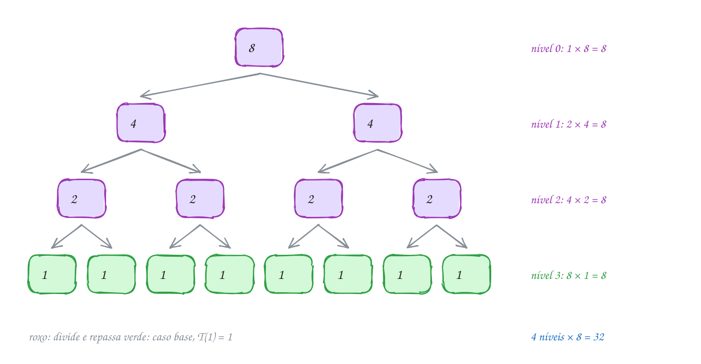
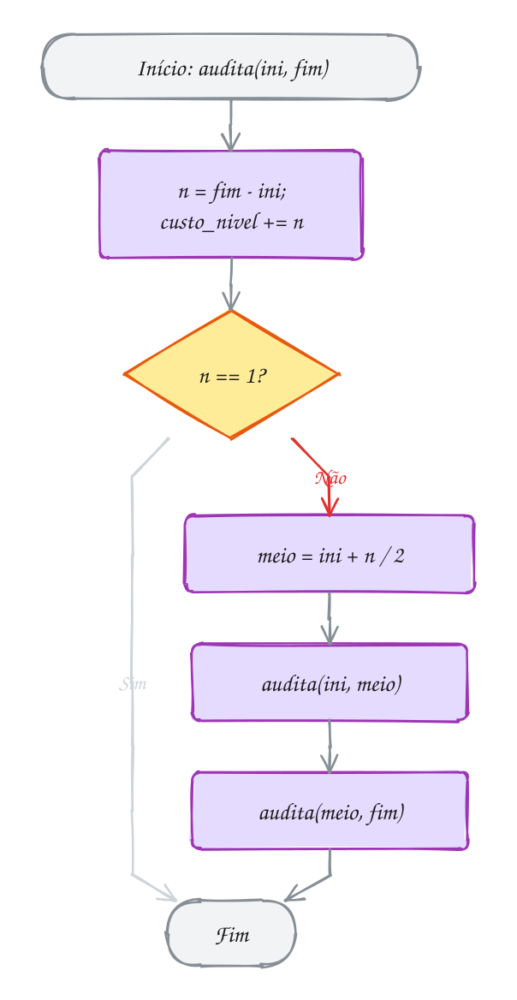
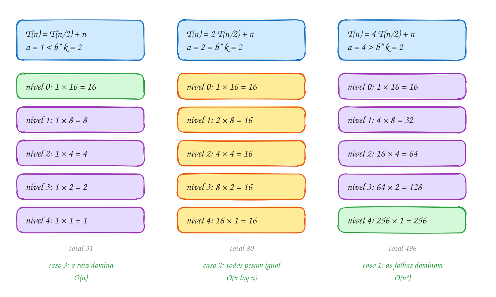
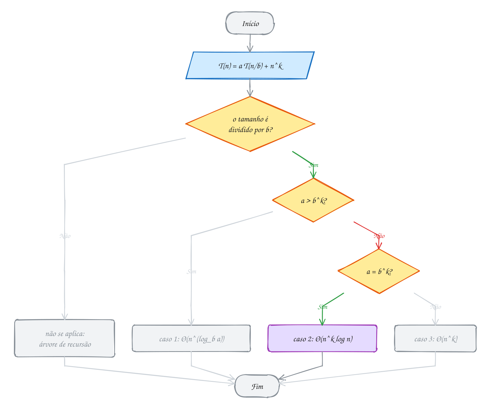
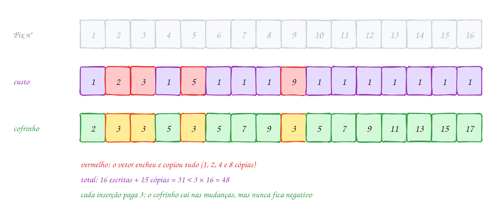
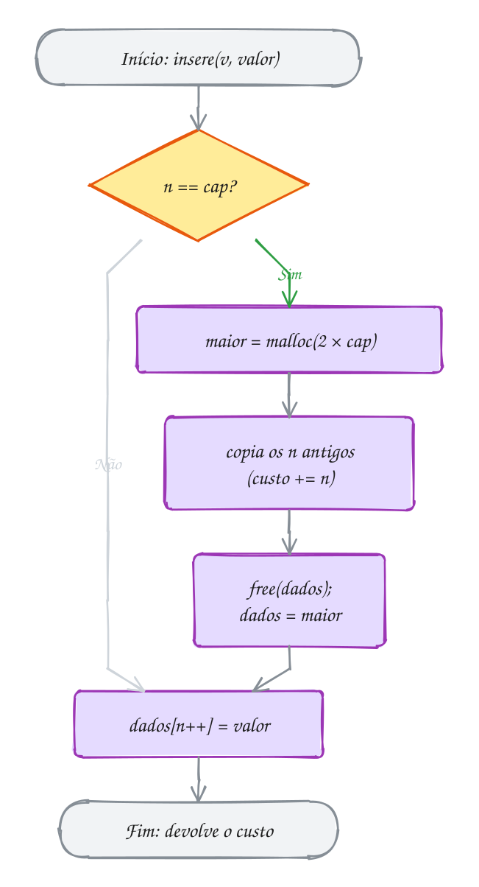
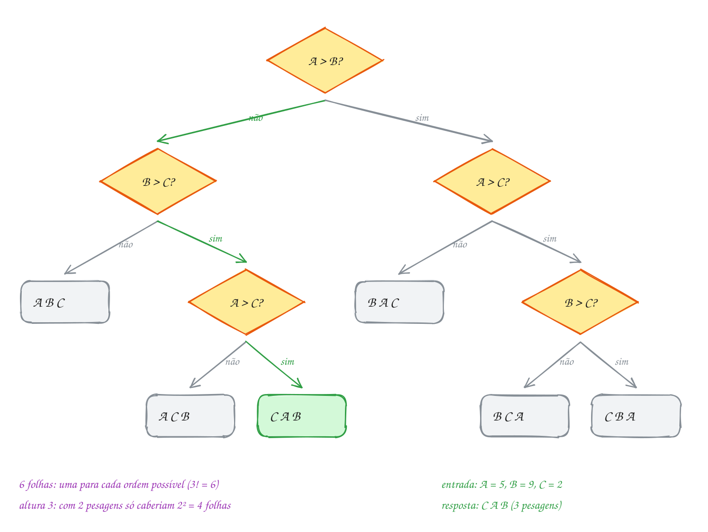
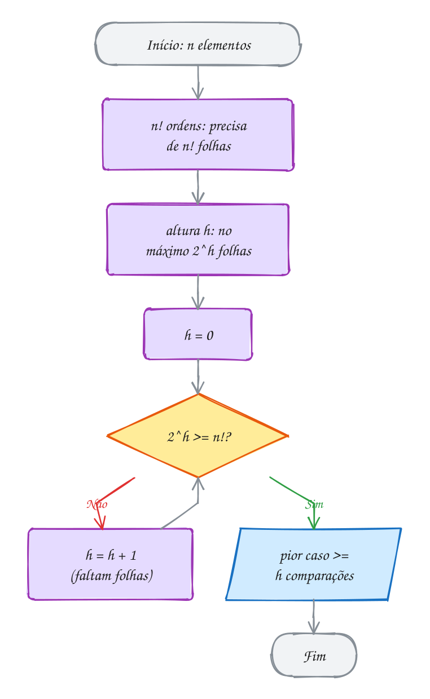
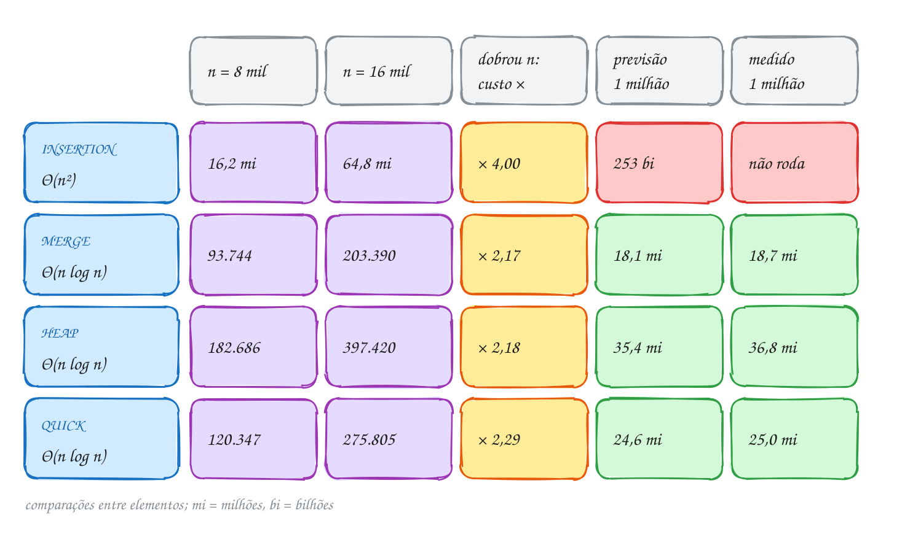
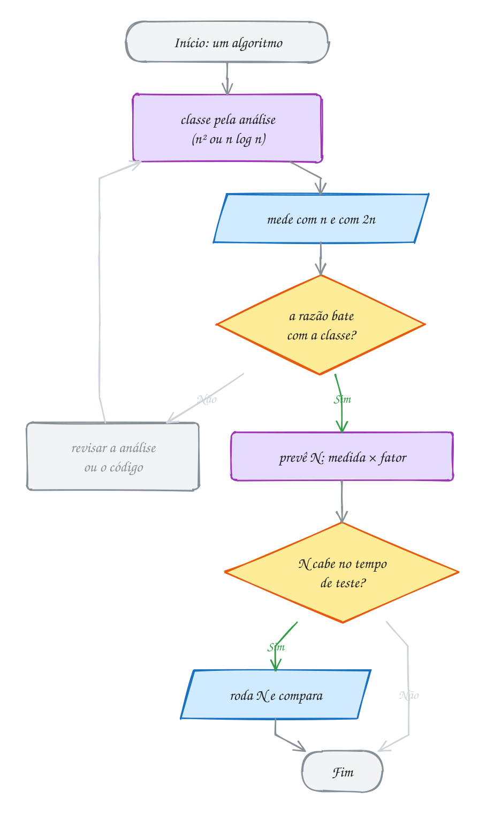

<!-- Gerado por _gerador. Para mudar este arquivo, edite _gerador/modulos/17-analise-avancada/ e rode: cd _gerador && npm run gerar -->

# Módulo 17 · Medindo algoritmos recursivos

No módulo 10 você aprendeu a contar passos e a ler a classe de um código
pelos laços: um laço é O(n), dois aninhados são O(n²), um laço que divide por
2 é O(log n). Funciona muito bem até aparecer uma função que chama a si
mesma. Quanto custa o merge sort? O "n log n" que você leu no módulo 13 veio
de um desenho e de um pouco de fé. Aqui ele vira conta.

Este módulo traz as ferramentas que faltavam para medir de verdade. A
**recorrência** transforma o código recursivo numa equação, e a **árvore de
recursão** resolve a equação somando nível por nível. O **teorema mestre**
resolve de uma vez as recorrências de divisão e conquista mais comuns. A
**análise amortizada** explica por que o vetor que dobra é barato, mesmo
copiando tudo de vez em quando. E o **limite inferior** responde a uma
pergunta nova: não "quanto custa este algoritmo?", mas "dá para fazer
melhor?". Para ordenar comparando, não dá: n log n é o piso.

A mudança na cabeça é olhar para o custo como um objeto que se calcula, se
prevê e se confere. No último assunto, você usa tudo isso para prever quanto
tempo quatro ordenações levam com 1 milhão de elementos, a partir de uma
medida com 16 mil, e confere a previsão no computador.

## O que você vai aprender

- escrever a **recorrência** de uma função recursiva lendo o código, e resolvê-la com a **árvore de recursão**
- a diferença entre `T(n-1)` e `T(n/2)`, e por que "duas chamadas" pode ser Θ(n) ou Θ(2ⁿ)
- o **teorema mestre**: os três casos, como reconhecer cada um e quando ele **não** se aplica
- a **análise amortizada**: método agregado e método do banqueiro no vetor que dobra, no contador binário e na pilha com multipop
- a **árvore de decisão** e o limite **Ω(n log n)** para ordenar por comparação
- as notações **Θ** e **Ω**, ao lado do **O** que você já conhece
- **medir** com `clock()` e contadores, e **prever** o tempo para entradas grandes

## Como estudar cada assunto

1. Leia o texto e olhe o **diagrama da ideia**: a árvore de recursão, a tabela
   de níveis ou a árvore de decisão do exemplo, com os mesmos números do código.
2. Leia o código. Quase todo exemplo deste módulo conta alguma coisa
   (chamadas, cópias, comparações) e confere a contagem com a fórmula.
3. Faça o **Passo a passo** com papel e lápis: abrir uma recorrência à mão é
   o melhor jeito de entender o que ela diz.
4. Siga o **fluxograma** com o dedo.
5. Rode os exemplos. Mude o `n`, dobre, quadruplique, e veja se a contagem
   cresce como a teoria manda.
6. Faça os exercícios. ★☆☆ é aquecimento, ★★☆ pede raciocínio, ★★★ é desafio.
   As dicas vêm logo abaixo do enunciado: tente antes de ler.

No meio de cada assunto tem uma **Pergunta para você**. Responda antes de rodar.

## As cores e as formas

Nos fluxogramas, caixa azul é dado entrando ou saindo, roxa é o programa
fazendo alguma coisa, amarela é pergunta. Verde é o caminho que o exemplo
segue; cinza, o que ele não usa.

Nos diagramas da ideia, **roxo** é trabalho sendo feito (uma chamada, um
nível), **verde** é o que domina o custo ou o resultado, **amarelo** marca
um empate ou uma pergunta, **vermelho** é o caro demais ou o que deu errado,
e **cinza** é o que o exemplo não percorreu.

<p align="center"></p>

## Antes de começar

Este módulo usa sem cerimônia: **recursão** e pilha de chamadas (0031 a
0033), **Big-O** e contagem de passos (0071 e 0072), o **vetor que cresce**
(0055 e 0075), **pilha** (0082) e **fila** (0085), as ordenações do módulo 13
(merge sort e quick sort, principalmente) e o **heap** (0102 e 0103). Também
aparecem ponteiros para função (0050), para guardar várias ordenações num
vetor.

Matemática: só potências e logaritmos. Lembre que `log₂ n` é "quantas vezes
dá para dividir n por 2 até chegar em 1" (`log₂ 1024 = 10`), e que
`log_b a` é o expoente que leva `b` a `a` (`log₂ 8 = 3`, `log₃ 9 = 2`). No C,
`log2` e `log` ficam em `<math.h>`, e o `rodar` já liga a biblioteca
matemática (`-lm`).

O último assunto tem um TAD na pasta, `ordena.h` e `ordena.c`, com as quatro
ordenações e um contador de comparações. O `rodar` compila o `ordena.c` junto
com qualquer exemplo ou exercício da pasta. Alguns programas medem **tempo**:
os números de tempo mudam de máquina para máquina e de uma execução para
outra; os de comparações, não. Os exercícios de "ache o erro" trazem o bug de
propósito, e o enunciado avisa.

| # | Assunto | Pasta |
| --- | --- | --- |
| [0114](#0114--recorrências-e-árvore-de-recursão) | Recorrências e árvore de recursão | [`0114-recorrencias/`](0114-recorrencias/) |
| [0115](#0115--teorema-mestre) | Teorema mestre | [`0115-teorema-mestre/`](0115-teorema-mestre/) |
| [0116](#0116--análise-amortizada) | Análise amortizada | [`0116-amortizada/`](0116-amortizada/) |
| [0117](#0117--limite-inferior-da-ordenação) | Limite inferior da ordenação | [`0117-limite-inferior/`](0117-limite-inferior/) |
| [0118](#0118--juntando-tudo) | Juntando tudo | [`0118-juntando-tudo/`](0118-juntando-tudo/) |

---

## 0114 · Recorrências e árvore de recursão

Fim de ano na contabilidade de uma rede de farmácias: chegou um lote de notas
fiscais para auditar. A chefe confere o lote inteiro (passa o olho em todas as
notas), divide em dois lotes iguais e entrega cada metade para um auditor.
Cada auditor faz a mesma coisa: confere o seu lote, divide, repassa. Quando
um lote fica com uma nota só, quem recebeu confere essa nota e pronto.

Quantas notas são olhadas no total? Não dá para responder contando laços,
como no módulo 10: o trabalho está escondido nas chamadas. É hora de uma
ferramenta nova.

Uma **recorrência** é uma equação que dá o custo de uma função recursiva em
termos do custo dela mesma com entradas menores. Chamando de `T(n)` o custo
para um lote de `n` notas:

```text
T(1) = 1                  (caso base: confere a nota e para)
T(n) = 2 T(n/2) + n       (duas chamadas com metade, mais n de trabalho)
```

Você escreve a recorrência **lendo o código**, em três perguntas:

1. **Quantas chamadas recursivas** a função faz, e com que tamanho? Aqui, 2
   chamadas de tamanho `n/2`: o termo `2 T(n/2)`.
2. **Quanto trabalho** ela faz fora das chamadas? Aqui, olhar as `n` notas:
   o termo `n`.
3. **Qual é o caso base**, e quanto ele custa? Aqui, `T(1) = 1`.

Escrever é a parte fácil. Para **resolver** (chegar numa fórmula sem `T` dos
dois lados), o jeito mais visual é a **árvore de recursão**: cada chamada
vira um nó com o trabalho que ela faz sozinha, e você soma **nível por
nível**. O nível `k` tem `2^k` chamadas, cada uma com um lote de `n/2^k`
notas: o nível inteiro custa `2^k · n/2^k = n`. Os lotes caem pela metade até
chegar em 1, então são `log₂ n + 1` níveis. Total: `n log₂ n + n`, ou seja,
**Θ(n log n)**.

O **Θ** (teta) é novo: ele diz que a função cresce **exatamente** naquele
ritmo, nem mais rápido nem mais devagar. O `O` do assunto 0072 é só um teto;
o Θ é teto e piso ao mesmo tempo. Quando você resolve uma recorrência até a
fórmula, sabe o ritmo exato, e o Θ é a palavra certa.

A forma da recorrência decide a forma da árvore. As cinco que você mais vai
ver:

| recorrência | árvore | resultado | exemplo |
| --- | --- | --- | --- |
| `T(n) = T(n-1) + 1` | uma linha de n nós | Θ(n) | percorrer lista recursivamente |
| `T(n) = T(n/2) + 1` | uma linha de log n nós | Θ(log n) | busca binária |
| `T(n) = T(n-1) + n` | uma linha, nós encolhendo | Θ(n²) | selection sort recursivo |
| `T(n) = 2 T(n/2) + n` | binária, log n níveis de custo n | Θ(n log n) | merge sort, a auditoria |
| `T(n) = 2 T(n-1) + 1` | binária, n níveis que dobram | Θ(2ⁿ) | Hanói (assunto 0033) |

Vamos ver na prática. Um lote de 8 notas. Cada caixa é uma chamada, com o
tamanho do lote que ela confere. Some cada linha: dá 8 em todas, e são 4
linhas:

<p align="center"></p>

O código conta as notas de cada nível num vetor indexado pela profundidade
da chamada. Depois confere a fórmula `n log₂ n + n` para lotes maiores:

```c
#include <stdio.h>

#define MAX_NIVEIS 32

long custo_nivel[MAX_NIVEIS]; // notas conferidas em cada nível da recursão

// confere o lote [ini, fim): olha todas as notas e divide o lote em dois
void audita(int ini, int fim, int nivel) {
    int n = fim - ini;
    custo_nivel[nivel] += n;            // trabalho fora das chamadas: n
    if (n == 1) {
        return;                         // caso base: uma nota só
    }
    int meio = ini + n / 2;
    audita(ini, meio, nivel + 1);       // T(n/2)
    audita(meio, fim, nivel + 1);       // T(n/2)
}

// zera os níveis, audita n notas e devolve o total
long total_auditado(int n, int mostrar) {
    for (int k = 0; k < MAX_NIVEIS; k++) {
        custo_nivel[k] = 0;
    }
    audita(0, n, 0);
    long total = 0;
    for (int k = 0; k < MAX_NIVEIS && custo_nivel[k] > 0; k++) {
        if (mostrar) {
            printf("nível %d: %ld notas\n", k, custo_nivel[k]);
        }
        total += custo_nivel[k];
    }
    return total;
}

int main(void) {
    printf("total: %ld notas\n\n", total_auditado(8, 1));

    int tamanhos[] = {8, 64, 1024, 1048576};
    int lg[] = {3, 6, 10, 20};          // log2 de cada tamanho
    printf("      n         T(n)   n log n + n\n");
    for (int i = 0; i < 4; i++) {
        int n = tamanhos[i];
        printf("%7d %12ld %12ld\n", n, total_auditado(n, 0), (long)n * lg[i] + n);
    }
    return 0;
}
// Saída:
// nível 0: 8 notas
// nível 1: 8 notas
// nível 2: 8 notas
// nível 3: 8 notas
// total: 32 notas
//
//       n         T(n)   n log n + n
//       8           32           32
//      64          448          448
//    1024        11264        11264
// 1048576     22020096     22020096
```

Repara no fluxograma: é a função `audita` inteira, e ele não tem laço. A
repetição está escondida nas duas caixas `audita`: cada uma é o fluxograma
inteiro de novo, para uma metade. Duas caixas com metade do lote: é isso que
o `2 T(n/2)` da recorrência conta. A caixa `custo_nivel += n` é o `+ n`:

<p align="center"></p>

### Passo a passo

A recorrência também se resolve "abrindo" o `T` até o caso base, com `n = 8`:

| passo | conta | valor |
| --- | --- | --- |
| T(1) | caso base | 1 |
| T(2) | 2 · T(1) + 2 = 2 + 2 | 4 |
| T(4) | 2 · T(2) + 4 = 8 + 4 | 12 |
| T(8) | 2 · T(4) + 8 = 24 + 8 | **32** |

Bate com a árvore (4 níveis de 8) e com o programa.

> [!WARNING]
> "Duas chamadas recursivas" não diz nada sozinho: o que decide é **o
> tamanho** que cada chamada recebe. `2 T(n/2) + 1` (achar o máximo dividindo
> o vetor ao meio) dá Θ(n): umas `2n` chamadas. `2 T(n-1) + 1` (Hanói) dá
> Θ(2ⁿ): para `n = 30`, mais de um bilhão de chamadas. A diferença entre `n/2` e `n-1`
> na chamada é a diferença entre um programa instantâneo e um que não termina
> hoje. Leia com cuidado os argumentos de cada chamada antes de escrever a
> recorrência.

> [!TIP]
> **Por dentro do C:** a árvore de recursão é o **filme** da pilha de
> chamadas (assunto 0031). Cada nó é um frame que nasce, trabalha e morre; a
> ordem em que o programa visita os nós é a de uma DFS na árvore. Por isso o
> **tempo** é a soma de todos os nós (`2n - 1 = 15` chamadas para 8 notas),
> mas a **memória** da pilha é só a altura: no máximo `log₂ n + 1 = 4` frames
> vivos ao mesmo tempo. Para 1 milhão de notas, são 2 milhões de chamadas e
> só 21 frames empilhados. A pilha só estoura quando a árvore é **funda**,
> como na linha de `n` nós de `T(n-1) + 1`.

> [!NOTE]
> **Pergunta para você:** e se a chefe, em vez de dividir ao meio, tirasse uma
> nota só do lote e repassasse as outras `n - 1` para um único auditor? A
> recorrência vira `T(n) = T(n-1) + n`. Quanto dá para 8 notas? E para 1024?
> Compare com 32 e 11.264.

### Hora de praticar

Os arquivos ficam em [`0114-recorrencias/`](0114-recorrencias/). Os comandos funcionam de qualquer pasta do terminal. Nos exemplos, rode, mude, quebre e rode de novo. Nos exercícios, a resposta vai dentro do próprio arquivo. ★☆☆ é aquecimento, ★★☆ pede raciocínio e ★★★ é desafio.

**Exemplo A227 · Duas chamadas, destinos diferentes**

```c
#include <stdio.h>

long chamadas = 0; // contador global: quantas vezes alguma função foi chamada

// maior valor de v[ini..fim-1] dividindo ao meio: T(n) = 2 T(n/2) + 1
int maximo(const int v[], int ini, int fim) {
    chamadas++;
    if (fim - ini == 1) {
        return v[ini];
    }
    int meio = ini + (fim - ini) / 2;
    int a = maximo(v, ini, meio);
    int b = maximo(v, meio, fim);
    return a > b ? a : b;
}

// Fibonacci ingênuo: T(n) = T(n-1) + T(n-2) + 1
long fib(int n) {
    chamadas++;
    if (n < 2) {
        return n;
    }
    return fib(n - 1) + fib(n - 2);
}

// soma de 1 a n, uma chamada por vez: T(n) = T(n-1) + 1
long soma(int n) {
    chamadas++;
    if (n == 0) {
        return 0;
    }
    return n + soma(n - 1);
}

int main(void) {
    int vendas[30];
    for (int i = 0; i < 30; i++) {
        vendas[i] = (i * 37) % 101; // vendas do dia, valores "embaralhados"
    }

    printf(" n | maximo: 2 T(n/2) + 1  | fib: T(n-1) + T(n-2) + 1  | soma: T(n-1) + 1\n");
    for (int n = 10; n <= 30; n += 10) {
        chamadas = 0;
        int m = maximo(vendas, 0, n);
        long c_max = chamadas;

        chamadas = 0;
        long f = fib(n);
        long c_fib = chamadas;

        chamadas = 0;
        long s = soma(n);
        long c_soma = chamadas;

        printf("%2d | %3d em %2ld chamadas    | %6ld em %7ld chamadas | %3ld em %2ld chamadas\n",
               n, m, c_max, f, c_fib, s, c_soma);
    }
    return 0;
}
// Saída:
//  n | maximo: 2 T(n/2) + 1  | fib: T(n-1) + T(n-2) + 1  | soma: T(n-1) + 1
// 10 |  94 em 19 chamadas    |     55 em     177 chamadas |  55 em 11 chamadas
// 20 |  97 em 39 chamadas    |   6765 em   21891 chamadas | 210 em 21 chamadas
// 30 |  97 em 59 chamadas    | 832040 em 2692537 chamadas | 465 em 31 chamadas
```

```bash
~/LPEDC/rodar 17-analise-avancada/0114-recorrencias/A227.c
```

**Exemplo A228 · Hanói: a árvore em que cada nível dobra**

```c
#include <stdio.h>

#define MAX_DISCOS 25

long movimentos_nivel[MAX_DISCOS]; // movimentos feitos em cada nível da recursão

// move n discos de 'de' para 'para' usando 'aux': T(n) = 2 T(n-1) + 1
void hanoi(int n, char de, char para, char aux, int nivel, int mostrar) {
    if (n == 0) {
        return;
    }
    if (mostrar) {
        printf("%*shanoi(%d, %c -> %c)\n", 2 * nivel, "", n, de, para);
    }
    hanoi(n - 1, de, aux, para, nivel + 1, mostrar); // tira os n-1 de cima
    movimentos_nivel[nivel]++;                       // move o disco maior: o "+ 1"
    hanoi(n - 1, aux, para, de, nivel + 1, mostrar); // põe os n-1 por cima
}

long resolve(int n, int mostrar) {
    for (int k = 0; k < MAX_DISCOS; k++) {
        movimentos_nivel[k] = 0;
    }
    hanoi(n, 'A', 'C', 'B', 0, mostrar);
    long total = 0;
    for (int k = 0; k < n; k++) {
        total += movimentos_nivel[k];
    }
    return total;
}

int main(void) {
    printf("A árvore de chamadas com 3 discos (o recuo é o nível):\n");
    resolve(3, 1);

    printf("\nCom 5 discos, nível por nível:\n");
    long total = resolve(5, 0);
    for (int k = 0; k < 5; k++) {
        printf("nível %d: %2ld × hanoi(%d), 1 movimento cada\n", k, movimentos_nivel[k], 5 - k);
    }
    printf("total: %ld = 2^5 - 1\n", total);

    printf("\n n   movimentos\n");
    for (int n = 5; n <= 20; n += 5) {
        printf("%2d %12ld\n", n, resolve(n, 0));
    }
    return 0;
}
// Saída:
// A árvore de chamadas com 3 discos (o recuo é o nível):
// hanoi(3, A -> C)
//   hanoi(2, A -> B)
//     hanoi(1, A -> C)
//     hanoi(1, C -> B)
//   hanoi(2, B -> C)
//     hanoi(1, B -> A)
//     hanoi(1, A -> C)
//
// Com 5 discos, nível por nível:
// nível 0:  1 × hanoi(5), 1 movimento cada
// nível 1:  2 × hanoi(4), 1 movimento cada
// nível 2:  4 × hanoi(3), 1 movimento cada
// nível 3:  8 × hanoi(2), 1 movimento cada
// nível 4: 16 × hanoi(1), 1 movimento cada
// total: 31 = 2^5 - 1
//
//  n   movimentos
//  5           31
// 10         1023
// 15        32767
// 20      1048575
```

```bash
~/LPEDC/rodar 17-analise-avancada/0114-recorrencias/A228.c
```

#### Exercícios

**Exercício E679** · ★☆☆

A busca binária recursiva abaixo segue a recorrência T(n) = T(n/2) + 1.
Confira isso no computador: acrescente um contador global de chamadas e
troque o main para buscar o valor 5 (menor que todos os CPFs, o pior caso
quando n é potência de 2) em pedaços de tamanho n = 1, 2, 4, ..., 1024 do
vetor, sempre a partir do índice 0, mostrando quantas chamadas cada busca
fez:


```text
Saída esperada:
   n  chamadas
   1  2
   2  3
   4  4
 ...
 512  11
1024  12
```

**Dicas:**

1. Declare long chamadas = 0; fora das funções e faça chamadas++ na
   primeira linha de busca, antes de qualquer return.
2. Zere o contador antes de cada busca. O laço de fora pode ser
   for (int n = 1; n <= 1024; n *= 2), chamando busca(cpfs, 0, n, 5).
3. Resposta esperada: a tabela acima, chamadas = log2(n) + 2. Um nível
   por divisão ao meio, mais a chamada com 1 elemento e a chamada com o
   pedaço vazio, que é quem devolve -1.

```bash
~/LPEDC/rodar 17-analise-avancada/0114-recorrencias/E679.c
```

**Exercício E680** · ★☆☆

Uma recorrência também é um programa: dá para calcular T(n) com uma função
recursiva que é a própria equação. Complete as três funções abaixo, todas
com caso base 1 quando n = 1:


```text
A(n) = A(n/2) + 1          (busca binária)
B(n) = 2 B(n/2) + 1        (máximo dividindo ao meio)
C(n) = 2 C(n/2) + n        (a auditoria do texto)
```


O main já mostra, ao lado de cada uma, a fórmula fechada que a árvore de
recursão dá. Se as colunas baterem, suas funções estão certas:


```text
Saída esperada:
 n | A(n) log+1 | B(n) 2n-1 | C(n) n log n + n
 1 |    1     1 |    1    1 |    1     1
 2 |    2     2 |    3    3 |    4     4
 4 |    3     3 |    7    7 |   12    12
 8 |    4     4 |   15   15 |   32    32
16 |    5     5 |   31   31 |   80    80
32 |    6     6 |   63   63 |  192   192
64 |    7     7 |  127  127 |  448   448
```

**Dicas:**

1. Cada função tem duas linhas de verdade: if (n == 1) return 1; e o
   return com a equação.
2. B não precisa de duas chamadas: 2 * rec_b(n / 2) + 1 calcula o mesmo
   valor com uma só (aqui você calcula o custo, não roda o algoritmo).
3. Resposta esperada: a tabela acima.

```bash
~/LPEDC/rodar 17-analise-avancada/0114-recorrencias/E680.c
```

**Exercício E681** · ★★☆

Um comparador de preços confere um lote de produtos assim: compara cada
preço do lote com TODOS os preços do lote (n² comparações), procurando
pares suspeitos, depois divide o lote ao meio e confere cada metade do
mesmo jeito. A recorrência é T(n) = 2 T(n/2) + n², com T(1) = 1.

O programa abaixo só mostra o total. Mude-o para contar as comparações
POR NÍVEL da recursão (como o custo_nivel do texto), mostrar os níveis
para n = 8 e depois os totais para n = 16, 32 e 64 ao lado de 2n² - n:


```text
Saída esperada:
nível 0: 64 comparações
nível 1: 32 comparações
nível 2: 16 comparações
nível 3: 8 comparações
total: 120

 n  T(n)  2n² - n
16   496   496
32  2016  2016
64  8128  8128
```


Repare: aqui o custo CAI pela metade a cada nível. É o oposto da
auditoria do texto, em que todo nível custava igual.

**Dicas:**

1. Troque o contador único por um vetor long custo_nivel[32] e passe o
   nível como parâmetro (a raiz é o nível 0; os filhos, nível + 1).
2. Antes de cada medição, zere o vetor inteiro.
3. Por que 2n² - n? Os níveis custam n², n²/2, n²/4, ..., n: a soma de
   uma progressão geométrica de razão 1/2 fica abaixo do dobro do
   primeiro termo. A raiz sozinha já é metade de tudo: Θ(n²).
4. Resposta esperada: a saída acima.

```bash
~/LPEDC/rodar 17-analise-avancada/0114-recorrencias/E681.c
```

**Exercício E682** · ★★☆

Escreva do zero um selection sort RECURSIVO, sem laço externo:
ordena(v, n) procura o maior de v[0..n-1], troca com v[n-1] e chama
ordena(v, n - 1). Cada chamada mostra quantas comparações fez, e o main
mostra o total e o vetor ordenado. Os preços são:


```text
42 17 88 5 63 29 71 10
```


```text
Saída esperada:
ordena(8): 7 comparações
ordena(7): 6 comparações
ordena(6): 5 comparações
ordena(5): 4 comparações
ordena(4): 3 comparações
ordena(3): 2 comparações
ordena(2): 1 comparação
total: 28 = 8 · 7 / 2
5 10 17 29 42 63 71 88
```

**Dicas:**

1. Caso base: com n <= 1 não há o que fazer.
2. A recorrência é T(n) = T(n-1) + (n - 1), com T(1) = 0. A árvore de
   recursão vira uma linha: 7 + 6 + ... + 1.
3. Some as comparações num contador global para o total.
4. Resposta esperada: a saída acima. Para n = 1000 seriam 499.500
   comparações: Θ(n²), mesmo sem nenhum laço aninhado no código. A
   recursão faz o papel do laço de fora.

```bash
~/LPEDC/rodar 17-analise-avancada/0114-recorrencias/E682.c
```

**Exercício E683** · ★★★

Conserte o programa. Ele acha a maior temperatura de 20 dias e a resposta
está certa, mas ele é lento demais para o que faz:


```text
Saída que aparece:
maior: 35 graus, 1048575 chamadas
```


Com 30 dias, o mesmo programa faria mais de um bilhão de chamadas. Leia
os argumentos das duas chamadas recursivas, escreva (num comentário) a
recorrência que o código segue de verdade, e conserte a divisão para que
cada chamada receba METADE do pedaço. Depois acrescente a medição para
30 dias:


```text
Saída esperada:
maior: 35 graus, 39 chamadas
30 dias: maior 35 graus, 59 chamadas
```

**Dicas:**

1. Com fim - ini = n, quantos elementos tem [ini, fim - 1)? E
   [ini + 1, fim)? Os dois pedaços quase inteiros se sobrepõem.
2. O código segue T(n) = 2 T(n-1) + 1, a recorrência de Hanói: 2^n - 1
   chamadas. Para n = 20, 2^20 - 1 = 1.048.575.
3. Use meio = ini + (fim - ini) / 2 e as chamadas [ini, meio) e
   [meio, fim). Agora é T(n) = 2 T(n/2) + 1: 2n - 1 chamadas.
4. Resposta esperada: 39 chamadas para 20 dias e 59 para 30.

```bash
~/LPEDC/rodar 17-analise-avancada/0114-recorrencias/E683.c
```

**Exercício E684** · ★★★

Quantas chamadas o fib ingênuo faz? A própria contagem segue uma
recorrência: fib(n) é 1 chamada mais as chamadas de fib(n-1) e de
fib(n-2). Com C(n) = número de chamadas:


```text
C(0) = C(1) = 1
C(n) = C(n-1) + C(n-2) + 1
```


Escreva um programa com três funções:
- fib(n), a recursiva ingênua, com um contador global de chamadas;
- conta_chamadas(n), que calcula C(n) com um LAÇO (sem recursão);
- fib_laco(n), que calcula o Fibonacci F(n) com um laço.

Mostre, para n = 5, 10, ..., 25, as chamadas contadas de verdade, C(n) e a
fórmula 2F(n+1) - 1. No fim, use só o laço para mostrar C(40) (rodar o
fib(40) levaria muito tempo) e a razão C(40) / C(39):


```text
Saída esperada:
 n  contadas    C(n)  2F(n+1)-1
 5        15      15         15
10       177     177        177
15      1973    1973       1973
20     21891   21891      21891
25    242785  242785     242785
C(40) = 331160281
C(40) / C(39) = 1.6180
```

**Dicas:**

1. O laço de conta_chamadas guarda só os dois últimos valores, como o
   Fibonacci iterativo: proximo = atual + anterior + 1.
2. Zere o contador antes de cada fib(n).
3. A razão tende a 1,618... (o número de ouro): cada n a mais multiplica
   as chamadas por 1,6. É isso que quer dizer Θ(1,618ⁿ).
4. Resposta esperada: a saída acima.

```bash
~/LPEDC/rodar 17-analise-avancada/0114-recorrencias/E684.c
```

---

## 0115 · Teorema mestre

Na declaração do Imposto de Renda, ninguém refaz a conta do imposto do zero.
Você acha a sua faixa na tabela progressiva e lê a alíquota. A tabela já
embute todo o cálculo: basta saber em que linha você cai.

O **teorema mestre** é a tabela pronta das recorrências de divisão e
conquista. No assunto anterior, cada recorrência pedia uma árvore de
recursão desenhada e somada nível por nível. Para a forma mais comum, essa
soma já foi feita uma vez, de modo geral, e o resultado cabe em três linhas.

A forma é esta:

```text
T(n) = a T(n/b) + n^k
```

- `a` (pelo menos 1) é **quantas chamadas** recursivas cada chamada faz;
- `b` (maior que 1) é **quanto o tamanho encolhe**: cada chamada recebe `n/b`;
- `n^k` é o **trabalho fora das chamadas**: `k = 0` é constante, `k = 1` é
  linear, `k = 2` é quadrático.

De onde vêm as três linhas? Da árvore. No nível `j` há `a^j` chamadas, cada
uma com tamanho `n/b^j`, custando `(n/b^j)^k`. O nível inteiro custa
`n^k · (a/b^k)^j`. Ou seja: de um nível para o seguinte, o custo é
multiplicado sempre pela mesma razão, `a/b^k`. Só há três possibilidades:

| caso | comparação | o custo por nível... | quem pesa | resultado |
| --- | --- | --- | --- | --- |
| 1 | `a > b^k` | **cresce** a cada nível | as folhas | Θ(n^(log_b a)) |
| 2 | `a = b^k` | fica **igual** | todos os níveis | Θ(n^k log n) |
| 3 | `a < b^k` | **cai** a cada nível | a raiz | Θ(n^k) |

Quando o custo cresce (caso 1), o último nível manda: ele tem
`a^(log_b n) = n^(log_b a)` folhas, e os níveis de cima, somados, não
passam de um múltiplo fixo dele. Quando fica igual (caso 2), são `log_b n + 1` níveis de `n^k`. Quando
cai (caso 3), a raiz sozinha já é uma fração fixa do total. Comparar `a`
com `b^k` é o mesmo que comparar o expoente `log_b a` com `k`.

Vamos ver na prática. Um escritório revisa um contrato de `n` páginas: o
revisor lê tudo (`n` páginas) e repassa **metade** do contrato para `a`
estagiários, que fazem o mesmo. Só o `a` muda: 1, 2 ou 4 estagiários. Com
`b = 2` e `k = 1`, temos `b^k = 2`, e cada valor de `a` cai numa linha
diferente da tabela. O desenho mostra a árvore de cada um para `n = 16`:

<p align="center"></p>

O código calcula o total de páginas lidas fazendo as `a` chamadas de
verdade. A última parte faz o teste prático do teorema: dobra o `n` e vê por
quanto o total é multiplicado:

```c
#include <stdio.h>

// o revisor lê as n páginas e repassa metade do contrato para 'a' estagiários
// T(n) = a T(n/2) + n, T(1) = 1
long paginas(int a, int n) {
    if (n == 1) {
        return 1;                        // uma página: lê e pronto
    }
    long total = n;                      // f(n) = n: lê tudo
    for (int i = 0; i < a; i++) {
        total += paginas(a, n / 2);      // a chamadas com metade
    }
    return total;
}

int main(void) {
    printf("    n      a = 1      a = 2      a = 4\n");
    for (int n = 16; n <= 1024; n *= 2) {
        printf("%5d", n);
        for (int a = 1; a <= 4; a *= 2) {
            printf(" %10ld", paginas(a, n));
        }
        printf("\n");
    }
    printf("\nquando n dobra (512 -> 1024), o total multiplica por:\n");
    for (int a = 1; a <= 4; a *= 2) {
        printf("a = %d: %.2f\n", a, (double)paginas(a, 1024) / paginas(a, 512));
    }
    return 0;
}
// Saída:
//     n      a = 1      a = 2      a = 4
//    16         31         80        496
//    32         63        192       2016
//    64        127        448       8128
//   128        255       1024      32640
//   256        511       2304     130816
//   512       1023       5120     523776
//  1024       2047      11264    2096128
//
// quando n dobra (512 -> 1024), o total multiplica por:
// a = 1: 2.00
// a = 2: 2.20
// a = 4: 4.00
```

Confira com a tabela. Com `a = 1`, `1 < 2`: caso 3, a raiz domina, Θ(n),
e o total é `2n - 1` (dobra quando `n` dobra). Com `a = 2`, `2 = 2`: caso 2,
empate, Θ(n log n), exatamente `n log₂ n + n` (dobra e mais um pouco). Com
`a = 4`, `4 > 2`: caso 1, as folhas dominam, Θ(n^(log₂ 4)) = Θ(n²), e o
total é `2n² - n` (quadruplica). Três escritórios, a mesma leitura de `n` páginas no topo, e
uma diferença de mil vezes em `n = 1024`.

Repara no fluxograma: é o teorema como receita. Primeiro a pergunta que
ninguém pode pular (a recorrência tem a forma certa?), depois a comparação
de `a` com `b^k`. O caminho marcado é o de `a = 2`:

<p align="center"></p>

A mesma receita resolve os algoritmos que você já conhece:

| algoritmo | a | b | k | b^k | resultado |
| --- | --- | --- | --- | --- | --- |
| busca binária | 1 | 2 | 0 | 1 | caso 2: Θ(log n) |
| máximo dividindo ao meio | 2 | 2 | 0 | 1 | caso 1: Θ(n) |
| merge sort | 2 | 2 | 1 | 2 | caso 2: Θ(n log n) |
| multiplicar polinômios com 3 produtos (Karatsuba) | 3 | 2 | 1 | 2 | caso 1: Θ(n^1,585) |
| algo que lê tudo e segue numa metade | 1 | 2 | 1 | 2 | caso 3: Θ(n) |

E quando o teorema **não** se aplica? Quando a recorrência não tem a forma
`a T(n/b) + n^k`: `T(n) = T(n-1) + n` (o tamanho cai **subtraindo**, não
dividindo), `T(n) = T(n/3) + T(2n/3) + n` (pedaços de tamanhos diferentes),
`T(n) = 2 T(n/2) + n log n` (o trabalho fica no meio do caminho entre `n^1`
e `n^(1+algo)`). Aí você volta para a árvore de recursão, que sempre
funciona. O exemplo A230 resolve dois desses casos.

> [!WARNING]
> `a` e `b` são coisas diferentes e não precisam ser iguais. `a` conta as
> chamadas; `b` diz quanto cada uma encolhe. Os quatro estagiários do exemplo
> recebem metade cada um, então é `4 T(n/2)`, e não `4 T(n/4)`: as metades se
> sobrepõem, e é isso que faz o custo explodir. E o erro mais comum de todos:
> aplicar o teorema em `T(n) = 2 T(n-1) + 1` (Hanói). Ali não existe `b`,
> porque `n - 1` não é `n` dividido por nada. Quem força `b = 1` chega num
> absurdo; o certo é a árvore, que dá Θ(2ⁿ).

> [!TIP]
> **Por dentro do C:** o `n / 2` do código é divisão inteira. Com `n` ímpar,
> as metades de um merge sort ficam com `⌊n/2⌋` e `⌈n/2⌉` elementos, e o
> teorema continua valendo: arredondar para cima ou para baixo não muda o
> Θ. O que muda tudo é o **caso base**. Se a função pode receber `n = 0`
> (um vetor vazio, um `n / 2` a partir de `n = 1`), um teste `if (n == 1)`
> deixa passar o zero, `0 / 2` dá 0 de novo, e a recursão nunca termina: a
> pilha estoura. Por isso o caso base mais seguro é `if (n <= 1)`.

> [!NOTE]
> **Pergunta para você:** e com `a = 3`? Antes de mudar o laço do `main`
> para `a = 1, 2, 3, 4`, diga em que linha da tabela o 3 cai e por quanto o
> total deve multiplicar quando `n` dobra. Uma pista: `log₂ 3 ≈ 1,585` e
> `2^1,585 = 3`.

### Hora de praticar

Os arquivos ficam em [`0115-teorema-mestre/`](0115-teorema-mestre/). Os comandos funcionam de qualquer pasta do terminal. Nos exemplos, rode, mude, quebre e rode de novo. Nos exercícios, a resposta vai dentro do próprio arquivo. ★☆☆ é aquecimento, ★★☆ pede raciocínio e ★★★ é desafio.

**Exemplo A229 · A tabela do teorema mestre em código**

```c
#include <math.h>
#include <stdio.h>

typedef struct {
    const char *nome;
    int a, b, k; // T(n) = a T(n/b) + n^k
} Recorrencia;

// b^k com inteiros: comparar a com b^k sem passar por double
long potencia(int b, int k) {
    long p = 1;
    for (int i = 0; i < k; i++) {
        p *= b;
    }
    return p;
}

// escreve n^k de um jeito legível em s: "1", "n", "n^2"...
void texto_nk(char s[], int tam, int k) {
    if (k == 0) {
        snprintf(s, tam, "1");
    } else if (k == 1) {
        snprintf(s, tam, "n");
    } else {
        snprintf(s, tam, "n^%d", k);
    }
}

void classifica(Recorrencia r) {
    char nk[8];
    texto_nk(nk, sizeof nk, r.k);
    printf("%d T(n/%d) + %-3s -> ", r.a, r.b, nk);

    long bk = potencia(r.b, r.k);
    if (r.a > bk) {
        double e = log(r.a) / log(r.b);  // log_b a, em double
        if (fabs(e - round(e)) < 1e-9) {
            printf("folhas: Θ(n^%.0f)", e); // expoente inteiro (com tolerância)
        } else {
            printf("folhas: Θ(n^%.3f)", e);
        }
    } else if (r.a == bk) {
        if (r.k == 0) {
            printf("empate: Θ(log n)");     // n^0 log n = log n
        } else {
            printf("empate: Θ(%s log n)", nk);
        }
    } else {
        printf("raiz: Θ(%s)", nk);
    }
    printf("   [%s]\n", r.nome);
}

int main(void) {
    Recorrencia lista[] = {
        {"busca binária", 1, 2, 0},
        {"busca em 3 partes", 1, 3, 0},
        {"máximo pelas metades", 2, 2, 0},
        {"merge sort", 2, 2, 1},
        {"Karatsuba", 3, 2, 1},
        {"matriz por blocos", 8, 2, 2},
        {"Strassen", 7, 2, 2},
        {"lê tudo e segue numa metade", 1, 2, 1},
        {"3 terços e trabalho n²", 3, 3, 2},
    };
    int total = sizeof lista / sizeof lista[0];
    for (int i = 0; i < total; i++) {
        classifica(lista[i]);
    }
    return 0;
}
// Saída:
// 1 T(n/2) + 1   -> empate: Θ(log n)   [busca binária]
// 1 T(n/3) + 1   -> empate: Θ(log n)   [busca em 3 partes]
// 2 T(n/2) + 1   -> folhas: Θ(n^1)   [máximo pelas metades]
// 2 T(n/2) + n   -> empate: Θ(n log n)   [merge sort]
// 3 T(n/2) + n   -> folhas: Θ(n^1.585)   [Karatsuba]
// 8 T(n/2) + n^2 -> folhas: Θ(n^3)   [matriz por blocos]
// 7 T(n/2) + n^2 -> folhas: Θ(n^2.807)   [Strassen]
// 1 T(n/2) + n   -> raiz: Θ(n)   [lê tudo e segue numa metade]
// 3 T(n/3) + n^2 -> raiz: Θ(n^2)   [3 terços e trabalho n²]
```

```bash
~/LPEDC/rodar 17-analise-avancada/0115-teorema-mestre/A229.c
```

**Exemplo A230 · Quando a tabela não serve: medindo na mão**

```c
#include <stdio.h>

// log2 inteiro: quantas vezes dá para dividir n por 2
int lg(long n) {
    int k = 0;
    while (n > 1) {
        n /= 2;
        k++;
    }
    return k;
}

// T(n) = 2 T(n/2) + n log n: o trabalho fica entre n e n^(1+algo)
long t_nlogn(long n) {
    if (n <= 1) {
        return 1;
    }
    return 2 * t_nlogn(n / 2) + n * lg(n);
}

// T(n) = T(n/3) + T(2n/3) + n: pedaços de tamanhos diferentes
long t_desigual(long n) {
    if (n <= 1) {
        return 1;
    }
    return t_desigual(n / 3) + t_desigual(2 * n / 3) + n;
}

// T(n) = T(n-1) + n: o tamanho cai subtraindo (calculado com laço)
long t_subtrai(long n) {
    long t = 1; // T(1)
    for (long i = 2; i <= n; i++) {
        t += i;
    }
    return t;
}

int main(void) {
    // se T/(n lg n) cresce sem parar, não é n log n; se T/(n lg² n) para
    // perto de uma constante, é Θ(n log² n)
    printf("2 T(n/2) + n log n:\n");
    printf("      n  T/(n lg n)  T/(n lg² n)\n");
    for (long n = 1024; n <= 1048576; n *= 32) {
        double t = t_nlogn(n);
        int l = lg(n);
        printf("%7ld %10.2f %11.3f\n", n, t / ((double)n * l), t / ((double)n * l * l));
    }

    // todo nível custa no máximo n, e são uns log n níveis: Θ(n log n)
    printf("\nT(n/3) + T(2n/3) + n:\n");
    printf("      n  T/(n lg n)\n");
    for (long n = 1024; n <= 1048576; n *= 32) {
        printf("%7ld %10.2f\n", n, t_desigual(n) / ((double)n * lg(n)));
    }

    // dobrar n quadruplica o total: Θ(n²), nada a ver com o "a = 1"
    printf("\nT(n-1) + n, dobrando n:\n");
    for (long n = 1000; n <= 8000; n *= 2) {
        printf("T(%ld) / T(%ld) = %.2f\n", 2 * n, n, (double)t_subtrai(2 * n) / t_subtrai(n));
    }
    return 0;
}
// Saída:
// 2 T(n/2) + n log n:
//       n  T/(n lg n)  T/(n lg² n)
//    1024       5.60       0.560
//   32768       8.07       0.538
// 1048576      10.55       0.527
//
// T(n/3) + T(2n/3) + n:
//       n  T/(n lg n)
//    1024       1.05
//   32768       1.06
// 1048576       1.07
//
// T(n-1) + n, dobrando n:
// T(2000) / T(1000) = 4.00
// T(4000) / T(2000) = 4.00
// T(8000) / T(4000) = 4.00
// T(16000) / T(8000) = 4.00
```

```bash
~/LPEDC/rodar 17-analise-avancada/0115-teorema-mestre/A230.c
```

#### Exercícios

**Exercício E685** · ★☆☆

Complete a função caso(a, b, k): ela recebe uma recorrência
T(n) = a T(n/b) + n^k e devolve o número do caso do teorema mestre
(1 se a > b^k, 2 se a = b^k, 3 se a < b^k). Calcule b^k com inteiros,
numa função potencia(b, k) com um laço. O main já testa sete
recorrências:


```text
Saída esperada:
 2 T(n/2) + n^1 -> caso 2, empate: Θ(n^k log n)
 4 T(n/2) + n^1 -> caso 1, folhas: Θ(n^(log_b a))
 1 T(n/2) + n^1 -> caso 3, raiz: Θ(n^k)
 9 T(n/3) + n^2 -> caso 2, empate: Θ(n^k log n)
 5 T(n/4) + n^1 -> caso 1, folhas: Θ(n^(log_b a))
 2 T(n/4) + n^1 -> caso 3, raiz: Θ(n^k)
16 T(n/4) + n^2 -> caso 2, empate: Θ(n^k log n)
```

**Dicas:**

1. potencia(b, k) começa com p = 1 e multiplica por b, k vezes. Use long.
2. Depois são dois if: a > bk devolve 1; a == bk devolve 2; senão, 3.
3. Resposta esperada: a saída acima. Repare no 9 T(n/3) + n²: 9 = 3²,
   então é empate, Θ(n² log n).

```bash
~/LPEDC/rodar 17-analise-avancada/0115-teorema-mestre/E685.c
```

**Exercício E686** · ★☆☆

A função trabalho(n) abaixo segue T(n) = 3 T(n/2) + n. Pelo teorema
(a = 3 > b^k = 2, caso 1), T(n) = Θ(n^(log₂ 3)) = Θ(n^1,585): quando n
dobra, o total deve ser multiplicado por 2^1,585 = 3. Confira no
computador: complete o main para mostrar T(n) e a razão T(n) / T(n/2)
para n = 64, 128, ..., 4096:


```text
Saída esperada:
    n     T(n)  T(n)/T(n/2)
   64     2059    3.096
  128     6305    3.062
  256    19171    3.041
  512    58025    3.027
 1024   175099    3.018
 2048   527345    3.012
 4096  1586131    3.008
```

**Dicas:**

1. Guarde o valor anterior numa variável: comece com anterior =
   trabalho(32) e, a cada volta, atualize anterior = t.
2. A divisão precisa de um cast: (double)t / anterior.
3. Resposta esperada: a tabela acima. A razão começa um pouco acima de 3
   (o "+ n" ainda pesa com n pequeno) e vai chegando em 3.

```bash
~/LPEDC/rodar 17-analise-avancada/0115-teorema-mestre/E686.c
```

**Exercício E687** · ★★☆

As 1024 notas de um concurso (de 0 a 10) estão em ordem crescente. A
função conta_lento conta quantas notas 7 existem dividindo o vetor ao
meio, mas olha SEMPRE as duas metades: T(n) = 2 T(n/2) + 1, caso 1 do
teorema, Θ(n). Ela não aproveita que o vetor está ordenado.

Escreva primeira(v, ini, fim, x), recursiva, que devolve a primeira
posição de v[ini..fim-1] com valor >= x (ou fim, se não houver),
seguindo só UMA metade a cada chamada: T(n) = T(n/2) + 1, caso 2,
Θ(log n). Conte as chamadas no mesmo contador global. As notas 7 são as
que ficam entre primeira(..., 7) e primeira(..., 8):


```text
Saída esperada:
lento:  93 notas 7 em 2047 chamadas
rápido: 93 notas 7 em 22 chamadas
```

**Dicas:**

1. Caso base: com ini == fim, o pedaço está vazio; devolva ini.
2. Se v[meio] < x, a resposta está à direita: [meio + 1, fim). Senão,
   o próprio meio pode ser a resposta: [ini, meio).
3. Quantidade = primeira(notas, 0, 1024, 8) - primeira(notas, 0, 1024, 7).
4. Resposta esperada: a saída acima (11 chamadas em cada busca). Com um
   milhão de notas, o lento faria 2 milhões de chamadas; o rápido, uns 42.

```bash
~/LPEDC/rodar 17-analise-avancada/0115-teorema-mestre/E687.c
```

**Exercício E688** · ★★☆

Se dividir ao meio dá log₂ n, dividir em três não seria melhor? Teste.
Escreva duas buscas RECURSIVAS num vetor ordenado v[0..N-1] com os
números pares 0, 2, 4, ..., contando cada comparação com um elemento do
vetor (cada == , < ou > com v[...]):

- binaria(ini, fim, x): compara x == v[meio]; depois x < v[meio] e segue
numa metade. T(n) = T(n/2) + 2.
- ternaria(ini, fim, x): com terco = (fim - ini) / 3, m1 = ini + terco e
m2 = fim - 1 - terco, compara x == v[m1], x == v[m2], x < v[m1] e
x > v[m2], e segue num dos três pedaços. T(n) = T(n/3) + 4.

Pelo teorema, as duas são caso 2, Θ(log n). Mas a constante importa.
Faça 1000 buscas por números ÍMPARES (que não estão no vetor), com
x = 2 * ((i * 7919) % N) + 1 para i de 0 a 999, e mostre a média:


```text
Saída esperada:
binária: 39.9 comparações por busca
ternária: 47.3 comparações por busca
```

**Dicas:**

1. Use intervalo semiaberto [ini, fim): o pedaço vazio (ini >= fim)
   devolve -1. Os três pedaços da ternária são [ini, m1), [m1 + 1, m2) e
   [m2 + 1, fim).
2. (long)i * 7919 evita estouro? Aqui não estoura, mas é bom hábito.
3. Por que perde? A binária gasta 2 comparações para dividir por 2
   (2 · log₂ n ≈ 40). A ternária gasta até 4 para dividir por 3
   (4 · log₃ n ≈ 4 · 12,6 ≈ 50; um pouco menos, porque às vezes para
   na terceira). Θ igual não quer dizer tempo igual.
4. Resposta esperada: a saída acima.

```bash
~/LPEDC/rodar 17-analise-avancada/0115-teorema-mestre/E688.c
```

**Exercício E689** · ★★★

Multiplicar dois polinômios de n coeficientes (n potência de 2) dividindo
cada um em duas metades, a(x) = a0 + a1·x^h e b(x) = b0 + b1·x^h, com
h = n/2, pede os produtos a0·b0, a0·b1, a1·b0 e a1·b1. A função
multiplica4 faz isso: T(n) = 4 T(n/2) + n, caso 1, Θ(n²) multiplicações.

O truque de Karatsuba precisa de só TRÊS produtos:


```text
p0 = a0·b0     p2 = a1·b1     p1 = (a0 + a1)·(b0 + b1) - p0 - p2
```


e o resultado é p0 + p1·x^h + p2·x^(2h). Agora T(n) = 3 T(n/2) + n:
ainda caso 1, mas Θ(n^(log₂ 3)) = Θ(n^1,585). Escreva multiplica3 e rode:


```text
Saída esperada:
4 produtos: 5 16 34 60 61 52 32  (16 multiplicações)
3 produtos: 5 16 34 60 61 52 32  (9 multiplicações)
n =  64:   4096 contra   729 multiplicações, mesmo resultado
n = 128:  16384 contra  2187 multiplicações, mesmo resultado
n = 256:  65536 contra  6561 multiplicações, mesmo resultado
```

**Dicas:**

1. Copie a estrutura de multiplica4: caso base n == 1 (conta 1
   multiplicação) e, no caso geral, um bloco de rascunho com malloc.
2. O rascunho precisa de 3 produtos de 2h - 1 coeficientes e das somas
   sa = a0 + a1 e sb = b0 + b1, de h coeficientes cada.
3. Monte o resultado como em multiplica4: r[i] += p0[i];
   r[i + h] += p1[i]; r[i + 2h] += p2[i]. Não esqueça do free.
4. Resposta esperada: a saída acima. 16 = 4², 729 = 3⁶, 6561 = 3⁸: com
   n = 2^j, são 4^j contra 3^j multiplicações.

```bash
~/LPEDC/rodar 17-analise-avancada/0115-teorema-mestre/E689.c
```

**Exercício E690** · ★★★

Ache o bug. Este classificador do teorema mestre calcula o expoente
c = log_b a com double e compara com k. Ele acerta quase tudo, mas erra
três das sete recorrências do teste:


```text
Saída que aparece:
   2 T(n/2)  + n^1 -> empate
   4 T(n/2)  + n^1 -> folhas
   1 T(n/2)  + n^1 -> raiz
 125 T(n/5)  + n^3 -> folhas
1000 T(n/10) + n^3 -> raiz
 216 T(n/6)  + n^3 -> folhas
   8 T(n/2)  + n^3 -> empate
```


```text
Saída esperada:
   2 T(n/2)  + n^1 -> empate
   4 T(n/2)  + n^1 -> folhas
   1 T(n/2)  + n^1 -> raiz
 125 T(n/5)  + n^3 -> empate
1000 T(n/10) + n^3 -> empate
 216 T(n/6)  + n^3 -> empate
   8 T(n/2)  + n^3 -> empate
```


Descubra por que (mostre c com %.17g para conferir) e conserte a função
para que ela nunca dependa da precisão do double.

**Dicas:**

1. 125 = 5³, 1000 = 10³ e 216 = 6³: nos três, log_b a deveria ser 3
   exatamente. O que o printf com %.17g mostra?
2. log(125) / log(5) dá 3.0000000000000004. Os logaritmos são
   arredondados para caber no double, e o == entre doubles quase nunca
   é o que você quer.
3. O conserto mais limpo nem usa log: compare a com b^k, calculado com
   inteiros num laço. a > b^k é folhas; a == b^k, empate; senão, raiz.
   (Outra saída, pior: considerar iguais se fabs(c - k) < 1e-9.)
4. Resposta esperada: a saída esperada acima.

```bash
~/LPEDC/rodar 17-analise-avancada/0115-teorema-mestre/E690.c
```

---

## 0116 · Análise amortizada

Uma família mora num apartamento de um quarto. Nasce o primeiro filho: muda
para um de dois quartos. Depois para um de quatro. Cada mudança é um dia
inteiro carregando **todos** os móveis, mas é rara: entre uma e outra, a
vida segue barata. Ninguém mede o custo de morar pela pior semana do ano.

O vetor que cresce do assunto 0075 vive a mesma coisa. Inserir no fim custa
uma escrita, até o dia em que o vetor enche: aí é preciso alocar um maior e
**copiar tudo**. Olhando uma operação isolada, o pior caso de uma inserção é
O(n). Multiplicando por `n` inserções, dá O(n²). A conta está certa, mas é
pessimista demais: as inserções caras não acontecem uma atrás da outra.

A **análise amortizada** mede o custo de uma **sequência** de operações, no
pior caso, e divide pelo número de operações. O resultado é o **custo
amortizado** por operação: uma garantia sobre o total, sem nenhum sorteio
envolvido.

O jeito mais direto é o **método agregado**: somar tudo. Com capacidade
inicial 1 e dobrando quando enche, `n` inserções fazem `n` escritas mais as
cópias das mudanças: `1 + 2 + 4 + ... + (a última potência de 2 menor que
n)`. Essa soma é sempre menor que `2n`. O total fica abaixo de `3n`: **O(1)
amortizado** por inserção.

O outro jeito é o **método do banqueiro** (ou contábil). Cada inserção paga
um preço fixo, digamos **3 moedas**: 1 paga a própria escrita e 2 vão para
um cofrinho. Quando o vetor de capacidade `c` enche e vira `2c`, metade dos
`c` elementos chegou depois da última mudança, e cada um guardou 2 moedas:
são `c` moedas, exatamente as `c` cópias. Se o cofrinho **nunca fica
negativo**, o preço fixo cobre o custo real, e o custo amortizado é 3.

Vamos ver na prática. O app do banco guarda o histórico de Pix num vetor que
começa com 1 posição e dobra quando enche. Chegam 16 Pix. As inserções 2, 3,
5 e 9 são as mudanças, em vermelho; o cofrinho embaixo cai nelas e se
recupera depois:

<p align="center"></p>

O `insere` devolve o custo real de cada inserção. O vetor cresce com
`malloc`, cópia e `free` feitos à mão, para dar para contar cada cópia:

```c
#include <stdio.h>
#include <stdlib.h>

typedef struct {
    int *dados;
    int n;   // quantos tem
    int cap; // quantos cabem
} Vetor;

// insere no fim e devolve o custo: 1 escrita + as cópias, se precisou crescer
int insere(Vetor *v, int valor) {
    int custo = 1;
    if (v->n == v->cap) {
        int nova = v->cap * 2;                       // dobra
        int *maior = malloc(nova * sizeof *maior);
        if (maior == NULL) {
            exit(1);
        }
        for (int i = 0; i < v->n; i++) {
            maior[i] = v->dados[i];                  // a mudança: copia tudo
            custo++;
        }
        free(v->dados);
        v->dados = maior;
        v->cap = nova;
    }
    v->dados[v->n++] = valor;
    return custo;
}

int main(void) {
    Vetor v = {malloc(sizeof(int)), 0, 1};
    if (v.dados == NULL) {
        return 1;
    }
    int total = 0, cofrinho = 0;
    printf("Pix  custo  cofrinho\n");
    for (int i = 1; i <= 16; i++) {
        int custo = insere(&v, 100 * i);             // valor do Pix, tanto faz
        total += custo;
        cofrinho += 3 - custo;                       // cada inserção paga 3
        printf("%3d  %5d  %8d\n", i, custo, cofrinho);
    }
    printf("total: %d para 16 inserções (%.2f por inserção)\n", total, total / 16.0);
    free(v.dados);
    return 0;
}
// Saída:
// Pix  custo  cofrinho
//   1      1         2
//   2      2         3
//   3      3         3
//   4      1         5
//   5      5         3
//   6      1         5
//   7      1         7
//   8      1         9
//   9      9         3
//  10      1         5
//  11      1         7
//  12      1         9
//  13      1        11
//  14      1        13
//  15      1        15
//  16      1        17
// total: 31 para 16 inserções (1.94 por inserção)
```

As cópias somam `1 + 2 + 4 + 8 = 15`, mais 16 escritas: 31, menos de `2 · 16`.
O cofrinho desce até 3 em cada mudança e nunca chega a zero. As duas contas
dizem a mesma coisa: em média, menos de 2 por inserção, e nunca mais de 3.

Repara no fluxograma: é o `insere` da 9ª inserção, a mais cara das 16. O
vetor tem 8 de 8 ocupados, então o caminho passa pela mudança inteira:

<p align="center"></p>

O vetor que dobra não é o único caso. O assunto também aparece num
**contador binário** (somar 1 às vezes vira muitos bits, mas em média vira
menos de 2; exemplo A231) e numa **pilha com `multipop(k)`**, que tira até
`k` itens de uma vez (cada item só sai uma vez depois de entrar; exemplo
A232). Nos três, o argumento é o mesmo: a operação cara "gasta" um trabalho
que as baratas acumularam antes.

Duas confusões comuns. Amortizado **não** é caso médio: o caso médio supõe
entradas sorteadas, e o amortizado vale para a **pior** sequência possível.
E amortizado **não** garante que cada operação é rápida: a 1.048.577ª
inserção copia mais de um milhão de elementos de uma vez. Para quem conta o
total, tudo bem; para um sistema que não pode travar nem por um instante,
pode não estar.

> [!WARNING]
> Crescer de um **tamanho fixo** em vez de multiplicar estraga tudo. Com
> `nova = cap + 10`, as mudanças acontecem a cada 10 inserções e copiam 10,
> 20, 30... elementos: para 100.000 inserções, quase **500 milhões** de
> cópias, contra 131.071 dobrando. A soma `10 + 20 + ... ` é uma progressão
> aritmética, Θ(n²) no total: O(n) amortizado por inserção. Qualquer fator
> multiplicativo maior que 1 (1,5 ou 2) dá O(1) amortizado; somar uma
> constante, por maior que seja, não dá.

> [!TIP]
> **Por dentro do C:** na prática você usa `realloc` (assunto 0055), e às
> vezes ele nem copia: se o espaço logo depois do bloco estiver livre, ele
> só estica o bloco no lugar. Mas isso não é garantido, e a análise conta o
> pior caso: copiar tudo. O preço do O(1) amortizado é memória: logo depois
> de dobrar, metade do vetor está vazia. Com 1.048.577 inteiros, o vetor
> ocupa espaço para 2.097.152, 8 MB em vez de 4 MB. E lembre do `realloc`
> seguro: `int *novo = realloc(v, ...)` num ponteiro à parte, conferindo
> `NULL` antes de jogar fora o antigo.

> [!NOTE]
> **Pergunta para você:** e na volta? Suponha que o vetor também **encolhe
> pela metade** quando fica com metade das posições ocupadas. Com 16
> elementos e capacidade 16, o que acontece se o programa alternar "insere,
> remove, insere, remove..." mil vezes? Quantas cópias cada operação faz?

### Hora de praticar

Os arquivos ficam em [`0116-amortizada/`](0116-amortizada/). Os comandos funcionam de qualquer pasta do terminal. Nos exemplos, rode, mude, quebre e rode de novo. Nos exercícios, a resposta vai dentro do próprio arquivo. ★☆☆ é aquecimento, ★★☆ pede raciocínio e ★★★ é desafio.

**Exemplo A231 · O contador binário da catraca**

```c
#include <stdio.h>

#define BITS 24

// soma 1 ao contador (bit 0 em b[0]) e devolve quantos bits mudaram
int incrementa(int b[]) {
    int i = 0, trocas = 0;
    while (i < BITS && b[i] == 1) {
        b[i] = 0;                 // o vai-um zera os 1 do fim
        trocas++;
        i++;
    }
    if (i < BITS) {
        b[i] = 1;                 // e acende o primeiro 0
        trocas++;
    }
    return trocas;
}

void mostra(const int b[], int bits) {
    for (int i = bits - 1; i >= 0; i--) {
        printf("%d", b[i]);
    }
}

int main(void) {
    int b[BITS] = {0};
    int total = 0;
    printf("passou  contador  bits trocados\n");
    for (int k = 1; k <= 16; k++) {
        int t = incrementa(b);
        total += t;
        printf("%6d     ", k);
        mostra(b, 5);
        printf("  %d\n", t);
    }
    printf("16 passageiros: %d trocas (pior caso de um incremento: 5)\n\n", total);

    // um milhão de passageiros: quanto cada bit trocou
    int c[BITS] = {0};
    long por_bit[BITS] = {0}, soma = 0;
    for (long k = 1; k <= 1000000; k++) {
        int antes[BITS];
        for (int i = 0; i < BITS; i++) {
            antes[i] = c[i];
        }
        soma += incrementa(c);
        for (int i = 0; i < BITS; i++) {
            if (c[i] != antes[i]) {
                por_bit[i]++;
            }
        }
    }
    for (int i = 0; i < 4; i++) {
        printf("bit %d trocou %ld vezes\n", i, por_bit[i]);
    }
    printf("...\n1000000 incrementos: %ld trocas (%.6f por incremento)\n", soma, soma / 1e6);
    return 0;
}
// Saída:
// passou  contador  bits trocados
//      1     00001  1
//      2     00010  2
//      3     00011  1
//      4     00100  3
//      5     00101  1
//      6     00110  2
//      7     00111  1
//      8     01000  4
//      9     01001  1
//     10     01010  2
//     11     01011  1
//     12     01100  3
//     13     01101  1
//     14     01110  2
//     15     01111  1
//     16     10000  5
// 16 passageiros: 31 trocas (pior caso de um incremento: 5)
//
// bit 0 trocou 1000000 vezes
// bit 1 trocou 500000 vezes
// bit 2 trocou 250000 vezes
// bit 3 trocou 125000 vezes
// ...
// 1000000 incrementos: 1999993 trocas (1.999993 por incremento)
```

```bash
~/LPEDC/rodar 17-analise-avancada/0116-amortizada/A231.c
```

**Exemplo A232 · Pilha de pratos com multipop**

```c
#include <stdio.h>

#define CAP 1000000

typedef struct {
    int v[CAP];
    int topo; // quantos pratos tem
} Pilha;

int empilha(Pilha *p, int prato) {
    p->v[p->topo++] = prato;
    return 1;                              // custo 1
}

// tira até k pratos de uma vez; custo = quantos saíram de verdade
int multipop(Pilha *p, int k) {
    int saiu = 0;
    while (saiu < k && p->topo > 0) {
        p->topo--;
        saiu++;
    }
    return saiu;
}

int main(void) {
    Pilha p = {.topo = 0};
    // o que acontece na cozinha: 'E' = chega um prato sujo, 'L' = a
    // lava-louças leva até k pratos
    char tipo[] = {'E', 'E', 'E', 'E', 'E', 'L', 'E', 'E', 'L', 'E', 'E', 'E', 'E', 'L', 'L'};
    int k[] = {0, 0, 0, 0, 0, 3, 0, 0, 10, 0, 0, 0, 0, 2, 5};
    int ops = sizeof tipo / sizeof tipo[0];

    int total = 0, empilhados = 0, prato = 0, maior_custo = 0;
    for (int i = 0; i < ops; i++) {
        int custo;
        if (tipo[i] == 'E') {
            custo = empilha(&p, ++prato);
            empilhados++;
        } else {
            custo = multipop(&p, k[i]);
            printf("lava até %2d: saíram %d, sobraram %d\n", k[i], custo, p.topo);
        }
        total += custo;
        if (custo > maior_custo) {
            maior_custo = custo;
        }
    }
    printf("%d operações, %d empilhamentos\n", ops, empilhados);
    printf("operação mais cara: %d; custo total: %d <= 2 × %d\n\n", maior_custo, total, empilhados);

    // um mês de cozinha: 1 milhão de operações; 1 em cada 50 é lavar, e a
    // lava-louças leva até (i / 50) % 120 pratos (de 0 a 119)
    p.topo = 0;
    long total_mes = 0, emp_mes = 0;
    int pior = 0;
    for (int i = 1; i <= 1000000; i++) {
        int custo = (i % 50 == 0) ? multipop(&p, (i / 50) % 120) : empilha(&p, i);
        if (i % 50 != 0) {
            emp_mes++;
        }
        total_mes += custo;
        if (custo > pior) {
            pior = custo;
        }
    }
    printf("mês: %ld empilhamentos, pior operação %d, total %ld <= %ld\n",
           emp_mes, pior, total_mes, 2 * emp_mes);
    return 0;
}
// Saída:
// lava até  3: saíram 3, sobraram 2
// lava até 10: saíram 4, sobraram 0
// lava até  2: saíram 2, sobraram 2
// lava até  5: saíram 2, sobraram 0
// 15 operações, 11 empilhamentos
// operação mais cara: 4; custo total: 22 <= 2 × 11
//
// mês: 980000 empilhamentos, pior operação 98, total 1959271 <= 1960000
```

```bash
~/LPEDC/rodar 17-analise-avancada/0116-amortizada/A232.c
```

#### Exercícios

**Exercício E691** · ★☆☆

O vetor abaixo começa com capacidade 1 e dobra quando enche. Acrescente
à struct um campo long copias, que o insere aumenta a cada elemento
copiado numa mudança. Depois troque o main: para n = 10, 100, 1000 e
1000000, crie um vetor novo, insira n números, mostre as cópias e a
média de cópias por inserção, e libere o vetor:


```text
Saída esperada:
      n    cópias  cópias/n
     10        15      1.50
    100       127      1.27
   1000      1023      1.02
1000000   1048575      1.05
```

**Dicas:**

1. Comece cada vetor com Vetor v = {malloc(sizeof(int)), 0, 1, 0};
   (confira o NULL) e copias = 0.
2. As cópias são 1 + 2 + 4 + ... até a última potência de 2 menor que
   n. Para n = 10: 1 + 2 + 4 + 8 = 15.
3. Resposta esperada: a tabela acima. A média nunca passa de 2: é o
   O(1) amortizado na prática.

```bash
~/LPEDC/rodar 17-analise-avancada/0116-amortizada/E691.c
```

**Exercício E692** · ★☆☆

Para comparar estratégias de crescimento, nem precisa alocar memória:
basta simular. Escreva duas funções que recebem o número de inserções n
e devolvem quantas cópias as mudanças fariam:

- copias_soma(n, passo): a capacidade começa em passo e, quando enche,
cresce somando passo (10, 20, 30...);
- copias_dobra(n): a capacidade começa em 1 e dobra quando enche.

Em cada inserção, se tam == cap, a mudança copia os tam elementos e a
capacidade cresce; depois tam aumenta. Mostre n = 1000, 10000, 100000
com passo 10:


```text
Saída esperada:
     n      soma 10     dobra
  1000        49500      1023
 10000      4995000     16383
100000    499950000    131071
```

**Dicas:**

1. As variáveis da simulação são só cap, tam e copias, todas long.
2. Multiplicar n por 10 multiplica as cópias do "soma 10" por 100: é a
   marca do Θ(n²) no total.
3. Resposta esperada: a tabela acima. Com +10, cada inserção custa em
   média n/20 cópias (O(n) amortizado); dobrando, menos de 2 (O(1)).

```bash
~/LPEDC/rodar 17-analise-avancada/0116-amortizada/E692.c
```

**Exercício E693** · ★★☆

Muitas bibliotecas crescem o vetor por 1,5 em vez de 2: gastam menos
memória sobrando. Mas continua O(1) amortizado? Estenda o programa:

- o insere passa a receber o fator como fração (num, den): a nova
capacidade é cap * num / den (3 e 2 para 1,5; 2 e 1 para 2);
- a struct ganha os campos copias (long) e mudancas (int);
- uma função testa(nome, num, den, n) cria um vetor com capacidade 1,
insere n números, mostra mudanças, cópias, cópias por inserção e a
sobra (cap - n) no fim, e libera tudo.

Rode com n = 1000000:


```text
Saída esperada:
fator  mudanças    cópias  cópias/n     sobra
x 1,5        34    2099753     2.10     49869
x 2          20    1048575     1.05     48576
```


Cuidado: com cap = 1, a conta 1 * 3 / 2 dá 1 em divisão inteira. O
vetor "cresce" para o mesmo tamanho, e a próxima escrita cai fora dele
(o AddressSanitizer do rodar acusa heap-buffer-overflow). Garanta que a
nova capacidade seja sempre maior que a antiga.

**Dicas:**

1. Calcule com long para não estourar: (int)((long)v->cap * num / den).
2. Se a conta não passar de cap, use cap + 1.
3. printf("%-6s %8d %10ld %8.2f %9d\n", ...) dá as colunas da saída.
4. Resposta esperada: a tabela acima. O fator 1,5 copia o dobro (cada
   elemento é copiado, em média, umas 2 vezes), mas continua O(1)
   amortizado. A sobra parecida aqui é coincidência deste n: no pior
   caso, o x 2 deixa metade vazia; o x 1,5, só um terço.

```bash
~/LPEDC/rodar 17-analise-avancada/0116-amortizada/E693.c
```

**Exercício E694** · ★★☆

O contador binário tem custo amortizado menor que 2 por incremento. E se
ele também puder DIMINUIR? Escreva:

- decrementa(b): subtrai 1 do contador e devolve quantos bits mudaram
(os 0 do fim viram 1, porque o empréstimo passa por eles, e o primeiro
1 vira 0);
- carrega(b, x): coloca o número x nos bits (b[i] é o bit i de x);
- um main que faz dois testes com um contador de 10 bits: 100
incrementos a partir de 0, e 100 operações alternando incrementa e
decrementa a partir de 511 (0111111111).


```text
Saída esperada:
100 incrementos a partir de 0: 197 trocas (1.97 por operação)
inc/dec alternados a partir de 511: 1000 trocas (10.00 por operação)
```

**Dicas:**

1. decrementa é o espelho de incrementa: troque os papéis de 0 e 1.
2. Em carrega, o bit i de x é (x >> i) & 1 (assunto 0065).
3. 511 + 1 = 512 = 1000000000: os 10 bits mudam. 512 - 1 volta a 511:
   os 10 mudam de novo. Cada operação custa 10, para sempre.
4. Resposta esperada: a saída acima. O argumento amortizado só vale
   para a sequência de operações que ele analisou. Com o decremento, o
   cofrinho que os incrementos baratos enchiam nunca chega a encher.

```bash
~/LPEDC/rodar 17-analise-avancada/0116-amortizada/E694.c
```

**Exercício E695** · ★★★

A gráfica do bairro só tem pilhas no sistema, mas precisa de uma FILA de
pedidos (o primeiro a chegar é o primeiro a sair). Monte a fila com duas
pilhas, entrada e saida:

- enfileira(x): empilha x na entrada;
- desenfileira(): se a saida estiver vazia, passa TODOS os itens da
entrada para a saida (um por um, desempilhando de uma e empilhando na
outra: isso inverte a ordem); depois desempilha da saida.

Conte as transferências num contador global. Faça desenfileira devolver
também o custo da operação (1 + transferências feitas nela), por um
ponteiro. Rode esta sequência: enfileira 1 a 5, atende 2, enfileira 6 e
7, atende 4, enfileira 8, atende 2. Depois, com as pilhas zeradas, faça
1 milhão de operações: na operação i (de 1 a 1000000), se i for múltiplo
de 3 e a fila não estiver vazia, atenda; senão, enfileire i.


```text
Saída esperada:
atendidos: 1 2 3 4 5 6 7 8
8 pedidos, 8 transferências
666667 enfileirados, 524286 transferências, pior atendimento: 262145
```

**Dicas:**

1. Pilhas de 1 milhão de int ocupam 4 MB cada: declare-as como
   variáveis globais, não dentro do main (a pilha de chamadas tem uns
   8 MB e estouraria).
2. Cada pedido é transferido no máximo UMA vez: entra na entrada, passa
   para a saida, sai. Por isso as transferências nunca passam do número
   de enfileirados, e cada operação custa O(1) amortizado.
3. O "pior atendimento" mostra o outro lado: uma única operação chegou a
   mover 262.144 pedidos de uma vez.
4. Resposta esperada: a saída acima.

```bash
~/LPEDC/rodar 17-analise-avancada/0116-amortizada/E695.c
```

**Exercício E696** · ★★★

Conserte o programa. O carrinho de compras do app guarda os itens num
vetor que dobra quando enche e, para não desperdiçar memória, encolhe
pela metade quando fica com metade das posições ocupadas. Parece justo,
mas olhe o que acontece quando o cliente põe e tira o mesmo item várias
vezes com o carrinho cheio:


```text
Saída que aparece:
16 inserções: 15 cópias (cap 16)
1000 operações alternadas: 16000 cópias (cap 16)
esvaziar: 15 cópias (cap 1)
```


Cada operação da fase do meio copia 16 elementos. Mude SÓ a regra de
encolher, para que o vetor encolha pela metade apenas quando ficar com
UM QUARTO da capacidade ocupada:


```text
Saída esperada:
16 inserções: 15 cópias (cap 16)
1000 operações alternadas: 16 cópias (cap 32)
esvaziar: 15 cópias (cap 1)
```

**Dicas:**

1. Siga à mão: com n = 16 e cap = 16, insere dobra para 32 (16 cópias);
   remove deixa n = 16 = 32 / 2 e encolhe para 16 (16 cópias). E de novo.
2. A operação cara precisa de "folga" dos dois lados. Depois de encolher
   de cap para cap/2 com n = cap/4, o vetor fica meio cheio: faltam cap/4
   inserções para dobrar e cap/8 remoções para encolher de novo.
3. Resposta esperada: a saída esperada acima. A condição vira
   v->n == v->cap / 4.

```bash
~/LPEDC/rodar 17-analise-avancada/0116-amortizada/E696.c
```

---

## 0117 · Limite inferior da ordenação

Na agência dos Correios chegaram três encomendas, A, B e C, e a única
ferramenta é uma balança de dois pratos. Ela não mostra quilos: só diz qual
lado é mais pesado. Você quer enfileirar as três da mais leve para a mais
pesada. Quantas pesagens são necessárias, no pior caso, com o **melhor**
método possível?

Até aqui, toda análise media **um algoritmo**: o merge sort faz tantas
comparações, o insertion sort faz tantas. A pergunta agora é sobre o
**problema**: existe algum jeito de ordenar com menos? Responder isso para
todos os algoritmos de uma vez, inclusive os que ninguém inventou ainda,
parece impossível. Não é, desde que eles só aprendam sobre os dados
**comparando** dois elementos, como a balança. Esses são os algoritmos de
**ordenação por comparação**: todos os do módulo 13, o heapsort e o `qsort`.

A ferramenta é a **árvore de decisão**. Cada nó interno é uma pergunta
("A é mais pesada que B?"), cada aresta é uma resposta (sim ou não), e cada
folha é uma resposta final: a ordem das encomendas. Rodar o algoritmo numa
entrada é descer da raiz até uma folha. O número de comparações no pior caso
é a **altura** da árvore.

Agora o argumento, em três passos:

1. Com 3 encomendas há `3! = 6` ordens possíveis, e cada uma precisa ter a
   sua folha: se duas entradas com ordens diferentes chegassem à mesma
   folha, o algoritmo daria a mesma resposta para as duas e erraria uma.
2. Cada pergunta tem 2 respostas, então uma árvore de altura `h` tem no
   máximo `2^h` folhas.
3. Logo `2^h ≥ 6`. Com `h = 2`, só cabem 4 folhas. Precisa de `h ≥ 3`.

Nenhum método, por mais esperto, ordena 3 encomendas com menos de 3
pesagens no pior caso. Para `n` elementos, o mesmo raciocínio dá
`2^h ≥ n!`, ou seja, **`h ≥ log₂(n!)`**.

Vamos ver na prática. Este é o insertion sort de 3 elementos desenhado como
árvore de decisão. O caminho em verde é o da entrada A = 5 kg, B = 9 kg e
C = 2 kg, que termina na folha C A B depois de 3 pesagens:

<p align="center"></p>

O programa passa as 6 ordens possíveis pela balança. A função
`mais_pesada` é a única forma de o algoritmo olhar os pesos, e ela anota
cada pergunta:

```c
#include <stdio.h>

typedef struct {
    char nome;
    int peso; // kg
} Encomenda;

int pesagens = 0;

// a balança de dois pratos: x é mais pesada que y? (anota a pergunta)
int mais_pesada(Encomenda x, Encomenda y) {
    pesagens++;
    int resposta = x.peso > y.peso;
    printf("%c>%c? %s  ", x.nome, y.nome, resposta ? "sim" : "não");
    return resposta;
}

// insertion sort de 3 encomendas, do mais leve ao mais pesado, só com a balança
void ordena3(Encomenda e[]) {
    for (int i = 1; i < 3; i++) {
        Encomenda atual = e[i];
        int j = i - 1;
        while (j >= 0 && mais_pesada(e[j], atual)) {
            e[j + 1] = e[j];
            j--;
        }
        e[j + 1] = atual;
    }
}

int main(void) {
    // as 3! = 6 maneiras de os pesos 2, 5 e 9 kg chegarem como A, B e C
    int chegada[6][3] = {{2, 5, 9}, {2, 9, 5}, {5, 2, 9}, {5, 9, 2}, {9, 2, 5}, {9, 5, 2}};
    int pior = 0;
    for (int k = 0; k < 6; k++) {
        Encomenda e[3] = {{'A', chegada[k][0]}, {'B', chegada[k][1]}, {'C', chegada[k][2]}};
        printf("%d %d %d | ", chegada[k][0], chegada[k][1], chegada[k][2]);
        pesagens = 0;
        ordena3(e);
        printf("%s-> %c %c %c (%d)\n", pesagens == 2 ? "          " : "",  // alinha
               e[0].nome, e[1].nome, e[2].nome, pesagens);
        if (pesagens > pior) {
            pior = pesagens;
        }
    }
    printf("pior caso: %d pesagens\n", pior);
    return 0;
}
// Saída:
// 2 5 9 | A>B? não  B>C? não            -> A B C (2)
// 2 9 5 | A>B? não  B>C? sim  A>C? não  -> A C B (3)
// 5 2 9 | A>B? sim  A>C? não            -> B A C (2)
// 5 9 2 | A>B? não  B>C? sim  A>C? sim  -> C A B (3)
// 9 2 5 | A>B? sim  A>C? sim  B>C? não  -> B C A (3)
// 9 5 2 | A>B? sim  A>C? sim  B>C? sim  -> C B A (3)
// pior caso: 3 pesagens
```

Cada linha da saída é um caminho da raiz até uma folha, e as 6 folhas são
diferentes. Duas entradas têm sorte e param com 2 pesagens, mas o pior caso
é 3: exatamente o limite. Para 3 elementos, o insertion sort é **ótimo**.

Repara no fluxograma: é o argumento inteiro, sem nenhum algoritmo
específico. Ele vale para qualquer método que só compara:

<p align="center"></p>

E para `n` grande? `log₂(n!)` cresce como `n log₂ n` (um pouco menos: a
diferença é perto de `1,44 n`). A tabela compara o limite com o pior caso do
merge sort:

| n | n! | limite ⌈log₂ n!⌉ | merge sort (pior caso) |
| --- | --- | --- | --- |
| 3 | 6 | 3 | 3 |
| 4 | 24 | 5 | 5 |
| 5 | 120 | 7 | 8 |
| 10 | 3.628.800 | 22 | 25 |
| 1000 | (2.568 dígitos) | 8.530 | 8.977 |

O limite inferior se escreve com **Ω** (ômega): ordenar por comparação é
**Ω(n log n)** no pior caso. É o piso, o contrário do teto `O`. Como o merge
sort e o heapsort fazem O(n log n), eles encostam no piso: são
**assintoticamente ótimos**. Ninguém vai inventar uma ordenação por
comparação O(n) ou O(n log log n). O que dá para ganhar é constante.

> [!WARNING]
> O limite fala do **pior caso** de **qualquer** algoritmo que só compara.
> Ele não diz que toda entrada custa `n log n`: o insertion sort ordena um
> vetor que já está em ordem com `n - 1` comparações. E não vale para quem
> não compara: o counting sort do módulo 18 usa o valor como **índice** de
> um vetor e ordena inteiros pequenos em O(n), sem contradição nenhuma. Ele
> também não vale para outros problemas: achar o **maior** de `n` elementos
> precisa só de `n - 1` comparações, e não de `n log n`.

> [!TIP]
> **Por dentro do C:** o `qsort` da biblioteca é o modelo de comparação em
> pessoa. Ele recebe o vetor como `void *` e uma função `compara`, e nunca
> olha os bytes dos elementos por conta própria: tudo o que ele sabe sobre a
> ordem vem das respostas da sua função, uma de cada vez. Por isso nenhuma
> implementação de `qsort`, em nenhuma biblioteca, consegue fazer menos de
> `⌈log₂ n!⌉` chamadas à `compara` no pior caso. Ponha um contador dentro da
> sua função e confira: para `n = 1000`, ele passa de 8.530.

> [!NOTE]
> **Pergunta para você:** com 4 encomendas, quantas pesagens são o mínimo
> no pior caso? E o insertion sort de 4 elementos, quantas faz no pior caso?
> Ele ainda é ótimo?

### Hora de praticar

Os arquivos ficam em [`0117-limite-inferior/`](0117-limite-inferior/). Os comandos funcionam de qualquer pasta do terminal. Nos exemplos, rode, mude, quebre e rode de novo. Nos exercícios, a resposta vai dentro do próprio arquivo. ★☆☆ é aquecimento, ★★☆ pede raciocínio e ★★★ é desafio.

**Exemplo A233 · Quem encosta no limite**

```c
#include <math.h>
#include <stdio.h>
#include <stdlib.h>

long comparacoes = 0;

int menor(int a, int b) {
    comparacoes++;
    return a < b;
}

void insertion(int v[], int n) {
    for (int i = 1; i < n; i++) {
        int x = v[i], j = i - 1;
        while (j >= 0 && menor(x, v[j])) {
            v[j + 1] = v[j];
            j--;
        }
        v[j + 1] = x;
    }
}

void merge_sort(int v[], int w[], int p, int r) {
    if (r - p < 2) {
        return;
    }
    int q = p + (r - p) / 2;
    merge_sort(v, w, p, q);
    merge_sort(v, w, q, r);
    int i = p, j = q, k = 0;
    while (i < q && j < r) {
        w[k++] = menor(v[j], v[i]) ? v[j++] : v[i++];
    }
    while (i < q) w[k++] = v[i++];
    while (j < r) w[k++] = v[j++];
    for (k = 0; k < r - p; k++) {
        v[p + k] = w[k];
    }
}

// gerador próprio (o mesmo resultado em qualquer computador)
unsigned semente = 2024;
int sorteia(void) {
    semente = semente * 1103515245u + 12345u;
    return (int)(semente >> 8);
}

// ⌈log2(n!)⌉ = ⌈log2 1 + log2 2 + ... + log2 n⌉
long limite(int n) {
    double soma = 0;
    for (int k = 2; k <= n; k++) {
        soma += log2(k);
    }
    return (long)ceil(soma);
}

int main(void) {
    printf("    n    limite  merge sort    insertion\n");
    for (int n = 10; n <= 10000; n *= 10) {
        int *a = malloc(n * sizeof *a), *b = malloc(n * sizeof *b), *w = malloc(n * sizeof *w);
        if (a == NULL || b == NULL || w == NULL) {
            return 1;
        }
        for (int i = 0; i < n; i++) {
            a[i] = b[i] = sorteia();       // a mesma entrada para os dois
        }
        comparacoes = 0;
        merge_sort(a, w, 0, n);
        long cm = comparacoes;
        comparacoes = 0;
        insertion(b, n);
        printf("%5d %9ld %11ld %12ld\n", n, limite(n), cm, comparacoes);
        free(a);
        free(b);
        free(w);
    }
    return 0;
}
// Saída:
//     n    limite  merge sort    insertion
//    10        22          25           32
//   100       525         545         2646
//  1000      8530        8701       250918
// 10000    118459      120518     24780962
```

```bash
~/LPEDC/rodar 17-analise-avancada/0117-limite-inferior/A233.c
```

**Exemplo A234 · O adversário que esconde a ordem**

```c
#include <stdbool.h>
#include <stdio.h>

#define N 4
#define ORDENS 24 // 4!

int pos[ORDENS][N]; // pos[o][x] = lugar da encomenda x na ordem o (0 = mais leve)
bool viva[ORDENS];  // a ordem o ainda combina com tudo que a balança disse?
int perguntas = 0;

// gera as 24 ordens com quatro laços (cada encomenda num lugar diferente)
void gera_ordens(void) {
    int o = 0;
    for (int a = 0; a < N; a++) {
        for (int b = 0; b < N; b++) {
            for (int c = 0; c < N; c++) {
                for (int d = 0; d < N; d++) {
                    if (a != b && a != c && a != d && b != c && b != d && c != d) {
                        pos[o][0] = a;
                        pos[o][1] = b;
                        pos[o][2] = c;
                        pos[o][3] = d;
                        viva[o++] = true;
                    }
                }
            }
        }
    }
}

int vivas(void) {
    int k = 0;
    for (int o = 0; o < ORDENS; o++) {
        k += viva[o];
    }
    return k;
}

// a balança desonesta: "x é mais leve que y?" Ela não tem pesos de verdade:
// responde o que mantém MAIS ordens possíveis, e descarta as outras
bool mais_leve(int x, int y) {
    int sim = 0, nao = 0;
    for (int o = 0; o < ORDENS; o++) {
        if (viva[o]) {
            if (pos[o][x] < pos[o][y]) {
                sim++;
            } else {
                nao++;
            }
        }
    }
    bool resposta = sim >= nao;
    for (int o = 0; o < ORDENS; o++) {
        if (viva[o] && (pos[o][x] < pos[o][y]) != resposta) {
            viva[o] = false;                 // contradiz a resposta: descarta
        }
    }
    perguntas++;
    printf("  %c mais leve que %c? %s (ordens possíveis: %d)\n", 'A' + x, 'A' + y, resposta ? "sim" : "não", vivas());
    return resposta;
}

void insertion(int e[]) {
    for (int i = 1; i < N; i++) {
        int x = e[i], j = i - 1;
        while (j >= 0 && mais_leve(x, e[j])) {
            e[j + 1] = e[j];
            j--;
        }
        e[j + 1] = x;
    }
}

// merge sort de 4: ordena os pares (A,B) e (C,D) e intercala
void merge4(int e[]) {
    int esq[2] = {e[0], e[1]}, dir[2] = {e[2], e[3]};
    if (mais_leve(esq[1], esq[0])) {
        int t = esq[0];
        esq[0] = esq[1];
        esq[1] = t;
    }
    if (mais_leve(dir[1], dir[0])) {
        int t = dir[0];
        dir[0] = dir[1];
        dir[1] = t;
    }
    int i = 0, j = 0, k = 0;
    while (i < 2 && j < 2) {
        e[k++] = mais_leve(dir[j], esq[i]) ? dir[j++] : esq[i++];
    }
    while (i < 2) e[k++] = esq[i++];
    while (j < 2) e[k++] = dir[j++];
}

void joga(const char *nome, void (*ordena)(int[])) {
    int e[N] = {0, 1, 2, 3};
    gera_ordens();
    perguntas = 0;
    printf("%s contra o adversário:\n", nome);
    ordena(e);
    printf("  ordem final: %c %c %c %c, depois de %d perguntas\n\n", 'A' + e[0], 'A' + e[1], 'A' + e[2], 'A' + e[3], perguntas);
}

int main(void) {
    joga("insertion sort", insertion);
    joga("merge sort", merge4);
    printf("cada resposta deixa pelo menos metade: 24, 12, 6, 3, 2, 1 -> 5 perguntas no mínimo\n");
    return 0;
}
// Saída:
// insertion sort contra o adversário:
//   B mais leve que A? sim (ordens possíveis: 12)
//   C mais leve que A? sim (ordens possíveis: 8)
//   C mais leve que B? sim (ordens possíveis: 4)
//   D mais leve que A? sim (ordens possíveis: 3)
//   D mais leve que B? sim (ordens possíveis: 2)
//   D mais leve que C? sim (ordens possíveis: 1)
//   ordem final: D C B A, depois de 6 perguntas
//
// merge sort contra o adversário:
//   B mais leve que A? sim (ordens possíveis: 12)
//   D mais leve que C? sim (ordens possíveis: 6)
//   D mais leve que B? sim (ordens possíveis: 3)
//   C mais leve que B? não (ordens possíveis: 2)
//   C mais leve que A? sim (ordens possíveis: 1)
//   ordem final: D B C A, depois de 5 perguntas
//
// cada resposta deixa pelo menos metade: 24, 12, 6, 3, 2, 1 -> 5 perguntas no mínimo
```

```bash
~/LPEDC/rodar 17-analise-avancada/0117-limite-inferior/A234.c
```

#### Exercícios

**Exercício E697** · ★☆☆

Escreva teto_log2(x): o menor h tal que 2^h >= x, calculado só com
inteiros (um laço que dobra uma variável até alcançar x). Use-a para
mostrar o limite inferior ⌈log₂ n!⌉ de comparações para ordenar n
elementos, com n de 1 a 20:


```text
Saída esperada:
 n                   n!  limite
 1                    1       0
 2                    2       1
 3                    6       3
 4                   24       5
 5                  120       7
 6                  720      10
...
12            479001600      29
...
20  2432902008176640000      62
```

**Dicas:**

1. 20! não cabe em int nem em long de 32 bits: use unsigned long long e
   %llu no printf.
2. teto_log2 começa com h = 0 e folhas = 1; enquanto folhas < x,
   dobra folhas e soma 1 em h.
3. Calcule o fatorial acumulando no próprio laço do main (fat *= n).
4. Resposta esperada: a tabela acima. Nas linhas que não aparecem, o
   limite é 13, 16, 19, 22 e 26 (n = 7 a 11) e 33, 37, 41, 45, 49, 53 e
   57 (n = 13 a 19). Por que inteiros? Com log2 em double, um valor que
   devia dar 3 exato pode sair 3.0000000000000004, e o teto erra por 1.

```bash
~/LPEDC/rodar 17-analise-avancada/0117-limite-inferior/E697.c
```

**Exercício E698** · ★☆☆

Com 4 elementos, o limite é ⌈log₂ 24⌉ = 5 comparações no pior caso. O
insertion sort chega lá? Teste nas 24 ordens possíveis de 4 preços
(10, 20, 30 e 40): gere as ordens com quatro laços aninhados (a, b, c, d
de 0 a 3, todos diferentes), monte v = {precos[a], precos[b], precos[c],
precos[d]}, ordene com o insertion sort abaixo contando as comparações e
mostre o melhor caso, o pior, em quantas ordens o pior acontece e a
média:


```text
Saída esperada:
24 ordens testadas
melhor: 3, pior: 6 (em 8 ordens), média: 4.92
limite inferior: 5
```

**Dicas:**

1. Para pular as combinações com índices repetidos, use continue quando
   a == b || a == c || ... (são 6 pares para testar).
2. Conte as comparações dentro de uma função maior(a, b) que soma 1 num
   contador global e devolve a > b; use-a no while do insertion.
3. Ao achar um pior novo, zere o contador de "quantas no pior".
4. Resposta esperada: a saída acima. O insertion de 4 não é ótimo: faz
   6 no pior caso, um a mais que o limite (o exercício E702 mostra um
   método com 5). A média 4,92 abaixo de 5 não contradiz nada: o limite
   é de pior caso.

```bash
~/LPEDC/rodar 17-analise-avancada/0117-limite-inferior/E698.c
```

**Exercício E699** · ★★☆

Para achar o mínimo E o máximo de n temperaturas, o jeito óbvio compara
cada uma com o mínimo e com o máximo: 2(n - 1) comparações. Dá para
fazer com bem menos. Complete pares(): ande de DOIS em dois; compare os
dois entre si (1 comparação), e só o menor do par disputa o mínimo e só
o maior disputa o máximo (mais 2). São 3 comparações para cada 2
elementos, em vez de 4. Use a função menor() para contar.


```text
Saída esperada:
10 dias: mín 18, máx 35 | ingênuo 18 comparações | pares 13
11 dias: mín 18, máx 35 | ingênuo 20 comparações | pares 15
```

**Dicas:**

1. O começo depende da paridade. Com n par, compare v[0] com v[1] para
   iniciar mínimo e máximo e comece os pares em i = 2. Com n ímpar, o
   v[0] sozinho é mínimo e máximo, e os pares começam em i = 1.
2. O laço é for (; i + 1 < n; i += 2), com a = v[i] e b = v[i + 1];
   troque a e b se b for menor.
3. Resposta esperada: a saída acima. São ⌈3n/2⌉ - 2 comparações, e dá
   para provar (com um argumento de adversário, como no exemplo A234)
   que nenhum método faz menos.

```bash
~/LPEDC/rodar 17-analise-avancada/0117-limite-inferior/E699.c
```

**Exercício E700** · ★★☆

O pior caso do merge sort tem a sua própria recorrência: as duas metades
têm ⌈n/2⌉ e ⌊n/2⌋ elementos, e intercalar n elementos custa no máximo
n - 1 comparações:


```text
W(1) = 0
W(n) = W(⌈n/2⌉) + W(⌊n/2⌋) + (n - 1)
```


Escreva pior_merge(n) recursiva, que é a própria recorrência (não
precisa ordenar nada), e teto_log2(x) com inteiros, como no E697. Mostre
para n de 1 a 16 o limite ⌈log₂ n!⌉, o pior caso do merge sort e o do
insertion sort, n(n - 1)/2:


```text
Saída esperada:
 n  limite  merge  insertion
 1       0      0          0
 2       1      1          1
 3       3      3          3
 4       5      5          6
 5       7      8         10
 6      10     11         15
...
12      29     33         66
...
16      45     49        120
```

**Dicas:**

1. Em C, ⌈n/2⌉ é (n + 1) / 2 e ⌊n/2⌋ é n / 2 (divisão inteira).
2. O fatorial cabe em unsigned long long até n = 20.
3. Resposta esperada: a tabela acima. O merge sort é ótimo até n = 4 e
   depois fica a poucas comparações do limite (4 a mais em n = 16). O
   insertion se afasta cada vez mais: Θ(n²) contra Θ(n log n).

```bash
~/LPEDC/rodar 17-analise-avancada/0117-limite-inferior/E700.c
```

**Exercício E701** · ★★★

Ache os bugs. A função podio() recebe os tempos (em segundos) de três
corredores e escreve em r[] os tempos do mais rápido para o mais lento.
Ela foi escrita como uma árvore de decisão "na mão": cada if é um nó, e
cada folha monta uma ordem. O limite é 3 comparações no pior caso, e uma
árvore bem feita para 3 elementos tem 6 folhas e altura 3.

O main testa as 6 ordens possíveis e mostra:


```text
Saída que aparece:
10 20 30 -> 10 20 30 (2 comparações) ok
10 30 20 -> 20 10 30 (3 comparações) ERRADO
20 10 30 -> 10 20 30 (3 comparações) ok
20 30 10 -> 10 20 30 (3 comparações) ok
30 10 20 -> 10 20 30 (4 comparações) ok
30 20 10 -> 10 20 30 (4 comparações) ok
pior caso: 4 comparações
```


Há dois problemas: uma folha monta a ordem errada, e um ramo faz uma
pergunta cuja resposta ele já sabe. Conserte os dois sem mudar a ideia
da função:


```text
Saída esperada:
10 20 30 -> 10 20 30 (2 comparações) ok
10 30 20 -> 10 20 30 (3 comparações) ok
20 10 30 -> 10 20 30 (2 comparações) ok
20 30 10 -> 10 20 30 (3 comparações) ok
30 10 20 -> 10 20 30 (3 comparações) ok
30 20 10 -> 10 20 30 (3 comparações) ok
pior caso: 3 comparações
```

**Dicas:**

1. Para a folha errada: siga a entrada 10 30 20 pela árvore. Quais
   respostas levam até a folha? O que elas dizem sobre x, y e z?
2. Para a pergunta repetida: no ramo do else de menor(x, y), o que você
   já sabe sobre x e y? Alguma pergunta ali tem resposta garantida?
3. Resposta esperada: a saída esperada acima. A folha do "x < y, y > z,
   x < z" é x z y; e, com tempos diferentes, o menor(y, x) dentro do
   else é sempre verdadeiro: pode sair.

```bash
~/LPEDC/rodar 17-analise-avancada/0117-limite-inferior/E701.c
```

**Exercício E702** · ★★★

O limite para 4 elementos é 5 comparações, e o insertion sort faz 6 no
pior caso (E698). Escreva ordena4(v), que ordena 4 valores com NO
MÁXIMO 5 comparações, todas pela função menor(). A estratégia:


```text
1. compare v[0] com v[1]: fica um par (menor1, maior1);
2. compare v[2] com v[3]: outro par (menor2, maior2);
3. o menor de menor1 e menor2 é o mínimo de todos;
4. o maior de maior1 e maior2 é o máximo de todos;
5. sobram dois elementos: compare os dois para pôr o meio em ordem.
```


O main já testa as 24 ordens possíveis:


```text
Saída esperada:
24 ordens testadas, 24 certas
pior caso: 5 comparações (limite: 5)
```

**Dicas:**

1. Copie os quatro valores para variáveis locais (lo1, hi1, lo2, hi2) e
   troque dentro de cada par quando precisar.
2. No passo 3, quem perde (o maior dos dois "menores") é um dos do meio.
   No passo 4, quem perde (o menor dos dois "maiores") é o outro.
3. No fim, escreva mínimo, meio, meio e máximo de volta em v[0..3].
4. Resposta esperada: a saída acima. Esse método atinge o limite: é
   ótimo. Para 5 elementos o limite é 7, e também existe um método com
   7 (bem mais chato de escrever).

```bash
~/LPEDC/rodar 17-analise-avancada/0117-limite-inferior/E702.c
```

---

## 0118 · Juntando tudo

A loja virtual vai mudar o relatório do fim do dia: em vez de 16 mil pedidos,
agora ele vai ordenar **1 milhão**. O programador testou com 16 mil e mediu
alguns milissegundos. A pergunta da gerente é simples: "e com 1 milhão,
quanto tempo vai levar?". Rodar para ver pode demorar meia hora. Dá para
**prever** antes?

Dá, e é para isso que serve tudo o que veio neste módulo. A receita tem
quatro passos:

1. **Conhecer a classe.** Pela recorrência ou pela contagem: o insertion
   sort é `T(n) = T(n-1) + n`, Θ(n²); o merge sort é `2 T(n/2) + n`,
   Θ(n log n) pelo teorema mestre; o heapsort faz `n` descidas de
   O(log n); o quick sort é Θ(n log n) em média. E o limite inferior diz que
   nenhum deles pode fazer menos de `log₂ n!` comparações no pior caso.
2. **Medir em dois tamanhos, um o dobro do outro.** Se a classe está certa,
   dobrar `n` multiplica o custo por 4 (n²) ou por um pouco mais de 2
   (n log n). Se a razão não bater, a análise ou o código têm problema.
3. **Extrapolar.** Do tamanho medido `n` para o tamanho `N`, o custo é
   multiplicado por `(N/n)²` na classe n², ou por `(N log N)/(n log n)` na
   classe n log n.
4. **Conferir**, quando der para rodar o tamanho grande.

Medir tem duas réguas. A **contagem de comparações** sai igual em qualquer
computador e é a que confere a teoria. O **tempo** (com `clock()`, de
`<time.h>`) é o que a gerente quer saber, mas muda de máquina para máquina e
até de uma execução para outra. O programa usa as duas.

As quatro ordenações ficam num TAD, `ordena.h` e `ordena.c`, na pasta do
assunto. Toda comparação passa por uma função `menor` escondida no `.c`, que
conta:

```c
void ord_insertion(int v[], int n); // Θ(n²) no caso médio e no pior
void ord_merge(int v[], int n);     // Θ(n log n) sempre; usa um rascunho de n
void ord_heap(int v[], int n);      // Θ(n log n) sempre; in-place
void ord_quick(int v[], int n);     // Θ(n log n) em média; pivô = o do meio

void ord_zera_contagem(void);
long ord_contagem(void);
int ord_confere(const int v[], int n);
```

Vamos ver na prática. Os pedidos são números sorteados com um gerador
próprio, para a entrada ser a mesma em qualquer máquina. Cada algoritmo
ordena 8 mil e 16 mil; da razão sai a confirmação da classe, e da medida de
16 mil sai a previsão para 1 milhão. Em verde, o que a previsão acertou; em
vermelho, o que nem dá para rodar:

<p align="center"></p>

O programa mede, prevê e confere. O `insertion` só ganha previsão: rodar de
verdade levaria quase meia hora:

```c
#include <math.h>
#include <stdio.h>
#include <stdlib.h>
#include <string.h>
#include <time.h>
#include "ordena.h"

typedef struct {
    const char *nome;
    void (*ordena)(int[], int);
    int quadratico; // 1 se Θ(n²), 0 se Θ(n log n)
} Algoritmo;

// gerador próprio: a mesma entrada em qualquer computador
unsigned semente = 42;
int sorteia(void) {
    semente = semente * 1103515245u + 12345u;
    return (int)(semente >> 8) % 1000000;
}

// ordena uma cópia de original[0..n-1] e devolve o tempo em ms
double mede(Algoritmo a, const int original[], int v[], int n) {
    memcpy(v, original, n * sizeof *v);   // sempre a mesma entrada
    ord_zera_contagem();
    clock_t ini = clock();
    a.ordena(v, n);
    double ms = 1000.0 * (clock() - ini) / CLOCKS_PER_SEC;
    if (!ord_confere(v, n)) {
        printf("%s não ordenou!\n", a.nome);
    }
    return ms;
}

// quanto o custo cresce de n0 para n1, conforme a classe
double fator(int quadratico, double n0, double n1) {
    if (quadratico) {
        return (n1 / n0) * (n1 / n0);
    }
    return (n1 * log2(n1)) / (n0 * log2(n0));
}

int main(void) {
    Algoritmo algs[] = {
        {"insertion", ord_insertion, 1}, {"merge", ord_merge, 0},
        {"heap", ord_heap, 0},           {"quick", ord_quick, 0},
    };
    int n0 = 8000, n1 = 16000, grande = 1000000;
    int *original = malloc(grande * sizeof *original);
    int *v = malloc(grande * sizeof *v);
    if (original == NULL || v == NULL) {
        return 1;
    }
    for (int i = 0; i < grande; i++) {
        original[i] = sorteia();
    }

    for (int k = 0; k < 4; k++) {
        Algoritmo a = algs[k];
        double t0 = mede(a, original, v, n0);
        long c0 = ord_contagem();
        double t1 = mede(a, original, v, n1);
        long c1 = ord_contagem();
        printf("%s: %ld -> %ld comparações (x%.2f), %.1f -> %.1f ms\n",
               a.nome, c0, c1, (double)c1 / c0, t0, t1);

        double f = fator(a.quadratico, n1, grande);
        printf("  previsão para 1 milhão: %8.1f milhões de comparações, %7.2f s\n", c1 * f / 1e6, t1 * f / 1000);
        if (!a.quadratico) {                // o insertion levaria tempo demais
            double t = mede(a, original, v, grande);
            printf("  medido para 1 milhão:   %8.1f milhões de comparações, %7.2f s\n", ord_contagem() / 1e6, t / 1000);
        }
    }
    free(original);
    free(v);
    return 0;
}
// Saída (os tempos são de uma execução; na sua máquina serão outros, mas
// as comparações e as razões saem iguais):
// insertion: 16227286 -> 64831293 comparações (x4.00), 89.4 -> 421.3 ms
//   previsão para 1 milhão: 253247.2 milhões de comparações, 1645.73 s
// merge: 93744 -> 203390 comparações (x2.17), 1.6 -> 3.3 ms
//   previsão para 1 milhão:     18.1 milhões de comparações,    0.29 s
//   medido para 1 milhão:       18.7 milhões de comparações,    0.29 s
// heap: 182686 -> 397420 comparações (x2.18), 2.4 -> 5.3 ms
//   previsão para 1 milhão:     35.4 milhões de comparações,    0.47 s
//   medido para 1 milhão:       36.8 milhões de comparações,    0.53 s
// quick: 120347 -> 275805 comparações (x2.29), 1.3 -> 2.8 ms
//   previsão para 1 milhão:     24.6 milhões de comparações,    0.25 s
//   medido para 1 milhão:       25.0 milhões de comparações,    0.26 s
```

Leia a saída em três camadas. As **razões** confirmam as classes: ×4,00 no
insertion, ×2,17 a ×2,29 nos outros três. As **previsões** de comparações
ficaram a menos de 4% do medido: o modelo `n log n` ignora termos menores,
então erra um pouco para baixo. E o **tempo** do insertion para 1 milhão,
1.600 segundos, é uns 27 minutos, contra um terço de segundo do merge sort:
a mesma tarefa, mais de 5 mil vezes mais lenta.

Repara no fluxograma: é a receita, para um algoritmo. O caminho marcado é o
do merge sort, que passa pela previsão e pela conferência:

<p align="center"></p>

### Passo a passo

A previsão do merge sort, de `n = 16.000` para `N = 1.000.000`:

| passo | conta | valor |
| --- | --- | --- |
| fator n log n | (1.000.000 · log₂ 1.000.000) / (16.000 · log₂ 16.000) | 19.931.569 / 223.453 = 89,2 |
| comparações previstas | 203.390 · 89,2 | 18,1 milhões |
| comparações medidas | (rodando) | 18,7 milhões |
| fator n² (insertion) | (1.000.000 / 16.000)² | 62,5² = 3.906 |
| comparações previstas | 64.831.293 · 3.906 | 253 bilhões |

> [!WARNING]
> Na classe n log n, dobrar `n` **não** dá ×2 exato. De 8 mil para 16 mil, a
> conta é `2 · log₂ 16.000 / log₂ 8.000 = 2,15`, e quem espera ×2 acha que o
> algoritmo "está piorando". E o contrário também engana: com `n` pequeno
> (algumas centenas), o tempo é dominado por constantes, chamadas de função e
> cache, e as razões saem malucas. Meça com tamanhos grandes o bastante para
> o tempo passar de alguns milissegundos, e sempre a partir da **mesma
> entrada**: o `memcpy` do `mede` restaura o vetor original antes de cada
> ordenação. Sem ele, o segundo algoritmo receberia o vetor já ordenado.

> [!TIP]
> **Por dentro do C:** `clock()` devolve o tempo de processador gasto pelo
> programa, em "tiques"; `CLOCKS_PER_SEC` diz quantos tiques há num segundo
> (no Linux, 1.000.000). As duas coisas são inteiras: escrever
> `(clock() - ini) / CLOCKS_PER_SEC` faz divisão inteira e dá **0** para
> tudo que dura menos de um segundo. Por isso o `1000.0 *` na frente, que
> converte para `double` antes de dividir. E lembre que o `rodar` compila sem
> otimização e com o AddressSanitizer, que vigia cada acesso à memória: os
> tempos aqui são várias vezes maiores que os de um `gcc -O2` sem
> sanitizador. As **razões**, porém, continuam valendo, e é com elas que a
> previsão trabalha.

> [!NOTE]
> **Pergunta para você:** o quick sort daqui usa o elemento do meio como
> pivô. Ele continuaria rápido se o vetor de entrada já estivesse em ordem?
> E se os 1 milhão de pedidos tivessem só 10 valores diferentes (as notas de
> 0 a 9 de uma avaliação)? Pense na partição antes de rodar o exemplo A235.

### Hora de praticar

Os arquivos ficam em [`0118-juntando-tudo/`](0118-juntando-tudo/). Os comandos funcionam de qualquer pasta do terminal. Nos exemplos, rode, mude, quebre e rode de novo. Nos exercícios, a resposta vai dentro do próprio arquivo. ★☆☆ é aquecimento, ★★☆ pede raciocínio e ★★★ é desafio.

**Exemplo A235 · A entrada também decide: quatro vetores, quatro ordenações**

```c
#include <stdio.h>
#include <string.h>
#include "ordena.h"

#define N 2000

unsigned semente = 7;
int sorteia(void) {
    semente = semente * 1103515245u + 12345u;
    return (int)(semente >> 8);
}

// o Θ diz como o custo cresce com n; a entrada decide em que ponto da faixa
// cada algoritmo cai. Repare no insertion (1999 em ordem, 2 milhões ao
// contrário) e no quick com muitos repetidos: todos os iguais ao pivô vão
// para o mesmo lado da partição, e ele fica 8 vezes mais caro
int main(void) {
    const char *entradas[] = {"sorteado", "ordenado", "invertido", "10 valores"};
    const char *nomes[] = {"insertion", "merge", "heap", "quick"};
    void (*ordena[])(int[], int) = {ord_insertion, ord_merge, ord_heap, ord_quick};
    int base[4][N], v[N];
    for (int i = 0; i < N; i++) {
        base[0][i] = sorteia() % 100000;
        base[1][i] = i;                   // já em ordem
        base[2][i] = N - i;               // ao contrário
        base[3][i] = sorteia() % 10;      // muitos repetidos
    }

    printf("%-10s", "n = 2000");
    for (int a = 0; a < 4; a++) {
        printf(" %10s", nomes[a]);
    }
    printf("\n");
    for (int e = 0; e < 4; e++) {
        printf("%-10s", entradas[e]);
        for (int a = 0; a < 4; a++) {
            memcpy(v, base[e], sizeof v);
            ord_zera_contagem();
            ordena[a](v, N);
            printf(" %10ld", ord_contagem());
        }
        printf("\n");
    }
    return 0;
}
// Saída:
// n = 2000    insertion      merge       heap      quick
// sorteado       971502      19433      37701      24402
// ordenado         1999      10864      39159      17964
// invertido     1999000      11088      35964      18799
// 10 valores     907042      18815      34854     209643
```

```bash
~/LPEDC/rodar 17-analise-avancada/0118-juntando-tudo/A235.c
```

**Exemplo A236 · Cronômetro honesto: repetir e tirar a mediana**

```c
#include <stdio.h>
#include <string.h>
#include <time.h>
#include "ordena.h"

#define N 1000
#define REPETICOES 200

int original[N], v[N];

// tempo de UMA ordenação, em ms
double uma_vez(void) {
    memcpy(v, original, sizeof v);
    clock_t ini = clock();
    ord_merge(v, N);
    return 1000.0 * (clock() - ini) / CLOCKS_PER_SEC;
}

// tempo médio por ordenação num lote de REPETICOES (inclui o memcpy, O(n))
double lote(void) {
    clock_t ini = clock();
    for (int r = 0; r < REPETICOES; r++) {
        memcpy(v, original, sizeof v);
        ord_merge(v, N);
    }
    return 1000.0 * (clock() - ini) / CLOCKS_PER_SEC / REPETICOES;
}

// mediana de 5 valores: ordena uma cópia com insertion e pega o do meio
double mediana5(const double x[]) {
    double c[5];
    memcpy(c, x, sizeof c);
    for (int i = 1; i < 5; i++) {
        double t = c[i];
        int j = i - 1;
        while (j >= 0 && c[j] > t) {
            c[j + 1] = c[j];
            j--;
        }
        c[j + 1] = t;
    }
    return c[2];
}

int main(void) {
    unsigned s = 99;
    for (int i = 0; i < N; i++) {
        s = s * 1103515245u + 12345u;
        original[i] = (int)(s >> 8);
    }

    printf("uma ordenação por vez (ms):");
    for (int k = 0; k < 5; k++) {
        printf(" %.3f", uma_vez());
    }
    printf("\n");

    double medidas[5];
    printf("lotes de %d (ms por ordenação):", REPETICOES);
    for (int k = 0; k < 5; k++) {
        medidas[k] = lote();
        printf(" %.4f", medidas[k]);
    }
    printf("\nmediana dos lotes: %.4f ms\n", mediana5(medidas));
    return 0;
}
// Saída (de uma execução: os tempos mudam a cada vez e de máquina para
// máquina; repare que a primeira medida isolada costuma ser a mais lenta):
// uma ordenação por vez (ms): 0.203 0.150 0.146 0.151 0.163
// lotes de 200 (ms por ordenação): 0.1512 0.1477 0.1352 0.1362 0.1361
// mediana dos lotes: 0.1362 ms
```

```bash
~/LPEDC/rodar 17-analise-avancada/0118-juntando-tudo/A236.c
```

#### Exercícios

**Exercício E703** · ★☆☆

Meça o tempo de verdade. Escreva cronometra(ordena, n), que copia os n
primeiros números de original[] para v[], ordena v com a função recebida
e devolve o tempo em milissegundos, medido com clock(). Depois mostre o
tempo do ord_insertion e do ord_merge (do TAD ordena.h, que está na
pasta) para n = 1000, 2000, 4000 e 8000, com a razão em relação à linha
anterior. Os números do original vêm do gerador já escrito no main.


```text
Saída esperada (os tempos variam; o formato e as razões, não muito):
    n   insertion (ms)        merge (ms)
 1000      1.53            0.184
 2000      6.08  x4.0      0.327  x1.8
 4000     24.19  x4.0      0.746  x2.3
 8000     97.76  x4.0      1.513  x2.0
```

**Dicas:**

1. O parâmetro da função de ordenar é um ponteiro para função:
   void (*ordena)(int[], int). Passe ord_insertion ou ord_merge.
2. Tempo em ms: 1000.0 * (clock() - ini) / CLOCKS_PER_SEC. O 1000.0
   precisa vir antes da divisão (veja o TIP do texto).
3. Copie com memcpy(v, original, n * sizeof v[0]) antes de cada medida.
4. Resposta esperada: a razão do insertion fica em 4,0 (Θ(n²)). A do
   merge oscila em volta de 2,1 (Θ(n log n)): com tempos de menos de
   1 ms, o ruído pesa. Rode duas ou três vezes e compare.

```bash
~/LPEDC/rodar 17-analise-avancada/0118-juntando-tudo/E703.c
```

**Exercício E704** · ★☆☆

Complete prever(t0, n0, n1, quadratico): a partir do tempo t0 medido
com n0 elementos, devolve o tempo previsto para n1 elementos. Se
quadratico for 1, o fator é (n1/n0)²; se for 0, é
(n1 log₂ n1) / (n0 log₂ n0). O main já faz quatro previsões com medidas
de um computador de escritório: o insertion levou 0,8 s para 20 mil
pedidos e o merge sort, 0,004 s:


```text
Saída esperada:
insertion, 20 mil -> 100 mil:    20.0000 s
insertion, 20 mil -> 1 milhão: 2000.0000 s
merge,     20 mil -> 100 mil:     0.0233 s
merge,     20 mil -> 1 milhão:    0.2790 s
```

**Dicas:**

1. log2 está em <math.h> (o rodar já liga a biblioteca matemática).
2. Use double em tudo: n1 * n1 com int estoura para n1 = 1 milhão.
3. Resposta esperada: a saída acima. 2000 s são mais de 33 minutos,
   contra um quarto de segundo. Entrada 50 vezes maior: o insertion fica
   2500 vezes mais lento, o merge, só 70.

```bash
~/LPEDC/rodar 17-analise-avancada/0118-juntando-tudo/E704.c
```

**Exercício E705** · ★★☆

O cadastro de 10 mil clientes da loja fica em ordem de código, mas todo
dia umas poucas alterações bagunçam alguns vizinhos. Qual das quatro
ordenações do ordena.h é a melhor para reordenar esse vetor QUASE
ordenado? Escreva o programa:

- monte base[i] = i para i de 0 a 9999;
- faça 50 trocas de vizinhos: sorteie i = sorteia() % (N - 1) e troque
base[i] com base[i + 1];
- para cada algoritmo, copie base para v, zere a contagem, ordene, e
mostre as comparações (confira com ord_confere que ordenou);
- no fim, diga qual comparou menos.


```text
Saída esperada:
insertion   10049 comparações
merge       64644 comparações
heap       244460 comparações
quick      113650 comparações
vencedor: insertion
```

**Dicas:**

1. Guarde as funções num vetor de ponteiros para função:
   void (*ordena[])(int[], int) = {ord_insertion, ord_merge, ...};
2. Vetores de 10 mil int dentro do main ocupam 40 KB cada: funciona,
   mas static int base[N], v[N]; os tira da pilha.
3. Use o sorteia() já escrito, sem mudar a semente, para dar os mesmos
   números da saída esperada.
4. Resposta esperada: a saída acima. O insertion faz n - 1 comparações
   mais uma por inversão: Θ(n) num vetor quase ordenado. O pior caso
   Θ(n²) não conta a história toda; o heapsort, ótimo no pior caso, é o
   pior aqui.

```bash
~/LPEDC/rodar 17-analise-avancada/0118-juntando-tudo/E705.c
```

**Exercício E706** · ★★☆

Às vezes você recebe uma função pronta e quer saber a classe dela sem
fazer a análise. Dá para descobrir no experimento: dobre n e veja por
quanto o custo é multiplicado. Complete classe(f, &razao): ela calcula
razao = f(128) / f(64) (cada mistério devolve quantos passos deu) e
devolve o nome da classe pela razão:


```text
abaixo de 2,15  -> Θ(n)
abaixo de 3     -> Θ(n log n)
abaixo de 6     -> Θ(n²)
a partir de 6   -> Θ(n³)
```


```text
Saída esperada:
misterio_a: dobrou n, custo x4.03 -> Θ(n²)
misterio_b: dobrou n, custo x2.01 -> Θ(n)
misterio_c: dobrou n, custo x2.33 -> Θ(n log n)
misterio_d: dobrou n, custo x7.88 -> Θ(n³)
```


Depois de rodar, confira cada resposta lendo o código: qual é a
recorrência do misterio_b? Por que o misterio_d dá n³ se o laço de dentro
anda de 2 em 2?

**Dicas:**

1. Chame f como uma função comum: f(128). O cast (double) evita a
   divisão inteira.
2. Para n log n, dobrar n dá 2 · log(2n) / log n: com n = 64, 2 · 7 / 6 =
   2,33. Por isso o limite do Θ(n) é 2,15, e não 2,5.
3. Resposta esperada: a saída acima. O misterio_b é T(n) = 2 T(n/2) + 1
   (caso 1 do teorema mestre, Θ(n)); o passo 2 do misterio_d só divide
   o custo por uma constante.

```bash
~/LPEDC/rodar 17-analise-avancada/0118-juntando-tudo/E706.c
```

**Exercício E707** · ★★★

As bibliotecas de verdade não usam merge sort "puro": quando o pedaço
fica pequeno, trocam para o insertion sort, que não tem recursão nem
cópia para o rascunho. Estenda a função hibrido (hoje um merge sort
comum): escreva insertion_trecho(v, p, r), que ordena só v[p..r-1], e
faça hibrido chamá-la quando o pedaço tiver menos de limiar elementos.
O main já mede comparações e tempo para vários limiares, com 200 mil
números sorteados:


```text
Saída esperada (os tempos variam; as comparações, não):
L =   1:  3272603 comparações,   54.5 ms
L =   8:  3315173 comparações,   51.0 ms
L =  16:  3478137 comparações,   49.7 ms
L =  32:  3925760 comparações,   49.8 ms
L =  64:  4963872 comparações,   54.2 ms
L = 256: 11917965 comparações,   97.4 ms
```

**Dicas:**

1. insertion_trecho é o insertion de sempre, mas o laço vai de p + 1 até
   r - 1 e o while para em j >= p (e não em j >= 0).
2. Use a função menor() nas comparações do insertion também, para a
   contagem ser justa.
3. Resposta esperada: as comparações acima. Repare: as comparações SOBEM
   com o limiar (o insertion compara mais que o merge), mas o tempo
   costuma CAIR até uns 16 ou 32, porque cada comparação do insertion
   sai mais barata que a recursão e a cópia do merge. Com 256, o Θ(n²)
   dos pedaços já pesa. Comparações são um bom modelo, mas não são tudo.

```bash
~/LPEDC/rodar 17-analise-avancada/0118-juntando-tudo/E707.c
```

**Exercício E708** · ★★★

Conserte o programa. Ele devia comparar as quatro ordenações do
ordena.h com os MESMOS 20 mil números sorteados, mas os resultados não
fazem sentido:


```text
Saída que aparece:
insertion: 99529734 comparações, 0.000 s
merge:     99668950 comparações, 0.000 s
heap:      100198011 comparações, 0.000 s
quick:     100445261 comparações, 0.000 s
```


Há três erros, um em cada medida: o tempo sai sempre zero, as
comparações vão se acumulando de um algoritmo para o outro, e os três
últimos algoritmos não recebem a mesma entrada que o primeiro.


```text
Saída esperada (os tempos variam; as comparações, não):
insertion: 99529734 comparações, 0.658 s
merge:       260882 comparações, 0.004 s
heap:        510606 comparações, 0.007 s
quick:       331546 comparações, 0.004 s
```

**Dicas:**

1. clock() e CLOCKS_PER_SEC são inteiros. O que dá 658000 / 1000000 em
   divisão inteira?
2. Onde a contagem é zerada? Uma vez só, antes do laço?
3. Depois do insertion, como está o vetor v? O que o merge recebe?
4. Resposta esperada: a saída esperada acima. Os consertos: dividir em
   double ((double)(clock() - ini) / CLOCKS_PER_SEC), chamar
   ord_zera_contagem() antes de cada ordenação e copiar o original para
   v (memcpy) também antes de cada uma.

```bash
~/LPEDC/rodar 17-analise-avancada/0118-juntando-tudo/E708.c
```

---

## Desafios do módulo

Problemas para fechar o módulo, misturando os assuntos. Resolva no papel e,
sempre que der, confira com um programa em C rodado com o `rodar`.

**1. O pior quick sort.** Com o pivô sempre no último elemento, um vetor já
ordenado faz o quick sort particionar em pedaços de tamanho `n - 1` e 0.
Escreva a recorrência das comparações, resolva e calcule para `n = 10.000`.
Compare com o melhor caso.

<details><summary>Resposta</summary>

`T(n) = T(n-1) + (n - 1)`, com `T(1) = 0`: a árvore vira uma linha, e a soma
é `(n - 1) + (n - 2) + ... + 1 = n(n - 1)/2`. Para 10.000: **49.995.000
comparações**. No melhor caso (pivô sempre no meio), `T(n) = 2 T(n/2) + n`,
uns `n log₂ n ≈ 133 mil`. Quase 400 vezes menos. Para conferir, conte as
comparações de um quick sort com pivô no fim num vetor `0, 1, ..., 9999`.

</details>

**2. Três terços.** Resolva `T(n) = 3 T(n/3) + n`, com `T(1) = 1`, pelo
teorema mestre e pela árvore. Quanto dá `T(81)`?

<details><summary>Resposta</summary>

`a = 3`, `b = 3`, `k = 1`: `b^k = 3 = a`, caso 2, **Θ(n log n)**. Na árvore,
cada nível custa `n` e são `log₃ n + 1` níveis: `T(n) = n (log₃ n + 1)`.
Com `n = 81 = 3⁴`, são 5 níveis de 81: **T(81) = 405**.

</details>

**3. Pedaços de tamanhos diferentes.** O teorema mestre não resolve
`T(n) = T(n/2) + T(n/4) + n`. Use a árvore de recursão para achar a classe.

<details><summary>Resposta</summary>

O nível 0 custa `n`. O nível 1 tem pedaços de `n/2` e `n/4`: custa `3n/4`. O
nível 2 custa `9n/16`, e assim por diante: cada nível custa `3/4` do
anterior. A soma de uma progressão geométrica de razão `3/4` fica abaixo de
`4n`, e o primeiro nível já é `n`. Logo **Θ(n)**: a raiz domina, como num
caso 3.

</details>

**4. Quick sort azarado, mas nem tanto.** Um quick sort sempre divide o
pedaço na proporção 1 para 9 (10% de um lado, 90% do outro). Ele continua
O(n log n)? Quantos níveis tem a árvore para `n = 1 milhão`?

<details><summary>Resposta</summary>

Sim. Cada nível da árvore custa no máximo `n` (os pedaços de um nível não se
sobrepõem). O caminho mais fundo é o que segue sempre os 90%: o tamanho cai
por `10/9` a cada nível, então são `log_{10/9} n` níveis, uns `6,6 log₂ n`.
Para 1 milhão, **cerca de 131 níveis**, contra 20 da divisão ao meio. A
constante piora, mas continua **Θ(n log n)**. Qualquer proporção fixa serve;
o desastre é dividir em `n - 1` e 0.

</details>

**5. A tabela hash que dobra.** Uma tabela hash do módulo 15 começa com
espaço para 1 elemento e dobra de tamanho quando enche, reinserindo todos os
elementos na tabela nova. Quantas reinserções acontecem até ela guardar 1024
elementos? Qual o custo amortizado por inserção?

<details><summary>Resposta</summary>

As mudanças acontecem com 1, 2, 4, ..., 512 elementos: `1 + 2 + 4 + ... +
512` dá **1023 reinserções**, menos que `2 · 1024`. Somando as 1024 inserções
normais, menos de 3 operações por elemento: **O(1) amortizado**. É a mesma
conta do vetor que dobra do assunto 0116.

</details>

**6. O contador inteiro.** Um contador binário de 10 bits vai de 0 até 1023,
um incremento por vez. Quantas trocas de bit acontecem no total?

<details><summary>Resposta</summary>

O bit 0 troca 1023 vezes, o bit 1, 511, o bit 2, 255... o bit 9, 1 vez. A
soma é `(1024 - 1) + (512 - 1) + ... + (2 - 1) = 2046 - 10`, ou seja,
**2036 trocas**. Em
geral, `n` incrementos a partir do zero fazem `2n` menos a quantidade de bits
1 de `n`: aqui, `2 · 1023 - 10`. Menos de 2 por incremento, como no A231.

</details>

**7. Intercalar é ótimo?** Juntar duas listas ordenadas de 4 elementos cada
custa até 7 comparações na intercalação do merge sort. Algum método faz
menos no pior caso?

<details><summary>Resposta</summary>

Não. Conte as folhas da árvore de decisão: o resultado é decidido por
**quais 4 das 8 posições** ficam com elementos da primeira lista, e isso dá
`C(8, 4) = 70` respostas possíveis. Com `h` comparações cabem `2^h` folhas:
`2^6 = 64 < 70 ≤ 128 = 2^7`. Precisa de **7 comparações** no pior caso, e a
intercalação comum faz exatamente `2 · 4 - 1 = 7`: ela é ótima.

</details>

**8. O vice-campeão.** Ache o **segundo maior** de 16 valores. O jeito
óbvio (achar o maior, tirá-lo e achar o maior de novo) usa `15 + 14 = 29`
comparações. Faça com 18.

<details><summary>Resposta</summary>

Um **torneio**: os 16 jogam em pares, os vencedores jogam em pares, até
sobrar o campeão. São 15 comparações (todo mundo, menos o campeão, perde uma
vez). O segundo maior só pode ter perdido **para o campeão**, e o campeão
jogou `log₂ 16 = 4` vezes. O máximo entre esses 4 adversários sai com 3
comparações: `15 + 3`, **18 comparações**. Em geral, `n + ⌈log₂ n⌉ - 2`. Guarde, para
cada vencedor, a lista de quem ele derrotou.

</details>

**9. Prever a multiplicação de números enormes.** Um programa de
criptografia multiplica números de 10 mil dígitos em 2 segundos com o
método de Karatsuba, Θ(n^(log₂ 3)). Quanto tempo ele deve levar com 40 mil
dígitos? E se usasse o método da escola, Θ(n²), com os mesmos 2 segundos em
10 mil dígitos?

<details><summary>Resposta</summary>

O tamanho foi multiplicado por 4. Karatsuba: `4^(log₂ 3) = (2²)^(log₂ 3) =
3² = 9`, então **uns 18 segundos**. Método da escola: `4² = 16`, **uns 32
segundos**. A diferença cresce com `n`: com 160 mil dígitos seriam 162
segundos contra 512.

</details>

**10. Descobrir o expoente.** Você não tem o código de uma função, só pode
rodá-la. Com `n = 50 mil` ela leva 1,2 s; com `n = 100 mil`, 3,4 s. Qual é o
expoente provável do custo? Quanto deve levar com 400 mil?

<details><summary>Resposta</summary>

A razão é `3,4 / 1,2 ≈ 2,83`. Se o custo é `n^p`, dobrar `n` multiplica por
`2^p`: `p = log₂ 2,83`, ou seja, **p ≈ 1,5**. De 100 mil para 400 mil, o tamanho
multiplica por 4 e o tempo por `4^1,5 = 8`: **uns 27 segundos**. Antes de
confiar, meça mais um ponto (200 mil deve dar uns 9,6 s): duas medidas
apenas não distinguem `n^1,5` de, digamos, `n log² n`.

</details>

## Para ler mais

- CORMEN, T. H. et al. *Algoritmos: teoria e prática*. 3. ed. Rio de Janeiro: Elsevier, 2012. Cap. 4 (recorrências, árvore de recursão e teorema mestre), cap. 8 (limite inferior da ordenação) e cap. 17 (análise amortizada).
- LINTZMAYER, C. N.; MOTA, G. O. *Análise de algoritmos e de estruturas de dados*. Santo André: UFABC; São Paulo: IME-USP, 2023. Notas de aula. Partes sobre recorrências, teorema mestre e limite inferior para ordenação.
- SZWARCFITER, J. L.; MARKENZON, L. *Estruturas de dados e seus algoritmos*. 3. ed. Rio de Janeiro: LTC, 2010. Caps. 1 (complexidade e limites inferiores), 7 (ordenação e árvore de decisão) e a análise amortizada.
- FEOFILOFF, P. *Análise de algoritmos* (livrinho). São Paulo: IME-USP. Disponível em: <https://www.ime.usp.br/~pf/livrinho-AA/>.
- FEOFILOFF, P. *Algoritmos em linguagem C*. Rio de Janeiro: Elsevier, 2009. Caps. de recursão, mergesort e quicksort.
- TENENBAUM, A. M.; LANGSAM, Y.; AUGENSTEIN, M. J. *Estruturas de dados usando C*. São Paulo: Makron Books, 1995. Cap. 6 (classificação, eficiência e o limite de log₂ n! comparações).
- CORTÉS, M. I. *Estrutura de dados*. 3. ed. Fortaleza: EdUECE, 2015. Cap. 1 (complexidade) e a seção de listas autoajustáveis, onde aparece a ideia de custo amortizado.
- ROVAI, K. R. *Algoritmos e estrutura de dados*. Londrina: Editora e Distribuidora Educacional, 2018. Unidade de tabelas de espalhamento (a tabela que dobra).
- MORIN, P. *Open data structures*. Edição em C++/Java/pseudocódigo. Disponível em: <https://opendatastructures.org/>. Caps. 1 e 2 (análise amortizada do vetor que cresce).
- KERNIGHAN, B. W.; RITCHIE, D. M. *C: a linguagem de programação padrão ANSI*. Rio de Janeiro: Campus, 1989. Seção 4.10 (recursão).
- CPPREFERENCE. *clock* e *CLOCKS_PER_SEC*. Disponível em: <https://en.cppreference.com/w/c/chrono/clock>.
- LINUX MAN-PAGES. *clock(3)* e *log2(3)*. Disponível em: <https://man7.org/linux/man-pages/man3/clock.3.html>.
