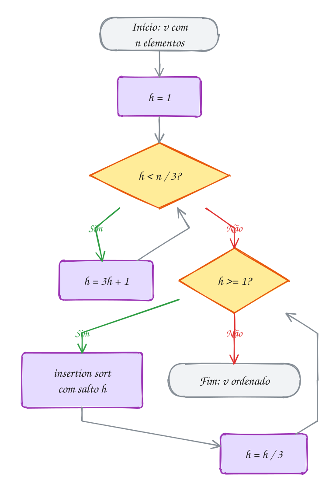
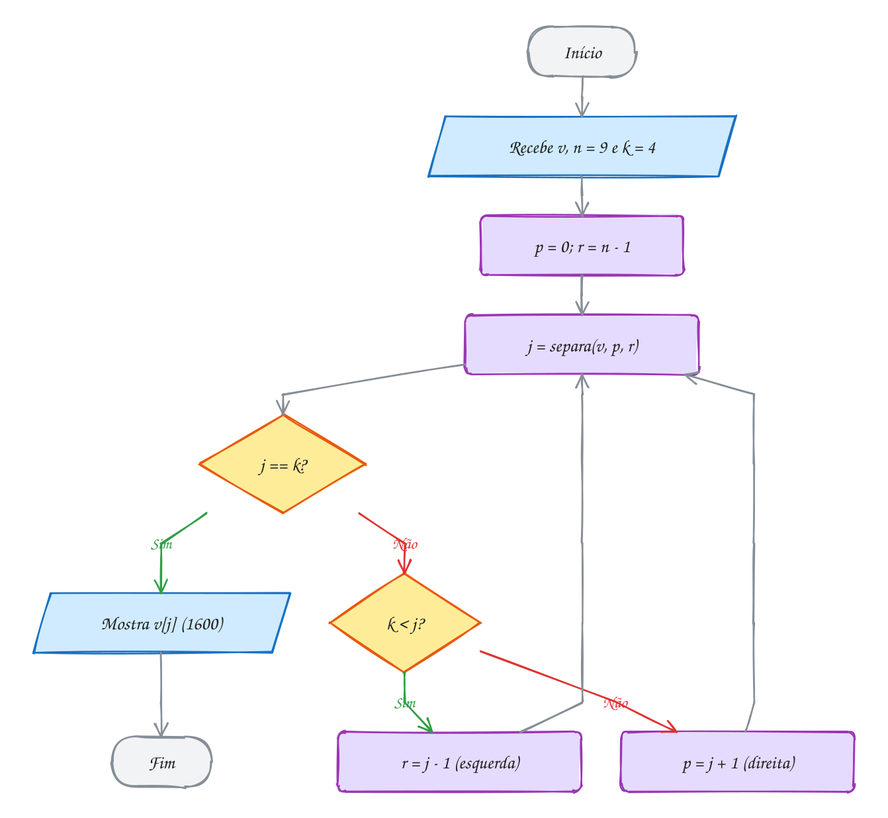
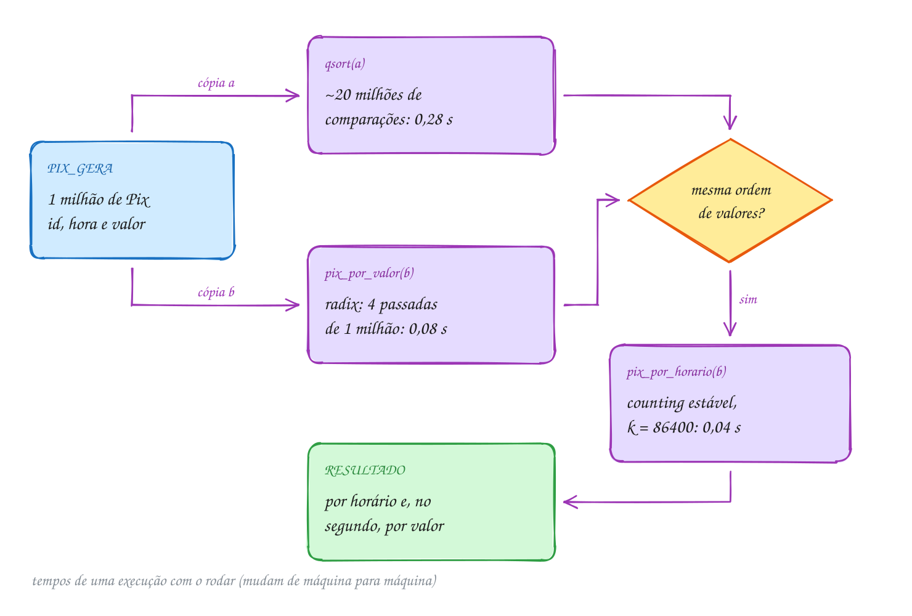

<!-- Gerado por _gerador. Para mudar este arquivo, edite _gerador/modulos/18-ordenacao-linear/ e rode: cd _gerador && npm run gerar -->

# Módulo 18 · Ordenação além da comparação e seleção

> [!IMPORTANT]
> **Mundo 4 · Buscar e ordenar · Rota do jogo: etapa 16 de 29**
>
> **Missão:** ordenar sem comparar: counting, radix e bucket sort.
>
> **Vem de:** [Módulo 13 · Busca e ordenação](13-busca-e-ordenacao.md). **Segue para:** [Módulo 14 · Árvores](14-arvores.md).
>
> **Checkpoints desta fase:**
> - [ ] Ler os assuntos 0119 a 0124 e refazer os exemplos
> - [ ] Resolver os 4 exercícios de cada assunto, escrevendo o código sozinho
> - [ ] Fechar a lista prática (P1801 a P1830)
> - [ ] Enfrentar os desafios do módulo
> - [ ] Chefão: resolver as questões de prova do módulo sem consultar

Quem só compara faz uns n log₂ n comparações no pior caso (módulo 17). Este
módulo sai desse piso usando os **dados**: counting, radix e bucket sort são
lineares, mas gastam memória e supõem algo sobre as chaves. Completam o módulo
o **shell sort** e o **quickselect**. Depende do módulo 13 (insertion sort e
separação do quick sort).

## O que você vai aprender

- **shell sort**: insertion sort com saltos e a sequência de Knuth
- **counting sort**: contar, acumular e distribuir, e a **estabilidade**
- **radix sort**: dígito a dígito (LSD), em base 10 e em base 256
- **bucket sort**: baldes com listas encadeadas, O(n) médio e O(n²) no pior caso
- **quickselect**: o k-ésimo menor em O(n) médio, com pivô sorteado
- ordenar por **duas chaves** e medir 1 milhão de registros contra o `qsort`

## Antes de começar

Revise o insertion sort (0093), a separação do quick sort (0095), listas
encadeadas (0076 a 0078), filas (0085), operadores de bits (0065), `malloc` e
`calloc` e o `qsort` (0096).

Nos diagramas, **roxo** marca o pivô ou a posição da vez, **amarelo** o que
acompanhar, **verde** o que já está no lugar e **cinza** o descartado.

O último assunto usa o TAD `pix.h`/`pix.c`, compilado junto com o exemplo. Os
tempos medidos com `clock()` variam de máquina para máquina: compare
proporções.

| # | Assunto |
| --- | --- |
| [0119](#0119--shell-sort) | Shell sort |
| [0120](#0120--counting-sort) | Counting sort |
| [0121](#0121--radix-sort) | Radix sort |
| [0122](#0122--bucket-sort) | Bucket sort |
| [0123](#0123--quickselect) | Quickselect |
| [0124](#0124--juntando-tudo) | Juntando tudo |

---

## 1. Conceitos gerais

### 0119 · Shell sort

- **Shell sort**: insertion sort (assunto 0093) repetido com **saltos** `h`
  cada vez menores. O elemento anda `h` casas por movimento, não uma
  (SHELL, 1959).
- **Vetor h-ordenado**: cada fileira de elementos a `h` casas de distância
  está em ordem. Com `h = 4`, são quatro insertion sorts entrelaçados
  (KNUTH, 1998).
- **Rodada final**: sempre com `h = 1`. Ela pega um vetor **quase ordenado**,
  caso em que o insertion sort é rápido (ZIVIANI, 2010, cap. 4).
- **Sequência de Knuth**: `h = 3h + 1` (1, 4, 13, 40, 121...). Comece no maior
  salto abaixo de `n / 3` e divida por 3 a cada rodada (SEDGEWICK, 1998, cap. 6).
- **Custo**: com os saltos de Knuth, o pior caso é O(n^1,5). Com os saltos de
  Shell (`n/2, n/4, ..., 1`), é O(n²): pares e ímpares só se comparam no fim
  (TENENBAUM; LANGSAM; AUGENSTEIN, 1995, cap. 6).
- **Memória**: ordena no lugar, sem vetor extra. Não é **estável**: iguais
  podem trocar de ordem (ZIVIANI, 2010, cap. 4).

> [!WARNING]
> A última rodada **tem** que ser com `h = 1`; sem ela o vetor termina fora de
> ordem e sem erro. No laço de dentro, use `j >= h`, não `j > 0`, senão
> `v[j - h]` lê antes do vetor.

### 0120 · Counting sort

- **Ordenação por comparação**: decide a ordem só comparando pares de chaves.
  No pior caso faz cerca de n log₂ n comparações (assunto 0117)
  (CORMEN et al., 2024, cap. 8).
- **Counting sort** (ordenação por contagem): usa o **valor** da chave como
  **índice** de um vetor de contadores e por isso escapa desse piso. As chaves
  são inteiros de 0 a k - 1 (CORMEN et al., 2024, cap. 8).
- **Três laços**: **contar** (`c[x]` = quantos têm chave `x`), **acumular**
  (`c[x]` = quantos têm chave menor ou igual a `x`, o fim do bloco de `x`) e
  **distribuir** (de trás para a frente, `c[x]--` e `saida[c[x]] = v[i]`)
  (CORMEN et al., 2024, cap. 8).
- **Estável**: entre chaves iguais, a ordem da entrada se mantém. O radix sort
  (assunto 0121) depende disso (SEDGEWICK; WAYNE, 2011).
- **Custo**: Θ(n + k) de tempo, e memória para `k` contadores mais a saída de
  `n` elementos. Vale a pena quando `k` é da ordem de `n` ou menor
  (CORMEN et al., 2024, cap. 8).
- **Não ordena no lugar**: o resultado vai para outro vetor
  (LINTZMAYER; MOTA, 2023).

> [!WARNING]
> Com o terceiro laço da frente para trás, os empates saem **invertidos**, sem
> erro. E a chave tem que caber em `c`: a nota 5 ou -1 vira `c[5]` ou `c[-1]`,
> escrita fora do vetor.

### 0121 · Radix sort

- **Radix sort** (ordenação digital): ordena dígito a dígito, cada passada
  por um único dígito, até o dígito mais alto do maior número
  (CORMEN et al., 2024, cap. 8).
- **LSD** (*least significant digit*): começa pelas **unidades**, depois
  dezenas, depois centenas. Era o método das classificadoras de cartões
  perfurados (KNUTH, 1998).
- **Dígito**: o de `x` na casa `exp` (1, 10, 100...) é `(x / exp) % 10`.
  Cada passada é um **counting sort** (assunto 0120) com chaves de 0 a 9
  (SEDGEWICK, 1998, cap. 10).
- **Passada estável**: números com o mesmo dígito ficam na ordem que a
  passada anterior deu. Sem isso o método não funciona
  (CORMEN et al., 2024, cap. 8).
- **Custo**: com `d` dígitos e base `b`, O(d · (n + b)). Para números de
  tamanho fixo, `d` é constante e o custo é linear
  (CORMEN et al., 2024, cap. 8).
- **Base 256**: o "dígito" vira um byte, `(x >> 8 * b) & 0xFF` (assunto
  0065). Um `int` de 32 bits faz 4 passadas com `c[256]`
  (KERNIGHAN; RITCHIE, 1989).
- **Sem comparar chaves**: por isso foge do limite n log n da ordenação por
  comparação (SZWARCFITER; MARKENZON, 2010).

> [!WARNING]
> Se a passada distribuir da frente para trás, os empates se invertem e o
> resultado sai fora de ordem, sem erro. O número de passadas vem do **maior**
> elemento, não do primeiro.

### 0122 · Bucket sort

- **Bucket sort** (ordenação por baldes): divide o intervalo dos valores em
  **faixas** de mesmo tamanho, uma por **balde** (CORMEN et al., 2024, cap. 8).
- **Três passos**: jogar cada elemento no balde da sua faixa, ordenar cada
  balde (que é pequeno) e **concatenar** os baldes em ordem
  (CORMEN et al., 2024, cap. 8).
- **Cálculo de endereço**: a função que escolhe o balde **preserva a ordem**.
  Tudo no balde 2 é menor que tudo no balde 4
  (TENENBAUM; LANGSAM; AUGENSTEIN, 1995, cap. 6).
- **Balde como lista**: cada balde é uma lista encadeada (assunto 0076) e o
  elemento entra já no lugar certo, como na lista ordenada (assunto 0078)
  (ROVAI, 2018).
- **Custo médio**: com `n` valores **uniformes** em [0, 1) e `n` baldes, `x`
  vai para ⌊n · x⌋ e o custo esperado é Θ(n) (CORMEN et al., 2024, cap. 8).
- **Pior caso**: todos no mesmo balde. Sobra um insertion sort de `n`
  elementos, O(n²) (CORMEN et al., 2024, cap. 8).

> [!WARNING]
> O índice do balde tem que caber no vetor: a nota 10,0 dá `baldes[10]`, que
> não existe. O bucket sort precisa **conhecer o intervalo**; valor fora da
> faixa escreve fora do vetor.

### 0123 · Quickselect

- **Seleção**: achar o **k-ésimo menor** de um vetor sem ordenar tudo. O
  mínimo é `k = 0`; a **mediana** é `k = n / 2` (CORMEN et al., 2024, cap. 9).
- **Quickselect**: separa o vetor em torno de um pivô (assunto 0095), como o
  quick sort, mas segue **um lado só** (HOARE, 1961).
- **Regra do lado**: com o pivô na posição final `j`, se `j == k` achou; se
  `k < j`, segue à esquerda; se `k > j`, segue à direita. Um `while` que
  encolhe `[p, r]` basta (FEOFILOFF, 2009).
- **Custo médio**: com o pivô perto do meio, `n + n/2 + n/4 + ...` < `2n`, logo
  O(n). Com o pivô sempre no extremo, O(n²)
  (CORMEN et al., 2024, cap. 9).
- **`RANDOMIZED-SELECT`**: a versão com pivô sorteado; o esperado é O(n)
  (CORMEN et al., 2024, cap. 9).
- **`SELECT`** (mediana das medianas): escolhe um pivô bom o bastante para
  garantir O(n) no **pior** caso (BLUM et al., 1973).
- **Memória**: a versão com `while` usa O(1) extra. A recursiva é de cauda; o
  gcc com `-O2` costuma virar laço, sem ele o pior caso empilha `n` chamadas
  (SEDGEWICK, 1998, cap. 7).

> [!WARNING]
> As posições começam em 0: "o 3º menor" é `k = 2`, e `quickselect(v, n, 3)`
> devolve o 4º. O quickselect também **bagunça o vetor**: para manter a ordem
> original, passe uma cópia.

### 0124 · Juntando tudo

- **Ordenação linear**: troca a comparação por **suposições sobre os dados**,
  como chave inteira numa faixa conhecida (CORMEN et al., 2024, cap. 8).
- **Duas chaves**: ordene pela **menos** importante e depois, com um método
  **estável**, pela mais importante. É a ideia do radix LSD
  (CORMEN et al., 2024, cap. 8).
- **`qsort`**: ordena qualquer tipo. Move blocos de bytes e chama a função de
  comparação por ponteiro, sem conhecer o tipo nem a faixa da chave
  (KERNIGHAN; RITCHIE, 1989).
- **`clock()`**: de `<time.h>`, dá o tempo de processador. A diferença entre
  duas chamadas, dividida por `CLOCKS_PER_SEC`, vira segundos (CPPREFERENCE, s.d.).
- **Teste por comparação**: ordenar uma cópia com o `qsort` e conferir se a
  ordem bate é o jeito mais simples de testar uma ordenação escrita à mão.

| Algoritmo | Custo | Memória extra | Estável | Quando usar |
| --- | --- | --- | --- | --- |
| shell sort | ~n^1,25 (Knuth: pior n^1,5) | O(1) | não | vetores médios, pouca memória, código curto |
| counting sort | O(n + k) | O(n + k) | sim | chaves inteiras num intervalo pequeno |
| radix sort | O(d · (n + b)) | O(n + b) | sim | inteiros ou strings de tamanho fixo |
| bucket sort | O(n) médio, O(n²) pior | O(n) | sim (inserindo depois dos iguais) | valores reais bem espalhados num intervalo conhecido |
| quickselect | O(n) médio, O(n²) pior | O(1) | não | o k-ésimo, a mediana, os k maiores, sem ordenar |
| qsort | O(n log n) | depende da biblioteca | não garantido | qualquer tipo, qualquer critério |

> [!WARNING]
> Chave fora da faixa escreve fora do vetor: um registro com
> `segundo = 86400` faz `c[86400]` estourar. Confira a faixa antes de usar o
> valor como índice.

---

## 2. Exemplos de uso

Cada exemplo compila sozinho. Rode com o comando abaixo dele e compare com a saída no fim do código.

### 0119 · Shell sort

O motorista da van recebe 10 pacotes fora da ordem de rota. Com `n = 10`, os
saltos são 4 e 1; cada cor do desenho é uma fileira de salto 4:

<p align="center"></p>

```c
#include <stdio.h>

void mostra(const int v[], int n) {
    for (int i = 0; i < n; i++) {
        printf(" %d", v[i]);
    }
}

// insertion sort com saltos: os saltos seguem a sequência de Knuth
void shell_sort(int v[], int n) {
    int h = 1;
    while (h < n / 3) {
        h = 3 * h + 1;                  // 1, 4, 13, 40, 121...
    }
    for (; h >= 1; h /= 3) {            // ..., 121, 40, 13, 4, 1
        int movimentos = 0;
        // insertion sort entre elementos que estão a h casas de distância
        for (int i = h; i < n; i++) {
            int x = v[i];
            int j = i;
            while (j >= h && v[j - h] > x) {
                v[j] = v[j - h];        // empurra h casas para a direita
                j -= h;
                movimentos++;
            }
            v[j] = x;
        }
        printf("h = %d:", h);
        mostra(v, n);
        printf("  (%d movimentos)\n", movimentos);
    }
}

int main(void) {
    int rotas[] = {62, 17, 85, 40, 9, 73, 28, 51, 94, 33};
    int n = 10;

    printf("início:");
    mostra(rotas, n);
    printf("\n");
    shell_sort(rotas, n);
    return 0;
}
// Saída:
// início: 62 17 85 40 9 73 28 51 94 33
// h = 4: 9 17 28 40 62 33 85 51 94 73  (3 movimentos)
// h = 1: 9 17 28 33 40 51 62 73 85 94  (6 movimentos)
```

São 9 movimentos; o insertion sort comum faria 21. O `h /= 3` desfaz o
`3 * h + 1` e o laço para quando `h` vira 0:

<p align="center"></p>

#### Passo a passo

A rodada com `h = 4`; cada `v[i]` se compara só com quem está 4, 8, ... casas
para trás:

| i | x | compara com | ação | vetor depois |
| --- | --- | --- | --- | --- |
| 4 | 9 | v[0] = 62 | 62 pula para v[4]; 9 vai para v[0] | 9 17 85 40 62 73 28 51 94 33 |
| 5 | 73 | v[1] = 17 | nada | 9 17 85 40 62 73 28 51 94 33 |
| 6 | 28 | v[2] = 85 | 85 pula para v[6]; 28 vai para v[2] | 9 17 28 40 62 73 85 51 94 33 |
| 7 | 51 | v[3] = 40 | nada | 9 17 28 40 62 73 85 51 94 33 |
| 8 | 94 | v[4] = 62 | nada | 9 17 28 40 62 73 85 51 94 33 |
| 9 | 33 | v[5] = 73, depois v[1] = 17 | 73 pula para v[9]; 33 vai para v[5] | 9 17 28 40 62 33 85 51 94 73 |

**Exemplo A237 · A escolha dos saltos muda tudo**

```c
#include <stdio.h>
#include <stdlib.h>

#define N 4096 // potência de 2, de propósito

static long comparacoes;
static unsigned semente;

// gerador de números pseudoaleatórios simples: a mesma semente dá sempre a
// mesma sequência, então a saída é igual em qualquer computador
int sorteia(void) {
    semente = semente * 1103515245u + 12345u;
    return (int) ((semente >> 16) % 100000);
}

// uma rodada de insertion sort com salto h
void rodada(int v[], int n, int h) {
    for (int i = h; i < n; i++) {
        int x = v[i];
        int j = i;
        while (j >= h) {
            comparacoes++;
            if (v[j - h] <= x) {
                break;
            }
            v[j] = v[j - h];
            j -= h;
        }
        v[j] = x;
    }
}

void so_insertion(int v[], int n) {
    rodada(v, n, 1);
}

void saltos_de_shell(int v[], int n) { // n/2, n/4, ..., 1
    for (int h = n / 2; h >= 1; h /= 2) {
        rodada(v, n, h);
    }
}

void saltos_de_knuth(int v[], int n) { // ..., 40, 13, 4, 1
    int h = 1;
    while (h < n / 3) {
        h = 3 * h + 1;
    }
    for (; h >= 1; h /= 3) {
        rodada(v, n, h);
    }
}

// tipo 0: aleatório; 1: decrescente; 2: metade de baixo nas posições ímpares,
// metade de cima nas pares (só se misturam quando o salto é ímpar)
void testa(const char *nome, void (*ordena)(int[], int), int tipo) {
    int *v = malloc(N * sizeof(int));
    if (v == NULL) {
        return;
    }
    semente = 2024;
    for (int i = 0; i < N; i++) {
        if (tipo == 0) {
            v[i] = sorteia();
        } else if (tipo == 1) {
            v[i] = N - i;
        } else {
            v[i] = i % 2 == 0 ? N / 2 + i / 2 : i / 2;
        }
    }
    comparacoes = 0;
    ordena(v, N);
    int ok = 1;
    for (int i = 1; i < N; i++) {
        if (v[i - 1] > v[i]) {
            ok = 0;
        }
    }
    printf("%-18s %10ld comparações%s\n", nome, comparacoes, ok ? "" : " (ERRO)");
    free(v);
}

int main(void) {
    const char *titulos[] = {"aleatórios", "decrescentes", "grandes nas pares, pequenos nas ímpares"};
    for (int t = 0; t < 3; t++) {
        printf("%d números %s:\n", N, titulos[t]);
        testa("  insertion sort", so_insertion, t);
        testa("  saltos de Shell", saltos_de_shell, t);
        testa("  saltos de Knuth", saltos_de_knuth, t);
    }
    return 0;
}
// Saída:
// 4096 números aleatórios:
//   insertion sort      4245375 comparações
//   saltos de Shell      168264 comparações
//   saltos de Knuth       77422 comparações
// 4096 números decrescentes:
//   insertion sort      8386560 comparações
//   saltos de Shell       65538 comparações
//   saltos de Knuth       42751 comparações
// 4096 números grandes nas pares, pequenos nas ímpares:
//   insertion sort      2102270 comparações
//   saltos de Shell     2143232 comparações
//   saltos de Knuth       45536 comparações
//
// No último caso, os saltos 2048, 1024, ..., 2 são todos pares: as posições
// pares nunca encontram as ímpares, e a rodada final com h = 1 faz o
// trabalho inteiro de um insertion sort. Os saltos de Knuth alternam pares e
// ímpares (40, 13, 4, 1) e misturam tudo cedo.
```

```bash
gcc ~/LPEDC/material/A237.c -o ~/LPEDC/material/A237 && ~/LPEDC/material/A237
```

**Exemplo A238 · O shell sort embaralha os empates**

```c
#include <stdio.h>

typedef struct {
    char hora[6]; // "19:05"
    int zona;     // zona de entrega: 1, 2 ou 3
} Pedido;

// ordena pela zona com saltos dados; o último salto é sempre 1
void ordena_por_zona(Pedido v[], int n, const int saltos[], int qtd) {
    for (int s = 0; s < qtd; s++) {
        int h = saltos[s];
        for (int i = h; i < n; i++) {
            Pedido x = v[i];
            int j = i;
            while (j >= h && v[j - h].zona > x.zona) { // só ">": empate não anda
                v[j] = v[j - h];
                j -= h;
            }
            v[j] = x;
        }
    }
}

void mostra(const char *rotulo, const Pedido v[], int n) {
    printf("%s\n", rotulo);
    for (int z = 1; z <= 3; z++) {
        printf("  zona %d:", z);
        for (int i = 0; i < n; i++) {
            if (v[i].zona == z) {
                printf(" %s", v[i].hora);
            }
        }
        printf("\n");
    }
}

int main(void) {
    // os pedidos chegam em ordem de horário
    Pedido chegada[] = {
        {"19:00", 2}, {"19:04", 3}, {"19:07", 1}, {"19:11", 2}, {"19:15", 1},
        {"19:18", 3}, {"19:22", 2}, {"19:26", 1}, {"19:30", 3}, {"19:33", 2},
    };
    int n = 10;
    Pedido a[10], b[10];
    for (int i = 0; i < n; i++) {
        a[i] = b[i] = chegada[i];
    }

    int so_um[] = {1};
    ordena_por_zona(a, n, so_um, 1);           // é o insertion sort
    mostra("insertion sort (saltos 1):", a, n);

    int knuth[] = {4, 1};
    ordena_por_zona(b, n, knuth, 2);           // é o shell sort
    mostra("shell sort (saltos 4 e 1):", b, n);
    return 0;
}
// Saída:
// insertion sort (saltos 1):
//   zona 1: 19:07 19:15 19:26
//   zona 2: 19:00 19:11 19:22 19:33
//   zona 3: 19:04 19:18 19:30
// shell sort (saltos 4 e 1):
//   zona 1: 19:15 19:07 19:26
//   zona 2: 19:33 19:00 19:22 19:11
//   zona 3: 19:04 19:30 19:18
//
// Os dois deixam as zonas em ordem, mas só o insertion sort é ESTÁVEL: dentro
// de cada zona, os horários continuam na ordem de chegada. No shell sort,
// na rodada h = 4, o pedido das 19:00 foi empurrado da posição 0 para a 4 e o
// das 19:33 pulou da posição 9 para a 1: os dois, da zona 2, se cruzaram sem
// nunca serem comparados. A rodada h = 1 não desfaz isso, porque empates não
// se movem.
```

```bash
gcc ~/LPEDC/material/A238.c -o ~/LPEDC/material/A238 && ~/LPEDC/material/A238
```

### 0120 · Counting sort

Oito avaliações de uma lanchonete (A a H, de 0 a 4 estrelas) vão para a ordem
de nota. Os pedidos de 3 estrelas (A, C e H, em verde) chegam à saída na ordem
original:

<p align="center"></p>

```c
#include <stdio.h>

#define K 5 // estrelas vão de 0 a 4

typedef struct {
    char codigo; // pedido 'A', 'B', ...
    int estrelas;
} Avaliacao;

void mostra(const char *rotulo, const int c[]) {
    printf("%-10s", rotulo);
    for (int x = 0; x < K; x++) {
        printf(" %d", c[x]);
    }
    printf("\n");
}

// ordena v pelas estrelas, de forma estável, e grava o resultado em saida
void counting_sort(const Avaliacao v[], Avaliacao saida[], int n) {
    int c[K] = {0};
    for (int i = 0; i < n; i++) {
        c[v[i].estrelas]++;              // 1) conta cada valor
    }
    mostra("contagem:", c);
    for (int x = 1; x < K; x++) {
        c[x] += c[x - 1];                // 2) c[x] = quantos têm <= x
    }
    mostra("acumulado:", c);
    for (int i = n - 1; i >= 0; i--) {   // 3) de trás para a frente
        int x = v[i].estrelas;
        c[x]--;
        saida[c[x]] = v[i];              // última vaga livre do bloco x
    }
}

int main(void) {
    Avaliacao v[] = {{'A', 3}, {'B', 1}, {'C', 3}, {'D', 2},
                     {'E', 1}, {'F', 4}, {'G', 0}, {'H', 3}};
    Avaliacao saida[8];
    int n = 8;

    counting_sort(v, saida, n);
    printf("ordenado: ");
    for (int i = 0; i < n; i++) {
        printf(" %c%d", saida[i].codigo, saida[i].estrelas);
    }
    printf("\n");
    return 0;
}
// Saída:
// contagem:  1 2 1 3 1
// acumulado: 1 3 4 7 8
// ordenado:  G0 B1 E1 D2 A3 C3 H3 F4
```

Os três laços são sequenciais: dois andam pelos n elementos e um pelas k
chaves, então o custo é **O(n + k)**:

<p align="center"></p>

#### Passo a passo

O terceiro laço, com o acumulado `1 3 4 7 8` no começo. Cada linha usa uma
vaga e diminui o contador da nota:

| i | pedido | c[x] antes | vai para | c depois |
| --- | --- | --- | --- | --- |
| 7 | H3 | c[3] = 7 | saida[6] | 1 3 4 6 8 |
| 6 | G0 | c[0] = 1 | saida[0] | 0 3 4 6 8 |
| 5 | F4 | c[4] = 8 | saida[7] | 0 3 4 6 7 |
| 4 | E1 | c[1] = 3 | saida[2] | 0 2 4 6 7 |
| 3 | D2 | c[2] = 4 | saida[3] | 0 2 3 6 7 |
| 2 | C3 | c[3] = 6 | saida[5] | 0 2 3 5 7 |
| 1 | B1 | c[1] = 2 | saida[1] | 0 1 3 5 7 |
| 0 | A3 | c[3] = 5 | saida[4] | 0 1 3 4 7 |

No fim, cada `c[x]` aponta para o **começo** do bloco de `x`.

**Exemplo A239 · Temperaturas abaixo de zero**

```c
#include <stdio.h>
#include <stdlib.h>

// versão curta: só números, sem registros junto. A chave pode ser negativa,
// então o índice do contador é (valor - menor)
int ordena_temperaturas(int v[], int n) {
    int menor = v[0], maior = v[0];
    for (int i = 1; i < n; i++) {
        if (v[i] < menor) {
            menor = v[i];
        }
        if (v[i] > maior) {
            maior = v[i];
        }
    }
    int k = maior - menor + 1;           // quantos valores possíveis
    int *c = calloc(k, sizeof(int));     // calloc já zera os contadores
    if (c == NULL) {
        return 0;
    }
    for (int i = 0; i < n; i++) {
        c[v[i] - menor]++;               // -3 vai para c[0], -2 para c[1]...
    }
    int pos = 0;
    for (int x = 0; x < k; x++) {        // reescreve cada valor c[x] vezes
        for (int r = 0; r < c[x]; r++) {
            v[pos++] = x + menor;
        }
    }
    free(c);
    return k;
}

int main(void) {
    // mínimas de 14 madrugadas de julho numa cidade serrana, em graus
    int minimas[] = {4, -2, 7, 0, -3, 4, 9, 1, -2, 4, 12, 0, 3, -1};
    int n = 14;

    int k = ordena_temperaturas(minimas, n);
    printf("%d leituras, %d contadores\n", n, k);
    for (int i = 0; i < n; i++) {
        printf(i == 0 ? "%d" : " %d", minimas[i]);
    }
    printf("\nmediana: entre %d e %d graus\n", minimas[n / 2 - 1], minimas[n / 2]);
    return 0;
}
// Saída:
// 14 leituras, 16 contadores
// -3 -2 -2 -1 0 0 1 3 4 4 4 7 9 12
// mediana: entre 1 e 3 graus
//
// De -3 a 12 são 16 valores possíveis: o vetor c tem 16 contadores, mesmo
// que só 10 temperaturas diferentes apareçam. Sem o "- menor", o -3 viraria
// c[-3], uma escrita antes do começo do vetor.
```

```bash
gcc ~/LPEDC/material/A239.c -o ~/LPEDC/material/A239 && ~/LPEDC/material/A239
```

**Exemplo A240 · A chamada pela inicial**

```c
#include <stdio.h>

#define LETRAS 26

// a chave não precisa ser um campo pronto: aqui é a inicial do nome,
// convertida em 0..25
int chave(const char *nome) {
    return nome[0] - 'A';
}

void por_inicial(const char *v[], const char *saida[], int n) {
    int c[LETRAS] = {0};
    for (int i = 0; i < n; i++) {
        c[chave(v[i])]++;
    }
    for (int x = 1; x < LETRAS; x++) {
        c[x] += c[x - 1];
    }
    for (int i = n - 1; i >= 0; i--) {
        saida[--c[chave(v[i])]] = v[i];  // só o ponteiro é copiado
    }
}

int main(void) {
    // ordem de inscrição na escolinha de futebol
    const char *inscritos[] = {"Mateus", "Bruna", "Lucas", "Beatriz", "Murilo", "Ana",
                               "Lara", "Bento", "Miguel", "Alice"};
    const char *chamada[10];
    int n = 10;

    por_inicial(inscritos, chamada, n);
    char letra = ' ';
    for (int i = 0; i < n; i++) {
        if (chamada[i][0] != letra) {    // começou um bloco novo
            letra = chamada[i][0];
            printf("%s%c:", i == 0 ? "" : "\n", letra);
        }
        printf(" %s", chamada[i]);
    }
    printf("\n");
    return 0;
}
// Saída:
// A: Ana Alice
// B: Bruna Beatriz Bento
// L: Lucas Lara
// M: Mateus Murilo Miguel
//
// As iniciais estão em ordem, mas dentro de cada letra os nomes seguem a
// ordem de inscrição: Ana veio antes de Alice, então continua antes. O
// counting sort ordena por UMA chave e não mexe no resto. Para a ordem
// alfabética completa, é preciso ordenar letra por letra: é o radix sort.
```

```bash
gcc ~/LPEDC/material/A240.c -o ~/LPEDC/material/A240 && ~/LPEDC/material/A240
```

### 0121 · Radix sort

Oito números de pedido, de 047 a 830, ordenados em três passadas. Em amarelo,
o 807 e o 830: a passada das dezenas põe o 807 na frente, e a das centenas
respeita essa ordem:

<p align="center"></p>

```c
#include <stdio.h>
#include <stdlib.h>

void mostra(const int v[], int n) {
    for (int i = 0; i < n; i++) {
        printf(" %03d", v[i]);
    }
    printf("\n");
}

// counting sort estável de v pelo dígito (v[i] / exp) % 10
void passada(int v[], int aux[], int n, int exp) {
    int c[10] = {0};
    for (int i = 0; i < n; i++) {
        c[(v[i] / exp) % 10]++;
    }
    for (int d = 1; d < 10; d++) {
        c[d] += c[d - 1];
    }
    for (int i = n - 1; i >= 0; i--) {      // de trás para a frente
        int d = (v[i] / exp) % 10;
        c[d]--;
        aux[c[d]] = v[i];
    }
    for (int i = 0; i < n; i++) {
        v[i] = aux[i];
    }
}

void radix_sort(int v[], int n) {
    int maior = v[0];
    for (int i = 1; i < n; i++) {
        if (v[i] > maior) {
            maior = v[i];
        }
    }
    int *aux = malloc(n * sizeof(int));
    if (aux == NULL) {
        return;
    }
    for (int exp = 1; maior / exp > 0; exp *= 10) {  // um dígito por passada
        passada(v, aux, n, exp);
        printf("exp = %3d:", exp);
        mostra(v, n);
    }
    free(aux);
}

int main(void) {
    int pedidos[] = {251, 47, 830, 509, 74, 216, 553, 807};
    int n = 8;

    printf("início:   ");
    mostra(pedidos, n);
    radix_sort(pedidos, n);
    return 0;
}
// Saída:
// início:    251 047 830 509 074 216 553 807
// exp =   1: 830 251 553 074 216 047 807 509
// exp =  10: 807 509 216 830 047 251 553 074
// exp = 100: 047 074 216 251 509 553 807 830
```

O laço para quando `exp` passa do maior número: com 830, são três passadas
(`exp` = 1, 10, 100), e `830 / 1000` dá 0:

<p align="center"></p>

#### Passo a passo

A passada das dezenas (`exp = 10`) recebe o vetor da passada anterior. O
dígito de cada número é `(x / 10) % 10`:

| número | 830 | 251 | 553 | 074 | 216 | 047 | 807 | 509 |
| --- | --- | --- | --- | --- | --- | --- | --- | --- |
| dígito | 3 | 5 | 5 | 7 | 1 | 4 | 0 | 0 |

Contagem por dígito: 0 → 2, 1 → 1, 3 → 1, 4 → 1, 5 → 2, 7 → 1. Os blocos
na saída ficam `807 509 | 216 | 830 | 047 | 251 553 | 074`. No bloco do 0, o
807 vem antes do 509 porque já vinha antes.

**Exemplo A241 · Placas de carro, letra por letra**

```c
#include <stdio.h>
#include <string.h>

#define TAM 7 // placa no padrão Mercosul: ABC1D23

// counting sort estável dos ponteiros pela letra da posição pos
void passada(const char *v[], const char *aux[], int n, int pos) {
    int c[256] = {0};
    for (int i = 0; i < n; i++) {
        c[(unsigned char) v[i][pos]]++;
    }
    for (int x = 1; x < 256; x++) {
        c[x] += c[x - 1];
    }
    for (int i = n - 1; i >= 0; i--) {
        unsigned char x = (unsigned char) v[i][pos];
        aux[--c[x]] = v[i];
    }
    memcpy(v, aux, n * sizeof(const char *)); // copia os ponteiros de volta
}

int main(void) {
    const char *placas[] = {"RIO2A18", "BRA0S17", "RIO1B99", "SPX3C40", "BRA0S09", "MGA7E21"};
    const char *aux[6];
    int n = 6;

    for (int pos = TAM - 1; pos >= 0; pos--) { // da última letra para a primeira
        passada(placas, aux, n, pos);
        printf("posição %d:", pos);
        for (int i = 0; i < n; i++) {
            printf(" %s", placas[i]);
        }
        printf("\n");
    }
    return 0;
}
// Saída:
// posição 6: SPX3C40 MGA7E21 BRA0S17 RIO2A18 RIO1B99 BRA0S09
// posição 5: BRA0S09 BRA0S17 RIO2A18 MGA7E21 SPX3C40 RIO1B99
// posição 4: RIO2A18 RIO1B99 SPX3C40 MGA7E21 BRA0S09 BRA0S17
// posição 3: BRA0S09 BRA0S17 RIO1B99 RIO2A18 SPX3C40 MGA7E21
// posição 2: BRA0S09 BRA0S17 MGA7E21 RIO1B99 RIO2A18 SPX3C40
// posição 1: MGA7E21 RIO1B99 RIO2A18 SPX3C40 BRA0S09 BRA0S17
// posição 0: BRA0S09 BRA0S17 MGA7E21 RIO1B99 RIO2A18 SPX3C40
//
// Sete passadas, uma por posição, sempre da direita para a esquerda. Repare
// em BRA0S09 e BRA0S17: só diferem na posição 5, e quem decidiu a ordem dos
// dois foi a passada da posição 5. As passadas seguintes os viram empatados
// e, por estabilidade, não mexeram. Para strings de tamanhos diferentes, o
// radix LSD não serve direto: seria preciso completar as curtas.
```

```bash
gcc ~/LPEDC/material/A241.c -o ~/LPEDC/material/A241 && ~/LPEDC/material/A241
```

**Exemplo A242 · Um byte por passada**

```c
#include <stdio.h>
#include <stdlib.h>
#include <stdint.h>

#define N 200000

// radix sort de inteiros sem sinal de 32 bits, em base 256: 4 passadas
void radix_256(uint32_t v[], uint32_t aux[], int n) {
    for (int b = 0; b < 4; b++) {
        int desloca = 8 * b;            // byte 0: bits 0-7; byte 3: bits 24-31
        int c[256] = {0};
        for (int i = 0; i < n; i++) {
            c[(v[i] >> desloca) & 0xFF]++;
        }
        for (int x = 1; x < 256; x++) {
            c[x] += c[x - 1];
        }
        for (int i = n - 1; i >= 0; i--) {
            aux[--c[(v[i] >> desloca) & 0xFF]] = v[i];
        }
        uint32_t *t = v;                // em vez de copiar de volta, troca
        v = aux;                        // os papéis dos dois vetores
        aux = t;
    }
    // 4 trocas (um número par): o resultado terminou no vetor original
}

int main(void) {
    uint32_t x = 3000000000u;
    printf("%u em hexadecimal: %08X\n", (unsigned) x, (unsigned) x);
    for (int b = 0; b < 4; b++) {
        printf("  byte %d: %3u\n", b, (unsigned) ((x >> 8 * b) & 0xFF));
    }

    uint32_t *v = malloc(N * sizeof(uint32_t));
    uint32_t *aux = malloc(N * sizeof(uint32_t));
    if (v == NULL || aux == NULL) {
        free(v);
        free(aux);
        return 1;
    }
    uint32_t semente = 7;
    for (int i = 0; i < N; i++) {
        semente = semente * 1664525u + 1013904223u; // números de 32 bits
        v[i] = semente;
    }

    radix_256(v, aux, N);
    int ordenado = 1;
    for (int i = 1; i < N; i++) {
        if (v[i - 1] > v[i]) {
            ordenado = 0;
        }
    }
    printf("%d números, 4 passadas de %d: ordenado? %s\n", N, N, ordenado ? "sim" : "não");
    printf("menor: %u, maior: %u\n", (unsigned) v[0], (unsigned) v[N - 1]);
    free(v);
    free(aux);
    return 0;
}
// Saída:
// 3000000000 em hexadecimal: B2D05E00
//   byte 0:   0
//   byte 1:  94
//   byte 2: 208
//   byte 3: 178
// 200000 números, 4 passadas de 200000: ordenado? sim
// menor: 4403, maior: 4294950843
//
// Cada passada olha um byte: B2 D0 5E 00 são 178, 208, 94 e 0. O byte 0 (o
// menos significativo) vem primeiro, como as unidades na base 10. Não há
// divisão nem resto, só deslocamento e máscara, e o número de passadas não
// depende dos valores: são sempre 4 para 32 bits. A troca de ponteiros no
// fim de cada passada economiza a cópia de 200000 números.
```

```bash
gcc ~/LPEDC/material/A242.c -o ~/LPEDC/material/A242 && ~/LPEDC/material/A242
```

### 0122 · Bucket sort

A secretária da escola joga cada prova no envelope da sua nota inteira (a de
6,4 vai para o 6). Três notas caem no balde 2 e quatro baldes ficam vazios:

<p align="center"></p>

```c
#include <stdio.h>
#include <stdlib.h>

#define NB 10 // um balde para cada nota inteira: 0, 1, ..., 9

typedef struct No {
    double valor;
    struct No *prox;
} No;

// insere x na lista sem perder a ordem: é o insertion sort, na lista
No *insere_ordenado(No *lista, double x) {
    No *novo = malloc(sizeof(No));
    if (novo == NULL) {
        exit(1);
    }
    novo->valor = x;
    if (lista == NULL || x < lista->valor) {
        novo->prox = lista;               // entra na frente
        return novo;
    }
    No *p = lista;
    while (p->prox != NULL && p->prox->valor <= x) {
        p = p->prox;                      // <= : iguais ficam na ordem de chegada
    }
    novo->prox = p->prox;
    p->prox = novo;
    return lista;
}

void bucket_sort(double v[], int n) {
    No *baldes[NB] = {NULL};
    for (int i = 0; i < n; i++) {
        int b = (int) v[i];               // 6.4 vai para o balde 6
        baldes[b] = insere_ordenado(baldes[b], v[i]);
    }
    int k = 0;
    for (int b = 0; b < NB; b++) {        // junta os baldes, em ordem
        if (baldes[b] == NULL) {
            continue;                     // balde vazio
        }
        printf("balde %d:", b);
        No *p = baldes[b];
        while (p != NULL) {
            printf(" %.1f", p->valor);
            v[k++] = p->valor;
            No *prox = p->prox;
            free(p);                      // devolve o nó assim que copia
            p = prox;
        }
        printf("\n");
    }
}

int main(void) {
    double notas[] = {6.4, 2.7, 8.1, 4.5, 2.2, 9.6, 6.9, 0.8, 4.1, 2.9};
    int n = 10;

    bucket_sort(notas, n);
    printf("ordenadas:");
    for (int i = 0; i < n; i++) {
        printf(" %.1f", notas[i]);
    }
    printf("\n");
    return 0;
}
// Saída:
// balde 0: 0.8
// balde 2: 2.2 2.7 2.9
// balde 4: 4.1 4.5
// balde 6: 6.4 6.9
// balde 8: 8.1
// balde 9: 9.6
// ordenadas: 0.8 2.2 2.7 2.9 4.1 4.5 6.4 6.9 8.1 9.6
```

O custo escondido está no `insere_ordenado`, que anda pela lista do balde:

<p align="center"></p>

**Exemplo A243 · Quando todo mundo cai no mesmo balde**

```c
#include <stdio.h>
#include <stdlib.h>

#define N 1000

typedef struct No {
    double valor;
    struct No *prox;
} No;

static long comparacoes;
static unsigned semente;

// número entre 0 e 1 (sem chegar a 1), sempre a mesma sequência
double sorteia(void) {
    semente = semente * 1103515245u + 12345u;
    return ((semente >> 8) % 1000000) / 1000000.0;
}

No *insere_ordenado(No *lista, double x) {
    No *novo = malloc(sizeof(No));
    if (novo == NULL) {
        exit(1);
    }
    novo->valor = x;
    No **p = &lista;                  // ponteiro para o elo que vai mudar
    while (*p != NULL) {
        comparacoes++;
        if ((*p)->valor > x) {
            break;
        }
        p = &(*p)->prox;
    }
    novo->prox = *p;
    *p = novo;
    return lista;
}

// n baldes para notas de 0 a 10: cada balde cobre uma faixa de 10 / n
void bucket_sort(double v[], int n, int *maior_balde) {
    No **baldes = calloc(n, sizeof(No *));
    int *tamanho = calloc(n, sizeof(int));
    if (baldes == NULL || tamanho == NULL) {
        exit(1);
    }
    for (int i = 0; i < n; i++) {
        int b = (int) (v[i] / 10.0 * n);
        baldes[b] = insere_ordenado(baldes[b], v[i]);
        tamanho[b]++;
    }
    *maior_balde = 0;
    int k = 0;
    for (int b = 0; b < n; b++) {
        if (tamanho[b] > *maior_balde) {
            *maior_balde = tamanho[b];
        }
        while (baldes[b] != NULL) {
            No *p = baldes[b];
            v[k++] = p->valor;
            baldes[b] = p->prox;
            free(p);
        }
    }
    free(baldes);
    free(tamanho);
}

void testa(const char *nome, double base, double largura) {
    double v[N];
    semente = 42;
    for (int i = 0; i < N; i++) {
        v[i] = base + largura * sorteia();
    }
    comparacoes = 0;
    int maior;
    bucket_sort(v, N, &maior);
    printf("%-22s %7ld comparações, maior balde com %3d notas\n", nome, comparacoes, maior);
}

int main(void) {
    testa("notas de 0 a 10:", 0.0, 10.0);
    testa("notas de 5 a 6:", 5.0, 1.0);
    testa("notas de 5,0 a 5,01:", 5.0, 0.01);
    return 0;
}
// Saída:
// notas de 0 a 10:           469 comparações, maior balde com   6 notas
// notas de 5 a 6:           3237 comparações, maior balde com  18 notas
// notas de 5,0 a 5,01:    243539 comparações, maior balde com 1000 notas
//
// Os mesmos 1000 baldes, três distribuições. Espalhadas de 0 a 10, as notas
// caem em média uma por balde e o total é menos de meia comparação por nota.
// Concentradas entre 5 e 6, só 100 baldes trabalham. Entre 5,0 e 5,01, todas
// caem no balde 500 e sobra um insertion sort de 1000 elementos: perto de
// n²/4 comparações. O insere_ordenado usa um ponteiro para ponteiro (No **)
// para não tratar o começo da lista como caso especial.
```

```bash
gcc ~/LPEDC/material/A243.c -o ~/LPEDC/material/A243 && ~/LPEDC/material/A243
```

**Exemplo A244 · Baldes sem lista encadeada**

```c
#include <stdio.h>

#define NB 10 // faixas etárias: 0-9, 10-19, ..., 90-99

// insertion sort só no pedaço v[ini..fim-1]
void insertion(int v[], int ini, int fim) {
    for (int i = ini + 1; i < fim; i++) {
        int x = v[i];
        int j = i;
        while (j > ini && v[j - 1] > x) {
            v[j] = v[j - 1];
            j--;
        }
        v[j] = x;
    }
}

int main(void) {
    // idades dos voluntários da campanha do agasalho
    int idades[] = {34, 71, 19, 45, 38, 22, 67, 30, 18, 52, 41, 36, 25, 63, 33};
    int n = 15;
    int saida[15];

    // 1) conta quantos caem em cada balde e acha onde cada balde começa
    int comeco[NB + 1] = {0};
    for (int i = 0; i < n; i++) {
        comeco[idades[i] / 10 + 1]++;
    }
    for (int b = 1; b <= NB; b++) {
        comeco[b] += comeco[b - 1];   // balde b ocupa saida[comeco[b]..comeco[b+1]-1]
    }
    // 2) espalha: cada um vai para a próxima vaga livre do seu balde
    int vaga[NB];
    for (int b = 0; b < NB; b++) {
        vaga[b] = comeco[b];
    }
    for (int i = 0; i < n; i++) {
        int b = idades[i] / 10;
        saida[vaga[b]++] = idades[i];
    }
    // 3) ordena cada balde no lugar e mostra
    for (int b = 0; b < NB; b++) {
        insertion(saida, comeco[b], comeco[b + 1]);
        if (comeco[b + 1] > comeco[b]) {
            printf("%2d-%2d anos:", 10 * b, 10 * b + 9);
            for (int i = comeco[b]; i < comeco[b + 1]; i++) {
                printf(" %d", saida[i]);
            }
            printf("\n");
        }
    }
    return 0;
}
// Saída:
// 10-19 anos: 18 19
// 20-29 anos: 22 25
// 30-39 anos: 30 33 34 36 38
// 40-49 anos: 41 45
// 50-59 anos: 52
// 60-69 anos: 63 67
// 70-79 anos: 71
//
// Nenhum malloc: a contagem diz de antemão o tamanho de cada balde, e os
// baldes viram pedaços vizinhos do mesmo vetor saida. É o counting sort do
// assunto 0120 com a chave "faixa" (idade / 10) no lugar da idade, seguido de
// um insertion sort em cada pedaço. O comeco[NB + 1] tem uma casa a mais
// para que comeco[b + 1] marque o fim do último balde.
```

```bash
gcc ~/LPEDC/material/A244.c -o ~/LPEDC/material/A244 && ~/LPEDC/material/A244
```

### 0123 · Quickselect

Nove aluguéis anotados, de R$ 980 a R$ 3100; o típico é a mediana. O pivô
1300 cai na posição 2, e a mediana (posição 4) está à direita: os três
primeiros nunca mais são lidos.

<p align="center"></p>

```c
#include <stdio.h>

void troca(int *a, int *b) {
    int aux = *a;
    *a = *b;
    *b = aux;
}

// separação de Lomuto (assunto 0095): pivô v[r]; devolve a posição final dele
int separa(int v[], int p, int r) {
    int pivo = v[r], j = p;
    for (int k = p; k < r; k++) {
        if (v[k] <= pivo) {
            troca(&v[j], &v[k]);
            j++;
        }
    }
    troca(&v[j], &v[r]);
    return j;
}

// devolve o elemento que ficaria na posição k (0, 1, ...) se v fosse ordenado
int quickselect(int v[], int n, int k) {
    int p = 0, r = n - 1;
    while (p < r) {
        int j = separa(v, p, r);
        printf("pivô %d na posição %d:", v[j], j);
        for (int i = p; i <= r; i++) {
            printf(" %d", v[i]);
        }
        if (j == k) {
            printf("  -> achou\n");
            return v[j];
        }
        if (k < j) {
            printf("  -> segue à esquerda\n");
            r = j - 1;                  // a resposta está em v[p..j-1]
        } else {
            printf("  -> segue à direita\n");
            p = j + 1;                  // a resposta está em v[j+1..r]
        }
    }
    return v[p];                        // sobrou um só
}

int main(void) {
    int alugueis[] = {1850, 1200, 2400, 980, 1450, 2050, 3100, 1600, 1300};
    int n = 9;

    int mediana = quickselect(alugueis, n, n / 2);
    printf("aluguel mediano: R$ %d\n", mediana);
    return 0;
}
// Saída:
// pivô 1300 na posição 2: 1200 980 1300 1850 1450 2050 3100 1600 2400  -> segue à direita
// pivô 2400 na posição 7: 1850 1450 2050 1600 2400 3100  -> segue à esquerda
// pivô 1600 na posição 4: 1450 1600 2050 1850  -> achou
// aluguel mediano: R$ 1600
```

Foram 8 + 5 + 3 = 16 comparações (o quick sort completo faz 18). Cada volta do
laço escolhe um lado e descarta o outro:

<p align="center"></p>

**Exemplo A245 · O pódio sem ordenar a tabela**

```c
#include <stdio.h>

typedef struct {
    char nome[10];
    int pontos;
} Jogador;

void troca(Jogador *a, Jogador *b) {
    Jogador aux = *a;
    *a = *b;
    *b = aux;
}

int separa(Jogador v[], int p, int r) {
    int pivo = v[r].pontos, j = p;
    for (int k = p; k < r; k++) {
        if (v[k].pontos <= pivo) {
            troca(&v[j], &v[k]);
            j++;
        }
    }
    troca(&v[j], &v[r]);
    return j;
}

// deixa na posição k quem ficaria lá se v fosse ordenado; de brinde, à
// esquerda de k só ficam pontos <= e à direita só pontos >=
void seleciona(Jogador v[], int n, int k) {
    int p = 0, r = n - 1;
    while (p < r) {
        int j = separa(v, p, r);
        if (j == k) {
            return;
        }
        if (k < j) {
            r = j - 1;
        } else {
            p = j + 1;
        }
    }
}

int main(void) {
    Jogador torneio[] = {
        {"Bia", 1820}, {"Davi", 2150}, {"Edu", 1675}, {"Fábio", 2310}, {"Gabi", 1990},
        {"Hugo", 1540}, {"Íris", 2240}, {"Juca", 1880}, {"Kátia", 2075}, {"Léo", 1760},
        {"Malu", 1930}, {"Nico", 1610},
    };
    int n = 12;

    seleciona(torneio, n, n - 3);       // os 3 maiores vão para v[9..11]
    printf("depois da seleção:");
    for (int i = 0; i < n; i++) {
        printf(" %d", torneio[i].pontos);
    }
    printf("\n");

    // só os 3 do fim precisam de ordem: um insertion sort de 3 elementos
    for (int i = n - 2; i < n; i++) {
        Jogador x = torneio[i];
        int j = i;
        while (j > n - 3 && torneio[j - 1].pontos > x.pontos) {
            torneio[j] = torneio[j - 1];
            j--;
        }
        torneio[j] = x;
    }
    printf("ouro: %s (%d), prata: %s (%d), bronze: %s (%d)\n",
           torneio[n - 1].nome, torneio[n - 1].pontos, torneio[n - 2].nome,
           torneio[n - 2].pontos, torneio[n - 3].nome, torneio[n - 3].pontos);
    return 0;
}
// Saída:
// depois da seleção: 1540 1610 1675 1990 1820 1880 2075 1760 1930 2150 2240 2310
// ouro: Fábio (2310), prata: Íris (2240), bronze: Davi (2150)
//
// Repare na linha do meio: o vetor NÃO está ordenado (1990 antes de 1820,
// 2075 antes de 1760), mas os três últimos são os três maiores. O
// quickselect para k = n - 3 garante isso de graça, porque cada separação
// deixa os maiores à direita do pivô. Para o pódio, basta ordenar esses 3.
// Com uma tabela de 1 milhão de jogadores, são uns poucos milhões de passos,
// em vez de ordenar tudo.
```

```bash
gcc ~/LPEDC/material/A245.c -o ~/LPEDC/material/A245 && ~/LPEDC/material/A245
```

**Exemplo A246 · Pivô sorteado contra o vetor já ordenado**

```c
#include <stdio.h>
#include <stdlib.h>
#include <stdbool.h>

#define N 10001

static long comparacoes, separacoes;
static unsigned semente = 99;

// sorteia um índice em [p, r]; gerador próprio para a saída ser sempre igual
int sorteia(int p, int r) {
    semente = semente * 1103515245u + 12345u;
    return p + (int) ((semente >> 16) % (unsigned) (r - p + 1));
}

void troca(int *a, int *b) {
    int aux = *a;
    *a = *b;
    *b = aux;
}

int separa(int v[], int p, int r) {
    int pivo = v[r], j = p;
    separacoes++;
    for (int k = p; k < r; k++) {
        comparacoes++;
        if (v[k] <= pivo) {
            troca(&v[j], &v[k]);
            j++;
        }
    }
    troca(&v[j], &v[r]);
    return j;
}

int quickselect(int v[], int n, int k, bool sorteado) {
    int p = 0, r = n - 1;
    while (p < r) {
        if (sorteado) {
            troca(&v[sorteia(p, r)], &v[r]); // o sorteado vira o pivô
        }
        int j = separa(v, p, r);
        if (j == k) {
            return v[j];
        }
        if (k < j) {
            r = j - 1;
        } else {
            p = j + 1;
        }
    }
    return v[p];
}

void testa(const char *nome, bool sorteado) {
    int *v = malloc(N * sizeof(int));
    if (v == NULL) {
        return;
    }
    for (int i = 0; i < N; i++) {
        v[i] = i + 1;                   // 1, 2, ..., 10001: já em ordem
    }
    comparacoes = separacoes = 0;
    int m = quickselect(v, N, N / 2, sorteado);
    printf("%s mediana %d, %5ld separações, %9ld comparações\n",
           nome, m, separacoes, comparacoes);
    free(v);
}

int main(void) {
    testa("pivô no fim:  ", false);
    testa("pivô sorteado:", true);
    return 0;
}
// Saída:
// pivô no fim:   mediana 5001,  5001 separações,  37507500 comparações
// pivô sorteado: mediana 5001,    20 separações,     37135 comparações
//
// Com o pivô sempre no fim de um vetor ordenado, cada separação só tira o
// último elemento do caminho: são 5001 separações e 10000 + 9999 + ... +
// 5000 comparações, O(n²). Sorteando o pivô, a chance de cair sempre num
// extremo é desprezível: 20 separações e menos de 4 comparações por
// elemento. A troca de uma linha (sortear e mandar para o fim) não muda o
// separa.
```

```bash
gcc ~/LPEDC/material/A246.c -o ~/LPEDC/material/A246 && ~/LPEDC/material/A246
```

### 0124 · Juntando tudo

Um banco registrou 1 milhão de Pix. O time de fraudes pede dois relatórios:
por **valor** e por **horário**, com os Pix do mesmo segundo do menor para o
maior valor. O TAD `pix.h` tem um registro de 12 bytes:

```c
typedef struct {
    uint32_t id;       // número da transação, na ordem em que chegou
    int32_t segundo;   // hora do dia, em segundos desde a meia-noite
    int32_t centavos;  // valor, em centavos (sempre positivo)
} Pix;
```

- `pix_por_valor`: **radix sort** em base 256 (assunto 0121) sobre
  `centavos`, quatro passadas com um vetor auxiliar;
- `pix_por_horario`: **counting sort** (assunto 0120) com `k = 86400`
  contadores (337 KB), menor que `n`;
- `pix_compara_valor`: a comparação para o `qsort`, usada no teste de tempo.

O `qsort` ordena uma cópia e o radix a outra; os valores têm que sair na mesma
ordem. Depois, o counting sort reorganiza o vetor do radix pelo horário:

<p align="center"></p>

```c
#include <stdio.h>
#include <stdlib.h>
#include <string.h>
#include <time.h>
#include "pix.h"

#define N 1000000

// tempo de processador gasto desde inicio, em segundos
double desde(clock_t inicio) {
    return (double) (clock() - inicio) / CLOCKS_PER_SEC;
}

int main(void) {
    Pix *a = malloc(N * sizeof(Pix));
    Pix *b = malloc(N * sizeof(Pix));
    Pix *aux = malloc(N * sizeof(Pix));
    if (a == NULL || b == NULL || aux == NULL) {
        free(a);
        free(b);
        free(aux);
        return 1;
    }
    pix_gera(a, N, 2024);
    memcpy(b, a, N * sizeof(Pix));     // os mesmos dados nos dois vetores

    clock_t t = clock();
    qsort(a, N, sizeof(Pix), pix_compara_valor);
    printf("qsort pelo valor:      %.2f s\n", desde(t));

    t = clock();
    pix_por_valor(b, aux, N);
    printf("radix pelo valor:      %.2f s\n", desde(t));

    int iguais = 1;
    for (int i = 0; i < N; i++) {
        if (a[i].centavos != b[i].centavos) {
            iguais = 0;
        }
    }
    printf("mesma ordem de valores? %s\n", iguais ? "sim" : "não");

    // segunda chave: pelo horário. O counting sort é estável, então dentro
    // do mesmo segundo os Pix continuam em ordem de valor
    t = clock();
    bool ok = pix_por_horario(b, aux, N);
    printf("counting pelo horário: %.2f s\n", desde(t));
    if (ok) {
        printf("os 4 primeiros do dia:\n");
        for (int i = 0; i < 4; i++) {
            pix_mostra(&b[i]);
        }
    }
    free(a);
    free(b);
    free(aux);
    return 0;
}
// Saída (os tempos mudam a cada execução e de máquina para máquina):
// qsort pelo valor:      0.28 s
// radix pelo valor:      0.08 s
// mesma ordem de valores? sim
// counting pelo horário: 0.04 s
// os 4 primeiros do dia:
// #0024846 00:00:00 R$       1,98
// #0293406 00:00:00 R$       7,46
// #0871952 00:00:00 R$      14,86
// #0653423 00:00:00 R$      21,63
```

O radix levou menos de um terço do tempo do `qsort`. Os quatro primeiros do
dia estão em ordem de valor: a primeira ordenação sobreviveu à segunda. O
radix deste TAD supõe `centavos` positivo; um estorno negativo sairia no fim
(o E726 mostra o conserto).

<p align="center"></p>

**Exemplo A247 · Os maiores Pix do dia, sem ordenar o dia**

```c
#include <stdio.h>
#include <stdlib.h>
#include "0124-pix.h"

#define N 1000000
#define TOP 5

void troca(Pix *a, Pix *b) {
    Pix aux = *a;
    *a = *b;
    *b = aux;
}

// quickselect pelo valor, com pivô do meio (os dados não vêm ordenados,
// mas o pivô do meio custa nada e protege do caso ordenado)
void seleciona(Pix v[], int n, int k) {
    int p = 0, r = n - 1;
    while (p < r) {
        troca(&v[p + (r - p) / 2], &v[r]);
        int pivo = v[r].centavos, j = p;
        for (int i = p; i < r; i++) {
            if (v[i].centavos <= pivo) {
                troca(&v[j], &v[i]);
                j++;
            }
        }
        troca(&v[j], &v[r]);
        if (j == k) {
            return;
        }
        if (k < j) {
            r = j - 1;
        } else {
            p = j + 1;
        }
    }
}

int main(void) {
    Pix *v = malloc(N * sizeof(Pix));
    if (v == NULL) {
        return 1;
    }
    pix_gera(v, N, 2024);

    seleciona(v, N, N / 2);
    printf("valor mediano: R$ %d,%02d\n", v[N / 2].centavos / 100, v[N / 2].centavos % 100);

    // os TOP maiores ficam em v[N-TOP..N-1]; só eles precisam de ordem
    seleciona(v, N, N - TOP);
    qsort(v + N - TOP, TOP, sizeof(Pix), pix_compara_valor);
    printf("os %d maiores do dia:\n", TOP);
    for (int i = N - 1; i >= N - TOP; i--) {
        pix_mostra(&v[i]);
    }
    free(v);
    return 0;
}
// Saída:
// valor mediano: R$ 56,98
// os 5 maiores do dia:
// #0323438 02:04:16 R$    9999,90
// #0698564 18:19:13 R$    9999,85
// #0090794 01:05:26 R$    9999,61
// #0331073 07:40:47 R$    9999,58
// #0324779 17:16:28 R$    9999,55
//
// Duas seleções e um qsort de 5 elementos, em vez de ordenar 1 milhão. O
// valor mediano (R$ 56,98) é bem menor que a média, puxada pelos poucos Pix
// grandes. Repare que pix_compara_valor, feita para o qsort do vetor
// inteiro, serve igual para ordenar só o pedaço v + N - TOP.
```

```bash
gcc ~/LPEDC/material/A247.c ~/LPEDC/material/0124-pix.c -o ~/LPEDC/material/A247 && ~/LPEDC/material/A247
```

**Exemplo A248 · Três ordenações, o mesmo resultado**

```c
#include <stdio.h>
#include <stdlib.h>
#include <string.h>
#include <time.h>
#include "0124-pix.h"

#define N 200000

// shell sort pelo valor (assunto 0119): sem memória extra
void shell_por_valor(Pix v[], int n) {
    int h = 1;
    while (h < n / 3) {
        h = 3 * h + 1;
    }
    for (; h >= 1; h /= 3) {
        for (int i = h; i < n; i++) {
            Pix x = v[i];
            int j = i;
            while (j >= h && v[j - h].centavos > x.centavos) {
                v[j] = v[j - h];
                j -= h;
            }
            v[j] = x;
        }
    }
}

// mesmos valores, na mesma ordem?
int mesmos_valores(const Pix a[], const Pix b[], int n) {
    for (int i = 0; i < n; i++) {
        if (a[i].centavos != b[i].centavos) {
            return 0;
        }
    }
    return 1;
}

// nos empates de valor, os ids continuam crescentes (ordem de chegada)?
int estavel(const Pix v[], int n) {
    for (int i = 1; i < n; i++) {
        if (v[i].centavos == v[i - 1].centavos && v[i].id < v[i - 1].id) {
            return 0;
        }
    }
    return 1;
}

int main(void) {
    Pix *a = malloc(N * sizeof(Pix));
    Pix *b = malloc(N * sizeof(Pix));
    Pix *c = malloc(N * sizeof(Pix));
    Pix *aux = malloc(N * sizeof(Pix));
    if (a == NULL || b == NULL || c == NULL || aux == NULL) {
        free(a);
        free(b);
        free(c);
        free(aux);
        return 1;
    }
    pix_gera(a, N, 31);
    memcpy(b, a, N * sizeof(Pix));
    memcpy(c, a, N * sizeof(Pix));

    clock_t t = clock();
    shell_por_valor(a, N);
    printf("shell sort: %.3f s\n", (double) (clock() - t) / CLOCKS_PER_SEC);
    t = clock();
    qsort(b, N, sizeof(Pix), pix_compara_valor);
    printf("qsort:      %.3f s\n", (double) (clock() - t) / CLOCKS_PER_SEC);
    t = clock();
    pix_por_valor(c, aux, N);
    printf("radix:      %.3f s\n", (double) (clock() - t) / CLOCKS_PER_SEC);

    printf("valores iguais nos três? %s\n",
           mesmos_valores(a, b, N) && mesmos_valores(b, c, N) ? "sim" : "não");
    printf("empates na ordem de chegada? shell: %s, radix: %s\n",
           estavel(a, N) ? "sim" : "não", estavel(c, N) ? "sim" : "não");
    free(a);
    free(b);
    free(c);
    free(aux);
    return 0;
}
// Saída (os tempos mudam a cada execução):
// shell sort: 0.077 s
// qsort:      0.057 s
// radix:      0.027 s
// valores iguais nos três? sim
// empates na ordem de chegada? shell: não, radix: sim
//
// Os três concordam nos valores, mas não nos registros: há muitos Pix com o
// mesmo valor (só 9999 valores pequenos possíveis para 200 mil Pix), e o
// shell sort, que não é estável, embaralha os empates. O radix mantém a
// ordem de chegada. E o qsort? O padrão do C não promete estabilidade:
// dependendo da versão da biblioteca, os empates saem de um jeito ou de
// outro. Nos tempos, o shell sort perde para os dois, mas não usa nem um
// byte de memória extra.
```

```bash
gcc ~/LPEDC/material/A248.c ~/LPEDC/material/0124-pix.c -o ~/LPEDC/material/A248 && ~/LPEDC/material/A248
```

---

## 3. Exercícios práticos

Cada exercício é um arquivo em `material/` com o esqueleto, as dicas e o espaço para a resposta. Compile como os exemplos: `gcc ~/LPEDC/material/E007.c -o ~/LPEDC/material/E007 && ~/LPEDC/material/E007`. Resoluções em `_respostas/18-ordenacao-linear/`.

### 0119 · Shell sort

**Exercício E709** · ★☆☆

Antes de ordenar, o shell sort escolhe os saltos. Escreva a função
void mostra_saltos(int n), que mostra os saltos de Knuth (h = 3h + 1) que
o shell sort do texto usa para um vetor de n elementos, na ordem em que
eles são usados (do maior para o 1). Chame para n = 10, 100, 1000 e
1000000.

```text
Saída esperada:
n = 10: 4 1
n = 100: 40 13 4 1
n = 1000: 364 121 40 13 4 1
n = 1000000: 797161 265720 88573 29524 9841 3280 1093 364 121 40 13 4 1
```

**Exercício E711** · ★★☆

A lista de convidados da festa precisa ir para a portaria em ordem
alfabética. Escreva void shell_nomes(const char *v[], int n), um shell
sort com os saltos de Knuth para um vetor de strings, que troca só os
ponteiros (as letras não saem do lugar). Conte as comparações (cada strcmp
conta uma) numa variável static. No main, ordene os convidados e mostre
o resultado e a contagem.

```text
Convidados: Rafael Bianca Tiago Larissa Diego Amanda Paulo Helena Caio
            Sofia Murilo Elisa
```

```text
Saída esperada:
Amanda, Bianca, Caio, Diego, Elisa, Helena, Larissa, Murilo, Paulo, Rafael, Sofia, Tiago
36 comparações
```

**Exercício E712** · ★★☆

Um vetor está h-ORDENADO quando toda fileira de passo h (v[i], v[i + h],
v[i + 2h], ...) está em ordem. Escreva bool esta_h_ordenado(const int v[],
int n, int h). No main, gere 40 números com v[i] = (i * 17 + 5) % 40 e rode
o shell sort com os saltos de Knuth (13, 4, 1). Antes da primeira rodada e
depois de cada uma, mostre se o vetor está 13-, 4- e 1-ordenado.

```text
Saída esperada:
início: 13-ordenado? não, 4-ordenado? não, 1-ordenado? não
h = 13: 13-ordenado? sim, 4-ordenado? não, 1-ordenado? não
h =  4: 13-ordenado? sim, 4-ordenado? sim, 1-ordenado? não
h =  1: 13-ordenado? sim, 4-ordenado? sim, 1-ordenado? sim
```

**Exercício E714** · ★★★

Uma INVERSÃO é um par de posições i < j com v[i] > v[j]: um par fora de
ordem. Vetor ordenado tem 0 inversões. Escreva long inversoes(const int
v[], int n) (dois laços, O(n²)). No main, gere 200 números com
v[i] = (i * 73 + 11) % 200 e rode o shell sort com os saltos de Knuth,
contando os movimentos (v[j] = v[j - h]) de cada rodada. Depois de cada
rodada, mostre as inversões que sobraram e os movimentos dela. No fim,
mostre o total de movimentos e as inversões do início.

```text
Saída esperada:
início:  9775 inversões
h = 121:  7359 inversões,   12 movimentos
h =  40:  2602 inversões,  131 movimentos
h =  13:  1004 inversões,  172 movimentos
h =   4:   288 inversões,  234 movimentos
h =   1:     0 inversões,  288 movimentos
total: 837 movimentos (o insertion sort faria 9775)
```

### 0120 · Counting sort

**Exercício E715** · ★☆☆

As notas da prova de 20 alunos vão de 0 a 10:

```text
7 5 10 3 7 8 5 7 9 6 4 7 8 2 5 10 6 7 8 5
```

Ordene o vetor com a versão curta do counting sort (conte cada nota e
reescreva cada uma c[x] vezes, sem vetor de saída) e mostre também a nota
mais comum, usando os mesmos contadores.

```text
Saída esperada:
ordenadas: 2 3 4 5 5 5 5 6 6 7 7 7 7 7 8 8 8 9 10 10
mais comum: 7 (5 alunos)
```

**Exercício E717** · ★★☆

Na triagem do pronto-socorro, cada paciente recebe uma cor de risco:
vermelho, laranja, amarelo, verde ou azul, do mais grave para o menos
grave. A fila de atendimento é por cor e, dentro da mesma cor, por ordem
de chegada. Escreva ordena_triagem, um counting sort ESTÁVEL que usa como
chave a posição da cor no vetor ordem_cores, e mostre a fila.

```text
Chegada (nome, cor): Joana amarelo, Pedro verde, Rita vermelho, Caio
amarelo, Lia azul, Davi laranja, Nina verde, Otto vermelho, Sara
amarelo, Ivo laranja
```

```text
Saída esperada:
 1. Rita  (vermelho)
 2. Otto  (vermelho)
 3. Davi  (laranja)
 4. Ivo   (laranja)
 5. Joana (amarelo)
 6. Caio  (amarelo)
 7. Sara  (amarelo)
 8. Pedro (verde)
 9. Nina  (verde)
10. Lia   (azul)
```

**Exercício E718** · ★★☆

Duas palavras são ANAGRAMAS quando usam as mesmas letras, nas mesmas
quantidades: "porta" e "tropa". Um jeito de conferir: ordene as letras de
cada uma e compare. Escreva void ordena_letras(char s[]), um counting sort
das letras da própria string, com um contador para cada valor possível de
char (256). No main, teste os pares alegria/regalia, porta/tropa,
mesa/seta e carro/corra, copiando cada palavra para um vetor local antes
de ordenar.

```text
Saída esperada:
alegria -> aaegilr | regalia -> aaegilr: anagramas
porta -> aoprt | tropa -> aoprt: anagramas
mesa -> aems | seta -> aest: não são anagramas
carro -> acorr | corra -> acorr: anagramas
```

**Exercício E720** · ★★★

Quem quebra códigos secretos começa contando letras. Escreva um programa
que mostre as letras da frase abaixo da MAIS frequente para a menos
frequente (só as que aparecem), com empates em ordem alfabética:

```text
o rato roeu a roupa do rei de roma e a rainha ficou brava
```

A regra: nada de comparar letra com letra. Conte as frequências (um
contador por letra) e depois ordene as 26 letras com um counting sort
estável cuja chave é a frequência.

```text
Saída esperada:
a:9 o:7 r:7 e:4 i:3 u:3 d:2 b:1 c:1 f:1 h:1 m:1 n:1 p:1 t:1 v:1
```

### 0121 · Radix sort

**Exercício E721** · ★☆☆

As duas perguntas que o radix sort faz o tempo todo são "quantos dígitos
tem o maior número?" (quantas passadas) e "qual é o dígito desta casa?".
Escreva as duas funções, só com divisão e resto por 10 (sem pow):

- int quantos_digitos(int x): 5082 tem 4, 7 tem 1;

- int digito(int x, int pos): pos 0 é a unidade, 1 a dezena, e assim por
diante. digito(5082, 1) é 8.

No main, mostre a tabela para 5082, 7, 340 e 19000, com o nome de cada
casa (unidade, dezena, centena, milhar, dezena de milhar).

```text
Saída esperada:
5082: 4 dígitos; unidade 2, dezena 8, centena 0, milhar 5
7: 1 dígito; unidade 7
340: 3 dígitos; unidade 0, dezena 4, centena 3
19000: 5 dígitos; unidade 0, dezena 0, centena 0, milhar 9, dezena de milhar 1
```

**Exercício E723** · ★★☆

A classificadora de cartões tinha 10 escaninhos, e cada escaninho é uma
FILA: o primeiro cartão que entra é o primeiro que sai (assunto 0085).
Escreva uma fila de inteiros sobre vetor (struct Fila, enfileira,
desenfileira, vazia) e faça o radix sort assim, sem contagem nem
acumulado: em cada passada, distribua os números em 10 filas pelo dígito
da vez e depois recolha as filas em ordem, da 0 à 9, de volta no vetor.
Os números são os cubos de 0 a 9, embaralhados:

```text
64 8 216 512 27 729 0 1 343 125
```

Mostre o vetor (com 3 dígitos por número) depois de cada passada.

```text
Saída esperada:
exp =   1: 000 001 512 343 064 125 216 027 008 729
exp =  10: 000 001 008 512 216 125 027 729 343 064
exp = 100: 000 001 008 027 064 125 216 343 512 729
```

**Exercício E724** · ★★☆

O radix sort não precisa de dígitos: qualquer chave formada por "casas"
serve. Uma data tem três casas: dia, mês e ano, do menos para o mais
importante. Ordene os vencimentos dos boletos em ordem cronológica com
três passadas de counting sort estável: primeiro pelo dia, depois pelo
mês, por fim pelo ano. Mostre o vetor depois de cada passada.

```text
Vencimentos (dia/mês/ano): 15/03/2025 05/11/2024 15/01/2025 28/02/2024
05/03/2025 10/11/2024 28/01/2025
```

```text
Saída esperada:
início: 15/03/2025 05/11/2024 15/01/2025 28/02/2024 05/03/2025 10/11/2024 28/01/2025
dia:    05/11/2024 05/03/2025 10/11/2024 15/03/2025 15/01/2025 28/02/2024 28/01/2025
mês:    15/01/2025 28/01/2025 28/02/2024 05/03/2025 15/03/2025 05/11/2024 10/11/2024
ano:    28/02/2024 05/11/2024 10/11/2024 15/01/2025 28/01/2025 05/03/2025 15/03/2025
```

**Exercício E726** · ★★★

O extrato tem saques (negativos) e depósitos, em centavos. No complemento
de dois, -7 é FFFFFFF9: como número sem sinal ele é enorme, e o radix sort
em base 256 ingênuo põe os negativos depois dos positivos. Escreva
radix(v, aux, n, com_chave) para int32_t: sem a chave, ordena por
(uint32_t) x; com a chave, por (uint32_t) x ^ 0x80000000u (inverte o bit
de sinal). Use -150000, 3200, -7, 0, INT_MAX, INT_MIN, 98000, -98000 e 7;
mostre o -7 em hexadecimal e o resultado dos dois casos.

```text
Saída esperada:
-7 como uint32_t: FFFFFFF9
sem a chave: 0 7 3200 98000 2147483647 -2147483648 -150000 -98000 -7
com a chave: -2147483648 -150000 -98000 -7 0 7 3200 98000 2147483647
```

### 0122 · Bucket sort

**Exercício E727** · ★☆☆

A loja de R$ 1,99 virou "loja até R$ 50" e quer separar os produtos em 5
prateleiras de preço: de 0 a 10, de 10 a 20, ..., de 40 a 50. Escreva
int balde_de(double x, double max, int nb), que devolve o balde (de 0 a
nb - 1) de um valor x entre 0 e max, com nb baldes de mesma largura. O
preço máximo, R$ 50,00, vai para o último balde. Mostre o balde de cada
preço: 12.50, 49.99, 50.00, 0.00, 10.00, 37.20 e 9.99.

```text
Saída esperada:
R$ 12.50 -> balde 1
R$ 49.99 -> balde 4
R$ 50.00 -> balde 4
R$  0.00 -> balde 0
R$ 10.00 -> balde 1
R$ 37.20 -> balde 3
R$  9.99 -> balde 0
```

**Exercício E729** · ★★☆

A agenda do celular agrupa os contatos pela letra inicial. Faça um bucket
sort de strings com 26 baldes, um por letra: o balde de um nome é
nome[0] - 'A', e cada balde é uma lista encadeada que guarda os nomes já
em ordem alfabética (compare com strcmp). Mostre cada balde que não está
vazio, devolva os nomes ao vetor em ordem e libere todos os nós.

```text
Contatos: Marcos Ana Bruno Mariana Carla Alberto Beatriz Marta Caio
Amanda Mauro
```

```text
Saída esperada:
A: Alberto Amanda Ana
B: Beatriz Bruno
C: Caio Carla
M: Marcos Mariana Marta Mauro
agenda: Alberto Amanda Ana Beatriz Bruno Caio Carla Marcos Mariana Marta Mauro
```

**Exercício E730** · ★★☆

Escreva dois bucket sorts de double, com baldes que são listas encadeadas
mantidas em ordem: bucket_sort_01(double v[], int n), para valores em
[0, 1), com n baldes e balde (int) (x * n); e bucket_sort_faixa(double
v[], int n), para valores quaisquer, que mostra a faixa (menor e maior) e
usa n baldes de mesma largura (se todos são iguais, vão para o balde 0).
Teste a primeira com 0.35 0.80 0.05 0.62 0.41 0.97 e a segunda com 22.4
-3.5 38.2 15.0 9.7 30.1 -1.2 27.8 18.6 4.3 33.0 12.9 e com 7.0 7.0 7.0,
mostrando cada vetor ordenado com 2 casas decimais.

```text
Saída esperada:
0.05 0.35 0.41 0.62 0.80 0.97
faixa: -3.5 a 38.2, 12 baldes de 3.48
-3.50 -1.20 4.30 9.70 12.90 15.00 18.60 22.40 27.80 30.10 33.00 38.20
faixa: 7.0 a 7.0, 3 baldes de 0.00
7.00 7.00 7.00
```

**Exercício E731** · ★★★

A padaria ordena os pedidos do dia pelo valor e quer que pedidos de mesmo
valor fiquem na ordem de chegada. Escreva um bucket sort ESTÁVEL de
struct Pedido { char cliente; int valor; }, para valores de R$ 0 a R$ 99:
10 baldes, um para cada R$ 10 (balde = valor / 10), cada um uma lista
encadeada ordenada. Devolva os pedidos ao vetor, balde por balde, e libere
os nós. Pedidos (cliente:valor), na ordem de chegada:

```text
A:35 B:12 C:35 D:87 E:12 F:50 G:38 H:35 I:9
```

```text
Saída esperada:
I:9 B:12 E:12 A:35 C:35 H:35 G:38 F:50 D:87
```

### 0123 · Quickselect

**Exercício E733** · ★☆☆

A escola quer um resumo das notas de redação do simulado: a menor, a
segunda menor, a mediana, a segunda maior e a maior. Escreva o quickselect
(int quickselect(int v[], int n, int k), com a separação de Lomuto de
pivô v[r]) e int seleciona_copia(const int v[], int n, int k), que copia v
para um vetor local e roda o quickselect na cópia, para a lista ficar na
ordem original. Use para mostrar o resumo e, no fim, notas[0], para provar
que o vetor não mudou.

```text
Notas de 11 alunos: 720 480 860 640 920 560 700 380 800 600 680
```

```text
Saída esperada:
menor:       380
2ª menor:    480
mediana:     680
2ª maior:    860
maior:       920
primeira do vetor continua: 720
```

**Exercício E735** · ★★☆

Com um número PAR de valores, a mediana é a média dos dois do meio. O app
de entregas quer a mediana dos tempos de 10 entregas, sem ordenar o vetor.
Escreva o quickselect (Lomuto, pivô v[r]) e double mediana(int v[], int n),
que funciona para n par e ímpar, usando UM quickselect só. Confira no fim
com o qsort.

```text
Tempos (min), 10 entregas: 42 28 55 31 47 35 61 41 26 38
Com 9 entregas: os mesmos, sem o 38
```

```text
Saída esperada:
10 entregas: mediana 39.5 min
9 entregas:  mediana 41.0 min
conferindo: 38 e 41 no meio
```

**Exercício E736** · ★★☆

Quem cuida de servidores olha os PERCENTIS: o p90 é o tempo que 90% das
requisições não ultrapassam. Gere 50 tempos de resposta, em ms, com

```text
t[i] = 30 + (i * 37) % 50 * 4 + (i % 9 == 0 ? 600 : 0)
```

Escreva o quickselect (Lomuto, pivô v[r]) e int percentil(int v[], int n,
int pct), que devolve o valor da posição teto(pct * n / 100) - 1 da ordem
crescente. Mostre p50, p90 e p99. Depois ordene com qsort e confira as
posições 24, 44 e 49.

```text
Saída esperada:
p50: 138 ms
p90: 630 ms
p99: 826 ms
conferindo: 138, 630 e 826
```

**Exercício E737** · ★★★

A secretaria da faculdade tem 10001 matrículas, numeradas de 1 a 10001 e
já em ordem, e quer a matrícula mediana (a da posição 5000 do vetor).
Para fugir do pior caso do vetor ordenado, escreva um quickselect com
pivô sorteado. A cada passada do laço, sorteie a posição do pivô entre p
e r, troque-a com v[r] e só então faça a separação de Lomuto (pivô v[r],
comparação <=), contando as separações numa variável static. O sorteio
usa uma semente unsigned, que começa em 2025:

```text
semente = semente * 1103515245u + 12345u;
posição = p + (int) ((semente >> 16) % (unsigned) (r - p + 1));
```

```text
Saída esperada:
mediana: 5001 (19 separações)
```

### 0124 · Juntando tudo

**Exercício E739** · ★☆☆

Use o TAD pix.h (está na pasta) para um teste pequeno antes de rodar com
um milhão. Gere 8 Pix com pix_gera e a semente 5, ordene pelo horário com
pix_por_horario e mostre a linha do tempo com pix_mostra. Depois ordene
pelo valor com pix_por_valor e mostre o Pix de menor e o de maior valor.

```text
Saída esperada:
linha do tempo:
#0000001 06:37:44 R$      46,82
#0000003 07:00:16 R$      71,08
#0000008 07:23:43 R$      88,39
#0000002 10:58:31 R$      14,80
#0000007 12:02:53 R$      50,89
#0000006 14:11:55 R$      87,07
#0000005 14:28:08 R$    3960,62
#0000004 15:23:46 R$      88,47
menor: #0000002 10:58:31 R$      14,80
maior: #0000005 14:28:08 R$    3960,62
```

```bash
gcc ~/LPEDC/material/E739.c ~/LPEDC/material/0124-pix.c -o ~/LPEDC/material/E739 && ~/LPEDC/material/E739
```

**Exercício E741** · ★★☆

O texto ordenou pelo valor e DEPOIS pelo horário para ter a linha do
tempo com os empates de segundo em ordem de valor. E se fizer na ordem
contrária? Escreva bool em_ordem(const Pix v[], int n, bool
horario_primeiro), que confere se v está em ordem de (horário, valor) ou,
com horario_primeiro = false, de (valor, horário). Depois, com 200 mil Pix
(semente 77) em dois vetores iguais, faça as duas ordens de passadas e
confira.

```text
Saída esperada:
valor, depois horário: (horário, valor)? sim
horário, depois valor: (horário, valor)? não
horário, depois valor: (valor, horário)? sim
```

```bash
gcc ~/LPEDC/material/E741.c ~/LPEDC/material/0124-pix.c -o ~/LPEDC/material/E741 && ~/LPEDC/material/E741
```

**Exercício E742** · ★★☆

O time de fraudes quer duas estatísticas dos valores do dia: a mediana
(posição N / 2) e o p99 (posição 989999 de 1 milhão, pela regra do posto
mais próximo). Para economizar, copie só os valores (os centavos) para um
vetor de int, 4 MB em vez dos 12 MB dos registros, e use o quickselect
nele, com pivô do meio. Depois confira: ordene os registros com
pix_por_valor e compare as duas posições.

```text
Saída esperada:
mediana: R$ 56,98
p99:     R$ 9160,98
conferindo com o radix: iguais
```

```bash
gcc ~/LPEDC/material/E742.c ~/LPEDC/material/0124-pix.c -o ~/LPEDC/material/E742 && ~/LPEDC/material/E742
```

**Exercício E744** · ★★★

Nenhum Pix passa de R$ 9999,99: o byte 3 do valor é sempre zero e a
quarta passada do radix copia 12 MB à toa. Escreva int radix_esperto(Pix
v[], Pix aux[], int n), radix em base 256 pelo valor que pula a passada
quando TODOS os bytes caem no mesmo balde (algum c[x] == n) e devolve
quantas passadas fez, com o resultado em v. No main (pix.h), com N =
1000000 e pix_gera com a semente 2024, rode radix_esperto numa cópia e
pix_por_valor em outra e compare os ids (os dois são estáveis), para os
valores do dia e para valores até R$ 2,55 (centavos %= 256).

```text
Saída esperada:
valores do dia:      3 passadas de 4, igual ao pix_por_valor? sim
valores até R$ 2,55: 1 passada de 4, igual ao pix_por_valor? sim
```

```bash
gcc ~/LPEDC/material/E744.c ~/LPEDC/material/0124-pix.c -o ~/LPEDC/material/E744 && ~/LPEDC/material/E744
```

### Lista do módulo

30 exercícios que misturam os assuntos do módulo, no ritmo da prova. Arquivos P1801.c a P1830.c, em `material/`; resoluções em `_respostas/18-ordenacao-linear/lista/`.

#### ★☆☆ Aquecimento

**Exercício P1801** · ★☆☆ · Counting sort passo a passo: o vetor C e a saída

No posto de vacinação, as idades das 10 crianças da fila (0 a 4 anos) vão
para o relatório em ordem. Escreva do zero o counting sort do Cormen e
mostre o estado dos vetores como a prova pede:

1. C depois da contagem (C[x] = quantas crianças têm x anos);
2. C depois das somas acumuladas (C[x] = quantas têm idade <= x);
3. cada passo da colocação, de trás para frente: o valor, a posição em que
ele entra na saída B e o vetor C logo depois;
4. o vetor B no fim.

Use posições de 0 a n - 1 (em C, decremente antes de usar).

```text
Saída esperada:
Contagem: C = 1 3 1 2 3
Acumulado: C = 1 4 5 7 10
A[9] = 1 vai para B[3] | C = 1 3 5 7 10
A[8] = 3 vai para B[6] | C = 1 3 5 6 10
A[7] = 4 vai para B[9] | C = 1 3 5 6 9
A[6] = 1 vai para B[2] | C = 1 2 5 6 9
A[5] = 2 vai para B[4] | C = 1 2 4 6 9
A[4] = 0 vai para B[0] | C = 0 2 4 6 9
A[3] = 4 vai para B[8] | C = 0 2 4 6 8
A[2] = 3 vai para B[5] | C = 0 2 4 5 8
A[1] = 1 vai para B[1] | C = 0 1 4 5 8
A[0] = 4 vai para B[7] | C = 0 1 4 5 7
B = 0 1 1 1 2 3 3 4 4 4
```

**Resposta esperada:** C = 1 3 1 2 3 depois da contagem, 1 4 5 7 10 depois das somas, e B = 0 1 1 1 2 3 3 4 4 4.

---

**Exercício P1802** · ★☆☆ · Shell sort com os saltos de Shell: n/2, n/4, ..., 1

Os saltos originais de Donald Shell (1959) são n/2, n/4, ..., 1 (divisão
inteira). Ordene as alturas, em cm, dos 10 atletas do time de basquete da
escola com essa sequência e mostre o vetor depois de cada passada, junto
com o salto e as comparações feitas naquela passada.

Cada passada com salto h é um insertion sort que compara v[j] com
v[j - h] em vez de v[j - 1].

```text
Saída esperada:
início: 190 175 201 168 183 178 194 172 186 181
h = 5:  178 175 172 168 181 190 194 201 186 183  (5 comparações)
h = 2:  172 168 178 175 181 183 186 190 194 201  (11 comparações)
h = 1:  168 172 175 178 181 183 186 190 194 201  (10 comparações)
```

**Resposta esperada:** o vetor final 168 172 175 178 181 183 186 190 194 201, com 5, 11 e 10 comparações nas três passadas.

---

**Exercício P1803** · ★☆☆ · Radix com base 100: dois dígitos por passada

As matrículas dos calouros têm 6 dígitos. Em base 10, o radix sort LSD faz
6 passadas. Em base 100, cada "dígito" é um par de dígitos decimais (de 00
a 99), e bastam 3 passadas: (m / 1) % 100, (m / 100) % 100 e
(m / 10000) % 100.

Escreva o radix sort LSD em base 100, com um counting sort estável de 100
posições em cada passada, e mostre o vetor depois de cada passada, com o
divisor usado.

```text
Saída esperada:
div     1: 230105 190305 241012 241077 210477 230388 180399
div   100: 230105 190305 230388 180399 210477 241012 241077
div 10000: 180399 190305 210477 230105 230388 241012 241077
```

**Resposta esperada:** na primeira passada, 230105 e 190305 (final 05) vêm antes de 241012; no fim, 180399 190305 210477 230105 230388 241012 241077.

---

**Exercício P1804** · ★☆☆ · Bucket sort da ocupação dos voos

A companhia aérea guarda a taxa de ocupação de cada voo do dia como um
número em [0, 1): 0.87 é 87% dos assentos. Ordene as 10 taxas do esqueleto
com o bucket sort do Cormen: n = 10 baldes, o valor x vai para o balde
⌊10 x⌋, cada balde é uma lista encadeada (malloc) mantida em ordem por
inserção, e no fim os baldes são concatenados em ordem.

Mostre o conteúdo de cada balde não vazio e o vetor ordenado. Libere todos
os nós.

```text
Saída esperada:
balde 0: 0.05
balde 1: 0.12
balde 3: 0.31 0.36
balde 5: 0.52
balde 7: 0.79
balde 8: 0.84 0.87 0.88
balde 9: 0.99
ordenado: 0.05 0.12 0.31 0.36 0.52 0.79 0.84 0.87 0.88 0.99
```

**Resposta esperada:** baldes 0, 1, 3, 5, 7, 8 e 9 ocupados; o vetor ordenado começa em 0.05 e termina em 0.99.

---

**Exercício P1805** · ★☆☆ · O 3º posto mais barato, partição por partição

O app de combustível tem o preço do litro (em centavos) em 9 postos de
Manaus e quer o 3º MENOR preço sem ordenar tudo. Escreva o quickselect com
a partição de Lomuto (pivô = último elemento do pedaço) e mostre cada
partição: o pedaço [ini, fim], o pivô, a posição final dele e para que lado
a busca continua. Use k a partir de 1 (k = 1 é o menor).

```text
Saída esperada:
[0, 8] pivô 594 foi para 3 -> esquerda
[0, 2] pivô 579 foi para 1 -> direita
[2, 2] pivô 589 foi para 2 -> achou
3º menor preço: 589 centavos (R$ 5,89)
```

**Resposta esperada:** três partições, e o 3º menor preço é 589 centavos (R$ 5,89).

---

**Exercício P1806** · ★☆☆ · De trás para frente ou da frente para trás?

As inscrições da corrida de rua chegam em ordem de inscrição, cada uma com
o nome e a categoria (0 = 5 km, 1 = 10 km, 2 = meia, 3 = maratona). A
organização quer a lista por categoria e, dentro dela, na ORDEM DE
INSCRIÇÃO: é preciso uma ordenação ESTÁVEL.

Complete o counting sort por categoria com um parâmetro bool de_tras: com
true, a colocação anda de n - 1 até 0 (a versão do Cormen); com false,
anda de 0 até n - 1, mas continua usando --c[x]. Mostre as duas saídas e
diga, para cada uma, se ficou estável (compare a ordem dos nomes dentro de
cada categoria com a ordem de inscrição, guardada no campo ordem).

```text
Saída esperada:
de trás: Bruno(0) Elis(0) Ana(1) Davi(1) Gil(1) Fabio(2) Carla(3) Hana(3) -> estável
da frente: Elis(0) Bruno(0) Gil(1) Davi(1) Ana(1) Fabio(2) Hana(3) Carla(3) -> NÃO estável
```

**Resposta esperada:** de trás para frente é estável (Ana antes de Davi nos 10 km); da frente para trás, não.

---

**Exercício P1807** · ★☆☆ · Quantas corridas entre R$ 10 e R$ 20? Em O(1)

O app de transporte registrou o valor (em reais inteiros, de 0 a 50) das
20 corridas da manhã. O gerente vai fazer várias perguntas do tipo
"quantas corridas custaram entre a e b reais?".

O vetor acumulado do counting sort responde cada pergunta em O(1): depois
de um pré-processamento Θ(n + k), C[x] = quantas corridas custaram <= x, e
a resposta para [a, b] é C[b] - C[a - 1] (com C[-1] = 0). Escreva o
pré-processamento e a função int entre(const int c[], int a, int b), e
responda às perguntas do esqueleto.

```text
Saída esperada:
Entre R$ 10 e R$ 20:  9 corridas
Entre R$  0 e R$ 50: 20 corridas
Entre R$  0 e R$  9:  4 corridas
Entre R$ 15 e R$ 15:  2 corridas
Entre R$ 30 e R$ 50:  4 corridas
```

**Resposta esperada:** 9 corridas entre R$ 10 e R$ 20, 20 no total, 4 até R$ 9 e 2 de exatamente R$ 15.

---

**Exercício P1808** · ★☆☆ · Radix sort bit a bit: zeros na frente, uns atrás

O radix sort não precisa de base 10: em base 2, cada passada olha um bit.
Com um bit só, o counting sort vira uma SEPARAÇÃO ESTÁVEL: primeiro todos
os que têm aquele bit 0, na ordem em que estão, depois todos os que têm 1,
também na ordem.

Os códigos das 8 linhas de um terminal de ônibus vão de 0 a 15 (4 bits).
Escreva a passada (bit b: (x >> b) & 1) e rode o radix LSD do bit 0 ao
bit 3, mostrando o vetor em binário e em decimal depois de cada passada.

```text
Saída esperada:
início 1100 0101 1001 1110 0011 1010 0110 1011 | 12 5 9 14 3 10 6 11
bit 0   1100 1110 1010 0110 0101 1001 0011 1011 | 12 14 10 6 5 9 3 11
bit 1   1100 0101 1001 1110 1010 0110 0011 1011 | 12 5 9 14 10 6 3 11
bit 2   1001 1010 0011 1011 1100 0101 1110 0110 | 9 10 3 11 12 5 14 6
bit 3   0011 0101 0110 1001 1010 1011 1100 1110 | 3 5 6 9 10 11 12 14
```

**Resposta esperada:** no fim, 0011 0101 0110 1001 1010 1011 1100 1110 (3 5 6 9 10 11 12 14).

---

**Exercício P1809** · ★☆☆ · A tabela do campeonato em ordem decrescente, estável

No campeonato de futsal do bairro, os times já estão em ordem alfabética.
A tabela tem de sair por PONTOS, do maior para o menor, e os empatados
continuam em ordem alfabética. Os pontos vão de 0 a 15.

Complete o counting sort decrescente e estável. Para isso, ordene pela chave
invertida, MAX - pontos, em ordem crescente. Quem tem mais pontos tem chave
menor e vai para o começo, e a estabilidade do counting sort preserva a
ordem alfabética dos empates.

```text
Saída esperada:
1. Goias            15
2. Para             12
3. Amazonas          9
4. Bahia             9
5. Ceara             9
6. Espirito Santo    7
7. Fortaleza         4
8. Distrito Federal  2
```

**Resposta esperada:** Goias 15, Para 12, Amazonas 9, Bahia 9, Ceara 9, Espirito Santo 7, Fortaleza 4, Distrito Federal 2.

---

**Exercício P1810** · ★☆☆ · Conserte o counting sort das notas

Conserte o programa. Ele ordena as notas (inteiras, de 0 a 10) de 12 alunos
com counting sort, mas tem DOIS erros de propósito, e os dois são de
índice. Rode com ./rodar: o AddressSanitizer acusa leitura e escrita fora
do vetor c (stack-buffer-overflow). Ache os dois, conserte e confira a
saída:

```text
Saída esperada:
0 3 4 5 5 6 7 7 8 9 10 10
```

#### ★★☆ Para pensar

**Exercício P1811** · ★★☆ · Quatro sequências de saltos no mesmo shell sort

O shell sort é o mesmo algoritmo com qualquer sequência de saltos que
termine em 1, mas o desempenho muda muito. Compare quatro:

- Shell (1959): n/2, n/4, ..., 1;
- Hibbard (1963): 2^k - 1 (1, 3, 7, 15, 31, ...);
- Knuth (1973): h = 3h + 1 (1, 4, 13, 40, 121, ...), começando no maior
h < n/3;
- Sedgewick (1986): 4^k + 3 · 2^(k-1) + 1, com 1 no começo (1, 8, 23, 77,
281, 1073, 4193, ...).

Escreva shell(v, n, saltos, ns), que recebe os saltos em ordem DECRESCENTE,
e conte as comparações. Ordene cópias dos mesmos tempos de entrega (gerados
no esqueleto) para n = 1000 e n = 10000, confira que ficaram ordenados e
mostre as comparações de cada sequência e do insertion sort puro.

```text
Saída esperada:
             n = 1000  n = 10000
Shell           14923     258585
Hibbard         14298     231869
Knuth           13674     233094
Sedgewick       15546     221889
insertion      256897   24710349
Todos ordenados: sim
```

**Resposta esperada:** o insertion sort fica perto de n²/4 (24,7 milhões com n = 10000, contra uns 230 mil das sequências). Com n = 1000 as quatro empatam perto de 15 mil; com n = 10000, Shell é a pior (258585) e Sedgewick, a melhor (221889). A diferença cresce com n.

---

**Exercício P1812** · ★★☆ · Radix LSD mostrando o vetor C de cada passada

Na prova, o radix sort aparece como "qual é o vetor depois da segunda
passada?" e o counting sort como "qual é o vetor C?". Junte os dois: ordene
os 8 códigos de rastreio (3 dígitos) de uma agência dos Correios com radix
LSD em base 10 e, em CADA passada, mostre:

- o dígito usado de cada número;
- o vetor C depois das somas acumuladas (C[d] = quantos têm dígito <= d);
- o vetor depois da passada.

```text
Saída esperada:
Passada div = 1
dígitos: 5 1 2 7 3 0 5 1
C acumulado: 1 3 4 5 5 7 7 8 8 8
vetor: 540 331 801 902 283 465 615 747
Passada div = 10
dígitos: 4 3 0 0 8 6 1 4
C acumulado: 2 3 3 4 6 6 7 7 8 8
vetor: 801 902 615 331 540 747 465 283
Passada div = 100
dígitos: 8 9 6 3 5 7 4 2
C acumulado: 0 0 1 2 3 4 5 6 7 8
vetor: 283 331 465 540 615 747 801 902
```

**Resposta esperada:** depois das unidades, 540 801 331 902 283 465 615 747; depois das dezenas, 801 902 615 331 540 747 465 283; no fim, 283 331 465 540 615 747 801 902.

---

**Exercício P1813** · ★★☆ · Três chaves, três passadas estáveis

A central de suporte quer os chamados ordenados por PRIORIDADE (0 a 3, 0
é a mais urgente), depois por SETOR (0 a 4) e, dentro disso, pelo MINUTO em
que chegaram (0 a 59). Em vez de um comparador com três critérios, use o
truque do radix: passadas estáveis, da chave MENOS significativa para a
MAIS significativa.

Escreva um counting sort genérico que recebe a função da chave:

```text
void counting(Chamado v[], int n, int (*chave)(const Chamado *), int k);
```

e faça três passadas: por minuto, por setor e por prioridade, mostrando a
ordem dos chamados depois de cada uma e, no fim, os campos de cada um.

```text
Saída esperada:
por minuto:     #4 #5 #1 #3 #7 #2 #6 #8
por setor:      #5 #8 #3 #6 #4 #2 #1 #7
por prioridade: #3 #6 #1 #8 #4 #2 #7 #5
  #3 prioridade 0, setor 1, minuto 15
  #6 prioridade 0, setor 1, minuto 40
  #1 prioridade 0, setor 3, minuto 12
  #8 prioridade 1, setor 0, minuto 59
  #4 prioridade 1, setor 2, minuto  5
  #2 prioridade 1, setor 2, minuto 33
  #7 prioridade 2, setor 4, minuto 20
  #5 prioridade 3, setor 0, minuto  8
```

**Resposta esperada:** no fim, #3 #6 #1 #8 #4 #2 #7 #5. Em #4 e #2, mesma prioridade e setor, e o minuto 5 vem antes do 33 porque a primeira passada deixou os dois nessa ordem.

---

**Exercício P1814** · ★★☆ · Mediana: quickselect contra ordenar tudo

Para achar a mediana do tempo de espera de 1001 pacientes de uma UBS, não
é preciso ordenar: o quickselect acha o elemento de posição 500 (a partir
de 0) em tempo médio Θ(n). Confira contando comparações.

Escreva o quickselect (Lomuto, pivô no último) e um merge sort, os dois
contando comparações entre elementos, e mostre a mediana e as comparações
de cada um em dois vetores:

- os tempos sorteados do esqueleto;
- os mesmos tempos JÁ ORDENADOS (o pior caso do pivô no último).

```text
Saída esperada:
sorteado:
  quickselect: mediana 118,   5351 comparações
  merge sort:  mediana 118,   8693 comparações
ordenado:
  quickselect: mediana 118,  90220 comparações
  merge sort:  mediana 118,   5049 comparações
```

**Resposta esperada:** a mesma mediana (118) nos quatro casos; no vetor sorteado, o quickselect faz 5351 comparações contra 8693 do merge sort; no ordenado, o quickselect sobe para 90220, e o merge sort cai para 5049.

---

**Exercício P1815** · ★★☆ · Bucket sort fora de [0, 1): as temperaturas de Manaus

O bucket sort do Cormen supõe valores em [0, 1). As máximas diárias de
Manaus num mês vão de uns 23 °C a uns 38 °C. Para usar baldes, NORMALIZE:
com mín e máx do vetor, o valor x vai para o balde

```text
b = (int)((x - mín) / (máx - mín) * n)
```

e o máximo (que daria b = n) vai para o balde n - 1. Ordene as 12
temperaturas do esqueleto com n baldes (listas encadeadas em ordem, com
malloc), mostre os baldes não vazios e o vetor ordenado.

```text
Saída esperada:
balde  0: 22.9
balde  3: 27.3
balde  5: 29.5
balde  6: 30.7 31.2
balde  7: 32.4
balde  8: 33.8 34.1
balde  9: 35.0
balde 10: 36.4
balde 11: 37.6 38.1
ordenado: 22.9 27.3 29.5 30.7 31.2 32.4 33.8 34.1 35.0 36.4 37.6 38.1
```

**Resposta esperada:** 12 baldes, o 0 com 22.9 e o 11 com 37.6 e 38.1; o vetor ordenado vai de 22.9 a 38.1.

---

**Exercício P1816** · ★★☆ · Os rios do Amazonas ordenados pelo tamanho do nome

Um app de geografia quer mostrar os rios do esqueleto agrupados pelo
NÚMERO DE LETRAS do nome, do mais curto para o mais longo, e, dentro de
cada tamanho, na ordem em que estão na lista.

Ordene o vetor de strings (const char *) com counting sort estável pela
chave strlen(nome). Os nomes têm até 12 letras. Mostre os grupos com o
tamanho na frente e, depois, o vetor C como fica no fim da colocação:
com os decrementos, cada C[x] passa a apontar o INÍCIO do bloco x.

```text
Saída esperada:
3 letras: Ica
5 letras: Negro Purus Jurua
6 letras: Japura Javari Uatuma
7 letras: Madeira Tapajos
8 letras: Solimoes
9 letras: Trombetas
C (depois da colocação, início de cada bloco): 0 0 0 0 1 1 4 7 9 10 11 11 11
```

**Resposta esperada:** 3 letras: Ica; 5: Negro Purus Jurua; 6: Japura Javari Uatuma; 7: Madeira Tapajos; 8: Solimoes; 9: Trombetas.

---

**Exercício P1817** · ★★☆ · Conserte o radix sort das encomendas

Conserte o programa. A transportadora ordena os pesos das encomendas (em
gramas) com radix sort LSD em base 10, mas o colega deixou DOIS erros de
propósito. Não há erro de memória; o resultado é que sai fora de ordem:

```text
Saída que aparece:
45 3005 120 1250 340 12400 870 9800
```

Depois do conserto:

```text
Saída esperada:
45 120 340 870 1250 3005 9800 12400
```

---

**Exercício P1818** · ★★☆ · Onde pôr o depósito: a mediana ponderada

Uma rede tem 7 lojas ao longo da Av. Torquato Tapajós, cada uma num km
(de 0 a 30) e com um número de entregas por dia (o peso). O depósito vai
num km p, e o custo diário é a soma de peso · |km - p|. O melhor p é a
MEDIANA PONDERADA (problema 9-2 do Cormen): ordene as lojas pelo km e ande
somando os pesos; o primeiro km em que a soma chega à metade do peso total
é a resposta.

Ordene as lojas pelo km com counting sort (os km são inteiros pequenos),
ache a mediana ponderada e mostre o custo em quatro candidatos: a mediana
ponderada, a mediana simples dos km (sem pesos), a média ponderada
arredondada e o melhor km por força bruta (testando de 0 a 30).

```text
Saída esperada:
km  2 Cidade Nova          peso  5, acumulado  5 de 23
km  5 Novo Israel          peso  1, acumulado  6 de 23
km  7 Lago Azul            peso  2, acumulado  8 de 23
km 12 Monte das Oliveiras  peso  1, acumulado  9 de 23
km 18 Santa Etelvina       peso  1, acumulado 10 de 23
km 21 Colonia              peso  2, acumulado 12 de 23
Mediana ponderada: km 21, custo 206
Força bruta:       km 21, custo 206
Mediana simples:   km 12, custo 245
Média ponderada:   km 17, custo 220
```

**Resposta esperada:** mediana ponderada no km 21, com custo 206; a força bruta concorda; a mediana simples (km 12) custa 245 e a média (km 17), 220.

---

**Exercício P1819** · ★★☆ · Qual base para o radix? Conte as operações

O radix sort LSD de inteiros sem sinal de 32 bits pode olhar r bits por
passada (base b = 2^r): são ⌈32 / r⌉ passadas de Θ(n + b) cada. Base
pequena faz muitas passadas; base grande faz poucas, mas cada uma paga o
vetor C de b posições.

Escreva radix(v, n, r), que funciona para r = 1, 4, 8 e 16, e conte as
operações: cada passada soma n (contagem) + b (somas acumuladas) + n
(colocação) + n (cópia de volta). Ordene cópias dos mesmos 100000 códigos
de produto (sorteados no esqueleto) com cada r, confira o resultado e
mostre passadas, operações e operações por elemento. Depois, repita com só
n = 1000 elementos.

```text
Saída esperada:
n = 100000
  r =  1: 32 passadas, 9600064 operações ( 96.0 por item), ordenado
  r =  4:  8 passadas, 2400128 operações ( 24.0 por item), ordenado
  r =  8:  4 passadas, 1201024 operações ( 12.0 por item), ordenado
  r = 16:  2 passadas,  731072 operações (  7.3 por item), ordenado
n = 1000
  r =  1: 32 passadas,   96064 operações ( 96.1 por item), ordenado
  r =  4:  8 passadas,   24128 operações ( 24.1 por item), ordenado
  r =  8:  4 passadas,   13024 operações ( 13.0 por item), ordenado
  r = 16:  2 passadas,  137072 operações (137.1 por item), ordenado
```

**Resposta esperada:** com n = 100000, r = 16 ganha (731072 operações, contra 1201024 de r = 8); com n = 1000, r = 8 ganha (13024, contra 137072 de r = 16).

---

**Exercício P1820** · ★★☆ · Counting sort custa n + k: quando o k atrapalha

O counting sort é Θ(n + k): linear em n, mas paga o tamanho k do intervalo
das chaves. Com k pequeno é imbatível; com k enorme, perde até para uma
ordenação por comparação.

Ordene n = 1000 valores sorteados com chaves em [0, k), para k = 10, 1000,
100000 e 1000000, com counting sort e com merge sort. Conte as operações
do counting sort (n na contagem + k nas somas + n na colocação) e as
comparações do merge sort. Mostre as contagens e quem ganhou, e confira que
os dois resultados são iguais.

```text
Saída esperada:
      k  counting   merge  vencedor  iguais
     10      2010    8507  counting  sim
   1000      3000    8719  counting  sim
 100000    102000    8706  merge     sim
1000000   1002000    8712  merge     sim
```

**Resposta esperada:** counting ganha com k = 10 e k = 1000 (2010 e 3000 operações); merge ganha com k = 100000 e 1000000.

#### ★★★ Desafio

**Exercício P1821** · ★★★ · O painel de partidas do aeroporto

O painel de partidas do aeroporto de Manaus mostra os voos dos próximos
dias por DIA, HORA e MINUTO e, no mesmo horário, pelo NÚMERO do voo. Os
registros chegam fora de ordem (vetor do esqueleto).

Monte a ordem com passadas estáveis de counting sort, da chave menos
significativa para a mais: número do voo (de 0 a 9999), minuto, hora e
dia. Use um único counting sort genérico, que recebe a chave por ponteiro
de função e o tamanho do intervalo. Mostre a ordem dos números de voo
depois de cada passada, o painel final e a conferência com o qsort usando
um comparador de quatro critérios.

```text
Saída esperada:
por número: 1190 1501 1502 1777 2011 2210 2788 3320 3999 4410
por minuto: 1777 3999 2788 3320 1502 2210 1190 1501 4410 2011
por hora:   1502 2210 1777 3999 2788 3320 2011 1190 1501 4410
por dia:    1502 1190 1501 2210 2788 3320 2011 1777 3999 4410
Data  Hora    Voo  Destino
09/11 06:15  1502  Brasilia
09/11 21:30  1190  Boa Vista
09/11 21:30  1501  Brasilia
10/11 06:15  2210  Porto Velho
10/11 14:05  2788  Sao Paulo
10/11 14:05  3320  Belem
10/11 14:50  2011  Santarem
11/11 08:00  1777  Rio
11/11 08:00  3999  Recife
11/11 23:40  4410  Fortaleza
qsort concorda: sim
```

**Resposta esperada:** o painel começa com o voo 1502 do dia 9 às 06:15 e termina com o 4410 do dia 11 às 23:40; o qsort concorda.

---

**Exercício P1822** · ★★★ · Radix MSD: os municípios em ordem alfabética

O radix LSD precisa de chaves do mesmo tamanho. O radix MSD (do dígito
MAIS significativo) não: ele separa as strings pela primeira letra com um
counting sort e, dentro de cada grupo, resolve RECURSIVAMENTE pela segunda
letra, e assim por diante. Uma string que já acabou (o '\0' na posição d)
vai para o grupo 0 e fica antes de todas as que continuam: é por isso que
"mana" viria antes de "manaus".

Escreva msd(v, ini, fim, d), que ordena os ponteiros v[ini..fim] olhando a
posição d (grupos de 0 a 256, com o caractere + 1 e 0 para o fim da string),
com um vetor auxiliar de ponteiros (pode acrescentar um parâmetro que diga
se a chamada mostra os grupos, para só a primeira mostrar). Ordene os 15 municípios do esqueleto,
conte as chamadas, mostre os grupos do primeiro nível (a letra e quantos
nomes) e o vetor final (5 por linha), e confira com strcmp que ficou em
ordem.

```text
Saída esperada:
Primeiro nível: b(2) c(3) h(1) i(2) m(4) p(1) t(2)
barcelos borba careiro coari codajas
humaita iranduba itacoatiara manacapuru manaus
manicore maues parintins tabatinga tefe
Chamadas: 10 | em ordem pelo strcmp: sim
```

**Resposta esperada:** o primeiro nível tem b(2) c(3) h(1) i(2) m(4) p(1) t(2); a ordem final vai de barcelos a tefe; strcmp confirma.

---

**Exercício P1823** · ★★★ · O ponto de encontro da turma: duas medianas

Nove amigos moram em esquinas de um bairro em grade, e cada um anda pelas
ruas (distância de Manhattan: |x1 - x2| + |y1 - y2| quarteirões). Em que
esquina marcar o churrasco para que a SOMA das distâncias seja a menor
possível?

Como a distância separa x e y, o problema se divide em dois de uma dimensão,
e em uma dimensão a soma de |x - p| é mínima na MEDIANA. Logo, o melhor
ponto é (mediana dos x, mediana dos y), e cada mediana sai de um
quickselect em Θ(n) médio, sem ordenar nada.

Escreva o quickselect (Lomuto, pivô no último; trabalhe em cópias, porque
ele bagunça o vetor) e mostre: o ponto das medianas e a soma das distâncias
nele; o "centro de massa" (médias arredondadas) e a soma nele; e o melhor
ponto por força bruta, testando todas as esquinas de 0 a 20 nos dois
eixos, para conferir.

```text
Saída esperada:
Medianas: (6, 5), soma 67
Centro de massa: (8, 7), soma 75
Força bruta: (6, 5), soma 67
```

**Resposta esperada:** medianas em (6, 5) com soma 67; o centro de massa (8, 7) dá 75; a força bruta confirma (6, 5) e 67.

---

**Exercício P1824** · ★★★ · Por dentro da análise do bucket sort

A análise do bucket sort no Cormen diz: com n valores uniformes em [0, 1)
e n baldes, o número n_i de itens no balde i segue uma distribuição
binomial, E[n_i²] = 2 - 1/n, e o tempo esperado é Θ(n). Confira no
computador.

Gere n = 10000 valores com o gerador do esqueleto, faça o bucket sort
completo (listas encadeadas com malloc, inserção em ordem contando as
comparações, concatenação, free de tudo) e mostre:

- o histograma da ocupação: quantos baldes ficaram com 0, 1, 2, ...
itens, ao lado do esperado pela aproximação de Poisson, n · e^(-1) / j!;
- a soma dos n_i², comparada com n · (2 - 1/n);
- as comparações da inserção, comparadas com a soma dos n_i (n_i - 1)/2
(o pior caso dentro de cada balde) e com n;
- se o vetor final ficou ordenado.

```text
Saída esperada:
itens  baldes  esperado
    0    3663      3679
    1    3736      3679
    2    1776      1839
    3     634       613
    4     149       153
    5      38        31
    6       4         5
Soma dos n_i²: 20024 (esperado n(2 - 1/n) = 19999)
Comparações: 4559 (pior caso nos baldes: 5012; n = 10000)
Ordenado: sim
```

**Resposta esperada:** 3663 baldes vazios (Poisson: 3679), 3736 com 1 item, 1776 com 2 e 634 com 3; soma dos n_i² 20024 (esperado 19999); 4559 comparações, menos de uma por item; ordenado.

```bash
gcc ~/LPEDC/material/P1824.c -o ~/LPEDC/material/P1824 -lm && ~/LPEDC/material/P1824
```

---

**Exercício P1825** · ★★★ · Counting sort sem vetor de saída: as camisas no lugar

O counting sort do Cormen precisa de um vetor de saída B do tamanho da
entrada. Quando a memória aperta, dá para ordenar NO LUGAR com poucas
chaves: conte, calcule onde começa e onde termina cada bloco, e vá
trocando cada item para dentro do seu bloco ("ciclos").

A loja tem 12 camisas de tamanhos P, M, G, GG e XG (chaves 0 a 4). Escreva:

```text
void ordena_no_lugar(Camisa v[], int n);
```

1. conte as chaves e calcule prox[k] (a próxima vaga do bloco k, começando
no início do bloco) e fim[k] (onde o bloco k termina);
2. para cada bloco k, enquanto prox[k] < fim[k]: olhe a camisa em
v[prox[k]]; se ela é do bloco k, avance prox[k]; senão, troque-a com
v[prox[chave]] e avance prox[chave].

Mostre o vetor antes e depois, o número de trocas (cada troca põe pelo
menos uma camisa no lugar definitivo: no máximo n) e se o resultado ficou
ESTÁVEL (compare a ordem dos códigos dentro de cada tamanho).

```text
Saída esperada:
antes:  G(1) XG(2) P(3) G(4) M(5) GG(6) M(7) P(8) XG(9) G(10) GG(11) M(12)
depois: P(3) P(8) M(7) M(12) M(5) G(1) G(10) G(4) GG(6) GG(11) XG(9) XG(2)
Trocas: 9 (n = 12) | estável: não
```

**Resposta esperada:** P P M M M G G G GG GG XG XG, com 9 trocas, e não estável (o M 107 fica antes do M 105, por exemplo).

---

**Exercício P1826** · ★★★ · Os números mais sorteados: frequência, depois valor

Uma lotérica anotou as 40 dezenas (de 1 a 60) que saíram nos últimos
sorteios. Ela quer a lista reordenada pela FREQUÊNCIA, da dezena que mais
saiu para a que menos saiu, com as repetições juntas, e, no empate de
frequência, a dezena MENOR primeiro. Exemplo: se 7 saiu 3 vezes e 2 saiu
3 vezes, a lista começa 2 2 2 7 7 7.

Tudo em tempo linear, sem comparar elementos:

1. conte a frequência de cada dezena (counting, k = 61);
2. monte a lista das dezenas que apareceram em ordem crescente (é só
percorrer o vetor de contagem);
3. ordene essa lista com um counting sort ESTÁVEL pela chave
(maior_freq - freq), que põe as mais frequentes primeiro e preserva a
ordem crescente nos empates;
4. escreva cada dezena freq vezes.

Mostre as dezenas distintas com a frequência, na ordem final, e a lista
completa (10 por linha).

```text
Saída esperada:
Dezenas (frequência):
  6(3) 24(3) 36(3) 1(2) 25(2) 29(2) 50(2) 2(1) 3(1) 4(1)
  5(1) 8(1) 9(1) 17(1) 18(1) 23(1) 26(1) 28(1) 37(1) 38(1)
  44(1) 45(1) 47(1) 48(1) 49(1) 51(1) 52(1) 55(1) 56(1) 60(1)
Lista:
   6  6  6 24 24 24 36 36 36  1
   1 25 25 29 29 50 50  2  3  4
   5  8  9 17 18 23 26 28 37 38
  44 45 47 48 49 51 52 55 56 60
Total: 40 números
```

**Resposta esperada:** 6, 24 e 36 saíram 3 vezes e abrem a lista (6 6 6 24 24 24 36 36 36); depois vêm 1, 25, 29 e 50, com 2; a lista tem 40 números.

---

**Exercício P1827** · ★★★ · n números de 0 a n² - 1 em tempo linear

Exercício clássico do Cormen (8.3-4): ordenar n inteiros no intervalo
[0, n² - 1] em tempo O(n). O counting sort direto pagaria k = n². O radix
sort em base 10 faria lg₁₀(n²) passadas. Use BASE n: todo número
x < n² tem só dois "dígitos" nessa base, x % n e x / n, e cada passada
custa Θ(n + n) = Θ(n).

Uma cooperativa tem n = 1000 produtores, e cada código de lote vai de 0 a
999999 (= n² - 1). Ordene os códigos do esqueleto de três jeitos, contando
as operações (por passada: n na contagem + b nas somas + n na colocação +
n na cópia):

- counting sort direto, com k = n²;
- radix em base 10 (6 passadas);
- radix em base n (2 passadas).

Confira que os três dão o mesmo vetor e mostre as operações de cada um.

```text
Saída esperada:
counting direto (k = n²):  1003000 operações
radix base 10 (6 passadas):  18060 operações
radix base n (2 passadas):    8000 operações
Iguais: sim | menor 581, maior 999150
```

**Resposta esperada:** os três vetores iguais; 1003000, 18060 e 8000 operações.

---

**Exercício P1828** · ★★★ · A entrada que derruba os saltos de Shell

Com os saltos de Shell (n/2, n/4, ..., 2, 1) e n potência de 2, TODOS os
saltos menores que n são pares, menos o último. Então, até a passada com
h = 1, as posições pares só são comparadas com posições pares, e as ímpares
com ímpares. Monte uma entrada que aproveita isso:

- as posições PARES recebem os n/2 maiores valores, em ordem crescente;
- as posições ÍMPARES recebem os n/2 menores, em ordem crescente.

Cada fileira de salto par já está ordenada: as passadas com h >= 2 não
movem nada. A última passada (insertion sort puro) tem de levar cada
pequeno da metade da frente até o seu lugar: Θ(n²).

Gere essa entrada para n = 1024 e n = 4096 (valores 0 a n - 1) e conte as
comparações do shell sort com os saltos de Shell, com os de Hibbard
(2^k - 1, todos ímpares) e com os de Knuth (3h + 1), mais o insertion sort
puro. Repita com um vetor sorteado do mesmo tamanho para comparar.

```text
Saída esperada:
n = 1024 (n²/8 = 131072)
                   ruim   sorteado
  Shell          140544      23965
  Hibbard          9998      15278
  Knuth            8792      14013
  insertion      132350     254622
n = 4096 (n²/8 = 2097152)
                   ruim   sorteado
  Shell         2143232     207201
  Hibbard         50192      79705
  Knuth           44720      78028
  insertion     2102270    4116375
```

**Resposta esperada:** com n = 4096 na entrada ruim, os saltos de Shell fazem 2143232 comparações (mais que o insertion puro, e perto de n²/8 = 2097152), enquanto Hibbard e Knuth ficam perto de 50 mil.

---

**Exercício P1829** · ★★★ · A classificação do campeonato com quatro critérios

No campeonato amador do Amazonas, a classificação segue os critérios, em
ordem: mais PONTOS, depois mais VITÓRIAS, depois maior SALDO de gols e, por
fim, ordem ALFABÉTICA. Os times chegam do sistema já em ordem alfabética.

Monte a tabela só com passadas estáveis de counting sort, da chave menos
significativa para a mais (o alfabeto já vem resolvido pela entrada):
saldo, vitórias e pontos, todas DECRESCENTES. O saldo vai de -30 a +30:
desloque a chave para ficar em 0..60. Mostre a ordem depois de cada
passada e a tabela final, e confira com o qsort e um comparador dos quatro
critérios.

```text
Saída esperada:
por saldo:     Tucu Tamb Boto Jara Arar Pira Peix Vito Onca Suma
por vitórias:  Tucu Boto Jara Tamb Peix Arar Pira Vito Onca Suma
por pontos:    Tucu Boto Jara Tamb Peix Arar Pira Vito Onca Suma
 #  Time           Pts  V  Saldo
 1  Tucunare        22  7    +11
 2  Boto Rosa       19  6     +8
 3  Jaraqui         19  6     +5
 4  Tambaqui        19  5     +9
 5  Peixe-Boi       15  5     -1
 6  Arara Azul      15  4     +3
 7  Pirarucu        15  4     +3
 8  Vitoria-Regia   10  3     -2
 9  Onca Pintada    10  2     -6
10  Sumauma          7  1    -12
qsort concorda: sim
```

**Resposta esperada:** Tucunare (22 pts) em 1º; Boto e Jaraqui empatam em 19 pontos e 6 vitórias, e o saldo (+8 contra +5) põe o Boto na frente; Arara e Pirarucu empatam em tudo menos no nome; o qsort concorda.

---

**Exercício P1830** · ★★★ · O log do servidor: IPs ordenados por radix base 256

O servidor do portal da prefeitura registrou os IPs de 16 acessos, como
strings "a.b.c.d". Para achar quem mais acessou, ordene os IPs e conte as
repetições, que ficam juntas.

Um IPv4 são 4 bytes: guarde cada um num unsigned de 32 bits
((a << 24) | (b << 16) | (c << 8) | d) e ordene com radix LSD em base 256,
4 passadas, uma por byte, do menos significativo (d) para o mais (a).
Escreva:

```text
unsigned ip_de(const char *s);          // com sscanf("%u.%u.%u.%u")
void ip_para(unsigned ip, char s[16]);  // de volta para "a.b.c.d"
void radix256(unsigned v[], int n);
```

Mostre os IPs distintos em ordem com o número de acessos e o IP que mais
acessou. Compare com a ordem das STRINGS: "10.0.0.9" vem depois de
"10.0.0.10" no strcmp, mas antes na ordem numérica.

```text
Saída esperada:
8.8.8.8         1 acesso
10.0.0.9        2 acessos
10.0.0.10       3 acessos
172.16.0.1      2 acessos
192.168.1.3     1 acesso
192.168.1.20    4 acessos
200.17.5.3      2 acessos
200.17.5.30     1 acesso
Distintos: 8 | quem mais acessou: 192.168.1.20 (4)
strcmp("10.0.0.9", "10.0.0.10") > 0: sim
```

**Resposta esperada:** 8 IPs distintos; 10.0.0.9 antes de 10.0.0.10 e 192.168.1.20 com 4 acessos é quem mais acessou.

---

### Desafios do módulo

Problemas para fechar o módulo, misturando os assuntos. Escreva em C e compile
com as flags de estudo.

**1. Quantas passadas?** Você vai ordenar 50 milhões de CPFs (11 dígitos,
guardados em `uint64_t`) com radix sort. Quantas passadas são em base 10? E
em base 256? E em base 65536 (dois bytes por vez)? Qual o tamanho do vetor
de contadores em cada caso?

<details><summary>Resposta</summary>

Base 10: **11 passadas**, 10 contadores. O maior CPF é menor que 10¹¹, que
é menor que 2³⁷: cabe em 37 bits. Base 256: ⌈37 / 8⌉ = **5 passadas**, 256
contadores (1 KB). Base 65536: ⌈37 / 16⌉ = **3 passadas**, 65536 contadores
(256 KB, que já não cabem no cache L1). Menos passadas nem sempre é mais
rápido: os contadores precisam caber perto do processador.

</details>

**2. Notas do vestibular.** São 2 milhões de candidatos, com notas de 0,00 a
1000,00 (duas casas). Ordene em O(n) do maior para o menor, mantendo, em
caso de empate, a ordem de inscrição.

<details><summary>Resposta</summary>

Multiplique por 100: as notas viram inteiros de 0 a 100000. Counting sort
estável com `k = 100001` contadores (uns 400 KB) e a chave invertida,
`100000 - nota`, para a ordem decrescente. Os empates ficam na ordem de
inscrição porque o terceiro laço anda de trás para a frente. Custo:
O(n + k), uns 2,1 milhões de passos.

</details>

**3. Elemento majoritário.** Um vetor de 1 milhão de votos (números de 1 a
5000) tem um candidato com **mais da metade** dos votos. Ache-o em O(n) de
dois jeitos: com contagem e com o quickselect.

<details><summary>Resposta</summary>

Contagem: `c[5001]`, um laço, e o `x` com `c[x] > n / 2`. Quickselect: se
um valor aparece mais de `n / 2` vezes, ele ocupa obrigatoriamente a
posição `n / 2` do vetor ordenado, então `quickselect(v, n, n / 2)` é a
resposta. O primeiro gasta 20 KB de contadores e não mexe no vetor; o
segundo não gasta memória, mas bagunça o vetor.

</details>

**4. Shell sort com Ciura.** Troque os saltos de Knuth pelos de Ciura (1,
4, 10, 23, 57, 132, 301, 701, e depois multiplicando por 2,25) e conte as
comparações num vetor aleatório de 100 mil elementos, com o gerador do
exemplo A237.

<details><summary>Resposta</summary>

Guarde os saltos num vetor e use do maior que seja menor que `n` até o 1.
Os de Ciura foram achados por experimento e costumam fazer menos
comparações que os de Knuth, no caso médio. Não há fórmula fechada para o custo
de nenhum dos dois: é um dos problemas em aberto da análise de algoritmos.

</details>

**5. Os 10 mais próximos.** Um app de entregas tem 200 mil motoboys, cada um
com a distância (em metros) até o restaurante. Ache os 10 mais próximos,
em ordem. Compare três jeitos: ordenar tudo, quickselect + ordenar 10, e um
heap de máximo de tamanho 10 (assunto 0102).

<details><summary>Resposta</summary>

Ordenar: O(n log n), uns 3,5 milhões de comparações. Quickselect em
`k = 9` deixa os 10 menores em `v[0..9]`; ordenar esses 10 custa quase nada: O(n) em
média, uns 400 mil passos. O heap de 10 passa uma vez pelo vetor: cada
motoboy mais perto que o pior do heap entra no lugar dele, O(n log 10), sem
bagunçar o vetor e funcionando com dados que chegam aos poucos.

</details>

**6. Datas e horas em uma chave.** Ordene 1 milhão de registros de ponto
(data e hora de entrada de cada funcionário) em ordem cronológica com **uma**
ordenação linear, sem passadas por campo.

<details><summary>Resposta</summary>

Monte uma chave numérica que já esteja em ordem cronológica:
`chave = ((ano * 12 + mes) * 31 + dia) * 86400 + segundo`, num
`uint64_t`. Depois, um radix em base 256 sobre a chave (5 passadas bastam
para os bits usados). É o mesmo truque das datas do E724, mas com as casas
juntas num número só.

</details>

**7. Bucket sort que se adapta.** O bucket sort do assunto 0122 sofre quando
os dados se concentram numa faixa. Proponha uma versão que não dependa de
o intervalo estar bem espalhado.

<details><summary>Resposta</summary>

Escolha as fronteiras dos baldes pelos **dados**, não pelo intervalo: pegue
uma amostra (por exemplo, 1000 elementos), ordene a amostra e use os seus
percentis como fronteiras. Para achar o balde de um valor, faça uma busca
binária (assunto 0090) nas fronteiras. Cada balde recebe mais ou menos a
mesma quantidade, qualquer que seja a distribuição. É a ideia do
*samplesort*, usado em ordenações paralelas.

</details>

**8. Radix de strings de tamanhos diferentes.** O radix LSD do exemplo A241
exige strings do mesmo tamanho. Ordene `"ana", "bia", "an", "bianca", "a"`
com radix, sem completar as strings com espaços.

<details><summary>Resposta</summary>

Trate a posição que não existe como o caractere 0, menor que qualquer
letra: a chave da posição `p` é `p < strlen(s) ? (unsigned char) s[p] : 0`.
Faça as passadas da posição `max - 1` até 0 (aqui, `max = 6`). O resultado
é `a an ana bia bianca`. A alternativa é o radix **MSD**: começa pela
primeira letra, divide em baldes e ordena cada balde recursivamente, o que
nem olha o fim das strings curtas.

</details>

**9. Mediana em fluxo.** As temperaturas de um sensor chegam uma a uma, e a
cada leitura você precisa mostrar a mediana até ali. Rodar o quickselect a
cada leitura custa O(n) por leitura. Faça melhor.

<details><summary>Resposta</summary>

Dois heaps (assunto 0102): um heap de **máximo** com a metade menor e um
de **mínimo** com a metade maior, com tamanhos que diferem no máximo em 1.
Cada leitura entra num deles e, se precisar, um elemento passa de um para o
outro. A mediana é a raiz do maior (ou a média das duas raízes). Cada
leitura custa O(log n).

</details>

**10. Contar inversões em O(n log n).** O exercício E714 contou inversões
com dois laços, O(n²). Conte as inversões de um vetor de 100 mil elementos
em O(n log n).

<details><summary>Resposta</summary>

Modifique o merge sort (assunto 0094): na intercalação, quando um elemento
da metade **direita** passa na frente, ele forma inversão com todos os que
ainda restam na metade esquerda. Some `meio - i` nesse momento. O total sai
junto com o vetor ordenado. Num vetor decrescente de 100 mil, são
4.999.950.000 inversões: use `long long`.

</details>

### Questões do POSCOMP

Questões reais do POSCOMP (SBC) sobre este módulo. O enunciado está no caderno oficial: abra o link, resolva e confira o gabarito.

| Ano | Questão | Assunto | Gabarito | Prova |
| --- | --- | --- | --- | --- |
| 2023 | 26 | Ordenação por contagem | C | [caderno](https://www.sbc.org.br/wp-content/uploads/2025/02/0761.001_Exame_POSCOMP_2023.pdf) |

O gabarito de 2023 vem de um blog de terceiros que reproduz o gabarito definitivo; confira no PDF oficial da SBC.

### Questões no estilo da prova

Questões objetivas no formato da prova do PPGI: conceito, afirmações
combinadas, simulação à mão, cálculo e código com erro. Resolva no papel,
marque a letra e só depois abra o gabarito. Sempre que a questão traz código
ou um vetor, dá para conferir rodando.

**1.** O counting sort do assunto 0120 ordena `3 0 2 3 1 0 3 2` (chaves de 0
a 3) com contagem, acumulação e distribuição **de trás para a frente**
(`saida[--c[x]] = v[i]`, de `i = n - 1` até 0). Em que posição do vetor de
saída (contando de 0) cai o elemento `v[0]`, o primeiro 3?

- (A) 3
- (B) 4
- (C) 5
- (D) 6
- (E) 7

<details><summary>Gabarito</summary>

**C.** A contagem dá `2 1 2 3`, e a acumulação, `c = 2 3 5 8`. Os três 3 ocupam
as posições 5, 6 e 7. Andando de trás para a frente, o último 3 (`v[6]`) pega a
7, o do meio (`v[3]`) pega a 6 e o primeiro (`v[0]`) pega a 5. É a ordem
original dos iguais, o que torna o método estável. Com o laço de frente para
trás, o `v[0]` iria para a 7 (a alternativa E). Veja 0120.

</details>

**2.** O radix sort LSD do assunto 0121, com counting sort estável em cada
passada e base 10, ordena `457 126 305 891 243 672 118 123`. Como fica o
vetor depois da **segunda** passada (a das dezenas)?

- (A) `305 118 123 126 243 457 672 891`
- (B) `891 672 243 123 305 126 457 118`
- (C) `305 118 126 123 243 457 672 891`
- (D) `118 123 126 243 305 457 672 891`
- (E) `305 118 123 126 243 672 457 891`

<details><summary>Gabarito</summary>

**A.** A passada das unidades dá `891 672 243 123 305 126 457 118` (a
alternativa B). Na das dezenas, 123 e 126 têm dezena 2 e mantêm a ordem da
passada anterior (123 antes de 126); a C inverte esse empate, o que só um
método instável faria. A D é o vetor depois da terceira passada. Veja 0121.

</details>

**3.** O shell sort do assunto 0119, com a sequência de intervalos 4, 2, 1,
ordena `23 8 41 5 16 30 2 19`. Como fica o vetor depois da passada com
`h = 2`?

- (A) `16 8 2 5 23 30 41 19`
- (B) `2 5 8 16 19 23 30 41`
- (C) `2 8 16 5 23 19 41 30`
- (D) `2 5 16 8 23 19 41 30`
- (E) `5 8 16 23 2 19 30 41`

<details><summary>Gabarito</summary>

**D.** Depois de `h = 4`: `16 8 2 5 23 30 41 19` (a alternativa A). A passada
com `h = 2` faz insertion sort nas posições pares (`16 2 23 41` vira
`2 16 23 41`) e nas ímpares (`8 5 30 19` vira `5 8 19 30`), intercaladas:
`2 5 16 8 23 19 41 30`. Falta a passada `h = 1`, que termina o serviço (a B).
Veja 0119.

</details>

**4.** Considere as afirmações sobre ordenação linear.

I. O counting sort não compara chaves entre si.
II. O counting sort é estável, qualquer que seja a ordem do laço que
distribui os elementos.
III. O radix sort LSD só funciona se a ordenação usada em cada passada for
estável.
IV. O counting sort é pouco indicado quando o intervalo de chaves `k` é muito
maior que `n`.

Marque a alternativa CORRETA.

- (A) Apenas I e III.
- (B) Apenas I, III e IV.
- (C) Apenas II e IV.
- (D) Apenas I, II e III.
- (E) I, II, III e IV.

<details><summary>Gabarito</summary>

**B.** I é verdadeira: ele usa a chave como índice. II é falsa: só a
distribuição de trás para a frente preserva a ordem dos iguais; "qualquer que
seja" é a pegadinha. III é verdadeira: sem estabilidade, a passada de um dígito
desfaz o trabalho da anterior. IV é verdadeira: o custo e o espaço são
Θ(n + k). Veja 0120 e 0121.

</details>

**5.** Considere as afirmações.

I. O quickselect tem custo esperado Θ(n) para achar o k-ésimo menor elemento
de um vetor de `n` posições.
II. O shell sort não é estável.
III. Todo algoritmo que ordena **só por comparações** faz Ω(n log n)
comparações no pior caso.

Marque a alternativa CORRETA.

- (A) Apenas I.
- (B) Apenas II e III.
- (C) Apenas I e III.
- (D) Apenas I e II.
- (E) I, II e III.

<details><summary>Gabarito</summary>

**E.** I é verdadeira: depois de particionar, o quickselect segue por um lado
só, e a soma `n + n/2 + n/4 + ...` dá menos que 2n. II é verdadeira: os saltos
de `h` posições passam por cima de iguais (com `20 21 10`, chaves iguais com
rótulos, o shell sort troca os dois iguais de lugar). III é verdadeira: a
árvore de decisão com `n!` folhas tem altura de pelo menos log₂ n!. O "todo"
aqui está certo porque a afirmação restringe o conjunto aos métodos por
comparação. Veja 0119, 0123 e 0117.

</details>

**6.** Chaves inteiras de 48 bits serão ordenadas por radix sort LSD, tomando
12 bits por "dígito" e um counting sort estável em cada passada. Quantas
passadas são feitas e quantos contadores o counting sort usa em cada uma?

- (A) 12 passadas; 4 contadores
- (B) 4 passadas; 48 contadores
- (C) 48 passadas; 2 contadores
- (D) 4 passadas; 4096 contadores
- (E) 2 passadas; 2²⁴ contadores

<details><summary>Gabarito</summary>

**D.** São `b/r = 48/12 = 4` passadas, e cada dígito de 12 bits vai de 0 a
2¹² - 1 = 4095, ou seja, 4096 contadores. O custo é Θ(4 · (n + 4096)), linear
em `n`. Veja 0121.

</details>

**7.** O counting sort abaixo tem chaves de 0 a `K = 4`, mas o laço de
acumulação foi escrito com `x < K`.

```c
#include <stdio.h>

int main(void) {
    enum { K = 4, N = 8 };
    int v[N] = {3, 1, 4, 1, 2, 4, 0, 3};
    int c[K + 1] = {0}, saida[N] = {0};

    for (int i = 0; i < N; i++) c[v[i]]++;
    for (int x = 1; x < K; x++) c[x] += c[x - 1];
    for (int i = N - 1; i >= 0; i--) saida[--c[v[i]]] = v[i];

    for (int i = 0; i < N; i++) printf("%d ", saida[i]);
    printf("\n");
    return 0;
}
```

O que o programa imprime?

- (A) `4 1 1 2 3 3 0 0`
- (B) `0 1 1 2 3 3 4 4`
- (C) `1 1 2 3 3 4 4 0`
- (D) `0 1 1 2 3 3 4 0`
- (E) Nada: o programa não compila.

<details><summary>Gabarito</summary>

**A.** O laço pula `c[4]`, que fica com a contagem simples (2) em vez da
acumulada (8). Os dois 4 vão para as posições 1 e 0, a posição 0 que deveria
ser do 0, e o 0 acaba sobrescrito pelo 4. As posições 6 e 7 nunca são
escritas e ficam com o 0 inicial. Compila sem aviso, e o resultado é o
impresso. O limite correto é `x <= K`. Veja 0120.

</details>

**8.** Considere as afirmações.

I. Ordenar 10 inteiros entre 0 e 10⁹ por counting sort direto é uma boa
escolha, porque o custo é linear.
II. O bucket sort que ordena cada balde com insertion sort pode custar Θ(n²)
no pior caso.
III. Para chaves inteiras entre `a` e `b`, o counting sort pode indexar os
contadores por `x - a`, e bastam `b - a + 1` contadores.

Marque a alternativa CORRETA.

- (A) Apenas I e II.
- (B) Apenas II e III.
- (C) Apenas I e III.
- (D) Apenas III.
- (E) I, II e III.

<details><summary>Gabarito</summary>

**B.** I é falsa: o custo é Θ(n + k), e aqui `k` é 10⁹ + 1, ou seja, um bilhão
de contadores para ordenar 10 números. II é verdadeira: se todos os valores
caem no mesmo balde, sobra um insertion sort de `n` elementos. III é
verdadeira, e é a forma de poupar memória quando as chaves ficam longe de 0.
Veja 0120 e 0122.

</details>

**9.** O quickselect (partição de Lomuto, pivô no último elemento do trecho)
procura o **3º menor** elemento de `12 7 19 3 15 8 21`. Qual é o resultado e
quantas partições são feitas?

- (A) 7, com 1 partição
- (B) 8, com 3 partições
- (C) 8, com 2 partições
- (D) 12, com 2 partições
- (E) 19, com 3 partições

<details><summary>Gabarito</summary>

**C.** O 3º menor está no índice 2 do vetor ordenado. 1ª partição, pivô 21: ele
fica no índice 6, e o 3º menor está à esquerda. 2ª partição, no trecho `12 7
19 3 15 8` com pivô 8: o vetor fica `7 3 8 12 15 19 21` e o 8 cai no índice 2.
Achou, com 2 partições e sem precisar ordenar nada. Veja
0123.

</details>

**10.** Qual é o menor número de comparações que **qualquer** algoritmo de
ordenação por comparações precisa fazer, no pior caso, para ordenar 5
elementos distintos?

- (A) 4
- (B) 5
- (C) 6
- (D) 8
- (E) 7

<details><summary>Gabarito</summary>

**E.** A árvore de decisão tem 5! = 120 folhas, e uma árvore binária de altura
`h` tem no máximo 2ʰ folhas. Logo 2ʰ ≥ 120, e `h ≥ ⌈log₂ 120⌉ = 7` (2⁶ = 64
é pouco; 2⁷ = 128 basta). Veja 0117 e 0120.

</details>

## Para ler mais

- CORMEN, T. H. et al. *Algoritmos: teoria e prática*. 4. ed. Rio de Janeiro: GEN LTC, 2024. Cap. 8 (limite inferior, counting, radix e bucket sort) e cap. 9 (medianas e estatísticas de ordem: `RANDOMIZED-SELECT` e `SELECT`).
- ZIVIANI, N. *Projeto de algoritmos com implementações em Pascal e C*. 3. ed. São Paulo: Cengage Learning, 2010. Cap. 4: ordenação (shellsort, estabilidade e ordenação parcial).
- SEDGEWICK, R. *Algorithms in C, parts 1-4*. 3. ed. Boston: Addison-Wesley, 1998. Caps. 6 (shellsort), 7 (quicksort e seleção) e 10 (radix sort).
- SEDGEWICK, R.; WAYNE, K. *Algorithms*. 4. ed. Boston: Addison-Wesley, 2011. Seções 2.1 (shellsort) e 5.1 (ordenação de strings). Disponível em: <https://algs4.cs.princeton.edu/>.
- KNUTH, D. E. *The art of computer programming, volume 3: sorting and searching*. 2. ed. Boston: Addison-Wesley, 1998. Seção 5.2.1 (shellsort) e 5.2.5 (ordenação por distribuição).
- SZWARCFITER, J. L.; MARKENZON, L. *Estruturas de dados e seus algoritmos*. 3. ed. Rio de Janeiro: LTC, 2010. Caps. de ordenação: limite inferior e ordenação por distribuição.
- TENENBAUM, A. M.; LANGSAM, Y.; AUGENSTEIN, M. J. *Estruturas de dados usando C*. São Paulo: Makron Books, 1995. Cap. 6 (classificação: shell sort, radix sort e cálculo de endereço).
- ROVAI, K. R. *Algoritmos e estrutura de dados*. Londrina: Editora e Distribuidora Educacional, 2018. Seção sobre espalhamento por cálculo de endereço (a semente do bucket sort).
- LINTZMAYER, C. N.; MOTA, G. O. *Análise de algoritmos e de estruturas de dados*. Santo André: UFABC, 2023. Rascunho. Seções de shellsort, counting sort e seleção.
- FEOFILOFF, P. *Algoritmos em linguagem C*. Rio de Janeiro: Elsevier, 2009. Caps. de ordenação; e as notas "Ordenação digital" e "Mediana e seleção". Disponível em: <https://www.ime.usp.br/~pf/algoritmos/>.
- HOARE, C. A. R. Algorithm 65: find. *Communications of the ACM*, v. 4, n. 7, p. 321-322, 1961.
- BLUM, M. et al. Time bounds for selection. *Journal of Computer and System Sciences*, v. 7, n. 4, p. 448-461, 1973.
- SHELL, D. L. A high-speed sorting procedure. *Communications of the ACM*, v. 2, n. 7, p. 30-32, 1959.
- CIURA, M. Best increments for the average case of shellsort. In: INTERNATIONAL SYMPOSIUM ON FUNDAMENTALS OF COMPUTATION THEORY, 13., 2001, Riga. *Proceedings*. Berlin: Springer, 2001. p. 106-117.
- KERNIGHAN, B. W.; RITCHIE, D. M. *C: a linguagem de programação padrão ANSI*. Rio de Janeiro: Campus, 1989. Seções 2.9 (operadores bit a bit) e 5.11 (ponteiros para funções).
- CPPREFERENCE. *qsort, qsort_s* e *clock*. Disponível em: <https://en.cppreference.com/w/c/algorithm/qsort> e <https://en.cppreference.com/w/c/chrono/clock>.
- LINUX MAN-PAGES. *qsort(3)* e *clock(3)*. Disponível em: <https://man7.org/linux/man-pages/man3/qsort.3.html>.
