<!-- Gerado por _gerador. Para mudar este arquivo, edite _gerador/modulos/18-ordenacao-linear/ e rode: cd _gerador && npm run gerar -->

# Módulo 18 · Ordenação além da comparação e seleção

No módulo 13 você ordenou comparando: bubble, selection, insertion, merge e
quick sort, todos decidindo a ordem com perguntas do tipo "`a` vem antes de
`b`?". No módulo 17 viu que esse jeito tem um piso: nenhuma ordenação que só
compara faz menos que uns n log₂ n comparações no pior caso. Este módulo
mostra o que existe fora desse piso.

A virada é olhar para os **dados**, não só para o algoritmo. Se as chaves
são inteiros pequenos, o valor vira índice de vetor, e não há comparação
nenhuma: é o **counting sort**. Se as chaves têm dígitos ou bytes, dá para
ordenar casa por casa: **radix sort**. Se os valores estão bem espalhados num
intervalo conhecido, baldes por faixa resolvem quase tudo: **bucket sort**. Os
três são lineares, e os três cobram um preço: memória extra e suposições
sobre os dados que, se forem falsas, viram escrita fora do vetor.

O módulo ainda traz dois parentes. O **shell sort** continua comparando, mas
dá ao insertion sort pulos longos e foge do n² com quase o mesmo código. E o
**quickselect** responde "quem é o k-ésimo menor?" (a mediana, o percentil,
os k maiores) sem ordenar nada, reaproveitando a separação do quick sort.

## O que você vai aprender

- **shell sort**: insertion sort com saltos, a sequência de Knuth e por que os saltos importam
- **counting sort**: contar, acumular e distribuir; a **estabilidade** e por que ela depende de um laço de trás para a frente
- **radix sort**: ordenar dígito a dígito (LSD), em base 10 e em base 256 com operadores de bits
- **bucket sort**: baldes por faixa com listas encadeadas, o caso médio O(n) e o pior caso O(n²)
- **quickselect**: o k-ésimo menor, a mediana e os k maiores em O(n) médio, com pivô sorteado para fugir do pior caso
- ordenar por **duas chaves** com passadas estáveis e medir 1 milhão de registros contra o `qsort`

## Como estudar cada assunto

1. Leia o texto e olhe o **diagrama da ideia**: cada linha de gavetas é um
   momento do algoritmo, com o mesmo vetor do código.
2. Leia o código. É o mesmo exemplo, com os mesmos valores.
3. Faça o **Passo a passo** com papel e lápis antes de conferir a tabela.
4. Siga o **fluxograma** com o dedo.
5. Rode os exemplos. Eles mostram outras facetas: casos de borda, pior caso,
   usos reais.
6. Faça os exercícios. ★☆☆ é aquecimento, ★★☆ pede raciocínio, ★★★ é desafio.
   As dicas vêm logo abaixo do enunciado: tente antes de ler.

No meio de cada assunto tem uma **Pergunta para você**. Responda antes de rodar.

## As cores e as formas

Nos fluxogramas, caixa azul é dado entrando ou saindo, roxa é o programa
fazendo alguma coisa, amarela é pergunta. Verde é o caminho que o exemplo
segue; cinza, o que ele não usa.

Nos vetores dos diagramas da ideia, **roxo** marca o pivô ou a posição da
vez, **amarelo** destaca os elementos que você deve acompanhar (uma fileira,
um empate), **verde** é o que já está no lugar certo e **cinza** é o que o
algoritmo descartou.

<p align="center"></p>

## Antes de começar

Este módulo usa muito do que veio antes: o insertion sort (0093) e a
separação do quick sort (0095), listas encadeadas (0076 a 0078), filas
(0085), operadores de bits (0065), `malloc` e `calloc`, e o `qsort` com
função de comparação (0096). Se algum desses estiver enferrujado, dê uma
revisada rápida.

Os exemplos dos cinco primeiros assuntos cabem num arquivo só. O último
assunto, que ordena 1 milhão de registros, usa um TAD: `pix.h` e `pix.c`
ficam na pasta do assunto, e o `rodar` compila os dois junto com o exemplo.

Vários exemplos geram dados com um gerador de números pseudoaleatórios
escrito à mão (uma conta com `unsigned` que dá a volta), em vez do `rand`:
assim a saída é a mesma em qualquer computador. Os exemplos que medem
**tempo** com `clock()` são a exceção: os números mudam a cada execução, e
o AddressSanitizer do `rodar` deixa tudo mais lento. Compare as proporções,
não os valores.

Alguns exercícios de "ache o erro" trazem o bug de propósito: o programa
roda até o fim, mas a saída sai errada. O enunciado avisa.

| # | Assunto | Pasta |
| --- | --- | --- |
| [0119](#0119--shell-sort) | Shell sort | [`0119-shell-sort/`](0119-shell-sort/) |
| [0120](#0120--counting-sort) | Counting sort | [`0120-counting-sort/`](0120-counting-sort/) |
| [0121](#0121--radix-sort) | Radix sort | [`0121-radix-sort/`](0121-radix-sort/) |
| [0122](#0122--bucket-sort) | Bucket sort | [`0122-bucket-sort/`](0122-bucket-sort/) |
| [0123](#0123--quickselect) | Quickselect | [`0123-quickselect/`](0123-quickselect/) |
| [0124](#0124--juntando-tudo) | Juntando tudo | [`0124-juntando-tudo/`](0124-juntando-tudo/) |

---

## 0119 · Shell sort

O motorista da van de entregas recebe 10 pacotes jogados no banco de trás, com
os números de rota 62, 17, 85, 40, 9, 73, 28, 51, 94 e 33. Ele quer os
pacotes em ordem de rota. Se fizer como no insertion sort, pegando um por vez
e escorregando para a esquerda casa a casa, o pacote 9, que está na quinta
posição, vai precisar de quatro empurrões para chegar na frente.

Esse é o ponto fraco do **insertion sort** (assunto 0093): cada movimento
anda **uma casa só**. Um elemento que está longe do lugar certo paga uma
comparação e um deslocamento por casa que atravessa. Num vetor invertido, a
conta vira n²/2.

Em 1959, Donald Shell teve uma ideia simples: antes de andar de uma em uma
casa, ande de **h em h**. O **shell sort** faz o insertion sort várias vezes,
com saltos `h` cada vez menores:

1. com um salto grande, os elementos dão pulos longos e chegam **perto** do
   lugar certo;
2. com saltos menores, o vetor fica cada vez mais arrumado;
3. a última rodada é sempre com `h = 1`: o insertion sort comum, só que sobre
   um vetor **quase ordenado**, que é exatamente o caso em que ele é rápido.

Depois da rodada com salto `h`, o vetor está **h-ordenado**: se você pegar
um elemento a cada `h` casas, a partir de qualquer posição, essa fileira está
em ordem. Com `h = 4`, as posições 0, 4, 8 formam uma fileira; 1, 5, 9
formam outra; 2, 6 e 3, 7 formam mais duas. São quatro insertion sorts
pequenos, entrelaçados no mesmo vetor.

Quais saltos usar? A sequência mais conhecida é a de **Knuth**: `h = 3h + 1`,
ou seja, 1, 4, 13, 40, 121, 364... Você começa com o maior salto abaixo de
`n / 3` e vai dividindo por 3. Com `n = 10`, os saltos são só 4 e 1.

Vamos ver na prática. Na primeira linha, cada cor é uma fileira de salto 4.
Cada fileira se ordena sozinha: o 9 troca com o 62, o 33 com o 73 e o 28 com
o 85. Três movimentos e o vetor já está quase pronto:

<p align="center">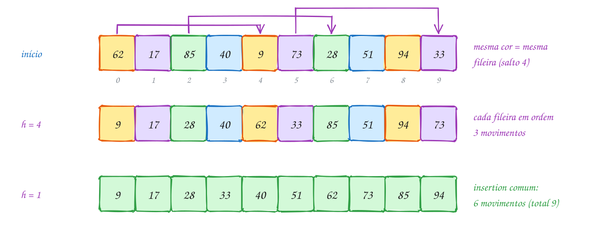</p>

O mesmo exemplo em C. O laço de dentro é o insertion sort do assunto 0093
com o `1` trocado por `h`:

```c
#include <stdio.h>

void mostra(const int v[], int n) {
    for (int i = 0; i < n; i++) {
        printf(" %d", v[i]);
    }
}

// insertion sort com saltos: os saltos seguem a sequência de Knuth
void shell_sort(int v[], int n) {
    int h = 1;
    while (h < n / 3) {
        h = 3 * h + 1;                  // 1, 4, 13, 40, 121...
    }
    for (; h >= 1; h /= 3) {            // ..., 121, 40, 13, 4, 1
        int movimentos = 0;
        // insertion sort entre elementos que estão a h casas de distância
        for (int i = h; i < n; i++) {
            int x = v[i];
            int j = i;
            while (j >= h && v[j - h] > x) {
                v[j] = v[j - h];        // empurra h casas para a direita
                j -= h;
                movimentos++;
            }
            v[j] = x;
        }
        printf("h = %d:", h);
        mostra(v, n);
        printf("  (%d movimentos)\n", movimentos);
    }
}

int main(void) {
    int rotas[] = {62, 17, 85, 40, 9, 73, 28, 51, 94, 33};
    int n = 10;

    printf("início:");
    mostra(rotas, n);
    printf("\n");
    shell_sort(rotas, n);
    return 0;
}
// Saída:
// início: 62 17 85 40 9 73 28 51 94 33
// h = 4: 9 17 28 40 62 33 85 51 94 73  (3 movimentos)
// h = 1: 9 17 28 33 40 51 62 73 85 94  (6 movimentos)
```

São 9 movimentos no total. O insertion sort comum, no mesmo vetor, faz 21:
o 9, sozinho, gastaria 4. No shell sort ele deu **um** pulo de 4 casas.

Repare que `h /= 3` desfaz a conta `3 * h + 1`: na divisão inteira, 13 / 3 é
4 e 4 / 3 é 1. O laço de fora para quando `h` vira 0. Repara no fluxograma:
primeiro o programa sobe até o maior salto, depois desce rodada por rodada,
e a última rodada é sempre a do `h = 1`:

<p align="center">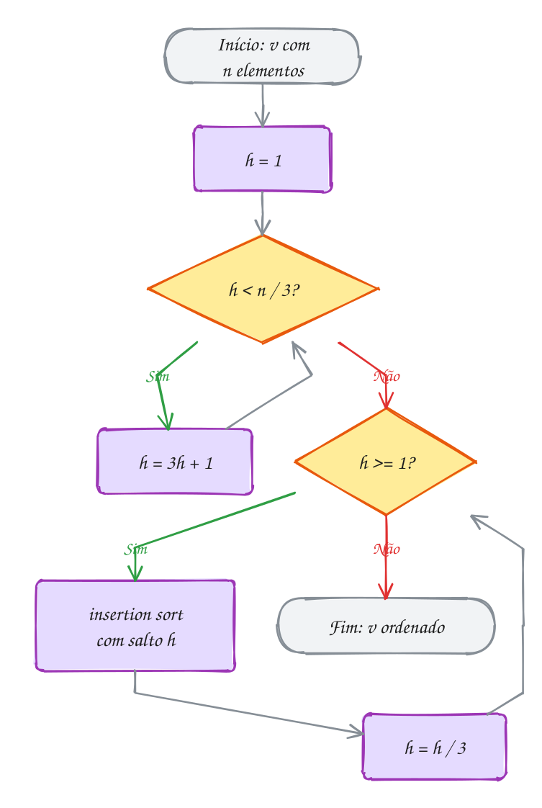</p>

### Passo a passo

A rodada com `h = 4`. O `i` anda de 4 até 9, e cada `v[i]` só se compara com
quem está 4, 8, ... casas para trás:

| i | x | compara com | ação | vetor depois |
| --- | --- | --- | --- | --- |
| 4 | 9 | v[0] = 62 | 62 pula para v[4]; 9 vai para v[0] | 9 17 85 40 62 73 28 51 94 33 |
| 5 | 73 | v[1] = 17 | nada | 9 17 85 40 62 73 28 51 94 33 |
| 6 | 28 | v[2] = 85 | 85 pula para v[6]; 28 vai para v[2] | 9 17 28 40 62 73 85 51 94 33 |
| 7 | 51 | v[3] = 40 | nada | 9 17 28 40 62 73 85 51 94 33 |
| 8 | 94 | v[4] = 62 | nada | 9 17 28 40 62 73 85 51 94 33 |
| 9 | 33 | v[5] = 73, depois v[1] = 17 | 73 pula para v[9]; 33 vai para v[5] | 9 17 28 40 62 33 85 51 94 73 |

> [!WARNING]
> A última rodada **tem** que ser com `h = 1`. As rodadas com salto grande só
> garantem que cada fileira está em ordem, não o vetor todo: depois do
> `h = 4`, o 62 ainda está antes do 33. Se você inventar sua própria
> sequência (5, 3, 2, por exemplo) e esquecer do 1, o programa termina sem
> erro nenhum e com o vetor fora de ordem. Outro tropeço: escrever a
> condição como `j > 0` (a do insertion sort comum). Com salto `h`, o certo é
> `j >= h`, senão `v[j - h]` lê antes do começo do vetor.

> [!TIP]
> **Por dentro do C:** o shell sort não usa memória extra nenhuma: só `h`,
> `i`, `j` e `x`, umas poucas variáveis na pilha, qualquer que seja o tamanho
> do vetor. É por isso que ele aparece em sistemas embarcados e no código de
> bibliotecas pequenas (a uClibc, por exemplo, implementa o `qsort` com shell
> sort). O custo depende dos saltos, e ninguém sabe a fórmula exata para a
> maioria das sequências: com a de Knuth, o pior caso é O(n^1,5), e na
> prática fica perto de n^1,25. Já os saltos `n/2, n/4, ..., 1` (os de Shell)
> têm pior caso O(n²): como todos são pares menos o último, posições pares e
> ímpares só se comparam na rodada final.

> [!NOTE]
> **Pergunta para você:** o shell sort é estável? Pense em `5 3a 3b 1` (dois
> 3 iguais, o `a` antes do `b`) com saltos 2 e 1. Faça as duas rodadas no
> papel e veja em que ordem os dois 3 terminam.

### Hora de praticar

Os arquivos ficam em [`0119-shell-sort/`](0119-shell-sort/). Os comandos funcionam de qualquer pasta do terminal. Nos exemplos, rode, mude, quebre e rode de novo. Nos exercícios, a resposta vai dentro do próprio arquivo. ★☆☆ é aquecimento, ★★☆ pede raciocínio e ★★★ é desafio.

**Exemplo A237 · A escolha dos saltos muda tudo**

```c
#include <stdio.h>
#include <stdlib.h>

#define N 4096 // potência de 2, de propósito

static long comparacoes;
static unsigned semente;

// gerador de números pseudoaleatórios simples: a mesma semente dá sempre a
// mesma sequência, então a saída é igual em qualquer computador
int sorteia(void) {
    semente = semente * 1103515245u + 12345u;
    return (int) ((semente >> 16) % 100000);
}

// uma rodada de insertion sort com salto h
void rodada(int v[], int n, int h) {
    for (int i = h; i < n; i++) {
        int x = v[i];
        int j = i;
        while (j >= h) {
            comparacoes++;
            if (v[j - h] <= x) {
                break;
            }
            v[j] = v[j - h];
            j -= h;
        }
        v[j] = x;
    }
}

void so_insertion(int v[], int n) {
    rodada(v, n, 1);
}

void saltos_de_shell(int v[], int n) { // n/2, n/4, ..., 1
    for (int h = n / 2; h >= 1; h /= 2) {
        rodada(v, n, h);
    }
}

void saltos_de_knuth(int v[], int n) { // ..., 40, 13, 4, 1
    int h = 1;
    while (h < n / 3) {
        h = 3 * h + 1;
    }
    for (; h >= 1; h /= 3) {
        rodada(v, n, h);
    }
}

// tipo 0: aleatório; 1: decrescente; 2: metade de baixo nas posições ímpares,
// metade de cima nas pares (só se misturam quando o salto é ímpar)
void testa(const char *nome, void (*ordena)(int[], int), int tipo) {
    int *v = malloc(N * sizeof(int));
    if (v == NULL) {
        return;
    }
    semente = 2024;
    for (int i = 0; i < N; i++) {
        if (tipo == 0) {
            v[i] = sorteia();
        } else if (tipo == 1) {
            v[i] = N - i;
        } else {
            v[i] = i % 2 == 0 ? N / 2 + i / 2 : i / 2;
        }
    }
    comparacoes = 0;
    ordena(v, N);
    int ok = 1;
    for (int i = 1; i < N; i++) {
        if (v[i - 1] > v[i]) {
            ok = 0;
        }
    }
    printf("%-18s %10ld comparações%s\n", nome, comparacoes, ok ? "" : " (ERRO)");
    free(v);
}

int main(void) {
    const char *titulos[] = {"aleatórios", "decrescentes", "grandes nas pares, pequenos nas ímpares"};
    for (int t = 0; t < 3; t++) {
        printf("%d números %s:\n", N, titulos[t]);
        testa("  insertion sort", so_insertion, t);
        testa("  saltos de Shell", saltos_de_shell, t);
        testa("  saltos de Knuth", saltos_de_knuth, t);
    }
    return 0;
}
// Saída:
// 4096 números aleatórios:
//   insertion sort      4245375 comparações
//   saltos de Shell      168264 comparações
//   saltos de Knuth       77422 comparações
// 4096 números decrescentes:
//   insertion sort      8386560 comparações
//   saltos de Shell       65538 comparações
//   saltos de Knuth       42751 comparações
// 4096 números grandes nas pares, pequenos nas ímpares:
//   insertion sort      2102270 comparações
//   saltos de Shell     2143232 comparações
//   saltos de Knuth       45536 comparações
//
// No último caso, os saltos 2048, 1024, ..., 2 são todos pares: as posições
// pares nunca encontram as ímpares, e a rodada final com h = 1 faz o
// trabalho inteiro de um insertion sort. Os saltos de Knuth alternam pares e
// ímpares (40, 13, 4, 1) e misturam tudo cedo.
```

```bash
~/LPEDC/rodar 18-ordenacao-linear/0119-shell-sort/A237.c
```

**Exemplo A238 · O shell sort embaralha os empates**

```c
#include <stdio.h>

typedef struct {
    char hora[6]; // "19:05"
    int zona;     // zona de entrega: 1, 2 ou 3
} Pedido;

// ordena pela zona com saltos dados; o último salto é sempre 1
void ordena_por_zona(Pedido v[], int n, const int saltos[], int qtd) {
    for (int s = 0; s < qtd; s++) {
        int h = saltos[s];
        for (int i = h; i < n; i++) {
            Pedido x = v[i];
            int j = i;
            while (j >= h && v[j - h].zona > x.zona) { // só ">": empate não anda
                v[j] = v[j - h];
                j -= h;
            }
            v[j] = x;
        }
    }
}

void mostra(const char *rotulo, const Pedido v[], int n) {
    printf("%s\n", rotulo);
    for (int z = 1; z <= 3; z++) {
        printf("  zona %d:", z);
        for (int i = 0; i < n; i++) {
            if (v[i].zona == z) {
                printf(" %s", v[i].hora);
            }
        }
        printf("\n");
    }
}

int main(void) {
    // os pedidos chegam em ordem de horário
    Pedido chegada[] = {
        {"19:00", 2}, {"19:04", 3}, {"19:07", 1}, {"19:11", 2}, {"19:15", 1},
        {"19:18", 3}, {"19:22", 2}, {"19:26", 1}, {"19:30", 3}, {"19:33", 2},
    };
    int n = 10;
    Pedido a[10], b[10];
    for (int i = 0; i < n; i++) {
        a[i] = b[i] = chegada[i];
    }

    int so_um[] = {1};
    ordena_por_zona(a, n, so_um, 1);           // é o insertion sort
    mostra("insertion sort (saltos 1):", a, n);

    int knuth[] = {4, 1};
    ordena_por_zona(b, n, knuth, 2);           // é o shell sort
    mostra("shell sort (saltos 4 e 1):", b, n);
    return 0;
}
// Saída:
// insertion sort (saltos 1):
//   zona 1: 19:07 19:15 19:26
//   zona 2: 19:00 19:11 19:22 19:33
//   zona 3: 19:04 19:18 19:30
// shell sort (saltos 4 e 1):
//   zona 1: 19:15 19:07 19:26
//   zona 2: 19:33 19:00 19:22 19:11
//   zona 3: 19:04 19:30 19:18
//
// Os dois deixam as zonas em ordem, mas só o insertion sort é ESTÁVEL: dentro
// de cada zona, os horários continuam na ordem de chegada. No shell sort,
// na rodada h = 4, o pedido das 19:00 foi empurrado da posição 0 para a 4 e o
// das 19:33 pulou da posição 9 para a 1: os dois, da zona 2, se cruzaram sem
// nunca serem comparados. A rodada h = 1 não desfaz isso, porque empates não
// se movem.
```

```bash
~/LPEDC/rodar 18-ordenacao-linear/0119-shell-sort/A238.c
```

#### Exercícios

**Exercício E709** · ★☆☆

Antes de ordenar, o shell sort escolhe os saltos. Escreva a função
void mostra_saltos(int n), que mostra os saltos de Knuth (h = 3h + 1) que
o shell sort do texto usa para um vetor de n elementos, na ordem em que
eles são usados (do maior para o 1). Chame para n = 10, 100, 1000 e
1000000.


```text
Saída esperada:
n = 10: 4 1
n = 100: 40 13 4 1
n = 1000: 364 121 40 13 4 1
n = 1000000: 797161 265720 88573 29524 9841 3280 1093 364 121 40 13 4 1
```

**Dicas:**

1. Primeiro suba: comece com h = 1 e faça h = 3 * h + 1 enquanto
   h < n / 3.
2. Depois desça com h /= 3 até h chegar a 0, mostrando cada h.
3. Um milhão de elementos pede só 13 rodadas.
4. Resposta esperada: a saída acima.

```bash
~/LPEDC/rodar 18-ordenacao-linear/0119-shell-sort/E709.c
```

**Exercício E710** · ★☆☆

O técnico do time de vôlei quer as idades das 11 atletas em ordem. Em vez
dos saltos de Knuth, use os saltos fixos 5, 3 e 1. O main já faz as três
rodadas e mostra o vetor depois de cada uma: complete a função rodada,
que faz o insertion sort entre os elementos a h casas de distância.


```text
Saída esperada:
início: 31 19 27 22 35 18 24 29 20 33 26
h = 5: 18 19 27 20 33 26 24 29 22 35 31
h = 3: 18 19 22 20 29 26 24 31 27 35 33
h = 1: 18 19 20 22 24 26 27 29 31 33 35
```

**Dicas:**

1. É o laço de dentro do shell_sort do texto, sem o laço dos saltos.
2. O i começa em h, e o j anda de h em h para trás: j >= h e v[j - h].
3. Com h = 5, as fileiras são 31 18 26, 19 24, 27 29, 22 20 e 35 33.
4. Resposta esperada: a saída acima.

```bash
~/LPEDC/rodar 18-ordenacao-linear/0119-shell-sort/E710.c
```

**Exercício E711** · ★★☆

A lista de convidados da festa precisa ir para a portaria em ordem
alfabética. Escreva void shell_nomes(const char *v[], int n), um shell
sort com os saltos de Knuth para um vetor de strings, que troca só os
ponteiros (as letras não saem do lugar). Conte as comparações (cada strcmp
conta uma) numa variável static.


```text
Convidados: Rafael Bianca Tiago Larissa Diego Amanda Paulo Helena Caio
            Sofia Murilo Elisa
```


```text
Saída esperada:
Amanda, Bianca, Caio, Diego, Elisa, Helena, Larissa, Murilo, Paulo, Rafael, Sofia, Tiago
36 comparações
```

**Dicas:**

1. É o shell_sort do texto com int trocado por const char * e
   v[j - h] > x trocado por strcmp(v[j - h], x) > 0.
2. Com n = 12, os saltos são 4 e 1.
3. Para contar cada strcmp, escreva o while só com j >= h e faça o teste
   do strcmp dentro dele, com um break.
4. Resposta esperada: a saída acima.

```bash
~/LPEDC/rodar 18-ordenacao-linear/0119-shell-sort/E711.c
```

**Exercício E712** · ★★☆

Um vetor está h-ORDENADO quando toda fileira de passo h (v[i], v[i + h],
v[i + 2h], ...) está em ordem. O programa abaixo roda o shell sort num
vetor de 40 números e, depois de cada rodada, pergunta se o vetor está
13-, 4- e 1-ordenado. Escreva a função esta_h_ordenado e rode.


```text
Saída esperada:
início: 13-ordenado? não, 4-ordenado? não, 1-ordenado? não
h = 13: 13-ordenado? sim, 4-ordenado? não, 1-ordenado? não
h =  4: 13-ordenado? sim, 4-ordenado? sim, 1-ordenado? não
h =  1: 13-ordenado? sim, 4-ordenado? sim, 1-ordenado? sim
```


Repare na coluna do 13: a rodada com h = 4 mexe no vetor, mas não desfaz o
que a rodada h = 13 arrumou. É isso que faz cada rodada aproveitar o
trabalho da anterior.

**Dicas:**

1. Não precisa separar as fileiras: basta conferir v[i - h] <= v[i] para
   todo i de h até n - 1.
2. Achou um par fora de ordem? Pode devolver false na hora.
3. 1-ordenado é o mesmo que ordenado.
4. Resposta esperada: a saída acima.

```bash
~/LPEDC/rodar 18-ordenacao-linear/0119-shell-sort/E712.c
```

**Exercício E713** · ★★★

Ache os bugs. Este shell sort deveria ordenar as 13 senhas de atendimento
do cartório, mas a saída sai fora de ordem. Não há erro de memória: o
programa roda até o fim, só que errado. São DOIS erros, um em cada laço
while. Conserte os dois e rode.


```text
Saída esperada:
2 5 8 11 14 17 20 23 26 29 32 35 38
```

**Dicas:**

1. Mostre o valor de h no começo de cada rodada. Quantas rodadas
   acontecem? Qual devia ser a última?
2. Com o primeiro erro consertado, mostre o vetor depois de cada rodada.
   Na rodada h = 1, o v[1] chega a ser comparado com o v[0]?
3. Compare as condições com as do shell_sort do texto.
4. Resposta esperada: o laço dos saltos tem que rodar também com h = 1
   (while (h >= 1), e não while (h > 1)); e o laço de dentro tem que
   andar enquanto j >= h, e não j > h. Consertado, sai a linha acima.

```bash
~/LPEDC/rodar 18-ordenacao-linear/0119-shell-sort/E713.c
```

**Exercício E714** · ★★★

Uma INVERSÃO é um par de posições i < j com v[i] > v[j]: um par fora de
ordem. Vetor ordenado tem 0 inversões. Estenda o programa abaixo para
medir o que cada rodada do shell sort faz:

a) escreva long inversoes(const int v[], int n) (dois laços, O(n²));

b) conte os movimentos (v[j] = v[j - h]) de cada rodada;

c) depois de cada rodada, mostre as inversões que sobraram e os
movimentos da rodada; no fim, o total de movimentos comparado com as
inversões do início.


```text
Saída esperada:
início:  9775 inversões
h = 121:  7359 inversões,   12 movimentos
h =  40:  2602 inversões,  131 movimentos
h =  13:  1004 inversões,  172 movimentos
h =   4:   288 inversões,  234 movimentos
h =   1:     0 inversões,  288 movimentos
total: 837 movimentos (o insertion sort faria 9775)
```


Repare na primeira rodada: 12 movimentos desfizeram 2416 inversões. E na
última: os movimentos são exatamente as inversões que sobraram.

**Dicas:**

1. Guarde as inversões do início numa variável: o insertion sort comum
   faz um movimento por inversão, então esse é o custo dele.
2. Um pulo de h casas pode desfazer várias inversões de uma vez: todos os
   elementos que ficavam entre as duas posições também entram na conta.
3. Formatos: "h = %3d: %5ld inversões, %4ld movimentos".
4. Resposta esperada: a saída acima.

```bash
~/LPEDC/rodar 18-ordenacao-linear/0119-shell-sort/E714.c
```

---

## 0120 · Counting sort

No fim do expediente, a dona da lanchonete olha as avaliações do dia no app
de entregas. Cada pedido recebeu de 0 a 4 estrelas, e ela quer a lista em
ordem de nota para responder primeiro os clientes insatisfeitos. São 8
pedidos, de A a H, com 3, 1, 3, 2, 1, 4, 0 e 3 estrelas.

Ela nem pensa em comparar pedido com pedido. Faz cinco montes, um para cada
nota, e joga cada pedido no seu monte. Depois é só juntar os montes, do 0 ao
4. Ninguém foi comparado com ninguém.

No assunto 0117 você viu que nenhuma ordenação **por comparação** faz menos
que uns n log₂ n testes no pior caso. O **counting sort** (ordenação por
contagem) não fura esse limite: ele simplesmente não compara. Ele usa o
**valor** da chave como **índice** de um vetor. Para isso, as chaves precisam
ser inteiros num intervalo pequeno, de 0 a k - 1.

O algoritmo tem três passos, cada um um laço simples:

1. **contar**: `c[x]` recebe quantos elementos têm a chave `x`;
2. **acumular**: cada `c[x]` passa a valer quantos têm chave **menor ou
   igual** a `x`. Isso diz onde termina o bloco de cada valor na saída: as
   três avaliações de 3 estrelas ocupam as posições 4, 5 e 6, porque há 7
   avaliações com até 3 estrelas;
3. **distribuir**: percorra a entrada **de trás para a frente** e coloque
   cada elemento na última vaga livre do seu bloco: `c[x]--` e
   `saida[c[x]] = v[i]`.

Por que de trás para a frente? Porque assim, entre chaves iguais, quem vem
por último na entrada ocupa a última vaga do bloco. A ordem original dos
empates se mantém: o counting sort é **estável**. Isso parece detalhe, mas é
o que faz dele a peça central do radix sort, no próximo assunto.

Vamos ver na prática. A entrada passa uma vez para contar e outra para
distribuir. Os três pedidos de 3 estrelas (A, C e H, em verde) chegam à
saída na mesma ordem em que estavam:

<p align="center">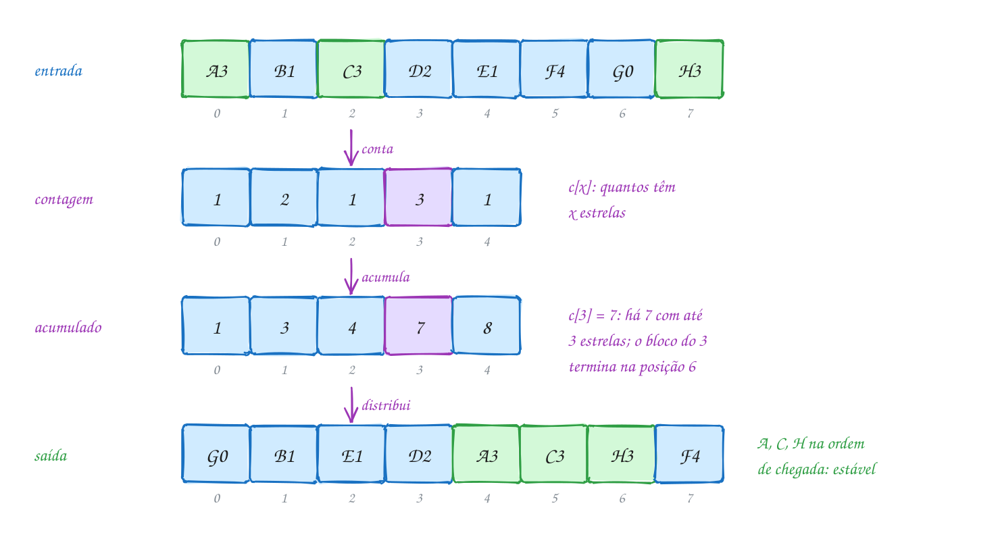</p>

O mesmo exemplo em C. A saída vai para outro vetor: o counting sort não
ordena no lugar.

```c
#include <stdio.h>

#define K 5 // estrelas vão de 0 a 4

typedef struct {
    char codigo; // pedido 'A', 'B', ...
    int estrelas;
} Avaliacao;

void mostra(const char *rotulo, const int c[]) {
    printf("%-10s", rotulo);
    for (int x = 0; x < K; x++) {
        printf(" %d", c[x]);
    }
    printf("\n");
}

// ordena v pelas estrelas, de forma estável, e grava o resultado em saida
void counting_sort(const Avaliacao v[], Avaliacao saida[], int n) {
    int c[K] = {0};
    for (int i = 0; i < n; i++) {
        c[v[i].estrelas]++;              // 1) conta cada valor
    }
    mostra("contagem:", c);
    for (int x = 1; x < K; x++) {
        c[x] += c[x - 1];                // 2) c[x] = quantos têm <= x
    }
    mostra("acumulado:", c);
    for (int i = n - 1; i >= 0; i--) {   // 3) de trás para a frente
        int x = v[i].estrelas;
        c[x]--;
        saida[c[x]] = v[i];              // última vaga livre do bloco x
    }
}

int main(void) {
    Avaliacao v[] = {{'A', 3}, {'B', 1}, {'C', 3}, {'D', 2},
                     {'E', 1}, {'F', 4}, {'G', 0}, {'H', 3}};
    Avaliacao saida[8];
    int n = 8;

    counting_sort(v, saida, n);
    printf("ordenado: ");
    for (int i = 0; i < n; i++) {
        printf(" %c%d", saida[i].codigo, saida[i].estrelas);
    }
    printf("\n");
    return 0;
}
// Saída:
// contagem:  1 2 1 3 1
// acumulado: 1 3 4 7 8
// ordenado:  G0 B1 E1 D2 A3 C3 H3 F4
```

### Passo a passo

O terceiro laço, com o acumulado `1 3 4 7 8` no começo. Cada linha usa uma
vaga e diminui o contador daquela nota:

| i | pedido | c[x] antes | vai para | c depois |
| --- | --- | --- | --- | --- |
| 7 | H3 | c[3] = 7 | saida[6] | 1 3 4 6 8 |
| 6 | G0 | c[0] = 1 | saida[0] | 0 3 4 6 8 |
| 5 | F4 | c[4] = 8 | saida[7] | 0 3 4 6 7 |
| 4 | E1 | c[1] = 3 | saida[2] | 0 2 4 6 7 |
| 3 | D2 | c[2] = 4 | saida[3] | 0 2 3 6 7 |
| 2 | C3 | c[3] = 6 | saida[5] | 0 2 3 5 7 |
| 1 | B1 | c[1] = 2 | saida[1] | 0 1 3 5 7 |
| 0 | A3 | c[3] = 5 | saida[4] | 0 1 3 4 7 |

No fim, cada `c[x]` aponta para o **começo** do bloco de `x`.

Repara no fluxograma: são três laços em sequência, nenhum dentro do outro.
Dois andam pelos n elementos e um pelas k chaves, então o custo é
**O(n + k)**:

<p align="center">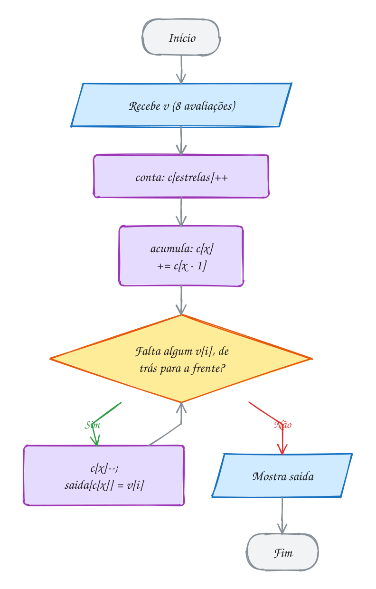</p>

> [!WARNING]
> Se o terceiro laço for da frente para trás (`for (int i = 0; i < n; i++)`)
> com o mesmo `c[x]--`, o vetor sai ordenado pelas estrelas, mas os empates
> saem **invertidos**: H3 C3 A3 em vez de A3 C3 H3. O programa não dá erro
> nenhum, e o estrago só aparece quando a ordem dos empates importa (no radix
> sort, ela importa sempre). Outro cuidado: a chave tem que caber no vetor.
> Uma nota 5, ou uma nota negativa, vira `c[5]` ou `c[-1]`: escrita fora do
> vetor, que o AddressSanitizer pega e um programa sem ele ignora.

> [!TIP]
> **Por dentro do C:** o counting sort troca tempo por memória. Ele precisa
> de `k` contadores e de um vetor de saída com `n` elementos, além da
> entrada. Com notas de 0 a 4, `c` tem 20 bytes e mora na pilha. Com chaves
> de 0 a 1 bilhão, `c` teria 4 GB: aí o O(n + k) deixa de ser linear na
> prática, porque o `k` domina. A regra é usar counting sort quando `k` é da
> ordem de `n` ou menor. E o laço `c[v[i].estrelas]++` acessa a memória de
> `c` fora de ordem, pulando de contador em contador: com `c` pequeno, tudo
> cabe no cache e cada acesso é quase de graça.

> [!NOTE]
> **Pergunta para você:** e se você só precisasse dos números, sem o código
> do pedido? Dá para pular o vetor de saída e o acumulado: basta escrever
> cada nota `c[x]` vezes, em ordem. Por que essa versão curta não serve para
> ordenar as avaliações com o código junto?

### Hora de praticar

Os arquivos ficam em [`0120-counting-sort/`](0120-counting-sort/). Os comandos funcionam de qualquer pasta do terminal. Nos exemplos, rode, mude, quebre e rode de novo. Nos exercícios, a resposta vai dentro do próprio arquivo. ★☆☆ é aquecimento, ★★☆ pede raciocínio e ★★★ é desafio.

**Exemplo A239 · Temperaturas abaixo de zero**

```c
#include <stdio.h>
#include <stdlib.h>

// versão curta: só números, sem registros junto. A chave pode ser negativa,
// então o índice do contador é (valor - menor)
int ordena_temperaturas(int v[], int n) {
    int menor = v[0], maior = v[0];
    for (int i = 1; i < n; i++) {
        if (v[i] < menor) {
            menor = v[i];
        }
        if (v[i] > maior) {
            maior = v[i];
        }
    }
    int k = maior - menor + 1;           // quantos valores possíveis
    int *c = calloc(k, sizeof(int));     // calloc já zera os contadores
    if (c == NULL) {
        return 0;
    }
    for (int i = 0; i < n; i++) {
        c[v[i] - menor]++;               // -3 vai para c[0], -2 para c[1]...
    }
    int pos = 0;
    for (int x = 0; x < k; x++) {        // reescreve cada valor c[x] vezes
        for (int r = 0; r < c[x]; r++) {
            v[pos++] = x + menor;
        }
    }
    free(c);
    return k;
}

int main(void) {
    // mínimas de 14 madrugadas de julho numa cidade serrana, em graus
    int minimas[] = {4, -2, 7, 0, -3, 4, 9, 1, -2, 4, 12, 0, 3, -1};
    int n = 14;

    int k = ordena_temperaturas(minimas, n);
    printf("%d leituras, %d contadores\n", n, k);
    for (int i = 0; i < n; i++) {
        printf(i == 0 ? "%d" : " %d", minimas[i]);
    }
    printf("\nmediana: entre %d e %d graus\n", minimas[n / 2 - 1], minimas[n / 2]);
    return 0;
}
// Saída:
// 14 leituras, 16 contadores
// -3 -2 -2 -1 0 0 1 3 4 4 4 7 9 12
// mediana: entre 1 e 3 graus
//
// De -3 a 12 são 16 valores possíveis: o vetor c tem 16 contadores, mesmo
// que só 10 temperaturas diferentes apareçam. Sem o "- menor", o -3 viraria
// c[-3], uma escrita antes do começo do vetor.
```

```bash
~/LPEDC/rodar 18-ordenacao-linear/0120-counting-sort/A239.c
```

**Exemplo A240 · A chamada pela inicial**

```c
#include <stdio.h>

#define LETRAS 26

// a chave não precisa ser um campo pronto: aqui é a inicial do nome,
// convertida em 0..25
int chave(const char *nome) {
    return nome[0] - 'A';
}

void por_inicial(const char *v[], const char *saida[], int n) {
    int c[LETRAS] = {0};
    for (int i = 0; i < n; i++) {
        c[chave(v[i])]++;
    }
    for (int x = 1; x < LETRAS; x++) {
        c[x] += c[x - 1];
    }
    for (int i = n - 1; i >= 0; i--) {
        saida[--c[chave(v[i])]] = v[i];  // só o ponteiro é copiado
    }
}

int main(void) {
    // ordem de inscrição na escolinha de futebol
    const char *inscritos[] = {"Mateus", "Bruna", "Lucas", "Beatriz", "Murilo", "Ana",
                               "Lara", "Bento", "Miguel", "Alice"};
    const char *chamada[10];
    int n = 10;

    por_inicial(inscritos, chamada, n);
    char letra = ' ';
    for (int i = 0; i < n; i++) {
        if (chamada[i][0] != letra) {    // começou um bloco novo
            letra = chamada[i][0];
            printf("%s%c:", i == 0 ? "" : "\n", letra);
        }
        printf(" %s", chamada[i]);
    }
    printf("\n");
    return 0;
}
// Saída:
// A: Ana Alice
// B: Bruna Beatriz Bento
// L: Lucas Lara
// M: Mateus Murilo Miguel
//
// As iniciais estão em ordem, mas dentro de cada letra os nomes seguem a
// ordem de inscrição: Ana veio antes de Alice, então continua antes. O
// counting sort ordena por UMA chave e não mexe no resto. Para a ordem
// alfabética completa, é preciso ordenar letra por letra: é o radix sort.
```

```bash
~/LPEDC/rodar 18-ordenacao-linear/0120-counting-sort/A240.c
```

#### Exercícios

**Exercício E715** · ★☆☆

As notas da prova de 20 alunos vão de 0 a 10. Ordene o vetor com a versão
curta do counting sort (conte cada nota e reescreva cada uma c[x] vezes,
sem vetor de saída) e mostre também a nota mais comum, usando os mesmos
contadores.


```text
Saída esperada:
ordenadas: 2 3 4 5 5 5 5 6 6 7 7 7 7 7 8 8 8 9 10 10
mais comum: 7 (5 alunos)
```

**Dicas:**

1. int c[11] = {0}; tem um contador para cada nota, de 0 a 10.
2. Para reescrever, use um índice pos que só anda para a frente.
3. A nota mais comum é o x com o maior c[x]: dá para achar no mesmo laço
   que reescreve o vetor.
4. Resposta esperada: a saída acima.

```bash
~/LPEDC/rodar 18-ordenacao-linear/0120-counting-sort/E715.c
```

**Exercício E716** · ★☆☆

A sapataria guarda quantos pares tem de cada tamanho, do 34 ao 44, e quer
arrumar a prateleira em ordem de tamanho, um par ao lado do outro. Complete
o programa: transforme a contagem em acumulado e, para cada tamanho que
tem estoque, mostre em que posições da prateleira ele fica.


```text
Saída esperada:
total: 27 pares
tamanho 34: posições 0 a 1
tamanho 36: posições 2 a 4
tamanho 37: posições 5 a 9
tamanho 38: posições 10 a 13
tamanho 39: posições 14 a 19
tamanho 40: posições 20 a 22
tamanho 41: posições 23 a 24
tamanho 43: posição 25
tamanho 44: posição 26
```

**Dicas:**

1. Depois do acumulado, c[x] diz quantos pares têm tamanho até x + 34.
   O total é o último contador.
2. O bloco do tamanho x vai de c[x - 1] até c[x] - 1. Para x = 0, o
   começo é 0.
3. Bloco vazio (começo igual a c[x]) não aparece; bloco de um par só usa
   "posição", no singular.
4. Resposta esperada: a saída acima.

```bash
~/LPEDC/rodar 18-ordenacao-linear/0120-counting-sort/E716.c
```

**Exercício E717** · ★★☆

Na triagem do pronto-socorro, cada paciente recebe uma cor de risco:
vermelho, laranja, amarelo, verde ou azul, do mais grave para o menos
grave. A fila de atendimento é por cor e, dentro da mesma cor, por ordem
de chegada. Escreva ordena_triagem, um counting sort ESTÁVEL que usa como
chave a posição da cor no vetor ordem_cores, e mostre a fila.


```text
Saída esperada:
 1. Rita  (vermelho)
 2. Otto  (vermelho)
 3. Davi  (laranja)
 4. Ivo   (laranja)
 5. Joana (amarelo)
 6. Caio  (amarelo)
 7. Sara  (amarelo)
 8. Pedro (verde)
 9. Nina  (verde)
10. Lia   (azul)
```

**Dicas:**

1. Escreva antes int chave(const Paciente *p), que procura p->cor em
   ordem_cores com strcmp e devolve o índice (0 a 4).
2. Depois é o counting_sort do texto com v[i].estrelas trocado por
   chave(&v[i]). O vetor de saída é outro vetor de Paciente.
3. Formato de cada linha: "%2d. %-5s (%s)\n".
4. Resposta esperada: a saída acima.

```bash
~/LPEDC/rodar 18-ordenacao-linear/0120-counting-sort/E717.c
```

**Exercício E718** · ★★☆

Duas palavras são ANAGRAMAS quando usam as mesmas letras, nas mesmas
quantidades: "porta" e "tropa". Um jeito de conferir: ordene as letras de
cada uma e compare. Escreva void ordena_letras(char s[]), um counting sort
das letras da própria string, com um contador para cada valor possível de
char (256), e use no programa abaixo.


```text
Saída esperada:
alegria -> aaegilr | regalia -> aaegilr: anagramas
porta -> aoprt | tropa -> aoprt: anagramas
mesa -> aems | seta -> aest: não são anagramas
carro -> acorr | corra -> acorr: anagramas
```

**Dicas:**

1. int c[256] = {0}; e c[(unsigned char) s[i]]++ até achar o '\0'.
2. Por que o cast? O char pode ter sinal: uma letra acentuada em UTF-8
   vira um byte negativo, e c[-61] escreve antes do vetor.
3. Depois, reescreva a string: cada x de 0 a 255, c[x] vezes. O '\0' do
   fim fica onde estava, porque o tamanho não muda.
4. Resposta esperada: a saída acima.

```bash
~/LPEDC/rodar 18-ordenacao-linear/0120-counting-sort/E718.c
```

**Exercício E719** · ★★★

Ache o bug. A central de suporte ordena os chamados por prioridade (0 é
urgente, 3 pode esperar) e, dentro da mesma prioridade, quer atender
primeiro quem abriu antes (número menor). O programa compila e roda, mas
a ordem dentro de cada prioridade sai errada. Faça duas coisas:

a) escreva a função estavel, que confere a fila pronta: entre chamados de
mesma prioridade, os números têm que vir crescentes. Rode: com o bug,
tem que aparecer "estável? não";

b) ache e conserte o erro do counting sort e rode de novo.


```text
Saída esperada depois de (a):
p0: 110 106 102
p1: 108 105
p2: 107 104 101
p3: 109 103
estável? não
```


```text
Saída esperada depois de (b):
p0: 102 106 110
p1: 105 108
p2: 101 104 107
p3: 103 109
estável? sim
```

**Dicas:**

1. Na função estavel, compare cada fila[i] com fila[i - 1]: mesma
   prioridade e número menor quer dizer que a ordem se perdeu.
2. O erro está em um dos três laços de ordena. Qual deles decide quem
   fica com a ÚLTIMA vaga de cada bloco?
3. Resposta esperada: o terceiro laço anda da frente para trás. Com
   c[x]--, o primeiro chamado de cada prioridade fica com a última vaga
   do bloco, e os empates saem invertidos. O certo é
   for (int i = n - 1; i >= 0; i--).

```bash
~/LPEDC/rodar 18-ordenacao-linear/0120-counting-sort/E719.c
```

**Exercício E720** · ★★★

Quem quebra códigos secretos começa contando letras. Escreva um programa
que mostre as letras da frase abaixo da MAIS frequente para a menos
frequente (só as que aparecem), com empates em ordem alfabética:


```text
o rato roeu a roupa do rei de roma e a rainha ficou brava
```


```text
Saída esperada:
a:9 o:7 r:7 e:4 i:3 u:3 d:2 b:1 c:1 f:1 h:1 m:1 n:1 p:1 t:1 v:1
```


A regra: nada de comparar letra com letra. Conte as frequências (um
contador por letra) e depois ordene as 26 letras com um counting sort
estável cuja chave é a frequência.

**Dicas:**

1. freq[letra - 'a']++ para cada letra de 'a' a 'z' (pule os espaços).
2. O counting sort deixa as chaves em ordem crescente. Para a ordem
   decrescente, use a chave maior - freq[l], em que maior é a maior
   frequência: a letra mais frequente fica com chave 0.
3. Se as letras entrarem de 'a' a 'z' e o sort for estável (terceiro
   laço de trás para a frente), os empates saem em ordem alfabética sem
   nenhum esforço extra.
4. O vetor ordenado guarda letras (0 a 25), não frequências: ranking[i]
   é a letra que ficou na posição i.
5. Resposta esperada: a saída acima.

```bash
~/LPEDC/rodar 18-ordenacao-linear/0120-counting-sort/E720.c
```

---

## 0121 · Radix sort

Antes dos computadores de hoje, os censos eram processados com cartões
perfurados e uma máquina **classificadora**. Ela olhava uma coluna do cartão e
jogava cada cartão num de 10 escaninhos, do 0 ao 9. O operador juntava os
escaninhos em ordem e passava o maço de novo, agora pela coluna seguinte.
Depois de passar por todas as colunas, o maço estava ordenado.

O truque, que parece ao contrário, é começar pela coluna **menos**
significativa. O **radix sort** (ordenação digital, ou por raiz) faz
exatamente isso com números:

1. ordene pelo dígito das **unidades**;
2. depois pelo das **dezenas**;
3. depois pelo das **centenas**, e assim até o dígito mais alto do maior
   número.

Cada passada é um **counting sort** (assunto 0120) com 10 chaves, de 0 a 9.
O dígito de `x` na casa `exp` (1, 10, 100...) sai com `(x / exp) % 10`. Essa
versão, que começa pelo dígito menos significativo, se chama **LSD** (*least
significant digit*).

Por que funciona? Depois da passada das dezenas, os números estão em ordem
pelos dois últimos dígitos. Na passada das centenas, dois números com a mesma
centena, como 807 e 830, ficam na ordem em que já estavam, que é a ordem das
dezenas. É por isso que cada passada **precisa ser estável**: a estabilidade
guarda o trabalho das passadas anteriores.

O custo é de `d` passadas de counting sort, com `d` dígitos e base `b`:
**O(d · (n + b))**. Para números de tamanho fixo, `d` é constante e o radix
sort é linear. De novo, nenhuma comparação entre elementos.

Vamos ver na prática. Oito números de pedido de um mercado online, com até
três dígitos (escritos com zeros à esquerda para os dígitos ficarem
alinhados). Acompanhe o 807 e o 830, em amarelo: a passada das dezenas põe o
807 na frente, e a das centenas, que vê os dois empatados no 8, respeita:

<p align="center">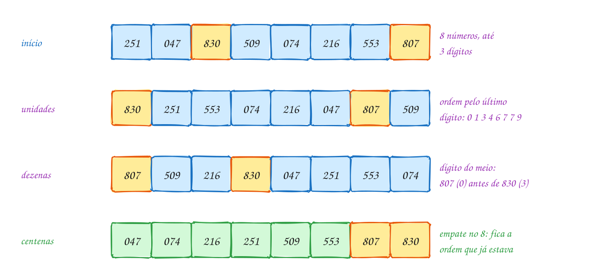</p>

O mesmo exemplo em C. A `passada` é o counting sort do assunto 0120 com a
chave trocada pelo dígito; o vetor auxiliar é alocado uma vez só e
reaproveitado em todas as passadas:

```c
#include <stdio.h>
#include <stdlib.h>

void mostra(const int v[], int n) {
    for (int i = 0; i < n; i++) {
        printf(" %03d", v[i]);
    }
    printf("\n");
}

// counting sort estável de v pelo dígito (v[i] / exp) % 10
void passada(int v[], int aux[], int n, int exp) {
    int c[10] = {0};
    for (int i = 0; i < n; i++) {
        c[(v[i] / exp) % 10]++;
    }
    for (int d = 1; d < 10; d++) {
        c[d] += c[d - 1];
    }
    for (int i = n - 1; i >= 0; i--) {      // de trás para a frente
        int d = (v[i] / exp) % 10;
        c[d]--;
        aux[c[d]] = v[i];
    }
    for (int i = 0; i < n; i++) {
        v[i] = aux[i];
    }
}

void radix_sort(int v[], int n) {
    int maior = v[0];
    for (int i = 1; i < n; i++) {
        if (v[i] > maior) {
            maior = v[i];
        }
    }
    int *aux = malloc(n * sizeof(int));
    if (aux == NULL) {
        return;
    }
    for (int exp = 1; maior / exp > 0; exp *= 10) {  // um dígito por passada
        passada(v, aux, n, exp);
        printf("exp = %3d:", exp);
        mostra(v, n);
    }
    free(aux);
}

int main(void) {
    int pedidos[] = {251, 47, 830, 509, 74, 216, 553, 807};
    int n = 8;

    printf("início:   ");
    mostra(pedidos, n);
    radix_sort(pedidos, n);
    return 0;
}
// Saída:
// início:    251 047 830 509 074 216 553 807
// exp =   1: 830 251 553 074 216 047 807 509
// exp =  10: 807 509 216 830 047 251 553 074
// exp = 100: 047 074 216 251 509 553 807 830
```

### Passo a passo

A passada das dezenas (`exp = 10`) recebe o vetor da passada anterior. O
dígito de cada número é `(x / 10) % 10`:

| número | 830 | 251 | 553 | 074 | 216 | 047 | 807 | 509 |
| --- | --- | --- | --- | --- | --- | --- | --- | --- |
| dígito | 3 | 5 | 5 | 7 | 1 | 4 | 0 | 0 |

Contagem por dígito: 0 → 2, 1 → 1, 3 → 1, 4 → 1, 5 → 2, 7 → 1. Os blocos
na saída ficam: `807 509 | 216 | 830 | 047 | 251 553 | 074`. Dentro do
bloco do 0, o 807 vem antes do 509 porque já vinha antes: a passada não
olhou as unidades, mas também não estragou a ordem delas.

Repara no fluxograma: o laço para quando `exp` passa do maior número. Com o
maior igual a 830, são três passadas (`exp` = 1, 10, 100); com `exp = 1000`,
`830 / 1000` dá 0:

<p align="center">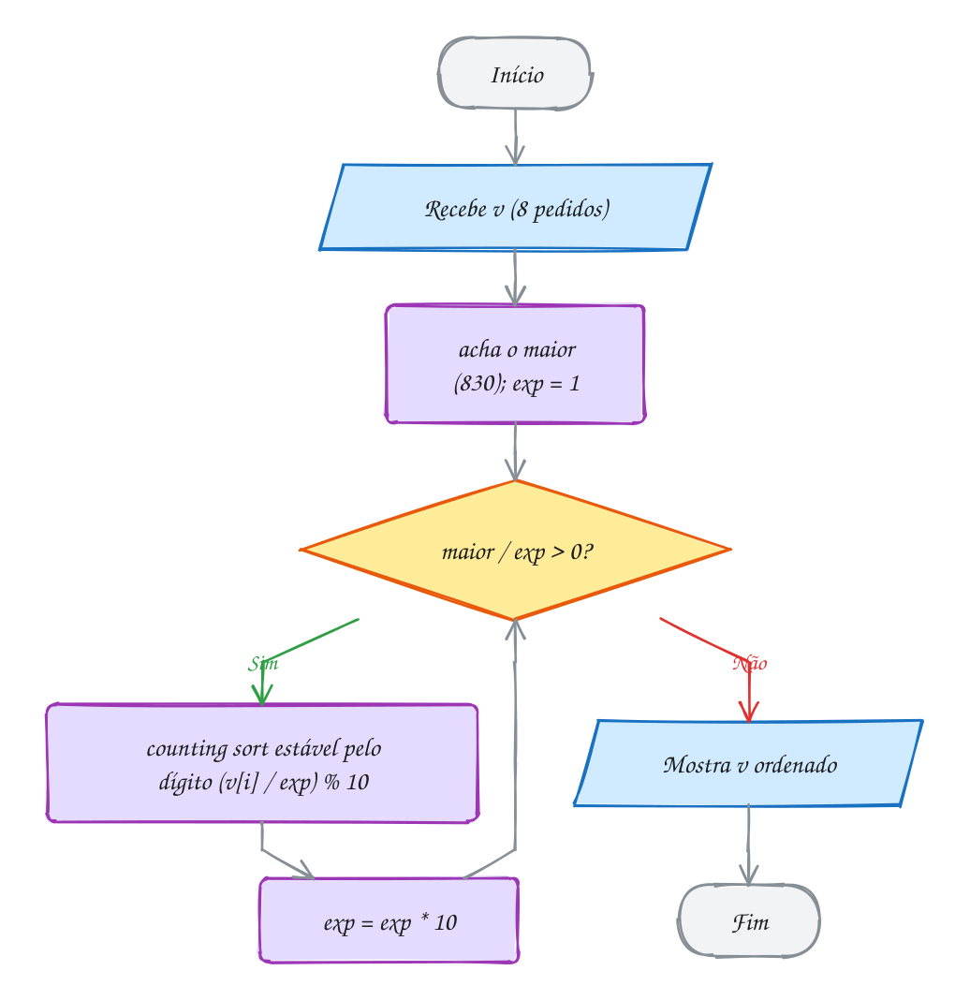</p>

> [!WARNING]
> Use uma ordenação **estável** em cada passada. Se o terceiro laço da
> `passada` andar da frente para trás, cada passada inverte os empates, e o
> resultado sai `074 047 251 216 553 509 830 807`: as centenas em ordem, o
> resto bagunçado, sem erro nenhum. Também não
> dá para começar pelas centenas com esse código: a última passada é a que
> manda, então ela tem que ser a do dígito mais importante. E o número de
> passadas vem do **maior** elemento, não do primeiro: um número de 4 dígitos
> escondido no meio do vetor precisa da quarta passada.

> [!TIP]
> **Por dentro do C:** divisão e resto custam caro para o processador, e
> base 10 é uma escolha humana. Programas de verdade usam **base 256**: o
> "dígito" é um byte, e sai com operadores de bits (assunto 0065):
> `(x >> 8 * b) & 0xFF` é o byte `b` de `x`. Um `int` de 32 bits tem 4 bytes,
> então são sempre 4 passadas, com `c[256]` (1 KB, cabe no cache L1). Um
> milhão de inteiros vira 4 passadas de 1 milhão, contra uns 20 milhões de
> comparações de um bom O(n log n). O preço é a memória: o vetor auxiliar tem
> o tamanho da entrada.

> [!NOTE]
> **Pergunta para você:** este código funciona com números negativos? Pense
> no que `(-47 / 1) % 10` dá em C (o resto tem o sinal do dividendo) e onde
> isso cairia no vetor `c`.

### Hora de praticar

Os arquivos ficam em [`0121-radix-sort/`](0121-radix-sort/). Os comandos funcionam de qualquer pasta do terminal. Nos exemplos, rode, mude, quebre e rode de novo. Nos exercícios, a resposta vai dentro do próprio arquivo. ★☆☆ é aquecimento, ★★☆ pede raciocínio e ★★★ é desafio.

**Exemplo A241 · Placas de carro, letra por letra**

```c
#include <stdio.h>
#include <string.h>

#define TAM 7 // placa no padrão Mercosul: ABC1D23

// counting sort estável dos ponteiros pela letra da posição pos
void passada(const char *v[], const char *aux[], int n, int pos) {
    int c[256] = {0};
    for (int i = 0; i < n; i++) {
        c[(unsigned char) v[i][pos]]++;
    }
    for (int x = 1; x < 256; x++) {
        c[x] += c[x - 1];
    }
    for (int i = n - 1; i >= 0; i--) {
        unsigned char x = (unsigned char) v[i][pos];
        aux[--c[x]] = v[i];
    }
    memcpy(v, aux, n * sizeof(const char *)); // copia os ponteiros de volta
}

int main(void) {
    const char *placas[] = {"RIO2A18", "BRA0S17", "RIO1B99", "SPX3C40", "BRA0S09", "MGA7E21"};
    const char *aux[6];
    int n = 6;

    for (int pos = TAM - 1; pos >= 0; pos--) { // da última letra para a primeira
        passada(placas, aux, n, pos);
        printf("posição %d:", pos);
        for (int i = 0; i < n; i++) {
            printf(" %s", placas[i]);
        }
        printf("\n");
    }
    return 0;
}
// Saída:
// posição 6: SPX3C40 MGA7E21 BRA0S17 RIO2A18 RIO1B99 BRA0S09
// posição 5: BRA0S09 BRA0S17 RIO2A18 MGA7E21 SPX3C40 RIO1B99
// posição 4: RIO2A18 RIO1B99 SPX3C40 MGA7E21 BRA0S09 BRA0S17
// posição 3: BRA0S09 BRA0S17 RIO1B99 RIO2A18 SPX3C40 MGA7E21
// posição 2: BRA0S09 BRA0S17 MGA7E21 RIO1B99 RIO2A18 SPX3C40
// posição 1: MGA7E21 RIO1B99 RIO2A18 SPX3C40 BRA0S09 BRA0S17
// posição 0: BRA0S09 BRA0S17 MGA7E21 RIO1B99 RIO2A18 SPX3C40
//
// Sete passadas, uma por posição, sempre da direita para a esquerda. Repare
// em BRA0S09 e BRA0S17: só diferem na posição 5, e quem decidiu a ordem dos
// dois foi a passada da posição 5. As passadas seguintes os viram empatados
// e, por estabilidade, não mexeram. Para strings de tamanhos diferentes, o
// radix LSD não serve direto: seria preciso completar as curtas.
```

```bash
~/LPEDC/rodar 18-ordenacao-linear/0121-radix-sort/A241.c
```

**Exemplo A242 · Um byte por passada**

```c
#include <stdio.h>
#include <stdlib.h>
#include <stdint.h>

#define N 200000

// radix sort de inteiros sem sinal de 32 bits, em base 256: 4 passadas
void radix_256(uint32_t v[], uint32_t aux[], int n) {
    for (int b = 0; b < 4; b++) {
        int desloca = 8 * b;            // byte 0: bits 0-7; byte 3: bits 24-31
        int c[256] = {0};
        for (int i = 0; i < n; i++) {
            c[(v[i] >> desloca) & 0xFF]++;
        }
        for (int x = 1; x < 256; x++) {
            c[x] += c[x - 1];
        }
        for (int i = n - 1; i >= 0; i--) {
            aux[--c[(v[i] >> desloca) & 0xFF]] = v[i];
        }
        uint32_t *t = v;                // em vez de copiar de volta, troca
        v = aux;                        // os papéis dos dois vetores
        aux = t;
    }
    // 4 trocas (um número par): o resultado terminou no vetor original
}

int main(void) {
    uint32_t x = 3000000000u;
    printf("%u em hexadecimal: %08X\n", (unsigned) x, (unsigned) x);
    for (int b = 0; b < 4; b++) {
        printf("  byte %d: %3u\n", b, (unsigned) ((x >> 8 * b) & 0xFF));
    }

    uint32_t *v = malloc(N * sizeof(uint32_t));
    uint32_t *aux = malloc(N * sizeof(uint32_t));
    if (v == NULL || aux == NULL) {
        free(v);
        free(aux);
        return 1;
    }
    uint32_t semente = 7;
    for (int i = 0; i < N; i++) {
        semente = semente * 1664525u + 1013904223u; // números de 32 bits
        v[i] = semente;
    }

    radix_256(v, aux, N);
    int ordenado = 1;
    for (int i = 1; i < N; i++) {
        if (v[i - 1] > v[i]) {
            ordenado = 0;
        }
    }
    printf("%d números, 4 passadas de %d: ordenado? %s\n", N, N, ordenado ? "sim" : "não");
    printf("menor: %u, maior: %u\n", (unsigned) v[0], (unsigned) v[N - 1]);
    free(v);
    free(aux);
    return 0;
}
// Saída:
// 3000000000 em hexadecimal: B2D05E00
//   byte 0:   0
//   byte 1:  94
//   byte 2: 208
//   byte 3: 178
// 200000 números, 4 passadas de 200000: ordenado? sim
// menor: 4403, maior: 4294950843
//
// Cada passada olha um byte: B2 D0 5E 00 são 178, 208, 94 e 0. O byte 0 (o
// menos significativo) vem primeiro, como as unidades na base 10. Não há
// divisão nem resto, só deslocamento e máscara, e o número de passadas não
// depende dos valores: são sempre 4 para 32 bits. A troca de ponteiros no
// fim de cada passada economiza a cópia de 200000 números.
```

```bash
~/LPEDC/rodar 18-ordenacao-linear/0121-radix-sort/A242.c
```

#### Exercícios

**Exercício E721** · ★☆☆

As duas perguntas que o radix sort faz o tempo todo são "quantos dígitos
tem o maior número?" (quantas passadas) e "qual é o dígito desta casa?".
Escreva as duas funções, só com divisão e resto por 10 (sem pow):

- int quantos_digitos(int x): 5082 tem 4, 7 tem 1;

- int digito(int x, int pos): pos 0 é a unidade, 1 a dezena, e assim por
diante. digito(5082, 1) é 8.

O main já mostra a tabela para quatro números.


```text
Saída esperada:
5082: 4 dígitos; unidade 2, dezena 8, centena 0, milhar 5
7: 1 dígito; unidade 7
340: 3 dígitos; unidade 0, dezena 4, centena 3
19000: 5 dígitos; unidade 0, dezena 0, centena 0, milhar 9, dezena de milhar 1
```

**Dicas:**

1. quantos_digitos: comece com 1 e divida por 10 enquanto x >= 10.
   Cuidado com o 0, que tem 1 dígito.
2. digito: divida x por 10, pos vezes, e devolva x % 10.
3. Resposta esperada: a saída acima.

```bash
~/LPEDC/rodar 18-ordenacao-linear/0121-radix-sort/E721.c
```

**Exercício E722** · ★☆☆

A transportadora separa as encomendas pelo começo do CEP (5 dígitos).
Ordene os 7 prefixos com o radix sort LSD em base 10 e mostre o vetor
depois de cada passada. Mostre os números com %05d: o prefixo 01310 é
guardado como o int 1310, mas continua tendo 5 dígitos para o carteiro.


```text
Saída esperada:
início:      69050 13083 69005 01310 40140 13010 88015
exp =     1: 69050 01310 40140 13010 13083 69005 88015
exp =    10: 69005 01310 13010 88015 40140 69050 13083
exp =   100: 69005 13010 88015 69050 13083 40140 01310
exp =  1000: 40140 01310 13010 13083 88015 69005 69050
exp = 10000: 01310 13010 13083 40140 69005 69050 88015
```

**Dicas:**

1. A passada é a do texto. O vetor auxiliar pode ser um int aux[7]
   comum, porque n é fixo.
2. O maior é 88015, então são 5 passadas. O 1310 tem só 4 dígitos "de
   verdade", mas na quinta passada o dígito dele é 0, e ele vai para a
   frente.
3. Formato das linhas: "exp = %5d:" seguido de " %05d" para cada número.
4. Resposta esperada: a saída acima.

```bash
~/LPEDC/rodar 18-ordenacao-linear/0121-radix-sort/E722.c
```

**Exercício E723** · ★★☆

A classificadora de cartões tinha 10 escaninhos, e cada escaninho é uma
FILA: o primeiro cartão que entra é o primeiro que sai (assunto 0085).
Faça o radix sort assim, sem contagem nem acumulado: em cada passada,
distribua os números em 10 filas pelo dígito da vez e depois recolha as
filas em ordem, da 0 à 9, de volta no vetor. Os números são os cubos de 0
a 9, embaralhados:


```text
64 8 216 512 27 729 0 1 343 125
```


```text
Saída esperada:
exp =   1: 000 001 512 343 064 125 216 027 008 729
exp =  10: 000 001 008 512 216 125 027 729 343 064
exp = 100: 000 001 008 027 064 125 216 343 512 729
```

**Dicas:**

1. Uma fila simples basta: typedef struct { int itens[MAX]; int ini, fim; }
   Fila; com enfileira (itens[fim++] = x), desenfileira (itens[ini++]) e
   vazia (ini == fim). Cada passada começa com as 10 filas zeradas.
2. Cada fila recebe no máximo os 10 números, então MAX = 16 sobra.
3. A fila é o que garante a estabilidade: quem entrou antes no escaninho
   sai antes. Com uma PILHA no lugar, o resultado sairia errado.
4. Resposta esperada: a saída acima.

```bash
~/LPEDC/rodar 18-ordenacao-linear/0121-radix-sort/E723.c
```

**Exercício E724** · ★★☆

O radix sort não precisa de dígitos: qualquer chave formada por "casas"
serve. Uma data tem três casas: dia, mês e ano, do menos para o mais
importante. Ordene os vencimentos dos boletos em ordem cronológica com
três passadas de counting sort estável: primeiro pelo dia, depois pelo
mês, por fim pelo ano. Mostre o vetor depois de cada passada.


```text
Saída esperada:
início: 15/03/2025 05/11/2024 15/01/2025 28/02/2024 05/03/2025 10/11/2024 28/01/2025
dia:    05/11/2024 05/03/2025 10/11/2024 15/03/2025 15/01/2025 28/02/2024 28/01/2025
mês:    15/01/2025 28/01/2025 28/02/2024 05/03/2025 15/03/2025 05/11/2024 10/11/2024
ano:    28/02/2024 05/11/2024 10/11/2024 15/01/2025 28/01/2025 05/03/2025 15/03/2025
```

**Dicas:**

1. Escreva int chave(Data d, int campo): campo 0 devolve o dia, 1 o mês e
   2 o ano - 2020 (os anos vão de 2020 a 2029). Assim, uma passada só
   serve para os três campos.
2. Com 32 contadores, cabem os dias (1 a 31), os meses e os anos.
3. Formato de cada data: " %02d/%02d/%d".
4. Resposta esperada: a saída acima.

```bash
~/LPEDC/rodar 18-ordenacao-linear/0121-radix-sort/E724.c
```

**Exercício E725** · ★★★

Ache o bug. A loja de aplicativos ordena os downloads do mês com um radix
sort em base 256. O programa compila, roda sem erro de memória e quase
acerta: os números pequenos saem em ordem, mas os grandes não.


```text
Saída esperada:
5 300 65535 70000 131072 1000000 16777216 4000000000
```


```text
Saída que aparece:
16777216 5 300 65535 70000 131072 4000000000 1000000
```


Ache a linha errada, conserte e rode.

**Dicas:**

1. Acrescente um printf que mostre desloca em cada passada. Que bits a
   última passada olha?
2. 16777216 é 2 elevado a 24: só o byte 3 dele não é zero. Alguma passada
   olha esse byte?
3. Resposta esperada: desloca = 4 * b anda meio byte (4 bits) por
   passada; as 4 passadas só cobrem os bits 0 a 19. O certo é
   desloca = 8 * b: os bytes 0, 1, 2 e 3 (deslocamentos 0, 8, 16 e 24).
   Consertado, sai a saída esperada.

```bash
~/LPEDC/rodar 18-ordenacao-linear/0121-radix-sort/E725.c
```

**Exercício E726** · ★★★

O extrato da conta tem saques (negativos) e depósitos (positivos), em
centavos. O radix sort em base 256 olha os bits, e no complemento de dois
o -7 é FFFFFFF9: como número sem sinal, ele é enorme. Por isso um radix
ingênuo põe todos os negativos DEPOIS dos positivos.

a) Escreva radix(v, aux, n, com_chave), um radix sort em base 256 para
int32_t. Com com_chave = false, use os bits do número direto:
(uint32_t) x. Rode e veja o problema.

b) Com com_chave = true, use a chave (uint32_t) x ^ 0x80000000u, que
inverte só o bit de sinal. Rode de novo.


```text
Saída esperada:
-7 como uint32_t: FFFFFFF9
sem a chave: 0 7 3200 98000 2147483647 -2147483648 -150000 -98000 -7
com a chave: -2147483648 -150000 -98000 -7 0 7 3200 98000 2147483647
```

**Dicas:**

1. Uma função uint32_t bits(int32_t x, bool com_chave) devolve a chave
   certa; o resto do radix é o do exemplo A242, com bits(v[i], com_chave)
   no lugar de v[i].
2. Por que a chave funciona? INT_MIN (80000000) vira 00000000, -1
   (FFFFFFFF) vira 7FFFFFFF, 0 vira 80000000 e INT_MAX vira FFFFFFFF: a
   ordem dos int passa a ser a ordem dos uint32_t.
3. Só a chave muda: o vetor continua guardando os int32_t originais.
4. Resposta esperada: a saída acima.

```bash
~/LPEDC/rodar 18-ordenacao-linear/0121-radix-sort/E726.c
```

---

## 0122 · Bucket sort

Na secretaria da escola, as provas corrigidas chegam numa pilha só, fora de
ordem. A secretária espalha dez envelopes na mesa, um para cada nota inteira
(0, 1, 2, ..., 9), e vai jogando cada prova no envelope certo: a de 6,4 vai
para o envelope 6, a de 2,7 para o 2. Depois arruma cada envelope, que tem
poucas provas, e empilha os envelopes em ordem.

Esse é o **bucket sort** (ordenação por baldes). Ele divide o intervalo dos
valores em **faixas** de mesmo tamanho, uma por **balde**, e:

1. joga cada elemento no balde da sua faixa: para notas de 0 a 10 e 10
   baldes, o balde de `x` é `(int) x`;
2. ordena cada balde, que é pequeno, com um método simples;
3. **concatena** os baldes, do primeiro ao último.

Funciona porque a função que escolhe o balde **preserva a ordem**: tudo que
está no balde 2 é menor que tudo que está no balde 4. É quase uma tabela hash
(assunto 0105), só que ao contrário: o hash quer espalhar sem ordem, o
bucket sort quer espalhar **em ordem**.

Cada balde é uma **lista encadeada** (assunto 0076): não dá para saber de
antemão quantos elementos caem em cada um. E em vez de ordenar a lista
depois, cada elemento já entra **no lugar certo** da lista, como na lista
ordenada do assunto 0078. Isso é o insertion sort feito na lista.

Quanto custa? Se os `n` valores estão bem **espalhados** pelo intervalo e há
uns `n` baldes, cada balde recebe em média um elemento, e o custo total é
**O(n)** em média. Se todos caem no mesmo balde, sobra um insertion sort de
`n` elementos: **O(n²)**. O bucket sort aposta na distribuição dos dados.

Vamos ver na prática. Dez notas finais, dez baldes. Três notas caem no balde
2 e entram em ordem na lista; quatro baldes ficam vazios. Ler os baldes de
cima para baixo já dá o vetor ordenado:

<p align="center">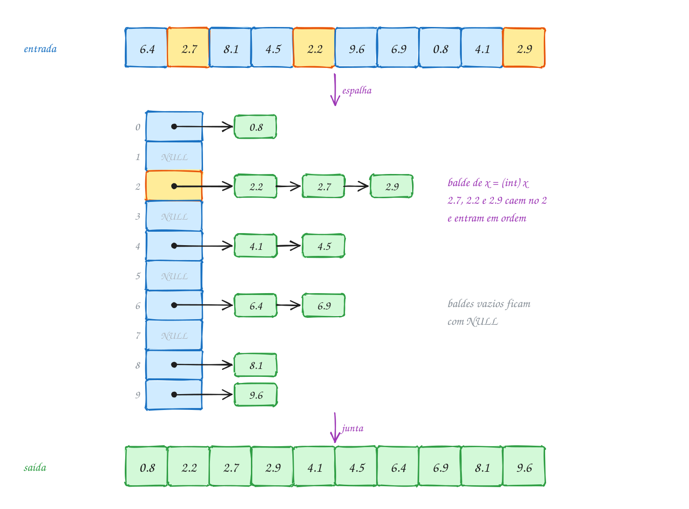</p>

O mesmo exemplo em C. Os baldes são um vetor de 10 ponteiros para lista,
todos começando em `NULL`:

```c
#include <stdio.h>
#include <stdlib.h>

#define NB 10 // um balde para cada nota inteira: 0, 1, ..., 9

typedef struct No {
    double valor;
    struct No *prox;
} No;

// insere x na lista sem perder a ordem: é o insertion sort, na lista
No *insere_ordenado(No *lista, double x) {
    No *novo = malloc(sizeof(No));
    if (novo == NULL) {
        exit(1);
    }
    novo->valor = x;
    if (lista == NULL || x < lista->valor) {
        novo->prox = lista;               // entra na frente
        return novo;
    }
    No *p = lista;
    while (p->prox != NULL && p->prox->valor <= x) {
        p = p->prox;                      // <= : iguais ficam na ordem de chegada
    }
    novo->prox = p->prox;
    p->prox = novo;
    return lista;
}

void bucket_sort(double v[], int n) {
    No *baldes[NB] = {NULL};
    for (int i = 0; i < n; i++) {
        int b = (int) v[i];               // 6.4 vai para o balde 6
        baldes[b] = insere_ordenado(baldes[b], v[i]);
    }
    int k = 0;
    for (int b = 0; b < NB; b++) {        // junta os baldes, em ordem
        if (baldes[b] == NULL) {
            continue;                     // balde vazio
        }
        printf("balde %d:", b);
        No *p = baldes[b];
        while (p != NULL) {
            printf(" %.1f", p->valor);
            v[k++] = p->valor;
            No *prox = p->prox;
            free(p);                      // devolve o nó assim que copia
            p = prox;
        }
        printf("\n");
    }
}

int main(void) {
    double notas[] = {6.4, 2.7, 8.1, 4.5, 2.2, 9.6, 6.9, 0.8, 4.1, 2.9};
    int n = 10;

    bucket_sort(notas, n);
    printf("ordenadas:");
    for (int i = 0; i < n; i++) {
        printf(" %.1f", notas[i]);
    }
    printf("\n");
    return 0;
}
// Saída:
// balde 0: 0.8
// balde 2: 2.2 2.7 2.9
// balde 4: 4.1 4.5
// balde 6: 6.4 6.9
// balde 8: 8.1
// balde 9: 9.6
// ordenadas: 0.8 2.2 2.7 2.9 4.1 4.5 6.4 6.9 8.1 9.6
```

Repara no fluxograma: o laço de espalhar passa uma vez pelo vetor, e o de
juntar passa uma vez por cada balde e cada nó. O trabalho escondido está no
`insere_ordenado`, que anda pela lista do balde: com baldes curtos, é quase
nada:

<p align="center">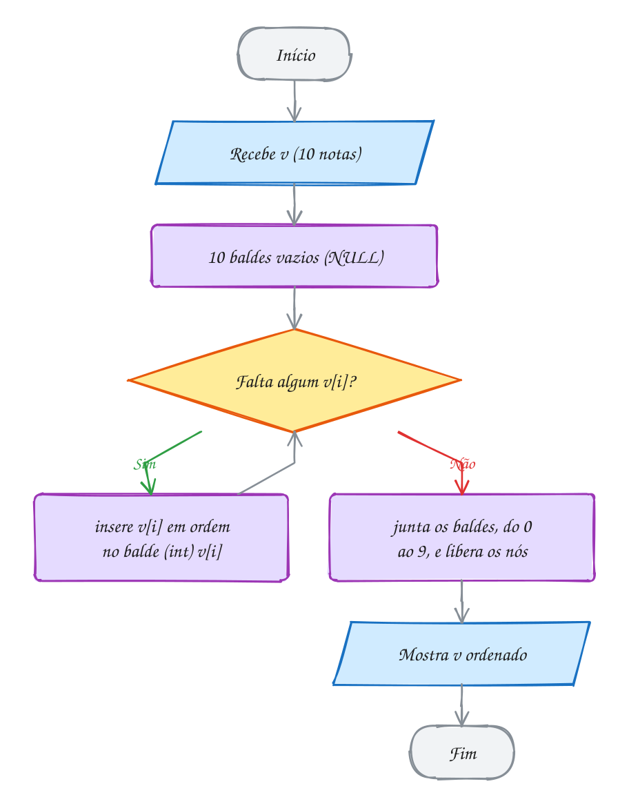</p>

> [!WARNING]
> O índice do balde tem que caber no vetor de baldes. Uma nota 10,0 dá
> `(int) 10.0 == 10`, e `baldes[10]` não existe: escrita fora do vetor. Com
> o intervalo fechado [0, 10], use 11 baldes ou trate o máximo à parte (`b
> = b == NB ? NB - 1 : b`). O mesmo vale para valores negativos e para
> qualquer valor fora da faixa que você imaginou: o bucket sort precisa
> **conhecer o intervalo** dos dados antes de começar.

> [!TIP]
> **Por dentro do C:** cada nota custa um `malloc` de um nó de 16 bytes (8
> do `double`, 8 do ponteiro), mais o controle que o próprio `malloc` guarda
> junto. Para 10 notas tanto faz, mas para 1 milhão são 1 milhão de chamadas
> ao alocador e nós espalhados pelo heap, o que o cache detesta. Por isso
> implementações rápidas fazem uma **contagem** antes (quantos vão para cada
> balde) e usam um vetor só, dividido em pedaços, sem lista nenhuma. É o
> counting sort do assunto 0120 com chaves que são faixas. E cada `malloc`
> pede o seu `free`: este código libera cada nó logo depois de copiar o
> valor.

> [!NOTE]
> **Pergunta para você:** a turma de reforço tirou 5,1; 5,4; 5,0; 5,8; 5,3;
> 5,6; 5,2 e 5,9. Em quantos baldes essas notas caem? Quantas comparações o
> `insere_ordenado` faz no total? Como você mudaria a função do balde para
> espalhar melhor essas notas?

### Hora de praticar

Os arquivos ficam em [`0122-bucket-sort/`](0122-bucket-sort/). Os comandos funcionam de qualquer pasta do terminal. Nos exemplos, rode, mude, quebre e rode de novo. Nos exercícios, a resposta vai dentro do próprio arquivo. ★☆☆ é aquecimento, ★★☆ pede raciocínio e ★★★ é desafio.

**Exemplo A243 · Quando todo mundo cai no mesmo balde**

```c
#include <stdio.h>
#include <stdlib.h>

#define N 1000

typedef struct No {
    double valor;
    struct No *prox;
} No;

static long comparacoes;
static unsigned semente;

// número entre 0 e 1 (sem chegar a 1), sempre a mesma sequência
double sorteia(void) {
    semente = semente * 1103515245u + 12345u;
    return ((semente >> 8) % 1000000) / 1000000.0;
}

No *insere_ordenado(No *lista, double x) {
    No *novo = malloc(sizeof(No));
    if (novo == NULL) {
        exit(1);
    }
    novo->valor = x;
    No **p = &lista;                  // ponteiro para o elo que vai mudar
    while (*p != NULL) {
        comparacoes++;
        if ((*p)->valor > x) {
            break;
        }
        p = &(*p)->prox;
    }
    novo->prox = *p;
    *p = novo;
    return lista;
}

// n baldes para notas de 0 a 10: cada balde cobre uma faixa de 10 / n
void bucket_sort(double v[], int n, int *maior_balde) {
    No **baldes = calloc(n, sizeof(No *));
    int *tamanho = calloc(n, sizeof(int));
    if (baldes == NULL || tamanho == NULL) {
        exit(1);
    }
    for (int i = 0; i < n; i++) {
        int b = (int) (v[i] / 10.0 * n);
        baldes[b] = insere_ordenado(baldes[b], v[i]);
        tamanho[b]++;
    }
    *maior_balde = 0;
    int k = 0;
    for (int b = 0; b < n; b++) {
        if (tamanho[b] > *maior_balde) {
            *maior_balde = tamanho[b];
        }
        while (baldes[b] != NULL) {
            No *p = baldes[b];
            v[k++] = p->valor;
            baldes[b] = p->prox;
            free(p);
        }
    }
    free(baldes);
    free(tamanho);
}

void testa(const char *nome, double base, double largura) {
    double v[N];
    semente = 42;
    for (int i = 0; i < N; i++) {
        v[i] = base + largura * sorteia();
    }
    comparacoes = 0;
    int maior;
    bucket_sort(v, N, &maior);
    printf("%-22s %7ld comparações, maior balde com %3d notas\n", nome, comparacoes, maior);
}

int main(void) {
    testa("notas de 0 a 10:", 0.0, 10.0);
    testa("notas de 5 a 6:", 5.0, 1.0);
    testa("notas de 5,0 a 5,01:", 5.0, 0.01);
    return 0;
}
// Saída:
// notas de 0 a 10:           469 comparações, maior balde com   6 notas
// notas de 5 a 6:           3237 comparações, maior balde com  18 notas
// notas de 5,0 a 5,01:    243539 comparações, maior balde com 1000 notas
//
// Os mesmos 1000 baldes, três distribuições. Espalhadas de 0 a 10, as notas
// caem em média uma por balde e o total é menos de meia comparação por nota.
// Concentradas entre 5 e 6, só 100 baldes trabalham. Entre 5,0 e 5,01, todas
// caem no balde 500 e sobra um insertion sort de 1000 elementos: perto de
// n²/4 comparações. O insere_ordenado usa um ponteiro para ponteiro (No **)
// para não tratar o começo da lista como caso especial.
```

```bash
~/LPEDC/rodar 18-ordenacao-linear/0122-bucket-sort/A243.c
```

**Exemplo A244 · Baldes sem lista encadeada**

```c
#include <stdio.h>

#define NB 10 // faixas etárias: 0-9, 10-19, ..., 90-99

// insertion sort só no pedaço v[ini..fim-1]
void insertion(int v[], int ini, int fim) {
    for (int i = ini + 1; i < fim; i++) {
        int x = v[i];
        int j = i;
        while (j > ini && v[j - 1] > x) {
            v[j] = v[j - 1];
            j--;
        }
        v[j] = x;
    }
}

int main(void) {
    // idades dos voluntários da campanha do agasalho
    int idades[] = {34, 71, 19, 45, 38, 22, 67, 30, 18, 52, 41, 36, 25, 63, 33};
    int n = 15;
    int saida[15];

    // 1) conta quantos caem em cada balde e acha onde cada balde começa
    int comeco[NB + 1] = {0};
    for (int i = 0; i < n; i++) {
        comeco[idades[i] / 10 + 1]++;
    }
    for (int b = 1; b <= NB; b++) {
        comeco[b] += comeco[b - 1];   // balde b ocupa saida[comeco[b]..comeco[b+1]-1]
    }
    // 2) espalha: cada um vai para a próxima vaga livre do seu balde
    int vaga[NB];
    for (int b = 0; b < NB; b++) {
        vaga[b] = comeco[b];
    }
    for (int i = 0; i < n; i++) {
        int b = idades[i] / 10;
        saida[vaga[b]++] = idades[i];
    }
    // 3) ordena cada balde no lugar e mostra
    for (int b = 0; b < NB; b++) {
        insertion(saida, comeco[b], comeco[b + 1]);
        if (comeco[b + 1] > comeco[b]) {
            printf("%2d-%2d anos:", 10 * b, 10 * b + 9);
            for (int i = comeco[b]; i < comeco[b + 1]; i++) {
                printf(" %d", saida[i]);
            }
            printf("\n");
        }
    }
    return 0;
}
// Saída:
// 10-19 anos: 18 19
// 20-29 anos: 22 25
// 30-39 anos: 30 33 34 36 38
// 40-49 anos: 41 45
// 50-59 anos: 52
// 60-69 anos: 63 67
// 70-79 anos: 71
//
// Nenhum malloc: a contagem diz de antemão o tamanho de cada balde, e os
// baldes viram pedaços vizinhos do mesmo vetor saida. É o counting sort do
// assunto 0120 com a chave "faixa" (idade / 10) no lugar da idade, seguido de
// um insertion sort em cada pedaço. O comeco[NB + 1] tem uma casa a mais
// para que comeco[b + 1] marque o fim do último balde.
```

```bash
~/LPEDC/rodar 18-ordenacao-linear/0122-bucket-sort/A244.c
```

#### Exercícios

**Exercício E727** · ★☆☆

A loja de R$ 1,99 virou "loja até R$ 50" e quer separar os produtos em 5
prateleiras de preço: de 0 a 10, de 10 a 20, ..., de 40 a 50. Escreva
int balde_de(double x, double max, int nb), que devolve o balde (de 0 a
nb - 1) de um valor x entre 0 e max, com nb baldes de mesma largura. O
preço máximo, R$ 50,00, vai para o último balde. Mostre o balde de cada
preço.


```text
Saída esperada:
R$ 12.50 -> balde 1
R$ 49.99 -> balde 4
R$ 50.00 -> balde 4
R$  0.00 -> balde 0
R$ 10.00 -> balde 1
R$ 37.20 -> balde 3
R$  9.99 -> balde 0
```

**Dicas:**

1. x / max dá um número de 0 a 1; vezes nb, de 0 a nb. A parte inteira
   é o balde: (int) (x / max * nb).
2. Só o próprio max dá nb, que não existe. Trate esse caso com um if.
3. Formato: "R$ %5.2f -> balde %d\n".
4. Resposta esperada: a saída acima.

```bash
~/LPEDC/rodar 18-ordenacao-linear/0122-bucket-sort/E727.c
```

**Exercício E728** · ★☆☆

Os tempos da prova de natação vão de 0 a 599 segundos. O programa abaixo
já espalha os tempos em 6 baldes (um para cada 100 s), junta os baldes e
libera os nós. Falta a peça principal: complete insere_ordenado, que
insere x na lista do balde sem perder a ordem crescente, e devolve o novo
começo da lista.


```text
Saída esperada:
balde 0:
balde 1:
balde 2: 201 255 287 295 298
balde 3: 318 365
balde 4: 409 433 470
balde 5: 512
ordenados: 201 255 287 295 298 318 365 409 433 470 512
```

**Dicas:**

1. Crie o nó com malloc (confira NULL) e guarde x nele.
2. Lista vazia, ou x menor que o primeiro: o novo nó vira o começo.
3. Senão, ande com p enquanto p->prox existir e p->prox->valor <= x, e
   encaixe o nó depois de p.
4. Resposta esperada: a saída acima.

```bash
~/LPEDC/rodar 18-ordenacao-linear/0122-bucket-sort/E728.c
```

**Exercício E729** · ★★☆

A agenda do celular agrupa os contatos pela letra inicial. Faça um bucket
sort de strings com 26 baldes, um por letra: o balde de um nome é
nome[0] - 'A', e cada balde é uma lista encadeada que guarda os nomes já
em ordem alfabética (compare com strcmp). Mostre cada balde que não está
vazio, devolva os nomes ao vetor em ordem e libere todos os nós.


```text
Saída esperada:
A: Alberto Amanda Ana
B: Beatriz Bruno
C: Caio Carla
M: Marcos Mariana Marta Mauro
agenda: Alberto Amanda Ana Beatriz Bruno Caio Carla Marcos Mariana Marta Mauro
```

**Dicas:**

1. O nó guarda só o ponteiro: typedef struct No { const char *nome;
   struct No *prox; } No; as letras continuam onde estão.
2. É o insere_ordenado do texto com "x < lista->valor" trocado por
   strcmp(nome, lista->nome) < 0 (e o mesmo no laço).
3. Na hora de juntar, copie p->nome para o vetor e dê free(p) antes de
   passar para o próximo.
4. Resposta esperada: a saída acima.

```bash
~/LPEDC/rodar 18-ordenacao-linear/0122-bucket-sort/E729.c
```

**Exercício E730** · ★★☆

O programa abaixo tem um bucket sort que só aceita valores em [0, 1),
como as chances de chuva: com n valores, usa n baldes, e o balde de x é
(int) (x * n). Temperaturas não cabem nisso: podem ser negativas e passar
de 1. Estenda o programa com void bucket_sort_faixa(double v[], int n),
que acha o menor e o maior valor, mostra a faixa e usa n baldes de mesma
largura entre eles. Teste com as temperaturas e com um vetor de valores
todos iguais.


```text
Saída esperada:
0.05 0.35 0.41 0.62 0.80 0.97
faixa: -3.5 a 38.2, 12 baldes de 3.48
-3.50 -1.20 4.30 9.70 12.90 15.00 18.60 22.40 27.80 30.10 33.00 38.20
faixa: 7.0 a 7.0, 3 baldes de 0.00
7.00 7.00 7.00
```

**Dicas:**

1. O balde de x é (int) ((x - menor) / (maior - menor) * n): o menor vai
   para o balde 0.
2. O maior dá exatamente n, que não existe: mande para o n - 1.
3. Valores todos iguais: maior - menor é 0, e a divisão por zero dá NaN.
   Teste esse caso antes e mande todos para o balde 0.
4. Reaproveite insere_ordenado e junta. Formato da faixa:
   "faixa: %.1f a %.1f, %d baldes de %.2f\n".
5. Resposta esperada: a saída acima.

```bash
~/LPEDC/rodar 18-ordenacao-linear/0122-bucket-sort/E730.c
```

**Exercício E731** · ★★★

Ache os bugs. A padaria ordena os pedidos do dia pelo valor com um bucket
sort, e quer que pedidos de mesmo valor fiquem na ordem de chegada. O
programa roda sem erro de memória, mas a saída é um desastre: tem pedido
repetido e pedido sumido. São DOIS erros. Conserte os dois e rode.


```text
Saída esperada:
I:9 B:12 E:12 A:35 C:35 H:35 G:38 F:50 D:87
```


```text
Saída que aparece:
D:87 H:35 C:35 G:38 E:12 F:50 G:38 H:35 I:9
```

**Dicas:**

1. Mostre o valor de k toda vez que um pedido volta para o vetor. Ele
   devia andar de 0 a 8 sem repetir.
2. Com o primeiro erro consertado, a saída fica quase certa:
   I:9 B:12 E:12 A:35 H:35 C:35 G:38 F:50 D:87. Compare A, C e H com a
   ordem de chegada. Quem decide onde entra um valor IGUAL a outro?
3. Resposta esperada: o int k = 0 está dentro do for dos baldes, então
   cada balde volta a escrever a partir de v[0]; ele tem que vir antes do
   for. E o laço do insere_ordenado anda com < em vez de <=: um valor
   igual para antes dos iguais que já estavam na lista, e a ordem de
   chegada se perde. Com <=, ele entra depois deles.

```bash
~/LPEDC/rodar 18-ordenacao-linear/0122-bucket-sort/E731.c
```

**Exercício E732** · ★★★

O fiscal da linha de ônibus quer saber qual é a maior espera entre duas
partidas seguidas. Os horários chegam fora de ordem, em minutos desde a
meia-noite. Ordenar e olhar os vizinhos resolve em O(n log n); o desafio
é resolver em O(n), com baldes e SEM ordenar:

1. ache o menor e o maior horário;
2. use N baldes de largura L = teto((maior - menor) / (N - 1)). Cada
balde guarda só o menor e o maior horário que caíram nele (e se foi
usado);
3. o maior intervalo nunca fica dentro de um balde: ele é sempre a
diferença entre o MENOR de um balde usado e o MAIOR do balde usado
anterior. Percorra os baldes e pegue a maior dessas diferenças.

No fim, confira a resposta ordenando com qsort.


```text
Saída esperada:
maior intervalo: 160 min, entre 17:30 e 20:10
conferindo com qsort: 160 min
```

**Dicas:**

1. Por que funciona: os N - 1 intervalos entre vizinhos somam
   maior - menor, então o maior intervalo é pelo menos a média, que é
   L. Dois horários no mesmo balde distam menos que L.
2. Teto com inteiros: (maior - menor + N - 2) / (N - 1). O balde de x é
   (x - menor) / L, que vai de 0 a N - 1.
3. O balde 0 sempre tem o menor horário: comece com anterior = maior do
   balde 0 e pule os baldes vazios.
4. Para mostrar a hora: sprintf(s, "%02d:%02d", m / 60, m % 60).
5. Resposta esperada: a saída acima.

```bash
~/LPEDC/rodar 18-ordenacao-linear/0122-bucket-sort/E732.c
```

---

## 0123 · Quickselect

Você está procurando apartamento para alugar e anotou 9 anúncios do bairro:
R$ 1850, 1200, 2400, 980, 1450, 2050, 3100, 1600 e 1300. A média dá R$ 1770,
puxada para cima pela cobertura de R$ 3100. O número que diz quanto custa um
aluguel "típico" é a **mediana**: o valor do meio se a lista estivesse em
ordem. Metade dos anúncios custa menos, metade custa mais.

O jeito óbvio é ordenar e pegar `v[n / 2]`. Funciona, mas é trabalho demais:
para saber quem fica na posição 4, você arrumou as outras 8 posições também.
O problema geral se chama **seleção**: achar o **k-ésimo menor** elemento
(a mediana é o caso `k = n / 2`; o mínimo é `k = 0`).

O **quickselect** (Hoare, 1961, o mesmo do quick sort) usa a separação do
assunto 0095. Depois de um `separa`, o pivô está na posição **final** `j`:
à esquerda só há menores ou iguais, à direita só maiores. Então:

- se `j == k`, o pivô é a resposta;
- se `k < j`, a resposta está à **esquerda**: o lado direito pode ser
  esquecido;
- se `k > j`, a resposta está à **direita**.

A diferença para o quick sort é que ele segue **um lado só**. Não precisa
de recursão: um `while` que encolhe o intervalo `[p, r]` resolve. Você já viu
essa ideia de relance no exercício E569, do módulo 13; aqui ela ganha nome,
custo e cuidados.

Quanto custa? Se o pivô cai perto do meio, cada separação descarta metade:
`n + n/2 + n/4 + ...`, que é menos que `2n`. O quickselect é **O(n) em
média**, contra O(n log n) de ordenar. No pior caso, o pivô é sempre o
maior ou o menor e o custo vira **O(n²)**, como no quick sort.

Vamos ver na prática. A primeira separação, com pivô 1300, deixa o pivô na
posição 2. A mediana está na posição 4, à direita: os três primeiros nunca
mais são olhados. Duas separações depois, o pivô cai exatamente na posição 4:

<p align="center">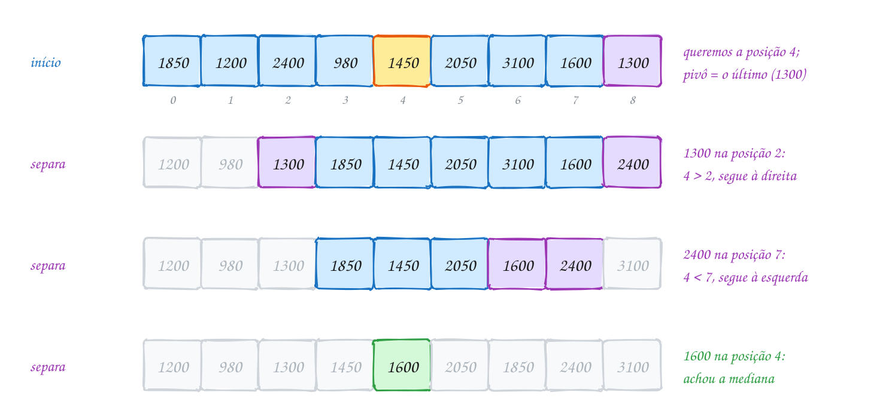</p>

O mesmo exemplo em C:

```c
#include <stdio.h>

void troca(int *a, int *b) {
    int aux = *a;
    *a = *b;
    *b = aux;
}

// separação de Lomuto (assunto 0095): pivô v[r]; devolve a posição final dele
int separa(int v[], int p, int r) {
    int pivo = v[r], j = p;
    for (int k = p; k < r; k++) {
        if (v[k] <= pivo) {
            troca(&v[j], &v[k]);
            j++;
        }
    }
    troca(&v[j], &v[r]);
    return j;
}

// devolve o elemento que ficaria na posição k (0, 1, ...) se v fosse ordenado
int quickselect(int v[], int n, int k) {
    int p = 0, r = n - 1;
    while (p < r) {
        int j = separa(v, p, r);
        printf("pivô %d na posição %d:", v[j], j);
        for (int i = p; i <= r; i++) {
            printf(" %d", v[i]);
        }
        if (j == k) {
            printf("  -> achou\n");
            return v[j];
        }
        if (k < j) {
            printf("  -> segue à esquerda\n");
            r = j - 1;                  // a resposta está em v[p..j-1]
        } else {
            printf("  -> segue à direita\n");
            p = j + 1;                  // a resposta está em v[j+1..r]
        }
    }
    return v[p];                        // sobrou um só
}

int main(void) {
    int alugueis[] = {1850, 1200, 2400, 980, 1450, 2050, 3100, 1600, 1300};
    int n = 9;

    int mediana = quickselect(alugueis, n, n / 2);
    printf("aluguel mediano: R$ %d\n", mediana);
    return 0;
}
// Saída:
// pivô 1300 na posição 2: 1200 980 1300 1850 1450 2050 3100 1600 2400  -> segue à direita
// pivô 2400 na posição 7: 1850 1450 2050 1600 2400 3100  -> segue à esquerda
// pivô 1600 na posição 4: 1450 1600 2050 1850  -> achou
// aluguel mediano: R$ 1600
```

Foram 8 + 5 + 3 = 16 comparações. Com 9 elementos a economia é pequena (o
quick sort completo faz 18 neste vetor), mas ela cresce com `n`. A conta
`n + n/2 + ...` supõe o pivô sempre no meio; com pivôs ao acaso, a média para
achar a mediana fica em torno de 3,4 `n`. Para um milhão de elementos, uns
3,4 milhões de comparações, contra mais de 20 milhões para ordenar.

Repara no fluxograma: diferente do quick sort, não há duas chamadas. Cada
volta do laço escolhe um lado e joga o outro fora:

<p align="center">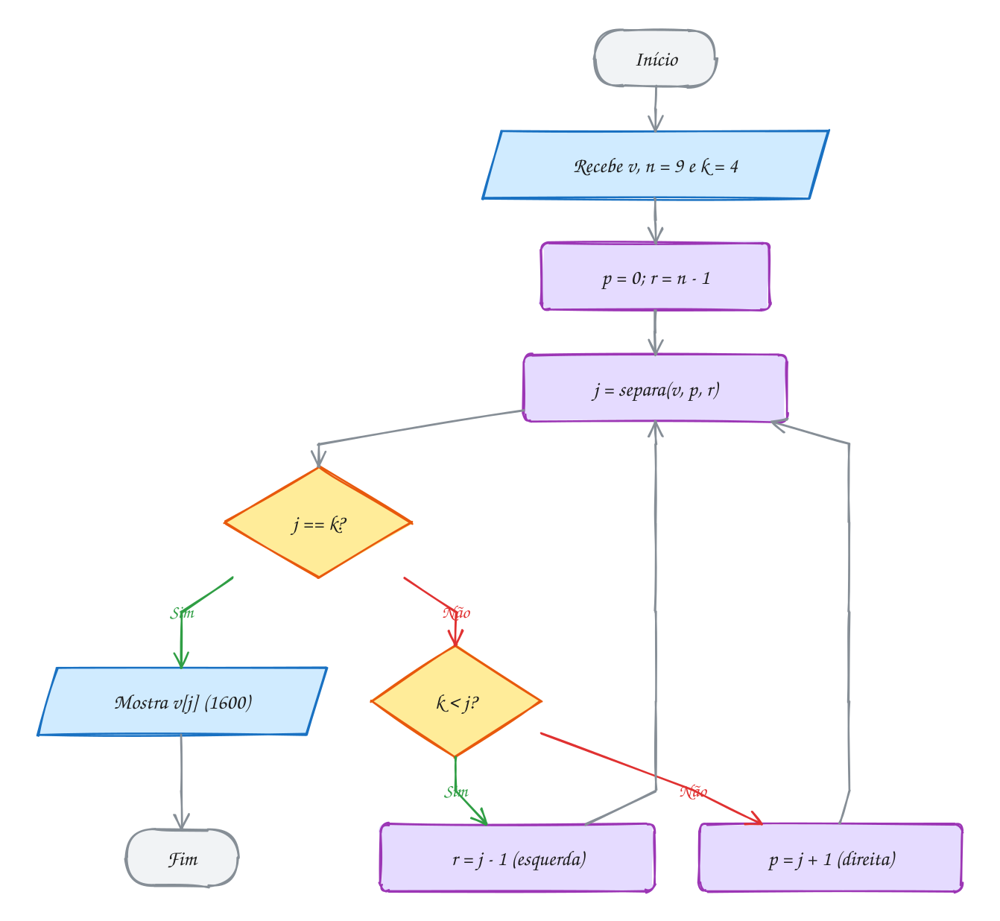</p>

> [!WARNING]
> Cuidado com o "k-ésimo". Em C, as posições começam em 0: o **menor** é
> `k = 0`, e "o 3º menor" é `k = 2`. Quem chama `quickselect(v, n, 3)`
> querendo o 3º menor recebe o 4º. E o quickselect **bagunça o vetor**: ele
> troca elementos de lugar a cada separação. Se você ainda precisa da ordem
> original (a ordem dos anúncios, por exemplo), passe uma cópia.

> [!TIP]
> **Por dentro do C:** a versão com `while` usa memória extra O(1): só `p`,
> `r`, `j` e as variáveis do `separa`, na pilha. Uma versão recursiva, que
> chama `quickselect` num dos lados, é **recursão de cauda** (a chamada é a
> última coisa que a função faz), e o gcc com `-O2` costuma transformá-la
> num laço sozinho. Mas sem otimização (o `rodar` compila sem `-O2`), cada
> chamada é um frame novo, e no pior caso são `n` frames. Escrever o laço à
> mão não depende da boa vontade do compilador.

> [!NOTE]
> **Pergunta para você:** o que acontece se você pedir a mediana de um vetor
> que **já está em ordem** crescente, com 10.001 elementos? Quantas
> separações o quickselect faz, com o pivô sempre no fim? E se o pivô for
> sorteado?

### Hora de praticar

Os arquivos ficam em [`0123-quickselect/`](0123-quickselect/). Os comandos funcionam de qualquer pasta do terminal. Nos exemplos, rode, mude, quebre e rode de novo. Nos exercícios, a resposta vai dentro do próprio arquivo. ★☆☆ é aquecimento, ★★☆ pede raciocínio e ★★★ é desafio.

**Exemplo A245 · O pódio sem ordenar a tabela**

```c
#include <stdio.h>

typedef struct {
    char nome[10];
    int pontos;
} Jogador;

void troca(Jogador *a, Jogador *b) {
    Jogador aux = *a;
    *a = *b;
    *b = aux;
}

int separa(Jogador v[], int p, int r) {
    int pivo = v[r].pontos, j = p;
    for (int k = p; k < r; k++) {
        if (v[k].pontos <= pivo) {
            troca(&v[j], &v[k]);
            j++;
        }
    }
    troca(&v[j], &v[r]);
    return j;
}

// deixa na posição k quem ficaria lá se v fosse ordenado; de brinde, à
// esquerda de k só ficam pontos <= e à direita só pontos >=
void seleciona(Jogador v[], int n, int k) {
    int p = 0, r = n - 1;
    while (p < r) {
        int j = separa(v, p, r);
        if (j == k) {
            return;
        }
        if (k < j) {
            r = j - 1;
        } else {
            p = j + 1;
        }
    }
}

int main(void) {
    Jogador torneio[] = {
        {"Bia", 1820}, {"Davi", 2150}, {"Edu", 1675}, {"Fábio", 2310}, {"Gabi", 1990},
        {"Hugo", 1540}, {"Íris", 2240}, {"Juca", 1880}, {"Kátia", 2075}, {"Léo", 1760},
        {"Malu", 1930}, {"Nico", 1610},
    };
    int n = 12;

    seleciona(torneio, n, n - 3);       // os 3 maiores vão para v[9..11]
    printf("depois da seleção:");
    for (int i = 0; i < n; i++) {
        printf(" %d", torneio[i].pontos);
    }
    printf("\n");

    // só os 3 do fim precisam de ordem: um insertion sort de 3 elementos
    for (int i = n - 2; i < n; i++) {
        Jogador x = torneio[i];
        int j = i;
        while (j > n - 3 && torneio[j - 1].pontos > x.pontos) {
            torneio[j] = torneio[j - 1];
            j--;
        }
        torneio[j] = x;
    }
    printf("ouro: %s (%d), prata: %s (%d), bronze: %s (%d)\n",
           torneio[n - 1].nome, torneio[n - 1].pontos, torneio[n - 2].nome,
           torneio[n - 2].pontos, torneio[n - 3].nome, torneio[n - 3].pontos);
    return 0;
}
// Saída:
// depois da seleção: 1540 1610 1675 1990 1820 1880 2075 1760 1930 2150 2240 2310
// ouro: Fábio (2310), prata: Íris (2240), bronze: Davi (2150)
//
// Repare na linha do meio: o vetor NÃO está ordenado (1990 antes de 1820,
// 2075 antes de 1760), mas os três últimos são os três maiores. O
// quickselect para k = n - 3 garante isso de graça, porque cada separação
// deixa os maiores à direita do pivô. Para o pódio, basta ordenar esses 3.
// Com uma tabela de 1 milhão de jogadores, são uns poucos milhões de passos,
// em vez de ordenar tudo.
```

```bash
~/LPEDC/rodar 18-ordenacao-linear/0123-quickselect/A245.c
```

**Exemplo A246 · Pivô sorteado contra o vetor já ordenado**

```c
#include <stdio.h>
#include <stdlib.h>
#include <stdbool.h>

#define N 10001

static long comparacoes, separacoes;
static unsigned semente = 99;

// sorteia um índice em [p, r]; gerador próprio para a saída ser sempre igual
int sorteia(int p, int r) {
    semente = semente * 1103515245u + 12345u;
    return p + (int) ((semente >> 16) % (unsigned) (r - p + 1));
}

void troca(int *a, int *b) {
    int aux = *a;
    *a = *b;
    *b = aux;
}

int separa(int v[], int p, int r) {
    int pivo = v[r], j = p;
    separacoes++;
    for (int k = p; k < r; k++) {
        comparacoes++;
        if (v[k] <= pivo) {
            troca(&v[j], &v[k]);
            j++;
        }
    }
    troca(&v[j], &v[r]);
    return j;
}

int quickselect(int v[], int n, int k, bool sorteado) {
    int p = 0, r = n - 1;
    while (p < r) {
        if (sorteado) {
            troca(&v[sorteia(p, r)], &v[r]); // o sorteado vira o pivô
        }
        int j = separa(v, p, r);
        if (j == k) {
            return v[j];
        }
        if (k < j) {
            r = j - 1;
        } else {
            p = j + 1;
        }
    }
    return v[p];
}

void testa(const char *nome, bool sorteado) {
    int *v = malloc(N * sizeof(int));
    if (v == NULL) {
        return;
    }
    for (int i = 0; i < N; i++) {
        v[i] = i + 1;                   // 1, 2, ..., 10001: já em ordem
    }
    comparacoes = separacoes = 0;
    int m = quickselect(v, N, N / 2, sorteado);
    printf("%s mediana %d, %5ld separações, %9ld comparações\n",
           nome, m, separacoes, comparacoes);
    free(v);
}

int main(void) {
    testa("pivô no fim:  ", false);
    testa("pivô sorteado:", true);
    return 0;
}
// Saída:
// pivô no fim:   mediana 5001,  5001 separações,  37507500 comparações
// pivô sorteado: mediana 5001,    20 separações,     37135 comparações
//
// Com o pivô sempre no fim de um vetor ordenado, cada separação só tira o
// último elemento do caminho: são 5001 separações e 10000 + 9999 + ... +
// 5000 comparações, O(n²). Sorteando o pivô, a chance de cair sempre num
// extremo é desprezível: 20 separações e menos de 4 comparações por
// elemento. A troca de uma linha (sortear e mandar para o fim) não muda o
// separa.
```

```bash
~/LPEDC/rodar 18-ordenacao-linear/0123-quickselect/A246.c
```

#### Exercícios

**Exercício E733** · ★☆☆

A escola quer um resumo das notas de redação do simulado: a menor, a
segunda menor, a mediana, a segunda maior e a maior, todas com o
quickselect do texto (já está no arquivo). Só que o quickselect bagunça o
vetor, e a escola quer a lista na ordem original. Escreva
int seleciona_copia(const int v[], int n, int k), que copia v para um
vetor local e roda o quickselect na cópia, e use para mostrar o resumo.
No fim, mostre notas[0] para provar que o vetor não mudou.


```text
Saída esperada:
menor:       380
2ª menor:    480
mediana:     680
2ª maior:    860
maior:       920
primeira do vetor continua: 720
```

**Dicas:**

1. Um int copia[MAX]; com MAX 100 basta para este programa.
2. As posições contam de 0: a menor é k = 0, a segunda menor é k = 1, a
   maior é k = n - 1 e a segunda maior, k = n - 2.
3. Com n = 11, a mediana está em k = n / 2 = 5.
4. Resposta esperada: a saída acima.

```bash
~/LPEDC/rodar 18-ordenacao-linear/0123-quickselect/E733.c
```

**Exercício E734** · ★☆☆

Ninguém fala "a farmácia de posição 2 mais perto": fala "a 3ª mais perto".
Escreva bool k_esimo_menor(int v[], int n, int k, int *resposta), que
recebe k contado a partir de 1 (1 é o menor), confere se k faz sentido
(de 1 a n), chama o quickselect com a posição certa e devolve a resposta
pelo ponteiro. Para k fora da faixa, devolva false sem chamar nada.


```text
Saída esperada:
1ª mais perto: 1 km
3ª mais perto: 7 km
7ª mais perto: 25 km
0ª mais perto: não existe
8ª mais perto: não existe
```

**Dicas:**

1. O "k-ésimo" das pessoas é a posição k - 1 do quickselect.
2. Confira a faixa ANTES: com k = 8 e n = 7, o quickselect devolveria um
   valor qualquer, ou leria fora do vetor.
3. Resposta esperada: a saída acima.

```bash
~/LPEDC/rodar 18-ordenacao-linear/0123-quickselect/E734.c
```

**Exercício E735** · ★★☆

Com um número PAR de valores, a mediana é a média dos dois do meio. O app
de entregas quer a mediana dos tempos de 10 entregas, sem ordenar o vetor.
Escreva double mediana(int v[], int n), que funciona para n par e ímpar,
usando UM quickselect só. Confira no fim com o qsort.


```text
Saída esperada:
10 entregas: mediana 39.5 min
9 entregas:  mediana 41.0 min
conferindo: 38 e 41 no meio
```

**Dicas:**

1. n ímpar: é o quickselect em k = n / 2, como no texto.
2. n par: os do meio estão nas posições n/2 - 1 e n/2. Rode o quickselect
   em k = n/2 - 1. Depois disso, tudo à direita de k é maior ou igual a
   v[k]: o outro do meio é o MENOR desse lado, e um laço simples acha.
3. Divida por 2.0, não por 2: (38 + 41) / 2 em int dá 39.
4. A compara do qsort já está no arquivo: qsort(v, 10, sizeof(int), compara).
5. Resposta esperada: a saída acima.

```bash
~/LPEDC/rodar 18-ordenacao-linear/0123-quickselect/E735.c
```

**Exercício E736** · ★★☆

Quem cuida de servidores não olha a média do tempo de resposta, olha os
PERCENTIS: o p90 é o tempo que 90% das requisições não ultrapassam. O
programa abaixo gera 50 tempos (com alguns picos). Escreva
int percentil(int v[], int n, int pct) com o quickselect e mostre p50,
p90 e p99. Depois ordene com qsort e confira as posições 24, 44 e 49.


```text
Saída esperada:
p50: 138 ms
p90: 630 ms
p99: 826 ms
conferindo: 138, 630 e 826
```

**Dicas:**

1. Use a regra do "posto mais próximo": a posição do percentil pct é
   teto(pct * n / 100) - 1. Com inteiros: (pct * n + 99) / 100 - 1.
   Para n = 50: p50 fica na posição 24, p90 na 44 e p99 na 49.
2. Não precisa copiar o vetor entre um percentil e outro: o quickselect
   só troca os valores de lugar, não muda quais valores existem.
3. Resposta esperada: a saída acima.

```bash
~/LPEDC/rodar 18-ordenacao-linear/0123-quickselect/E736.c
```

**Exercício E737** · ★★★

Ache os bugs. A secretaria da faculdade tem 10001 matrículas, numeradas de
1 a 10001 e já em ordem, e quer a matrícula mediana. Para fugir do pior
caso do vetor ordenado, o programador sorteou o pivô. Mas a resposta está
errada E o programa ainda faz milhares de separações. São DOIS erros:
conserte os dois e rode.


```text
Saída esperada:
mediana: 5001 (19 separações)
```


```text
Saída que aparece:
mediana: 5002 (3849 separações)
```

**Dicas:**

1. Com 10001 elementos, quantos ficam antes da mediana? Em que posição do
   vetor (contando de 0) ela está?
2. Mostre p, r e o pivô de cada separação. A partir da segunda, o pivô
   ainda é sorteado?
3. Resposta esperada: a mediana fica na posição N / 2 = 5000, e não em
   (N + 1) / 2 = 5001, que é a posição do 5002. E o sorteio está antes do
   while: só a primeira separação usa pivô sorteado; nas outras, o pivô
   volta a ser o último de um pedaço quase ordenado. A troca com o
   sorteado tem que ficar dentro do laço, antes de cada separa.

```bash
~/LPEDC/rodar 18-ordenacao-linear/0123-quickselect/E737.c
```

**Exercício E738** · ★★★

O pivô sorteado deixa o pior caso improvável, mas não impossível. Em
1973, Blum, Floyd, Pratt, Rivest e Tarjan acharam um pivô que GARANTE
O(n) no pior caso: a MEDIANA DAS MEDIANAS. Em cada volta do quickselect:

1. divida v[p..r] em grupos de 5 (o último pode ter menos), ordene cada
grupo com o insertion sort (já está no arquivo) e leve a mediana de
cada grupo para o começo do pedaço: v[p], v[p + 1], ...;
2. ache a mediana dessas medianas chamando a própria seleção
(recursivamente) só no pedaço das medianas;
3. use essa mediana como pivô: troque com v[r] e chame o separa de
sempre. O resto é o quickselect do texto.

Escreva int seleciona(int v[], int p, int r, int k, bool mm), que faz o
quickselect com pivô no fim (mm = false) ou com a mediana das medianas
(mm = true), e compare as comparações num vetor em ordem e num
embaralhado.


```text
Saída esperada:
vetor em ordem:
  pivô no fim:           mediana 5001,  37507500 comparações
  mediana das medianas:  mediana 5001,     61140 comparações
vetor embaralhado:
  pivô no fim:           mediana 5001,     28403 comparações
  mediana das medianas:  mediana 5001,     39964 comparações
```


Repare na última linha: a garantia tem preço. Em dados comuns, o pivô
simples ganha.

**Dicas:**

1. Grupo g vai de g até fim = min(g + 4, r); a mediana dele, depois de
   ordenado, está em g + (fim - g) / 2. Troque-a com v[m] e faça m++,
   começando com m = p.
2. As medianas ficam em v[p..m-1]; a do meio está na posição
   meio = p + (m - p - 1) / 2. Chame seleciona(v, p, m - 1, meio, true):
   ela deixa a mediana das medianas exatamente em v[meio].
3. Depois, troca(&v[meio], &v[r]) e segue igual ao quickselect, com k
   sempre absoluto (posição no vetor inteiro).
4. Por que garante O(n)? A mediana das medianas é maior que uns 30% dos
   elementos e menor que outros 30%: cada volta descarta pelo menos 30%.
5. Resposta esperada: a saída acima.

```bash
~/LPEDC/rodar 18-ordenacao-linear/0123-quickselect/E738.c
```

---

## 0124 · Juntando tudo

Fim do dia num banco digital: 1 milhão de Pix registrados, cada um com um
número, a hora (em segundos desde a meia-noite) e o valor em centavos. O time
de prevenção a fraudes pede dois relatórios: as transações em ordem de
**valor**, e a linha do tempo do dia em ordem de **horário**, com os Pix do
mesmo segundo do menor para o maior valor.

O caminho de sempre é o `qsort` (assunto 0096): ele ordena qualquer coisa,
desde que você dê uma função de comparação. Para 1 milhão de registros, são
uns 20 milhões de comparações, e cada uma é uma **chamada de função** por
ponteiro. Mas aqui as chaves são inteiros: o horário vai de 0 a 86399, e o
valor cabe em 4 bytes. É território das ordenações lineares deste módulo.

O TAD `pix.h` junta as peças. O registro tem 12 bytes:

```c
typedef struct {
    uint32_t id;       // número da transação, na ordem em que chegou
    int32_t segundo;   // hora do dia, em segundos desde a meia-noite
    int32_t centavos;  // valor, em centavos (sempre positivo)
} Pix;
```

E as funções que importam:

- `pix_por_valor`: **radix sort** em base 256 (assunto 0121) sobre o campo
  `centavos`. Quatro passadas, cada uma um counting sort estável pelo byte da
  vez, com um vetor auxiliar do mesmo tamanho;
- `pix_por_horario`: **counting sort** (assunto 0120) direto, com
  `k = 86400` contadores. Um vetor de 337 KB de contadores para 1 milhão de
  registros: `k` é menor que `n`, e o O(n + k) é linear de verdade;
- `pix_compara_valor`: a função de comparação para o `qsort`, para a
  comparação de tempo.

O segundo relatório tem **duas chaves**: horário e, no empate, valor. Não
precisa de uma função de comparação composta. É a ideia do radix sort LSD:
ordene pela chave **menos** importante (valor) e depois, com um método
**estável**, pela mais importante (horário). A estabilidade do counting
sort preserva a ordem de valor dentro de cada segundo.

Vamos ver na prática. Os mesmos dados vão para dois vetores: um é ordenado
pelo `qsort`, o outro pelo radix. Os dois têm que terminar com os valores na
mesma ordem. Depois, o counting sort reorganiza o vetor do radix pelo
horário:

<p align="center">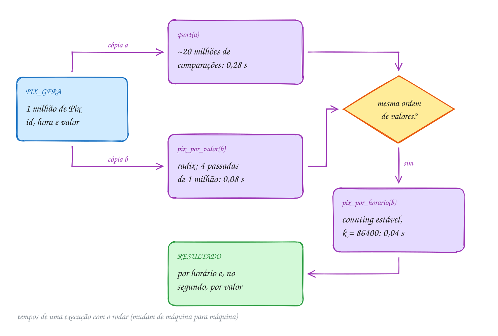</p>

O programa mede o tempo de processador com `clock()`, de `<time.h>`: a
diferença entre duas chamadas, dividida por `CLOCKS_PER_SEC`, dá os
segundos gastos entre elas.

```c
#include <stdio.h>
#include <stdlib.h>
#include <string.h>
#include <time.h>
#include "pix.h"

#define N 1000000

// tempo de processador gasto desde inicio, em segundos
double desde(clock_t inicio) {
    return (double) (clock() - inicio) / CLOCKS_PER_SEC;
}

int main(void) {
    Pix *a = malloc(N * sizeof(Pix));
    Pix *b = malloc(N * sizeof(Pix));
    Pix *aux = malloc(N * sizeof(Pix));
    if (a == NULL || b == NULL || aux == NULL) {
        free(a);
        free(b);
        free(aux);
        return 1;
    }
    pix_gera(a, N, 2024);
    memcpy(b, a, N * sizeof(Pix));     // os mesmos dados nos dois vetores

    clock_t t = clock();
    qsort(a, N, sizeof(Pix), pix_compara_valor);
    printf("qsort pelo valor:      %.2f s\n", desde(t));

    t = clock();
    pix_por_valor(b, aux, N);
    printf("radix pelo valor:      %.2f s\n", desde(t));

    int iguais = 1;
    for (int i = 0; i < N; i++) {
        if (a[i].centavos != b[i].centavos) {
            iguais = 0;
        }
    }
    printf("mesma ordem de valores? %s\n", iguais ? "sim" : "não");

    // segunda chave: pelo horário. O counting sort é estável, então dentro
    // do mesmo segundo os Pix continuam em ordem de valor
    t = clock();
    bool ok = pix_por_horario(b, aux, N);
    printf("counting pelo horário: %.2f s\n", desde(t));
    if (ok) {
        printf("os 4 primeiros do dia:\n");
        for (int i = 0; i < 4; i++) {
            pix_mostra(&b[i]);
        }
    }
    free(a);
    free(b);
    free(aux);
    return 0;
}
// Saída (os tempos mudam a cada execução e de máquina para máquina):
// qsort pelo valor:      0.28 s
// radix pelo valor:      0.08 s
// mesma ordem de valores? sim
// counting pelo horário: 0.04 s
// os 4 primeiros do dia:
// #0024846 00:00:00 R$       1,98
// #0293406 00:00:00 R$       7,46
// #0871952 00:00:00 R$      14,86
// #0653423 00:00:00 R$      21,63
```

O radix ordenou o milhão de valores em bem menos tempo que o `qsort`
(nesta execução, menos de um terço), e o counting pelo horário levou menos
ainda. Sem o AddressSanitizer
e com `gcc -O2`, os números caem para uns 0,18 s, 0,03 s e 0,01 s: a
proporção fica até maior. Os quatro primeiros do dia são todos de
00:00:00, e estão em ordem de valor: a primeira ordenação sobreviveu à
segunda.

Repara no fluxograma: a conferência entre os dois vetores vem antes do
segundo relatório. Comparar com uma implementação confiável (o `qsort`) é o
jeito mais simples de testar uma ordenação escrita à mão:

<p align="center">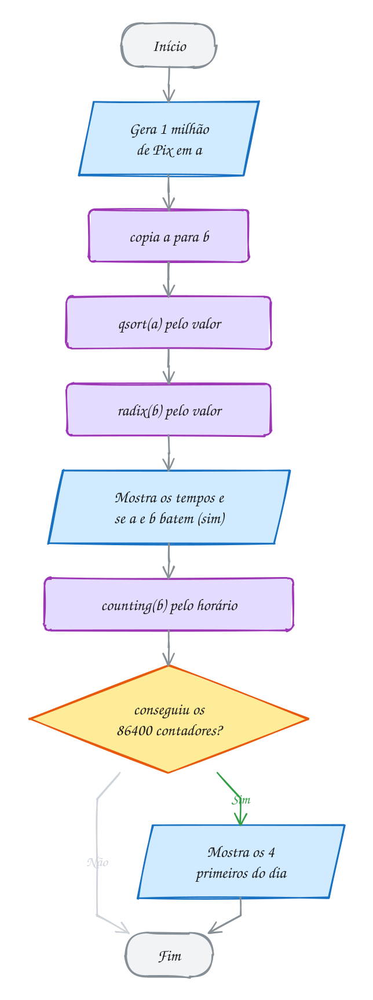</p>

### Qual usar?

O resumo do módulo, com os algoritmos do módulo 13 de referência:

| Algoritmo | Custo | Memória extra | Estável | Quando usar |
| --- | --- | --- | --- | --- |
| shell sort | ~n^1,25 (Knuth: pior n^1,5) | O(1) | não | vetores médios, pouca memória, código curto |
| counting sort | O(n + k) | O(n + k) | sim | chaves inteiras num intervalo pequeno |
| radix sort | O(d · (n + b)) | O(n + b) | sim | inteiros ou strings de tamanho fixo |
| bucket sort | O(n) médio, O(n²) pior | O(n) | sim (inserindo depois dos iguais) | valores reais bem espalhados num intervalo conhecido |
| quickselect | O(n) médio, O(n²) pior | O(1) | não | o k-ésimo, a mediana, os k maiores, sem ordenar |
| qsort | O(n log n) | depende da biblioteca | não garantido | qualquer tipo, qualquer critério |

> [!WARNING]
> Ordenação linear não é mágica: ela troca a comparação por **suposições
> sobre os dados**. O counting sort pelo horário só funciona porque o
> horário vai de 0 a 86399; se um registro chegar com `segundo = 86400` (um
> bug na origem dos dados), `c[86400]` escreve fora do vetor. Antes de usar
> o valor como índice, confira a faixa, ou confie numa fonte que garanta.
> E o radix deste TAD supõe `centavos` positivo: um estorno negativo
> sairia no fim da lista (o exercício E726 mostra o conserto).

> [!TIP]
> **Por dentro do C:** cada passada do radix lê o vetor inteiro em
> sequência, do fim para o começo, e escreve espalhado em 256 regiões do
> auxiliar. 12 MB não cabem no cache, mas a leitura sequencial é a que o
> processador mais gosta: ele adivinha os próximos endereços e busca antes.
> Já o `qsort` não sabe nada sobre o `Pix`: move cada registro como um
> bloco genérico de 12 bytes (só conhece o tamanho) e chama
> `pix_compara_valor` por ponteiro, sem poder colocar o código dela no
> lugar da chamada. Saber o tipo e a
> faixa da chave é a vantagem que as ordenações lineares exploram.

> [!NOTE]
> **Pergunta para você:** o radix fez 4 passadas, mas nenhum Pix passa de
> R$ 9999,99 (999999 centavos, menos que 2²⁰). Quantas passadas seriam
> realmente necessárias? O byte 3 de todos os valores é zero: o que a
> quarta passada faz com o vetor?

### Hora de praticar

Os arquivos ficam em [`0124-juntando-tudo/`](0124-juntando-tudo/). Os comandos funcionam de qualquer pasta do terminal. Nos exemplos, rode, mude, quebre e rode de novo. Nos exercícios, a resposta vai dentro do próprio arquivo. ★☆☆ é aquecimento, ★★☆ pede raciocínio e ★★★ é desafio.

**Exemplo A247 · Os maiores Pix do dia, sem ordenar o dia**

```c
#include <stdio.h>
#include <stdlib.h>
#include "pix.h"

#define N 1000000
#define TOP 5

void troca(Pix *a, Pix *b) {
    Pix aux = *a;
    *a = *b;
    *b = aux;
}

// quickselect pelo valor, com pivô do meio (os dados não vêm ordenados,
// mas o pivô do meio custa nada e protege do caso ordenado)
void seleciona(Pix v[], int n, int k) {
    int p = 0, r = n - 1;
    while (p < r) {
        troca(&v[p + (r - p) / 2], &v[r]);
        int pivo = v[r].centavos, j = p;
        for (int i = p; i < r; i++) {
            if (v[i].centavos <= pivo) {
                troca(&v[j], &v[i]);
                j++;
            }
        }
        troca(&v[j], &v[r]);
        if (j == k) {
            return;
        }
        if (k < j) {
            r = j - 1;
        } else {
            p = j + 1;
        }
    }
}

int main(void) {
    Pix *v = malloc(N * sizeof(Pix));
    if (v == NULL) {
        return 1;
    }
    pix_gera(v, N, 2024);

    seleciona(v, N, N / 2);
    printf("valor mediano: R$ %d,%02d\n", v[N / 2].centavos / 100, v[N / 2].centavos % 100);

    // os TOP maiores ficam em v[N-TOP..N-1]; só eles precisam de ordem
    seleciona(v, N, N - TOP);
    qsort(v + N - TOP, TOP, sizeof(Pix), pix_compara_valor);
    printf("os %d maiores do dia:\n", TOP);
    for (int i = N - 1; i >= N - TOP; i--) {
        pix_mostra(&v[i]);
    }
    free(v);
    return 0;
}
// Saída:
// valor mediano: R$ 56,98
// os 5 maiores do dia:
// #0323438 02:04:16 R$    9999,90
// #0698564 18:19:13 R$    9999,85
// #0090794 01:05:26 R$    9999,61
// #0331073 07:40:47 R$    9999,58
// #0324779 17:16:28 R$    9999,55
//
// Duas seleções e um qsort de 5 elementos, em vez de ordenar 1 milhão. O
// valor mediano (R$ 56,98) é bem menor que a média, puxada pelos poucos Pix
// grandes. Repare que pix_compara_valor, feita para o qsort do vetor
// inteiro, serve igual para ordenar só o pedaço v + N - TOP.
```

```bash
~/LPEDC/rodar 18-ordenacao-linear/0124-juntando-tudo/A247.c
```

**Exemplo A248 · Três ordenações, o mesmo resultado**

```c
#include <stdio.h>
#include <stdlib.h>
#include <string.h>
#include <time.h>
#include "pix.h"

#define N 200000

// shell sort pelo valor (assunto 0119): sem memória extra
void shell_por_valor(Pix v[], int n) {
    int h = 1;
    while (h < n / 3) {
        h = 3 * h + 1;
    }
    for (; h >= 1; h /= 3) {
        for (int i = h; i < n; i++) {
            Pix x = v[i];
            int j = i;
            while (j >= h && v[j - h].centavos > x.centavos) {
                v[j] = v[j - h];
                j -= h;
            }
            v[j] = x;
        }
    }
}

// mesmos valores, na mesma ordem?
int mesmos_valores(const Pix a[], const Pix b[], int n) {
    for (int i = 0; i < n; i++) {
        if (a[i].centavos != b[i].centavos) {
            return 0;
        }
    }
    return 1;
}

// nos empates de valor, os ids continuam crescentes (ordem de chegada)?
int estavel(const Pix v[], int n) {
    for (int i = 1; i < n; i++) {
        if (v[i].centavos == v[i - 1].centavos && v[i].id < v[i - 1].id) {
            return 0;
        }
    }
    return 1;
}

int main(void) {
    Pix *a = malloc(N * sizeof(Pix));
    Pix *b = malloc(N * sizeof(Pix));
    Pix *c = malloc(N * sizeof(Pix));
    Pix *aux = malloc(N * sizeof(Pix));
    if (a == NULL || b == NULL || c == NULL || aux == NULL) {
        free(a);
        free(b);
        free(c);
        free(aux);
        return 1;
    }
    pix_gera(a, N, 31);
    memcpy(b, a, N * sizeof(Pix));
    memcpy(c, a, N * sizeof(Pix));

    clock_t t = clock();
    shell_por_valor(a, N);
    printf("shell sort: %.3f s\n", (double) (clock() - t) / CLOCKS_PER_SEC);
    t = clock();
    qsort(b, N, sizeof(Pix), pix_compara_valor);
    printf("qsort:      %.3f s\n", (double) (clock() - t) / CLOCKS_PER_SEC);
    t = clock();
    pix_por_valor(c, aux, N);
    printf("radix:      %.3f s\n", (double) (clock() - t) / CLOCKS_PER_SEC);

    printf("valores iguais nos três? %s\n",
           mesmos_valores(a, b, N) && mesmos_valores(b, c, N) ? "sim" : "não");
    printf("empates na ordem de chegada? shell: %s, radix: %s\n",
           estavel(a, N) ? "sim" : "não", estavel(c, N) ? "sim" : "não");
    free(a);
    free(b);
    free(c);
    free(aux);
    return 0;
}
// Saída (os tempos mudam a cada execução):
// shell sort: 0.077 s
// qsort:      0.057 s
// radix:      0.027 s
// valores iguais nos três? sim
// empates na ordem de chegada? shell: não, radix: sim
//
// Os três concordam nos valores, mas não nos registros: há muitos Pix com o
// mesmo valor (só 9999 valores pequenos possíveis para 200 mil Pix), e o
// shell sort, que não é estável, embaralha os empates. O radix mantém a
// ordem de chegada. E o qsort? O padrão do C não promete estabilidade:
// dependendo da versão da biblioteca, os empates saem de um jeito ou de
// outro. Nos tempos, o shell sort perde para os dois, mas não usa nem um
// byte de memória extra.
```

```bash
~/LPEDC/rodar 18-ordenacao-linear/0124-juntando-tudo/A248.c
```

#### Exercícios

**Exercício E739** · ★☆☆

Use o TAD pix.h (está na pasta) para um teste pequeno antes de rodar com
um milhão. Gere 8 Pix com pix_gera e a semente 5, ordene pelo horário com
pix_por_horario e mostre a linha do tempo com pix_mostra. Depois ordene
pelo valor com pix_por_valor e mostre o Pix de menor e o de maior valor.


```text
Saída esperada:
linha do tempo:
#0000001 06:37:44 R$      46,82
#0000003 07:00:16 R$      71,08
#0000008 07:23:43 R$      88,39
#0000002 10:58:31 R$      14,80
#0000007 12:02:53 R$      50,89
#0000006 14:11:55 R$      87,07
#0000005 14:28:08 R$    3960,62
#0000004 15:23:46 R$      88,47
menor: #0000002 10:58:31 R$      14,80
maior: #0000005 14:28:08 R$    3960,62
```

**Dicas:**

1. As duas ordenações pedem um vetor auxiliar do mesmo tamanho:
   Pix v[8], aux[8];
2. pix_por_horario devolve false se não conseguir memória para os
   contadores: confira.
3. pix_mostra já pula a linha; para o "menor: " ficar na mesma linha,
   use printf sem \n antes.
4. Resposta esperada: a saída acima.

```bash
~/LPEDC/rodar 18-ordenacao-linear/0124-juntando-tudo/E739.c
```

**Exercício E740** · ★☆☆

Antes de ordenar, vale olhar os dados. Conte quantos dos 1 milhão de Pix
do dia (pix_gera com a semente 2024) caem em cada faixa de valor: até
R$ 9,99; de R$ 10 a R$ 99,99; de R$ 100 a R$ 999,99; R$ 1000 ou mais. É
o primeiro laço do counting sort, com uma chave calculada: a faixa.


```text
Saída esperada:
até R$ 9,99:         87654 ( 8.8%)
R$ 10 a R$ 99,99:   788605 (78.9%)
R$ 100 a R$ 999,99:  11383 ( 1.1%)
R$ 1000 ou mais:    112358 (11.2%)
```

**Dicas:**

1. Escreva int faixa(int32_t centavos), que devolve 0, 1, 2 ou 3. Cuidado
   com a unidade: R$ 9,99 são 999 centavos.
2. Um int c[4] = {0}; e c[faixa(v[i].centavos)]++ para cada Pix.
3. O vetor de 1 milhão de Pix (12 MB) vai no heap, com malloc e free.
4. Formato: "%s %6d (%4.1f%%)\n", com os rótulos já alinhados com espaços.
5. Resposta esperada: a saída acima.

```bash
~/LPEDC/rodar 18-ordenacao-linear/0124-juntando-tudo/E740.c
```

**Exercício E741** · ★★☆

O texto ordenou pelo valor e DEPOIS pelo horário para ter a linha do
tempo com os empates de segundo em ordem de valor. E se fizer na ordem
contrária? Escreva bool em_ordem(const Pix v[], int n, bool
horario_primeiro), que confere se v está em ordem de (horário, valor) ou,
com horario_primeiro = false, de (valor, horário). Depois, com 200 mil Pix
(semente 77) em dois vetores iguais, faça as duas ordens de passadas e
confira.


```text
Saída esperada:
valor, depois horário: (horário, valor)? sim
horário, depois valor: (horário, valor)? não
horário, depois valor: (valor, horário)? sim
```

**Dicas:**

1. Em ordem de (horário, valor) quer dizer: para cada vizinho, o horário
   de v[i - 1] é menor, ou é igual e o valor é menor ou igual.
2. Use memcpy para começar os dois vetores iguais e um aux só para as
   quatro ordenações.
3. A última passada é a que manda (é a chave principal); as anteriores só
   desempatam, e só porque as duas ordenações são estáveis.
4. Resposta esperada: a saída acima.

```bash
~/LPEDC/rodar 18-ordenacao-linear/0124-juntando-tudo/E741.c
```

**Exercício E742** · ★★☆

O time de fraudes quer duas estatísticas dos valores do dia: a mediana
(posição N / 2) e o p99 (posição 989999 de 1 milhão, pela regra do posto
mais próximo). Para economizar, copie só os valores (os centavos) para um
vetor de int, 4 MB em vez dos 12 MB dos registros, e use o quickselect
nele, com pivô do meio. Depois confira: ordene os registros com
pix_por_valor e compare as duas posições.


```text
Saída esperada:
mediana: R$ 56,98
p99:     R$ 9160,98
conferindo com o radix: iguais
```

**Dicas:**

1. Dados: pix_gera(v, 1000000, 2024).
2. O quickselect do texto com uma linha a mais no começo de cada volta:
   troca(&v[p + (r - p) / 2], &v[r]), o pivô do meio.
3. Dá para chamar a seleção duas vezes no mesmo vetor de int: a segunda
   chamada só reaproveita a bagunça da primeira.
4. Formato do dinheiro: "R$ %d,%02d" com centavos / 100 e centavos % 100.
5. Resposta esperada: a saída acima.

```bash
~/LPEDC/rodar 18-ordenacao-linear/0124-juntando-tudo/E742.c
```

**Exercício E743** · ★★★

Ache os bugs. Um colega reescreveu o counting sort pelo horário em vez de
usar o pix_por_horario, para montar a linha do tempo do horário de
almoço: pelo horário e, no mesmo segundo, pelo valor (por isso o
pix_por_valor roda antes). A saída não tem nada em ordem de horário. São
DOIS erros, os dois em ordena_horario. Conserte e rode.


```text
Saída esperada:
#0000005 12:00:00 R$       8,70
#0000002 12:00:00 R$      12,50
#0000007 12:00:00 R$     150,00
#0000003 12:00:01 R$       9,90
#0000006 12:00:01 R$      25,00
#0000001 12:00:01 R$      50,00
#0000008 12:00:02 R$       6,40
#0000004 12:00:02 R$     300,00
```

**Dicas:**

1. A saída que aparece está em ordem de VALOR: é como se ordena_horario
   não tivesse feito nada. Onde fica o resultado do terceiro laço?
2. Consertado o primeiro erro, os horários entram em ordem, mas dentro de
   cada segundo os valores saem do maior para o menor.
3. Resposta esperada: falta copiar aux de volta para v no fim (o
   resultado ficava só no rascunho). E o terceiro laço anda da frente
   para trás: com --c[...], o primeiro de cada segundo fica com a última
   vaga, e a ordem de valor deixada pelo radix se inverte. O certo é
   for (int i = n - 1; i >= 0; i--).

```bash
~/LPEDC/rodar 18-ordenacao-linear/0124-juntando-tudo/E743.c
```

**Exercício E744** · ★★★

A pergunta do texto: nenhum Pix passa de R$ 9999,99, então o byte 3 de
todos os valores é zero, e a quarta passada do radix copia 12 MB à toa.
Escreva int radix_esperto(Pix v[], Pix aux[], int n), um radix em base
256 pelo valor que, em cada passada, conta os bytes e, se TODOS caírem no
mesmo balde (algum c[x] == n), pula a passada. Devolva quantas passadas
fez. O programa compara com o pix_por_valor (os ids têm que sair na mesma
ordem, porque os dois são estáveis) em dois casos.


```text
Saída esperada:
valores do dia:      3 passadas de 4, igual ao pix_por_valor? sim
valores até R$ 2,55: 1 passada de 4, igual ao pix_por_valor? sim
```

**Dicas:**

1. Pular uma passada é seguro: se todo mundo tem o mesmo byte, um counting
   sort estável por ele deixaria o vetor exatamente como está.
2. A contagem precisa vir antes da decisão: conte, confira, e só então
   acumule e distribua.
3. Use dois ponteiros, origem e destino, e troque os dois depois de cada
   passada feita. Com um número ímpar de passadas (3 ou 1), o resultado
   termina no aux: copie de volta com memcpy.
4. Resposta esperada: a saída acima.

```bash
~/LPEDC/rodar 18-ordenacao-linear/0124-juntando-tudo/E744.c
```

---

## Desafios do módulo

Problemas para fechar o módulo, misturando os assuntos. Escreva em C e rode
com o `rodar`.

**1. Quantas passadas?** Você vai ordenar 50 milhões de CPFs (11 dígitos,
guardados em `uint64_t`) com radix sort. Quantas passadas são em base 10? E
em base 256? E em base 65536 (dois bytes por vez)? Qual o tamanho do vetor
de contadores em cada caso?

<details><summary>Resposta</summary>

Base 10: **11 passadas**, 10 contadores. O maior CPF é menor que 10¹¹, que
é menor que 2³⁷: cabe em 37 bits. Base 256: ⌈37 / 8⌉ = **5 passadas**, 256
contadores (1 KB). Base 65536: ⌈37 / 16⌉ = **3 passadas**, 65536 contadores
(256 KB, que já não cabem no cache L1). Menos passadas nem sempre é mais
rápido: os contadores precisam caber perto do processador.

</details>

**2. Notas do vestibular.** São 2 milhões de candidatos, com notas de 0,00 a
1000,00 (duas casas). Ordene em O(n) do maior para o menor, mantendo, em
caso de empate, a ordem de inscrição.

<details><summary>Resposta</summary>

Multiplique por 100: as notas viram inteiros de 0 a 100000. Counting sort
estável com `k = 100001` contadores (uns 400 KB) e a chave invertida,
`100000 - nota`, para a ordem decrescente. Os empates ficam na ordem de
inscrição porque o terceiro laço anda de trás para a frente. Custo:
O(n + k), uns 2,1 milhões de passos.

</details>

**3. Elemento majoritário.** Um vetor de 1 milhão de votos (números de 1 a
5000) tem um candidato com **mais da metade** dos votos. Ache-o em O(n) de
dois jeitos: com contagem e com o quickselect.

<details><summary>Resposta</summary>

Contagem: `c[5001]`, um laço, e o `x` com `c[x] > n / 2`. Quickselect: se
um valor aparece mais de `n / 2` vezes, ele ocupa obrigatoriamente a
posição `n / 2` do vetor ordenado, então `quickselect(v, n, n / 2)` é a
resposta. O primeiro gasta 20 KB de contadores e não mexe no vetor; o
segundo não gasta memória, mas bagunça o vetor.

</details>

**4. Shell sort com Ciura.** Troque os saltos de Knuth pelos de Ciura (1,
4, 10, 23, 57, 132, 301, 701, e depois multiplicando por 2,25) e conte as
comparações num vetor aleatório de 100 mil elementos, com o gerador do
exemplo A237.

<details><summary>Resposta</summary>

Guarde os saltos num vetor e use do maior que seja menor que `n` até o 1.
Os de Ciura foram achados por experimento e costumam fazer menos
comparações que os de Knuth, no caso médio. Não há fórmula fechada para o custo
de nenhum dos dois: é um dos problemas em aberto da análise de algoritmos.

</details>

**5. Os 10 mais próximos.** Um app de entregas tem 200 mil motoboys, cada um
com a distância (em metros) até o restaurante. Ache os 10 mais próximos,
em ordem. Compare três jeitos: ordenar tudo, quickselect + ordenar 10, e um
heap de máximo de tamanho 10 (assunto 0102).

<details><summary>Resposta</summary>

Ordenar: O(n log n), uns 3,5 milhões de comparações. Quickselect em
`k = 9` deixa os 10 menores em `v[0..9]`; ordenar esses 10 é nada: O(n) em
média, uns 400 mil passos. O heap de 10 passa uma vez pelo vetor: cada
motoboy mais perto que o pior do heap entra no lugar dele, O(n log 10), sem
bagunçar o vetor e funcionando com dados que chegam aos poucos.

</details>

**6. Datas e horas em uma chave.** Ordene 1 milhão de registros de ponto
(data e hora de entrada de cada funcionário) em ordem cronológica com **uma**
ordenação linear, sem passadas por campo.

<details><summary>Resposta</summary>

Monte uma chave numérica que já esteja em ordem cronológica:
`chave = ((ano * 12 + mes) * 31 + dia) * 86400 + segundo`, num
`uint64_t`. Depois, um radix em base 256 sobre a chave (5 passadas bastam
para os bits usados). É o mesmo truque das datas do E724, mas com as casas
juntas num número só.

</details>

**7. Bucket sort que se adapta.** O bucket sort do assunto 0122 sofre quando
os dados se concentram numa faixa. Proponha uma versão que não dependa de
o intervalo estar bem espalhado.

<details><summary>Resposta</summary>

Escolha as fronteiras dos baldes pelos **dados**, não pelo intervalo: pegue
uma amostra (por exemplo, 1000 elementos), ordene a amostra e use os seus
percentis como fronteiras. Para achar o balde de um valor, faça uma busca
binária (assunto 0090) nas fronteiras. Cada balde recebe mais ou menos a
mesma quantidade, qualquer que seja a distribuição. É a ideia do
*samplesort*, usado em ordenações paralelas.

</details>

**8. Radix de strings de tamanhos diferentes.** O radix LSD do exemplo A241
exige strings do mesmo tamanho. Ordene `"ana", "bia", "an", "bianca", "a"`
com radix, sem completar as strings com espaços.

<details><summary>Resposta</summary>

Trate a posição que não existe como o caractere 0, menor que qualquer
letra: a chave da posição `p` é `p < strlen(s) ? (unsigned char) s[p] : 0`.
Faça as passadas da posição `max - 1` até 0 (aqui, `max = 6`). O resultado
é `a an ana bia bianca`. A alternativa é o radix **MSD**: começa pela
primeira letra, divide em baldes e ordena cada balde recursivamente, o que
nem olha o fim das strings curtas.

</details>

**9. Mediana em fluxo.** As temperaturas de um sensor chegam uma a uma, e a
cada leitura você precisa mostrar a mediana até ali. Rodar o quickselect a
cada leitura custa O(n) por leitura. Faça melhor.

<details><summary>Resposta</summary>

Dois heaps (assunto 0102): um heap de **máximo** com a metade menor e um
de **mínimo** com a metade maior, com tamanhos que diferem no máximo em 1.
Cada leitura entra num deles e, se precisar, um elemento passa de um para o
outro. A mediana é a raiz do maior (ou a média das duas raízes). Cada
leitura custa O(log n).

</details>

**10. Contar inversões em O(n log n).** O exercício E714 contou inversões
com dois laços, O(n²). Conte as inversões de um vetor de 100 mil elementos
em O(n log n).

<details><summary>Resposta</summary>

Modifique o merge sort (assunto 0094): na intercalação, quando um elemento
da metade **direita** passa na frente, ele forma inversão com todos os que
ainda restam na metade esquerda. Some `meio - i` nesse momento. O total sai
junto com o vetor ordenado. Num vetor decrescente de 100 mil, são
4.999.950.000 inversões: use `long long`.

</details>

## Para ler mais

- CORMEN, T. H. et al. *Algoritmos: teoria e prática*. 3. ed. Rio de Janeiro: Elsevier, 2012. Cap. 8 (ordenação em tempo linear: counting, radix e bucket sort) e cap. 9 (medianas e estatísticas de ordem).
- SEDGEWICK, R. *Algorithms in C, parts 1-4*. 3. ed. Boston: Addison-Wesley, 1998. Caps. 6 (shellsort), 7 (quicksort e seleção) e 10 (radix sort).
- SEDGEWICK, R.; WAYNE, K. *Algorithms*. 4. ed. Boston: Addison-Wesley, 2011. Seções 2.1 (shellsort) e 5.1 (ordenação de strings). Disponível em: <https://algs4.cs.princeton.edu/>.
- KNUTH, D. E. *The art of computer programming, volume 3: sorting and searching*. 2. ed. Boston: Addison-Wesley, 1998. Seção 5.2.1 (shellsort) e 5.2.5 (ordenação por distribuição).
- SZWARCFITER, J. L.; MARKENZON, L. *Estruturas de dados e seus algoritmos*. 3. ed. Rio de Janeiro: LTC, 2010. Caps. de ordenação: limite inferior e ordenação por distribuição.
- TENENBAUM, A. M.; LANGSAM, Y.; AUGENSTEIN, M. J. *Estruturas de dados usando C*. São Paulo: Makron Books, 1995. Cap. 6 (classificação: shell sort, radix sort e cálculo de endereço).
- ROVAI, K. R. *Algoritmos e estrutura de dados*. Londrina: Editora e Distribuidora Educacional, 2018. Seção sobre espalhamento por cálculo de endereço (a semente do bucket sort).
- LINTZMAYER, C. N.; MOTA, G. O. *Análise de algoritmos e de estruturas de dados*. Santo André: UFABC, 2023. Rascunho. Seções de shellsort, counting sort e seleção.
- FEOFILOFF, P. *Algoritmos em linguagem C*. Rio de Janeiro: Elsevier, 2009. Caps. de ordenação; e as notas "Ordenação digital" e "Mediana e seleção". Disponível em: <https://www.ime.usp.br/~pf/algoritmos/>.
- HOARE, C. A. R. Algorithm 65: find. *Communications of the ACM*, v. 4, n. 7, p. 321-322, 1961.
- BLUM, M. et al. Time bounds for selection. *Journal of Computer and System Sciences*, v. 7, n. 4, p. 448-461, 1973.
- SHELL, D. L. A high-speed sorting procedure. *Communications of the ACM*, v. 2, n. 7, p. 30-32, 1959.
- CIURA, M. Best increments for the average case of shellsort. In: INTERNATIONAL SYMPOSIUM ON FUNDAMENTALS OF COMPUTATION THEORY, 13., 2001, Riga. *Proceedings*. Berlin: Springer, 2001. p. 106-117.
- KERNIGHAN, B. W.; RITCHIE, D. M. *C: a linguagem de programação padrão ANSI*. Rio de Janeiro: Campus, 1989. Seções 2.9 (operadores bit a bit) e 5.11 (ponteiros para funções).
- CPPREFERENCE. *qsort, qsort_s* e *clock*. Disponível em: <https://en.cppreference.com/w/c/algorithm/qsort> e <https://en.cppreference.com/w/c/chrono/clock>.
- LINUX MAN-PAGES. *qsort(3)* e *clock(3)*. Disponível em: <https://man7.org/linux/man-pages/man3/qsort.3.html>.
