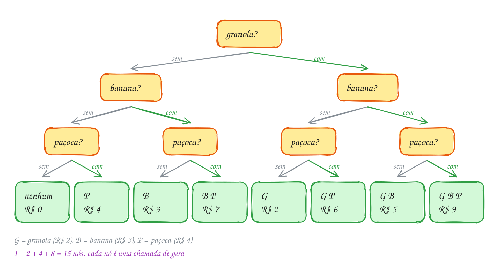
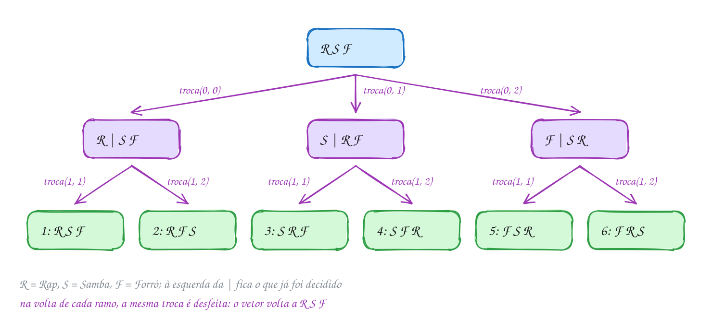
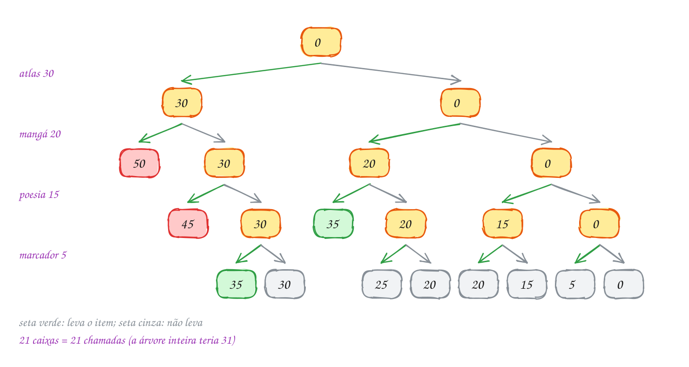
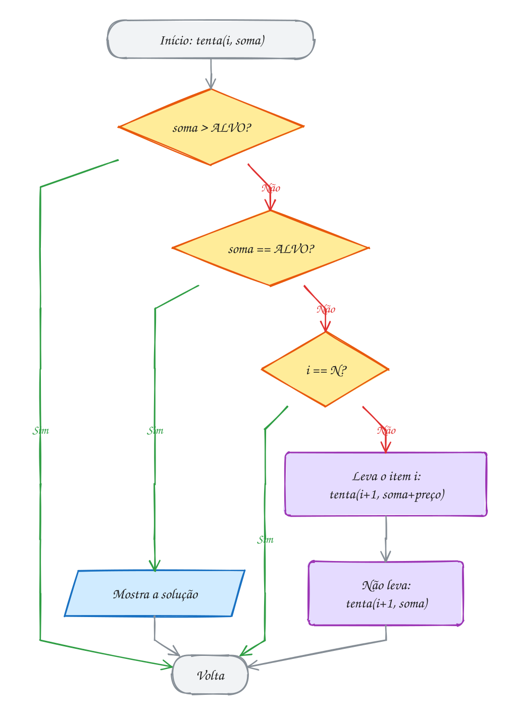
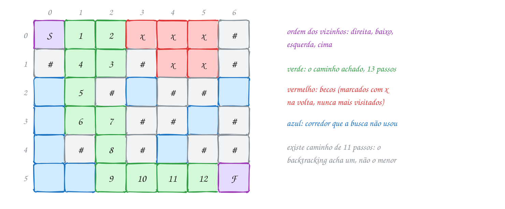
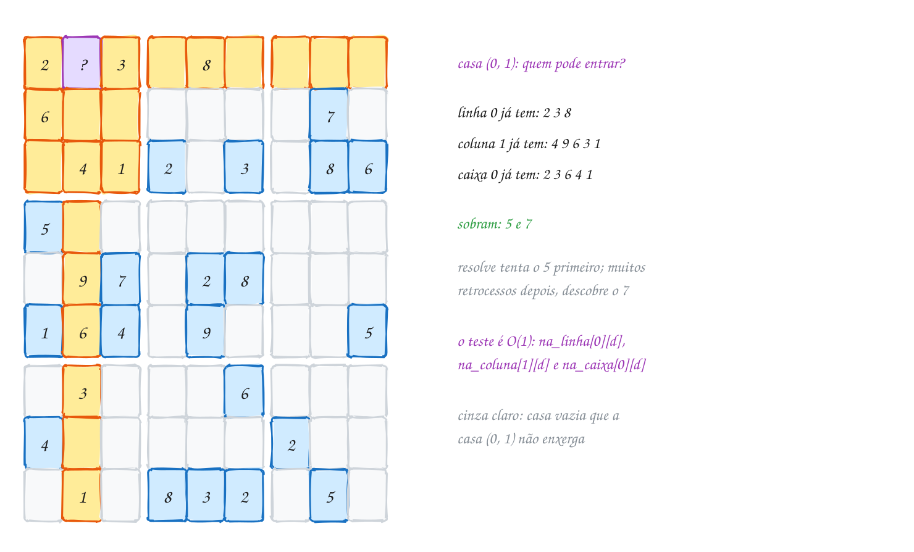

<!-- Gerado por _gerador. Para mudar este arquivo, edite _gerador/modulos/19-backtracking/ e rode: cd _gerador && npm run gerar -->

# Módulo 19 · Enumeração e backtracking

Muito problema não tem fórmula: que produtos fecham o crédito exato, onde
ficam as rainhas, como sair do labirinto. É preciso **testar as
possibilidades** sem esquecer, sem repetir e sem perder tempo com as que já
não servem.

O módulo começa pela **enumeração** de subconjuntos e permutações com
recursão. Daí vem o **backtracking**, que constrói a solução uma escolha por
vez e **volta atrás** quando o caminho falha: soma de subconjuntos,
N-rainhas, labirinto, flood fill e sudoku.

O problema vira uma **árvore de decisões**: cada nível é uma escolha e cada
caminho da raiz a uma folha é uma tentativa. Enumerar visita a árvore
inteira; o backtracking **poda** os galhos sem solução. Tudo o que você muda
antes de descer, **desfaça** depois de voltar.

## O que você vai aprender

- **subconjuntos**, pela recursão e pelos **bits** de um número
- **permutações** com troca, recursão e desfazer
- o esqueleto do **backtracking**: parada, **poda** e escolha com desfazer
- a **soma de subconjuntos** e o efeito da poda
- as **N-rainhas**, com o ataque testado em O(1)
- **labirinto** em matriz e **flood fill**
- um **resolvedor de sudoku**

## Antes de começar

Revise a recursão (0031 a 0033), as matrizes (0039), os operadores de bits
(0065) e o vetor de `bool` de `<stdbool.h>`. O labirinto é a DFS do 0111 com
uma matriz no lugar do grafo; a BFS (0110) dá o menor caminho.

**Progressão.** O módulo 18 ordenou sem enumerar; aqui você enumera e poda,
com a recursão dos módulos 4 e 13 e a DFS do 16. O 20 retoma a recursão como
divisão e conquista e troca a busca exaustiva por escolhas gulosas.

Em cada função recursiva, ache onde ela **para**, onde **poda** e onde
**escolhe e desfaz**. Os programas contam as **chamadas**: com a poda, a
saída é a mesma e o número cai. Nas árvores de decisão, amarelo é uma decisão
aberta, verde uma solução, vermelho um galho podado e cinza um beco sem
saída; nos tabuleiros, verde é a solução e vermelho, casa proibida.

Se sobrou um `true` no vetor de marcação ao fim da busca, faltou um
desfazer.

| # | Assunto |
| --- | --- |
| [0125](#0125--subconjuntos) | Subconjuntos |
| [0126](#0126--permutações) | Permutações |
| [0127](#0127--backtracking) | Backtracking |
| [0128](#0128--n-rainhas) | N-rainhas |
| [0129](#0129--labirinto) | Labirinto |
| [0130](#0130--juntando-tudo) | Juntando tudo |

---

## 0125 · Subconjuntos

Na fila do açaí, você pode pôr qualquer combinação de três complementos:
granola (R$ 2), banana (R$ 3) e paçoca (R$ 4). Quantos copos existem e quanto
custa cada um?

Cada complemento é um sim ou não: 2 × 2 × 2 = **8** copos. Cada copo é um
**subconjunto** de {granola, banana, paçoca}, e a lista de todos é o
**conjunto das partes**: com `n` itens, **2ⁿ** subconjuntos, contando o vazio
e o conjunto inteiro.

**Enumerar** é gerar todos sem esquecer nem repetir. Na recursão (assunto
0032), `gera(i, k)` cuida do item `i` e abre dois caminhos: com o item **de
fora** e com o item **dentro**, ambos chamando `gera(i + 1, ...)`. Quando `i`
chega a `n`, o subconjunto é mostrado.

Os itens escolhidos ficam em `cesta`, e `k` conta os lugares ocupados. Como `k`
é **parâmetro**, a escolha se **desfaz sozinha** quando a chamada termina.

Sem recursão, use os bits de um número (assunto 0065): conte `m` de 0 a
2ⁿ - 1 e leia o bit `i` de `m` como "o item `i` entra". O 5 é `101`: granola
e paçoca.

```c
for (int m = 0; m < (1 << N); m++)      // 1 << 3 vale 8
    for (int i = 0; i < N; i++)
        if (m & (1 << i)) { /* o item i está no subconjunto m */ }
```

Na árvore de decisões, cada nível é um complemento: o ramo da esquerda deixa o
item de fora e o da direita o põe. As 8 folhas são os 8 copos, na ordem em que
o programa os mostra:

<p align="center"></p>

O programa percorre a árvore da esquerda para a direita:

```c
#include <stdio.h>

#define N 3

const char *nomes[N] = {"granola", "banana", "paçoca"};
const int precos[N] = {2, 3, 4}; // reais

int cesta[N];       // índices dos itens escolhidos até agora
int chamadas = 0;

// decide o item i; os k primeiros lugares da cesta já estão ocupados
void gera(int i, int k) {
    chamadas++;
    if (i == N) {                       // decidiu todos: mostra a cesta
        int total = 0;
        printf("{");
        for (int j = 0; j < k; j++) {
            printf(j == 0 ? "%s" : ", %s", nomes[cesta[j]]);
            total += precos[cesta[j]];
        }
        printf("} R$ %d\n", total);
        return;
    }
    gera(i + 1, k);                     // caminho 1: sem o item i
    cesta[k] = i;                       // caminho 2: com o item i
    gera(i + 1, k + 1);
}

int main(void) {
    gera(0, 0);
    printf("%d chamadas\n", chamadas);
    return 0;
}
// Saída:
// {} R$ 0
// {paçoca} R$ 4
// {banana} R$ 3
// {banana, paçoca} R$ 7
// {granola} R$ 2
// {granola, paçoca} R$ 6
// {granola, banana} R$ 5
// {granola, banana, paçoca} R$ 9
// 15 chamadas
```

A árvore tem 1 + 2 + 4 + 8 = 15 nós, um por chamada: em geral, 2ⁿ⁺¹ - 1
chamadas e 2ⁿ folhas. Cada folha gasta até `n` passos para mostrar a cesta: o
custo é **O(n · 2ⁿ)**, e com 40 itens passa de um trilhão de subconjuntos.
Enumerar tudo só serve para `n` pequeno. O fluxograma não tem laço: quem
repete é a recursão:

<p align="center"></p>

> [!WARNING]
> No jeito por bits, `m & (1 << i)` não dá 1 quando o bit está ligado: dá o
> próprio `1 << i` (1, 2, 4, 8...). Com `== 1`, só o item 0 é reconhecido.
> Teste `if (m & (1 << i))`, com os parênteses: o `==` é avaliado antes do `&`.

> [!TIP]
> **Por dentro do C:** a pilha nunca passa de `n + 1` frames (aqui, 4), mesmo
> com 15 chamadas. Com `int`, `1 << i` só vale até `i = 30`; para mais itens,
> use `1ULL << i`.

> [!NOTE]
> **Pergunta para você:** com um quarto complemento, leite em pó (R$ 1), no
> fim da lista, quantas linhas o programa mostra e quantas chamadas faz? Qual
> é a segunda linha da saída?

### Hora de praticar

**Exemplo A249 · Quem vai na carona: subconjuntos pelos bits**

```c
#include <stdio.h>

#define N 4

int main(void) {
    const char *amigos[N] = {"Ana", "Beto", "Caio", "Duda"};
    int cabem = 0; // grupos que cabem no carro (até 3 caronas)

    // cada número de 0 a 15 é um grupo: o bit i ligado = o amigo i vai
    // (o bit 0, da Ana, é o último dígito da direita)
    for (int m = 0; m < (1 << N); m++) {
        int pessoas = 0;
        printf("%2d = ", m);
        for (int b = N - 1; b >= 0; b--) {
            printf("%d", (m >> b) & 1);   // o número em binário, bit 3 primeiro
        }
        printf(":");
        for (int i = 0; i < N; i++) {
            if (m & (1 << i)) {           // diferente de zero = bit ligado
                printf(" %s", amigos[i]);
                pessoas++;
            }
        }
        if (pessoas == 0) {
            printf(" ninguém");
        }
        if (pessoas <= 3) {
            cabem++;
        }
        printf("\n");
    }
    printf("%d grupos possíveis, %d cabem no carro\n", 1 << N, cabem);
    return 0;
}
// Saída:
//  0 = 0000: ninguém
//  1 = 0001: Ana
//  2 = 0010: Beto
//  3 = 0011: Ana Beto
//  4 = 0100: Caio
//  5 = 0101: Ana Caio
//  6 = 0110: Beto Caio
//  7 = 0111: Ana Beto Caio
//  8 = 1000: Duda
//  9 = 1001: Ana Duda
// 10 = 1010: Beto Duda
// 11 = 1011: Ana Beto Duda
// 12 = 1100: Caio Duda
// 13 = 1101: Ana Caio Duda
// 14 = 1110: Beto Caio Duda
// 15 = 1111: Ana Beto Caio Duda
// 16 grupos possíveis, 15 cabem no carro
```

```bash
gcc ~/LPEDC/A249.c -o ~/LPEDC/A249 && ~/LPEDC/A249
```

**Exemplo A250 · Dois sabores na casquinha: só os subconjuntos de tamanho k**

```c
#include <stdio.h>

#define N 5
#define K 2

const char *sabores[N] = {"açaí", "coco", "limão", "manga", "uva"};
int escolha[K];
int total = 0;

// escolhe o sabor da posição pos da casquinha, a partir do sabor inicio
void combina(int pos, int inicio) {
    if (pos == K) {
        total++;
        printf("%2d: %s + %s\n", total, sabores[escolha[0]], sabores[escolha[1]]);
        return;
    }
    // só sabores depois do último escolhido: "coco + açaí" não aparece,
    // porque é a mesma casquinha que "açaí + coco"
    for (int s = inicio; s < N; s++) {
        escolha[pos] = s;
        combina(pos + 1, s + 1);
    }
}

int main(void) {
    combina(0, 0);
    printf("C(%d, %d) = %d casquinhas\n", N, K, total);
    return 0;
}
// Saída:
//  1: açaí + coco
//  2: açaí + limão
//  3: açaí + manga
//  4: açaí + uva
//  5: coco + limão
//  6: coco + manga
//  7: coco + uva
//  8: limão + manga
//  9: limão + uva
// 10: manga + uva
// C(5, 2) = 10 casquinhas
```

```bash
gcc ~/LPEDC/A250.c -o ~/LPEDC/A250 && ~/LPEDC/A250
```

#### Exercícios

**Exercício E745** · ★☆☆

O restaurante por quilo do trabalho tem uma marmita fixa (a carne) e três
acompanhamentos opcionais: arroz, feijão e salada. Escreva do zero um
programa que mostre todas as marmitas possíveis contando m de 0 a 7 e lendo
os bits de m (bit 0 = arroz, bit 1 = feijão, bit 2 = salada), sem recursão.


```text
Saída esperada:
0: só a carne
1: arroz
2: feijão
3: arroz feijão
4: salada
5: arroz salada
6: feijão salada
7: arroz feijão salada
```

```bash
gcc ~/LPEDC/E745.c -o ~/LPEDC/E745 && ~/LPEDC/E745
```

**Exercício E747** · ★★☆

Você tem R$ 30 de crédito na barraca da feira e quer gastar o valor exato.
Os produtos são:


```text
queijo 12   café 7   carne 18   pão 5   frutas 9   frango 14
```


Escreva um programa que teste TODOS os 64 subconjuntos (pelos bits, com
m de 0 a 63, bit 0 = queijo) e mostre os que somam exatamente 30, um por
linha, e no fim quantos são.


```text
Saída esperada:
queijo carne
café carne pão
café frutas frango
3 combinações de 64
```

```bash
gcc ~/LPEDC/E747.c -o ~/LPEDC/E747 && ~/LPEDC/E747
```

**Exercício E748** · ★★☆

Uma tia doou seis brinquedos para os sobrinhos Ana e Beto dividirem:


```text
bicicleta R$ 500   patinete R$ 300   skate R$ 250
patins R$ 200      bola R$ 150       livro R$ 100
```


Escreva um programa que teste TODAS as 64 divisões: cada subconjunto vai
para a Ana e o resto (o complemento) vai para o Beto. Mostre só as divisões
JUSTAS (os dois recebem o mesmo valor) e, no fim, quantas são. Para não
mostrar a mesma divisão duas vezes (com os nomes trocados), mostre só as
que dão a bicicleta para a Ana. Em cada linha, liste os brinquedos de cada
um na ordem acima.


```text
Saída esperada:
Ana: bicicleta skate | Beto: patinete patins bola livro
Ana: bicicleta bola livro | Beto: patinete skate patins
2 divisões justas
```

```bash
gcc ~/LPEDC/E748.c -o ~/LPEDC/E748 && ~/LPEDC/E748
```

**Exercício E750** · ★★★

O pisca-pisca da varanda tem 3 lâmpadas, cada uma com seu interruptor, e
você quer testar as 8 combinações de lâmpadas acesas. Contar 000, 001,
010, 011... obriga a mexer em vários interruptores de uma vez (de 011
para 100 são três). Escreva do zero um programa que percorra as 8
combinações mexendo em UM interruptor por vez (o código de Gray), mostre
o estado (lâmpada 2 à esquerda, lâmpada 0 à direita) e diga qual
lâmpada mudou.


```text
Saída esperada:
000 começo, tudo apagado
001 liga a lâmpada 0
011 liga a lâmpada 1
010 desliga a lâmpada 0
110 liga a lâmpada 2
111 liga a lâmpada 0
101 desliga a lâmpada 1
100 desliga a lâmpada 0
```

```bash
gcc ~/LPEDC/E750.c -o ~/LPEDC/E750 && ~/LPEDC/E750
```

---

## 0126 · Permutações

Num sarau, três grupos (rap, samba e forró) se apresentam, e a organização quer
todas as ordens possíveis: 3 × 2 × 1 = **6**. Cada ordem é uma
**permutação**, e `n` elementos têm **n!** delas.

A recursão decide **uma posição por vez**. `permuta(v, i)` sabe que `0..i-1`
já estão decididas, e os candidatos à posição `i` são os de `v[i..n-1]`. Para
cada `j` de `i` até `n - 1`:

1. **escolhe**: troca `v[i]` com `v[j]`;
2. **desce**: chama `permuta(v, i + 1)`;
3. **desfaz**: troca `v[i]` com `v[j]` de novo.

O passo 3 é indispensável: no assunto anterior, a escolha se desfazia sozinha
por estar num parâmetro; aqui ela mexe no **vetor**, que é um só para todas as
chamadas. Quando `i` chega a `n`, a ordem é mostrada. As 6 folhas da árvore
são as 6 ordens, na sequência em que o programa as mostra:

<p align="center"></p>

O vetor guarda ponteiros para os nomes (assunto 0048): trocar dois elementos
é trocar dois ponteiros, e os textos não saem do lugar.

```c
#include <stdio.h>

#define N 3

int ordens = 0;

void troca(const char **a, const char **b) {
    const char *t = *a;   // troca só os ponteiros, não as letras
    *a = *b;
    *b = t;
}

// as posições 0..i-1 já estão decididas; decide a posição i
void permuta(const char *v[], int i) {
    if (i == N) {
        ordens++;
        printf("%d: %s, %s, %s\n", ordens, v[0], v[1], v[2]);
        return;
    }
    for (int j = i; j < N; j++) {
        troca(&v[i], &v[j]);    // escolhe: v[j] vai para a posição i
        permuta(v, i + 1);      // decide o resto
        troca(&v[i], &v[j]);    // desfaz: devolve o vetor como estava
    }
}

int main(void) {
    const char *shows[N] = {"Rap", "Samba", "Forró"};
    permuta(shows, 0);
    printf("%d ordens; no fim: %s, %s, %s\n", ordens, shows[0], shows[1], shows[2]);
    return 0;
}
// Saída:
// 1: Rap, Samba, Forró
// 2: Rap, Forró, Samba
// 3: Samba, Rap, Forró
// 4: Samba, Forró, Rap
// 5: Forró, Samba, Rap
// 6: Forró, Rap, Samba
// 6 ordens; no fim: Rap, Samba, Forró
```

Na última linha, o vetor voltou a ser `Rap, Samba, Forró`: cada chamada
desfez o que fez. A ordem de saída **não** é a de dicionário (quem precisa
dela usa o exemplo A251).

O laço do `j` abre os ramos, e cada volta tem o par troca e destroca em volta
da chamada recursiva:

<p align="center"></p>

> [!WARNING]
> Sem o **desfaz**, o programa ainda mostra 6 linhas, mas com ordens repetidas
> e outras faltando, e o vetor termina bagunçado. Toda alteração feita antes
> da chamada recursiva precisa ser desfeita depois dela, na ordem inversa.

> [!TIP]
> **Por dentro do C:** são `n!` folhas, e cada uma gasta `n` passos para
> mostrar: o custo é **O(n · n!)**, pior que os 2ⁿ dos subconjuntos. 13!
> (6.227.020.800) não cabe num `int` de 32 bits, e 20! (cerca de 2,4 · 10¹⁸)
> fica no limite de um `long long`. Trocar ponteiros custa 8 bytes por
> elemento, qualquer que seja o tamanho do nome.

> [!NOTE]
> **Pergunta para você:** com um quarto grupo, de pagode, no fim do vetor,
> quantas linhas saem? Qual grupo abre o sarau na linha 7? E na 19?

### Hora de praticar

**Exemplo A251 · Os anagramas de AMOR em ordem de dicionário**

```c
#include <stdbool.h>
#include <stdio.h>

#define N 4

const char letras[N + 1] = "AMOR"; // já em ordem alfabética
char palavra[N + 1];               // a permutação sendo montada
bool usada[N];                     // usada[k]: a letra k já está na palavra?
int total = 0;

// em vez de trocar, escolhe para a posição pos a primeira letra livre,
// sempre da esquerda para a direita: a saída sai em ordem de dicionário
void anagramas(int pos) {
    if (pos == N) {
        palavra[N] = '\0';
        total++;
        printf("%s%s", palavra, total % 6 == 0 ? "\n" : " ");
        return;
    }
    for (int k = 0; k < N; k++) {
        if (usada[k]) {
            continue;              // essa letra já foi usada antes
        }
        usada[k] = true;           // escolhe
        palavra[pos] = letras[k];
        anagramas(pos + 1);        // desce
        usada[k] = false;          // desfaz (palavra[pos] é sobrescrita depois)
    }
}

int main(void) {
    anagramas(0);
    printf("%d anagramas\n", total);
    return 0;
}
// Saída:
// AMOR AMRO AOMR AORM ARMO AROM
// MAOR MARO MOAR MORA MRAO MROA
// OAMR OARM OMAR OMRA ORAM ORMA
// RAMO RAOM RMAO RMOA ROAM ROMA
// 24 anagramas
```

```bash
gcc ~/LPEDC/A251.c -o ~/LPEDC/A251 && ~/LPEDC/A251
```

**Exemplo A252 · ARARA: anagramas sem repetir quando há letras iguais**

```c
#include <stdio.h>
#include <string.h>

#define MAX 16

int conta[26];      // quantas de cada letra ainda estão disponíveis
char palavra[MAX];
int n, total = 0;

// em cada posição, tenta cada LETRA diferente uma vez só (e não cada
// cópia dela): assim os dois R de ARARA nunca geram anagramas repetidos
void gera(int pos) {
    if (pos == n) {
        palavra[n] = '\0';
        total++;
        printf("%2d: %s\n", total, palavra);
        return;
    }
    for (int c = 0; c < 26; c++) {
        if (conta[c] == 0) {
            continue;
        }
        conta[c]--;                 // escolhe uma letra c
        palavra[pos] = (char)('A' + c);
        gera(pos + 1);
        conta[c]++;                 // desfaz: devolve a letra
    }
}

int main(void) {
    const char *origem = "ARARA";
    n = (int)strlen(origem);
    for (int i = 0; i < n; i++) {
        conta[origem[i] - 'A']++;   // A: 3, R: 2
    }
    gera(0);
    // 5! / (3! · 2!) = 120 / 12 = 10: trocar os A entre si ou os R entre si
    // não muda a palavra
    printf("5! = 120 ordens das letras, mas só %d anagramas diferentes\n", total);
    return 0;
}
// Saída:
//  1: AAARR
//  2: AARAR
//  3: AARRA
//  4: ARAAR
//  5: ARARA
//  6: ARRAA
//  7: RAAAR
//  8: RAARA
//  9: RARAA
// 10: RRAAA
// 5! = 120 ordens das letras, mas só 10 anagramas diferentes
```

```bash
gcc ~/LPEDC/A252.c -o ~/LPEDC/A252 && ~/LPEDC/A252
```

#### Exercícios

**Exercício E751** · ★☆☆

Você esqueceu a senha de 3 dígitos do cadeado da mochila. Lembra só que
ela usa os dígitos 4, 7 e 9, cada um uma vez. Escreva do zero um programa
que gere todas as senhas possíveis com a recursão por trocas do texto
(troca, desce, desfaz), mostre cada uma como um número inteiro e, no fim,
a soma de todas (para conferir que nenhuma faltou nem repetiu).


```text
Saída esperada:
479
497
749
794
974
947
soma: 4440
```

```bash
gcc ~/LPEDC/E751.c -o ~/LPEDC/E751 && ~/LPEDC/E751
```

**Exercício E753** · ★★☆

O motoboy sai da pizzaria (local 0), entrega em quatro bairros (1 a 4) e
volta para a pizzaria. A matriz dist (em km, já no programa) diz a
distância entre cada par de locais. Gere todas as 4! = 24 ordens de
entrega, calcule o percurso de cada uma (ida, entregas e volta) e mostre a
menor distância e a PRIMEIRA ordem, na ordem em que a sua recursão gera,
que a atinge.


```text
Saída esperada:
24 rotas testadas
menor: 16 km
rota: Pizzaria -> Lagoa -> Centro -> Jardim -> Vila -> Pizzaria
```

```bash
gcc ~/LPEDC/E753.c -o ~/LPEDC/E753 && ~/LPEDC/E753
```

**Exercício E754** · ★★☆

Cinco atletas correm a final: Ana, Bia, Cris, Dani e Edu. Escreva um
programa que conte todas as ordens de chegada (5! = 120) com a recursão
por trocas do texto. Mas a premiação só liga para o PÓDIO: ouro, prata e
bronze, nessa ordem. Conte também os pódios possíveis e quantos deles têm
a Bia (em qualquer dos três lugares). Não gere as 120 ordens e depois
filtre: pare a recursão quando as 3 primeiras posições estiverem
decididas.


```text
Saída esperada:
120 ordens de chegada
60 pódios possíveis
Bia aparece em 36
```

```bash
gcc ~/LPEDC/E754.c -o ~/LPEDC/E754 && ~/LPEDC/E754
```

**Exercício E756** · ★★★

Às vezes você não quer TODAS as permutações de uma vez, só a próxima
depois de uma dada, em ordem de dicionário. Escreva do zero a função


```text
bool proxima(int v[], int n)
```


que transforma v na permutação seguinte e devolve true, ou devolve false
se v já é a última (em ordem decrescente). Sem recursão. Depois use-a para
listar as permutações de {1, 2, 3} e teste os dois casos abaixo.


```text
Saída esperada:
1 2 3
1 3 2
2 1 3
2 3 1
3 1 2
3 2 1
depois de 1 3 5 4 2 vem 1 4 2 3 5
5 4 3 2 1 é a última
```

```bash
gcc ~/LPEDC/E756.c -o ~/LPEDC/E756 && ~/LPEDC/E756
```

---

## 0127 · Backtracking

Um cartão-presente de R$ 35 não dá troco: ou você gasta o valor exato, ou o
resto se perde. Na vitrine há um atlas (R$ 30), um mangá (R$ 20), um livro de
poesia (R$ 15) e um marcador (R$ 5). Que combinações fecham R$ 35?

Pelo assunto 0125, bastaria somar os 2⁴ = 16 subconjuntos. Mas atlas e mangá
já somam R$ 50, e a enumeração cega continua até o fim de cada subconjunto que
começa assim.

O **backtracking** (retrocesso; o Ziviani chama de **tentativa e erro**) é a
enumeração que **desiste cedo**: a cada escolha, pergunta se o começo ainda
pode virar solução e, se não, volta um passo. Cortar um galho inteiro da
árvore de decisões se chama **poda**. O esqueleto tem três partes:

1. **caso de parada**: a solução está completa? Mostre (ou conte) e volte;
2. **poda**: o começo já é inviável? Volte sem descer;
3. **escolha**: para cada opção, escolha, desça e **desfaça**.

Aqui os preços são positivos: se a soma **passou** de 35, acrescentar itens só
piora, e se bateu **exatamente** 35, também não precisa descer. Na árvore, a
esquerda leva o item e a direita não. As caixas vermelhas são podas, as verdes
são soluções e as cinzas são becos sem saída (os itens acabaram antes de a soma
chegar a 35):

<p align="center"></p>

A poda é o primeiro `if`: a chamada que passou do alvo volta na hora:

```c
#include <stdbool.h>
#include <stdio.h>

#define N 4
#define ALVO 35

const char *itens[N] = {"atlas", "mangá", "poesia", "marcador"};
const int precos[N] = {30, 20, 15, 5}; // reais
bool leva[N];
int chamadas = 0;

// já decidiu os itens 0..i-1, que somam soma reais
void tenta(int i, int soma) {
    chamadas++;
    if (soma > ALVO) {
        return;                         // poda: passou, nada abaixo serve
    }
    if (soma == ALVO) {                 // fechou: mostra e não desce mais
        printf("R$ %d:", soma);
        for (int j = 0; j < i; j++) {
            if (leva[j]) {
                printf(" %s", itens[j]);
            }
        }
        printf("\n");
        return;
    }
    if (i == N) {
        return;                         // acabaram os itens sem fechar
    }
    leva[i] = true;                     // tenta com o item i
    tenta(i + 1, soma + precos[i]);
    leva[i] = false;                    // volta e tenta sem ele
    tenta(i + 1, soma);
}

int main(void) {
    tenta(0, 0);
    printf("%d chamadas (sem poda seriam 31)\n", chamadas);
    return 0;
}
// Saída:
// R$ 35: atlas marcador
// R$ 35: mangá poesia
// 21 chamadas (sem poda seriam 31)
```

A árvore completa de 4 itens tem 31 nós, e a poda deixou 21. O ganho cresce
com `n`: uma poda perto da raiz corta metade da árvore, e com 30 itens e um
alvo pequeno são alguns milhares de chamadas em vez de um bilhão:

<p align="center"></p>

> [!WARNING]
> A ordem dos testes importa. Com `if (i == N) return;` **antes** de
> `if (soma == ALVO)`, a solução que fecha com o último item (`atlas
> marcador`, com `i` valendo 4) seria descartada. Poda com `>=` no lugar de
> `>` corta toda soma que bate o alvo, e a saída fica vazia. A poda só pode
> cortar o que **com certeza** não leva a solução.

> [!TIP]
> **Por dentro do C:** a soma é **parâmetro**, e voltar a desfaz de graça;
> `leva[]` é global, por isso `leva[i] = false` antes do segundo caminho. O
> pior caso continua **O(2ⁿ)**: a poda muda o quanto da árvore você visita, não
> a garantia.

> [!NOTE]
> **Pergunta para você:** se o cartão fosse de R$ 50, quais combinações
> sairiam? A primeira linha da saída ainda seria a do atlas?

### Hora de praticar

**Exemplo A253 · Lote de 40 kg: a segunda poda, "o que falta não alcança"**

```c
#include <stdbool.h>
#include <stdio.h>

#define N 7
#define ALVO 40

const int pesos[N] = {18, 15, 12, 9, 7, 4, 2}; // caixas de doação, em kg
int resto[N + 1];   // resto[i] = soma dos pesos de i até o fim
bool leva[N];
int chamadas;

// modo 0: sem poda; 1: só "passou do alvo"; 2: as duas podas
void tenta(int i, int soma, int modo, bool mostrar) {
    chamadas++;
    if (modo >= 1 && soma > ALVO) {
        return;                       // poda 1: passou
    }
    if (modo >= 2 && soma + resto[i] < ALVO) {
        return;                       // poda 2: nem levando tudo chega
    }
    if (i == N) {
        if (soma == ALVO && mostrar) {
            printf("  40 kg:");
            for (int j = 0; j < N; j++) {
                if (leva[j]) {
                    printf(" %d", pesos[j]);
                }
            }
            printf("\n");
        }
        return;
    }
    leva[i] = true;
    tenta(i + 1, soma + pesos[i], modo, mostrar);
    leva[i] = false;
    tenta(i + 1, soma, modo, mostrar);
}

int main(void) {
    resto[N] = 0;
    for (int i = N - 1; i >= 0; i--) {
        resto[i] = resto[i + 1] + pesos[i];  // somas do fim para o começo
    }
    printf("Lotes possíveis:\n");
    tenta(0, 0, 2, true);

    const char *nomes[3] = {"sem poda", "poda 1", "podas 1 e 2"};
    for (int modo = 0; modo <= 2; modo++) {
        chamadas = 0;
        tenta(0, 0, modo, false);
        printf("%-12s %3d chamadas\n", nomes[modo], chamadas);
    }
    return 0;
}
// Saída:
// Lotes possíveis:
//   40 kg: 18 15 7
//   40 kg: 18 9 7 4 2
//   40 kg: 15 12 9 4
//   40 kg: 15 12 7 4 2
// sem poda     255 chamadas
// poda 1       193 chamadas
// podas 1 e 2   55 chamadas
```

```bash
gcc ~/LPEDC/A253.c -o ~/LPEDC/A253 && ~/LPEDC/A253
```

**Exemplo A254 · Playlist de 30 minutos: parar na primeira solução**

```c
#include <stdbool.h>
#include <stdio.h>

#define N 7
#define ALVO 30

const char *musicas[N] = {"Aquarela", "Bossa", "Ciranda", "Dengo", "Estrada", "Frevo", "Garoa"};
const int minutos[N] = {7, 4, 9, 5, 6, 3, 8};
bool toca[N];
int chamadas = 0;

// devolve true assim que acha uma playlist; o true sobe pela pilha de
// chamadas e cada nível volta na hora, sem tentar mais nada
bool procura(int i, int soma) {
    chamadas++;
    if (soma > ALVO) {
        return false;
    }
    if (soma == ALVO) {
        return true;                    // achou: toca[0..i-1] é a resposta
    }
    if (i == N) {
        return false;
    }
    toca[i] = true;
    if (procura(i + 1, soma + minutos[i])) {
        return true;                    // não desfaz: a resposta fica em toca[]
    }
    toca[i] = false;
    return procura(i + 1, soma);
}

// a mesma busca, mas conta todas as soluções em vez de parar
int conta_todas(int i, int soma) {
    chamadas++;
    if (soma > ALVO) {
        return 0;
    }
    if (soma == ALVO) {
        return 1;
    }
    if (i == N) {
        return 0;
    }
    return conta_todas(i + 1, soma + minutos[i]) + conta_todas(i + 1, soma);
}

int main(void) {
    if (procura(0, 0)) {
        printf("Primeira playlist:");
        for (int j = 0; j < N; j++) {
            if (toca[j]) {
                printf(" %s (%d)", musicas[j], minutos[j]);
            }
        }
        printf("\nachada em %d chamadas\n", chamadas);
    }
    chamadas = 0;
    int total = conta_todas(0, 0);
    printf("todas: %d playlists, %d chamadas\n", total, chamadas);
    return 0;
}
// Saída:
// Primeira playlist: Aquarela (7) Bossa (4) Dengo (5) Estrada (6) Garoa (8)
// achada em 36 chamadas
// todas: 4 playlists, 247 chamadas
```

```bash
gcc ~/LPEDC/A254.c -o ~/LPEDC/A254 && ~/LPEDC/A254
```

#### Exercícios

**Exercício E757** · ★☆☆

Para a trilha do fim de semana, a mochila tem que pesar exatamente 12 kg
(nem mais, para não cansar, nem menos, para não faltar nada). Os itens
pesam: barraca 7, comida 5, água 4, saco 3 e fogareiro 2. Escreva o
backtracking tenta(i, soma), que decide o item i (leva ou não leva) e
conta as chamadas no começo da função. Volte quando a soma passar de 12
(poda). Quando a soma for 12, mostre os itens levados e volte, sem decidir
os itens que sobram.


```text
Saída esperada:
barraca comida
barraca saco fogareiro
comida água saco
45 chamadas
```

```bash
gcc ~/LPEDC/E757.c -o ~/LPEDC/E757 && ~/LPEDC/E757
```

**Exercício E759** · ★★☆

A caminhonete do frete aguenta 100 kg e há cinco caixas para levar, com
47, 39, 28, 23 e 16 kg. Não dá para levar todas. Que caixas levar para
aproveitar ao máximo a carga, sem passar de 100 kg? Agora não existe um
alvo exato: o backtracking precisa guardar a MELHOR solução vista até o
momento. Escreva o programa do zero.


```text
Saída esperada:
melhor carga: 98 kg
caixas: 47 28 23
```

```bash
gcc ~/LPEDC/E759.c -o ~/LPEDC/E759 && ~/LPEDC/E759
```

**Exercício E760** · ★★☆

Na banca, os pacotes de figurinhas vêm com quantidades diferentes: 25,
20, 15, 12, 10, 8 e 5 figurinhas (um pacote de cada). Você precisa de
exatamente 60 figurinhas para completar o álbum. Escreva um backtracking
que mostre todas as combinações (tentando levar o pacote antes de não
levar) e, no fim, a combinação com MENOS pacotes (se houver empate, fique
com a primeira encontrada).


```text
Saída esperada:
25 20 15
25 20 10 5
25 15 12 8
25 12 10 8 5
20 15 12 8 5
menos pacotes: 25 20 15 (3 pacotes)
```

```bash
gcc ~/LPEDC/E760.c -o ~/LPEDC/E760 && ~/LPEDC/E760
```

**Exercício E762** · ★★★

Desafio da revista de passatempos: coloque um sinal + ou - antes de cada
número de 2 a 7, na sequência 1 _ 2 _ 3 _ 4 _ 5 _ 6 _ 7, para que a conta
dê 10 (o 1 é sempre positivo). Escreva do zero um backtracking que mostre
todas as soluções, tentando sempre + antes de -, e conte as chamadas da
função recursiva. Use esta poda, no começo de cada chamada: se nem
somando nem subtraindo todos os números que faltam dá para chegar a 10,
volte.


```text
Saída esperada:
1+2+3-4-5+6+7 = 10
1+2-3+4+5-6+7 = 10
1-2+3+4+5+6-7 = 10
1-2-3-4+5+6+7 = 10
4 expressões, 83 chamadas
```

```bash
gcc ~/LPEDC/E762.c -o ~/LPEDC/E762 && ~/LPEDC/E762
```

---

## 0128 · N-rainhas

No clube de xadrez, o desafio é pôr 4 rainhas num tabuleiro 4 × 4 sem que uma
ataque outra (linha, coluna ou diagonal). Quantas arrumações existem?

A força bruta escolheria 4 das 16 casas: 1820 jeitos. Mas duas rainhas na
mesma linha se atacam, então cada linha tem **exatamente uma**, e a solução é
um vetor `pos` com a coluna da rainha de cada linha.

`rainha(l)` tenta cada coluna `c` e **poda** as casas atacadas pelas rainhas
de cima; se a casa está livre, marca, desce para a linha `l + 1` e desmarca na
volta. Para testar o ataque em O(1), cada casa `(l, c)` tem um índice de
coluna e de diagonais:

- na diagonal **↗**, `l + c` é igual em todas as casas, de 0 a `2N - 2`;
- na diagonal **↘**, `l - c` é igual, de `-(N - 1)` a `N - 1`; somar `N - 1`
  dá um índice válido.

Três vetores de `bool` guardam o que está ocupado: `coluna[N]`, `diag1[2N - 1]`
e `diag2[2N - 1]`. No desenho, à esquerda está a primeira solução; no meio,
`l + c` de cada casa; à direita, `l - c + 3`. A rainha da linha 1, coluna 3,
ocupa a diagonal ↗ 4 e a ↘ 1, e as casas destacadas ficam proibidas:

<p align="center"></p>

O programa mostra cada solução como tabuleiro e conta as chamadas:

```c
#include <stdbool.h>
#include <stdio.h>

#define N 4

int pos[N];               // pos[l] = coluna da rainha da linha l
bool coluna[N];           // coluna[c]: já tem rainha na coluna c?
bool diag1[2 * N - 1];    // diagonal ↗, índice l + c
bool diag2[2 * N - 1];    // diagonal ↘, índice l - c + N - 1
int solucoes = 0, chamadas = 0;

void mostra(void) {
    printf("Solução %d:\n", solucoes);
    for (int l = 0; l < N; l++) {
        for (int c = 0; c < N; c++) {
            printf(c == 0 ? "%c" : " %c", pos[l] == c ? 'R' : '.');
        }
        printf("\n");
    }
}

// as linhas 0..l-1 já têm rainha; põe a da linha l
void rainha(int l) {
    chamadas++;
    if (l == N) {
        solucoes++;
        mostra();
        return;
    }
    for (int c = 0; c < N; c++) {
        if (coluna[c] || diag1[l + c] || diag2[l - c + N - 1]) {
            continue;                   // poda: a casa (l, c) está atacada
        }
        pos[l] = c;                     // escolhe
        coluna[c] = diag1[l + c] = diag2[l - c + N - 1] = true;
        rainha(l + 1);                  // desce
        coluna[c] = diag1[l + c] = diag2[l - c + N - 1] = false; // desfaz
    }
}

int main(void) {
    rainha(0);
    printf("%d soluções, %d chamadas\n", solucoes, chamadas);
    return 0;
}
// Saída:
// Solução 1:
// . R . .
// . . . R
// R . . .
// . . R .
// Solução 2:
// . . R .
// R . . .
// . . . R
// . R . .
// 2 soluções, 17 chamadas
```

### Passo a passo

O começo da busca, até a primeira solução. "Atacada" quer dizer que a poda
cortou a casa antes de qualquer chamada:

| linha | tenta | o que acontece |
| --- | --- | --- |
| 0 | coluna 0 | livre: marca e desce |
| 1 | colunas 0 e 1 | atacadas (coluna 0; diagonal ↘ da rainha (0, 0)) |
| 1 | coluna 2 | livre: marca e desce |
| 2 | colunas 0 a 3 | todas atacadas: volta, desmarca (1, 2) |
| 1 | coluna 3 | livre: marca e desce |
| 2 | coluna 1 | livre: marca e desce |
| 3 | colunas 0 a 3 | todas atacadas: volta; na linha 2, as colunas 2 e 3 também estão atacadas, e a linha 1 já tentou tudo: volta à linha 0 |
| 0 | coluna 1 | livre: desce, e o caminho 3, 0, 2 fecha a solução 1 |

A rainha em (0, 0) nunca dá certo: a busca gasta 4 chamadas para descobrir e
esquece o galho. O fluxograma é o do assunto anterior, com um laço pelas
colunas no lugar de "leva ou não leva":

<p align="center"></p>

> [!WARNING]
> O índice da diagonal ↘ é `l - c + N - 1`, não `l - c`: para (0, 3), `diag2[-3]`
> escreve **fora** do vetor. Outro erro é desmarcar só a coluna e esquecer as
> diagonais: o programa acha menos soluções do que devia.

> [!TIP]
> **Por dentro do C:** cada teste de ataque são três leituras, sem laço pelas
> rainhas anteriores. A atribuição em cadeia funciona porque, em C, ela devolve
> o valor atribuído, da direita para a esquerda. O 8-rainhas acha as 92
> soluções com 2057 chamadas.

> [!NOTE]
> **Pergunta para você:** com `N` igual a 5 e a 6, quantas soluções você
> espera? O número sobe sempre que o tabuleiro cresce?

### Hora de praticar

**Exemplo A255 · Quantas soluções de 1 a 12 rainhas: o tabuleiro em bits**

```c
#include <stdio.h>

long long chamadas;

// cada bit de um unsigned é uma coluna. cols: colunas ocupadas;
// d1 e d2: casas desta linha atacadas pelas diagonais das rainhas de cima
long long conta(int n, unsigned cols, unsigned d1, unsigned d2) {
    chamadas++;
    unsigned todas = (1u << n) - 1;   // n bits ligados
    if (cols == todas) {
        return 1;                     // uma rainha em cada coluna: solução
    }
    long long total = 0;
    unsigned livres = todas & ~(cols | d1 | d2);
    while (livres != 0) {
        unsigned bit = livres & (~livres + 1);   // o bit ligado mais baixo
        livres -= bit;
        // na linha de baixo, a diagonal ↘ ataca uma coluna à frente (<< 1)
        // e a ↙ uma coluna atrás (>> 1): basta deslocar os bits
        total += conta(n, cols | bit, ((d1 | bit) << 1) & todas, (d2 | bit) >> 1);
    }
    return total;
}

int main(void) {
    // as chamadas batem com as do texto (17 para n = 4): mesma árvore,
    // só que o teste de ataque virou uma conta de bits
    printf(" n  soluções   chamadas\n");
    for (int n = 1; n <= 12; n++) {
        chamadas = 0;
        long long s = conta(n, 0, 0, 0);
        printf("%2d  %8lld  %9lld\n", n, s, chamadas);
    }
    return 0;
}
// Saída:
//  n  soluções   chamadas
//  1         1          2
//  2         0          3
//  3         0          6
//  4         2         17
//  5        10         54
//  6         4        153
//  7        40        552
//  8        92       2057
//  9       352       8394
// 10       724      35539
// 11      2680     166926
// 12     14200     856189
```

```bash
gcc ~/LPEDC/A255.c -o ~/LPEDC/A255 && ~/LPEDC/A255
```

**Exemplo A256 · A primeira solução do 8-rainhas, sem vetores auxiliares**

```c
#include <stdbool.h>
#include <stdio.h>
#include <stdlib.h>

#define N 8

int pos[N];
int chamadas = 0;

// a casa (l, c) é atacada por alguma rainha das linhas 0..l-1?
// custa O(l) em vez de O(1), mas não precisa de vetor nenhum além de pos
bool pode(int l, int c) {
    for (int k = 0; k < l; k++) {
        if (pos[k] == c || abs(pos[k] - c) == l - k) {
            return false;   // mesma coluna, ou mesma distância nas duas direções
        }
    }
    return true;
}

// devolve true na primeira solução: o true sobe e ninguém tenta mais nada
bool rainha(int l) {
    chamadas++;
    if (l == N) {
        return true;
    }
    for (int c = 0; c < N; c++) {
        if (pode(l, c)) {
            pos[l] = c;     // não precisa desfazer: pos[l] é sobrescrito
            if (rainha(l + 1)) {
                return true;
            }
        }
    }
    return false;
}

int main(void) {
    if (rainha(0)) {
        for (int l = 0; l < N; l++) {
            for (int c = 0; c < N; c++) {
                printf(c == 0 ? "%c" : " %c", pos[l] == c ? 'R' : '.');
            }
            printf("\n");
        }
        printf("pos = {");
        for (int l = 0; l < N; l++) {
            printf(l == 0 ? "%d" : ", %d", pos[l]);
        }
        printf("}, achada em %d chamadas\n", chamadas);
    }
    return 0;
}
// Saída:
// R . . . . . . .
// . . . . R . . .
// . . . . . . . R
// . . . . . R . .
// . . R . . . . .
// . . . . . . R .
// . R . . . . . .
// . . . R . . . .
// pos = {0, 4, 7, 5, 2, 6, 1, 3}, achada em 114 chamadas
```

```bash
gcc ~/LPEDC/A256.c -o ~/LPEDC/A256 && ~/LPEDC/A256
```

#### Exercícios

**Exercício E763** · ★☆☆

Antes de resolver o tabuleiro inteiro, o clube quer um juiz: uma função


```text
bool ataca(int l1, int c1, int l2, int c2)
```


que diz se duas rainhas, nas casas (l1, c1) e (l2, c2) de um tabuleiro
8 × 8, se atacam (mesma linha, mesma coluna ou mesma diagonal). Escreva a
função do zero e teste com os pares (l1, c1, l2, c2) abaixo:


```text
0 0 3 3    1 2 3 1    2 5 2 0    4 1 1 4    0 3 5 3    6 2 3 0
```


```text
Saída esperada:
(0, 0) e (3, 3): ataca
(1, 2) e (3, 1): não ataca
(2, 5) e (2, 0): ataca
(4, 1) e (1, 4): ataca
(0, 3) e (5, 3): ataca
(6, 2) e (3, 0): não ataca
```

```bash
gcc ~/LPEDC/E763.c -o ~/LPEDC/E763 && ~/LPEDC/E763
```

**Exercício E765** · ★★☆

No tabuleiro 8 × 8 do clube, alguém colou a rainha da linha 0 na coluna 3,
e ela não sai mais. Quantas das 92 soluções do 8-rainhas ainda são
possíveis? Escreva o programa (pode partir do código do texto) e mostre a
primeira solução encontrada e o total.


```text
Saída esperada:
primeira: 3 0 4 7 1 6 2 5
18 soluções com a rainha em (0, 3)
```

```bash
gcc ~/LPEDC/E765.c -o ~/LPEDC/E765 && ~/LPEDC/E765
```

**Exercício E766** · ★★☆

Na sala de prova, as carteiras formam uma grade n × n e o fiscal senta n
alunos: um em cada fileira e um em cada coluna. Alunos de fileiras
VIZINHAS não podem estar em colunas vizinhas (um enxergaria a prova do
outro na diagonal); em fileiras mais distantes, a diagonal é livre.

Escreva um backtracking, fileira por fileira, que conte as arrumações da
sala de prova para n = 4, 5 e 6 e mostre a primeira de cada n (a coluna
de cada fileira, de cima para baixo).


```text
Saída esperada:
n = 4: 2 arrumações, primeira: 1 3 0 2
n = 5: 14 arrumações, primeira: 0 2 4 1 3
n = 6: 90 arrumações, primeira: 0 2 4 1 3 5
```

```bash
gcc ~/LPEDC/E766.c -o ~/LPEDC/E766 && ~/LPEDC/E766
```

**Exercício E767** · ★★★

Escreva o 8-rainhas com três vetores de marcas: colunas, diagonais ↗ e
diagonais ↘ (cada casa tem a sua marca em cada um, e a recursão desfaz
com o MESMO índice com que marcou). Conte as soluções e, no fim, confira
que os três vetores voltaram a ficar limpos (todos false): se algum
desfazer errar o índice, sobra marca e a contagem sai errada.


```text
Saída esperada:
92 soluções
vetores limpos no fim: sim
```

```bash
gcc ~/LPEDC/E767.c -o ~/LPEDC/E767 && ~/LPEDC/E767
```

---

## 0129 · Labirinto

Num labirinto de milho, você volta até a última bifurcação a cada beco e tenta
outro corredor, deixando pedrinhas para não andar em círculos.

Isso é backtracking numa **matriz**: `char lab[L][C + 1]`, com `'#'` de parede,
`'.'` de corredor, `'S'` de entrada e `'F'` de saída. `anda(l, c)` responde "dá
para chegar à saída a partir daqui?". Ela recusa fora do mapa, parede e casa
que já está no caminho; se a casa é a saída, responde sim; senão **marca** a
casa com `'*'`, tenta os quatro vizinhos e, se nenhum serviu, **desfaz** a
marca.

O desfazer volta a casa para `'x'`, não para `'.'`: quem não leva à saída
continua sem levar, então não vale entrar de novo. Assim cada casa é visitada
no máximo uma vez, e o custo é **O(L · C)**. É a busca em profundidade (DFS)
do assunto 0111, com a matriz no papel do grafo e os quatro vizinhos no das
arestas.

Pelo curto-circuito do `||` (assunto 0013), quando um vizinho devolve `true`,
os seguintes não são chamados. A ordem das direções (direita, baixo, esquerda,
cima) decide qual caminho sai primeiro.

No desenho, os números mostram a ordem dos passos: a busca tentou o bolsão da
direita, achou só becos (vermelho), voltou e desceu pela coluna 1:

<p align="center"></p>

No fim, `*` marca o caminho e `x` os becos abandonados:

```c
#include <stdbool.h>
#include <stdio.h>

#define L 6
#define C 7

char lab[L][C + 1] = {   // + 1 para o '\0' de cada linha
    "S.....#",
    "#..#..#",
    "..#.##.",
    "...##.#",
    ".#.#.##",
    "......F",
};
int chamadas = 0;

// tenta chegar à saída a partir da casa (l, c)
bool anda(int l, int c) {
    chamadas++;
    if (l < 0 || l >= L || c < 0 || c >= C) {
        return false;                   // fora do mapa
    }
    if (lab[l][c] == 'F') {
        return true;                    // achou a saída
    }
    if (lab[l][c] != '.' && lab[l][c] != 'S') {
        return false;                   // parede, caminho atual ou beco
    }
    lab[l][c] = '*';                    // escolhe: estou passando por aqui
    if (anda(l, c + 1) || anda(l + 1, c) || anda(l, c - 1) || anda(l - 1, c)) {
        return true;                    // direita, baixo, esquerda, cima
    }
    lab[l][c] = 'x';                    // desfaz: beco sem saída
    return false;
}

int main(void) {
    if (anda(0, 0)) {
        int passos = 0;
        for (int l = 0; l < L; l++) {
            for (int c = 0; c < C; c++) {
                printf(c == 0 ? "%c" : " %c", lab[l][c]);
                passos += lab[l][c] == '*';
            }
            printf("\n");
        }
        printf("%d passos até a saída, %d chamadas\n", passos, chamadas);
    } else {
        printf("sem saída\n");
    }
    return 0;
}
// Saída:
// * * * x x x #
// # * * # x x #
// . * # . # # .
// . * * # # . #
// . # * # . # #
// . . * * * * F
// 13 passos até a saída, 41 chamadas
```

O caminho tem 13 passos, mas existe um de 11 (descer direto pela coluna 1). O
backtracking acha **um** caminho, não o **menor**: para o menor, use a BFS
(assunto 0110) ou um backtracking que testa todos os caminhos (exemplo A258).

Sem a saída e sem o desfazer, a mesma recursão vira o **flood fill**
(preenchimento por inundação): o balde de tinta do editor de imagens (exemplo
A257). Três perguntas descartam as casas impossíveis, e só uma casa nova chega
ao `'*'`:

<p align="center"></p>

> [!WARNING]
> Sem a marca de visitada, a busca anda em círculos: (0, 0) chama (0, 1), que
> volta para (0, 0), e a recursão não tem fim até a pilha estourar (*stack
> overflow*). Marque a casa **antes** de chamar os vizinhos.

> [!TIP]
> **Por dentro do C:** a profundidade da recursão é o tamanho do caminho
> atual, até `L · C` casas. Um mapa 1000 × 1000 pede até um milhão de frames,
> mais que os 8 MB de pilha que o Linux costuma dar. Para mapas grandes, use
> uma pilha explícita de coordenadas (assunto 0082).

> [!NOTE]
> **Pergunta para você:** com as direções em ordem baixo, direita, esquerda,
> cima, quantos passos tem o caminho? Ainda aparece algum `x`?

### Hora de praticar

**Exemplo A257 · Balde de tinta: o flood fill pinta a sala inteira**

```c
#include <stdio.h>

#define L 7
#define C 12

// a planta do apartamento: # é parede, . é piso
char planta[L][C + 1] = {
    "############",
    "#....#.....#",
    "#....#.....#",
    "#..###.#####",
    "#......#...#",
    "#####..#...#",
    "############",
};

// pinta com cor a região de piso que contém (l, c); devolve quantas casas
// pintou. Não tem saída para procurar nem nada para desfazer: a tinta fica
int pinta(int l, int c, char cor) {
    if (l < 0 || l >= L || c < 0 || c >= C || planta[l][c] != '.') {
        return 0;                    // fora, parede ou já pintada
    }
    planta[l][c] = cor;              // pintar É marcar como visitada
    return 1 + pinta(l, c + 1, cor) + pinta(l + 1, c, cor)
             + pinta(l, c - 1, cor) + pinta(l - 1, c, cor);
}

void mostra(void) {
    for (int l = 0; l < L; l++) {
        printf("%s\n", planta[l]);
    }
}

int main(void) {
    int sala = pinta(2, 2, 'o');     // um clique na sala (a cozinha, à direita,
                                     // vem junto: o corredor liga as duas)
    int quarto = pinta(4, 9, '+');   // outro clique no quarto
    mostra();
    printf("sala e cozinha: %d casas; quarto: %d casas\n", sala, quarto);
    printf("clicar de novo na sala pinta %d casas\n", pinta(2, 2, 'o'));
    return 0;
}
// Saída:
// ############
// #oooo#ooooo#
// #oooo#ooooo#
// #oo###o#####
// #oooooo#+++#
// #####oo#+++#
// ############
// sala e cozinha: 29 casas; quarto: 6 casas
// clicar de novo na sala pinta 0 casas
```

```bash
gcc ~/LPEDC/A257.c -o ~/LPEDC/A257 && ~/LPEDC/A257
```

**Exemplo A258 · Todos os caminhos da praça: desfazer de verdade para achar o menor**

```c
#include <stdio.h>

#define L 4
#define C 5

char mapa[L][C + 1] = {
    "S...#",
    ".#...",
    "...#.",
    "#...F",
};
char melhor[L][C + 1];   // cópia do mapa com o menor caminho desenhado
int caminhos = 0, menor = -1, maior = -1;

// conta TODOS os caminhos simples (sem repetir casa) até F. Na volta, a casa
// volta a ser '.': outro caminho pode passar por ela. Sem o 'x' do texto, a
// busca deixa de ser O(L · C) e vira exponencial
void anda(int l, int c, int passos) {
    if (l < 0 || l >= L || c < 0 || c >= C) {
        return;
    }
    if (mapa[l][c] == 'F') {
        caminhos++;
        if (maior < 0 || passos > maior) {
            maior = passos;
        }
        if (menor < 0 || passos < menor) {
            menor = passos;
            for (int i = 0; i < L; i++) {
                for (int j = 0; j <= C; j++) {
                    melhor[i][j] = mapa[i][j];   // guarda o desenho
                }
            }
        }
        return;
    }
    if (mapa[l][c] != '.' && mapa[l][c] != 'S') {
        return;
    }
    char antes = mapa[l][c];
    mapa[l][c] = '*';
    anda(l, c + 1, passos + 1);
    anda(l + 1, c, passos + 1);
    anda(l, c - 1, passos + 1);
    anda(l - 1, c, passos + 1);
    mapa[l][c] = antes;              // desfaz: libera a casa
}

int main(void) {
    anda(0, 0, 0);
    printf("%d caminhos diferentes, de %d a %d passos\n", caminhos, menor, maior);
    printf("um dos menores:\n");
    for (int l = 0; l < L; l++) {
        printf("%s\n", melhor[l]);
    }
    return 0;
}
// Saída:
// 12 caminhos diferentes, de 7 a 13 passos
// um dos menores:
// ****#
// .#.**
// ...#*
// #...F
```

```bash
gcc ~/LPEDC/A258.c -o ~/LPEDC/A258 && ~/LPEDC/A258
```

#### Exercícios

**Exercício E769** · ★☆☆

No mapa do sítio, # é cerca e . é grama. A vaca está na casa (2, 3) e
anda livre pela grama, mas não pula cerca. O sitiante quer saber quantas
casas de grama ela alcança (a área do pasto dela). Escreva int pasto(int
l, int c), um flood fill recursivo nas quatro direções (direita, baixo,
esquerda, cima) que marca com 'v' cada casa alcançada e devolve quantas
são. Mostre o mapa e a área.


```text
Saída esperada:
##########
#vvvv#...#
#vvvv#...#
#vv###...#
#vv#.....#
##########
a vaca alcança 12 casas
```

```bash
gcc ~/LPEDC/E769.c -o ~/LPEDC/E769 && ~/LPEDC/E769
```

**Exercício E771** · ★★☆

Na foto de satélite da fazenda, ~ é água e . é terra. Duas casas de água
são do mesmo lago quando são vizinhas na horizontal ou na vertical
(diagonal não conta). Escreva um programa que conte os lagos e mostre,
para cada um, a primeira casa encontrada (varrendo linha por linha, da
esquerda para a direita) e o tamanho.


```text
Saída esperada:
lago 1: começa em (0, 0), tamanho 5
lago 2: começa em (1, 6), tamanho 4
lago 3: começa em (2, 10), tamanho 5
lago 4: começa em (3, 1), tamanho 4
lago 5: começa em (5, 6), tamanho 1
5 lagos
```

```bash
gcc ~/LPEDC/E771.c -o ~/LPEDC/E771 && ~/LPEDC/E771
```

**Exercício E772** · ★★☆

O robô aspirador precisa ir da base (S) até a tomada (F) na planta abaixo.
Escreva um backtracking que ande pelas casas '.', tentando os vizinhos na
ordem direita, baixo, esquerda, cima. Marque o caminho com '*' (e as casas
sem saída com 'x') e guarde as coordenadas enquanto anda. Mostre a planta
com o caminho, com um espaço entre as casas, depois a lista de casas, da
base até a tomada, e o número de passos.


```text
Saída esperada:
* * # . . .
. * # . # .
. * * * # .
# # # * * *
. . . . # F
caminho: (0,0) (0,1) (1,1) (2,1) (2,2) (2,3) (3,3) (3,4) (3,5) (4,5)
9 passos
```

```bash
gcc ~/LPEDC/E772.c -o ~/LPEDC/E772 && ~/LPEDC/E772
```

**Exercício E774** · ★★★

O entregador quer o MENOR caminho da loja (S) até o cliente (F) no mapa
do condomínio. O backtracking do texto acha um caminho qualquer; aqui
você vai testar todos, com o "desfazer" do exemplo A258 (a casa volta a
'.' na volta), e podar com o melhor resultado conhecido: se o caminho
atual já tem tantos passos quanto o menor achado até agora, volte. Escreva
do zero, tentando os vizinhos na ordem direita, baixo, esquerda, cima, e
conte as chamadas da função recursiva.


```text
Saída esperada:
menor caminho: 9 passos
******
.##.#*
.....*
.#.##*
...#.F
177 chamadas
```

```bash
gcc ~/LPEDC/E774.c -o ~/LPEDC/E774 && ~/LPEDC/E774
```

---

## 0130 · Juntando tudo

No sudoku, completa-se a grade 9 × 9 com dígitos de 1 a 9 sem repetir numa
linha, numa coluna ou numa das nove caixas 3 × 3. Ele junta o que o módulo
mostrou: a grade é uma **matriz** `int g[9][9]` (0 é casa vazia), cada casa
vazia é uma decisão com 9 opções, e a **poda** é a regra do jogo, testada em
O(1) com **vetores de marcação**, como nas N-rainhas:

- `na_linha[l][d]` diz se o dígito `d` já está na linha `l`;
- `na_coluna[c][d]`, para a coluna `c`;
- `na_caixa[b][d]`, para a caixa `b = (l / 3) * 3 + c / 3`, de 0 a 8.

`resolve(k)` percorre as casas em ordem de leitura (a casa `k` é a linha
`k / 9`, coluna `k % 9`), pula as preenchidas e, na primeira vazia, tenta os
dígitos que passam pela poda: **escreve e marca**, desce para `resolve(k + 1)`
e, se não deu certo, **apaga e desmarca**. Sem casa vazia, o `true` sobe até o
`main`, como no exemplo A254.

Na casa (0, 1), a poda deixa só o 5 e o 7. O programa tenta o 5 e, só depois
de muitos retrocessos, descobre que é o 7:

<p align="center"></p>

O programa, com o jogo escrito como texto (`.` é casa vazia):

```c
#include <stdbool.h>
#include <stdio.h>

int g[9][9];
bool na_linha[9][10];    // na_linha[l][d]: o dígito d já está na linha l?
bool na_coluna[9][10];
bool na_caixa[9][10];    // caixas 3 × 3 numeradas de 0 a 8
long chamadas = 0;

int caixa(int l, int c) {
    return (l / 3) * 3 + c / 3;
}

void marca(int l, int c, int d, bool valor) {
    na_linha[l][d] = na_coluna[c][d] = na_caixa[caixa(l, c)][d] = valor;
}

// resolve a partir da casa número k (0 a 80, lendo linha por linha)
bool resolve(int k) {
    chamadas++;
    while (k < 81 && g[k / 9][k % 9] != 0) {
        k++;                            // pula as casas já preenchidas
    }
    if (k == 81) {
        return true;                    // nenhuma casa vazia: resolvido
    }
    int l = k / 9, c = k % 9;
    for (int d = 1; d <= 9; d++) {
        if (na_linha[l][d] || na_coluna[c][d] || na_caixa[caixa(l, c)][d]) {
            continue;                   // poda: d já aparece
        }
        g[l][c] = d;                    // escolhe
        marca(l, c, d, true);
        if (resolve(k + 1)) {
            return true;
        }
        marca(l, c, d, false);          // desfaz
        g[l][c] = 0;
    }
    return false;                       // nenhum dígito serve: volta
}

int main(void) {
    const char *jogo[9] = {
        "2.3.8....", "6......7.", ".412.3.86",
        "5........", ".97.28...", "164.9...5",
        ".3...6...", "4.....2..", ".1.832.5.",
    };
    for (int l = 0; l < 9; l++) {
        for (int c = 0; c < 9; c++) {
            if (jogo[l][c] != '.') {
                g[l][c] = jogo[l][c] - '0';
                marca(l, c, g[l][c], true);
            }
        }
    }
    if (resolve(0)) {
        for (int l = 0; l < 9; l++) {
            for (int c = 0; c < 9; c++) {
                printf("%d%s", g[l][c], c == 8 ? "\n" : (c % 3 == 2 ? " | " : " "));
            }
            if (l % 3 == 2 && l < 8) {
                printf("------+-------+------\n");
            }
        }
    }
    printf("%ld chamadas\n", chamadas);
    return 0;
}
// Saída:
// 2 7 3 | 6 8 5 | 1 4 9
// 6 8 5 | 9 4 1 | 3 7 2
// 9 4 1 | 2 7 3 | 5 8 6
// ------+-------+------
// 5 2 8 | 1 6 4 | 7 9 3
// 3 9 7 | 5 2 8 | 4 6 1
// 1 6 4 | 3 9 7 | 8 2 5
// ------+-------+------
// 8 3 2 | 4 5 6 | 9 1 7
// 4 5 6 | 7 1 9 | 2 3 8
// 7 1 9 | 8 3 2 | 6 5 4
// 2999 chamadas
```

São 51 casas vazias e 2999 chamadas; a força bruta testaria até 9⁵¹
preenchimentos. Escolher **qual** casa preencher (a com menos candidatos)
derruba este jogo para 64 chamadas (exemplo A260). O fluxograma é o esqueleto
do módulo, com a casa no lugar do item e a regra do jogo no da poda:

<p align="center"></p>

> [!WARNING]
> No desfazer, as duas coisas precisam voltar: `g[l][c] = 0` **e**
> `marca(..., false)`. Sem o `g[l][c] = 0`, uma casa sem dígito possível fica
> com o último tentado e, na volta, o `while` de `resolve` a trata como casa
> **dada**: o programa termina em 64 chamadas com uma grade "resolvida" errada.

> [!TIP]
> **Por dentro do C:** o índice 0 de cada linha dos vetores de marcação fica
> sem uso para o dígito servir de índice. `jogo[l][c] - '0'` dá o número do
> caractere porque os dígitos são consecutivos na tabela ASCII (assunto 0040).

> [!NOTE]
> **Pergunta para você:** troque `"164.9...5"` por `"164.9...."`. O programa
> mostra a mesma grade? As chamadas sobem ou descem? O jogo continua com uma
> solução só? (Para a última, faça o exercício E778.)

### Hora de praticar

**Exemplo A259 · Quantas grades de sudoku 4 × 4 existem?**

```c
#include <stdbool.h>
#include <stdio.h>

#define N 4

int g[N][N];
int grades = 0;
long chamadas = 0;

// confere direto na grade, sem vetores de marcação: com N = 4, varrer a
// linha, a coluna e o bloco 2 × 2 custa só alguns passos
bool cabe(int l, int c, int d) {
    int bl = l / 2 * 2, bc = c / 2 * 2;
    for (int i = 0; i < N; i++) {
        if (g[l][i] == d || g[i][c] == d || g[bl + i / 2][bc + i % 2] == d) {
            return false;
        }
    }
    return true;
}

// preenche a casa k e CONTA as soluções: não para na primeira
void preenche(int k) {
    chamadas++;
    if (k == N * N) {
        grades++;
        if (grades == 1) {
            printf("a primeira:\n");
            for (int l = 0; l < N; l++) {
                printf("%d %d | %d %d\n", g[l][0], g[l][1], g[l][2], g[l][3]);
            }
        }
        return;
    }
    int l = k / N, c = k % N;
    for (int d = 1; d <= N; d++) {
        if (cabe(l, c, d)) {
            g[l][c] = d;
            preenche(k + 1);
            g[l][c] = 0;     // desfaz: senão cabe() enxerga um d que não existe
        }
    }
}

int main(void) {
    preenche(0);
    printf("%d grades 4 × 4 válidas, %ld chamadas\n", grades, chamadas);
    printf("com a 1ª linha fixa em 1 2 3 4: %d\n", grades / 24); // 4! trocas de dígitos
    return 0;
}
// Saída:
// a primeira:
// 1 2 | 3 4
// 3 4 | 1 2
// 2 1 | 4 3
// 4 3 | 2 1
// 288 grades 4 × 4 válidas, 2753 chamadas
// com a 1ª linha fixa em 1 2 3 4: 12
```

```bash
gcc ~/LPEDC/A259.c -o ~/LPEDC/A259 && ~/LPEDC/A259
```

**Exemplo A260 · Sudoku com heurística: começar pela casa mais apertada**

```c
#include <stdbool.h>
#include <stdio.h>

int g[9][9];
long chamadas;

// quantos dígitos cabem em (l, c); os que cabem ficam marcados em pode[]
int candidatos(int l, int c, bool pode[10]) {
    for (int d = 1; d <= 9; d++) {
        pode[d] = true;
    }
    int bl = l / 3 * 3, bc = c / 3 * 3;
    for (int i = 0; i < 9; i++) {
        pode[g[l][i]] = false;                       // linha (casa vazia
                                                     // apaga pode[0]: tanto faz)
        pode[g[i][c]] = false;                       // coluna
        pode[g[bl + i / 3][bc + i % 3]] = false;     // caixa (i de 0 a 8)
    }
    int n = 0;
    for (int d = 1; d <= 9; d++) {
        n += pode[d];
    }
    return n;
}

// em vez da próxima casa vazia na leitura, escolhe a vazia com MENOS
// candidatos: se ela tem 1, não há escolha; se tem 0, o ramo morre já
bool resolve(void) {
    chamadas++;
    int ml = -1, mc = -1, menor = 10;
    bool pode[10], melhor[10];
    for (int l = 0; l < 9; l++) {
        for (int c = 0; c < 9; c++) {
            if (g[l][c] == 0) {
                int n = candidatos(l, c, pode);
                if (n < menor) {
                    menor = n;
                    ml = l;
                    mc = c;
                    for (int d = 1; d <= 9; d++) {
                        melhor[d] = pode[d];
                    }
                }
            }
        }
    }
    if (ml < 0) {
        return true;                 // nenhuma casa vazia
    }
    for (int d = 1; d <= 9; d++) {   // se menor for 0, o laço nem entra
        if (melhor[d]) {
            g[ml][mc] = d;
            if (resolve()) {
                return true;
            }
            g[ml][mc] = 0;
        }
    }
    return false;
}

int main(void) {
    const char *jogo[9] = {  // o mesmo jogo do texto (lá: 2999 chamadas)
        "2.3.8....", "6......7.", ".412.3.86",
        "5........", ".97.28...", "164.9...5",
        ".3...6...", "4.....2..", ".1.832.5.",
    };
    for (int l = 0; l < 9; l++) {
        for (int c = 0; c < 9; c++) {
            g[l][c] = jogo[l][c] == '.' ? 0 : jogo[l][c] - '0';
        }
    }
    chamadas = 0;
    if (resolve()) {
        printf("linha do meio: ");
        for (int c = 0; c < 9; c++) {
            printf("%d", g[4][c]);
        }
        printf("\n%ld chamadas com a casa mais apertada primeiro\n", chamadas);
    }
    return 0;
}
// Saída:
// linha do meio: 397528461
// 64 chamadas com a casa mais apertada primeiro
```

```bash
gcc ~/LPEDC/A260.c -o ~/LPEDC/A260 && ~/LPEDC/A260
```

#### Exercícios

**Exercício E776** · ★☆☆

Um aplicativo de sudoku mostra, em letra miúda, os candidatos de cada
casa vazia: os dígitos que ainda podem entrar ali. Escreva
void candidatos(int l, int c), que mostra os dígitos de 1 a 9 que não
aparecem na linha l, na coluna c nem na caixa 3 × 3 da casa (l, c). Use
o jogo abaixo (um ponto é casa vazia) e mostre os candidatos das casas
(0, 1), (3, 1), (4, 0), (6, 0), (8, 8) e (3, 8).


```text
2.3.8....
6......7.
.412.3.86
5........
.97.28...
164.9...5
.3...6...
4.....2..
.1.832.5.
```


```text
Saída esperada:
(0, 1): 5 7
(3, 1): 2 8
(4, 0): 3
(6, 0): 7 8 9
(8, 8): 4 7 9
(3, 8): 1 2 3 4 7 8 9
```

```bash
gcc ~/LPEDC/E776.c -o ~/LPEDC/E776 && ~/LPEDC/E776
```

**Exercício E777** · ★★☆

O caderno infantil de passatempos traz o sudoku 6 × 6: dígitos de 1 a 6,
sem repetir na linha, na coluna e em cada bloco de 2 linhas por 3 colunas.
Escreva um resolvedor para ele (pode adaptar o do texto) e resolva o jogo
abaixo, contando as chamadas da função recursiva.


```text
..2..3
1..2..
.1....
6..3..
24.6..
.6.5..
```


```text
Saída esperada:
4 5 2 | 1 6 3
1 3 6 | 2 5 4
------+------
5 1 3 | 4 2 6
6 2 4 | 3 1 5
------+------
2 4 5 | 6 3 1
3 6 1 | 5 4 2
73 chamadas
```

```bash
gcc ~/LPEDC/E777.c -o ~/LPEDC/E777 && ~/LPEDC/E777
```

**Exercício E778** · ★★☆

Um sudoku bem feito tem UMA solução só. A editora da revista quer
conferir os jogos antes de imprimir. Escreva um resolvedor de sudoku
(pode adaptar o do texto) com a função


```text
int conta(int k, int limite)
```


que conta as soluções a partir da casa k, mas para assim que a contagem
chegar a limite. Com limite 2, ela responde o que a editora quer saber:
1 é solução única, 2 é "mais de uma". Confira dois jogos: o jogo 1
abaixo e o jogo 2, que é o jogo 1 sem o 5 do fim da linha 5 (contando
de 0).


```text
Jogo 1:
2.3.8....
6......7.
.412.3.86
5........
.97.28...
164.9...5
.3...6...
4.....2..
.1.832.5.
```


```text
Saída esperada:
jogo 1: solução única
jogo 2: mais de uma solução
```

```bash
gcc ~/LPEDC/E778.c -o ~/LPEDC/E778 && ~/LPEDC/E778
```

**Exercício E780** · ★★★

O sudoku X tem uma regra a mais: as duas diagonais grandes da grade (a
principal, de (0, 0) a (8, 8), e a secundária, de (0, 8) a (8, 0)) também
precisam ter os dígitos de 1 a 9 sem repetir. É a mistura do sudoku com as
diagonais das N-rainhas. Escreva um resolvedor de sudoku X (pode partir do
texto) e resolva o jogo abaixo, contando as chamadas da função recursiva.


```text
24.3..7.5
....7..2.
...54..3.
....8.49.
....9.2.3
8........
...6...5.
675.3.1..
.......68
```


```text
Saída esperada:
249368715
356971824
781542639
512783496
467195283
893426571
928614357
675839142
134257968
diagonais: 251796348 e 526394871
4171 chamadas
```

```bash
gcc ~/LPEDC/E780.c -o ~/LPEDC/E780 && ~/LPEDC/E780
```

---

## Desafios do módulo

Problemas para resolver no papel e, quando fizer sentido, num arquivo `.c` seu.
Eles misturam os assuntos do módulo.

**1. Amigo secreto.** Quatro amigos sorteiam o amigo secreto e ninguém pode
tirar o próprio nome. Quantos sorteios válidos existem? E com cinco amigos?

<details><summary>Resposta</summary>

São **9** com quatro e **44** com cinco. Cada sorteio é uma permutação em que
`pos[i] != i` para todo `i` (um **desarranjo**). Caminho: a permutação com
vetor de usados do exemplo A251, com uma poda a mais: na posição `i`, pule o
candidato `i`. A conta direta é 4! · (1 - 1 + 1/2 - 1/6 + 1/24) = 9.

</details>

**2. O quadrado mágico.** Quantos jeitos há de escolher três números
diferentes de 1 a 9 que somam 15 (sem importar a ordem)?

<details><summary>Resposta</summary>

São **8**: {1, 5, 9}, {1, 6, 8}, {2, 4, 9}, {2, 5, 8}, {2, 6, 7}, {3, 4, 8},
{3, 5, 7} e {4, 5, 6}. São exatamente as 3 linhas, as 3 colunas e as 2
diagonais do quadrado mágico 3 × 3. Caminho: combinações de 3 com o
`inicio` do exemplo A250 e a poda "passou de 15, volte".

</details>

**3. Somando 15.** Quantos subconjuntos de {1, 2, ..., 10} somam exatamente
15? Que poda funciona quando os números estão em ordem crescente?

<details><summary>Resposta</summary>

São **20** subconjuntos. Com os números em ordem crescente, dá para podar mais
cedo que no texto: se `soma + v[i]` já passa de 15, nenhum item a partir de
`i` cabe (todos são maiores), e a função pode voltar sem tentar nem o caminho
"sem o item".

</details>

**4. Dois times de mesma soma.** As camisas de 1 a 8 precisam ser divididas
em dois times cuja soma dos números seja igual. De quantas formas?

<details><summary>Resposta</summary>

A soma total é 36, então cada time soma **18**. Há 14 subconjuntos de
{1..8} com soma 18, mas cada divisão aparece duas vezes (o time e o
complemento): **7** divisões. Caminho: o E748, fixando a camisa 1 num dos
times para não contar em dobro.

</details>

**5. BANANA.** Quantos anagramas diferentes tem a palavra BANANA? Quantas
linhas a recursão por trocas do texto mostraria?

<details><summary>Resposta</summary>

São 6! / (3! · 2!) = 720 / 12 = **60** anagramas diferentes. A recursão por
trocas não sabe que as letras iguais são iguais: mostraria as **720** ordens,
cada anagrama repetido 12 vezes. O jeito do exemplo A252, com a contagem de
cada letra, gera só os 60.

</details>

**6. Troco de R$ 1,00.** De quantas formas dá para formar R$ 1,00 com moedas
de 5, 10, 25 e 50 centavos, podendo repetir moedas? Como evitar contar
"50 + 25 + 25" e "25 + 50 + 25" como formas diferentes?

<details><summary>Resposta</summary>

São **40** formas. Para não repetir, escolha as moedas em ordem não
crescente: a função recebe o índice da maior moeda ainda permitida e só
desce para moedas iguais ou menores. É a mesma ideia do `inicio` das
combinações (A250), e o problema volta no módulo de programação dinâmica.

</details>

**7. Caminhos na praça.** Numa grade vazia 3 × 3, quantos caminhos sem
repetir casa vão de um canto ao canto oposto (andando na horizontal e na
vertical)? E numa 4 × 4?

<details><summary>Resposta</summary>

São **12** na 3 × 3 e **184** na 4 × 4 (numa 5 × 5, 8512). É o exemplo A258
sem paredes. O número explode porque, ao desmarcar a casa na volta, a busca
deixa de ser O(L · C): cada caminho diferente é visitado inteiro.

</details>

**8. Rainhas impossíveis.** Mostre, no papel, por que não existe solução das
N-rainhas para N = 2 e N = 3. E das 92 soluções do 8-rainhas, quantas têm uma
rainha em algum canto do tabuleiro?

<details><summary>Resposta</summary>

N = 2: as duas casas da linha 1 estão na coluna ou na diagonal da rainha da
linha 0. N = 3: rainha da linha 0 no canto deixa uma casa só na linha 1, e as
duas juntas atacam a linha 2 inteira; no meio, ela ataca a linha 1 inteira. No
8-rainhas, **16** soluções têm rainha num canto. Caminho: conte as soluções
em que `pos[0]` ou `pos[7]` vale 0 ou 7.

</details>

**9. O décimo estado.** No código de Gray de 4 bits (o pisca-pisca do E750
com quatro lâmpadas), qual é o 10º estado, contando o 0000 como o 1º?

<details><summary>Resposta</summary>

O 10º estado é o de `m = 9`: `9 ^ (9 >> 1)` = `1001 ^ 0100` = **1101**. O
anterior (m = 8) é 1100, então a passagem acende a lâmpada 0.

</details>

**10. Sudoku sem chute.** No jogo do texto (assunto 0130), quantas casas vazias
têm um candidato só logo no começo? Por que preencher essas casas antes da
busca ajuda?

<details><summary>Resposta</summary>

São **2**: a (4, 0), que só aceita o 3, e a (5, 5), que só aceita o 7.
Preencher uma casa de candidato único não cria ramo nenhum na árvore, e ainda
corta candidatos das vizinhas, que às vezes ficam com um candidato só também.
A heurística do exemplo A260 faz isso naturalmente: a casa de 1 candidato é
sempre a mais apertada.

</details>

**11. Quanto tempo?** Um computador faz uns 100 milhões de chamadas
recursivas simples por segundo. Quanto tempo leva enumerar todos os
subconjuntos de 30 itens, sem poda nenhuma? E de 40?

<details><summary>Resposta</summary>

A árvore tem 2ⁿ⁺¹ - 1 nós. Com 30 itens, uns **2,1 bilhões** de chamadas:
cerca de 21 segundos. Com 40, uns **2,2 trilhões**: mais de 6 horas. Cada
item a mais dobra o tempo. Por isso a poda importa, e problemas como a
mochila ganham, no módulo 21, um método que não testa tudo.

</details>

## Lista de exercícios práticos

30 exercícios que misturam os assuntos do módulo, no ritmo da prova do PPGI. Arquivos P1901.c a P1930.c, na raiz; resoluções em `_respostas/19-backtracking/lista/`.

### ★☆☆ Aquecimento

**Exercício P1901** · ★☆☆ · Três sabores no pote

A sorveteria da praça tem 5 sabores: açaí, cupuaçu, tapioca, graviola e
buriti. O pote médio leva 3 sabores diferentes, e a ordem não importa
(açaí + cupuaçu + tapioca é o mesmo pote que tapioca + açaí + cupuaçu).
Escreva do zero a função recursiva combina(ini, k), que escolhe os
sabores em ordem crescente de índice: cada chamada só olha sabores a
partir de ini. Mostre todos os potes, numerados, e o total.


```text
Saída esperada:
 1: açaí cupuaçu tapioca
 2: açaí cupuaçu graviola
 3: açaí cupuaçu buriti
 4: açaí tapioca graviola
 5: açaí tapioca buriti
 6: açaí graviola buriti
 7: cupuaçu tapioca graviola
 8: cupuaçu tapioca buriti
 9: cupuaçu graviola buriti
10: tapioca graviola buriti
Total: 10 potes
```

**Dicas:**

1. Guarde os índices escolhidos num vetor esc[3]. Quando já escolheu 3,
   mostre e volte.
2. for (int i = ini; i < 5; i++) { esc[k] = i; combina(i + 1, k + 1); }.
   Começar em i + 1 é o que impede repetir o mesmo pote em outra ordem.
3. Resposta esperada: 10 potes, que é C(5, 3) = 5! / (3! 2!).

```bash
gcc ~/LPEDC/P1901.c -o ~/LPEDC/P1901 && ~/LPEDC/P1901
```

---

**Exercício P1902** · ★☆☆ · Cara ou coroa quatro vezes

Na pelada de domingo, o juiz tira cara (C) ou coroa (K) quatro vezes
para decidir quem escolhe o lado em cada tempo da prorrogação. Quais são
as sequências possíveis? Aqui pode repetir símbolo: é permutação COM
repetição, 2 opções em cada uma das 4 posições. O programa abaixo já
mostra cada sequência e conta; complete o corpo de sorteia(pos), que
preenche a posição pos com cada símbolo e chama a próxima.


```text
Saída esperada:
CCCC
CCCK
CCKC
CCKK
CKCC
CKCK
CKKC
CKKK
KCCC
KCCK
KCKC
KCKK
KKCC
KKCK
KKKC
KKKK
16 sequências, 6 com duas caras
```

**Dicas:**

1. Não há vetor usado[]: qualquer símbolo pode entrar em qualquer
   posição, mesmo que já tenha aparecido.
2. for (int s = 0; s < 2; s++) { seq[pos] = simbolos[s]; sorteia(pos + 1); }
3. Resposta esperada: 16 sequências (2^4), de CCCC até KKKK; 6 delas têm
   duas caras e duas coroas.

```bash
gcc ~/LPEDC/P1902.c -o ~/LPEDC/P1902 && ~/LPEDC/P1902
```

---

**Exercício P1903** · ★☆☆ · Luzes que não ficam lado a lado

Na fachada da loja há 5 lâmpadas em fila. Para economizar energia e não
esquentar o letreiro, a regra é: nunca duas lâmpadas vizinhas acesas ao
mesmo tempo. Escreva do zero um backtracking que monta a fila da
esquerda para a direita, com 0 (apagada) ou 1 (acesa), e CORTA o ramo na
hora em que ia acender uma lâmpada ao lado de outra acesa. Mostre as
configurações válidas e o total.


```text
Saída esperada:
00000
00001
00010
00100
00101
01000
01001
01010
10000
10001
10010
10100
10101
Total: 13 configurações
```

**Dicas:**

1. Guarde a fila num char luz[6] com '\0' no fim. Na posição p, o 0 sempre
   pode; o 1 só pode se p == 0 ou luz[p - 1] == '0'.
2. Teste o '0' antes do '1' para a saída sair na ordem de cima.
3. Resposta esperada: 13 configurações. Com n lâmpadas, o total segue
   Fibonacci: 2, 3, 5, 8, 13...

```bash
gcc ~/LPEDC/P1903.c -o ~/LPEDC/P1903 && ~/LPEDC/P1903
```

---

**Exercício P1904** · ★☆☆ · Quantas vezes a função foi chamada

O programa abaixo gera os subconjuntos dos 4 ingredientes da tapioca
(queijo, coco, banana, tucumã) com a recursão "leva ou não leva". Ele já
funciona. Instrumente: conte quantas vezes gera() é chamada (contando a
primeira) e quantas chamadas chegam ao fim (as folhas), e mostre os dois
números no fim, sem mudar o resto da saída.


```text
Saída esperada:
{ queijo coco banana tucumã }
{ queijo coco banana }
{ queijo coco tucumã }
{ queijo coco }
{ queijo banana tucumã }
{ queijo banana }
{ queijo tucumã }
{ queijo }
{ coco banana tucumã }
{ coco banana }
{ coco tucumã }
{ coco }
{ banana tucumã }
{ banana }
{ tucumã }
{ }
Chamadas: 31, folhas: 16
```

**Dicas:**

1. Uma variável global chamadas++ na primeira linha de gera(); outra,
   folhas++, dentro do if (i == N).
2. A árvore de decisões tem 1 + 2 + 4 + 8 + 16 nós.
3. Resposta esperada: 31 chamadas e 16 folhas (2^(n+1) - 1 e 2^n).

```bash
gcc ~/LPEDC/P1904.c -o ~/LPEDC/P1904 && ~/LPEDC/P1904
```

---

**Exercício P1905** · ★☆☆ · Os sócios que sumiram da mesa

Este programa tem um erro de propósito. Ana, Bia e Caio vão sentar lado a
lado na mesa do bar, e o programa devia mostrar as 3! = 6 ordens, gerando
as permutações por trocas. Ele compila sem aviso e roda limpo, mas não
mostra ordem nenhuma: "0 ordens". Conserte a linha errada.


```text
Saída esperada:
Ana Bia Caio
Ana Caio Bia
Bia Ana Caio
Bia Caio Ana
Caio Bia Ana
Caio Ana Bia
6 ordens
```

**Dicas:**

1. Na posição k, quem pode sentar? Todos os que ainda não sentaram:
   v[k], v[k + 1], ..., v[n - 1]. Incluindo o próprio v[k].
2. O laço começa em k + 1, e aí v[k] nunca fica na posição k. Troque
   v[k] com ele mesmo também: o laço começa em k.
3. Resposta esperada: for (int i = k; i < N; i++). As 6 ordens saem
   na ordem de cima.

```bash
gcc ~/LPEDC/P1905.c -o ~/LPEDC/P1905 && ~/LPEDC/P1905
```

---

**Exercício P1906** · ★☆☆ · Presidente e vice do grêmio

Quatro alunos se candidataram ao grêmio: Davi, Eva, Fábio e Gil. Um vai
ser presidente e outro vice (a ordem importa: Davi presidente com Eva
vice é diferente de Eva presidente com Davi vice). Escreva do zero um
backtracking com vetor usado[] que escolhe 2 dos 4, em ordem, e mostra
cada chapa no formato "presidente / vice", e o total.


```text
Saída esperada:
Davi / Eva
Davi / Fábio
Davi / Gil
Eva / Davi
Eva / Fábio
Eva / Gil
Fábio / Davi
Fábio / Eva
Fábio / Gil
Gil / Davi
Gil / Eva
Gil / Fábio
Total: 12 chapas
```

**Dicas:**

1. É a permutação do assunto 0126 que para na profundidade 2, não na 4.
2. if (k == 2) { mostra; return; } e, no laço, pule quem tem usado[i].
3. Resposta esperada: 12 chapas, o arranjo A(4, 2) = 4 · 3.

```bash
gcc ~/LPEDC/P1906.c -o ~/LPEDC/P1906 && ~/LPEDC/P1906
```

---

**Exercício P1907** · ★☆☆ · A playlist de 30 minutos

O motorista do ônibus de turismo quer uma playlist que dure exatamente 30
minutos até a próxima parada. As músicas duram 7, 12, 5, 9, 11 e 4
minutos. Escreva a função acha(i, soma), que devolve 1 assim que achar UM
subconjunto que soma 30 (e 0 se não houver), marcando em leva[] as
músicas escolhidas. Corte o ramo quando a soma passar de 30. O main já
mostra o resultado.


```text
Saída esperada:
Playlist: 7 12 11 = 30 minutos
```

**Dicas:**

1. Caso base: soma == ALVO devolve 1; soma > ALVO ou i == N devolve 0.
2. Tente primeiro levar a música i: leva[i] = 1; if (acha(i + 1, soma +
   dur[i])) return 1; leva[i] = 0; depois tente sem ela.
3. Resposta esperada: 7 + 12 + 11 = 30. É a primeira que a ordem "leva
   antes de não levar" encontra.

```bash
gcc ~/LPEDC/P1907.c -o ~/LPEDC/P1907 && ~/LPEDC/P1907
```

---

**Exercício P1908** · ★☆☆ · O fogo que pula na diagonal

No mapa de uma área de reserva, # é aceiro (faixa sem mato, o fogo não
passa) e . é mato. O fogo começa na casa (0, 0) e, com o vento, pula
também na DIAGONAL: são 8 vizinhos, não 4. Escreva do zero o flood fill
recursivo queima(l, c), que troca por * cada casa de mato alcançada.
Mostre o mapa depois do fogo e quantas casas queimaram.


```text
Saída esperada:
**#****
**#*#**
##*##**
###**#*
..#*#**
Queimadas: 20 casas
```

**Dicas:**

1. Saia logo se (l, c) está fora do mapa ou não é '.'. Senão marque '*',
   conte e chame para os 8 vizinhos.
2. Os 8 vizinhos cabem em dois laços: for dl de -1 a 1, for dc de -1 a 1,
   pulando dl == 0 && dc == 0.
3. Resposta esperada: 20 casas queimadas. Com só 4 vizinhos, o fogo
   pararia nas 4 do canto. As 2 casas de mato do canto de baixo à
   esquerda escapam mesmo com o vento.

```bash
gcc ~/LPEDC/P1908.c -o ~/LPEDC/P1908 && ~/LPEDC/P1908
```

---

**Exercício P1909** · ★☆☆ · Rainhas de 1 a 9

O clube de xadrez vai pendurar um cartaz com o número de soluções das
N-rainhas para cada tamanho de tabuleiro, de 1 a 9. O programa abaixo
já tem os vetores de coluna e das duas diagonais e o laço do main. Falta
o corpo de coloca(lin, n): para cada coluna livre, marque, desça para a
próxima linha e desmarque. Monte a tabela.


```text
Saída esperada:
 N  soluções
 1  1
 2  0
 3  0
 4  2
 5  10
 6  4
 7  40
 8  92
 9  352
```

**Dicas:**

1. A diagonal "\" de (lin, col) é lin - col + n - 1; a "/" é lin + col.
   Os dois índices cabem em 0..2n-2.
2. if (lin == n) { solucoes++; return; } e, no laço, pule a coluna se
   col_ocup, d1 ou d2 estiver marcado.
3. Resposta esperada: 1, 0, 0, 2, 10, 4, 40, 92, 352. O 6 tem
   menos soluções que o 5.

```bash
gcc ~/LPEDC/P1909.c -o ~/LPEDC/P1909 && ~/LPEDC/P1909
```

---

**Exercício P1910** · ★☆☆ · Três dígitos que somam 15

No kakuro da revista de passatempos, uma faixa de 3 casas precisa somar
15 com dígitos de 1 a 9, todos diferentes. Que trincas servem? Escreva do
zero um backtracking que escolhe os dígitos em ordem crescente (cada um
maior que o anterior, assim a mesma trinca não aparece duas vezes) e
corta o ramo quando a soma passa de 15. Mostre as trincas e o total.


```text
Saída esperada:
1 5 9
1 6 8
2 4 9
2 5 8
2 6 7
3 4 8
3 5 7
4 5 6
Total: 8 trincas
```

**Dicas:**

1. escolhe(menor, k, soma): tenta os dígitos d de menor a 9; se soma + d
   > 15, pode dar break (os próximos são maiores ainda).
2. Com k == 3, só mostre se soma == 15.
3. Resposta esperada: 8 trincas, de 1 5 9 até 4 5 6.

```bash
gcc ~/LPEDC/P1910.c -o ~/LPEDC/P1910 && ~/LPEDC/P1910
```

### ★★☆ Para pensar

**Exercício P1911** · ★★☆ · Pintando o mapa do Norte

O professor de geografia quer pintar os 7 estados da região Norte com
só 3 cores (verde, amarelo e azul) de modo que estados com fronteira
nunca tenham a mesma cor. As fronteiras estão na matriz viz do programa
(sem contar o Mato Grosso e os outros vizinhos de fora da região). Este é
o problema da COLORAÇÃO DE GRAFO. Escreva pinta(e): tente cada cor no
estado e, pule a cor se um vizinho já pintado tem a mesma, desça para
e + 1 e desfaça. Guarde a primeira coloração achada e conte todas.


```text
Saída esperada:
Primeira coloração:
  AC: verde
  AM: amarelo
  RR: verde
  RO: azul
  PA: azul
  AP: verde
  TO: verde
Colorações com 3 cores: 48
```

**Dicas:**

1. pode(e, c): para todo v < e com viz[e][v] == 1, cor[v] != c. Os
   estados acima de e ainda não têm cor.
2. Quando e == N, some 1 no total; se for a primeira, copie cor[] para
   primeira[].
3. Resposta esperada: a primeira coloração é a de cima e há 48 jeitos
   de pintar. O 48 é múltiplo de 3! = 6: trocar as cores entre si
   sempre dá outra coloração válida.

```bash
gcc ~/LPEDC/P1911.c -o ~/LPEDC/P1911 && ~/LPEDC/P1911
```

---

**Exercício P1912** · ★★☆ · Quantos horários de prova?

A coordenação do curso vai marcar as provas finais de 6 disciplinas.
Duas disciplinas com algum aluno em comum não podem ter prova no mesmo
horário. Os conflitos são:


```text
Cálculo - Física      Cálculo - Álgebra     Cálculo - Programação
Física - Química      Física - Programação  Álgebra - Programação
Química - Inglês      Programação - Inglês
```


Qual é o MENOR número de horários que resolve? Escreva do zero: para k =
1, 2, 3..., tente colorir o grafo com k cores por backtracking (a cor é o
horário) e pare no primeiro k que dá certo. Mostre cada tentativa e, no
fim, a grade de horários achada.


```text
Saída esperada:
1 horário(s): não dá
2 horário(s): não dá
3 horários: dá
Horário 1: Cálculo Química
Horário 2: Física Álgebra Inglês
Horário 3: Programação
```

**Dicas:**

1. colore(v, k) devolve 1 se conseguiu pintar de v até o fim com cores 0
   a k - 1. Na primeira coloração que fecha, devolva 1 sem desfazer: a cor[]
   fica com a resposta.
2. Cálculo, Física e Programação são vizinhas duas a duas (um triângulo):
   com 2 cores não dá, e o programa tem que descobrir isso sozinho.
3. Resposta esperada: 3 horários (o número cromático do grafo é 3).

```bash
gcc ~/LPEDC/P1912.c -o ~/LPEDC/P1912 && ~/LPEDC/P1912
```

---

**Exercício P1913** · ★★☆ · ARARA em pedaços palíndromos

Um palíndromo se lê igual dos dois lados (ARA, ARARA, A). De quantos
jeitos dá para cortar a palavra ARARA em pedaços que sejam todos
palíndromos? Escreva do zero um backtracking: a partir da posição ini,
tente cada pedaço s[ini..fim]; se ele for palíndromo, guarde e continue
a partir de fim + 1. Mostre cada corte com os pedaços separados por | e
o total.


```text
Saída esperada:
A|R|A|R|A
A|R|ARA
A|RAR|A
ARA|R|A
ARARA
Total: 5 jeitos
```

**Dicas:**

1. eh_pal(s, i, j) compara s[i] com s[j], s[i + 1] com s[j - 1]... até
   os índices se cruzarem.
2. Guarde onde cada pedaço termina num vetor fimp[] e o número de pedaços
   em np. Quando ini == tamanho, mostre os pedaços.
3. Resposta esperada: 5 jeitos, do A|R|A|R|A até o ARARA inteiro.

```bash
gcc ~/LPEDC/P1913.c -o ~/LPEDC/P1913 && ~/LPEDC/P1913
```

---

**Exercício P1914** · ★★☆ · Os anagramas de BOLO sem repetir

A permutação com usado[] gera 4! = 24 ordens para as letras de BOLO, mas
como o O aparece duas vezes, cada anagrama sai repetido. Escreva do zero
um gerador que conta quantas vezes cada letra sobra (B: 1, L: 1, O: 2) e,
em cada posição, tenta cada letra DIFERENTE que ainda tem sobra. Assim
cada anagrama sai uma vez só, em ordem alfabética.


```text
Saída esperada:
BLOO
BOLO
BOOL
LBOO
LOBO
LOOB
OBLO
OBOL
OLBO
OLOB
OOBL
OOLB
Total: 12 anagramas
```

**Dicas:**

1. Guarde as letras distintas em ordem (B, L, O) e um vetor sobra[] = {1,
   1, 2}. Escolher a letra j é sobra[j]--; desfazer é sobra[j]++.
2. Como cada letra distinta é tentada uma vez por posição, a ordem dos
   Os não importa mais.
3. Resposta esperada: 12 anagramas, que é 4! / 2!.

```bash
gcc ~/LPEDC/P1914.c -o ~/LPEDC/P1914 && ~/LPEDC/P1914
```

---

**Exercício P1915** · ★★☆ · Quanto a poda economiza

O caixa da cooperativa precisa achar quais boletos somam exatamente R$
100 entre 12 boletos pendentes. O programa abaixo testa todos os 2^12
subconjuntos, sem poda, e conta as chamadas. Estenda-o: escreva
com_poda(i, soma, resto), igual a sem_poda, mas que corta o ramo em dois
casos: quando soma > ALVO (passou) e quando soma + resto < ALVO (nem
levando tudo o que falta chega lá). resto é a soma dos boletos de i em
diante. Mostre as soluções e as chamadas das duas versões.


```text
Saída esperada:
Sem poda: 50 soluções, 8191 chamadas
Com poda: 50 soluções, 745 chamadas
```

**Dicas:**

1. Calcule o resto inicial (soma de todos) no main. Ao descer para i + 1,
   o resto perde v[i], leve ou não leve o boleto.
2. Os dois cortes vêm antes do teste i == N. O teste soma == ALVO pode
   contar a solução na hora e voltar: os boletos que faltam só aumentariam
   a soma.
3. Resposta esperada: as duas acham 50 soluções; sem poda são 8191
   chamadas (2^13 - 1), com poda só 745.

```bash
gcc ~/LPEDC/P1915.c -o ~/LPEDC/P1915 && ~/LPEDC/P1915
```

---

**Exercício P1916** · ★★☆ · Pacotes de pão de queijo

A padaria embala pão de queijo em pacotes de 3, 4 e 5 unidades, e pode
usar quantos pacotes de cada tamanho quiser. Uma encomenda de 15 pães
pode sair como 5 + 5 + 5, como 3 + 3 + 4 + 5 e de outros jeitos. Escreva
do zero um backtracking que lista todos os jeitos, cada um em ordem
crescente de pacote (3 + 4 + 4 + 4 e 4 + 3 + 4 + 4 são o mesmo jeito),
e o total.


```text
Saída esperada:
3 + 3 + 3 + 3 + 3
3 + 3 + 4 + 5
3 + 4 + 4 + 4
5 + 5 + 5
Total: 4 jeitos
```

**Dicas:**

1. É combinação COM repetição: escolhe(menor, falta) tenta os pacotes do
   índice menor em diante, e pode escolher o mesmo de novo (chama com
   menor = j, não j + 1).
2. Corte quando o pacote não cabe no que falta. Com falta == 0, mostre.
3. Resposta esperada: 4 jeitos.

```bash
gcc ~/LPEDC/P1916.c -o ~/LPEDC/P1916 && ~/LPEDC/P1916
```

---

**Exercício P1917** · ★★☆ · Todos os caminhos até a saída

No mapa do shopping, # é parede e . é corredor. Você entra em S, no
canto de cima à esquerda, e quer chegar à saída F, no canto de baixo à
direita, andando nas 4 direções e sem passar duas vezes pela mesma casa.
O labirinto do assunto 0129 para no primeiro caminho; aqui você quer
CONTAR todos e saber o tamanho do mais curto e do mais longo. Complete
anda(l, c, passos).


```text
Saída esperada:
Caminhos: 12
Mais curto: 7 passos
Mais longo: 13 passos
```

**Dicas:**

1. Ao chegar em F, conte o caminho, atualize o menor e o maior e volte
   (não marque F).
2. Senão: saia se a casa está fora, é parede ou já foi visitada; marque,
   tente os 4 vizinhos com passos + 1 e DESMARQUE ao voltar. Sem
   desmarcar, um caminho bloqueia os outros e a conta sai menor.
3. Resposta esperada: 12 caminhos, o mais curto com 7 passos e o mais
   longo com 13.

```bash
gcc ~/LPEDC/P1917.c -o ~/LPEDC/P1917 && ~/LPEDC/P1917
```

---

**Exercício P1918** · ★★☆ · A ordem das quadrilhas

No arraial da escola, 5 quadrilhas vão se apresentar: Arrasta-Pé (A),
Balancê (B), Caipira (C), Dendê (D) e Estrela (E). A organização tem
duas regras: a Arrasta-Pé vem antes da Balancê (não precisa ser logo
antes), e a Caipira e a Dendê não podem se apresentar uma logo depois da
outra, porque dividem os mesmos sanfoneiros. Escreva do zero um
backtracking que monta a ordem posição por posição e CORTA o ramo assim
que uma regra é quebrada (sem esperar a ordem ficar completa). Mostre as
5 primeiras ordens válidas e o total.


```text
Saída esperada:
ABCED
ABDEC
ACBDE
ACBED
ACEBD
Total: 36 ordens
```

**Dicas:**

1. Para a regra 1, ao pôr B numa posição, confira se A já está usado.
   Se não está, A viria depois de B: corte.
2. Para a regra 2, ao pôr C ou D na posição p > 0, olhe ordem[p - 1].
3. Resposta esperada: 36 ordens. Sem regras são 120; a regra 1 deixa 60
   e a regra 2 tira mais 24.

```bash
gcc ~/LPEDC/P1918.c -o ~/LPEDC/P1918 && ~/LPEDC/P1918
```

---

**Exercício P1919** · ★★☆ · Rainhas no tabuleiro furado

O tabuleiro 6 × 6 do clube tem casas estragadas, marcadas com X, onde não
dá para pôr peça. A rainha ainda ataca POR CIMA das casas estragadas (o
furo não bloqueia o ataque). Quantas soluções das 6-rainhas sobram? O
programa abaixo é o das N-rainhas do assunto 0128, que conta 4 soluções
sem furos. Estenda-o: não coloque rainha numa casa X e mostre cada
solução que sobra como o vetor de colunas, além do total.


```text
Saída esperada:
pos = 2 5 1 4 0 3
pos = 4 2 0 5 3 1
Soluções: 2
```

**Dicas:**

1. Basta um teste a mais no laço: if (tab[lin][col] == 'X') continue;
2. Para mostrar o vetor, guarde pos[lin] = col ao colocar a rainha.
3. Resposta esperada: sobram 2 soluções.

```bash
gcc ~/LPEDC/P1919.c -o ~/LPEDC/P1919 && ~/LPEDC/P1919
```

---

**Exercício P1920** · ★★☆ · O rodízio dos quatro feirantes

Quatro feirantes (1, 2, 3 e 4) dividem quatro barracas e quatro dias da
semana. A escala é uma grade 4 × 4: a linha é o dia, a coluna é a
barraca e o número é o feirante. Cada feirante aparece uma vez em cada
dia e uma vez em cada barraca. Isso é um QUADRADO LATINO, o sudoku sem os
blocos. Escreva do zero um backtracking que preenche a grade casa a casa
e conta quantas escalas existem. Mostre a primeira, o total e quantas
têm o primeiro dia na ordem 1 2 3 4.


```text
Saída esperada:
1 2 3 4
2 1 4 3
3 4 1 2
4 3 2 1
Escalas: 576
Com o primeiro dia 1 2 3 4: 24
```

**Dicas:**

1. Casa k vai de 0 a 15: lin = k / 4, col = k % 4. Um número pode entrar
   se não está na linha nem na coluna; dois vetores booleanos por linha e
   por coluna deixam o teste em O(1).
2. Ao fechar a grade, confira se a linha 0 é 1 2 3 4 para o segundo
   contador.
3. Resposta esperada: 576 escalas e 24 com o primeiro dia 1 2 3 4
   (576 / 4! = 24: qualquer escala vira uma dessas trocando os nomes).

```bash
gcc ~/LPEDC/P1920.c -o ~/LPEDC/P1920 && ~/LPEDC/P1920
```

### ★★★ Desafio

**Exercício P1921** · ★★★ · O cavalo com a regra de Warnsdorff

No passeio do cavalo, o backtracking puro tenta os 8 saltos sempre na
mesma ordem e, num tabuleiro 6 × 6, pode levar milhões de passos. Em
1823, Warnsdorff propôs uma regra simples: salte primeiro para a casa
que tem MENOS saídas livres (a casa mais "apertada", que ficaria isolada
depois). Escreva o passeio com essa regra, saindo do canto (0, 0) de um
tabuleiro 6 × 6, mantendo o backtracking para o caso de a regra errar.
Mostre o tabuleiro com a ordem de visita (1 a 36) e quantas vezes o
programa precisou voltar atrás. Empate de saídas: vale a ordem dos
saltos em dl[] e dc[].


```text
Saída esperada:
  1 10 19 26  7 12
 20 27  8 11 18 25
  9  2 31 24 13  6
 36 21 28 15 32 17
  3 30 23 34  5 14
 22 35  4 29 16 33
Voltas: 0
```

**Dicas:**

1. saidas(l, c) conta os saltos de (l, c) que caem dentro do tabuleiro
   numa casa ainda com 0.
2. Em cada casa, monte um vetor com os candidatos (até 8) e o número de
   saídas de cada um, ordene por saídas (insertion sort, estável, para
   o empate seguir a ordem dos saltos) e tente nessa ordem.
3. Ao desfazer uma casa (tab = 0), some 1 em voltas.
4. Resposta esperada: o tabuleiro de cima e 0 voltas. A regra acerta de
   primeira; sem ela (saltos sempre na ordem fixa), o mesmo programa
   volta atrás 248133 vezes.

```bash
gcc ~/LPEDC/P1921.c -o ~/LPEDC/P1921 && ~/LPEDC/P1921
```

---

**Exercício P1922** · ★★★ · Palavras cruzadas 3 × 3

A revistinha de passatempos tem uma cruzadinha 3 × 3 sem casas pretas:
as 3 linhas (horizontais) e as 3 colunas (verticais) são palavras, e as
6 palavras têm que ser DIFERENTES. As palavras permitidas são:


```text
ALA AMO ARO ASA MAL MAR MAU OCA OLA RUA PAU SAL
```


Escreva do zero um backtracking que escolhe a palavra de cada linha e
poda cedo: depois de escolher a linha k, cada coluna tem k + 1 letras, e
esse começo tem que ser começo de alguma palavra da lista (senão nenhuma
escolha das linhas de baixo salva). Mostre cada grade achada (as 3
linhas, separadas por / ) e quantas vezes o programa testou uma palavra
numa linha.


```text
Saída esperada:
AMO / SAL / ALA
ASA / MAL / OLA
Palavras testadas: 120
```

**Dicas:**

1. eh_prefixo(p, tam) percorre a lista e compara as tam primeiras letras
   com strncmp.
2. Na linha 2 (a última), o começo da coluna já tem 3 letras: aí
   eh_prefixo vira "é palavra". No fim, confira que as 6 palavras são
   diferentes (3 linhas e 3 colunas).
3. Resposta esperada: 2 grades, AMO / SAL / ALA e ASA / MAL / OLA (uma é
   a outra virada: as linhas de uma são as colunas da outra).

```bash
gcc ~/LPEDC/P1922.c -o ~/LPEDC/P1922 && ~/LPEDC/P1922
```

---

**Exercício P1923** · ★★★ · Três programadores, carga igual

Uma software house tem 9 tarefas para a semana, com 9, 8, 7, 6, 5, 4, 3,
2 e 1 horas, e 3 programadores. O gerente quer que cada um pegue
exatamente 15 horas. Escreva do zero o backtracking da PARTIÇÃO EM k
GRUPOS: para cada tarefa, em ordem, tente pô-la no programador 0, 1 ou 2,
sem passar de 15 horas. Use duas podas: (a) a carga não passa de 15; (b)
se dois programadores estão com a mesma carga, pôr a tarefa em um ou em
outro dá na mesma, então tente só o primeiro deles. Mostre a primeira
divisão achada e quantas chamadas a recursão fez.


```text
Saída esperada:
Programador 1: 9 6 (15 h)
Programador 2: 8 7 (15 h)
Programador 3: 5 4 3 2 1 (15 h)
Chamadas: 10
```

**Dicas:**

1. distribui(i) devolve 1 quando i == 9 (todas as tarefas colocadas: como
   a soma é 45 e ninguém passa de 15, cada um ficou com 15).
2. A poda (b) é um laço que olha se algum programador anterior p2 < p
   tem carga[p2] == carga[p]; se tem, pule p. Ela evita testar as 3! = 6
   trocas de nome dos programadores.
3. Resposta esperada: 9 + 6, 8 + 7 e 5 + 4 + 3 + 2 + 1 (veja as chamadas
   na saída de cima).

```bash
gcc ~/LPEDC/P1923.c -o ~/LPEDC/P1923 && ~/LPEDC/P1923
```

---

**Exercício P1924** · ★★★ · SEIS + SEIS = DOZE

Na criptoaritmética, cada letra é um dígito, letras diferentes são
dígitos diferentes e nenhuma palavra começa com 0. Resolva


```text
SEIS + SEIS = DOZE
```


Escreva do zero um backtracking que atribui dígitos às 6 letras (S, E, I,
D, O, Z, nesta ordem), sem repetir dígito (vetor usado[10]), e confere a
conta quando todas têm valor. Mostre todas as soluções no formato da
saída e o total. Conte também quantas atribuições completas foram
conferidas.


```text
Saída esperada:
3643 + 3643 = 7286
4814 + 4814 = 9628
4854 + 4854 = 9708
4864 + 4864 = 9728
Soluções: 4
Atribuições conferidas: 120960
```

**Dicas:**

1. Guarde o dígito de cada letra em val[6]. Uma função valor("SEIS")
   monta o número trocando cada letra pelo seu dígito.
2. S e D não podem ser 0: corte na hora de atribuir.
3. Resposta esperada: 4 soluções e 120960 atribuições conferidas. Sem o
   corte do zero seriam 10 · 9 · 8 · 7 · 6 · 5 = 151200.

```bash
gcc ~/LPEDC/P1924.c -o ~/LPEDC/P1924 && ~/LPEDC/P1924
```

---

**Exercício P1925** · ★★★ · A poda que corta demais

Este programa tem um erro de propósito. A ONG do bairro recebeu doações
de cestas básicas com 18, 14, 11, 9, 7, 5 e 3 kg e quer montar um lote de
exatamente 30 kg. O backtracking abaixo lista todos os lotes, com as
cestas em ordem decrescente e uma poda "se a cesta i não cabe, pare". Ele
compila sem aviso e roda limpo, mas acha só 1 lote. Conserte a poda sem
tirá-la: ela ainda deve cortar o ramo de LEVAR a cesta que não cabe.


```text
Saída esperada:
Lote 1: 18 9 3
Lote 2: 18 7 5
Lote 3: 14 11 5
Lote 4: 14 9 7
Lote 5: 11 9 7 3
Total: 5 lotes
```

**Dicas:**

1. Acrescente um printf no começo de busca(i, soma) e veja: quando a
   cesta de 14 não cabe junto com a de 18, o programa desiste de tudo,
   inclusive de seguir SEM a de 14 e tentar a de 11.
2. Não caber a cesta i não impede que as próximas (menores) caibam. O
   certo é pular só o ramo "levo a cesta i".
3. Resposta esperada: troque o return da poda por um if em volta do ramo
   de levar. Saem os 5 lotes de cima.

```bash
gcc ~/LPEDC/P1925.c -o ~/LPEDC/P1925 && ~/LPEDC/P1925
```

---

**Exercício P1926** · ★★★ · O roteiro turístico de Manaus

Um guia quer um roteiro a pé que passe por 6 pontos de Manaus, cada um
UMA vez, saindo do Teatro Amazonas. Só há ligação direta entre alguns
pares (a matriz liga[][] do programa). Um caminho que visita todos os
vértices uma vez só é um CAMINHO HAMILTONIANO, e não se conhece jeito
rápido de achá-lo: backtracking é o caminho. Escreva roteiro(v, k), que
já está em v depois de visitar k pontos, e liste todos os roteiros, o
total e quantos terminam num ponto ligado ao Teatro (dá para voltar a pé:
um CICLO hamiltoniano).


```text
Saída esperada:
Teatro > Mercado > Palácio > MUSA > Ponta Negra > Encontro
Teatro > Mercado > Palácio > MUSA > Encontro > Ponta Negra
Teatro > Mercado > Palácio > Ponta Negra > MUSA > Encontro
Teatro > Mercado > Palácio > Ponta Negra > Encontro > MUSA (fecha)
Teatro > Mercado > Encontro > MUSA > Palácio > Ponta Negra
Teatro > Mercado > Encontro > MUSA > Ponta Negra > Palácio (fecha)
Teatro > Mercado > Encontro > Ponta Negra > Palácio > MUSA (fecha)
Teatro > Mercado > Encontro > Ponta Negra > MUSA > Palácio (fecha)
Teatro > Palácio > Mercado > Encontro > MUSA > Ponta Negra
Teatro > Palácio > Mercado > Encontro > Ponta Negra > MUSA (fecha)
Teatro > Palácio > MUSA > Ponta Negra > Encontro > Mercado (fecha)
Teatro > Palácio > Ponta Negra > MUSA > Encontro > Mercado (fecha)
Teatro > MUSA > Palácio > Mercado > Encontro > Ponta Negra
Teatro > MUSA > Palácio > Ponta Negra > Encontro > Mercado (fecha)
Teatro > MUSA > Ponta Negra > Palácio > Mercado > Encontro
Teatro > MUSA > Ponta Negra > Encontro > Mercado > Palácio (fecha)
Teatro > MUSA > Encontro > Mercado > Palácio > Ponta Negra
Teatro > MUSA > Encontro > Ponta Negra > Palácio > Mercado (fecha)
Roteiros: 18, ciclos: 10
```

**Dicas:**

1. Guarde o roteiro em rota[] e marque os visitados. Com k == N, mostre;
   se liga[v][0], conte como ciclo.
2. Para cada w com liga[v][w] e não visitado: marque, rota[k] = w, chame
   roteiro(w, k + 1), desmarque.
3. Resposta esperada: 18 roteiros, 10 deles fecham um ciclo.

```bash
gcc ~/LPEDC/P1926.c -o ~/LPEDC/P1926 && ~/LPEDC/P1926
```

---

**Exercício P1927** · ★★★ · Futoshiki 4 × 4

O futoshiki é um quadrado latino 4 × 4 (1 a 4 sem repetir na linha nem
na coluna) com sinais de desigualdade entre algumas casas vizinhas, e
nenhum número dado. O jogo de hoje tem 6 sinais (linha, coluna):


```text
(0,1) < (0,0)    (2,2) < (2,3)    (1,2) < (0,2)
(1,3) < (0,3)    (3,2) < (2,2)    (2,3) < (3,3)
```


Escreva do zero o resolvedor: preencha casa a casa, como no sudoku, e,
ao pôr um número, confira só as desigualdades em que as DUAS casas já
estão preenchidas (as de casas anteriores na ordem de preenchimento).
Conte as soluções (um bom jogo tem uma só) e mostre a grade.


```text
Saída esperada:
Soluções: 1
3 1 4 2
4 2 3 1
1 4 2 3
2 3 1 4
```

**Dicas:**

1. Guarde os sinais num vetor de structs { la, ca, lb, cb }: a casa A é
   menor que a casa B. Casa vazia vale 0.
2. ok_sinais(): para cada sinal com as duas casas diferentes de 0, a
   casa A tem que ser menor. Chame depois de pôr o número.
3. Resposta esperada: 1 solução, a grade de cima.

```bash
gcc ~/LPEDC/P1927.c -o ~/LPEDC/P1927 && ~/LPEDC/P1927
```

---

**Exercício P1928** · ★★★ · A próxima trinca pelos bits

O técnico do vôlei de praia escolhe 3 entre 5 jogadoras (Ana, Bia, Cris,
Dani e Eli) para um treino. Cada escolha é uma máscara de 5 bits com
exatamente 3 bits ligados (bit i = jogadora i). Em vez de recursão, use o
truque de Gosper, que salta de uma máscara direto para a PRÓXIMA maior
com o mesmo número de bits:


```text
c = x & -x;               (o bit ligado mais baixo)
r = x + c;                (soma, empurrando o bloco de 1s)
x = (((r ^ x) >> 2) / c) | r;
```


Complete proxima(x) e o laço do main, que começa em 0b00111 (7) e para
quando a máscara passa de 5 bits. Mostre cada máscara em binário (bit 4
à esquerda) e as jogadoras dela.


```text
Saída esperada:
00111: Ana Bia Cris
01011: Ana Bia Dani
01101: Ana Cris Dani
01110: Bia Cris Dani
10011: Ana Bia Eli
10101: Ana Cris Eli
10110: Bia Cris Eli
11001: Ana Dani Eli
11010: Bia Dani Eli
11100: Cris Dani Eli
Total: 10 trincas
```

**Dicas:**

1. Use unsigned: com unsigned, -x é bem definido (vale 2^32 - x) e x &
   -x isola o bit mais baixo.
2. Condição do laço: x < (1u << N). A primeira é (1u << K) - 1.
3. Resposta esperada: 10 trincas (C(5, 3)), de 00111 (Ana Bia Cris) até
   11100 (Cris Dani Eli), em ordem crescente de máscara.

```bash
gcc ~/LPEDC/P1928.c -o ~/LPEDC/P1928 && ~/LPEDC/P1928
```

---

**Exercício P1929** · ★★★ · A balança de dois pratos

O feirante tem uma balança de dois pratos e só três pesos: 1, 3 e 9 kg.
Cada peso pode ficar no prato oposto ao da mercadoria (soma), no MESMO
prato da mercadoria (subtrai) ou fora da balança. Assim, 2 kg de farinha
se pesam com o 3 de um lado e o 1 junto da farinha: 2 = 3 - 1. Escreva
do zero um gerador de todas as 3^3 = 27 escolhas (permutação com
repetição de -1, 0 e +1 em cada peso) e, para cada peso de 1 a 13 kg,
mostre a primeira escolha que dá certo, no formato da saída.


```text
Saída esperada:
 1 = 1
 2 = 3 - 1
 3 = 3
 4 = 3 + 1
 5 = 9 - 3 - 1
 6 = 9 - 3
 7 = 9 - 3 + 1
 8 = 9 - 1
 9 = 9
10 = 9 + 1
11 = 9 + 3 - 1
12 = 9 + 3
13 = 9 + 3 + 1
```

**Dicas:**

1. gera(i, soma) tenta lado[i] = +1, -1 e 0, nesta ordem; quando i == 3
   e a soma é positiva e ainda sem resposta, guarde as escolhas em
   resp[soma][].
2. Para mostrar, percorra os pesos do maior (9) para o menor: o primeiro
   +1 sai sem sinal e os outros com " + " ou " - ".
3. Resposta esperada: todos os pesos de 1 a 13 kg saem (é a base 3
   balanceada). Por exemplo, 5 = 9 - 3 - 1 e 13 = 9 + 3 + 1.

```bash
gcc ~/LPEDC/P1929.c -o ~/LPEDC/P1929 && ~/LPEDC/P1929
```

---

**Exercício P1930** · ★★★ · Quantos caminhões?

A transportadora precisa levar 9 cargas de 5, 4, 3, 3, 3, 3, 3, 3 e 2
toneladas em caminhões de 10 toneladas. Este é o EMPACOTAMENTO (bin
packing). Escreva do zero duas soluções e compare:

(a) o guloso "primeiro que cabe, em ordem decrescente": cada carga vai

```text
  para o primeiro caminhão em que ainda cabe; se não cabe em nenhum,
  abre um novo;
```

(b) o backtracking com poda: cada carga tenta cada caminhão aberto e um

```text
  caminhão novo; corte o ramo quando o número de caminhões abertos já
  não é menor que o melhor achado.
```


Mostre quantos caminhões cada um usa e a divisão do ótimo.


```text
Saída esperada:
Guloso: 4 caminhões
Ótimo: 3 caminhões
Caminhão 1: 5 3 2 (10 t)
Caminhão 2: 4 3 3 (10 t)
Caminhão 3: 3 3 3 (9 t)
```

**Dicas:**

1. Comece o melhor com N (um caminhão por carga) e atualize quando a
   carga N - 1 for colocada. Guarde a divisão em melhor_cam[].
2. A poda de simetria ajuda: se dois caminhões abertos têm a mesma
   carga, tentar um ou outro dá na mesma.
3. Resposta esperada: o guloso usa 4 caminhões e o ótimo usa 3 (5 + 3 +
   2, 4 + 3 + 3 e 3 + 3 + 3). Guloso rápido não garante o ótimo.

```bash
gcc ~/LPEDC/P1930.c -o ~/LPEDC/P1930 && ~/LPEDC/P1930
```

## Questões no estilo da prova

Questões objetivas no formato da prova do PPGI. Resolva no papel, marque a
letra e só depois abra o gabarito. Todo código daqui compila: rode para
conferir.

**1.** Quantas vezes a função `gera` é chamada, contando a primeira, quando
`n = 5` e o programa faz `gera(0)`?

```c
void gera(int i) {
    if (i == n) {
        mostra();
        return;
    }
    gera(i + 1);   // o item i fica de fora
    gera(i + 1);   // o item i entra
}
```

- (A) 32
- (B) 31
- (C) 63
- (D) 64
- (E) 120

<details><summary>Gabarito</summary>

**C.** A árvore de decisões é binária completa com 6 níveis (i = 0 a 5): 1 +
2 + 4 + 8 + 16 + 32 = 2⁶ - 1 = 63 chamadas, das quais 32 são folhas (os 2⁵
subconjuntos). Veja 0125.

</details>

**2.** A função abaixo gera as permutações de `v[0..n-1]` por trocas. Com
`n = 4`, quantas permutações ela mostra e quantas vezes `permuta` é chamada,
contando a primeira?

```c
void permuta(int v[], int i) {
    if (i == n) {
        mostra(v);
        return;
    }
    for (int j = i; j < n; j++) {
        troca(&v[i], &v[j]);
        permuta(v, i + 1);
        troca(&v[i], &v[j]);
    }
}
```

- (A) 24 permutações e 65 chamadas
- (B) 24 permutações e 24 chamadas
- (C) 16 permutações e 31 chamadas
- (D) 24 permutações e 41 chamadas
- (E) 256 permutações e 341 chamadas

<details><summary>Gabarito</summary>

**A.** O nível `i` tem 4!/(4 - i)! chamadas: 1, 4, 12, 24 e 24 (o último nível
é o das folhas, com `i == n`). Soma: 65. As folhas são as 4! = 24
permutações. Veja 0126.

</details>

**3.** O que o programa mostra?

```c
#include <stdio.h>

void f(int n) {
    if (n == 0) return;
    f(n - 1);
    printf("%d", n);
    f(n - 1);
}

int main(void) {
    f(3);
    printf("\n");
    return 0;
}
```

- (A) 123
- (B) 321
- (C) 3213121
- (D) 1231231
- (E) 1213121

<details><summary>Gabarito</summary>

**E.** `f(1)` mostra `1`; `f(2)` mostra f(1), `2`, f(1): `121`; `f(3)` mostra
`121`, `3`, `121`. São 2³ - 1 = 7 dígitos, o mesmo padrão dos movimentos da
Torre de Hanói. Veja 0033 e 0125.

</details>

**4.** Sobre o problema das N-rainhas resolvido por backtracking (uma rainha
por linha, poda por coluna e diagonais), analise as afirmações.

- I. Para N = 4 existem exatamente 2 soluções.
- II. O número de soluções sempre cresce quando N cresce.
- III. Para N = 3 não há solução: o programa percorre a árvore, volta de todos
  os ramos e termina sem mostrar nada.

Marque a alternativa **CORRETA**.

- (A) I e III, apenas.
- (B) I e II, apenas.
- (C) II e III, apenas.
- (D) I, II e III.
- (E) II, apenas.

<details><summary>Gabarito</summary>

**A.** I é verdadeira (N = 4 dá 2). II é falsa por causa do "sempre": N = 5
dá 10 soluções e N = 6 dá só 4. III é verdadeira: N = 2 e N = 3 não têm
solução. Mesmo com a poda, a árvore continua exponencial no pior caso. Veja
0128.

</details>

**5.** O backtracking abaixo procura subconjuntos dos preços `{7, 5, 4, 3}`
que somem exatamente 12. Quantas vezes `soma` é chamada, contando
`soma(0, 0)`?

```c
int preco[] = {7, 5, 4, 3};

void soma(int i, int s) {
    if (s > 12) return;               // poda: passou do alvo
    if (s == 12) { mostra(); return; }
    if (i == 4) return;               // acabaram os itens
    soma(i + 1, s + preco[i]);        // leva o item i
    soma(i + 1, s);                   // não leva
}
```

- (A) 16
- (B) 31
- (C) 2
- (D) 25
- (E) 15

<details><summary>Gabarito</summary>

**D.** Sem poda, seriam 31 chamadas (a árvore completa de 4 itens). A poda
corta, por exemplo, o ramo 7 + 5 + ... (a soma bate 12 e volta) e o 7 + 4 + 3
(passa de 12). As soluções são {7, 5} e {5, 4, 3}; contando as chamadas com
um contador global, saem 25. Veja 0127.

</details>

**6.** Um programa gera e **mostra** todos os subconjuntos de `n` itens (cada
subconjunto impresso item a item) e, em outra versão, todas as permutações.
Quais são os custos?

- (A) Θ(2ⁿ) e Θ(n!)
- (B) Θ(n · 2ⁿ) e Θ(n · n!)
- (C) Θ(n²) e Θ(n³)
- (D) Θ(2ⁿ) e Θ(2ⁿ)
- (E) Θ(n log n) e Θ(n!)

<details><summary>Gabarito</summary>

**B.** São 2ⁿ subconjuntos e n! permutações, e mostrar cada um custa até `n`
passos. A recursão em si (os nós internos) não muda a classe. Veja 0125 e
0126.

</details>

**7.** No N-rainhas com `N = 8`, a casa da linha 2 e coluna 5 ocupa quais
índices nos vetores `diag1` (↗, índice `l + c`) e `diag2` (↘, índice
`l - c + N - 1`)?

- (A) `diag1[3]` e `diag2[7]`
- (B) `diag1[7]` e `diag2[-3]`
- (C) `diag1[10]` e `diag2[4]`
- (D) `diag1[7]` e `diag2[10]`
- (E) `diag1[7]` e `diag2[4]`

<details><summary>Gabarito</summary>

**E.** `l + c = 2 + 5 = 7` e `l - c + N - 1 = 2 - 5 + 7 = 4`. O `-3` da (B) é
o `l - c` sem o deslocamento, que escreveria fora do vetor. Veja 0128.

</details>

**8.** Num labirinto em grade, sem pesos, analise as afirmações.

- I. O backtracking em profundidade (a DFS do labirinto) acha um caminho até a
  saída, mas não garante que seja o mais curto.
- II. A BFS, que explora por distância, acha com certeza o caminho com menor
  número de passos.
- III. Se as casas já visitadas não forem marcadas, a busca termina sempre,
  porque a grade é finita.

Marque a alternativa **CORRETA**.

- (A) I, apenas.
- (B) I e II, apenas.
- (C) II e III, apenas.
- (D) I e III, apenas.
- (E) I, II e III.

<details><summary>Gabarito</summary>

**B.** I e II estão certas: a DFS para no primeiro caminho que dá certo, e a
ordem das direções decide qual é ele; a BFS anda por camadas e a primeira vez
que chega à saída é pelo menor número de passos. III é falsa: sem a marca,
duas casas vizinhas se chamam uma à outra sem fim (ou a busca anda em
círculos) e a pilha estoura. Veja 0129 e 0110.

</details>

**9.** Quantas chamadas a função faz para calcular `fib(6)`, contando a
primeira?

```c
int fib(int n) {
    if (n < 2) return n;
    return fib(n - 1) + fib(n - 2);
}
```

- (A) 6
- (B) 13
- (C) 15
- (D) 25
- (E) 64

<details><summary>Gabarito</summary>

**D.** Chamando de `C(n)` as chamadas: C(0) = C(1) = 1 e C(n) = 1 + C(n - 1)
+ C(n - 2). Daí C(2) = 3, C(3) = 5, C(4) = 9, C(5) = 15, **C(6) = 25**. Em
geral, C(n) = 2 · fib(n + 1) - 1, que cresce como φⁿ (φ ≈ 1,618): a mesma
sub-resposta é recalculada muitas vezes. A programação dinâmica do módulo 21
resolve isso. Veja 0032.

</details>

## Para ler mais

- FEOFILOFF, P. *Algoritmos em linguagem C*. Rio de Janeiro: Elsevier, 2009. Capítulo sobre enumeração (subsequências, combinações e permutações) e os exercícios de backtracking.
- FEOFILOFF, P. *Projeto de algoritmos em C*: enumeração e backtracking. São Paulo: IME-USP. Disponível em: <https://www.ime.usp.br/~pf/algoritmos/>.
- TENENBAUM, A. M.; LANGSAM, Y.; AUGENSTEIN, M. J. *Estruturas de dados usando C*. São Paulo: Makron Books, 1995. Cap. 3: recursividade (oito rainhas e labirinto com backtracking).
- WIRTH, N. *Algoritmos e estruturas de dados*. Rio de Janeiro: LTC, 1989. Capítulo sobre algoritmos de tentativa e erro (as oito rainhas e o passeio do cavalo).
- ZIVIANI, N. *Projeto de algoritmos com implementações em Pascal e C*. 3. ed. São Paulo: Cengage Learning, 2010. Cap. 2: paradigmas de projeto (recursividade e tentativa e erro).
- DEITEL, P.; DEITEL, H. *C: como programar*. 6. ed. São Paulo: Pearson, 2011. Exercícios do passeio do cavalo, das oito rainhas e do labirinto; apêndice sobre sudoku.
- CASTILHO, M. A.; SILVA, F.; WEINGAERTNER, D. *Algoritmos e estruturas de dados 1*. Curitiba: UFPR, 2020. Capítulos sobre matrizes e o flood fill.
- ROVAI, K. R. *Algoritmos e estrutura de dados*. Londrina: Editora e Distribuidora Educacional, 2018. Pilhas: o labirinto e a memória de decisões.
- KNUTH, D. E. *The art of computer programming*. v. 4A: combinatorial algorithms, part 1. Boston: Addison-Wesley, 2011. Geração de tuplas (código de Gray), permutações e combinações.
- CORMEN, T. H. et al. *Algoritmos: teoria e prática*. 4. ed. Rio de Janeiro: GEN LTC, 2024. Cap. 20: busca em profundidade e busca em largura (a base do labirinto e do flood fill).
- KERNIGHAN, B. W.; RITCHIE, D. M. *C: a linguagem de programação padrão ANSI*. Rio de Janeiro: Campus, 1989. Seção 4.10: recursividade.
