<!-- Gerado por _gerador. Para mudar este arquivo, edite _gerador/modulos/19-backtracking/ e rode: cd _gerador && npm run gerar -->

# Módulo 19 · Enumeração e backtracking

Muito problema real não tem fórmula. Que combinação de produtos fecha o
crédito exato? Em que ordem o motoboy faz as entregas? Onde ficam as rainhas,
como sair do labirinto, que dígito vai em cada casa do sudoku? Para todos
eles, o jeito honesto é **testar as possibilidades**. A questão é testar com
método: sem esquecer nenhuma, sem repetir nenhuma e sem perder tempo com as
que já se sabe que não servem.

O módulo começa pela **enumeração**: gerar todos os subconjuntos e todas as
permutações com recursão. Daí nasce o **backtracking**, a técnica que
constrói a solução uma escolha por vez e **volta atrás** assim que percebe que
o caminho não dá em nada. O resto do módulo aplica a mesma ideia a
problemas cada vez maiores: soma de subconjuntos, N-rainhas, labirintos,
flood fill e, no fim, um resolvedor de sudoku completo.

A mudança na cabeça é enxergar o problema como uma **árvore de decisões**.
Cada nível é uma escolha; cada caminho da raiz até uma folha é uma tentativa
completa. Enumerar é visitar a árvore inteira. Fazer backtracking é visitar a
árvore **podando** os galhos que não podem ter solução. E o segredo que
separa o código que funciona do que não funciona cabe numa frase: tudo o que
você muda antes de descer, você **desfaz** depois de voltar.

## O que você vai aprender

- gerar todos os **subconjuntos** de um conjunto, pela recursão e pelos **bits** de um número
- gerar todas as **permutações** com troca, recursão e desfazer, e o vetor de **usados**
- o esqueleto do **backtracking**: caso de parada, **poda** e escolha com desfazer
- a **soma de subconjuntos** e o efeito da poda no número de chamadas
- as **N-rainhas** com vetores de colunas e diagonais, testando o ataque em O(1)
- achar um caminho num **labirinto** em matriz e pintar regiões com **flood fill**
- juntar tudo num **resolvedor de sudoku**, e acelerar a busca escolhendo a casa mais apertada

## Como estudar cada assunto

1. Leia o texto e olhe o **diagrama da ideia**: quase sempre é a árvore de
   decisões do exemplo, ou o tabuleiro dele, com os mesmos valores do código.
2. Leia o código. Procure sempre as três partes: onde a função **para**, onde
   ela **poda** e onde ela **escolhe e desfaz**.
3. Siga o **fluxograma** com o dedo. Em backtracking ele é curto, porque a
   recursão esconde a repetição: cada caixa de chamada recursiva é o
   fluxograma inteiro de novo.
4. Rode os exemplos. Mude a ordem das opções, tire a poda, esqueça o
   desfazer de propósito e compare a saída e o número de chamadas.
5. Faça os exercícios. ★☆☆ é aquecimento, ★★☆ pede raciocínio, ★★★ é desafio.
   As dicas vêm logo abaixo do enunciado: tente antes de ler.

Quase todo programa do módulo conta as **chamadas** da função recursiva. É o
jeito mais simples de ver uma poda funcionando: a saída fica igual e o número
cai.

## As cores e as formas

Caixa azul é dado entrando ou saindo, roxa é o programa fazendo alguma coisa,
amarela é pergunta. Verde é o caminho que o exemplo segue; cinza, o que ele não
usa. Nas árvores de decisão, amarelo é uma decisão ainda aberta, verde é uma
solução, vermelho é um galho podado e cinza é um beco sem saída. Nos
tabuleiros, as casas verdes são a solução e as vermelhas, as proibidas.

<p align="center"></p>

## Antes de começar

Este módulo é **recursão** do começo ao fim: revise os assuntos 0031 (pilha de
chamadas), 0032 e 0033 se ainda precisar pensar muito para seguir uma função
que chama a si mesma. Você também vai usar matrizes (0039), operadores de
bits (0065) e o vetor de `bool` de `<stdbool.h>`. O labirinto é a DFS do
assunto 0111 com a matriz no lugar do grafo, e a BFS (0110) aparece como a
ferramenta certa para o menor caminho. A pilha (0082) é a saída quando a
recursão ficaria funda demais.

Uma convenção vale para o módulo todo: **os vetores de marcação começam e
terminam a busca do mesmo jeito**. Se, depois de um backtracking, sobrou algum
`true` que não estava lá no começo, faltou um desfazer.

Um aviso: o exercício E773 é um "ache o bug" cujo código, de propósito,
derruba o programa com estouro de pilha. O AddressSanitizer vai acusar
`stack-overflow` até você consertar.

| # | Assunto | Pasta |
| --- | --- | --- |
| [0125](#0125--subconjuntos) | Subconjuntos | [`0125-subconjuntos/`](0125-subconjuntos/) |
| [0126](#0126--permutações) | Permutações | [`0126-permutacoes/`](0126-permutacoes/) |
| [0127](#0127--backtracking) | Backtracking | [`0127-backtracking/`](0127-backtracking/) |
| [0128](#0128--n-rainhas) | N-rainhas | [`0128-n-rainhas/`](0128-n-rainhas/) |
| [0129](#0129--labirinto) | Labirinto | [`0129-labirinto/`](0129-labirinto/) |
| [0130](#0130--juntando-tudo) | Juntando tudo | [`0130-juntando-tudo/`](0130-juntando-tudo/) |

---

## 0125 · Subconjuntos

Fila do açaí. A moça do caixa avisa: além da base, você pode pôr qualquer
combinação dos três complementos do dia, granola (R$ 2), banana (R$ 3) e
paçoca (R$ 4). Pode ser nenhum, um, dois ou os três. Quantos copos diferentes
dá para montar, e quanto custa cada um?

Cada complemento é uma decisão de sim ou não. Três decisões independentes dão
2 × 2 × 2 = **8** copos. Cada copo é um **subconjunto** do conjunto
{granola, banana, paçoca}, e a lista de todos eles é o **conjunto das
partes**. Com `n` itens, são **2ⁿ** subconjuntos, contando o vazio e o
conjunto inteiro.

Gerar todos sem esquecer nenhum e sem repetir é **enumerar**. O jeito mais
limpo é a recursão (assunto 0032): a função `gera(i, k)` cuida do item `i` e
abre dois caminhos. No primeiro, o item fica **de fora** e ela chama
`gera(i + 1, ...)`. No segundo, o item **entra** e ela chama `gera(i + 1, ...)`
de novo. Quando `i` chega a `n`, todas as decisões foram tomadas: é hora de
mostrar o subconjunto.

Os itens escolhidos vão para o vetor `cesta`, e `k` diz quantos lugares dele
estão ocupados. Como `k` é **parâmetro**, cada chamada tem a sua cópia. Quando
uma chamada termina e a de cima continua, o `k` de cima ainda vale o que valia
antes: a escolha se **desfaz sozinha**. Essa ideia de escolher, descer e
desfazer é a espinha de todo o módulo.

Existe um segundo jeito, sem recursão: os bits de um número (assunto 0065).
Conte `m` de 0 a 2ⁿ - 1 e leia o bit `i` de `m` como "o item `i` entra". O
número 5 é `101` em binário: bits 0 e 2 ligados, granola e paçoca.

```c
for (int m = 0; m < (1 << N); m++)      // 1 << 3 vale 8
    for (int i = 0; i < N; i++)
        if (m & (1 << i)) { /* o item i está no subconjunto m */ }
```

Vamos ver na prática. Cada nível da árvore de decisões é um complemento. O
ramo da esquerda deixa o item de fora; o da direita põe. As 8 folhas são os 8
copos, na mesma ordem em que o programa vai mostrar:

<p align="center">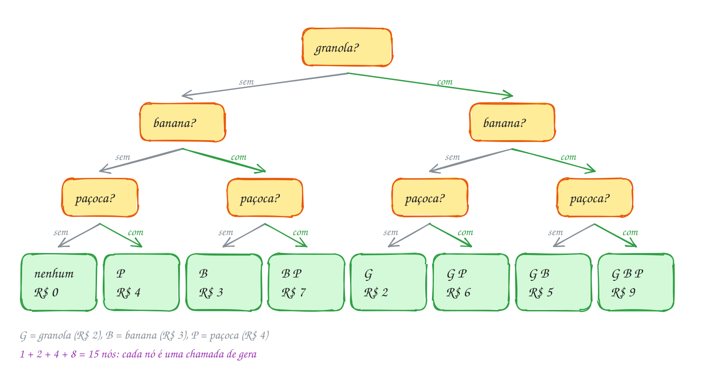</p>

O programa segue a árvore da esquerda para a direita e conta as chamadas:

```c
#include <stdio.h>

#define N 3

const char *nomes[N] = {"granola", "banana", "paçoca"};
const int precos[N] = {2, 3, 4}; // reais

int cesta[N];       // índices dos itens escolhidos até agora
int chamadas = 0;

// decide o item i; os k primeiros lugares da cesta já estão ocupados
void gera(int i, int k) {
    chamadas++;
    if (i == N) {                       // decidiu todos: mostra a cesta
        int total = 0;
        printf("{");
        for (int j = 0; j < k; j++) {
            printf(j == 0 ? "%s" : ", %s", nomes[cesta[j]]);
            total += precos[cesta[j]];
        }
        printf("} R$ %d\n", total);
        return;
    }
    gera(i + 1, k);                     // caminho 1: sem o item i
    cesta[k] = i;                       // caminho 2: com o item i
    gera(i + 1, k + 1);
}

int main(void) {
    gera(0, 0);
    printf("%d chamadas\n", chamadas);
    return 0;
}
// Saída:
// {} R$ 0
// {paçoca} R$ 4
// {banana} R$ 3
// {banana, paçoca} R$ 7
// {granola} R$ 2
// {granola, paçoca} R$ 6
// {granola, banana} R$ 5
// {granola, banana, paçoca} R$ 9
// 15 chamadas
```

Por que 15 chamadas? A árvore tem 1 + 2 + 4 + 8 = 15 nós, e cada nó é uma
chamada de `gera`. Em geral, são 2ⁿ⁺¹ - 1 chamadas e 2ⁿ folhas. Cada folha
ainda gasta até `n` passos para mostrar a cesta, então o custo total é
**O(n · 2ⁿ)**. Com 20 itens já são mais de um milhão de subconjuntos; com 40,
mais de um trilhão. Enumerar tudo só serve para `n` pequeno.

Repara no fluxograma: não há laço nenhum. Quem "repete" é a recursão, que
chama `gera` duas vezes por nó, uma por caminho:

<p align="center">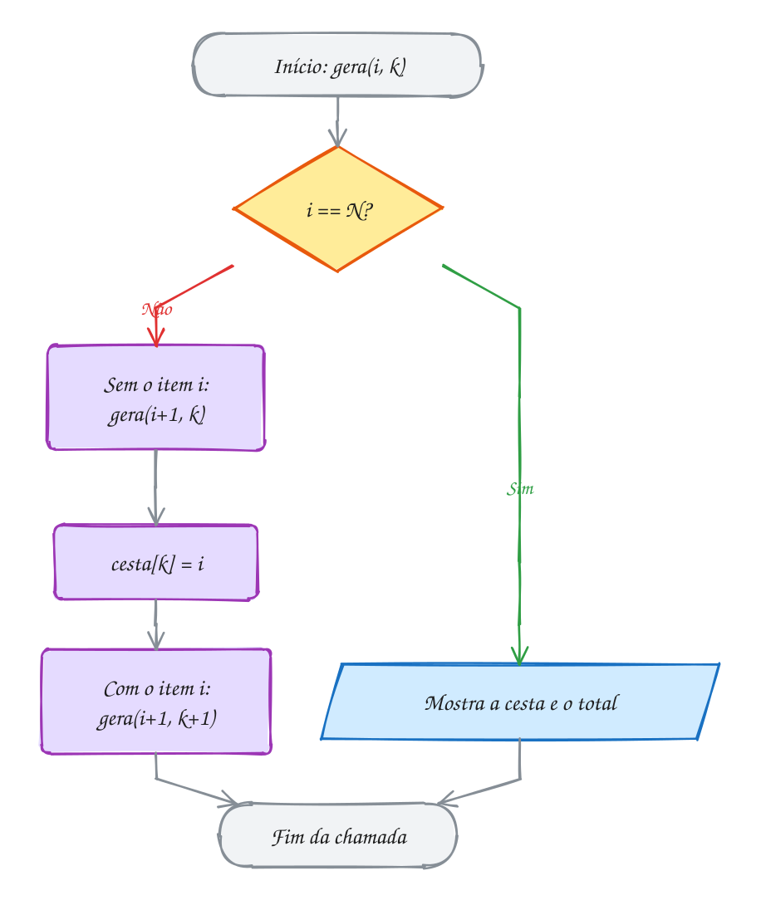</p>

> [!WARNING]
> No jeito por bits, o erro clássico é testar `if ((m & (1 << i)) == 1)`. A
> conta `m & (1 << i)` não dá 1 quando o bit está ligado: dá o próprio
> `1 << i`, que vale 1, 2, 4, 8... Com `== 1`, só o item 0 é reconhecido e os
> outros nunca entram. Teste só se o resultado é diferente de zero:
> `if (m & (1 << i))`. E sem os parênteses, `m & 1 << i == 1` nem faz o que
> parece, porque o `==` é feito antes do `&`.

> [!TIP]
> **Por dentro do C:** a pilha de chamadas nunca passa de `n + 1` frames
> (aqui, 4), mesmo com 15 chamadas no total: a recursão desce, volta e desce
> de novo pelo mesmo espaço. O vetor `cesta` é global e um só para todo mundo;
> o que muda de frame para frame é o `k`, guardado em cada frame. Depois de
> voltar, os lugares de `cesta` a partir de `k` ficam com lixo das escolhas
> antigas, e tudo bem: ninguém lê além de `k`, e a próxima escolha escreve por
> cima. No jeito por bits, `1 << i` com `int` só vale até `i = 30`; para mais
> itens, use `unsigned long long` e `1ULL << i`.

> [!NOTE]
> **Pergunta para você:** se a moça acrescentar um quarto complemento, leite
> em pó (R$ 1), no fim da lista, quantas linhas o programa mostra e quantas
> chamadas faz? Qual é a segunda linha da saída?

### Hora de praticar

Os arquivos ficam em [`0125-subconjuntos/`](0125-subconjuntos/). Os comandos funcionam de qualquer pasta do terminal. Nos exemplos, rode, mude, quebre e rode de novo. Nos exercícios, a resposta vai dentro do próprio arquivo. ★☆☆ é aquecimento, ★★☆ pede raciocínio e ★★★ é desafio.

**Exemplo A249 · Quem vai na carona: subconjuntos pelos bits**

```c
#include <stdio.h>

#define N 4

int main(void) {
    const char *amigos[N] = {"Ana", "Beto", "Caio", "Duda"};
    int cabem = 0; // grupos que cabem no carro (até 3 caronas)

    // cada número de 0 a 15 é um grupo: o bit i ligado = o amigo i vai
    // (o bit 0, da Ana, é o último dígito da direita)
    for (int m = 0; m < (1 << N); m++) {
        int pessoas = 0;
        printf("%2d = ", m);
        for (int b = N - 1; b >= 0; b--) {
            printf("%d", (m >> b) & 1);   // o número em binário, bit 3 primeiro
        }
        printf(":");
        for (int i = 0; i < N; i++) {
            if (m & (1 << i)) {           // diferente de zero = bit ligado
                printf(" %s", amigos[i]);
                pessoas++;
            }
        }
        if (pessoas == 0) {
            printf(" ninguém");
        }
        if (pessoas <= 3) {
            cabem++;
        }
        printf("\n");
    }
    printf("%d grupos possíveis, %d cabem no carro\n", 1 << N, cabem);
    return 0;
}
// Saída:
//  0 = 0000: ninguém
//  1 = 0001: Ana
//  2 = 0010: Beto
//  3 = 0011: Ana Beto
//  4 = 0100: Caio
//  5 = 0101: Ana Caio
//  6 = 0110: Beto Caio
//  7 = 0111: Ana Beto Caio
//  8 = 1000: Duda
//  9 = 1001: Ana Duda
// 10 = 1010: Beto Duda
// 11 = 1011: Ana Beto Duda
// 12 = 1100: Caio Duda
// 13 = 1101: Ana Caio Duda
// 14 = 1110: Beto Caio Duda
// 15 = 1111: Ana Beto Caio Duda
// 16 grupos possíveis, 15 cabem no carro
```

```bash
~/LPEDC/rodar 19-backtracking/0125-subconjuntos/A249.c
```

**Exemplo A250 · Dois sabores na casquinha: só os subconjuntos de tamanho k**

```c
#include <stdio.h>

#define N 5
#define K 2

const char *sabores[N] = {"açaí", "coco", "limão", "manga", "uva"};
int escolha[K];
int total = 0;

// escolhe o sabor da posição pos da casquinha, a partir do sabor inicio
void combina(int pos, int inicio) {
    if (pos == K) {
        total++;
        printf("%2d: %s + %s\n", total, sabores[escolha[0]], sabores[escolha[1]]);
        return;
    }
    // só sabores depois do último escolhido: "coco + açaí" não aparece,
    // porque é a mesma casquinha que "açaí + coco"
    for (int s = inicio; s < N; s++) {
        escolha[pos] = s;
        combina(pos + 1, s + 1);
    }
}

int main(void) {
    combina(0, 0);
    printf("C(%d, %d) = %d casquinhas\n", N, K, total);
    return 0;
}
// Saída:
//  1: açaí + coco
//  2: açaí + limão
//  3: açaí + manga
//  4: açaí + uva
//  5: coco + limão
//  6: coco + manga
//  7: coco + uva
//  8: limão + manga
//  9: limão + uva
// 10: manga + uva
// C(5, 2) = 10 casquinhas
```

```bash
~/LPEDC/rodar 19-backtracking/0125-subconjuntos/A250.c
```

#### Exercícios

**Exercício E745** · ★☆☆

O restaurante por quilo do trabalho tem uma marmita fixa (a carne) e três
acompanhamentos opcionais: arroz, feijão e salada. Escreva do zero um
programa que mostre todas as marmitas possíveis contando m de 0 a 7 e lendo
os bits de m (bit 0 = arroz, bit 1 = feijão, bit 2 = salada), sem recursão.


```text
Saída esperada:
0: só a carne
1: arroz
2: feijão
3: arroz feijão
4: salada
5: arroz salada
6: feijão salada
7: arroz feijão salada
```

**Dicas:**

1. Com 3 itens, o laço de fora vai de 0 até (1 << 3) - 1.
2. O item i entra quando m & (1 << i) é diferente de zero.
3. Use uma variável para saber se algum item entrou; se nenhum entrou,
   escreva "só a carne".
4. Resposta esperada: as 8 linhas acima.

```bash
~/LPEDC/rodar 19-backtracking/0125-subconjuntos/E745.c
```

**Exercício E746** · ★☆☆

No bolso há três moedas: R$ 1,00, R$ 0,50 e R$ 0,25. O programa abaixo
quer mostrar todos os valores que dá para pagar escolhendo um subconjunto
delas. Ele usa um vetor de bool, pega[i], em vez da cesta do texto, e
decide o caminho "com a moeda" ANTES do caminho "sem a moeda". Complete a
função gera nos pontos marcados (quatro linhas).


```text
Saída esperada:
R$ 1.75: 100 50 25
R$ 1.50: 100 50
R$ 1.25: 100 25
R$ 1.00: 100
R$ 0.75: 50 25
R$ 0.50: 50
R$ 0.25: 25
R$ 0.00:
```

**Dicas:**

1. Caminho 1: marque pega[i] como true e chame gera(i + 1).
2. Caminho 2: marque pega[i] como false e chame gera(i + 1) de novo.
3. Com o "com" primeiro, a ordem sai do maior valor para o menor. Por
   quê? Pense na moeda de 100: todas as escolhas com ela vêm antes.
4. Resposta esperada: as 8 linhas acima.

```bash
~/LPEDC/rodar 19-backtracking/0125-subconjuntos/E746.c
```

**Exercício E747** · ★★☆

Você tem R$ 30 de crédito na barraca da feira e quer gastar o valor exato.
Os produtos são:


```text
queijo 12   café 7   carne 18   pão 5   frutas 9   frango 14
```


Escreva um programa que teste TODOS os 64 subconjuntos (pelos bits, com
m de 0 a 63, bit 0 = queijo) e mostre os que somam exatamente 30, um por
linha, e no fim quantos são.


```text
Saída esperada:
queijo carne
café carne pão
café frutas frango
3 combinações de 64
```

**Dicas:**

1. Para cada m, some os preços dos itens cujo bit está ligado. Só depois
   de somar decida se a linha aparece.
2. Guarde os nomes e os preços em dois vetores paralelos (ou num vetor de
   structs, assunto 0061).
3. Repare que muitos subconjuntos passam de 30 logo nos primeiros itens e
   mesmo assim são somados até o fim. No assunto 0127 você vai cortar
   esse desperdício.
4. Resposta esperada: as 4 linhas acima.

```bash
~/LPEDC/rodar 19-backtracking/0125-subconjuntos/E747.c
```

**Exercício E748** · ★★☆

Uma tia doou seis brinquedos para os sobrinhos Ana e Beto dividirem:


```text
bicicleta R$ 500   patinete R$ 300   skate R$ 250
patins R$ 200      bola R$ 150       livro R$ 100
```


O programa abaixo já mostra TODAS as 64 divisões: cada subconjunto vai
para a Ana e o resto (o complemento) vai para o Beto. Rode e veja. Depois
estenda o programa para mostrar só as divisões JUSTAS (os dois recebem o
mesmo valor) e, no fim, quantas são. Para não mostrar a mesma divisão duas
vezes (com os nomes trocados), mostre só as que dão a bicicleta para a Ana.


```text
Saída esperada:
Ana: bicicleta skate | Beto: patinete patins bola livro
Ana: bicicleta bola livro | Beto: patinete skate patins
2 divisões justas
```

**Dicas:**

1. O total dos seis é R$ 1500, então cada um precisa de R$ 750.
2. Na folha da recursão (i == N), some o valor da Ana antes de mostrar.
   Se não der 750, ou se da_ana[0] for false, volte sem mostrar.
3. Use um contador global para o total de divisões justas.
4. Resposta esperada: as 3 linhas acima.

```bash
~/LPEDC/rodar 19-backtracking/0125-subconjuntos/E748.c
```

**Exercício E749** · ★★★

Ache o bug. A pizzaria cobra à parte quatro adicionais: bacon (R$ 6),
cheddar (R$ 4), catupiry (R$ 5) e cebola (R$ 2). O programa abaixo devia
listar todas as combinações de adicionais que custam no máximo R$ 10 e
contá-las. Ele compila sem aviso e roda, mas a lista sai errada: aparecem
as 16 combinações, quase todas de graça. Ache a linha com erro, conserte e
rode de novo.


```text
Saída esperada:
R$ 0: nenhum
R$ 6: bacon
R$ 4: cheddar
R$ 10: bacon cheddar
R$ 5: catupiry
R$ 9: cheddar catupiry
R$ 2: cebola
R$ 8: bacon cebola
R$ 6: cheddar cebola
R$ 7: catupiry cebola
10 combinações até R$ 10
```

**Dicas:**

1. Acrescente um printf que mostre m & (1 << i) para m = 6. Quais valores
   aparecem quando o bit está ligado?
2. O resultado de m & (1 << i) é 0 ou o próprio 1 << i (1, 2, 4 ou 8).
   Ele só vale 1 para o bit 0.
3. Resposta esperada: o teste certo é if (m & (1 << i)), sem o == 1. Com
   ele consertado, a saída é a de cima.

```bash
~/LPEDC/rodar 19-backtracking/0125-subconjuntos/E749.c
```

**Exercício E750** · ★★★

O pisca-pisca da varanda tem 3 lâmpadas, cada uma com seu interruptor, e
você quer testar as 8 combinações de lâmpadas acesas. Contar 000, 001,
010, 011... obriga a mexer em vários interruptores de uma vez (de 011
para 100 são três). Escreva do zero um programa que percorra as 8
combinações mexendo em UM interruptor por vez (o código de Gray), mostre
o estado (lâmpada 2 à esquerda, lâmpada 0 à direita) e diga qual
lâmpada mudou.


```text
Saída esperada:
000 começo, tudo apagado
001 liga a lâmpada 0
011 liga a lâmpada 1
010 desliga a lâmpada 0
110 liga a lâmpada 2
111 liga a lâmpada 0
101 desliga a lâmpada 1
100 desliga a lâmpada 0
```

**Dicas:**

1. O m-ésimo estado do código de Gray é g = m ^ (m >> 1). Confira no
   papel para m = 0 a 7.
2. O bit que mudou é o único ligado em anterior ^ g. Ache qual é com um
   laço que testa cada bit (assunto 0065).
3. Se o bit mudou e agora está ligado em g, a lâmpada acendeu; senão,
   apagou.
4. Resposta esperada: as 8 linhas acima. Repare que também é uma
   enumeração de todos os subconjuntos de {0, 1, 2}, só que em outra ordem.

```bash
~/LPEDC/rodar 19-backtracking/0125-subconjuntos/E750.c
```

---

## 0126 · Permutações

Sarau na praça. Três grupos confirmaram, um de rap, um de samba e um de
forró, e a organização precisa decidir a ordem das apresentações. Antes de
votar, alguém pede a lista de todas as ordens possíveis.

Para a primeira apresentação há 3 escolhas. Escolhida a primeira, sobram 2
para a segunda, e a última fica com quem sobrou: 3 × 2 × 1 = **6** ordens.
Cada ordem é uma **permutação** dos três grupos, e com `n` elementos há
**n!** permutações (fatorial de `n`).

A recursão gera todas decidindo **uma posição por vez**. A função
`permuta(v, i)` sabe que as posições `0..i-1` já estão decididas e cuida da
posição `i`. Quem pode ir para lá? Qualquer elemento ainda não usado, e os não
usados são justamente os que estão em `v[i..n-1]`. Então, para cada `j` de `i`
até `n - 1`:

1. **escolhe**: troca `v[i]` com `v[j]`, levando o candidato para a posição `i`;
2. **desce**: chama `permuta(v, i + 1)` para decidir o resto;
3. **desfaz**: troca `v[i]` com `v[j]` de novo, devolvendo o vetor como
   estava antes da escolha.

O passo 3 é o que separa a enumeração que funciona da que não funciona. No
assunto anterior, a escolha se desfazia sozinha porque morava num parâmetro.
Aqui a escolha mexe no **vetor**, que é um só para todas as chamadas. Se a
chamada não arrumar a bagunça antes de voltar, a próxima volta do laço de quem
a chamou parte de um vetor diferente do que esperava.

Quando `i` chega a `n`, todas as posições estão decididas: é hora de mostrar a
ordem.

Vamos ver na prática. No primeiro nível, cada ramo leva um grupo diferente
para a frente da fila. No segundo, o mesmo para a segunda posição. As 6 folhas
são as 6 ordens, na ordem em que o programa mostra:

<p align="center">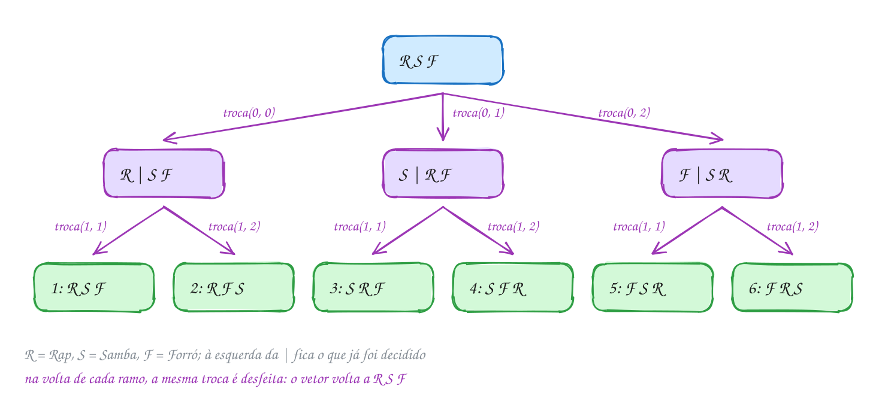</p>

O vetor guarda ponteiros para os nomes (assunto 0048). Trocar dois elementos
é trocar dois ponteiros: os textos não saem do lugar.

```c
#include <stdio.h>

#define N 3

int ordens = 0;

void troca(const char **a, const char **b) {
    const char *t = *a;   // troca só os ponteiros, não as letras
    *a = *b;
    *b = t;
}

// as posições 0..i-1 já estão decididas; decide a posição i
void permuta(const char *v[], int i) {
    if (i == N) {
        ordens++;
        printf("%d: %s, %s, %s\n", ordens, v[0], v[1], v[2]);
        return;
    }
    for (int j = i; j < N; j++) {
        troca(&v[i], &v[j]);    // escolhe: v[j] vai para a posição i
        permuta(v, i + 1);      // decide o resto
        troca(&v[i], &v[j]);    // desfaz: devolve o vetor como estava
    }
}

int main(void) {
    const char *shows[N] = {"Rap", "Samba", "Forró"};
    permuta(shows, 0);
    printf("%d ordens; no fim: %s, %s, %s\n", ordens, shows[0], shows[1], shows[2]);
    return 0;
}
// Saída:
// 1: Rap, Samba, Forró
// 2: Rap, Forró, Samba
// 3: Samba, Rap, Forró
// 4: Samba, Forró, Rap
// 5: Forró, Samba, Rap
// 6: Forró, Rap, Samba
// 6 ordens; no fim: Rap, Samba, Forró
```

Repara na última linha: depois de tudo, o vetor voltou a ser
`Rap, Samba, Forró`. É a prova de que cada chamada desfez o que fez. Repara
também nas linhas 5 e 6: a troca de `Rap` com `Forró` deixou o `Samba` no
meio, então a ordem que sai **não** é a alfabética nem a "de dicionário".
Quem precisa dessa ordem usa outro jeito (exemplo A251).

Repara no fluxograma: o laço do `j` é o que abre os ramos, e cada volta dele
tem o par troca e destroca em volta da chamada recursiva:

<p align="center">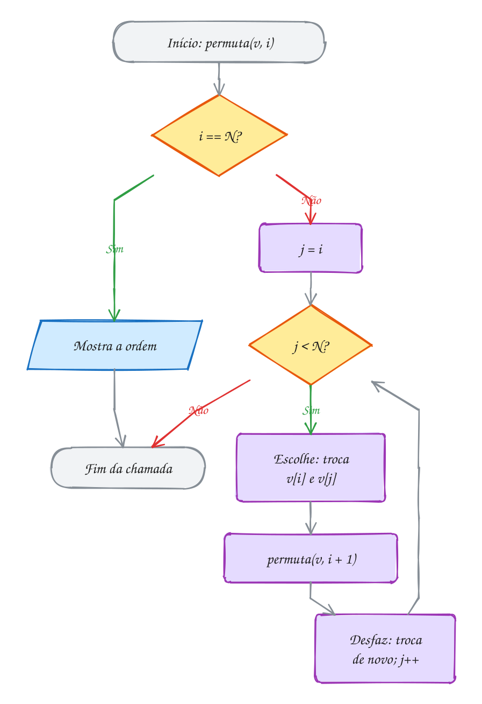</p>

> [!WARNING]
> Esquecer o **desfaz** é o erro clássico. Sem a segunda troca, este mesmo
> programa mostra `Rap, Samba, Forró` e `Rap, Forró, Samba` duas vezes cada, e
> o `Samba` nunca abre o sarau: ainda saem 6 linhas, só que erradas, e no fim o
> vetor fica `Rap, Forró, Samba`. Toda alteração feita antes da chamada
> recursiva precisa ser desfeita depois dela, na ordem inversa.

> [!TIP]
> **Por dentro do C:** a recursão desce só `n + 1` níveis, mas o número de
> folhas é `n!`, e cada folha gasta `n` passos para mostrar: o custo é
> **O(n · n!)**, pior que os 2ⁿ dos subconjuntos. 10! já passa de 3,6 milhões,
> 13! (6.227.020.800) não cabe num `int` de 32 bits, e 20! fica perto de
> 2,4 · 10¹⁸, no limite de um `long long`. Trocar ponteiros é barato: 8 bytes
> por elemento, não importa o tamanho do nome. Trocar structs grandes ou
> strings inteiras com `strcpy` custaria muito mais em cada uma das `n!`
> folhas.

> [!NOTE]
> **Pergunta para você:** com um quarto grupo, de pagode, no fim do vetor,
> quantas linhas saem? Qual grupo abre o sarau na linha 7? E na linha 19?

### Hora de praticar

Os arquivos ficam em [`0126-permutacoes/`](0126-permutacoes/). Os comandos funcionam de qualquer pasta do terminal. Nos exemplos, rode, mude, quebre e rode de novo. Nos exercícios, a resposta vai dentro do próprio arquivo. ★☆☆ é aquecimento, ★★☆ pede raciocínio e ★★★ é desafio.

**Exemplo A251 · Os anagramas de AMOR em ordem de dicionário**

```c
#include <stdbool.h>
#include <stdio.h>

#define N 4

const char letras[N + 1] = "AMOR"; // já em ordem alfabética
char palavra[N + 1];               // a permutação sendo montada
bool usada[N];                     // usada[k]: a letra k já está na palavra?
int total = 0;

// em vez de trocar, escolhe para a posição pos a primeira letra livre,
// sempre da esquerda para a direita: a saída sai em ordem de dicionário
void anagramas(int pos) {
    if (pos == N) {
        palavra[N] = '\0';
        total++;
        printf("%s%s", palavra, total % 6 == 0 ? "\n" : " ");
        return;
    }
    for (int k = 0; k < N; k++) {
        if (usada[k]) {
            continue;              // essa letra já foi usada antes
        }
        usada[k] = true;           // escolhe
        palavra[pos] = letras[k];
        anagramas(pos + 1);        // desce
        usada[k] = false;          // desfaz (palavra[pos] é sobrescrita depois)
    }
}

int main(void) {
    anagramas(0);
    printf("%d anagramas\n", total);
    return 0;
}
// Saída:
// AMOR AMRO AOMR AORM ARMO AROM
// MAOR MARO MOAR MORA MRAO MROA
// OAMR OARM OMAR OMRA ORAM ORMA
// RAMO RAOM RMAO RMOA ROAM ROMA
// 24 anagramas
```

```bash
~/LPEDC/rodar 19-backtracking/0126-permutacoes/A251.c
```

**Exemplo A252 · ARARA: anagramas sem repetir quando há letras iguais**

```c
#include <stdio.h>
#include <string.h>

#define MAX 16

int conta[26];      // quantas de cada letra ainda estão disponíveis
char palavra[MAX];
int n, total = 0;

// em cada posição, tenta cada LETRA diferente uma vez só (e não cada
// cópia dela): assim os dois R de ARARA nunca geram anagramas repetidos
void gera(int pos) {
    if (pos == n) {
        palavra[n] = '\0';
        total++;
        printf("%2d: %s\n", total, palavra);
        return;
    }
    for (int c = 0; c < 26; c++) {
        if (conta[c] == 0) {
            continue;
        }
        conta[c]--;                 // escolhe uma letra c
        palavra[pos] = (char)('A' + c);
        gera(pos + 1);
        conta[c]++;                 // desfaz: devolve a letra
    }
}

int main(void) {
    const char *origem = "ARARA";
    n = (int)strlen(origem);
    for (int i = 0; i < n; i++) {
        conta[origem[i] - 'A']++;   // A: 3, R: 2
    }
    gera(0);
    // 5! / (3! · 2!) = 120 / 12 = 10: trocar os A entre si ou os R entre si
    // não muda a palavra
    printf("5! = 120 ordens das letras, mas só %d anagramas diferentes\n", total);
    return 0;
}
// Saída:
//  1: AAARR
//  2: AARAR
//  3: AARRA
//  4: ARAAR
//  5: ARARA
//  6: ARRAA
//  7: RAAAR
//  8: RAARA
//  9: RARAA
// 10: RRAAA
// 5! = 120 ordens das letras, mas só 10 anagramas diferentes
```

```bash
~/LPEDC/rodar 19-backtracking/0126-permutacoes/A252.c
```

#### Exercícios

**Exercício E751** · ★☆☆

Você esqueceu a senha de 3 dígitos do cadeado da mochila. Lembra só que
ela usa os dígitos 4, 7 e 9, cada um uma vez. Escreva do zero um programa
que gere todas as senhas possíveis com a recursão por trocas do texto
(troca, desce, desfaz), mostre cada uma como um número inteiro e, no fim,
a soma de todas (para conferir que nenhuma faltou nem repetiu).


```text
Saída esperada:
479
497
749
794
974
947
soma: 4440
```

**Dicas:**

1. Guarde os dígitos num vetor de int: {4, 7, 9}. A troca é a de int do
   assunto 0046.
2. Na folha, monte o número com numero = numero * 10 + v[k].
3. Por que 4440? Cada dígito aparece 2 vezes em cada casa: (4 + 7 + 9)
   × 2 × 111.
4. Resposta esperada: as 7 linhas acima.

```bash
~/LPEDC/rodar 19-backtracking/0126-permutacoes/E751.c
```

**Exercício E752** · ★☆☆

Lia, Max e Nina vão tirar uma foto lado a lado e querem ver todas as
ordens possíveis. O programa abaixo usa o vetor usado[] (como no exemplo
A251) em vez de trocas, mas faltam três linhas dentro do laço: marcar a
pessoa como usada, colocá-la na posição pos da foto e desmarcar depois da
chamada recursiva. Complete.


```text
Saída esperada:
Lia Max Nina
Lia Nina Max
Max Lia Nina
Max Nina Lia
Nina Lia Max
Nina Max Lia
```

**Dicas:**

1. A posição pos da foto guarda o ÍNDICE da pessoa: foto[pos] = p.
2. Marque usado[p] = true antes de chamar fotos(pos + 1) e volte para
   false depois. Se esquecer de desmarcar, só a primeira linha aparece.
3. Resposta esperada: as 6 linhas acima (repare que, ao contrário das
   trocas do texto, esta saída está em ordem alfabética).

```bash
~/LPEDC/rodar 19-backtracking/0126-permutacoes/E752.c
```

**Exercício E753** · ★★☆

O motoboy sai da pizzaria (local 0), entrega em quatro bairros (1 a 4) e
volta para a pizzaria. A matriz dist (em km, já no programa) diz a
distância entre cada par de locais. Gere todas as 4! = 24 ordens de
entrega, calcule o percurso de cada uma (ida, entregas e volta) e mostre a
menor distância e a PRIMEIRA ordem, na ordem em que a sua recursão gera,
que a atinge.


```text
Saída esperada:
24 rotas testadas
menor: 16 km
rota: Pizzaria -> Lagoa -> Centro -> Jardim -> Vila -> Pizzaria
```

**Dicas:**

1. Permute o vetor {1, 2, 3, 4} com trocas, como no texto. Na folha, some
   dist[0][v[0]], depois dist[v[k]][v[k + 1]] e, no fim, dist[v[3]][0].
2. Guarde a melhor rota num segundo vetor, copiando v quando achar uma
   distância MENOR (estritamente) que a melhor até agora.
3. A rota de trás para frente (Vila, Jardim, Centro, Lagoa) também dá
   16 km, mas aparece depois. Por que toda rota empata com a inversa?
4. Resposta esperada: as 3 linhas acima. Este é o problema do caixeiro
   viajante: com 15 bairros seriam mais de um trilhão de ordens.

```bash
~/LPEDC/rodar 19-backtracking/0126-permutacoes/E753.c
```

**Exercício E754** · ★★☆

Cinco atletas correm a final: Ana, Bia, Cris, Dani e Edu. O programa abaixo
conta todas as ordens de chegada (5! = 120). Mas a premiação só liga para
o PÓDIO: ouro, prata e bronze, nessa ordem. Estenda o programa para contar
os pódios possíveis e quantos deles têm a Bia (em qualquer dos três
lugares). Não gere as 120 ordens e depois filtre: pare a recursão quando
as 3 primeiras posições estiverem decididas.


```text
Saída esperada:
120 ordens de chegada
60 pódios possíveis
Bia aparece em 36
```

**Dicas:**

1. Escreva uma segunda função, podios(v, i), igual a ordens, mas com a
   folha em i == 3 em vez de i == N. Isso é um ARRANJO: 5 × 4 × 3 = 60.
2. Na folha, olhe só v[0], v[1] e v[2] para saber se a Bia está lá.
3. Confira a conta: pódios sem a Bia são 4 × 3 × 2 = 24, e 60 - 24 = 36.
4. Resposta esperada: as 3 linhas acima.

```bash
~/LPEDC/rodar 19-backtracking/0126-permutacoes/E754.c
```

**Exercício E755** · ★★★

Ache o bug. Um mágico quer listar todas as ordens das cartas A, 2, 3 e 4
para ensaiar um truque. Devem sair 4! = 24 ordens, todas diferentes, seis
por linha. O programa compila sem aviso e roda, mas mostra menos ordens do
que devia. O erro está numa linha só. Ache, conserte e rode de novo.


```text
Saída esperada:
A234 A243 A324 A342 A432 A423
2A34 2A43 23A4 234A 243A 24A3
32A4 324A 3A24 3A42 34A2 342A
423A 42A3 432A 43A2 4A32 4A23
24 ordens
```

**Dicas:**

1. Acrescente um printf no começo de embaralha mostrando i. Algum nível é
   pulado?
2. A chamada recursiva decide a PRÓXIMA posição. Depois de escolher quem
   fica na posição i, a próxima é a i + 1, não importa de onde veio a
   carta escolhida.
3. Resposta esperada: a chamada era embaralha(v, j + 1); o certo é
   embaralha(v, i + 1). Com o erro saem só 8 ordens.

```bash
~/LPEDC/rodar 19-backtracking/0126-permutacoes/E755.c
```

**Exercício E756** · ★★★

Às vezes você não quer TODAS as permutações de uma vez, só a próxima
depois de uma dada, em ordem de dicionário. Escreva do zero a função


```text
bool proxima(int v[], int n)
```


que transforma v na permutação seguinte e devolve true, ou devolve false
se v já é a última (em ordem decrescente). Sem recursão. Depois use-a para
listar as permutações de {1, 2, 3} e teste os dois casos abaixo.


```text
Saída esperada:
1 2 3
1 3 2
2 1 3
2 3 1
3 1 2
3 2 1
depois de 1 3 5 4 2 vem 1 4 2 3 5
5 4 3 2 1 é a última
```

**Dicas:**

1. Ande da direita para a esquerda e ache o maior i com v[i] < v[i + 1]
   (o "pivô"). Se não existe, v é a última. Em 1 3 5 4 2, o pivô é o 3.
2. Ache o maior j > i com v[j] > v[i] (o 4), troque v[i] com v[j] e
   inverta o trecho v[i + 1..n - 1]: 1 4 5 3 2 vira 1 4 2 3 5.
3. Para listar todas: comece da ordem crescente e use
   do { mostra(v); } while (proxima(v, n));
4. Resposta esperada: as 8 linhas acima.

```bash
~/LPEDC/rodar 19-backtracking/0126-permutacoes/E756.c
```

---

## 0127 · Backtracking

Você ganhou um cartão-presente de R$ 35 da livraria do bairro, e o cartão não
dá troco: ou você gasta o valor exato, ou o resto fica perdido. Na vitrine há
um atlas (R$ 30), um mangá (R$ 20), um livro de poesia (R$ 15) e um marcador
de página (R$ 5). Que combinações fecham exatamente R$ 35?

Dá para resolver com o assunto 0125: gerar os 2⁴ = 16 subconjuntos, somar
cada um e ficar com os que dão 35. Só que isso desperdiça trabalho. Escolheu o
atlas e o mangá? Já são R$ 50. Nenhum subconjunto que comece assim pode dar
certo, e mesmo assim a enumeração cega vai até o fim de cada um deles.

O **backtracking** (retrocesso) é a enumeração que **desiste cedo**. Ela
constrói a solução uma escolha por vez, como antes. Mas, a cada passo,
pergunta: "este começo ainda pode virar uma solução?". Se não pode, ela nem
desce: volta um passo e tenta a próxima opção. Cortar um galho inteiro da
árvore de decisões assim se chama **poda**.

O esqueleto é sempre o mesmo, e você já viu as três primeiras partes:

1. **caso de parada**: a solução está completa? Mostre (ou conte) e volte;
2. **poda**: o começo já é inviável? Volte sem descer;
3. **escolha**: para cada opção, escolha, desça e **desfaça**.

Neste problema, a poda é simples: os preços são positivos, então se a soma
**passou** de 35, acrescentar mais itens só piora. E quando a soma bate
**exatamente** 35, também não precisa descer: os próximos itens só poderiam
entrar com a soma passando de 35.

Vamos ver na prática. Cada caixa da árvore mostra a soma até ali. O galho da
esquerda leva o item do nível, o da direita não leva. As caixas vermelhas são
podas, as verdes são soluções e as cinzas são becos sem saída (os itens
acabaram antes de a soma chegar a 35):

<p align="center">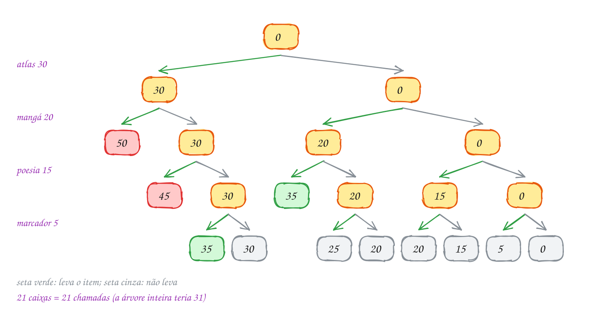</p>

No código, a poda é o primeiro `if` da função. A chamada que passou do alvo
começa, percebe o problema e volta na hora:

```c
#include <stdbool.h>
#include <stdio.h>

#define N 4
#define ALVO 35

const char *itens[N] = {"atlas", "mangá", "poesia", "marcador"};
const int precos[N] = {30, 20, 15, 5}; // reais
bool leva[N];
int chamadas = 0;

// já decidiu os itens 0..i-1, que somam soma reais
void tenta(int i, int soma) {
    chamadas++;
    if (soma > ALVO) {
        return;                         // poda: passou, nada abaixo serve
    }
    if (soma == ALVO) {                 // fechou: mostra e não desce mais
        printf("R$ %d:", soma);
        for (int j = 0; j < i; j++) {
            if (leva[j]) {
                printf(" %s", itens[j]);
            }
        }
        printf("\n");
        return;
    }
    if (i == N) {
        return;                         // acabaram os itens sem fechar
    }
    leva[i] = true;                     // tenta com o item i
    tenta(i + 1, soma + precos[i]);
    leva[i] = false;                    // volta e tenta sem ele
    tenta(i + 1, soma);
}

int main(void) {
    tenta(0, 0);
    printf("%d chamadas (sem poda seriam 31)\n", chamadas);
    return 0;
}
// Saída:
// R$ 35: atlas marcador
// R$ 35: mangá poesia
// 21 chamadas (sem poda seriam 31)
```

A árvore completa de 4 itens tem 1 + 2 + 4 + 8 + 16 = 31 nós. A poda deixou
21. Parece pouco, mas o efeito cresce com o tamanho: cada poda perto da raiz
corta um galho com metade da árvore. Com 30 itens e um alvo pequeno, a
diferença é entre um bilhão de chamadas e alguns milhares.

Repara no fluxograma: as duas perguntas de cima mandam embora cedo, e só quem
passa por elas chega às duas chamadas recursivas:

<p align="center">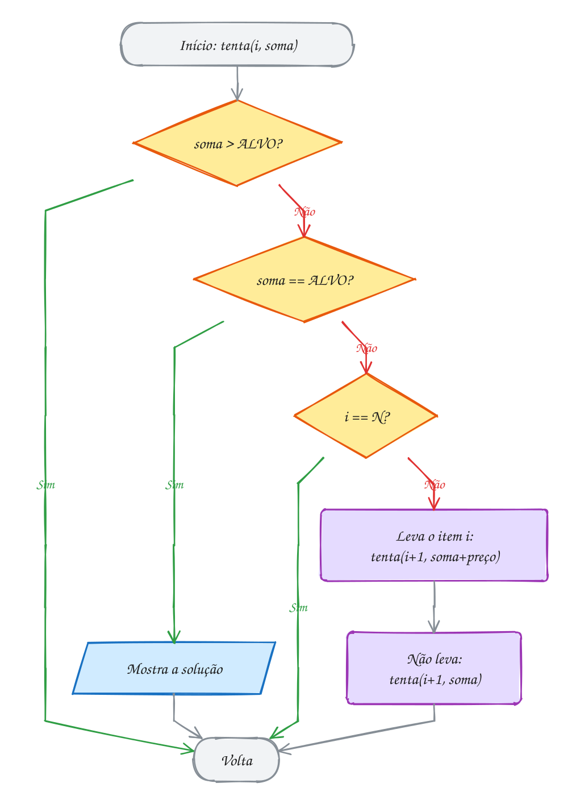</p>

> [!WARNING]
> A ordem dos testes importa. Se o `if (i == N) return;` viesse **antes** do
> `if (soma == ALVO)`, a solução que fecha justo com o último item
> (`atlas marcador`, que chega a 35 com `i` valendo 4) seria descartada como
> "acabaram os itens", e só `mangá poesia` apareceria. Outro clássico é
> escrever a poda com `>=` no lugar de `>`: aí toda soma que bate o alvo é
> cortada antes de ser mostrada, e a saída fica vazia. A poda só pode cortar
> o que **com certeza** não leva a solução. Uma poda gananciosa demais deixa o
> programa rápido e errado.

> [!TIP]
> **Por dentro do C:** a soma viaja como **parâmetro**, então cada frame tem a
> sua e voltar desfaz a soma de graça. Já `leva[]` é global e um só: por isso
> a linha `leva[i] = false` antes do segundo caminho. O vetor ocupa `N` bytes
> e a pilha nunca passa de `N + 1` frames, mesmo quando as chamadas somam
> milhões. O custo no pior caso continua **O(2ⁿ)**: a poda não muda a ordem
> de grandeza garantida, muda o quanto da árvore você visita na prática. E
> repara que ordenar os preços do maior para o menor, como aqui, faz a soma
> estourar mais cedo e podar mais perto da raiz.

> [!NOTE]
> **Pergunta para você:** se o cartão fosse de R$ 50, quais combinações
> sairiam? A primeira linha da saída ainda seria a do atlas?

### Hora de praticar

Os arquivos ficam em [`0127-backtracking/`](0127-backtracking/). Os comandos funcionam de qualquer pasta do terminal. Nos exemplos, rode, mude, quebre e rode de novo. Nos exercícios, a resposta vai dentro do próprio arquivo. ★☆☆ é aquecimento, ★★☆ pede raciocínio e ★★★ é desafio.

**Exemplo A253 · Lote de 40 kg: a segunda poda, "o que falta não alcança"**

```c
#include <stdbool.h>
#include <stdio.h>

#define N 7
#define ALVO 40

const int pesos[N] = {18, 15, 12, 9, 7, 4, 2}; // caixas de doação, em kg
int resto[N + 1];   // resto[i] = soma dos pesos de i até o fim
bool leva[N];
int chamadas;

// modo 0: sem poda; 1: só "passou do alvo"; 2: as duas podas
void tenta(int i, int soma, int modo, bool mostrar) {
    chamadas++;
    if (modo >= 1 && soma > ALVO) {
        return;                       // poda 1: passou
    }
    if (modo >= 2 && soma + resto[i] < ALVO) {
        return;                       // poda 2: nem levando tudo chega
    }
    if (i == N) {
        if (soma == ALVO && mostrar) {
            printf("  40 kg:");
            for (int j = 0; j < N; j++) {
                if (leva[j]) {
                    printf(" %d", pesos[j]);
                }
            }
            printf("\n");
        }
        return;
    }
    leva[i] = true;
    tenta(i + 1, soma + pesos[i], modo, mostrar);
    leva[i] = false;
    tenta(i + 1, soma, modo, mostrar);
}

int main(void) {
    resto[N] = 0;
    for (int i = N - 1; i >= 0; i--) {
        resto[i] = resto[i + 1] + pesos[i];  // somas do fim para o começo
    }
    printf("Lotes possíveis:\n");
    tenta(0, 0, 2, true);

    const char *nomes[3] = {"sem poda", "poda 1", "podas 1 e 2"};
    for (int modo = 0; modo <= 2; modo++) {
        chamadas = 0;
        tenta(0, 0, modo, false);
        printf("%-12s %3d chamadas\n", nomes[modo], chamadas);
    }
    return 0;
}
// Saída:
// Lotes possíveis:
//   40 kg: 18 15 7
//   40 kg: 18 9 7 4 2
//   40 kg: 15 12 9 4
//   40 kg: 15 12 7 4 2
// sem poda     255 chamadas
// poda 1       193 chamadas
// podas 1 e 2   55 chamadas
```

```bash
~/LPEDC/rodar 19-backtracking/0127-backtracking/A253.c
```

**Exemplo A254 · Playlist de 30 minutos: parar na primeira solução**

```c
#include <stdbool.h>
#include <stdio.h>

#define N 7
#define ALVO 30

const char *musicas[N] = {"Aquarela", "Bossa", "Ciranda", "Dengo", "Estrada", "Frevo", "Garoa"};
const int minutos[N] = {7, 4, 9, 5, 6, 3, 8};
bool toca[N];
int chamadas = 0;

// devolve true assim que acha uma playlist; o true sobe pela pilha de
// chamadas e cada nível volta na hora, sem tentar mais nada
bool procura(int i, int soma) {
    chamadas++;
    if (soma > ALVO) {
        return false;
    }
    if (soma == ALVO) {
        return true;                    // achou: toca[0..i-1] é a resposta
    }
    if (i == N) {
        return false;
    }
    toca[i] = true;
    if (procura(i + 1, soma + minutos[i])) {
        return true;                    // não desfaz: a resposta fica em toca[]
    }
    toca[i] = false;
    return procura(i + 1, soma);
}

// a mesma busca, mas conta todas as soluções em vez de parar
int conta_todas(int i, int soma) {
    chamadas++;
    if (soma > ALVO) {
        return 0;
    }
    if (soma == ALVO) {
        return 1;
    }
    if (i == N) {
        return 0;
    }
    return conta_todas(i + 1, soma + minutos[i]) + conta_todas(i + 1, soma);
}

int main(void) {
    if (procura(0, 0)) {
        printf("Primeira playlist:");
        for (int j = 0; j < N; j++) {
            if (toca[j]) {
                printf(" %s (%d)", musicas[j], minutos[j]);
            }
        }
        printf("\nachada em %d chamadas\n", chamadas);
    }
    chamadas = 0;
    int total = conta_todas(0, 0);
    printf("todas: %d playlists, %d chamadas\n", total, chamadas);
    return 0;
}
// Saída:
// Primeira playlist: Aquarela (7) Bossa (4) Dengo (5) Estrada (6) Garoa (8)
// achada em 36 chamadas
// todas: 4 playlists, 247 chamadas
```

```bash
~/LPEDC/rodar 19-backtracking/0127-backtracking/A254.c
```

#### Exercícios

**Exercício E757** · ★☆☆

Para a trilha do fim de semana, a mochila tem que pesar exatamente 12 kg
(nem mais, para não cansar, nem menos, para não faltar nada). Os itens
pesam: barraca 7, comida 5, água 4, saco de dormir 3 e fogareiro 2. O
programa abaixo enumera todas as escolhas, mas ainda não poda nada: ele
mostra as soluções certas e faz 63 chamadas. Complete os dois testes do
começo da função tenta (a poda e a solução) para que ele faça só o
necessário.


```text
Saída esperada:
barraca comida
barraca saco fogareiro
comida água saco
45 chamadas
```

**Dicas:**

1. Primeiro teste: se soma passou de ALVO, volte.
2. Segundo teste: se soma é igual a ALVO, mostre leva[0..i-1] e volte.
   Esse teste precisa vir ANTES do if (i == N), senão "barraca saco
   fogareiro" (que fecha com o último item) se perde.
3. Quando tudo estiver certo, apague o bloco do if (i == N) que mostra a
   solução: com o seu segundo teste, ele vira só "return;".
4. Resposta esperada: as 4 linhas acima.

```bash
~/LPEDC/rodar 19-backtracking/0127-backtracking/E757.c
```

**Exercício E758** · ★☆☆

Sobrou um vão de 100 cm na estante, e você quer preenchê-lo exatamente
com caixas organizadoras. As caixas disponíveis têm larguras de 45, 35,
30, 25, 20 e 10 cm (uma de cada). Escreva do zero um backtracking que
mostre todas as combinações que dão 100 cm exatos, com a poda "passou de
100, volte", e no fim quantas são.


```text
Saída esperada:
45 35 20
45 30 25
45 25 20 10
35 30 25 10
4 combinações
```

**Dicas:**

1. Use o esqueleto do texto: tenta(i, soma), com a poda, o teste de
   solução, o teste de fim e os dois caminhos (leva e não leva).
2. Leve o item ANTES de tentar sem ele: é isso que faz o 45 aparecer
   primeiro.
3. Resposta esperada: as 5 linhas acima.

```bash
~/LPEDC/rodar 19-backtracking/0127-backtracking/E758.c
```

**Exercício E759** · ★★☆

A caminhonete do frete aguenta 100 kg e há cinco caixas para levar, com
47, 39, 28, 23 e 16 kg. Não dá para levar todas. Que caixas levar para
aproveitar ao máximo a carga, sem passar de 100 kg? Agora não existe um
alvo exato: o backtracking precisa guardar a MELHOR solução vista até o
momento. Escreva o programa do zero.


```text
Saída esperada:
melhor carga: 98 kg
caixas: 47 28 23
```

**Dicas:**

1. A poda continua: se a soma passou de 100, volte.
2. Em toda chamada que não foi podada, compare soma com a melhor até
   agora. Se for maior, guarde a soma e copie leva[0..i-1] para um vetor
   melhor[] (e zere melhor[i..N-1]).
3. Não pare quando achar uma carga boa: só no fim da busca você sabe que
   ela é a melhor.
4. Bônus: uma segunda poda corta os ramos em que soma + (tudo o que
   ainda falta decidir) não passa da melhor carga até agora.
5. Resposta esperada: as 2 linhas acima.

```bash
~/LPEDC/rodar 19-backtracking/0127-backtracking/E759.c
```

**Exercício E760** · ★★☆

Na banca, os pacotes de figurinhas vêm com quantidades diferentes: 25,
20, 15, 12, 10, 8 e 5 figurinhas (um pacote de cada). Você precisa de
exatamente 60 figurinhas para completar o álbum. O programa abaixo já
mostra todas as combinações. Estenda-o para, no fim, mostrar também a
combinação com MENOS pacotes (se houver empate, fique com a primeira
encontrada).


```text
Saída esperada:
25 20 15
25 20 10 5
25 15 12 8
25 12 10 8 5
20 15 12 8 5
menos pacotes: 25 20 15 (3 pacotes)
```

**Dicas:**

1. Passe a quantidade de pacotes escolhidos como parâmetro (k), do mesmo
   jeito que a soma: assim ela se desfaz sozinha na volta.
2. Na solução, se k for menor que o melhor até agora, copie leva[0..i-1]
   para um vetor melhor[] (e zere o resto dele).
3. Resposta esperada: as 6 linhas acima.

```bash
~/LPEDC/rodar 19-backtracking/0127-backtracking/E760.c
```

**Exercício E761** · ★★★

Ache o bug. No buffet a quilo, você quer montar um prato de sobremesas com
exatamente 500 g. As porções pesam: pudim 250 g, mousse 200 g, torta
150 g, gelatina 100 g e brigadeiro 50 g. Para economizar parâmetros, o
autor guardou a soma numa variável GLOBAL. O programa compila sem aviso e
roda, mas não mostra nenhuma combinação. Ache o erro, conserte (sem
transformar a soma em parâmetro) e rode de novo.


```text
Saída esperada:
pudim mousse brigadeiro
pudim torta gelatina
mousse torta gelatina brigadeiro
```

**Dicas:**

1. Mostre soma no começo de cada chamada. Depois de voltar do caminho
   "com o item", quanto ela vale?
2. Com a soma em parâmetro, voltar desfaz a escolha de graça. Global, ela
   é uma só para todas as chamadas: quem soma precisa subtrair na volta.
3. Resposta esperada: falta soma -= porcoes[i]; logo depois da primeira
   chamada recursiva (antes de tentar sem o item). Com isso, a saída é a
   de cima.

```bash
~/LPEDC/rodar 19-backtracking/0127-backtracking/E761.c
```

**Exercício E762** · ★★★

Desafio da revista de passatempos: coloque um sinal + ou - antes de cada
número de 2 a 7, na sequência 1 _ 2 _ 3 _ 4 _ 5 _ 6 _ 7, para que a conta
dê 10 (o 1 é sempre positivo). Escreva do zero um backtracking que mostre
todas as soluções, tentando sempre + antes de -, e conte as chamadas da
função recursiva. Use esta poda, no começo de cada chamada: se nem
somando nem subtraindo todos os números que faltam dá para chegar a 10,
volte.


```text
Saída esperada:
1+2+3-4-5+6+7 = 10
1+2-3+4+5-6+7 = 10
1-2+3+4+5+6-7 = 10
1-2-3-4+5+6+7 = 10
4 expressões, 83 chamadas
```

**Dicas:**

1. A função tenta(k, soma) decide o sinal do número k; a primeira chamada
   é tenta(2, 1). Guarde os sinais num vetor de char.
2. Os números que faltam são k, k + 1, ..., 7. Se a distância
   abs(10 - soma) for maior que a soma deles, nenhuma escolha de sinais
   fecha a conta. Pré-calcule essas somas num vetor resto[].
3. Sem a poda seriam 127 chamadas (a árvore completa de 6 decisões).
4. Resposta esperada: as 5 linhas acima.

```bash
~/LPEDC/rodar 19-backtracking/0127-backtracking/E762.c
```

---

## 0128 · N-rainhas

No clube de xadrez da praça, o desafio da semana está no quadro: pôr 4
rainhas num tabuleiro 4 × 4 sem que nenhuma ataque outra. A rainha ataca na
linha, na coluna e nas duas diagonais, até onde o tabuleiro for. Quantas
arrumações existem?

A força bruta escolheria 4 das 16 casas: 1820 jeitos, quase todos absurdos.
O primeiro corte vem de graça: duas rainhas na mesma linha se atacam, então
cada linha tem **exatamente uma** rainha. Basta decidir a coluna da rainha de
cada linha, e a solução vira um vetor `pos`, com `pos[l]` igual à coluna da
rainha da linha `l`.

Agora é backtracking puro: a função `rainha(l)` põe a rainha da linha `l`.
Ela tenta cada coluna `c` e **poda** as casas atacadas pelas rainhas das
linhas de cima. Se a casa está livre, marca, desce para a linha `l + 1` e,
na volta, desmarca. Se nenhuma coluna serve, a função simplesmente termina, e
quem a chamou passa para a próxima coluna: é o retrocesso.

O segredo está em testar o ataque em O(1), sem varrer as rainhas anteriores.
Cada casa `(l, c)` pertence a uma coluna e a duas diagonais, e as diagonais
têm um "endereço" fácil:

- na diagonal **↗** (sobe para a direita), `l + c` é o mesmo em todas as casas;
  vai de 0 a `2N - 2`;
- na diagonal **↘** (desce para a direita), `l - c` é o mesmo; vai de
  `-(N - 1)` a `N - 1`, então somamos `N - 1` para virar um índice válido.

Três vetores de `bool` guardam o que está ocupado: `coluna[N]`,
`diag1[2N - 1]` e `diag2[2N - 1]`. Uma casa está livre se as três posições
dela estão `false`.

Vamos ver na prática. À esquerda, a primeira solução que o programa acha. No
meio, o número `l + c` de cada casa; à direita, `l - c + 3`. A rainha da
linha 1, coluna 3, ocupa a diagonal ↗ número 4 e a diagonal ↘ número 1: as
casas destacadas ficam proibidas para as outras rainhas:

<p align="center">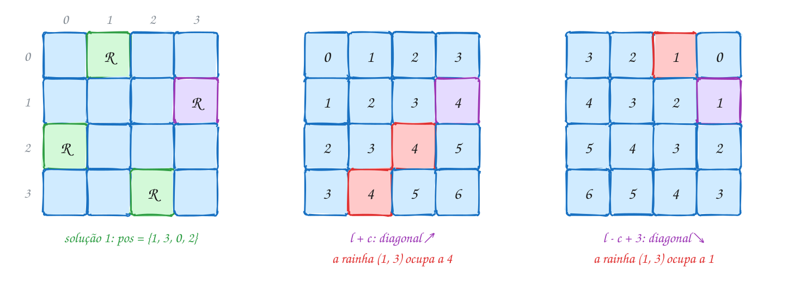</p>

O programa mostra cada solução como um tabuleiro e conta as chamadas:

```c
#include <stdbool.h>
#include <stdio.h>

#define N 4

int pos[N];               // pos[l] = coluna da rainha da linha l
bool coluna[N];           // coluna[c]: já tem rainha na coluna c?
bool diag1[2 * N - 1];    // diagonal ↗, índice l + c
bool diag2[2 * N - 1];    // diagonal ↘, índice l - c + N - 1
int solucoes = 0, chamadas = 0;

void mostra(void) {
    printf("Solução %d:\n", solucoes);
    for (int l = 0; l < N; l++) {
        for (int c = 0; c < N; c++) {
            printf(c == 0 ? "%c" : " %c", pos[l] == c ? 'R' : '.');
        }
        printf("\n");
    }
}

// as linhas 0..l-1 já têm rainha; põe a da linha l
void rainha(int l) {
    chamadas++;
    if (l == N) {
        solucoes++;
        mostra();
        return;
    }
    for (int c = 0; c < N; c++) {
        if (coluna[c] || diag1[l + c] || diag2[l - c + N - 1]) {
            continue;                   // poda: a casa (l, c) está atacada
        }
        pos[l] = c;                     // escolhe
        coluna[c] = diag1[l + c] = diag2[l - c + N - 1] = true;
        rainha(l + 1);                  // desce
        coluna[c] = diag1[l + c] = diag2[l - c + N - 1] = false; // desfaz
    }
}

int main(void) {
    rainha(0);
    printf("%d soluções, %d chamadas\n", solucoes, chamadas);
    return 0;
}
// Saída:
// Solução 1:
// . R . .
// . . . R
// R . . .
// . . R .
// Solução 2:
// . . R .
// R . . .
// . . . R
// . R . .
// 2 soluções, 17 chamadas
```

### Passo a passo

O começo da busca, até a primeira solução. "Atacada" quer dizer que a poda
cortou a casa antes de qualquer chamada:

| linha | tenta | o que acontece |
| --- | --- | --- |
| 0 | coluna 0 | livre: marca e desce |
| 1 | colunas 0 e 1 | atacadas (coluna 0; diagonal ↘ da rainha (0, 0)) |
| 1 | coluna 2 | livre: marca e desce |
| 2 | colunas 0 a 3 | todas atacadas: volta, desmarca (1, 2) |
| 1 | coluna 3 | livre: marca e desce |
| 2 | coluna 1 | livre: marca e desce |
| 3 | colunas 0 a 3 | todas atacadas: volta; na linha 2, as colunas 2 e 3 também estão atacadas, e a linha 1 já tentou tudo: volta à linha 0 |
| 0 | coluna 1 | livre: desce, e o caminho 3, 0, 2 fecha a solução 1 |

Repara que a rainha da linha 0 na coluna 0 nunca dá certo: a busca gasta 4
chamadas (uma na linha 1, duas na linha 2, uma na linha 3) para descobrir
isso, e depois esquece o galho inteiro.

Repara no fluxograma: é o esqueleto do assunto anterior, com um laço pelas
colunas no lugar de "leva ou não leva":

<p align="center">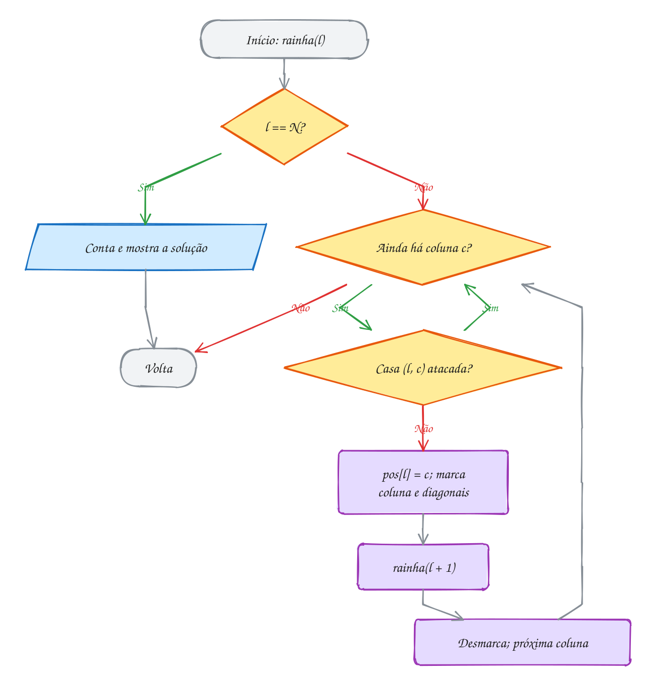</p>

> [!WARNING]
> O índice da diagonal ↘ é `l - c + N - 1`, e não `l - c`. Para a casa
> (0, 3), `l - c` vale -3, e `diag2[-3]` escreve **fora** do vetor: o C não
> confere, o AddressSanitizer acusa e, sem ele, o programa estraga outra
> variável em silêncio. O outro erro comum é desmarcar só a coluna e esquecer
> as diagonais: o programa não trava, só acha menos soluções do que devia.

> [!TIP]
> **Por dentro do C:** os três vetores ocupam `N + 2(2N - 1)` bytes, 46 bytes
> para `N = 8`, e cada teste de ataque são três leituras de memória, em vez de
> um laço pelas rainhas anteriores. A expressão
> `coluna[c] = diag1[l + c] = diag2[...] = true` funciona porque a atribuição
> em C devolve o valor atribuído e é feita da direita para a esquerda. A
> pilha desce só `N + 1` frames. O que cresce é o número de nós da árvore,
> mas a poda é tão forte que o 8-rainhas acha as 92 soluções com 2057
> chamadas, contra 8⁸ = 16.777.216 tabuleiros da força bruta por linha.

> [!NOTE]
> **Pergunta para você:** troque `N` para 5 e para 6 antes de rodar. Quantas
> soluções você espera? O número sobe quando o tabuleiro cresce?

### Hora de praticar

Os arquivos ficam em [`0128-n-rainhas/`](0128-n-rainhas/). Os comandos funcionam de qualquer pasta do terminal. Nos exemplos, rode, mude, quebre e rode de novo. Nos exercícios, a resposta vai dentro do próprio arquivo. ★☆☆ é aquecimento, ★★☆ pede raciocínio e ★★★ é desafio.

**Exemplo A255 · Quantas soluções de 1 a 12 rainhas: o tabuleiro em bits**

```c
#include <stdio.h>

long long chamadas;

// cada bit de um unsigned é uma coluna. cols: colunas ocupadas;
// d1 e d2: casas desta linha atacadas pelas diagonais das rainhas de cima
long long conta(int n, unsigned cols, unsigned d1, unsigned d2) {
    chamadas++;
    unsigned todas = (1u << n) - 1;   // n bits ligados
    if (cols == todas) {
        return 1;                     // uma rainha em cada coluna: solução
    }
    long long total = 0;
    unsigned livres = todas & ~(cols | d1 | d2);
    while (livres != 0) {
        unsigned bit = livres & (~livres + 1);   // o bit ligado mais baixo
        livres -= bit;
        // na linha de baixo, a diagonal ↘ ataca uma coluna à frente (<< 1)
        // e a ↙ uma coluna atrás (>> 1): basta deslocar os bits
        total += conta(n, cols | bit, ((d1 | bit) << 1) & todas, (d2 | bit) >> 1);
    }
    return total;
}

int main(void) {
    // as chamadas batem com as do texto (17 para n = 4): mesma árvore,
    // só que o teste de ataque virou uma conta de bits
    printf(" n  soluções   chamadas\n");
    for (int n = 1; n <= 12; n++) {
        chamadas = 0;
        long long s = conta(n, 0, 0, 0);
        printf("%2d  %8lld  %9lld\n", n, s, chamadas);
    }
    return 0;
}
// Saída:
//  n  soluções   chamadas
//  1         1          2
//  2         0          3
//  3         0          6
//  4         2         17
//  5        10         54
//  6         4        153
//  7        40        552
//  8        92       2057
//  9       352       8394
// 10       724      35539
// 11      2680     166926
// 12     14200     856189
```

```bash
~/LPEDC/rodar 19-backtracking/0128-n-rainhas/A255.c
```

**Exemplo A256 · A primeira solução do 8-rainhas, sem vetores auxiliares**

```c
#include <stdbool.h>
#include <stdio.h>
#include <stdlib.h>

#define N 8

int pos[N];
int chamadas = 0;

// a casa (l, c) é atacada por alguma rainha das linhas 0..l-1?
// custa O(l) em vez de O(1), mas não precisa de vetor nenhum além de pos
bool pode(int l, int c) {
    for (int k = 0; k < l; k++) {
        if (pos[k] == c || abs(pos[k] - c) == l - k) {
            return false;   // mesma coluna, ou mesma distância nas duas direções
        }
    }
    return true;
}

// devolve true na primeira solução: o true sobe e ninguém tenta mais nada
bool rainha(int l) {
    chamadas++;
    if (l == N) {
        return true;
    }
    for (int c = 0; c < N; c++) {
        if (pode(l, c)) {
            pos[l] = c;     // não precisa desfazer: pos[l] é sobrescrito
            if (rainha(l + 1)) {
                return true;
            }
        }
    }
    return false;
}

int main(void) {
    if (rainha(0)) {
        for (int l = 0; l < N; l++) {
            for (int c = 0; c < N; c++) {
                printf(c == 0 ? "%c" : " %c", pos[l] == c ? 'R' : '.');
            }
            printf("\n");
        }
        printf("pos = {");
        for (int l = 0; l < N; l++) {
            printf(l == 0 ? "%d" : ", %d", pos[l]);
        }
        printf("}, achada em %d chamadas\n", chamadas);
    }
    return 0;
}
// Saída:
// R . . . . . . .
// . . . . R . . .
// . . . . . . . R
// . . . . . R . .
// . . R . . . . .
// . . . . . . R .
// . R . . . . . .
// . . . R . . . .
// pos = {0, 4, 7, 5, 2, 6, 1, 3}, achada em 114 chamadas
```

```bash
~/LPEDC/rodar 19-backtracking/0128-n-rainhas/A256.c
```

#### Exercícios

**Exercício E763** · ★☆☆

Antes de resolver o tabuleiro inteiro, o clube quer um juiz: uma função


```text
bool ataca(int l1, int c1, int l2, int c2)
```


que diz se duas rainhas, nas casas (l1, c1) e (l2, c2) de um tabuleiro
8 × 8, se atacam (mesma linha, mesma coluna ou mesma diagonal). Escreva a
função do zero e teste com os seis pares do programa.


```text
Saída esperada:
(0, 0) e (3, 3): ataca
(1, 2) e (3, 1): não ataca
(2, 5) e (2, 0): ataca
(4, 1) e (1, 4): ataca
(0, 3) e (5, 3): ataca
(6, 2) e (3, 0): não ataca
```

**Dicas:**

1. Linha e coluna são comparações diretas.
2. Nas diagonais, a distância entre as linhas é igual à distância entre
   as colunas: abs(l1 - l2) == abs(c1 - c2) (abs vem de stdlib.h).
3. Outro jeito: mesma diagonal ↗ quando l1 + c1 == l2 + c2, e mesma ↘
   quando l1 - c1 == l2 - c2. Os dois jeitos dão o mesmo resultado.
4. Resposta esperada: as 6 linhas acima.

```bash
~/LPEDC/rodar 19-backtracking/0128-n-rainhas/E763.c
```

**Exercício E764** · ★☆☆

O programa abaixo resolve as 6-rainhas e mostra cada solução como o vetor
pos (a coluna da rainha de cada linha). Faltam as linhas que marcam e
desmarcam a coluna e as duas diagonais. Complete usando os índices do
texto (l + c para a diagonal ↗ e l - c + N - 1 para a ↘).


```text
Saída esperada:
1 3 5 0 2 4
2 5 1 4 0 3
3 0 4 1 5 2
4 2 0 5 3 1
4 soluções
```

**Dicas:**

1. Marcar: coluna[c], diag1[l + c] e diag2[l - c + N - 1] recebem true,
   logo antes da chamada rainha(l + 1).
2. Desmarcar: as mesmas três posições recebem false, logo depois.
3. Repare que as soluções vêm em pares espelhados: trocando cada c de
   1 3 5 0 2 4 por 5 - c, sai 4 2 0 5 3 1.
4. Resposta esperada: as 5 linhas acima.

```bash
~/LPEDC/rodar 19-backtracking/0128-n-rainhas/E764.c
```

**Exercício E765** · ★★☆

No tabuleiro 8 × 8 do clube, alguém colou a rainha da linha 0 na coluna 3,
e ela não sai mais. Quantas das 92 soluções do 8-rainhas ainda são
possíveis? Escreva o programa (pode partir do código do texto) e mostre a
primeira solução encontrada e o total.


```text
Saída esperada:
primeira: 3 0 4 7 1 6 2 5
18 soluções com a rainha em (0, 3)
```

**Dicas:**

1. Jeito simples: na linha 0, só deixe passar c == 3 (um continue a
   mais no laço).
2. Jeito melhor: marque a coluna 3 e as diagonais da casa (0, 3) no main,
   ponha pos[0] = 3 e comece a busca em rainha(1). Os dois jeitos dão o
   mesmo resultado; o segundo nem visita as outras colunas da linha 0.
3. Para mostrar só a primeira, guarde uma cópia de pos quando o contador
   de soluções passar de 0 para 1.
4. Resposta esperada: as 2 linhas acima.

```bash
~/LPEDC/rodar 19-backtracking/0128-n-rainhas/E765.c
```

**Exercício E766** · ★★☆

Na sala de prova, as carteiras formam uma grade n × n. O fiscal vai
sentar n alunos: um em cada fileira (linha) e um em cada coluna. A regra
contra cola é mais fraca que a da rainha: dois alunos de fileiras VIZINHAS
não podem estar em colunas vizinhas (aí um enxerga a prova do outro na
diagonal). Alunos em fileiras mais distantes podem estar na diagonal sem
problema.

O programa abaixo conta as soluções das n-rainhas para n = 4, 5 e 6.
Estenda-o (mudando a poda e o que for preciso) para contar as arrumações
da sala de prova e mostrar a primeira de cada n.


```text
Saída esperada:
n = 4: 2 arrumações, primeira: 1 3 0 2
n = 5: 14 arrumações, primeira: 0 2 4 1 3
n = 6: 90 arrumações, primeira: 0 2 4 1 3 5
```

**Dicas:**

1. A coluna continua proibida de repetir. As diagonais saem: o único
   teste novo compara c com pos[l - 1], e só quando l > 0.
2. "Colunas vizinhas" quer dizer abs(c - pos[l - 1]) == 1.
3. Guarde a primeira arrumação de cada n num vetor separado.
4. Resposta esperada: as 3 linhas acima.

```bash
~/LPEDC/rodar 19-backtracking/0128-n-rainhas/E766.c
```

**Exercício E767** · ★★★

Ache o bug. Este programa conta as soluções do 8-rainhas e devia mostrar
92, mas mostra 0. Ele compila sem aviso e roda sem erro do sanitizer: os
índices nunca saem dos vetores. O erro está numa linha só. Ache,
conserte e rode de novo.


```text
Saída esperada:
92 soluções
vetores limpos no fim: sim
```

**Dicas:**

1. Uma regra do backtracking: depois que a busca termina, todo vetor de
   marcação volta a ser o que era no começo (tudo false). A função limpos
   confere isso. O que ela diz antes do conserto?
2. Compare, letra por letra, a linha que marca com a linha que desmarca.
   Um índice errado no desmarcar não dá erro: só deixa uma diagonal
   marcada para sempre e libera outra que estava ocupada.
3. Resposta esperada: o desmarcar usava diag2[c - l + N - 1]; o certo é
   diag2[l - c + N - 1], o mesmo índice da marcação. Consertado, a saída é
   a de cima.

```bash
~/LPEDC/rodar 19-backtracking/0128-n-rainhas/E767.c
```

**Exercício E768** · ★★★

O passeio do cavalo: num tabuleiro 5 × 5, o cavalo começa no canto (0, 0)
e precisa visitar as 25 casas, cada uma uma vez só, saltando em L. Escreva
do zero um backtracking que ache o primeiro passeio, numerando as casas na
ordem da visita (o canto é 1), e conte as chamadas da função recursiva.
Tente os 8 saltos sempre nesta ordem (linha, coluna):


```text
(+2, +1) (+1, +2) (-1, +2) (-2, +1) (-2, -1) (-1, -2) (+1, -2) (+2, -1)
```


```text
Saída esperada:
  1  6 15 10 21
 14  9 20  5 16
 19  2  7 22 11
  8 13 24 17  4
 25 18  3 12 23
8840 chamadas
```

**Dicas:**

1. Guarde os saltos em dois vetores, dl[8] e dc[8]. A matriz casa[5][5]
   começa com 0 (livre) e recebe o número do salto.
2. salta(l, c, k): o cavalo está em (l, c), a casa de número k. Se k é 25,
   achou. Senão, para cada salto que cai dentro do tabuleiro numa casa
   livre: numere com k + 1, desça, e se não deu certo, volte a casa para 0.
3. Pare na primeira solução devolvendo bool, como no exemplo A256. Cada
   número sai com printf("%3d", ...).
4. Resposta esperada: o tabuleiro e a contagem acima. Confira no papel
   que cada passo de k para k + 1 é mesmo um L.

```bash
~/LPEDC/rodar 19-backtracking/0128-n-rainhas/E768.c
```

---

## 0129 · Labirinto

Festa junina na fazenda, e a atração é o labirinto de milho. Você entra pelo
canto de cima e quer achar a saída, lá no canto de baixo. A estratégia de quem
não tem mapa é a de sempre: anda, e quando dá num beco, volta até a última
bifurcação e tenta outro corredor. Para não andar em círculos, vai deixando
pedrinhas pelo caminho.

Isso é backtracking numa **matriz**. O mapa é um `char lab[L][C + 1]`: `'#'`
é parede, `'.'` é corredor, `'S'` é a entrada e `'F'` é a saída. A função
`anda(l, c)` responde "dá para chegar à saída a partir da casa (l, c)?". Ela
recusa na hora as casas impossíveis: fora do mapa, parede, ou casa que já
está no caminho. Se a casa é a saída, responde que sim. Senão, **marca** a
casa com `'*'`, tenta os quatro vizinhos e, se nenhum deu certo, **desfaz** a
marca.

Aqui está a diferença para os assuntos anteriores: o desfazer não volta a casa
para `'.'`, e sim para `'x'`. Uma casa da qual não se chega à saída continua
sem saída na próxima vez que a busca passar por ali, então não vale a pena
entrar de novo. Com o `'x'`, cada casa é visitada no máximo uma vez, e a
busca custa **O(L · C)**: é a busca em profundidade (DFS) do assunto 0111,
com a matriz fazendo o papel do grafo e os quatro vizinhos fazendo o papel
das arestas.

Repara também no `||` encadeado do código. Pelo curto-circuito (assunto
0013), assim que um vizinho devolve `true`, os seguintes nem são chamados. A
ordem das direções no `if` (direita, baixo, esquerda, cima) decide qual
caminho a busca acha primeiro.

Vamos ver na prática. Os números mostram a ordem dos passos do caminho
encontrado. A busca entrou primeiro no bolsão da direita, achou só becos
(vermelho) e voltou. Depois desceu pela coluna 1 até o corredor de baixo:

<p align="center">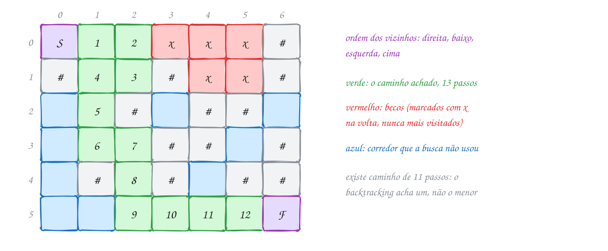</p>

No fim, as casas com `*` são o caminho, e as com `x` são os becos que a
busca visitou e abandonou:

```c
#include <stdbool.h>
#include <stdio.h>

#define L 6
#define C 7

char lab[L][C + 1] = {   // + 1 para o '\0' de cada linha
    "S.....#",
    "#..#..#",
    "..#.##.",
    "...##.#",
    ".#.#.##",
    "......F",
};
int chamadas = 0;

// tenta chegar à saída a partir da casa (l, c)
bool anda(int l, int c) {
    chamadas++;
    if (l < 0 || l >= L || c < 0 || c >= C) {
        return false;                   // fora do mapa
    }
    if (lab[l][c] == 'F') {
        return true;                    // achou a saída
    }
    if (lab[l][c] != '.' && lab[l][c] != 'S') {
        return false;                   // parede, caminho atual ou beco
    }
    lab[l][c] = '*';                    // escolhe: estou passando por aqui
    if (anda(l, c + 1) || anda(l + 1, c) || anda(l, c - 1) || anda(l - 1, c)) {
        return true;                    // direita, baixo, esquerda, cima
    }
    lab[l][c] = 'x';                    // desfaz: beco sem saída
    return false;
}

int main(void) {
    if (anda(0, 0)) {
        int passos = 0;
        for (int l = 0; l < L; l++) {
            for (int c = 0; c < C; c++) {
                printf(c == 0 ? "%c" : " %c", lab[l][c]);
                passos += lab[l][c] == '*';
            }
            printf("\n");
        }
        printf("%d passos até a saída, %d chamadas\n", passos, chamadas);
    } else {
        printf("sem saída\n");
    }
    return 0;
}
// Saída:
// * * * x x x #
// # * * # x x #
// . * # . # # .
// . * * # # . #
// . # * # . # #
// . . * * * * F
// 13 passos até a saída, 41 chamadas
```

O caminho tem 13 passos, mas existe um de 11: descer direto pela coluna 1,
sem o desvio por (0, 2) e (1, 2). O backtracking acha **um** caminho, não o
**menor**. Para o menor, a ferramenta é a BFS (assunto 0110), ou um
backtracking que testa todos os caminhos (exemplo A258).

A mesma recursão, sem a saída e sem o desfazer, vira o **flood fill**
(preenchimento por inundação): a partir de uma casa, pinta todas as casas
alcançáveis. É o balde de tinta do editor de imagens, e é o assunto do
exemplo A257.

Repara no fluxograma: três perguntas mandam embora as casas impossíveis antes
de qualquer marcação, e só uma casa nova chega ao `'*'`:

<p align="center">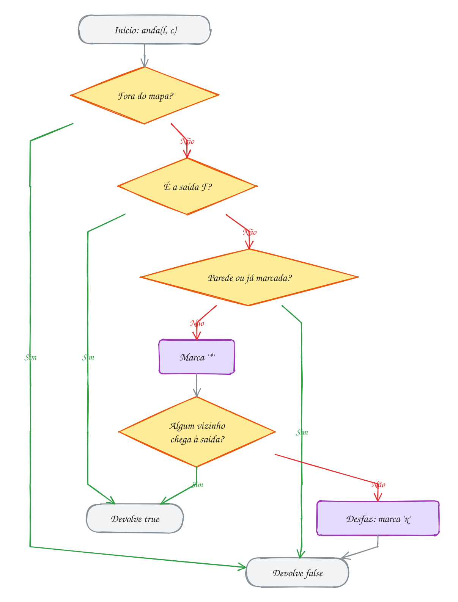</p>

> [!WARNING]
> Sem a marca de visitada, a busca anda em círculos. Da casa (0, 0) ela vai
> para (0, 1), que tenta a direita e o resto e, em algum momento, tenta a
> esquerda: volta para (0, 0), que tenta (0, 1) de novo, e assim para
> sempre. Não há laço infinito no código, mas a recursão não tem fim: a
> pilha estoura (*stack overflow*) e o programa morre. Marque a casa **antes**
> de chamar os vizinhos, não depois.

> [!TIP]
> **Por dentro do C:** a matriz `lab` é contínua na memória (assunto 0039):
> `lab[l][c]` fica no byte `l * (C + 1) + c` a partir do começo, e o `+ 1`
> existe porque cada linha foi escrita como uma string, com o `'\0'` no fim.
> A profundidade da recursão é o tamanho do caminho atual, que pode chegar a
> `L · C` casas. Um mapa 1000 × 1000 pede até um milhão de frames, bem mais
> que os 8 MB de pilha que o Linux costuma dar. Para mapas grandes, troque a
> recursão por uma pilha explícita de coordenadas (assunto 0082): é o mesmo
> algoritmo, com a pilha no heap.

> [!NOTE]
> **Pergunta para você:** troque a ordem das direções para baixo, direita,
> esquerda, cima. Quantos passos tem o caminho encontrado agora? Ainda
> aparece algum `x`?

### Hora de praticar

Os arquivos ficam em [`0129-labirinto/`](0129-labirinto/). Os comandos funcionam de qualquer pasta do terminal. Nos exemplos, rode, mude, quebre e rode de novo. Nos exercícios, a resposta vai dentro do próprio arquivo. ★☆☆ é aquecimento, ★★☆ pede raciocínio e ★★★ é desafio.

**Exemplo A257 · Balde de tinta: o flood fill pinta a sala inteira**

```c
#include <stdio.h>

#define L 7
#define C 12

// a planta do apartamento: # é parede, . é piso
char planta[L][C + 1] = {
    "############",
    "#....#.....#",
    "#....#.....#",
    "#..###.#####",
    "#......#...#",
    "#####..#...#",
    "############",
};

// pinta com cor a região de piso que contém (l, c); devolve quantas casas
// pintou. Não tem saída para procurar nem nada para desfazer: a tinta fica
int pinta(int l, int c, char cor) {
    if (l < 0 || l >= L || c < 0 || c >= C || planta[l][c] != '.') {
        return 0;                    // fora, parede ou já pintada
    }
    planta[l][c] = cor;              // pintar É marcar como visitada
    return 1 + pinta(l, c + 1, cor) + pinta(l + 1, c, cor)
             + pinta(l, c - 1, cor) + pinta(l - 1, c, cor);
}

void mostra(void) {
    for (int l = 0; l < L; l++) {
        printf("%s\n", planta[l]);
    }
}

int main(void) {
    int sala = pinta(2, 2, 'o');     // um clique na sala (a cozinha, à direita,
                                     // vem junto: o corredor liga as duas)
    int quarto = pinta(4, 9, '+');   // outro clique no quarto
    mostra();
    printf("sala e cozinha: %d casas; quarto: %d casas\n", sala, quarto);
    printf("clicar de novo na sala pinta %d casas\n", pinta(2, 2, 'o'));
    return 0;
}
// Saída:
// ############
// #oooo#ooooo#
// #oooo#ooooo#
// #oo###o#####
// #oooooo#+++#
// #####oo#+++#
// ############
// sala e cozinha: 29 casas; quarto: 6 casas
// clicar de novo na sala pinta 0 casas
```

```bash
~/LPEDC/rodar 19-backtracking/0129-labirinto/A257.c
```

**Exemplo A258 · Todos os caminhos da praça: desfazer de verdade para achar o menor**

```c
#include <stdio.h>

#define L 4
#define C 5

char mapa[L][C + 1] = {
    "S...#",
    ".#...",
    "...#.",
    "#...F",
};
char melhor[L][C + 1];   // cópia do mapa com o menor caminho desenhado
int caminhos = 0, menor = -1, maior = -1;

// conta TODOS os caminhos simples (sem repetir casa) até F. Na volta, a casa
// volta a ser '.': outro caminho pode passar por ela. Sem o 'x' do texto, a
// busca deixa de ser O(L · C) e vira exponencial
void anda(int l, int c, int passos) {
    if (l < 0 || l >= L || c < 0 || c >= C) {
        return;
    }
    if (mapa[l][c] == 'F') {
        caminhos++;
        if (maior < 0 || passos > maior) {
            maior = passos;
        }
        if (menor < 0 || passos < menor) {
            menor = passos;
            for (int i = 0; i < L; i++) {
                for (int j = 0; j <= C; j++) {
                    melhor[i][j] = mapa[i][j];   // guarda o desenho
                }
            }
        }
        return;
    }
    if (mapa[l][c] != '.' && mapa[l][c] != 'S') {
        return;
    }
    char antes = mapa[l][c];
    mapa[l][c] = '*';
    anda(l, c + 1, passos + 1);
    anda(l + 1, c, passos + 1);
    anda(l, c - 1, passos + 1);
    anda(l - 1, c, passos + 1);
    mapa[l][c] = antes;              // desfaz: libera a casa
}

int main(void) {
    anda(0, 0, 0);
    printf("%d caminhos diferentes, de %d a %d passos\n", caminhos, menor, maior);
    printf("um dos menores:\n");
    for (int l = 0; l < L; l++) {
        printf("%s\n", melhor[l]);
    }
    return 0;
}
// Saída:
// 12 caminhos diferentes, de 7 a 13 passos
// um dos menores:
// ****#
// .#.**
// ...#*
// #...F
```

```bash
~/LPEDC/rodar 19-backtracking/0129-labirinto/A258.c
```

#### Exercícios

**Exercício E769** · ★☆☆

No mapa do sítio, # é cerca e . é grama. A vaca está na casa (2, 3) e
anda livre pela grama, mas não pula cerca. O sitiante quer saber quantas
casas de grama ela alcança (a área do pasto dela). A função pasto abaixo
faz um flood fill, mas falta a linha que soma as casas: complete o return
com as quatro chamadas recursivas.


```text
Saída esperada:
##########
#vvvv#...#
#vvvv#...#
#vv###...#
#vv#.....#
##########
a vaca alcança 12 casas
```

**Dicas:**

1. A casa atual vale 1. Some a ela o que cada vizinho alcança: direita,
   baixo, esquerda e cima.
2. A marca 'v' é posta ANTES das chamadas, senão dois vizinhos ficariam
   se chamando para sempre.
3. Resposta esperada: o mapa e a contagem acima. O pasto da direita não
   entra: a cerca separa os dois.

```bash
~/LPEDC/rodar 19-backtracking/0129-labirinto/E769.c
```

**Exercício E770** · ★☆☆

O ratinho do laboratório entra pelo canto (0, 0) de cada labirinto e o
queijo está no canto oposto, marcado com Q. Escreva do zero a função


```text
bool chega(int l, int c)
```


que diz se o rato alcança o queijo (andando para cima, baixo, esquerda e
direita, sem atravessar paredes #), e use-a nos dois labirintos do
programa. Copie o labirinto da vez para a matriz global lab antes de
chamar a função (strcpy em cada linha).


```text
Saída esperada:
labirinto 1: o rato chega ao queijo
labirinto 2: sem caminho até o queijo
```

**Dicas:**

1. É a função anda do texto, sem a marca de beco: aqui não interessa o
   caminho, só a resposta. Marque as casas visitadas com qualquer letra.
2. Recuse fora do mapa, parede e casa já visitada; aceite o Q.
3. No labirinto 2, uma parede fecha o caminho na coluna 3: confira no
   papel antes de rodar.
4. Resposta esperada: as 2 linhas acima.

```bash
~/LPEDC/rodar 19-backtracking/0129-labirinto/E770.c
```

**Exercício E771** · ★★☆

Na foto de satélite da fazenda, ~ é água e . é terra. Duas casas de água
são do mesmo lago quando são vizinhas na horizontal ou na vertical
(diagonal não conta). Escreva um programa que conte os lagos e mostre,
para cada um, a primeira casa encontrada (varrendo linha por linha, da
esquerda para a direita) e o tamanho.


```text
Saída esperada:
lago 1: começa em (0, 0), tamanho 5
lago 2: começa em (1, 6), tamanho 4
lago 3: começa em (2, 10), tamanho 5
lago 4: começa em (3, 1), tamanho 4
lago 5: começa em (5, 6), tamanho 1
5 lagos
```

**Dicas:**

1. Varra a matriz com dois laços. Achou um ~? É um lago novo: conte e
   chame um flood fill a partir dali.
2. O flood fill troca cada ~ do lago por outro caractere (pode ser '.') e
   devolve quantas casas trocou. Assim o mesmo lago não é contado de novo
   quando a varredura passar pelas outras casas dele.
3. É a contagem de componentes conexos do assunto 0111, com a matriz no
   lugar do grafo.
4. Resposta esperada: as 6 linhas acima.

```bash
~/LPEDC/rodar 19-backtracking/0129-labirinto/E771.c
```

**Exercício E772** · ★★☆

O robô aspirador precisa ir da base (S) até a tomada (F), e o programa
abaixo já acha um caminho e desenha a planta com ele marcado. Mas o robô não
entende desenho: ele precisa da lista de casas, na ordem. Estenda o
programa para guardar o caminho enquanto a busca anda e mostrar as
coordenadas, da base até a tomada, e o número de passos.


```text
Saída esperada:
* * # . . .
. * # . # .
. * * * # .
# # # * * *
. . . . # F
caminho: (0,0) (0,1) (1,1) (2,1) (2,2) (2,3) (3,3) (3,4) (3,5) (4,5)
9 passos
```

**Dicas:**

1. Acrescente um parâmetro k em anda: é a posição da casa (l, c) no
   caminho. A base é a posição 0. Quem chama os vizinhos passa k + 1.
2. Guarde a casa em dois vetores globais, cl[k] = l e cc[k] = c, logo
   quando ela for marcada com '*'. Ao chegar na tomada, guarde-a também e
   anote o tamanho (k + 1 casas, k passos).
3. Não precisa apagar nada na volta: quando a busca recua e tenta outro
   vizinho, ele escreve por cima da mesma posição k.
4. Resposta esperada: as 7 linhas acima.

```bash
~/LPEDC/rodar 19-backtracking/0129-labirinto/E772.c
```

**Exercício E773** · ★★★

Ache o bug. Este é o balde de tinta de um editor de pixel art: balde(l, c,
nova) troca pela cor nova toda a região da cor que está em (l, c). O
primeiro clique funciona. O segundo, que pinta a mesma região com a MESMA
cor que ela já tem, derruba o programa: o AddressSanitizer acusa
stack-overflow. (Este erro é de propósito: rode, veja a falha, conserte e
rode de novo.)


```text
Saída esperada:
1º clique: 9 pixels
..oo....
.oooo.##
..oo..##
..o.....
2º clique: 0 pixels
3º clique: 4 pixels
..oo....
.oooo.++
..oo..++
..o.....
```

**Dicas:**

1. Siga o 2º clique no papel: velha e nova são 'o'. A casa (1, 2) é
   pintada de 'o'... e continua sendo da cor velha. O que acontece quando
   o vizinho volta a ela?
2. No flood fill, pintar é o que marca a casa como visitada. Se a cor
   nova é igual à velha, a marca não marca nada.
3. Resposta esperada: em balde, antes de começar, se velha == nova,
   devolva 0 (não há nada a fazer). Consertado, a saída é a de cima.

```bash
~/LPEDC/rodar 19-backtracking/0129-labirinto/E773.c
```

**Exercício E774** · ★★★

O entregador quer o MENOR caminho da loja (S) até o cliente (F) no mapa
do condomínio. O backtracking do texto acha um caminho qualquer; aqui
você vai testar todos, com o "desfazer" do exemplo A258 (a casa volta a
'.' na volta), e podar com o melhor resultado conhecido: se o caminho
atual já tem tantos passos quanto o menor achado até agora, volte. Escreva
do zero, tentando os vizinhos na ordem direita, baixo, esquerda, cima, e
conte as chamadas da função recursiva.


```text
Saída esperada:
menor caminho: 9 passos
******
.##.#*
.....*
.#.##*
...#.F
177 chamadas
```

**Dicas:**

1. anda(l, c, passos): o primeiro teste da função é a poda,
   passos >= menor. Comece menor com um valor maior que qualquer caminho
   possível (L * C + 1 serve).
2. Ao chegar em F, a poda garante que passos < menor: atualize menor e
   copie o mapa inteiro (com os '*') para uma matriz melhor.
3. Sem a poda, testando todos os caminhos e comparando só na chegada,
   seriam 449 chamadas, e a diferença cresce muito com o mapa. Mesmo
   assim, para menor caminho em mapa grande, a BFS (assunto 0110) é a
   ferramenta certa: O(L · C), sem retrocesso.
4. Resposta esperada: as 7 linhas acima.

```bash
~/LPEDC/rodar 19-backtracking/0129-labirinto/E774.c
```

---

## 0130 · Juntando tudo

Na banca da rodoviária, a revista de passatempos traz um sudoku "difícil", e
você empaca na terceira casa. A regra é curta: completar a grade 9 × 9 com
dígitos de 1 a 9 sem repetir nenhum numa linha, numa coluna ou numa das nove
caixas 3 × 3. Que tal deixar o computador resolver?

O sudoku junta tudo o que o módulo mostrou. A grade é uma **matriz**
`int g[9][9]`, com 0 nas casas vazias. Cada casa vazia é uma decisão, como as
posições das permutações, e as opções são os dígitos de 1 a 9. A **poda** é a
regra do jogo: um dígito que já aparece na linha, na coluna ou na caixa nem é
tentado. E, como nas N-rainhas, o teste é O(1) com **vetores de marcação**:

- `na_linha[l][d]` diz se o dígito `d` já está na linha `l`;
- `na_coluna[c][d]`, o mesmo para a coluna `c`;
- `na_caixa[b][d]`, para a caixa `b`, numerada de 0 a 8 por
  `b = (l / 3) * 3 + c / 3`.

A função `resolve(k)` olha as casas na ordem de leitura (casa `k` é a linha
`k / 9`, coluna `k % 9`), pula as preenchidas e, na primeira vazia, tenta os
dígitos que passam pela poda. Para cada um: **escreve e marca**, desce para
`resolve(k + 1)`, e se lá embaixo não deu certo, **apaga e desmarca**. Se
nenhum dígito serve, devolve `false` e quem chamou tenta o próximo dígito
dele. Quando não sobra casa vazia, a grade está resolvida, e o `true` sobe
pela pilha de chamadas até o `main`, como no exemplo A254.

Vamos ver na prática. A primeira casa vazia é a (0, 1). A linha 0 já tem 2,
3 e 8; a coluna 1 tem 4, 9, 6, 3 e 1; a caixa 0 tem 2, 3, 6, 4 e 1. Sobram o
5 e o 7. O programa tenta o 5 primeiro, e só depois de muitos retrocessos lá
embaixo descobre que a resposta é o 7:

<p align="center">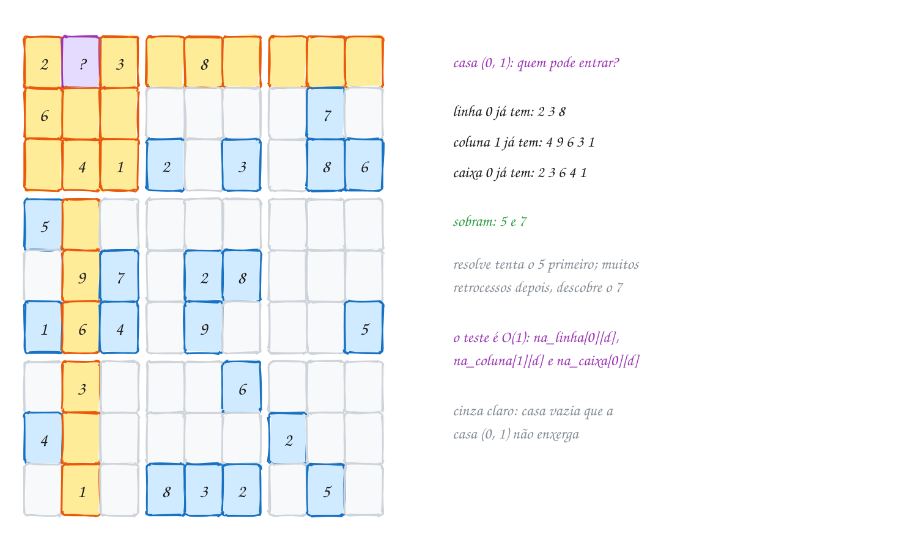</p>

O programa completo, com o jogo da revista escrito como texto (`.` é casa
vazia):

```c
#include <stdbool.h>
#include <stdio.h>

int g[9][9];
bool na_linha[9][10];    // na_linha[l][d]: o dígito d já está na linha l?
bool na_coluna[9][10];
bool na_caixa[9][10];    // caixas 3 × 3 numeradas de 0 a 8
long chamadas = 0;

int caixa(int l, int c) {
    return (l / 3) * 3 + c / 3;
}

void marca(int l, int c, int d, bool valor) {
    na_linha[l][d] = na_coluna[c][d] = na_caixa[caixa(l, c)][d] = valor;
}

// resolve a partir da casa número k (0 a 80, lendo linha por linha)
bool resolve(int k) {
    chamadas++;
    while (k < 81 && g[k / 9][k % 9] != 0) {
        k++;                            // pula as casas já preenchidas
    }
    if (k == 81) {
        return true;                    // nenhuma casa vazia: resolvido
    }
    int l = k / 9, c = k % 9;
    for (int d = 1; d <= 9; d++) {
        if (na_linha[l][d] || na_coluna[c][d] || na_caixa[caixa(l, c)][d]) {
            continue;                   // poda: d já aparece
        }
        g[l][c] = d;                    // escolhe
        marca(l, c, d, true);
        if (resolve(k + 1)) {
            return true;
        }
        marca(l, c, d, false);          // desfaz
        g[l][c] = 0;
    }
    return false;                       // nenhum dígito serve: volta
}

int main(void) {
    const char *jogo[9] = {
        "2.3.8....", "6......7.", ".412.3.86",
        "5........", ".97.28...", "164.9...5",
        ".3...6...", "4.....2..", ".1.832.5.",
    };
    for (int l = 0; l < 9; l++) {
        for (int c = 0; c < 9; c++) {
            if (jogo[l][c] != '.') {
                g[l][c] = jogo[l][c] - '0';
                marca(l, c, g[l][c], true);
            }
        }
    }
    if (resolve(0)) {
        for (int l = 0; l < 9; l++) {
            for (int c = 0; c < 9; c++) {
                printf("%d%s", g[l][c], c == 8 ? "\n" : (c % 3 == 2 ? " | " : " "));
            }
            if (l % 3 == 2 && l < 8) {
                printf("------+-------+------\n");
            }
        }
    }
    printf("%ld chamadas\n", chamadas);
    return 0;
}
// Saída:
// 2 7 3 | 6 8 5 | 1 4 9
// 6 8 5 | 9 4 1 | 3 7 2
// 9 4 1 | 2 7 3 | 5 8 6
// ------+-------+------
// 5 2 8 | 1 6 4 | 7 9 3
// 3 9 7 | 5 2 8 | 4 6 1
// 1 6 4 | 3 9 7 | 8 2 5
// ------+-------+------
// 8 3 2 | 4 5 6 | 9 1 7
// 4 5 6 | 7 1 9 | 2 3 8
// 7 1 9 | 8 3 2 | 6 5 4
// 2999 chamadas
```

São 51 casas vazias e 2999 chamadas: cerca de 59 por casa. A força bruta
pura testaria até 9⁵¹ preenchimentos, um número com 49 algarismos. A poda faz
quase todo o trabalho. E dá para podar ainda mais escolhendo **qual** casa
preencher: começar pela casa com menos candidatos derruba as chamadas deste
mesmo jogo para 64 (exemplo A260).

Repara no fluxograma: é o esqueleto do módulo inteiro, com a casa no lugar
do item e a regra do jogo no lugar da poda:

<p align="center">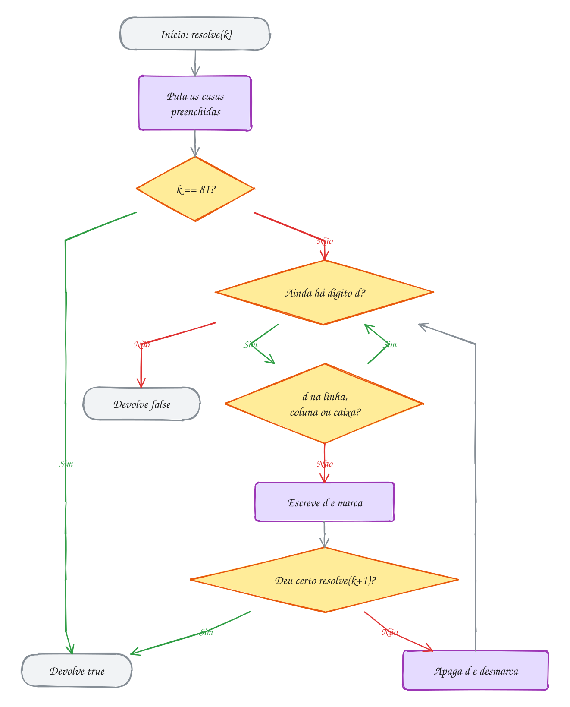</p>

> [!WARNING]
> No desfazer, as duas coisas precisam voltar: o `g[l][c] = 0` **e** o
> `marca(..., false)`. Esquecer o `g[l][c] = 0` parece inofensivo, porque a
> próxima tentativa escreve outro dígito por cima. Mas, se nenhum dígito
> serve, a casa fica com o último que foi tentado e, na volta, o `while` do
> começo de `resolve` passa a tratá-la como uma casa **dada**. Faça o teste:
> sem essa linha, este programa termina em 64 chamadas mostrando uma grade
> "resolvida" com três 9 seguidos na primeira linha. O retrocesso só funciona
> se o estado volta a ser **exatamente** o de antes da escolha.

> [!TIP]
> **Por dentro do C:** os três vetores de marcação ocupam 3 × 9 × 10 = 270
> bytes (o índice 0 de cada linha nunca é usado: desperdiçar um byte deixa o
> código usar o próprio dígito como índice). A grade `int g[9][9]` tem 324
> bytes, contínuos na memória. A recursão desce no máximo 52 frames, um por
> casa vazia mais o último, então a pilha nem percebe. A conta
> `jogo[l][c] - '0'` transforma o caractere `'7'` (código 55) no número 7,
> porque os dígitos são consecutivos na tabela ASCII (assunto 0040).

> [!NOTE]
> **Pergunta para você:** apague o 5 da última casa da linha 5 (troque
> `"164.9...5"` por `"164.9...."`). O programa ainda mostra a mesma grade? O
> número de chamadas sobe ou desce? E o jogo continua com uma solução só?
> (Para responder a última, faça o exercício E778.)

### Hora de praticar

Os arquivos ficam em [`0130-juntando-tudo/`](0130-juntando-tudo/). Os comandos funcionam de qualquer pasta do terminal. Nos exemplos, rode, mude, quebre e rode de novo. Nos exercícios, a resposta vai dentro do próprio arquivo. ★☆☆ é aquecimento, ★★☆ pede raciocínio e ★★★ é desafio.

**Exemplo A259 · Quantas grades de sudoku 4 × 4 existem?**

```c
#include <stdbool.h>
#include <stdio.h>

#define N 4

int g[N][N];
int grades = 0;
long chamadas = 0;

// confere direto na grade, sem vetores de marcação: com N = 4, varrer a
// linha, a coluna e o bloco 2 × 2 custa só alguns passos
bool cabe(int l, int c, int d) {
    int bl = l / 2 * 2, bc = c / 2 * 2;
    for (int i = 0; i < N; i++) {
        if (g[l][i] == d || g[i][c] == d || g[bl + i / 2][bc + i % 2] == d) {
            return false;
        }
    }
    return true;
}

// preenche a casa k e CONTA as soluções: não para na primeira
void preenche(int k) {
    chamadas++;
    if (k == N * N) {
        grades++;
        if (grades == 1) {
            printf("a primeira:\n");
            for (int l = 0; l < N; l++) {
                printf("%d %d | %d %d\n", g[l][0], g[l][1], g[l][2], g[l][3]);
            }
        }
        return;
    }
    int l = k / N, c = k % N;
    for (int d = 1; d <= N; d++) {
        if (cabe(l, c, d)) {
            g[l][c] = d;
            preenche(k + 1);
            g[l][c] = 0;     // desfaz: senão cabe() enxerga um d que não existe
        }
    }
}

int main(void) {
    preenche(0);
    printf("%d grades 4 × 4 válidas, %ld chamadas\n", grades, chamadas);
    printf("com a 1ª linha fixa em 1 2 3 4: %d\n", grades / 24); // 4! trocas de dígitos
    return 0;
}
// Saída:
// a primeira:
// 1 2 | 3 4
// 3 4 | 1 2
// 2 1 | 4 3
// 4 3 | 2 1
// 288 grades 4 × 4 válidas, 2753 chamadas
// com a 1ª linha fixa em 1 2 3 4: 12
```

```bash
~/LPEDC/rodar 19-backtracking/0130-juntando-tudo/A259.c
```

**Exemplo A260 · Sudoku com heurística: começar pela casa mais apertada**

```c
#include <stdbool.h>
#include <stdio.h>

int g[9][9];
long chamadas;

// quantos dígitos cabem em (l, c); os que cabem ficam marcados em pode[]
int candidatos(int l, int c, bool pode[10]) {
    for (int d = 1; d <= 9; d++) {
        pode[d] = true;
    }
    int bl = l / 3 * 3, bc = c / 3 * 3;
    for (int i = 0; i < 9; i++) {
        pode[g[l][i]] = false;                       // linha (casa vazia
                                                     // apaga pode[0]: tanto faz)
        pode[g[i][c]] = false;                       // coluna
        pode[g[bl + i / 3][bc + i % 3]] = false;     // caixa (i de 0 a 8)
    }
    int n = 0;
    for (int d = 1; d <= 9; d++) {
        n += pode[d];
    }
    return n;
}

// em vez da próxima casa vazia na leitura, escolhe a vazia com MENOS
// candidatos: se ela tem 1, não há escolha; se tem 0, o ramo morre já
bool resolve(void) {
    chamadas++;
    int ml = -1, mc = -1, menor = 10;
    bool pode[10], melhor[10];
    for (int l = 0; l < 9; l++) {
        for (int c = 0; c < 9; c++) {
            if (g[l][c] == 0) {
                int n = candidatos(l, c, pode);
                if (n < menor) {
                    menor = n;
                    ml = l;
                    mc = c;
                    for (int d = 1; d <= 9; d++) {
                        melhor[d] = pode[d];
                    }
                }
            }
        }
    }
    if (ml < 0) {
        return true;                 // nenhuma casa vazia
    }
    for (int d = 1; d <= 9; d++) {   // se menor for 0, o laço nem entra
        if (melhor[d]) {
            g[ml][mc] = d;
            if (resolve()) {
                return true;
            }
            g[ml][mc] = 0;
        }
    }
    return false;
}

int main(void) {
    const char *jogo[9] = {  // o mesmo jogo do texto (lá: 2999 chamadas)
        "2.3.8....", "6......7.", ".412.3.86",
        "5........", ".97.28...", "164.9...5",
        ".3...6...", "4.....2..", ".1.832.5.",
    };
    for (int l = 0; l < 9; l++) {
        for (int c = 0; c < 9; c++) {
            g[l][c] = jogo[l][c] == '.' ? 0 : jogo[l][c] - '0';
        }
    }
    chamadas = 0;
    if (resolve()) {
        printf("linha do meio: ");
        for (int c = 0; c < 9; c++) {
            printf("%d", g[4][c]);
        }
        printf("\n%ld chamadas com a casa mais apertada primeiro\n", chamadas);
    }
    return 0;
}
// Saída:
// linha do meio: 397528461
// 64 chamadas com a casa mais apertada primeiro
```

```bash
~/LPEDC/rodar 19-backtracking/0130-juntando-tudo/A260.c
```

#### Exercícios

**Exercício E775** · ★☆☆

Antes de confiar num resolvedor, você precisa de um conferente. Escreva a
função


```text
bool confere(int g[9][9], char *onde, int *qual)
```


que diz se uma grade COMPLETA de sudoku está certa. Se não estiver, ela
guarda em *onde o tipo do primeiro problema ('L' linha, 'C' coluna, 'X'
caixa) e em *qual o número dele. Confira nessa ordem: todas as linhas,
depois todas as colunas, depois todas as caixas. Teste com as duas grades
do programa: a primeira é a solução do texto; na segunda, alguém trocou
dois números de lugar.


```text
Saída esperada:
grade 1: certa
grade 2: errada (coluna 0)
```

**Dicas:**

1. Para cada linha, use um vetor bool visto[10] zerado: se um dígito já
   foi visto, a linha está errada.
2. A caixa b (0 a 8) começa na linha (b / 3) * 3 e na coluna (b % 3) * 3.
   A i-ésima casa dela (i de 0 a 8) está em (+ i / 3, + i % 3).
3. Na grade 2, a troca foi dentro da linha 4: as linhas continuam certas,
   por isso o primeiro problema aparece nas colunas.
4. Resposta esperada: as 2 linhas acima.

```bash
~/LPEDC/rodar 19-backtracking/0130-juntando-tudo/E775.c
```

**Exercício E776** · ★☆☆

Um aplicativo de sudoku mostra, em letra miúda, os candidatos de cada
casa vazia: os dígitos que ainda podem entrar ali. O programa abaixo tem
o jogo do texto e a função candidatos, que deve marcar em usado[] os
dígitos que já aparecem na linha, na coluna e na caixa da casa (l, c).
Falta o laço que faz essa marcação. Complete.


```text
Saída esperada:
(0, 1): 5 7
(3, 1): 2 8
(4, 0): 3
(6, 0): 7 8 9
(8, 8): 4 7 9
(3, 8): 1 2 3 4 7 8 9
```

**Dicas:**

1. Um laço só, com i de 0 a 8, marca três casas por volta: g[l][i] (a
   linha), g[i][c] (a coluna) e uma casa da caixa.
2. A caixa começa em (l / 3 * 3, c / 3 * 3); a i-ésima casa dela fica i / 3
   linhas abaixo e i % 3 colunas à direita.
3. Casas vazias valem 0 e marcam usado[0], que ninguém olha.
4. Resposta esperada: as 6 linhas acima. A casa (4, 0) tem candidato
   único: um humano escreveria o 3 sem chutar nada.

```bash
~/LPEDC/rodar 19-backtracking/0130-juntando-tudo/E776.c
```

**Exercício E777** · ★★☆

O caderno infantil de passatempos traz o sudoku 6 × 6: dígitos de 1 a 6,
sem repetir na linha, na coluna e em cada bloco de 2 linhas por 3 colunas.
Escreva um resolvedor para ele (pode adaptar o do texto) e resolva o jogo
abaixo, contando as chamadas da função recursiva.


```text
..2..3
1..2..
.1....
6..3..
24.6..
.6.5..
```


```text
Saída esperada:
4 5 2 | 1 6 3
1 3 6 | 2 5 4
------+------
5 1 3 | 4 2 6
6 2 4 | 3 1 5
------+------
2 4 5 | 6 3 1
3 6 1 | 5 4 2
73 chamadas
```

**Dicas:**

1. Troque os 9 por constantes: N = 6, BL = 2 (linhas do bloco) e BC = 3
   (colunas do bloco). Os vetores de marcação ficam [N][N + 1].
2. O número do bloco muda: (l / BL) * (N / BC) + c / BC. Confira no papel
   que ele vai de 0 a 5.
3. Teste os dígitos de 1 a N em ordem crescente, na ordem de leitura das
   casas, para a contagem de chamadas bater.
4. Resposta esperada: as 9 linhas acima.

```bash
~/LPEDC/rodar 19-backtracking/0130-juntando-tudo/E777.c
```

**Exercício E778** · ★★☆

Um sudoku bem feito tem UMA solução só. A editora da revista quer
conferir os jogos antes de imprimir. O programa abaixo prepara e resolve
dois jogos: o do texto e o mesmo jogo sem o 5 do fim da linha 5. Estenda o
programa com uma função


```text
int conta(int k, int limite)
```


que conta as soluções a partir da casa k, mas para assim que a contagem
chegar a limite. Com limite 2, ela responde o que a editora quer saber:
1 é solução única, 2 é "mais de uma". No main, troque a chamada de
resolve por conta(0, 2) e mostre o veredito.


```text
Saída esperada:
jogo 1: solução única
jogo 2: mais de uma solução
```

**Dicas:**

1. conta é o resolve com duas mudanças: na folha (k == 81) devolve 1, e
   no laço SOMA o que cada chamada devolve, em vez de parar no primeiro
   true.
2. Depois de cada chamada, se a soma já chegou ao limite, desfaça a
   marcação e devolva. Sem isso, um jogo com milhares de soluções faria a
   busca rodar por muito tempo.
3. Não esqueça de desfazer antes de qualquer return dentro do laço: a
   grade e os vetores precisam voltar como estavam.
4. Resposta esperada: as 2 linhas acima.

```bash
~/LPEDC/rodar 19-backtracking/0130-juntando-tudo/E778.c
```

**Exercício E779** · ★★★

Ache o bug. Este resolvedor recebeu um jogo novo da revista, que tem
solução, mas responde "sem solução". Ele compila sem aviso e roda sem
erro do sanitizer. O erro está numa linha que FALTA. Ache, conserte e rode
de novo.


```text
Saída esperada:
354617892
987523146
162894753
493165278
725438619
618279435
549782361
231946587
876351924
```

**Dicas:**

1. Depois que resolve(0) devolve false, mostre quantos true sobraram nos
   três vetores de marcação. Quantos deviam sobrar? (Só os das 30 casas
   dadas: 30 em cada vetor.)
2. Compare o que o programa faz antes da chamada recursiva com o que ele
   desfaz depois. Uma das duas ações não é desfeita.
3. Resposta esperada: falta marca(l, c, d, false); logo depois da chamada
   recursiva que falhou (junto do g[l][c] = 0). Sem ela, um dígito
   tentado e abandonado continua "ocupando" a linha, a coluna e a caixa, e
   a poda corta dígitos que eram a resposta.

```bash
~/LPEDC/rodar 19-backtracking/0130-juntando-tudo/E779.c
```

**Exercício E780** · ★★★

O sudoku X tem uma regra a mais: as duas diagonais grandes da grade (a
principal, de (0, 0) a (8, 8), e a secundária, de (0, 8) a (8, 0)) também
precisam ter os dígitos de 1 a 9 sem repetir. É a mistura do sudoku com as
diagonais das N-rainhas. Escreva um resolvedor de sudoku X (pode partir do
texto) e resolva o jogo abaixo, contando as chamadas da função recursiva.


```text
24.3..7.5
....7..2.
...54..3.
....8.49.
....9.2.3
8........
...6...5.
675.3.1..
.......68
```


```text
Saída esperada:
249368715
356971824
781542639
512783496
467195283
893426571
928614357
675839142
134257968
diagonais: 251796348 e 526394871
4171 chamadas
```

**Dicas:**

1. Acrescente dois vetores bool[10]: um para a diagonal principal (casas
   com l == c) e outro para a secundária (l + c == 8).
2. A poda e a marcação só mexem nesses vetores quando a casa está na
   diagonal. A casa do centro, (4, 4), está nas duas.
3. Teste os dígitos de 1 a 9 em ordem crescente, na ordem de leitura das
   casas, para a contagem de chamadas bater.
4. Este jogo depende da regra nova: sem as diagonais, ele tem mais de uma
   solução (confira com o conta do E778, se quiser).
5. Resposta esperada: as 11 linhas acima.

```bash
~/LPEDC/rodar 19-backtracking/0130-juntando-tudo/E780.c
```

---

## Desafios do módulo

Problemas para resolver no papel e, quando fizer sentido, num arquivo `.c` seu.
Eles misturam os assuntos do módulo.

**1. Amigo secreto.** Quatro amigos sorteiam o amigo secreto e ninguém pode
tirar o próprio nome. Quantos sorteios válidos existem? E com cinco amigos?

<details><summary>Resposta</summary>

São **9** com quatro e **44** com cinco. Cada sorteio é uma permutação em que
`pos[i] != i` para todo `i` (um **desarranjo**). Caminho: a permutação com
vetor de usados do exemplo A251, com uma poda a mais: na posição `i`, pule o
candidato `i`. A conta direta é 4! · (1 - 1 + 1/2 - 1/6 + 1/24) = 9.

</details>

**2. O quadrado mágico.** Quantos jeitos há de escolher três números
diferentes de 1 a 9 que somam 15 (sem importar a ordem)?

<details><summary>Resposta</summary>

São **8**: {1, 5, 9}, {1, 6, 8}, {2, 4, 9}, {2, 5, 8}, {2, 6, 7}, {3, 4, 8},
{3, 5, 7} e {4, 5, 6}. São exatamente as 3 linhas, as 3 colunas e as 2
diagonais do quadrado mágico 3 × 3. Caminho: combinações de 3 com o
`inicio` do exemplo A250 e a poda "passou de 15, volte".

</details>

**3. Somando 15.** Quantos subconjuntos de {1, 2, ..., 10} somam exatamente
15? Que poda funciona quando os números estão em ordem crescente?

<details><summary>Resposta</summary>

São **20** subconjuntos. Com os números em ordem crescente, dá para podar mais
cedo que no texto: se `soma + v[i]` já passa de 15, nenhum item a partir de
`i` cabe (todos são maiores), e a função pode voltar sem tentar nem o caminho
"sem o item".

</details>

**4. Dois times de mesma soma.** As camisas de 1 a 8 precisam ser divididas
em dois times cuja soma dos números seja igual. De quantas formas?

<details><summary>Resposta</summary>

A soma total é 36, então cada time soma **18**. Há 14 subconjuntos de
{1..8} com soma 18, mas cada divisão aparece duas vezes (o time e o
complemento): **7** divisões. Caminho: o E748, fixando a camisa 1 num dos
times para não contar em dobro.

</details>

**5. BANANA.** Quantos anagramas diferentes tem a palavra BANANA? Quantas
linhas a recursão por trocas do texto mostraria?

<details><summary>Resposta</summary>

São 6! / (3! · 2!) = 720 / 12 = **60** anagramas diferentes. A recursão por
trocas não sabe que as letras iguais são iguais: mostraria as **720** ordens,
cada anagrama repetido 12 vezes. O jeito do exemplo A252, com a contagem de
cada letra, gera só os 60.

</details>

**6. Troco de R$ 1,00.** De quantas formas dá para formar R$ 1,00 com moedas
de 5, 10, 25 e 50 centavos, podendo repetir moedas? Como evitar contar
"50 + 25 + 25" e "25 + 50 + 25" como formas diferentes?

<details><summary>Resposta</summary>

São **40** formas. Para não repetir, escolha as moedas em ordem não
crescente: a função recebe o índice da maior moeda ainda permitida e só
desce para moedas iguais ou menores. É a mesma ideia do `inicio` das
combinações (A250), e o problema volta no módulo de programação dinâmica.

</details>

**7. Caminhos na praça.** Numa grade vazia 3 × 3, quantos caminhos sem
repetir casa vão de um canto ao canto oposto (andando na horizontal e na
vertical)? E numa 4 × 4?

<details><summary>Resposta</summary>

São **12** na 3 × 3 e **184** na 4 × 4 (numa 5 × 5, 8512). É o exemplo A258
sem paredes. O número explode porque, ao desmarcar a casa na volta, a busca
deixa de ser O(L · C): cada caminho diferente é visitado inteiro.

</details>

**8. Rainhas impossíveis.** Mostre, no papel, por que não existe solução das
N-rainhas para N = 2 e N = 3. E das 92 soluções do 8-rainhas, quantas têm uma
rainha em algum canto do tabuleiro?

<details><summary>Resposta</summary>

N = 2: as duas casas da linha 1 estão na coluna ou na diagonal da rainha da
linha 0. N = 3: rainha da linha 0 no canto deixa uma casa só na linha 1, e as
duas juntas atacam a linha 2 inteira; no meio, ela ataca a linha 1 inteira. No
8-rainhas, **16** soluções têm rainha num canto. Caminho: conte as soluções
em que `pos[0]` ou `pos[7]` vale 0 ou 7.

</details>

**9. O décimo estado.** No código de Gray de 4 bits (o pisca-pisca do E750
com quatro lâmpadas), qual é o 10º estado, contando o 0000 como o 1º?

<details><summary>Resposta</summary>

O 10º estado é o de `m = 9`: `9 ^ (9 >> 1)` = `1001 ^ 0100` = **1101**. O
anterior (m = 8) é 1100, então a passagem acende a lâmpada 0.

</details>

**10. Sudoku sem chute.** No jogo do texto (assunto 0130), quantas casas vazias
têm um candidato só logo no começo? Por que preencher essas casas antes da
busca ajuda?

<details><summary>Resposta</summary>

São **2**: a (4, 0), que só aceita o 3, e a (5, 5), que só aceita o 7.
Preencher uma casa de candidato único não cria ramo nenhum na árvore, e ainda
corta candidatos das vizinhas, que às vezes ficam com um candidato só também.
A heurística do exemplo A260 faz isso naturalmente: a casa de 1 candidato é
sempre a mais apertada.

</details>

**11. Quanto tempo?** Um computador faz uns 100 milhões de chamadas
recursivas simples por segundo. Quanto tempo leva enumerar todos os
subconjuntos de 30 itens, sem poda nenhuma? E de 40?

<details><summary>Resposta</summary>

A árvore tem 2ⁿ⁺¹ - 1 nós. Com 30 itens, uns **2,1 bilhões** de chamadas:
cerca de 21 segundos. Com 40, uns **2,2 trilhões**: mais de 6 horas. Cada
item a mais dobra o tempo. É por isso que a poda importa, e é por isso que
problemas como a mochila ganham, no módulo 21, um método que não testa tudo.

</details>

## Para ler mais

- FEOFILOFF, P. *Algoritmos em linguagem C*. Rio de Janeiro: Elsevier, 2009. Capítulo sobre enumeração (subsequências, combinações e permutações) e os exercícios de backtracking.
- FEOFILOFF, P. *Projeto de algoritmos em C*: enumeração e backtracking. São Paulo: IME-USP. Disponível em: <https://www.ime.usp.br/~pf/algoritmos/>.
- TENENBAUM, A. M.; LANGSAM, Y.; AUGENSTEIN, M. J. *Estruturas de dados usando C*. São Paulo: Makron Books, 1995. Cap. 3: recursividade (oito rainhas e labirinto com backtracking).
- WIRTH, N. *Algoritmos e estruturas de dados*. Rio de Janeiro: LTC, 1989. Capítulo sobre algoritmos de tentativa e erro (as oito rainhas e o passeio do cavalo).
- ZIVIANI, N. *Projeto de algoritmos: com implementações em Pascal e C*. 3. ed. São Paulo: Cengage Learning, 2011. Paradigmas de projeto: tentativa e erro.
- DEITEL, P.; DEITEL, H. *C: como programar*. 6. ed. São Paulo: Pearson, 2011. Exercícios do passeio do cavalo, das oito rainhas e do labirinto; apêndice sobre sudoku.
- CASTILHO, M. A.; SILVA, F.; WEINGAERTNER, D. *Algoritmos e estruturas de dados 1*. Curitiba: UFPR, 2020. Capítulos sobre matrizes e o flood fill.
- ROVAI, K. R. *Algoritmos e estrutura de dados*. Londrina: Editora e Distribuidora Educacional, 2018. Pilhas: o labirinto e a memória de decisões.
- KNUTH, D. E. *The art of computer programming*. v. 4A: combinatorial algorithms, part 1. Boston: Addison-Wesley, 2011. Geração de tuplas (código de Gray), permutações e combinações.
- CORMEN, T. H. et al. *Algoritmos: teoria e prática*. 3. ed. Rio de Janeiro: Elsevier, 2012. Cap. 22: busca em profundidade e busca em largura (a base do labirinto e do flood fill).
- KERNIGHAN, B. W.; RITCHIE, D. M. *C: a linguagem de programação padrão ANSI*. Rio de Janeiro: Campus, 1989. Seção 4.10: recursividade.
