<!-- Gerado por _gerador. Para mudar este arquivo, edite _gerador/modulos/20-dc-e-gulosos/ e rode: cd _gerador && npm run gerar -->

# Módulo 20 · Divisão e conquista e algoritmos gulosos

Este módulo trata de **técnicas**. Diante de um problema novo, pergunte: "isso
se divide em pedaços iguais menores?" ou "dá para decidir um passo de cada vez,
sem voltar atrás?".

A **divisão e conquista** quebra o problema em pedaços do mesmo tipo, resolve
cada um e combina as respostas, como no merge sort. Aqui ela calcula
potências em O(log n), conta inversões e acha o melhor trecho de um vetor.

A **estratégia gulosa** escolhe, a cada passo, o que parece melhor e nunca
desfaz. Quando falha, erra sem avisar; por isso o módulo treina o
**contraexemplo** e o argumento de **troca**, que prova o critério.

## O que você vai aprender

- **divisão e conquista** e a **potência rápida**
- **inversões** pelo merge sort e o **subvetor de soma máxima**
- **algoritmos gulosos**, o **troco** e o contraexemplo das fichas {1, 3, 4}
- **seleção de intervalos**: "termina primeiro" funciona, outros critérios falham
- **mochila fracionária** e por que o guloso não serve para a 0/1
- **código de Huffman**: códigos livres de prefixo com um heap de mínimo
- um **compactador** de arquivos que grava bits de verdade

## Antes de começar

Revise recursão (0032 e 0033), merge sort (0094), `qsort` (0050 e 0096), heap
(0102) e arquivos binários (0068). Os custos usam as recorrências do módulo
17 (0114 e 0115).

**Progressão.** Do módulo 18 vem a ordenação, primeiro passo dos gulosos; do
19, a recursão, aqui sem enumerar tudo. O 21 apresenta a programação
dinâmica.

Os dois últimos assuntos trazem um TAD na pasta (`huffman.h`,
`compactador.h`); o comando compila junto o `.c` de apoio:

```bash
gcc ~/LPEDC/material/A271.c ~/LPEDC/material/0136-huffman.c -o ~/LPEDC/material/A271 && ~/LPEDC/material/A271
```

O último assunto cria arquivos de teste na pasta atual e os apaga no fim.

Nos gulosos, tente quebrar o critério com casos pequenos no papel. Nos
desenhos, verde é o escolhido, cinza o que ficou de fora e vermelho a escolha
errada.

| # | Assunto |
| --- | --- |
| [0131](#0131--divisão-e-conquista) | Divisão e conquista |
| [0132](#0132--inversões-e-subvetor-de-soma-máxima) | Inversões e subvetor de soma máxima |
| [0133](#0133--algoritmos-gulosos) | Algoritmos gulosos |
| [0134](#0134--seleção-de-intervalos) | Seleção de intervalos |
| [0135](#0135--mochila-fracionária) | Mochila fracionária |
| [0136](#0136--código-de-huffman) | Código de Huffman |
| [0137](#0137--juntando-tudo) | Juntando tudo |

---

## 0131 · Divisão e conquista

Uma corrente do grupo da família: quem recebe repassa para 3 contatos.
Quantas mensagens saem na rodada 20? A conta é 3²⁰, e um laço que multiplica
por 3 vinte vezes gasta multiplicação demais.

Mas 3²⁰ = 3¹⁰ · 3¹⁰: quem sabe 3¹⁰ resolve 3²⁰ com **uma** multiplicação. E
3¹⁰ = 3⁵ · 3⁵, e 3⁵ = 3² · 3² · 3 (expoente ímpar deixa sobrar um 3). O
problema vira outro do mesmo tipo, com metade do tamanho.

Essa é a **divisão e conquista** (*divide and conquer*), com três passos que
você já viu no merge sort (0094):

1. **dividir**: quebre o problema em pedaços menores do mesmo tipo;
2. **conquistar**: resolva cada pedaço com a própria função (recursão, 0032).
   Pedaço pequeno o bastante é o **caso base**, resolvido direto;
3. **combinar**: junte as respostas dos pedaços na resposta do todo.

A busca binária (0090) divide e descarta uma metade. O merge sort gasta o
esforço na combinação; o quick sort (0095), na divisão, e não combina nada.

Na potência, dividir é cortar o expoente ao meio e combinar é elevar ao
quadrado (com mais um `x` se o expoente é ímpar). O caso base é `n == 0`,
porque x⁰ = 1.

Cada chamada corta `n` pela metade: T(n) = T(n/2) + O(1), que dá
**O(log n)** pelo assunto 0115. Para n = 1 milhão, são uns 20 níveis contra
1 milhão de voltas do laço.

No desenho, a recursão desce dividindo o expoente (20, 10, 5, 2, 1, 0) e sobe
combinando: o 1 do caso base vira 3, 9, 243, e assim até 3²⁰.

<p align="center">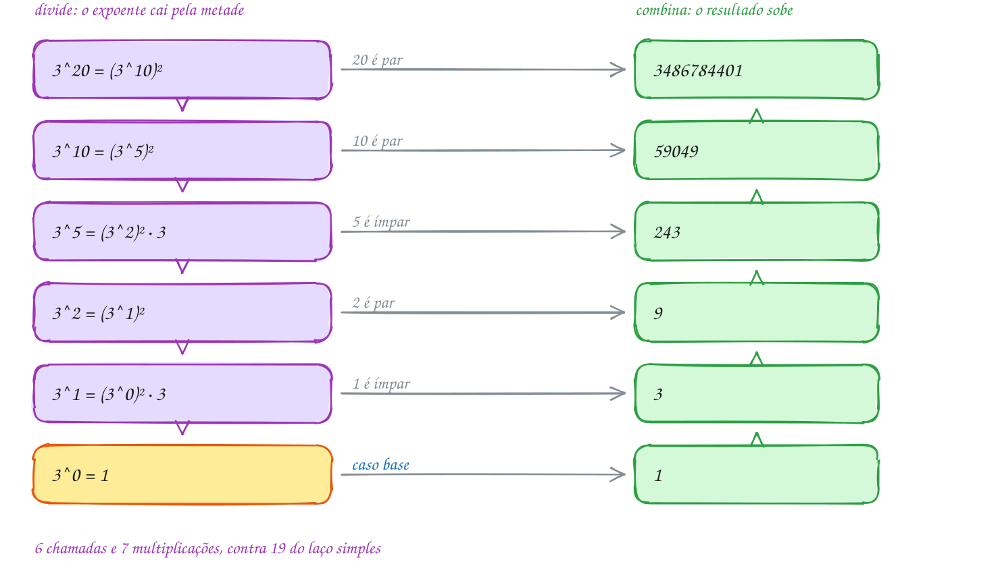</p>

O `printf` mostra cada resultado parcial quando a chamada termina, e `mult`
soma as multiplicações:

```c
#include <stdio.h>

static int mult = 0; // quantas multiplicações foram feitas

// x elevado a n, dividindo o expoente ao meio
long long potencia(long long x, int n) {
    if (n == 0) {
        return 1;                          // caso base: x^0 = 1
    }
    long long metade = potencia(x, n / 2); // conquista: resolve o pedaço menor
    long long r;
    if (n % 2 == 0) {
        r = metade * metade;               // combina: x^n = (x^(n/2))^2
        mult += 1;
    } else {
        r = metade * metade * x;           // n ímpar: sobra um x
        mult += 2;
    }
    printf("3^%-2d = %lld\n", n, r);
    return r;
}

int main(void) {
    long long total = potencia(3, 20);
    printf("Na rodada 20: %lld mensagens\n", total);
    printf("%d multiplicações (o laço simples faria 19)\n", mult);
    return 0;
}
// Saída:
// 3^1  = 3
// 3^2  = 9
// 3^5  = 243
// 3^10 = 59049
// 3^20 = 3486784401
// Na rodada 20: 3486784401 mensagens
// 7 multiplicações (o laço simples faria 19)
```

Os resultados saem de baixo para cima, pela pilha de chamadas (0031).

O fluxograma segue a chamada com `n = 20`: ela chama a si mesma com 10,
recebe 59049 e, como 20 é par, só eleva ao quadrado:

<p align="center">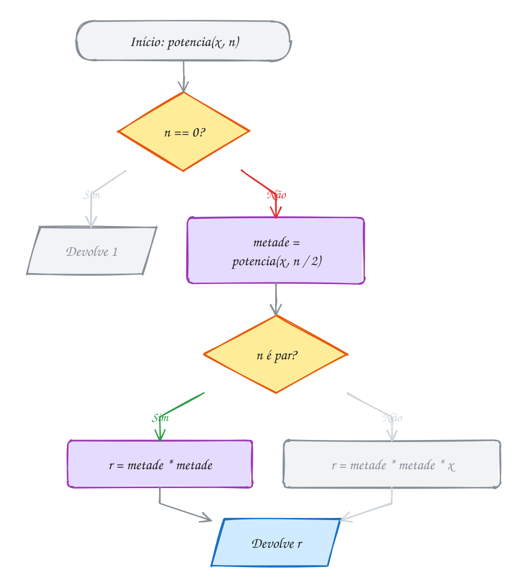</p>

> [!WARNING]
> `return potencia(x, n / 2) * potencia(x, n / 2);` dá o resultado certo, mas
> faz **duas** chamadas por nível: T(n) = 2T(n/2) + O(1), que é O(n). Guarde a
> metade numa variável. Divisão e conquista só compensa quando os pedaços
> **não se repetem**.

> [!TIP]
> **Por dentro do C:** o perigo é o **estouro do `long long`**:
> 3³⁹ cabe, 3⁴⁰ não, e o gcc com as flags de estudo acusa `runtime error`.
> Para só os últimos dígitos, use `% m` após cada multiplicação (A261).

> [!NOTE]
> **Pergunta para você:** quantas multiplicações a função faz para 3¹⁶? E para
> 3¹⁵? Por que o expoente 15, menor, dá mais trabalho? Pista: escreva 16 e 15
> em binário.

### Hora de praticar

**Exemplo A261 · Potência rápida sem recursão: os bits do expoente**

```c
#include <stdio.h>

// base^exp % m sem recursão: lê o expoente bit a bit, do menos significativo
// para o mais significativo. A cada volta, "base" vira o quadrado dela
// (b, b^2, b^4, b^8...) e entra no resultado quando o bit vale 1.
long long potencia_mod(long long base, long long exp, long long m) {
    long long r = 1;
    base %= m;
    printf("bit  base  resultado\n");
    while (exp > 0) {
        int bit = exp & 1;
        if (bit) {
            r = r * base % m;  // este pedaço do expoente entra na conta
        }
        printf("%3d  %4lld  %9lld\n", bit, base, r);
        base = base * base % m; // próxima potência: o quadrado da atual
        exp >>= 1;              // anda um bit para a esquerda
    }
    return r;
}

int main(void) {
    const char *dias[] = {"domingo", "segunda", "terça", "quarta",
                          "quinta", "sexta", "sábado"};
    // hoje é domingo: que dia da semana será daqui a 2^100 dias?
    // 100 em binário é 1100100: 7 bits, 7 voltas
    long long resto = potencia_mod(2, 100, 7);
    printf("2^100 dias: %lld dia(s) além de semanas inteiras -> %s\n\n",
           resto, dias[resto]);

    // os 4 últimos dígitos de 2^64, que não cabe nem num unsigned long long
    // (o maior é 2^64 - 1); com % 10000, nenhuma conta passa de 10^8
    long long fim = potencia_mod(2, 64, 10000);
    printf("2^64 termina em %04lld\n", fim);
    return 0;
}
// Saída:
// bit  base  resultado
//   0     2          1
//   0     4          1
//   1     2          2
//   0     4          2
//   0     2          2
//   1     4          1
//   1     2          2
// 2^100 dias: 2 dia(s) além de semanas inteiras -> terça
//
// bit  base  resultado
//   0     2          1
//   0     4          1
//   0    16          1
//   0   256          1
//   0  5536          1
//   0  7296          1
//   1  1616       1616
// 2^64 termina em 1616
```

```bash
gcc ~/LPEDC/material/A261.c -o ~/LPEDC/material/A261 && ~/LPEDC/material/A261
```

**Exemplo A262 · Maior e menor de uma vez, dividindo ao meio**

```c
#include <stdio.h>

static int comparacoes = 0;

typedef struct {
    int menor;
    int maior;
} Extremos;

// menor e maior de v[ini..fim] (intervalo fechado)
Extremos extremos(const int v[], int ini, int fim) {
    Extremos e;
    if (ini == fim) {                   // 1 elemento: é o menor e o maior
        e.menor = e.maior = v[ini];
        return e;
    }
    if (fim == ini + 1) {               // 2 elementos: 1 comparação basta
        comparacoes++;
        if (v[ini] < v[fim]) {
            e.menor = v[ini];
            e.maior = v[fim];
        } else {
            e.menor = v[fim];
            e.maior = v[ini];
        }
        return e;
    }
    int meio = ini + (fim - ini) / 2;
    Extremos a = extremos(v, ini, meio);     // metade esquerda
    Extremos b = extremos(v, meio + 1, fim); // metade direita
    comparacoes += 2;                        // combina: 2 comparações
    e.menor = a.menor < b.menor ? a.menor : b.menor;
    e.maior = a.maior > b.maior ? a.maior : b.maior;
    return e;
}

int main(void) {
    // temperaturas mínimas de 16 dias em Curitiba, em graus
    int temp[] = {12, 9, 15, 7, 11, 14, 6, 10, 13, 8, 16, 5, 9, 12, 17, 10};
    int n = 16;

    // jeito simples: cada elemento compara com o menor E com o maior
    int menor = temp[0], maior = temp[0], simples = 0;
    for (int i = 1; i < n; i++) {
        simples += 2;
        if (temp[i] < menor) menor = temp[i];
        if (temp[i] > maior) maior = temp[i];
    }
    printf("Laço simples: menor %d, maior %d, %d comparações\n", menor, maior, simples);

    // dividindo: cada par custa 1 comparação (e não 2), e cada combinação
    // custa 2. Total: 3n/2 - 2 = 22, contra 2(n - 1) = 30. O Big-O é o mesmo,
    // O(n); a divisão e conquista ganhou na constante.
    Extremos e = extremos(temp, 0, n - 1);
    printf("Dividindo:    menor %d, maior %d, %d comparações\n", e.menor, e.maior, comparacoes);
    return 0;
}
// Saída:
// Laço simples: menor 5, maior 17, 30 comparações
// Dividindo:    menor 5, maior 17, 22 comparações
```

```bash
gcc ~/LPEDC/material/A262.c -o ~/LPEDC/material/A262 && ~/LPEDC/material/A262
```

#### Exercícios

**Exercício E781** · ★☆☆

A barraca de pastel anotou as vendas de 8 dias, em reais:


```text
320 415 280 510 390 605 720 460
```


Escreva a função int soma(const int v[], int ini, int fim), que soma
v[ini..fim] por divisão e conquista: se o pedaço tem um elemento só, a
soma é ele; senão, divida ao meio, some cada metade com a própria função e
junte as duas respostas. Conte as chamadas numa variável global e mostre:


```text
Saída esperada:
Total: R$ 3700
Chamadas: 15
```

```bash
gcc ~/LPEDC/material/E781.c -o ~/LPEDC/material/E781 && ~/LPEDC/material/E781
```

**Exercício E783** · ★★☆

Escreva long long potencia(long long x, int n), a potência por divisão e
conquista: caso base n == 0; senão, UMA só chamada recursiva para n / 2,
guardada numa variável, e o resultado é o quadrado dela (vezes x, se n é
ímpar). Conte as chamadas numa variável static e mostre 3^20 e o número
de chamadas. Depois troque 20 por 39 e confira que as chamadas sobem só
para 7. (Não vá além de 39: 3^40 estoura o long long.)


```text
Saída esperada:
3^20 = 3486784401
Chamadas: 6
```

```bash
gcc ~/LPEDC/material/E783.c -o ~/LPEDC/material/E783 && ~/LPEDC/material/E783
```

**Exercício E784** · ★★☆

Uma trilha de 10 km foi medida a cada quilômetro. A altitude só sobe até
o pico e depois só desce (o pico não fica nas pontas):


```text
km:       0    1    2    3    4    5    6    7    8    9   10
altitude: 820  905 1010 1180 1340 1415 1390 1250 1100  960  870
```


Escreva int pico(const int v[], int ini, int fim), que acha o índice do
ponto mais alto SEM olhar todos os pontos. Divisão e conquista com um
pedaço só, como a busca binária: olhe o meio e o vizinho da direita. Se
ainda está subindo, o pico está à direita do meio; senão, está no meio ou
à esquerda. Conte numa variável global quantas vezes comparou v[meio] com
v[meio + 1].


```text
Saída esperada:
Pico: 1415 m no km 5
Comparações: 3
```

```bash
gcc ~/LPEDC/material/E784.c -o ~/LPEDC/material/E784 && ~/LPEDC/material/E784
```

**Exercício E785** · ★★★

Fibonacci rápido: a matriz {1 1; 1 0} elevada a n tem F(n) na primeira
linha, segunda coluna (F(1) = F(2) = 1). Calcule-o com a potência rápida,
multiplicando matrizes. Escreva:
- typedef struct Matriz com quatro long long (a, b, c, d);
- Matriz multiplica(Matriz x, Matriz y), que soma 1 num contador global;
- Matriz potencia(Matriz m, int n), recursiva, com {1, 0, 0, 1} no caso base;
- long long fib(int n).
Mostre F(10), F(50) e F(90), zerando o contador antes de cada um.


```text
Saída esperada:
F(10) = 55 (6 produtos de matriz)
F(50) = 12586269025 (9 produtos de matriz)
F(90) = 2880067194370816120 (11 produtos de matriz)
```

```bash
gcc ~/LPEDC/material/E785.c -o ~/LPEDC/material/E785 && ~/LPEDC/material/E785
```

---

## 0132 · Inversões e subvetor de soma máxima

Você e o Caio montaram o top 8 de séries do ano. Os gostos batem? Se você
põe "Sintonia" antes de "Cidade Invisível" e o Caio faz o contrário, o par
está em desacordo.

Escreva as suas séries e, embaixo, a posição de cada uma no ranking do Caio:
se concordasse com tudo, o vetor seria `1 2 3 4 5 6 7 8`. Cada par em desacordo é uma **inversão**: posições `i < j` com `v[i] > v[j]`.
São zero inversões no vetor ordenado e `n(n - 1)/2` no vetor ao contrário.

Testar todos os pares é O(n²). Pegando carona no merge sort (0094), a divisão
e conquista faz em **O(n log n)**.

Divida o vetor ao meio. Toda inversão é de um destes tipos:

1. os dois elementos estão na metade **esquerda**;
2. os dois estão na metade **direita**;
3. um em cada metade: a inversão **cruza** o meio.

A recursão resolve os tipos 1 e 2. No tipo 3, com as metades **ordenadas**, a
intercalação conta de graça: quando um elemento da direita sai antes, ele é
menor que **todos** os `q - i` que sobram na esquerda, ou seja, `q - i`
inversões de uma vez.

A função devolve a contagem **e** deixa o pedaço ordenado: é a recorrência do
merge sort, O(n log n).

No vetor do Caio, são 3 inversões na esquerda, 4 na direita e mais 6 na
intercalação (o 2 passa na frente de 3, o 4 de 2 e o 6 de 1):

<p align="center">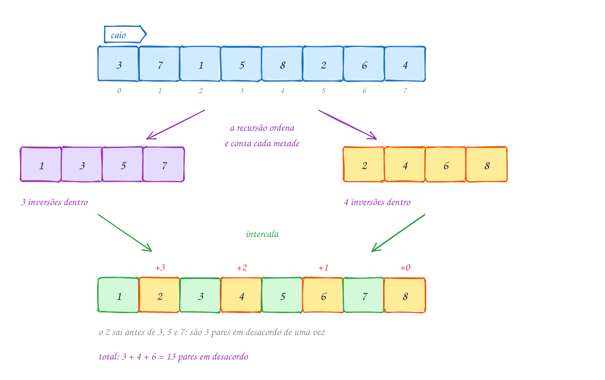</p>

É o merge sort com um contador; o `printf` mostra as inversões da esquerda,
da direita e as cruzadas:

```c
#include <stdio.h>
#include <stdlib.h>

// junta v[p..q-1] e v[q..r-1], já ordenados, e devolve quantas inversões
// cruzam as duas metades
long long intercala(int v[], int w[], int p, int q, int r) {
    long long inv = 0;
    int i = p, j = q, k = 0;
    while (i < q && j < r) {
        if (v[i] <= v[j]) {
            w[k++] = v[i++];
        } else {
            inv += q - i;       // v[j] é menor que TODOS os que sobram à esquerda
            w[k++] = v[j++];
        }
    }
    while (i < q) w[k++] = v[i++];
    while (j < r) w[k++] = v[j++];
    for (k = 0; k < r - p; k++) {
        v[p + k] = w[k];
    }
    return inv;
}

// ordena v[p..r-1] e devolve o número de inversões que havia nele
long long conta(int v[], int w[], int p, int r) {
    if (r - p < 2) {
        return 0;                       // 0 ou 1 elemento: nenhuma inversão
    }
    int q = p + (r - p) / 2;
    long long esq = conta(v, w, p, q);  // inversões dentro da esquerda
    long long dir = conta(v, w, q, r);  // inversões dentro da direita
    long long cruz = intercala(v, w, p, q, r); // um de cada lado
    printf("[%d, %d): %lld + %lld + %lld\n", p, r, esq, dir, cruz);
    return esq + dir + cruz;
}

int main(void) {
    // posição, no ranking do Caio, de cada série do seu top 8
    int caio[] = {3, 7, 1, 5, 8, 2, 6, 4};
    int n = 8;
    int *w = malloc(n * sizeof *w);
    if (w == NULL) {
        return 1;
    }
    long long total = conta(caio, w, 0, n);
    printf("Pares em desacordo: %lld de %d\n", total, n * (n - 1) / 2);
    free(w);
    return 0;
}
// Saída:
// [0, 2): 0 + 0 + 0
// [2, 4): 0 + 0 + 0
// [0, 4): 0 + 0 + 3
// [4, 6): 0 + 0 + 1
// [6, 8): 0 + 0 + 1
// [4, 8): 1 + 1 + 2
// [0, 8): 3 + 4 + 6
// Pares em desacordo: 13 de 28
```

### Passo a passo

Última intercalação: `1 3 5 7` com `2 4 6 8`. Quando o menor vem da direita,
soma os que sobram na esquerda:

| sai | de onde | sobram na esquerda | soma |
| --- | --- | --- | --- |
| 1 | esquerda | | 0 |
| 2 | direita | 3, 5, 7 | 3 |
| 3 | esquerda | | 3 |
| 4 | direita | 5, 7 | 5 |
| 5 | esquerda | | 5 |
| 6 | direita | 7 | 6 |
| 7 | esquerda | | 6 |
| 8 | direita | (nenhum) | 6 |

No fluxograma, as duas chamadas recursivas contam dentro de cada metade e a
intercalação conta o que cruza:

<p align="center">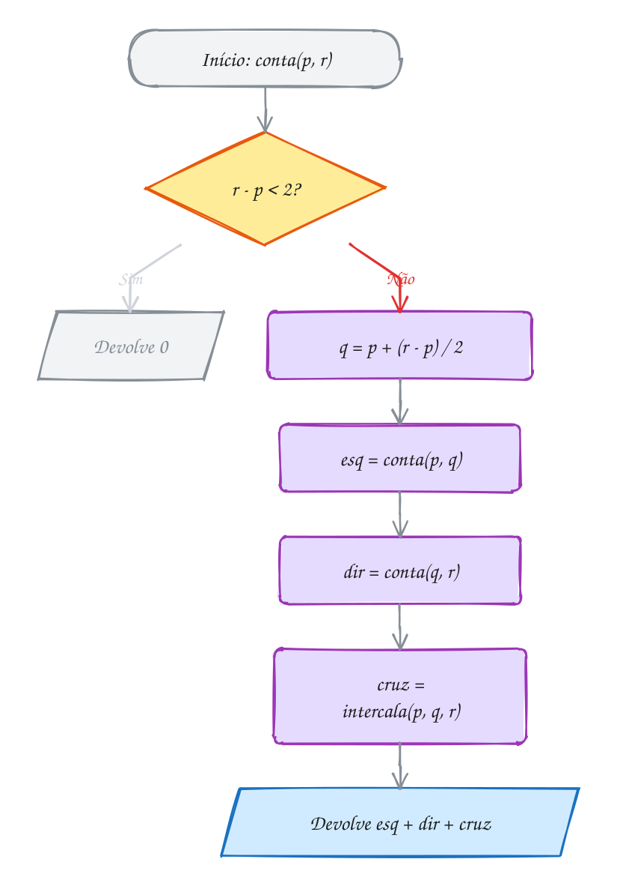</p>

### O subvetor de soma máxima

Os mesmos três tipos resolvem outro problema. Um food truck anotou o lucro de
8 dias: `4 -6 3 5 -2 6 -9 2`. Qual faixa de dias **seguidos** deu o maior
lucro somado? Dividindo ao meio, ela está:

1. inteira na **esquerda** (`4 -6 3 5`): `3 5`, soma 8;
2. inteira na **direita** (`-2 6 -9 2`): `6`, soma 6;
3. **cruzando** o meio: melhor final da esquerda (`3 5`, 8) mais melhor
   começo da direita (`-2 6`, 4): `3 5 -2 6`, soma **12**.

A resposta é o maior dos três: 12, do dia 2 ao 5. O caso 3 é um laço do meio
para fora, O(n), e o total é O(n log n). O A263 traz o algoritmo em C e o
A264, um jeito em O(n).

> [!WARNING]
> A soma é `inv += q - i`, e não `inv++`: o `v[j]` que sai está fora de ordem
> com **todos** os elementos de `v[i]` a `v[q - 1]`. E o `<=` importa: valores
> iguais **não** são inversão.

> [!TIP]
> **Por dentro do C:** o contador é `long long`: 100 000 elementos ao contrário
> dão 4 999 950 000 inversões, mais que um `int` suporta. Contar também
> **ordena**; para manter a ordem original, conte numa cópia (`memcpy`).

> [!NOTE]
> **Pergunta para você:** quantas inversões tem o vetor `8 7 6 5 4 3 2 1`? E
> quanto o `printf` mostra na linha do `[0, 8)`? Confira a sua conta com a
> fórmula `n(n - 1)/2`.

### Hora de praticar

**Exemplo A263 · A melhor sequência de dias, dividindo ao meio**

```c
#include <stdio.h>

typedef struct {
    int soma;
    int ini, fim; // a faixa v[ini..fim]
} Faixa;

// melhor faixa que CRUZA o meio: obrigatoriamente contém v[meio] e v[meio + 1]
Faixa cruzando(const int v[], int ini, int meio, int fim) {
    Faixa f = {0, meio, meio + 1};
    int soma = 0, melhor_esq = v[meio];
    for (int i = meio; i >= ini; i--) {      // do meio para a esquerda
        soma += v[i];
        if (soma >= melhor_esq) {
            melhor_esq = soma;
            f.ini = i;
        }
    }
    soma = 0;
    int melhor_dir = v[meio + 1];
    for (int j = meio + 1; j <= fim; j++) {  // do meio para a direita
        soma += v[j];
        if (soma > melhor_dir) {
            melhor_dir = soma;
            f.fim = j;
        }
    }
    f.soma = melhor_esq + melhor_dir;
    return f;
}

// melhor faixa de v[ini..fim]
Faixa melhor(const int v[], int ini, int fim) {
    if (ini == fim) {
        return (Faixa){v[ini], ini, fim};   // um dia só
    }
    int meio = ini + (fim - ini) / 2;
    Faixa e = melhor(v, ini, meio);         // inteira na esquerda
    Faixa d = melhor(v, meio + 1, fim);     // inteira na direita
    Faixa c = cruzando(v, ini, meio, fim);  // cruzando o meio
    if (e.soma >= d.soma && e.soma >= c.soma) return e;
    if (d.soma >= c.soma) return d;
    return c;
}

int main(void) {
    // lucro de uma barraca de praia em 10 dias (R$); chuva dá prejuízo
    int lucro[] = {120, -80, 200, -50, -90, 300, 150, -400, 180, 60};
    int n = 10;

    Faixa f = melhor(lucro, 0, n - 1);
    printf("Melhor sequência: dia %d ao dia %d\n", f.ini, f.fim);
    printf("Dias:");
    for (int i = f.ini; i <= f.fim; i++) {
        printf(" %d", lucro[i]);
    }
    printf("\nLucro somado: R$ %d\n", f.soma);
    // repare: a melhor faixa engole dois dias de prejuízo (-50 e -90) para
    // juntar os dias bons dos dois lados

    return 0;
}
// Saída:
// Melhor sequência: dia 0 ao dia 6
// Dias: 120 -80 200 -50 -90 300 150
// Lucro somado: R$ 550
```

```bash
gcc ~/LPEDC/material/A263.c -o ~/LPEDC/material/A263 && ~/LPEDC/material/A263
```

**Exemplo A264 · Kadane: a soma máxima numa passada só**

```c
#include <stdio.h>

// a melhor faixa que TERMINA no dia i ou é o próprio dia i (começar de novo)
// ou é a melhor que terminava no dia i - 1 com o dia i grudado no fim.
// Guardando só esse número, uma passada resolve: O(n), sem recursão.
void kadane(const char *rotulo, const int v[], int n) {
    int aqui = v[0], ini_aqui = 0;          // melhor faixa que termina em i
    int melhor = v[0], ini = 0, fim = 0;    // melhor faixa vista até agora
    for (int i = 1; i < n; i++) {
        if (aqui + v[i] < v[i]) {
            aqui = v[i];                    // o passado só atrapalha: recomeça
            ini_aqui = i;
        } else {
            aqui += v[i];                   // vale a pena continuar
        }
        if (aqui > melhor) {
            melhor = aqui;
            ini = ini_aqui;
            fim = i;
        }
    }
    printf("%-10s rodadas %d a %d, saldo %+d\n", rotulo, ini + 1, fim + 1, melhor);
}

int main(void) {
    // saldo de gols de dois times, rodada a rodada
    int tigre[] = {2, -1, -3, 4, -1, 2, 1, -5, 4, 1};
    int lanterna[] = {-2, -1, -4, -1, -3}; // perdeu todas

    kadane("Tigre:", tigre, 10);
    kadane("Lanterna:", lanterna, 5);
    // com tudo negativo, a melhor faixa é a menos ruim: um jogo só (-1).
    // Começar "aqui" e "melhor" com 0 em vez de v[0] daria saldo 0 numa faixa
    // vazia, o que não é uma sequência de rodadas.
    return 0;
}
// Saída:
// Tigre:     rodadas 4 a 7, saldo +6
// Lanterna:  rodadas 2 a 2, saldo -1
```

```bash
gcc ~/LPEDC/material/A264.c -o ~/LPEDC/material/A264 && ~/LPEDC/material/A264
```

#### Exercícios

**Exercício E787** · ★☆☆

A lista de entregas de um motoboy deveria estar em ordem de horário, mas
foi montada às pressas. Os horários (minutos depois das 18h), na ordem da
lista, são:


```text
14 9 17 12 20 11 15
```


Escreva o jeito direto, O(n²): dois laços que testam todos os pares
i < j e mostram cada par fora de ordem (horario[i] > horario[j]), na ordem
em que os laços os encontram. No fim, mostre o total e quantos pares
existem.


```text
Saída esperada:
Fora de ordem: (14, 9) (14, 12) (14, 11) (17, 12) (17, 11) (17, 15) (12, 11) (20, 11) (20, 15)
Inversões: 9 de 21 pares
```

```bash
gcc ~/LPEDC/material/E787.c -o ~/LPEDC/material/E787 && ~/LPEDC/material/E787
```

**Exercício E789** · ★★☆

Você e a Bia ranquearam os mesmos seis pratos, do favorito ao último:


```text
você: Feijoada, Moqueca, Coxinha, Acarajé, Pastel, Pão de queijo
Bia:  Moqueca, Coxinha, Feijoada, Pão de queijo, Acarajé, Pastel
```


Mostre cada par de pratos em que vocês discordam (no formato "A x B", com
A antes de B no SEU ranking) e o total. Monte um vetor v em que
v[i] é a posição, no ranking da Bia, do seu i-ésimo prato. Os pares em
desacordo são exatamente as inversões de v.


```text
Saída esperada:
Feijoada x Moqueca
Feijoada x Coxinha
Acarajé x Pão de queijo
Pastel x Pão de queijo
Pares em desacordo: 4 de 15
```

```bash
gcc ~/LPEDC/material/E789.c -o ~/LPEDC/material/E789 && ~/LPEDC/material/E789
```

**Exercício E790** · ★★☆

Cada deslocamento do insertion sort (assunto 0093) desfaz uma inversão,
então o número de deslocamentos é o número de inversões do vetor.
Confira no computador. Escreva long long insercao(int v[], int n), que
devolve quantos deslocamentos fez, e o merge sort que conta inversões, do
texto (sem os printf). Aplique os dois, cada um numa cópia do vetor
(memcpy), aos pesos de 12 encomendas, em kg:


```text
31 12 45 27 8 39 19 50 4 23 36 15
```


```text
Saída esperada:
Deslocamentos do insertion sort: 36
Inversões pelo merge sort: 36
```

```bash
gcc ~/LPEDC/material/E790.c -o ~/LPEDC/material/E790 && ~/LPEDC/material/E790
```

**Exercício E791** · ★★★

Um analista quer contar as quedas fortes no preço de uma ação: pares de
dias i < j em que o preço do dia i era MAIS QUE O DOBRO do preço do dia j
(preco[i] > 2 * preco[j]). Os preços de 8 dias, em reais:


```text
40 18 25 9 30 12 50 20
```


Escreva a versão O(n log n), adaptando o merge sort que conta inversões,
e confira com uma força bruta O(n²) feita ANTES de ordenar.


```text
Saída esperada:
Quedas de mais da metade: 7
Força bruta: 7
```

```bash
gcc ~/LPEDC/material/E791.c -o ~/LPEDC/material/E791 && ~/LPEDC/material/E791
```

---

## 0133 · Algoritmos gulosos

Na padaria, o pão deu R$ 3,10 e você pagou com uma nota de 5. O caixa devolve
R$ 1,90 com o **menor número de moedas** pegando sempre a maior que cabe no
que falta: 100 + 50 + 25 + 10 + 5, cinco moedas, o mínimo possível.

Isso é um **algoritmo guloso** (*greedy*): a cada passo faz a escolha que
parece a **melhor agora** e **nunca volta atrás**. Não desfaz, como o
backtracking (0127), nem divide em subproblemas, como a divisão e conquista
(0131).

O Dijkstra (0112) é guloso: fixa o vértice mais perto da origem e nunca mais
mexe nele. Os próximos assuntos trazem reuniões numa sala, mochila e Huffman.

Quando funciona, o guloso é curto e barato: um laço, O(k + moedas dadas) para
`k` tipos de moeda. Mas uma escolha boa agora pode estragar o resto, e ele
não percebe.

Num fliperama com fichas de **1, 3 e 4 créditos**, o troco de 6 créditos pelo
guloso é 4 + 1 + 1, **três fichas**. Mas 3 + 3 dá **duas**: o 4 parecia ótimo
e fechou o caminho bom.

No Real dá certo porque o sistema é **canônico**: dá para provar que o guloso
acha o mínimo. A prova é por "troca": se um troco usasse duas moedas de 25 no
lugar de uma de 50, trocá-las pela de 50 diminuiria a conta. Com {1, 3, 4}, a
troca falha: duas fichas de 3 não viram uma de 4.

Vale para todo guloso: **um contraexemplo derruba, e só uma prova garante**.
O Cormen pede a **propriedade da escolha gulosa** (alguma solução ótima começa
pela escolha do guloso) e a **subestrutura ótima** (o que sobra é um problema
do mesmo tipo); a troca prova a primeira. Quando o guloso não serve, a
programação dinâmica (módulo 21) resolve o troco de qualquer sistema.

No desenho, em cima o troco de R$ 1,90 (o guloso acerta); embaixo, as fichas:
o 4 deixa um resto de 2 que custa duas fichas, e o 3 + 3 nunca é visto:

<p align="center">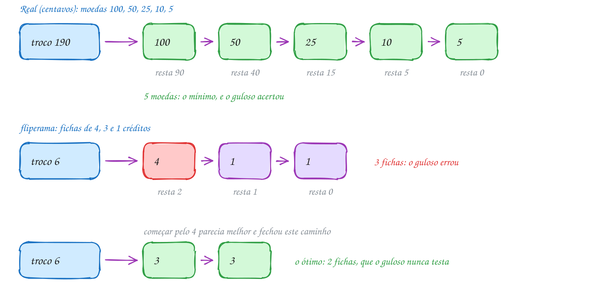</p>

A função recebe as moedas em ordem **decrescente**: se a moeda cabe, dá e
continua nela; se não, passa para a próxima menor:

```c
#include <stdio.h>

// troco guloso: sempre a MAIOR moeda que ainda cabe no que falta.
// moedas[] precisa estar em ordem decrescente. Devolve quantas moedas deu.
int troco_guloso(const int moedas[], int k, int valor) {
    int quantas = 0;
    int i = 0;
    printf("Troco de %d:", valor);
    while (valor > 0 && i < k) {
        if (moedas[i] <= valor) {
            printf(" %d", moedas[i]); // escolhe e nunca volta atrás
            valor -= moedas[i];
            quantas++;
        } else {
            i++;                      // essa não cabe mais: tenta a próxima
        }
    }
    printf(" (%d moedas)\n", quantas);
    return quantas;
}

int main(void) {
    int real[] = {100, 50, 25, 10, 5}; // centavos
    int fichas[] = {4, 3, 1};          // créditos do fliperama

    troco_guloso(real, 5, 190);        // R$ 1,90
    troco_guloso(fichas, 3, 6);        // 6 créditos
    return 0;
}
// Saída:
// Troco de 190: 100 50 25 10 5 (5 moedas)
// Troco de 6: 4 1 1 (3 moedas)
```

O código não sabe que errou: só o contraexemplo mostra que 3 não é o mínimo.

No fluxograma, "ainda falta troco?" controla o laço e "a moeda da vez cabe?"
decide entre dar a moeda ou descer para a próxima. Não há volta a uma moeda
maior:

<p align="center">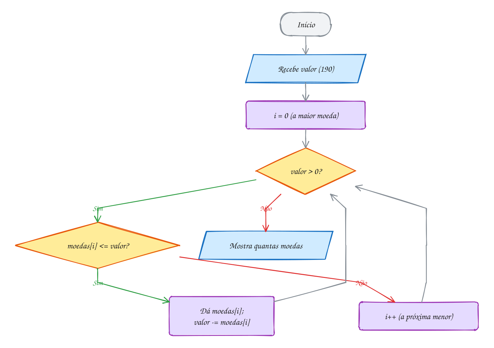</p>

> [!WARNING]
> O guloso do troco **depende da ordem** do vetor: com `{5, 10, 25, 50, 100}`,
> a função dá 38 moedas de 5 centavos para R$ 1,90. Ordene da maior para a
> menor (`qsort`, 0096), e lembre que, mesmo ordenado, o guloso só garante o
> mínimo em sistema canônico.

> [!TIP]
> **Por dentro do C:** use **centavos** em `int`, não reais em `double`:
> `1.90 - 1.00 - 0.50 - 0.25 - 0.10` dá `0.049999999999999906`, e a moeda de 5
> centavos "não cabe" (`0.05 <= 0.0499...` é falso).

> [!NOTE]
> **Pergunta para você:** com moedas de 1, 10 e 25 centavos (sem a de 5), o
> guloso acerta o troco de 30? E o de 40? Faça as contas no papel e depois
> rode a função com `{25, 10, 1}`.

### Hora de praticar

**Exemplo A265 · Postos na estrada: parar o mínimo de vezes**

```c
#include <stdio.h>

// guloso que ACERTA: siga até onde o tanque deixa e só abasteça no último
// posto antes de o combustível acabar. Parar antes nunca ajuda: o tanque
// cheio num posto mais à frente leva você pelo menos tão longe.
int main(void) {
    int destino = 600;   // km da viagem
    int autonomia = 200; // km com o tanque cheio
    int posto[] = {80, 150, 230, 310, 360, 450, 520, 590}; // km de cada posto
    int n = 8;

    int alcance = autonomia; // até onde chego sem parar
    int paradas = 0;
    int i = 0;
    while (alcance < destino) {
        int ultimo = -1;
        while (i < n && posto[i] <= alcance) {
            ultimo = posto[i];   // o posto mais distante que ainda alcanço
            i++;
        }
        if (ultimo < 0) {
            printf("Sem posto ao alcance: a viagem não dá\n");
            return 1;
        }
        paradas++;
        alcance = ultimo + autonomia;
        printf("Parada %d: km %d (agora chego ao km %d)\n", paradas, ultimo, alcance);
    }
    printf("Chegou ao km %d com %d paradas\n", destino, paradas);
    return 0;
}
// Saída:
// Parada 1: km 150 (agora chego ao km 350)
// Parada 2: km 310 (agora chego ao km 510)
// Parada 3: km 450 (agora chego ao km 650)
// Chegou ao km 600 com 3 paradas
```

```bash
gcc ~/LPEDC/material/A265.c -o ~/LPEDC/material/A265 && ~/LPEDC/material/A265
```

**Exemplo A266 · Fila do cartório: o mais rápido primeiro**

```c
#include <stdio.h>
#include <stdlib.h>

typedef struct {
    const char *nome;
    int minutos; // tempo de atendimento
} Pessoa;

int por_duracao(const void *a, const void *b) {
    const Pessoa *x = a;
    const Pessoa *y = b;
    return (x->minutos > y->minutos) - (x->minutos < y->minutos);
}

// soma o tempo que cada pessoa ESPERA antes de ser atendida
int espera_total(const Pessoa fila[], int n) {
    int relogio = 0, total = 0;
    for (int i = 0; i < n; i++) {
        total += relogio;          // a pessoa i esperou até agora
        relogio += fila[i].minutos;
        printf(" %s", fila[i].nome);
    }
    return total;
}

int main(void) {
    Pessoa fila[] = {{"Ana", 12}, {"Bruno", 3}, {"Carla", 8}, {"Davi", 1}, {"Eva", 5}};
    int n = 5;

    printf("Por chegada:");
    int chegada = espera_total(fila, n);
    printf("\n  espera total %d min, média %.1f min\n", chegada, chegada / (double)n);

    // guloso: atender sempre o serviço mais curto que está na fila.
    // Quem é atendido primeiro faz TODOS os outros esperarem; por isso o
    // primeiro deve ser o mais curto.
    qsort(fila, n, sizeof fila[0], por_duracao);
    printf("Mais curto primeiro:");
    int curto = espera_total(fila, n);
    printf("\n  espera total %d min, média %.1f min\n", curto, curto / (double)n);
    return 0;
}
// Saída:
// Por chegada: Ana Bruno Carla Davi Eva
//   espera total 74 min, média 14.8 min
// Mais curto primeiro: Davi Bruno Eva Carla Ana
//   espera total 31 min, média 6.2 min
```

```bash
gcc ~/LPEDC/material/A266.c -o ~/LPEDC/material/A266 && ~/LPEDC/material/A266
```

#### Exercícios

**Exercício E793** · ★☆☆

O caixa eletrônico tem notas de R$ 200, 100, 50, 20, 10, 5 e 2, e entrega
o saque com o menor número de notas, pelo guloso: a maior nota que cabe,
de novo e de novo. Escreva a função void saque(int valor), que mostra
quantas notas de cada valor saem (só as que aparecem) e o total, e chame
para R$ 380 e R$ 1270.


```text
Saída esperada:
Saque de R$ 380:
  1 de R$ 200
  1 de R$ 100
  1 de R$ 50
  1 de R$ 20
  1 de R$ 10
  total: 5 notas
Saque de R$ 1270:
  6 de R$ 200
  1 de R$ 50
  1 de R$ 20
  total: 8 notas
```

```bash
gcc ~/LPEDC/material/E793.c -o ~/LPEDC/material/E793 && ~/LPEDC/material/E793
```

**Exercício E795** · ★★☆

Numa enchente, cada barco de resgate leva no máximo 2 pessoas e no máximo
150 kg. Os pesos das 8 pessoas a resgatar, em kg:


```text
60 95 80 120 45 70 100 55
```


Use o menor número de barcos com este guloso: ordene os pesos; a pessoa
mais pesada que falta SEMPRE vai no próximo barco; se a mais leve que
falta couber junto, vai junto. Mostre cada barco (o mais pesado primeiro)
e o total.


```text
Saída esperada:
Barco 1: 120
Barco 2: 100 + 45
Barco 3: 95 + 55
Barco 4: 80 + 60
Barco 5: 70
Total: 5 barcos
```

```bash
gcc ~/LPEDC/material/E795.c -o ~/LPEDC/material/E795 && ~/LPEDC/material/E795
```

**Exercício E796** · ★★☆

O sistema da lanchonete lê as moedas de um arquivo de configuração, e elas
chegam fora de ordem: {10, 50, 5, 100, 25}. Escreva
int troco_guloso(const int moedas[], int k, int valor), que supõe as
moedas em ordem DECRESCENTE: mostra as moedas usadas, uma a uma (a maior
que cabe, de novo e de novo), e devolve quantas foram. No main, ordene
as moedas em ordem decrescente com qsort (escreva a função de
comparação) e calcule o troco de 190 e de 65.


```text
Saída esperada:
Troco de 190: 100 50 25 10 5 (5 moedas)
Troco de 65: 50 10 5 (3 moedas)
```

```bash
gcc ~/LPEDC/material/E796.c -o ~/LPEDC/material/E796 && ~/LPEDC/material/E796
```

**Exercício E798** · ★★★

Depois do churrasco, a conta foi dividida igualmente entre 6 amigos, mas
cada um pagou uma parte diferente no mercado:


```text
Ana R$ 180, Bruno R$ 0, Carla R$ 60, Davi R$ 120, Eva R$ 0, Fábio R$ 90
```


Monte os Pix para acertar as contas com este guloso: enquanto alguém deve,
quem MAIS deve paga para quem MAIS tem a receber o menor dos dois valores
(a dívida de um ou o crédito do outro). Em caso de empate, vale o que vem
primeiro na lista. Trabalhe em centavos, num int.


```text
Saída esperada:
Total R$ 450.00, cada um R$ 75.00
Bruno -> Ana: R$ 75.00
Eva -> Davi: R$ 45.00
Eva -> Ana: R$ 30.00
Carla -> Fábio: R$ 15.00
4 Pix
```

```bash
gcc ~/LPEDC/material/E798.c -o ~/LPEDC/material/E798 && ~/LPEDC/material/E798
```

---

## 0134 · Seleção de intervalos

A quadra do condomínio atende uma reserva por vez, e no sábado chegaram nove
pedidos, cada um com início e fim. Alguns horários se chocam. O síndico quer
aceitar o **maior número possível** de pedidos. Quais?

É a **seleção de atividades**: dado um conjunto de intervalos `[início, fim)`,
achar o maior subconjunto sem sobreposição.

Testar todos os subconjuntos (0125) dá 512 casos para nove pedidos e mais de
um bilhão para trinta. Um **guloso** ordena uma vez, mas por qual critério?

- aceitar primeiro quem **começa** mais cedo;
- aceitar primeiro o pedido mais **curto**;
- aceitar primeiro quem **termina** mais cedo.

Só o terceiro funciona sempre: o pedido que termina primeiro **devolve a
quadra mais cedo** e deixa mais espaço. A prova é uma troca: numa escolha
ótima, troque o primeiro pedido pelo que termina primeiro. Ele termina antes
(ou junto), não choca com os outros e a escolha mantém o tamanho.

O algoritmo (`GREEDY-ACTIVITY-SELECTOR`, do Cormen):

1. **ordene** os pedidos pela hora de **fim**;
2. guarde a hora em que a quadra fica livre (`livre_em`, começando em 0);
3. percorra os pedidos: se começa em `livre_em` ou depois, **aceite** e mova
   `livre_em` para o fim dele; senão, recuse.

O custo é a ordenação, O(n log n), mais uma passada O(n).

No desenho, verdes foram aceitas e cinzas chocaram com alguém aceito. O pedido
da Iara (7h às 17h) seria o primeiro pelo critério "começa antes":

<p align="center">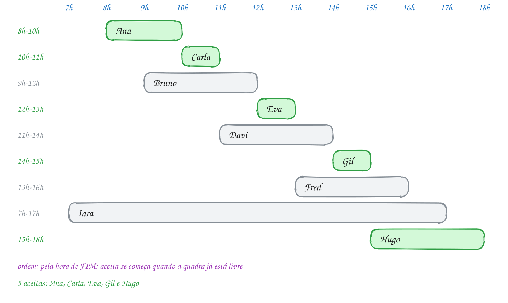</p>

Os pedidos são structs, ordenados com `qsort` (0096) por uma função que
compara os fins:

```c
#include <stdio.h>
#include <stdlib.h>

typedef struct {
    const char *nome;
    int ini, fim; // horário [ini, fim): quem sai às 10h libera a quadra às 10h
} Reserva;

int por_fim(const void *a, const void *b) {
    const Reserva *x = a;
    const Reserva *y = b;
    return (x->fim > y->fim) - (x->fim < y->fim);
}

int main(void) {
    Reserva r[] = {
        {"Ana", 8, 10},  {"Bruno", 9, 12}, {"Carla", 10, 11},
        {"Davi", 11, 14}, {"Eva", 12, 13},  {"Fred", 13, 16},
        {"Gil", 14, 15},  {"Hugo", 15, 18}, {"Iara", 7, 17},
    };
    int n = 9;

    // guloso: entre os pedidos que cabem, aceite o que TERMINA primeiro
    qsort(r, n, sizeof r[0], por_fim);
    int livre_em = 0; // a quadra fica livre a partir desta hora
    int aceitas = 0;
    for (int i = 0; i < n; i++) {
        printf("%-6s %2dh-%2dh: ", r[i].nome, r[i].ini, r[i].fim);
        if (r[i].ini >= livre_em) {
            printf("aceita\n");
            livre_em = r[i].fim;
            aceitas++;
        } else {
            printf("recusada (quadra ocupada até %dh)\n", livre_em);
        }
    }
    printf("Reservas aceitas: %d de %d\n", aceitas, n);
    return 0;
}
// Saída:
// Ana     8h-10h: aceita
// Carla  10h-11h: aceita
// Bruno   9h-12h: recusada (quadra ocupada até 11h)
// Eva    12h-13h: aceita
// Davi   11h-14h: recusada (quadra ocupada até 13h)
// Gil    14h-15h: aceita
// Fred   13h-16h: recusada (quadra ocupada até 15h)
// Iara    7h-17h: recusada (quadra ocupada até 15h)
// Hugo   15h-18h: aceita
// Reservas aceitas: 5 de 9
```

A Carla (10h às 11h) entra logo depois da Ana (8h às 10h): os intervalos são
**semiabertos** e a Ana libera a quadra às 10h. Por isso o teste é
`ini >= livre_em`, com o igual.

No fluxograma, depois da ordenação, o laço tem uma pergunta só. O caminho
marcado mostra a Ana aceita e o Bruno recusado:

<p align="center">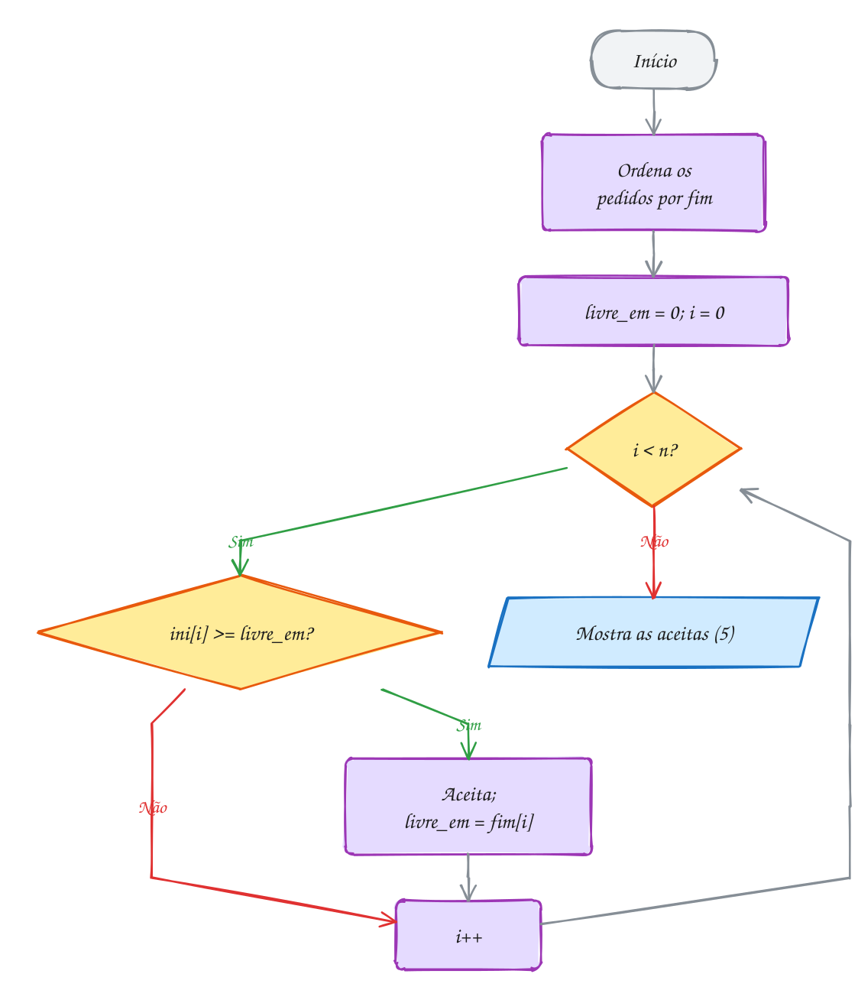</p>

> [!WARNING]
> Os outros critérios falham. "Começa primeiro" aceita a Iara (7h às 17h) e
> depois só o Hugo cabe: 1 pedido em vez de 5. "Mais curto primeiro" falha com
> 8h às 12h, 11h às 13h e 12h às 16h: o mais curto (11h às 13h) choca com os
> outros dois, que cabem juntos. O programa roda sem reclamar; só a resposta
> piora.

> [!TIP]
> **Por dentro do C:** compare com `(x > y) - (x < y)`, e não
> `x->fim - y->fim`: a subtração pode estourar o `int`.

> [!NOTE]
> **Pergunta para você:** se o pedido do Hugo fosse das 14h às 18h, quantas
> reservas seriam aceitas? Quais? E se fosse das 16h às 18h?

### Hora de praticar

**Exemplo A267 · Quantas salas? Todas as aulas, o mínimo de salas**

```c
#include <stdio.h>
#include <stdlib.h>

#define MAX_SALAS 10

typedef struct {
    const char *materia;
    int ini, fim; // [ini, fim), em horas
} Aula;

int por_inicio(const void *a, const void *b) {
    const Aula *x = a;
    const Aula *y = b;
    if (x->ini != y->ini) {
        return (x->ini > y->ini) - (x->ini < y->ini);
    }
    return (x->fim > y->fim) - (x->fim < y->fim); // empate: a que acaba antes
}

// outro problema de intervalos: agora TODAS as aulas acontecem, e a pergunta
// é quantas salas são precisas. Guloso: pela hora de INÍCIO, cada aula vai
// para uma sala que já ficou livre; se nenhuma ficou, abre uma sala nova.
int main(void) {
    Aula a[] = {
        {"Química", 10, 12}, {"Português", 8, 10}, {"Física", 9, 11},
        {"História", 11, 13}, {"Matemática", 8, 9}, {"Inglês", 12, 14},
        {"Biologia", 9, 12},  {"Redação", 13, 15},
    };
    int n = 8;
    int livre_em[MAX_SALAS]; // hora em que cada sala aberta fica livre
    int salas = 0;

    qsort(a, n, sizeof a[0], por_inicio);
    for (int i = 0; i < n; i++) {
        int s = 0;
        while (s < salas && livre_em[s] > a[i].ini) {
            s++;                // esta sala ainda está ocupada
        }
        if (s == salas) {
            salas++;            // nenhuma livre: abre a próxima
        }
        livre_em[s] = a[i].fim;
        printf("%2dh-%2dh  sala %d  %s\n", a[i].ini, a[i].fim, s + 1, a[i].materia);
    }
    printf("Salas necessárias: %d\n", salas);
    // 3 é o mínimo: às 9h, Português, Física e Biologia acontecem juntas.
    // O número de salas nunca passa do maior número de aulas simultâneas.
    return 0;
}
// Saída:
//  8h- 9h  sala 1  Matemática
//  8h-10h  sala 2  Português
//  9h-11h  sala 1  Física
//  9h-12h  sala 3  Biologia
// 10h-12h  sala 2  Química
// 11h-13h  sala 1  História
// 12h-14h  sala 2  Inglês
// 13h-15h  sala 1  Redação
// Salas necessárias: 3
```

```bash
gcc ~/LPEDC/material/A267.c -o ~/LPEDC/material/A267 && ~/LPEDC/material/A267
```

**Exemplo A268 · Juntando horários: a agenda livre do consultório**

```c
#include <stdio.h>
#include <stdlib.h>

typedef struct {
    int ini, fim; // minutos desde a meia-noite, [ini, fim)
} Bloco;

int por_inicio(const void *a, const void *b) {
    const Bloco *x = a;
    const Bloco *y = b;
    return (x->ini > y->ini) - (x->ini < y->ini);
}

void hora(int m) {
    printf("%02d:%02d", m / 60, m % 60);
}

int main(void) {
    // consultas marcadas por três atendentes, fora de ordem e encavaladas
    Bloco c[] = {
        {9 * 60, 10 * 60},       {14 * 60, 15 * 60 + 30}, {9 * 60 + 30, 11 * 60},
        {16 * 60, 17 * 60},      {11 * 60, 11 * 60 + 45}, {15 * 60, 15 * 60 + 45},
        {13 * 60, 13 * 60 + 30},
    };
    int n = 7;

    // ordena pelo início e vai "engolindo" quem começa antes do fim atual
    qsort(c, n, sizeof c[0], por_inicio);
    Bloco junto[7];
    int k = 0;
    junto[0] = c[0];
    for (int i = 1; i < n; i++) {
        if (c[i].ini <= junto[k].fim) {        // encosta ou sobrepõe: junta
            if (c[i].fim > junto[k].fim) {
                junto[k].fim = c[i].fim;
            }
        } else {
            junto[++k] = c[i];                 // buraco: começa outro bloco
        }
    }
    k++;

    printf("Ocupado:");
    for (int i = 0; i < k; i++) {
        printf("  ");
        hora(junto[i].ini);
        printf("-");
        hora(junto[i].fim);
    }
    // o que sobra entre 08:00 e 18:00 é horário livre
    printf("\nLivre:  ");
    int de = 8 * 60;
    for (int i = 0; i <= k; i++) {
        int ate = i < k ? junto[i].ini : 18 * 60;
        if (ate > de) {
            printf("  ");
            hora(de);
            printf("-");
            hora(ate);
        }
        if (i < k) {
            de = junto[i].fim;
        }
    }
    printf("\n");
    return 0;
}
// Saída:
// Ocupado:  09:00-11:45  13:00-13:30  14:00-15:45  16:00-17:00
// Livre:    08:00-09:00  11:45-13:00  13:30-14:00  15:45-16:00  17:00-18:00
```

```bash
gcc ~/LPEDC/material/A268.c -o ~/LPEDC/material/A268 && ~/LPEDC/material/A268
```

#### Exercícios

**Exercício E799** · ★☆☆

A sala de reunião do escritório recebeu 8 pedidos para amanhã, já
ORDENADOS pela hora de fim (o início está em ini[i], o fim em fim[i]):


```text
8-9  8-10  9-11  10-12  11-12  12-14  13-15  14-16
```


Escreva o laço guloso que escolhe o maior número de reuniões sem choque:
guarde a hora em que a sala fica livre (começa em 0) e aceite cada pedido
que começa nessa hora ou depois. Os intervalos são [ini, fim): quem
termina às 9h libera a sala às 9h.


```text
Saída esperada:
Escolhidas: 8-9 9-11 11-12 12-14 14-16
Total: 5
```

```bash
gcc ~/LPEDC/material/E799.c -o ~/LPEDC/material/E799 && ~/LPEDC/material/E799
```

**Exercício E801** · ★★☆

Coloque os três critérios do texto para competir no mesmo conjunto de
pedidos, [ini, fim):


```text
[0, 10) [1, 4) [4, 7) [7, 10) [3, 5) [6, 8) [10, 12)
```


Escreva int seleciona(const Pedido p[], int n, int (*criterio)(const void *,
const void *)), que copia os pedidos (memcpy), ordena a cópia com qsort
usando o critério recebido (ponteiro para função, assunto 0050) e aceita
cada pedido que não choca com NENHUM dos já aceitos. Escreva também as
três comparações: por_inicio, por_duracao e por_fim.


```text
Saída esperada:
Começa primeiro: 2
Mais curto:      3
Termina primeiro: 4
```

```bash
gcc ~/LPEDC/material/E801.c -o ~/LPEDC/material/E801 && ~/LPEDC/material/E801
```

**Exercício E802** · ★★☆

A fiscal da vigilância sanitária precisa passar por todas as feiras de
domingo. Ela anda rápido: numa visita, num certo horário, fiscaliza todas
as feiras abertas naquela hora. Os horários são FECHADOS, [abre, fecha]:


```text
Pinheiros 7-12, Lapa 6-9, Tatuapé 10-14, Mooca 8-11,
Liberdade 13-18, Butantã 15-17, Santana 16-20
```


Qual é o menor número de visitas? Guloso: ordene pela hora de
fechamento; pegue a feira que fecha primeiro e ainda não foi vista e
marque uma visita na hora em que ela FECHA (o mais tarde possível, para
pegar o maior número de outras abertas). Mostre cada visita com as feiras
abertas naquela hora, olhando só as que vêm dali em diante na ordem.


```text
Saída esperada:
Visita às 9h: Lapa Mooca Pinheiros
Visita às 14h: Tatuapé Liberdade
Visita às 17h: Butantã Liberdade Santana
Total: 3 visitas
```

```bash
gcc ~/LPEDC/material/E802.c -o ~/LPEDC/material/E802 && ~/LPEDC/material/E802
```

**Exercício E804** · ★★★

O clube tem DUAS quadras iguais e recebeu 10 pedidos de jogos, [ini, fim):


```text
Leões 8-10, Tubarões 8-11, Águias 9-12, Lobos 10-12, Falcões 11-13,
Panteras 12-14, Touros 10-15, Corujas 13-16, Raposas 14-16, Ursos 15-17
```


Aceite o maior número de jogos. O guloso do texto se estende assim:
ordene pela hora de fim (em caso de empate, quem começa antes vem antes);
para cada jogo, entre as quadras já livres na hora em que ele começa,
escolha a que ficou livre MAIS TARDE; se nenhuma está livre, recuse.


```text
Saída esperada:
 8h-10h quadra 1  Leões
 8h-11h quadra 2  Tubarões
 9h-12h recusado  Águias
10h-12h quadra 1  Lobos
11h-13h quadra 2  Falcões
12h-14h quadra 1  Panteras
10h-15h recusado  Touros
13h-16h quadra 2  Corujas
14h-16h quadra 1  Raposas
15h-17h recusado  Ursos
Jogos aceitos: 7 de 10
```

```bash
gcc ~/LPEDC/material/E804.c -o ~/LPEDC/material/E804 && ~/LPEDC/material/E804
```

---

## 0135 · Mochila fracionária

Um feirante leva **60 kg** na caminhonete e tem café, castanha, feijão,
açafrão e arroz a granel, então pode levar **parte** de um saco. O que levar
para voltar com o máximo de dinheiro?

É a **mochila fracionária**: capacidade `W`, `n` itens com peso e valor e
qualquer fração de cada um, com valor proporcional. O objetivo é o maior
valor total sem passar de `W`.

Decide o **valor por quilo**: cada quilo de espaço deve ir para quem paga
mais. O guloso:

1. calcule a **razão** `valor / peso` de cada item;
2. **ordene** os itens pela razão, da maior para a menor;
3. leve cada item **inteiro** enquanto couber; no primeiro que não couber,
   leve **só a fração** que preenche o espaço que sobrou, e pare.

No máximo um item fica partido, o último. O custo é a ordenação, O(n log n).

A prova é por troca: levar 1 kg de feijão (R$ 9/kg) e deixar 1 kg de castanha
(R$ 50/kg) perde R$ 41 sem ganhar peso. Uma carga ótima nunca deixa de fora um
quilo que paga mais enquanto leva um que paga menos.

Por razão: açafrão R$ 80/kg, castanha R$ 50, café R$ 30, feijão R$ 9, arroz
R$ 5. Os três primeiros cabem inteiros (5 + 15 + 20 = 40 kg). Sobram 20 kg e
o feijão tem 30: vão dois terços do saco. O arroz nem entra:

<p align="center">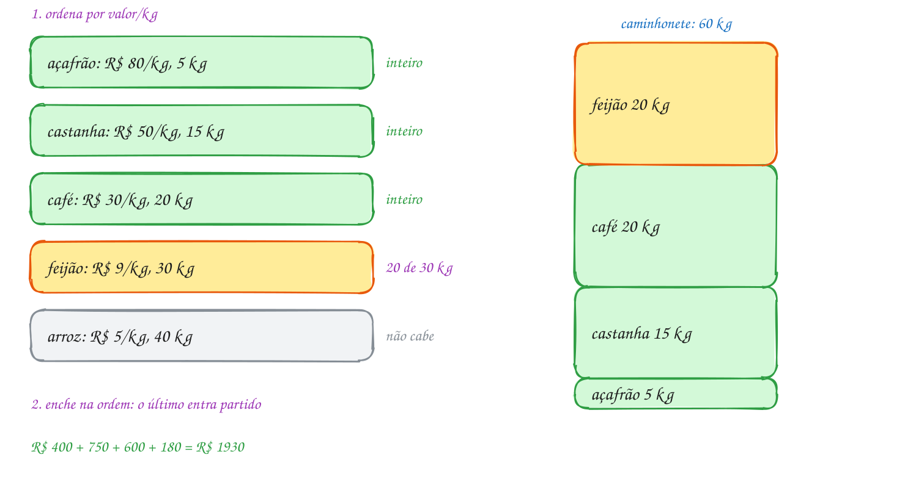</p>

A comparação calcula a razão de cada lado e ordena do maior para o menor:

```c
#include <stdio.h>
#include <stdlib.h>

typedef struct {
    const char *nome;
    double peso;  // kg disponíveis
    double valor; // R$ pelo estoque inteiro
} Produto;

// ordem decrescente de valor por kg
int por_razao(const void *a, const void *b) {
    const Produto *x = a;
    const Produto *y = b;
    double rx = x->valor / x->peso;
    double ry = y->valor / y->peso;
    return (rx < ry) - (rx > ry);
}

int main(void) {
    Produto p[] = {
        {"café", 20, 600},    {"castanha", 15, 750}, {"feijão", 30, 270},
        {"açafrão", 5, 400},  {"arroz", 40, 200},
    };
    int n = 5;
    double livre = 60; // kg que cabem na caminhonete
    double total = 0;

    qsort(p, n, sizeof p[0], por_razao);
    for (int i = 0; i < n && livre > 0; i++) {
        double leva = p[i].peso <= livre ? p[i].peso : livre; // tudo ou o que cabe
        double ganho = p[i].valor * (leva / p[i].peso);       // valor proporcional
        printf("%4.1f de %4.1f kg  R$ %6.2f  (R$ %.0f/kg) %s\n",
               leva, p[i].peso, ganho, p[i].valor / p[i].peso, p[i].nome);
        livre -= leva;
        total += ganho;
    }
    printf("Total: R$ %.2f\n", total);
    return 0;
}
// Saída:
//  5.0 de  5.0 kg  R$ 400.00  (R$ 80/kg) açafrão
// 15.0 de 15.0 kg  R$ 750.00  (R$ 50/kg) castanha
// 20.0 de 20.0 kg  R$ 600.00  (R$ 30/kg) café
// 20.0 de 30.0 kg  R$ 180.00  (R$ 9/kg) feijão
// Total: R$ 1930.00
```

O nome vai no fim da linha de propósito: `%-10s` conta **bytes**, e em UTF-8
o "ç" e o "ã" ocupam dois bytes cada.

No fluxograma, o caminho marcado leva tudo três vezes (açafrão, castanha, café)
e a fração uma vez (feijão), que zera o espaço e encerra o laço:

<p align="center">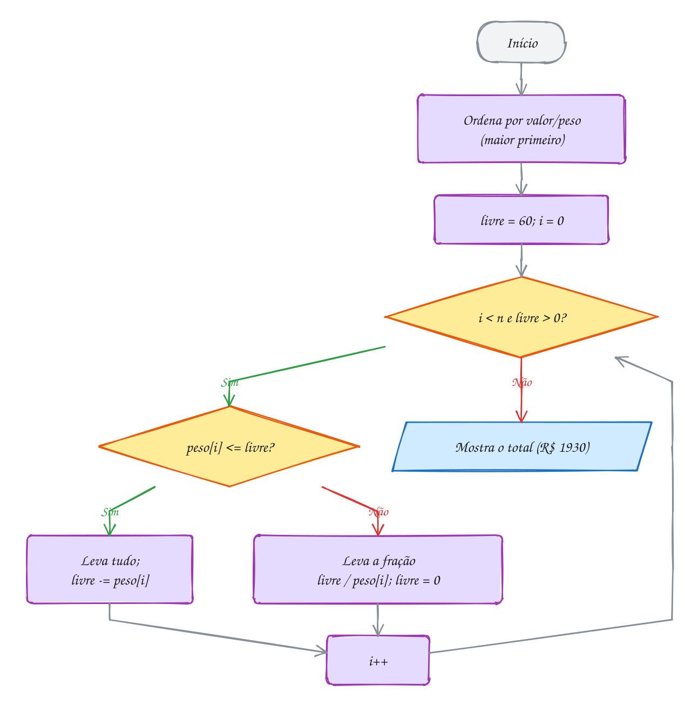</p>

> [!WARNING]
> Esse guloso só vale para a mochila **fracionária**. Com itens indivisíveis é
> a **mochila 0/1**, e ordenar pela razão pode errar: com capacidade 10 e
> itens (peso 6, R$ 30), (5, R$ 20) e (5, R$ 20), o guloso leva o primeiro
> (R$ 5/kg) e o total é R$ 30, mas os dois de 5 dão R$ 40. A mochila 0/1 se
> resolve com programação dinâmica (módulo 21).

> [!TIP]
> **Por dentro do C:** nunca devolva `(int)(ry - rx)` na comparação: razões
> 4,7 e 4,2 viram 0 e o `qsort` as trata como iguais.

> [!NOTE]
> **Pergunta para você:** se a caminhonete levasse 100 kg, quanto o feirante
> faria? E com 110 kg? A partir de que capacidade o arroz começa a entrar?

### Hora de praticar

**Exemplo A269 · Três critérios para a mesma carga**

```c
#include <stdio.h>
#include <stdlib.h>
#include <string.h>

typedef struct {
    const char *nome;
    double peso, valor;
} Item;

int maior_valor(const void *a, const void *b) {
    const Item *x = a, *y = b;
    return (x->valor < y->valor) - (x->valor > y->valor);
}

int menor_peso(const void *a, const void *b) {
    const Item *x = a, *y = b;
    return (x->peso > y->peso) - (x->peso < y->peso);
}

int maior_razao(const void *a, const void *b) {
    const Item *x = a, *y = b;
    double rx = x->valor / x->peso, ry = y->valor / y->peso;
    return (rx < ry) - (rx > ry);
}

// o mesmo guloso da mochila fracionária, com o critério de ordem como parâmetro
double carrega(const Item itens[], int n, double cap,
               int (*criterio)(const void *, const void *)) {
    Item c[10];
    memcpy(c, itens, n * sizeof itens[0]); // não bagunça o vetor original
    qsort(c, n, sizeof c[0], criterio);
    double total = 0;
    for (int i = 0; i < n && cap > 0; i++) {
        double leva = c[i].peso <= cap ? c[i].peso : cap;
        total += c[i].valor * leva / c[i].peso;
        cap -= leva;
        printf(" %s %.0f", c[i].nome, leva);
    }
    printf("\n");
    return total;
}

int main(void) {
    // sucata a granel no ferro-velho; o carrinho leva 100 kg
    Item s[] = {
        {"cobre", 30, 1050}, {"alumínio", 50, 400}, {"latão", 25, 500},
        {"ferro", 120, 600}, {"fios", 10, 30},
    };
    int n = 5;

    printf("Maior valor primeiro:");
    double a = carrega(s, n, 100, maior_valor);
    printf("  R$ %.2f\n", a);
    printf("Menor peso primeiro:");
    double b = carrega(s, n, 100, menor_peso);
    printf("  R$ %.2f\n", b);
    printf("Maior R$/kg primeiro:");
    double c = carrega(s, n, 100, maior_razao);
    printf("  R$ %.2f\n", c);
    // o ferro tem o maior valor TOTAL, mas paga só R$ 5/kg: ocupa 70 kg que
    // renderiam muito mais com latão e alumínio
    return 0;
}
// Saída:
// Maior valor primeiro: cobre 30 ferro 70
//   R$ 1400.00
// Menor peso primeiro: fios 10 latão 25 cobre 30 alumínio 35
//   R$ 1860.00
// Maior R$/kg primeiro: cobre 30 latão 25 alumínio 45
//   R$ 1910.00
```

```bash
gcc ~/LPEDC/material/A269.c -o ~/LPEDC/material/A269 && ~/LPEDC/material/A269
```

**Exemplo A270 · Quando o item não se divide: o guloso perde**

```c
#include <stdio.h>

#define N 5

// mochila 0/1: cada item vai inteiro ou fica. O guloso por razão é rápido,
// mas não garante o melhor. Aqui ele é comparado com a força bruta, que testa
// os 2^5 = 32 subconjuntos (um bit por item, como no assunto 0125).
int main(void) {
    const char *nome[N] = {"videogame", "relógios", "caixas de som", "TV", "panela elétrica"};
    int peso[N] = {6, 2, 8, 12, 9};             // kg (já em ordem de R$/kg)
    int valor[N] = {600, 180, 640, 900, 630};   // R$ de revenda
    int cap = 20;                               // limite da mala, em kg

    // guloso por razão: leva o item inteiro se couber
    int livre = cap, guloso = 0;
    printf("Guloso:");
    for (int i = 0; i < N; i++) {
        if (peso[i] <= livre) {
            livre -= peso[i];
            guloso += valor[i];
            printf(" [%s]", nome[i]);
        }
    }
    printf(" = R$ %d (%d kg)\n", guloso, cap - livre);

    // força bruta: o subconjunto de maior valor que cabe
    int melhor = 0, escolha = 0;
    for (int m = 0; m < (1 << N); m++) {
        int p = 0, v = 0;
        for (int i = 0; i < N; i++) {
            if (m & (1 << i)) {
                p += peso[i];
                v += valor[i];
            }
        }
        if (p <= cap && v > melhor) {
            melhor = v;
            escolha = m;
        }
    }
    printf("Ótimo: ");
    int p = 0;
    for (int i = 0; i < N; i++) {
        if (escolha & (1 << i)) {
            printf(" [%s]", nome[i]);
            p += peso[i];
        }
    }
    printf(" = R$ %d (%d kg)\n", melhor, p);
    // o guloso enche 16 kg com os itens de melhor razão e deixa 4 kg sem
    // uso, porque a TV (12 kg) não cabe mais. Na fracionária, esses 4 kg
    // levariam um terço da TV (R$ 300): R$ 1720, um teto para a 0/1.
    return 0;
}
// Saída:
// Guloso: [videogame] [relógios] [caixas de som] = R$ 1420 (16 kg)
// Ótimo:  [videogame] [relógios] [TV] = R$ 1680 (20 kg)
```

```bash
gcc ~/LPEDC/material/A270.c -o ~/LPEDC/material/A270 && ~/LPEDC/material/A270
```

#### Exercícios

**Exercício E805** · ★☆☆

A cooperativa de reciclagem vende para uma usina, e o caminhão leva 1000
kg. No depósito há três lotes, já em ordem decrescente de R$/kg:


```text
PET: 300 kg, R$ 750 o lote
papelão: 500 kg, R$ 400 o lote
vidro: 800 kg, R$ 160 o lote
```


Escreva o laço da mochila fracionária: leve cada lote inteiro enquanto
couber e, no primeiro que não couber, só a parte que completa o
caminhão. Mostre o que vai de cada material e o total.


```text
Saída esperada:
300 kg de PET: R$ 750.00
500 kg de papelão: R$ 400.00
200 kg de vidro: R$ 40.00
Total: R$ 1190.00
```

```bash
gcc ~/LPEDC/material/E805.c -o ~/LPEDC/material/E805 && ~/LPEDC/material/E805
```

**Exercício E807** · ★★☆

O feirante tem 15 kg de espaço e três caixas de fruta de 10 kg: uva
(R$ 42, ou R$ 4,20/kg), caqui (R$ 20) e ameixa (R$ 48, ou R$ 4,80/kg).
Escreva a mochila fracionária: guarde as caixas numa struct Caixa
(fruta, kg, valor), ordene por R$/kg decrescente com qsort (escreva a
função de comparação) e leve
caixas inteiras enquanto couber, e só a parte que completa no primeiro
que não couber. Mostre os kg levados de cada fruta e o total.


```text
Saída esperada:
10 kg de ameixa
5 kg de uva
Total: R$ 69.00
```

```bash
gcc ~/LPEDC/material/E807.c -o ~/LPEDC/material/E807 && ~/LPEDC/material/E807
```

**Exercício E808** · ★★☆

A mochila fracionária ao contrário: em vez de MAXIMIZAR o valor levado,
MINIMIZAR o custo de uma compra. Um posto precisa de 30 000 litros de
gasolina. Quatro distribuidoras vendem, cada uma, até um limite de litros
por um preço fixo por litro:


```text
A: até 12 000 L a R$ 5,10    B: até 8 000 L a R$ 4,95
C: até 15 000 L a R$ 5,25    D: até 6 000 L a R$ 4,89
```


Compre da mais barata para a mais cara, até completar. Guarde os preços
em CENTAVOS (int) e o custo em centavos num long long; mostre em reais
com / 100 e % 100.


```text
Saída esperada:
D:  6000 L a R$ 4.89 = R$ 29340.00
B:  8000 L a R$ 4.95 = R$ 39600.00
A: 12000 L a R$ 5.10 = R$ 61200.00
C:  4000 L a R$ 5.25 = R$ 21000.00
Total: R$ 151140.00
```

```bash
gcc ~/LPEDC/material/E808.c -o ~/LPEDC/material/E808 && ~/LPEDC/material/E808
```

**Exercício E809** · ★★★

Uma transportadora tem 8 tipos de carga esperando e um caminhão com 700
kg livres. Ordenar as 8 pela razão funciona, mas, quando o caminhão
enche logo, quase toda a ordenação é desperdício. Use um HEAP DE MÁXIMO
pela razão (assunto 0102): monte o heap em O(n), com a descida a partir
do último pai, e tire o topo só enquanto houver espaço.


```text
móveis 400 kg R$ 2000      eletrônicos 150 kg R$ 4500
roupas 200 kg R$ 3000      cimento 900 kg R$ 900
remédios 50 kg R$ 2500     livros 300 kg R$ 1800
brinquedos 250 kg R$ 2750  areia 1000 kg R$ 300
```


```text
Saída esperada:
 50 de   50 kg  R$ 2500.00  remédios
150 de  150 kg  R$ 4500.00  eletrônicos
200 de  200 kg  R$ 3000.00  roupas
250 de  250 kg  R$ 2750.00  brinquedos
 50 de  300 kg  R$  300.00  livros
Total: R$ 13050.00
Itens tirados do heap: 5 de 8
```

```bash
gcc ~/LPEDC/material/E809.c -o ~/LPEDC/material/E809 && ~/LPEDC/material/E809
```

---

## 0136 · Código de Huffman

Na placa da barraca está `BANANA NA CABANA`: 16 letras de 8 bits, 128 bits.
Mas há só **5 símbolos** (A, N, B, C e o espaço), e o A aparece 7 vezes e o C
uma. Com 3 bits por símbolo seriam 48, e dá para gastar menos.

Basta dar códigos de tamanho **diferente**: curto para o frequente, comprido
para o raro, como no Morse. Mas onde um código termina? Se A = `0` e N = `01`,
`001` pode ser "A A ..." ou "A N".

A saída é o **código livre de prefixo**: nenhum código é o começo de outro, e
a leitura não tem dúvida. Ele é uma **árvore binária**: cada símbolo é uma
**folha** e o código é o caminho da raiz até ela, com `0` para a esquerda e
`1` para a direita.

O total de bits é a soma de `frequência × profundidade` de cada folha. David
Huffman mostrou em 1952 que um **guloso** acha a melhor árvore:

1. crie uma folha por símbolo, com a frequência, e ponha todas num **heap de
   mínimo** (0102);
2. enquanto houver mais de um nó, **tire os dois menores**, crie um pai com
   os dois como filhos e a **soma** das frequências, e devolva-o ao heap;
3. o nó que sobrar é a **raiz**.

Para `k` símbolos são `k - 1` junções com heap de O(log k): **O(k log k)**.

Aqui, A = 7, N = 4, B = 2, espaço = 2 e C = 1: C e espaço viram 3; com o B,
5; com o N, 9; com o A, a raiz 16. O A ganha `0` e o C, `1110`:

<p align="center">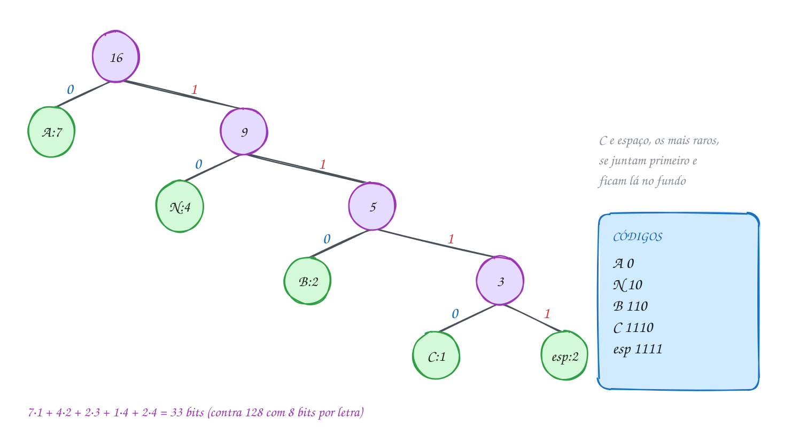</p>

### Passo a passo

Heap a cada junção. No empate, desempata o byte (espaço, 32, antes do B, 66):

| junção | heap antes | tira | cria |
| --- | --- | --- | --- |
| 1 | C:1, esp:2, B:2, N:4, A:7 | C:1 e esp:2 | 3 |
| 2 | B:2, 3, N:4, A:7 | B:2 e 3 | 5 |
| 3 | N:4, 5, A:7 | N:4 e 5 | 9 |
| 4 | A:7, 9 | A:7 e 9 | 16 (a raiz) |

O TAD está em `huffman.h` e `huffman.c`. A parte central é o laço do guloso,
com um heap de mínimo de ponteiros para nó:

```c
NoHuf *huf_constroi(const long freq[256]) {
    Heap h = {.n = 0};
    for (int c = 0; c < 256; c++) {
        if (freq[c] > 0) {
            poe(&h, novo_no((unsigned char)c, freq[c], c, NULL, NULL));
        }
    }
    if (h.n == 0) {
        return NULL;
    }
    int criados = 0;
    while (h.n > 1) {
        NoHuf *a = tira(&h);  // o menos frequente vira o filho 0
        NoHuf *b = tira(&h);  // o segundo vira o filho 1
        poe(&h, novo_no(0, a->freq + b->freq, 256 + criados++, a, b));
    }
    return tira(&h);
}
```

O campo `ordem` (terceiro argumento de `novo_no`) desempata frequências
iguais: folhas usam o próprio byte e nós internos, 256 em diante, a ordem de
criação. Os códigos saem de uma descida recursiva que acumula `0` e `1`. O
cliente conta as frequências, monta a árvore e mostra os códigos:

```c
#include <stdio.h>
#include <string.h>
#include "huffman.h"

int main(void) {
    const char *frase = "BANANA NA CABANA";
    long freq[256] = {0};
    for (const char *p = frase; *p != '\0'; p++) {
        freq[(unsigned char)*p]++;          // conta cada byte
    }

    NoHuf *raiz = huf_constroi(freq);
    static char cod[256][256];              // 64 KB: static, fora da pilha
    huf_codigos(raiz, cod);

    long bits = 0;
    for (int c = 0; c < 256; c++) {
        if (freq[c] > 0) {
            printf("'%c' aparece %ld vez(es): %s\n", c, freq[c], cod[c]);
            bits += freq[c] * (long)strlen(cod[c]);
        }
    }
    printf("Codificada: ");
    for (const char *p = frase; *p != '\0'; p++) {
        printf("%s", cod[(unsigned char)*p]);
    }
    printf("\n%ld bits, contra %zu com 8 bits por letra\n", bits, 8 * strlen(frase));

    huf_libera(raiz);
    return 0;
}
// Saída:
// ' ' aparece 2 vez(es): 1111
// 'A' aparece 7 vez(es): 0
// 'B' aparece 2 vez(es): 110
// 'C' aparece 1 vez(es): 1110
// 'N' aparece 4 vez(es): 10
// Codificada: 110010010011111001111111001100100
// 33 bits, contra 128 com 8 bits por letra
```

São 7·1 + 4·2 + 2·3 + 1·4 + 2·4 = 33 bits, contra 48 do código fixo.

No fluxograma do `huf_constroi`, cada volta tira dois nós e põe um: 4 voltas
para 5 folhas:

<p align="center">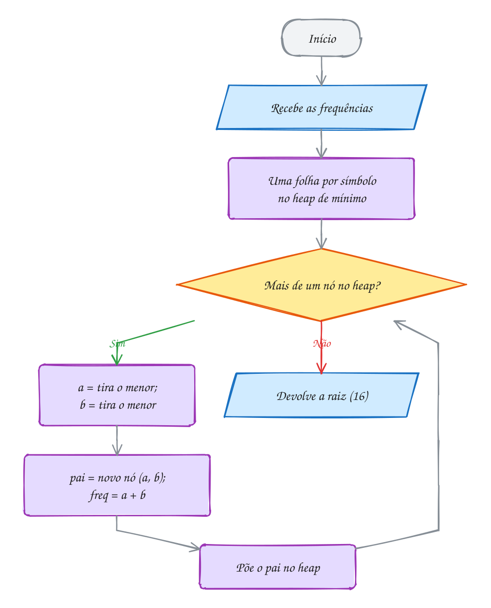</p>

> [!WARNING]
> Quem decodifica precisa da **mesma árvore**: se o desempate mudar, os
> códigos mudam e a frase sai trocada. O arquivo guarda a árvore, ou as
> frequências e a regra de desempate. Com um símbolo só (`AAAA`), o
> `huf_codigos` dá o código `0`.

> [!TIP]
> **Por dentro do C:** indexe a frequência por `(unsigned char)*p`: com `char`
> com sinal, os bytes de acentos em UTF-8 (`ã` é `0xC3 0xA3`) são negativos e
> `freq[*p]` leria fora do vetor. A árvore tem `2k - 1` nós, e `huf_libera`
> devolve todos em pós-ordem.

> [!NOTE]
> **Pergunta para você:** monte, no papel, a árvore de Huffman de
> `ARARA AZUL`. Quantos bits ela dá? Depois troque a frase no programa e
> confira.

### Hora de praticar

**Exemplo A271 · Decodificar descendo a árvore (e o estrago de um bit errado)**

```c
#include <stdio.h>
#include <string.h>
#include "0136-huffman.h"

// lê os bits: 0 desce à esquerda, 1 à direita; ao chegar numa folha,
// escreve o símbolo e volta para a raiz
void decodifica(const NoHuf *raiz, const char *bits) {
    const NoHuf *no = raiz;
    for (const char *b = bits; *b != '\0'; b++) {
        no = (*b == '0') ? no->esq : no->dir;
        if (huf_folha(no)) {
            putchar(no->simbolo);
            no = raiz;
        }
    }
    putchar('\n');
}

int main(void) {
    const char *frase = "O RATO ROEU A ROUPA";
    long freq[256] = {0};
    for (const char *p = frase; *p != '\0'; p++) {
        freq[(unsigned char)*p]++;
    }
    NoHuf *raiz = huf_constroi(freq);
    static char cod[256][256];
    huf_codigos(raiz, cod);

    // quem envia: concatena os códigos
    char bits[256] = "";
    for (const char *p = frase; *p != '\0'; p++) {
        strcat(bits, cod[(unsigned char)*p]);
    }
    printf("Bits (%zu): %s\n", strlen(bits), bits);

    // quem recebe: só com a árvore e os bits, refaz a frase
    printf("Decodificado: ");
    decodifica(raiz, bits);

    // um bit trocado na transmissão: o leitor perde o passo, junta pedaços
    // de códigos vizinhos e só se reencontra algumas letras depois. Até o
    // número de letras muda. Arquivo compactado não tolera bit errado.
    bits[7] = (bits[7] == '0') ? '1' : '0';
    printf("Com o bit 7 trocado: ");
    decodifica(raiz, bits);

    huf_libera(raiz);
    return 0;
}
// Saída:
// Bits (54): 010011010111100100110011000111100101001100111111001101
// Decodificado: O RATO ROEU A ROUPA
// Com o bit 7 trocado: O R U PPEU A ROUPA
```

```bash
gcc ~/LPEDC/material/A271.c ~/LPEDC/material/0136-huffman.c -o ~/LPEDC/material/A271 && ~/LPEDC/material/A271
```

**Exemplo A272 · Juntar planilhas pelo menor custo: o mesmo guloso, sem árvore**

```c
#include <stdio.h>

// heap de mínimo de int, escrito aqui mesmo (bem menor que o do huffman.c)
typedef struct {
    int v[16];
    int n;
} Heap;

void poe(Heap *h, int x) {
    int i = h->n++;
    h->v[i] = x;
    while (i > 0 && h->v[i] < h->v[(i - 1) / 2]) {
        int t = h->v[i];
        h->v[i] = h->v[(i - 1) / 2];
        h->v[(i - 1) / 2] = t;
        i = (i - 1) / 2;
    }
}

int tira(Heap *h) {
    int topo = h->v[0];
    h->v[0] = h->v[--h->n];
    int i = 0;
    while (2 * i + 1 < h->n) {
        int f = 2 * i + 1;
        if (f + 1 < h->n && h->v[f + 1] < h->v[f]) {
            f++;
        }
        if (h->v[i] <= h->v[f]) {
            break;
        }
        int t = h->v[i];
        h->v[i] = h->v[f];
        h->v[f] = t;
        i = f;
    }
    return topo;
}

int main(void) {
    // mil linhas de cada planilha de vendas, já ordenadas por data.
    // Juntar (intercalar) duas custa a soma das linhas das duas.
    int linhas[] = {12, 40, 7, 25, 18};
    int n = 5;

    // na ordem em que chegaram: junta a 1ª com a 2ª, o resultado com a 3ª...
    int acumulado = linhas[0], custo_ordem = 0;
    for (int i = 1; i < n; i++) {
        acumulado += linhas[i];
        custo_ordem += acumulado;
    }
    printf("Na ordem de chegada: %d mil linhas lidas\n", custo_ordem);

    // guloso de Huffman: sempre as duas MENORES
    Heap h = {.n = 0};
    for (int i = 0; i < n; i++) {
        poe(&h, linhas[i]);
    }
    int custo = 0;
    while (h.n > 1) {
        int a = tira(&h);
        int b = tira(&h);
        printf("  junta %2d + %2d = %3d\n", a, b, a + b);
        custo += a + b;
        poe(&h, a + b);
    }
    printf("As duas menores primeiro: %d mil linhas lidas\n", custo);
    // cada planilha é relida uma vez por junção de que participa: a
    // "profundidade" dela na árvore das junções. Exatamente a conta do Huffman.
    return 0;
}
// Saída:
// Na ordem de chegada: 297 mil linhas lidas
//   junta  7 + 12 =  19
//   junta 18 + 19 =  37
//   junta 25 + 37 =  62
//   junta 40 + 62 = 102
// As duas menores primeiro: 220 mil linhas lidas
```

```bash
gcc ~/LPEDC/material/A272.c ~/LPEDC/material/0136-huffman.c -o ~/LPEDC/material/A272 && ~/LPEDC/material/A272
```

#### Exercícios

**Exercício E811** · ★☆☆

Use o TAD huffman.h da pasta para comprimir a frase "PAPAI PAGOU A
PIPOCA": conte as frequências, monte a árvore, gere os códigos e mostre,
para cada símbolo que aparece (na ordem da tabela ASCII), a frequência e
o código. No fim, o total de bits, o tamanho original (8 bits por letra)
e a porcentagem.


```text
Saída esperada:
' ' 3: 110
'A' 5: 01
'C' 1: 0010
'G' 1: 0011
'I' 2: 1111
'O' 2: 000
'P' 5: 10
'U' 1: 1110
55 bits de 160 (34.4%)
```

```bash
gcc ~/LPEDC/material/E811.c ~/LPEDC/material/0136-huffman.c -o ~/LPEDC/material/E811 && ~/LPEDC/material/E811
```

**Exercício E813** · ★★☆

Chegou uma mensagem compactada, junto com a TABELA de códigos (sem a
árvore). Decodifique usando só a tabela:


```text
E 00   S 01   T 100   O 101   U 1100   espaço 1101   B 1110   M 1111
```


```text
Bits: 0001100101110011011110001111
```


Como o código é livre de prefixo, dá para ler assim: vá juntando os bits
num buffer, um por um; a cada bit, compare o buffer com todos os códigos
(strcmp). Quando bater, escreva o símbolo e esvazie o buffer. No fim, se
sobrar algo no buffer, avise.


```text
Saída esperada:
Mensagem: ESTOU BEM
```

```bash
gcc ~/LPEDC/material/E813.c ~/LPEDC/material/0136-huffman.c -o ~/LPEDC/material/E813 && ~/LPEDC/material/E813
```

**Exercício E814** · ★★☆

Cinco arquivos de log, de 8, 3, 15, 6 e 10 MB, precisam ser juntados
(intercalados) dois a dois, e juntar dois custa a soma dos tamanhos. Use
o guloso do Huffman: sempre as duas MENORES. Escreva um heap de mínimo
sobre vetor (poe e tira) e junte até sobrar um arquivo só, devolvendo
cada soma ao heap. Mostre cada junção (a menor primeiro) e o custo total.


```text
Saída esperada:
junta 3 + 6
junta 8 + 9
junta 10 + 15
junta 17 + 25
Custo: 93 MB lidos
```

```bash
gcc ~/LPEDC/material/E814.c ~/LPEDC/material/0136-huffman.c -o ~/LPEDC/material/E814 && ~/LPEDC/material/E814
```

**Exercício E815** · ★★★

Código canônico: o compactador guarda só o COMPRIMENTO do código de cada
símbolo e refaz os códigos por uma regra fixa:
1. ordene por comprimento e, no empate, pelo byte;
2. o primeiro recebe o código 0;
3. cada próximo recebe codigo = (codigo + 1) << (l - l_ant).
Use huffman.h na frase "BANANA NA CABANA" só para obter os comprimentos
(strlen dos códigos); gere os canônicos e mostre ao lado dos do Huffman.


```text
Saída esperada:
'A' 1 bits: 0  (Huffman deu 0)
'N' 2 bits: 10  (Huffman deu 10)
'B' 3 bits: 110  (Huffman deu 110)
' ' 4 bits: 1110  (Huffman deu 1111)
'C' 4 bits: 1111  (Huffman deu 1110)
```

```bash
gcc ~/LPEDC/material/E815.c ~/LPEDC/material/0136-huffman.c -o ~/LPEDC/material/E815 && ~/LPEDC/material/E815
```

---

## 0137 · Juntando tudo

A feira do bairro manda a lista de preços por um rádio lento, e cada byte
economizado conta. Um **compactador** grava uma versão menor de um arquivo e
um **descompactador** devolve o original, byte por byte.

O Huffman do 0136 usava códigos em texto (`"1110"`). Num arquivo, o código
vira **bits de verdade**, e surgem três problemas:

- **o arquivo é feito de bytes**: junte os bits, 8 por vez, num `unsigned
  char` e grave-o quando enche. O último quase nunca enche e vai com zeros;
- **o descompactador precisa da mesma árvore**: o arquivo começa com um
  **cabeçalho** (assinatura `HUF1`, tamanho original e 256 frequências), e o
  `huf_constroi` desempata sempre igual;
- **os zeros do fim não são dados**: o descompactador para ao escrever o
  tamanho original.

O compactador lê o arquivo **duas vezes**: conta as frequências e, com a
árvore pronta, troca cada byte pelo código. O descompactador monta a árvore
do cabeçalho e anda nela bit a bit (`0` esquerda, `1` direita); na folha,
escreve o byte e volta à raiz.

O projeto reúne `fread`/`fwrite` (0068), bits (0065), árvore binária (0098),
heap (0102), Huffman (0136) e TADs (0074). O `compactador.h` oferece
`huf_compacta` e `huf_descompacta`.

A lista da feira (6 linhas repetidas 40 vezes) tem 9560 bytes e compactada,
6156: 1036 de cabeçalho e 5120 de bits:

<p align="center">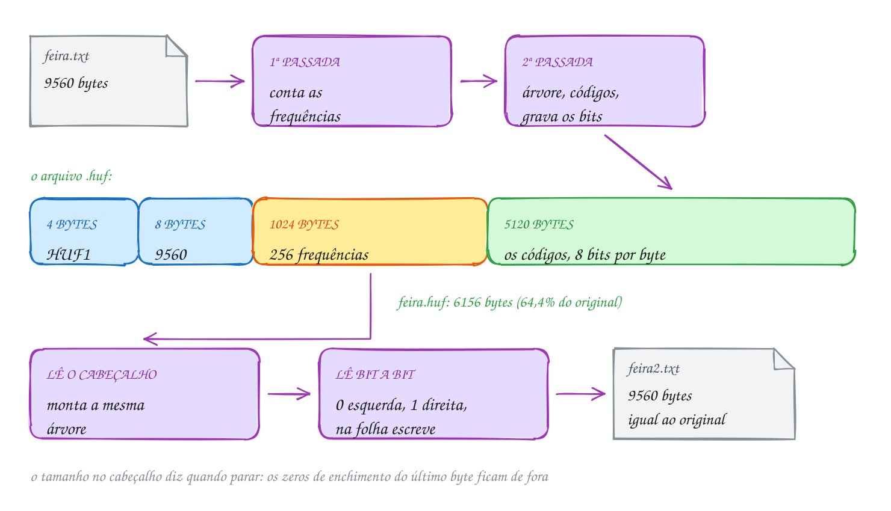</p>

A peça central do `compactador.c` escreve bits soltos; a struct `Bits` guarda
o byte em construção e quantos bits ele já tem:

```c
static void escreve_bit(Bits *b, int bit) {
    b->byte = (unsigned char)((b->byte << 1) | bit); // entra pela direita
    b->n++;
    if (b->n == 8) {                                 // byte cheio: grava
        fputc(b->byte, b->f);
        b->byte = 0;
        b->n = 0;
    }
}

static void descarrega(Bits *b) {
    if (b->n > 0) {                                  // completa com zeros
        fputc((unsigned char)(b->byte << (8 - b->n)), b->f);
        b->byte = 0;
        b->n = 0;
    }
}
```

O programa cria o arquivo da feira, compacta, descompacta, compara com o
original e apaga os arquivos de teste:

```c
#include <stdio.h>
#include "compactador.h"

// grava a lista de preços da feira, repetida 40 vezes (um arquivo de uns 10 KB)
int cria_exemplo(const char *nome) {
    const char *linhas[] = {
        "Tomate italiano ........ R$ 8,90 o kg\n",
        "Banana prata ........... R$ 5,50 a dúzia\n",
        "Alface crespa .......... R$ 3,00 o pé\n",
        "Batata inglesa ......... R$ 6,20 o kg\n",
        "Ovos caipiras .......... R$ 18,00 a dúzia\n",
        "Queijo minas ........... R$ 42,00 o kg\n",
    };
    FILE *f = fopen(nome, "w");
    if (f == NULL) {
        return 0;
    }
    for (int r = 0; r < 40; r++) {
        for (int i = 0; i < 6; i++) {
            fputs(linhas[i], f);
        }
    }
    fclose(f);
    return 1;
}

// confere byte a byte se dois arquivos são iguais
int iguais(const char *a, const char *b) {
    FILE *fa = fopen(a, "rb");
    FILE *fb = fopen(b, "rb");
    int ok = fa != NULL && fb != NULL;
    while (ok) {
        int ca = fgetc(fa), cb = fgetc(fb);
        if (ca != cb) ok = 0;
        if (ca == EOF || cb == EOF) break;
    }
    if (fa) fclose(fa);
    if (fb) fclose(fb);
    return ok;
}

int main(void) {
    if (!cria_exemplo("feira.txt")) {
        return 1;
    }
    long original = arq_tamanho("feira.txt");
    long compacto = huf_compacta("feira.txt", "feira.huf");
    long volta = huf_descompacta("feira.huf", "feira2.txt");

    printf("feira.txt:  %ld bytes\n", original);
    printf("feira.huf:  %ld bytes (%.1f%% do original)\n", compacto, 100.0 * compacto / original);
    printf("feira2.txt: %ld bytes, %s\n", volta,
           iguais("feira.txt", "feira2.txt") ? "igual ao original" : "DIFERENTE");

    remove("feira.txt");
    remove("feira.huf");
    remove("feira2.txt");
    return 0;
}
// Saída:
// feira.txt:  9560 bytes
// feira.huf:  6156 bytes (64.4% do original)
// feira2.txt: 9560 bytes, igual ao original
```

Os bits ocupam 53,6% do original, porque há poucos símbolos e alguns muito
frequentes. O cabeçalho é um custo fixo: pesado em arquivos pequenos,
irrelevante nos grandes.

No fluxograma do `huf_descompacta`, cada byte começa na raiz e lê bits até uma
folha; o laço de fora para no tamanho original:

<p align="center">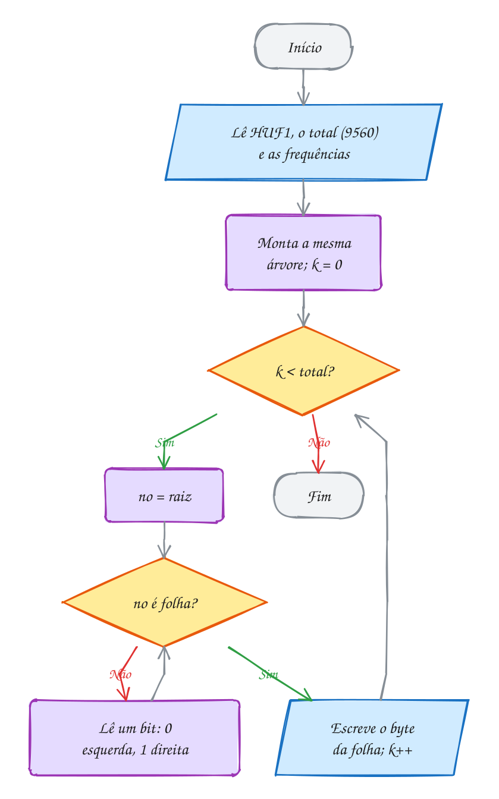</p>

> [!WARNING]
> Sem o `descarrega` no fim, os bits do byte incompleto (até 7) se perdem. O
> teste de ida e volta pega o erro: compare **byte a byte**, como o `iguais`.
> Abra os arquivos em modo binário (`"rb"`, `"wb"`): no Windows, em modo texto,
> o byte 26 é lido como fim de arquivo.

> [!TIP]
> **Por dentro do C:** o cabeçalho usa `uint64_t` e `uint32_t` (`stdint.h`)
> porque o tamanho de `long` varia (8 bytes no Linux de 64 bits, 4 no
> Windows): são sempre 4 + 8 + 1024 = 1036 bytes. O `rewind` volta ao começo
> para a segunda leitura.

> [!NOTE]
> **Pergunta para você:** um arquivo tem as 26 letras maiúsculas, cada uma
> repetida 100 vezes (2600 bytes). Quantos bits o Huffman dá a cada letra, e
> quantos bytes tem o `.huf`? Compensa compactar? Calcule e depois teste.

### Hora de praticar

**Exemplo A273 · O compactador na linha de comando**

```c
#include <stdio.h>
#include <string.h>
#include "0137-compactador.h"

// uso:  c entrada saida   (compacta)
//       d entrada saida   (descompacta)
int main(int argc, char *argv[]) {
    if (argc != 4 || (strcmp(argv[1], "c") != 0 && strcmp(argv[1], "d") != 0)) {
        fprintf(stderr, "uso: A273 c|d entrada saida\n");
        return 1;
    }
    long antes = arq_tamanho(argv[2]);
    if (antes < 0) {
        fprintf(stderr, "não consegui abrir %s\n", argv[2]);
        return 1;
    }
    long depois = argv[1][0] == 'c' ? huf_compacta(argv[2], argv[3])
                                    : huf_descompacta(argv[2], argv[3]);
    if (depois < 0) {
        fprintf(stderr, "falhou (%s não é um arquivo .huf?)\n", argv[2]);
        return 1;
    }
    printf("%s: %ld bytes -> %s: %ld bytes", argv[2], antes, argv[3], depois);
    if (antes > 0) {
        printf(" (%.1f%%)", 100.0 * depois / antes);
    }
    printf("\n");
    return 0;
}
// Sem argumentos, mostra o uso e termina com 1:
//   uso: A273 c|d entrada saida
//
// Rodando de dentro de ~/LPEDC, compactando e descompactando o huffman.c
// desta pasta:
//   ~/LPEDC/rodar 20-dc-e-gulosos/0137-juntando-tudo/A273.c c 20-dc-e-gulosos/0137-juntando-tudo/huffman.c /tmp/h.huf
//   20-dc-e-gulosos/0137-juntando-tudo/huffman.c: 3110 bytes -> /tmp/h.huf: 2900 bytes (93.2%)
//   ~/LPEDC/rodar 20-dc-e-gulosos/0137-juntando-tudo/A273.c d /tmp/h.huf /tmp/h.c
//   /tmp/h.huf: 2900 bytes -> /tmp/h.c: 3110 bytes (107.2%)
//
// Um código-fonte pequeno mal compensa o cabeçalho de 1036 bytes: sem ele,
// os bits ocupariam 1864 bytes, 60% do original.
```

```bash
gcc ~/LPEDC/material/A273.c ~/LPEDC/material/0137-compactador.c ~/LPEDC/material/0137-huffman.c -o ~/LPEDC/material/A273 && ~/LPEDC/material/A273
```

**Exemplo A274 · Nem tudo encolhe**

```c
#include <stdio.h>
#include <stdlib.h>
#include "0137-compactador.h"

// grava n bytes gerados por uma regra e mostra quanto o .huf ocupa
void testa(const char *rotulo, int n, int tipo) {
    FILE *f = fopen("teste.bin", "wb");
    if (f == NULL) {
        return;
    }
    srand(2026);
    for (int i = 0; i < n; i++) {
        int c;
        if (tipo == 0) {
            c = 'A';                          // um byte só, repetido
        } else if (tipo == 1) {
            c = "ACGT"[rand() % 4];           // DNA: 4 letras sorteadas
        } else {
            c = rand() % 256;                 // qualquer byte, sorteado
        }
        fputc(c, f);
    }
    fclose(f);
    long depois = huf_compacta("teste.bin", "teste.huf");
    printf("%-22s %6d -> %6ld bytes", rotulo, n, depois);
    if (n > 0) {
        printf("  (%.1f%%)", 100.0 * depois / n);
    }
    printf("\n");
    remove("teste.bin");
    remove("teste.huf");
}

int main(void) {
    testa("vazio", 0, 0);
    testa("1000 letras A", 1000, 0);
    testa("100 000 letras A", 100000, 0);
    testa("DNA sorteado", 100000, 1);
    testa("bytes sorteados", 100000, 2);
    // - vazio: só o cabeçalho (1036 bytes) e nenhum bit.
    // - um símbolo só: 1 bit por byte, 1/8 do tamanho mais o cabeçalho.
    //   (Huffman nunca gasta menos de 1 bit por símbolo; quem comprime
    //   "AAAA..." de verdade conta repetições.)
    // - DNA: 4 letras igualmente frequentes, 2 bits cada: 25%.
    // - bytes sorteados: os 256 valores aparecem quase igual, todo código
    //   tem 8 bits, e o arquivo CRESCE com o cabeçalho. Por isso não adianta
    //   compactar um arquivo que já foi compactado.
    return 0;
}
// Saída:
// vazio                       0 ->   1036 bytes
// 1000 letras A            1000 ->   1161 bytes  (116.1%)
// 100 000 letras A       100000 ->  13536 bytes  (13.5%)
// DNA sorteado           100000 ->  26036 bytes  (26.0%)
// bytes sorteados        100000 -> 101036 bytes  (101.0%)
```

```bash
gcc ~/LPEDC/material/A274.c ~/LPEDC/material/0137-compactador.c ~/LPEDC/material/0137-huffman.c -o ~/LPEDC/material/A274 && ~/LPEDC/material/A274
```

#### Exercícios

**Exercício E817** · ★☆☆

O restaurante por quilo guarda o cardápio de cada semana num arquivo. Use
o TAD compactador.h da pasta: grave o cardápio abaixo 30 vezes seguidas
num arquivo "cardapio.txt", compacte para "cardapio.huf", descompacte
para "cardapio2.txt" e mostre os três tamanhos. No fim, apague os três
arquivos com remove.


```text
PRATO DO DIA
Segunda: feijoada com couve e laranja
Terça: frango assado com farofa
Quarta: feijoada com couve e laranja
Quinta: peixe com pirão
Sexta: feijoada com couve e laranja
```


```text
Saída esperada:
Original:      5460 bytes
Compactado:    4096 bytes (75.0%)
Descompactado: 5460 bytes
```

```bash
gcc ~/LPEDC/material/E817.c ~/LPEDC/material/0137-compactador.c ~/LPEDC/material/0137-huffman.c -o ~/LPEDC/material/E817 && ~/LPEDC/material/E817
```

**Exercício E819** · ★★☆

O cabeçalho do .huf tem 1036 bytes fixos. A partir de que tamanho a
compactação compensa? Grave num arquivo "padaria.txt" a linha abaixo 1,
10, 30, 60, 100 e 300 vezes (um arquivo novo a cada caso), compacte cada
um com o TAD compactador.h e monte a tabela:


```text
Pão francês ..... R$ 0,75 a unidade
```


```text
Saída esperada:
linhas  original  compactado
     1        38        1057  não compensa
    10       380        1240  não compensa
    30      1140        1648  não compensa
    60      2280        2259  compensa
   100      3800        3074  compensa
   300     11400        7149  compensa
```

```bash
gcc ~/LPEDC/material/E819.c ~/LPEDC/material/0137-compactador.c ~/LPEDC/material/0137-huffman.c -o ~/LPEDC/material/E819 && ~/LPEDC/material/E819
```

**Exercício E820** · ★★☆

Escreva um programa que grave os 10 bits 1011001110 num arquivo
"bits.bin", 8 por byte, e leia o arquivo de volta mostrando os bits de
cada byte. Use struct Saida (arquivo, byte em formação e quantos bits já
entraram) e duas funções: poe_bit(Saida *s, int bit), que acrescenta um
bit e grava o byte quando juntar 8, e fecha_bits(Saida *s), que grava o
byte incompleto. Os bits que sobram devem ir para a ESQUERDA do último
byte, completados com zeros à direita (por isso 10 vira 10000000). Apague
o arquivo no fim.


```text
Saída esperada:
Lido: 10110011 10000000
2 byte(s) no arquivo
```

```bash
gcc ~/LPEDC/material/E820.c ~/LPEDC/material/0137-compactador.c ~/LPEDC/material/0137-huffman.c -o ~/LPEDC/material/E820 && ~/LPEDC/material/E820
```

**Exercício E821** · ★★★

O cabeçalho do .huf guarda as 256 frequências, 1024 bytes, mesmo quando
o texto usa só 5 símbolos. Escreva um cabeçalho compacto e confira a ida
e volta, com as frequências de "BANANA NA CABANA":

- grave num arquivo "cab.bin" quantos símbolos aparecem (um uint16_t) e,

```text
para cada um, o byte (1 byte) e a frequência (um uint32_t);
```

- leia de volta num vetor uint32_t lida[256] zerado e compare com o

```text
original usando memcmp;
```

- mostre quantos símbolos, o tamanho do cabeçalho (ftell antes de

```text
fechar) e se as frequências voltaram iguais. Apague o arquivo no fim.
```


```text
Saída esperada:
Símbolos: 5
Cabeçalho compacto: 27 bytes (o completo tem 1024)
Frequências iguais
```

```bash
gcc ~/LPEDC/material/E821.c ~/LPEDC/material/0137-compactador.c ~/LPEDC/material/0137-huffman.c -o ~/LPEDC/material/E821 && ~/LPEDC/material/E821
```

---

## Desafios do módulo

Problemas para resolver no papel e, quando fizer sentido, num arquivo `.c` seu.
Eles misturam os assuntos do módulo.

**1. Contando multiplicações.** Com a função `potencia` do assunto 0131 (1
multiplicação quando o expoente é par, 2 quando é ímpar), quantas
multiplicações custa x¹⁰⁰? E x¹²⁷? Ache uma regra que dê a resposta direto
pelo expoente escrito em binário.

<details><summary>Resposta</summary>

x¹⁰⁰: os expoentes visitados são 100, 50, 25, 12, 6, 3, 1 (e o 0 do caso
base); três ímpares e quatro pares, **10** multiplicações. x¹²⁷: 127, 63, 31,
15, 7, 3, 1, todos ímpares, **14**. A regra: número de bits do expoente +
número de bits 1. 100 = 1100100₂ (7 bits, três 1): 7 + 3 = 10; 127 = 1111111₂:
7 + 7 = 14.

</details>

**2. O empate que vira inversão.** Quantas inversões tem `2 2 1 1`? Agora
troque o `<=` da intercalação do assunto 0132 por `<` e calcule à mão o que o
programa passa a contar.

<details><summary>Resposta</summary>

São **4** inversões: cada 2 com cada 1. Com `<`, a intercalação de `[2]` com
`[2]` tira o da direita primeiro e soma 1, e o mesmo acontece com `[1]` e
`[1]`: o programa conta **6**, dois pares de iguais tratados como fora de
ordem. Dois valores iguais nunca formam inversão.

</details>

**3. O melhor trecho.** Qual é o subvetor de soma máxima de
`3 -4 5 -1 2 -6 4 1`? Na divisão e conquista, qual dos três casos (esquerda,
direita ou cruzando) dá a resposta na primeira chamada?

<details><summary>Resposta</summary>

A soma máxima é **6**, com `5 -1 2` (posições 2 a 4). Na primeira chamada, a
esquerda (`3 -4 5 -1`) tem melhor trecho `5` (soma 5); a direita
(`2 -6 4 1`), `4 1` (5); o cruzamento junta o melhor final da esquerda (`5 -1`,
soma 4) com o melhor começo da direita (`2`): **6**. Ganha o caso que cruza.

</details>

**4. O caixa sem moeda.** O caixa eletrônico só tem notas de 200, 100, 50, 20,
10, 5 e 2 reais. Para quais saques entre R$ 1 e R$ 15 o guloso trava, mesmo
existindo um jeito de pagar?

<details><summary>Resposta</summary>

O guloso trava em **6, 8, 11 e 13**: ele pega a nota de 5 (ou de 10) e sobra
R$ 1, que nenhuma nota paga. Mas 6 = 2 + 2 + 2, 8 = 2 + 2 + 2 + 2,
11 = 5 + 2 + 2 + 2 e 13 = 5 + 2 + 2 + 2 + 2. R$ 1 e R$ 3 não têm solução
nenhuma. Sem a "moeda de 1", o guloso não garante nem achar uma resposta.

</details>

**5. Reservas com preço.** O salão de festas cobra pelo tamanho do evento. Os
pedidos são [0, 10) pagando R$ 1000, [0, 5) pagando R$ 300 e [5, 10) pagando
R$ 300. O guloso "termina primeiro" maximiza o número de eventos. Ele
maximiza o faturamento?

<details><summary>Resposta</summary>

Não. Ele escolhe [0, 5) e [5, 10): dois eventos, **R$ 600**. Aceitar só o
[0, 10) rende **R$ 1000**. Com pesos, a seleção de intervalos deixa de ser
gulosa: é um problema de programação dinâmica (módulo 21), em que cada
pedido é "aceito" ou "recusado" e as duas opções são comparadas.

</details>

**6. Fracionária contra 0/1.** Uma mochila de 40 kg e quatro itens (peso,
valor): (5, R$ 50), (10, R$ 70), (20, R$ 120) e (15, R$ 60). Quanto rende a
mochila fracionária? E a 0/1?

<details><summary>Resposta</summary>

As razões são 10, 7, 6 e 4 R$/kg. Fracionária: os três primeiros inteiros (35
kg, R$ 240) e 5/15 do último (R$ 20): **R$ 260**. A 0/1: os três primeiros dão
R$ 240 com 35 kg, e nenhuma outra combinação que cabe passa disso (5 + 20 + 15
dá R$ 230): **R$ 240**. A fracionária é sempre um teto para a 0/1.

</details>

**7. Huffman que quase não ganha.** Monte a árvore de Huffman de
`MISSISSIPPI` (M 1, P 2, I 4, S 4). Quantos bits ela dá? E um código fixo de 2
bits?

<details><summary>Resposta</summary>

Junções: M + P = 3; 3 + I = 7 (ou com o S, conforme o desempate); 7 + S = 11.
Comprimentos: S 1 bit, I 2, M e P 3. Total: 4·1 + 4·2 + 1·3 + 2·3 = **21 bits**
(a soma das junções: 3 + 7 + 11). O código fixo de 2 bits dá 11 · 2 = **22**.
Com frequências parecidas, o Huffman ganha pouco.

</details>

**8. Juntar arquivos.** Quatro arquivos ordenados têm 10, 20, 30 e 40 mil
registros. Juntar dois custa a soma dos tamanhos. Qual é o menor custo total
para juntar os quatro? E se você juntar do maior para o menor?

<details><summary>Resposta</summary>

Guloso de Huffman (os dois menores primeiro): 10 + 20 = 30; 30 + 30 = 60;
60 + 40 = 100. Total **190** mil. Do maior para o menor: 40 + 30 = 70;
70 + 20 = 90; 90 + 10 = 100. Total **260** mil. O arquivo de 40 mil devia ser
juntado por último, uma vez só.

</details>

**9. O código mais comprido.** Com 5 símbolos, qual é o maior comprimento de
código que o Huffman pode dar? Mostre frequências que produzem esse caso
qualquer que seja a regra de desempate.

<details><summary>Resposta</summary>

Com k símbolos, a árvore pode virar uma "escada" de altura k - 1: para 5
símbolos, **4 bits**. Frequências como **1, 1, 2, 3, 5** (Fibonacci) fazem
isso: 1 + 1 = 2; os dois 2 (o nó novo e a folha) se juntam em 4, seja qual
for o desempate; 3 + 4 = 7; 5 + 7 = 12. Os dois símbolos de frequência 1
ficam a 4 arestas da raiz. É o caso do exercício E815, em tamanho menor.

</details>

**10. Palestras no auditório.** Os pedidos são [1, 3), [2, 5), [4, 7), [6, 9),
[8, 10), [9, 12) e [11, 13). Quantas palestras cabem, no máximo? Quais o
guloso escolhe?

<details><summary>Resposta</summary>

Ordenados pelo fim (já estão), o guloso aceita **[1, 3), [4, 7), [8, 10) e
[11, 13)**: 4 palestras. Não dá para ter 5: os sete pedidos formam uma cadeia
em que cada um se choca com o seguinte, e quaisquer 5 deles teriam dois
vizinhos na cadeia.

</details>

## Questões do POSCOMP

Questões reais do POSCOMP (SBC) sobre este módulo. O enunciado está no caderno oficial: abra o link, resolva e confira o gabarito.

| Ano | Questão | Assunto | Gabarito | Prova |
| --- | --- | --- | --- | --- |
| 2024 | 40 | Compressão de dados e código de Huffman | A | [caderno](https://www2.uesb.br/curso/cienciadacomputacao/wp-content/uploads/2026/05/caderno_2024.pdf) |
| 2025 | 21 | Estratégia gulosa: melhor escolha local a cada passo | a conferir no gabarito oficial | [caderno](https://www2.uesb.br/curso/cienciadacomputacao/wp-content/uploads/2026/05/caderno_2025.pdf) |

O gabarito oficial de 2025 não estava disponível quando este material foi montado.


## Lista de exercícios práticos

30 exercícios que misturam os assuntos do módulo, no ritmo da prova do PPGI. Arquivos P2001.c a P2030.c, em `material/`; resoluções em `_respostas/20-dc-e-gulosos/lista/`.

### ★☆☆ Aquecimento

**Exercício P2001** · ★☆☆ · A senha do painel

No painel do posto de saúde, as senhas chamadas hoje estão em ordem
crescente: 3 8 12 15 21 27 33 40 46 52 58 64 71 79 85 90. Escreva do
zero a busca binária RECURSIVA busca(v, ini, fim, x): olha o meio; se é
x, devolve o índice; se x é menor, procura só na metade da esquerda;
senão, só na da direita. Pedaço vazio (ini > fim) devolve -1. Conte as
chamadas e procure as senhas 64, 3 e 50.


```text
Saída esperada:
Senha 64: posição 11 (2 chamadas)
Senha 3: posição 0 (4 chamadas)
Senha 50: não chamada (5 chamadas)
```

**Dicas:**

1. int meio = ini + (fim - ini) / 2; escrito assim, ini + fim nunca
   estoura em vetores enormes.
2. Zere o contador antes de cada busca. Com 16 elementos, são no máximo
   lg 16 + 1 = 5 chamadas que olham o vetor, mais a do pedaço vazio.
3. Resposta esperada: 64 na posição 11 (2 chamadas), 3 na posição 0 (4
   chamadas) e 50 não chamada (5 chamadas, a última com o pedaço vazio).

```bash
gcc ~/LPEDC/material/P2001.c -o ~/LPEDC/material/P2001 && ~/LPEDC/material/P2001
```

---

**Exercício P2002** · ★☆☆ · Maior e menor temperatura, dividindo ao meio

A estação de Manaus registrou as máximas de 8 dias: 31 34 29 36 33 30 35
32 graus. Complete a função recursiva extremos(v, ini, fim, &menor,
&maior), que acha os DOIS de uma vez por divisão e conquista: um
elemento só é menor e maior ao mesmo tempo (0 comparações); dois
elementos custam 1 comparação; com mais, divida ao meio, resolva cada
metade e junte com 2 comparações (menor com menor, maior com maior).
Conte as comparações entre temperaturas.


```text
Saída esperada:
Menor: 29 graus
Maior: 36 graus
Comparações: 10
```

**Dicas:**

1. No caso de dois elementos: comps++; if (v[ini] < v[fim]) {...} else
   {...}.
2. Para juntar: chame para [ini, meio] e [meio + 1, fim] com variáveis
   locais e faça dois comps++.
3. Resposta esperada: menor 29, maior 36 e 10 comparações, que é 3n/2 -
   2 para n = 8. Achar os dois com dois laços separados custaria 2(n - 1)
   = 14.

```bash
gcc ~/LPEDC/material/P2002.c -o ~/LPEDC/material/P2002 && ~/LPEDC/material/P2002
```

---

**Exercício P2003** · ★☆☆ · Os três últimos dígitos de 3^200

3^200 tem 96 dígitos e não cabe em nenhum inteiro do C. Mas para saber
só os três últimos dígitos basta fazer a conta módulo 1000, reduzindo
depois de cada multiplicação: (a · b) % m = ((a % m) · (b % m)) % m.
Complete potmod(b, e, m), a potência rápida recursiva do assunto 0131
com o resto em cada passo, e conte as multiplicações. Mostre 3^200,
7^222 e 2^1000, todos módulo 1000.


```text
Saída esperada:
3^200 termina em 001 (11 multiplicações)
7^222 termina em 049 (14 multiplicações)
2^1000 termina em 376 (16 multiplicações)
```

**Dicas:**

1. potmod(b, 0, m) = 1 % m. Para e > 0: calcule meia = potmod(b, e / 2,
   m); o resultado é meia · meia % m, e, se e for ímpar, mais uma vez
   vezes b % m.
2. Use long long: 999 · 999 cabe folgado, mas o hábito evita estouro
   quando m for grande.
3. Resposta esperada: 3^200 termina em 001, 7^222 em 049 e 2^1000 em
   376; as multiplicações estão na saída de cima.

```bash
gcc ~/LPEDC/material/P2003.c -o ~/LPEDC/material/P2003 && ~/LPEDC/material/P2003
```

---

**Exercício P2004** · ★☆☆ · O caixa da feira com poucas moedas

A barraca de tapioca tem no caixa só 2 notas de R$ 10, 3 de R$ 5, 4
moedas de R$ 2 e 5 de R$ 1. O guloso do troco continua valendo (sempre a
maior que cabe), mas agora ele precisa respeitar o estoque: uma nota só
sai se ainda há dela. Complete troco(valor), que mostra o que sai, tira
do estoque e devolve 1 se conseguiu pagar tudo (0 se faltou). Dê, nesta
ordem, os trocos de R$ 27, R$ 18 e R$ 9.


```text
Saída esperada:
Troco de R$ 27: 10 10 5 2
Troco de R$ 18: 5 5 2 2 2 1 1
Troco de R$ 9: 1 1 1
  faltou troco!
Sobrou no caixa: 0 de 10, 0 de 5, 0 de 2, 0 de 1
```

**Dicas:**

1. Para cada valor de nota, do maior para o menor: enquanto a nota cabe
   no que falta E estoque[i] > 0, entregue uma.
2. O estoque é global: o troco de 27 gasta notas que o de 18 não terá.
3. Resposta esperada: 27 = 10 + 10 + 5 + 2; 18 = 5 + 5 + 2 + 2 + 2 + 1 +
   1; o de 9 falha, porque sobram só 3 moedas de R$ 1.

```bash
gcc ~/LPEDC/material/P2004.c -o ~/LPEDC/material/P2004 && ~/LPEDC/material/P2004
```

---

**Exercício P2005** · ★☆☆ · A melhor semana da lanchonete

A lanchonete anotou o lucro (ou prejuízo) de 10 dias, em reais:


```text
dia:    0    1    2    3    4    5    6    7    8    9
lucro: -40  120  -30   80  -150  60   90  -20   70  -60
```


Qual sequência de dias SEGUIDOS deu o maior lucro somado? Escreva do
zero o subvetor de soma máxima por divisão e conquista (assunto 0132),
mas devolvendo também ONDE ele começa e termina: use um struct Trecho {
int ini, fim, soma; }. O trecho que cruza o meio é o melhor final da
esquerda grudado no melhor começo da direita.


```text
Saída esperada:
Melhor trecho: dias 1 a 8
Lucro: R$ 220
```

**Dicas:**

1. Caso base: um dia só é o trecho (i, i, v[i]).
2. Cruzando: a partir de meio, ande para a esquerda guardando a maior
   soma e onde ela começa; a partir de meio + 1, para a direita
   guardando a maior soma e onde ela termina.
3. Resposta esperada: dias 1 a 8, lucro de R$ 220. Vale a pena atravessar
   o prejuízo de R$ 150 do dia 4: os dias 5 a 8 sozinhos dão R$ 200.

```bash
gcc ~/LPEDC/material/P2005.c -o ~/LPEDC/material/P2005 && ~/LPEDC/material/P2005
```

---

**Exercício P2006** · ★☆☆ · O barco de Parintins

Um barco sai de Manaus para Parintins com 500 kg livres no porão. O dono
pode levar qualquer quantidade (dá para fracionar) de cinco produtos:


```text
produto     kg disponíveis   valor total (R$)
castanha         200              3000
farinha          300              1500
guaraná          100              2500
pirarucu         150              4200
cupuaçu          250              2000
```


Escreva do zero a mochila fracionária: um struct Produto com nome, kg e
valor; ordene com qsort pela razão valor/kg, da maior para a menor; leve
inteiro enquanto couber e, no primeiro que não cabe, só a parte que
cabe. Mostre o que vai e o valor total.


```text
Saída esperada:
pirarucu: 150 kg, R$ 4200.00
guaraná: 100 kg, R$ 2500.00
castanha: 200 kg, R$ 3000.00
cupuaçu: 50 kg, R$ 400.00
Total: R$ 10100.00
```

**Dicas:**

1. As razões são 15, 5, 25, 28 e 8 R$/kg.
2. Na comparação do qsort, compare as razões com < e > e devolva -1, 0
   ou 1; subtrair doubles e converter para int estraga a ordem.
3. Resposta esperada: pirarucu, guaraná e castanha inteiros (450 kg) e
   50 kg de cupuaçu: R$ 10100.00.

```bash
gcc ~/LPEDC/material/P2006.c -o ~/LPEDC/material/P2006 && ~/LPEDC/material/P2006
```

---

**Exercício P2007** · ★☆☆ · O código que confunde

O código de Huffman é LIVRE DE PREFIXO: nenhum código é o começo de
outro, e por isso dá para ler a sequência de bits sem separador. Um
estagiário montou três tabelas para os símbolos A, B, C, D e E e quer
saber quais servem. Escreva do zero livre_de_prefixo(cod, n), que
compara cada par de códigos e devolve 0 ao achar um que é começo do
outro (mostrando qual), ou 1 se a tabela serve.


```text
Tabela 1: A=0   B=10  C=110  D=1110  E=1111
Tabela 2: A=0   B=01  C=110  D=111   E=10
Tabela 3: A=00  B=01  C=10   D=110   E=111
```


```text
Saída esperada:
Tabela 1:
  serve
Tabela 2:
  A=0 é começo de B=01
  não serve
Tabela 3:
  serve
```

**Dicas:**

1. a é prefixo de b quando strlen(a) <= strlen(b) e strncmp(a, b,
   strlen(a)) == 0.
2. Teste os dois sentidos para cada par i < j.
3. Resposta esperada: as tabelas 1 e 3 servem; na 2, o 0 do A é começo
   do 01 do B (e "01" poderia ser AE... ou B).

```bash
gcc ~/LPEDC/material/P2007.c -o ~/LPEDC/material/P2007 && ~/LPEDC/material/P2007
```

---

**Exercício P2008** · ★☆☆ · Os consertos da oficina

O mecânico faz um conserto por dia e tem 6 pedidos. Cada pedido tem um
prazo (até que dia o cliente aceita esperar) e um valor; se ficar para
depois do prazo, o cliente vai embora. Os pedidos JÁ estão em ordem
decrescente de valor:


```text
pedido   A    B    C    D    E    F
valor   300  250  200  150  100   80
prazo    2    1    2    3    3    1
```


O guloso do AGENDAMENTO COM PRAZOS pega os pedidos do mais valioso para
o menos e põe cada um no ÚLTIMO dia livre que ainda está dentro do prazo
dele (deixando os dias cedo para quem tem prazo curto). Se não há dia
livre, o pedido é recusado. Complete o laço que procura o dia.


```text
Saída esperada:
Recusado: C (R$ 200)
Recusado: E (R$ 100)
Recusado: F (R$ 80)
Dia 1: B (R$ 250)
Dia 2: A (R$ 300)
Dia 3: D (R$ 150)
Total: R$ 700
```

**Dicas:**

1. Os dias vão de 1 a 3 (o maior prazo). dia[d] guarda o índice do
   pedido do dia d, ou -1.
2. for (int d = prazo[i]; d >= 1; d--) if (dia[d] == -1) { dia[d] = i;
   break; }
3. Resposta esperada: dia 1 B, dia 2 A, dia 3 D, total R$ 700.

```bash
gcc ~/LPEDC/material/P2008.c -o ~/LPEDC/material/P2008 && ~/LPEDC/material/P2008
```

---

**Exercício P2009** · ★☆☆ · Quando a razão engana

A mochila fracionária é resolvida pelo guloso da razão valor/peso. Na
mochila 0/1 (cada item vai inteiro ou não vai), o mesmo guloso pode
errar. Uma mochila de 50 kg e três itens:


```text
item   peso   valor
TV      10     600
som     20    1000
PC      30    1200
```


O programa abaixo já tem o guloso 0/1 (pega pela razão, inteiro, se
couber). Complete otimo(), que testa os 2^3 subconjuntos por máscara de
bits (assunto 0125) e devolve o maior valor que cabe. Mostre os dois.


```text
Saída esperada:
Guloso pela razão: R$ 1600
Ótimo (força bruta): R$ 2200
```

**Dicas:**

1. for (int m = 0; m < (1 << N); m++): some peso e valor dos itens com o
   bit ligado; se o peso cabe e o valor é o maior até agora, guarde.
2. As razões são 60, 50 e 40 R$/kg: o guloso pega TV e som e sobram 20
   kg, onde o PC não cabe.
3. Resposta esperada: guloso R$ 1600, ótimo R$ 2200 (som + PC).

```bash
gcc ~/LPEDC/material/P2009.c -o ~/LPEDC/material/P2009 && ~/LPEDC/material/P2009
```

---

**Exercício P2010** · ★☆☆ · A poltrona com o próprio número

No teatro, os ingressos vendidos (já em ordem crescente e sem repetição)
foram para as poltronas -5 -2 0 1 2 5 9 12 15 18 (o negativo é o
camarote). O gerente desconfia que algum ingresso está na POSIÇÃO igual
ao próprio número: v[i] == i. Escreva do zero pos_fixa(v, ini, fim), por
divisão e conquista como a busca binária: se v[meio] < meio, a resposta
só pode estar à direita; se v[meio] > meio, só à esquerda. Conte as
chamadas.


```text
Saída esperada:
Posição 5: v[5] = 5
Chamadas: 3
```

**Dicas:**

1. Por que dá para jogar metade fora? Com valores inteiros distintos e
   crescentes, v[i + 1] >= v[i] + 1: a diferença v[i] - i nunca diminui.
2. Se v[meio] - meio < 0, à esquerda todas as diferenças são < 0.
3. Resposta esperada: posição 5 (v[5] = 5), em 3 chamadas.

```bash
gcc ~/LPEDC/material/P2010.c -o ~/LPEDC/material/P2010 && ~/LPEDC/material/P2010
```

### ★★☆ Para pensar

**Exercício P2011** · ★★☆ · Mínimo e máximo de dois em dois

O aplicativo da corrida de rua guarda os tempos dos 10 atletas da
categoria, em segundos: 1520 1384 1702 1455 1611 1398 1830 1290 1477
1563. Achar o menor com um laço e o maior com outro custa 2(n - 1) = 18
comparações. Dá para fazer com 3n/2 - 2: ande de DOIS em DOIS, compare
os dois entre si (1 comparação), depois o menor deles com o mínimo e o
maior com o máximo (mais 2). São 3 comparações para cada 2 elementos.
Escreva do zero as duas versões, contando as comparações, e mostre os
resultados.


```text
Saída esperada:
Ingênuo: menor 1290, maior 1830, 18 comparações
Aos pares: menor 1290, maior 1830, 13 comparações
```

**Dicas:**

1. Comece com o primeiro par: compare v[0] com v[1] (1 comparação) e
   eles viram o mínimo e o máximo iniciais. Depois, de i = 2 em diante,
   de 2 em 2.
2. Com n ímpar, o primeiro elemento sozinho seria mínimo e máximo, e os
   pares começariam em i = 1. Aqui n = 10.
3. Resposta esperada: 1290 e 1830 nas duas; 18 comparações contra 13
   (3 · 10 / 2 - 2). É o limite inferior para achar os dois (Cormen 9.1).

```bash
gcc ~/LPEDC/material/P2011.c -o ~/LPEDC/material/P2011 && ~/LPEDC/material/P2011
```

---

**Exercício P2012** · ★★☆ · As duas antenas mais próximas

A operadora tem 8 antenas de celular num bairro, em coordenadas (em
centenas de metros): (2, 3) (12, 30) (40, 50) (5, 1) (12, 10) (3, 4)
(31, 33) (18, 21). Duas antenas muito perto se atrapalham. Qual é o PAR
MAIS PRÓXIMO? A força bruta testa os 28 pares. Escreva do zero a divisão
e conquista simples: ordene por x, divida ao meio, resolva cada metade,
e depois olhe só os pontos da FAIXA a menos de d da linha do meio (d é a
menor distância das metades), comparando cada um com os da faixa. Use
força bruta quando houver 3 pontos ou menos. Mostre o par, a distância e
quantas distâncias cada método calculou.


```text
Saída esperada:
Força bruta: (2, 3) e (3, 4), 1.41, 28 distâncias
Divisão e conquista: (2, 3) e (3, 4), 1.41, 6 distâncias
```

**Dicas:**

1. Ordene uma cópia com qsort por x. Trabalhe com a distância ao
   quadrado (inteira) e tire a raiz só no fim, com sqrt de <math.h>.
2. Na faixa, monte um vetor com os pontos em que (x - xmeio)^2 < d e
   compare-os dois a dois (com poucos pontos, a força bruta na faixa
   basta; com muitos, ordene a faixa por y).
3. Resposta esperada: (2, 3) e (3, 4), distância 1.41 (raiz de 2).

```bash
gcc ~/LPEDC/material/P2012.c -o ~/LPEDC/material/P2012 -lm && ~/LPEDC/material/P2012
```

---

**Exercício P2013** · ★★☆ · A mediana sem ordenar tudo

Na fila do banco, o gerente cronometrou o atendimento de 11 clientes, em
minutos: 7 15 3 22 9 4 18 11 6 13 2. Ele quer a MEDIANA (o 6º menor) sem
ordenar o vetor inteiro. O SELECT pela partição do quicksort faz isso:
particione em volta de um pivô; se o pivô caiu na posição k, achou; se
k está à esquerda, continue só na esquerda; senão, só na direita. Uma
metade só, a cada passo. Complete seleciona(v, ini, fim, k), usando a
particao (Lomuto, pivô = último) que já está no programa.


```text
Saída esperada:
 6º menor: 9 (partições: 3)
 1º menor: 2 (partições: 1)
11º menor: 22 (partições: 5)
```

**Dicas:**

1. int p = particao(v, ini, fim); if (p == k) return v[p];
2. Se k < p, chame para (ini, p - 1); senão, para (p + 1, fim). k é o
   índice no vetor inteiro, não muda.
3. Resposta esperada: mediana 9; o 1º menor é 2 e o 11º é 22.

```bash
gcc ~/LPEDC/material/P2013.c -o ~/LPEDC/material/P2013 && ~/LPEDC/material/P2013
```

---

**Exercício P2014** · ★★☆ · Quantas salas para o congresso?

O congresso de computação em Manaus tem 9 palestras, cada uma num
intervalo [ini, fim) em horas:


```text
[9, 11) [9, 10) [10, 12) [11, 13) [10, 11) [12, 14) [13, 15) [9, 12)
[14, 16)
```


Qual é o MENOR número de salas para que nenhuma palestra tenha choque?
Diferente da seleção de atividades (que escolhe um subconjunto), aqui
todas acontecem. O guloso: ordene pelo início e ponha cada palestra
numa sala que já ficou livre (fim da última palestra dela <= ini); se
nenhuma está livre, abra uma sala nova. Escreva do zero e mostre a sala
de cada palestra e o total.


```text
Saída esperada:
[9, 10) -> sala 1
[9, 11) -> sala 2
[9, 12) -> sala 3
[10, 11) -> sala 1
[10, 12) -> sala 4
[11, 13) -> sala 1
[12, 14) -> sala 2
[13, 15) -> sala 1
[14, 16) -> sala 2
Salas: 4
```

**Dicas:**

1. Guarde livre_em[s], a hora em que a sala s fica livre. Para cada
   palestra, na ordem do início, use a primeira sala com livre_em[s] <=
   ini.
2. Ordene por início com qsort num vetor de structs { ini, fim }; empate
   de início, o que termina antes vem primeiro.
3. Resposta esperada: 4 salas. Entre 10h e 11h há quatro palestras ao
   mesmo tempo ([9, 11), [9, 12), [10, 11) e [10, 12)), então nenhum
   arranjo usa menos: o guloso acerta o ótimo.

```bash
gcc ~/LPEDC/material/P2014.c -o ~/LPEDC/material/P2014 && ~/LPEDC/material/P2014
```

---

**Exercício P2015** · ★★☆ · Huffman sem heap, para poucos símbolos

Com só 6 símbolos, o heap é exagero: dá para achar os dois nós de menor
frequência com um laço simples, O(n) por passo. A rádio comunitária vai
transmitir boletins com as letras A, E, M, N, O e S, com estas
frequências (em cada 100 letras):


```text
A: 30   E: 20   M: 5   N: 10   O: 25   S: 10
```


Escreva do zero a árvore de Huffman num vetor de nós (folhas nas
posições 0 a 5, nós internos de 6 em diante), cada nó com freq, esq, dir
e um flag de "já usado". Em cada passo, junte os dois de menor
frequência ainda não usados. Depois, calcule a profundidade de cada
folha (o tamanho do código) e o total de bits.


```text
Saída esperada:
A: freq 30, código de 2 bits
E: freq 20, código de 2 bits
M: freq  5, código de 4 bits
N: freq 10, código de 4 bits
O: freq 25, código de 2 bits
S: freq 10, código de 3 bits
Total: 240 bits (código fixo: 300)
```

**Dicas:**

1. menor_livre(n) devolve o índice do nó livre de menor freq entre 0 e n
   - 1 (empate: o de menor índice). Chame duas vezes, marcando o
   primeiro como usado antes de procurar o segundo.
2. A profundidade sai de uma recursão a partir da raiz (o último nó
   criado): prof(no, d) chega na folha com d = tamanho do código.
3. Resposta esperada: 240 bits para as 100 letras, contra 300 de um
   código fixo de 3 bits.

```bash
gcc ~/LPEDC/material/P2015.c -o ~/LPEDC/material/P2015 && ~/LPEDC/material/P2015
```

---

**Exercício P2016** · ★★☆ · O menor atraso da gráfica

A gráfica tem 5 encomendas e uma impressora só. Cada encomenda tem a
duração (em horas) e o prazo (a hora, contando do início do dia, em que
o cliente vem buscar):


```text
encomenda   convites  cardápios  banner  folhetos  crachás
duração         3          2        4        1         2
prazo           6          4       10        3         7
```


O atraso de uma encomenda é max(0, fim - prazo). O guloso PRAZO MAIS
CEDO PRIMEIRO (ordenar por prazo) minimiza o MAIOR atraso. Escreva do
zero: compare a ordem da tabela com a ordem por prazo, mostrando o
início e o fim de cada encomenda e o maior atraso de cada ordem.


```text
Saída esperada:
Ordem da tabela:
  convites: 0 a 3 (prazo 6, atraso 0)
  cardápios: 3 a 5 (prazo 4, atraso 1)
  banner: 5 a 9 (prazo 10, atraso 0)
  folhetos: 9 a 10 (prazo 3, atraso 7)
  crachás: 10 a 12 (prazo 7, atraso 5)
  Maior atraso: 7 h
Prazo mais cedo primeiro:
  folhetos: 0 a 1 (prazo 3, atraso 0)
  cardápios: 1 a 3 (prazo 4, atraso 0)
  convites: 3 a 6 (prazo 6, atraso 0)
  crachás: 6 a 8 (prazo 7, atraso 1)
  banner: 8 a 12 (prazo 10, atraso 2)
  Maior atraso: 2 h
```

**Dicas:**

1. Use um struct { nome, dur, prazo } e qsort pelo prazo para a segunda
   ordem. A hora corrente começa em 0 e soma a duração de cada uma.
2. Por que funciona? Trocar duas encomendas vizinhas fora da ordem de
   prazo nunca aumenta o maior atraso (o argumento de troca do Cormen).
3. Resposta esperada: a ordem da tabela tem atraso máximo 7 (os folhetos
   ficam prontos às 10, com prazo 3) e a ordem por prazo, só 2.

```bash
gcc ~/LPEDC/material/P2016.c -o ~/LPEDC/material/P2016 && ~/LPEDC/material/P2016
```

---

**Exercício P2017** · ★★☆ · Os postos da BR-319

Um carro sai de Manaus pela BR-319 rumo a Porto Velho, 880 km, e o
tanque cheio dá 250 km. Os postos ficam nos quilômetros 90, 180, 240,
330, 420, 470, 560, 650, 700 e 790. O motorista quer parar o MENOR
número de vezes. O guloso: só pare quando o próximo posto ficar fora do
alcance, e pare no posto mais distante que ainda dá para alcançar.
Escreva do zero e mostre as paradas e o total; se algum trecho entre
postos for maior que 250 km, avise que é impossível.


```text
Saída esperada:
Parada 1: km 240
Parada 2: km 470
Parada 3: km 700
Chegou a Porto Velho com 3 paradas
```

**Dicas:**

1. Ponha o destino como último "posto" (km 880). Guarde ultima, o km do
   último abastecimento (começa em 0).
2. Enquanto o destino não está ao alcance (880 - ultima > 250): ande pelos
   postos enquanto posto[i + 1] - ultima <= 250; pare em posto[i].
3. Resposta esperada: 3 paradas, nos km 240, 470 e 700.

```bash
gcc ~/LPEDC/material/P2017.c -o ~/LPEDC/material/P2017 && ~/LPEDC/material/P2017
```

---

**Exercício P2018** · ★★☆ · Quem tem maioria absoluta?

Na eleição do síndico, os 15 votos (números dos candidatos) foram:


```text
4 7 4 4 2 4 7 4 9 4 4 2 4 7 4
```


Um candidato tem MAIORIA ABSOLUTA se recebeu mais da metade dos votos.
Escreva do zero por divisão e conquista: se v[ini..fim] tem majoritário,
ele é majoritário de pelo menos uma das metades. Então resolva as duas
metades e, para cada candidato que voltar, conte os votos dele no
pedaço inteiro. Devolva -1 se não houver. Mostre o resultado também para
a apuração da segunda urna: 1 2 3 1 2 3 1 2.


```text
Saída esperada:
Urna 1: candidato 4, com 9 de 15 votos
Urna 2: ninguém tem maioria
```

**Dicas:**

1. Caso base: um voto só é majoritário de si mesmo.
2. conta(v, ini, fim, x) em O(n); a recorrência fica T(n) = 2T(n/2) +
   O(n), ou seja, O(n log n).
3. Resposta esperada: na primeira urna, o 4, com 9 de 15 votos; na
   segunda, ninguém.

```bash
gcc ~/LPEDC/material/P2018.c -o ~/LPEDC/material/P2018 && ~/LPEDC/material/P2018
```

---

**Exercício P2019** · ★★☆ · Rotas de ônibus com potência de matriz

Quatro terminais de ônibus (T0 a T3) são ligados por linhas diretas,
dadas pela matriz de adjacência A (A[i][j] = 1 se há linha de Ti para
Tj). Um fato bonito: o elemento (i, j) de A^k conta quantas rotas de
EXATAMENTE k trechos vão de Ti a Tj. Calcule A^k pela potência rápida
(assunto 0131), trocando a multiplicação de números pela de matrizes 4 ×
4, e mostre quantas rotas de T0 a T3 existem com 3, 6 e 12 trechos, e
quantos produtos de matriz cada potência custou.


```text
A = | 0 1 1 0 |
    | 1 0 1 1 |
    | 1 1 0 1 |
    | 0 1 1 0 |
```


```text
Saída esperada:
 3 trechos: 2 rotas de T0 a T3 (4 produtos)
 6 trechos: 58 rotas de T0 a T3 (5 produtos)
12 trechos: 15178 rotas de T0 a T3 (6 produtos)
```

**Dicas:**

1. Um typedef struct { long long m[4][4]; } Mat; facilita devolver
   matriz de função. A identidade é o caso base (k = 0).
2. potencia(A, k): meia = potencia(A, k / 2); r = meia · meia; se k é
   ímpar, r = r · A. Conte cada chamada de multiplica.
3. Resposta esperada: com 3 trechos são 2 rotas (T0 T1 T2 T3 e T0 T2 T1
   T3); com 12 trechos, 15178, em só 6 produtos de matriz.

```bash
gcc ~/LPEDC/material/P2019.c -o ~/LPEDC/material/P2019 && ~/LPEDC/material/P2019
```

---

**Exercício P2020** · ★★☆ · A fila do cartório

Seis pessoas chegaram juntas ao cartório e há um atendente só. Os
serviços levam 12, 3, 8, 1, 20 e 5 minutos, na ordem de chegada. A
espera de cada um é a soma das durações de quem foi atendido antes. O
guloso que minimiza a ESPERA MÉDIA é atender primeiro o serviço mais
curto. O programa abaixo já calcula a espera média na ordem de chegada.
Estenda-o: ordene as durações (qsort) e mostre a nova ordem e a nova
espera média.


```text
Saída esperada:
Ordem de chegada: 12 3 8 1 20 5 -> espera média 19.67 min
Mais curto primeiro: 1 3 5 8 12 20 -> espera média 10.00 min
```

**Dicas:**

1. Reaproveite a função espera_media, chamando-a de novo depois do qsort.
2. Por que o mais curto primeiro? O serviço na posição i (contando de 0)
   entra na espera dos n - 1 - i que vêm depois: o mais curto deve ser o
   que "pesa" mais vezes.
3. Resposta esperada: de 19.67 para 10.00 minutos.

```bash
gcc ~/LPEDC/material/P2020.c -o ~/LPEDC/material/P2020 && ~/LPEDC/material/P2020
```

### ★★★ Desafio

**Exercício P2021** · ★★★ · Karatsuba contra os quatro produtos

Para multiplicar x e y de n dígitos por divisão e conquista, escreva x =
a·p + b e y = c·p + d, com p = 10^(n/2). O jeito direto faz QUATRO
produtos menores (ac, ad, bc, bd): T(n) = 4T(n/2) + O(n), que é O(n²) e
não ganha nada da escola. Karatsuba faz TRÊS (ac, bd e (a + b)(c + d)):
T(n) = 3T(n/2) + O(n), O(n^1,59). Escreva do zero as duas versões,
recursivas, com caso base "um dos números tem 1 dígito" (aí multiplica
direto e conta 1), e compare as contagens para 12345678 × 87654321 e
para 99999999 × 99999999.


```text
Saída esperada:
12345678 x 87654321 = 1082152022374638
  4 produtos: 64 multiplicações (resultado certo)
  Karatsuba: 33 multiplicações (resultado certo)
99999999 x 99999999 = 9999999800000001
  4 produtos: 64 multiplicações (resultado certo)
  Karatsuba: 63 multiplicações (resultado certo)
```

**Dicas:**

1. n é a quantidade de dígitos do MAIOR dos dois; p = 10^(n / 2).
2. Quatro produtos: ac·p² + (ad + bc)·p + bd. Karatsuba: meio =
   (a + b)(c + d) - ac - bd no lugar de ad + bc.
3. Resposta esperada: os produtos certos e, para os números de 8
   dígitos, 64 multiplicações de um dígito na versão de 4 produtos
   (8 · 8, a mesma conta da escola). Karatsuba gasta 33 no primeiro e 63
   no segundo: com os 9s, cada a + b ganha um dígito (99 + 99 = 198) e a
   recursão desce um nível a mais.

```bash
gcc ~/LPEDC/material/P2021.c -o ~/LPEDC/material/P2021 && ~/LPEDC/material/P2021
```

---

**Exercício P2022** · ★★★ · Strassen numa matriz 4 × 4

O produto de matrizes n × n pela definição custa n³ multiplicações. Em
1969, Strassen dividiu cada matriz em quatro blocos n/2 × n/2 e mostrou
que bastam SETE produtos de blocos, e não oito:


```text
M1 = (A11 + A22)(B11 + B22)   M5 = (A11 + A12) B22
M2 = (A21 + A22) B11          M6 = (A21 - A11)(B11 + B12)
M3 = A11 (B12 - B22)          M7 = (A12 - A22)(B21 + B22)
M4 = A22 (B21 - B11)
C11 = M1 + M4 - M5 + M7       C12 = M3 + M5
C21 = M2 + M4                 C22 = M1 - M2 + M3 + M6
```


Escreva do zero strassen(n, A, B, C) recursiva, caso base n == 1, e
conte as multiplicações de números. Para não precisar de matriz de
tamanho variável, toda matriz é int [4][4] e a função usa só o canto
n × n de cima à esquerda. Multiplique as matrizes 4 × 4 do main pelos
dois métodos e confira que dão o mesmo resultado.


```text
Saída esperada:
  14  10   5   5
  10   7   5  12
   9  11   7   9
  12   3   9  14
Definição: 64 multiplicações
Strassen: 49 multiplicações
Resultados iguais
```

**Dicas:**

1. Escreva auxiliares soma(n, x, y, r), subtrai(n, x, y, r), pega(n, m,
   l0, c0, bloco) (copia um bloco) e poe(n, bloco, m, l0, c0).
2. Os blocos são VLAs locais int a11[N][N], com h = n / 2. Com n = 4 a
   pilha aguenta folgada.
3. Resposta esperada: o produto de cima, 64 multiplicações na definição
   e 49 no Strassen (7 · 7). Para n = 2^k, são 7^k contra 8^k: O(n^2,81).

```bash
gcc ~/LPEDC/material/P2022.c -o ~/LPEDC/material/P2022 && ~/LPEDC/material/P2022
```

---

**Exercício P2023** · ★★★ · Huffman de ida e volta

Escreva do zero, sem o TAD do módulo, um Huffman completo para a frase


```text
MANAUS AMAZONAS
```


(1) conte as frequências dos caracteres; (2) monte a árvore com um
heap-mínimo de índices de nós, escrito à mão (sobe e desce do assunto
de heap), juntando sempre os dois de menor frequência; (3) gere o código
de cada caractere (esquerda = 0, direita = 1); (4) codifique a frase numa
string de '0' e '1'; (5) decodifique essa string descendo a árvore e
confira que voltou a frase original. Para a saída sair igual, desempate
no heap pelo índice do nó (o menor índice sai primeiro), crie as folhas
em ordem de código ASCII e ponha o primeiro retirado à esquerda.


```text
Saída esperada:
' ' 1 vez(es): 1010
'A' 5 vez(es): 11
'M' 2 vez(es): 010
'N' 2 vez(es): 011
'O' 1 vez(es): 1011
'S' 2 vez(es): 100
'U' 1 vez(es): 000
'Z' 1 vez(es): 001
Bits: 010110111100010010101101011001101101111100
15 caracteres, 42 bits (ASCII: 120)
Decodificado: MANAUS AMAZONAS (igual)
```

**Dicas:**

1. Nós num vetor: folhas de 0 a f - 1, internos depois. menor(i, j)
   compara freq e, no empate, o índice.
2. Para gerar os códigos, uma recursão com um buffer char cod[32] e a
   profundidade: na folha, copie o buffer para a tabela do caractere.
3. Resposta esperada: 15 caracteres, 42 bits (contra 120 em ASCII de 8
   bits) e a frase decodificada igual à original.

```bash
gcc ~/LPEDC/material/P2023.c -o ~/LPEDC/material/P2023 && ~/LPEDC/material/P2023
```

---

**Exercício P2024** · ★★★ · O máximo de entregas no prazo

A lavanderia recebeu 7 pedidos para hoje. Cada um leva um tempo (em
horas de máquina) e tem um prazo (a hora em que o cliente vem buscar).
A máquina lava um pedido por vez. Pedido atrasado é cliente perdido,
então o dono quer o MAIOR NÚMERO de pedidos prontos no prazo:


```text
pedido   A  B  C  D  E  F  G
tempo    2  4  3  1  5  2  3
prazo    3  5  6  7  9 10 11
```


O algoritmo de Moore-Hodgson é guloso: percorra os pedidos por prazo
crescente, sempre aceitando o pedido; se a soma dos tempos aceitos passa
do prazo do pedido atual, DESCARTE o aceito de MAIOR tempo (é o que mais
libera a máquina). Escreva do zero, mostrando cada descarte e, no fim,
os pedidos aceitos e a hora em que cada um fica pronto.


```text
Saída esperada:
Descarta B (tempo 4)
Descarta E (tempo 5)
A pronto às 2 (prazo 3)
C pronto às 5 (prazo 6)
D pronto às 6 (prazo 7)
F pronto às 8 (prazo 10)
G pronto às 11 (prazo 11)
Pedidos no prazo: 5
```

**Dicas:**

1. Os pedidos já estão em ordem de prazo. Guarde os aceitos num vetor
   (com 7 pedidos, procurar o de maior tempo com um laço basta; com
   milhares, use um heap de máximo).
2. Descartar o maior pode descartar o próprio pedido que acabou de
   entrar: tudo bem.
3. Resposta esperada: descarta B e E e entrega 5 pedidos: A, C, D, F e G.

```bash
gcc ~/LPEDC/material/P2024.c -o ~/LPEDC/material/P2024 && ~/LPEDC/material/P2024
```

---

**Exercício P2025** · ★★★ · A mediana das medianas

O SELECT pela partição (com pivô qualquer) pode cair no pior caso O(n²).
O algoritmo da MEDIANA DAS MEDIANAS (Cormen 9.3) escolhe um pivô bom de
propósito: divida o vetor em grupos de 5, ache a mediana de cada grupo
(ordenando os 5 com insertion sort), ache recursivamente a mediana
dessas medianas e use-a como pivô. Assim cada lado da partição tem pelo
menos cerca de 3n/10 elementos, e o tempo é O(n) no pior caso.

Os 23 lances de um leilão de gado, em mil reais, estão no main. Escreva
do zero seleciona(v, n, k), que devolve o k-ésimo menor (k a partir de
0) com esse pivô, e mostre o menor, a mediana (k = 11) e o maior,
conferindo com o vetor ordenado por qsort.


```text
Saída esperada:
Menor: 41 (qsort: 41)
Mediana: 69 (qsort: 69)
Maior: 98 (qsort: 98)
```

**Dicas:**

1. Com n <= 5, ordene e devolva v[k]. Senão, copie as medianas dos grupos
   para um vetor med[] (o último grupo pode ter menos de 5) e chame
   seleciona(med, ng, ng / 2) para achar o pivô.
2. Particione em três vetores: menores, iguais e maiores que o pivô (com
   malloc, e free no fim). Se k < nmen, desça nos menores; se k < nmen +
   nig, a resposta é o pivô; senão, desça nos maiores com k - nmen - nig.
3. Resposta esperada: menor 41, mediana 69 e maior 98, iguais ao qsort.

```bash
gcc ~/LPEDC/material/P2025.c -o ~/LPEDC/material/P2025 && ~/LPEDC/material/P2025
```

---

**Exercício P2026** · ★★★ · Comprar barato, vender caro

O preço de fechamento de uma ação em 12 pregões, em reais:


```text
dia:    0  1  2  3  4  5  6  7  8  9 10 11
preço: 31 27 34 22 25 41 36 19 24 33 38 29
```


Você compra num dia i e vende num dia j > i. Qual o maior lucro? Por
divisão e conquista: o melhor negócio está todo na metade esquerda, ou
todo na direita, ou compra na esquerda e vende na direita (aí é o menor
preço da esquerda com o maior da direita). Escreva do zero uma função
que, para v[ini..fim], devolve num struct o lucro, os dias de compra e
venda, e também o menor e o maior preço do pedaço (com os dias), para o
caso que cruza sair em O(1). Confira com a força bruta de todos os pares.


```text
Saída esperada:
Compra no dia 3 (R$ 22), vende no dia 5 (R$ 41)
Lucro: R$ 19
Força bruta: R$ 19
```

**Dicas:**

1. Caso base, um dia só: lucro 0 (não há venda), menor = maior = v[i].
2. Junte: cruza = d.maior - e.menor; o menor do pedaço é o menor entre
   e.menor e d.menor; o maior, o maior entre e.maior e d.maior. Com o
   trabalho de junção O(1), a recorrência é T(n) = 2T(n/2) + O(1), O(n).
3. Resposta esperada: compra no dia 3 (R$ 22) e vende no dia 5 (R$ 41),
   lucro R$ 19. A força bruta concorda.

```bash
gcc ~/LPEDC/material/P2026.c -o ~/LPEDC/material/P2026 && ~/LPEDC/material/P2026
```

---

**Exercício P2027** · ★★★ · Quantos passaram?

Este programa tem um erro de propósito. As notas da turma (vezes 10,
para ficar em inteiros) estão em ordem crescente, com repetições:


```text
35 40 50 60 70 70 70 85 90 100
```


Aprovado é quem tem nota >= 70. A função primeira(v, ini, fim, x) devia
devolver, por busca binária recursiva, o índice do PRIMEIRO elemento >=
x (ou n, se nenhum for); os aprovados são n menos esse índice. Ela
compila sem aviso e roda limpo, mas diz que só 3 passaram, e para nota de
corte 50 diz 7. Conserte a função (o main está certo).


```text
Saída esperada:
Corte 70: 6 aprovados
Corte 50: 8 aprovados
Corte 101: 0 aprovados
```

**Dicas:**

1. Acrescente um printf com ini, fim e meio em cada chamada e veja o que
   acontece quando v[meio] é igual a x.
2. Se v[meio] >= x, o meio PODE ser a resposta (ou haverá outra igual
   antes dele): procure em [ini, meio], sem jogar o meio fora. Se v[meio]
   < x, a resposta está em [meio + 1, fim].
3. Resposta esperada: troque o > por >= no teste. 6 aprovados com corte
   70, 8 com corte 50 e 0 com corte 101.

```bash
gcc ~/LPEDC/material/P2027.c -o ~/LPEDC/material/P2027 && ~/LPEDC/material/P2027
```

---

**Exercício P2028** · ★★★ · Vigias para o dia inteiro

O condomínio precisa de vigia das 0h às 24h, sem buraco, e cada vigia da
lista só aceita um turno fixo [ini, fim] (horas, e um turno cobre de ini
até fim, inclusive as pontas):


```text
Edu [0, 6]   Bia [2, 9]   Gil [5, 12]   Ana [8, 14]   Caio [10, 18]
Rui [15, 20]   Lia [17, 24]   Davi [19, 24]   Teo [0, 4]
```


Contratar custa caro: qual o MENOR número de vigias que cobre [0, 24]?
O guloso da COBERTURA DE INTERVALOS: com a cobertura indo até a hora t
(começa em 0), entre os turnos que começam em t ou antes, escolha o que
termina MAIS TARDE; agora t vira o fim dele. Pare quando t chegar a 24 ou
quando ninguém conseguir avançar (aí há um buraco). Escreva do zero e,
depois, rode de novo sem a Caio e mostre onde fica o buraco.


```text
Saída esperada:
Todos:
  Edu [0, 6]
  Gil [5, 12]
  Caio [10, 18]
  Lia [17, 24]
  Total: 4 vigias
Sem a Caio:
  Edu [0, 6]
  Gil [5, 12]
  Ana [8, 14]
  Buraco: ninguém cobre depois das 14h
```

**Dicas:**

1. Com poucos turnos, cada passo pode olhar todos (O(n²) no total);
   ordenando por início dá O(n log n).
2. "Ninguém consegue avançar" é: o melhor fim achado é <= t.
3. Resposta esperada: 4 vigias (Edu, Gil, Caio e Lia); sem a Caio, a
   cobertura trava às 14h: o Rui só chega às 15h.

```bash
gcc ~/LPEDC/material/P2028.c -o ~/LPEDC/material/P2028 && ~/LPEDC/material/P2028
```

---

**Exercício P2029** · ★★★ · Juntando as notas de quatro turmas

A secretaria tem as notas de 4 turmas, cada lista já em ordem crescente,
e quer uma lista única ordenada. Intercalar uma a uma (a primeira com a
segunda, o resultado com a terceira...) faz os primeiros elementos serem
comparados de novo a cada rodada. Por divisão e conquista, intercale as
turmas 0 e 1, as 2 e 3, e depois os dois resultados: com k listas são
só lg k rodadas. Escreva do zero intercala(a, na, b, nb, saida), que
conta as comparações, e as duas estratégias. Mostre a lista final e as
comparações de cada uma.


```text
Turma 0: 52 61 78 90 95          Turma 1: 48 55 70
Turma 2: 35 66 74 81 88 93 99    Turma 3: 40 59
```


```text
Saída esperada:
Lista: 35 40 48 52 55 59 61 66 70 74 78 81 88 90 93 95 99
Uma a uma: 25 comparações
Divisão e conquista: 24 comparações
Listas iguais: sim
```

**Dicas:**

1. A intercalação do merge sort: compare a[i] com b[j] (1 comparação),
   copie o menor; quando uma acabar, copie o resto da outra sem comparar.
2. junta(listas, ini, fim): com ini == fim devolve a própria lista; senão
   junta a metade de cima, a de baixo e intercala as duas. Use vetores
   locais de tamanho 17 (o total).
3. Resposta esperada: a mesma lista, com 25 comparações uma a uma e 24
   por divisão e conquista. A diferença é pequena com listas curtas; com
   k listas de m notas, uma a uma custa O(k² m) e a divisão e conquista,
   O(k m lg k).

```bash
gcc ~/LPEDC/material/P2029.c -o ~/LPEDC/material/P2029 && ~/LPEDC/material/P2029
```

---

**Exercício P2030** · ★★★ · O guloso que pinta demais

Oito transmissores de rádio comunitária ficam em dois morros: A0, A1, A2
e A3 num, B0, B1, B2 e B3 no outro. Ai interfere com Bj sempre que i !=
j (e os do mesmo morro não interferem entre si). Transmissores que
interferem precisam de frequências diferentes. Isso é colorir o grafo, e
o guloso popular é: percorra os vértices numa ordem e dê a cada um a
menor frequência que nenhum vizinho já pintado usa. Escreva do zero:
(a) o guloso na ordem A0 B0 A1 B1 A2 B2 A3 B3; (b) o guloso na ordem A0
A1 A2 A3 B0 B1 B2 B3; (c) o mínimo de cores por backtracking (como no
módulo 19). Mostre a frequência de cada um e o total de cada método.


```text
Saída esperada:
Guloso intercalado: A0=0 A1=1 A2=2 A3=3 B0=0 B1=1 B2=2 B3=3 (4 frequências)
Guloso por morro: A0=0 A1=0 A2=0 A3=0 B0=1 B1=1 B2=1 B3=1 (2 frequências)
Ótimo: A0=0 A1=0 A2=0 A3=0 B0=1 B1=1 B2=1 B3=1 (2 frequências)
```

**Dicas:**

1. Numere A0..A3 como 0..3 e B0..B3 como 4..7; viz(u, v) é verdadeiro
   quando um é A, o outro é B e os números são diferentes.
2. guloso(ordem[]) usa cor[] = -1 para "ainda não pintado" e procura a
   menor cor c que nenhum vizinho pintado tem.
3. Resposta esperada: a ordem intercalada usa 4 frequências, a ordem por
   morro usa 2, e o ótimo é 2. O guloso depende da ordem e pode errar
   feio: neste tipo de grafo (a "coroa"), com n pares, ele chega a n cores.

```bash
gcc ~/LPEDC/material/P2030.c -o ~/LPEDC/material/P2030 && ~/LPEDC/material/P2030
```

## Questões no estilo da prova

Questões objetivas no formato da prova do PPGI. Resolva no papel, marque a
letra e só depois abra o gabarito. Sempre que a questão traz código ou
números, dá para conferir rodando.

**1.** O programa abaixo segue a função `potencia` do assunto 0131 (uma
multiplicação quando o expoente é par, duas quando é ímpar, nenhuma no caso
base) e conta as multiplicações. O que ele mostra?

```c
#include <stdio.h>

int mult = 0;

long long potencia(long long x, int n) {
    if (n == 0) return 1;
    long long m = potencia(x, n / 2);
    mult++;
    if (n % 2 == 1) {
        mult++;
        return m * m * x;
    }
    return m * m;
}

int main(void) {
    long long r = potencia(3, 12);
    printf("%lld %d\n", r, mult);
    return 0;
}
```

- (A) 531441 11
- (B) 531441 6
- (C) 531441 4
- (D) 1594323 6
- (E) 531441 12

<details><summary>Gabarito</summary>

**B.** 3¹² = 531441. Os expoentes visitados são 12, 6, 3, 1 e 0. O 12 e o 6
são pares (1 multiplicação cada) e o 3 e o 1 são ímpares (2 cada): 1 + 1 + 2 +
2 = 6. O laço simples faria 11 multiplicações; o 1594323 é 3¹³. Veja 0131.

</details>

**2.** Na mesma potência, alguém escreve
`return potencia(x, n / 2) * potencia(x, n / 2);` em vez de guardar a metade
numa variável. Qual passa a ser a recorrência e o custo?

- (A) `T(n) = T(n/2) + 1`; Θ(log n)
- (B) `T(n) = 2 T(n/2) + n`; Θ(n log n)
- (C) `T(n) = 2 T(n - 1) + 1`; Θ(2ⁿ)
- (D) `T(n) = 2 T(n/2) + 1`; Θ(n)
- (E) `T(n) = T(n/2) + n`; Θ(n)

<details><summary>Gabarito</summary>

**D.** São duas chamadas iguais com metade do expoente e trabalho constante
fora delas: `a = 2`, `b = 2`, `f(n) = 1`. Como `n^(log₂ 2) = n` é maior,
caso 1 do teorema mestre: Θ(n). O resultado continua certo, mas a vantagem da
divisão e conquista some. Veja 0131 e 0115.

</details>

**3.** Quantas inversões tem o vetor `4 1 3 5 2`?

- (A) 5
- (B) 4
- (C) 6
- (D) 3
- (E) 10

<details><summary>Gabarito</summary>

**A.** Os pares `i < j` com `v[i] > v[j]` são (4, 1), (4, 3), (4, 2), (3, 2) e
(5, 2). O máximo para 5 elementos seria 5 · 4 / 2 = 10, no vetor ao
contrário. O merge sort conta todas em O(n log n). Veja 0132.

</details>

**4.** Qual é a maior soma de um subvetor contíguo (não vazio) de
`-2 5 -1 3 -6 4 2 -3`?

- (A) 6
- (B) 8
- (C) 5
- (D) 14
- (E) 7

<details><summary>Gabarito</summary>

**E.** `5 - 1 + 3 = 7`. Ir além custa: somar `-6 4 2` dá 7 de novo, e o `-3`
do fim só tira. O `4 2` sozinho dá 6, e somar todos os positivos (14) não
vale, porque o subvetor tem de ser contíguo. A divisão e conquista testa a
melhor soma da esquerda, a da direita e a que cruza o meio. Veja 0132.

</details>

**5.** Um país tem moedas de 1, 5, 6 e 9 centavos. O caixa usa o guloso "a
maior moeda que cabe". Para qual destes trocos o guloso **não** dá o menor
número de moedas?

- (A) 6
- (B) 9
- (C) 10
- (D) 11
- (E) 15

<details><summary>Gabarito</summary>

**D.** Para 11, o guloso dá 9 + 1 + 1 (três moedas), e o ótimo é 6 + 5 (duas).
Nos outros, ele acerta: 6 e 9 são uma moeda; 10 = 9 + 1 e 15 = 9 + 6 são duas,
o mínimo. Um contraexemplo basta para mostrar que o sistema não é canônico.
Veja 0133.

</details>

**6.** Uma sala tem os pedidos de reserva `[9, 11)`, `[10, 12)`, `[11, 13)`,
`[8, 10)`, `[12, 15)`, `[13, 14)`, `[14, 17)`, `[9, 16)` e `[15, 18)`. O guloso
que aceita primeiro quem **termina** mais cedo escolhe quantos pedidos?

- (A) 3
- (B) 5
- (C) 4
- (D) 6
- (E) 2

<details><summary>Gabarito</summary>

**C.** Em ordem de fim: `[8,10)` entra; `[9,11)` choca; `[10,12)` entra;
`[11,13)` choca; `[13,14)` entra; `[12,15)` e `[9,16)` chocam; `[14,17)`
entra; `[15,18)` choca. São 4, e testando os 2⁹ subconjuntos não há escolha
com 5. É o `GREEDY-ACTIVITY-SELECTOR` do Cormen. Veja 0134.

</details>

**7.** Uma caminhonete leva 45 kg. Os itens são W (5 kg, R$ 40), X (10 kg,
R$ 50), Y (25 kg, R$ 150) e Z (20 kg, R$ 80). Qual é o maior valor na
mochila **fracionária** e na mochila **0/1**?

- (A) R$ 260 e R$ 240
- (B) R$ 260 e R$ 260
- (C) R$ 240 e R$ 240
- (D) R$ 320 e R$ 270
- (E) R$ 250 e R$ 230

<details><summary>Gabarito</summary>

**A.** Valor por quilo: W 8, Y 6, X 5, Z 4. A fracionária leva W, Y e X
inteiros (40 kg, R$ 240) e 5 kg de Z (um quarto, R$ 20): R$ 260. Na 0/1, Z não
pode ser partido, e o melhor que cabe em 45 kg é W + X + Y = R$ 240. O
guloso pela razão é ótimo só na fracionária. Veja 0135.

</details>

**8.** Os símbolos P, Q, R, S e T aparecem 10, 3, 6, 2 e 15 vezes. Quantos bits
tem a mensagem codificada com o código de Huffman?

- (A) 108
- (B) 80
- (C) 73
- (D) 72
- (E) 36

<details><summary>Gabarito</summary>

**C.** Junções: S2 + Q3 = 5; 5 + R6 = 11; P10 + 11 = 21; T15 + 21 = 36. O total
é a soma dos nós internos: 5 + 11 + 21 + 36 = 73. As profundidades são T 1,
P 2, R 3, Q 4 e S 4: 15 + 20 + 18 + 12 + 8 = 73. Com código fixo de 3 bits
seriam 36 × 3 = 108. Veja 0136.

</details>

**9.** Sobre o método guloso, analise as afirmações.

- I. O Bellman-Ford não é guloso: ele relaxa todas as arestas V - 1 vezes, sem
  fixar um vértice por vez como o Dijkstra.
- II. O guloso pela razão valor/peso é ótimo na mochila fracionária, mas não
  garante o ótimo na mochila 0/1.
- III. Todo problema com subestrutura ótima é resolvido por um algoritmo
  guloso.
- IV. Escolher sempre o intervalo mais curto primeiro maximiza o número de
  reservas.

Marque a alternativa **CORRETA**.

- (A) I, apenas.
- (B) I e II, apenas.
- (C) II e III, apenas.
- (D) III e IV, apenas.
- (E) I, II e IV, apenas.

<details><summary>Gabarito</summary>

**B.** I e II são verdadeiras. III é falsa: subestrutura ótima sozinha não
basta, e a mochila 0/1 tem e pede programação dinâmica; o guloso precisa
também da propriedade da escolha gulosa. IV é falsa: o intervalo mais curto
pode bloquear dois intervalos compridos que caberiam; o que funciona é o que
termina primeiro. Veja 0133, 0134 e 0135.

</details>

**10.** Sobre divisão e conquista, analise as afirmações.

- I. No Strassen, `T(n) = 7 T(n/2) + Θ(n²)` leva a Θ(n^(log₂ 7)), cerca de
  Θ(n^2,81), menos que o Θ(n³) do método escolar.
- II. Na busca binária, `T(n) = T(n/2) + Θ(1)` leva a Θ(log n).
- III. No merge sort, `T(n) = 2 T(n/2) + Θ(n)` leva a Θ(n log n), seja qual
  for a entrada.

Marque a alternativa **CORRETA**.

- (A) I, apenas.
- (B) II, apenas.
- (C) I e II, apenas.
- (D) II e III, apenas.
- (E) I, II e III.

<details><summary>Gabarito</summary>

**E.** As três recorrências estão certas. I: `n^(log₂ 7) ≈ n^2,81` é
polinomialmente maior que `n²`, caso 1 do teorema mestre; o método escolar,
com 8 multiplicações de metades, dá Θ(n³). II: caso 2 com `a = 1`. III: caso 2
com `a = b = 2`, e o merge sort não depende da ordem da entrada. Veja 0115 e
0131.

</details>

## Para ler mais

- CORMEN, T. H. et al. *Algoritmos: teoria e prática*. 4. ed. Rio de Janeiro: GEN LTC, 2024. Cap. 4 (divisão e conquista, Strassen e teorema mestre), problema 2-4 (inversões) e cap. 15 (algoritmos gulosos: seleção de atividades, elementos da estratégia gulosa, mochila fracionária e códigos de Huffman). A 3. ed. (2012) traz o subvetor máximo na seção 4.1.
- ZIVIANI, N. *Projeto de algoritmos com implementações em Pascal e C*. 3. ed. São Paulo: Cengage Learning, 2010. Cap. 2: paradigmas de projeto (divisão e conquista, balanceamento e algoritmos gulosos).
- LINTZMAYER, C. N.; MOTA, G. O. *Análise de algoritmos e de estruturas de dados*. Santo André: UFABC; São Paulo: IME-USP, 2023. Rascunho. Partes sobre divisão e conquista, algoritmos gulosos e Huffman.
- SZWARCFITER, J. L.; MARKENZON, L. *Estruturas de dados e seus algoritmos*. 3. ed. Rio de Janeiro: LTC, 2010. Capítulo sobre códigos de Huffman e compactação.
- TENENBAUM, A. M.; LANGSAM, Y.; AUGENSTEIN, M. J. *Estruturas de dados usando C*. São Paulo: Makron Books, 1995. Seção 5.3: o algoritmo de Huffman.
- FEOFILOFF, P. *Algoritmos em linguagem C*. Rio de Janeiro: Elsevier, 2009. Capítulos sobre recursão e mergesort.
- KLEINBERG, J.; TARDOS, É. *Algorithm design*. Boston: Pearson, 2006. Caps. 4 (algoritmos gulosos e o argumento de "ficar à frente") e 5 (divisão e conquista, contagem de inversões).
- HUFFMAN, D. A. A method for the construction of minimum-redundancy codes. *Proceedings of the IRE*, v. 40, n. 9, p. 1098-1101, 1952.
- KOZEN, D.; ZAKS, S. Optimal bounds for the change-making problem. *Theoretical Computer Science*, v. 123, n. 2, p. 377-388, 1994.
- SHANNON, C. E. A mathematical theory of communication. *The Bell System Technical Journal*, v. 27, p. 379-423, 1948.
- CPPREFERENCE. *Fixed width integer types*. Disponível em: <https://en.cppreference.com/w/c/types/integer>.
- KERNIGHAN, B. W.; RITCHIE, D. M. *C: a linguagem de programação padrão ANSI*. Rio de Janeiro: Campus, 1989. Seção 2.9 (operadores bit a bit) e cap. 7 (entrada e saída).
