<!-- Gerado por _gerador. Para mudar este arquivo, edite _gerador/modulos/20-dc-e-gulosos/ e rode: cd _gerador && npm run gerar -->

# Módulo 20 · Divisão e conquista e algoritmos gulosos

Até aqui, cada algoritmo do curso resolvia um problema específico: buscar,
ordenar, achar caminho. Este módulo muda o foco para as **técnicas** que estão
por trás deles. Saber o nome de uma técnica é ganhar um jeito de atacar
problemas novos: em vez de inventar do zero, você pergunta "isso se divide em
pedaços iguais menores?" ou "dá para decidir um passo de cada vez, sem voltar
atrás?".

A primeira técnica é a **divisão e conquista**: quebrar o problema em pedaços
do mesmo tipo, resolver cada um com a própria função e combinar as respostas.
Você já a usou sem esse nome na busca binária, no merge sort e no quick sort.
Aqui ela calcula potências em O(log n), conta inversões e acha o melhor
trecho de um vetor em O(n log n).

A segunda é a **estratégia gulosa**: escolher, a cada passo, o que parece
melhor agora, e nunca desfazer. Quando funciona, dá os algoritmos mais simples
e rápidos que existem; quando não funciona, erra com toda a confiança. Por
isso o módulo insiste em duas habilidades: achar um **contraexemplo** e
entender o argumento de **troca** que prova que um guloso está certo.

O módulo termina com um projeto de verdade: um compactador de arquivos com o
código de Huffman, que junta heap, árvore binária, bits, arquivos binários e
TAD num programa só.

## O que você vai aprender

- a técnica de **divisão e conquista** (dividir, conquistar, combinar) e a **potência rápida**
- contar **inversões** pegando carona no merge sort e achar o **subvetor de soma máxima**
- a ideia dos **algoritmos gulosos**, o **troco** e o contraexemplo das fichas {1, 3, 4}
- a **seleção de intervalos**: por que "termina primeiro" funciona e os outros critérios falham
- a **mochila fracionária** e por que o guloso não serve para a mochila 0/1
- o **código de Huffman**: códigos livres de prefixo montados com um heap de mínimo
- um **compactador e descompactador** de arquivos que grava bits de verdade

## Como estudar cada assunto

1. Leia o texto e olhe o **diagrama da ideia**: é o exemplo desenhado, com os
   mesmos valores do código.
2. Leia o código. Nos dois últimos assuntos há um **TAD** na pasta
   (`huffman.h`, `compactador.h`): o exemplo usa só a interface, mas abra o
   `.c` para ver o algoritmo.
3. Siga o **fluxograma** com o dedo: é o caminho que o exemplo faz.
4. Rode os exemplos. Troque os valores, procure um caso em que o guloso erra.
5. Faça os exercícios. ★☆☆ é aquecimento, ★★☆ pede raciocínio, ★★★ é desafio.
   As dicas vêm logo abaixo do enunciado: tente antes de ler.

Nos gulosos, desconfie sempre. Antes de acreditar num critério, gaste cinco
minutos tentando quebrá-lo com três ou quatro casos pequenos no papel.

## As cores e as formas

Caixa azul é dado entrando ou saindo, roxa é o programa fazendo alguma coisa,
amarela é pergunta. Verde é o caminho que o exemplo segue e o que foi
escolhido; cinza, o que ficou de fora; vermelho, a escolha que deu errado.

<p align="center"></p>

## Antes de começar

Você vai precisar de **recursão** (assuntos 0032 e 0033), do **merge sort**
(0094), do **`qsort`** com funções de comparação (0050 e 0096), do **heap**
(0102) e de **arquivos binários** (0068). A análise por recorrência do módulo
17 (0114 e 0115) explica os custos da divisão e conquista, mas dá para seguir
sem ela.

O `rodar` compila junto os `.c` de apoio da pasta (como `huffman.c`). Os
comandos são os de sempre:

```bash
~/LPEDC/rodar 20-dc-e-gulosos/0136-huffman/A271.c
```

Alguns programas do último assunto criam arquivos de teste na pasta em que
você está no terminal e os apagam no fim. Rode de uma pasta em que você possa
escrever (a `~/LPEDC` serve).

| # | Assunto | Pasta |
| --- | --- | --- |
| [0131](#0131--divisão-e-conquista) | Divisão e conquista | [`0131-divisao-e-conquista/`](0131-divisao-e-conquista/) |
| [0132](#0132--inversões-e-subvetor-de-soma-máxima) | Inversões e subvetor de soma máxima | [`0132-inversoes-e-subvetor/`](0132-inversoes-e-subvetor/) |
| [0133](#0133--algoritmos-gulosos) | Algoritmos gulosos | [`0133-gulosos/`](0133-gulosos/) |
| [0134](#0134--seleção-de-intervalos) | Seleção de intervalos | [`0134-intervalos/`](0134-intervalos/) |
| [0135](#0135--mochila-fracionária) | Mochila fracionária | [`0135-mochila-fracionaria/`](0135-mochila-fracionaria/) |
| [0136](#0136--código-de-huffman) | Código de Huffman | [`0136-huffman/`](0136-huffman/) |
| [0137](#0137--juntando-tudo) | Juntando tudo | [`0137-juntando-tudo/`](0137-juntando-tudo/) |

---

## 0131 · Divisão e conquista

Uma corrente começa no grupo da família: quem recebe repassa para 3 contatos
novos. Na primeira rodada saem 3 mensagens; na segunda, 9; na terceira, 27.
Quantas mensagens saem na rodada 20? A conta é 3²⁰. O jeito óbvio é um laço
que multiplica por 3 vinte vezes. Funciona, mas dá para fazer bem melhor.

Repare que 3²⁰ = 3¹⁰ · 3¹⁰. Quem sabe 3¹⁰ resolve 3²⁰ com **uma**
multiplicação. E 3¹⁰ = 3⁵ · 3⁵. E 3⁵ = 3² · 3² · 3 (expoente ímpar: sobra um
3). O problema grande vira um problema do mesmo tipo com a metade do tamanho.

Essa é a técnica de **divisão e conquista** (em inglês, *divide and conquer*).
Ela tem três passos, e você já viu os três no merge sort (assunto 0094):

1. **dividir**: quebre o problema em pedaços menores do mesmo tipo;
2. **conquistar**: resolva cada pedaço com a própria função (recursão, assunto
   0032). Pedaço pequeno o bastante é o **caso base**, resolvido direto;
3. **combinar**: junte as respostas dos pedaços na resposta do todo.

A busca binária (0090) divide e descarta uma das metades. O merge sort divide
em duas metades e gasta o trabalho na combinação (a intercalação). O quick
sort (0095) gasta o trabalho na divisão (o particionamento) e não tem nada a
combinar. A técnica é a mesma; muda onde mora o esforço.

Na potência, a divisão é cortar o expoente ao meio, e a combinação é elevar
ao quadrado (mais um `x` quando o expoente é ímpar). O caso base é `n == 0`,
porque x⁰ = 1.

Por que é rápido? Cada chamada corta `n` pela metade, então a recursão desce
uns `log₂ n` níveis, e cada nível faz uma ou duas multiplicações. A
recorrência é T(n) = T(n/2) + O(1), e pelo assunto 0115 isso dá **O(log n)**.
Para n = 1 milhão, são uns 20 níveis contra 1 milhão de voltas do laço.

Vamos ver na prática. A recursão desce dividindo o expoente (20, 10, 5, 2, 1,
0) e sobe combinando: o 1 do caso base vira 3, que vira 9, que vira 243, e
assim até 3²⁰. Repare que o 3⁴ nem aparece: o caminho até 20 não passa por ele.

<p align="center">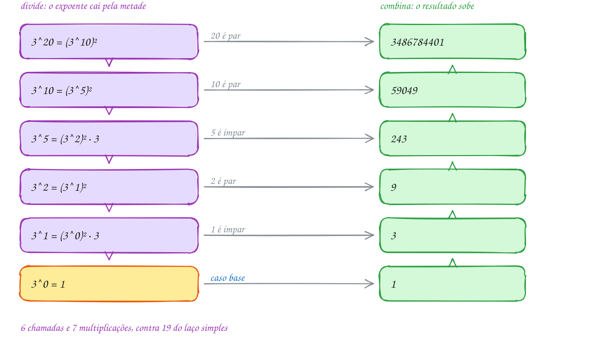</p>

O mesmo exemplo em C. O `printf` dentro da função mostra cada resultado
parcial na hora em que a chamada termina, e o contador `mult` soma as
multiplicações:

```c
#include <stdio.h>

static int mult = 0; // quantas multiplicações foram feitas

// x elevado a n, dividindo o expoente ao meio
long long potencia(long long x, int n) {
    if (n == 0) {
        return 1;                          // caso base: x^0 = 1
    }
    long long metade = potencia(x, n / 2); // conquista: resolve o pedaço menor
    long long r;
    if (n % 2 == 0) {
        r = metade * metade;               // combina: x^n = (x^(n/2))^2
        mult += 1;
    } else {
        r = metade * metade * x;           // n ímpar: sobra um x
        mult += 2;
    }
    printf("3^%-2d = %lld\n", n, r);
    return r;
}

int main(void) {
    long long total = potencia(3, 20);
    printf("Na rodada 20: %lld mensagens\n", total);
    printf("%d multiplicações (o laço simples faria 19)\n", mult);
    return 0;
}
// Saída:
// 3^1  = 3
// 3^2  = 9
// 3^5  = 243
// 3^10 = 59049
// 3^20 = 3486784401
// Na rodada 20: 3486784401 mensagens
// 7 multiplicações (o laço simples faria 19)
```

Os resultados saem de baixo para cima: a chamada de 3²⁰ é a primeira a
começar e a última a terminar. É a pilha de chamadas do assunto 0031.

Repara no fluxograma: é a chamada de cima, com `n = 20`. Ela não é o caso
base, chama a si mesma com 10, recebe 59049 e, como 20 é par, só eleva ao
quadrado. Cada chamada de dentro percorre o mesmo fluxograma com o seu `n`:

<p align="center">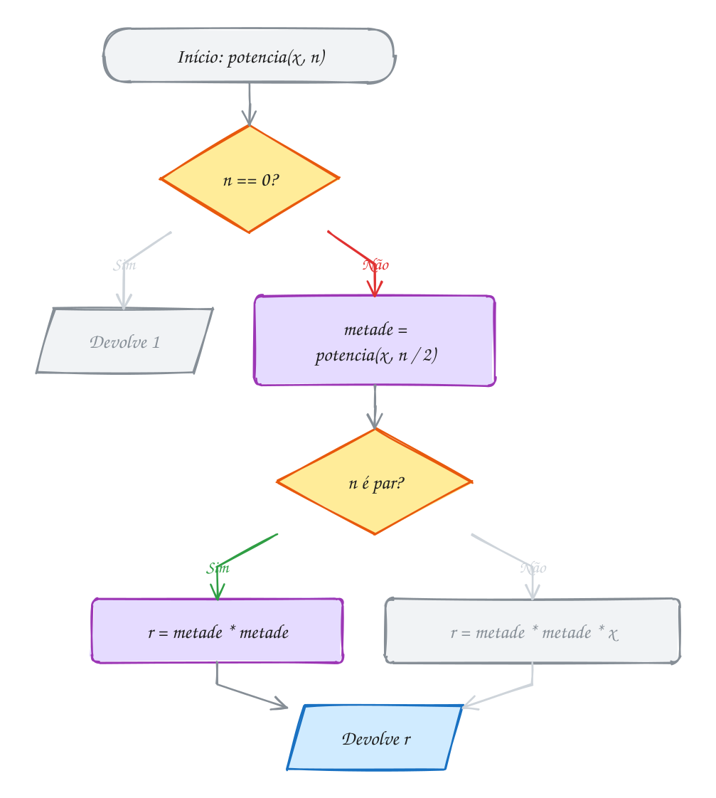</p>

> [!WARNING]
> O erro clássico é escrever `return potencia(x, n / 2) * potencia(x, n / 2);`.
> O resultado sai certo, mas a função passa a fazer **duas** chamadas iguais
> por nível, e elas fazem duas cada uma, e assim por diante. A recorrência
> vira T(n) = 2T(n/2) + O(1), que é O(n): todo o ganho vai embora. Guarde o
> resultado da metade numa variável e use duas vezes. Divisão e conquista só
> compensa quando os pedaços **não se repetem**.

> [!TIP]
> **Por dentro do C:** a recursão empilha um frame para cada bit do
> expoente, mais o do caso base: para n = 20 (5 bits) são 6 frames na pilha,
> para n = 1 bilhão (30 bits) seriam 31. O perigo aqui
> não é a pilha, é o **estouro do `long long`**: ele guarda até
> 9 223 372 036 854 775 807, e 3³⁹ ainda cabe, mas 3⁴⁰ não. Estouro de inteiro
> com sinal é comportamento indefinido, e o `rodar` acusa com `runtime error`.
> Quando só interessam os últimos dígitos, faça cada multiplicação seguida de
> `% m`: o número nunca passa de `m²` (o exemplo A261 faz isso).

> [!NOTE]
> **Pergunta para você:** quantas multiplicações a função faz para 3¹⁶? E para
> 3¹⁵? Por que o expoente 15, menor, dá mais trabalho? Pista: escreva 16 e 15
> em binário.

### Hora de praticar

Os arquivos ficam em [`0131-divisao-e-conquista/`](0131-divisao-e-conquista/). Os comandos funcionam de qualquer pasta do terminal. Nos exemplos, rode, mude, quebre e rode de novo. Nos exercícios, a resposta vai dentro do próprio arquivo. ★☆☆ é aquecimento, ★★☆ pede raciocínio e ★★★ é desafio.

**Exemplo A261 · Potência rápida sem recursão: os bits do expoente**

```c
#include <stdio.h>

// base^exp % m sem recursão: lê o expoente bit a bit, do menos significativo
// para o mais significativo. A cada volta, "base" vira o quadrado dela
// (b, b^2, b^4, b^8...) e entra no resultado quando o bit vale 1.
long long potencia_mod(long long base, long long exp, long long m) {
    long long r = 1;
    base %= m;
    printf("bit  base  resultado\n");
    while (exp > 0) {
        int bit = exp & 1;
        if (bit) {
            r = r * base % m;  // este pedaço do expoente entra na conta
        }
        printf("%3d  %4lld  %9lld\n", bit, base, r);
        base = base * base % m; // próxima potência: o quadrado da atual
        exp >>= 1;              // anda um bit para a esquerda
    }
    return r;
}

int main(void) {
    const char *dias[] = {"domingo", "segunda", "terça", "quarta",
                          "quinta", "sexta", "sábado"};
    // hoje é domingo: que dia da semana será daqui a 2^100 dias?
    // 100 em binário é 1100100: 7 bits, 7 voltas
    long long resto = potencia_mod(2, 100, 7);
    printf("2^100 dias: %lld dia(s) além de semanas inteiras -> %s\n\n",
           resto, dias[resto]);

    // os 4 últimos dígitos de 2^64, que não cabe nem num unsigned long long
    // (o maior é 2^64 - 1); com % 10000, nenhuma conta passa de 10^8
    long long fim = potencia_mod(2, 64, 10000);
    printf("2^64 termina em %04lld\n", fim);
    return 0;
}
// Saída:
// bit  base  resultado
//   0     2          1
//   0     4          1
//   1     2          2
//   0     4          2
//   0     2          2
//   1     4          1
//   1     2          2
// 2^100 dias: 2 dia(s) além de semanas inteiras -> terça
//
// bit  base  resultado
//   0     2          1
//   0     4          1
//   0    16          1
//   0   256          1
//   0  5536          1
//   0  7296          1
//   1  1616       1616
// 2^64 termina em 1616
```

```bash
~/LPEDC/rodar 20-dc-e-gulosos/0131-divisao-e-conquista/A261.c
```

**Exemplo A262 · Maior e menor de uma vez, dividindo ao meio**

```c
#include <stdio.h>

static int comparacoes = 0;

typedef struct {
    int menor;
    int maior;
} Extremos;

// menor e maior de v[ini..fim] (intervalo fechado)
Extremos extremos(const int v[], int ini, int fim) {
    Extremos e;
    if (ini == fim) {                   // 1 elemento: é o menor e o maior
        e.menor = e.maior = v[ini];
        return e;
    }
    if (fim == ini + 1) {               // 2 elementos: 1 comparação basta
        comparacoes++;
        if (v[ini] < v[fim]) {
            e.menor = v[ini];
            e.maior = v[fim];
        } else {
            e.menor = v[fim];
            e.maior = v[ini];
        }
        return e;
    }
    int meio = ini + (fim - ini) / 2;
    Extremos a = extremos(v, ini, meio);     // metade esquerda
    Extremos b = extremos(v, meio + 1, fim); // metade direita
    comparacoes += 2;                        // combina: 2 comparações
    e.menor = a.menor < b.menor ? a.menor : b.menor;
    e.maior = a.maior > b.maior ? a.maior : b.maior;
    return e;
}

int main(void) {
    // temperaturas mínimas de 16 dias em Curitiba, em graus
    int temp[] = {12, 9, 15, 7, 11, 14, 6, 10, 13, 8, 16, 5, 9, 12, 17, 10};
    int n = 16;

    // jeito simples: cada elemento compara com o menor E com o maior
    int menor = temp[0], maior = temp[0], simples = 0;
    for (int i = 1; i < n; i++) {
        simples += 2;
        if (temp[i] < menor) menor = temp[i];
        if (temp[i] > maior) maior = temp[i];
    }
    printf("Laço simples: menor %d, maior %d, %d comparações\n", menor, maior, simples);

    // dividindo: cada par custa 1 comparação (e não 2), e cada combinação
    // custa 2. Total: 3n/2 - 2 = 22, contra 2(n - 1) = 30. O Big-O é o mesmo,
    // O(n); a divisão e conquista ganhou na constante.
    Extremos e = extremos(temp, 0, n - 1);
    printf("Dividindo:    menor %d, maior %d, %d comparações\n", e.menor, e.maior, comparacoes);
    return 0;
}
// Saída:
// Laço simples: menor 5, maior 17, 30 comparações
// Dividindo:    menor 5, maior 17, 22 comparações
```

```bash
~/LPEDC/rodar 20-dc-e-gulosos/0131-divisao-e-conquista/A262.c
```

#### Exercícios

**Exercício E781** · ★☆☆

A barraca de pastel anotou as vendas de 8 dias, em reais:


```text
320 415 280 510 390 605 720 460
```


Escreva a função int soma(const int v[], int ini, int fim), que soma
v[ini..fim] por divisão e conquista: se o pedaço tem um elemento só, a
soma é ele; senão, divida ao meio, some cada metade com a própria função e
junte as duas respostas. Conte as chamadas numa variável global e mostre:


```text
Saída esperada:
Total: R$ 3700
Chamadas: 15
```

**Dicas:**

1. O meio de ini e fim é ini + (fim - ini) / 2. A metade esquerda vai de
   ini a meio; a direita, de meio + 1 a fim.
2. Incremente o contador logo na primeira linha da função, antes do if.
3. Resposta esperada: a saída acima. Com n elementos são sempre 2n - 1
   chamadas: n folhas (os dias) e n - 1 junções. O laço simples faria o
   mesmo trabalho; aqui o objetivo é treinar o formato da técnica.

```bash
~/LPEDC/rodar 20-dc-e-gulosos/0131-divisao-e-conquista/E781.c
```

**Exercício E782** · ★☆☆

Quanto rendem R$ 1000 aplicados a 1% ao mês durante 30 anos (360 meses)?
A conta é 1000 · 1,01^360. O programa está pronto, menos o corpo da função
potencia_d, marcado com "COMPLETE AQUI". Complete com a potência rápida do
texto, agora para double, somando em mult as multiplicações feitas (1
quando o expoente é par, 2 quando é ímpar).


```text
Saída esperada:
Depois de 360 meses: R$ 35949.64
Multiplicações: 13
```

**Dicas:**

1. O caso base devolve 1.0. Depois, guarde potencia_d(x, n / 2) numa
   variável e use duas vezes.
2. Os expoentes visitados são 360, 180, 90, 45, 22, 11, 5, 2, 1 e 0.
   Quatro deles são ímpares.
3. Resposta esperada: a saída acima. Um laço simples faria 360
   multiplicações (e acumularia mais erro de arredondamento do double).

```bash
~/LPEDC/rodar 20-dc-e-gulosos/0131-divisao-e-conquista/E782.c
```

**Exercício E783** · ★★☆

Este programa calcula 3^20 certinho, mas está lento: conta 63 chamadas,
quando a potência rápida faria 6. Rode, ache a linha que estraga a
divisão e conquista e conserte, sem mudar o resultado.


```text
Saída que aparece:
3^20 = 3486784401
Chamadas: 63
```


```text
Saída esperada:
3^20 = 3486784401
Chamadas: 6
```


Depois do conserto, troque 20 por 39 nas duas versões (a sua e a
original, num arquivo à parte) e compare as chamadas: a original faz 127
e a sua, 7. (Não vá além de 39: 3^40 estoura o long long.)

**Dicas:**

1. Quantas vezes a função chama a si mesma em cada nível?
2. Com duas chamadas por nível, a conta é C(n) = 1 + 2·C(n/2): 3, 7, 15,
   31, 63. É uma árvore de recursão inteira, e não um caminho.
3. Resposta esperada: guarde potencia(x, n / 2) numa variável (metade) e
   use metade * metade. Chamadas: 6.

```bash
~/LPEDC/rodar 20-dc-e-gulosos/0131-divisao-e-conquista/E783.c
```

**Exercício E784** · ★★☆

Uma trilha de 10 km foi medida a cada quilômetro. A altitude só sobe até
o pico e depois só desce (o pico não fica nas pontas):


```text
km:       0    1    2    3    4    5    6    7    8    9   10
altitude: 820  905 1010 1180 1340 1415 1390 1250 1100  960  870
```


Escreva int pico(const int v[], int ini, int fim), que acha o índice do
ponto mais alto SEM olhar todos os pontos. Divisão e conquista com um
pedaço só, como a busca binária: olhe o meio e o vizinho da direita. Se
ainda está subindo, o pico está à direita do meio; senão, está no meio ou
à esquerda. Conte numa variável global quantas vezes comparou v[meio] com
v[meio + 1].


```text
Saída esperada:
Pico: 1415 m no km 5
Comparações: 3
```

**Dicas:**

1. Caso base: ini == fim, sobrou um ponto só, e ele é o pico.
2. Se v[meio] < v[meio + 1], chame pico(v, meio + 1, fim); senão,
   pico(v, ini, meio). Repare que o meio continua no segundo caso.
3. Resposta esperada: a saída acima. Os pedaços são [0, 10], [0, 5],
   [3, 5], [5, 5]. Com 1 milhão de pontos seriam umas 20 comparações:
   O(log n), contra O(n) de procurar o maior com um laço.

```bash
~/LPEDC/rodar 20-dc-e-gulosos/0131-divisao-e-conquista/E784.c
```

**Exercício E785** · ★★★

Fibonacci rápido. Existe um fato curioso sobre a matriz 2 x 2


```text
| 1 1 |
| 1 0 |
```


elevada a n: o elemento da primeira linha, segunda coluna, é F(n), o
n-ésimo número de Fibonacci (F(1) = F(2) = 1). Então dá para calcular
F(n) com a potência rápida, trocando "multiplicar números" por
"multiplicar matrizes". Escreva:

- um typedef struct Matriz com quatro long long (a, b, c, d);
- Matriz multiplica(Matriz x, Matriz y), que soma 1 num contador global

```text
de produtos a cada chamada;
```

- Matriz potencia(Matriz m, int n), recursiva, com a identidade

```text
{1, 0, 0, 1} como caso base;
```

- long long fib(int n).

Mostre F(10), F(50) e F(90), zerando o contador antes de cada um:


```text
Saída esperada:
F(10) = 55 (6 produtos de matriz)
F(50) = 12586269025 (9 produtos de matriz)
F(90) = 2880067194370816120 (11 produtos de matriz)
```

**Dicas:**

1. Produto de matrizes 2 x 2: r.a = x.a*y.a + x.b*y.c,
   r.b = x.a*y.b + x.b*y.d, r.c = x.c*y.a + x.d*y.c,
   r.d = x.c*y.b + x.d*y.d.
2. Em potencia: metade = potencia(m, n / 2); r = multiplica(metade,
   metade); se n for ímpar, r = multiplica(r, m).
3. Resposta esperada: a saída acima. A recursão do assunto 0033 faria
   bilhões de chamadas para F(90); o laço simples, 90 somas; esta versão,
   11 produtos de matriz. F(92) é o último que cabe num long long.

```bash
~/LPEDC/rodar 20-dc-e-gulosos/0131-divisao-e-conquista/E785.c
```

**Exercício E786** · ★★★

Multiplicação de Karatsuba. Na escola, 4321 x 8765 custa 16
multiplicações de um dígito (cada dígito de cima com cada dígito de
baixo). Divisão e conquista ajuda: com p = 10^(n/2), escreva
x = a·p + b e y = c·p + d (4321 = 43·100 + 21). Então


```text
x·y = ac·p² + (ad + bc)·p + bd
```


São 4 produtos menores (ac, ad, bc, bd), o que não ganha nada. O truque
de Karatsuba é que (a + b)(c + d) - ac - bd = ad + bc: bastam TRÊS
produtos recursivos (ac, bd e (a + b)(c + d)).

Complete a função karatsuba no lugar marcado com "COMPLETE AQUI". O caso
base (um dos números com 1 dígito) multiplica direto e soma 1 em mult.


```text
Saída esperada:
4321 x 8765 = 37873565
Conferindo: 37873565
Multiplicações de 1 dígito: 11 (a conta da escola faz 16)
```

**Dicas:**

1. n é a quantidade de dígitos do MAIOR dos dois (use digitos) e
   p = potencia10(n / 2). Depois, a = x / p, b = x % p, c = y / p,
   d = y % p.
2. ac = karatsuba(a, c); bd = karatsuba(b, d);
   meio = karatsuba(a + b, c + d) - ac - bd; resultado
   ac * p * p + meio * p + bd.
3. Resposta esperada: a saída acima. São 11 e não 9 porque 87 + 65 = 152
   tem 3 dígitos e gera um nível a mais. Para números de n dígitos o custo
   é O(n^1,59), contra O(n²) da escola: é assim que se multiplicam números
   com milhares de dígitos.

```bash
~/LPEDC/rodar 20-dc-e-gulosos/0131-divisao-e-conquista/E786.c
```

---

## 0132 · Inversões e subvetor de soma máxima

Você e o Caio montaram, cada um, o top 8 de séries do ano. Os gostos de
vocês batem? Um jeito honesto de medir: pegue cada **par** de séries e veja se
os dois concordam sobre qual vem antes. Se você põe "Sintonia" antes de "Cidade
Invisível" e o Caio faz o contrário, é um par em desacordo. Os aplicativos de
recomendação fazem essa conta o tempo todo para achar gente de gosto parecido.

Escreva as suas séries na sua ordem e, embaixo de cada uma, a posição que ela
tem no ranking do Caio. Se ele concordasse com tudo, o vetor sairia
`1 2 3 4 5 6 7 8`. Cada par em desacordo vira uma **inversão**: um par de
posições `i < j` com `v[i] > v[j]`. Contar inversões é medir o quanto um vetor
está fora de ordem: zero no vetor ordenado, `n(n - 1)/2` no vetor ao contrário.

O jeito óbvio testa todos os pares com dois laços: O(n²). Para 8 séries, 28
pares, tudo bem. Para comparar o histórico de 1 milhão de usuários, são meio
trilhão de pares. A divisão e conquista do assunto anterior resolve em
**O(n log n)**, pegando carona no merge sort (assunto 0094).

Divida o vetor ao meio. Toda inversão é de um destes três tipos:

1. os dois elementos estão na metade **esquerda**;
2. os dois estão na metade **direita**;
3. um em cada metade: a inversão **cruza** o meio.

Os tipos 1 e 2 são o mesmo problema, menor: a recursão resolve. O pulo do gato
está no tipo 3. Se as duas metades já estiverem **ordenadas**, a intercalação
conta as inversões cruzadas de graça: quando um elemento da direita sai antes,
ele é menor que **todos** os que ainda sobram na esquerda. Se sobram `q - i`
elementos lá, são `q - i` inversões de uma vez, sem olhar um por um.

Por isso a função faz duas coisas ao mesmo tempo: devolve a contagem **e**
deixa o pedaço ordenado, pronto para a intercalação de cima. A recorrência é a
do merge sort, T(n) = 2T(n/2) + O(n), que dá O(n log n).

Vamos ver na prática. No vetor do Caio, a metade esquerda tem 3 inversões
dentro dela e a direita tem 4. Depois de ordenadas, a intercalação das duas
acha mais 6 cruzadas: o 2 passa na frente de 3 elementos da esquerda, o 4 de
2 e o 6 de 1:

<p align="center">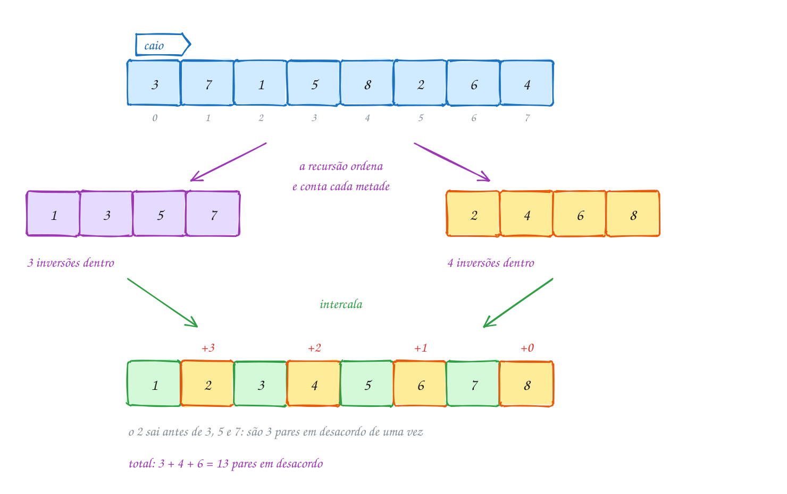</p>

O mesmo exemplo em C. É o merge sort com um contador; o `printf` mostra, para
cada pedaço, as inversões da esquerda, da direita e as cruzadas:

```c
#include <stdio.h>
#include <stdlib.h>

// junta v[p..q-1] e v[q..r-1], já ordenados, e devolve quantas inversões
// cruzam as duas metades
long long intercala(int v[], int w[], int p, int q, int r) {
    long long inv = 0;
    int i = p, j = q, k = 0;
    while (i < q && j < r) {
        if (v[i] <= v[j]) {
            w[k++] = v[i++];
        } else {
            inv += q - i;       // v[j] é menor que TODOS os que sobram à esquerda
            w[k++] = v[j++];
        }
    }
    while (i < q) w[k++] = v[i++];
    while (j < r) w[k++] = v[j++];
    for (k = 0; k < r - p; k++) {
        v[p + k] = w[k];
    }
    return inv;
}

// ordena v[p..r-1] e devolve o número de inversões que havia nele
long long conta(int v[], int w[], int p, int r) {
    if (r - p < 2) {
        return 0;                       // 0 ou 1 elemento: nenhuma inversão
    }
    int q = p + (r - p) / 2;
    long long esq = conta(v, w, p, q);  // inversões dentro da esquerda
    long long dir = conta(v, w, q, r);  // inversões dentro da direita
    long long cruz = intercala(v, w, p, q, r); // um de cada lado
    printf("[%d, %d): %lld + %lld + %lld\n", p, r, esq, dir, cruz);
    return esq + dir + cruz;
}

int main(void) {
    // posição, no ranking do Caio, de cada série do seu top 8
    int caio[] = {3, 7, 1, 5, 8, 2, 6, 4};
    int n = 8;
    int *w = malloc(n * sizeof *w);
    if (w == NULL) {
        return 1;
    }
    long long total = conta(caio, w, 0, n);
    printf("Pares em desacordo: %lld de %d\n", total, n * (n - 1) / 2);
    free(w);
    return 0;
}
// Saída:
// [0, 2): 0 + 0 + 0
// [2, 4): 0 + 0 + 0
// [0, 4): 0 + 0 + 3
// [4, 6): 0 + 0 + 1
// [6, 8): 0 + 0 + 1
// [4, 8): 1 + 1 + 2
// [0, 8): 3 + 4 + 6
// Pares em desacordo: 13 de 28
```

### Passo a passo

A última intercalação: `1 3 5 7` com `2 4 6 8`. Toda vez que o menor vem da
direita, ele soma os que ainda sobram na esquerda:

| sai | de onde | sobram na esquerda | soma |
| --- | --- | --- | --- |
| 1 | esquerda | | 0 |
| 2 | direita | 3, 5, 7 | 3 |
| 3 | esquerda | | 3 |
| 4 | direita | 5, 7 | 5 |
| 5 | esquerda | | 5 |
| 6 | direita | 7 | 6 |
| 7 | esquerda | | 6 |
| 8 | direita | (nenhum) | 6 |

Repara no fluxograma: é a chamada de cima, com o vetor inteiro. As duas
chamadas recursivas contam dentro de cada metade, e a intercalação conta o
que cruza:

<p align="center">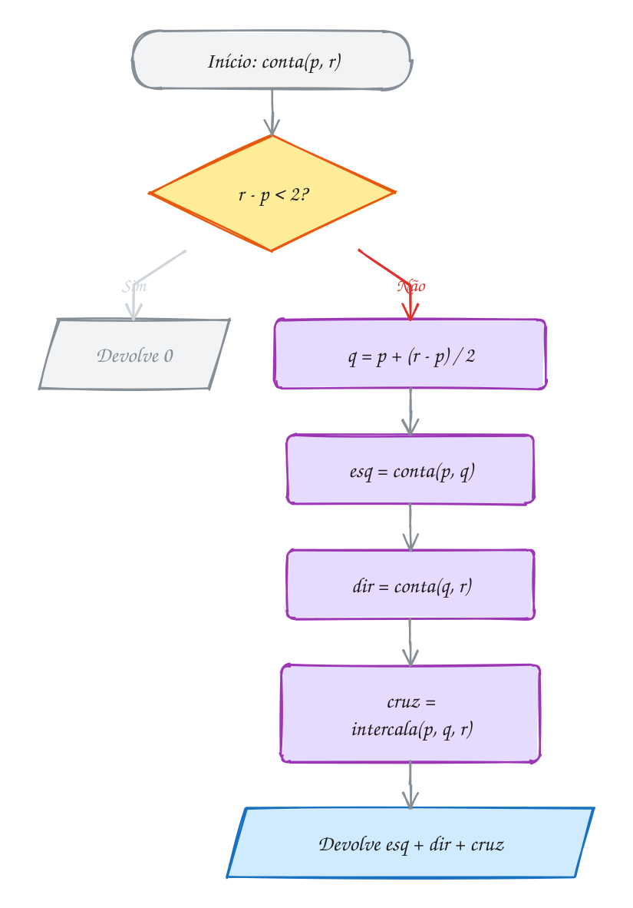</p>

### O subvetor de soma máxima

O mesmo raciocínio dos três tipos resolve outro problema clássico. Um food
truck anotou o lucro de 8 dias, com prejuízo em alguns: `4 -6 3 5 -2 6 -9 2`.
Qual sequência de dias **seguidos** deu o maior lucro somado? Testar todas as
faixas é O(n²). Dividindo ao meio, a melhor faixa está:

1. inteira na **esquerda** (`4 -6 3 5`): a melhor é `3 5`, soma 8;
2. inteira na **direita** (`-2 6 -9 2`): a melhor é `6`, soma 6;
3. **cruzando** o meio: ela é o melhor final da esquerda grudado no melhor
   começo da direita. O melhor final da esquerda é `3 5` (8); o melhor começo
   da direita é `-2 6` (4). Juntos, `3 5 -2 6`, soma **12**.

A resposta é o maior dos três: 12, do dia 2 ao dia 5. Os casos 1 e 2 são
recursão; o caso 3 é um laço que anda do meio para fora, O(n). Mesma
recorrência, mesmo O(n log n). O exemplo A263 traz esse algoritmo em C, e o
A264 mostra um jeito ainda mais rápido, em O(n).

> [!WARNING]
> Na intercalação, a soma é `inv += q - i`, e não `inv++`. Quando o `v[j]` da
> direita sai, ele está fora de ordem com **todos** os elementos de `v[i]` até
> `v[q - 1]`, porque a esquerda está ordenada. Somar 1 contaria só o par com
> `v[i]`. E repare no `<=`: em caso de empate, sai o da esquerda, porque dois
> valores iguais **não** são uma inversão. Com `<`, cada empate viraria uma
> inversão falsa.

> [!TIP]
> **Por dentro do C:** o contador é `long long` de propósito. Um vetor de
> 100 000 elementos ao contrário tem 100 000 · 99 999 / 2 = 4 999 950 000
> inversões, e um `int` de 32 bits vai só até 2 147 483 647. O estouro de
> `int` com sinal é comportamento indefinido; com o `rodar`, o sanitizer
> avisa com `runtime error: signed integer overflow`. Repare também que contar
> **ordena** o vetor: se você ainda precisar da ordem original, conte numa
> cópia (`memcpy` para um vetor alocado antes).

> [!NOTE]
> **Pergunta para você:** quantas inversões tem o vetor `8 7 6 5 4 3 2 1`? E
> quanto o `printf` mostra na linha do `[0, 8)`? Confira a sua conta com a
> fórmula `n(n - 1)/2`.

### Hora de praticar

Os arquivos ficam em [`0132-inversoes-e-subvetor/`](0132-inversoes-e-subvetor/). Os comandos funcionam de qualquer pasta do terminal. Nos exemplos, rode, mude, quebre e rode de novo. Nos exercícios, a resposta vai dentro do próprio arquivo. ★☆☆ é aquecimento, ★★☆ pede raciocínio e ★★★ é desafio.

**Exemplo A263 · A melhor sequência de dias, dividindo ao meio**

```c
#include <stdio.h>

typedef struct {
    int soma;
    int ini, fim; // a faixa v[ini..fim]
} Faixa;

// melhor faixa que CRUZA o meio: obrigatoriamente contém v[meio] e v[meio + 1]
Faixa cruzando(const int v[], int ini, int meio, int fim) {
    Faixa f = {0, meio, meio + 1};
    int soma = 0, melhor_esq = v[meio];
    for (int i = meio; i >= ini; i--) {      // do meio para a esquerda
        soma += v[i];
        if (soma >= melhor_esq) {
            melhor_esq = soma;
            f.ini = i;
        }
    }
    soma = 0;
    int melhor_dir = v[meio + 1];
    for (int j = meio + 1; j <= fim; j++) {  // do meio para a direita
        soma += v[j];
        if (soma > melhor_dir) {
            melhor_dir = soma;
            f.fim = j;
        }
    }
    f.soma = melhor_esq + melhor_dir;
    return f;
}

// melhor faixa de v[ini..fim]
Faixa melhor(const int v[], int ini, int fim) {
    if (ini == fim) {
        return (Faixa){v[ini], ini, fim};   // um dia só
    }
    int meio = ini + (fim - ini) / 2;
    Faixa e = melhor(v, ini, meio);         // inteira na esquerda
    Faixa d = melhor(v, meio + 1, fim);     // inteira na direita
    Faixa c = cruzando(v, ini, meio, fim);  // cruzando o meio
    if (e.soma >= d.soma && e.soma >= c.soma) return e;
    if (d.soma >= c.soma) return d;
    return c;
}

int main(void) {
    // lucro de uma barraca de praia em 10 dias (R$); chuva dá prejuízo
    int lucro[] = {120, -80, 200, -50, -90, 300, 150, -400, 180, 60};
    int n = 10;

    Faixa f = melhor(lucro, 0, n - 1);
    printf("Melhor sequência: dia %d ao dia %d\n", f.ini, f.fim);
    printf("Dias:");
    for (int i = f.ini; i <= f.fim; i++) {
        printf(" %d", lucro[i]);
    }
    printf("\nLucro somado: R$ %d\n", f.soma);
    // repare: a melhor faixa engole dois dias de prejuízo (-50 e -90) para
    // juntar os dias bons dos dois lados

    return 0;
}
// Saída:
// Melhor sequência: dia 0 ao dia 6
// Dias: 120 -80 200 -50 -90 300 150
// Lucro somado: R$ 550
```

```bash
~/LPEDC/rodar 20-dc-e-gulosos/0132-inversoes-e-subvetor/A263.c
```

**Exemplo A264 · Kadane: a soma máxima numa passada só**

```c
#include <stdio.h>

// a melhor faixa que TERMINA no dia i ou é o próprio dia i (começar de novo)
// ou é a melhor que terminava no dia i - 1 com o dia i grudado no fim.
// Guardando só esse número, uma passada resolve: O(n), sem recursão.
void kadane(const char *rotulo, const int v[], int n) {
    int aqui = v[0], ini_aqui = 0;          // melhor faixa que termina em i
    int melhor = v[0], ini = 0, fim = 0;    // melhor faixa vista até agora
    for (int i = 1; i < n; i++) {
        if (aqui + v[i] < v[i]) {
            aqui = v[i];                    // o passado só atrapalha: recomeça
            ini_aqui = i;
        } else {
            aqui += v[i];                   // vale a pena continuar
        }
        if (aqui > melhor) {
            melhor = aqui;
            ini = ini_aqui;
            fim = i;
        }
    }
    printf("%-10s rodadas %d a %d, saldo %+d\n", rotulo, ini + 1, fim + 1, melhor);
}

int main(void) {
    // saldo de gols de dois times, rodada a rodada
    int tigre[] = {2, -1, -3, 4, -1, 2, 1, -5, 4, 1};
    int lanterna[] = {-2, -1, -4, -1, -3}; // perdeu todas

    kadane("Tigre:", tigre, 10);
    kadane("Lanterna:", lanterna, 5);
    // com tudo negativo, a melhor faixa é a menos ruim: um jogo só (-1).
    // Começar "aqui" e "melhor" com 0 em vez de v[0] daria saldo 0 numa faixa
    // vazia, o que não é uma sequência de rodadas.
    return 0;
}
// Saída:
// Tigre:     rodadas 4 a 7, saldo +6
// Lanterna:  rodadas 2 a 2, saldo -1
```

```bash
~/LPEDC/rodar 20-dc-e-gulosos/0132-inversoes-e-subvetor/A264.c
```

#### Exercícios

**Exercício E787** · ★☆☆

A lista de entregas de um motoboy deveria estar em ordem de horário, mas
foi montada às pressas. Os horários (minutos depois das 18h), na ordem da
lista, são:


```text
14 9 17 12 20 11 15
```


Escreva o jeito direto, O(n²): dois laços que testam todos os pares
i < j e mostram cada par fora de ordem (horario[i] > horario[j]), na ordem
em que os laços os encontram. No fim, mostre o total e quantos pares
existem.


```text
Saída esperada:
Fora de ordem: (14, 9) (14, 12) (14, 11) (17, 12) (17, 11) (17, 15) (12, 11) (20, 11) (20, 15)
Inversões: 9 de 21 pares
```

**Dicas:**

1. O laço de dentro começa em j = i + 1: assim cada par aparece uma vez.
2. O total de pares é n(n - 1)/2.
3. Resposta esperada: a saída acima. Guarde este programa: ele serve para
   conferir a versão rápida (merge sort) dos próximos exercícios.

```bash
~/LPEDC/rodar 20-dc-e-gulosos/0132-inversoes-e-subvetor/E787.c
```

**Exercício E788** · ★☆☆

Oito candidatos entregaram a prova e, na ordem de entrega, tiveram as
colocações 6 2 8 4 1 7 3 5. Quantas inversões tem esse vetor? O programa
abaixo é o merge sort que conta inversões, mas falta a linha mais
importante, no lugar marcado com "COMPLETE AQUI". Hoje ele ordena e
mostra 0 inversões.


```text
Saída esperada:
Inversões: 15
Ordenado: 1 2 3 4 5 6 7 8
```

**Dicas:**

1. Você está no else: v[j], da metade direita, é menor que v[i].
2. A metade esquerda está ordenada. Com quantos elementos dela o v[j]
   forma inversão? Eles vão de v[i] até v[q - 1].
3. Resposta esperada: inv += q - i; e a saída acima. Confira com o
   programa de força bruta do E787.

```bash
~/LPEDC/rodar 20-dc-e-gulosos/0132-inversoes-e-subvetor/E788.c
```

**Exercício E789** · ★★☆

Você e a Bia ranquearam os mesmos seis pratos, do favorito ao último:


```text
você: Feijoada, Moqueca, Coxinha, Acarajé, Pastel, Pão de queijo
Bia:  Moqueca, Coxinha, Feijoada, Pão de queijo, Acarajé, Pastel
```


Mostre cada par de pratos em que vocês discordam (no formato "A x B", com
A antes de B no SEU ranking) e o total. O truque: monte um vetor v em que
v[i] é a posição, no ranking da Bia, do seu i-ésimo prato. Os pares em
desacordo são exatamente as inversões de v.


```text
Saída esperada:
Feijoada x Moqueca
Feijoada x Coxinha
Acarajé x Pão de queijo
Pastel x Pão de queijo
Pares em desacordo: 4 de 15
```

**Dicas:**

1. Escreva int posicao(const char *lista[], int n, const char *nome), uma
   busca sequencial (assunto 0089) com strcmp.
2. Para seu ranking, v fica 2 0 1 4 5 3. Agora é o E787 com nomes: dois
   laços, e quando v[i] > v[j] mostre meu[i] e meu[j].
3. Resposta esperada: a saída acima. Com 6 itens, 4 desacordos em 15
   pares: os gostos batem em 11/15, uns 73%.

```bash
~/LPEDC/rodar 20-dc-e-gulosos/0132-inversoes-e-subvetor/E789.c
```

**Exercício E790** · ★★☆

O insertion sort (assunto 0093) desloca um elemento para a direita a cada
vez que acha alguém maior antes do valor que está inserindo. Cada
deslocamento desfaz exatamente uma inversão. Então o número de
deslocamentos do insertion sort É o número de inversões do vetor.

Confira isso no computador. Escreva:
- long long insercao(int v[], int n): insertion sort que devolve quantos

```text
deslocamentos fez;
```

- o merge sort que conta inversões, do texto (sem os printf).
Rode os dois, cada um na sua cópia do vetor (use memcpy), com os pesos
de 12 encomendas, em kg:


```text
31 12 45 27 8 39 19 50 4 23 36 15
```


```text
Saída esperada:
Deslocamentos do insertion sort: 36
Inversões pelo merge sort: 36
```

**Dicas:**

1. memcpy(a, pesos, sizeof pesos) copia o vetor inteiro de uma vez
   (string.h). Sem a cópia, o segundo algoritmo receberia o vetor já
   ordenado e contaria 0.
2. No insertion sort, conte dentro do while que faz v[j + 1] = v[j].
3. Resposta esperada: a saída acima. Daí sai uma conclusão de custo: o
   insertion sort gasta O(n + inversões). Vetor quase ordenado, poucas
   inversões, insertion sort rápido.

```bash
~/LPEDC/rodar 20-dc-e-gulosos/0132-inversoes-e-subvetor/E790.c
```

**Exercício E791** · ★★★

Um analista quer contar as quedas fortes no preço de uma ação: pares de
dias i < j em que o preço do dia i era MAIS QUE O DOBRO do preço do dia j
(preco[i] > 2 * preco[j]). Os preços de 8 dias, em reais:


```text
40 18 25 9 30 12 50 20
```


Escreva a versão O(n log n), adaptando o merge sort que conta inversões,
e confira com uma força bruta O(n²) feita ANTES de ordenar.


```text
Saída esperada:
Quedas de mais da metade: 7
Força bruta: 7
```

**Dicas:**

1. Não dá para contar dentro da intercalação, como no texto: a ordem em
   que os elementos saem segue v[i] <= v[j], e não v[i] > 2 * v[j]. Faça
   um laço SEPARADO, com as duas metades já ordenadas, ANTES de intercalar.
2. Nesse laço, j começa em q e só anda para a frente: para cada i da
   esquerda, avance j enquanto v[i] > 2 * v[j]; some j - q. Como v[i]
   cresce, o j de um i serve de ponto de partida para o próximo. O laço
   todo é O(n).
3. Resposta esperada: 7 nas duas linhas. Os pares são (40, 18), (40, 9),
   (40, 12), (25, 9), (25, 12), (30, 12) e (50, 20). Se as contas não
   baterem, mostre os pares da força bruta com printf para achar a falha.

```bash
~/LPEDC/rodar 20-dc-e-gulosos/0132-inversoes-e-subvetor/E791.c
```

**Exercício E792** · ★★★

Este programa tem um erro de propósito. Ele conta as inversões de um vetor
de 100 000 elementos em ordem decrescente, o pior caso. A resposta certa
é n(n - 1)/2 = 4 999 950 000. Rode com o rodar: o compilador já dá um
warning de "integer overflow" na linha da fórmula, o
UndefinedBehaviorSanitizer acusa "signed integer overflow" durante a
contagem, e os números mostrados são lixo (aqui saiu 704982704). Conserte os
tipos para a contagem caber, sem mudar o algoritmo, e mostre a conta pela
fórmula na segunda linha, também sem estourar.


```text
Saída esperada depois do conserto:
Inversões: 4999950000
Fórmula:   4999950000
```

**Dicas:**

1. Um int de 32 bits vai até 2 147 483 647. Siga o caminho da contagem:
   inv, o retorno de intercala, os retornos de conta, total.
2. Na fórmula, N * (N - 1) é feito em int (os dois operandos são int)
   ANTES de qualquer conversão. Converta um dos lados antes de
   multiplicar: (long long)N * (N - 1) / 2.
3. Resposta esperada: inv, os retornos de intercala e conta, as variáveis
   esq e dir e total viram long long; o printf usa %lld. O q - i continua
   int (cabe), e a soma promove para long long sozinha.

```bash
~/LPEDC/rodar 20-dc-e-gulosos/0132-inversoes-e-subvetor/E792.c
```

---

## 0133 · Algoritmos gulosos

Na padaria, o pão deu R$ 3,10 e você pagou com uma nota de 5. O caixa precisa
devolver R$ 1,90 com o **menor número de moedas**. Ninguém ali testa
combinações. O caixa pega a maior moeda que cabe (R$ 1), depois a maior que
cabe no que falta (50 centavos), e assim por diante: 100 + 50 + 25 + 10 + 5,
cinco moedas. Rápido e certo.

Esse jeito de pensar tem nome: **algoritmo guloso** (em inglês, *greedy*). A
cada passo ele faz a escolha que parece a **melhor agora**, sem pensar no
futuro, e **nunca volta atrás**. Não existe "desfazer", como no backtracking
(assunto 0127), nem dividir em subproblemas para depois combinar, como na
divisão e conquista (0131). É uma decisão por vez, e cada decisão é final.

Você já viu um guloso famoso: o Dijkstra (assunto 0112) fixa, a cada passo, o
vértice mais perto da origem, e nunca mais mexe nele. Os próximos assuntos
trazem mais três: escolher reuniões numa sala, encher uma mochila e comprimir
arquivos (Huffman).

Quando funciona, o guloso é o algoritmo mais simples e rápido que existe.
Aqui, é um laço só: O(k + número de moedas dadas), para `k` tipos de moeda. O
problema é o "quando funciona". Uma escolha boa agora pode estragar o resto, e
o guloso não tem como perceber.

Imagine um fliperama que só tem fichas de **1, 3 e 4 créditos**. O troco é de
6 créditos. O guloso pega a maior que cabe, 4, e sobram 2, que só saem com
1 + 1: **três fichas**. Mas 3 + 3 dá **duas**. O guloso errou, e errou por
causa da primeira escolha: o 4 parecia ótimo e fechou o caminho bom.

Então por que no Real dá certo? Porque o sistema do Real é **canônico**: para
ele, dá para provar que o guloso sempre acha o mínimo. A prova é do tipo
"troca": se um troco usasse, por exemplo, duas moedas de 25 onde cabe uma de
50, trocar as duas pela de 50 diminuiria a conta. Repetindo o argumento para
cada moeda, a solução ótima só pode ser a gulosa. Com {1, 3, 4}, a troca não
funciona: duas fichas de 3 não viram uma de 4.

A lição vale para todo guloso: **um contraexemplo derruba, e só uma prova
garante**. "Testei uns casos e deu certo" não é prova. Quando o guloso não
serve, o caminho é testar as combinações com esperteza: a programação
dinâmica do módulo 21 resolve o troco de qualquer sistema de moedas.

Vamos ver na prática. Em cima, o troco de R$ 1,90: cada moeda escolhida é a
maior que cabe no que falta, e o guloso acerta. Embaixo, as fichas: o 4
parece a melhor escolha, mas deixa um resto de 2 que custa duas fichas, e o
ótimo (3 + 3) nunca é visto:

<p align="center">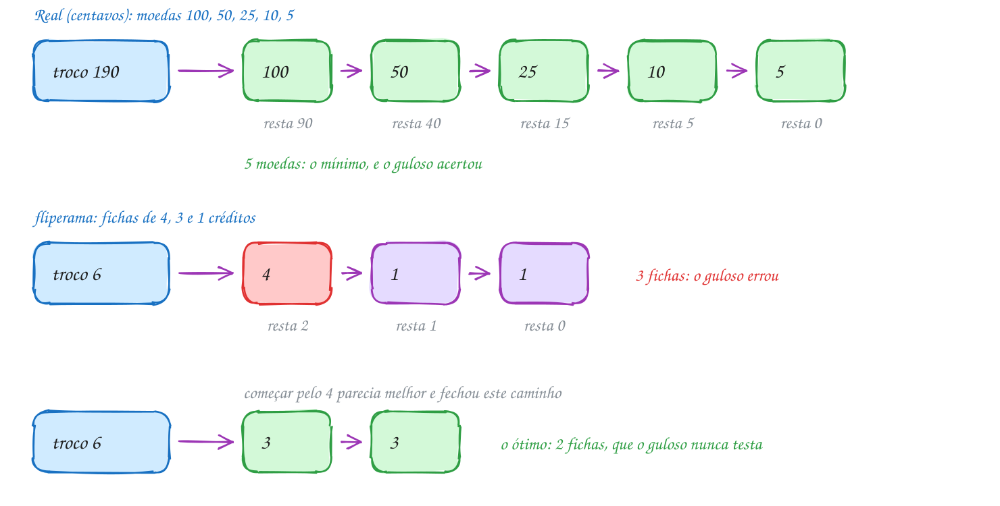</p>

O mesmo exemplo em C. A função recebe as moedas em ordem **decrescente** e
anda por elas: se a moeda cabe, dá a moeda e continua nela (pode precisar de
outra igual); se não cabe, passa para a próxima menor:

```c
#include <stdio.h>

// troco guloso: sempre a MAIOR moeda que ainda cabe no que falta.
// moedas[] precisa estar em ordem decrescente. Devolve quantas moedas deu.
int troco_guloso(const int moedas[], int k, int valor) {
    int quantas = 0;
    int i = 0;
    printf("Troco de %d:", valor);
    while (valor > 0 && i < k) {
        if (moedas[i] <= valor) {
            printf(" %d", moedas[i]); // escolhe e nunca volta atrás
            valor -= moedas[i];
            quantas++;
        } else {
            i++;                      // essa não cabe mais: tenta a próxima
        }
    }
    printf(" (%d moedas)\n", quantas);
    return quantas;
}

int main(void) {
    int real[] = {100, 50, 25, 10, 5}; // centavos
    int fichas[] = {4, 3, 1};          // créditos do fliperama

    troco_guloso(real, 5, 190);        // R$ 1,90
    troco_guloso(fichas, 3, 6);        // 6 créditos
    return 0;
}
// Saída:
// Troco de 190: 100 50 25 10 5 (5 moedas)
// Troco de 6: 4 1 1 (3 moedas)
```

O código não tem como saber que errou: ele devolve 3 com a mesma confiança
com que devolve 5. Quem sabe que 3 não é o mínimo é você, que achou o
contraexemplo.

Repara no fluxograma: as duas perguntas fazem todo o trabalho. "Ainda falta
troco?" controla o laço, e "a moeda da vez cabe?" decide entre dar a moeda ou
descer para a próxima. Não há caminho de volta para uma moeda maior:

<p align="center">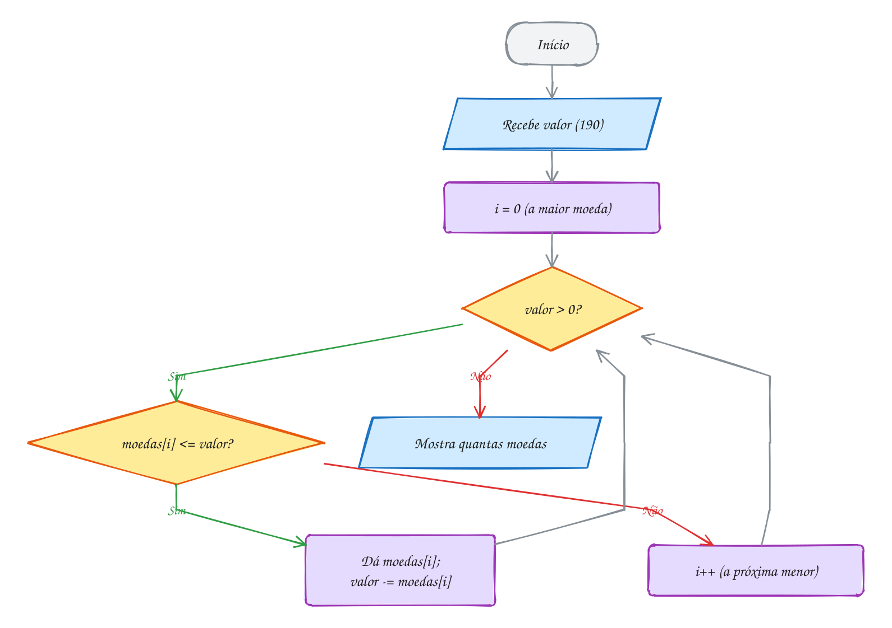</p>

> [!WARNING]
> O guloso do troco **depende da ordem** do vetor. Com as moedas em ordem
> crescente (`{5, 10, 25, 50, 100}`), a função dá 38 moedas de 5 centavos para
> o troco de R$ 1,90: ela pega a primeira que cabe, e a primeira é a menor.
> Se as moedas chegam fora de ordem, ordene antes, de forma decrescente (com o
> `qsort`, assunto 0096). E lembre: mesmo ordenado, o guloso só garante o
> mínimo em sistema canônico.

> [!TIP]
> **Por dentro do C:** o troco é feito em **centavos**, num `int`, e não em
> reais num `double`. O valor 0,10 não tem representação exata em binário:
> `1.90 - 1.00 - 0.50 - 0.25 - 0.10` dá `0.049999999999999906` num `double`, e
> aí a moeda de 5 centavos "não cabe" (`0.05 <= 0.0499...` é falso). O laço
> termina devendo troco. Todo programa que lida com dinheiro guarda centavos
> num inteiro e só divide por 100 na hora de mostrar.

> [!NOTE]
> **Pergunta para você:** com moedas de 1, 10 e 25 centavos (sem a de 5), o
> guloso acerta o troco de 30? E o de 40? Faça as contas no papel e depois
> rode a função com `{25, 10, 1}`.

### Hora de praticar

Os arquivos ficam em [`0133-gulosos/`](0133-gulosos/). Os comandos funcionam de qualquer pasta do terminal. Nos exemplos, rode, mude, quebre e rode de novo. Nos exercícios, a resposta vai dentro do próprio arquivo. ★☆☆ é aquecimento, ★★☆ pede raciocínio e ★★★ é desafio.

**Exemplo A265 · Postos na estrada: parar o mínimo de vezes**

```c
#include <stdio.h>

// guloso que ACERTA: siga até onde o tanque deixa e só abasteça no último
// posto antes de o combustível acabar. Parar antes nunca ajuda: o tanque
// cheio num posto mais à frente leva você pelo menos tão longe.
int main(void) {
    int destino = 600;   // km da viagem
    int autonomia = 200; // km com o tanque cheio
    int posto[] = {80, 150, 230, 310, 360, 450, 520, 590}; // km de cada posto
    int n = 8;

    int alcance = autonomia; // até onde chego sem parar
    int paradas = 0;
    int i = 0;
    while (alcance < destino) {
        int ultimo = -1;
        while (i < n && posto[i] <= alcance) {
            ultimo = posto[i];   // o posto mais distante que ainda alcanço
            i++;
        }
        if (ultimo < 0) {
            printf("Sem posto ao alcance: a viagem não dá\n");
            return 1;
        }
        paradas++;
        alcance = ultimo + autonomia;
        printf("Parada %d: km %d (agora chego ao km %d)\n", paradas, ultimo, alcance);
    }
    printf("Chegou ao km %d com %d paradas\n", destino, paradas);
    return 0;
}
// Saída:
// Parada 1: km 150 (agora chego ao km 350)
// Parada 2: km 310 (agora chego ao km 510)
// Parada 3: km 450 (agora chego ao km 650)
// Chegou ao km 600 com 3 paradas
```

```bash
~/LPEDC/rodar 20-dc-e-gulosos/0133-gulosos/A265.c
```

**Exemplo A266 · Fila do cartório: o mais rápido primeiro**

```c
#include <stdio.h>
#include <stdlib.h>

typedef struct {
    const char *nome;
    int minutos; // tempo de atendimento
} Pessoa;

int por_duracao(const void *a, const void *b) {
    const Pessoa *x = a;
    const Pessoa *y = b;
    return (x->minutos > y->minutos) - (x->minutos < y->minutos);
}

// soma o tempo que cada pessoa ESPERA antes de ser atendida
int espera_total(const Pessoa fila[], int n) {
    int relogio = 0, total = 0;
    for (int i = 0; i < n; i++) {
        total += relogio;          // a pessoa i esperou até agora
        relogio += fila[i].minutos;
        printf(" %s", fila[i].nome);
    }
    return total;
}

int main(void) {
    Pessoa fila[] = {{"Ana", 12}, {"Bruno", 3}, {"Carla", 8}, {"Davi", 1}, {"Eva", 5}};
    int n = 5;

    printf("Por chegada:");
    int chegada = espera_total(fila, n);
    printf("\n  espera total %d min, média %.1f min\n", chegada, chegada / (double)n);

    // guloso: atender sempre o serviço mais curto que está na fila.
    // Quem é atendido primeiro faz TODOS os outros esperarem; por isso o
    // primeiro deve ser o mais curto.
    qsort(fila, n, sizeof fila[0], por_duracao);
    printf("Mais curto primeiro:");
    int curto = espera_total(fila, n);
    printf("\n  espera total %d min, média %.1f min\n", curto, curto / (double)n);
    return 0;
}
// Saída:
// Por chegada: Ana Bruno Carla Davi Eva
//   espera total 74 min, média 14.8 min
// Mais curto primeiro: Davi Bruno Eva Carla Ana
//   espera total 31 min, média 6.2 min
```

```bash
~/LPEDC/rodar 20-dc-e-gulosos/0133-gulosos/A266.c
```

#### Exercícios

**Exercício E793** · ★☆☆

O caixa eletrônico tem notas de R$ 200, 100, 50, 20, 10, 5 e 2, e entrega
o saque com o menor número de notas, pelo guloso: a maior nota que cabe,
de novo e de novo. Escreva a função void saque(int valor), que mostra
quantas notas de cada valor saem (só as que aparecem) e o total, e chame
para R$ 380 e R$ 1270.


```text
Saída esperada:
Saque de R$ 380:
  1 de R$ 200
  1 de R$ 100
  1 de R$ 50
  1 de R$ 20
  1 de R$ 10
  total: 5 notas
Saque de R$ 1270:
  6 de R$ 200
  1 de R$ 50
  1 de R$ 20
  total: 8 notas
```

**Dicas:**

1. Guarde as notas num vetor em ordem decrescente e percorra com um for.
2. Para cada nota, um while tira a nota enquanto ela couber no valor,
   contando quantas saíram.
3. Resposta esperada: a saída acima. (Tente um saque de R$ 8 depois: o
   guloso dá uma nota de 5, uma de 2 e trava com R$ 1 sobrando, embora
   quatro notas de 2 resolvam. Sem a nota de 1, o guloso nem sempre acha
   uma resposta que existe.)

```bash
~/LPEDC/rodar 20-dc-e-gulosos/0133-gulosos/E793.c
```

**Exercício E794** · ★☆☆

O guloso do texto dá as moedas uma por uma. Quando a moeda de 100 cabe
várias vezes, dá para resolver de uma vez com divisão inteira: valor / 100
diz quantas moedas de 100 saem, e valor % 100 diz quanto sobra. Complete o
programa no lugar marcado com "COMPLETE AQUI", usando / e %, para o troco
de 285 centavos. Mostre só as moedas que aparecem.


```text
Saída esperada:
Troco de 285 centavos:
  2 de 100
  1 de 50
  1 de 25
  1 de 10
Total: 5 moedas
```

**Dicas:**

1. Duas linhas fazem o trabalho: quantas = valor / moedas[i]; e
   valor %= moedas[i]; (nesta ordem!).
2. Mostre a linha só se quantas > 0. Some quantas em total sempre.
3. Resposta esperada: a saída acima. A versão com / e % faz uma volta por
   tipo de moeda, O(k), qualquer que seja o valor do troco.

```bash
~/LPEDC/rodar 20-dc-e-gulosos/0133-gulosos/E794.c
```

**Exercício E795** · ★★☆

Numa enchente, cada barco de resgate leva no máximo 2 pessoas e no máximo
150 kg. Os pesos das 8 pessoas a resgatar, em kg:


```text
60 95 80 120 45 70 100 55
```


Use o menor número de barcos com este guloso: ordene os pesos; a pessoa
mais pesada que falta SEMPRE vai no próximo barco; se a mais leve que
falta couber junto, vai junto. Mostre cada barco (o mais pesado primeiro)
e o total.


```text
Saída esperada:
Barco 1: 120
Barco 2: 100 + 45
Barco 3: 95 + 55
Barco 4: 80 + 60
Barco 5: 70
Total: 5 barcos
```

**Dicas:**

1. Ordene com qsort em ordem crescente e use dois índices: leve = 0 e
   pesado = n - 1. O laço vai enquanto leve <= pesado.
2. Se leve < pesado e a soma cabe, o leve vai junto (leve++). Em todo
   caso, pesado-- e barcos++.
3. Resposta esperada: a saída acima. Por que dá certo: se o mais pesado
   não cabe nem com o mais leve, não cabe com ninguém e precisa ir
   sozinho; se cabe, pôr o mais leve com ele nunca piora o resto.

```bash
~/LPEDC/rodar 20-dc-e-gulosos/0133-gulosos/E795.c
```

**Exercício E796** · ★★☆

O sistema da lanchonete lê as moedas de um arquivo de configuração, e elas
chegam fora de ordem: {10, 50, 5, 100, 25}. A função troco_guloso é a do
texto e está certa, mas o troco sai absurdo. Rode e veja:


```text
Saída que aparece:
Troco de 190: 10 10 10 10 10 10 10 10 10 10 10 10 10 10 10 10 10 10 10 (19 moedas)
Troco de 65: 10 10 10 10 10 10 5 (7 moedas)
```


Conserte sem mexer na função nem na linha que declara o vetor: antes das
chamadas, ordene as moedas em ordem DECRESCENTE com qsort, escrevendo a
função de comparação.


```text
Saída esperada:
Troco de 190: 100 50 25 10 5 (5 moedas)
Troco de 65: 50 10 5 (3 moedas)
```

**Dicas:**

1. A comparação recebe const void *. Converta: int x = *(const int *)a;
2. Para a ordem decrescente, devolva negativo quando x > y. A forma
   (x < y) - (x > y) faz isso sem o risco de estouro de "y - x".
3. Resposta esperada: qsort(moedas, 5, sizeof moedas[0], decrescente);
   e a saída acima.

```bash
~/LPEDC/rodar 20-dc-e-gulosos/0133-gulosos/E796.c
```

**Exercício E797** · ★★★

Vamos caçar contraexemplos com o computador. Para cada sistema de moedas
abaixo, ache o MENOR valor, de 1 a 100, em que o guloso usa mais moedas
que o necessário, ou diga que ele acertou todos.

Escreva:
- int guloso(const int m[], int k, int valor): o troco guloso com / e %

```text
(moedas em ordem decrescente; a última é sempre 1);
```

- int otimo(const int m[], int k, int i, int valor): o mínimo de verdade,

```text
por força bruta recursiva: para a moeda m[i], teste usar 0, 1, 2, ...
unidades dela e resolva o resto com as moedas seguintes (i + 1). Quando
i chega na última moeda (o 1), a resposta é o próprio valor;
```

- void testa(const char *nome, const int m[], int k, int limite).


```text
Saída esperada:
{25, 10, 5, 1}: o guloso acertou de 1 a 100
{4, 3, 1}: falha em 6 (guloso 3, ótimo 2)
{10, 7, 1}: falha em 14 (guloso 5, ótimo 2)
{12, 5, 1}: falha em 15 (guloso 4, ótimo 3)
```

**Dicas:**

1. Em otimo, comece com melhor = valor (tudo em moedas de 1) e, no laço
   for (int c = 0; c * m[i] <= valor; c++), compare com
   c + otimo(m, k, i + 1, valor - c * m[i]).
2. Em testa, pare no primeiro valor em que guloso != otimo.
3. Resposta esperada: a saída acima. O teste só vai até 100, então
   "acertou de 1 a 100" não é prova de que o sistema é canônico. (Para
   sistemas de moedas existe um resultado conhecido: se o guloso falha,
   falha num valor menor que a soma das duas maiores moedas.)

```bash
~/LPEDC/rodar 20-dc-e-gulosos/0133-gulosos/E797.c
```

**Exercício E798** · ★★★

Depois do churrasco, a conta foi dividida igualmente entre 6 amigos, mas
cada um pagou uma parte diferente no mercado:


```text
Ana R$ 180, Bruno R$ 0, Carla R$ 60, Davi R$ 120, Eva R$ 0, Fábio R$ 90
```


Monte os Pix para acertar as contas com este guloso: enquanto alguém deve,
quem MAIS deve paga para quem MAIS tem a receber o menor dos dois valores
(a dívida de um ou o crédito do outro). Em caso de empate, vale o que vem
primeiro na lista. Trabalhe em centavos, num int.


```text
Saída esperada:
Total R$ 450.00, cada um R$ 75.00
Bruno -> Ana: R$ 75.00
Eva -> Davi: R$ 45.00
Eva -> Ana: R$ 30.00
Carla -> Fábio: R$ 15.00
4 Pix
```

**Dicas:**

1. saldo[i] = pagou[i] - parte. Positivo: tem a receber; negativo: deve.
2. A cada volta, ache o índice do menor saldo (quem mais deve) e o do
   maior (quem mais tem a receber). Se o menor saldo é 0, acabou.
3. Resposta esperada: a saída acima. Cada Pix zera pelo menos uma pessoa,
   então são no máximo n - 1 Pix. (Achar o MÍNIMO absoluto de Pix é um
   problema bem mais difícil; o guloso dá uma boa resposta, rápida.)

```bash
~/LPEDC/rodar 20-dc-e-gulosos/0133-gulosos/E798.c
```

---

## 0134 · Seleção de intervalos

A quadra de futsal do condomínio só tem uma reserva por vez, e no sábado
chegaram nove pedidos, cada um com hora de início e de fim. Não dá para
atender todo mundo, porque alguns horários se chocam. O síndico quer aceitar
o **maior número possível** de pedidos. Qual escolher?

Esse é o problema da **seleção de atividades** (ou de intervalos): dado um
conjunto de intervalos `[início, fim)`, escolher o maior subconjunto sem
nenhum par que se sobreponha. Ele aparece em sala de reunião, agenda de
consultório, uso de um equipamento caro, horários de uma emissora.

Testar todos os subconjuntos (assunto 0125) daria a resposta, mas são 2⁹ = 512
para nove pedidos e mais de um bilhão para trinta. Um **guloso** resolve
ordenando uma vez. A pergunta é: guloso por qual critério? Três parecem
razoáveis:

- aceitar primeiro quem **começa** mais cedo;
- aceitar primeiro o pedido mais **curto**;
- aceitar primeiro quem **termina** mais cedo.

Só o terceiro funciona sempre. A ideia: o pedido que termina primeiro é o que
**devolve a quadra mais cedo**, e quadra livre cedo é o que deixa mais espaço
para os outros. Dá para provar com uma troca: pegue qualquer escolha ótima e
troque o primeiro pedido dela pelo que termina primeiro. Ele termina antes (ou
junto), então não choca com nenhum dos outros escolhidos, e a escolha continua
do mesmo tamanho. Repetindo para o resto, a escolha gulosa é tão boa quanto a
ótima.

O algoritmo fica assim:

1. **ordene** os pedidos pela hora de **fim**;
2. guarde a hora em que a quadra fica livre (`livre_em`, começando em 0);
3. percorra os pedidos em ordem: se o pedido começa em `livre_em` ou depois,
   **aceite** e mova `livre_em` para o fim dele; senão, recuse.

O custo é o da ordenação, O(n log n), mais uma passada O(n). Cada pedido é
olhado uma vez e a decisão é final: aceitou, aceitou; recusou, recusou.

Vamos ver na prática. No desenho, cada barra é um pedido, na ordem em que o
algoritmo olha para eles (por hora de fim). As verdes foram aceitas; as
cinzas chocaram com alguém já aceito. Repare na Iara: o pedido dela começa
antes de todos, às 7h, e é o primeiro que o critério "quem começa antes"
aceitaria, bloqueando a quadra até as 17h:

<p align="center">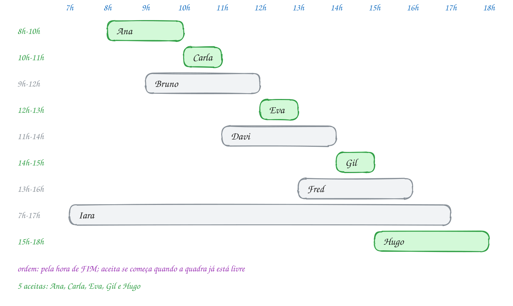</p>

O mesmo exemplo em C. Os pedidos são structs, ordenados com `qsort` (assunto
0096) por uma função que compara os fins:

```c
#include <stdio.h>
#include <stdlib.h>

typedef struct {
    const char *nome;
    int ini, fim; // horário [ini, fim): quem sai às 10h libera a quadra às 10h
} Reserva;

int por_fim(const void *a, const void *b) {
    const Reserva *x = a;
    const Reserva *y = b;
    return (x->fim > y->fim) - (x->fim < y->fim);
}

int main(void) {
    Reserva r[] = {
        {"Ana", 8, 10},  {"Bruno", 9, 12}, {"Carla", 10, 11},
        {"Davi", 11, 14}, {"Eva", 12, 13},  {"Fred", 13, 16},
        {"Gil", 14, 15},  {"Hugo", 15, 18}, {"Iara", 7, 17},
    };
    int n = 9;

    // guloso: entre os pedidos que cabem, aceite o que TERMINA primeiro
    qsort(r, n, sizeof r[0], por_fim);
    int livre_em = 0; // a quadra fica livre a partir desta hora
    int aceitas = 0;
    for (int i = 0; i < n; i++) {
        printf("%-6s %2dh-%2dh: ", r[i].nome, r[i].ini, r[i].fim);
        if (r[i].ini >= livre_em) {
            printf("aceita\n");
            livre_em = r[i].fim;
            aceitas++;
        } else {
            printf("recusada (quadra ocupada até %dh)\n", livre_em);
        }
    }
    printf("Reservas aceitas: %d de %d\n", aceitas, n);
    return 0;
}
// Saída:
// Ana     8h-10h: aceita
// Carla  10h-11h: aceita
// Bruno   9h-12h: recusada (quadra ocupada até 11h)
// Eva    12h-13h: aceita
// Davi   11h-14h: recusada (quadra ocupada até 13h)
// Gil    14h-15h: aceita
// Fred   13h-16h: recusada (quadra ocupada até 15h)
// Iara    7h-17h: recusada (quadra ocupada até 15h)
// Hugo   15h-18h: aceita
// Reservas aceitas: 5 de 9
```

Repare que a Carla (10h às 11h) foi aceita logo depois da Ana (8h às 10h): os
intervalos são **semiabertos**, e a Ana libera a quadra exatamente às 10h. Por
isso o teste é `ini >= livre_em`, com o igual.

Repara no fluxograma: depois da ordenação, é um laço com uma pergunta só. O
caminho marcado mostra a Ana sendo aceita e o Bruno sendo recusado; o resto
repete esses dois trajetos:

<p align="center">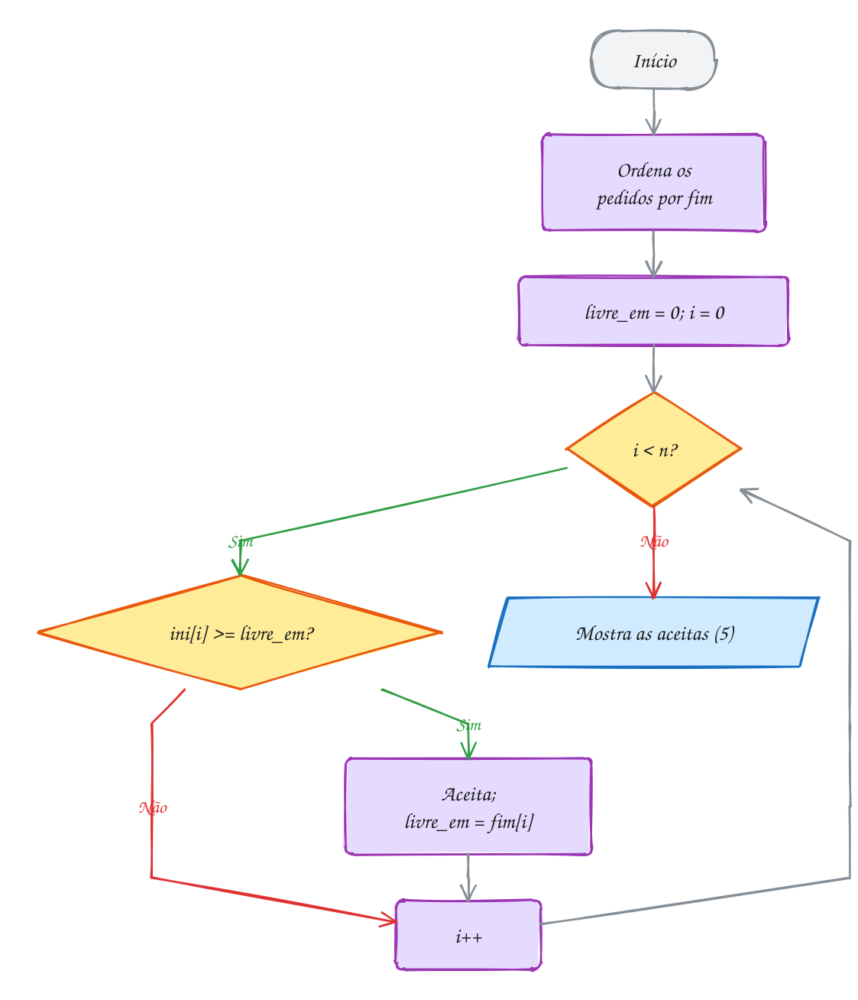</p>

> [!WARNING]
> Os outros dois critérios parecem bons e falham. "Começa primeiro" aceita a
> Iara (7h às 17h) e depois só o Hugo cabe: 1 pedido em vez de 5. "Mais curto
> primeiro" falha com três pedidos: 8h às 12h, 11h às 13h e 12h às 16h. O mais
> curto (11h às 13h) choca com os outros dois e fica sozinho, quando os dois
> compridos cabem juntos. Ordenar pelo campo errado é o erro mais comum, e o
> programa roda sem reclamar: só a resposta fica pior.

> [!TIP]
> **Por dentro do C:** o `qsort` move os elementos do vetor copiando bytes, e
> cada `Reserva` tem 16 bytes (um ponteiro de 8 e dois `int` de 4). Para
> structs grandes, vale ordenar um vetor de **ponteiros** para as structs: o
> `qsort` passa a mover 8 bytes por troca, e a comparação recebe um
> `const void *` que aponta para um ponteiro (`*(const Reserva * const *)a`).
> E a comparação devolve `(x > y) - (x < y)`, e não `x->fim - y->fim`: com
> horários tanto faz, mas com valores grandes a subtração pode estourar o
> `int`.

> [!NOTE]
> **Pergunta para você:** se o pedido do Hugo fosse das 14h às 18h, quantas
> reservas seriam aceitas? Quais? E se fosse das 16h às 18h?

### Hora de praticar

Os arquivos ficam em [`0134-intervalos/`](0134-intervalos/). Os comandos funcionam de qualquer pasta do terminal. Nos exemplos, rode, mude, quebre e rode de novo. Nos exercícios, a resposta vai dentro do próprio arquivo. ★☆☆ é aquecimento, ★★☆ pede raciocínio e ★★★ é desafio.

**Exemplo A267 · Quantas salas? Todas as aulas, o mínimo de salas**

```c
#include <stdio.h>
#include <stdlib.h>

#define MAX_SALAS 10

typedef struct {
    const char *materia;
    int ini, fim; // [ini, fim), em horas
} Aula;

int por_inicio(const void *a, const void *b) {
    const Aula *x = a;
    const Aula *y = b;
    if (x->ini != y->ini) {
        return (x->ini > y->ini) - (x->ini < y->ini);
    }
    return (x->fim > y->fim) - (x->fim < y->fim); // empate: a que acaba antes
}

// outro problema de intervalos: agora TODAS as aulas acontecem, e a pergunta
// é quantas salas são precisas. Guloso: pela hora de INÍCIO, cada aula vai
// para uma sala que já ficou livre; se nenhuma ficou, abre uma sala nova.
int main(void) {
    Aula a[] = {
        {"Química", 10, 12}, {"Português", 8, 10}, {"Física", 9, 11},
        {"História", 11, 13}, {"Matemática", 8, 9}, {"Inglês", 12, 14},
        {"Biologia", 9, 12},  {"Redação", 13, 15},
    };
    int n = 8;
    int livre_em[MAX_SALAS]; // hora em que cada sala aberta fica livre
    int salas = 0;

    qsort(a, n, sizeof a[0], por_inicio);
    for (int i = 0; i < n; i++) {
        int s = 0;
        while (s < salas && livre_em[s] > a[i].ini) {
            s++;                // esta sala ainda está ocupada
        }
        if (s == salas) {
            salas++;            // nenhuma livre: abre a próxima
        }
        livre_em[s] = a[i].fim;
        printf("%2dh-%2dh  sala %d  %s\n", a[i].ini, a[i].fim, s + 1, a[i].materia);
    }
    printf("Salas necessárias: %d\n", salas);
    // 3 é o mínimo: às 9h, Português, Física e Biologia acontecem juntas.
    // O número de salas nunca passa do maior número de aulas simultâneas.
    return 0;
}
// Saída:
//  8h- 9h  sala 1  Matemática
//  8h-10h  sala 2  Português
//  9h-11h  sala 1  Física
//  9h-12h  sala 3  Biologia
// 10h-12h  sala 2  Química
// 11h-13h  sala 1  História
// 12h-14h  sala 2  Inglês
// 13h-15h  sala 1  Redação
// Salas necessárias: 3
```

```bash
~/LPEDC/rodar 20-dc-e-gulosos/0134-intervalos/A267.c
```

**Exemplo A268 · Juntando horários: a agenda livre do consultório**

```c
#include <stdio.h>
#include <stdlib.h>

typedef struct {
    int ini, fim; // minutos desde a meia-noite, [ini, fim)
} Bloco;

int por_inicio(const void *a, const void *b) {
    const Bloco *x = a;
    const Bloco *y = b;
    return (x->ini > y->ini) - (x->ini < y->ini);
}

void hora(int m) {
    printf("%02d:%02d", m / 60, m % 60);
}

int main(void) {
    // consultas marcadas por três atendentes, fora de ordem e encavaladas
    Bloco c[] = {
        {9 * 60, 10 * 60},       {14 * 60, 15 * 60 + 30}, {9 * 60 + 30, 11 * 60},
        {16 * 60, 17 * 60},      {11 * 60, 11 * 60 + 45}, {15 * 60, 15 * 60 + 45},
        {13 * 60, 13 * 60 + 30},
    };
    int n = 7;

    // ordena pelo início e vai "engolindo" quem começa antes do fim atual
    qsort(c, n, sizeof c[0], por_inicio);
    Bloco junto[7];
    int k = 0;
    junto[0] = c[0];
    for (int i = 1; i < n; i++) {
        if (c[i].ini <= junto[k].fim) {        // encosta ou sobrepõe: junta
            if (c[i].fim > junto[k].fim) {
                junto[k].fim = c[i].fim;
            }
        } else {
            junto[++k] = c[i];                 // buraco: começa outro bloco
        }
    }
    k++;

    printf("Ocupado:");
    for (int i = 0; i < k; i++) {
        printf("  ");
        hora(junto[i].ini);
        printf("-");
        hora(junto[i].fim);
    }
    // o que sobra entre 08:00 e 18:00 é horário livre
    printf("\nLivre:  ");
    int de = 8 * 60;
    for (int i = 0; i <= k; i++) {
        int ate = i < k ? junto[i].ini : 18 * 60;
        if (ate > de) {
            printf("  ");
            hora(de);
            printf("-");
            hora(ate);
        }
        if (i < k) {
            de = junto[i].fim;
        }
    }
    printf("\n");
    return 0;
}
// Saída:
// Ocupado:  09:00-11:45  13:00-13:30  14:00-15:45  16:00-17:00
// Livre:    08:00-09:00  11:45-13:00  13:30-14:00  15:45-16:00  17:00-18:00
```

```bash
~/LPEDC/rodar 20-dc-e-gulosos/0134-intervalos/A268.c
```

#### Exercícios

**Exercício E799** · ★☆☆

A sala de reunião do escritório recebeu 8 pedidos para amanhã, já
ORDENADOS pela hora de fim (o início está em ini[i], o fim em fim[i]):


```text
8-9  8-10  9-11  10-12  11-12  12-14  13-15  14-16
```


Escreva o laço guloso que escolhe o maior número de reuniões sem choque:
guarde a hora em que a sala fica livre (começa em 0) e aceite cada pedido
que começa nessa hora ou depois. Os intervalos são [ini, fim): quem
termina às 9h libera a sala às 9h.


```text
Saída esperada:
Escolhidas: 8-9 9-11 11-12 12-14 14-16
Total: 5
```

**Dicas:**

1. Uma variável livre_em = 0 e um for de 0 a n - 1.
2. Se ini[i] >= livre_em: mostre o pedido, conte e faça livre_em = fim[i].
3. Resposta esperada: a saída acima. Como os pedidos já vieram ordenados,
   o custo é O(n).

```bash
~/LPEDC/rodar 20-dc-e-gulosos/0134-intervalos/E799.c
```

**Exercício E800** · ★☆☆

A cabeleireira atende uma cliente por vez e quer encaixar o maior número
possível de pedidos. Os horários estão em minutos desde a abertura do
salão, como [ini, fim). O programa está pronto, mas a função de comparação
do qsort, por_fim, está vazia (marcada com "COMPLETE AQUI") e sempre
devolve 0, então a ordem fica errada. Complete a função para ordenar pela
hora de fim.


```text
Saída esperada:
Lia (0 a 45)
Duda (45 a 100)
Nina (100 a 120)
Gabi (150 a 180)
```

**Dicas:**

1. Converta os ponteiros: const Horario *x = a; const Horario *y = b;
2. Devolva negativo se x termina antes, positivo se termina depois e 0 se
   empatam: (x->fim > y->fim) - (x->fim < y->fim).
3. Resposta esperada: a saída acima. Repare que a Duda (45 a 100) encosta
   na Lia, e a Nina (100 a 120) encosta na Duda.

```bash
~/LPEDC/rodar 20-dc-e-gulosos/0134-intervalos/E800.c
```

**Exercício E801** · ★★☆

Coloque os três critérios do texto para competir no mesmo conjunto de
pedidos, [ini, fim):


```text
[0, 10) [1, 4) [4, 7) [7, 10) [3, 5) [6, 8) [10, 12)
```


Escreva int seleciona(const Pedido p[], int n, int (*criterio)(const void *,
const void *)), que copia os pedidos (memcpy), ordena a cópia com qsort
usando o critério recebido (ponteiro para função, assunto 0050) e aceita
cada pedido que não choca com NENHUM dos já aceitos. Escreva também as
três comparações: por_inicio, por_duracao e por_fim.


```text
Saída esperada:
Começa primeiro: 2
Mais curto:      3
Termina primeiro: 4
```

**Dicas:**

1. Com critérios que não são o fim, um aceito pode estar depois do pedido
   da vez. Por isso o teste de choque é geral: [a, b) e [c, d) se chocam
   quando a < d e c < b. Guarde os aceitos num vetor.
2. A duração é fim - ini. As três comparações têm a mesma cara:
   (x > y) - (x < y), mudando só o que se compara.
3. Resposta esperada: a saída acima. "Começa primeiro" pega [0, 10) e
   depois só [10, 12); "mais curto" pega [3, 5), [6, 8) e [10, 12), que
   bloqueiam os outros; "termina primeiro" acha [1, 4), [4, 7), [7, 10) e
   [10, 12).

```bash
~/LPEDC/rodar 20-dc-e-gulosos/0134-intervalos/E801.c
```

**Exercício E802** · ★★☆

A fiscal da vigilância sanitária precisa passar por todas as feiras de
domingo. Ela anda rápido: numa visita, num certo horário, fiscaliza todas
as feiras abertas naquela hora. Os horários são FECHADOS, [abre, fecha]:


```text
Pinheiros 7-12, Lapa 6-9, Tatuapé 10-14, Mooca 8-11,
Liberdade 13-18, Butantã 15-17, Santana 16-20
```


Qual é o menor número de visitas? Guloso: ordene pela hora de
fechamento; pegue a feira que fecha primeiro e ainda não foi vista e
marque uma visita na hora em que ela FECHA (o mais tarde possível, para
pegar o maior número de outras abertas). Mostre cada visita com as feiras
abertas naquela hora, olhando só as que vêm dali em diante na ordem.


```text
Saída esperada:
Visita às 9h: Lapa Mooca Pinheiros
Visita às 14h: Tatuapé Liberdade
Visita às 17h: Butantã Liberdade Santana
Total: 3 visitas
```

**Dicas:**

1. Guarde a hora da última visita (começa em -1). A feira i ainda não foi
   vista se abre depois dela: f[i].abre > ultima.
2. Para listar quem está aberta na hora h: f[j].abre <= h && h <= f[j].fecha.
3. Resposta esperada: a saída acima. A Liberdade aparece duas vezes
   porque está aberta nas duas horas; ela já estava coberta na visita das
   14h. É o problema do texto visto ao contrário: cada visita "fura" todas
   as feiras que a cruzam.

```bash
~/LPEDC/rodar 20-dc-e-gulosos/0134-intervalos/E802.c
```

**Exercício E803** · ★★★

Este programa tem DOIS erros de propósito. O festival tem um palco só, e
o programa escolhe o maior número de shows sem choque, com os horários
[ini, fim). Ele roda sem aviso nenhum, mas aceita um show só:


```text
Saída que aparece:
14h-16h Forró do Zé
Shows no palco: 1
```


```text
Saída esperada:
14h-16h Forró do Zé
16h-18h Samba da Vila
18h-20h MPB Nova
20h-22h Axé Total
22h-24h Brega Chic
Shows no palco: 5
```


Ache e conserte os dois erros. Para achar, acrescente um printf que mostre
livre_em a cada volta do laço.

**Dicas:**

1. O Samba começa às 16h, exatamente quando o Forró termina. Com
   intervalos semiabertos, isso é choque?
2. Depois de recusar o Rock Raiz (15h-19h), o palco deveria continuar
   livre a partir das 18h. O que o programa faz com livre_em quando
   recusa um show?
3. Resposta esperada: o teste certo é s[i].ini >= livre_em, e a linha
   livre_em = s[i].fim precisa ficar DENTRO do if (só show aceito ocupa o
   palco). Consertado, mostra a saída acima.

```bash
~/LPEDC/rodar 20-dc-e-gulosos/0134-intervalos/E803.c
```

**Exercício E804** · ★★★

O clube tem DUAS quadras iguais e recebeu 10 pedidos de jogos, [ini, fim):


```text
Leões 8-10, Tubarões 8-11, Águias 9-12, Lobos 10-12, Falcões 11-13,
Panteras 12-14, Touros 10-15, Corujas 13-16, Raposas 14-16, Ursos 15-17
```


Aceite o maior número de jogos. O guloso do texto se estende assim:
ordene pela hora de fim (em caso de empate, quem começa antes vem antes);
para cada jogo, entre as quadras já livres na hora em que ele começa,
escolha a que ficou livre MAIS TARDE; se nenhuma está livre, recuse.


```text
Saída esperada:
 8h-10h quadra 1  Leões
 8h-11h quadra 2  Tubarões
 9h-12h recusado  Águias
10h-12h quadra 1  Lobos
11h-13h quadra 2  Falcões
12h-14h quadra 1  Panteras
10h-15h recusado  Touros
13h-16h quadra 2  Corujas
14h-16h quadra 1  Raposas
15h-17h recusado  Ursos
Jogos aceitos: 7 de 10
```

**Dicas:**

1. Guarde int livre_em[2] = {0, 0}. Para cada jogo, procure o índice q
   com livre_em[q] <= ini e livre_em[q] o maior possível (q = -1 se não
   houver).
2. Por que a que ficou livre mais tarde? Porque a outra, livre há mais
   tempo, pode receber um jogo que começa cedo e que esta não receberia.
   Usar a quadra "mais folgada" desperdiça folga.
3. Resposta esperada: a saída acima. (Com printf("%2dh-%2dh ...") os
   horários ficam alinhados.)

```bash
~/LPEDC/rodar 20-dc-e-gulosos/0134-intervalos/E804.c
```

---

## 0135 · Mochila fracionária

Um feirante vai vender produtos a granel na cidade vizinha. A caminhonete
leva **60 kg**, e o estoque dele tem mais do que isso: café, castanha,
feijão, açafrão e arroz, cada um com um peso disponível e um valor de venda.
Como é tudo a granel, ele pode levar **parte** de um saco. O que levar para
voltar com o máximo de dinheiro?

Esse é o problema da **mochila fracionária**: uma mochila com capacidade `W`
e `n` itens, cada um com peso e valor; você pode levar qualquer fração de
cada item, e o valor acompanha a fração (metade do café vale metade do
preço). O objetivo é o maior valor total sem passar de `W`.

O que importa não é o valor de cada saco, nem o peso: é o **valor por quilo**.
Cada quilo de espaço da caminhonete é igual aos outros, então ele deve ir para
o produto que paga mais por quilo. O guloso fica assim:

1. calcule a **razão** `valor / peso` de cada item;
2. **ordene** os itens pela razão, da maior para a menor;
3. leve cada item **inteiro** enquanto couber; no primeiro que não couber,
   leve **só a fração** que preenche o espaço que sobrou, e pare.

No máximo um item fica partido: o último. O custo é o da ordenação, O(n log n),
mais uma passada.

Por que o guloso acerta aqui? Pelo argumento de troca, de novo. Suponha uma
carga que leva 1 kg de feijão (R$ 9/kg) e deixa de fora 1 kg de castanha
(R$ 50/kg). Trocar esse quilo de feijão pelo de castanha aumenta o valor em
R$ 41 e não muda o peso. Então uma carga ótima nunca deixa de fora um quilo
que paga mais enquanto leva um que paga menos, e é exatamente isso que a
ordem pela razão garante.

Vamos ver na prática. Ordenados pela razão, o açafrão paga R$ 80/kg, a
castanha R$ 50, o café R$ 30, o feijão R$ 9 e o arroz R$ 5. Os três primeiros
cabem inteiros (5 + 15 + 20 = 40 kg). Sobram 20 kg, e o feijão tem 30: vão
dois terços do saco. O arroz nem entra:

<p align="center">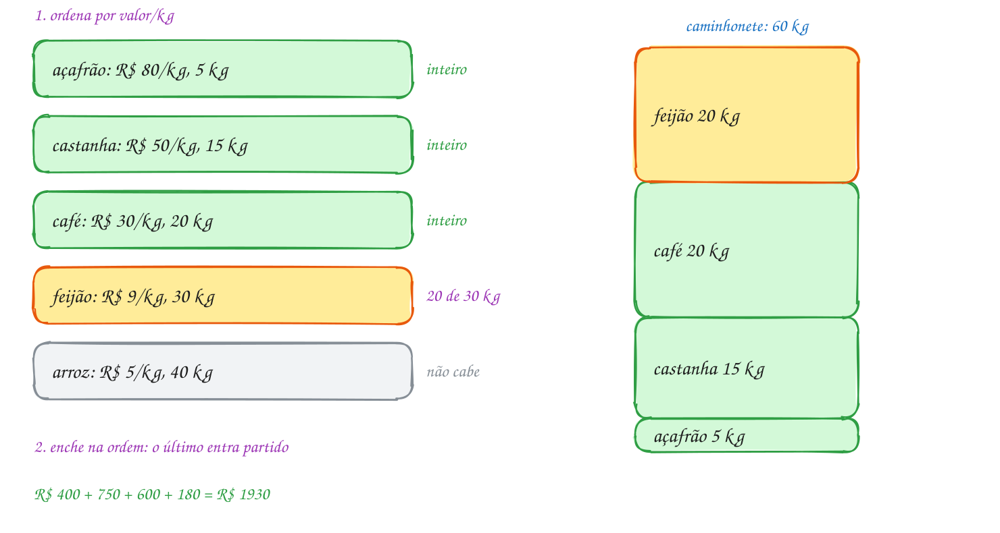</p>

O mesmo exemplo em C. A função de comparação calcula a razão de cada lado e
ordena do maior para o menor:

```c
#include <stdio.h>
#include <stdlib.h>

typedef struct {
    const char *nome;
    double peso;  // kg disponíveis
    double valor; // R$ pelo estoque inteiro
} Produto;

// ordem decrescente de valor por kg
int por_razao(const void *a, const void *b) {
    const Produto *x = a;
    const Produto *y = b;
    double rx = x->valor / x->peso;
    double ry = y->valor / y->peso;
    return (rx < ry) - (rx > ry);
}

int main(void) {
    Produto p[] = {
        {"café", 20, 600},    {"castanha", 15, 750}, {"feijão", 30, 270},
        {"açafrão", 5, 400},  {"arroz", 40, 200},
    };
    int n = 5;
    double livre = 60; // kg que cabem na caminhonete
    double total = 0;

    qsort(p, n, sizeof p[0], por_razao);
    for (int i = 0; i < n && livre > 0; i++) {
        double leva = p[i].peso <= livre ? p[i].peso : livre; // tudo ou o que cabe
        double ganho = p[i].valor * (leva / p[i].peso);       // valor proporcional
        printf("%4.1f de %4.1f kg  R$ %6.2f  (R$ %.0f/kg) %s\n",
               leva, p[i].peso, ganho, p[i].valor / p[i].peso, p[i].nome);
        livre -= leva;
        total += ganho;
    }
    printf("Total: R$ %.2f\n", total);
    return 0;
}
// Saída:
//  5.0 de  5.0 kg  R$ 400.00  (R$ 80/kg) açafrão
// 15.0 de 15.0 kg  R$ 750.00  (R$ 50/kg) castanha
// 20.0 de 20.0 kg  R$ 600.00  (R$ 30/kg) café
// 20.0 de 30.0 kg  R$ 180.00  (R$ 9/kg) feijão
// Total: R$ 1930.00
```

O nome vai no fim da linha de propósito: `%-10s` conta **bytes**, e em UTF-8
o "ç" e o "ã" ocupam dois bytes cada. Com o nome no começo, as colunas
ficariam tortas.

Repara no fluxograma: o laço tem duas saídas para cada item. O caminho marcado
passa pelo "leva tudo" três vezes (açafrão, castanha, café) e uma vez pelo
"leva a fração" (feijão), que zera o espaço e encerra o laço:

<p align="center">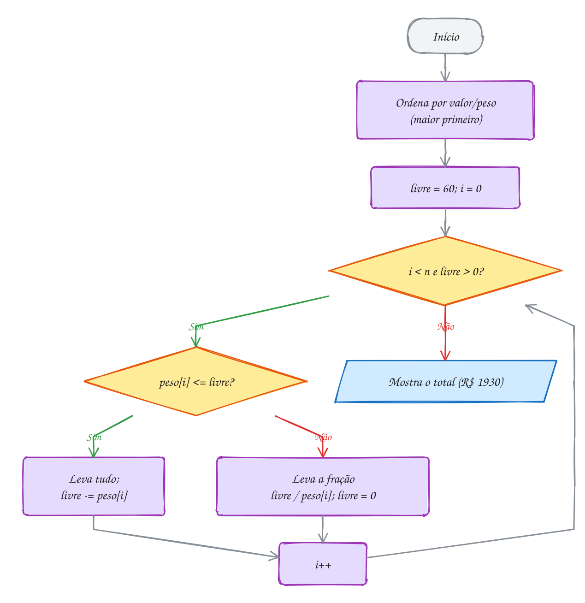</p>

> [!WARNING]
> Esse guloso só vale para a mochila **fracionária**. Se os itens forem
> indivisíveis (uma geladeira, um notebook: leva inteiro ou não leva), é a
> **mochila 0/1**, e ordenar pela razão pode errar feio. Com capacidade 10 e
> itens (peso 6, R$ 30), (5, R$ 20) e (5, R$ 20), a maior razão é a do
> primeiro (R$ 5/kg): o guloso leva ele, os outros não cabem, e o total é
> R$ 30. Levar os dois de 5 dá R$ 40. A mochila 0/1 se resolve com
> programação dinâmica, no módulo 21.

> [!TIP]
> **Por dentro do C:** comparar razões com `double` funciona, mas a divisão
> arredonda. Quando os pesos e valores são inteiros, dá para comparar sem
> dividir: `x->valor / x->peso > y->valor / y->peso` é o mesmo que
> `x->valor * y->peso > y->valor * x->peso` (os pesos são positivos), e a
> conta com inteiros é exata. Só confira se o produto cabe no tipo: com
> `long long`, valores e pesos até uns 3 bilhões são seguros. E nunca devolva
> `(int)(ry - rx)` na comparação: razões 4,7 e 4,2 viram 0 depois do corte, e
> o `qsort` passa a tratar as duas como iguais.

> [!NOTE]
> **Pergunta para você:** se a caminhonete levasse 100 kg, quanto o feirante
> faria? E com 110 kg? A partir de que capacidade o arroz começa a entrar?

### Hora de praticar

Os arquivos ficam em [`0135-mochila-fracionaria/`](0135-mochila-fracionaria/). Os comandos funcionam de qualquer pasta do terminal. Nos exemplos, rode, mude, quebre e rode de novo. Nos exercícios, a resposta vai dentro do próprio arquivo. ★☆☆ é aquecimento, ★★☆ pede raciocínio e ★★★ é desafio.

**Exemplo A269 · Três critérios para a mesma carga**

```c
#include <stdio.h>
#include <stdlib.h>
#include <string.h>

typedef struct {
    const char *nome;
    double peso, valor;
} Item;

int maior_valor(const void *a, const void *b) {
    const Item *x = a, *y = b;
    return (x->valor < y->valor) - (x->valor > y->valor);
}

int menor_peso(const void *a, const void *b) {
    const Item *x = a, *y = b;
    return (x->peso > y->peso) - (x->peso < y->peso);
}

int maior_razao(const void *a, const void *b) {
    const Item *x = a, *y = b;
    double rx = x->valor / x->peso, ry = y->valor / y->peso;
    return (rx < ry) - (rx > ry);
}

// o mesmo guloso da mochila fracionária, com o critério de ordem como parâmetro
double carrega(const Item itens[], int n, double cap,
               int (*criterio)(const void *, const void *)) {
    Item c[10];
    memcpy(c, itens, n * sizeof itens[0]); // não bagunça o vetor original
    qsort(c, n, sizeof c[0], criterio);
    double total = 0;
    for (int i = 0; i < n && cap > 0; i++) {
        double leva = c[i].peso <= cap ? c[i].peso : cap;
        total += c[i].valor * leva / c[i].peso;
        cap -= leva;
        printf(" %s %.0f", c[i].nome, leva);
    }
    printf("\n");
    return total;
}

int main(void) {
    // sucata a granel no ferro-velho; o carrinho leva 100 kg
    Item s[] = {
        {"cobre", 30, 1050}, {"alumínio", 50, 400}, {"latão", 25, 500},
        {"ferro", 120, 600}, {"fios", 10, 30},
    };
    int n = 5;

    printf("Maior valor primeiro:");
    double a = carrega(s, n, 100, maior_valor);
    printf("  R$ %.2f\n", a);
    printf("Menor peso primeiro:");
    double b = carrega(s, n, 100, menor_peso);
    printf("  R$ %.2f\n", b);
    printf("Maior R$/kg primeiro:");
    double c = carrega(s, n, 100, maior_razao);
    printf("  R$ %.2f\n", c);
    // o ferro tem o maior valor TOTAL, mas paga só R$ 5/kg: ocupa 70 kg que
    // renderiam muito mais com latão e alumínio
    return 0;
}
// Saída:
// Maior valor primeiro: cobre 30 ferro 70
//   R$ 1400.00
// Menor peso primeiro: fios 10 latão 25 cobre 30 alumínio 35
//   R$ 1860.00
// Maior R$/kg primeiro: cobre 30 latão 25 alumínio 45
//   R$ 1910.00
```

```bash
~/LPEDC/rodar 20-dc-e-gulosos/0135-mochila-fracionaria/A269.c
```

**Exemplo A270 · Quando o item não se divide: o guloso perde**

```c
#include <stdio.h>

#define N 5

// mochila 0/1: cada item vai inteiro ou fica. O guloso por razão é rápido,
// mas não garante o melhor. Aqui ele é comparado com a força bruta, que testa
// os 2^5 = 32 subconjuntos (um bit por item, como no assunto 0125).
int main(void) {
    const char *nome[N] = {"videogame", "relógios", "caixas de som", "TV", "panela elétrica"};
    int peso[N] = {6, 2, 8, 12, 9};             // kg (já em ordem de R$/kg)
    int valor[N] = {600, 180, 640, 900, 630};   // R$ de revenda
    int cap = 20;                               // limite da mala, em kg

    // guloso por razão: leva o item inteiro se couber
    int livre = cap, guloso = 0;
    printf("Guloso:");
    for (int i = 0; i < N; i++) {
        if (peso[i] <= livre) {
            livre -= peso[i];
            guloso += valor[i];
            printf(" [%s]", nome[i]);
        }
    }
    printf(" = R$ %d (%d kg)\n", guloso, cap - livre);

    // força bruta: o subconjunto de maior valor que cabe
    int melhor = 0, escolha = 0;
    for (int m = 0; m < (1 << N); m++) {
        int p = 0, v = 0;
        for (int i = 0; i < N; i++) {
            if (m & (1 << i)) {
                p += peso[i];
                v += valor[i];
            }
        }
        if (p <= cap && v > melhor) {
            melhor = v;
            escolha = m;
        }
    }
    printf("Ótimo: ");
    int p = 0;
    for (int i = 0; i < N; i++) {
        if (escolha & (1 << i)) {
            printf(" [%s]", nome[i]);
            p += peso[i];
        }
    }
    printf(" = R$ %d (%d kg)\n", melhor, p);
    // o guloso enche 16 kg com os itens de melhor razão e deixa 4 kg sem
    // uso, porque a TV (12 kg) não cabe mais. Na fracionária, esses 4 kg
    // levariam um terço da TV (R$ 300): R$ 1720, um teto para a 0/1.
    return 0;
}
// Saída:
// Guloso: [videogame] [relógios] [caixas de som] = R$ 1420 (16 kg)
// Ótimo:  [videogame] [relógios] [TV] = R$ 1680 (20 kg)
```

```bash
~/LPEDC/rodar 20-dc-e-gulosos/0135-mochila-fracionaria/A270.c
```

#### Exercícios

**Exercício E805** · ★☆☆

A cooperativa de reciclagem vende para uma usina, e o caminhão leva 1000
kg. No depósito há três lotes, já em ordem decrescente de R$/kg:


```text
PET: 300 kg, R$ 750 o lote
papelão: 500 kg, R$ 400 o lote
vidro: 800 kg, R$ 160 o lote
```


Escreva o laço da mochila fracionária: leve cada lote inteiro enquanto
couber e, no primeiro que não couber, só a parte que completa o
caminhão. Mostre o que vai de cada material e o total.


```text
Saída esperada:
300 kg de PET: R$ 750.00
500 kg de papelão: R$ 400.00
200 kg de vidro: R$ 40.00
Total: R$ 1190.00
```

**Dicas:**

1. leva = o menor entre peso[i] e livre. O valor levado é proporcional:
   valor[i] * leva / peso[i].
2. O laço para quando livre chega a 0 (ou acabam os lotes).
3. Resposta esperada: a saída acima. O vidro rende R$ 0,20/kg, então os
   200 kg dele valem R$ 40.

```bash
~/LPEDC/rodar 20-dc-e-gulosos/0135-mochila-fracionaria/E805.c
```

**Exercício E806** · ★☆☆

Uma loja de temperos a granel vai a uma feira com uma mala de 12 kg. O
programa está pronto, menos a função de comparação do qsort, que precisa
pôr primeiro o tempero de MAIOR valor por quilo. Complete no lugar
marcado com "COMPLETE AQUI".


```text
canela 4 kg R$ 120, pimenta 6 kg R$ 240, orégano 5 kg R$ 100,
cominho 3 kg R$ 75
```


```text
Saída esperada:
6 de 6 kg: pimenta
4 de 4 kg: canela
2 de 3 kg: cominho
Total: R$ 410.00
```

**Dicas:**

1. Calcule as duas razões em double: rx = x->valor / x->peso, e o mesmo
   para y.
2. Para a ordem DECRESCENTE, devolva negativo quando rx > ry:
   (rx < ry) - (rx > ry).
3. Resposta esperada: a saída acima. As razões são pimenta 40, canela 30,
   cominho 25 e orégano 20 (R$/kg).

```bash
~/LPEDC/rodar 20-dc-e-gulosos/0135-mochila-fracionaria/E806.c
```

**Exercício E807** · ★★☆

Ache o bug. O feirante tem 15 kg de espaço e três caixas de fruta de
10 kg: uva (R$ 42, ou R$ 4,20/kg), caqui (R$ 20) e ameixa (R$ 48, ou
R$ 4,80/kg). O certo é levar a ameixa inteira e metade da uva, mas o
programa faz outra coisa, sem nenhum aviso:


```text
Saída que aparece:
10 kg de uva
5 kg de ameixa
Total: R$ 66.00
```


```text
Saída esperada:
10 kg de ameixa
5 kg de uva
Total: R$ 69.00
```


O erro está na função de comparação. Acrescente um printf nela que mostre
rx, ry e o valor devolvido, rode, ache o problema e conserte.

**Dicas:**

1. Quanto vale (int)(4.8 - 4.2)? E (int)(2.0 - 4.2)?
2. Quando a comparação devolve 0, o qsort entende que tanto faz a ordem
   dos dois, e eles podem ficar como estavam: a uva antes da ameixa.
3. Resposta esperada: troque o "return (int)(ry - rx);" por
   "return (rx < ry) - (rx > ry);", que devolve -1, 0 ou 1 sem cortar
   nada. Consertado, mostra a saída acima.

```bash
~/LPEDC/rodar 20-dc-e-gulosos/0135-mochila-fracionaria/E807.c
```

**Exercício E808** · ★★☆

A mochila fracionária ao contrário: em vez de MAXIMIZAR o valor levado,
MINIMIZAR o custo de uma compra. Um posto precisa de 30 000 litros de
gasolina. Quatro distribuidoras vendem, cada uma, até um limite de litros
por um preço fixo por litro:


```text
A: até 12 000 L a R$ 5,10    B: até 8 000 L a R$ 4,95
C: até 15 000 L a R$ 5,25    D: até 6 000 L a R$ 4,89
```


Compre da mais barata para a mais cara, até completar. Guarde os preços
em CENTAVOS (int) e o custo em centavos num long long; mostre em reais
com / 100 e % 100.


```text
Saída esperada:
D:  6000 L a R$ 4.89 = R$ 29340.00
B:  8000 L a R$ 4.95 = R$ 39600.00
A: 12000 L a R$ 5.10 = R$ 61200.00
C:  4000 L a R$ 5.25 = R$ 21000.00
Total: R$ 151140.00
```

**Dicas:**

1. Uma struct Oferta { char nome; int litros; int centavos; } e qsort em
   ordem CRESCENTE de preço.
2. compra = o menor entre a oferta e o que falta. O custo parcial é
   (long long)compra * centavos: 12000 * 510 já passa de 6 milhões, e com
   pedidos maiores um int estouraria.
3. Resposta esperada: a saída acima. Para mostrar R$ 4.89 a partir de 489:
   printf("%d.%02d", 489 / 100, 489 % 100).

```bash
~/LPEDC/rodar 20-dc-e-gulosos/0135-mochila-fracionaria/E808.c
```

**Exercício E809** · ★★★

Uma transportadora tem 8 tipos de carga esperando e um caminhão com 700
kg livres. Ordenar as 8 pela razão funciona, mas, quando o caminhão
enche logo, quase toda a ordenação é desperdício. Use um HEAP DE MÁXIMO
pela razão (assunto 0102): monte o heap em O(n), com a descida a partir
do último pai, e tire o topo só enquanto houver espaço.


```text
móveis 400 kg R$ 2000      eletrônicos 150 kg R$ 4500
roupas 200 kg R$ 3000      cimento 900 kg R$ 900
remédios 50 kg R$ 2500     livros 300 kg R$ 1800
brinquedos 250 kg R$ 2750  areia 1000 kg R$ 300
```


```text
Saída esperada:
 50 de   50 kg  R$ 2500.00  remédios
150 de  150 kg  R$ 4500.00  eletrônicos
200 de  200 kg  R$ 3000.00  roupas
250 de  250 kg  R$ 2750.00  brinquedos
 50 de  300 kg  R$  300.00  livros
Total: R$ 13050.00
Itens tirados do heap: 5 de 8
```

**Dicas:**

1. Escreva double razao(Frete f) e a função desce do heap, comparando
   razões. Monte com: for (int i = n / 2 - 1; i >= 0; i--) desce(v, n, i);
2. Para tirar o topo: guarde v[0], ponha v[n - 1] no lugar, diminua n e
   desça a partir do 0. Depois aplique a regra da mochila no item tirado.
3. Resposta esperada: a saída acima (printf("%3.0f de %4.0f kg  R$ %7.2f
   %s\n", ...)). O custo cai de O(n log n) para O(n + k log n), onde k é o
   número de itens que entram na carga.

```bash
~/LPEDC/rodar 20-dc-e-gulosos/0135-mochila-fracionaria/E809.c
```

**Exercício E810** · ★★★

Uma cooperativa vende grãos a granel e tem TRÊS caminhões, com 20, 35 e
30 kg livres (uma miniatura, para caber na tela). Os grãos, já em ordem
decrescente de R$/kg:


```text
pimenta 18 kg R$ 1080, cacau 25 kg R$ 1000, café 30 kg R$ 900,
soja 40 kg R$ 200
```


Como tudo é fracionável, a melhor carga dos três juntos é a de UMA
mochila com 20 + 35 + 30 = 85 kg. O desafio é distribuir: encha o
caminhão 1 na ordem dos grãos; o grão que não couber inteiro tem o resto
carregado no caminhão seguinte; e assim por diante. Mostre a carga e o
valor de cada caminhão.


```text
Saída esperada:
Caminhão 1 (20 kg): 18 kg de pimenta, 2 kg de cacau, R$ 1160.00
Caminhão 2 (35 kg): 23 kg de cacau, 12 kg de café, R$ 1280.00
Caminhão 3 (30 kg): 18 kg de café, 12 kg de soja, R$ 600.00
Total: R$ 3040.00
```

**Dicas:**

1. Calcule a razão de cada grão ANTES de começar, num vetor à parte: o
   kg de cada grão vai diminuir conforme ele é carregado.
2. Um índice i do grão da vez, que só avança quando o grão acaba
   (kg[i] == 0). Para cada caminhão, um while (livre > 0 && i < n).
3. Resposta esperada: a saída acima. Repare que o cacau e o café ficaram
   partidos entre dois caminhões; o total é o mesmo de uma mochila só de
   85 kg.

```bash
~/LPEDC/rodar 20-dc-e-gulosos/0135-mochila-fracionaria/E810.c
```

---

## 0136 · Código de Huffman

Na placa da barraca de frutas está escrito `BANANA NA CABANA`. Num arquivo de
texto, cada uma dessas 16 letras ocupa um byte, 8 bits: 128 bits ao todo. Só
que a frase usa **5 símbolos** diferentes (A, N, B, C e o espaço), e o A
aparece 7 vezes enquanto o C aparece uma. Gastar 8 bits com cada um é
desperdício. Com 3 bits por símbolo já daria (2³ = 8 combinações): 48 bits.
Dá para fazer melhor ainda?

Dá, se cada símbolo tiver um código de tamanho **diferente**: curto para o
que aparece muito, comprido para o raro. É a ideia do código Morse, em que
o E (a letra mais comum do inglês) é um ponto só. Mas tamanho variável traz
um problema: onde termina um código e começa o próximo? Se A = `0` e
N = `01`, a sequência `001` pode ser "A A ..." ou "A N".

A saída é um **código livre de prefixo**: nenhum código é o começo de outro.
Aí a leitura não tem dúvida: você lê bits até formar um código, e ele só
pode ser aquele. Esse tipo de código é uma **árvore binária**: cada símbolo é
uma **folha**, e o código é o caminho da raiz até ela, com `0` para a
esquerda e `1` para a direita. Como os símbolos só moram nas folhas, nenhum
caminho é o começo de outro.

Qual árvore dá o menor total de bits? O total é a soma de
`frequência × profundidade` de cada folha. David Huffman, em 1952, mostrou
que um **guloso** acha a melhor:

1. crie uma folha para cada símbolo, com a sua frequência, e ponha todas
   num **heap de mínimo** (assunto 0102), ordenado pela frequência;
2. enquanto houver mais de um nó no heap, **tire os dois menores**, crie um
   nó pai com os dois como filhos e a **soma** das frequências, e devolva o
   pai ao heap;
3. o nó que sobrar é a **raiz**.

Os símbolos raros são juntados primeiro e vão parar lá no fundo, com códigos
compridos; os frequentes entram por último, perto da raiz. Para `k` símbolos
são `k - 1` junções, cada uma com operações de heap de O(log k): o total é
**O(k log k)**.

Vamos ver na prática. As frequências são A = 7, N = 4, B = 2, espaço = 2 e
C = 1. O C e o espaço (os menores) se juntam num nó 3; o B junta com o 3
num 5; o N com o 5 num 9; e o A com o 9 na raiz, 16. Lendo os caminhos: A
ganha o código `0`, de 1 bit, e o C ganha `1110`, de 4:

<p align="center">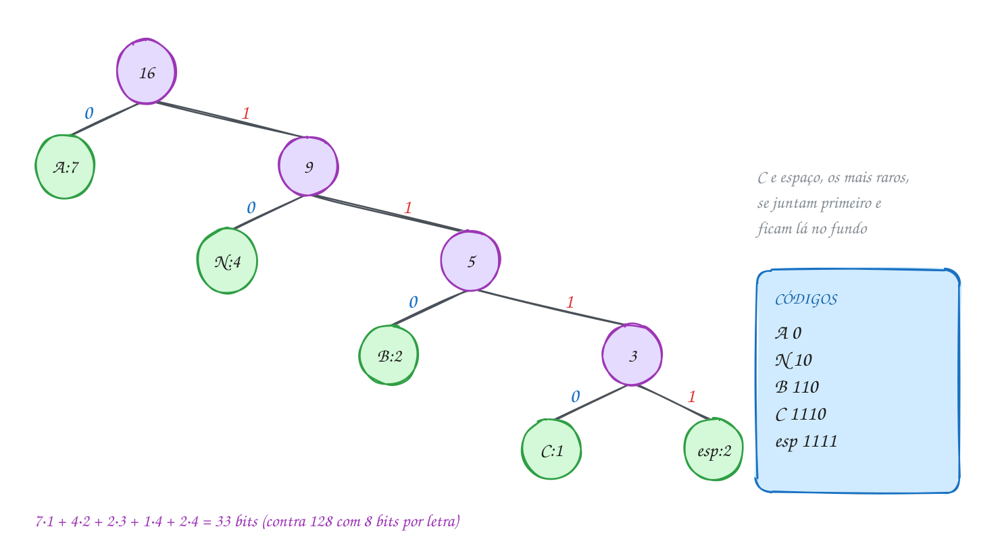</p>

### Passo a passo

O heap a cada junção. Quando duas frequências empatam, o desempate é pelo
byte (o espaço, 32, vem antes do B, 66):

| junção | heap antes | tira | cria |
| --- | --- | --- | --- |
| 1 | C:1, esp:2, B:2, N:4, A:7 | C:1 e esp:2 | 3 |
| 2 | B:2, 3, N:4, A:7 | B:2 e 3 | 5 |
| 3 | N:4, 5, A:7 | N:4 e 5 | 9 |
| 4 | A:7, 9 | A:7 e 9 | 16 (a raiz) |

O TAD fica em `huffman.h` e `huffman.c`. O nó guarda o símbolo, a frequência
e os dois filhos. O coração do `huffman.c` é o laço do guloso, usando um heap
de mínimo de ponteiros para nó:

```c
NoHuf *huf_constroi(const long freq[256]) {
    Heap h = {.n = 0};
    for (int c = 0; c < 256; c++) {
        if (freq[c] > 0) {
            poe(&h, novo_no((unsigned char)c, freq[c], c, NULL, NULL));
        }
    }
    if (h.n == 0) {
        return NULL;
    }
    int criados = 0;
    while (h.n > 1) {
        NoHuf *a = tira(&h);  // o menos frequente vira o filho 0
        NoHuf *b = tira(&h);  // o segundo vira o filho 1
        poe(&h, novo_no(0, a->freq + b->freq, 256 + criados++, a, b));
    }
    return tira(&h);
}
```

O campo `ordem` (o terceiro argumento de `novo_no`) desempata frequências
iguais: as folhas usam o próprio byte e os nós internos, 256 em diante, na
ordem de criação. Sem ele, a árvore dependeria de detalhes do heap. Os
códigos saem de uma descida recursiva que vai acumulando `0` e `1`. O
cliente conta as frequências, monta a árvore e mostra os códigos:

```c
#include <stdio.h>
#include <string.h>
#include "huffman.h"

int main(void) {
    const char *frase = "BANANA NA CABANA";
    long freq[256] = {0};
    for (const char *p = frase; *p != '\0'; p++) {
        freq[(unsigned char)*p]++;          // conta cada byte
    }

    NoHuf *raiz = huf_constroi(freq);
    static char cod[256][256];              // 64 KB: static, fora da pilha
    huf_codigos(raiz, cod);

    long bits = 0;
    for (int c = 0; c < 256; c++) {
        if (freq[c] > 0) {
            printf("'%c' aparece %ld vez(es): %s\n", c, freq[c], cod[c]);
            bits += freq[c] * (long)strlen(cod[c]);
        }
    }
    printf("Codificada: ");
    for (const char *p = frase; *p != '\0'; p++) {
        printf("%s", cod[(unsigned char)*p]);
    }
    printf("\n%ld bits, contra %zu com 8 bits por letra\n", bits, 8 * strlen(frase));

    huf_libera(raiz);
    return 0;
}
// Saída:
// ' ' aparece 2 vez(es): 1111
// 'A' aparece 7 vez(es): 0
// 'B' aparece 2 vez(es): 110
// 'C' aparece 1 vez(es): 1110
// 'N' aparece 4 vez(es): 10
// Codificada: 110010010011111001111111001100100
// 33 bits, contra 128 com 8 bits por letra
```

São 7·1 + 4·2 + 2·3 + 1·4 + 2·4 = 33 bits: um quarto do texto original e
menos que os 48 do código fixo de 3 bits.

Repara no fluxograma: é o laço do `huf_constroi`. Cada volta tira dois nós e
põe um, então o heap encolhe um por volta. Com 5 folhas, são 4 voltas:

<p align="center">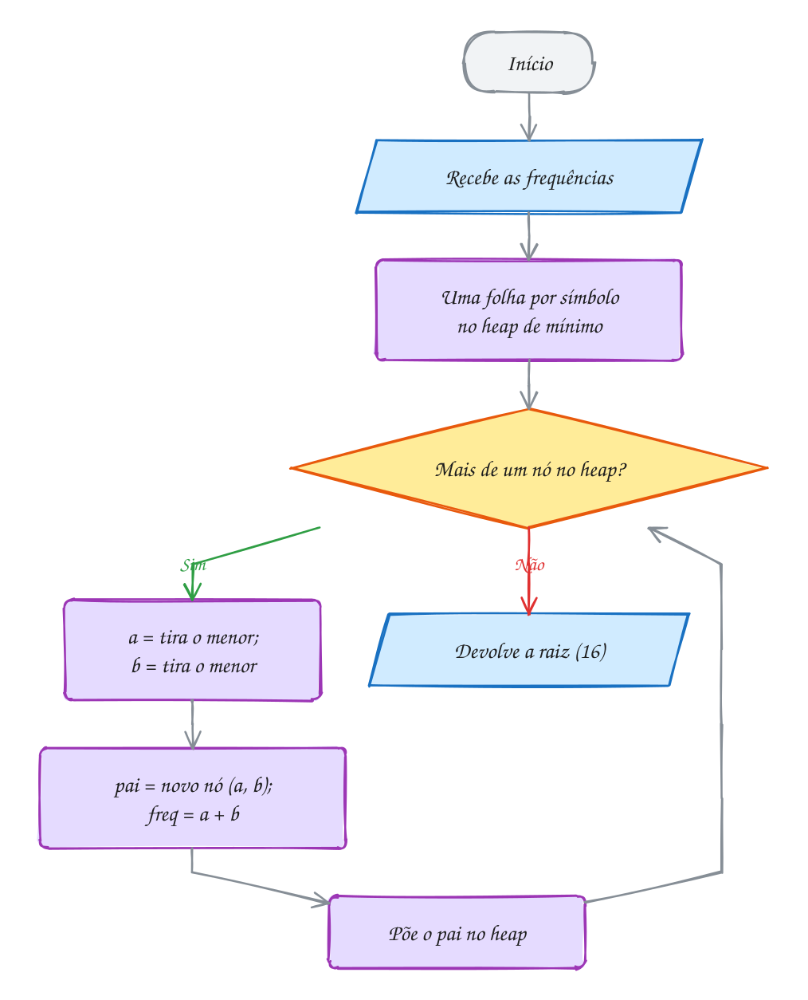</p>

> [!WARNING]
> Para decodificar, quem recebe os bits precisa da **mesma árvore**. Se o
> desempate for diferente (o B antes do espaço, por exemplo), os códigos
> mudam e a frase sai trocada, embora o total de bits continue 33. Por isso
> o compactador precisa guardar no arquivo a árvore, ou as frequências e a
> regra exata de desempate, para o descompactador refazer a mesma árvore. E
> cuidado com o caso de um símbolo só (`AAAA`): a árvore é só a raiz, e o
> caminho até ela é vazio. O `huf_codigos` dá o código `0` para ele.

> [!TIP]
> **Por dentro do C:** a frequência é indexada por `(unsigned char)*p`, e não
> por `*p`. Em muitos compiladores, `char` tem sinal, e os bytes de
> acentos em UTF-8 (como o `ã`, que vira `0xC3 0xA3`) são negativos:
> `freq[*p]` leria fora do vetor, antes do começo. A tabela `cod` tem
> 256 × 256 bytes = 64 KB e é `static` para não ocupar a pilha do `main`. E
> repare que a árvore tem `2k - 1` nós (k folhas e k - 1 internos): 9
> `malloc` aqui, e `huf_libera` devolve todos em pós-ordem, os filhos antes
> do pai.

> [!NOTE]
> **Pergunta para você:** monte, no papel, a árvore de Huffman de
> `ARARA AZUL`. Quantos bits ela dá? Depois troque a frase no programa e
> confira.

### Hora de praticar

Os arquivos ficam em [`0136-huffman/`](0136-huffman/). Os comandos funcionam de qualquer pasta do terminal. Nos exemplos, rode, mude, quebre e rode de novo. Nos exercícios, a resposta vai dentro do próprio arquivo. ★☆☆ é aquecimento, ★★☆ pede raciocínio e ★★★ é desafio.

**Exemplo A271 · Decodificar descendo a árvore (e o estrago de um bit errado)**

```c
#include <stdio.h>
#include <string.h>
#include "huffman.h"

// lê os bits: 0 desce à esquerda, 1 à direita; ao chegar numa folha,
// escreve o símbolo e volta para a raiz
void decodifica(const NoHuf *raiz, const char *bits) {
    const NoHuf *no = raiz;
    for (const char *b = bits; *b != '\0'; b++) {
        no = (*b == '0') ? no->esq : no->dir;
        if (huf_folha(no)) {
            putchar(no->simbolo);
            no = raiz;
        }
    }
    putchar('\n');
}

int main(void) {
    const char *frase = "O RATO ROEU A ROUPA";
    long freq[256] = {0};
    for (const char *p = frase; *p != '\0'; p++) {
        freq[(unsigned char)*p]++;
    }
    NoHuf *raiz = huf_constroi(freq);
    static char cod[256][256];
    huf_codigos(raiz, cod);

    // quem envia: concatena os códigos
    char bits[256] = "";
    for (const char *p = frase; *p != '\0'; p++) {
        strcat(bits, cod[(unsigned char)*p]);
    }
    printf("Bits (%zu): %s\n", strlen(bits), bits);

    // quem recebe: só com a árvore e os bits, refaz a frase
    printf("Decodificado: ");
    decodifica(raiz, bits);

    // um bit trocado na transmissão: o leitor perde o passo, junta pedaços
    // de códigos vizinhos e só se reencontra algumas letras depois. Até o
    // número de letras muda. Arquivo compactado não tolera bit errado.
    bits[7] = (bits[7] == '0') ? '1' : '0';
    printf("Com o bit 7 trocado: ");
    decodifica(raiz, bits);

    huf_libera(raiz);
    return 0;
}
// Saída:
// Bits (54): 010011010111100100110011000111100101001100111111001101
// Decodificado: O RATO ROEU A ROUPA
// Com o bit 7 trocado: O R U PPEU A ROUPA
```

```bash
~/LPEDC/rodar 20-dc-e-gulosos/0136-huffman/A271.c
```

**Exemplo A272 · Juntar planilhas pelo menor custo: o mesmo guloso, sem árvore**

```c
#include <stdio.h>

// heap de mínimo de int, escrito aqui mesmo (bem menor que o do huffman.c)
typedef struct {
    int v[16];
    int n;
} Heap;

void poe(Heap *h, int x) {
    int i = h->n++;
    h->v[i] = x;
    while (i > 0 && h->v[i] < h->v[(i - 1) / 2]) {
        int t = h->v[i];
        h->v[i] = h->v[(i - 1) / 2];
        h->v[(i - 1) / 2] = t;
        i = (i - 1) / 2;
    }
}

int tira(Heap *h) {
    int topo = h->v[0];
    h->v[0] = h->v[--h->n];
    int i = 0;
    while (2 * i + 1 < h->n) {
        int f = 2 * i + 1;
        if (f + 1 < h->n && h->v[f + 1] < h->v[f]) {
            f++;
        }
        if (h->v[i] <= h->v[f]) {
            break;
        }
        int t = h->v[i];
        h->v[i] = h->v[f];
        h->v[f] = t;
        i = f;
    }
    return topo;
}

int main(void) {
    // mil linhas de cada planilha de vendas, já ordenadas por data.
    // Juntar (intercalar) duas custa a soma das linhas das duas.
    int linhas[] = {12, 40, 7, 25, 18};
    int n = 5;

    // na ordem em que chegaram: junta a 1ª com a 2ª, o resultado com a 3ª...
    int acumulado = linhas[0], custo_ordem = 0;
    for (int i = 1; i < n; i++) {
        acumulado += linhas[i];
        custo_ordem += acumulado;
    }
    printf("Na ordem de chegada: %d mil linhas lidas\n", custo_ordem);

    // guloso de Huffman: sempre as duas MENORES
    Heap h = {.n = 0};
    for (int i = 0; i < n; i++) {
        poe(&h, linhas[i]);
    }
    int custo = 0;
    while (h.n > 1) {
        int a = tira(&h);
        int b = tira(&h);
        printf("  junta %2d + %2d = %3d\n", a, b, a + b);
        custo += a + b;
        poe(&h, a + b);
    }
    printf("As duas menores primeiro: %d mil linhas lidas\n", custo);
    // cada planilha é relida uma vez por junção de que participa: a
    // "profundidade" dela na árvore das junções. Exatamente a conta do Huffman.
    return 0;
}
// Saída:
// Na ordem de chegada: 297 mil linhas lidas
//   junta  7 + 12 =  19
//   junta 18 + 19 =  37
//   junta 25 + 37 =  62
//   junta 40 + 62 = 102
// As duas menores primeiro: 220 mil linhas lidas
```

```bash
~/LPEDC/rodar 20-dc-e-gulosos/0136-huffman/A272.c
```

#### Exercícios

**Exercício E811** · ★☆☆

Use o TAD huffman.h da pasta para comprimir a frase "PAPAI PAGOU A
PIPOCA": conte as frequências, monte a árvore, gere os códigos e mostre,
para cada símbolo que aparece (na ordem da tabela ASCII), a frequência e
o código. No fim, o total de bits, o tamanho original (8 bits por letra)
e a porcentagem.


```text
Saída esperada:
' ' 3: 110
'A' 5: 01
'C' 1: 0010
'G' 1: 0011
'I' 2: 1111
'O' 2: 000
'P' 5: 10
'U' 1: 1110
55 bits de 160 (34.4%)
```

**Dicas:**

1. long freq[256] = {0}; e um laço que faz freq[(unsigned char)*p]++.
2. huf_constroi(freq), huf_codigos(raiz, cod) com static char
   cod[256][256], e no fim huf_libera(raiz).
3. Resposta esperada: a saída acima. Para imprimir o símbolo %, escreva
   %% no printf. O P e o A, os mais frequentes, ganharam 2 bits.

```bash
~/LPEDC/rodar 20-dc-e-gulosos/0136-huffman/E811.c
```

**Exercício E812** · ★☆☆

Um sensor de uma máquina manda um estado por segundo: N (normal), A
(alerta), F (falha) ou D (desligado). Em 1000 leituras, as contagens
foram N 700, A 200, F 80 e D 20. Com 4 estados, um código fixo gasta 2
bits por leitura. Quanto o Huffman gasta?

Preencha o vetor de frequências direto com as contagens (freq['N'] = 700
e assim por diante), use o TAD huffman.h e mostre os códigos, o total do
Huffman, o total do código fixo e a média de bits por leitura.


```text
Saída esperada:
A: 01
D: 000
F: 001
N: 1
Huffman: 1400 bits
Fixo de 2 bits: 2000 bits
Média: 1.40 bits por leitura
```

**Dicas:**

1. Um char é um número: freq['N'] usa a posição 78 do vetor.
2. Some freq[c] * strlen(cod[c]) para os bits e freq[c] para o total de
   leituras.
3. Resposta esperada: a saída acima. Quanto mais desigual a distribuição,
   maior o ganho: com as quatro contagens iguais (250 cada), o Huffman
   daria os mesmos 2 bits do código fixo.

```bash
~/LPEDC/rodar 20-dc-e-gulosos/0136-huffman/E812.c
```

**Exercício E813** · ★★☆

Chegou uma mensagem compactada, junto com a TABELA de códigos (sem a
árvore). Decodifique usando só a tabela:


```text
E 00   S 01   T 100   O 101   U 1100   espaço 1101   B 1110   M 1111
```


```text
Bits: 0001100101110011011110001111
```


Como o código é livre de prefixo, dá para ler assim: vá juntando os bits
num buffer, um por um; a cada bit, compare o buffer com todos os códigos
(strcmp). Quando bater, escreva o símbolo e esvazie o buffer. No fim, se
sobrar algo no buffer, avise.


```text
Saída esperada:
Mensagem: ESTOU BEM
```

**Dicas:**

1. char buf[16]; int tam = 0; a cada bit: buf[tam++] = *b; buf[tam] = '\0';
2. Ao achar o código, zere tam e saia do laço da tabela com break.
3. Resposta esperada: Mensagem: ESTOU BEM. Este jeito custa O(k) por bit
   (k códigos); descendo pela árvore, como no A271, custa O(1) por bit.
   Teste também trocar um bit e ver o que acontece.

```bash
~/LPEDC/rodar 20-dc-e-gulosos/0136-huffman/E813.c
```

**Exercício E814** · ★★☆

Ache o bug. Cinco arquivos de log, de 8, 3, 15, 6 e 10 MB, precisam ser
juntados (intercalados) dois a dois, e juntar dois custa a soma dos
tamanhos. O programa deveria usar o guloso do Huffman (sempre as duas
MENORES, com um heap de mínimo), mas o custo sai alto:


```text
Saída que aparece:
junta 15 + 10
junta 25 + 8
junta 33 + 6
junta 39 + 3
Custo: 139 MB lidos
```


```text
Saída esperada:
junta 3 + 6
junta 8 + 9
junta 10 + 15
junta 17 + 25
Custo: 93 MB lidos
```


O heap está com o sentido trocado. Conserte poe e tira para virar um
heap de mínimo. Para conferir, mostre o vetor v depois de cada poe.

**Dicas:**

1. São três comparações para inverter: a da subida, a da escolha do
   filho e a da parada da descida.
2. Heap de mínimo: sobe enquanto for MENOR que o pai; desce trocando com o
   MENOR filho; para quando for menor ou igual ao menor filho.
3. Resposta esperada: v[i] < v[(i - 1) / 2] na subida; v[f + 1] < v[f] na
   escolha; v[i] <= v[f] na parada. Consertado, mostra a saída acima.

```bash
~/LPEDC/rodar 20-dc-e-gulosos/0136-huffman/E814.c
```

**Exercício E815** · ★★★

Código canônico. Guardar a árvore inteira no arquivo compactado ocupa
espaço. Os compactadores de verdade guardam só o COMPRIMENTO do código de
cada símbolo e refazem os códigos com uma regra fixa, a do código
canônico:

1. ordene os símbolos por comprimento e, no empate, pelo byte;
2. o primeiro recebe o código 0 (com o comprimento dele, em bits);
3. cada próximo recebe o anterior + 1 e, se o comprimento cresceu,

```text
 desloque para a esquerda a diferença: codigo = (codigo + 1) << (l - l_ant).
```


Use o TAD huffman.h na frase "BANANA NA CABANA" só para obter os
comprimentos (strlen dos códigos). Depois gere e mostre os códigos
canônicos, ao lado do código que o Huffman deu.


```text
Saída esperada:
'A' 1 bits: 0  (Huffman deu 0)
'N' 2 bits: 10  (Huffman deu 10)
'B' 3 bits: 110  (Huffman deu 110)
' ' 4 bits: 1110  (Huffman deu 1111)
'C' 4 bits: 1111  (Huffman deu 1110)
```

**Dicas:**

1. Guarde os símbolos presentes em simb[] e os comprimentos em comp[] e
   ordene os dois juntos (um insertion sort basta: são poucos).
2. Guarde o código num unsigned. Para mostrar com l bits:
   for (int b = l - 1; b >= 0; b--) putchar((codigo >> b) & 1 ? '1' : '0');
3. Resposta esperada: a saída acima. Os comprimentos são os mesmos, então o
   total de bits continua 33, e o código continua livre de prefixo. A
   vantagem: para descompactar, bastam 5 números (os comprimentos).

```bash
~/LPEDC/rodar 20-dc-e-gulosos/0136-huffman/E815.c
```

**Exercício E816** · ★★★

Huffman sem heap. Quando as frequências já chegam ORDENADAS, dá para
trocar o heap por duas filas: a das folhas (o vetor ordenado) e a dos nós
internos (um vetor que você vai enchendo). O truque: os internos nascem em
ordem crescente, então a fila deles também fica ordenada. A cada junção,
o menor de todos está na frente de uma das duas filas: compare as duas
frentes, tire o menor, e repita para o segundo. O custo cai para O(k).

Faça isso para as frequências 1 1 2 3 5 8 13 21 (Fibonacci), mostrando
cada junção e o total de bits (a soma de todas as junções).


```text
Saída esperada:
junta  1 +  1 =  2
junta  2 +  2 =  4
junta  3 +  4 =  7
junta  5 +  7 = 12
junta  8 + 12 = 20
junta 13 + 20 = 33
junta 21 + 33 = 54
Total: 132 bits
```

**Dicas:**

1. Índices: f para a próxima folha; ini e fim para a fila dos internos
   (a fila é interno[ini..fim-1]).
2. Pegue da folha se ainda há folha e (a fila de internos está vazia ou
   folha[f] <= interno[ini]); senão, pegue o interno. Faça isso duas vezes
   por junção e enfileire a soma em interno[fim++].
3. Resposta esperada: a saída acima. A soma das junções é igual à soma de
   frequência × profundidade das folhas. Com Fibonacci a árvore é uma
   "escada": o símbolo de frequência 1 fica com um código de 7 bits.

```bash
~/LPEDC/rodar 20-dc-e-gulosos/0136-huffman/E816.c
```

---

## 0137 · Juntando tudo

A feira do bairro manda todo dia, por um rádio de dados lento, a lista de
preços para as bancas. Cada byte economizado é tempo de transmissão a menos.
A ideia é a do assunto anterior, agora de verdade: um **compactador** que
recebe um arquivo qualquer e grava uma versão menor, e um
**descompactador** que devolve o arquivo original, byte por byte.

O Huffman do assunto 0136 trabalhava com uma string na memória e códigos
escritos como texto (`"1110"`). Num arquivo de verdade, cada código vira
**bits de verdade**, e aparecem três problemas novos:

- **o arquivo é feito de bytes**, não de bits. É preciso juntar os bits dos
  códigos, 8 de cada vez, num `unsigned char`, e gravar o byte quando ele
  enche. No fim, o último byte quase nunca está cheio: completa-se com zeros;
- **o descompactador precisa da mesma árvore**. O arquivo compactado começa
  com um **cabeçalho**: uma assinatura (`HUF1`), o tamanho original e as 256
  frequências. Com elas, o descompactador monta a árvore idêntica, porque o
  `huf_constroi` desempata sempre do mesmo jeito;
- **os zeros do fim não são dados**. Por isso o tamanho original vai no
  cabeçalho: o descompactador para quando escreveu esse número de bytes, e
  ignora o enchimento.

O compactador lê o arquivo **duas vezes**: a primeira passada conta as
frequências; a segunda, depois de montar a árvore, troca cada byte pelo
código. O descompactador lê o cabeçalho, monta a árvore e anda nela bit a
bit: `0` para a esquerda, `1` para a direita, e na folha escreve o byte e
volta para a raiz.

Tudo junto, o projeto usa quase o curso inteiro: arquivos binários com
`fread`/`fwrite` (assunto 0068), bits e máscaras (0065), a árvore binária
(0098), o heap (0102), o guloso de Huffman (0136) e TADs em `.h` e `.c`
(0074). O TAD `compactador.h` usa o `huffman.h` por dentro e oferece duas
funções: `huf_compacta` e `huf_descompacta`.

Vamos ver na prática. A lista da feira tem 6 linhas, repetidas 40 vezes:
9560 bytes. Compactada, fica com 6156 bytes, dos quais 1036 são o cabeçalho
e 5120 são os bits dos códigos. O descompactador lê o cabeçalho, refaz a
árvore e devolve os 9560 bytes:

<p align="center">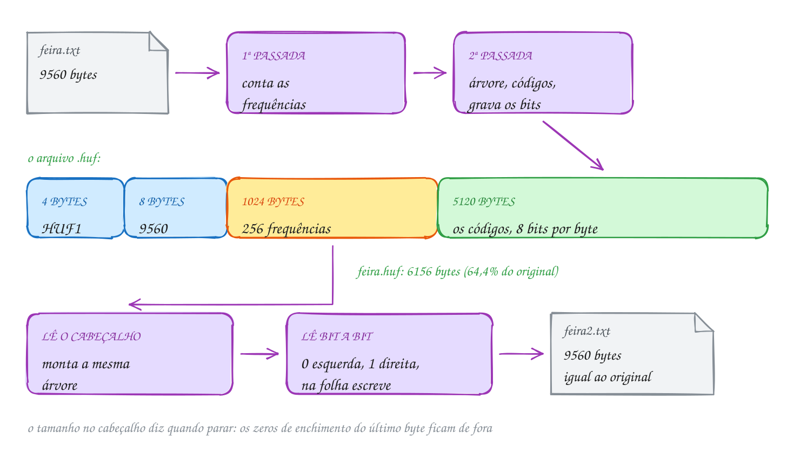</p>

O coração do `compactador.c` é a dupla que escreve bits soltos. A struct
`Bits` guarda o byte em construção e quantos bits ele já tem:

```c
static void escreve_bit(Bits *b, int bit) {
    b->byte = (unsigned char)((b->byte << 1) | bit); // entra pela direita
    b->n++;
    if (b->n == 8) {                                 // byte cheio: grava
        fputc(b->byte, b->f);
        b->byte = 0;
        b->n = 0;
    }
}

static void descarrega(Bits *b) {
    if (b->n > 0) {                                  // completa com zeros
        fputc((unsigned char)(b->byte << (8 - b->n)), b->f);
        b->byte = 0;
        b->n = 0;
    }
}
```

O programa cria o arquivo da feira, compacta, descompacta, confere se o
resultado é igual ao original e apaga os arquivos de teste:

```c
#include <stdio.h>
#include "compactador.h"

// grava a lista de preços da feira, repetida 40 vezes (um arquivo de uns 10 KB)
int cria_exemplo(const char *nome) {
    const char *linhas[] = {
        "Tomate italiano ........ R$ 8,90 o kg\n",
        "Banana prata ........... R$ 5,50 a dúzia\n",
        "Alface crespa .......... R$ 3,00 o pé\n",
        "Batata inglesa ......... R$ 6,20 o kg\n",
        "Ovos caipiras .......... R$ 18,00 a dúzia\n",
        "Queijo minas ........... R$ 42,00 o kg\n",
    };
    FILE *f = fopen(nome, "w");
    if (f == NULL) {
        return 0;
    }
    for (int r = 0; r < 40; r++) {
        for (int i = 0; i < 6; i++) {
            fputs(linhas[i], f);
        }
    }
    fclose(f);
    return 1;
}

// confere byte a byte se dois arquivos são iguais
int iguais(const char *a, const char *b) {
    FILE *fa = fopen(a, "rb");
    FILE *fb = fopen(b, "rb");
    int ok = fa != NULL && fb != NULL;
    while (ok) {
        int ca = fgetc(fa), cb = fgetc(fb);
        if (ca != cb) ok = 0;
        if (ca == EOF || cb == EOF) break;
    }
    if (fa) fclose(fa);
    if (fb) fclose(fb);
    return ok;
}

int main(void) {
    if (!cria_exemplo("feira.txt")) {
        return 1;
    }
    long original = arq_tamanho("feira.txt");
    long compacto = huf_compacta("feira.txt", "feira.huf");
    long volta = huf_descompacta("feira.huf", "feira2.txt");

    printf("feira.txt:  %ld bytes\n", original);
    printf("feira.huf:  %ld bytes (%.1f%% do original)\n", compacto, 100.0 * compacto / original);
    printf("feira2.txt: %ld bytes, %s\n", volta,
           iguais("feira.txt", "feira2.txt") ? "igual ao original" : "DIFERENTE");

    remove("feira.txt");
    remove("feira.huf");
    remove("feira2.txt");
    return 0;
}
// Saída:
// feira.txt:  9560 bytes
// feira.huf:  6156 bytes (64.4% do original)
// feira2.txt: 9560 bytes, igual ao original
```

Sem o cabeçalho, os bits ocupam 5120 bytes, 53,6% do original: o texto tem
poucos símbolos diferentes e alguns muito frequentes (o ponto e o espaço).
O cabeçalho de 1036 bytes é um custo fixo, que pesa muito em arquivos
pequenos e quase nada em arquivos grandes.

Repara no fluxograma: é o laço do `huf_descompacta`. Para cada byte do
original, ele começa na raiz e lê bits até cair numa folha. O laço de fora
conta os bytes escritos e para no tamanho do cabeçalho, deixando os zeros de
enchimento sem ler:

<p align="center">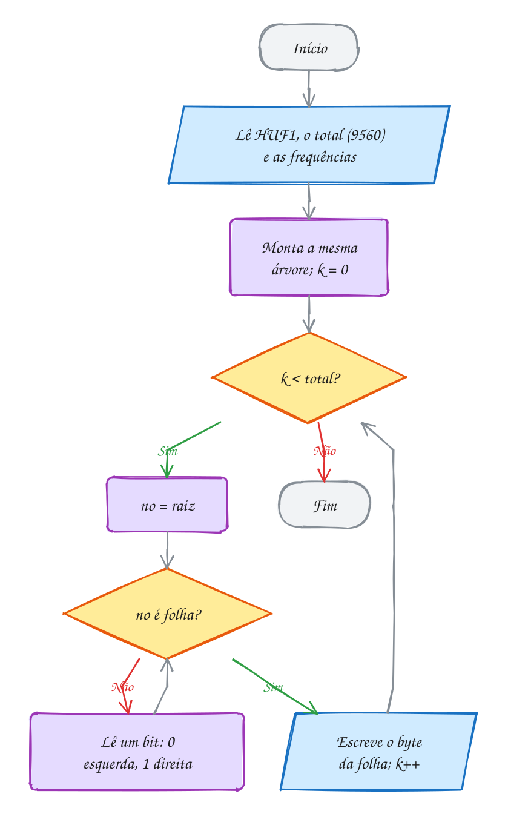</p>

> [!WARNING]
> Esquecer o `descarrega` no fim da compactação é o erro clássico. Os bits
> que sobraram no byte incompleto (até 7) nunca são gravados, e o
> descompactador perde o finalzinho do arquivo, ou devolve lixo nos últimos
> bytes. O teste que pega esse erro é o de ida e volta: compactar,
> descompactar e comparar **byte a byte** com o original, como o `iguais`
> faz. E abra os arquivos sempre em modo binário (`"rb"`, `"wb"`): o
> compactado tem bytes de todo tipo, inclusive o 26, que no Windows, em modo
> texto, é lido como fim de arquivo.

> [!TIP]
> **Por dentro do C:** o cabeçalho usa `uint64_t` e `uint32_t` (de
> `stdint.h`) porque o tamanho de `long` muda de sistema para sistema (8 bytes
> no Linux de 64 bits, 4 no Windows). Com tipos de largura fixa, o arquivo
> tem sempre 4 + 8 + 1024 = 1036 bytes de cabeçalho. Ainda falta um detalhe:
> o `fwrite` grava os bytes na ordem da máquina (*little-endian* no x86 e no
> ARM comum). Um formato portátil escolhe uma ordem e grava byte a byte com
> `>>` e `& 0xFF`. E o arquivo é lido duas vezes sem reabrir: o `rewind`
> volta para o começo.

> [!NOTE]
> **Pergunta para você:** um arquivo tem as 26 letras maiúsculas, cada uma
> repetida 100 vezes (2600 bytes). Quantos bits o Huffman dá a cada letra, e
> quantos bytes tem o `.huf`? Compensa compactar? Calcule e depois teste.

### Hora de praticar

Os arquivos ficam em [`0137-juntando-tudo/`](0137-juntando-tudo/). Os comandos funcionam de qualquer pasta do terminal. Nos exemplos, rode, mude, quebre e rode de novo. Nos exercícios, a resposta vai dentro do próprio arquivo. ★☆☆ é aquecimento, ★★☆ pede raciocínio e ★★★ é desafio.

**Exemplo A273 · O compactador na linha de comando**

```c
#include <stdio.h>
#include <string.h>
#include "compactador.h"

// uso:  c entrada saida   (compacta)
//       d entrada saida   (descompacta)
int main(int argc, char *argv[]) {
    if (argc != 4 || (strcmp(argv[1], "c") != 0 && strcmp(argv[1], "d") != 0)) {
        fprintf(stderr, "uso: A273 c|d entrada saida\n");
        return 1;
    }
    long antes = arq_tamanho(argv[2]);
    if (antes < 0) {
        fprintf(stderr, "não consegui abrir %s\n", argv[2]);
        return 1;
    }
    long depois = argv[1][0] == 'c' ? huf_compacta(argv[2], argv[3])
                                    : huf_descompacta(argv[2], argv[3]);
    if (depois < 0) {
        fprintf(stderr, "falhou (%s não é um arquivo .huf?)\n", argv[2]);
        return 1;
    }
    printf("%s: %ld bytes -> %s: %ld bytes", argv[2], antes, argv[3], depois);
    if (antes > 0) {
        printf(" (%.1f%%)", 100.0 * depois / antes);
    }
    printf("\n");
    return 0;
}
// Sem argumentos, mostra o uso e termina com 1:
//   uso: A273 c|d entrada saida
//
// Rodando de dentro de ~/LPEDC, compactando e descompactando o huffman.c
// desta pasta:
//   ~/LPEDC/rodar 20-dc-e-gulosos/0137-juntando-tudo/A273.c c 20-dc-e-gulosos/0137-juntando-tudo/huffman.c /tmp/h.huf
//   20-dc-e-gulosos/0137-juntando-tudo/huffman.c: 3110 bytes -> /tmp/h.huf: 2900 bytes (93.2%)
//   ~/LPEDC/rodar 20-dc-e-gulosos/0137-juntando-tudo/A273.c d /tmp/h.huf /tmp/h.c
//   /tmp/h.huf: 2900 bytes -> /tmp/h.c: 3110 bytes (107.2%)
//
// Um código-fonte pequeno mal compensa o cabeçalho de 1036 bytes: sem ele,
// os bits ocupariam 1864 bytes, 60% do original.
```

```bash
~/LPEDC/rodar 20-dc-e-gulosos/0137-juntando-tudo/A273.c
```

**Exemplo A274 · Nem tudo encolhe**

```c
#include <stdio.h>
#include <stdlib.h>
#include "compactador.h"

// grava n bytes gerados por uma regra e mostra quanto o .huf ocupa
void testa(const char *rotulo, int n, int tipo) {
    FILE *f = fopen("teste.bin", "wb");
    if (f == NULL) {
        return;
    }
    srand(2026);
    for (int i = 0; i < n; i++) {
        int c;
        if (tipo == 0) {
            c = 'A';                          // um byte só, repetido
        } else if (tipo == 1) {
            c = "ACGT"[rand() % 4];           // DNA: 4 letras sorteadas
        } else {
            c = rand() % 256;                 // qualquer byte, sorteado
        }
        fputc(c, f);
    }
    fclose(f);
    long depois = huf_compacta("teste.bin", "teste.huf");
    printf("%-22s %6d -> %6ld bytes", rotulo, n, depois);
    if (n > 0) {
        printf("  (%.1f%%)", 100.0 * depois / n);
    }
    printf("\n");
    remove("teste.bin");
    remove("teste.huf");
}

int main(void) {
    testa("vazio", 0, 0);
    testa("1000 letras A", 1000, 0);
    testa("100 000 letras A", 100000, 0);
    testa("DNA sorteado", 100000, 1);
    testa("bytes sorteados", 100000, 2);
    // - vazio: só o cabeçalho (1036 bytes) e nenhum bit.
    // - um símbolo só: 1 bit por byte, 1/8 do tamanho mais o cabeçalho.
    //   (Huffman nunca gasta menos de 1 bit por símbolo; quem comprime
    //   "AAAA..." de verdade conta repetições.)
    // - DNA: 4 letras igualmente frequentes, 2 bits cada: 25%.
    // - bytes sorteados: os 256 valores aparecem quase igual, todo código
    //   tem 8 bits, e o arquivo CRESCE com o cabeçalho. Por isso não adianta
    //   compactar um arquivo que já foi compactado.
    return 0;
}
// Saída:
// vazio                       0 ->   1036 bytes
// 1000 letras A            1000 ->   1161 bytes  (116.1%)
// 100 000 letras A       100000 ->  13536 bytes  (13.5%)
// DNA sorteado           100000 ->  26036 bytes  (26.0%)
// bytes sorteados        100000 -> 101036 bytes  (101.0%)
```

```bash
~/LPEDC/rodar 20-dc-e-gulosos/0137-juntando-tudo/A274.c
```

#### Exercícios

**Exercício E817** · ★☆☆

O restaurante por quilo guarda o cardápio de cada semana num arquivo. Use
o TAD compactador.h da pasta: grave o cardápio abaixo 30 vezes seguidas
num arquivo "cardapio.txt", compacte para "cardapio.huf", descompacte
para "cardapio2.txt" e mostre os três tamanhos. No fim, apague os três
arquivos com remove.


```text
PRATO DO DIA
Segunda: feijoada com couve e laranja
Terça: frango assado com farofa
Quarta: feijoada com couve e laranja
Quinta: peixe com pirão
Sexta: feijoada com couve e laranja
```


```text
Saída esperada:
Original:      5460 bytes
Compactado:    4096 bytes (75.0%)
Descompactado: 5460 bytes
```

**Dicas:**

1. Guarde o cardápio numa string só, com os "\n" no fim de cada linha, e
   grave com fputs dentro de um for de 30 voltas.
2. arq_tamanho, huf_compacta e huf_descompacta devolvem tamanhos em
   bytes (ou -1 se der erro).
3. Resposta esperada: a saída acima. Os acentos contam 2 bytes cada em
   UTF-8; por isso cada cardápio tem 182 bytes, e não 180.

```bash
~/LPEDC/rodar 20-dc-e-gulosos/0137-juntando-tudo/E817.c
```

**Exercício E818** · ★☆☆

A primeira passada do compactador conta quantas vezes cada byte aparece.
Faça só essa parte, sem o TAD: grave a estrofe abaixo num arquivo
"poema.txt", reabra em modo binário, conte as frequências com fgetc num
vetor long freq[256] e mostre o total de bytes e os 5 bytes mais
frequentes (no empate, o de menor código). Apague o arquivo no fim.


```text
Minha terra tem palmeiras,
Onde canta o Sabiá;
As aves, que aqui gorjeiam,
Não gorjeiam como lá.
```


```text
Saída esperada:
100 bytes. Os 5 mais frequentes:
  ' ' 13
  'a' 11
  'e' 8
  'i' 6
  'o' 6
```

**Dicas:**

1. while ((c = fgetc(f)) != EOF) freq[c]++; (o c é int, e fgetc devolve
   o byte como unsigned char, de 0 a 255, ou EOF).
2. Para os 5 maiores: 5 vezes, ache o índice do maior e, depois de
   mostrar, ponha -1 nele para tirá-lo da disputa.
3. Resposta esperada: a saída acima. O "á" e o "ã" não aparecem como uma
   letra só: em UTF-8 cada um vira dois bytes (0xC3 e mais um).

```bash
~/LPEDC/rodar 20-dc-e-gulosos/0137-juntando-tudo/E818.c
```

**Exercício E819** · ★★☆

O cabeçalho do .huf tem 1036 bytes fixos. A partir de que tamanho a
compactação compensa? Grave num arquivo "padaria.txt" a linha abaixo 1,
10, 30, 60, 100 e 300 vezes (um arquivo novo a cada caso), compacte cada
um com o TAD compactador.h e monte a tabela:


```text
Pão francês ..... R$ 0,75 a unidade
```


```text
Saída esperada:
linhas  original  compactado
     1        38        1057  não compensa
    10       380        1240  não compensa
    30      1140        1648  não compensa
    60      2280        2259  compensa
   100      3800        3074  compensa
   300     11400        7149  compensa
```

**Dicas:**

1. Um vetor int vezes[] = {1, 10, 30, 60, 100, 300} e, para cada caso,
   abra com "w" (que apaga o conteúdo anterior), grave e feche.
2. printf("%6d  %8ld  %10ld  %s\n", ...) monta as colunas.
3. Resposta esperada: a saída acima. Os bits sozinhos ocupam uns 54% do
   original; o cabeçalho é que estraga os arquivos pequenos. Apague os
   arquivos no fim.

```bash
~/LPEDC/rodar 20-dc-e-gulosos/0137-juntando-tudo/E819.c
```

**Exercício E820** · ★★☆

Ache o bug. Este programa grava 10 bits soltos num arquivo, 8 por byte,
e depois lê o arquivo de volta mostrando os bits de cada byte. Ele roda
sem aviso, mas os 2 últimos bits somem:


```text
Saída que aparece:
Lido: 10110011
1 byte(s) no arquivo
```


```text
Saída esperada:
Lido: 10110011 10000000
2 byte(s) no arquivo
```


Conserte escrevendo a função que falta e chamando-a no lugar certo. Os
bits que sobram devem ir para a ESQUERDA do último byte, completados com
zeros à direita (por isso 10 vira 10000000).

**Dicas:**

1. Depois do laço, s.n vale 2 e s.byte guarda os bits 1 e 0 (o valor 2).
   Ninguém grava esse byte.
2. void fecha_bits(Saida *s): se s->n > 0, grave s->byte << (8 - s->n) e
   zere byte e n. Chame antes do fclose.
3. Resposta esperada: a saída acima. É o descarrega do compactador.c; sem
   ele, o descompactador perde o fim do arquivo.

```bash
~/LPEDC/rodar 20-dc-e-gulosos/0137-juntando-tudo/E820.c
```

**Exercício E821** · ★★★

O cabeçalho do .huf guarda as 256 frequências, 1024 bytes, mesmo quando
o texto usa só 5 símbolos. Escreva um cabeçalho compacto e confira a ida
e volta, com as frequências de "BANANA NA CABANA":

- grave num arquivo "cab.bin" quantos símbolos aparecem (um uint16_t) e,

```text
para cada um, o byte (1 byte) e a frequência (um uint32_t);
```

- leia de volta num vetor uint32_t lida[256] zerado e compare com o

```text
original usando memcmp;
```

- mostre quantos símbolos, o tamanho do cabeçalho (ftell antes de

```text
fechar) e se as frequências voltaram iguais. Apague o arquivo no fim.
```


```text
Saída esperada:
Símbolos: 5
Cabeçalho compacto: 27 bytes (o completo tem 1024)
Frequências iguais
```

**Dicas:**

1. fwrite(&k, sizeof k, 1, f) grava os 2 bytes do uint16_t; para o
   símbolo, use um unsigned char e fwrite de 1 byte.
2. Na leitura, confira o retorno de cada fread (tem que ser 1).
3. Resposta esperada: a saída acima: 2 + 5 × (1 + 4) = 27 bytes. Com os
   256 símbolos presentes, o compacto daria 2 + 256 × 5 = 1282 bytes, mais
   que o completo: um formato bom escolhe o menor dos dois.

```bash
~/LPEDC/rodar 20-dc-e-gulosos/0137-juntando-tudo/E821.c
```

**Exercício E822** · ★★★

Existe um limite para a compactação símbolo a símbolo: a ENTROPIA de
Shannon. Se o símbolo i aparece com probabilidade p_i, nenhum código gasta
em média menos que H = soma de (-p_i · log2 p_i) bits por símbolo. O
Huffman chega perto: H <= média do Huffman < H + 1.

Para o texto "O PADEIRO PEDIU PAPEL PARDO PARA O PAO DE PAPAI", use o TAD
huffman.h para obter os códigos e calcule: quantos símbolos diferentes,
quantos bits por letra gastaria um código fixo (o teto de log2 do número
de símbolos), a média de bits por letra do Huffman e a entropia.


```text
Saída esperada:
10 símbolos em 47 letras
Código fixo:  4 bits por letra
Huffman:      3.106 bits por letra
Entropia:     3.040 bits por letra
```

**Dicas:**

1. log2 e ceil estão em math.h (o rodar já liga com -lm). Calcule p como
   double: (double)freq[c] / n.
2. A média do Huffman é a soma de freq[c] * strlen(cod[c]) dividida por n.
3. Resposta esperada: a saída acima. A diferença de 0,07 bit por letra
   vem de o Huffman só usar comprimentos inteiros. Os compactadores que
   chegam ainda mais perto da entropia usam outra técnica (codificação
   aritmética).

```bash
~/LPEDC/rodar 20-dc-e-gulosos/0137-juntando-tudo/E822.c
```

---

## Desafios do módulo

Problemas para resolver no papel e, quando fizer sentido, num arquivo `.c` seu.
Eles misturam os assuntos do módulo.

**1. Contando multiplicações.** Com a função `potencia` do assunto 0131 (1
multiplicação quando o expoente é par, 2 quando é ímpar), quantas
multiplicações custa x¹⁰⁰? E x¹²⁷? Ache uma regra que dê a resposta direto
pelo expoente escrito em binário.

<details><summary>Resposta</summary>

x¹⁰⁰: os expoentes visitados são 100, 50, 25, 12, 6, 3, 1 (e o 0 do caso
base); três ímpares e quatro pares, **10** multiplicações. x¹²⁷: 127, 63, 31,
15, 7, 3, 1, todos ímpares, **14**. A regra: número de bits do expoente +
número de bits 1. 100 = 1100100₂ (7 bits, três 1): 7 + 3 = 10; 127 = 1111111₂:
7 + 7 = 14.

</details>

**2. O empate que vira inversão.** Quantas inversões tem `2 2 1 1`? Agora
troque o `<=` da intercalação do assunto 0132 por `<` e calcule à mão o que o
programa passa a contar.

<details><summary>Resposta</summary>

São **4** inversões: cada 2 com cada 1. Com `<`, a intercalação de `[2]` com
`[2]` tira o da direita primeiro e soma 1, e o mesmo acontece com `[1]` e
`[1]`: o programa conta **6**, dois pares de iguais tratados como fora de
ordem. Dois valores iguais nunca formam inversão.

</details>

**3. O melhor trecho.** Qual é o subvetor de soma máxima de
`3 -4 5 -1 2 -6 4 1`? Na divisão e conquista, qual dos três casos (esquerda,
direita ou cruzando) dá a resposta na primeira chamada?

<details><summary>Resposta</summary>

A soma máxima é **6**, com `5 -1 2` (posições 2 a 4). Na primeira chamada, a
esquerda (`3 -4 5 -1`) tem melhor trecho `5` (soma 5); a direita
(`2 -6 4 1`), `4 1` (5); o cruzamento junta o melhor final da esquerda (`5 -1`,
soma 4) com o melhor começo da direita (`2`): **6**. Ganha o caso que cruza.

</details>

**4. O caixa sem moeda.** O caixa eletrônico só tem notas de 200, 100, 50, 20,
10, 5 e 2 reais. Para quais saques entre R$ 1 e R$ 15 o guloso trava, mesmo
existindo um jeito de pagar?

<details><summary>Resposta</summary>

O guloso trava em **6, 8, 11 e 13**: ele pega a nota de 5 (ou de 10) e sobra
R$ 1, que nenhuma nota paga. Mas 6 = 2 + 2 + 2, 8 = 2 + 2 + 2 + 2,
11 = 5 + 2 + 2 + 2 e 13 = 5 + 2 + 2 + 2 + 2. R$ 1 e R$ 3 não têm solução
nenhuma. Sem a "moeda de 1", o guloso não garante nem achar uma resposta.

</details>

**5. Reservas com preço.** O salão de festas cobra pelo tamanho do evento. Os
pedidos são [0, 10) pagando R$ 1000, [0, 5) pagando R$ 300 e [5, 10) pagando
R$ 300. O guloso "termina primeiro" maximiza o número de eventos. Ele
maximiza o faturamento?

<details><summary>Resposta</summary>

Não. Ele escolhe [0, 5) e [5, 10): dois eventos, **R$ 600**. Aceitar só o
[0, 10) rende **R$ 1000**. Com pesos, a seleção de intervalos deixa de ser
gulosa: é um problema de programação dinâmica (módulo 21), em que cada
pedido é "aceito" ou "recusado" e as duas opções são comparadas.

</details>

**6. Fracionária contra 0/1.** Uma mochila de 40 kg e quatro itens (peso,
valor): (5, R$ 50), (10, R$ 70), (20, R$ 120) e (15, R$ 60). Quanto rende a
mochila fracionária? E a 0/1?

<details><summary>Resposta</summary>

As razões são 10, 7, 6 e 4 R$/kg. Fracionária: os três primeiros inteiros (35
kg, R$ 240) e 5/15 do último (R$ 20): **R$ 260**. A 0/1: os três primeiros dão
R$ 240 com 35 kg, e nenhuma outra combinação que cabe passa disso (5 + 20 + 15
dá R$ 230): **R$ 240**. A fracionária é sempre um teto para a 0/1.

</details>

**7. Huffman que quase não ganha.** Monte a árvore de Huffman de
`MISSISSIPPI` (M 1, P 2, I 4, S 4). Quantos bits ela dá? E um código fixo de 2
bits?

<details><summary>Resposta</summary>

Junções: M + P = 3; 3 + I = 7 (ou com o S, conforme o desempate); 7 + S = 11.
Comprimentos: S 1 bit, I 2, M e P 3. Total: 4·1 + 4·2 + 1·3 + 2·3 = **21 bits**
(a soma das junções: 3 + 7 + 11). O código fixo de 2 bits dá 11 · 2 = **22**.
Com frequências parecidas, o Huffman ganha pouco.

</details>

**8. Juntar arquivos.** Quatro arquivos ordenados têm 10, 20, 30 e 40 mil
registros. Juntar dois custa a soma dos tamanhos. Qual é o menor custo total
para juntar os quatro? E se você juntar do maior para o menor?

<details><summary>Resposta</summary>

Guloso de Huffman (os dois menores primeiro): 10 + 20 = 30; 30 + 30 = 60;
60 + 40 = 100. Total **190** mil. Do maior para o menor: 40 + 30 = 70;
70 + 20 = 90; 90 + 10 = 100. Total **260** mil. O arquivo de 40 mil devia ser
juntado por último, uma vez só.

</details>

**9. O código mais comprido.** Com 5 símbolos, qual é o maior comprimento de
código que o Huffman pode dar? Mostre frequências que produzem esse caso
qualquer que seja a regra de desempate.

<details><summary>Resposta</summary>

Com k símbolos, a árvore pode virar uma "escada" de altura k - 1: para 5
símbolos, **4 bits**. Frequências como **1, 1, 2, 3, 5** (Fibonacci) fazem
isso: 1 + 1 = 2; os dois 2 (o nó novo e a folha) se juntam em 4, seja qual
for o desempate; 3 + 4 = 7; 5 + 7 = 12. Os dois símbolos de frequência 1
ficam a 4 arestas da raiz. É o caso do E816 em tamanho menor.

</details>

**10. Palestras no auditório.** Os pedidos são [1, 3), [2, 5), [4, 7), [6, 9),
[8, 10), [9, 12) e [11, 13). Quantas palestras cabem, no máximo? Quais o
guloso escolhe?

<details><summary>Resposta</summary>

Ordenados pelo fim (já estão), o guloso aceita **[1, 3), [4, 7), [8, 10) e
[11, 13)**: 4 palestras. Não dá para ter 5: os sete pedidos formam uma cadeia
em que cada um se choca com o seguinte, e quaisquer 5 deles teriam dois
vizinhos na cadeia.

</details>

## Para ler mais

- CORMEN, T. H. et al. *Algoritmos: teoria e prática*. 3. ed. Rio de Janeiro: Elsevier, 2012. Cap. 4 (divisão e conquista e o subvetor máximo), problema 2-4 (inversões) e cap. 16 (algoritmos gulosos: seleção de atividades, mochila fracionária e códigos de Huffman).
- LINTZMAYER, C. N.; MOTA, G. O. *Análise de algoritmos e de estruturas de dados*. Santo André: UFABC; São Paulo: IME-USP, 2023. Rascunho. Partes sobre divisão e conquista, algoritmos gulosos e Huffman.
- SZWARCFITER, J. L.; MARKENZON, L. *Estruturas de dados e seus algoritmos*. 3. ed. Rio de Janeiro: LTC, 2010. Capítulo sobre códigos de Huffman e compactação.
- TENENBAUM, A. M.; LANGSAM, Y.; AUGENSTEIN, M. J. *Estruturas de dados usando C*. São Paulo: Makron Books, 1995. Seção 5.3: o algoritmo de Huffman.
- FEOFILOFF, P. *Algoritmos em linguagem C*. Rio de Janeiro: Elsevier, 2009. Capítulos sobre recursão e mergesort.
- KLEINBERG, J.; TARDOS, É. *Algorithm design*. Boston: Pearson, 2006. Caps. 4 (algoritmos gulosos e o argumento de "ficar à frente") e 5 (divisão e conquista, contagem de inversões).
- HUFFMAN, D. A. A method for the construction of minimum-redundancy codes. *Proceedings of the IRE*, v. 40, n. 9, p. 1098-1101, 1952.
- KOZEN, D.; ZAKS, S. Optimal bounds for the change-making problem. *Theoretical Computer Science*, v. 123, n. 2, p. 377-388, 1994.
- SHANNON, C. E. A mathematical theory of communication. *The Bell System Technical Journal*, v. 27, p. 379-423, 1948.
- CPPREFERENCE. *Fixed width integer types*. Disponível em: <https://en.cppreference.com/w/c/types/integer>.
- KERNIGHAN, B. W.; RITCHIE, D. M. *C: a linguagem de programação padrão ANSI*. Rio de Janeiro: Campus, 1989. Seção 2.9 (operadores bit a bit) e cap. 7 (entrada e saída).
