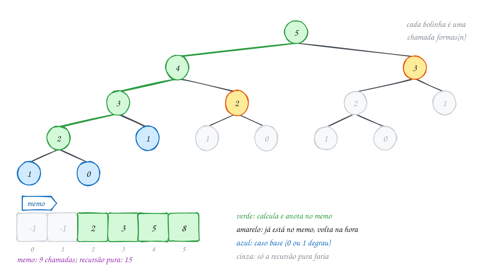
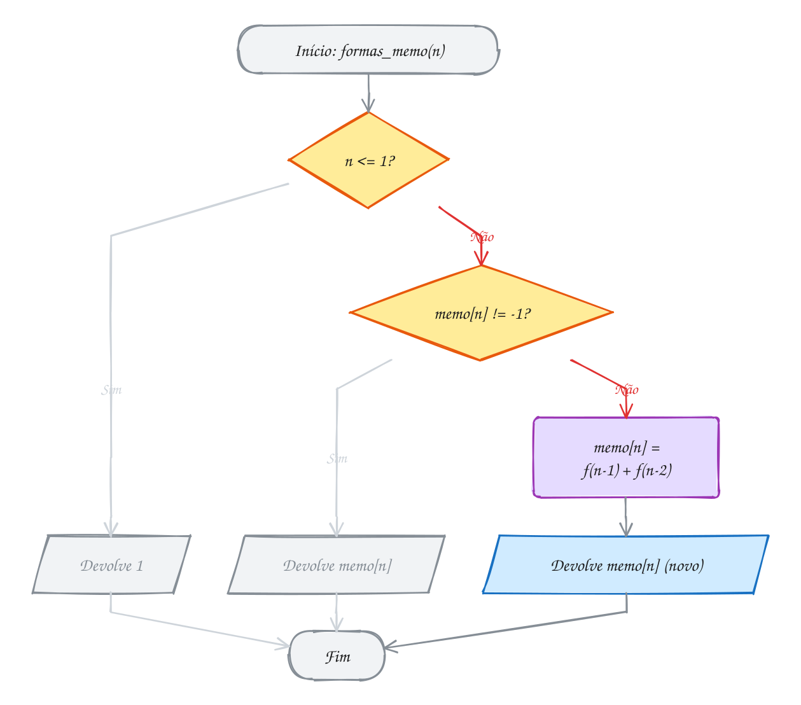
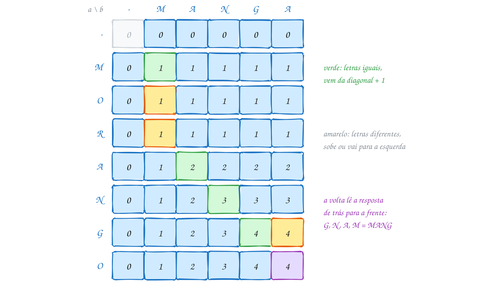
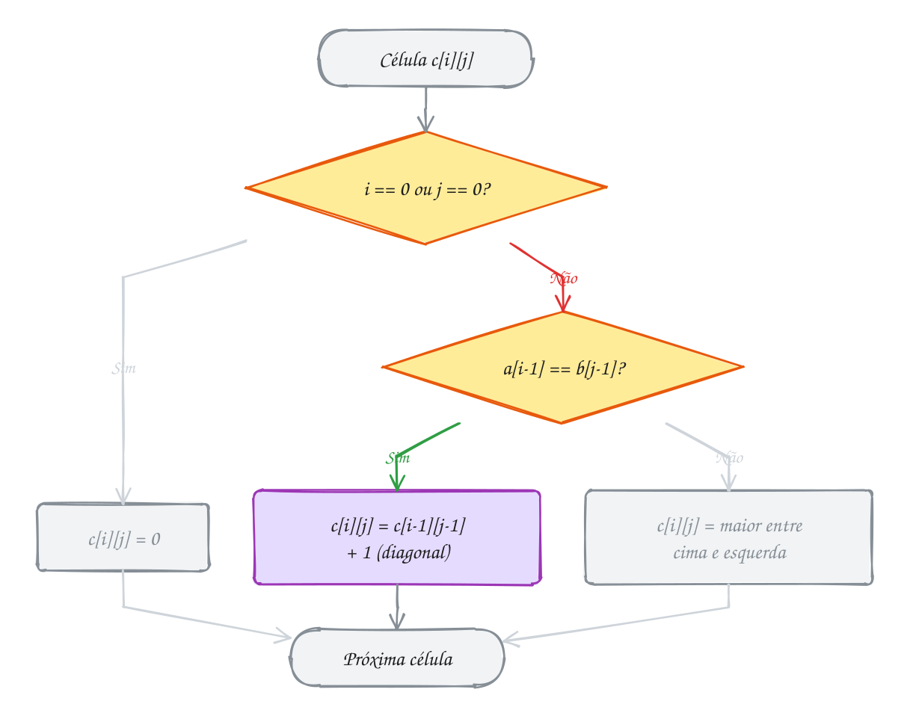
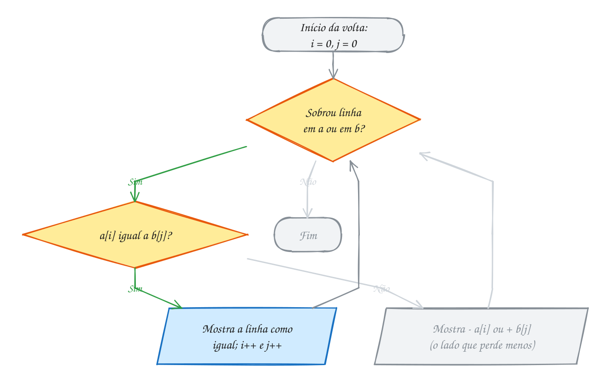

<!-- Gerado por _gerador. Para mudar este arquivo, edite _gerador/modulos/21-programacao-dinamica/ e rode: cd _gerador && npm run gerar -->

# Módulo 21 · Programação dinâmica

> [!IMPORTANT]
> **Mundo 8 · Técnicas de projeto · Rota do jogo: etapa 27 de 29**
>
> **Missão:** guardar subproblemas repetidos para ganhar velocidade.
>
> **Vem de:** [Módulo 20 · Divisão e conquista e algoritmos gulosos](20-dc-e-gulosos.md). **Segue para:** [Módulo 24 · Busca de padrões em texto](24-busca-de-padroes.md).
>
> **Checkpoints desta fase:**
> - [ ] Ler os assuntos 0138 a 0143 e refazer os exemplos
> - [ ] Resolver os 4 exercícios de cada assunto, escrevendo o código sozinho
> - [ ] Fechar a lista prática (P2101 a P2130)
> - [ ] Enfrentar os desafios do módulo
> - [ ] Chefão: resolver as questões de prova do módulo sem consultar

A **programação dinâmica** (PD) anota a resposta de cada subproblema na
primeira vez e consulta nas seguintes. Toda PD tem uma **recorrência**, uma
**tabela** e uma **volta** que reconstrói a solução: troco, mochila 0/1, LCS,
distância de edição e um **mini-diff**. Depende da recursão (módulo 04) e dos
gulosos (módulo 20): quando o guloso erra, a PD testa todas as escolhas.

## O que você vai aprender

- **memoização** (de cima para baixo), **tabela** (de baixo para cima) e o
  custo de uma PD: subproblemas × trabalho de cada um
- quando a PD se aplica: **subproblemas repetidos** e **subestrutura ótima**
- **troco**: menor número de moedas e quantas combinações existem
- **mochila 0/1**: tabela n × W, recuperação dos itens e o truque de uma
  linha só
- **LCS** e a volta pela tabela
- **distância de edição** (Levenshtein): inserir, remover e trocar
- o **mini-diff**, com leitura de linhas, vetor que cresce e tabela no heap

## Antes de começar

Revise recursão (0032 e 0033), matrizes (0039), strings (0041 e 0042) e
memória dinâmica (0054 e 0055). O troco guloso (0133) e a mochila fracionária
(0135) são o ponto de partida do 0139 e do 0140.

Os exemplos usam matriz fixa (`#define MAX 50`) para deixar a recorrência à
vista; o mini-diff põe a tabela no heap. A cadeia de matrizes tem assunto
próprio: o 0185.

Nas tabelas, **roxa** é a célula calculada (ou de onde a volta parte),
**verde** a escolhida ou o caminho da solução, **amarela** a opção que perdeu
e **cinza** o que não chega a ser usado.

| # | Assunto |
| --- | --- |
| [0138](#0138--memoização) | Memoização |
| [0139](#0139--troco-com-programação-dinâmica) | Troco com programação dinâmica |
| [0140](#0140--mochila-01) | Mochila 0/1 |
| [0141](#0141--maior-subsequência-comum-lcs) | Maior subsequência comum (LCS) |
| [0142](#0142--distância-de-edição) | Distância de edição |
| [0143](#0143--juntando-tudo-um-mini-diff) | Juntando tudo: um mini-diff |

---

> [!NOTE]
> Cada assunto é um capítulo: **Conceito** (a explicação), **Exemplos de uso** (programas que compilam sozinhos: rode com o comando abaixo de cada um e compare com a saída no fim do código) e **Exercícios** (cada um é um arquivo em `material/` com o esqueleto, as dicas e o espaço para a resposta; resoluções em `_respostas/21-programacao-dinamica/`).

## 0138 · Memoização

### Conceito

Você vai subir 35 degraus a pé, de um em um ou de dois em dois. De quantos
jeitos diferentes dá para chegar ao topo? Contar na mão é impossível, e a
pergunta esconde a ideia que guia o módulo inteiro.

Pense no **último passo**. Para pisar no degrau `n`, você veio do degrau
`n - 1`, com um passo simples, ou do `n - 2`, com um passo duplo. Então o
número de jeitos de chegar a `n` é a soma dos jeitos de chegar a cada um
desses dois: `formas(n) = formas(n - 1) + formas(n - 2)`, com `formas(0) =
formas(1) = 1`. É a recorrência de Fibonacci, que você viu no assunto 0033.

Escrita como recursão pura, essa função é **exponencial**. `formas(35)` faz
quase 30 milhões de chamadas, porque `formas(33)` é calculada duas vezes,
`formas(32)` três, e assim por diante, numa avalanche de contas repetidas
(TENENBAUM; LANGSAM; AUGENSTEIN, 1995, cap. 3). E só existem 36 perguntas
diferentes, de `formas(0)` a `formas(35)`. O desperdício é refazer conta
pronta. A saída é **anotar cada resposta na primeira vez e consultar nas
próximas**, como quem cola um lembrete na geladeira.

Essa é a **programação dinâmica** (PD): resolver um problema combinando as
respostas de **subproblemas que se repetem**, calculando cada um uma vez só
(CORMEN et al., 2024, cap. 14). O nome engana. "Programação" aqui não quer
dizer escrever código; quer dizer planejamento, preencher uma tabela, no
sentido antigo da palavra.

A PD exige duas condições do problema. A primeira é a **subestrutura
ótima**: a resposta do problema sai das respostas ótimas de problemas
menores do mesmo tipo (CORMEN et al., 2024, cap. 14). Nos degraus, a resposta
de `n` sai das de `n - 1` e `n - 2`. A segunda é ter **subproblemas
sobrepostos**: os problemas menores **se repetem** ao longo da recursão
(CORMEN et al., 2024, cap. 14). É ela que separa a PD da divisão e conquista
(0131). As metades do merge sort nunca se repetem, e guardar a resposta
delas não economizaria nada.

Há dois jeitos de anotar. Na **memoização** (de *memo*, lembrete), você
mantém a recursão como está e acrescenta um vetor `memo[]`. Antes de
calcular, a função consulta o vetor; se a resposta já está lá, devolve na
hora; se não, calcula, anota e devolve. Ela resolve de **cima para baixo**
(*top-down*): parte do problema grande e desce só até os subproblemas de
que precisa (LINTZMAYER; MOTA, 2023).

```c
long long formas_memo(int n) {
    if (n <= 1) return 1;
    if (memo[n] != -1) return memo[n];          // já sei: devolve
    memo[n] = formas_memo(n - 1) + formas_memo(n - 2);
    return memo[n];
}
```

O outro jeito é a **tabela**. Você joga a recursão fora e enche um vetor
num laço, do menor subproblema para o maior: `t[0]`, `t[1]`, depois `t[2]`
a partir deles, e assim até `t[n]`. Ela resolve de **baixo para cima**
(*bottom-up*): quando chega a vez de `t[i]`, tudo de que ele depende já está
pronto (CORMEN et al., 2024, cap. 14). O Cormen chama as duas versões de
*top-down with memoization* e *bottom-up method*.

Com as anotações, `formas(35)` cai de 29 860 703 chamadas para 69 na
memoização e 34 voltas de laço na tabela. A conta de custo vale para toda
PD: **número de subproblemas × trabalho de cada um**. Aqui são 35
subproblemas com uma soma cada, O(n), contra o crescimento exponencial da
recursão pura (TENENBAUM; LANGSAM; AUGENSTEIN, 1995, cap. 3).

As duas versões têm o mesmo custo de tempo, mas diferem na pilha. A
memoização ainda é recursiva e empilha um frame por chamada aberta, então
`formas_memo(100000)` estouraria a pilha. A tabela é um laço comum, sem
chamadas (FEOFILOFF, 2009). A memoização ganha quando só uma parte dos
subproblemas é necessária, porque ela calcula só essa parte.

> [!WARNING]
> O valor de "ainda não calculei" deve ser **impossível** como resposta (aqui,
> `-1`). Com `0` e 0 sendo resposta válida, cada célula 0 é recalculada e o
> tempo volta a ser exponencial, com a resposta certa.

### Exemplos de uso

Subir 35 degraus de um em um ou de dois em dois: pelo último passo,
`formas(n) = formas(n - 1) + formas(n - 2)`, com `formas(0) = formas(1) = 1`.
Com 5 degraus e memo, as chamadas verdes calculam e anotam, as amarelas acham
a resposta pronta e o cinza deixa de existir:

<p align="center"></p>

```c
#include <stdio.h>

#define MAX 50

long long chamadas = 0; // conta quantas vezes a função foi chamada

// recursão pura: formas de subir n degraus, de 1 em 1 ou de 2 em 2
long long formas_rec(int n) {
    chamadas++;
    if (n <= 1) {
        return 1;                       // 0 ou 1 degrau: um jeito só
    }
    return formas_rec(n - 1) + formas_rec(n - 2);
}

long long memo[MAX + 1];                // memo[n] == -1: ainda não sei

// de cima para baixo: a mesma recursão, consultando o memo antes
long long formas_memo(int n) {
    chamadas++;
    if (n <= 1) {
        return 1;
    }
    if (memo[n] != -1) {
        return memo[n];                 // já calculei: só consulta
    }
    memo[n] = formas_memo(n - 1) + formas_memo(n - 2);
    return memo[n];
}

// de baixo para cima: enche a tabela do menor para o maior
long long formas_tabela(int n) {
    long long t[MAX + 1];
    t[0] = 1;
    t[1] = 1;
    for (int i = 2; i <= n; i++) {
        t[i] = t[i - 1] + t[i - 2];     // os dois já estão prontos
    }
    return t[n];
}

int main(void) {
    int degraus = 35;

    chamadas = 0;
    long long r = formas_rec(degraus);
    printf("recursão pura: %lld formas, %lld chamadas\n", r, chamadas);

    for (int i = 0; i <= MAX; i++) {
        memo[i] = -1;
    }
    chamadas = 0;
    r = formas_memo(degraus);
    printf("memoização:    %lld formas, %lld chamadas\n", r, chamadas);

    r = formas_tabela(degraus);
    printf("tabela:        %lld formas, %d voltas no laço\n", r, degraus - 1);
    return 0;
}
// Saída:
// recursão pura: 14930352 formas, 29860703 chamadas
// memoização:    14930352 formas, 69 chamadas
// tabela:        14930352 formas, 34 voltas no laço
```

De 29.860.703 para 69 chamadas: 35 somas, O(n), contra O(1,6ⁿ) da recursão
pura. No fluxograma, quem já está no memo volta sem chamar ninguém:

<p align="center"></p>

#### Passo a passo

Versão de baixo para cima, para 5 degraus. Cada linha usa as duas anteriores:

| i | t[i - 2] | t[i - 1] | t[i] |
| --- | --- | --- | --- |
| 0 | | | 1 (base) |
| 1 | | | 1 (base) |
| 2 | 1 | 1 | 2 |
| 3 | 1 | 2 | 3 |
| 4 | 2 | 3 | 5 |
| 5 | 3 | 5 | 8 |

São 8 jeitos: 11111, 2111, 1211, 1121, 1112, 221, 212, 122.

**Exemplo A275 · Quantas rotas o entregador tem até o cliente**

```c
#include <stdio.h>

#define LIN 5
#define COL 6

// O entregador sai do cruzamento do canto de cima à esquerda e vai até o de
// baixo à direita, andando só para a direita (leste) ou para baixo (sul).
// Dois cruzamentos estão fechados por obra (marcados com 1).
int main(void) {
    int obra[LIN][COL] = {
        {0, 0, 0, 0, 0, 0},
        {0, 0, 1, 0, 0, 0},
        {0, 0, 0, 0, 1, 0},
        {0, 0, 0, 0, 0, 0},
        {0, 0, 0, 0, 0, 0},
    };
    long long rotas[LIN][COL];

    // rotas[i][j] = de quantos jeitos se chega no cruzamento (i, j):
    // ou vindo de cima (i - 1, j), ou vindo da esquerda (i, j - 1)
    for (int i = 0; i < LIN; i++) {
        for (int j = 0; j < COL; j++) {
            if (obra[i][j]) {
                rotas[i][j] = 0;              // ninguém passa por aqui
            } else if (i == 0 && j == 0) {
                rotas[i][j] = 1;              // a saída: um jeito, ficar parado
            } else {
                long long de_cima = (i > 0) ? rotas[i - 1][j] : 0;
                long long da_esquerda = (j > 0) ? rotas[i][j - 1] : 0;
                rotas[i][j] = de_cima + da_esquerda;
            }
        }
    }

    for (int i = 0; i < LIN; i++) {
        for (int j = 0; j < COL; j++) {
            if (obra[i][j]) {
                printf("   X");
            } else {
                printf("%4lld", rotas[i][j]);
            }
        }
        printf("\n");
    }
    printf("Rotas até o cliente: %lld (sem as obras seriam 126)\n", rotas[LIN - 1][COL - 1]);
    return 0;
}
// Saída:
//    1   1   1   1   1   1
//    1   2   X   1   2   3
//    1   3   3   4   X   3
//    1   4   7  11  11  14
//    1   5  12  23  34  48
// Rotas até o cliente: 48 (sem as obras seriam 126)
```

```bash
gcc ~/LPEDC/material/A275.c -o ~/LPEDC/material/A275 && ~/LPEDC/material/A275
```

**Exemplo A276 · Duas variáveis bastam (até o long long acabar)**

```c
#include <limits.h>
#include <stdio.h>

// formas de subir n degraus de 1 ou 2 em 2, de baixo para cima, guardando só
// os dois últimos valores: O(1) de memória em vez de um vetor de n posições
int main(void) {
    long long dois_atras = 1;   // formas(0)
    long long um_atras = 1;     // formas(1)
    int n = 1;

    while (1) {
        // a próxima soma cabe no long long? confere ANTES de somar
        if (um_atras > LLONG_MAX - dois_atras) {
            break;
        }
        long long atual = um_atras + dois_atras;
        dois_atras = um_atras;      // a janela anda um degrau:
        um_atras = atual;           // o velho "um atrás" vira "dois atrás"
        n++;
        if (n == 10 || n == 50 || n == 90) {
            printf("formas(%d) = %lld\n", n, um_atras);
        }
    }
    printf("o último que cabe: formas(%d) = %lld\n", n, um_atras);
    printf("formas(%d) passaria de LLONG_MAX = %lld\n", n + 1, LLONG_MAX);
    return 0;
}
// Saída:
// formas(10) = 89
// formas(50) = 20365011074
// formas(90) = 4660046610375530309
// o último que cabe: formas(91) = 7540113804746346429
// formas(92) passaria de LLONG_MAX = 9223372036854775807
```

```bash
gcc ~/LPEDC/material/A276.c -o ~/LPEDC/material/A276 && ~/LPEDC/material/A276
```

### Exercícios

**Exercício E823** · ★☆☆

Na escadaria da igreja da cidade, os adolescentes sobem de 1, de 2 ou de 3
degraus por vez. São 10 degraus. Escreva um programa que calcula, de baixo
para cima, quantos jeitos existem de subir 0, 1, 2, ..., 10 degraus, num
vetor t[], e mostre a tabela inteira e a resposta.

```text
Saída esperada:
t: 1 1 2 4 7 13 24 44 81 149 274
Jeitos de subir 10 degraus: 274
```

**Exercício E825** · ★★☆

Um motorista de aplicativo cruza o centro da cidade de um canto ao outro,
andando só para a direita (D) ou para baixo (B). Cada quarteirão tem um
pedágio de estacionamento rotativo, em reais, que ele paga ao passar
(inclusive o da saída e o da chegada):

```text
3 1 4 2 5
2 7 1 8 2
6 1 3 2 4
5 2 9 1 3
```

Escreva um programa que calcula, de baixo para cima, a matriz custo[i][j]
(o menor gasto da saída até o quarteirão (i, j)) e mostre o menor custo
até o canto de baixo à direita. Depois, refaça o caminho de trás para a
frente e mostre a sequência de letras D e B, da saída até a chegada.

```text
Saída esperada:
Menor custo: R$ 18
Caminho: DDBBDBD
```

**Exercício E826** · ★★☆

A feira de domingo tem 8 vagas de barraca enfileiradas, numeradas de 0 a 7.
Você tem barracas suficientes, mas a prefeitura proíbe montar em duas
vagas VIZINHAS. O lucro estimado de cada vaga, em reais, é:

```text
vaga:   0   1   2   3   4   5   6   7
lucro: 40  25  60  30  10  55  35  20
```

Escreva um programa que calcula, de baixo para cima, melhor[i] = o maior
lucro usando só as vagas 0..i, mostre o vetor, o lucro máximo e quais
vagas usar.

```text
Saída esperada:
melhor: 40 40 100 100 110 155 155 175
Lucro máximo: R$ 175
Barracas: 0 2 5 7
```

**Exercício E828** · ★★★

Na Mega-Sena você escolhe 6 dezenas entre 60. O número de jogos possíveis
é C(60, 6), e a recorrência do triângulo de Pascal calcula isso sem
fatorial nenhum (60! não cabe em tipo nenhum do C):

```text
C(n, k) = C(n - 1, k - 1) + C(n - 1, k),   com C(n, 0) = C(n, n) = 1
```

(a dezena n entra no jogo ou não entra). A recursão pura faria
2 x C(60, 6) - 1, uns 100 milhões de chamadas. Escreva a função

```text
long long comb(int n, int k)
```

com memoização numa matriz memo[61][61] e um contador global de chamadas.
Calcule C(60, 6) e depois, zerando o contador mas SEM limpar o memo,
C(60, 30). No fim, conte quantas posições do memo foram preenchidas.

```text
Saída esperada:
Mega-Sena: C(60, 6) = 50063860 (649 chamadas)
chance de acertar com um jogo: 1 em 50063860
C(60, 30) = 118264581564861424 (1441 chamadas novas)
subproblemas guardados no memo: 1044
```

---

## 0139 · Troco com programação dinâmica

### Conceito

Nos Correios, o balcão só tem selos de R$ 1, R$ 4 e R$ 5, e a sua carta
custa R$ 8 de porte. Você quer colar o **menor número de selos** que somam
exatamente R$ 8. É o problema do **troco mínimo**: dado um conjunto de
valores, achar o menor número de peças que somam exatamente um total
(CORMEN et al., 2024, cap. 14).

O atendente guloso do assunto 0133 pega o maior selo que cabe, R$ 5, e
completa com três de R$ 1: quatro selos. Dois selos de R$ 4 resolvem com
dois. É o mesmo tropeço das fichas `{1, 3, 4}` de lá: o sistema não é
canônico, e a escolha que parece melhor agora estraga o resto. O guloso
aposta numa escolha e não volta atrás. A PD (0138) não aposta: ela testa
**todas** as escolhas, mas sem repetir trabalho.

O raciocínio é o mesmo dos degraus: olhe para o **último selo** colado. Ele
foi de R$ 1, de R$ 4 ou de R$ 5. Antes dele, sobrou um valor menor, que já
foi pago com o mínimo de selos. Então, chamando de `dp[v]` o menor número de
selos que somam exatamente `v` reais, vale `dp[v] = 1 + mín(dp[v - s])`,
tomando o mínimo sobre cada selo `s` que cabe em `v`, isto é, com `s ≤ v`. O
caso base é `dp[0] = 0`: pagar zero não pede selo nenhum (LINTZMAYER; MOTA,
2023).

Veja a conta para R$ 8. Se o último selo foi de R$ 1, antes sobraram 7, e
`dp[7] = 3`, total 4. Se foi de R$ 4, sobraram 4, e `dp[4] = 1`, total 2. Se
foi de R$ 5, sobraram 3, e `dp[3] = 3`, total 4. O menor é 2, pelo selo de
R$ 4. Para essa conta funcionar, `dp[7]`, `dp[4]` e `dp[3]` precisam estar
prontos antes, e por isso a tabela se enche de `v = 1` até o total.

Por que olhar só o último selo basta? Pela **subestrutura ótima**. Tire o
último selo de uma solução ótima para `v`: o que sobra é uma solução para
`v - s`, e ela também é ótima. Se não fosse, daria para trocá-la por uma
melhor e melhorar a solução de `v` inteira, o que contradiz ela ser ótima
(CORMEN et al., 2024, cap. 14).

A tabela `dp` diz **quantos** selos, mas não **quais**. Para isso, guarde
num segundo vetor, `ultimo[v]`, o selo que deu o mínimo em cada `v`. Depois,
ande para trás: comece em `v`, anote `ultimo[v]`, vá para `v - ultimo[v]` e
repita até chegar a 0 (ZIVIANI, 2010, cap. 2). Para R$ 8, `ultimo[8] = 4`
leva a `v = 4`, e `ultimo[4] = 4` leva a 0: dois selos de R$ 4.

Alguns valores podem ser impossíveis. Com selos de R$ 4 e R$ 5 apenas, não
dá para pagar R$ 3. A célula de um valor impossível guarda um "infinito",
um número maior que qualquer resposta de verdade, e ele nunca vence a
comparação do mínimo.

O custo segue a regra da PD: `total` subproblemas, cada um testando `k`
selos, dá **O(total × k)** de tempo e O(total) de memória (LINTZMAYER; MOTA,
2023). Para totais altos, a tabela pesa. Um milhão de `int` são 4 MB, e
`dp` e `ultimo` juntos já batem nos 8 MB da pilha padrão do Linux. Aloque
os vetores com `malloc` (assunto 0054) (KERNIGHAN; RITCHIE, 1989).

> [!WARNING]
> O "infinito" precisa sobreviver a um `+ 1`. Com `INT_MAX`, a conta
> `dp[v - selo[s]] + 1` **estoura** o `int`. Use `1000000`, `total + 1` ou
> teste `dp[v - selo[s]] != INF` antes de somar.

### Exemplos de uso

Nos Correios só há selos de R$ 1, R$ 4 e R$ 5, e a carta custa R$ 8. O guloso
cola 5 + 1 + 1 + 1, quatro selos; dois de R$ 4 bastam. No desenho, `dp[8]` olha
três vizinhos e escolhe o menor, o `dp[4]`:

<p align="center"></p>

```c
#include <stdio.h>

#define MAX 100
#define INF 1000000 // "impossível": maior que qualquer resposta de verdade

// dp[v] = menor número de selos que somam exatamente v reais
// ultimo[v] = o selo usado por último nessa solução
void minimo_selos(const int selo[], int k, int total, int dp[], int ultimo[]) {
    dp[0] = 0;                                  // R$ 0: nenhum selo
    for (int v = 1; v <= total; v++) {
        dp[v] = INF;
        for (int s = 0; s < k; s++) {
            // se o último selo for selo[s], antes dele faltavam v - selo[s]
            if (selo[s] <= v && dp[v - selo[s]] + 1 < dp[v]) {
                dp[v] = dp[v - selo[s]] + 1;
                ultimo[v] = selo[s];
            }
        }
    }
}

int main(void) {
    int selo[] = {1, 4, 5};                     // valores, em reais
    int porte = 8;
    int dp[MAX + 1], ultimo[MAX + 1];

    minimo_selos(selo, 3, porte, dp, ultimo);

    printf("v: ");
    for (int v = 0; v <= porte; v++) {
        printf(" %2d", v);
    }
    printf("\ndp:");
    for (int v = 0; v <= porte; v++) {
        printf(" %2d", dp[v]);
    }
    printf("\n%d selos para R$ %d:", dp[porte], porte);
    for (int v = porte; v > 0; v -= ultimo[v]) { // volta pelo último selo
        printf(" %d", ultimo[v]);
    }
    printf("\n");
    return 0;
}
// Saída:
// v:   0  1  2  3  4  5  6  7  8
// dp:  0  1  2  3  1  1  2  3  2
// 2 selos para R$ 8: 4 4
```

O laço de fora anda pelos valores e o de dentro testa cada selo como "o
último":

<p align="center"></p>

#### Passo a passo

As três últimas células. Cada coluna é um selo testado como último; o mínimo
da linha vira `dp[v]`:

| v | selo 1: dp[v - 1] + 1 | selo 4: dp[v - 4] + 1 | selo 5: dp[v - 5] + 1 | dp[v] | ultimo[v] |
| --- | --- | --- | --- | --- | --- |
| 6 | dp[5] + 1 = 2 | dp[2] + 1 = 3 | dp[1] + 1 = 2 | 2 | 1 |
| 7 | dp[6] + 1 = 3 | dp[3] + 1 = 4 | dp[2] + 1 = 3 | 3 | 1 |
| 8 | dp[7] + 1 = 4 | dp[4] + 1 = **2** | dp[3] + 1 = 4 | 2 | 4 |

Em `v = 6` os selos 1 e 5 empatam. Como o teste é `<`, fica o primeiro que
achou o mínimo.

**Exemplo A277 · De quantos jeitos dá para pagar R$ 1,00 em moedas**

```c
#include <stdio.h>

#define TOTAL 100 // centavos

int main(void) {
    int moeda[] = {5, 10, 25, 50};
    int k = 4;
    long long jeitos[TOTAL + 1];

    // jeitos[v] = quantas COMBINAÇÕES de moedas somam v centavos.
    // Laço de fora nas moedas: cada combinação é contada uma vez só, na ordem
    // "primeiro as de 5, depois as de 10, ...".
    for (int v = 0; v <= TOTAL; v++) {
        jeitos[v] = 0;
    }
    jeitos[0] = 1; // somar 0: um jeito, não usar moeda nenhuma
    printf("Combinações para pagar R$ 1,00:\n");
    for (int m = 0; m < k; m++) {
        for (int v = moeda[m]; v <= TOTAL; v++) {
            jeitos[v] += jeitos[v - moeda[m]]; // usa mais uma moeda[m]
        }
        printf("  usando moedas até %2d centavos: %3lld\n", moeda[m], jeitos[TOTAL]);
    }

    // Laços trocados: o de fora nos valores. Agora 5 + 10 e 10 + 5 contam
    // separado: são as SEQUÊNCIAS de moedas jogadas na máquina, uma a uma.
    long long sequencias[TOTAL + 1];
    sequencias[0] = 1;
    for (int v = 1; v <= TOTAL; v++) {
        sequencias[v] = 0;
        for (int m = 0; m < k; m++) {
            if (moeda[m] <= v) {
                sequencias[v] += sequencias[v - moeda[m]]; // a última moeda foi moeda[m]
            }
        }
    }
    printf("com a ordem importando: %lld sequências\n", sequencias[TOTAL]);
    return 0;
}
// Saída:
// Combinações para pagar R$ 1,00:
//   usando moedas até  5 centavos:   1
//   usando moedas até 10 centavos:  11
//   usando moedas até 25 centavos:  29
//   usando moedas até 50 centavos:  40
// com a ordem importando: 27517 sequências
```

```bash
gcc ~/LPEDC/material/A277.c -o ~/LPEDC/material/A277 && ~/LPEDC/material/A277
```

**Exemplo A278 · Os pedidos que a pastelaria não consegue fechar**

```c
#include <stdio.h>

#define MAX 60

int main(void) {
    // a pastelaria só vende caixas fechadas de 6, 9 ou 20 pastéis
    int caixa[] = {6, 9, 20};
    int k = 3;
    int inf = MAX + 1; // nunca se usa mais que MAX caixas: MAX + 1 é "impossível"
    int dp[MAX + 1];   // dp[v] = menor número de caixas com exatamente v pastéis

    dp[0] = 0;
    for (int v = 1; v <= MAX; v++) {
        dp[v] = inf;
        for (int c = 0; c < k; c++) {
            // só aproveita um resto que tem solução: inf + 1 não é solução
            if (caixa[c] <= v && dp[v - caixa[c]] != inf && dp[v - caixa[c]] + 1 < dp[v]) {
                dp[v] = dp[v - caixa[c]] + 1;
            }
        }
    }

    printf("Pedidos impossíveis:");
    int maior = 0;
    for (int v = 1; v <= MAX; v++) {
        if (dp[v] == inf) {
            printf(" %d", v);
            maior = v;
        }
    }
    // de 44 a 49 tudo dá; somando caixas de 6, todo pedido acima de 43 dá
    printf("\nMaior pedido impossível: %d\n", maior);
    int pedidos[] = {15, 29, 44, 60};
    for (int i = 0; i < 4; i++) {
        printf("%2d pastéis: %d caixas\n", pedidos[i], dp[pedidos[i]]);
    }
    return 0;
}
// Saída:
// Pedidos impossíveis: 1 2 3 4 5 7 8 10 11 13 14 16 17 19 22 23 25 28 31 34 37 43
// Maior pedido impossível: 43
// 15 pastéis: 2 caixas
// 29 pastéis: 2 caixas
// 44 pastéis: 4 caixas
// 60 pastéis: 3 caixas
```

```bash
gcc ~/LPEDC/material/A278.c -o ~/LPEDC/material/A278 && ~/LPEDC/material/A278
```

### Exercícios

**Exercício E829** · ★☆☆

A loja de ferragens vende parafusos só em pacotes fechados de 3, 7 e 11
unidades. Um marceneiro precisa de exatamente 25 parafusos e quer levar o
menor número de pacotes. Escreva um programa que monta a tabela dp[v] (o
menor número de pacotes com exatamente v parafusos) de 0 a 25. Mostre as
quantidades de 1 a 25 que são impossíveis e a resposta para 25.

```text
Saída esperada:
Impossíveis até 25: 1 2 4 5 8
Menor número de pacotes para 25 parafusos: 3
```

**Exercício E831** · ★★☆

Num jogo de celular, a loja vende pacotes de 1, 6 e 10 gemas. Escreva um
programa que calcula dp[v], o menor número de pacotes para cada total v de 1
a 20 gemas, e guarda em ultimo[v] o último pacote usado. Mostre os pacotes da
solução de 12 gemas.

Escreva também int guloso(int v), que sempre pega o maior pacote que cabe, e
mostre, para v de 1 a 20, os totais em que o guloso usa MAIS pacotes que a
PD, no formato "v: guloso g, PD d".

```text
Saída esperada:
12 gemas: 2 pacotes (6 6)
12: guloso 3, PD 2
13: guloso 4, PD 3
14: guloso 5, PD 4
15: guloso 6, PD 5
18: guloso 4, PD 3
19: guloso 5, PD 4
```

**Exercício E832** · ★★☆

Você vai pagar um lanche de R$ 7 com moedas de R$ 1, cédulas de R$ 2 e
cédulas de R$ 5. Duas perguntas diferentes:

a) Quantas COMBINAÇÕES de dinheiro somam R$ 7? (5 + 2 e 2 + 5 são a mesma)
b) A máquina de autoatendimento aceita uma nota ou moeda por vez. Quantas

```text
 SEQUÊNCIAS diferentes de inserção somam R$ 7? (5 + 2 e 2 + 5 contam
 separado)
```

Escreva as funções long long combinacoes(int total) e long long
sequencias(int total), cada uma com o seu vetor de PD, e mostre as duas
respostas.

```text
Saída esperada:
combinações: 6
sequências:  26
```

**Exercício E834** · ★★★

A máquina de café do escritório custa R$ 1,00, aceita moedas de 5, 10, 25
e 50 centavos, mas trava se você colocar mais de 6 moedas. Quantas
combinações de moedas pagam exatamente R$ 1,00 com até 6 moedas? Mostre
também quantas usam exatamente 1, 2, ..., 6 moedas.

Um vetor jeitos[v] não basta: ele não sabe quantas moedas cada combinação
usou. Acrescente essa informação como uma segunda dimensão:
w[q][v] = combinações com EXATAMENTE q moedas que somam v centavos.

```text
Saída esperada:
exatamente 1 moeda: 0
exatamente 2 moedas: 1
exatamente 3 moedas: 1
exatamente 4 moedas: 1
exatamente 5 moedas: 1
exatamente 6 moedas: 3
até 6 moedas: 7 combinações
```

---

## 0140 · Mochila 0/1

### Conceito

Um vendedor ambulante tem um isopor que aguenta 7 kg e quatro opções para
levar à praia: um fardo de água (2 kg, lucro de R$ 18), uma caixa de
refrigerante (3 kg, R$ 24), uma caixa de suco (4 kg, R$ 30) e um pote de
açaí (5 kg, R$ 35). Cada coisa vai inteira ou não vai: ninguém leva meia
caixa de suco. O que ele põe no isopor para lucrar o máximo?

Esse é o problema da **mochila 0/1**. Há uma capacidade `W` e `n` itens,
cada um com peso e lucro, e cada item vai inteiro (1) ou fica de fora (0).
O objetivo é o maior lucro sem passar de `W` (CORMEN et al., 2024, seção
15.2). Como cada item tem duas opções, são `2ⁿ` escolhas possíveis. Para 50
itens, testar todas está fora de cogitação.

Na mochila fracionária (assunto 0135), o guloso pelo lucro por quilo
resolvia. Aqui ele erra (CORMEN et al., 2024, seção 15.2). Pela razão, a
água (R$ 9/kg) vem antes do refrigerante (R$ 8/kg). Os dois juntos pesam 5
kg e dão R$ 42, e nada mais cabe nos 2 kg que sobram. Mas refrigerante e
suco pesam exatamente 7 kg e dão **R$ 54**. O guloso deixou espaço vazio, e
como não dá para partir o suco, esse espaço virou prejuízo.

A PD (0138) olha **um item de cada vez** e pergunta: o último item, o de
número `i`, vai ou não vai? Se não vai, o lucro é o melhor que os itens de 1
a `i - 1` conseguem com a mesma capacidade `c`. Se vai, e só pode ir se
`peso[i] <= c`, o lucro é `lucro[i]` mais o melhor que os itens de 1 a
`i - 1` conseguem no espaço que sobrou, `c - peso[i]`. A resposta é a maior
das duas (KLEINBERG; TARDOS, 2006, cap. 6).

Para guardar essas respostas, a tabela é uma matriz. A célula `t[i][c]` é o
maior lucro usando só os itens de 1 a `i`, com capacidade `c`. A recorrência
fica: `t[i][c]` é o maior entre `t[i-1][c]` e `lucro[i] + t[i-1][c -
peso[i]]`, este último só quando o item cabe. A linha 0, sem nenhum item, é
toda zero. A resposta fica no canto de baixo, em `t[n][W]` (KLEINBERG;
TARDOS, 2006, cap. 6). No isopor, `t[3][7]` escolhe entre não levar o suco
(`t[2][7] = 42`) e levar (`30 + t[2][3] = 30 + 24 = 54`), e fica com 54.

A tabela diz o lucro, mas não **o que levar**. A **recuperação** responde
isso andando de baixo para cima, a partir de `t[n][W]`. Em cada linha, compare
`t[i][c]` com a célula de cima, `t[i-1][c]`. Se forem iguais, o item `i` não
fez diferença e ficou de fora. Se mudou, o item `i` foi junto, e a busca
segue na linha de cima com a capacidade reduzida, `c - peso[i]` (ZIVIANI,
2010, cap. 2). No isopor, o açaí não muda nada e fica; o suco muda e vai, e
a capacidade cai para 3; o refrigerante muda e vai, e ela cai para 0.

O custo é o tamanho da tabela: `(n + 1) × (W + 1)` células, cada uma
preenchida em tempo constante, ou seja, **O(n × W)**. Parece polinomial, mas
há uma pegadinha. `W` é um **número**, e um número se escreve com uns log₂ W
bits. Dobrar o tamanho da entrada, de 20 para 40 bits, eleva `W` ao
quadrado. Por isso esse custo se chama **pseudopolinomial**: é polinomial
no valor de `W`, não no tamanho da entrada. A mochila 0/1 continua
NP-difícil (assunto 0186) (LINTZMAYER; MOTA, 2023).

> [!WARNING]
> Na recuperação, o teste é "o valor **mudou**?", e não "dá para levar?". E
> confira `peso[i] <= c` antes de ler `t[i - 1][c - peso[i]]`: com índice
> negativo, o C lê outra linha da matriz sem avisar.

### Exemplos de uso

Um ambulante tem um isopor de 7 kg: água (2 kg, R$ 18), refri (3 kg, R$ 24),
suco (4 kg, R$ 30) e açaí (5 kg, R$ 35). O guloso leva água e refri (R$ 42);
refri e suco dão R$ 54. No desenho, `t[3][7] = 54` (roxo) escolheu entre não
levar o suco (amarelo) e levar (verde):

<p align="center"></p>

Os vetores começam no índice 1, para casar com a linha 0 da tabela:

```c
#include <stdio.h>

#define N 4 // itens
#define W 7 // capacidade do isopor, em kg

int main(void) {
    const char *nome[N + 1] = {"", "água", "refri", "suco", "açaí"};
    int peso[N + 1] = {0, 2, 3, 4, 5};      // kg (o índice 0 não é usado)
    int lucro[N + 1] = {0, 18, 24, 30, 35}; // reais
    int t[N + 1][W + 1];

    // t[i][c] = maior lucro usando só os itens 1..i com capacidade c
    for (int c = 0; c <= W; c++) {
        t[0][c] = 0;                        // nenhum item: lucro 0
    }
    for (int i = 1; i <= N; i++) {
        for (int c = 0; c <= W; c++) {
            t[i][c] = t[i - 1][c];          // não leva o item i
            if (peso[i] <= c && lucro[i] + t[i - 1][c - peso[i]] > t[i][c]) {
                t[i][c] = lucro[i] + t[i - 1][c - peso[i]]; // leva o item i
            }
        }
    }

    for (int i = 0; i <= N; i++) {
        printf("i=%d:", i);
        for (int c = 0; c <= W; c++) {
            printf(" %2d", t[i][c]);
        }
        printf("\n");
    }
    printf("Lucro máximo: R$ %d\n", t[N][W]);

    // volta pela tabela: se o valor mudou de i - 1 para i, o item i foi junto
    printf("Leva:");
    int c = W;
    for (int i = N; i >= 1; i--) {
        if (t[i][c] != t[i - 1][c]) {
            printf(" %s (%d kg)", nome[i], peso[i]);
            c -= peso[i];                   // o que sobrou para os anteriores
        }
    }
    printf("\n");
    return 0;
}
// Saída:
// i=0:  0  0  0  0  0  0  0  0
// i=1:  0  0 18 18 18 18 18 18
// i=2:  0  0 18 24 24 42 42 42
// i=3:  0  0 18 24 30 42 48 54
// i=4:  0  0 18 24 30 42 48 54
// Lucro máximo: R$ 54
// Leva: suco (4 kg) refri (3 kg)
```

O fluxograma mostra a decisão de uma célula; o caminho marcado é o de
`t[3][7]`:

<p align="center"></p>

#### Passo a passo

A recuperação, partindo do canto `t[4][7]`:

| i | c | t[i][c] | t[i-1][c] | Mudou? | Decisão | c depois |
| --- | --- | --- | --- | --- | --- | --- |
| 4 (açaí) | 7 | 54 | 54 | não | fica | 7 |
| 3 (suco) | 7 | 54 | 42 | sim | **leva** | 7 - 4 = 3 |
| 2 (refri) | 3 | 24 | 18 | sim | **leva** | 3 - 3 = 0 |
| 1 (água) | 0 | 0 | 0 | não | fica | 0 |

**Exemplo A279 · O pen drive com uma linha só de tabela**

```c
#include <stdio.h>

#define N 4
#define CAP 16 // GB livres no pen drive

int tamanho[N] = {5, 4, 7, 3};     // GB de cada videoaula
int nota[N] = {30, 24, 40, 20};    // o quanto cada uma interessa
const char *nome[N] = {"A", "B", "C", "D"};

// mochila 0/1 com UM vetor: melhor[c] faz o papel da linha "de cima".
// O laço de c DESCE: assim melhor[c - tamanho] ainda é o valor da linha
// anterior, sem o item i.
int mochila_descendo(void) {
    int melhor[CAP + 1] = {0};
    for (int i = 0; i < N; i++) {
        for (int c = CAP; c >= tamanho[i]; c--) {
            int com_i = nota[i] + melhor[c - tamanho[i]];
            if (com_i > melhor[c]) {
                melhor[c] = com_i;
            }
        }
    }
    return melhor[CAP];
}

// O MESMO código com o laço subindo: melhor[c - tamanho] já pode ter usado
// o item i nesta mesma volta. O item vira infinito (mochila "ilimitada").
int mochila_subindo(int copias[]) {
    int melhor[CAP + 1] = {0};
    int ultimo[CAP + 1];
    for (int c = 0; c <= CAP; c++) {
        ultimo[c] = -1;
    }
    for (int i = 0; i < N; i++) {
        for (int c = tamanho[i]; c <= CAP; c++) {
            int com_i = nota[i] + melhor[c - tamanho[i]];
            if (com_i > melhor[c]) {
                melhor[c] = com_i;
                ultimo[c] = i;
            }
        }
    }
    // conta quantas vezes cada item entrou (anda pelo último item escolhido)
    for (int c = CAP; c > 0 && ultimo[c] != -1; c -= tamanho[ultimo[c]]) {
        copias[ultimo[c]]++;
    }
    return melhor[CAP];
}

int main(void) {
    // o certo: A + B + C = 16 GB, nota 94; cada aula entra uma vez só
    printf("laço descendo (0/1): nota %d\n", mochila_descendo());

    int copias[N] = {0};
    printf("laço subindo:        nota %d, com", mochila_subindo(copias));
    for (int i = 0; i < N; i++) {
        if (copias[i] > 0) {
            printf(" %s x%d", nome[i], copias[i]);
        }
    }
    printf("\n");
    return 0;
}
// Saída:
// laço descendo (0/1): nota 94
// laço subindo:        nota 104, com B x1 D x4
```

```bash
gcc ~/LPEDC/material/A279.c -o ~/LPEDC/material/A279 && ~/LPEDC/material/A279
```

**Exemplo A280 · A conta do mercado dividida ao meio**

```c
#include <stdbool.h>
#include <stdio.h>

#define N 7
#define MAXS 200

// Dois amigos racharam as compras, mas cada item vai inteiro para a casa de
// um deles. Quem leva o quê, para os dois gastos ficarem o mais perto
// possível? É uma mochila 0/1 em que o "lucro" é o próprio preço: a
// pergunta vira "que somas dá para formar com um subconjunto?".
int main(void) {
    const char *item[N + 1] = {"", "carne", "arroz", "café", "queijo",
                               "frutas", "sabão", "pão"};
    int preco[N + 1] = {0, 41, 23, 17, 35, 28, 12, 9}; // reais (índice 0 sem uso)
    int total = 0;
    for (int i = 1; i <= N; i++) {
        total += preco[i];
    }

    // pode[i][s] == true: algum subconjunto dos itens 1..i soma exatamente s
    static bool pode[N + 1][MAXS + 1]; // static: começa tudo false
    pode[0][0] = true;                 // nenhum item soma 0
    for (int i = 1; i <= N; i++) {
        for (int s = 0; s <= total; s++) {
            pode[i][s] = pode[i - 1][s] ||
                         (preco[i] <= s && pode[i - 1][s - preco[i]]);
        }
    }

    // a melhor divisão: a maior soma possível que não passa da metade
    int alvo = total / 2;
    while (!pode[N][alvo]) {
        alvo--;
    }
    printf("Total R$ %d: um paga R$ %d, o outro R$ %d\n", total, alvo, total - alvo);

    // recuperação: se a soma já era possível sem o item i, ele fica de fora
    printf("Leva para a casa 1:");
    int s = alvo;
    for (int i = N; i >= 1; i--) {
        if (!pode[i - 1][s]) {         // sem o item i não dava: ele entra
            printf(" %s", item[i]);
            s -= preco[i];
        }
    }
    printf("\n");
    return 0;
}
// Saída:
// Total R$ 165: um paga R$ 81, o outro R$ 84
// Leva para a casa 1: café arroz carne
```

```bash
gcc ~/LPEDC/material/A280.c -o ~/LPEDC/material/A280 && ~/LPEDC/material/A280
```

### Exercícios

**Exercício E835** · ★☆☆

Uma padaria tem R$ 10 mil para investir e cinco projetos. Cada projeto é
feito inteiro ou não é feito (0/1). Custos e retornos em mil reais:

```text
projeto            custo  retorno por ano
1 fachada nova       4          9
2 site de pedidos    3          7
3 curso da equipe    2          4
4 forno novo         5         11
5 vitrine refrig.    1          2
```

Escreva um programa que monta a tabela t[i][c] (maior retorno usando os
projetos 1..i com c mil reais) e mostre a última linha da tabela e o
retorno máximo com os R$ 10 mil.

```text
Saída esperada:
última linha: 0 2 4 7 9 11 13 16 18 20 22
Retorno máximo com R$ 10 mil: R$ 22 mil por ano
```

**Exercício E837** · ★★☆

Véspera de vestibular: você tem 6 horas de estudo e uma estimativa de
quantos pontos cada revisão completa rende. Cada matéria é revisada
inteira ou não é revisada:

```text
matéria      horas  pontos
Matemática    2.5     30
Português     1.5     18
História      1.0     10
Física        2.0     25
Química       1.5     16
Inglês        0.5      6
```

O problema: a tabela da mochila precisa de capacidades INTEIRAS, e as
horas são double. Guarde as horas como double no programa, converta tudo
para meias horas (unidades inteiras) e resolva a mochila 0/1 com
recuperação. Mostre o máximo, as matérias e as horas usadas.

```text
Saída esperada:
Máximo: 73 pontos em 6.0 h
Estudar: Física Português Matemática
Horas usadas: 6.0
```

**Exercício E838** · ★★☆

Sua carteira tem estas cédulas: 2, 5, 5, 10, 10, 20, 20 e 50 reais. Você
precisa separar exatamente R$ 30 para o rateio do churrasco. De quantos
jeitos dá para escolher as cédulas? Cada cédula é um papel diferente: as
duas notas de 20 contam como escolhas distintas.

Resolva com PD num vetor só (jeitos[s] = quantos subconjuntos das cédulas
vistas até agora somam s) e confira o resultado com a força bruta por bits
do assunto 0125, testando os 2^8 subconjuntos.

```text
Saída esperada:
PD: 7 jeitos de separar R$ 30
força bruta: 7 jeitos (256 subconjuntos testados)
```

**Exercício E840** · ★★★

Um drone de entregas carrega até 10 kg E até 8 litros de volume no
compartimento. Há seis pacotes esperando, cada um com peso, volume e o
frete que paga:

```text
pacote  peso (kg)  volume (L)  frete (R$)
  1         3          4           25
  2         4          2           30
  3         2          3           18
  4         5          3           40
  5         1          2            9
  6         3          3           22
```

Agora há DUAS capacidades. Estenda a ideia da mochila 0/1 para uma tabela
de três dimensões, t[i][p][v] = maior frete usando os pacotes 1..i com
até p kg e v litros. Mostre o frete máximo, os pacotes (do último para o
primeiro, como sai da volta pela tabela), o peso e o volume usados, e
confira o valor com uma força bruta pelos 2^6 subconjuntos.

```text
Saída esperada:
Frete máximo: R$ 79
Pacotes: 5 4 2
Usa 10 kg e 7 L
Força bruta: R$ 79
```

---

## 0141 · Maior subsequência comum (LCS)

### Conceito

Você ditou **MORANGO** e o seu sobrinho escreveu **MANGA**. Quantas letras
ele acertou na ordem certa? Comparar posição por posição não serve, porque
um erro no começo desalinha o resto. A pergunta certa é: qual a maior
sequência de letras que aparece nas duas palavras, na mesma ordem, mesmo com
outras letras no meio? Aqui é **MANG**, quatro letras. A mesma pergunta
compara versões de um arquivo e trechos de DNA.

Uma **subsequência** de uma string é o que sobra depois de apagar algumas
letras dela, sem mudar a ordem das que ficam (CORMEN et al., 2024, cap. 14).
`MNG` é subsequência de `MORANGO`: apague O, R, A e O. `GNA` não é, porque
em MORANGO o G vem depois do N e do A. A **maior subsequência comum**
(*longest common subsequence*, LCS) de duas strings é a mais comprida que é
subsequência das duas ao mesmo tempo (CORMEN et al., 2024, cap. 14).

Testar todas não dá. Cada letra pode ficar ou sair, então uma palavra de 30
letras tem 2³⁰, mais de um bilhão, de subsequências (CORMEN et al., 2024, cap.
14). A PD (0138) resolve olhando só a **última letra** de cada string. Se as
duas forem **iguais**, essa letra pode fechar a LCS: a resposta é 1 mais a
LCS das duas strings sem a última letra. Se forem **diferentes**, pelo menos
uma delas não entra na LCS. Então tire a última de `a` ou a última de `b`,
resolva cada caso e fique com o melhor (CORMEN et al., 2024, cap. 14).

Cada passo encurta uma string ou as duas, e o que sobra são sempre
**prefixos**, os começos das strings. Daí a tabela: `c[i][j]` é o tamanho da
LCS do prefixo de `a` com `i` letras, `a[0..i-1]`, com o prefixo de `b` com
`j` letras, `b[0..j-1]`. Com `m` e `n` letras nas duas strings, a resposta
fica em `c[m][n]` (LINTZMAYER; MOTA, 2023). A linha 0 e a coluna 0 valem 0,
porque nada é comum com um prefixo vazio.

Repare no deslocamento de índice. A linha `i` da tabela fala da letra
`a[i-1]`, porque a linha 0 é reservada ao prefixo vazio. Comparar `a[i]` com
`b[j]` é o erro clássico. A tabela resume os três casos, e cada célula olha
no máximo três vizinhas já preenchidas: a de cima, a da esquerda e a da
diagonal:

| caso | `c[i][j]` |
| --- | --- |
| `i == 0` ou `j == 0` | 0 (um prefixo vazio) |
| `a[i-1] == b[j-1]` | `c[i-1][j-1] + 1` (diagonal) |
| letras diferentes | o maior entre `c[i-1][j]` (cima) e `c[i][j-1]` (esquerda) |

O número no canto diz o tamanho, mas não quais letras. A **recuperação**
anda do canto `c[m][n]` até a borda. Se as letras da posição são iguais,
ela entra na resposta e o caminho segue na diagonal. Se não, o caminho vai
para o vizinho, de cima ou da esquerda, de onde o valor veio (CORMEN et al.,
2024, cap. 14). As letras saem de trás para a frente: em MORANGO e MANGA,
primeiro G, depois N, A e M. O Cormen guarda a direção de cada célula numa
tabela de setas; também dá para refazer a comparação na volta.

O custo é o tamanho da tabela. São `(m + 1) × (n + 1)` células, cada uma
calculada em O(1), o que dá **O(m × n)** de tempo e de memória. Se você só
quer o **tamanho** da LCS, duas linhas bastam, porque cada linha só olha a
anterior. Para **recuperar** as letras, porém, o caminho de volta precisa da
tabela inteira (KLEINBERG; TARDOS, 2006, cap. 6).

> [!WARNING]
> Subsequência não é **substring** (pedaço contíguo): a maior substring comum
> de MORANGO e MANGA é `ANG` (3), e a LCS tem 4. A linha `i` fala de
> `a[i - 1]`: escrever `a[i] == b[j]` compila e dá a resposta errada.

### Exemplos de uso

Você ditou **MORANGO** e seu sobrinho escreveu **MANGA**. No desenho, o
caminho sai do canto roxo; as células verdes são as quatro letras da
resposta, e as amarelas, os passos sem letra:

<p align="center"></p>

```c
#include <stdio.h>
#include <string.h>

#define MAX 50

int main(void) {
    const char *a = "MORANGO"; // o que foi ditado
    const char *b = "MANGA";   // o que foi escrito
    int m = strlen(a), n = strlen(b);
    int c[MAX + 1][MAX + 1];

    // c[i][j] = tamanho da maior subsequência comum de a[0..i-1] e b[0..j-1]
    for (int i = 0; i <= m; i++) {
        for (int j = 0; j <= n; j++) {
            if (i == 0 || j == 0) {
                c[i][j] = 0;                          // um dos dois é vazio
            } else if (a[i - 1] == b[j - 1]) {
                c[i][j] = c[i - 1][j - 1] + 1;        // a letra entra nas duas
            } else if (c[i - 1][j] >= c[i][j - 1]) {
                c[i][j] = c[i - 1][j];                // descarta a letra de a
            } else {
                c[i][j] = c[i][j - 1];                // descarta a letra de b
            }
        }
    }

    printf("   -");
    for (int j = 0; j < n; j++) {
        printf(" %c", b[j]);
    }
    printf("\n");
    for (int i = 0; i <= m; i++) {
        printf("%c ", i == 0 ? '-' : a[i - 1]);
        for (int j = 0; j <= n; j++) {
            printf(" %d", c[i][j]);
        }
        printf("\n");
    }

    // recuperação: do canto até a borda, montando a resposta de trás para a frente
    char lcs[MAX + 1];
    int k = c[m][n];
    lcs[k] = '\0';
    int i = m, j = n;
    while (i > 0 && j > 0) {
        if (a[i - 1] == b[j - 1]) {
            lcs[--k] = a[i - 1];                      // letra comum: diagonal
            i--;
            j--;
        } else if (c[i - 1][j] >= c[i][j - 1]) {
            i--;                                      // sobe
        } else {
            j--;                                      // vai para a esquerda
        }
    }
    printf("LCS de %s e %s: %s (%d letras)\n", a, b, lcs, c[m][n]);
    return 0;
}
// Saída:
//    - M A N G A
// -  0 0 0 0 0 0
// M  0 1 1 1 1 1
// O  0 1 1 1 1 1
// R  0 1 1 1 1 1
// A  0 1 2 2 2 2
// N  0 1 2 3 3 3
// G  0 1 2 3 4 4
// O  0 1 2 3 4 4
// LCS de MORANGO e MANGA: MANG (4 letras)
```

O caminho marcado no fluxograma é o de `c[6][4]` (G com G): as letras batem e
o valor vem da diagonal, `3 + 1`:

<p align="center"></p>

#### Passo a passo

A volta, partindo de `c[7][5]`, monta a resposta **de trás para a frente**:

| posição | letras | iguais? | `c[i-1][j]` / `c[i][j-1]` | movimento | resposta até aqui |
| --- | --- | --- | --- | --- | --- |
| (7, 5) | O, A | não | 4 / 4 | sobe | |
| (6, 5) | G, A | não | 3 / 4 | esquerda | |
| (6, 4) | G, G | sim | | diagonal | G |
| (5, 3) | N, N | sim | | diagonal | NG |
| (4, 2) | A, A | sim | | diagonal | ANG |
| (3, 1) | R, M | não | 1 / 0 | sobe | ANG |
| (2, 1) | O, M | não | 1 / 0 | sobe | ANG |
| (1, 1) | M, M | sim | | diagonal | MANG |

**Exemplo A281 · DNA comparado com duas linhas de tabela**

```c
#include <stdio.h>
#include <string.h>

#define MAX 100

// Só o TAMANHO da LCS: cada linha da tabela só usa a de cima, então bastam
// duas linhas. Em vez de copiar a linha nova para a velha, os PONTEIROS
// trocam de papel a cada volta.
int lcs_tamanho(const char *a, const char *b) {
    int m = strlen(a), n = strlen(b);
    int linha1[MAX + 1], linha2[MAX + 1];
    int *cima = linha1, *atual = linha2;

    for (int j = 0; j <= n; j++) {
        cima[j] = 0;                    // linha 0: prefixo vazio de a
    }
    for (int i = 1; i <= m; i++) {
        atual[0] = 0;                   // coluna 0: prefixo vazio de b
        for (int j = 1; j <= n; j++) {
            if (a[i - 1] == b[j - 1]) {
                atual[j] = cima[j - 1] + 1;
            } else {
                atual[j] = cima[j] > atual[j - 1] ? cima[j] : atual[j - 1];
            }
        }
        int *t = cima;                  // a linha atual vira a "de cima"
        cima = atual;
        atual = t;
    }
    return cima[n];                     // depois da troca, a última está em cima
}

int main(void) {
    const char *amostra = "ATGCGTACGTTAGCCATGACGTAGCTAGGCTTACGATCGA";
    const char *suspeito = "ATGCCTACGTAGCATGTCGTAGCAAGGCTACGTTCGA";
    const char *outro = "TTAGGCATCCAGTTACGGATCATGCCAGTAATGCTGAA";

    int m = strlen(amostra);
    printf("amostra x suspeito: %d de %d bases em comum, na ordem\n",
           lcs_tamanho(amostra, suspeito), m);
    printf("amostra x outro:    %d de %d bases em comum, na ordem\n",
           lcs_tamanho(amostra, outro), m);
    printf("memória: 2 linhas de %d int = %zu bytes (a tabela inteira teria %zu)\n",
           MAX + 1, 2 * (MAX + 1) * sizeof(int), (size_t) (MAX + 1) * (MAX + 1) * sizeof(int));
    return 0;
}
// Saída:
// amostra x suspeito: 33 de 40 bases em comum, na ordem
// amostra x outro:    25 de 40 bases em comum, na ordem
// memória: 2 linhas de 101 int = 808 bytes (a tabela inteira teria 40804)
```

```bash
gcc ~/LPEDC/material/A281.c -o ~/LPEDC/material/A281 && ~/LPEDC/material/A281
```

**Exemplo A282 · Pedaço contíguo ou letras na ordem?**

```c
#include <stdio.h>
#include <string.h>

#define MAX 50

// maior SUBSTRING comum: o pedaço tem que ser contíguo nas duas.
// s[i][j] = tamanho do maior pedaço comum que TERMINA em a[i-1] e b[j-1].
// Letras diferentes quebram a sequência: s volta a 0.
int maior_substring(const char *a, const char *b, int *fim_em_a) {
    int m = strlen(a), n = strlen(b), melhor = 0;
    int s[MAX + 1][MAX + 1];
    for (int i = 0; i <= m; i++) {
        for (int j = 0; j <= n; j++) {
            if (i == 0 || j == 0 || a[i - 1] != b[j - 1]) {
                s[i][j] = 0;
            } else {
                s[i][j] = s[i - 1][j - 1] + 1;
                if (s[i][j] > melhor) {
                    melhor = s[i][j];
                    *fim_em_a = i;      // o pedaço é a[i - melhor .. i - 1]
                }
            }
        }
    }
    return melhor;
}

// maior SUBSEQUÊNCIA comum: as letras só precisam estar na mesma ordem
int maior_subsequencia(const char *a, const char *b) {
    int m = strlen(a), n = strlen(b);
    int c[MAX + 1][MAX + 1];
    for (int i = 0; i <= m; i++) {
        for (int j = 0; j <= n; j++) {
            if (i == 0 || j == 0) {
                c[i][j] = 0;
            } else if (a[i - 1] == b[j - 1]) {
                c[i][j] = c[i - 1][j - 1] + 1;
            } else {
                c[i][j] = c[i - 1][j] > c[i][j - 1] ? c[i - 1][j] : c[i][j - 1];
            }
        }
    }
    return c[m][n];
}

int main(void) {
    const char *pares[][2] = {
        {"PARALELEPIPEDO", "PAPELARIA"},
        {"FERROVIARIO", "FERRUGEM"},
        {"ABCDEF", "FEDCBA"},
    };
    for (int p = 0; p < 3; p++) {
        const char *a = pares[p][0], *b = pares[p][1];
        int fim = 0;
        int sub = maior_substring(a, b, &fim);
        printf("%s x %s: substring %d (\"%.*s\"), subsequência %d\n",
               a, b, sub, sub, a + fim - sub, maior_subsequencia(a, b));
    }
    return 0;
}
// Em ABCDEF x FEDCBA as letras são as mesmas, mas em ordem contrária:
// só uma delas fica "na ordem".
// Saída:
// PARALELEPIPEDO x PAPELARIA: substring 2 ("PA"), subsequência 5
// FERROVIARIO x FERRUGEM: substring 4 ("FERR"), subsequência 4
// ABCDEF x FEDCBA: substring 1 ("A"), subsequência 1
```

```bash
gcc ~/LPEDC/material/A282.c -o ~/LPEDC/material/A282 && ~/LPEDC/material/A282
```

### Exercícios

**Exercício E841** · ★☆☆

Duas linhas de ônibus atravessam o centro. Cada ponto tem uma letra:

```text
linha 101: A B C D E F G H
linha 202: B D C E G A H
```

Quantos pontos as duas visitam na MESMA ordem (sem precisar ser pontos
seguidos)? Escreva a função

```text
int lcs(const char *a, const char *b)
```

que devolve o tamanho da maior subsequência comum, e teste com os pares
abaixo, mostrando cada um entre aspas.

```text
Saída esperada:
"ABCDEFGH" x "BDCEGAH": 5
"CASA" x "ASA": 3
"" x "ABC": 0
"XYZ" x "XYZ": 3
"ABC" x "DEF": 0
```

**Exercício E843** · ★★☆

A LCS não é só para strings. Ana e Beto montaram playlists para a viagem,
e cada música tem um número de catálogo:

```text
Ana:  12  7 33  5 21  8 40 17
Beto:  7  5  9 21 40  3 17 12
```

Eles querem uma playlist em comum que respeite a ordem das DUAS listas.
Escreva a função

```text
int lcs_vetor(const int a[], int m, const int b[], int n, int saida[])
```

que grava em saida a maior subsequência comum dos dois vetores e devolve
o tamanho dela. Mostre o resultado.

```text
Saída esperada:
5 músicas em comum, na mesma ordem: 7 5 21 40 17
```

**Exercício E844** · ★★☆

Charada de palavras: qual é a MENOR sequência de letras (não precisa
existir no dicionário) que contém BANANA e também CABANA como
subsequências? É a menor supersequência comum, e ela sai da tabela da
LCS: as letras da LCS aparecem uma vez só, e todas as outras letras das
duas palavras entram também. Por isso o tamanho é m + n - LCS.

Monte a tabela da LCS, construa a supersequência numa volta pela tabela
e confira o resultado com uma função

```text
int eh_subsequencia(const char *p, const char *t)
```

que diz se p é subsequência de t.

```text
Saída esperada:
LCS: 4 letras
Supersequência: CABANANA (8 letras)
BANANA está nela? sim
CABANA está nela? sim
```

**Exercício E846** · ★★★

O fechamento de uma ação em 13 pregões foi, em reais:

```text
31 28 35 30 33 29 36 40 34 38 41 37 33
```

Qual é a maior sequência de pregões (não precisam ser seguidos) em que o
preço SEMPRE sobe? Ela é a LCS entre o vetor original e uma cópia dele
ORDENADA e SEM REPETIDOS.

Escreva o programa: copie o vetor, ordene a cópia com qsort, tire os
repetidos, rode a LCS de vetores de int com recuperação e mostre o
tamanho e os preços.

```text
Saída esperada:
Maior sequência de altas: 6 dias
Preços: 28 30 33 36 40 41
```

---

## 0142 · Distância de edição

### Conceito

Você digita "pesoa" e o corretor oferece "pessoa". Ele percebeu que falta
um `s`, e que "pesoa" está muito mais perto de "pessoa" do que de "pedra".
Para ordenar as sugestões, o corretor precisa de um número que diga o
quanto duas palavras são parecidas. A medida mais usada conta quantas
correções separam uma da outra.

A **distância de edição**, também chamada **distância de Levenshtein**, é o
menor número de operações que transforma uma string em outra. São três
operações, e cada uma custa 1: **inserir** uma letra, **remover** uma letra
e **trocar** uma letra por outra (LEVENSHTEIN, 1966). De "pesoa" para
"pessoa", basta inserir um `s`: distância 1. De CARTA para ARTES, a
distância é 3: remova o C (ARTA), insira um E (ARTEA) e troque o último A
por S (ARTES).

A PD segue o mesmo raciocínio da LCS (0141): olhe o **fim** das duas
palavras. Se as últimas letras são **iguais**, elas não pedem correção, e a
distância é a mesma das palavras sem elas. Se são **diferentes**, alguma
operação tem de resolver essa última posição, e há três candidatas
(KLEINBERG; TARDOS, 2006, cap. 6).

Cada candidata deixa um problema menor. **Trocar** a última letra de `a`
pela última de `b` custa 1, e sobra transformar as duas palavras sem a
última letra. **Remover** a última letra de `a` custa 1, e sobra transformar
`a` sem ela em `b` inteira. **Inserir** no fim de `a` a última letra de `b`
custa 1, e sobra transformar `a` inteira em `b` sem a última letra. A
distância é 1 mais a mais barata das três.

A tabela segue os prefixos, como na LCS. A célula `d[i][j]` é a distância
entre o prefixo `a[0..i-1]`, com `i` letras, e o prefixo `b[0..j-1]`, com
`j` letras. A resposta fica em `d[m][n]` (LINTZMAYER; MOTA, 2023). As três
operações viram três vizinhas: a diagonal `d[i-1][j-1]` é a troca, a de
cima `d[i-1][j]` é a remoção e a da esquerda `d[i][j-1]` é a inserção. A
tabela de consulta resume:

| caso | `d[i][j]` |
| --- | --- |
| `a[i-1] == b[j-1]` | `d[i-1][j-1]` (diagonal, de graça) |
| letras diferentes | `1 +` o menor entre `d[i-1][j-1]` (troca), `d[i-1][j]` (remove) e `d[i][j-1]` (insere) |

A diferença para a LCS está na **borda**. Na LCS, a linha e a coluna 0
valiam zero. Aqui, transformar `i` letras numa palavra vazia pede `i`
remoções, então `d[i][0] = i`. E transformar a palavra vazia em `j` letras
pede `j` inserções, então `d[0][j] = j` (LINTZMAYER; MOTA, 2023).

O custo é o da tabela: `(m + 1) × (n + 1)` células de O(1), **O(m × n)**.
Um corretor que compara a palavra digitada com 300 mil palavras do
dicionário não quer pagar isso para todas. Ele usa um limite inferior
barato: a distância é pelo menos a diferença dos tamanhos, porque cada
letra a mais pede uma remoção ou inserção. Palavras de tamanho muito
diferente saem antes de qualquer tabela (KLEINBERG; TARDOS, 2006, cap. 6).

A tabela dá o número; a volta dá as edições. Partindo de `d[m][n]`, você
pergunta em cada célula de qual vizinha o valor veio: diagonal sem custo
quer dizer letras iguais; diagonal com custo é troca; de cima é remoção; da
esquerda é inserção. As operações saem do fim para o começo. Escritas em
ordem, elas formam um **alinhamento** das duas palavras, como o que se usa
para comparar trechos de DNA (KLEINBERG; TARDOS, 2006, cap. 6).

> [!WARNING]
> A borda **não** é zero, como na LCS: sem `d[i][0] = i` e `d[0][j] = j`,
> CARTA e ARTES dariam 2. Na volta, confira `i > 0` e `j > 0` antes de ler
> `d[i - 1][...]` ou `a[i - 1]`.

### Exemplos de uso

Um corretor ranqueia sugestões pelo número de edições. CARTA e ARTES distam 3:
remover o C, inserir um E e trocar o último A por S (CARTA, ARTA, ARTEA,
ARTES). As setas mostram de onde cada célula veio:

<p align="center"></p>

A volta mostra as edições do fim para o começo (o E852 monta o alinhamento na
ordem certa):

```c
#include <stdio.h>
#include <string.h>

#define MAX 50

int menor3(int x, int y, int z) {
    int m = x < y ? x : y;
    return m < z ? m : z;
}

int main(void) {
    const char *a = "CARTA"; // de onde parte
    const char *b = "ARTES"; // aonde quer chegar
    int m = strlen(a), n = strlen(b);
    int d[MAX + 1][MAX + 1];

    // d[i][j] = menor número de edições que transforma a[0..i-1] em b[0..j-1]
    for (int i = 0; i <= m; i++) {
        d[i][0] = i;                                // apagar as i letras
    }
    for (int j = 0; j <= n; j++) {
        d[0][j] = j;                                // inserir as j letras
    }
    for (int i = 1; i <= m; i++) {
        for (int j = 1; j <= n; j++) {
            if (a[i - 1] == b[j - 1]) {
                d[i][j] = d[i - 1][j - 1];          // letra igual: de graça
            } else {
                d[i][j] = 1 + menor3(d[i - 1][j - 1], // troca a[i-1] por b[j-1]
                                     d[i - 1][j],     // remove a[i-1]
                                     d[i][j - 1]);    // insere b[j-1]
            }
        }
    }

    printf("     -");
    for (int j = 0; j < n; j++) {
        printf("  %c", b[j]);
    }
    printf("\n");
    for (int i = 0; i <= m; i++) {
        printf("  %c", i == 0 ? '-' : a[i - 1]);
        for (int j = 0; j <= n; j++) {
            printf("  %d", d[i][j]);
        }
        printf("\n");
    }
    printf("distância de %s para %s: %d\n", a, b, d[m][n]);

    // volta: de onde veio cada célula? As edições saem do fim para o começo
    int i = m, j = n;
    while (i > 0 || j > 0) {
        if (i > 0 && j > 0 && a[i - 1] == b[j - 1]) {
            i--;                                    // igual: não custa nada
            j--;
        } else if (i > 0 && j > 0 && d[i][j] == d[i - 1][j - 1] + 1) {
            printf("  troca %c por %c\n", a[i - 1], b[j - 1]);
            i--;
            j--;
        } else if (i > 0 && d[i][j] == d[i - 1][j] + 1) {
            printf("  remove %c\n", a[i - 1]);
            i--;
        } else {
            printf("  insere %c\n", b[j - 1]);
            j--;
        }
    }
    return 0;
}
// Saída:
//      -  A  R  T  E  S
//   -  0  1  2  3  4  5
//   C  1  1  2  3  4  5
//   A  2  1  2  3  4  5
//   R  3  2  1  2  3  4
//   T  4  3  2  1  2  3
//   A  5  4  3  2  2  3
// distância de CARTA para ARTES: 3
//   troca A por S
//   insere E
//   remove C
```

No fluxograma, o caminho marcado é o de `d[5][5]` (A contra S), em que a troca
ganhou:

<p align="center"></p>

#### Passo a passo

A volta, partindo de `d[5][5] = 3`. Em cada célula: "de qual vizinho eu vim?"

| posição | letras | candidatos: troca / remove / insere | veio de | operação |
| --- | --- | --- | --- | --- |
| (5, 5) | A, S | 2 + 1 / 3 + 1 / 2 + 1 | diagonal (troca, testada primeiro) | troca A por S |
| (4, 4) | T, E | 2 + 1 / 3 + 1 / 1 + 1 | esquerda | insere E |
| (4, 3) | T, T | iguais | diagonal | nenhuma |
| (3, 2) | R, R | iguais | diagonal | nenhuma |
| (2, 1) | A, A | iguais | diagonal | nenhuma |
| (1, 0) | C, - | borda | cima | remove C |

**Exemplo A283 · O corretor que sugere a palavra mais perto**

```c
#include <stdio.h>
#include <string.h>

#define MAX 30

int menor3(int x, int y, int z) {
    int m = x < y ? x : y;
    return m < z ? m : z;
}

int distancia(const char *a, const char *b) {
    int m = strlen(a), n = strlen(b);
    int d[MAX + 1][MAX + 1];
    for (int i = 0; i <= m; i++) {
        d[i][0] = i;
    }
    for (int j = 0; j <= n; j++) {
        d[0][j] = j;
    }
    for (int i = 1; i <= m; i++) {
        for (int j = 1; j <= n; j++) {
            if (a[i - 1] == b[j - 1]) {
                d[i][j] = d[i - 1][j - 1];
            } else {
                d[i][j] = 1 + menor3(d[i - 1][j - 1], d[i - 1][j], d[i][j - 1]);
            }
        }
    }
    return d[m][n];
}

int main(void) {
    // palavras sem acento: em UTF-8, "ç" e "ã" ocupam 2 bytes cada, e a
    // distância contaria bytes, não letras
    const char *dicionario[] = {"pessoa", "pesca", "peso", "lagoa", "pose",
                                "pessoal", "mesa", "proa", "passeio"};
    int n = 9;
    const char *digitadas[] = {"pesoa", "lagao", "pasoe"};

    for (int k = 0; k < 3; k++) {
        int melhor = MAX + 1;
        for (int p = 0; p < n; p++) {
            int dist = distancia(digitadas[k], dicionario[p]);
            if (dist < melhor) {
                melhor = dist;
            }
        }
        printf("%s -> distância %d:", digitadas[k], melhor);
        for (int p = 0; p < n; p++) {       // todas as que empatam no mínimo
            if (distancia(digitadas[k], dicionario[p]) == melhor) {
                printf(" %s", dicionario[p]);
            }
        }
        printf("\n");
    }
    return 0;
}
// Empates são comuns: corretores de verdade desempatam pela frequência de
// uso de cada palavra. E "lagao" trocou duas letras vizinhas de lugar, mas
// a distância conta 2: o A284 mostra como contar isso como 1.
// Saída:
// pesoa -> distância 1: pessoa pesca peso
// lagao -> distância 2: lagoa
// pasoe -> distância 2: peso pose
```

```bash
gcc ~/LPEDC/material/A283.c -o ~/LPEDC/material/A283 && ~/LPEDC/material/A283
```

**Exemplo A284 · Letras trocadas de lugar contam como um erro só**

```c
#include <stdio.h>
#include <string.h>

#define MAX 30

int menor(int x, int y) {
    return x < y ? x : y;
}

// Levenshtein com uma quarta operação: TRANSPOR duas letras vizinhas
// ("ac" <-> "ca"), também com custo 1. É o erro de digitação mais comum.
// Com transpoe == 0, é a distância de edição comum.
int distancia(const char *a, const char *b, int transpoe) {
    int m = strlen(a), n = strlen(b);
    int d[MAX + 1][MAX + 1];
    for (int i = 0; i <= m; i++) {
        d[i][0] = i;
    }
    for (int j = 0; j <= n; j++) {
        d[0][j] = j;
    }
    for (int i = 1; i <= m; i++) {
        for (int j = 1; j <= n; j++) {
            int custo = (a[i - 1] == b[j - 1]) ? 0 : 1;
            d[i][j] = menor(menor(d[i - 1][j] + 1,      // remove
                                  d[i][j - 1] + 1),     // insere
                            d[i - 1][j - 1] + custo);   // troca (ou igual)
            // as duas últimas de a são as duas últimas de b, invertidas?
            if (transpoe && i > 1 && j > 1 &&
                a[i - 1] == b[j - 2] && a[i - 2] == b[j - 1]) {
                d[i][j] = menor(d[i][j], d[i - 2][j - 2] + 1);
            }
        }
    }
    return d[m][n];
}

int main(void) {
    const char *pares[][2] = {
        {"cmaa", "cama"},
        {"lagao", "lagoa"},
        {"teclaod", "teclado"},
        {"qeuijo", "queijo"},
        {"abcd", "badc"},
    };
    printf("%-8s %-8s  comum  com transposição\n", "digitou", "queria");
    for (int p = 0; p < 5; p++) {
        printf("%-8s %-8s  %5d  %16d\n", pares[p][0], pares[p][1],
               distancia(pares[p][0], pares[p][1], 0),
               distancia(pares[p][0], pares[p][1], 1));
    }
    return 0;
}
// Saída:
// digitou  queria    comum  com transposição
// cmaa     cama          2                 1
// lagao    lagoa         2                 1
// teclaod  teclado       2                 1
// qeuijo   queijo        2                 1
// abcd     badc          3                 2
```

```bash
gcc ~/LPEDC/material/A284.c -o ~/LPEDC/material/A284 && ~/LPEDC/material/A284
```

### Exercícios

**Exercício E847** · ★☆☆

Escreva a função

```text
int distancia(const char *a, const char *b)
```

que devolve a distância de Levenshtein entre duas palavras (inserir,
remover e trocar custam 1), e teste com os pares abaixo, mostrando cada
um entre aspas.

```text
Saída esperada:
"LIVRO" -> "LIBRA": 2
"" -> "SOL": 3
"CASA" -> "CASA": 0
"ABACAXI" -> "ABACATE": 2
"FUTEBOL" -> "BASQUETE": 8
```

**Exercício E849** · ★★☆

Alguns sistemas de controle de versão não "trocam" letras: cada mudança é
uma remoção seguida de uma inserção. Nessa distância sem troca, BOLO para
BOLA custa 2 (remove O, insere A), e não 1.

Escreva int dist_sem_troca(const char *a, const char *b), com a mesma
tabela da distância de edição mas só com remover e inserir. Escreva também
int lcs(const char *a, const char *b) e confira, para cada par, que a
distância sem troca é igual a m + n - 2 x LCS (tudo que não está na LCS
sai de a ou entra de b).

```text
Saída esperada:
PALMEIRAS PALMAS     PD:  3   m + n - 2 x LCS = 9 + 6 - 2 x 6 =  3
CARTA     ARTES      PD:  4   m + n - 2 x LCS = 5 + 5 - 2 x 3 =  4
BOLO      BOLA       PD:  2   m + n - 2 x LCS = 4 + 4 - 2 x 3 =  2
RECIFE    FORTALEZA  PD: 11   m + n - 2 x LCS = 6 + 9 - 2 x 2 = 11
```

**Exercício E850** · ★★☆

A câmera do estacionamento lê placas com erro: troca O por 0, perde um
caractere no fim, inventa outro. As placas cadastradas são:

```text
BRA2E19 RIO1A23 SPX9F87 BRA2E79 MGA4B56 BRZ2E19 PE1234 AM12B3456
```

Para cada leitura (BRA2E19, RI01A23, SPX9F8 e XYZ0000), mostre todas as
placas cadastradas a distância de edição de no máximo 1, com a distância
entre parênteses, ou "nenhuma". Antes de montar cada tabela, pule as
placas cujo tamanho difere da leitura em mais de 1 (a distância é pelo
menos a diferença dos tamanhos), e conte quantas tabelas foram montadas.

```text
Saída esperada:
BRA2E19: BRA2E19 (0) BRA2E79 (1) BRZ2E19 (1)
RI01A23: RIO1A23 (1)
SPX9F8: SPX9F87 (1)
XYZ0000: nenhuma
tabelas montadas: 28 de 32
```

**Exercício E852** · ★★★

Programas de comparar textos e de bioinformática mostram o ALINHAMENTO
das duas sequências, uma em cima da outra, com um traço onde falta letra
e uma marca embaixo dizendo o que aconteceu em cada coluna:

```text
= letras iguais     T troca     R remove (de cima)     I insere (de baixo)
```

Escreva void alinha(const char *a, const char *b), que monta a tabela da
distância de edição, faz a volta e mostra a distância e as três linhas do
alinhamento, com um espaço antes de cada caractere. Teste com SABADO ->
SALDO e ESTRELA -> ESTERIL.

```text
Saída esperada:
SABADO -> SALDO: distância 2
 S A B A D O
 S A - L D O
 = = R T = =
ESTRELA -> ESTERIL: distância 3
 E S T - R E L A
 E S T E R I L -
 = = = I = T = R
```

---

## 0143 · Juntando tudo: um mini-diff

### Conceito

Você e a sua mãe dividem a lista de compras num arquivo de texto, uma coisa
por linha. Ela abriu, mexeu e salvou. O que mudou? O programa que responde
isso é o `diff`: ele recebe duas versões de um arquivo e mostra o que entrou
e o que saiu (LINUX MAN-PAGES, s.d.). Este projeto monta uma versão pequena
dele.

A primeira ideia, comparar a linha 1 com a linha 1, a 2 com a 2, e assim
por diante, não serve. Se ela acrescentou "açúcar" no começo, todas as
linhas descem uma posição, e todas parecem diferentes, embora quase nada
tenha mudado (LINUX MAN-PAGES, s.d.). O que você quer é achar o maior
pedaço que ficou igual, na mesma ordem, mesmo com linhas novas no meio.

Isso é a LCS do assunto 0141, com **linhas** no lugar de letras. Duas linhas
casam quando `strcmp` devolve 0. As linhas que entram na LCS ficaram iguais
nas duas versões. As que só estão na versão antiga foram **removidas** e
saem com `-`. As que só estão na nova foram **adicionadas** e saem com `+`
(CORMEN et al., 2024, cap. 14). Uma linha alterada, como "leite" que virou
"leite sem lactose", aparece como uma remoção e uma adição.

Há um ajuste na tabela. Na LCS do 0141, `c[i][j]` falava dos prefixos e a
volta andava do fim para o começo, então as letras saíam ao contrário. Para
o diff, a saída tem de vir na ordem do arquivo. A solução é trabalhar com
**sufixos**, os finais das listas: `c[i][j]` é a LCS de `a[i..m-1]` e
`b[j..n-1]`. A tabela se enche de trás para a frente, a resposta fica em
`c[0][0]` e a volta anda do **começo** para o fim, imprimindo na ordem
certa (LINTZMAYER; MOTA, 2023).

Na volta, em cada posição `(i, j)`, se as linhas são iguais, a linha sai
com dois espaços na frente e as duas listas avançam. Se não são, olhe os
vizinhos `c[i+1][j]` e `c[i][j+1]`: o maior diz qual lado avançar. Avançar
em `a` quer dizer que a linha `a[i]` não está na nova versão, e ela sai com
`-`; avançar em `b` quer dizer que `b[j]` é nova, e ela sai com `+`.

Para ler as linhas, o programa usa `fgets`, que traz a linha inteira para
um buffer, inclusive o `'\n'` do fim. Esse `'\n'` atrapalha a comparação e
precisa sair. A linha `buf[strcspn(buf, "\n")] = '\0'` resolve: `strcspn`
devolve a posição do primeiro `'\n'`, ou o tamanho da string se não houver
nenhum, e ali entra o terminador (CPPREFERENCE, s.d.).

A tabela pode ser grande. Dois arquivos de 2000 linhas pedem 4 milhões de
células, 16 MB de `int`, o dobro da pilha padrão do Linux. Por isso ela não
é uma matriz local: vem de um único `malloc` de `(m + 1) × (n + 1)` inteiros,
e a célula `(i, j)` mora na posição `i * w + j` desse bloco, com `w = n + 1`,
a largura de uma linha (KERNIGHAN; RITCHIE, 1989).

Mesmo assim, O(m × n) não escala. Com 100 mil linhas de cada lado, seriam
40 GB de tabela. O `diff` de verdade usa o algoritmo de Myers, que gasta
O((m + n) × D), com D o número de diferenças (MYERS, 1986). Como dois
arquivos parecidos têm poucas diferenças, ele roda rápido justamente no caso
mais comum.

> [!WARNING]
> Sem tirar o `'\n'`, "banana\n" e "banana" diferem no `strcmp` e o diff acusa
> uma mudança invisível. A última linha do arquivo pode vir **sem** `'\n'`.

### Exemplos de uso

Você e sua mãe dividem a lista de compras num arquivo. `linhas.h` e
`linhas.c` (assunto 0034) leem as linhas num `char **` que dobra com
`realloc` (assunto 0055). No desenho, a lista antiga fica à esquerda, a nova à
direita, e os traços ligam as cinco linhas da LCS:

<p align="center"></p>

Sem argumentos, o programa compara duas listas gravadas em `/tmp`; com dois
nomes de arquivo (assunto 0069), compara os seus:

```c
#include <stdio.h>
#include <stdlib.h>
#include <string.h>
#include "linhas.h"

// diff linha a linha: LCS dos SUFIXOS, para a volta andar do começo ao fim
void diff(char **a, int m, char **b, int n) {
    // c[i * w + j] = LCS de a[i..m-1] e b[j..n-1]: a matriz (m+1) x (n+1)
    // num bloco só do malloc, linha após linha
    int w = n + 1;
    int *c = malloc((size_t) (m + 1) * w * sizeof *c);
    if (c == NULL) {
        return;
    }
    for (int i = m; i >= 0; i--) {
        for (int j = n; j >= 0; j--) {
            if (i == m || j == n) {
                c[i * w + j] = 0;                      // um sufixo vazio
            } else if (strcmp(a[i], b[j]) == 0) {
                c[i * w + j] = c[(i + 1) * w + j + 1] + 1;
            } else {
                int baixo = c[(i + 1) * w + j], dir = c[i * w + j + 1];
                c[i * w + j] = baixo >= dir ? baixo : dir;
            }
        }
    }

    int i = 0, j = 0, iguais = 0, menos = 0, mais = 0;
    while (i < m || j < n) {
        if (i < m && j < n && strcmp(a[i], b[j]) == 0) {
            printf("  %s\n", a[i]);                    // está nas duas versões
            i++;
            j++;
            iguais++;
        } else if (j == n || (i < m && c[(i + 1) * w + j] >= c[i * w + j + 1])) {
            printf("- %s\n", a[i]);                    // só na versão antiga
            i++;
            menos++;
        } else {
            printf("+ %s\n", b[j]);                    // só na versão nova
            j++;
            mais++;
        }
    }
    printf("(%d iguais, %d removidas, %d adicionadas)\n", iguais, menos, mais);
    free(c);
}

int main(int argc, char *argv[]) {
    const char *antigo = "/tmp/compras-v1.txt";
    const char *novo = "/tmp/compras-v2.txt";
    if (argc == 3) {                                   // ./programa a.txt b.txt
        antigo = argv[1];
        novo = argv[2];
    } else {                                           // sem argumentos: o exemplo
        const char *v1[] = {"arroz", "feijão", "café", "leite", "pão", "banana",
                            "sabão"};
        const char *v2[] = {"arroz", "feijão", "açúcar", "café", "leite sem lactose",
                            "pão", "banana"};
        grava_linhas(antigo, v1, 7);
        grava_linhas(novo, v2, 7);
    }

    int m = 0, n = 0;
    char **a = le_linhas(antigo, &m);
    char **b = le_linhas(novo, &n);
    if (a != NULL && b != NULL) {
        diff(a, m, b, n);
    }
    libera_linhas(a, m);
    libera_linhas(b, n);
    return 0;
}
// Saída:
//   arroz
//   feijão
// + açúcar
//   café
// - leite
// + leite sem lactose
//   pão
//   banana
// - sabão
// (5 iguais, 2 removidas, 2 adicionadas)
```

"leite" e "leite sem lactose" viram uma remoção e uma adição; o A286 usa a
distância de edição (0142) para ver que a linha só foi **alterada**. O caminho
marcado é o das duas primeiras linhas, iguais:

<p align="center"></p>

**Exemplo A285 · Diff palavra por palavra**

```c
#include <stdio.h>
#include <string.h>

#define MAXP 30 // palavras por frase
#define TAM 20  // letras por palavra

// quebra a frase em palavras (separadas por espaço); devolve quantas
int separa(const char *frase, char palavras[][TAM]) {
    int n = 0, k = 0;
    for (const char *p = frase;; p++) {
        if (*p == ' ' || *p == '\0') {
            if (k > 0 && n < MAXP) {
                palavras[n][k] = '\0';
                n++;
            }
            k = 0;
            if (*p == '\0') {
                break;
            }
        } else if (k < TAM - 1) {
            palavras[n][k++] = *p;
        }
    }
    return n;
}

// o mesmo diff do texto, com palavras no lugar de linhas: [-saiu-] {+entrou+}
void diff_palavras(const char *antes, const char *depois) {
    char a[MAXP][TAM], b[MAXP][TAM];
    int m = separa(antes, a), n = separa(depois, b);
    int c[MAXP + 1][MAXP + 1]; // LCS dos sufixos
    for (int i = m; i >= 0; i--) {
        for (int j = n; j >= 0; j--) {
            if (i == m || j == n) {
                c[i][j] = 0;
            } else if (strcmp(a[i], b[j]) == 0) {
                c[i][j] = c[i + 1][j + 1] + 1;
            } else {
                c[i][j] = c[i + 1][j] >= c[i][j + 1] ? c[i + 1][j] : c[i][j + 1];
            }
        }
    }
    int i = 0, j = 0;
    while (i < m || j < n) {
        if (i > 0 || j > 0) {
            printf(" ");                    // espaço entre palavras, não no fim
        }
        if (i < m && j < n && strcmp(a[i], b[j]) == 0) {
            printf("%s", a[i]);
            i++;
            j++;
        } else if (j == n || (i < m && c[i + 1][j] >= c[i][j + 1])) {
            printf("[-%s-]", a[i++]);
        } else {
            printf("{+%s+}", b[j++]);
        }
    }
    printf("\n");
}

int main(void) {
    diff_palavras("o ônibus 175 sai do terminal às 8h e passa pelo centro",
                  "o ônibus 175 parte do terminal às 7h30 e passa pelo centro e pela orla");
    diff_palavras("reunião de condomínio na quinta no salão",
                  "reunião de condomínio adiada para sexta no salão de festas");
    return 0;
}
// Saída:
// o ônibus 175 [-sai-] {+parte+} do terminal às [-8h-] {+7h30+} e passa pelo centro {+e+} {+pela+} {+orla+}
// reunião de condomínio [-na-] [-quinta-] {+adiada+} {+para+} {+sexta+} no salão {+de+} {+festas+}
```

```bash
gcc ~/LPEDC/material/A285.c ~/LPEDC/material/0143-linhas.c -o ~/LPEDC/material/A285 && ~/LPEDC/material/A285
```

**Exemplo A286 · O diff que percebe uma linha só alterada**

```c
#include <stdio.h>
#include <stdlib.h>
#include <string.h>
#include "0143-linhas.h"

#define MAXL 100 // linhas por arquivo, neste exemplo
#define TAM 256

int menor3(int x, int y, int z) {
    int m = x < y ? x : y;
    return m < z ? m : z;
}

// distância de edição (assunto 0142) com duas linhas de tabela
int distancia(const char *a, const char *b) {
    int m = strlen(a), n = strlen(b);
    int ant[TAM + 1], at[TAM + 1];
    for (int j = 0; j <= n; j++) {
        ant[j] = j;
    }
    for (int i = 1; i <= m; i++) {
        at[0] = i;
        for (int j = 1; j <= n; j++) {
            if (a[i - 1] == b[j - 1]) {
                at[j] = ant[j - 1];
            } else {
                at[j] = 1 + menor3(ant[j - 1], ant[j], at[j - 1]);
            }
        }
        memcpy(ant, at, (n + 1) * sizeof ant[0]);
    }
    return ant[n];
}

// "parecidas": a distância é no máximo um terço da linha mais comprida
int parecidas(const char *a, const char *b) {
    int maior = strlen(a) > strlen(b) ? strlen(a) : strlen(b);
    return 3 * distancia(a, b) <= maior;
}

int main(void) {
    const char *v1[] = {"segunda: feijoada", "terça: frango assado", "quarta: lasanha",
                        "quinta: peixe frito", "sexta: pizza"};
    const char *v2[] = {"segunda: feijoada", "terça: frango grelhado", "quarta: lasanha",
                        "quinta: strogonoff", "sexta: pizza", "sábado: churrasco"};
    grava_linhas("/tmp/cardapio-v1.txt", v1, 5);
    grava_linhas("/tmp/cardapio-v2.txt", v2, 6);

    int m = 0, n = 0;
    char **a = le_linhas("/tmp/cardapio-v1.txt", &m);
    char **b = le_linhas("/tmp/cardapio-v2.txt", &n);
    if (a == NULL || b == NULL || m > MAXL || n > MAXL) {
        libera_linhas(a, m);
        libera_linhas(b, n);
        return 1;
    }

    static int c[MAXL + 1][MAXL + 1]; // LCS dos sufixos, como no texto
    for (int i = m; i >= 0; i--) {
        for (int j = n; j >= 0; j--) {
            if (i == m || j == n) {
                c[i][j] = 0;
            } else if (strcmp(a[i], b[j]) == 0) {
                c[i][j] = c[i + 1][j + 1] + 1;
            } else {
                c[i][j] = c[i + 1][j] >= c[i][j + 1] ? c[i + 1][j] : c[i][j + 1];
            }
        }
    }

    int i = 0, j = 0;
    while (i < m || j < n) {
        if (i < m && j < n && strcmp(a[i], b[j]) == 0) {
            printf("  %s\n", a[i]);
            i++;
            j++;
        } else if (i < m && j < n && c[i + 1][j + 1] == c[i][j] && parecidas(a[i], b[j])) {
            // pular as duas não perde nada da LCS, e elas são parecidas:
            // em vez de "- a[i]" e "+ b[j]", é uma linha alterada
            printf("~ %s  ->  %s\n", a[i], b[j]);
            i++;
            j++;
        } else if (j == n || (i < m && c[i + 1][j] >= c[i][j + 1])) {
            printf("- %s\n", a[i++]);
        } else {
            printf("+ %s\n", b[j++]);
        }
    }

    libera_linhas(a, m);
    libera_linhas(b, n);
    return 0;
}
// Na saída, "peixe frito" e "strogonoff" são diferentes demais: viram - e +.
// Saída:
//   segunda: feijoada
// ~ terça: frango assado  ->  terça: frango grelhado
//   quarta: lasanha
// - quinta: peixe frito
// + quinta: strogonoff
//   sexta: pizza
// + sábado: churrasco
```

```bash
gcc ~/LPEDC/material/A286.c ~/LPEDC/material/0143-linhas.c -o ~/LPEDC/material/A286 && ~/LPEDC/material/A286
```

### Exercícios

**Exercício E853** · ★☆☆

A fila de espera do posto de saúde é um arquivo com um nome por linha.
Ontem e hoje ela estava assim:

```text
ontem: Ana Bruno Carla Davi Elisa Fábio Gabi Hugo
hoje:  Ana Carla Davi Igor Elisa Gabi Hugo Júlia Kátia
```

Sem imprimir o diff, mostre só o resumo, como o "diff --stat": quantas
linhas ficaram iguais, quantas saíram e quantas entraram, e a semelhança
entre as duas versões, 2 x LCS / (m + n), em porcentagem. Guarde as
listas em vetores de strings no próprio programa (const char *ontem[]) e
escreva int lcs_linhas(const char *a[], int m, const char *b[], int n).

```text
Saída esperada:
6 iguais, 2 removidas, 3 adicionadas
semelhança: 70.6%
```

```bash
gcc ~/LPEDC/material/E853.c ~/LPEDC/material/0143-linhas.c -o ~/LPEDC/material/E853 && ~/LPEDC/material/E853
```

**Exercício E855** · ★★☆

Duas versões de um programa em C estão em vetores de strings, uma linha por
posição:

```text
antiga: "#include <stdio.h>", "// versão 1", "int main(void) {",
        "    printf(\"oi\\n\");", "    return 0;", "}"
nova:   "#include <stdio.h>", "// versão 2", "int main(void) {",
        "    int x = 2;", "    printf(\"%d\\n\", x);", "    return 0;", "}"
```

Escreva o mini-diff: monte a tabela da LCS dos sufixos e percorra-a do começo
ao fim. Antes de cada linha, mostre o número dela na versão antiga e na nova
(igual: os dois; removida: só o antigo; adicionada: só o novo), com estes
formatos de printf:

```text
igual:      "%3d %3d   %s\n"
removida:   "%3d     - %s\n"
adicionada: "    %3d + %s\n"
```

```text
Saída esperada:
  1   1   #include <stdio.h>
  2     - // versão 1
      2 + // versão 2
  3   3   int main(void) {
  4     -     printf("oi\n");
      4 +     int x = 2;
      5 +     printf("%d\n", x);
  5   6       return 0;
  6   7   }
(4 iguais, 2 removidas, 3 adicionadas)
```

```bash
gcc ~/LPEDC/material/E855.c ~/LPEDC/material/0143-linhas.c -o ~/LPEDC/material/E855 && ~/LPEDC/material/E855
```

**Exercício E856** · ★★☆

A saída do diff é um PATCH: a receita para transformar a versão antiga na
nova. Este é o patch da lista de compras do texto:

```text
"  arroz", "  feijão", "+ açúcar", "  café", "- leite",
"+ leite sem lactose", "  pão", "  banana", "- sabão"
```

Escreva

```text
int aplica(const char *orig[], int m, const char *patch[], int p,
           const char *novo[])
```

que aplica o patch ao original e grava as linhas da versão nova em novo,
devolvendo quantas são. Linhas "  " e "- " falam de uma linha do original
e precisam BATER com ela; se não baterem, o patch não se aplica: devolva
-(número da linha do original, contando de 1). Teste com a lista antiga
e com uma lista em que a 3ª linha virou "chá".

```text
Saída esperada:
v1: arroz, feijão, açúcar, café, leite sem lactose, pão, banana
outra lista: o patch não se aplica (linha 3)
```

```bash
gcc ~/LPEDC/material/E856.c ~/LPEDC/material/0143-linhas.c -o ~/LPEDC/material/E856 && ~/LPEDC/material/E856
```

**Exercício E858** · ★★★

Quando dois arquivos têm centenas de linhas e só duas mudaram, o diff
completo é inútil. O "diff -u" mostra só as linhas mudadas e algumas iguais
em volta, o CONTEXTO, e troca cada trecho pulado por "...".

As duas versões de uma receita de bolo estão nos vetores a[] (12 passos) e
b[] (13 passos), declarados abaixo. Escreva o diff com 1 linha de contexto
(#define CONTEXTO 1): uma linha igual só aparece se estiver a no máximo 1
posição de uma mudança na sequência de operações. Cada trecho escondido
(inclusive no começo e no fim) vira uma linha "...". Mudanças saem como "-
texto" e "+ texto"; contexto, como "  texto".

```text
Saída esperada:
...
  2. Unte a forma com manteiga.
- 3. Bata 3 ovos com 2 xícaras de açúcar.
+ 3. Bata 3 ovos com 1 xícara de açúcar.
  4. Junte 1 xícara de leite.
...
  11. Desenforme.
- 12. Sirva.
+ 12. Cubra com calda de chocolate.
+ 13. Sirva.
```

```bash
gcc ~/LPEDC/material/E858.c ~/LPEDC/material/0143-linhas.c -o ~/LPEDC/material/E858 && ~/LPEDC/material/E858
```

---

## Lista do módulo

30 exercícios que misturam os assuntos do módulo, no ritmo da prova. Arquivos P2101.c a P2130.c, em `material/`; resoluções em `_respostas/21-programacao-dinamica/lista/`.

### ★☆☆ Aquecimento

**Exercício P2101** · ★☆☆ · Tribonacci com e sem memória

A sequência de Tribonacci soma os TRÊS anteriores: T(0) = 0, T(1) = 0,
T(2) = 1 e T(n) = T(n - 1) + T(n - 2) + T(n - 3). O programa abaixo tem
a versão recursiva ingênua, que conta as chamadas. Estenda-o com a
versão memoizada: um vetor memo[] com -1 em "ainda não calculado", e a
função só calcula quando não sabe a resposta. Mostre T(25) e as chamadas
das duas versões.

```text
Saída esperada:
Ingênua: T(25) = 755476, 2700421 chamadas
Memoizada: T(25) = 755476, 70 chamadas
```

**Resposta esperada:** T(25) = 755476; a ingênua faz 2700421 chamadas e a memoizada, só 70 (cada n de 3 a 25 calcula uma vez e chama 3).

---

**Exercício P2102** · ★☆☆ · A escada com degraus quebrados

A escada do mirante tem 12 degraus, e você sobe de 1 ou de 2 degraus por
vez. Os degraus 4 e 7 estão quebrados: não dá para pisar neles. De
quantos jeitos dá para chegar ao degrau 12, saindo do chão (degrau 0)?
Escreva do zero a tabela de baixo para cima: formas[0] = 1 e, para cada
degrau i, formas[i] = formas[i - 1] + formas[i - 2], menos nos quebrados,
que ficam com 0. Mostre a tabela e a resposta.

```text
Saída esperada:
degrau  0: 1
degrau  1: 1
degrau  2: 2
degrau  3: 3
degrau  4: 0
degrau  5: 3
degrau  6: 3
degrau  7: 0
degrau  8: 3
degrau  9: 3
degrau 10: 6
degrau 11: 9
degrau 12: 15
Jeitos de chegar ao topo: 15
```

**Resposta esperada:** 15 jeitos. Sem degraus quebrados seriam 233.

---

**Exercício P2103** · ★☆☆ · O carteiro e as ruas em obra

O carteiro sai da agência no canto de cima à esquerda de um bairro em
grade 5 × 6 e vai até a última casa, no canto de baixo à direita,
andando só para a direita ou para baixo. As esquinas com X estão em
obra e não dá para passar. Quantos caminhos ele tem? Complete o laço que
preenche a tabela: cam[l][c] = cam[l - 1][c] + cam[l][c - 1], com 0 nas
esquinas em obra. O programa mostra a tabela inteira.

```text
. . . . . .
. X . . X .
. . . X . .
X . . . . .
. . X . . .
```

```text
Saída esperada:
   1   1   1   1   1   1
   1   0   1   2   0   1
   1   1   2   0   0   1
   0   1   3   3   3   4
   0   1   0   3   6  10
Caminhos: 10
```

**Resposta esperada:** 10 caminhos. A esquina (3, 0) em obra zera toda a coluna 0 abaixo dela.

---

**Exercício P2104** · ★☆☆ · As fichas do fliperama

O fliperama vende fichas em pacotes de 1, 5, 6 e 9 fichas, e você quer
exatamente 11 fichas com o menor número de pacotes. O guloso pega 9 + 1
+ 1 (3 pacotes), mas dá para fazer melhor. Complete a tabela do troco
mínimo, min[v] = 1 + o menor min[v - p] entre os pacotes p que cabem, e
guarde em ult[v] o pacote usado no ótimo, para reconstruir a compra.

```text
Saída esperada:
Mínimo para 11 fichas: 2 pacotes
Compra: 5 6
```

**Resposta esperada:** 2 pacotes, 6 + 5 (ou 5 + 6: a ordem depende de como você testa).

---

**Exercício P2105** · ★☆☆ · As fatias do bolo de rolo

A doceira vende bolo de rolo em fatias, e o preço depende do comprimento
da fatia (o preço por cm muda de um tamanho para outro):

```text
cm     1   2   3   4   5   6
R$     3   7  11  13  16  20
```

Um rolo de 10 cm pode ser cortado como ela quiser (ou não cortado, se
coubesse na tabela). Quanto ela ganha, no máximo? Este é o CORTE DE
HASTE do Cormen (15.1). Complete o laço de baixo para cima: melhor[j] é o
maior valor de um pedaço de j cm, testando a primeira fatia de cada
tamanho i e somando melhor[j - i].

```text
Saída esperada:
 1 cm: R$ 3
 2 cm: R$ 7
 3 cm: R$ 11
 4 cm: R$ 14
 5 cm: R$ 18
 6 cm: R$ 22
 7 cm: R$ 25
 8 cm: R$ 29
 9 cm: R$ 33
10 cm: R$ 36
Fatias: 1 3 3 3
```

**Resposta esperada:** R$ 36, com fatias de 1, 3, 3 e 3 cm. A fatia de 3 cm é a que rende mais por cm (R$ 3,67), mas 10 não é múltiplo de 3.

---

**Exercício P2106** · ★☆☆ · A maior fila em ordem de altura

Na foto da turma, 10 crianças estão na ordem da chamada, com estas
alturas em cm:

```text
121 135 118 140 127 132 145 124 150 138
```

Sem trocar ninguém de lugar, a professora quer tirar crianças da foto
para que as que ficam estejam em altura crescente, deixando o MAIOR
número possível. Isso é a SUBSEQUÊNCIA CRESCENTE MÁXIMA. Escreva do zero
a PD O(n²): lis[i] é o tamanho da maior subsequência crescente que
TERMINA na criança i; lis[i] = 1 + o maior lis[j] com j < i e altura[j] <
altura[i]. Mostre lis[] e a resposta.

```text
Saída esperada:
lis: 1 2 1 3 2 3 4 2 5 4
Maior fila crescente: 5 crianças
```

**Resposta esperada:** 5 crianças, por exemplo 121 135 140 145 150 ou 121 127 132 145 150.

---

**Exercício P2107** · ★☆☆ · Plantões sem dois seguidos

Uma enfermeira pode pegar plantões extras nos próximos 9 dias, mas a
regra do hospital proíbe dois plantões em dias seguidos. Cada dia paga
um valor diferente (fim de semana e feriado pagam mais):

```text
dia:   1    2    3    4    5    6    7    8    9
R$:   180  250  160  300  120  220  400  150  210
```

Quanto ela ganha, no máximo? Escreva do zero a PD: ganho[i] é o melhor
valor usando os dias 1 a i. No dia i, ou ela não trabalha (fica
ganho[i - 1]) ou trabalha (valor[i] + ganho[i - 2]). Depois, reconstrua
os dias escolhidos andando de trás para a frente.

```text
Saída esperada:
Ganho máximo: R$ 1160
Dias: 2 4 7 9
```

**Resposta esperada:** R$ 1160, nos dias 2, 4, 7 e 9.

---

**Exercício P2108** · ★☆☆ · A tabela da LCS na tela

Para entender a LCS de verdade, vale ver a tabela. O programa abaixo
calcula a LCS de ARARA e ARAPUA e mostra só o tamanho. Instrumente-o:
mostre a tabela inteira, com as letras de B no cabeçalho e as de A na
frente de cada linha, como na saída. A linha 0 e a coluna 0 (a palavra
vazia) também aparecem.

```text
Saída esperada:
     -  A  R  A  P  U  A
  -  0  0  0  0  0  0  0
  A  0  1  1  1  1  1  1
  R  0  1  2  2  2  2  2
  A  0  1  2  3  3  3  3
  R  0  1  2  3  3  3  3
  A  0  1  2  3  3  3  4
LCS de ARARA e ARAPUA: 4 letras
```

**Resposta esperada:** a tabela de cima, com 4 no canto (ARAA, por exemplo, é comum às duas).

---

**Exercício P2109** · ★☆☆ · O maior trecho igual

A LCS deixa pular letras. Às vezes você quer o maior trecho CONTÍGUO que
aparece nas duas sequências: a MAIOR SUBSTRING COMUM. O laboratório
comparou dois pedaços de DNA:

```text
A: GATTACAGGT
B: TTACCAGGTA
```

Escreva do zero a PD: s[i][j] é o tamanho do maior trecho comum que
TERMINA em A[i - 1] e B[j - 1]. Se as letras são iguais, s[i][j] =
s[i - 1][j - 1] + 1; se são diferentes, o trecho quebra: s[i][j] = 0.
Guarde o maior valor e onde ele termina, e mostre o trecho.

```text
Saída esperada:
Maior trecho comum: CAGGT (5 letras)
```

**Resposta esperada:** CAGGT, com 5 letras (a LCS das duas é maior).

---

**Exercício P2110** · ★☆☆ · Quantas mensagens cabem nesses números?

Um aplicativo antigo codifica letras como números: A = 1, B = 2, ...,
Z = 26, e manda tudo grudado. A sequência 226 pode ser BZ (2 26), VF
(22 6) ou BBF (2 2 6): 3 leituras. Quantas leituras tem 1122612?
Escreva do zero a PD: formas[i] é o número de leituras dos i primeiros
dígitos. O dígito i sozinho vale se não é '0'; os dígitos i - 1 e i
juntos valem se formam um número de 10 a 26.

```text
Saída esperada:
226: 3 leituras
1122612: 16 leituras
301: 0 leituras
```

**Resposta esperada:** 3 para 226, 16 para 1122612 e 0 para 301 (o 30 e o 0 sozinho não são letras).

### ★★☆ Para pensar

**Exercício P2111** · ★★☆ · Dois barcos com o mesmo peso

Oito caixas de açaí vão descer o rio em dois barcos, e para a viagem ser
segura os dois precisam levar EXATAMENTE o mesmo peso. As caixas pesam
(kg): 12 7 9 15 6 11 8 4. Dá para dividir? Este é o problema da
PARTIÇÃO: com total 72, basta achar um subconjunto que some 36. Escreva
do zero a tabela booleana pode[i][s] ("com as i primeiras caixas, dá
para somar s?") e, se der, reconstrua as caixas do primeiro barco.

```text
Saída esperada:
Barco 1: 12 9 15 (36 kg)
Barco 2: 7 6 11 8 4 (36 kg)
```

**Resposta esperada:** dá. Barco 1 com 12 + 9 + 15 = 36 kg (a reconstrução de trás para a frente acha esta) e o resto no barco 2.

---

**Exercício P2112** · ★★☆ · A mochila de uma linha só

Este programa tem um erro de propósito. A mochila 0/1 não precisa da
tabela n × W inteira: uma linha só, melhor[w], basta, desde que o laço
de w ande de TRÁS PARA A FRENTE. A feirante tem uma caixa térmica de 10
kg e quatro produtos, cada um levado inteiro ou não levado:

```text
produto   queijo  manteiga  doce  requeijão
kg          4        3       5       2
R$         40       27      45      16
```

O programa compila sem aviso e roda, mas responde R$ 96, mais do que é
possível: ele está levando o mesmo produto mais de uma vez. Conserte.

```text
Saída esperada:
Melhor valor em 10 kg: R$ 88
```

**Resposta esperada:** for (int w = CAP; w >= kg[i]; w--). O ótimo é R$ 88: manteiga + doce + requeijão, exatamente 10 kg.

---

**Exercício P2113** · ★★☆ · LCS de três versões

Três alunos copiaram o mesmo resumo e cada um errou umas letras. O
professor quer a maior sequência de letras que aparece, na ordem, nas
TRÊS versões. É a LCS com três strings: a tabela vira um cubo
t[i][j][k]. Se as três letras a[i - 1], b[j - 1] e c[k - 1] são iguais,
t = 1 + t[i - 1][j - 1][k - 1]; senão, o máximo de tirar uma letra de
cada uma das três (t[i - 1][j][k], t[i][j - 1][k] e t[i][j][k - 1]).
Escreva do zero e reconstrua a sequência.

```text
A: AMAZONIA
B: AMAZONAS
C: MAZOMBA
```

```text
Saída esperada:
Comum às três: MAZOA (5 letras)
```

**Resposta esperada:** MAZOA, 5 letras. O custo é O(m · n · p).

---

**Exercício P2114** · ★★☆ · Edição com troca mais cara

No corretor do teclado do celular, trocar uma letra por outra é menos
provável que esquecer ou repetir uma letra, então a empresa deu pesos:
inserir custa 1, remover custa 1 e TROCAR custa 2 (o mesmo que remover e
inserir). O programa abaixo é o Levenshtein comum, com troca custando 1.
Estenda-o para receber os três custos como parâmetros e mostre, para
cada par, a distância comum e a ponderada.

```text
Saída esperada:
CASA -> COISA: comum 2, troca cara 3
GATO -> PATO: comum 1, troca cara 2
BOLA -> LOBA: comum 2, troca cara 4
FEIRA -> FERIADO: comum 4, troca cara 4
```

**Resposta esperada:** com troca 2, a distância de edição é m + n - 2 · LCS. CASA para COISA vai de 2 para 3; veja os outros na saída.

---

**Exercício P2115** · ★★☆ · A trilha que só sobe

Um trilheiro mediu a altitude (em metros) de 12 pontos de uma trilha na
Serra do Tepequém, na ordem do caminho:

```text
640 702 655 690 735 610 760 720 805 780 850 830
```

Ele quer escolher pontos para fotografar, sem mudar a ordem, de modo que
cada foto seja num ponto MAIS ALTO que a anterior, com o maior número de
fotos. Escreva do zero a subsequência crescente máxima O(n²) com
RECONSTRUÇÃO: além de lis[i], guarde ant[i], o ponto anterior na melhor
sequência que termina em i (-1 se não há). Mostre a sequência.

```text
Saída esperada:
Fotos: 7
Altitudes: 640 655 690 735 760 805 850
```

**Resposta esperada:** 7 fotos: 640 655 690 735 760 805 850. Empate de lis: fica o primeiro j que achou (use >, não >=).

---

**Exercício P2116** · ★★☆ · Corte de haste com custo de corte

A serralheria vende barras de alumínio por comprimento, e cada CORTE
custa R$ 3 de mão de obra (o Cormen propõe essa variação no exercício
15.1-3). Os preços:

```text
m     1   2   3   4   5   6   7   8
R$    2   6   9  12  15  18  20  22
```

O programa abaixo é o corte de haste sem custo de corte, para uma barra
de 8 m. Estenda-o: some o custo de R$ 3 a cada corte (vender a barra
inteira não tem corte) e mostre, para as duas versões, o valor máximo e
os pedaços.

```text
Saída esperada:
Custo por corte R$ 0: R$ 24, pedaços: 2 6
Custo por corte R$ 3: R$ 22, pedaços: 8
```

**Resposta esperada:** sem custo, R$ 24 com pedaços de 2 m e 6 m (quatro de 2 m empatam); com R$ 3 por corte, o melhor é vender a barra inteira por R$ 22.

---

**Exercício P2117** · ★★☆ · Pagar com o mínimo de cédulas da carteira

No troco mínimo do assunto 0139, cada moeda pode ser usada quantas vezes
quiser. Na carteira não: há UMA cédula de cada. Você tem 50, 20, 20, 10,
5, 5, 2 e 2 reais e vai pagar R$ 64 exatos com o menor número de
cédulas. Escreva do zero a PD 0/1: min[s] é o menor número de cédulas
que soma s; para cada cédula, atualize min[s] de TRÁS PARA A FRENTE (como
na mochila de uma linha), e guarde quem foi usada numa tabela usou[i][s]
para reconstruir.

```text
Saída esperada:
Mínimo: 4 cédulas
Cédulas: 2 2 10 50
```

**Resposta esperada:** 4 cédulas, 50 + 10 + 2 + 2.

---

**Exercício P2118** · ★★☆ · O drone que gasta menos bateria

Um drone de entregas cruza uma grade 5 × 5 de quarteirões do canto de
cima à esquerda até o canto de baixo à direita, só para a direita (D) ou
para baixo (B). Cada quarteirão gasta uma porcentagem da bateria (o
vento muda), e # é prédio alto, onde ele não pode passar:

```text
3 2 4 1 5
1 # 2 # 2
4 1 3 1 1
2 # 5 2 #
6 2 1 3 2
```

Escreva do zero a PD do CAMINHO MÍNIMO EM GRADE: custo[l][c] = gasto do
quarteirão + o menor entre custo[l - 1][c] e custo[l][c - 1]. Prédio vale
infinito. Reconstrua o caminho como uma string de D e B.

```text
Saída esperada:
Bateria gasta: 20%
Caminho: BBDDDBBD
```

**Resposta esperada:** 20% da bateria, pelo caminho BBDDDBBD.

---

**Exercício P2119** · ★★☆ · O triângulo do cofrinho

No jogo da quermesse, as moedas estão num triângulo. Você começa no topo
e, a cada linha, desce para a moeda logo abaixo ou para a de baixo à
direita, somando os valores (em reais). Qual o maior total?

```text
      7
     3 8
    8 1 0
   2 7 4 4
  4 5 2 6 5
 1 6 9 3 2 8
```

Testar todos os caminhos custa 2^(n-1). Escreva do zero a PD de BAIXO
PARA CIMA: a última linha já é a resposta de cada moeda; em cada linha de
cima, melhor[l][c] = t[l][c] + o maior entre melhor[l + 1][c] e
melhor[l + 1][c + 1]. O topo fica com a resposta. Mostre também o
caminho.

```text
Saída esperada:
Maior total: R$ 39
Caminho: 7 3 8 7 5 9
```

**Resposta esperada:** R$ 39, pelo caminho 7 3 8 7 5 9.

---

**Exercício P2120** · ★★☆ · Quantas árvores de busca diferentes?

Com as chaves 1, 2 e 3 dá para montar 5 árvores binárias de busca
diferentes (raiz 1, 2 ou 3, e as formas das subárvores). Quantas há com
n chaves? Escolhendo a raiz r, as r - 1 chaves menores formam a
subárvore esquerda e as n - r maiores a direita, e cada combinação vale:

```text
arv(0) = 1;   arv(n) = soma, para r de 1 a n, de arv(r - 1) · arv(n - r)
```

Esses são os números de CATALAN. Escreva do zero a versão memoizada
(de cima para baixo, com memo[] e -1 em "não sei") e mostre arv(n) para
n de 1 a 15, contando quantas vezes a soma foi de fato calculada.

```text
Saída esperada:
n =  1: 1
n =  2: 2
n =  3: 5
n =  4: 14
n =  5: 42
n =  6: 132
n =  7: 429
n =  8: 1430
n =  9: 4862
n = 10: 16796
n = 11: 58786
n = 12: 208012
n = 13: 742900
n = 14: 2674440
n = 15: 9694845
Cálculos: 16
```

**Resposta esperada:** 1, 2, 5, 14, 42, ... até 9694845, com 16 cálculos (um para cada n de 0 a 15): sem memo, arv(15) faria milhões de chamadas.

### ★★★ Desafio

**Exercício P2121** · ★★★ · A ordem das multiplicações de matrizes

Multiplicar uma matriz p × q por uma q × r custa p · q · r
multiplicações de números. Num produto A1 A2 A3 A4 A5, o resultado é o
mesmo em qualquer parentização, mas o custo muda muito. As dimensões
são (Ai é d[i - 1] × d[i]):

```text
d = 30 35 15 5 10 20
```

Escreva do zero a PD da MULTIPLICAÇÃO EM CADEIA (Cormen 15.2): m[i][j] é
o menor custo para multiplicar Ai..Aj; m[i][i] = 0 e, para i < j,
m[i][j] = min, para k de i a j - 1, de m[i][k] + m[k + 1][j] + d[i - 1]
· d[k] · d[j]. Preencha por tamanho de trecho crescente, guarde o k
ótimo em s[i][j] e mostre a parentização com uma função recursiva.
Compare com a ordem da esquerda para a direita.

```text
Saída esperada:
Ótimo: 11875 multiplicações com ((A1(A2A3))(A4A5))
Da esquerda para a direita: 25500 multiplicações
```

**Resposta esperada:** 11875 multiplicações com ((A1(A2A3))(A4A5)), contra 25500 da esquerda para a direita.

---

**Exercício P2122** · ★★★ · Todas as maiores subsequências comuns

A LCS nem sempre é única. Entre ABCBDAB e BDCABA (o exemplo clássico do
Cormen) há várias sequências de tamanho máximo. Escreva do zero: monte a
tabela da LCS e depois uma recursão que, a partir de (m, n), gera TODAS
as LCS: se as letras são iguais, a letra entra e você vai na diagonal;
senão, siga para CADA vizinho (de cima e da esquerda) que tem o mesmo
valor da casa atual. Caminhos diferentes podem dar a mesma string: guarde
as achadas num vetor de strings e só acrescente as novas. Mostre-as em
ordem alfabética (qsort com strcmp).

```text
Saída esperada:
LCS de ABCBDAB e BDCABA: tamanho 4
  BCAB
  BCBA
  BDAB
3 sequências diferentes
```

**Resposta esperada:** 3 LCS de 4 letras: BCAB, BCBA e BDAB.

---

**Exercício P2123** · ★★★ · A árvore de busca ótima do dicionário

Um dicionário de bolso tem 5 palavras, em ordem alfabética, e se sabe
quantas vezes cada uma é procurada por mil buscas:

```text
chave    açaí  boto  cuia  jambu  tacacá
buscas    15    10    5     40     30
```

Numa árvore binária de busca, procurar uma chave na profundidade p (a
raiz tem profundidade 1) custa p comparações. Qual árvore minimiza o
custo total (soma de buscas · profundidade)? Esta é a ÁRVORE DE BUSCA
ÓTIMA (Cormen 15.5, aqui sem as buscas que falham). Escreva do zero a
PD: c[i][j] é o custo ótimo para as chaves i..j; escolhendo a raiz r,
c[i][j] = c[i][r - 1] + c[r + 1][j] + soma das buscas de i a j (todas
descem um nível). Mostre o custo, a raiz de cada subárvore em pré-ordem e
compare com a árvore "equilibrada" de raiz cuia.

```text
Saída esperada:
Custo ótimo: 180 comparações
  jambu (nível 1)
  açaí (nível 2)
  boto (nível 3)
  cuia (nível 4)
  tacacá (nível 2)
Raiz cuia: 235 comparações
```

**Resposta esperada:** custo 180, com jambu na raiz e tacacá logo abaixo. A árvore de raiz cuia (açaí e boto à esquerda, jambu e tacacá à direita) custa 235: equilibrar não é o mesmo que otimizar.

---

**Exercício P2124** · ★★★ · A mochila quando a capacidade é enorme

A tabela da mochila 0/1 tem n × W casas. Quando W é enorme (um caminhão
de 100 000 kg) e os valores são pequenos, é melhor trocar de dimensão:
menor_peso[v] é o MENOR peso para conseguir valor exatamente v, e a
resposta é o maior v com menor_peso[v] <= W. Uma transportadora tem 6
lotes (peso em kg, valor em mil reais) e um caminhão de 100 000 kg:

```text
lote     1      2      3      4      5      6
kg     41000  23000  37000  18000  29000  52000
valor    12      7     11      5      9     15
```

Escreva do zero essa PD (uma linha só, v de trás para a frente, como na
mochila de uma linha) e reconstrua os lotes guardando, numa tabela
pegou[i][v], se o lote i melhorou menor_peso[v].

```text
Saída esperada:
Maior valor: 29 mil reais (99000 kg)
Lotes: 4 5 6
Posições da tabela: 60 (a mochila comum teria 100001)
```

**Resposta esperada:** 29 mil reais com os lotes 4, 5 e 6 (99000 kg). Os lotes 1, 2 e 3 valeriam 30, mas pesam 101000 kg.

---

**Exercício P2125** · ★★★ · Dois times equilibrados

Dez amigos vão jogar futebol, e cada um tem uma nota de 1 a 10 dada pelo
grupo: Ana 8, Beto 6, Caio 9, Duda 4, Enzo 7, Fábio 5, Gabi 10, Hugo 3,
Iara 6 e João 7. Eles querem DOIS TIMES DE 5 com a soma das notas o mais
parecida possível. Escreva do zero a PD com o tamanho do time na tabela:
pode[k][s] diz se dá para escolher k jogadores com soma s. Processe os
jogadores um a um (k e s de trás para a frente, para cada um entrar uma
vez), guardando quem completou cada casa pela primeira vez para
reconstruir. Escolha a soma s com 5 jogadores mais perto de total / 2.

```text
Saída esperada:
Time 1: Ana Beto Caio Duda Fábio (32 pontos)
Time 2: Enzo Gabi Hugo Iara João (33 pontos)
```

**Resposta esperada:** times de 32 e 33 pontos (diferença 1); confira os nomes na saída.

---

**Exercício P2126** · ★★★ · Subsequência crescente em O(n log n)

A PD O(n²) da subsequência crescente máxima fica lenta com 1 milhão de
valores. Existe um jeito O(n log n): mantenha fim[k] = o MENOR valor que
termina uma subsequência crescente de tamanho k + 1 achada até agora. O
vetor fim[] é sempre crescente, então, para cada valor x, uma BUSCA
BINÁRIA acha a primeira posição com fim[k] >= x: x substitui fim[k] (ou
estende o vetor, se maior que todos). O tamanho de fim[] é a resposta.

Na academia, a carga do supino (kg) em 16 treinos seguidos foi:

```text
40 42 38 45 43 47 41 50 48 52 44 55 53 49 58 60
```

Escreva do zero, guardando o ÍNDICE do valor em cada fim[k] e, para cada
treino, o índice do anterior na sequência (ant[]), para reconstruir a
maior sequência de treinos com carga sempre crescente.

```text
Saída esperada:
Maior sequência crescente: 9 treinos
Cargas: 40 42 43 47 48 52 53 58 60
```

**Resposta esperada:** 9 treinos: 40 42 43 47 48 52 53 58 60. Há outras de mesmo tamanho (40 42 45 47 50 52 55 58 60, por exemplo); o fim[] com o menor final de cada tamanho leva a esta.

---

**Exercício P2127** · ★★★ · A distância que erra por uma letra

Este programa tem um erro de propósito. Ele calcula a distância de
edição (Levenshtein: inserir, remover ou trocar, custo 1 cada) entre
pares de palavras e compila sem aviso e roda limpo no sanitizer, mas os
números estão errados: diz que CAVALO e CAVALO estão a distância 2,
por exemplo. Ache e conserte o erro. A tabela, a borda e o mínimo dos
três vizinhos estão certos.

```text
Saída esperada:
CAVALO -> CAVALO: 0
CAVALO -> CABELO: 2
MANAUS -> MANAUARA: 3
TUCANO -> TUCUMA: 3
```

**Resposta esperada:** compare a[i - 1] com b[j - 1]. A tabela tem uma linha e uma coluna a mais que as strings (a da palavra vazia), por isso os índices andam deslocados de um.

---

**Exercício P2128** · ★★★ · As reservas que dão mais dinheiro

O salão de festas recebeu 8 pedidos de reserva para sábado, cada um
[ini, fim) em horas e com o valor que o cliente paga:

```text
pedido   A       B       C       D        E        F        G        H
horas  [8,11)  [9,13)  [10,12) [11,15)  [12,16)  [14,18)  [15,20)  [17,22)
R$      400     700     300     600      500     1500      900      450
```

Como no módulo 20, só cabe uma festa por vez. Mas agora o objetivo é o
MAIOR FATURAMENTO, e o guloso "termina primeiro" não serve mais. A PD da
SELEÇÃO DE INTERVALOS COM PESOS: ordene por fim; p[j] é o último pedido
(na ordem) que termina até o início do j; melhor[j] = max(melhor[j - 1],
valor[j] + melhor[p[j]]). Escreva do zero, ache p[j] por busca binária e
reconstrua os pedidos aceitos.

```text
Saída esperada:
Faturamento máximo: R$ 2200
Pedidos: B F
```

**Resposta esperada:** R$ 2200 com B e F. O guloso "termina primeiro" pega A, D e G: mais festas (3), mas só R$ 1900.

---

**Exercício P2129** · ★★★ · Juntar os sacos vizinhos

No armazém, 6 sacos de farinha estão enfileirados, com 4, 7, 2, 6, 3 e 5
kg. A máquina junta DOIS SACOS VIZINHOS num só, e o custo da operação é
o peso do saco resultante. Ela repete até sobrar um saco. Qual a ordem
mais barata? Se desse para juntar quaisquer dois (não só vizinhos), o
guloso de Huffman (módulo 20) resolveria. Com a regra dos vizinhos, o
guloso falha e entra a PD DE INTERVALOS: c[i][j] é o menor custo para
transformar os sacos i..j em um; c[i][i] = 0 e c[i][j] = min, para k de
i a j - 1, de c[i][k] + c[k + 1][j] + soma(i, j). Escreva do zero as
duas contas e mostre a ordem ótima entre vizinhos como parênteses.

```text
Saída esperada:
Só vizinhos: custo 70 com ((4 7) ((2 6) (3 5)))
Quaisquer dois (Huffman): custo 68
```

**Resposta esperada:** o custo entre vizinhos é maior que o de Huffman, e a ordem ótima está na saída.

---

**Exercício P2130** · ★★★ · O caixeiro viajante do Amazonas

Um vendedor sai de Manaus, visita Itacoatiara, Manacapuru, Parintins,
Tefé e Coari (cada uma uma vez) e volta a Manaus. As distâncias (em
horas de barco, num mapa simplificado) estão na matriz do main. Testar
as 5! = 120 ordens funciona, mas com 20 cidades seriam 19! (mais de 10^17).
A PD de HELD-KARP faz O(2^n · n²): custo[S][v] é o menor tempo para sair
de Manaus, passar por TODAS as cidades do conjunto S (uma máscara de
bits) e terminar em v (v está em S). Então

```text
custo[S][v] = min, para u em S sem v, de custo[S sem v][u] + dist[u][v]
```

e a resposta é o min de custo[todas][v] + dist[v][0]. Escreva do zero a
PD, reconstrua a rota e confira com a força bruta das permutações.

```text
Saída esperada:
Held-Karp: 94 horas
Rota: Manaus > Manacapuru > Coari > Tefé > Parintins > Itacoatiara > Manaus
Força bruta: 94 horas
```

**Resposta esperada:** o tempo mínimo e a rota da saída, iguais nos dois métodos. A PD preenche 32 · 5 casas; a força bruta, 120 rotas.

---

## Desafios do módulo

Problemas para fechar o módulo, misturando os assuntos. Escreva em C e rode
com as flags de estudo.

**1. A madeireira e o corte das tábuas.** Uma tábua de 8 m pode ser vendida
inteira ou cortada em pedaços de metro inteiro. O preço de cada pedaço, por
tamanho de 1 a 8 m, é: R$ 2, 5, 9, 10, 13, 17, 18 e 22. Qual o maior
faturamento com uma tábua de 8 m, e quais cortes?

<details><summary>Resposta</summary>

É um "troco" de maximização: `B[k] = maior entre preco[i] + B[k - i]`, para
`i` de 1 a `k`, com `B[0] = 0`. A tabela fica `0 2 5 9 11 14 18 20 23`, e a
resposta é **R$ 23**: pedaços de 2 + 3 + 3 m (5 + 9 + 9). Vender inteira dá
só R$ 22. Guarde em `S[k]` o tamanho do primeiro pedaço para reconstruir os
cortes, como o `ultimo[]` do assunto 0139.

</details>

**2. O maior terreno quadrado.** Num mapa de lotes, 1 é terreno livre e 0 é
ocupado:

```
1 0 1 1 1
1 1 1 1 1
0 1 1 1 1
1 1 1 1 0
1 1 0 1 1
```

Qual o maior quadrado só de 1s? Resolva em O(linhas × colunas).

<details><summary>Resposta</summary>

`q[i][j]` = lado do maior quadrado de 1s com canto inferior direito em
`(i, j)`. Se a célula é 1, `q[i][j] = 1 + menor(q[i-1][j], q[i][j-1],
q[i-1][j-1])`; se é 0, vale 0. O maior valor é **3**, terminando em `(2, 4)`:
linhas 0 a 2, colunas 2 a 4. É a mesma "olhada para três vizinhos" da
distância de edição.

</details>

**3. A grade com atalho diagonal.** Na grade do A275, sem obras, o
entregador pode andar para a direita, para baixo **ou na diagonal** (direita
e baixo de uma vez). Quantas rotas existem numa grade de 4 × 4 cruzamentos,
de um canto ao outro?

<details><summary>Resposta</summary>

Agora são três vizinhos: `r[i][j] = r[i-1][j] + r[i][j-1] + r[i-1][j-1]`,
com `r[0][0] = 1`. São **63** rotas (contra 20 sem a diagonal). Esses são
os números de Delannoy.

</details>

**4. A palavra que vira palíndromo.** Qual o menor número de letras que é
preciso **inserir** em ARARAQUARA para ela virar um palíndromo (ler igual
de trás para a frente)? E em OVO? E em BANANA?

<details><summary>Resposta</summary>

O que já é "palíndromo escondido" na palavra é a LCS dela com ela mesma
invertida; o resto precisa ganhar um par. Inserções = `n - LCS(s,
reverso(s))`: ARARAQUARA precisa de **3**, OVO de **0** e BANANA de **1**
(BANANAB). Uma PD direta, `p[i][j]` para o pedaço `s[i..j]`, dá o mesmo
resultado.

</details>

**5. Mochila com estoque infinito.** Com capacidade 10 e itens (peso,
valor) = (3, 40), (4, 50), (5, 62), compare a mochila 0/1 com a mochila
**ilimitada**, em que cada item pode ir quantas vezes quiser.

<details><summary>Resposta</summary>

A 0/1 dá **112** (pesos 4 + 5). A ilimitada dá **130** (3 + 3 + 4: 40 + 40
+ 50). A diferença no código é uma só: no vetor de uma linha, o laço de
capacidade **sobe** em vez de descer, exatamente o "erro" do A279. Na
mochila ilimitada, ele é o certo.

</details>

**6. Quantas vezes a palavra se esconde.** Quantas vezes ABC aparece como
**subsequência** em AABBCC? E ANA em BANANA?

<details><summary>Resposta</summary>

`w[k]` = de quantos jeitos os `k` primeiros caracteres do padrão aparecem
no texto lido até agora. Para cada letra do texto, de `k` alto para baixo:
se ela é igual a `padrao[k-1]`, `w[k] += w[k-1]` (o mesmo laço descendo da
mochila 0/1). AABBCC tem **8** (2 × 2 × 2 escolhas); BANANA tem **4**.

</details>

**7. A maior sequência crescente, sem LCS.** No E846 você usou a LCS com o
vetor ordenado. Resolva direto: para `10 4 12 6 15 8 9 20 3 11`, qual o
tamanho da maior subsequência estritamente crescente?

<details><summary>Resposta</summary>

`f[i]` = tamanho da maior crescente que **termina** em `v[i]`: `f[i] = 1 +
maior f[j]` com `j < i` e `v[j] < v[i]`. O vetor `f` fica `1 1 2 2 3 3 4 5
1 5`, e a resposta é **5** (por exemplo 4 6 8 9 20). É O(n²); existe uma
versão O(n log n) com busca binária (assunto 0090).

</details>

**8. Dá para dividir ao meio?** Cinco irmãos herdaram objetos avaliados em
R$ 3, 1, 5, 9 e 12 mil e querem saber se dá para dividir tudo em dois
lotes de **mesmo** valor. E se fossem R$ 3, 1, 5, 9 e 11 mil?

<details><summary>Resposta</summary>

É o A280 com a pergunta "a soma total / 2 é alcançável?". No primeiro caso
o total é 30 e 15 = 3 + 12 é alcançável: **sim**. No segundo, o total é 29,
ímpar: **não**, sem nem montar a tabela.

</details>

**9. Quebrar sem espaços.** Uma mensagem chegou sem espaços:
`cafecomleitequente`. Com o dicionário {cafe, com, leite, quente, co, mleite,
que, nte}, ela pode ser quebrada em palavras? De quantos jeitos?

<details><summary>Resposta</summary>

`q[i]` = de quantos jeitos o prefixo de tamanho `i` se quebra em palavras;
`q[0] = 1` e `q[i]` soma `q[i - tamanho]` para cada palavra do dicionário
que termina exatamente na posição `i`. São **4** jeitos: "cafe com leite"
ou "cafe co mleite", seguido de "quente" ou "que nte". Com memoização, uma
recursão que testa cada palavra no começo faz o mesmo.

</details>

**10. Distância de edição com pouca memória.** Duas sequências de DNA têm
100 mil bases cada. A tabela inteira da distância de edição teria 10¹⁰
células. Como calcular só a distância com memória O(n)?

<details><summary>Resposta</summary>

Cada linha da tabela só usa a de cima: guarde duas linhas e troque os
ponteiros a cada volta, como no A281. São 2 × 100.001 `int`, uns 800 KB, em
vez de 40 GB. O tempo continua O(m × n). Recuperar as operações com pouca
memória também é possível (algoritmo de Hirschberg, que divide a tabela ao
meio recursivamente), mas dá mais trabalho.

</details>

## Questões no estilo da prova

Questões objetivas no formato da Prova de Conhecimentos do PPGI: uma
alternativa certa. Resolva no papel, com a tabela à mão, antes de abrir o
gabarito.

**1.** Na mochila 0/1 com capacidade `W = 7` e os itens (peso, valor) = (1,
3), (3, 4), (4, 6) e (5, 7), nessa ordem, `t[i][c]` é o maior valor usando
só os itens `1..i` com capacidade `c`. Qual o valor de `t[4][7]`?

- (A) 9
- (B) 13
- (C) 10
- (D) 11
- (E) 16

<details><summary>Gabarito</summary>

**(C).** A linha 4 da tabela fica `0 3 3 4 7 9 10 10`. Dois conjuntos
empatam em 10: pesos 3 + 4 (4 + 6) e pesos 1 + 5 (3 + 7). O 13 (3 + 4 + 6)
pesaria 8 kg, e o 16 é a soma de todos os valores, sem limite de peso. Veja
0140.

</details>

**2.** Qual o tamanho da maior subsequência comum (LCS) de `AMAZONAS` e
`MANAUS`?

- (A) 5
- (B) 4
- (C) 6
- (D) 3
- (E) 8

<details><summary>Gabarito</summary>

**(A).** `MANAS`: M, A, N, A e S aparecem nessa ordem nas duas palavras.
Uma subsequência não precisa ser contígua; a maior **substring** comum
seria bem menor. O 6 seria a palavra `MANAUS` inteira, que não é
subsequência de `AMAZONAS` (não tem U). Veja 0141.

</details>

**3.** Sobre a LCS de duas sequências de tamanhos `m` e `n` pela tabela de
programação dinâmica, é correto afirmar:

- (A) o tempo é Θ(m + n), porque cada letra é lida uma vez.
- (B) o tempo é Θ(2^m), porque toda subsequência de uma das sequências é testada.
- (C) para obter só o tamanho da LCS, a tabela inteira de Θ(m × n) posições é indispensável.
- (D) o tempo é Θ(m × n × min(m, n)), porque cada célula percorre uma linha inteira.
- (E) o tempo é Θ(m × n); para obter só o tamanho, duas linhas, Θ(min(m, n)) de memória, bastam.

<details><summary>Gabarito</summary>

**(E).** São `(m + 1) × (n + 1)` células, cada uma em O(1). Cada linha só
lê a de cima, então duas linhas bastam para o tamanho (escolha a sequência
menor para as colunas). Para **recuperar** a LCS, o caminho simples precisa
da tabela inteira. Veja 0141 e o A281.

</details>

**4.** A mochila 0/1 por programação dinâmica roda em O(n × W), em que `W`
é a capacidade. Por que isso **não** prova que o problema é polinomial?

- (A) Porque a PD só funciona quando todos os pesos são iguais.
- (B) Porque `W` é um número da entrada, escrito com cerca de log₂ W bits: O(n × W) é exponencial no tamanho da entrada (tempo pseudopolinomial).
- (C) Porque a tabela tem 2ⁿ linhas.
- (D) Porque a recuperação dos itens custa O(2ⁿ).
- (E) Porque a PD dá só uma aproximação do ótimo.

<details><summary>Gabarito</summary>

**(B).** Dobrar o número de bits de `W` eleva `W` ao quadrado. O(n × W) é
polinomial no **valor** de `W`, não no tamanho da entrada; por isso se diz
**pseudopolinomial**. A versão de decisão da mochila é NP-completa (assunto
0186). A tabela tem `n + 1` linhas, e a recuperação é O(n). Veja 0140.

</details>

**5.** A função abaixo é chamada com `memo[]` todo em `-1`. Quantas vezes
`formas` é executada, contando a chamada inicial, em `formas(20)`?

```c
long long memo[50];

long long formas(int n) {
    if (n <= 1) {
        return 1;
    }
    if (memo[n] != -1) {
        return memo[n];
    }
    memo[n] = formas(n - 1) + formas(n - 2);
    return memo[n];
}
```

- (A) 20
- (B) 21
- (C) 10.946
- (D) 39
- (E) 21.891

<details><summary>Gabarito</summary>

**(D).** A primeira descida, `formas(20)`, `formas(19)`, ..., `formas(1)`,
são 20 chamadas. Na volta, cada `n` de 2 a 20 faz a segunda chamada,
`formas(n - 2)`, que acha a resposta pronta (ou é caso base): mais 19. Em
geral, `2n - 1`. Sem o memo seriam 21.891 chamadas, e 10.946 é o valor de
`formas(20)`. Veja 0138.

</details>

**6.** Sobre programação dinâmica (PD), analise as afirmações.

- I. Para a PD servir, o problema precisa ter subestrutura ótima e
  subproblemas sobrepostos.
- II. A memoização (de cima para baixo) e o preenchimento da tabela (de baixo
  para cima) resolvem cada subproblema uma única vez.
- III. Assim como no guloso, a PD nunca precisa guardar o resultado de
  subproblemas.

Marque a alternativa **CORRETA**.

- (A) I e II, apenas.
- (B) I e III, apenas.
- (C) II e III, apenas.
- (D) I, apenas.
- (E) I, II e III.

<details><summary>Gabarito</summary>

**(A).** I é o critério do Cormen: a solução ótima é feita de soluções ótimas
de subproblemas (**subestrutura ótima**) e esses subproblemas se repetem
(**sobrepostos**). II é verdadeira: é por guardar o resultado que o custo cai
de exponencial para polinomial. III é falsa: guardar os resultados é o
que define a PD; o guloso é que decide sem olhar para trás (0133). Veja 0138 e
0139.

</details>

**7.** Com moedas de 1, 3 e 4 e troco de 6, sejam `G` o número de moedas
do algoritmo guloso (maior moeda que cabe) e `D` o mínimo calculado pela
programação dinâmica `dp[v] = 1 + min(dp[v - moeda])`. Então:

- (A) G = 2 e D = 2.
- (B) G = 3 e D = 3.
- (C) G = 3 e D = 2.
- (D) G = 2 e D = 3.
- (E) G = 4 e D = 2.

<details><summary>Gabarito</summary>

**(C).** O guloso faz 4 + 1 + 1 (três moedas); a PD acha 3 + 3 (duas). A PD
nunca perde para o guloso, porque testa todas as últimas moedas. Veja 0133
e 0139.

</details>

**8.** Qual a distância de edição (Levenshtein: inserir, remover ou trocar
uma letra, custo 1 cada) entre `TERRA` e `TORTA`?

- (A) 0
- (B) 1
- (C) 3
- (D) 4
- (E) 2

<details><summary>Gabarito</summary>

**(E).** As palavras têm o mesmo tamanho e diferem em duas posições: troca
o E por O e o segundo R por T. Não dá com 1, porque uma operação só muda
uma posição (ou o tamanho). Veja 0142.

</details>

**9.** O trecho preenche o vetor `g` com capacidade 7 e os itens (peso,
valor) = (2, 3) e (3, 5). Repare no sentido do laço de `c`. Qual o valor
de `g[7]` no fim?

```c
int peso[] = {2, 3}, valor[] = {3, 5};
int g[8] = {0};
for (int i = 0; i < 2; i++) {
    for (int c = peso[i]; c <= 7; c++) {
        if (g[c - peso[i]] + valor[i] > g[c]) {
            g[c] = g[c - peso[i]] + valor[i];
        }
    }
}
```

- (A) 8
- (B) 11
- (C) 10
- (D) 13
- (E) 5

<details><summary>Gabarito</summary>

**(B).** Com `c` **subindo**, `g[c - peso[i]]` já pode conter o próprio
item `i`, e cada item vale quantas vezes couber: é a mochila **ilimitada**.
O melhor é 2 + 2 + 3 (3 + 3 + 5 = 11). Com o laço descendo (mochila 0/1),
seria 8 (os dois itens, uma vez cada). Veja 0140 e o A279.

</details>

**10.** Sobre memoização (de cima para baixo) e tabela (de baixo para
cima), analise as afirmações.

- I. A memoização tem complexidade assintótica pior que a da tabela, porque
  faz chamadas recursivas.
- II. A memoização resolve só os subproblemas que a resposta realmente usa; a
  tabela costuma preencher todos.
- III. A tabela exige uma ordem de preenchimento em que as dependências já
  estejam prontas.
- IV. Nas duas, o custo é (número de subproblemas) × (trabalho de cada um).

Marque a alternativa **CORRETA**.

- (A) I e II, apenas.
- (B) I, III e IV, apenas.
- (C) I e IV, apenas.
- (D) II, III e IV, apenas.
- (E) I, II, III e IV.

<details><summary>Gabarito</summary>

**(D).** I é falsa: as duas têm o mesmo custo assintótico; a memoização só
paga o frame de cada chamada (e pode estourar a pilha). II, III e IV são
verdadeiras. Veja 0138.

</details>

## Para ler mais

- CORMEN, T. H.; LEISERSON, C. E.; RIVEST, R. L.; STEIN, C. *Algoritmos: teoria e prática*. 4. ed. Rio de Janeiro: GEN LTC, 2024. Cap. 14 (programação dinâmica: corte de hastes, cadeia de matrizes, LCS, subestrutura ótima e subproblemas sobrepostos) e seção 15.2 (mochila 0/1 contra a fracionária).
- ZIVIANI, N. *Projeto de algoritmos: com implementações em Pascal e C*. 3. ed. rev. e ampl. São Paulo: Cengage Learning, 2010. Cap. 2 (paradigmas de projeto de algoritmos, com programação dinâmica).
- LINTZMAYER, C. N.; MOTA, G. O. *Análise de algoritmos e de estruturas de dados*. Santo André: UFABC; São Paulo: IME-USP, 2023. Versão preliminar. Cap. de programação dinâmica (memoização, mochila, alinhamento de sequências).
- FEOFILOFF, P. *Algoritmos em linguagem C*. Rio de Janeiro: Elsevier, 2009. Caps. de recursão e de enumeração, base para entender o custo da recursão pura.
- SZWARCFITER, J. L.; MARKENZON, L. *Estruturas de dados e seus algoritmos*. 3. ed. Rio de Janeiro: LTC, 2010. Seção de árvore binária de busca ótima, um exemplo clássico de programação dinâmica.
- TENENBAUM, A. M.; LANGSAM, Y.; AUGENSTEIN, M. J. *Estruturas de dados usando C*. São Paulo: Makron Books, 1995. Cap. 3 (recursão, o custo do Fibonacci recursivo e a versão iterativa).
- KLEINBERG, J.; TARDOS, É. *Algorithm design*. Boston: Pearson, 2006. Cap. 6 (programação dinâmica: mochila, alinhamento de sequências e o algoritmo de Hirschberg).
- KERNIGHAN, B. W.; RITCHIE, D. M. *C: a linguagem de programação padrão ANSI*. Rio de Janeiro: Campus, 1989. Seções 5.7 a 5.9 (matrizes multidimensionais e vetores de ponteiros).
- LEVENSHTEIN, V. I. Binary codes capable of correcting deletions, insertions, and reversals. *Soviet Physics Doklady*, v. 10, n. 8, p. 707-710, 1966.
- MYERS, E. W. An O(ND) difference algorithm and its variations. *Algorithmica*, v. 1, p. 251-266, 1986.
- LINUX MAN-PAGES. *diff(1)*. Disponível em: <https://man7.org/linux/man-pages/man1/diff.1.html>.
- CPPREFERENCE. *fgets* e *strcspn*. Disponível em: <https://en.cppreference.com/w/c/io/fgets>.
