<!-- Gerado por _gerador. Para mudar este arquivo, edite _gerador/modulos/21-programacao-dinamica/ e rode: cd _gerador && npm run gerar -->

# Módulo 21 · Programação dinâmica

No módulo 04, o Fibonacci recursivo ficou famoso por ser lento: `fib(40)`
leva centenas de milhões de chamadas para chegar num número que um laço
calcula em 40 passos. Lá ficou a pergunta: por que a recursão é tão cara? A
resposta é que ela resolve as **mesmas** perguntas de novo e de novo. Este
módulo é sobre o remédio: anotar cada resposta na primeira vez e consultar
nas próximas.

Essa ideia simples, a **programação dinâmica**, resolve problemas que
pareciam exigir testar todas as combinações: o menor número de moedas para
um troco qualquer, o que levar na mochila sem passar do peso, o que duas
sequências de DNA têm em comum, quantas edições separam a palavra digitada
da palavra certa. Todos têm a mesma cara: uma **recorrência** que olha para
o último passo, uma **tabela** que guarda os subproblemas e uma **volta**
pela tabela que reconstrói a solução.

No módulo 20 você viu os gulosos, que acertam quando a melhor escolha de
agora nunca atrapalha o futuro, e viu também onde eles erram. A PD é o que
se usa quando o guloso não serve: ela considera todas as escolhas, mas
paga cada subproblema uma vez só. A troca é memória por tempo, e o "Por
dentro do C" de cada assunto mostra quanto essa memória custa.

O módulo fecha com um programa de verdade: um **mini-diff**, a ferramenta
que mostra o que mudou entre duas versões de um arquivo de texto.

## O que você vai aprender

- **memoização** (de cima para baixo) e **tabela** (de baixo para cima), e
  como contar o custo de uma PD: subproblemas × trabalho de cada um
- reconhecer quando a PD se aplica: **subproblemas que se repetem** e
  **subestrutura ótima**
- **troco**: o menor número de moedas para qualquer sistema e quantas
  combinações existem (e a diferença entre combinação e sequência)
- **mochila 0/1**: a tabela n × W, a recuperação dos itens e o truque de uma
  linha só com o laço descendo
- **LCS**: a maior subsequência comum e a volta pela tabela
- **distância de edição** (Levenshtein): inserir, remover e trocar
- juntar tudo num **mini-diff** entre dois arquivos, com leitura de linhas,
  vetor que cresce e tabela no heap

## Como estudar cada assunto

1. Leia o texto e olhe o **diagrama da ideia**: quase sempre é a própria
   tabela da PD, com as cores contando de onde cada célula veio.
2. Leia o código. É o mesmo exemplo, com os mesmos valores.
3. Faça o **Passo a passo** com papel e lápis: encha a tabela (ou o trecho
   dela) antes de conferir. PD se aprende preenchendo tabela.
4. Siga o **fluxograma** com o dedo: ele é a decisão de uma célula.
5. Rode os exemplos. Mude os valores, compare as tabelas.
6. Faça os exercícios. ★☆☆ é aquecimento, ★★☆ pede raciocínio, ★★★ é desafio.
   As dicas vêm logo abaixo do enunciado: tente antes de ler.

No meio de cada assunto tem uma **Pergunta para você**. Responda antes de rodar.

## As cores e as formas

Nos fluxogramas, caixa azul é dado entrando ou saindo, roxa é o programa
fazendo alguma coisa, amarela é pergunta. Verde é o caminho que o exemplo
segue; cinza, o que ele não usa.

Nas tabelas dos diagramas da ideia, **roxa** é a célula que está sendo
calculada (ou de onde a volta parte), **verde** é a célula escolhida ou o
caminho da solução, **amarela** é a opção comparada que perdeu (ou um passo
da volta que não entra na resposta) e **cinza** é o que não chega a ser
usado.

<p align="center"></p>

## Antes de começar

Você vai precisar da recursão (assuntos 0032 e 0033), de matrizes (0039),
de strings (0041 e 0042) e de memória dinâmica (0054 e 0055). O assunto
0133, do troco guloso, é o ponto de partida do 0139, e a mochila
fracionária do 0135 é a prima fácil da mochila 0/1.

Quase todos os exemplos cabem num arquivo só, com a tabela numa matriz de
tamanho fixo (`#define MAX 50`). Isso é de propósito: deixa a recorrência à
vista. Nos programas "de verdade" (o mini-diff), a tabela vai para o heap,
num bloco só do `malloc`.

Alguns exercícios de "ache o erro" trazem o bug de propósito, e o
AddressSanitizer (ou o UBSan) do `rodar` vai acusar ou parar o programa. É
esperado: o enunciado avisa.

| # | Assunto | Pasta |
| --- | --- | --- |
| [0138](#0138--memoização) | Memoização | [`0138-memoizacao/`](0138-memoizacao/) |
| [0139](#0139--troco-com-programação-dinâmica) | Troco com programação dinâmica | [`0139-troco-pd/`](0139-troco-pd/) |
| [0140](#0140--mochila-01) | Mochila 0/1 | [`0140-mochila-01/`](0140-mochila-01/) |
| [0141](#0141--maior-subsequência-comum-lcs) | Maior subsequência comum (LCS) | [`0141-lcs/`](0141-lcs/) |
| [0142](#0142--distância-de-edição) | Distância de edição | [`0142-distancia-de-edicao/`](0142-distancia-de-edicao/) |
| [0143](#0143--juntando-tudo-um-mini-diff) | Juntando tudo: um mini-diff | [`0143-juntando-tudo/`](0143-juntando-tudo/) |

---

## 0138 · Memoização

A escada rolante da estação quebrou e você vai subir os 35 degraus a pé. Dá
para subir de um em um ou pular de dois em dois. De quantos jeitos diferentes
dá para chegar lá em cima? A pergunta parece de almanaque, mas ela esconde a
ideia mais poderosa deste módulo.

Pense no **último passo**. Para chegar no degrau `n`, você veio do degrau
`n - 1` (passo simples) ou do `n - 2` (passo duplo). Então:

`formas(n) = formas(n - 1) + formas(n - 2)`, com `formas(0) = formas(1) = 1`.

É a recursão de Fibonacci do assunto 0033, e lá você viu o problema: a
recursão pura é **exponencial**. Para `formas(35)`, ela faz quase 30 milhões
de chamadas. Não porque o problema é difícil, mas porque ela calcula as
**mesmas** coisas de novo e de novo. `formas(33)` é calculado 2 vezes,
`formas(32)` 3 vezes, `formas(31)` 5 vezes...

Só existem 36 perguntas diferentes (`formas(0)` até `formas(35)`). A saída é
óbvia depois que alguém fala: **anote cada resposta na primeira vez e consulte
nas próximas**. Isso tem nome:

- **memoização** (de *memo*, lembrete): a recursão continua igual, mas antes
  de calcular ela olha num vetor `memo[]` se a resposta já está lá. Resolve de
  **cima para baixo**: começa pela pergunta grande e desce até as pequenas;
- **tabela** (de **baixo para cima**): esquece a recursão e enche um vetor do
  menor subproblema para o maior. Quando chega em `t[i]`, os valores de que
  ele depende já estão prontos.

As duas são **programação dinâmica** (PD): resolver um problema combinando
respostas de **subproblemas que se repetem**, cada um calculado uma vez só. O
nome é antigo e não tem nada a ver com memória dinâmica: "programação" aqui
quer dizer "planejamento numa tabela".

Para a PD funcionar, duas coisas precisam ser verdade. A resposta do problema
tem que sair das respostas de problemas menores do mesmo tipo (a recorrência).
E esses problemas menores têm que **se repetir**; se cada um aparece uma vez
só, como nas metades do merge sort, guardar não adianta nada.

Vamos ver na prática. Com 5 degraus, a recursão pura faria as 15 chamadas da
árvore. Com o memo, só as coloridas acontecem: as verdes calculam e anotam,
as amarelas encontram a resposta pronta e voltam na hora. Tudo que está cinza
deixa de existir:

<p align="center">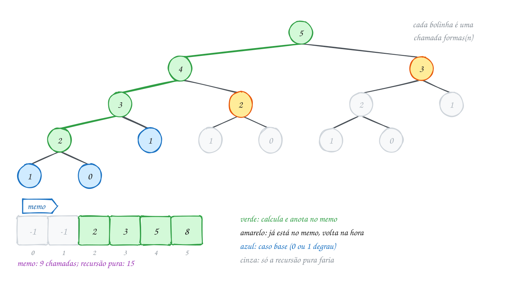</p>

O código mede as três versões para os 35 degraus da estação:

```c
#include <stdio.h>

#define MAX 50

long long chamadas = 0; // conta quantas vezes a função foi chamada

// recursão pura: formas de subir n degraus, de 1 em 1 ou de 2 em 2
long long formas_rec(int n) {
    chamadas++;
    if (n <= 1) {
        return 1;                       // 0 ou 1 degrau: um jeito só
    }
    return formas_rec(n - 1) + formas_rec(n - 2);
}

long long memo[MAX + 1];                // memo[n] == -1: ainda não sei

// de cima para baixo: a mesma recursão, consultando o memo antes
long long formas_memo(int n) {
    chamadas++;
    if (n <= 1) {
        return 1;
    }
    if (memo[n] != -1) {
        return memo[n];                 // já calculei: só consulta
    }
    memo[n] = formas_memo(n - 1) + formas_memo(n - 2);
    return memo[n];
}

// de baixo para cima: enche a tabela do menor para o maior
long long formas_tabela(int n) {
    long long t[MAX + 1];
    t[0] = 1;
    t[1] = 1;
    for (int i = 2; i <= n; i++) {
        t[i] = t[i - 1] + t[i - 2];     // os dois já estão prontos
    }
    return t[n];
}

int main(void) {
    int degraus = 35;

    chamadas = 0;
    long long r = formas_rec(degraus);
    printf("recursão pura: %lld formas, %lld chamadas\n", r, chamadas);

    for (int i = 0; i <= MAX; i++) {
        memo[i] = -1;
    }
    chamadas = 0;
    r = formas_memo(degraus);
    printf("memoização:    %lld formas, %lld chamadas\n", r, chamadas);

    r = formas_tabela(degraus);
    printf("tabela:        %lld formas, %d voltas no laço\n", r, degraus - 1);
    return 0;
}
// Saída:
// recursão pura: 14930352 formas, 29860703 chamadas
// memoização:    14930352 formas, 69 chamadas
// tabela:        14930352 formas, 34 voltas no laço
```

De 29.860.703 para 69 chamadas, com a mesma recursão e três linhas a mais. A
conta do custo de qualquer PD é sempre esta: **número de subproblemas ×
trabalho de cada um**. Aqui são uns 35 subproblemas, cada um com uma soma:
O(n), contra O(1,6ⁿ) da recursão pura.

Repara no fluxograma: a única diferença para a recursão pura é o losango do
meio. Ele corta a árvore: quem já está no memo volta sem chamar ninguém:

<p align="center">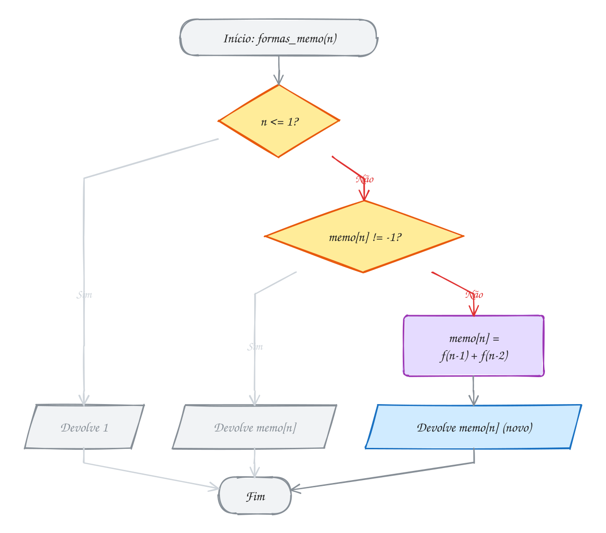</p>

### Passo a passo

A versão de baixo para cima, para os 5 degraus do desenho. Cada linha usa as
duas anteriores:

| i | t[i - 2] | t[i - 1] | t[i] |
| --- | --- | --- | --- |
| 0 | | | 1 (base) |
| 1 | | | 1 (base) |
| 2 | 1 | 1 | 2 |
| 3 | 1 | 2 | 3 |
| 4 | 2 | 3 | 5 |
| 5 | 3 | 5 | 8 |

São 8 jeitos de subir 5 degraus. Confira à mão: 11111, 2111, 1211, 1121,
1112, 221, 212, 122.

> [!WARNING]
> O valor que marca "ainda não calculei" precisa ser **impossível** como
> resposta. Aqui, `-1` serve porque nenhuma contagem é negativa. O erro comum
> é inicializar o memo com `0` (o que um vetor global já tem de graça) num
> problema em que 0 é resposta válida, como "quantos caminhos chegam aqui"
> numa grade com obstáculos. O programa continua dando a resposta certa, mas
> toda célula que vale 0 é recalculada a cada visita, e o tempo volta a ser
> exponencial sem nenhum aviso.

> [!TIP]
> **Por dentro do C:** as duas versões de PD fazem as mesmas contas, mas
> custam diferente para a máquina. A memoização ainda empilha um frame por
> chamada: `formas_memo(35)` desce 35 níveis na pilha antes de anotar a
> primeira resposta, e `formas_memo(100000)` estouraria a pilha. A tabela é um
> laço sobre um vetor contíguo, sem chamada nenhuma, que o cache do processador
> adora. Em troca, a memoização só calcula os subproblemas que a pergunta
> realmente usa, o que vale ouro quando eles são poucos dentro de uma tabela
> enorme.

> [!NOTE]
> **Pergunta para você:** a tabela guarda 36 valores, mas cada `t[i]` só
> olha para os dois anteriores. Quanta memória a versão de baixo para cima
> precisa de verdade? Pense antes de abrir o A276.

### Hora de praticar

Os arquivos ficam em [`0138-memoizacao/`](0138-memoizacao/). Os comandos funcionam de qualquer pasta do terminal. Nos exemplos, rode, mude, quebre e rode de novo. Nos exercícios, a resposta vai dentro do próprio arquivo. ★☆☆ é aquecimento, ★★☆ pede raciocínio e ★★★ é desafio.

**Exemplo A275 · Quantas rotas o entregador tem até o cliente**

```c
#include <stdio.h>

#define LIN 5
#define COL 6

// O entregador sai do cruzamento do canto de cima à esquerda e vai até o de
// baixo à direita, andando só para a direita (leste) ou para baixo (sul).
// Dois cruzamentos estão fechados por obra (marcados com 1).
int main(void) {
    int obra[LIN][COL] = {
        {0, 0, 0, 0, 0, 0},
        {0, 0, 1, 0, 0, 0},
        {0, 0, 0, 0, 1, 0},
        {0, 0, 0, 0, 0, 0},
        {0, 0, 0, 0, 0, 0},
    };
    long long rotas[LIN][COL];

    // rotas[i][j] = de quantos jeitos se chega no cruzamento (i, j):
    // ou vindo de cima (i - 1, j), ou vindo da esquerda (i, j - 1)
    for (int i = 0; i < LIN; i++) {
        for (int j = 0; j < COL; j++) {
            if (obra[i][j]) {
                rotas[i][j] = 0;              // ninguém passa por aqui
            } else if (i == 0 && j == 0) {
                rotas[i][j] = 1;              // a saída: um jeito, ficar parado
            } else {
                long long de_cima = (i > 0) ? rotas[i - 1][j] : 0;
                long long da_esquerda = (j > 0) ? rotas[i][j - 1] : 0;
                rotas[i][j] = de_cima + da_esquerda;
            }
        }
    }

    for (int i = 0; i < LIN; i++) {
        for (int j = 0; j < COL; j++) {
            if (obra[i][j]) {
                printf("   X");
            } else {
                printf("%4lld", rotas[i][j]);
            }
        }
        printf("\n");
    }
    printf("Rotas até o cliente: %lld (sem as obras seriam 126)\n", rotas[LIN - 1][COL - 1]);
    return 0;
}
// Saída:
//    1   1   1   1   1   1
//    1   2   X   1   2   3
//    1   3   3   4   X   3
//    1   4   7  11  11  14
//    1   5  12  23  34  48
// Rotas até o cliente: 48 (sem as obras seriam 126)
```

```bash
~/LPEDC/rodar 21-programacao-dinamica/0138-memoizacao/A275.c
```

**Exemplo A276 · Duas variáveis bastam (até o long long acabar)**

```c
#include <limits.h>
#include <stdio.h>

// formas de subir n degraus de 1 ou 2 em 2, de baixo para cima, guardando só
// os dois últimos valores: O(1) de memória em vez de um vetor de n posições
int main(void) {
    long long dois_atras = 1;   // formas(0)
    long long um_atras = 1;     // formas(1)
    int n = 1;

    while (1) {
        // a próxima soma cabe no long long? confere ANTES de somar
        if (um_atras > LLONG_MAX - dois_atras) {
            break;
        }
        long long atual = um_atras + dois_atras;
        dois_atras = um_atras;      // a janela anda um degrau:
        um_atras = atual;           // o velho "um atrás" vira "dois atrás"
        n++;
        if (n == 10 || n == 50 || n == 90) {
            printf("formas(%d) = %lld\n", n, um_atras);
        }
    }
    printf("o último que cabe: formas(%d) = %lld\n", n, um_atras);
    printf("formas(%d) passaria de LLONG_MAX = %lld\n", n + 1, LLONG_MAX);
    return 0;
}
// Saída:
// formas(10) = 89
// formas(50) = 20365011074
// formas(90) = 4660046610375530309
// o último que cabe: formas(91) = 7540113804746346429
// formas(92) passaria de LLONG_MAX = 9223372036854775807
```

```bash
~/LPEDC/rodar 21-programacao-dinamica/0138-memoizacao/A276.c
```

#### Exercícios

**Exercício E823** · ★☆☆

Na escadaria da igreja da cidade, os adolescentes sobem de 1, de 2 ou de 3
degraus por vez. São 10 degraus. Escreva um programa que calcula, de baixo
para cima, quantos jeitos existem de subir 0, 1, 2, ..., 10 degraus, num
vetor t[], e mostre a tabela inteira e a resposta.


```text
Saída esperada:
t: 1 1 2 4 7 13 24 44 81 149 274
Jeitos de subir 10 degraus: 274
```

**Dicas:**

1. O último passo foi de 1, de 2 ou de 3 degraus: t[i] = t[i - 1] +
   t[i - 2] + t[i - 3].
2. Os casos base são t[0] = 1, t[1] = 1 e t[2] = 2 (11 ou 2).
3. Comece o laço em i = 3: assim nenhum índice fica negativo.
4. Resposta esperada: a saída acima.

```bash
~/LPEDC/rodar 21-programacao-dinamica/0138-memoizacao/E823.c
```

**Exercício E824** · ★☆☆

A prefeitura vai refazer uma calçada com lajotas de 2 m e de 3 m, uma atrás
da outra. Quantas sequências diferentes de lajotas cobrem exatamente n
metros? Pensando na última lajota: c(n) = c(n - 2) + c(n - 3), com c(0) = 1
(nada a fazer), c(1) = 0 (impossível) e c(2) = 1.

O programa abaixo já calcula c(40) com a recursão pura e conta as chamadas.
Complete a função calcada_memo() nos lugares marcados com COMPLETE AQUI,
para ela guardar cada resposta no vetor memo[], e use-a para calcular c(40)
e c(120). Não mexa na versão recursiva.


```text
Saída esperada:
recursão pura: c(40) = 31572 com 110809 chamadas
memoização:    c(40) = 31572 com 75 chamadas
memoização:    c(120) = 185855747875876
```

**Dicas:**

1. Antes de calcular, olhe memo[n]; se já tem resposta, devolva ela.
2. Use -1 como "não calculado": 0 é uma resposta válida aqui (c(1) = 0)!
3. Lembre de encher o memo com -1 antes de usar (o laço já está no main).
4. Resposta esperada: a saída acima.

```bash
~/LPEDC/rodar 21-programacao-dinamica/0138-memoizacao/E824.c
```

**Exercício E825** · ★★☆

Um motorista de aplicativo cruza o centro da cidade de um canto ao outro,
andando só para a direita (D) ou para baixo (B). Cada quarteirão tem um
pedágio de estacionamento rotativo, em reais, que ele paga ao passar
(inclusive o da saída e o da chegada):


```text
3 1 4 2 5
2 7 1 8 2
6 1 3 2 4
5 2 9 1 3
```


Escreva um programa que calcula, de baixo para cima, a matriz custo[i][j]
(o menor gasto da saída até o quarteirão (i, j)) e mostre o menor custo
até o canto de baixo à direita. Depois, refaça o caminho de trás para a
frente e mostre a sequência de letras D e B, da saída até a chegada.


```text
Saída esperada:
Menor custo: R$ 18
Caminho: DDBBDBD
```

**Dicas:**

1. custo[i][j] = pedagio[i][j] + o menor entre custo[i - 1][j] (veio de
   cima) e custo[i][j - 1] (veio da esquerda).
2. Na linha 0 só dá para vir da esquerda; na coluna 0, só de cima.
3. Para o caminho, comece em (3, 4) e vá sempre para o vizinho (cima ou
   esquerda) de menor custo, guardando a letra num vetor; no fim, mostre o
   vetor de trás para a frente. Num empate, prefira cima.
4. Resposta esperada: a saída acima (3 + 1 + 4 + 1 + 3 + 2 + 1 + 3 = 18).

```bash
~/LPEDC/rodar 21-programacao-dinamica/0138-memoizacao/E825.c
```

**Exercício E826** · ★★☆

A feira de domingo tem 8 vagas de barraca enfileiradas, numeradas de 0 a 7.
Você tem barracas suficientes, mas a prefeitura proíbe montar em duas
vagas VIZINHAS. O lucro estimado de cada vaga, em reais, é:


```text
vaga:   0   1   2   3   4   5   6   7
lucro: 40  25  60  30  10  55  35  20
```


Escreva um programa que calcula, de baixo para cima, melhor[i] = o maior
lucro usando só as vagas 0..i, mostre o vetor, o lucro máximo e quais
vagas usar.


```text
Saída esperada:
melhor: 40 40 100 100 110 155 155 175
Lucro máximo: R$ 175
Barracas: 0 2 5 7
```

**Dicas:**

1. Na vaga i há duas escolhas: não montar (fica melhor[i - 1]) ou montar
   (lucro[i] + melhor[i - 2], porque a i - 1 tem que ficar vazia).
2. Bases: melhor[0] = lucro[0]; melhor[1] = o maior entre lucro[0] e
   lucro[1].
3. Para achar as vagas, ande de trás para a frente: se melhor[i] é
   diferente de melhor[i - 1], a vaga i foi usada e você pula para i - 2;
   senão, vai para i - 1. A vaga 0, se você chegar nela, é usada.
4. Resposta esperada: a saída acima (40 + 60 + 55 + 20 = 175).

```bash
~/LPEDC/rodar 21-programacao-dinamica/0138-memoizacao/E826.c
```

**Exercício E827** · ★★★

Um robô de armazém anda numa grade de 16 x 16 corredores, só para baixo ou
para a direita, da posição (0, 0) até (15, 15). Uma fileira de prateleiras
ocupa a linha 8 inteira, menos a coluna 0, que é a única passagem. A função
caminhos(i, j) conta, com memoização, de quantos jeitos o robô vai de
(i, j) até o destino.

O programa dá a resposta certa, mas faz quase 1,5 milhão de chamadas
para uma grade de 256 posições, e com uma grade de 30 x 30 ele não
termina nunca. Há UM erro de propósito, e ele não é de sintaxe: a
memoização "funciona" para umas posições e não para outras. Ache e
conserte.


```text
Saída hoje:
54264 caminhos, 1471165 chamadas
```


```text
Saída esperada (depois de consertar):
54264 caminhos, 481 chamadas
```

**Dicas:**

1. Quantos caminhos saem de (3, 5) e chegam ao destino? Lembre que o robô
   não anda para a esquerda nem para cima.
2. Para essas posições, o que fica guardado em memo[i][j]? E o que o teste
   "já calculei?" conclui ao ver esse valor?
3. Um vetor global começa zerado. O "não calculado" precisa ser um valor
   que nunca é resposta.
4. Resposta esperada: o memo usa 0 como "não calculado", mas 0 é a
   resposta de toda posição acima das prateleiras fora da coluna 0; essas
   são recalculadas a cada visita. Encha o memo com -1 no main e teste
   memo[i][j] != -1.

```bash
~/LPEDC/rodar 21-programacao-dinamica/0138-memoizacao/E827.c
```

**Exercício E828** · ★★★

Na Mega-Sena você escolhe 6 dezenas entre 60. O número de jogos possíveis
é C(60, 6), e a recorrência do triângulo de Pascal calcula isso sem
fatorial nenhum (60! não cabe em tipo nenhum do C):


```text
C(n, k) = C(n - 1, k - 1) + C(n - 1, k),   com C(n, 0) = C(n, n) = 1
```


(a dezena n entra no jogo ou não entra). A recursão pura faria
2 x C(60, 6) - 1, uns 100 milhões de chamadas. Escreva a função


```text
long long comb(int n, int k)
```


com memoização numa matriz memo[61][61] e um contador global de chamadas.
Calcule C(60, 6) e depois, zerando o contador mas SEM limpar o memo,
C(60, 30). No fim, conte quantas posições do memo foram preenchidas.


```text
Saída esperada:
Mega-Sena: C(60, 6) = 50063860 (649 chamadas)
chance de acertar com um jogo: 1 em 50063860
C(60, 30) = 118264581564861424 (1441 chamadas novas)
subproblemas guardados no memo: 1044
```

**Dicas:**

1. Encha a matriz memo com -1 no começo do main (dois laços).
2. O teste do caso base vem antes da consulta ao memo, e o contador sobe
   na primeira linha da função, em toda chamada.
3. C(60, 30) passa de 10^17: use long long e %lld.
4. A segunda conta reaproveita o que a primeira guardou (os subproblemas
   com k pequeno); se você limpar o memo entre as duas, o número muda.
5. Resposta esperada: a saída acima.

```bash
~/LPEDC/rodar 21-programacao-dinamica/0138-memoizacao/E828.c
```

---

## 0139 · Troco com programação dinâmica

Na agência dos Correios da cidadezinha, o balcão só tem selos de R$ 1, R$ 4 e
R$ 5. A sua carta custa R$ 8 de porte, e o envelope é pequeno: você quer
colar o **menor número de selos** possível.

O atendente faz o que todo mundo faz: pega o maior selo que cabe, R$ 5, e
completa com três de R$ 1. São 4 selos. Mas dois selos de R$ 4 também dão
R$ 8. O guloso do assunto 0133 errou de novo, e o motivo é o mesmo do
contraexemplo `{1, 3, 4}` de lá: com esses valores, a escolha que parece
melhor agora estraga o resto.

A programação dinâmica não aposta em escolha nenhuma: ela **testa todas**, mas
sem repetir trabalho. Olhe de novo para o **último selo** colado. Ele foi de
R$ 1, de R$ 4 ou de R$ 5. Se foi de R$ 4, antes dele você já tinha montado
R$ 4 da melhor forma possível. Então:

`dp[v] = 1 + o menor entre dp[v - 1], dp[v - 4] e dp[v - 5]`

só com os selos que cabem em `v` (`selo <= v`), e com `dp[0] = 0`: para
R$ 0 não precisa de selo nenhum. `dp[v]` é o menor número de selos que somam
**exatamente** `v` reais.

O que garante que isso dá certo é a **subestrutura ótima**: tire o último selo
de uma solução ótima para R$ 8, e o que sobra é uma solução ótima para o
resto. Se não fosse, você trocaria o resto por uma solução melhor e teria uma
solução para R$ 8 melhor que a ótima, o que é absurdo.

Para saber **quais** selos usar, não basta `dp`. Um segundo vetor,
`ultimo[v]`, anota o selo que deu o mínimo em `v`. Depois é só andar para
trás: `v`, `v - ultimo[v]`, e assim por diante, até chegar em 0.

Vamos ver na prática. `dp[8]` olha para três vizinhos à esquerda, um para
cada selo, e escolhe o menor deles, o `dp[4]`:

<p align="center">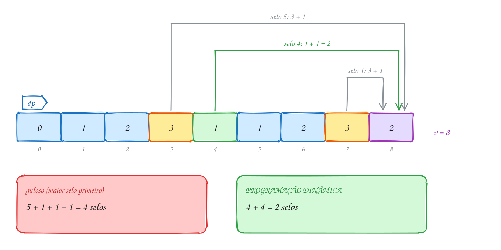</p>

O código enche a tabela de 1 até o porte. Se um valor não pode ser montado,
`dp[v]` fica num "infinito" (o A278 mostra quando isso acontece):

```c
#include <stdio.h>

#define MAX 100
#define INF 1000000 // "impossível": maior que qualquer resposta de verdade

// dp[v] = menor número de selos que somam exatamente v reais
// ultimo[v] = o selo usado por último nessa solução
void minimo_selos(const int selo[], int k, int total, int dp[], int ultimo[]) {
    dp[0] = 0;                                  // R$ 0: nenhum selo
    for (int v = 1; v <= total; v++) {
        dp[v] = INF;
        for (int s = 0; s < k; s++) {
            // se o último selo for selo[s], antes dele faltavam v - selo[s]
            if (selo[s] <= v && dp[v - selo[s]] + 1 < dp[v]) {
                dp[v] = dp[v - selo[s]] + 1;
                ultimo[v] = selo[s];
            }
        }
    }
}

int main(void) {
    int selo[] = {1, 4, 5};                     // valores, em reais
    int porte = 8;
    int dp[MAX + 1], ultimo[MAX + 1];

    minimo_selos(selo, 3, porte, dp, ultimo);

    printf("v: ");
    for (int v = 0; v <= porte; v++) {
        printf(" %2d", v);
    }
    printf("\ndp:");
    for (int v = 0; v <= porte; v++) {
        printf(" %2d", dp[v]);
    }
    printf("\n%d selos para R$ %d:", dp[porte], porte);
    for (int v = porte; v > 0; v -= ultimo[v]) { // volta pelo último selo
        printf(" %d", ultimo[v]);
    }
    printf("\n");
    return 0;
}
// Saída:
// v:   0  1  2  3  4  5  6  7  8
// dp:  0  1  2  3  1  1  2  3  2
// 2 selos para R$ 8: 4 4
```

O custo é o de toda PD: `total` subproblemas, cada um testando `k` selos.
**O(total × k)** de tempo e O(total) de memória. Para um troco de R$ 1.000
com 6 valores de selo, são 6 mil passos.

Repara no fluxograma: dois laços, um dentro do outro. O de fora anda pelos
valores, do menor para o maior; o de dentro testa cada selo como "o último":

<p align="center">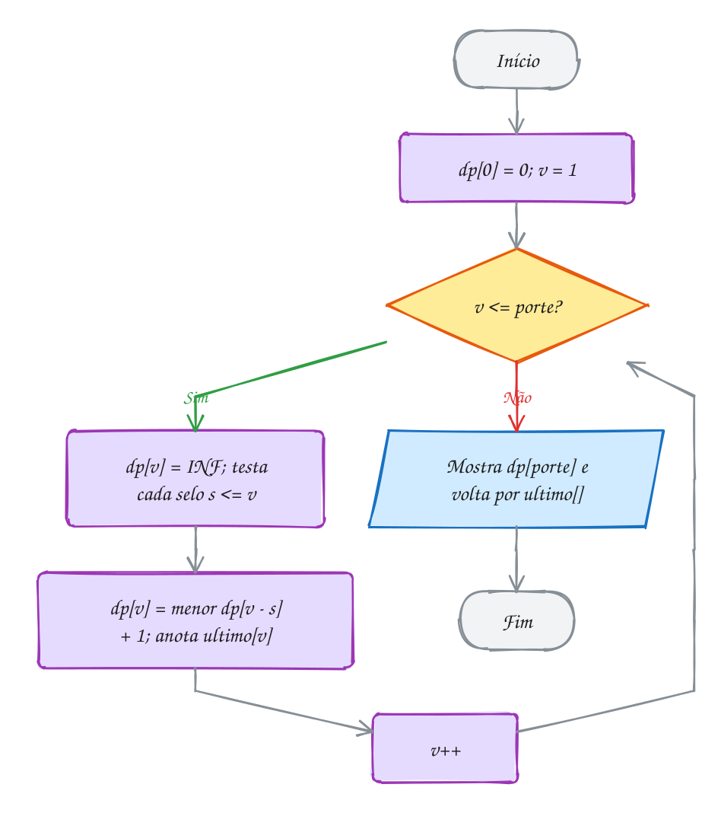</p>

### Passo a passo

As três últimas células da tabela. Cada coluna é um selo testado como
último; o mínimo da linha vira `dp[v]`:

| v | selo 1: dp[v - 1] + 1 | selo 4: dp[v - 4] + 1 | selo 5: dp[v - 5] + 1 | dp[v] | ultimo[v] |
| --- | --- | --- | --- | --- | --- |
| 6 | dp[5] + 1 = 2 | dp[2] + 1 = 3 | dp[1] + 1 = 2 | 2 | 1 |
| 7 | dp[6] + 1 = 3 | dp[3] + 1 = 4 | dp[2] + 1 = 3 | 3 | 1 |
| 8 | dp[7] + 1 = 4 | dp[4] + 1 = **2** | dp[3] + 1 = 4 | 2 | 4 |

No `v = 6` deu empate entre os selos 1 e 5. Como o teste é `<` (e não `<=`),
fica o primeiro que achou o mínimo. As duas soluções têm 2 selos: tanto faz.

> [!WARNING]
> O "infinito" precisa sobreviver a um `+ 1`. Se você usar `INT_MAX` de
> `<limits.h>`, a conta `dp[v - selo[s]] + 1` com `dp[...] == INT_MAX`
> **estoura** um `int` com sinal: é comportamento indefinido, o `rodar` acusa
> `signed integer overflow`, e sem o sanitizer o resultado vira um número
> negativo que "ganha" de todo mundo no `<`. Use um infinito folgado, como
> `1000000` ou `total + 1` (nunca se usa mais que `total` selos), ou teste
> `dp[v - selo[s]] != INF` antes de somar.

> [!TIP]
> **Por dentro do C:** os vetores `dp` e `ultimo` ficam na pilha, no frame do
> `main`: 101 `int` cada, 808 bytes no total. Para um troco de R$ 1 milhão,
> seriam 8 MB, e a pilha padrão do Linux tem 8 MB: o programa morreria com
> *stack overflow* antes da primeira conta. Para tabelas grandes, use
> `malloc` (assunto 0054). Repare também que `minimo_selos` recebe `dp` e
> `ultimo` como ponteiros: ela escreve direto nos vetores do `main`, sem
> copiar nada.

> [!NOTE]
> **Pergunta para você:** com selos de R$ 1, R$ 4 e R$ 5, qual é o primeiro
> porte em que o atendente guloso erra? E o segundo? Mude o `porte` para 15 e
> compare a linha `dp` com o que o guloso daria em cada valor.

### Hora de praticar

Os arquivos ficam em [`0139-troco-pd/`](0139-troco-pd/). Os comandos funcionam de qualquer pasta do terminal. Nos exemplos, rode, mude, quebre e rode de novo. Nos exercícios, a resposta vai dentro do próprio arquivo. ★☆☆ é aquecimento, ★★☆ pede raciocínio e ★★★ é desafio.

**Exemplo A277 · De quantos jeitos dá para pagar R$ 1,00 em moedas**

```c
#include <stdio.h>

#define TOTAL 100 // centavos

int main(void) {
    int moeda[] = {5, 10, 25, 50};
    int k = 4;
    long long jeitos[TOTAL + 1];

    // jeitos[v] = quantas COMBINAÇÕES de moedas somam v centavos.
    // Laço de fora nas moedas: cada combinação é contada uma vez só, na ordem
    // "primeiro as de 5, depois as de 10, ...".
    for (int v = 0; v <= TOTAL; v++) {
        jeitos[v] = 0;
    }
    jeitos[0] = 1; // somar 0: um jeito, não usar moeda nenhuma
    printf("Combinações para pagar R$ 1,00:\n");
    for (int m = 0; m < k; m++) {
        for (int v = moeda[m]; v <= TOTAL; v++) {
            jeitos[v] += jeitos[v - moeda[m]]; // usa mais uma moeda[m]
        }
        printf("  usando moedas até %2d centavos: %3lld\n", moeda[m], jeitos[TOTAL]);
    }

    // Laços trocados: o de fora nos valores. Agora 5 + 10 e 10 + 5 contam
    // separado: são as SEQUÊNCIAS de moedas jogadas na máquina, uma a uma.
    long long sequencias[TOTAL + 1];
    sequencias[0] = 1;
    for (int v = 1; v <= TOTAL; v++) {
        sequencias[v] = 0;
        for (int m = 0; m < k; m++) {
            if (moeda[m] <= v) {
                sequencias[v] += sequencias[v - moeda[m]]; // a última moeda foi moeda[m]
            }
        }
    }
    printf("com a ordem importando: %lld sequências\n", sequencias[TOTAL]);
    return 0;
}
// Saída:
// Combinações para pagar R$ 1,00:
//   usando moedas até  5 centavos:   1
//   usando moedas até 10 centavos:  11
//   usando moedas até 25 centavos:  29
//   usando moedas até 50 centavos:  40
// com a ordem importando: 27517 sequências
```

```bash
~/LPEDC/rodar 21-programacao-dinamica/0139-troco-pd/A277.c
```

**Exemplo A278 · Os pedidos que a pastelaria não consegue fechar**

```c
#include <stdio.h>

#define MAX 60

int main(void) {
    // a pastelaria só vende caixas fechadas de 6, 9 ou 20 pastéis
    int caixa[] = {6, 9, 20};
    int k = 3;
    int inf = MAX + 1; // nunca se usa mais que MAX caixas: MAX + 1 é "impossível"
    int dp[MAX + 1];   // dp[v] = menor número de caixas com exatamente v pastéis

    dp[0] = 0;
    for (int v = 1; v <= MAX; v++) {
        dp[v] = inf;
        for (int c = 0; c < k; c++) {
            // só aproveita um resto que tem solução: inf + 1 não é solução
            if (caixa[c] <= v && dp[v - caixa[c]] != inf && dp[v - caixa[c]] + 1 < dp[v]) {
                dp[v] = dp[v - caixa[c]] + 1;
            }
        }
    }

    printf("Pedidos impossíveis:");
    int maior = 0;
    for (int v = 1; v <= MAX; v++) {
        if (dp[v] == inf) {
            printf(" %d", v);
            maior = v;
        }
    }
    // de 44 a 49 tudo dá; somando caixas de 6, todo pedido acima de 43 dá
    printf("\nMaior pedido impossível: %d\n", maior);
    int pedidos[] = {15, 29, 44, 60};
    for (int i = 0; i < 4; i++) {
        printf("%2d pastéis: %d caixas\n", pedidos[i], dp[pedidos[i]]);
    }
    return 0;
}
// Saída:
// Pedidos impossíveis: 1 2 3 4 5 7 8 10 11 13 14 16 17 19 22 23 25 28 31 34 37 43
// Maior pedido impossível: 43
// 15 pastéis: 2 caixas
// 29 pastéis: 2 caixas
// 44 pastéis: 4 caixas
// 60 pastéis: 3 caixas
```

```bash
~/LPEDC/rodar 21-programacao-dinamica/0139-troco-pd/A278.c
```

#### Exercícios

**Exercício E829** · ★☆☆

A loja de ferragens vende parafusos só em pacotes fechados de 3, 7 e 11
unidades. Um marceneiro precisa de exatamente 25 parafusos e quer levar o
menor número de pacotes. Escreva um programa que monta a tabela dp[v] (o
menor número de pacotes com exatamente v parafusos) de 0 a 25. Mostre as
quantidades de 1 a 25 que são impossíveis e a resposta para 25.


```text
Saída esperada:
Impossíveis até 25: 1 2 4 5 8
Menor número de pacotes para 25 parafusos: 3
```

**Dicas:**

1. dp[0] = 0; para cada v, comece com dp[v] = "infinito" e teste cada
   pacote p <= v como o último: dp[v - p] + 1.
2. Um infinito seguro aqui é 26: ninguém precisa de mais que 25 pacotes, e
   26 + 1 ainda cabe folgado num int.
3. Quem continuou com o infinito no fim é impossível.
4. Resposta esperada: a saída acima (25 = 11 + 7 + 7, ou 11 + 11 + 3).

```bash
~/LPEDC/rodar 21-programacao-dinamica/0139-troco-pd/E829.c
```

**Exercício E830** · ★☆☆

No basquete, cada cesta vale 1 (lance livre), 2 ou 3 pontos. Um time fez
10 pontos num quarto. Quantas COMBINAÇÕES de cestas dão 10 pontos? Aqui a
ordem não importa: "3 + 3 + 2 + 2" e "2 + 3 + 2 + 3" são a mesma
combinação (duas de três e duas de dois).

Escreva um programa com um vetor jeitos[0..10] e mostre o vetor inteiro e
a resposta.


```text
Saída esperada:
jeitos: 1 1 2 3 4 5 7 8 10 12 14
Combinações de cestas que dão 10 pontos: 14
```

**Dicas:**

1. jeitos[0] = 1 (zero pontos: nenhuma cesta) e o resto começa em 0.
2. Laço de FORA no tipo de cesta, laço de dentro nos pontos, de c até 10:
   jeitos[v] += jeitos[v - c].
3. Com os laços na ordem trocada, você contaria sequências (a ordem das
   cestas no jogo), e o resultado seria bem maior.
4. Resposta esperada: a saída acima.

```bash
~/LPEDC/rodar 21-programacao-dinamica/0139-troco-pd/E830.c
```

**Exercício E831** · ★★☆

Num jogo de celular, a loja vende pacotes de 1, 6 e 10 gemas, e você quer
comprar exatamente 12 gemas com o menor número de pacotes. O programa
abaixo já calcula o MÍNIMO, mas não diz QUAIS pacotes. Estenda-o:

1. acrescente o vetor ultimo[] e mostre os pacotes da solução de 12;
2. escreva int guloso(int v), que sempre pega o maior pacote que cabe, e

```text
 mostre, para v de 1 a 20, os valores em que o guloso usa MAIS pacotes
 que a PD, no formato "v: guloso g, PD d".
```


```text
Saída esperada:
12 gemas: 2 pacotes (6 6)
12: guloso 3, PD 2
13: guloso 4, PD 3
14: guloso 5, PD 4
15: guloso 6, PD 5
18: guloso 4, PD 3
19: guloso 5, PD 4
```

**Dicas:**

1. ultimo[v] recebe pacote[p] dentro do mesmo if que atualiza dp[v].
2. Para mostrar os pacotes: for (v = 12; v > 0; v -= ultimo[v]).
3. O guloso: para cada pacote, do maior para o menor, enquanto couber,
   some 1 e desconte o pacote.
4. Resposta esperada: a saída acima (12 = 6 + 6; o guloso faz 10 + 1 + 1).

```bash
~/LPEDC/rodar 21-programacao-dinamica/0139-troco-pd/E831.c
```

**Exercício E832** · ★★☆

Você vai pagar um lanche de R$ 7 com moedas de R$ 1, cédulas de R$ 2 e
cédulas de R$ 5. Duas perguntas diferentes:

a) Quantas COMBINAÇÕES de dinheiro somam R$ 7? (5 + 2 e 2 + 5 são a mesma)
b) A máquina de autoatendimento aceita uma nota ou moeda por vez. Quantas

```text
 SEQUÊNCIAS diferentes de inserção somam R$ 7? (5 + 2 e 2 + 5 contam
 separado)
```


Escreva as funções long long combinacoes(int total) e long long
sequencias(int total), cada uma com o seu vetor de PD, e mostre as duas
respostas.


```text
Saída esperada:
combinações: 6
sequências:  26
```

**Dicas:**

1. As duas começam com w[0] = 1 e fazem w[v] += w[v - valor].
2. A diferença é só a ordem dos laços. Combinações: valor do dinheiro por
   fora, total por dentro. Sequências: total por fora (w[v] = soma de
   w[v - valor] para cada valor <= v, "qual foi a última inserção?").
3. Confira a) à mão: 5+2, 5+1+1, 2+2+2+1, 2+2+1+1+1, 2+1+1+1+1+1 e
   sete moedas de 1.
4. Resposta esperada: a saída acima.

```bash
~/LPEDC/rodar 21-programacao-dinamica/0139-troco-pd/E832.c
```

**Exercício E833** · ★★★

A loja de tintas vende uma cor especial só em latas de 4 L e de 7 L. O
programa abaixo deveria mostrar, para cada quantidade de 1 a 15 litros, o
menor número de latas que dá EXATAMENTE aquela quantidade, ou
"impossível". Ele compila sem aviso, mas o rodar acusa várias vezes
"runtime error: signed integer overflow", e a tabela que sai não é
confiável. Há UM erro de propósito. Ache, conserte e rode até a saída
ficar limpa.


```text
Saída esperada (depois de consertar):
 1 L: impossível
 2 L: impossível
 3 L: impossível
 4 L: 1 lata
 5 L: impossível
 6 L: impossível
 7 L: 1 lata
 8 L: 2 latas
 9 L: impossível
10 L: impossível
11 L: 2 latas
12 L: 3 latas
13 L: impossível
14 L: 2 latas
15 L: 3 latas
```

**Dicas:**

1. Leia a mensagem do sanitizer: ela diz a linha e os dois números da
   soma que estourou.
2. Quanto vale dp[1]? E o que acontece quando o laço calcula dp[5] e
   olha para dp[5 - 4]?
3. Há dois jeitos de consertar: um infinito que aguenta o + 1 (como
   TOTAL + 1) ou testar se o resto tem solução antes de somar.
4. Resposta esperada: o INF é INT_MAX, e dp[v - lata[c]] + 1 com
   dp[...] == INT_MAX estoura. Teste dp[v - lata[c]] != INF antes de somar.

```bash
~/LPEDC/rodar 21-programacao-dinamica/0139-troco-pd/E833.c
```

**Exercício E834** · ★★★

A máquina de café do escritório custa R$ 1,00, aceita moedas de 5, 10, 25
e 50 centavos, mas trava se você colocar mais de 6 moedas. Quantas
combinações de moedas pagam exatamente R$ 1,00 com até 6 moedas? Mostre
também quantas usam exatamente 1, 2, ..., 6 moedas.

Um vetor jeitos[v] não basta: ele não sabe quantas moedas cada combinação
usou. Acrescente essa informação como uma segunda dimensão:
w[q][v] = combinações com EXATAMENTE q moedas que somam v centavos.


```text
Saída esperada:
exatamente 1 moeda: 0
exatamente 2 moedas: 1
exatamente 3 moedas: 1
exatamente 4 moedas: 1
exatamente 5 moedas: 1
exatamente 6 moedas: 3
até 6 moedas: 7 combinações
```

**Dicas:**

1. Base: w[0][0] = 1 (nenhuma moeda soma zero); o resto começa em 0.
2. Mantenha a estrutura das combinações (moeda no laço de fora, valor v
   crescente por dentro) e acrescente um terceiro laço em q:
   w[q][v] += w[q - 1][v - moeda].
3. Ao usar mais uma moeda, o valor cai de moeda e a contagem cai de 1.
4. Confira as 3 de seis moedas: 50+10+10+10+10+10, 50+25+10+5+5+5 e
   25+25+25+10+10+5.
5. Resposta esperada: a saída acima.

```bash
~/LPEDC/rodar 21-programacao-dinamica/0139-troco-pd/E834.c
```

---

## 0140 · Mochila 0/1

Sábado de praia. Um vendedor ambulante leva o isopor nas costas, e o isopor
aguenta no máximo 7 kg. Ele pode levar um fardo de água (2 kg, lucro de
R$ 18), uma caixa de refrigerante (3 kg, R$ 24), uma caixa de suco (4 kg,
R$ 30) e um pote de açaí (5 kg, R$ 35). Cada coisa vai inteira ou não vai:
não dá para levar meio pote de açaí. O que ele leva para lucrar o máximo?

Na mochila **fracionária** do assunto 0135, o guloso resolvia: ordenar por
lucro por quilo e ir enchendo, cortando o último item. Aqui ele erra. Água
(R$ 9/kg) e refrigerante (R$ 8/kg) vêm primeiro: 5 kg, R$ 42. Sobram 2 kg, e
nada mais cabe. Mas refrigerante e suco juntos pesam 7 kg e dão **R$ 54**.

Esta é a **mochila 0/1** (0 = não leva, 1 = leva). Com `n` itens há `2ⁿ`
escolhas possíveis; com 60 itens, mais de um quintilhão. A PD resolve olhando
para **um item de cada vez**: o último item, o `i`, vai ou não vai?

- **não vai**: o melhor é o que os itens `1..i-1` conseguem com a mesma
  capacidade `c`;
- **vai** (se `peso[i] <= c`): ganha `lucro[i]`, e os itens `1..i-1` dividem o
  que sobrou, `c - peso[i]`.

Com dois "parâmetros" mudando, a tabela vira uma matriz: `t[i][c]` é o maior
lucro usando só os itens `1..i` com capacidade `c`.

`t[i][c] = o maior entre t[i-1][c] e lucro[i] + t[i-1][c - peso[i]]`

A linha 0 (nenhum item) é toda zero. Cada linha só depende da de cima, então
a matriz se enche linha por linha, e a resposta fica no canto: `t[n][W]`.

A tabela dá o **valor**, mas o ambulante quer saber **o que levar**. A
**recuperação** anda de baixo para cima: se `t[i][c]` é igual a `t[i-1][c]`,
o item `i` não fez diferença e ficou de fora; se mudou, ele foi junto, e a
busca continua na linha de cima com `c - peso[i]`.

Vamos ver na prática. A célula `t[3][7] = 54` (roxo) escolheu entre não
levar o suco (`t[2][7] = 42`, amarelo) e levar (`30 + t[2][3] = 54`, verde).
As células verdes de baixo para cima são a recuperação:

<p align="center">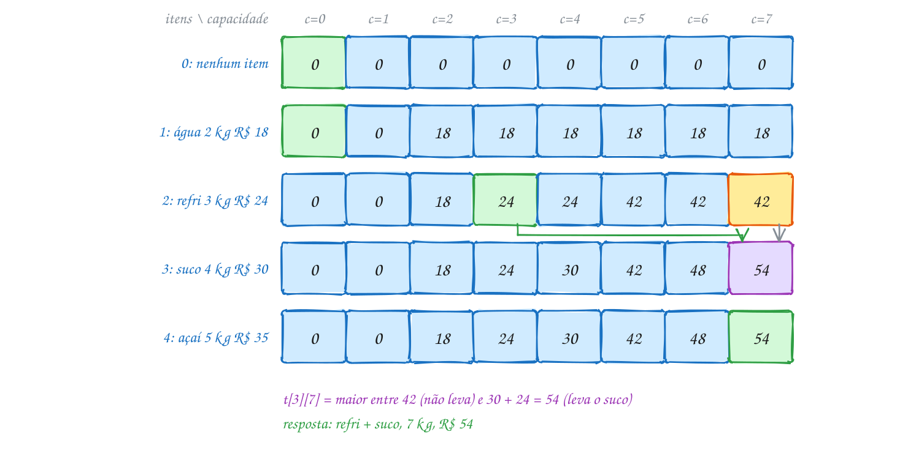</p>

O mesmo exemplo em C. Os vetores começam no índice 1 para casar com a
tabela, em que a linha 0 é "nenhum item":

```c
#include <stdio.h>

#define N 4 // itens
#define W 7 // capacidade do isopor, em kg

int main(void) {
    const char *nome[N + 1] = {"", "água", "refri", "suco", "açaí"};
    int peso[N + 1] = {0, 2, 3, 4, 5};      // kg (o índice 0 não é usado)
    int lucro[N + 1] = {0, 18, 24, 30, 35}; // reais
    int t[N + 1][W + 1];

    // t[i][c] = maior lucro usando só os itens 1..i com capacidade c
    for (int c = 0; c <= W; c++) {
        t[0][c] = 0;                        // nenhum item: lucro 0
    }
    for (int i = 1; i <= N; i++) {
        for (int c = 0; c <= W; c++) {
            t[i][c] = t[i - 1][c];          // não leva o item i
            if (peso[i] <= c && lucro[i] + t[i - 1][c - peso[i]] > t[i][c]) {
                t[i][c] = lucro[i] + t[i - 1][c - peso[i]]; // leva o item i
            }
        }
    }

    for (int i = 0; i <= N; i++) {
        printf("i=%d:", i);
        for (int c = 0; c <= W; c++) {
            printf(" %2d", t[i][c]);
        }
        printf("\n");
    }
    printf("Lucro máximo: R$ %d\n", t[N][W]);

    // volta pela tabela: se o valor mudou de i - 1 para i, o item i foi junto
    printf("Leva:");
    int c = W;
    for (int i = N; i >= 1; i--) {
        if (t[i][c] != t[i - 1][c]) {
            printf(" %s (%d kg)", nome[i], peso[i]);
            c -= peso[i];                   // o que sobrou para os anteriores
        }
    }
    printf("\n");
    return 0;
}
// Saída:
// i=0:  0  0  0  0  0  0  0  0
// i=1:  0  0 18 18 18 18 18 18
// i=2:  0  0 18 24 24 42 42 42
// i=3:  0  0 18 24 30 42 48 54
// i=4:  0  0 18 24 30 42 48 54
// Lucro máximo: R$ 54
// Leva: suco (4 kg) refri (3 kg)
```

São `(n + 1) × (W + 1)` células, cada uma com uma comparação: **O(n × W)**.
Para 100 itens e 10.000 kg de capacidade, um milhão de passos, contra os
2¹⁰⁰ subconjuntos da força bruta.

Repara no fluxograma: é o miolo do laço duplo, a decisão de uma célula. O
caminho marcado é o da célula `t[3][7]`, em que levar o suco ganhou:

<p align="center">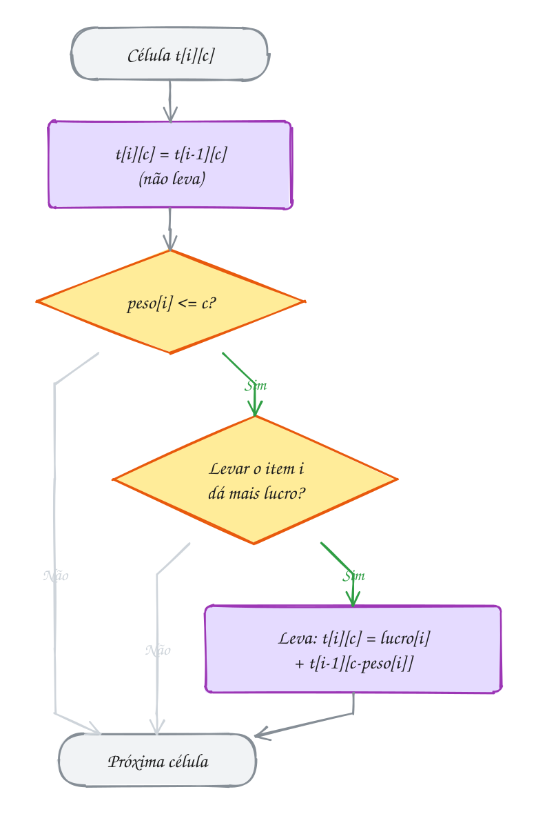</p>

### Passo a passo

A recuperação, partindo do canto `t[4][7]`:

| i | c | t[i][c] | t[i-1][c] | Mudou? | Decisão | c depois |
| --- | --- | --- | --- | --- | --- | --- |
| 4 (açaí) | 7 | 54 | 54 | não | fica | 7 |
| 3 (suco) | 7 | 54 | 42 | sim | **leva** | 7 - 4 = 3 |
| 2 (refri) | 3 | 24 | 18 | sim | **leva** | 3 - 3 = 0 |
| 1 (água) | 0 | 0 | 0 | não | fica | 0 |

> [!WARNING]
> Na recuperação, o teste é "o valor **mudou**?", e não "dá para levar?".
> Olhar só se `peso[i] <= c` levaria o açaí, que cabe em 7 kg, mas não faz
> parte da solução ótima. E nunca leia `t[i - 1][c - peso[i]]` sem antes
> conferir `peso[i] <= c`: com o `c` menor que o peso, o índice fica
> negativo, e `t[i - 1][-2]` lê, sem erro de compilação nenhum, o fim de
> outra linha da tabela.

> [!TIP]
> **Por dentro do C:** `int t[5][8]` são 40 `int` seguidos na memória, linha
> após linha: `t[i][c]` mora no deslocamento `i * 8 + c`. Por isso
> `t[2][-2]` não derruba o programa: ele cai em `t[1][6]`, um valor errado e
> silencioso. O `rodar` acusa (`index -2 out of bounds for type 'int [8]'`,
> do UBSan), mas compilado sem sanitizer o programa segue em frente com a
> resposta errada. E como cada linha só usa a de cima, dá para guardar uma
> linha só, de `W + 1` posições, desde que o laço de `c` ande **do maior para
> o menor**. O A279 mostra esse truque e o que acontece quando ele é
> esquecido.

> [!NOTE]
> **Pergunta para você:** se o isopor aguentasse 9 kg, o que o ambulante
> levaria, e com que lucro? Faça mais duas colunas na tabela à mão antes de
> trocar o `W` no código.

### Hora de praticar

Os arquivos ficam em [`0140-mochila-01/`](0140-mochila-01/). Os comandos funcionam de qualquer pasta do terminal. Nos exemplos, rode, mude, quebre e rode de novo. Nos exercícios, a resposta vai dentro do próprio arquivo. ★☆☆ é aquecimento, ★★☆ pede raciocínio e ★★★ é desafio.

**Exemplo A279 · O pen drive com uma linha só de tabela**

```c
#include <stdio.h>

#define N 4
#define CAP 16 // GB livres no pen drive

int tamanho[N] = {5, 4, 7, 3};     // GB de cada videoaula
int nota[N] = {30, 24, 40, 20};    // o quanto cada uma interessa
const char *nome[N] = {"A", "B", "C", "D"};

// mochila 0/1 com UM vetor: melhor[c] faz o papel da linha "de cima".
// O laço de c DESCE: assim melhor[c - tamanho] ainda é o valor da linha
// anterior, sem o item i.
int mochila_descendo(void) {
    int melhor[CAP + 1] = {0};
    for (int i = 0; i < N; i++) {
        for (int c = CAP; c >= tamanho[i]; c--) {
            int com_i = nota[i] + melhor[c - tamanho[i]];
            if (com_i > melhor[c]) {
                melhor[c] = com_i;
            }
        }
    }
    return melhor[CAP];
}

// O MESMO código com o laço subindo: melhor[c - tamanho] já pode ter usado
// o item i nesta mesma volta. O item vira infinito (mochila "ilimitada").
int mochila_subindo(int copias[]) {
    int melhor[CAP + 1] = {0};
    int ultimo[CAP + 1];
    for (int c = 0; c <= CAP; c++) {
        ultimo[c] = -1;
    }
    for (int i = 0; i < N; i++) {
        for (int c = tamanho[i]; c <= CAP; c++) {
            int com_i = nota[i] + melhor[c - tamanho[i]];
            if (com_i > melhor[c]) {
                melhor[c] = com_i;
                ultimo[c] = i;
            }
        }
    }
    // conta quantas vezes cada item entrou (anda pelo último item escolhido)
    for (int c = CAP; c > 0 && ultimo[c] != -1; c -= tamanho[ultimo[c]]) {
        copias[ultimo[c]]++;
    }
    return melhor[CAP];
}

int main(void) {
    // o certo: A + B + C = 16 GB, nota 94; cada aula entra uma vez só
    printf("laço descendo (0/1): nota %d\n", mochila_descendo());

    int copias[N] = {0};
    printf("laço subindo:        nota %d, com", mochila_subindo(copias));
    for (int i = 0; i < N; i++) {
        if (copias[i] > 0) {
            printf(" %s x%d", nome[i], copias[i]);
        }
    }
    printf("\n");
    return 0;
}
// Saída:
// laço descendo (0/1): nota 94
// laço subindo:        nota 104, com B x1 D x4
```

```bash
~/LPEDC/rodar 21-programacao-dinamica/0140-mochila-01/A279.c
```

**Exemplo A280 · A conta do mercado dividida ao meio**

```c
#include <stdbool.h>
#include <stdio.h>

#define N 7
#define MAXS 200

// Dois amigos racharam as compras, mas cada item vai inteiro para a casa de
// um deles. Quem leva o quê, para os dois gastos ficarem o mais perto
// possível? É uma mochila 0/1 em que o "lucro" é o próprio preço: a
// pergunta vira "que somas dá para formar com um subconjunto?".
int main(void) {
    const char *item[N + 1] = {"", "carne", "arroz", "café", "queijo",
                               "frutas", "sabão", "pão"};
    int preco[N + 1] = {0, 41, 23, 17, 35, 28, 12, 9}; // reais (índice 0 sem uso)
    int total = 0;
    for (int i = 1; i <= N; i++) {
        total += preco[i];
    }

    // pode[i][s] == true: algum subconjunto dos itens 1..i soma exatamente s
    static bool pode[N + 1][MAXS + 1]; // static: começa tudo false
    pode[0][0] = true;                 // nenhum item soma 0
    for (int i = 1; i <= N; i++) {
        for (int s = 0; s <= total; s++) {
            pode[i][s] = pode[i - 1][s] ||
                         (preco[i] <= s && pode[i - 1][s - preco[i]]);
        }
    }

    // a melhor divisão: a maior soma possível que não passa da metade
    int alvo = total / 2;
    while (!pode[N][alvo]) {
        alvo--;
    }
    printf("Total R$ %d: um paga R$ %d, o outro R$ %d\n", total, alvo, total - alvo);

    // recuperação: se a soma já era possível sem o item i, ele fica de fora
    printf("Leva para a casa 1:");
    int s = alvo;
    for (int i = N; i >= 1; i--) {
        if (!pode[i - 1][s]) {         // sem o item i não dava: ele entra
            printf(" %s", item[i]);
            s -= preco[i];
        }
    }
    printf("\n");
    return 0;
}
// Saída:
// Total R$ 165: um paga R$ 81, o outro R$ 84
// Leva para a casa 1: café arroz carne
```

```bash
~/LPEDC/rodar 21-programacao-dinamica/0140-mochila-01/A280.c
```

#### Exercícios

**Exercício E835** · ★☆☆

Uma padaria tem R$ 10 mil para investir e cinco projetos. Cada projeto é
feito inteiro ou não é feito (0/1). Custos e retornos em mil reais:


```text
projeto            custo  retorno por ano
1 fachada nova       4          9
2 site de pedidos    3          7
3 curso da equipe    2          4
4 forno novo         5         11
5 vitrine refrig.    1          2
```


Escreva um programa que monta a tabela t[i][c] (maior retorno usando os
projetos 1..i com c mil reais) e mostre a última linha da tabela e o
retorno máximo com os R$ 10 mil.


```text
Saída esperada:
última linha: 0 2 4 7 9 11 13 16 18 20 22
Retorno máximo com R$ 10 mil: R$ 22 mil por ano
```

**Dicas:**

1. Use vetores com índice começando em 1 (custo[0] e retorno[0] sem uso) e
   a matriz int t[6][11].
2. Linha 0 toda zero. Depois, para cada célula: t[i][c] = t[i - 1][c] e,
   se custo[i] <= c, tente retorno[i] + t[i - 1][c - custo[i]].
3. A última linha diz o melhor retorno para cada orçamento de 0 a 10.
4. Resposta esperada: a saída acima.

```bash
~/LPEDC/rodar 21-programacao-dinamica/0140-mochila-01/E835.c
```

**Exercício E836** · ★☆☆

Você vai fazer uma trilha de dois dias e a mochila aguenta 9 kg. O
programa abaixo já monta a tabela da mochila 0/1 com a "importância" de
cada item e mostra o valor máximo. Falta a RECUPERAÇÃO: complete o trecho
marcado com COMPLETE AQUI para mostrar quais itens levar (do último item
para o primeiro, como sai naturalmente da volta pela tabela) e o peso
total usado.


```text
Saída esperada:
Valor máximo: 32
Leva:
  câmera (1 kg)
  comida (3 kg)
  fogareiro (3 kg)
  saco de dormir (2 kg)
Peso usado: 9 kg
```

**Dicas:**

1. Comece com c = W e ande com i de N até 1.
2. Se t[i][c] != t[i - 1][c], o item i entrou: mostre, desconte o peso de
   c e some ao peso total.
3. A barraca é o item mais "importante" sozinho (12), mas fica de fora: os
   4 kg dela rendem mais em outros itens.
4. Resposta esperada: a saída acima (5 + 10 + 9 + 8 = 32).

```bash
~/LPEDC/rodar 21-programacao-dinamica/0140-mochila-01/E836.c
```

**Exercício E837** · ★★☆

Véspera de vestibular: você tem 6 horas de estudo e uma estimativa de
quantos pontos cada revisão completa rende. Cada matéria é revisada
inteira ou não é revisada:


```text
matéria      horas  pontos
Matemática    2.5     30
Português     1.5     18
História      1.0     10
Física        2.0     25
Química       1.5     16
Inglês        0.5      6
```


O problema: a tabela da mochila precisa de capacidades INTEIRAS, e as
horas são double. Guarde as horas como double no programa, converta tudo
para meias horas (unidades inteiras) e resolva a mochila 0/1 com
recuperação. Mostre o máximo, as matérias e as horas usadas.


```text
Saída esperada:
Máximo: 73 pontos em 6.0 h
Estudar: Física Português Matemática
Horas usadas: 6.0
```

**Dicas:**

1. Meia hora vira 1 unidade: 2.5 h são 5 unidades e as 6 h são 12.
2. Converta com (int) (horas * 2 + 0.5). Só o cast trunca, e um double
   que deveria ser 5.0 pode estar guardado como 4.99999...
3. Daí em diante é a tabela t[i][c] do texto, com c de 0 a 12, e a volta
   pela tabela somando horas[i] de quem entrou.
4. Resposta esperada: a saída acima (30 + 18 + 25 = 73).

```bash
~/LPEDC/rodar 21-programacao-dinamica/0140-mochila-01/E837.c
```

**Exercício E838** · ★★☆

Sua carteira tem estas cédulas: 2, 5, 5, 10, 10, 20, 20 e 50 reais. Você
precisa separar exatamente R$ 30 para o rateio do churrasco. De quantos
jeitos dá para escolher as cédulas? Cada cédula é um papel diferente: as
duas notas de 20 contam como escolhas distintas.

Resolva com PD num vetor só (jeitos[s] = quantos subconjuntos das cédulas
vistas até agora somam s) e confira o resultado com a força bruta por bits
do assunto 0125, testando os 2^8 subconjuntos.


```text
Saída esperada:
PD: 7 jeitos de separar R$ 30
força bruta: 7 jeitos (256 subconjuntos testados)
```

**Dicas:**

1. jeitos[0] = 1 (o subconjunto vazio soma 0); o resto começa em 0.
2. Para cada cédula, percorra s de 30 DESCENDO até o valor dela e faça
   jeitos[s] += jeitos[s - cedula]. Subindo, a mesma cédula seria usada
   duas vezes.
3. Na força bruta, o bit i da máscara diz se a cédula i entra.
4. Resposta esperada: a saída acima (20 + 10 de 4 jeitos, 20 + 5 + 5 de 2
   jeitos e 10 + 10 + 5 + 5 de 1).

```bash
~/LPEDC/rodar 21-programacao-dinamica/0140-mochila-01/E838.c
```

**Exercício E839** · ★★★

Numa mudança, você pode despachar só 10 kg no bagageiro do ônibus e quer
levar os objetos de maior valor (os outros vão de transportadora, mais
tarde). O programa abaixo monta a tabela certa e acha o valor máximo, mas
a RECUPERAÇÃO tem um erro de propósito: o AddressSanitizer para o
programa com "stack-buffer-overflow" (e o UBSan antes avisa de um índice
-1). Ache, conserte e rode até a saída ficar limpa.


```text
Saída esperada (depois de consertar):
Valor máximo: R$ 97
Leva: micro-ondas bicicleta notebook
Sobrou: 0 kg
```

**Dicas:**

1. A mensagem do UBSan diz a linha e o índice. Em que linha da tabela
   (que i) e com que c isso acontece?
2. A volta começa no item 5 com c = 10. Depois de levar o micro-ondas e
   a bicicleta, o c chegou a quanto? E quanto pesa o violão, o próximo a
   ser testado?
3. O teste "t[i][c] == valor[i] + t[i - 1][c - peso[i]]" só faz sentido
   quando o item cabe. Na montagem da tabela, esse cuidado existe.
4. Resposta esperada: falta conferir peso[i] <= c antes de ler
   t[i - 1][c - peso[i]]. Com c = 3 e o violão de 4 kg, o índice fica -1.
   Conserto: if (peso[i] <= c && t[i][c] == ...).

```bash
~/LPEDC/rodar 21-programacao-dinamica/0140-mochila-01/E839.c
```

**Exercício E840** · ★★★

Um drone de entregas carrega até 10 kg E até 8 litros de volume no
compartimento. Há seis pacotes esperando, cada um com peso, volume e o
frete que paga:


```text
pacote  peso (kg)  volume (L)  frete (R$)
  1         3          4           25
  2         4          2           30
  3         2          3           18
  4         5          3           40
  5         1          2            9
  6         3          3           22
```


Agora há DUAS capacidades. Estenda a ideia da mochila 0/1 para uma tabela
de três dimensões, t[i][p][v] = maior frete usando os pacotes 1..i com
até p kg e v litros. Mostre o frete máximo, os pacotes (do último para o
primeiro, como sai da volta pela tabela), o peso e o volume usados, e
confira o valor com uma força bruta pelos 2^6 subconjuntos.


```text
Saída esperada:
Frete máximo: R$ 79
Pacotes: 5 4 2
Usa 10 kg e 7 L
Força bruta: R$ 79
```

**Dicas:**

1. static int t[7][11][9]; começa toda zerada, o que já resolve a "linha"
   i = 0.
2. Três laços (i, p, v). O pacote i só pode entrar se peso[i] <= p E
   volume[i] <= v; aí a outra opção é frete[i] + t[i - 1][p - peso[i]]
   [v - volume[i]].
3. A recuperação é a mesma de antes, descontando peso e volume juntos.
4. A tabela tem 7 x 11 x 9 = 693 células: o custo é O(n x P x V).
5. Resposta esperada: a saída acima.

```bash
~/LPEDC/rodar 21-programacao-dinamica/0140-mochila-01/E840.c
```

---

## 0141 · Maior subsequência comum (LCS)

Seu sobrinho está aprendendo a escrever. Você ditou **MORANGO**, ele escreveu
**MANGA**. Quantas letras ele acertou na ordem certa? Não vale contar letra
fora de ordem nem pular para trás: o que importa é o maior pedaço da palavra
ditada que aparece, **na mesma ordem**, na palavra escrita. Aqui é **MANG**:
4 letras.

Uma **subsequência** de uma string é o que sobra depois de apagar algumas
letras, sem mudar a ordem das outras. `MNG` é subsequência de `MORANGO`
(apagando O, R, A e o último O); `GNA` não é. A **maior subsequência comum**
(em inglês, *longest common subsequence*, LCS) de duas strings é a mais
comprida que é subsequência das duas.

Força bruta é inviável: uma palavra de 30 letras tem 2³⁰, mais de um bilhão,
de subsequências. A PD de novo olha para o **fim**. Compare a última letra
de cada uma:

- **iguais**: essa letra fecha a LCS. Some 1 à LCS das duas sem a última
  letra;
- **diferentes**: pelo menos uma das duas não está na LCS. Teste as duas
  hipóteses (tirar a última de `a` ou a última de `b`) e fique com a melhor.

Na tabela, `c[i][j]` é o tamanho da LCS dos **prefixos** `a[0..i-1]` e
`b[0..j-1]` (os `i` primeiros caracteres de `a` e os `j` primeiros de `b`):

| caso | `c[i][j]` |
| --- | --- |
| `i == 0` ou `j == 0` | 0 (um prefixo vazio) |
| `a[i-1] == b[j-1]` | `c[i-1][j-1] + 1` (diagonal) |
| letras diferentes | o maior entre `c[i-1][j]` (cima) e `c[i][j-1]` (esquerda) |

A resposta fica em `c[m][n]`. Para recuperar as letras, anda-se do canto de
volta até a borda: onde as letras batem, a letra entra e o caminho vai na
diagonal; onde não batem, ele vai para o vizinho de onde o valor veio.

Vamos ver na prática. Cada linha é uma letra de MORANGO e cada coluna uma de
MANGA. O caminho de volta sai do canto roxo; as células verdes são as quatro
letras da resposta, e as amarelas, os passos sem letra:

<p align="center">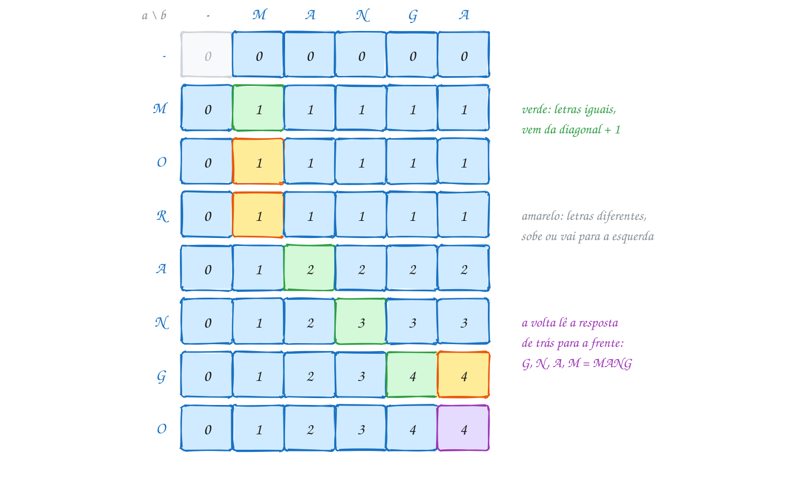</p>

O mesmo exemplo em C:

```c
#include <stdio.h>
#include <string.h>

#define MAX 50

int main(void) {
    const char *a = "MORANGO"; // o que foi ditado
    const char *b = "MANGA";   // o que foi escrito
    int m = strlen(a), n = strlen(b);
    int c[MAX + 1][MAX + 1];

    // c[i][j] = tamanho da maior subsequência comum de a[0..i-1] e b[0..j-1]
    for (int i = 0; i <= m; i++) {
        for (int j = 0; j <= n; j++) {
            if (i == 0 || j == 0) {
                c[i][j] = 0;                          // um dos dois é vazio
            } else if (a[i - 1] == b[j - 1]) {
                c[i][j] = c[i - 1][j - 1] + 1;        // a letra entra nas duas
            } else if (c[i - 1][j] >= c[i][j - 1]) {
                c[i][j] = c[i - 1][j];                // descarta a letra de a
            } else {
                c[i][j] = c[i][j - 1];                // descarta a letra de b
            }
        }
    }

    printf("   -");
    for (int j = 0; j < n; j++) {
        printf(" %c", b[j]);
    }
    printf("\n");
    for (int i = 0; i <= m; i++) {
        printf("%c ", i == 0 ? '-' : a[i - 1]);
        for (int j = 0; j <= n; j++) {
            printf(" %d", c[i][j]);
        }
        printf("\n");
    }

    // recuperação: do canto até a borda, montando a resposta de trás para a frente
    char lcs[MAX + 1];
    int k = c[m][n];
    lcs[k] = '\0';
    int i = m, j = n;
    while (i > 0 && j > 0) {
        if (a[i - 1] == b[j - 1]) {
            lcs[--k] = a[i - 1];                      // letra comum: diagonal
            i--;
            j--;
        } else if (c[i - 1][j] >= c[i][j - 1]) {
            i--;                                      // sobe
        } else {
            j--;                                      // vai para a esquerda
        }
    }
    printf("LCS de %s e %s: %s (%d letras)\n", a, b, lcs, c[m][n]);
    return 0;
}
// Saída:
//    - M A N G A
// -  0 0 0 0 0 0
// M  0 1 1 1 1 1
// O  0 1 1 1 1 1
// R  0 1 1 1 1 1
// A  0 1 2 2 2 2
// N  0 1 2 3 3 3
// G  0 1 2 3 4 4
// O  0 1 2 3 4 4
// LCS de MORANGO e MANGA: MANG (4 letras)
```

A tabela tem `(m + 1) × (n + 1)` células e cada uma custa O(1): **O(m × n)**
de tempo e de memória. Duas strings de 1.000 letras dão um milhão de
células, uns 4 MB de `int`; a força bruta nem começaria.

Repara no fluxograma: é a decisão de uma célula. O caminho marcado é o da
célula da linha G com a coluna G (`c[6][4]`), em que as letras batem e o
valor vem da diagonal, `3 + 1`:

<p align="center">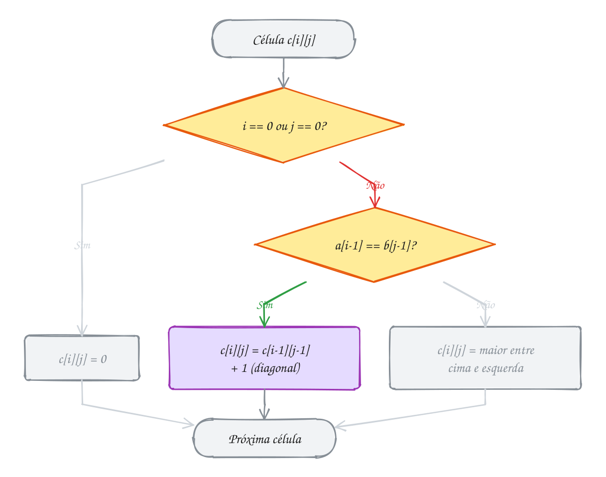</p>

### Passo a passo

A volta, partindo de `c[7][5]`. Repare que a recuperação monta a resposta
**de trás para a frente**: G sai primeiro e M por último:

| posição | letras | iguais? | `c[i-1][j]` / `c[i][j-1]` | movimento | resposta até aqui |
| --- | --- | --- | --- | --- | --- |
| (7, 5) | O, A | não | 4 / 4 | sobe | |
| (6, 5) | G, A | não | 3 / 4 | esquerda | |
| (6, 4) | G, G | sim | | diagonal | G |
| (5, 3) | N, N | sim | | diagonal | NG |
| (4, 2) | A, A | sim | | diagonal | ANG |
| (3, 1) | R, M | não | 1 / 0 | sobe | ANG |
| (2, 1) | O, M | não | 1 / 0 | sobe | ANG |
| (1, 1) | M, M | sim | | diagonal | MANG |

> [!WARNING]
> Subsequência não é **substring**. Uma substring é um pedaço **contíguo**:
> em MORANGO e MANGA, a maior substring comum é `ANG`, com 3 letras,
> enquanto a LCS tem 4. A outra pegadinha são os índices: a tabela tem uma
> linha e uma coluna a mais (a do prefixo vazio), então a linha `i` fala da
> letra `a[i - 1]`. Escrever `a[i] == b[j]` compila, roda sem reclamar do
> sanitizer (no fim, compara com o `'\0'`) e dá a resposta errada.

> [!TIP]
> **Por dentro do C:** `int c[51][51]` mora na pilha e ocupa 51 × 51 × 4 =
> 10.404 bytes, mesmo que as palavras sejam curtas. Para comparar dois textos
> de 10 mil caracteres, seriam 400 MB: não cabe na pilha nem com muita
> vontade. Se você só precisa do **tamanho** da LCS, cada linha só usa a de
> cima, e duas linhas de `n + 1` posições bastam (o A281 faz isso). Para
> **recuperar** as letras, a tabela inteira, alocada com `malloc`, é o jeito
> simples.

> [!NOTE]
> **Pergunta para você:** a LCS de MORANGO e MANGA é única? Troque o `>=` das
> duas comparações por `>` (na tabela e na volta) e veja se a resposta muda.
> E a LCS de `ABAB` e `BABA`?

### Hora de praticar

Os arquivos ficam em [`0141-lcs/`](0141-lcs/). Os comandos funcionam de qualquer pasta do terminal. Nos exemplos, rode, mude, quebre e rode de novo. Nos exercícios, a resposta vai dentro do próprio arquivo. ★☆☆ é aquecimento, ★★☆ pede raciocínio e ★★★ é desafio.

**Exemplo A281 · DNA comparado com duas linhas de tabela**

```c
#include <stdio.h>
#include <string.h>

#define MAX 100

// Só o TAMANHO da LCS: cada linha da tabela só usa a de cima, então bastam
// duas linhas. Em vez de copiar a linha nova para a velha, os PONTEIROS
// trocam de papel a cada volta.
int lcs_tamanho(const char *a, const char *b) {
    int m = strlen(a), n = strlen(b);
    int linha1[MAX + 1], linha2[MAX + 1];
    int *cima = linha1, *atual = linha2;

    for (int j = 0; j <= n; j++) {
        cima[j] = 0;                    // linha 0: prefixo vazio de a
    }
    for (int i = 1; i <= m; i++) {
        atual[0] = 0;                   // coluna 0: prefixo vazio de b
        for (int j = 1; j <= n; j++) {
            if (a[i - 1] == b[j - 1]) {
                atual[j] = cima[j - 1] + 1;
            } else {
                atual[j] = cima[j] > atual[j - 1] ? cima[j] : atual[j - 1];
            }
        }
        int *t = cima;                  // a linha atual vira a "de cima"
        cima = atual;
        atual = t;
    }
    return cima[n];                     // depois da troca, a última está em cima
}

int main(void) {
    const char *amostra = "ATGCGTACGTTAGCCATGACGTAGCTAGGCTTACGATCGA";
    const char *suspeito = "ATGCCTACGTAGCATGTCGTAGCAAGGCTACGTTCGA";
    const char *outro = "TTAGGCATCCAGTTACGGATCATGCCAGTAATGCTGAA";

    int m = strlen(amostra);
    printf("amostra x suspeito: %d de %d bases em comum, na ordem\n",
           lcs_tamanho(amostra, suspeito), m);
    printf("amostra x outro:    %d de %d bases em comum, na ordem\n",
           lcs_tamanho(amostra, outro), m);
    printf("memória: 2 linhas de %d int = %zu bytes (a tabela inteira teria %zu)\n",
           MAX + 1, 2 * (MAX + 1) * sizeof(int), (size_t) (MAX + 1) * (MAX + 1) * sizeof(int));
    return 0;
}
// Saída:
// amostra x suspeito: 33 de 40 bases em comum, na ordem
// amostra x outro:    25 de 40 bases em comum, na ordem
// memória: 2 linhas de 101 int = 808 bytes (a tabela inteira teria 40804)
```

```bash
~/LPEDC/rodar 21-programacao-dinamica/0141-lcs/A281.c
```

**Exemplo A282 · Pedaço contíguo ou letras na ordem?**

```c
#include <stdio.h>
#include <string.h>

#define MAX 50

// maior SUBSTRING comum: o pedaço tem que ser contíguo nas duas.
// s[i][j] = tamanho do maior pedaço comum que TERMINA em a[i-1] e b[j-1].
// Letras diferentes quebram a sequência: s volta a 0.
int maior_substring(const char *a, const char *b, int *fim_em_a) {
    int m = strlen(a), n = strlen(b), melhor = 0;
    int s[MAX + 1][MAX + 1];
    for (int i = 0; i <= m; i++) {
        for (int j = 0; j <= n; j++) {
            if (i == 0 || j == 0 || a[i - 1] != b[j - 1]) {
                s[i][j] = 0;
            } else {
                s[i][j] = s[i - 1][j - 1] + 1;
                if (s[i][j] > melhor) {
                    melhor = s[i][j];
                    *fim_em_a = i;      // o pedaço é a[i - melhor .. i - 1]
                }
            }
        }
    }
    return melhor;
}

// maior SUBSEQUÊNCIA comum: as letras só precisam estar na mesma ordem
int maior_subsequencia(const char *a, const char *b) {
    int m = strlen(a), n = strlen(b);
    int c[MAX + 1][MAX + 1];
    for (int i = 0; i <= m; i++) {
        for (int j = 0; j <= n; j++) {
            if (i == 0 || j == 0) {
                c[i][j] = 0;
            } else if (a[i - 1] == b[j - 1]) {
                c[i][j] = c[i - 1][j - 1] + 1;
            } else {
                c[i][j] = c[i - 1][j] > c[i][j - 1] ? c[i - 1][j] : c[i][j - 1];
            }
        }
    }
    return c[m][n];
}

int main(void) {
    const char *pares[][2] = {
        {"PARALELEPIPEDO", "PAPELARIA"},
        {"FERROVIARIO", "FERRUGEM"},
        {"ABCDEF", "FEDCBA"},
    };
    for (int p = 0; p < 3; p++) {
        const char *a = pares[p][0], *b = pares[p][1];
        int fim = 0;
        int sub = maior_substring(a, b, &fim);
        printf("%s x %s: substring %d (\"%.*s\"), subsequência %d\n",
               a, b, sub, sub, a + fim - sub, maior_subsequencia(a, b));
    }
    return 0;
}
// Em ABCDEF x FEDCBA as letras são as mesmas, mas em ordem contrária:
// só uma delas fica "na ordem".
// Saída:
// PARALELEPIPEDO x PAPELARIA: substring 2 ("PA"), subsequência 5
// FERROVIARIO x FERRUGEM: substring 4 ("FERR"), subsequência 4
// ABCDEF x FEDCBA: substring 1 ("A"), subsequência 1
```

```bash
~/LPEDC/rodar 21-programacao-dinamica/0141-lcs/A282.c
```

#### Exercícios

**Exercício E841** · ★☆☆

Duas linhas de ônibus atravessam o centro. Cada ponto tem uma letra:


```text
linha 101: A B C D E F G H
linha 202: B D C E G A H
```


Quantos pontos as duas visitam na MESMA ordem (sem precisar ser pontos
seguidos)? Escreva a função


```text
int lcs(const char *a, const char *b)
```


que devolve o tamanho da maior subsequência comum, e teste com os pares
abaixo, mostrando cada um entre aspas.


```text
Saída esperada:
"ABCDEFGH" x "BDCEGAH": 5
"CASA" x "ASA": 3
"" x "ABC": 0
"XYZ" x "XYZ": 3
"ABC" x "DEF": 0
```

**Dicas:**

1. Tabela int c[51][51]; c[i][j] fala dos prefixos a[0..i-1] e b[0..j-1].
2. Linha 0 e coluna 0 valem 0. Letras iguais (a[i - 1] == b[j - 1]):
   diagonal + 1. Diferentes: o maior entre cima e esquerda.
3. Para mostrar as aspas dentro do printf, use \".
4. Resposta esperada: a saída acima (na primeira, B C E G H, por exemplo).

```bash
~/LPEDC/rodar 21-programacao-dinamica/0141-lcs/E841.c
```

**Exercício E842** · ★☆☆

O programa abaixo monta a tabela da LCS de "PROGRAMAR" e "PAGAR" e mostra
o tamanho. Complete o trecho marcado com COMPLETE AQUI: faça a volta pela
tabela, de c[m][n] até a borda, preenchendo o vetor lcs de trás para a
frente, e conte quantos passos (voltas do while) a volta deu.


```text
Saída esperada:
Tamanho da LCS: 4
LCS: PGAR
Passos na volta: 10
```

**Dicas:**

1. Letras iguais: a letra vai para lcs[--k] e você anda na diagonal
   (i-- e j--).
2. Diferentes: se c[i - 1][j] >= c[i][j - 1], suba (i--); senão, vá para
   a esquerda (j--). Use o mesmo >= da tabela.
3. O laço é while (i > 0 && j > 0); some 1 em passos a cada volta.
4. Resposta esperada: a saída acima. PAAR também tem 4 letras e é comum
   às duas: a regra de desempate escolheu PGAR.

```bash
~/LPEDC/rodar 21-programacao-dinamica/0141-lcs/E842.c
```

**Exercício E843** · ★★☆

A LCS não é só para strings. Ana e Beto montaram playlists para a viagem,
e cada música tem um número de catálogo:


```text
Ana:  12  7 33  5 21  8 40 17
Beto:  7  5  9 21 40  3 17 12
```


Eles querem uma playlist em comum que respeite a ordem das DUAS listas.
Escreva a função


```text
int lcs_vetor(const int a[], int m, const int b[], int n, int saida[])
```


que grava em saida a maior subsequência comum dos dois vetores e devolve
o tamanho dela. Mostre o resultado.


```text
Saída esperada:
5 músicas em comum, na mesma ordem: 7 5 21 40 17
```

**Dicas:**

1. É o código do texto trocando char por int: a comparação a[i - 1] ==
   b[j - 1] continua igual, e não há '\0' no fim.
2. A volta grava em saida[--k], começando com k = c[m][n].
3. A música 12 está nas duas, mas é a primeira da Ana e a última do Beto:
   ela não cabe na mesma ordem junto com as outras.
4. Resposta esperada: a saída acima.

```bash
~/LPEDC/rodar 21-programacao-dinamica/0141-lcs/E843.c
```

**Exercício E844** · ★★☆

Charada de palavras: qual é a MENOR sequência de letras (não precisa
existir no dicionário) que contém BANANA e também CABANA como
subsequências? É a menor supersequência comum, e ela sai da tabela da
LCS: as letras da LCS aparecem uma vez só, e todas as outras letras das
duas palavras entram também. Por isso o tamanho é m + n - LCS.

Monte a tabela da LCS, construa a supersequência numa volta pela tabela
e confira o resultado com uma função


```text
int eh_subsequencia(const char *p, const char *t)
```


que diz se p é subsequência de t.


```text
Saída esperada:
LCS: 4 letras
Supersequência: CABANANA (8 letras)
BANANA está nela? sim
CABANA está nela? sim
```

**Dicas:**

1. A volta é a da LCS, mas TODO passo grava uma letra em sup[--k]: na
   diagonal, a letra comum; subindo, a[i - 1]; indo para a esquerda,
   b[j - 1]. Comece com k = m + n - c[m][n] e sup[k] = '\0'.
2. Quando i ou j chega a 0, ainda sobra o começo da outra palavra: copie
   o que sobrou com mais dois while.
3. eh_subsequencia: ande em t e avance em p só quando a letra bate; no
   fim, p tem que ter chegado ao '\0'.
4. Use o mesmo desempate do texto (>= sobe), senão a supersequência pode
   sair diferente (com as mesmas 8 letras).
5. Resposta esperada: a saída acima.

```bash
~/LPEDC/rodar 21-programacao-dinamica/0141-lcs/E844.c
```

**Exercício E845** · ★★★

Num jogo de anagramas, a nota de "parecido" entre duas palavras é o
tamanho da LCS: quantas letras ficam na mesma ordem. O programa abaixo
compila sem aviso e roda sem reclamação do sanitizer, mas algumas notas
estão erradas. Hoje ele mostra:


```text
AMOR x ROMA: 2
AMOR x MORA: 3
AMOR x RAMO: 3
AMOR x OMAR: 3
AMOR x AMOR: 4
```


Em ROMA, nenhum par de letras de AMOR aparece na mesma ordem, então a
nota certa é 1. Há UM erro de propósito, numa linha só. Ache e conserte.


```text
Saída esperada (depois de consertar):
AMOR x ROMA: 1
AMOR x MORA: 3
AMOR x RAMO: 3
AMOR x OMAR: 2
AMOR x AMOR: 4
```

**Dicas:**

1. Acrescente um printf que mostre a tabela inteira de AMOR x ROMA, com a
   letra de cada linha, e confira a última célula.
2. A linha i da tabela fala do prefixo de tamanho i. Qual é a ÚLTIMA
   letra desse prefixo?
3. Com i = m e j = n, o que valem a[i] e b[j]? Por que isso sempre "bate"?
4. Resposta esperada: a comparação usa a[i] == b[j], que olha uma letra
   adiante (e, no fim, compara '\0' com '\0', ganhando 1 de graça). O
   certo é a[i - 1] == b[j - 1].

```bash
~/LPEDC/rodar 21-programacao-dinamica/0141-lcs/E845.c
```

**Exercício E846** · ★★★

O fechamento de uma ação em 13 pregões foi, em reais:


```text
31 28 35 30 33 29 36 40 34 38 41 37 33
```


Qual é a maior sequência de pregões (não precisam ser seguidos) em que o
preço SEMPRE sobe? É a maior subsequência crescente, e existe um truque
para resolvê-la com o que você já tem: ela é a LCS entre o vetor original
e uma cópia dele ORDENADA e SEM REPETIDOS. (Pense: uma subsequência comum
às duas está na ordem dos pregões e, ao mesmo tempo, em ordem crescente.)

Escreva o programa: copie o vetor, ordene a cópia com qsort (assunto
0050), tire os repetidos, rode a LCS de vetores de int com recuperação e
mostre o tamanho e os preços.


```text
Saída esperada:
Maior sequência de altas: 6 dias
Preços: 28 30 33 36 40 41
```

**Dicas:**

1. A compara do qsort: return (a > b) - (a < b); (sem a - b, que pode
   estourar).
2. Para tirar repetidos de um vetor ordenado, copie ord[i] para ord[u++]
   só quando ele for diferente do último copiado.
3. Sem tirar os repetidos, o 33 (que aparece duas vezes) poderia entrar
   duas vezes, e "33 33" não é subir.
4. Use o desempate do texto (>= sobe). Há outras respostas com 6 preços,
   como 28 30 33 34 38 41.
5. Resposta esperada: a saída acima.

```bash
~/LPEDC/rodar 21-programacao-dinamica/0141-lcs/E846.c
```

---

## 0142 · Distância de edição

Você digita "pesoa" no celular e o corretor oferece "pessoa". Como ele sabe
que "pessoa" está mais perto do que você digitou do que "pescoço" ou
"lagoa"? Ele mede quantas **edições** de uma letra separam as duas palavras.
De "pesoa" para "pessoa" falta só inserir um `s`.

A **distância de edição** (ou **distância de Levenshtein**) entre duas
strings é o menor número de operações que transforma uma na outra. São
três operações, cada uma custando 1: **inserir** uma letra, **remover** uma
letra ou **trocar** uma letra por outra.

É a prima da LCS do assunto 0141, e a PD olha de novo para o fim das duas
palavras. Se as últimas letras são **iguais**, elas já combinam: o custo é o
das palavras sem elas. Se são **diferentes**, a última operação foi uma das
três, e você fica com a mais barata:

- **trocar** a última de `a` pela última de `b`: 1 + resolver as duas sem a
  última letra;
- **remover** a última de `a`: 1 + transformar `a` sem ela em `b` inteira;
- **inserir** no fim a última de `b`: 1 + transformar `a` inteira em `b` sem
  ela.

Na tabela, `d[i][j]` é a distância entre os prefixos `a[0..i-1]` e
`b[0..j-1]`. A diferença para a LCS está na **borda**: transformar `i` letras
em nada custa `i` remoções, então `d[i][0] = i`; e transformar nada em `j`
letras custa `j` inserções, `d[0][j] = j`.

| caso | `d[i][j]` |
| --- | --- |
| `a[i-1] == b[j-1]` | `d[i-1][j-1]` (diagonal, de graça) |
| letras diferentes | `1 +` o menor entre `d[i-1][j-1]` (troca), `d[i-1][j]` (remove) e `d[i][j-1]` (insere) |

Vamos ver na prática com CARTA e ARTES. A resposta é 3, e a volta pela
tabela mostra quais edições: remover o C, inserir um E e trocar o último A
por S (CARTA, ARTA, ARTEA, ARTES). As setas mostram de onde cada célula do
caminho veio:

<p align="center">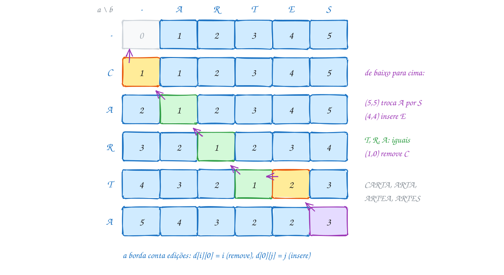</p>

O mesmo exemplo em C. A volta mostra as edições do fim da palavra para o
começo (o E852 monta o alinhamento na ordem certa):

```c
#include <stdio.h>
#include <string.h>

#define MAX 50

int menor3(int x, int y, int z) {
    int m = x < y ? x : y;
    return m < z ? m : z;
}

int main(void) {
    const char *a = "CARTA"; // de onde parte
    const char *b = "ARTES"; // aonde quer chegar
    int m = strlen(a), n = strlen(b);
    int d[MAX + 1][MAX + 1];

    // d[i][j] = menor número de edições que transforma a[0..i-1] em b[0..j-1]
    for (int i = 0; i <= m; i++) {
        d[i][0] = i;                                // apagar as i letras
    }
    for (int j = 0; j <= n; j++) {
        d[0][j] = j;                                // inserir as j letras
    }
    for (int i = 1; i <= m; i++) {
        for (int j = 1; j <= n; j++) {
            if (a[i - 1] == b[j - 1]) {
                d[i][j] = d[i - 1][j - 1];          // letra igual: de graça
            } else {
                d[i][j] = 1 + menor3(d[i - 1][j - 1], // troca a[i-1] por b[j-1]
                                     d[i - 1][j],     // remove a[i-1]
                                     d[i][j - 1]);    // insere b[j-1]
            }
        }
    }

    printf("     -");
    for (int j = 0; j < n; j++) {
        printf("  %c", b[j]);
    }
    printf("\n");
    for (int i = 0; i <= m; i++) {
        printf("  %c", i == 0 ? '-' : a[i - 1]);
        for (int j = 0; j <= n; j++) {
            printf("  %d", d[i][j]);
        }
        printf("\n");
    }
    printf("distância de %s para %s: %d\n", a, b, d[m][n]);

    // volta: de onde veio cada célula? As edições saem do fim para o começo
    int i = m, j = n;
    while (i > 0 || j > 0) {
        if (i > 0 && j > 0 && a[i - 1] == b[j - 1]) {
            i--;                                    // igual: não custa nada
            j--;
        } else if (i > 0 && j > 0 && d[i][j] == d[i - 1][j - 1] + 1) {
            printf("  troca %c por %c\n", a[i - 1], b[j - 1]);
            i--;
            j--;
        } else if (i > 0 && d[i][j] == d[i - 1][j] + 1) {
            printf("  remove %c\n", a[i - 1]);
            i--;
        } else {
            printf("  insere %c\n", b[j - 1]);
            j--;
        }
    }
    return 0;
}
// Saída:
//      -  A  R  T  E  S
//   -  0  1  2  3  4  5
//   C  1  1  2  3  4  5
//   A  2  1  2  3  4  5
//   R  3  2  1  2  3  4
//   T  4  3  2  1  2  3
//   A  5  4  3  2  2  3
// distância de CARTA para ARTES: 3
//   troca A por S
//   insere E
//   remove C
```

O custo é o mesmo da LCS: `(m + 1) × (n + 1)` células, cada uma com três
comparações, **O(m × n)**. Um corretor ortográfico que compara a palavra
digitada com 300 mil palavras do dicionário faz 300 mil tabelas pequenas;
por isso os de verdade primeiro descartam as palavras de tamanho muito
diferente (a distância é pelo menos a diferença dos tamanhos).

Repara no fluxograma: é a decisão de uma célula do miolo, com o caminho da
célula `d[5][5]` (o último A contra o S), em que a troca ganhou:

<p align="center">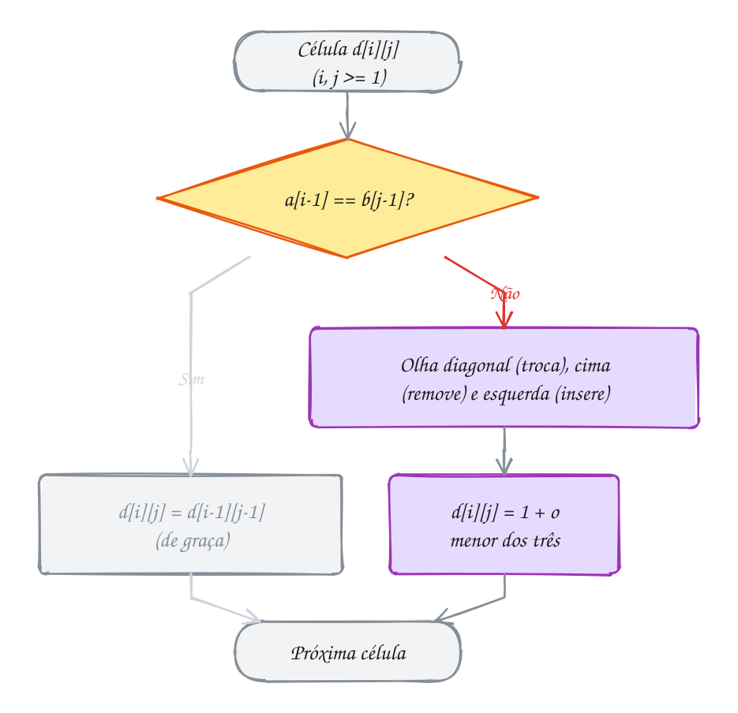</p>

### Passo a passo

A volta, partindo de `d[5][5] = 3`. Em cada célula, a pergunta é "de qual
vizinho eu vim?":

| posição | letras | candidatos: troca / remove / insere | veio de | operação |
| --- | --- | --- | --- | --- |
| (5, 5) | A, S | 2 + 1 / 3 + 1 / 2 + 1 | diagonal (troca, testada primeiro) | troca A por S |
| (4, 4) | T, E | 2 + 1 / 3 + 1 / 1 + 1 | esquerda | insere E |
| (4, 3) | T, T | iguais | diagonal | nenhuma |
| (3, 2) | R, R | iguais | diagonal | nenhuma |
| (2, 1) | A, A | iguais | diagonal | nenhuma |
| (1, 0) | C, - | borda | cima | remove C |

> [!WARNING]
> A borda **não** é zero, como era na LCS. Esquecer `d[i][0] = i` e
> `d[0][j] = j` (ou copiar a inicialização da LCS) faz a tabela achar que
> apagar ou escrever o começo da palavra é de graça: "CARTA" e "ARTES"
> dariam 2, e "SOL" contra a palavra vazia daria 0. E na volta, confira
> `i > 0` e `j > 0` antes de ler `d[i - 1][...]` ou `a[i - 1]`: na borda,
> só uma das direções existe.

> [!TIP]
> **Por dentro do C:** `menor3` é chamada `m × n` vezes. Com otimização
> (`gcc -O2`), o compilador costuma colocar o corpo dela direto no laço
> (*inline*), sem o custo de empilhar um frame por célula. Repare também que
> a tabela de `int` é um desperdício para palavras: a distância nunca passa
> do tamanho da maior palavra, então um `unsigned char` (até 255) bastaria
> para palavras de até 255 letras, e a tabela de 51 × 51 cairia de 10.404
> para 2.601 bytes.

> [!NOTE]
> **Pergunta para você:** a distância de A para B é sempre igual à de B para
> A? Troque `a` e `b` no código e compare a tabela e as operações. O que
> acontece com cada "insere" e cada "remove"?

### Hora de praticar

Os arquivos ficam em [`0142-distancia-de-edicao/`](0142-distancia-de-edicao/). Os comandos funcionam de qualquer pasta do terminal. Nos exemplos, rode, mude, quebre e rode de novo. Nos exercícios, a resposta vai dentro do próprio arquivo. ★☆☆ é aquecimento, ★★☆ pede raciocínio e ★★★ é desafio.

**Exemplo A283 · O corretor que sugere a palavra mais perto**

```c
#include <stdio.h>
#include <string.h>

#define MAX 30

int menor3(int x, int y, int z) {
    int m = x < y ? x : y;
    return m < z ? m : z;
}

int distancia(const char *a, const char *b) {
    int m = strlen(a), n = strlen(b);
    int d[MAX + 1][MAX + 1];
    for (int i = 0; i <= m; i++) {
        d[i][0] = i;
    }
    for (int j = 0; j <= n; j++) {
        d[0][j] = j;
    }
    for (int i = 1; i <= m; i++) {
        for (int j = 1; j <= n; j++) {
            if (a[i - 1] == b[j - 1]) {
                d[i][j] = d[i - 1][j - 1];
            } else {
                d[i][j] = 1 + menor3(d[i - 1][j - 1], d[i - 1][j], d[i][j - 1]);
            }
        }
    }
    return d[m][n];
}

int main(void) {
    // palavras sem acento: em UTF-8, "ç" e "ã" ocupam 2 bytes cada, e a
    // distância contaria bytes, não letras
    const char *dicionario[] = {"pessoa", "pesca", "peso", "lagoa", "pose",
                                "pessoal", "mesa", "proa", "passeio"};
    int n = 9;
    const char *digitadas[] = {"pesoa", "lagao", "pasoe"};

    for (int k = 0; k < 3; k++) {
        int melhor = MAX + 1;
        for (int p = 0; p < n; p++) {
            int dist = distancia(digitadas[k], dicionario[p]);
            if (dist < melhor) {
                melhor = dist;
            }
        }
        printf("%s -> distância %d:", digitadas[k], melhor);
        for (int p = 0; p < n; p++) {       // todas as que empatam no mínimo
            if (distancia(digitadas[k], dicionario[p]) == melhor) {
                printf(" %s", dicionario[p]);
            }
        }
        printf("\n");
    }
    return 0;
}
// Empates são comuns: corretores de verdade desempatam pela frequência de
// uso de cada palavra. E "lagao" trocou duas letras vizinhas de lugar, mas
// a distância conta 2: o A284 mostra como contar isso como 1.
// Saída:
// pesoa -> distância 1: pessoa pesca peso
// lagao -> distância 2: lagoa
// pasoe -> distância 2: peso pose
```

```bash
~/LPEDC/rodar 21-programacao-dinamica/0142-distancia-de-edicao/A283.c
```

**Exemplo A284 · Letras trocadas de lugar contam como um erro só**

```c
#include <stdio.h>
#include <string.h>

#define MAX 30

int menor(int x, int y) {
    return x < y ? x : y;
}

// Levenshtein com uma quarta operação: TRANSPOR duas letras vizinhas
// ("ac" <-> "ca"), também com custo 1. É o erro de digitação mais comum.
// Com transpoe == 0, é a distância de edição comum.
int distancia(const char *a, const char *b, int transpoe) {
    int m = strlen(a), n = strlen(b);
    int d[MAX + 1][MAX + 1];
    for (int i = 0; i <= m; i++) {
        d[i][0] = i;
    }
    for (int j = 0; j <= n; j++) {
        d[0][j] = j;
    }
    for (int i = 1; i <= m; i++) {
        for (int j = 1; j <= n; j++) {
            int custo = (a[i - 1] == b[j - 1]) ? 0 : 1;
            d[i][j] = menor(menor(d[i - 1][j] + 1,      // remove
                                  d[i][j - 1] + 1),     // insere
                            d[i - 1][j - 1] + custo);   // troca (ou igual)
            // as duas últimas de a são as duas últimas de b, invertidas?
            if (transpoe && i > 1 && j > 1 &&
                a[i - 1] == b[j - 2] && a[i - 2] == b[j - 1]) {
                d[i][j] = menor(d[i][j], d[i - 2][j - 2] + 1);
            }
        }
    }
    return d[m][n];
}

int main(void) {
    const char *pares[][2] = {
        {"cmaa", "cama"},
        {"lagao", "lagoa"},
        {"teclaod", "teclado"},
        {"qeuijo", "queijo"},
        {"abcd", "badc"},
    };
    printf("%-8s %-8s  comum  com transposição\n", "digitou", "queria");
    for (int p = 0; p < 5; p++) {
        printf("%-8s %-8s  %5d  %16d\n", pares[p][0], pares[p][1],
               distancia(pares[p][0], pares[p][1], 0),
               distancia(pares[p][0], pares[p][1], 1));
    }
    return 0;
}
// Saída:
// digitou  queria    comum  com transposição
// cmaa     cama          2                 1
// lagao    lagoa         2                 1
// teclaod  teclado       2                 1
// qeuijo   queijo        2                 1
// abcd     badc          3                 2
```

```bash
~/LPEDC/rodar 21-programacao-dinamica/0142-distancia-de-edicao/A284.c
```

#### Exercícios

**Exercício E847** · ★☆☆

Escreva a função


```text
int distancia(const char *a, const char *b)
```


que devolve a distância de Levenshtein entre duas palavras (inserir,
remover e trocar custam 1), e teste com os pares abaixo, mostrando cada
um entre aspas.


```text
Saída esperada:
"LIVRO" -> "LIBRA": 2
"" -> "SOL": 3
"CASA" -> "CASA": 0
"ABACAXI" -> "ABACATE": 2
"FUTEBOL" -> "BASQUETE": 8
```

**Dicas:**

1. Tabela int d[31][31]. Borda: d[i][0] = i e d[0][j] = j.
2. Letras iguais: d[i][j] = d[i - 1][j - 1]. Diferentes: 1 + o menor
   entre diagonal, cima e esquerda. Uma função menor3 ajuda.
3. A distância nunca passa do tamanho da maior palavra (troque tudo e
   insira o que faltar): FUTEBOL x BASQUETE bate nesse teto.
4. Resposta esperada: a saída acima.

```bash
~/LPEDC/rodar 21-programacao-dinamica/0142-distancia-de-edicao/E847.c
```

**Exercício E848** · ★☆☆

O programa abaixo calcula a distância de edição de PATO para SAPATO e
mostra a tabela inteira, mas a BORDA da tabela não foi preenchida: hoje
ele lê lixo da pilha (ou mostra números sem sentido). Complete os dois
laços marcados com COMPLETE AQUI e rode.


```text
Saída esperada:
   - S A P A T O
-  0 1 2 3 4 5 6
P  1 1 2 2 3 4 5
A  2 2 1 2 2 3 4
T  3 3 2 2 3 2 3
O  4 4 3 3 3 3 2
distância: 2
```

**Dicas:**

1. A coluna 0 responde "quanto custa transformar a[0..i-1] em nada?".
2. A linha 0 responde "quanto custa transformar nada em b[0..j-1]?".
3. Na linha do O, o 2 do canto é a resposta: inserir S e A no começo.
4. Resposta esperada: d[i][0] = i e d[0][j] = j, e a saída acima.

```bash
~/LPEDC/rodar 21-programacao-dinamica/0142-distancia-de-edicao/E848.c
```

**Exercício E849** · ★★☆

Alguns sistemas de controle de versão não "trocam" letras: cada mudança é
uma remoção seguida de uma inserção. Nessa distância sem troca, BOLO para
BOLA custa 2 (remove O, insere A), e não 1.

Escreva int dist_sem_troca(const char *a, const char *b), com a mesma
tabela da distância de edição mas só com remover e inserir. Escreva também
int lcs(const char *a, const char *b) e confira, para cada par, que a
distância sem troca é igual a m + n - 2 x LCS (tudo que não está na LCS
sai de a ou entra de b).


```text
Saída esperada:
PALMEIRAS PALMAS     PD:  3   m + n - 2 x LCS = 9 + 6 - 2 x 6 =  3
CARTA     ARTES      PD:  4   m + n - 2 x LCS = 5 + 5 - 2 x 3 =  4
BOLO      BOLA       PD:  2   m + n - 2 x LCS = 4 + 4 - 2 x 3 =  2
RECIFE    FORTALEZA  PD: 11   m + n - 2 x LCS = 6 + 9 - 2 x 2 = 11
```

**Dicas:**

1. Na distância sem troca, letras diferentes têm só duas saídas:
   1 + o menor entre d[i - 1][j] (remove) e d[i][j - 1] (insere).
2. A borda é a mesma da distância comum: d[i][0] = i, d[0][j] = j.
3. Para alinhar as colunas, use %-9s nas palavras e %2d nos números.
4. Resposta esperada: a saída acima.

```bash
~/LPEDC/rodar 21-programacao-dinamica/0142-distancia-de-edicao/E849.c
```

**Exercício E850** · ★★☆

A câmera do estacionamento lê placas com erro: troca O por 0, perde um
caractere no fim, inventa outro. As placas cadastradas são:


```text
BRA2E19 RIO1A23 SPX9F87 BRA2E79 MGA4B56 BRZ2E19 PE1234 AM12B3456
```


Para cada leitura (BRA2E19, RI01A23, SPX9F8 e XYZ0000), mostre todas as
placas cadastradas a distância de edição de no máximo 1, com a distância
entre parênteses, ou "nenhuma". Antes de montar cada tabela, pule as
placas cujo tamanho difere da leitura em mais de 1 (a distância é pelo
menos a diferença dos tamanhos), e conte quantas tabelas foram montadas.


```text
Saída esperada:
BRA2E19: BRA2E19 (0) BRA2E79 (1) BRZ2E19 (1)
RI01A23: RIO1A23 (1)
SPX9F8: SPX9F87 (1)
XYZ0000: nenhuma
tabelas montadas: 28 de 32
```

**Dicas:**

1. Reaproveite a distancia() do texto com um contador global que sobe a
   cada chamada.
2. abs() de <stdlib.h> dá o valor absoluto da diferença dos strlen
   (converta para int antes de subtrair: strlen devolve size_t, sem sinal).
3. Uma flag "achou" decide se no fim da linha vai " nenhuma".
4. Resposta esperada: a saída acima. Uma leitura exata também tem
   "parentes" a distância 1: é por isso que o sistema precisa confirmar
   com uma pessoa.

```bash
~/LPEDC/rodar 21-programacao-dinamica/0142-distancia-de-edicao/E850.c
```

**Exercício E851** · ★★★

Esta versão calcula a distância de edição DE CIMA PARA BAIXO: a recursão
natural com memoização (assunto 0138), guardando cada dist(i, j) numa
matriz global memo. Ela foi feita para palavras de até 16 letras. Com
CONSTITUCIONAL (14 letras) funciona; com INCONSTITUCIONAL (16 letras), o
rodar acusa "index 16 out of bounds" e o AddressSanitizer para o programa
com "global-buffer-overflow". Há UM erro de propósito. Ache, conserte e
rode até a saída ficar limpa.


```text
Saída esperada (depois de consertar):
CONSTITUCIONAL -> INSTITUCIONAL: 2 (19 chamadas)
INCONSTITUCIONAL -> CONSTITUCIONAL: 2 (15 chamadas)
```

**Dicas:**

1. Na primeira chamada, dist(i, j) recebe i = strlen(a). Para uma palavra
   de 16 letras, que índice de memo ela usa?
2. Quantas linhas e colunas tem a tabela de uma palavra de m letras
   contra uma de n? (Lembre da linha e da coluna do prefixo vazio.)
3. O memset preenche todos os bytes com 0xFF; num int, isso é -1. O
   sizeof memo faz o memset acompanhar o tamanho da matriz sozinho.
4. Resposta esperada: a matriz precisa de MAX + 1 linhas e colunas
   (índices 0 a 16): int memo[MAX + 1][MAX + 1];.

```bash
~/LPEDC/rodar 21-programacao-dinamica/0142-distancia-de-edicao/E851.c
```

**Exercício E852** · ★★★

Programas de comparar textos e de bioinformática mostram o ALINHAMENTO
das duas sequências, uma em cima da outra, com um traço onde falta letra
e uma marca embaixo dizendo o que aconteceu em cada coluna:


```text
= letras iguais     T troca     R remove (de cima)     I insere (de baixo)
```


Escreva void alinha(const char *a, const char *b), que monta a tabela da
distância de edição, faz a volta e mostra a distância e as três linhas do
alinhamento, com um espaço antes de cada caractere. Teste com SABADO ->
SALDO e ESTRELA -> ESTERIL.


```text
Saída esperada:
SABADO -> SALDO: distância 2
 S A B A D O
 S A - L D O
 = = R T = =
ESTRELA -> ESTERIL: distância 3
 E S T - R E L A
 E S T E R I L -
 = = = I = T = R
```

**Dicas:**

1. A volta é a do texto, mas cada passo grava uma coluna em três vetores
   (cima, baixo e marca). Na remoção, embaixo vai '-'; na inserção, em
   cima vai '-'.
2. As colunas saem de trás para a frente: mostre os vetores do índice
   k - 1 até 0.
3. Teste os vizinhos na ordem do texto (igual, troca, remove, insere): com
   outra ordem, um alinhamento diferente, com a mesma distância, pode
   aparecer.
4. Resposta esperada: a saída acima.

```bash
~/LPEDC/rodar 21-programacao-dinamica/0142-distancia-de-edicao/E852.c
```

---

## 0143 · Juntando tudo: um mini-diff

Você e sua mãe dividem a lista de compras do mês num arquivo de texto, uma
coisa por linha. Ela abriu o arquivo, mexeu e salvou. O que mudou? Comparar
linha 1 com linha 1, linha 2 com linha 2 não serve: basta ela inserir uma
linha no começo para **todas** as outras parecerem diferentes.

A ferramenta que responde isso existe em todo sistema Unix e se chama
`diff`. É ela que mostra as mudanças num controle de versão. E o coração
dela é a **LCS** do assunto 0141, só que de **linhas** em vez de letras: as
linhas da LCS ficaram iguais; as que só estão na versão antiga foram
**removidas** (`-`); as que só estão na nova foram **adicionadas** (`+`).
Duas linhas são "a mesma letra" quando `strcmp` dá 0.

A leitura dos arquivos fica num módulo pequeno (assunto 0034), `linhas.h` e
`linhas.c`, na pasta do assunto. `le_linhas` lê com `fgets`, tira o `'\n'`
e guarda cada linha num `malloc` do tamanho exato, dentro de um `char **`
que dobra com `realloc` (assunto 0055). `grava_linhas` escreve um vetor de
strings num arquivo, e `libera_linhas` devolve tudo.

Uma mudança em relação ao 0141 deixa a saída mais simples. Lá, a volta
começava no **fim** das strings e a resposta saía de trás para a frente.
Aqui a tabela é dos **sufixos**: `c[i][j]` é a LCS de `a[i..m-1]` e
`b[j..n-1]`, cheia de baixo para cima. A resposta fica em `c[0][0]`, e a
volta anda do **começo** para o fim, imprimindo cada linha já na ordem
certa. Em cada passo: linhas iguais saem com dois espaços e as duas
avançam; se não, o vizinho com a LCS maior decide se a linha de `a` sai com
`-` ou a de `b` entra com `+`.

Vamos ver na prática. A lista antiga à esquerda, a nova à direita. Os
traços ligam as cinco linhas da LCS; o que sobra de cada lado vira `-` ou
`+`:

<p align="center">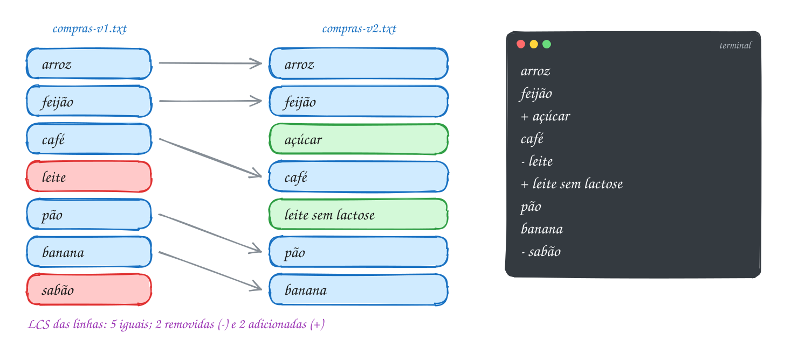</p>

O programa: sem argumentos, ele grava as duas listas em `/tmp` e compara;
com dois nomes de arquivo (assunto 0069), compara os seus:

```c
#include <stdio.h>
#include <stdlib.h>
#include <string.h>
#include "linhas.h"

// diff linha a linha: LCS dos SUFIXOS, para a volta andar do começo ao fim
void diff(char **a, int m, char **b, int n) {
    // c[i * w + j] = LCS de a[i..m-1] e b[j..n-1]: a matriz (m+1) x (n+1)
    // num bloco só do malloc, linha após linha
    int w = n + 1;
    int *c = malloc((size_t) (m + 1) * w * sizeof *c);
    if (c == NULL) {
        return;
    }
    for (int i = m; i >= 0; i--) {
        for (int j = n; j >= 0; j--) {
            if (i == m || j == n) {
                c[i * w + j] = 0;                      // um sufixo vazio
            } else if (strcmp(a[i], b[j]) == 0) {
                c[i * w + j] = c[(i + 1) * w + j + 1] + 1;
            } else {
                int baixo = c[(i + 1) * w + j], dir = c[i * w + j + 1];
                c[i * w + j] = baixo >= dir ? baixo : dir;
            }
        }
    }

    int i = 0, j = 0, iguais = 0, menos = 0, mais = 0;
    while (i < m || j < n) {
        if (i < m && j < n && strcmp(a[i], b[j]) == 0) {
            printf("  %s\n", a[i]);                    // está nas duas versões
            i++;
            j++;
            iguais++;
        } else if (j == n || (i < m && c[(i + 1) * w + j] >= c[i * w + j + 1])) {
            printf("- %s\n", a[i]);                    // só na versão antiga
            i++;
            menos++;
        } else {
            printf("+ %s\n", b[j]);                    // só na versão nova
            j++;
            mais++;
        }
    }
    printf("(%d iguais, %d removidas, %d adicionadas)\n", iguais, menos, mais);
    free(c);
}

int main(int argc, char *argv[]) {
    const char *antigo = "/tmp/compras-v1.txt";
    const char *novo = "/tmp/compras-v2.txt";
    if (argc == 3) {                                   // rodar mini-diff.c a.txt b.txt
        antigo = argv[1];
        novo = argv[2];
    } else {                                           // sem argumentos: o exemplo
        const char *v1[] = {"arroz", "feijão", "café", "leite", "pão", "banana",
                            "sabão"};
        const char *v2[] = {"arroz", "feijão", "açúcar", "café", "leite sem lactose",
                            "pão", "banana"};
        grava_linhas(antigo, v1, 7);
        grava_linhas(novo, v2, 7);
    }

    int m = 0, n = 0;
    char **a = le_linhas(antigo, &m);
    char **b = le_linhas(novo, &n);
    if (a != NULL && b != NULL) {
        diff(a, m, b, n);
    }
    libera_linhas(a, m);
    libera_linhas(b, n);
    return 0;
}
// Saída:
//   arroz
//   feijão
// + açúcar
//   café
// - leite
// + leite sem lactose
//   pão
//   banana
// - sabão
// (5 iguais, 2 removidas, 2 adicionadas)
```

Repare na linha do leite: "leite" e "leite sem lactose" são linhas
diferentes, então viram uma remoção e uma adição. O A286 usa a distância de
edição do assunto 0142 para perceber que a linha foi só **alterada**.

Repara no fluxograma: é a volta do diff, que imprime enquanto anda. O
caminho marcado é o das duas primeiras linhas, iguais nas duas versões:

<p align="center">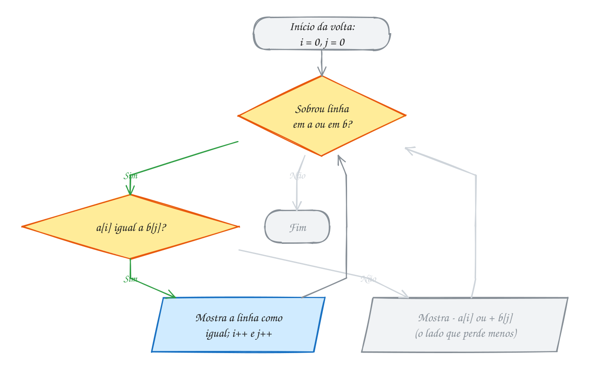</p>

> [!WARNING]
> `fgets` guarda o `'\n'` no fim da linha, e a última linha de um arquivo
> pode vir **sem** ele (quando ninguém deu Enter no final). Sem tirar o
> `'\n'`, "banana\n" e "banana" ficam diferentes no `strcmp`, e o diff
> acusa uma mudança invisível na última linha. O
> `buf[strcspn(buf, "\n")] = '\0'` do `linhas.c` corta o `'\n'` se ele
> existir e não faz nada se não existir.

> [!TIP]
> **Por dentro do C:** a tabela não pode ser um `int c[m + 1][n + 1]` na
> pilha: dois arquivos de 2.000 linhas pediriam 16 MB, o dobro da pilha. Ela
> é um bloco só do `malloc`, e a célula `(i, j)` mora em `c[i * w + j]`, com
> `w = n + 1`: a mesma conta que o compilador faz por baixo numa matriz de
> verdade. Para arquivos de 100 mil linhas, seriam 40 GB, e nem o heap
> aguenta. Por isso o `diff` de verdade usa o algoritmo de Myers, que gasta
> O((m + n) × D), em que D é o número de diferenças, quase sempre pequeno.

> [!NOTE]
> **Pergunta para você:** se sua mãe só tivesse trocado a ordem de "pão" e
> "banana", quantas linhas sairiam com `-` e quantas com `+`? E qual das duas
> o diff escolheria manter como "igual"? Troque a ordem em `v2` e confira.

### Hora de praticar

Os arquivos ficam em [`0143-juntando-tudo/`](0143-juntando-tudo/). Os comandos funcionam de qualquer pasta do terminal. Nos exemplos, rode, mude, quebre e rode de novo. Nos exercícios, a resposta vai dentro do próprio arquivo. ★☆☆ é aquecimento, ★★☆ pede raciocínio e ★★★ é desafio.

**Exemplo A285 · Diff palavra por palavra**

```c
#include <stdio.h>
#include <string.h>

#define MAXP 30 // palavras por frase
#define TAM 20  // letras por palavra

// quebra a frase em palavras (separadas por espaço); devolve quantas
int separa(const char *frase, char palavras[][TAM]) {
    int n = 0, k = 0;
    for (const char *p = frase;; p++) {
        if (*p == ' ' || *p == '\0') {
            if (k > 0 && n < MAXP) {
                palavras[n][k] = '\0';
                n++;
            }
            k = 0;
            if (*p == '\0') {
                break;
            }
        } else if (k < TAM - 1) {
            palavras[n][k++] = *p;
        }
    }
    return n;
}

// o mesmo diff do texto, com palavras no lugar de linhas: [-saiu-] {+entrou+}
void diff_palavras(const char *antes, const char *depois) {
    char a[MAXP][TAM], b[MAXP][TAM];
    int m = separa(antes, a), n = separa(depois, b);
    int c[MAXP + 1][MAXP + 1]; // LCS dos sufixos
    for (int i = m; i >= 0; i--) {
        for (int j = n; j >= 0; j--) {
            if (i == m || j == n) {
                c[i][j] = 0;
            } else if (strcmp(a[i], b[j]) == 0) {
                c[i][j] = c[i + 1][j + 1] + 1;
            } else {
                c[i][j] = c[i + 1][j] >= c[i][j + 1] ? c[i + 1][j] : c[i][j + 1];
            }
        }
    }
    int i = 0, j = 0;
    while (i < m || j < n) {
        if (i > 0 || j > 0) {
            printf(" ");                    // espaço entre palavras, não no fim
        }
        if (i < m && j < n && strcmp(a[i], b[j]) == 0) {
            printf("%s", a[i]);
            i++;
            j++;
        } else if (j == n || (i < m && c[i + 1][j] >= c[i][j + 1])) {
            printf("[-%s-]", a[i++]);
        } else {
            printf("{+%s+}", b[j++]);
        }
    }
    printf("\n");
}

int main(void) {
    diff_palavras("o ônibus 175 sai do terminal às 8h e passa pelo centro",
                  "o ônibus 175 parte do terminal às 7h30 e passa pelo centro e pela orla");
    diff_palavras("reunião de condomínio na quinta no salão",
                  "reunião de condomínio adiada para sexta no salão de festas");
    return 0;
}
// Saída:
// o ônibus 175 [-sai-] {+parte+} do terminal às [-8h-] {+7h30+} e passa pelo centro {+e+} {+pela+} {+orla+}
// reunião de condomínio [-na-] [-quinta-] {+adiada+} {+para+} {+sexta+} no salão {+de+} {+festas+}
```

```bash
~/LPEDC/rodar 21-programacao-dinamica/0143-juntando-tudo/A285.c
```

**Exemplo A286 · O diff que percebe uma linha só alterada**

```c
#include <stdio.h>
#include <stdlib.h>
#include <string.h>
#include "linhas.h"

#define MAXL 100 // linhas por arquivo, neste exemplo
#define TAM 256

int menor3(int x, int y, int z) {
    int m = x < y ? x : y;
    return m < z ? m : z;
}

// distância de edição (assunto 0142) com duas linhas de tabela
int distancia(const char *a, const char *b) {
    int m = strlen(a), n = strlen(b);
    int ant[TAM + 1], at[TAM + 1];
    for (int j = 0; j <= n; j++) {
        ant[j] = j;
    }
    for (int i = 1; i <= m; i++) {
        at[0] = i;
        for (int j = 1; j <= n; j++) {
            if (a[i - 1] == b[j - 1]) {
                at[j] = ant[j - 1];
            } else {
                at[j] = 1 + menor3(ant[j - 1], ant[j], at[j - 1]);
            }
        }
        memcpy(ant, at, (n + 1) * sizeof ant[0]);
    }
    return ant[n];
}

// "parecidas": a distância é no máximo um terço da linha mais comprida
int parecidas(const char *a, const char *b) {
    int maior = strlen(a) > strlen(b) ? strlen(a) : strlen(b);
    return 3 * distancia(a, b) <= maior;
}

int main(void) {
    const char *v1[] = {"segunda: feijoada", "terça: frango assado", "quarta: lasanha",
                        "quinta: peixe frito", "sexta: pizza"};
    const char *v2[] = {"segunda: feijoada", "terça: frango grelhado", "quarta: lasanha",
                        "quinta: strogonoff", "sexta: pizza", "sábado: churrasco"};
    grava_linhas("/tmp/cardapio-v1.txt", v1, 5);
    grava_linhas("/tmp/cardapio-v2.txt", v2, 6);

    int m = 0, n = 0;
    char **a = le_linhas("/tmp/cardapio-v1.txt", &m);
    char **b = le_linhas("/tmp/cardapio-v2.txt", &n);
    if (a == NULL || b == NULL || m > MAXL || n > MAXL) {
        libera_linhas(a, m);
        libera_linhas(b, n);
        return 1;
    }

    static int c[MAXL + 1][MAXL + 1]; // LCS dos sufixos, como no texto
    for (int i = m; i >= 0; i--) {
        for (int j = n; j >= 0; j--) {
            if (i == m || j == n) {
                c[i][j] = 0;
            } else if (strcmp(a[i], b[j]) == 0) {
                c[i][j] = c[i + 1][j + 1] + 1;
            } else {
                c[i][j] = c[i + 1][j] >= c[i][j + 1] ? c[i + 1][j] : c[i][j + 1];
            }
        }
    }

    int i = 0, j = 0;
    while (i < m || j < n) {
        if (i < m && j < n && strcmp(a[i], b[j]) == 0) {
            printf("  %s\n", a[i]);
            i++;
            j++;
        } else if (i < m && j < n && c[i + 1][j + 1] == c[i][j] && parecidas(a[i], b[j])) {
            // pular as duas não perde nada da LCS, e elas são parecidas:
            // em vez de "- a[i]" e "+ b[j]", é uma linha alterada
            printf("~ %s  ->  %s\n", a[i], b[j]);
            i++;
            j++;
        } else if (j == n || (i < m && c[i + 1][j] >= c[i][j + 1])) {
            printf("- %s\n", a[i++]);
        } else {
            printf("+ %s\n", b[j++]);
        }
    }

    libera_linhas(a, m);
    libera_linhas(b, n);
    return 0;
}
// Na saída, "peixe frito" e "strogonoff" são diferentes demais: viram - e +.
// Saída:
//   segunda: feijoada
// ~ terça: frango assado  ->  terça: frango grelhado
//   quarta: lasanha
// - quinta: peixe frito
// + quinta: strogonoff
//   sexta: pizza
// + sábado: churrasco
```

```bash
~/LPEDC/rodar 21-programacao-dinamica/0143-juntando-tudo/A286.c
```

#### Exercícios

**Exercício E853** · ★☆☆

A fila de espera do posto de saúde é um arquivo com um nome por linha.
Ontem e hoje ela estava assim:


```text
ontem: Ana Bruno Carla Davi Elisa Fábio Gabi Hugo
hoje:  Ana Carla Davi Igor Elisa Gabi Hugo Júlia Kátia
```


Sem imprimir o diff, mostre só o resumo, como o "diff --stat": quantas
linhas ficaram iguais, quantas saíram e quantas entraram, e a semelhança
entre as duas versões, 2 x LCS / (m + n), em porcentagem. Guarde as
listas em vetores de strings no próprio programa (const char *ontem[]) e
escreva int lcs_linhas(const char *a[], int m, const char *b[], int n).


```text
Saída esperada:
6 iguais, 2 removidas, 3 adicionadas
semelhança: 70.6%
```

**Dicas:**

1. É a LCS do assunto 0141 com strcmp(a[i], b[j]) == 0 no lugar de
   a[i] == b[j]. A tabela dos sufixos (texto) ou dos prefixos (0141): tanto
   faz, só o tamanho importa.
2. Removidas = m - LCS; adicionadas = n - LCS.
3. Para mostrar o %, use %% no printf; e faça a conta em double
   (100.0 * 2 * l / (m + n)), senão a divisão é inteira.
4. Resposta esperada: a saída acima.

```bash
~/LPEDC/rodar 21-programacao-dinamica/0143-juntando-tudo/E853.c
```

**Exercício E854** · ★☆☆

Alguém abriu o arquivo de configuração da loja num editor que mudou
maiúsculas e deixou espaços sobrando no fim das linhas. O diff abaixo
acusa as 5 linhas como trocadas, mas só duas mudaram de verdade. Complete
a função iguais() (marcada com COMPLETE AQUI) para ela considerar iguais
as linhas que só diferem em maiúsculas/minúsculas ou em espaços no FIM
da linha, como faz o "diff -i -Z". O resto do programa já usa iguais().


```text
Saída esperada:
  Nome: Loja do Zé
  Cidade: Fortaleza
- Horario: 8h as 18h
+ Horario: 8h as 20h
  Pix: sim
- Entrega: nao
+ Entrega: sim
```

**Dicas:**

1. Calcule o tamanho "útil" de cada linha: comece em strlen e recue
   enquanto o último caractere for ' '.
2. Tamanhos úteis diferentes: não são iguais. Senão, compare letra a letra
   com tolower de <ctype.h>, passando (unsigned char) x[k] (um char
   negativo, como os bytes do "é", é proibido no tolower).
3. As linhas iguais saem como estão na versão antiga.
4. Resposta esperada: a saída acima.

```bash
~/LPEDC/rodar 21-programacao-dinamica/0143-juntando-tudo/E854.c
```

**Exercício E855** · ★★☆

O programa abaixo é o mini-diff do texto, comparando duas versões de um
programa em C. Estenda-o para mostrar, antes de cada linha, o número dela
na versão antiga e na nova, como as ferramentas de revisão de código:
linha igual mostra os dois números; linha removida, só o antigo; linha
adicionada, só o novo. Use exatamente estes formatos:


```text
igual:     "%3d %3d   %s\n"
removida:  "%3d     - %s\n"
adicionada: "    %3d + %s\n"
```


```text
Saída esperada:
  1   1   #include <stdio.h>
  2     - // versão 1
      2 + // versão 2
  3   3   int main(void) {
  4     -     printf("oi\n");
      4 +     int x = 2;
      5 +     printf("%d\n", x);
  5   6       return 0;
  6   7   }
(4 iguais, 2 removidas, 3 adicionadas)
```

**Dicas:**

1. Os números saem dos próprios índices: a linha a[i] é a de número
   i + 1 na versão antiga, e b[j] é a j + 1 na nova.
2. Só os três printf da volta mudam; o resto fica igual.
3. Rode também com dois arquivos seus: ~/LPEDC/rodar E855.c a.txt b.txt
   (o rodar compila junto o linhas.c da pasta).
4. Resposta esperada: a saída acima.

```bash
~/LPEDC/rodar 21-programacao-dinamica/0143-juntando-tudo/E855.c
```

**Exercício E856** · ★★☆

A saída do diff serve para mais do que olhar: é um PATCH, a receita para
transformar a versão antiga na nova. Quem recebe o patch aplica no seu
arquivo e fica com a versão nova, sem precisar do arquivo inteiro. Este é
o patch da lista de compras do texto:


```text
"  arroz", "  feijão", "+ açúcar", "  café", "- leite",
"+ leite sem lactose", "  pão", "  banana", "- sabão"
```


Escreva


```text
int aplica(const char *orig[], int m, const char *patch[], int p,
           const char *novo[])
```


que aplica o patch ao original e grava as linhas da versão nova em novo,
devolvendo quantas são. Linhas "  " e "- " falam de uma linha do original
e precisam BATER com ela; se não baterem, o patch não se aplica: devolva
-(número da linha do original, contando de 1). Teste com a lista antiga
e com uma lista em que a 3ª linha virou "chá".


```text
Saída esperada:
v1: arroz, feijão, açúcar, café, leite sem lactose, pão, banana
outra lista: o patch não se aplica (linha 3)
```

**Dicas:**

1. Um índice i anda no original. Para cada linha do patch, olhe o 1º
   caractere; o texto da linha começa em patch[k] + 2.
2. '+': o texto entra em novo. ' ': confere com orig[i], entra e i++.
   '-': confere com orig[i] e só faz i++.
3. novo[] pode guardar os próprios ponteiros (const char *), sem copiar
   as strings.
4. Resposta esperada: a saída acima.

```bash
~/LPEDC/rodar 21-programacao-dinamica/0143-juntando-tudo/E856.c
```

**Exercício E857** · ★★★

A empresa de ônibus mudou o itinerário da linha 42 e quer mostrar o que
mudou. O programa abaixo é o mini-diff do texto adaptado para vetores de
strings, mas o AddressSanitizer para o programa com
"heap-buffer-overflow" logo na montagem da tabela. Há UM erro de
propósito. Ache, conserte e rode até a saída ficar limpa.


```text
Saída esperada (depois de consertar):
Itinerário da linha 42:
  Terminal
+ Mercado
  Centro
- Hospital
  Universidade
  Praia
+ Aeroporto
```

**Dicas:**

1. Leia o relatório do ASan: quantos bytes o bloco tem ("120-byte
   region") e quantos int isso dá?
2. Quantas células tem a tabela de m = 5 contra n = 6, contando a linha e
   a coluna dos sufixos vazios? E qual é o maior índice que o laço usa?
3. A conta do índice usa w = n + 1 colunas por linha; a conta do malloc
   precisa usar o mesmo formato.
4. Resposta esperada: o malloc reserva m * n = 30 int, mas a tabela tem
   (m + 1) * (n + 1) = 42 células (índices 0 a 41). Conserto:
   malloc((size_t) (m + 1) * w * sizeof *c).

```bash
~/LPEDC/rodar 21-programacao-dinamica/0143-juntando-tudo/E857.c
```

**Exercício E858** · ★★★

Quando dois arquivos têm centenas de linhas e só duas mudaram, o diff
completo é inútil: ninguém acha as mudanças no meio de tudo. O "diff -u"
mostra só as linhas mudadas e algumas linhas iguais em volta, o
CONTEXTO, e troca cada trecho pulado por "...".

As duas versões de uma receita de bolo já estão no main. Escreva o diff
com 1 linha de contexto (#define CONTEXTO 1): uma linha igual só aparece
se estiver a no máximo 1 posição de uma mudança na sequência de
operações; cada trecho escondido (inclusive no começo e no fim) vira
uma linha "...". As mudanças saem como "- texto" e "+ texto"; as linhas de
contexto, como "  texto".


```text
Saída esperada:
...
  2. Unte a forma com manteiga.
- 3. Bata 3 ovos com 2 xícaras de açúcar.
+ 3. Bata 3 ovos com 1 xícara de açúcar.
  4. Junte 1 xícara de leite.
...
  11. Desenforme.
- 12. Sirva.
+ 12. Cubra com calda de chocolate.
+ 13. Sirva.
```

**Dicas:**

1. Faça em duas passadas. Na 1ª, a volta do texto, mas em vez de imprimir,
   guarde cada operação num vetor op[] (' ', '-' ou '+') e o texto num
   vetor de ponteiros.
2. Na 2ª, a operação t aparece se alguma operação entre t - CONTEXTO e
   t + CONTEXTO não for ' '.
3. Guarde o índice da última operação mostrada: se a próxima a aparecer
   não for a seguinte, imprima "..." antes. No fim, se sobrou alguma
   escondida, mais um "...".
4. Teste com CONTEXTO 0 e 2 também.
5. Resposta esperada: a saída acima.

```bash
~/LPEDC/rodar 21-programacao-dinamica/0143-juntando-tudo/E858.c
```

---

## Desafios do módulo

Problemas para fechar o módulo, misturando os assuntos. Escreva em C e rode
com o `rodar`.

**1. A madeireira e o corte das tábuas.** Uma tábua de 8 m pode ser vendida
inteira ou cortada em pedaços de metro inteiro. O preço de cada pedaço, por
tamanho de 1 a 8 m, é: R$ 2, 5, 9, 10, 13, 17, 18 e 22. Qual o maior
faturamento com uma tábua de 8 m, e quais cortes?

<details><summary>Resposta</summary>

É um "troco" de maximização: `B[k] = maior entre preco[i] + B[k - i]`, para
`i` de 1 a `k`, com `B[0] = 0`. A tabela fica `0 2 5 9 11 14 18 20 23`, e a
resposta é **R$ 23**: pedaços de 2 + 3 + 3 m (5 + 9 + 9). Vender inteira dá
só R$ 22. Guarde em `S[k]` o tamanho do primeiro pedaço para reconstruir os
cortes, como o `ultimo[]` do assunto 0139.

</details>

**2. O maior terreno quadrado.** Num mapa de lotes, 1 é terreno livre e 0 é
ocupado:

```
1 0 1 1 1
1 1 1 1 1
0 1 1 1 1
1 1 1 1 0
1 1 0 1 1
```

Qual o maior quadrado só de 1s? Resolva em O(linhas × colunas).

<details><summary>Resposta</summary>

`q[i][j]` = lado do maior quadrado de 1s com canto inferior direito em
`(i, j)`. Se a célula é 1, `q[i][j] = 1 + menor(q[i-1][j], q[i][j-1],
q[i-1][j-1])`; se é 0, vale 0. O maior valor é **3**, terminando em `(2, 4)`:
linhas 0 a 2, colunas 2 a 4. É a mesma "olhada para três vizinhos" da
distância de edição.

</details>

**3. A grade com atalho diagonal.** Na grade do A275, sem obras, o
entregador pode andar para a direita, para baixo **ou na diagonal** (direita
e baixo de uma vez). Quantas rotas existem numa grade de 4 × 4 cruzamentos,
de um canto ao outro?

<details><summary>Resposta</summary>

Agora são três vizinhos: `r[i][j] = r[i-1][j] + r[i][j-1] + r[i-1][j-1]`,
com `r[0][0] = 1`. São **63** rotas (contra 20 sem a diagonal). Esses são
os números de Delannoy.

</details>

**4. A palavra que vira palíndromo.** Qual o menor número de letras que é
preciso **inserir** em ARARAQUARA para ela virar um palíndromo (ler igual
de trás para a frente)? E em OVO? E em BANANA?

<details><summary>Resposta</summary>

O que já é "palíndromo escondido" na palavra é a LCS dela com ela mesma
invertida; o resto precisa ganhar um par. Inserções = `n - LCS(s,
reverso(s))`: ARARAQUARA precisa de **3**, OVO de **0** e BANANA de **1**
(BANANAB). Uma PD direta, `p[i][j]` para o pedaço `s[i..j]`, dá o mesmo
resultado.

</details>

**5. Mochila com estoque infinito.** Com capacidade 10 e itens (peso,
valor) = (3, 40), (4, 50), (5, 62), compare a mochila 0/1 com a mochila
**ilimitada**, em que cada item pode ir quantas vezes quiser.

<details><summary>Resposta</summary>

A 0/1 dá **112** (pesos 4 + 5). A ilimitada dá **130** (3 + 3 + 4: 40 + 40
+ 50). A diferença no código é uma só: no vetor de uma linha, o laço de
capacidade **sobe** em vez de descer, exatamente o "erro" do A279. Na
mochila ilimitada, ele é o certo.

</details>

**6. Quantas vezes a palavra se esconde.** Quantas vezes ABC aparece como
**subsequência** em AABBCC? E ANA em BANANA?

<details><summary>Resposta</summary>

`w[k]` = de quantos jeitos os `k` primeiros caracteres do padrão aparecem
no texto lido até agora. Para cada letra do texto, de `k` alto para baixo:
se ela é igual a `padrao[k-1]`, `w[k] += w[k-1]` (o mesmo laço descendo da
mochila 0/1). AABBCC tem **8** (2 × 2 × 2 escolhas); BANANA tem **4**.

</details>

**7. A maior sequência crescente, sem LCS.** No E846 você usou a LCS com o
vetor ordenado. Resolva direto: para `10 4 12 6 15 8 9 20 3 11`, qual o
tamanho da maior subsequência estritamente crescente?

<details><summary>Resposta</summary>

`f[i]` = tamanho da maior crescente que **termina** em `v[i]`: `f[i] = 1 +
maior f[j]` com `j < i` e `v[j] < v[i]`. O vetor `f` fica `1 1 2 2 3 3 4 5
1 5`, e a resposta é **5** (por exemplo 4 6 8 9 20). É O(n²); existe uma
versão O(n log n) com busca binária (assunto 0090).

</details>

**8. Dá para dividir ao meio?** Cinco irmãos herdaram objetos avaliados em
R$ 3, 1, 5, 9 e 12 mil e querem saber se dá para dividir tudo em dois
lotes de **mesmo** valor. E se fossem R$ 3, 1, 5, 9 e 11 mil?

<details><summary>Resposta</summary>

É o A280 com a pergunta "a soma total / 2 é alcançável?". No primeiro caso
o total é 30 e 15 = 3 + 12 é alcançável: **sim**. No segundo, o total é 29,
ímpar: **não**, sem nem montar a tabela.

</details>

**9. Quebrar sem espaços.** Uma mensagem chegou sem espaços:
`cafecomleitequente`. Com o dicionário {cafe, com, leite, quente, co, mleite,
que, nte}, ela pode ser quebrada em palavras? De quantos jeitos?

<details><summary>Resposta</summary>

`q[i]` = de quantos jeitos o prefixo de tamanho `i` se quebra em palavras;
`q[0] = 1` e `q[i]` soma `q[i - tamanho]` para cada palavra do dicionário
que termina exatamente na posição `i`. São **4** jeitos: "cafe com leite"
ou "cafe co mleite", seguido de "quente" ou "que nte". Com memoização, uma
recursão que testa cada palavra no começo faz o mesmo.

</details>

**10. Distância de edição com pouca memória.** Duas sequências de DNA têm
100 mil bases cada. A tabela inteira da distância de edição teria 10¹⁰
células. Como calcular só a distância com memória O(n)?

<details><summary>Resposta</summary>

Cada linha da tabela só usa a de cima: guarde duas linhas e troque os
ponteiros a cada volta, como no A281. São 2 × 100.001 `int`, uns 800 KB, em
vez de 40 GB. O tempo continua O(m × n). Recuperar as operações com pouca
memória também é possível (algoritmo de Hirschberg, que divide a tabela ao
meio recursivamente), mas dá mais trabalho.

</details>

## Para ler mais

- CORMEN, T. H. et al. *Algoritmos: teoria e prática*. 3. ed. Rio de Janeiro: Elsevier, 2012. Cap. 15 (programação dinâmica: corte de hastes, LCS, subestrutura ótima).
- LINTZMAYER, C. N.; MOTA, G. O. *Análise de algoritmos e de estruturas de dados*. Santo André: UFABC; São Paulo: IME-USP, 2023. Versão preliminar. Cap. de programação dinâmica (memoização, mochila, alinhamento de sequências).
- FEOFILOFF, P. *Algoritmos em linguagem C*. Rio de Janeiro: Elsevier, 2009. Caps. de recursão e de enumeração, base para entender o custo da recursão pura.
- SZWARCFITER, J. L.; MARKENZON, L. *Estruturas de dados e seus algoritmos*. 3. ed. Rio de Janeiro: LTC, 2010. Seção de árvore binária de busca ótima, um exemplo clássico de programação dinâmica.
- TENENBAUM, A. M.; LANGSAM, Y.; AUGENSTEIN, M. J. *Estruturas de dados usando C*. São Paulo: Makron Books, 1995. Cap. 3 (recursão, o custo do Fibonacci recursivo e a versão iterativa).
- KLEINBERG, J.; TARDOS, É. *Algorithm design*. Boston: Pearson, 2006. Cap. 6 (programação dinâmica: mochila, alinhamento de sequências e o algoritmo de Hirschberg).
- KERNIGHAN, B. W.; RITCHIE, D. M. *C: a linguagem de programação padrão ANSI*. Rio de Janeiro: Campus, 1989. Seções 5.7 a 5.9 (matrizes multidimensionais e vetores de ponteiros).
- LEVENSHTEIN, V. I. Binary codes capable of correcting deletions, insertions, and reversals. *Soviet Physics Doklady*, v. 10, n. 8, p. 707-710, 1966.
- MYERS, E. W. An O(ND) difference algorithm and its variations. *Algorithmica*, v. 1, p. 251-266, 1986.
- LINUX MAN-PAGES. *diff(1)*. Disponível em: <https://man7.org/linux/man-pages/man1/diff.1.html>.
- CPPREFERENCE. *fgets* e *strcspn*. Disponível em: <https://en.cppreference.com/w/c/io/fgets>.
