<!-- Gerado por _gerador. Para mudar este arquivo, edite _gerador/modulos/22-arvores-avancadas/ e rode: cd _gerador && npm run gerar -->

# Módulo 22 · Árvores e conjuntos avançados

> [!IMPORTANT]
> **Mundo 5 · Árvores · Rota do jogo: etapa 18 de 29**
>
> **Missão:** conhecer rubro-negra, árvore B, trie e union-find.
>
> **Vem de:** [Módulo 14 · Árvores](14-arvores.md). **Segue para:** [Módulo 15 · Tabelas hash](15-hash.md).
>
> **Checkpoints desta fase:**
> - [ ] Ler os assuntos 0144 a 0149 e refazer os exemplos
> - [ ] Resolver os 4 exercícios de cada assunto, escrevendo o código sozinho
> - [ ] Fechar a lista prática (P2201 a P2230)
> - [ ] Enfrentar os desafios do módulo
> - [ ] Chefão: resolver as questões de prova do módulo sem consultar

No módulo 14, a árvore era binária e guardava números. Aqui o formato do nó
muda conforme a operação que vai rodar milhões de vezes: **qualquer número de
filhos** (orçamento de obra), **um bit por nó** (rubro-negra), **nós gordos**
para o disco (árvore B), **arestas que são letras** (trie do autocompletar)
ou **setas do filho para o pai** (union-find, "estes dois estão no mesmo
grupo?").

A rubro-negra é uma árvore 2-3 escrita com nós binários, e a árvore B é a
mesma ideia com nós maiores. O fim do módulo junta a trie com a distância de
edição do módulo 21 num corretor ortográfico e compara trie, hash e BST.

## O que você vai aprender

- **árvores gerais** com primeiro filho / próximo irmão
- a **rubro-negra esquerdista** (LLRB): três regras, três consertos e a
  árvore 2-3 por trás
- a **árvore B**: busca, **divisão** do nó cheio e crescimento pela raiz
- a **trie**: prefixo como endereço e **autocompletar**
- o **union-find**: **união por tamanho** e **compressão de caminho**
- um **corretor ortográfico** comparando trie, hash e BST

## Antes de começar

Você precisa de recursão (0032 e 0033), ponteiros para struct (0062),
`malloc`, `calloc` e `free` (0054 e 0055), TAD (0074), BST e rotações da AVL
(0099 a 0101), hash (0105 a 0108) e distância de edição (0142). A análise
amortizada do 0116 explica o "quase O(1)" do union-find.

Cada assunto tem um TAD na pasta (`arvgen.h`, `rubronegra.h`, `arvoreb.h`,
`trie.h`, `uniao.h`, `corretor.h`). Compile junto os `.c` de apoio:

```bash
gcc ~/LPEDC/material/A293.c ~/LPEDC/material/0147-trie.c -o ~/LPEDC/material/A293 && ~/LPEDC/material/A293
```

Duas convenções valem para o módulo. **Altura conta arestas**, como no
módulo 14: folha tem altura 0. Na árvore B, o TAD usa o **grau mínimo** `t`
(de `t - 1` a `2t - 1` chaves por nó); outros livros usam "ordem m" (máximo
de filhos) e o Ziviani usa m a 2m chaves por página, então confira a
convenção. A rubro-negra do 0145 é a esquerdista; a clássica do Cormen, que
a prova do PPGI cobra, está no 0177.

Nos desenhos, o nó
vermelho da rubro-negra é vermelho e o preto é cinza; na trie, nós verdes
terminam palavra; no union-find, a raiz verde representa o grupo.

| # | Assunto |
| --- | --- |
| [0144](#0144--árvores-gerais-primeiro-filho-próximo-irmão) | Árvores gerais: primeiro filho, próximo irmão |
| [0145](#0145--rubro-negra-esquerdista-llrb-inserção) | Rubro-negra esquerdista (LLRB): inserção |
| [0146](#0146--árvore-b-busca-divisão-e-inserção) | Árvore B: busca, divisão e inserção |
| [0147](#0147--trie-árvore-de-prefixos-e-autocompletar) | Trie: árvore de prefixos e autocompletar |
| [0148](#0148--union-find-conjuntos-disjuntos) | Union-find: conjuntos disjuntos |
| [0149](#0149--juntando-tudo-corretor-ortográfico) | Juntando tudo: corretor ortográfico |

---

## 0144 · Árvores gerais: primeiro filho, próximo irmão

O empreiteiro mandou o orçamento da reforma em tópicos: a reforma tem
cozinha, banheiro e pintura; a cozinha tem piso e pia; o banheiro tem box e
louças; as louças têm vaso e cuba. O total de um tópico é a soma do que está
embaixo dele.

Isso é uma **árvore geral** (ou n-ária): cada nó pode ter qualquer número de
filhos. No módulo 14, o A193 usou um vetor fixo (`filhos[4]`), que trava no
quinto filho e desperdiça ponteiros nas folhas.

A saída é a representação **primeiro filho / próximo irmão** (*left-child
right-sibling*). Cada nó guarda dois ponteiros: `filho`, para o primeiro filho,
e `irmao`, para o próximo filho do mesmo pai. Os filhos formam uma **lista
encadeada** que começa em `filho` e segue pelos `irmao`.

Com dois ponteiros por nó, é uma **árvore binária**: `filho` faz o papel do
esquerdo e `irmao`, do direito. Visitar os filhos é o laço da lista:

```c
for (const NoG *p = r->filho; p != NULL; p = p->irmao) { ... }
```

As funções recursivas resolvem o nó, pedem a resposta de cada filho e juntam. O
total do orçamento é o valor do nó mais o total de cada filho: uma
**pós-ordem**, porque os filhos ficam prontos antes do pai.

O orçamento tem 10 nós; os tópicos que só agrupam valem 0. No desenho, em cima a
árvore e embaixo a memória: setas verdes para o primeiro filho, roxas para o
irmão:

<p align="center">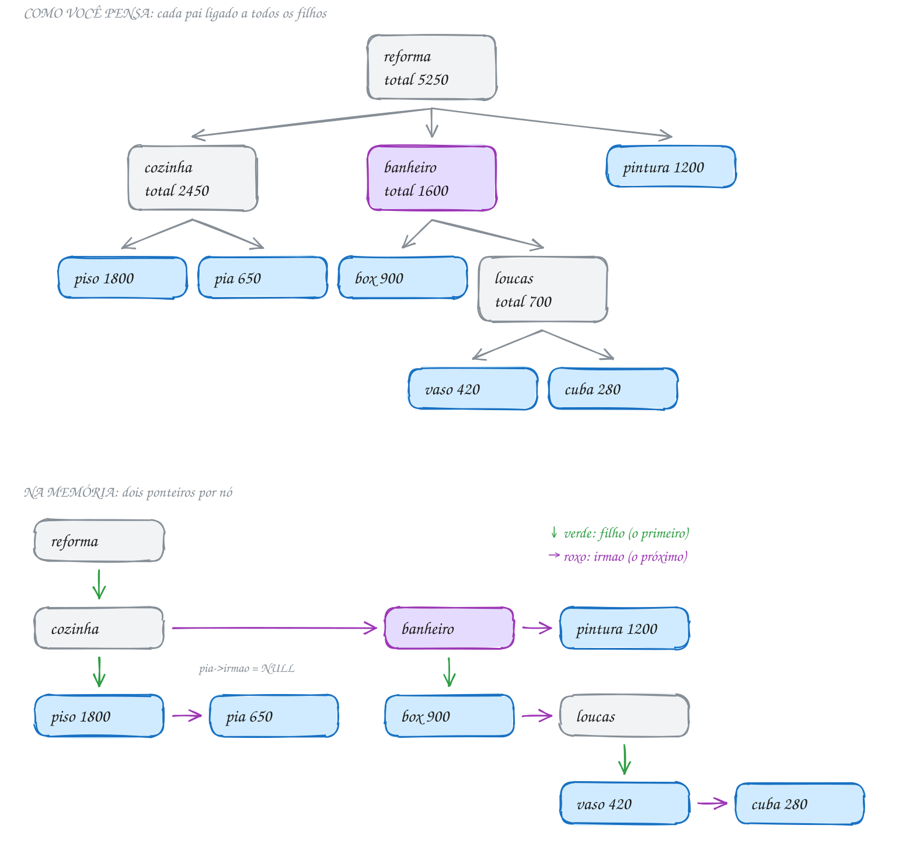</p>

O TAD está em `arvgen.h` e `arvgen.c`. O nó e as funções recursivas:

```c
typedef struct NoG {
    char nome[20];
    int valor;          // o valor do próprio nó (um grupo pode ter 0)
    struct NoG *filho;  // o primeiro filho
    struct NoG *irmao;  // o próximo irmão (mesmo pai)
} NoG;

int ag_total(const NoG *r) {
    int soma = r->valor;
    for (const NoG *p = r->filho; p != NULL; p = p->irmao) {
        soma += ag_total(p); // cada filho traz o total da sua subárvore
    }
    return soma;
}

static void mostra(const NoG *r, int nivel) {
    printf("%*s%s: %d\n", 2 * nivel, "", r->nome, ag_total(r));
    for (const NoG *p = r->filho; p != NULL; p = p->irmao) {
        mostra(p, nivel + 1);
    }
}
```

`ag_adiciona(pai, nome, valor)` pendura o filho novo no fim da fila de
irmãos e devolve o ponteiro dele:

```c
#include <stdio.h>
#include "arvgen.h"

int main(void) {
    NoG *reforma = ag_cria("reforma", 0);
    NoG *cozinha = ag_adiciona(reforma, "cozinha", 0);
    ag_adiciona(cozinha, "piso", 1800);
    ag_adiciona(cozinha, "pia", 650);
    NoG *banheiro = ag_adiciona(reforma, "banheiro", 0);
    ag_adiciona(banheiro, "box", 900);
    NoG *loucas = ag_adiciona(banheiro, "loucas", 0);
    ag_adiciona(loucas, "vaso", 420);
    ag_adiciona(loucas, "cuba", 280);
    ag_adiciona(reforma, "pintura", 1200);

    ag_mostra(reforma);
    printf("Itens: %d | altura: %d | grau da raiz: %d\n",
           ag_conta(reforma), ag_altura(reforma), ag_grau(reforma));

    ag_libera(reforma);
    return 0;
}
// Saída:
// reforma: 5250
//   cozinha: 2450
//     piso: 1800
//     pia: 650
//   banheiro: 1600
//     box: 900
//     loucas: 700
//       vaso: 420
//       cuba: 280
//   pintura: 1200
// Itens: 10 | altura: 3 | grau da raiz: 3
```

O fluxograma acompanha `ag_total` no banheiro. A soma começa em 0, o laço
visita o box (900) e as louças (700) e para quando `p` chega a `NULL`. O
banheiro devolve 1600:

<p align="center">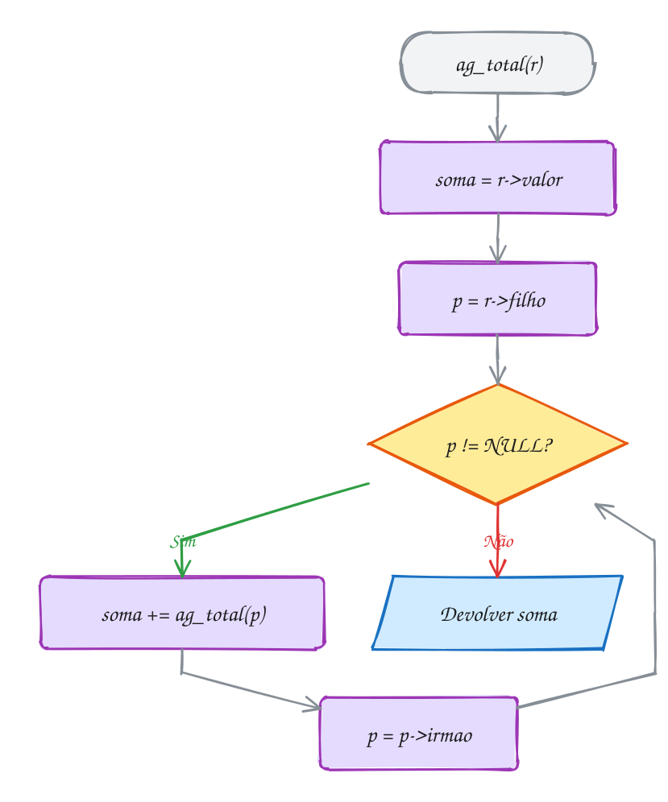</p>

> [!WARNING]
> O irmão está no **mesmo nível**. Na altura escrita como na binária,
> `1 + maior(altura(r->filho), altura(r->irmao))`, cada irmão conta como um
> andar: no orçamento, a resposta sai 6 em vez de 3. Só `filho` desce um nível.
> Do mesmo modo, `total(p->filho) + total(p->irmao)` soma irmãos que não são da
> subárvore de `p`.

> [!TIP]
> O `NoG` tem 40 bytes, com qualquer número de filhos. O preço é o acesso:
> achar o k-ésimo filho custa k passos pela lista de irmãos.

> [!NOTE]
> **Pergunta para você:** se o empreiteiro acrescentar `ag_adiciona(loucas,
> "torneira", 150)`, quais linhas da saída mudam? E se a torneira for pendurada
> na `pintura`? Pense na altura e no grau da raiz nos dois casos.

### Hora de praticar

**Exemplo A287 · O sumário numerado da apostila**

```c
#include <stdio.h>
#include "0144-arvgen.h"

// numera como num sumário: o número de um nó é o do pai + a posição dele
// entre os irmãos (1, 2, 3...). O prefixo vai crescendo na descida.
void sumario(const NoG *r, const char *prefixo) {
    int pos = 1;
    for (const NoG *p = r->filho; p != NULL; p = p->irmao, pos++) {
        char numero[32];
        if (prefixo[0] == '\0') {
            snprintf(numero, sizeof numero, "%d", pos);
        } else {
            snprintf(numero, sizeof numero, "%s.%d", prefixo, pos);
        }
        if (p->filho == NULL) {
            printf("%-6s %-14s %3d pág.\n", numero, p->nome, p->valor);
        } else {
            printf("%-6s %-14s %3d pág. no total\n", numero, p->nome, ag_total(p));
        }
        sumario(p, numero); // os filhos de p herdam o número dele
    }
}

int main(void) {
    NoG *apostila = ag_cria("apostila", 0);
    NoG *c1 = ag_adiciona(apostila, "Fundamentos", 0);
    ag_adiciona(c1, "Algoritmos", 6);
    ag_adiciona(c1, "Tipos", 9);
    NoG *c2 = ag_adiciona(apostila, "Condicionais", 0);
    ag_adiciona(c2, "if e else", 8);
    NoG *sw = ag_adiciona(c2, "switch", 0);
    ag_adiciona(sw, "case", 4);
    ag_adiciona(sw, "break", 3);
    ag_adiciona(apostila, "Projetos", 15); // capítulo sem seções: é folha

    sumario(apostila, "");
    printf("Total: %d páginas em %d capítulos\n", ag_total(apostila), ag_grau(apostila));

    ag_libera(apostila);
    return 0;
}
// Saída:
// 1      Fundamentos     15 pág. no total
// 1.1    Algoritmos       6 pág.
// 1.2    Tipos            9 pág.
// 2      Condicionais    15 pág. no total
// 2.1    if e else        8 pág.
// 2.2    switch           7 pág. no total
// 2.2.1  case             4 pág.
// 2.2.2  break            3 pág.
// 3      Projetos        15 pág.
// Total: 45 páginas em 3 capítulos
```

```bash
gcc ~/LPEDC/material/A287.c ~/LPEDC/material/0144-arvgen.c -o ~/LPEDC/material/A287 && ~/LPEDC/material/A287
```

**Exemplo A288 · A família vista como árvore binária**

```c
#include <stdio.h>
#include "0144-arvgen.h"

// Lendo filho como "esquerdo" e irmão como "direito", o NoG vira um nó de
// árvore binária. As funções abaixo percorrem as DUAS leituras.

void pre_geral(const NoG *r) { // o nó, depois cada filho
    printf(" %s", r->nome);
    for (const NoG *p = r->filho; p != NULL; p = p->irmao) {
        pre_geral(p);
    }
}

void pos_geral(const NoG *r) { // cada filho, depois o nó
    for (const NoG *p = r->filho; p != NULL; p = p->irmao) {
        pos_geral(p);
    }
    printf(" %s", r->nome);
}

void pre_binaria(const NoG *r) { // raiz, esquerda (filho), direita (irmão)
    if (r != NULL) {
        printf(" %s", r->nome);
        pre_binaria(r->filho);
        pre_binaria(r->irmao);
    }
}

void em_ordem_binaria(const NoG *r) { // esquerda, raiz, direita
    if (r != NULL) {
        em_ordem_binaria(r->filho);
        printf(" %s", r->nome);
        em_ordem_binaria(r->irmao);
    }
}

int altura_binaria(const NoG *r) { // irmão conta como mais um nível aqui
    if (r == NULL) {
        return -1;
    }
    int he = altura_binaria(r->filho);
    int hd = altura_binaria(r->irmao);
    return 1 + (he > hd ? he : hd);
}

int main(void) {
    NoG *lucia = ag_cria("Lucia", 0);
    NoG *ana = ag_adiciona(lucia, "Ana", 0);
    ag_adiciona(ana, "Bia", 0);
    ag_adiciona(ana, "Caio", 0);
    ag_adiciona(lucia, "Davi", 0);
    NoG *eva = ag_adiciona(lucia, "Eva", 0);
    ag_adiciona(eva, "Fabio", 0);

    printf("Pré-ordem da geral:    ");
    pre_geral(lucia);
    printf("\nPré-ordem da binária:  ");
    pre_binaria(lucia);
    printf("\nPós-ordem da geral:    ");
    pos_geral(lucia);
    printf("\nEm ordem da binária:   ");
    em_ordem_binaria(lucia);
    printf("\nAltura da geral: %d | altura da binária: %d\n",
           ag_altura(lucia), altura_binaria(lucia));

    ag_libera(lucia);
    return 0;
}
// Saída:
// Pré-ordem da geral:     Lucia Ana Bia Caio Davi Eva Fabio
// Pré-ordem da binária:   Lucia Ana Bia Caio Davi Eva Fabio
// Pós-ordem da geral:     Bia Caio Ana Davi Fabio Eva Lucia
// Em ordem da binária:    Bia Caio Ana Davi Fabio Eva Lucia
// Altura da geral: 2 | altura da binária: 4
```

```bash
gcc ~/LPEDC/material/A288.c ~/LPEDC/material/0144-arvgen.c -o ~/LPEDC/material/A288 && ~/LPEDC/material/A288
```

#### Exercícios

**Exercício E859** · ★☆☆

A lista de compras do churrasco é uma árvore geral (arvgen.h). Monte-a no
main com ag_cria e ag_adiciona:


```text
churrasco
  carnes: picanha 120, linguica 35, frango 28
  bebidas: refri 24, cerveja 60
  carvao 30
```


Os grupos (churrasco, carnes e bebidas) valem 0. Escreva folhas(r), que conta
os nós sem filhos (os itens do carrinho), e grupos(r), que conta os nós com
pelo menos um filho (a raiz entra). Mostre também o total com ag_total.


```text
Saída esperada:
Itens (folhas): 6
Grupos (nós com filhos): 3
Total: R$ 297
```

```bash
gcc ~/LPEDC/material/E859.c ~/LPEDC/material/0144-arvgen.c -o ~/LPEDC/material/E859 && ~/LPEDC/material/E859
```

**Exercício E861** · ★★☆

O orçamento de uma reforma é uma árvore geral (arvgen.h). Monte-a no main:


```text
reforma
  cozinha: piso 1800, pia 650
  banheiro: box 900, loucas (vaso 420, cuba 280)
  pintura 1200
```


Escreva caminho(r, nome): mostra a trilha da raiz até o item, separada por "
> ", e a profundidade do item. Se o item não existir, avisa. Teste com vaso,
pia, reforma e janela.


```text
Saída esperada:
vaso: reforma > banheiro > loucas > vaso (profundidade 3)
pia: reforma > cozinha > pia (profundidade 2)
reforma: reforma (profundidade 0)
janela: não encontrado
```

```bash
gcc ~/LPEDC/material/E861.c ~/LPEDC/material/0144-arvgen.c -o ~/LPEDC/material/E861 && ~/LPEDC/material/E861
```

**Exercício E862** · ★★☆

A árvore genealógica de seu Joaquim é uma árvore geral (arvgen.h). Monte-a no
main:


```text
Joaquim
  Rosa: Paulo, Rita (Leo)
  Jorge: Nina, Otto, Pedro
  Vera
```


Para a foto da festa, escreva conta_nivel(r, alvo), que conta as pessoas na
profundidade alvo, e mostra_nivel(r, alvo), que imprime os nomes dessa
profundidade, da esquerda para a direita. No main, use ag_altura para saber
quantas gerações existem.


```text
Saída esperada:
Geração 0 (1): Joaquim
Geração 1 (3): Rosa Jorge Vera
Geração 2 (5): Paulo Rita Nina Otto Pedro
Geração 3 (1): Leo
```

```bash
gcc ~/LPEDC/material/E862.c ~/LPEDC/material/0144-arvgen.c -o ~/LPEDC/material/E862 && ~/LPEDC/material/E862
```

**Exercício E864** · ★★★

Monte uma árvore geral (arvgen.h) pela entrada. Cada linha tem "pai nome
valor"; na primeira, o pai é "-" e o nome é a raiz. Um filho novo entra no
fim da fila de irmãos do pai. Se o pai não existir, avise e ignore a linha.
No fim, mostre a árvore (ag_mostra), o número de nós, a altura e qual filho
da raiz tem o maior total. Sem nenhuma linha, mostre "Árvore vazia".


```text
Entrada:
- casamento 0
casamento buffet 0
buffet salgados 1800
buffet bolo 950
casamento decoracao 0
decoracao flores 1200
igreja padre 300
decoracao luzes 400
casamento musica 2500
buffet doces 700
```


```text
Saída esperada:
pai igreja não existe: linha ignorada
casamento: 7550
  buffet: 3450
    salgados: 1800
    bolo: 950
    doces: 700
  decoracao: 1600
    flores: 1200
    luzes: 400
  musica: 2500
Itens: 9 | altura: 2
Maior gasto: buffet (R$ 3450)
```

```bash
gcc ~/LPEDC/material/E864.c ~/LPEDC/material/0144-arvgen.c -o ~/LPEDC/material/E864 && ~/LPEDC/material/E864
```

---

## 0145 · Rubro-negra esquerdista (LLRB): inserção

O síndico cadastra as tags da cancela do condomínio a qualquer hora. Uma BST
degenera se as tags chegarem em ordem; a AVL resolve, mas guarda alturas e tem
quatro casos de rotação. A **rubro-negra** é mais simples.

Ela se apoia na **árvore 2-3**: um nó tem **uma chave** (2 filhos) ou **duas**
(3 filhos). Toda chave entra numa folha; com três chaves, a folha estoura: a do
meio sobe e as outras duas viram nós separados. A árvore só cresce quando a raiz
estoura, então **todas as folhas ficam no mesmo nível**.

A **rubro-negra esquerdista** (*left-leaning red-black*, LLRB) guarda a árvore
2-3 em nós binários. Um nó `[a b]` vira o `b` com o `a` pendurado à esquerda por
um **link vermelho**; os outros links são **pretos**. Cada nó guarda a cor do
link que chega nele (`bool vermelho`).

As regras da LLRB são a árvore 2-3 escrita em cores:

1. link vermelho **só à esquerda**;
2. nunca **dois vermelhos seguidos** (nó de três chaves não existe na 2-3);
3. todo caminho da raiz até um `NULL` passa pelo **mesmo número de nós pretos**
   (a **altura preta**), porque na 2-3 todas as folhas estão no mesmo nível.

A raiz é sempre preta. O caminho mais longo tem no máximo o dobro do mais curto,
e a altura fica abaixo de 2 · log₂(n + 1).

> [!NOTE]
> Esta é a de Sedgewick. A rubro-negra **clássica** do Cormen (a da
> prova do PPGI) põe a cor no **nó**, aceita vermelho dos dois lados (equivale à
> árvore 2-3-4), usa folhas `NIL` pretas e conserta a inserção pelos casos do
> **tio**, com no máximo duas rotações. Veja o assunto 0177.

A inserção pendura um nó **vermelho**, como na BST. Na volta da recursão, cada
ancestral aplica três consertos, **nesta ordem**:

| Situação em `h` | Conserto | Na árvore 2-3 |
| --- | --- | --- |
| filho direito vermelho, esquerdo preto | rotação à esquerda | deita o nó de 2 chaves para a esquerda |
| filho esquerdo e neto esquerdo vermelhos | rotação à direita | arruma um nó de 3 chaves temporário |
| os dois filhos vermelhos | inverte as cores | o nó de 3 chaves estoura e a do meio sobe |

A **inversão de cores** pinta os dois filhos de preto e `h` de vermelho: a chave
do meio sobe para o pai, onde pode disparar os consertos de novo.

No desenho, as tags 30, 10 e 20 formam um zigue-zague e disparam os três
consertos. Com as tags 50 e 40, o 20 vermelho fica colado no 40, o nó 2-3
`[20 40]`:

<p align="center">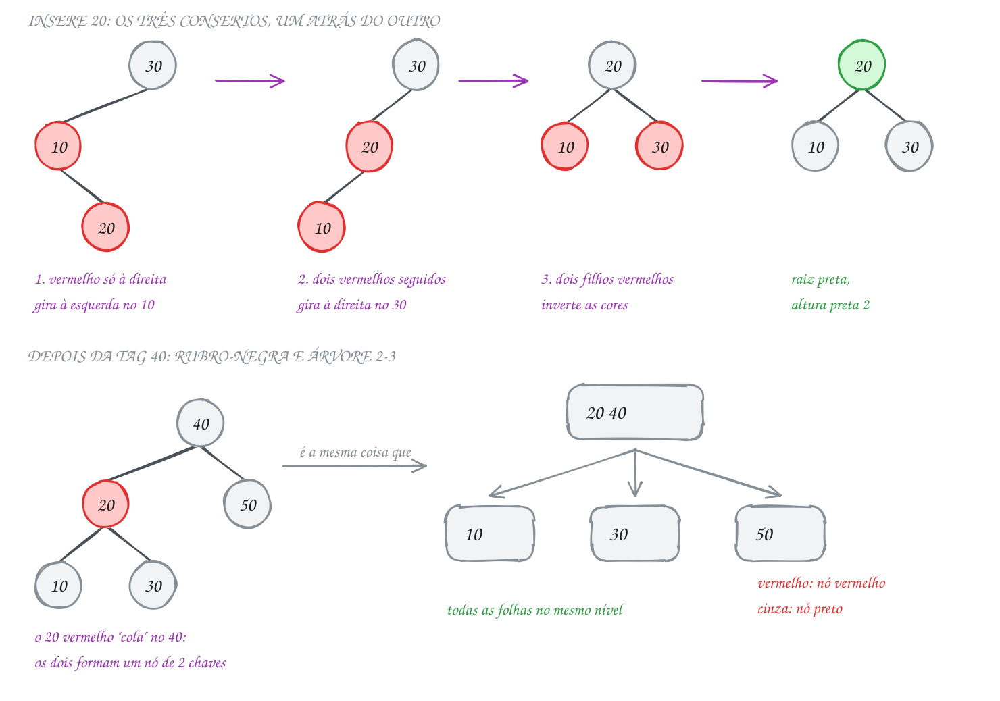</p>

A inserção de `rubronegra.c`. A rotação é a da AVL, e a cor do link sobe junto:

```c
static NoRN *gira_esquerda(NoRN *h) {
    NoRN *x = h->dir;
    h->dir = x->esq;
    x->esq = h;
    x->vermelho = h->vermelho; // x herda a cor do link que chegava em h
    h->vermelho = true;
    rotacoes++;
    return x;
}

static NoRN *insere(NoRN *h, int chave) {
    if (h == NULL) {
        return novo_no(chave); // todo nó novo chega vermelho
    }
    if (chave < h->chave) {
        h->esq = insere(h->esq, chave);
    } else if (chave > h->chave) {
        h->dir = insere(h->dir, chave);
    }
    // na volta, os três consertos, nesta ordem
    if (eh_vermelho(h->dir) && !eh_vermelho(h->esq)) {
        h = gira_esquerda(h);      // 1. vermelho à direita
    }
    if (eh_vermelho(h->esq) && eh_vermelho(h->esq->esq)) {
        h = gira_direita(h);       // 2. dois vermelhos seguidos
    }
    if (eh_vermelho(h->esq) && eh_vermelho(h->dir)) {
        inverte_cores(h);          // 3. dois filhos vermelhos
    }
    return h;
}

NoRN *rn_insere(NoRN *raiz, int chave) {
    raiz = insere(raiz, chave);
    raiz->vermelho = false; // a raiz é sempre preta
    return raiz;
}
```

`eh_vermelho(NULL)` devolve `false`: `NULL` conta como preto. O cliente
cadastra as tags e mostra a árvore em pré-ordem, com `*` nos vermelhos:

```c
#include <stdio.h>
#include "rubronegra.h"

int main(void) {
    int tags[] = {30, 10, 20, 50, 40};
    NoRN *raiz = NULL;

    for (int i = 0; i < 5; i++) {
        raiz = rn_insere(raiz, tags[i]);
        printf("Insere %d: pré", tags[i]);
        rn_pre_ordem(raiz);
        printf(" | rotações %d | inversões %d\n", rn_rotacoes(), rn_inversoes());
    }
    printf("Altura %d, altura preta %d\n", rn_altura(raiz), rn_altura_preta(raiz));

    raiz = rn_libera(raiz);
    return 0;
}
// Saída:
// Insere 30: pré 30 | rotações 0 | inversões 0
// Insere 10: pré 30 10* | rotações 0 | inversões 0
// Insere 20: pré 20 10 30 | rotações 2 | inversões 1
// Insere 50: pré 20 10 50 30* | rotações 3 | inversões 1
// Insere 40: pré 40 20* 10 30 50 | rotações 6 | inversões 2
// Altura 2, altura preta 2
```

O fluxograma mostra os três `if` da volta. O caminho verde é o do nó 30 quando
a tag 20 chega: o 10 já fez o primeiro conserto, e o 30 faz o segundo e o
terceiro:

<p align="center">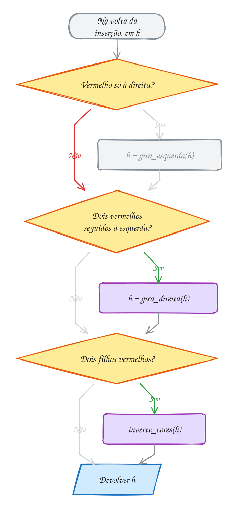</p>

### Passo a passo

A tag 40 desce 20, 50, 30 e vira filha direita vermelha do 30, que também é
vermelho:

| Nó na volta | O que encontra | Conserto | Como fica a subárvore |
| --- | --- | --- | --- |
| 30 | filho direito 40 vermelho | rotação à esquerda | 40* com 30* à esquerda |
| 50 | 40* e 30* seguidos à esquerda | rotação à direita | 40 com 30* e 50* |
| 40 | dois filhos vermelhos | inverte as cores | 40* com 30 e 50 pretos |
| 20 | filho direito 40 vermelho | rotação à esquerda | 40 com 20* (10, 30) e 50 |

Três rotações e uma inversão neste exemplo.

> [!WARNING]
> Na rotação, quem sobe herda a cor de quem desce (`x->vermelho = h->vermelho`);
> sem essa linha, a altura preta se desencontra. Outro erro: a raiz fica
> vermelha após uma inversão no topo, por isso `rn_insere` a pinta de preto em
> **toda** inserção.

> [!TIP]
> O `NoRN` tem 24 bytes, como o da AVL.

> [!NOTE]
> **Pergunta para você:** com as tags 10, 20, 30, 40, 50, 60 e 70, nesta ordem,
> qual fica na raiz e quantos nós vermelhos sobram? Desenhe a árvore 2-3 de cada
> passo e confira com o `rn_pre_ordem`.

### Hora de praticar

**Exemplo A289 · Mil chaves em ordem, mil ao contrário**

```c
#include <math.h>
#include <stdio.h>
#include "0145-rubronegra.h"

void relata(const char *nome, const NoRN *r, int rot, int inv) {
    printf("%-12s altura %2d | altura preta %2d | rotações %4d | inversões %4d\n",
           nome, rn_altura(r), rn_altura_preta(r), rot, inv);
}

int main(void) {
    int n = 1000;
    NoRN *cresce = NULL;
    for (int i = 1; i <= n; i++) {
        cresce = rn_insere(cresce, i);
    }
    int rot1 = rn_rotacoes(), inv1 = rn_inversoes();
    relata("crescente:", cresce, rot1, inv1);

    NoRN *desce = NULL; // os contadores são acumulados: desconte os de antes
    for (int i = n; i >= 1; i--) {
        desce = rn_insere(desce, i);
    }
    relata("decrescente:", desce, rn_rotacoes() - rot1, rn_inversoes() - inv1);

    NoRN *mistura = NULL; // 1000 chaves embaralhadas: i * 7919 % 1000
    int rot2 = rn_rotacoes(), inv2 = rn_inversoes();
    for (int i = 0; i < n; i++) {
        mistura = rn_insere(mistura, i * 7919 % n);
    }
    relata("embaralhada:", mistura, rn_rotacoes() - rot2, rn_inversoes() - inv2);

    printf("Limite teórico: altura <= 2 log2(n + 1) = %.1f\n", 2 * log2(n + 1.0));
    printf("Busca 777 na crescente: %s\n", rn_busca(cresce, 777) ? "achou" : "não achou");

    cresce = rn_libera(cresce);
    desce = rn_libera(desce);
    mistura = rn_libera(mistura);
    return 0;
}
// Saída:
// crescente:   altura  9 | altura preta  9 | rotações  991 | inversões  985
// decrescente: altura 14 | altura preta  9 | rotações  985 | inversões  985
// embaralhada: altura 11 | altura preta  8 | rotações  546 | inversões  658
// Limite teórico: altura <= 2 log2(n + 1) = 19.9
// Busca 777 na crescente: achou
```

```bash
gcc ~/LPEDC/material/A289.c ~/LPEDC/material/0145-rubronegra.c -o ~/LPEDC/material/A289 -lm && ~/LPEDC/material/A289
```

**Exemplo A290 · A árvore 2-3 escondida na rubro-negra**

```c
#include <stdio.h>
#include "0145-rubronegra.h"

// Cole cada nó vermelho no pai: os dois viram um nó de 2 chaves (um "3-nó",
// com 3 filhos). O resultado é uma árvore 2-3, com todas as folhas no mesmo
// nível. Esta função mostra os nós 2-3 que estão no nível alvo.
void nivel_23(const NoRN *h, int alvo) {
    if (h == NULL) {
        return;
    }
    const NoRN *e = h->esq;
    bool tres = e != NULL && e->vermelho; // h + filho vermelho = 3-nó
    if (alvo == 0) {
        if (tres) {
            printf(" [%d %d]", e->chave, h->chave);
        } else {
            printf(" [%d]", h->chave);
        }
        return;
    }
    if (tres) { // os 3 filhos do 3-nó
        nivel_23(e->esq, alvo - 1);
        nivel_23(e->dir, alvo - 1);
    } else {
        nivel_23(h->esq, alvo - 1);
    }
    nivel_23(h->dir, alvo - 1);
}

int main(void) {
    int chaves[] = {50, 20, 80, 10, 30, 60, 90, 40, 70, 25};
    NoRN *raiz = NULL;
    for (int i = 0; i < 10; i++) {
        raiz = rn_insere(raiz, chaves[i]);
    }

    printf("Rubro-negra (pré, * = vermelho):");
    rn_pre_ordem(raiz);
    printf("\nAltura: %d | altura preta: %d\n", rn_altura(raiz), rn_altura_preta(raiz));

    printf("Vista como árvore 2-3:\n");
    for (int d = 0; d < rn_altura_preta(raiz); d++) {
        printf("  nível %d:", d);
        nivel_23(raiz, d);
        printf("\n");
    }

    raiz = rn_libera(raiz);
    return 0;
}
// Saída:
// Rubro-negra (pré, * = vermelho): 50 30 20* 10 25 40 80 70 60* 90
// Altura: 3 | altura preta: 3
// Vista como árvore 2-3:
//   nível 0: [50]
//   nível 1: [20 30] [80]
//   nível 2: [10] [25] [40] [60 70] [90]
```

```bash
gcc ~/LPEDC/material/A290.c ~/LPEDC/material/0145-rubronegra.c -o ~/LPEDC/material/A290 && ~/LPEDC/material/A290
```

#### Exercícios

**Exercício E865** · ★☆☆

Insira os códigos de 1 a 10, em ordem, numa rubro-negra (rubronegra.h) e
escreva conta_vermelhos(r), que devolve quantos nós vermelhos a árvore tem.
Escreva também conta_nos(r) e mostre quantos nós são pretos. Mostre ainda a
pré-ordem (rn_pre_ordem) numa linha que começa com "pré:".


```text
Saída esperada:
pré: 4 2 1 3 8 6* 5 7 10 9*
nós: 10 | vermelhos: 2 | pretos: 8
```

```bash
gcc ~/LPEDC/material/E865.c ~/LPEDC/material/0145-rubronegra.c -o ~/LPEDC/material/E865 && ~/LPEDC/material/E865
```

**Exercício E867** · ★★☆

Escreva confere(r), o fiscal da rubro-negra esquerdista. Ela devolve a altura
preta (quantos nós pretos há da raiz até um NULL) se as três regras valerem,
ou um código negativo com a primeira regra quebrada que achar:


```text
-1: um link vermelho à direita;
-2: dois vermelhos seguidos (um vermelho com filho esquerdo vermelho);
-3: dois caminhos com quantidades diferentes de nós pretos.
```


Teste com quatro árvores: a do TAD (rubronegra.h) com as chaves de 1 a 20 e
três montadas à mão com malloc (escreva uma função no(chave, vermelho, esq,
dir)), cada nó dado como chave/cor:


```text
A: 20 preto, filho esquerdo 10 preto, filho direito 30 vermelho
B: 30 preto, esquerdo 20 vermelho (com filho esquerdo 10 vermelho),
   direito 40 preto
C: 20 preto, esquerdo 10 preto (com filho esquerdo 5 preto),
   direito 30 preto sem filhos
```


```text
Saída esperada:
TAD (1 a 20): ok, altura preta 4
Árvore A: quebra a regra 1
Árvore B: quebra a regra 2
Árvore C: quebra a regra 3
```

```bash
gcc ~/LPEDC/material/E867.c ~/LPEDC/material/0145-rubronegra.c -o ~/LPEDC/material/E867 && ~/LPEDC/material/E867
```

**Exercício E868** · ★★☆

A eleição do síndico guarda os números votados numa rubro-negra esquerdista
que você escreve do zero. Cada nó tem numero e qtd (quantos votos): número
repetido não cria nó novo, só soma 1 em qtd. Escreva insere, apura(r), que
mostra cada número em ordem crescente com a quantidade ("voto" no singular
quando for 1), e vencedor(r), que devolve o nó com mais votos.

A urna tem estes 12 votos, na ordem:


```text
45 12 45 13 30 12 45 13 45 30 12 99
```


```text
Saída esperada:
12: 3 votos
13: 2 votos
30: 2 votos
45: 4 votos
99: 1 voto
Vencedor: 45 com 4 de 12 votos
```

```bash
gcc ~/LPEDC/material/E868.c ~/LPEDC/material/0145-rubronegra.c -o ~/LPEDC/material/E868 && ~/LPEDC/material/E868
```

**Exercício E870** · ★★★

Escreva do zero (sem o rubronegra.h, que guarda int) uma rubro-negra
esquerdista de NOMES para a lista de convidados de uma festa. Compare com
strcmp; nome repetido é ignorado. Insira, nesta ordem:


```text
Marcos Ana Teresa Bruno Lia Zeca Carla Otavio Duda Ana
```


Mostre a lista em ordem, a pré-ordem com * nos vermelhos, a altura, a
altura preta e o resultado de duas buscas.


```text
Saída esperada:
Em ordem: Ana Bruno Carla Duda Lia Marcos Otavio Teresa Zeca
Pré-ordem: Marcos Duda Bruno* Ana Carla Lia Teresa Otavio Zeca
Altura 3, altura preta 3
Lia: na lista | Rafa: fora
```

```bash
gcc ~/LPEDC/material/E870.c ~/LPEDC/material/0145-rubronegra.c -o ~/LPEDC/material/E870 && ~/LPEDC/material/E870
```

---

## 0146 · Árvore B: busca, divisão e inserção

O acervo de uma biblioteca tem milhões de fichas no disco. Um HD leva uns 10
milissegundos por bloco. Numa AVL com 2 milhões de livros, a busca desce uns 21
nós, e cada nó pode ser uma ida ao disco. Importa **ler poucos nós**.

A **árvore B** usa nós gordos. Cada nó guarda **várias chaves em ordem** e tem
um filho a mais do que chaves: com `[40 70]`, o filho 0 tem as chaves menores
que 40, o filho 1 as entre 40 e 70, e o filho 2 as maiores que 70. Num banco de
dados, um nó ocupa um bloco do disco.

O **grau mínimo** `t` define o tamanho do nó:

- todo nó, menos a raiz, tem de `t - 1` a `2t - 1` chaves (a raiz pode ter 1);
- um nó com `k` chaves que não é folha tem `k + 1` filhos;
- **todas as folhas ficam no mesmo nível**.

O TAD usa `t = 2`: de 1 a 3 chaves por nó, de 2 a 4 filhos (a árvore 2-3-4).
Como cada nó abaixo da raiz tem pelo menos `t` filhos, a altura de uma árvore B
com `n` chaves é `h ≤ log_t((n + 1) / 2)` (Cormen).

A **busca** é a da BST com um laço dentro do nó: ande até achar uma chave maior
ou igual. Se for igual, achou; senão, desça pelo filho daquela posição. Lê um nó
por nível: altura + 1 nós.

A **inserção** põe a chave numa folha. Se a folha está cheia, ocorre a
**divisão**: o nó com `2t - 1` chaves vira dois nós de `t - 1` chaves, e a
**chave do meio sobe** para o pai. Para o pai nunca estar cheio, o TAD divide
**na descida** todo nó cheio do caminho; a raiz cheia se divide e a chave do
meio vira a raiz nova. A árvore cresce por cima, e as folhas ficam no mesmo
nível.

Exemplo: 11 livros, na ordem 40, 10, 70, 20, 50, 80, 30, 60, 90, 25 e 85. O 25
encontra a folha `[10 20 30]` cheia: ela se divide e o 20 sobe. O 85 encontra a
raiz `[20 40 70]` cheia: ela se divide e o 40 vira a raiz nova. A busca pelo 60
lê três nós:

<p align="center">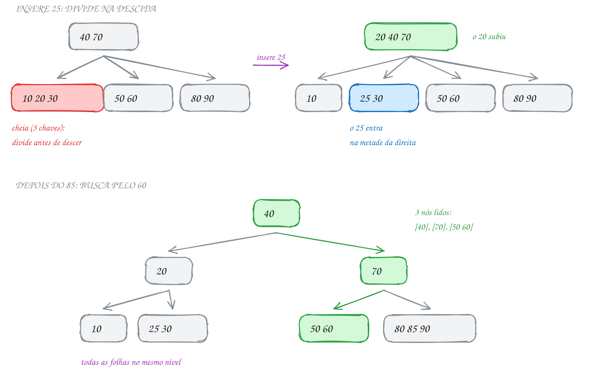</p>

A divisão e a inserção na raiz, em `arvoreb.c` (`AB_T` é o `t`; `AB_MAX`, `2t - 1`):

```c
static void divide(NoB *pai, int i) {
    NoB *y = pai->filho[i];         // o filho cheio
    NoB *z = novo_no(y->folha);     // a metade da direita
    z->n = AB_T - 1;
    for (int j = 0; j < AB_T - 1; j++) {
        z->chave[j] = y->chave[j + AB_T]; // as chaves depois do meio
    }
    if (!y->folha) {
        for (int j = 0; j < AB_T; j++) {
            z->filho[j] = y->filho[j + AB_T]; // e os filhos delas
        }
    }
    y->n = AB_T - 1; // y fica com as chaves antes do meio

    for (int j = pai->n; j > i; j--) { // abre espaço no pai
        pai->filho[j + 1] = pai->filho[j];
    }
    pai->filho[i + 1] = z;
    for (int j = pai->n - 1; j >= i; j--) {
        pai->chave[j + 1] = pai->chave[j];
    }
    pai->chave[i] = y->chave[AB_T - 1]; // a chave do meio sobe
    pai->n++;
}

NoB *ab_insere(NoB *raiz, int chave) {
    if (ab_busca(raiz, chave, NULL)) {
        return raiz; // repetida
    }
    if (raiz == NULL) {
        raiz = novo_no(true);
    }
    if (raiz->n == AB_MAX) { // raiz cheia: a árvore cresce por cima
        NoB *s = novo_no(false);
        s->filho[0] = raiz;
        divide(s, 0);
        raiz = s;
    }
    insere_nao_cheio(raiz, chave);
    return raiz;
}
```

A `divide` só diminui `y->n`: as chaves do fim ficam no vetor, fora da parte em uso.
O cliente:

```c
#include <stdio.h>
#include "arvoreb.h"

int main(void) {
    int livros[] = {40, 10, 70, 20, 50, 80, 30, 60, 90, 25, 85};
    NoB *acervo = NULL;
    for (int i = 0; i < 11; i++) {
        acervo = ab_insere(acervo, livros[i]);
    }

    printf("Árvore B com 11 livros (altura %d, %d divisões):\n",
           ab_altura(acervo), ab_divisoes());
    ab_mostra(acervo);

    int procura[] = {60, 65};
    for (int i = 0; i < 2; i++) {
        int lidos;
        bool achou = ab_busca(acervo, procura[i], &lidos);
        printf("Livro %d: %s, %d nós lidos\n", procura[i],
               achou ? "achou" : "não tem", lidos);
    }

    acervo = ab_libera(acervo);
    return 0;
}
// Saída:
// Árvore B com 11 livros (altura 2, 4 divisões):
//   nível 0: [40]
//   nível 1: [20] [70]
//   nível 2: [10] [25 30] [50 60] [80 85 90]
// Livro 60: achou, 3 nós lidos
// Livro 65: não tem, 3 nós lidos
```

O fluxograma segue `insere_nao_cheio` na raiz `[40 70]` quando o 25 chega. O
filho 0, cheio, se divide e o 20 sobe. Como 25 > 20, o `i++` leva a chave à
metade nova, folha `[30]`:

<p align="center">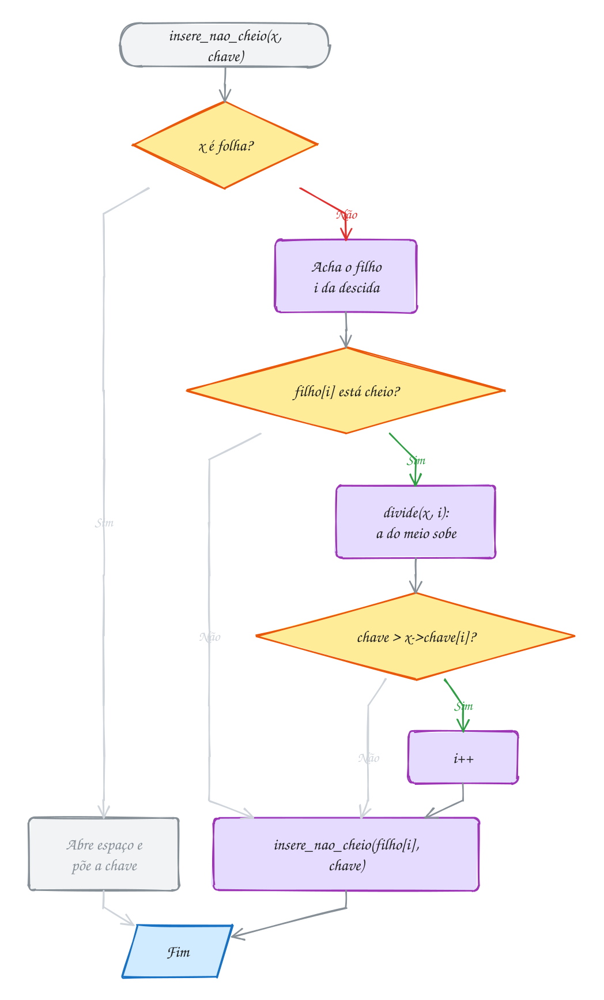</p>

> [!WARNING]
> Depois de `divide(x, i)`, a chave que subiu está em `x->chave[i]`. Sem
> `if (chave > x->chave[i]) i++;`, chaves grandes vão para a metade da esquerda
> e a busca não as acha. Cuidado também com "ordem m": são **m filhos no
> máximo** em alguns livros (Knuth) e **de m a 2m registros** no Ziviani. O curso
> usa o grau mínimo `t` do Cormen.

> [!TIP]
> Com chaves `int` e ponteiros de 8 bytes, `t = 170` (nó de `24t` bytes) cabe num
> bloco de 4096 bytes: um bilhão de chaves em altura 3, 4 blocos lidos por busca.

> [!NOTE]
> **Pergunta para você:** na árvore final, insira o 87. Qual nó se divide, qual
> chave sobe e como fica o nível 1? Depois insira o 95: a raiz muda? Confira
> acrescentando as chaves no vetor do exemplo.

### Hora de praticar

**Exemplo A291 · Quantas idas ao disco**

```c
#include <math.h>
#include <stdio.h>
#include "0146-arvoreb.h"

// Num banco de dados, cada nó da árvore B é um bloco do disco, e ler um bloco
// custa muito mais que comparar chaves na memória. O que importa é a altura.

int main(void) {
    // 1. na prática, com o TAD (T = 2, até 3 chaves por nó)
    NoB *r = NULL;
    int n = 100000;
    for (int i = 1; i <= n; i++) {
        r = ab_insere(r, i);
    }
    int lidos;
    ab_busca(r, 77777, &lidos);
    printf("TAD com T = 2 e %d chaves: altura %d, busca do 77777 leu %d nós\n",
           n, ab_altura(r), lidos);
    printf("Uma árvore binária perfeita com %d chaves teria altura %d\n",
           n, (int)floor(log2(n)));
    r = ab_libera(r);

    // 2. na teoria: altura máxima de uma árvore B, h <= log_t((n + 1) / 2)
    int ts[] = {2, 50, 500};
    double ns[] = {1e6, 1e9};
    printf("\nAltura máxima (nós lidos = altura + 1):\n");
    printf("%14s %8s %8s %8s\n", "chaves", "T=2", "T=50", "T=500");
    for (int j = 0; j < 2; j++) {
        printf("%14.0f", ns[j]);
        for (int i = 0; i < 3; i++) {
            double h = log((ns[j] + 1) / 2) / log(ts[i]); // log na base t
            printf(" %8d", (int)floor(h));
        }
        printf("\n");
    }
    return 0;
}
// Saída:
// TAD com T = 2 e 100000 chaves: altura 15, busca do 77777 leu 16 nós
// Uma árvore binária perfeita com 100000 chaves teria altura 16
//
// Altura máxima (nós lidos = altura + 1):
//         chaves      T=2     T=50    T=500
//        1000000       18        3        2
//     1000000000       28        5        3
```

```bash
gcc ~/LPEDC/material/A291.c ~/LPEDC/material/0146-arvoreb.c -o ~/LPEDC/material/A291 -lm && ~/LPEDC/material/A291
```

**Exemplo A292 · As notas fiscais em ordem**

```c
#include <stdio.h>
#include "0146-arvoreb.h"

// Em ordem num nó de várias chaves: filho 0, chave 0, filho 1, chave 1, ...,
// chave n-1, filho n. Cada chave fica entre as subárvores das menores e das
// maiores que ela, como na BST.
void em_ordem(const NoB *r) {
    for (int i = 0; i < r->n; i++) {
        if (!r->folha) {
            em_ordem(r->filho[i]);
        }
        printf(" %d", r->chave[i]);
    }
    if (!r->folha) {
        em_ordem(r->filho[r->n]); // o último filho, depois da última chave
    }
}

// quantas chaves há em cada nível (nivel conta a partir da raiz)
void conta_por_nivel(const NoB *r, int nivel, int qtd[]) {
    qtd[nivel] += r->n;
    if (!r->folha) {
        for (int i = 0; i <= r->n; i++) {
            conta_por_nivel(r->filho[i], nivel + 1, qtd);
        }
    }
}

int main(void) {
    int notas[] = {512, 87, 340, 905, 23, 678, 150, 401, 799, 266, 33, 960, 610, 445, 118};
    NoB *r = NULL;
    for (int i = 0; i < 15; i++) {
        r = ab_insere(r, notas[i]);
    }

    printf("Por nível:\n");
    ab_mostra(r);
    printf("Em ordem:");
    em_ordem(r);
    printf("\n");

    int qtd[10] = {0};
    conta_por_nivel(r, 0, qtd);
    for (int d = 0; d <= ab_altura(r); d++) {
        printf("chaves no nível %d: %d\n", d, qtd[d]);
    }

    r = ab_libera(r);
    return 0;
}
// Saída:
// Por nível:
//   nível 0: [340]
//   nível 1: [87] [512 678]
//   nível 2: [23 33] [118 150 266] [401 445] [610] [799 905 960]
// Em ordem: 23 33 87 118 150 266 340 401 445 512 610 678 799 905 960
// chaves no nível 0: 1
// chaves no nível 1: 3
// chaves no nível 2: 11
```

```bash
gcc ~/LPEDC/material/A292.c ~/LPEDC/material/0146-arvoreb.c -o ~/LPEDC/material/A292 && ~/LPEDC/material/A292
```

#### Exercícios

**Exercício E871** · ★☆☆

Insira os códigos de 1 a 20, em ordem, numa árvore B (arvoreb.h, T = 2) e
escreva duas funções recursivas: conta_chaves(r), o total de chaves, e
conta_nos(r), o total de nós. Mostre a árvore com ab_mostra e a média de
chaves por nó.


```text
Saída esperada:
  nível 0: [8]
  nível 1: [4] [12]
  nível 2: [2] [6] [10] [14 16 18]
  nível 3: [1] [3] [5] [7] [9] [11] [13] [15] [17] [19 20]
chaves: 20 | nós: 17 | média: 1.18 chaves por nó
```

```bash
gcc ~/LPEDC/material/E871.c ~/LPEDC/material/0146-arvoreb.c -o ~/LPEDC/material/E871 && ~/LPEDC/material/E871
```

**Exercício E873** · ★★☆

No disco, cada nó da árvore B ocupa um bloco inteiro, cheio ou não. A
ocupação é a fração das vagas de chave que estão em uso:
chaves / (nós · AB_MAX). Monte duas árvores com as chaves de 1 a 200: uma
inserindo em ordem crescente e outra na ordem embaralhada i * 37 % 200 + 1
(i de 0 a 199, que passa por todos os números de 1 a 200 uma vez só).
Escreva mede(r, &chaves, &nos), que soma as chaves e os nós de uma árvore,
e mostre nós, altura e ocupação de cada uma.


```text
Saída esperada:
crescente:   nós 195 | altura 6 | ocupação 34.2%
embaralhada: nós 127 | altura 5 | ocupação 52.5%
```

```bash
gcc ~/LPEDC/material/E873.c ~/LPEDC/material/0146-arvoreb.c -o ~/LPEDC/material/E873 && ~/LPEDC/material/E873
```

**Exercício E874** · ★★☆

A contabilidade quer as notas fiscais de uma faixa de números. Insira estas
15 notas numa árvore B (arvoreb.h, que fica com 9 nós), na ordem:


```text
512 87 340 905 23 678 150 401 799 266 33 960 610 445 118
```


Escreva intervalo(r, a, b, &visitados): mostra, em ordem crescente, as chaves
de a até b e conta quantos nós foram lidos. Não leia subárvores que não podem
ter chave na faixa. Teste com as faixas 300-700, 100-160 e 970-999.


```text
Saída esperada:
notas de 300 a 700: 340 401 445 512 610 678 (7 nós lidos de 9)
notas de 100 a 160: 118 150 (3 nós lidos de 9)
notas de 970 a 999: (3 nós lidos de 9)
```

```bash
gcc ~/LPEDC/material/E874.c ~/LPEDC/material/0146-arvoreb.c -o ~/LPEDC/material/E874 && ~/LPEDC/material/E874
```

**Exercício E876** · ★★★

Escreva do zero uma árvore B de grau mínimo T = 3: cada nó guarda de 2 a 5
chaves (a raiz pode ter 1) e tem até 6 filhos. Use a inserção com divisão
na descida, como no texto, mas com T e MAX definidos no seu arquivo (o TAD
arvoreb.h tem T = 2 fixo). Insira i * 7 % 31 para i de 1 a 30 (são os
números de 1 a 30, embaralhados: 7, 14, 21, 28, 4, 11...). Mostre a árvore
por nível e o resultado de duas buscas, contando os blocos lidos.


```text
Saída esperada:
nível 0: [14]
nível 1: [4 7 11] [18 21 26]
nível 2: [1 2 3] [5 6] [8 9 10] [12 13] [15 16 17] [19 20] [22 23 24 25] [27 28 29 30]
busca 23: achou, 3 blocos lidos
busca 31: não achou, 3 blocos lidos
```

```bash
gcc ~/LPEDC/material/E876.c ~/LPEDC/material/0146-arvoreb.c -o ~/LPEDC/material/E876 && ~/LPEDC/material/E876
```

---

## 0147 · Trie: árvore de prefixos e autocompletar

Você digita `bol` e o teclado oferece "bola", "boleto", "bolo" e "bolsa" sem
comparar com o dicionário inteiro: nele, **o prefixo é o endereço**.

Esse modo é a **trie** (de *retrieval*; ou **árvore de prefixos**). Cada nó tem
um filho por letra, e cada aresta **é** uma letra. O caminho da raiz até um nó
soletra um prefixo: raiz, `b`, `o`, `l` é o nó de "bol", e as palavras que
começam com "bol" moram embaixo dele.

"bol" tem nó, mas não é palavra. Por isso cada nó guarda um `bool fim`, que diz
se alguma palavra **termina** ali: "bolo" termina no `o` depois do `l`.

Com letras minúsculas sem acento, o nó é um vetor de 26 ponteiros, e o filho da
letra `c` fica em `filho[c - 'a']`.

- **inserir**: desça pelo filho de cada letra, criando-o se faltar; no fim,
  `fim = true`;
- **buscar**: desça letra por letra; faltou um filho, a palavra não existe; no
  fim do texto, a resposta é o `fim` do nó;
- **autocompletar**: desça até o nó do prefixo e percorra a subárvore dele,
  imprimindo cada caminho que termina num `fim`.

Inserir e buscar custam **O(L)**, com L o tamanho da palavra, **sem depender do
número de palavras**: "bolsa" desce 5 nós com 10 ou com 100 mil palavras. Numa
BST de 100 mil palavras, seriam umas 17 comparações de strings.

O teclado do exemplo guarda bolo, bola, bolsa, boleto, bom, bombom, pão e
pastel (sem acento: `pao`). No ramo do `b`, o caminho verde é o prefixo "bol";
os nós verdes marcam o fim de uma palavra:

<p align="center">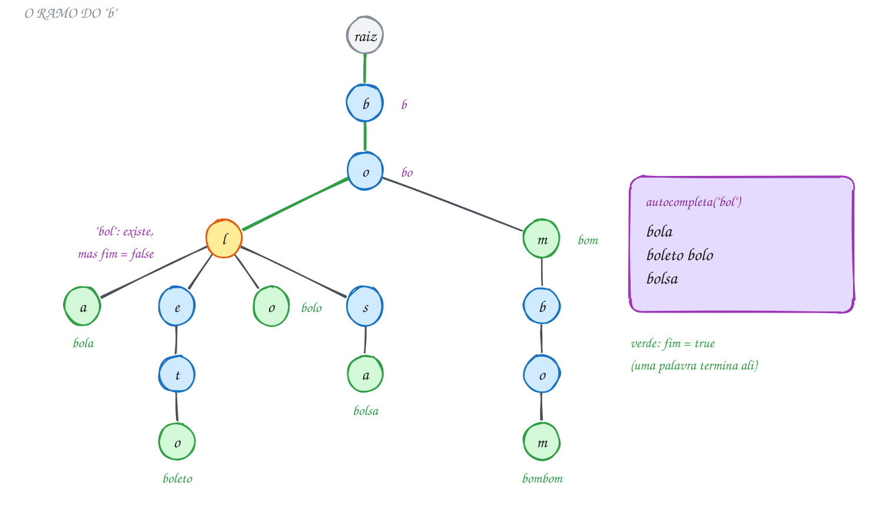</p>

O nó e a inserção, em `trie.c` (o `calloc` deixa os ponteiros `NULL` e `fim`
falso):

```c
typedef struct NoTrie {
    struct NoTrie *filho[TRIE_LETRAS]; // filho['c' - 'a'] segue a letra c
    bool fim;                          // uma palavra termina aqui?
} NoTrie;

bool trie_insere(NoTrie *r, const char *palavra) {
    for (const char *p = palavra; *p != '\0'; p++) { // confere antes de mexer
        if (*p < 'a' || *p > 'z') {
            return false;
        }
    }
    for (; *palavra != '\0'; palavra++) {
        int i = *palavra - 'a';
        if (r->filho[i] == NULL) {
            r->filho[i] = trie_cria(); // o caminho ainda não existe: cria
        }
        r = r->filho[i];
    }
    r->fim = true; // marca o fim da palavra
    return true;
}
```

O cliente monta o dicionário e testa três textos:

```c
#include <stdio.h>
#include "trie.h"

int main(void) {
    const char *dicionario[] = {"bolo", "bola", "bolsa", "boleto", "bom", "bombom", "pao", "pastel"};
    NoTrie *teclado = trie_cria();
    for (int i = 0; i < 8; i++) {
        trie_insere(teclado, dicionario[i]);
    }

    const char *testes[] = {"bol", "bom", "pa"};
    for (int i = 0; i < 3; i++) {
        printf("\"%s\": palavra? %s | sugestões:", testes[i],
               trie_busca(teclado, testes[i]) ? "sim" : "não");
        trie_autocompleta(teclado, testes[i], 4);
        printf("\n");
    }
    printf("Nós: %d (%zu bytes cada)\n", trie_nos(teclado), sizeof(NoTrie));

    trie_libera(teclado);
    return 0;
}
// Saída:
// "bol": palavra? não | sugestões: bola boleto bolo bolsa
// "bom": palavra? sim | sugestões: bom bombom
// "pa": palavra? não | sugestões: pao pastel
// Nós: 22 (216 bytes cada)
```

As sugestões saem em ordem alfabética porque a subárvore é percorrida de `a` a
`z`.

O fluxograma mostra a inserção de "bom". O `b` e o `o` já existem; o `m` é novo
e recebe `fim = true`:

<p align="center">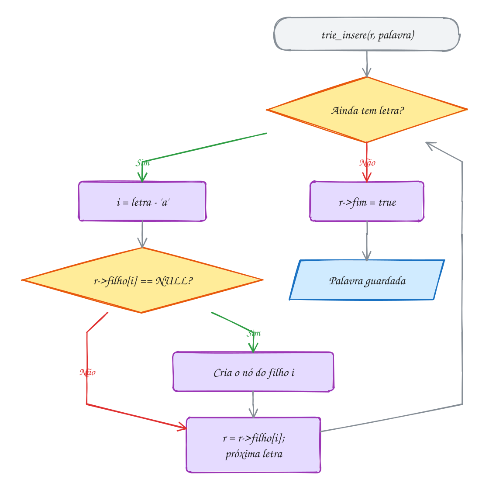</p>

> [!WARNING]
> Achar o nó não é achar a palavra: `trie_prefixo(t, "bol")` devolve um nó, mas
> a busca precisa olhar o `fim` (`return n != NULL && n->fim;`). Esquecer o
> `r->fim = true` na inserção faz a palavra sumir. No índice, `'B' - 'a'` dá -31 e `'ã'` não é um `char` só em UTF-8;
> por isso `trie_insere` recusa o que não for de `'a'` a `'z'`.

> [!TIP]
> Cada `NoTrie` tem 216 bytes. As 8 palavras cabem em 45 bytes como strings, mas
> a trie usa 22 nós, 4752 bytes, quase todos ponteiros `NULL`. Alternativas:
> lista de filhos (0144) ou BST por nó (árvore ternária).

> [!NOTE]
> **Pergunta para você:** se você inserir "bolota", quantos nós novos aparecem?
> E se inserir "bo"? Em cada caso, o que muda nas sugestões para "bo"? Responda
> antes de acrescentar as palavras no vetor do exemplo.

### Hora de praticar

**Exemplo A293 · Quanto custa uma trie**

```c
#include <stdio.h>
#include <string.h>
#include "0147-trie.h"

// conta os ponteiros de filho que estão em NULL (vagas sem uso)
int nulos(const NoTrie *r) {
    int total = 0;
    for (int i = 0; i < TRIE_LETRAS; i++) {
        if (r->filho[i] == NULL) {
            total++;
        } else {
            total += nulos(r->filho[i]);
        }
    }
    return total;
}

int main(void) {
    const char *feira[] = {"alface", "alho", "abacate", "abacaxi", "banana", "batata",
                           "beterraba", "cebola", "cenoura", "chuchu", "couve", "laranja",
                           "limao", "mamao", "manga", "maracuja", "melancia", "milho",
                           "tomate", "uva", "Pera", "caqui!"};
    int n = sizeof feira / sizeof feira[0];
    NoTrie *t = trie_cria();
    int aceitas = 0;
    size_t letras = 0;
    for (int i = 0; i < n; i++) {
        if (trie_insere(t, feira[i])) {
            aceitas++;
            letras += strlen(feira[i]);
        } else {
            printf("recusada: %s (só a-z)\n", feira[i]);
        }
    }

    int nos = trie_nos(t);
    printf("%d palavras, %zu letras no total\n", aceitas, letras);
    printf("trie: %d nós x %zu bytes = %zu bytes\n", nos, sizeof(NoTrie), nos * sizeof(NoTrie));
    printf("as mesmas palavras em strings: %zu bytes (letras + um '\\0' cada)\n",
           letras + aceitas);
    printf("ponteiros em NULL: %d de %d (%.1f%%)\n", nulos(t), nos * TRIE_LETRAS,
           100.0 * nulos(t) / (nos * TRIE_LETRAS));

    trie_libera(t);
    return 0;
}
// Saída:
// recusada: Pera (só a-z)
// recusada: caqui! (só a-z)
// 20 palavras, 121 letras no total
// trie: 100 nós x 216 bytes = 21600 bytes
// as mesmas palavras em strings: 141 bytes (letras + um '\0' cada)
// ponteiros em NULL: 2501 de 2600 (96.2%)
```

```bash
gcc ~/LPEDC/material/A293.c ~/LPEDC/material/0147-trie.c -o ~/LPEDC/material/A293 && ~/LPEDC/material/A293
```

**Exemplo A294 · A trie ordena e acha o prefixo comum**

```c
#include <stdio.h>
#include "0147-trie.h"

// quantos filhos o nó tem e, em *unico, o índice do último achado
int filhos(const NoTrie *n, int *unico) {
    int qtd = 0;
    for (int i = 0; i < TRIE_LETRAS; i++) {
        if (n->filho[i] != NULL) {
            qtd++;
            *unico = i;
        }
    }
    return qtd;
}

// maior prefixo comum a TODAS as palavras: desce enquanto o caminho não se
// divide (um filho só) e nenhuma palavra termina no meio do caminho
void prefixo_comum(const NoTrie *r, char saida[]) {
    int k = 0, i = 0;
    while (!r->fim && filhos(r, &i) == 1 && k < TRIE_MAX - 1) {
        saida[k++] = (char)('a' + i);
        r = r->filho[i];
    }
    saida[k] = '\0';
}

int main(void) {
    const char *obra[] = {"pedreiro", "pedra", "pedregulho", "pedrada", "pedrisco"};
    NoTrie *t = trie_cria();
    for (int i = 0; i < 5; i++) {
        trie_insere(t, obra[i]);
    }

    printf("Em ordem alfabética:");
    trie_autocompleta(t, "", 100); // prefixo vazio: a trie inteira
    char pc[TRIE_MAX];
    prefixo_comum(t, pc);
    printf("\nPrefixo comum: \"%s\"\n", pc);

    trie_insere(t, "pe"); // uma palavra curta corta o prefixo comum
    prefixo_comum(t, pc);
    printf("Com \"pe\" no dicionário: \"%s\"\n", pc);

    trie_insere(t, "areia"); // outra letra inicial: não sobra prefixo
    prefixo_comum(t, pc);
    printf("Com \"areia\" também: \"%s\"\n", pc);

    trie_libera(t);
    return 0;
}
// Saída:
// Em ordem alfabética: pedra pedrada pedregulho pedreiro pedrisco
// Prefixo comum: "pedr"
// Com "pe" no dicionário: "pe"
// Com "areia" também: ""
```

```bash
gcc ~/LPEDC/material/A294.c ~/LPEDC/material/0147-trie.c -o ~/LPEDC/material/A294 && ~/LPEDC/material/A294
```

#### Exercícios

**Exercício E878** · ★☆☆

O terminal completa comandos com a tecla Tab. Guarde estes comandos numa trie
(trie.h): cd, cat, chmod, chown, ls, less, mkdir, man. Escreva classifica(r,
texto), que devolve uma de três mensagens: "comando" (o texto é um comando
inteiro), "só começo de comando" (algum comando começa assim, mas o texto não
é um) ou "não está". Teste, nesta ordem, com:


```text
cat ch le less rm c mkdirs
```


```text
Saída esperada:
cat     comando
ch      só começo de comando
le      só começo de comando
less    comando
rm      não está
c       só começo de comando
mkdirs  não está
```

```bash
gcc ~/LPEDC/material/E878.c ~/LPEDC/material/0147-trie.c -o ~/LPEDC/material/E878 && ~/LPEDC/material/E878
```

**Exercício E879** · ★★☆

Conte quantas vezes cada palavra aparece num texto com uma trie em que o nó
guarda um contador (int qtd) no lugar do bool fim. Defina o struct NoFreq (26
filhos e qtd) e escreva: - conta(r, p, tam): soma 1 na palavra de tam letras
que começa em p (o texto

```text
não tem '\0' depois de cada palavra, por isso o tam);
```

- lista(n, buf, nivel, &distintas): mostra as palavras em ordem alfabética

```text
com a contagem e conta quantas palavras diferentes existem;
```

- libera(n).

O texto é "o rato roeu a roupa do rei de roma o rei riu da roupa".


```text
Saída esperada:
a      1
da     1
de     1
do     1
o      2
rato   1
rei    2
riu    1
roeu   1
roma   1
roupa  2
14 palavras, 11 diferentes
```

```bash
gcc ~/LPEDC/material/E879.c ~/LPEDC/material/0147-trie.c -o ~/LPEDC/material/E879 && ~/LPEDC/material/E879
```

**Exercício E880** · ★★☆

Guarde estes bichos do zoológico numa trie (trie.h): gato, girafa, guaxinim,
hipopotamo, jacare, onca, ornitorrinco, rinoceronte, tatu, tamandua,
orangotango. Escreva duas funções que percorrem a trie montando a palavra num
buffer: - maior_palavra(n, buf, nivel, maior): copia para maior a palavra
mais

```text
comprida (no empate, a primeira em ordem alfabética);
```

- por_tamanho(n, buf, nivel, alvo): mostra as palavras com exatamente alvo

```text
letras, sem descer além do nível alvo.
```


Mostre a maior palavra e as de 4, 6 e 11 letras.


```text
Saída esperada:
maior: ornitorrinco (12 letras)
com 4 letras: gato onca tatu
com 6 letras: girafa jacare
com 11 letras: orangotango rinoceronte
```

```bash
gcc ~/LPEDC/material/E880.c ~/LPEDC/material/0147-trie.c -o ~/LPEDC/material/E880 && ~/LPEDC/material/E880
```

**Exercício E882** · ★★★

O TAD (trie.h) não sabe tirar palavras. Escreva bool remove_palavra(NoTrie
*n, const char *p, bool *tirou), que desmarca o fim da palavra e libera, de
baixo para cima, os nós que ficarem inúteis (sem fim e sem filhos); os nós
que outra palavra ainda usa ficam. Em *tirou, diz se a palavra estava lá.
Devolve true se n ficou inútil.

Insira sol, sola, solado, solteiro e sal. Mostre o início e, depois de tirar
cada palavra de solado, so, sol, solteiro, sal e sola, o tamanho da trie
(trie_nos) e as palavras que sobram (trie_autocompleta com prefixo "").


```text
Saída esperada:
início | nós: 14 | palavras: sal sol sola solado solteiro
tira solado: tirou | nós: 12 | sobram: sal sol sola solteiro
tira so: não estava | nós: 12 | sobram: sal sol sola solteiro
tira sol: tirou | nós: 12 | sobram: sal sola solteiro
tira solteiro: tirou | nós: 7 | sobram: sal sola
tira sal: tirou | nós: 5 | sobram: sola
tira sola: tirou | nós: 1 | sobram:
```

```bash
gcc ~/LPEDC/material/E882.c ~/LPEDC/material/0147-trie.c -o ~/LPEDC/material/E882 && ~/LPEDC/material/E882
```

---

## 0148 · Union-find: conjuntos disjuntos

Numa turma, quem se conhece (ou é "amigo de amigo") cai no mesmo sorteio de amigo
secreto. As amizades chegam aos poucos, e alguém pergunta: "Ana e Duda caem no
mesmo sorteio?".

São **conjuntos disjuntos**: grupos que não se misturam, com duas operações:

- **acha(x)**: devolve o **representante** do grupo de x, um elemento que
  responde pelo grupo. Dois elementos estão juntos se têm o mesmo representante;
- **une(a, b)**: junta o grupo de a com o grupo de b.

O **union-find** guarda cada grupo como uma árvore, e a floresta cabe num vetor:
`pai[x]` é o pai de x, e a raiz aponta para si mesma (`pai[x] == x`). A raiz é o
representante. `acha` sobe até a raiz; `une` acha as duas raízes e pendura uma
na outra.

Do jeito ingênuo, a árvore vira uma fila e `acha` custa O(n). Dois truques
resolvem:

1. **união por tamanho**: guarde o tamanho de cada grupo (`tam[raiz]`) e pendure
   a raiz do grupo **menor** na do maior. Um elemento só desce um nível quando o
   grupo dele pelo menos **dobra**, o que acontece log₂ n vezes no máximo: a
   altura nunca passa de log₂ n;
2. **compressão de caminho**: depois de achar a raiz, `acha` faz todo o caminho
   apontar **direto** para ela.

Com os dois, m operações custam O(m · α(n)), em que α não passa de 4 para nenhum
n realista: na prática, O(1) amortizado (assunto 0116).

O Cormen chama as operações de `MAKE-SET`, `FIND-SET` e `UNION` e usa a **união
por posto** (*rank*): cada raiz guarda um limite superior da altura, que só
ganha 1 quando duas raízes de mesmo posto se juntam. A garantia é a mesma, e o
Kruskal (0152) usa essa estrutura.

No exemplo, oito colegas, de 0 (Ana) a 7 (Hugo), e sete amizades deixam dois
grupos: {Ana, Beto, Caio, Duda} e {Edu, Fia, Gui, Hugo}. Duda e Hugo estão a dois
passos da raiz até as perguntas comprimirem o caminho:

<p align="center">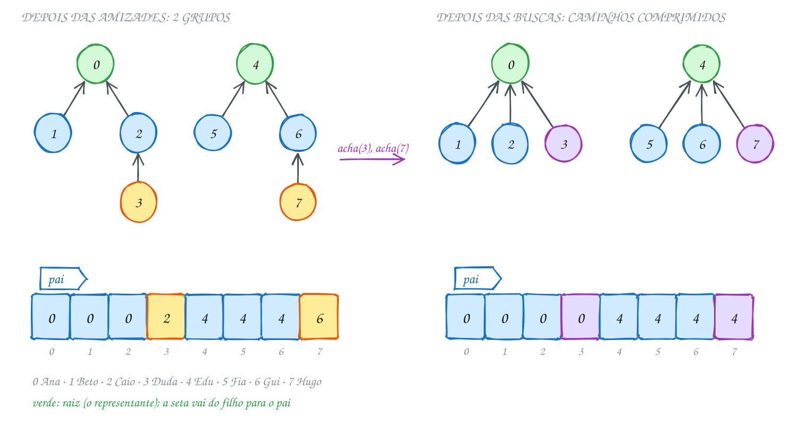</p>

`uf_acha` e `uf_une`, em `uniao.c`:

```c
int uf_acha(UF *u, int x) {
    int raiz = x;
    while (u->pai[raiz] != raiz) { // sobe até a raiz
        raiz = u->pai[raiz];
    }
    while (u->pai[x] != raiz) {    // compressão: todo mundo do caminho
        int prox = u->pai[x];      // passa a apontar direto para a raiz
        u->pai[x] = raiz;
        x = prox;
    }
    return raiz;
}

bool uf_une(UF *u, int a, int b) {
    int ra = uf_acha(u, a);
    int rb = uf_acha(u, b);
    if (ra == rb) {
        return false; // já estavam juntos
    }
    if (u->tam[ra] < u->tam[rb]) { // ra fica sendo a raiz do grupo maior
        int t = ra;
        ra = rb;
        rb = t;
    }
    u->pai[rb] = ra; // a raiz do menor vira filha da raiz do maior
    u->tam[ra] += u->tam[rb];
    u->grupos--;
    return true;
}
```

O cliente registra as amizades e mostra `pai` depois de cada uma:

```c
#include <stdio.h>
#include "uniao.h"

int main(void) {
    const char *nome[] = {"Ana", "Beto", "Caio", "Duda", "Edu", "Fia", "Gui", "Hugo"};
    int amizades[][2] = {{0, 1}, {2, 3}, {4, 5}, {1, 3}, {6, 7}, {5, 7}, {0, 2}};
    UF *turma = uf_cria(8);

    for (int i = 0; i < 7; i++) {
        int a = amizades[i][0], b = amizades[i][1];
        bool novo = uf_une(turma, a, b);
        printf("%s e %s: %s | grupos: %d | ", nome[a], nome[b],
               novo ? "juntou" : "já estavam", uf_grupos(turma));
        uf_mostra(turma);
    }
    printf("Ana e Duda se conhecem? %s\n", uf_juntos(turma, 0, 3) ? "sim" : "não");
    printf("Caio e Hugo se conhecem? %s\n", uf_juntos(turma, 2, 7) ? "sim" : "não");
    printf("Grupo do Edu: %d pessoas\n", uf_tamanho(turma, 4));
    printf("Depois das buscas, ");
    uf_mostra(turma);

    uf_libera(turma);
    return 0;
}
// Saída:
// Ana e Beto: juntou | grupos: 7 | pai: 0 0 2 3 4 5 6 7
// Caio e Duda: juntou | grupos: 6 | pai: 0 0 2 2 4 5 6 7
// Edu e Fia: juntou | grupos: 5 | pai: 0 0 2 2 4 4 6 7
// Beto e Duda: juntou | grupos: 4 | pai: 0 0 0 2 4 4 6 7
// Gui e Hugo: juntou | grupos: 3 | pai: 0 0 0 2 4 4 6 6
// Fia e Hugo: juntou | grupos: 2 | pai: 0 0 0 2 4 4 4 6
// Ana e Caio: já estavam | grupos: 2 | pai: 0 0 0 2 4 4 4 6
// Ana e Duda se conhecem? sim
// Caio e Hugo se conhecem? não
// Grupo do Edu: 4 pessoas
// Depois das buscas, pai: 0 0 0 0 4 4 4 4
```

Em "Beto e Duda", as raízes são 0 (Ana) e 2 (Caio), ambos com grupo de 2. No
empate, a raiz de a continua raiz: Caio vai para baixo da Ana, com a Duda.

O fluxograma acompanha `uf_une` em "Fia e Hugo". As raízes são 4 (Edu) e 6
(Gui), com grupos de tamanho 2: sem troca, o Gui (com o Hugo) vira filho do Edu:

<p align="center">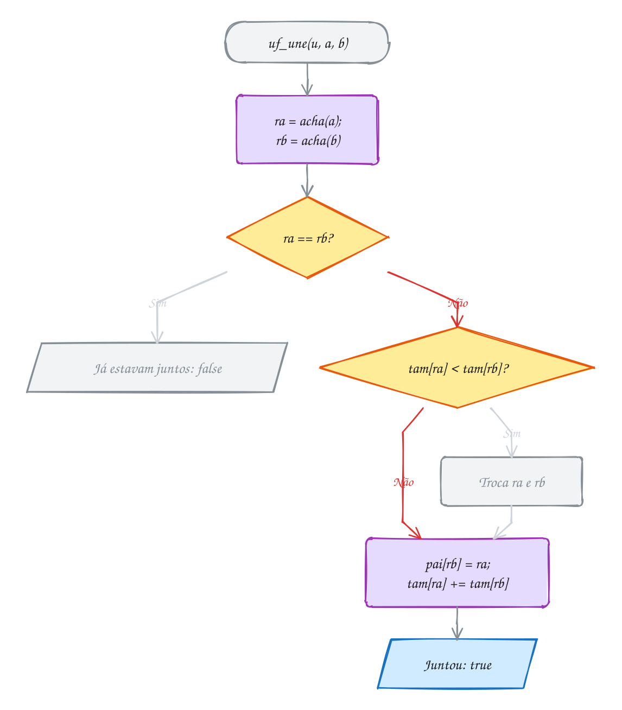</p>

> [!WARNING]
> O representante é a **raiz**, não o elemento. Unir com `pai[a] = b` arranca o
> `a` do grupo e leva só os descendentes dele; o certo é
> `pai[acha(a)] = acha(b)`. Testar `a == b` ou `pai[a] == pai[b]` falha com mais
> de um nível; o teste é `acha(a) == acha(b)`. E `tam[x]` só vale na raiz.

> [!TIP]
> `uf_acha` não tem `const`: **consultar modifica** a estrutura, porque a
> compressão reescreve `pai`.

> [!NOTE]
> **Pergunta para você:** depois de tudo, Ana e Hugo ficam amigos:
> `uf_une(turma, 0, 7)`. Os dois grupos têm 4 pessoas. Quem vira a raiz do grupo
> único e como fica o vetor `pai`? Acrescente a linha no exemplo e confira.

### Hora de praticar

**Exemplo A295 · Sem os dois truques, a árvore vira lista**

```c
#include <stdbool.h>
#include <stdio.h>
#include <stdlib.h>

#define N 10000

int pai[N], tam[N];
long passos; // quantas vezes alguém subiu de um nó para o pai

void inicia(void) {
    for (int i = 0; i < N; i++) {
        pai[i] = i;
        tam[i] = 1;
    }
    passos = 0;
}

int acha(int x, bool comprime) {
    int raiz = x;
    while (pai[raiz] != raiz) {
        raiz = pai[raiz];
        passos++;
    }
    while (comprime && pai[x] != raiz) {
        int prox = pai[x];
        pai[x] = raiz;
        x = prox;
    }
    return raiz;
}

void une(int a, int b, bool por_tamanho, bool comprime) {
    int ra = acha(a, comprime), rb = acha(b, comprime);
    if (ra == rb) {
        return;
    }
    if (por_tamanho && tam[ra] < tam[rb]) {
        int t = ra;
        ra = rb;
        rb = t;
    }
    if (por_tamanho) {
        pai[rb] = ra; // o menor vai para baixo do maior
        tam[ra] += tam[rb];
    } else {
        pai[ra] = rb; // ingênuo: o grupo de a vai sempre para baixo do de b
    }
}

int profundidade_maxima(void) {
    int maior = 0;
    for (int i = 0; i < N; i++) {
        int d = 0;
        for (int x = i; pai[x] != x; x = pai[x]) {
            d++;
        }
        if (d > maior) {
            maior = d;
        }
    }
    return maior;
}

void testa(const char *nome, bool por_tamanho, bool comprime) {
    inicia();
    for (int i = 1; i < N; i++) {
        une(0, i, por_tamanho, comprime); // o 0 chama todo mundo para o grupo dele
    }
    long nas_unioes = passos;
    int prof = profundidade_maxima();
    passos = 0;
    for (int i = 0; i < N; i++) {
        acha(i, comprime); // depois, cada um pergunta quem é o representante
    }
    printf("%s passos nas uniões: %9ld | profundidade: %4d | passos nas buscas: %8ld\n",
           nome, nas_unioes, prof, passos);
}

int main(void) {
    testa("ingênuo:             ", false, false);
    testa("só por tamanho:      ", true, false);
    testa("ingênuo + compressão:", false, true);
    return 0;
}
// Saída:
// ingênuo:              passos nas uniões:  49985001 | profundidade: 9999 | passos nas buscas: 49995000
// só por tamanho:       passos nas uniões:         0 | profundidade:    1 | passos nas buscas:     9999
// ingênuo + compressão: passos nas uniões:     19995 | profundidade: 9998 | passos nas buscas:    19997
```

```bash
gcc ~/LPEDC/material/A295.c ~/LPEDC/material/0148-uniao.c -o ~/LPEDC/material/A295 && ~/LPEDC/material/A295
```

**Exemplo A296 · As ilhas do mapa**

```c
#include <stdio.h>
#include "0148-uniao.h"

#define LIN 5
#define COL 8

// cada célula (i, j) vira o elemento i * COL + j do union-find
int main(void) {
    const char *mapa[LIN] = {
        "##..#...",
        "#...##..",
        "..#..#.#",
        ".###...#",
        "....##.#",
    };
    UF *u = uf_cria(LIN * COL);
    int terra = 0;
    for (int i = 0; i < LIN; i++) {
        for (int j = 0; j < COL; j++) {
            if (mapa[i][j] != '#') {
                continue;
            }
            terra++;
            // basta olhar para a direita e para baixo: as outras duas
            // direções já foram vistas pelas células anteriores
            if (j + 1 < COL && mapa[i][j + 1] == '#') {
                uf_une(u, i * COL + j, i * COL + j + 1);
            }
            if (i + 1 < LIN && mapa[i + 1][j] == '#') {
                uf_une(u, i * COL + j, (i + 1) * COL + j);
            }
        }
    }
    // os grupos do union-find contam também as células de água (sozinhas)
    int agua = LIN * COL - terra;
    printf("Ilhas: %d\n", uf_grupos(u) - agua);

    int maior = 0, onde = 0;
    for (int c = 0; c < LIN * COL; c++) {
        if (mapa[c / COL][c % COL] == '#' && uf_tamanho(u, c) > maior) {
            maior = uf_tamanho(u, c);
            onde = c;
        }
    }
    printf("Maior ilha: %d células, uma delas na linha %d, coluna %d\n",
           maior, onde / COL, onde % COL);
    printf("(0, 4) e (2, 5) na mesma ilha? %s\n",
           uf_juntos(u, 0 * COL + 4, 2 * COL + 5) ? "sim" : "não");
    printf("(2, 2) e (4, 4) na mesma ilha? %s\n",
           uf_juntos(u, 2 * COL + 2, 4 * COL + 4) ? "sim" : "não");

    uf_libera(u);
    return 0;
}
// Saída:
// Ilhas: 5
// Maior ilha: 4 células, uma delas na linha 0, coluna 4
// (0, 4) e (2, 5) na mesma ilha? sim
// (2, 2) e (4, 4) na mesma ilha? não
```

```bash
gcc ~/LPEDC/material/A296.c ~/LPEDC/material/0148-uniao.c -o ~/LPEDC/material/A296 && ~/LPEDC/material/A296
```

#### Exercícios

**Exercício E883** · ★☆☆

Depois da enchente, só algumas estradas entre sete cidades continuam abertas.
Use o TAD (uniao.h). As cidades, de 0 a 6, são Araras, Bauru, Catanduva,
Dourado, Embu, Franca e Garça. As estradas abertas ligam os pares 0-2, 1-5,
2-3, 5-6 e 0-3. Una as cidades de cada estrada, mostre quantos grupos de
cidades ligadas existem e responda se dá para ir (passando por outras, se
preciso) de 0 a 3, de 1 a 6, de 3 a 5 e de 4 a 4.


```text
Saída esperada:
Grupos de cidades ligadas: 3
Araras -> Dourado: dá para ir
Bauru -> Garça: dá para ir
Dourado -> Franca: não dá para ir
Embu -> Embu: dá para ir
```

```bash
gcc ~/LPEDC/material/E883.c ~/LPEDC/material/0148-uniao.c -o ~/LPEDC/material/E883 && ~/LPEDC/material/E883
```

**Exercício E885** · ★★☆

O técnico ligou os 7 computadores do escritório (0 a 6) com 9 cabos, nesta
ordem:


```text
0-1 1-2 3-4 2-0 4-5 5-6 1-4 6-3 2-5
```


Um cabo é redundante quando liga dois computadores que JÁ conversavam por
outros cabos (ele fecha um ciclo). Com o TAD (uniao.h), mostre cada cabo
redundante, quantos cabos bastariam e se a rede ficou toda ligada.


```text
Saída esperada:
cabo 4 (2-0) é redundante
cabo 8 (6-3) é redundante
cabo 9 (2-5) é redundante
3 cabos redundantes; 6 cabos bastam; rede toda ligada
```

```bash
gcc ~/LPEDC/material/E885.c ~/LPEDC/material/0148-uniao.c -o ~/LPEDC/material/E885 && ~/LPEDC/material/E885
```

**Exercício E886** · ★★☆

Na pelada de quinta, quem já jogou junto fica no mesmo time, e "jogou com
quem jogou com" também conta. Os nove jogadores, de 0 a 8, são Alex, Bia,
Cadu, Davi, Eli, Fabi, Gabo, Hana e Ivo. As duplas que já jogaram juntas:


```text
0-4 2-7 4-8 1-5 7-3 8-0
```


Com o TAD (uniao.h), una as duplas e liste cada time com seus jogadores e o
tamanho. Os times saem na ordem do seu primeiro jogador (o de menor número),
e os jogadores de cada time, em ordem de número.


```text
Saída esperada:
Time 1 (3): Alex Eli Ivo
Time 2 (2): Bia Fabi
Time 3 (3): Cadu Davi Hana
Time 4 (1): Gabo
```

```bash
gcc ~/LPEDC/material/E886.c ~/LPEDC/material/0148-uniao.c -o ~/LPEDC/material/E886 && ~/LPEDC/material/E886
```

**Exercício E888** · ★★★

Teste de infiltração. Uma placa de 5x5 quadradinhos começa toda tapada, e
o técnico fura um quadradinho por vez, na ordem c = (i * 9 + 7) % 25 para
i = 0, 1, 2... (c = linha * 5 + coluna). A água jogada em cima passa para
baixo quando existe um caminho de quadradinhos furados, vizinhos em cima,
embaixo ou dos lados, da linha 0 até a linha 4. Descubra em qual furo a água
passa e mostre a placa nesse momento (# furado, . tapado).


```text
Saída esperada:
A água passou no passo 13 (13 de 25 abertas)
#.#.#
.##.#
.#.#.
##.#.
#.#..
```

```bash
gcc ~/LPEDC/material/E888.c ~/LPEDC/material/0148-uniao.c -o ~/LPEDC/material/E888 && ~/LPEDC/material/E888
```

---

## 0149 · Juntando tudo: corretor ortográfico

O secretário da associação do bairro quer um programa que leia o aviso da
semana ("o onibus pasou", "a fiera da rua"), aponte as palavras que não existem
e sugira a correção.

Um corretor faz duas perguntas ao dicionário, milhares de vezes por texto:
**"esta palavra existe?"** (busca exata) e **"quais palavras de verdade estão
perto desta?"**. "Perto" é a poucas **edições** (assunto 0142): tirar, pôr ou
trocar uma letra, ou trocar duas letras vizinhas.

Sugerir é **gerar candidatos**: aplicar à palavra errada todas as edições e ver
quais existem. Para "fiera", são 5 jeitos de tirar, 4 de trocar vizinhas,
5 · 25 de trocar uma letra e 6 · 26 de pôr uma letra: 290 candidatos, e só
"feira" existe. O custo de 290 buscas depende da estrutura do dicionário.

O dicionário fica numa **trie** (assunto 0147): cada busca custa O(L), e um
candidato que não começa como palavra nenhuma ("fx...") morre no segundo nó.
Uma hash também faria a busca exata em O(1) na média, e uma BST em O(log n)
comparações; a comparação está no fim do assunto.

O TAD está em `corretor.h` e `corretor.c`: `cor_carrega_basico` monta um
dicionário de 84 palavras, `cor_proxima` separa o texto em palavras,
`cor_contem` faz a busca exata e `cor_sugere` gera e filtra os candidatos.

O aviso tem 18 palavras e cinco problemas: três erros com uma sugestão só, um
"caa" que pode ser três palavras e um "esquina" que está certo, mas fora do
dicionário:

<p align="center">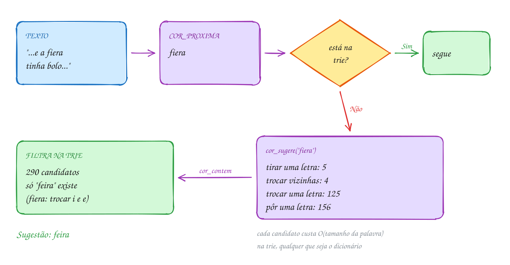</p>

No miolo de `cor_sugere`, `anota` confere cada candidato na trie, descarta
repetidos e mantém a lista em ordem alfabética:

```c
int cor_sugere(const NoC *d, const char *palavra, char sug[][COR_MAX], int max) {
    int n = (int)strlen(palavra);
    int qtd = 0;
    char c[COR_MAX + 1];
    if (n >= COR_MAX - 1) {
        return 0;
    }
    for (int i = 0; i < n; i++) { // 1. tirar a letra i
        memcpy(c, palavra, i);
        strcpy(c + i, palavra + i + 1);
        anota(d, c, sug, &qtd, max);
    }
    for (int i = 0; i + 1 < n; i++) { // 2. trocar as letras i e i + 1 de lugar
        strcpy(c, palavra);
        char t = c[i];
        c[i] = c[i + 1];
        c[i + 1] = t;
        anota(d, c, sug, &qtd, max);
    }
    for (int i = 0; i < n; i++) { // 3. trocar a letra i por outra
        strcpy(c, palavra);
        for (char l = 'a'; l <= 'z'; l++) {
            if (l != palavra[i]) {
                c[i] = l;
                anota(d, c, sug, &qtd, max);
            }
        }
    }
    for (int i = 0; i <= n; i++) { // 4. pôr uma letra na posição i
        for (char l = 'a'; l <= 'z'; l++) {
            memcpy(c, palavra, i);
            c[i] = l;
            strcpy(c + i + 1, palavra + i);
            anota(d, c, sug, &qtd, max);
        }
    }
    return qtd;
}
```

O programa do secretário:

```c
#include <stdio.h>
#include "corretor.h"

int main(void) {
    NoC *dic = cor_cria();
    int n = cor_carrega_basico(dic);
    printf("Dicionário: %d palavras em %d nós\n", n, cor_nos(dic));

    const char *texto = "hoje o onibus pasou no ponto, e a fiera tinha bolo e cafe baratoo na caa da esquina.";
    char palavra[COR_MAX], sug[5][COR_MAX];
    int total = 0, erros = 0;
    while (cor_proxima(&texto, palavra)) {
        total++;
        if (cor_contem(dic, palavra)) {
            continue;
        }
        erros++;
        int k = cor_sugere(dic, palavra, sug, 5);
        printf("\"%s\"? Sugestões:", palavra);
        for (int i = 0; i < k; i++) {
            printf(" %s", sug[i]);
        }
        printf(k == 0 ? " nenhuma\n" : "\n");
    }
    printf("%d palavras, %d para revisar\n", total, erros);

    cor_libera(dic);
    return 0;
}
// Saída:
// Dicionário: 84 palavras em 239 nós
// "pasou"? Sugestões: passou
// "fiera"? Sugestões: feira
// "baratoo"? Sugestões: barato
// "caa"? Sugestões: cama cara casa
// "esquina"? Sugestões: nenhuma
// 18 palavras, 5 para revisar
```

O fluxograma é um laço sobre as palavras: só as desconhecidas pagam o preço dos
candidatos. O caminho verde é o de "fiera", seguido do fim do texto:

<p align="center">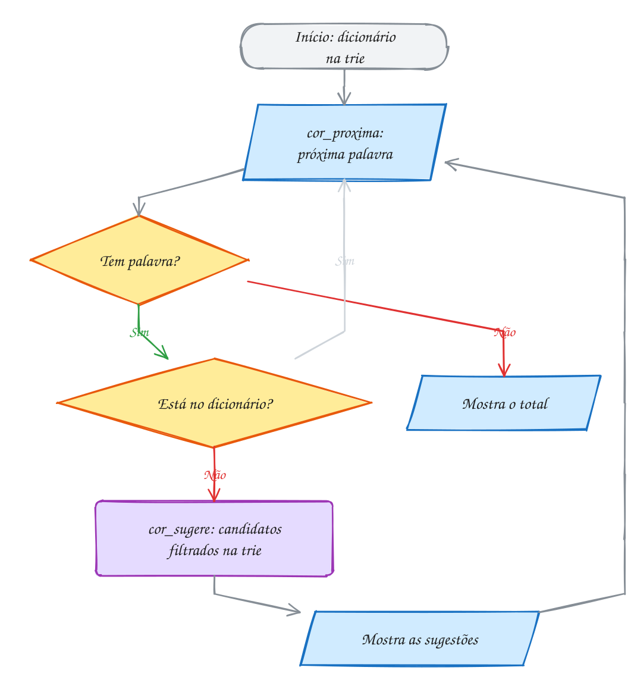</p>

### Trie, hash ou BST?

O A297 monta as três estruturas com o mesmo dicionário de 2500 palavras de duas
sílabas e faz 5000 buscas (metade acha, metade não):

| | BST | Tabela hash | Trie |
| --- | --- | --- | --- |
| custo da busca exata | 17,2 comparações de string | 1,3 comparação de string | 4 nós (o tamanho da palavra) |
| memória | 60 KB | 60 KB | 661 KB |
| palavras com um prefixo | dá, com um percurso por intervalo | não dá | desce até o prefixo e lista |
| ordem alfabética | percurso em ordem | não dá | percurso por letra |
| depende de n? | sim, log n | não (com fator de carga bom) | não |

A hash ganha na busca exata e a trie perde na memória, mas a trie ganha em tudo
que envolve **prefixo**: autocompletar e cortar candidatos que já nascem
errados. Um corretor de verdade combina as duas.

> [!WARNING]
> `cor_proxima` só reconhece `'a'` a `'z'`: maiúscula e acento viram
> separadores ("Hoje" sai "oje"; "pão" sai "p" e "o"). Em UTF-8, `'ã'` ocupa
> 2 bytes e não cabe num índice de 0 a 25. Além disso, `cor_sugere` usa um
> vetor de `COR_MAX + 1` posições, porque pôr uma letra aumenta a palavra.

> [!TIP]
> A trie de 84 palavras tem 239 nós de 216 bytes (cerca de 51 KB). Cada nó fica
> num ponto do heap, e cada acesso pode ser uma falta de cache; por isso a hash
> costuma vencer a trie na busca exata.

> [!NOTE]
> **Pergunta para você:** se o aviso tivesse "onibu", quais sugestões
> apareceriam? E "aa"? Confira trocando o texto do exemplo.

### Hora de praticar

**Exemplo A297 · Trie, hash e BST no mesmo dicionário**

```c
#include <stdio.h>
#include <stdlib.h>
#include <string.h>
#include "0149-corretor.h"

// dicionário sintético: as 2500 palavras de duas sílabas (ba, be, ..., zu)
#define N 2500
#define BALDES 2503 // primo, perto de N

long passos; // comparações de string (BST e hash) ou nós visitados (trie)

// ---- BST de strings ----
typedef struct NoS {
    char p[8];
    struct NoS *esq, *dir;
} NoS;

NoS *bst_poe(NoS *r, const char *p) {
    if (r == NULL) {
        NoS *n = malloc(sizeof(NoS));
        if (n == NULL) {
            exit(1);
        }
        strcpy(n->p, p);
        n->esq = n->dir = NULL;
        return n;
    }
    int c = strcmp(p, r->p);
    if (c < 0) {
        r->esq = bst_poe(r->esq, p);
    } else if (c > 0) {
        r->dir = bst_poe(r->dir, p);
    }
    return r;
}

int bst_tem(const NoS *r, const char *p) {
    while (r != NULL) {
        passos++;
        int c = strcmp(p, r->p);
        if (c == 0) {
            return 1;
        }
        r = c < 0 ? r->esq : r->dir;
    }
    return 0;
}

int bst_altura(const NoS *r) {
    if (r == NULL) {
        return -1;
    }
    int e = bst_altura(r->esq), d = bst_altura(r->dir);
    return 1 + (e > d ? e : d);
}

void bst_solta(NoS *r) {
    if (r != NULL) {
        bst_solta(r->esq);
        bst_solta(r->dir);
        free(r);
    }
}

// ---- tabela hash com encadeamento ----
typedef struct NoH {
    char p[8];
    struct NoH *prox;
} NoH;

unsigned espalha(const char *p) { // djb2
    unsigned h = 5381;
    for (; *p != '\0'; p++) {
        h = h * 33 + (unsigned char)*p;
    }
    return h % BALDES;
}

void hash_poe(NoH *t[], const char *p) {
    NoH *n = malloc(sizeof(NoH));
    if (n == NULL) {
        exit(1);
    }
    strcpy(n->p, p);
    unsigned b = espalha(p);
    n->prox = t[b];
    t[b] = n;
}

int hash_tem(NoH *t[], const char *p) {
    for (const NoH *n = t[espalha(p)]; n != NULL; n = n->prox) {
        passos++;
        if (strcmp(n->p, p) == 0) {
            return 1;
        }
    }
    return 0;
}

// ---- trie (do TAD): conta os nós visitados ----
int trie_tem(const NoC *d, const char *p) {
    for (; *p != '\0' && d != NULL; p++) {
        passos++;
        d = d->filho[*p - 'a'];
    }
    return d != NULL && d->fim;
}

int main(void) {
    const char *cons = "bcdfglmprz", *vog = "aeiou";
    static char pal[N][8];
    for (int i = 0; i < N; i++) { // sílaba 1 = i / 50, sílaba 2 = i % 50
        int s1 = i / 50, s2 = i % 50;
        snprintf(pal[i], 8, "%c%c%c%c", cons[s1 / 5], vog[s1 % 5], cons[s2 / 5], vog[s2 % 5]);
    }

    // embaralha a ordem de inserção (Fisher-Yates com um gerador fixo), senão
    // a BST receberia as palavras em ordem alfabética e viraria uma lista
    static int ordem[N];
    unsigned x = 2024;
    for (int i = 0; i < N; i++) {
        ordem[i] = i;
    }
    for (int i = N - 1; i > 0; i--) {
        x = x * 1103515245u + 12345u;
        int j = (int)((x >> 8) % (unsigned)(i + 1));
        int t = ordem[i];
        ordem[i] = ordem[j];
        ordem[j] = t;
    }

    NoS *bst = NULL;
    static NoH *tabela[BALDES];
    NoC *trie = cor_cria();
    for (int i = 0; i < N; i++) {
        const char *p = pal[ordem[i]];
        bst = bst_poe(bst, p);
        hash_poe(tabela, p);
        cor_insere(trie, p);
    }

    // 2500 buscas que acham e 2500 que não acham (troca a última vogal por 'x')
    long pb = 0, ph = 0, pt = 0;
    for (int i = 0; i < N; i++) {
        char falsa[8];
        strcpy(falsa, pal[i]);
        falsa[3] = 'x';
        passos = 0; bst_tem(bst, pal[i]); bst_tem(bst, falsa); pb += passos;
        passos = 0; hash_tem(tabela, pal[i]); hash_tem(tabela, falsa); ph += passos;
        passos = 0; trie_tem(trie, pal[i]); trie_tem(trie, falsa); pt += passos;
    }
    int maior_balde = 0;
    for (int b = 0; b < BALDES; b++) {
        int k = 0;
        for (const NoH *n = tabela[b]; n != NULL; n = n->prox) {
            k++;
        }
        maior_balde = k > maior_balde ? k : maior_balde;
    }

    printf("%d palavras, %d buscas\n", N, 2 * N);
    printf("BST:  %4.1f comparações de string por busca | altura %d | %zu bytes\n",
           (double)pb / (2 * N), bst_altura(bst), N * sizeof(NoS));
    printf("hash: %4.1f comparações de string por busca | maior balde %d | %zu bytes\n",
           (double)ph / (2 * N), maior_balde, N * sizeof(NoH) + BALDES * sizeof(NoH *));
    printf("trie: %4.1f nós visitados por busca         | %d nós | %zu bytes\n",
           (double)pt / (2 * N), cor_nos(trie), cor_nos(trie) * sizeof(NoC));

    bst_solta(bst);
    for (int b = 0; b < BALDES; b++) {
        while (tabela[b] != NULL) {
            NoH *prox = tabela[b]->prox;
            free(tabela[b]);
            tabela[b] = prox;
        }
    }
    cor_libera(trie);
    return 0;
}
// Saída:
// 2500 palavras, 5000 buscas
// BST:  17.2 comparações de string por busca | altura 29 | 60000 bytes
// hash:  1.3 comparações de string por busca | maior balde 5 | 60024 bytes
// trie:  4.0 nós visitados por busca         | 3061 nós | 661176 bytes
```

```bash
gcc ~/LPEDC/material/A297.c ~/LPEDC/material/0149-corretor.c -o ~/LPEDC/material/A297 && ~/LPEDC/material/A297
```

**Exemplo A298 · O corretor que aprende palavras novas**

```c
#include <stdio.h>
#include "0149-corretor.h"

// Lê o texto linha por linha. Uma linha que começa com '+' ensina palavras
// novas ao dicionário; as outras são conferidas.
//
//   printf 'hoje tem fieira na rua\n+ pastel esquina\na fiera da esquina tem pastel\n' | ~/LPEDC/rodar 22-arvores-avancadas/0149-juntando-tudo/A298.c

int main(void) {
    NoC *dic = cor_cria();
    cor_carrega_basico(dic);
    int nos_antes = cor_nos(dic);

    char linha[256], palavra[COR_MAX], sug[3][COR_MAX];
    int num = 0, aprendidas = 0;
    while (fgets(linha, sizeof linha, stdin) != NULL) {
        num++;
        const char *p = linha;
        if (linha[0] == '+') {
            int antes = aprendidas;
            while (cor_proxima(&p, palavra)) {
                if (!cor_contem(dic, palavra) && cor_insere(dic, palavra)) {
                    aprendidas++;
                }
            }
            printf("linha %d: aprendi %d palavra(s)\n", num, aprendidas - antes);
            continue;
        }
        int erros = 0;
        while (cor_proxima(&p, palavra)) {
            if (cor_contem(dic, palavra)) {
                continue;
            }
            erros++;
            int k = cor_sugere(dic, palavra, sug, 3);
            printf("linha %d: \"%s\"?", num, palavra);
            for (int i = 0; i < k; i++) {
                printf(" %s", sug[i]);
            }
            printf("\n");
        }
        if (erros == 0) {
            printf("linha %d: tudo certo\n", num);
        }
    }
    printf("Palavras aprendidas: %d (a trie foi de %d para %d nós)\n",
           aprendidas, nos_antes, cor_nos(dic));

    cor_libera(dic);
    return 0;
}
// Saída:
// linha 1: "fieira"? feira
// linha 2: aprendi 2 palavra(s)
// linha 3: "fiera"? feira
// Palavras aprendidas: 2 (a trie foi de 239 para 247 nós)
```

```bash
gcc ~/LPEDC/material/A298.c ~/LPEDC/material/0149-corretor.c -o ~/LPEDC/material/A298 && ~/LPEDC/material/A298
```

#### Exercícios

**Exercício E889** · ★☆☆

Use o TAD do corretor (corretor.h) para conferir este recado da escola:


```text
a escola da cidade tem muitos alunos e um onibus amarelo na porta
```


Separe o texto em palavras com cor_proxima, mostre as que não estão no
dicionário básico (cor_carrega_basico) e conte quantas são, de quantas no
total.


```text
Saída esperada:
desconhecidas: muitos alunos
2 de 13 palavras fora do dicionário
```

```bash
gcc ~/LPEDC/material/E889.c ~/LPEDC/material/0149-corretor.c -o ~/LPEDC/material/E889 && ~/LPEDC/material/E889
```

**Exercício E891** · ★★☆

Quando uma palavra está longe demais de tudo, as sugestões a uma edição de
distância não acham nada. Outra pista é o começo da palavra. Com o dicionário
básico (corretor.h), escreva pelo_prefixo(d, palavra, max): desça na trie
enquanto as letras da palavra existirem, mostre o maior prefixo em comum e
sugira até max palavras do dicionário que começam com ele, em ordem
alfabética. Teste com esquina, cafezinho, mercadinho, portaria e xis.


```text
Saída esperada:
esquina: prefixo "es" | escola
cafezinho: prefixo "cafe" | cafe
mercadinho: prefixo "mercad" | mercado
portaria: prefixo "porta" | porta portao
xis: prefixo "" | nenhuma
```

```bash
gcc ~/LPEDC/material/E891.c ~/LPEDC/material/0149-corretor.c -o ~/LPEDC/material/E891 && ~/LPEDC/material/E891
```

**Exercício E892** · ★★☆

O revisor quer um relatório das palavras fora do dicionário básico
(corretor.h) deste texto, em ordem alfabética, com quantas vezes cada uma
apareceu:


```text
hoje a fiera tem pao barato e cafe barato mas ontem a fiera tinha pao
caro e o onibus pasou cedo
```


Guarde as desconhecidas numa BST de strings (assunto 0099) com um contador no
nó: palavra repetida soma 1. No fim, um percurso em ordem imprime o relatório
e conta as palavras diferentes e as ocorrências.


```text
Saída esperada:
cedo: 1
fiera: 2
mas: 1
pasou: 1
4 palavras diferentes, 5 ocorrências
```

```bash
gcc ~/LPEDC/material/E892.c ~/LPEDC/material/0149-corretor.c -o ~/LPEDC/material/E892 && ~/LPEDC/material/E892
```

**Exercício E894** · ★★★

Sugira palavras a até DUAS edições (distância de Levenshtein, assunto 0142)
sem calcular a distância contra cada palavra do dicionário. Desça na trie do
dicionário básico (corretor.h) com uma DFS que leva a última linha da tabela
da distância: cada nó acrescenta uma linha (a letra dele contra a palavra
procurada). Se o menor valor da linha nova já passar de 2, corte o ramo.
Escreva parecidas(d, alvo), que mostra, em ordem alfabética, as palavras a
distância 2 ou menos, com a distância entre parênteses. Teste com carrro,
jnaela, bolsa e mercadorias.


```text
Saída esperada:
carrro: bairro(2) caro(2) carro(1)
jnaela: janela(2)
bolsa: boa(2) bola(1) bolo(2)
mercadorias: nenhuma
```

```bash
gcc ~/LPEDC/material/E894.c ~/LPEDC/material/0149-corretor.c -o ~/LPEDC/material/E894 && ~/LPEDC/material/E894
```

---

## Desafios do módulo

Problemas para resolver no papel e, quando fizer sentido, num arquivo `.c` seu
usando os TADs do módulo. Eles misturam os assuntos.

**1. A geral e a binária.** A árvore geral A tem os filhos B, C e D, nesta
ordem; B tem os filhos E e F; D tem o filho G. Dê a pré-ordem e a pós-ordem da
árvore geral. Depois desenhe a versão primeiro filho / próximo irmão como árvore
binária (filho à esquerda, irmão à direita) e dê a em ordem e a altura dela.

<details><summary>Resposta</summary>

Pré-ordem: **A B E F C D G**. Pós-ordem: **E F B C G D A**. Na binária, A tem B
à esquerda; B tem E à esquerda e C à direita; E tem F à direita; C tem D à
direita; D tem G à esquerda. A em ordem da binária é **E F B C G D A**, igual à
pós-ordem da geral (o A288 mostra isso no código). A altura da geral é **2**; a
da binária é **4** (A, B, C, D, G), porque cada irmão vira um degrau.

</details>

**2. Rubro-negra ao contrário.** Insira 7, 6, 5, 4, 3, 2 e 1, nesta ordem, numa
LLRB vazia. Qual é a pré-ordem final? Quantos nós vermelhos sobram, quantas
rotações e quantas inversões de cor aconteceram?

<details><summary>Resposta</summary>

Pré-ordem **4 2 1 3 6 5 7**, todos pretos: a árvore 2-3 equivalente é perfeita,
com sete nós de uma chave. Foram **4 rotações** (todas à direita: dois vermelhos
seguidos à esquerda) e **4 inversões**. Altura 2, altura preta 3. Confira com
`rn_pre_ordem`, `rn_rotacoes` e `rn_inversoes`.

</details>

**3. Quantos nós cabem na altura preta?** Uma LLRB tem altura preta 3 (três nós
pretos da raiz até qualquer `NULL`). Qual é o menor e o maior número de nós que
ela pode ter?

<details><summary>Resposta</summary>

Pense na árvore 2-3 equivalente, com 3 níveis. No mínimo, todo nó tem uma
chave: 1 + 2 + 4 = **7** nós, todos pretos. No máximo, todo nó tem duas chaves e
três filhos: 1 + 3 + 9 = 13 nós 2-3, com 26 chaves. Na LLRB, são **26** nós: 13
pretos, cada um com um vermelho colado à esquerda. Em geral, com altura preta b,
a LLRB tem de 2^b - 1 a 3^b - 1 nós.

</details>

**4. Escrevendo a 2-3 em cores.** A árvore 2-3 tem a raiz `[20 40]` e os filhos
`[10]`, `[30]` e `[50 60]`. Escreva a LLRB equivalente em pré-ordem, com `*` nos
vermelhos. Que ordem de inserção produz exatamente essa árvore?

<details><summary>Resposta</summary>

Pré-ordem **40 20\* 10 30 60 50\***: cada nó de duas chaves vira a chave maior
preta com a menor vermelha à esquerda. A ordem 20, 40, 10, 30, 50, 60 produz essa
árvore (confira com o TAD). Repare que a LLRB nunca tem o vermelho à direita: o
`[50 60]` vira 60 com 50 pendurado à esquerda, e não 50 com 60 à direita.

</details>

**5. Limites da árvore B.** Numa árvore B com grau mínimo t = 3 (de 2 a 5 chaves
por nó, a raiz pode ter 1), qual é o maior e o menor número de chaves que cabe em
altura 2?

<details><summary>Resposta</summary>

Maior: todos os nós com 5 chaves e 6 filhos: 5 + 6 · 5 + 36 · 5 = **215**, ou
6³ - 1. Menor: a raiz com 1 chave e 2 filhos, e cada nó abaixo com 2 chaves e 3
filhos: 1 + 2 · 2 + 6 · 2 = **17**, ou 2 · t² - 1. Para buscar em qualquer
árvore B de altura 2, três nós são lidos, tenha ela 17 ou 215 chaves.

</details>

**6. A trie das palavras parecidas.** Quantos nós (contando a raiz) tem a trie com
"casa", "casaco", "caso", "cama" e "camelo"? Quantas palavras começam com
"cam", e qual é o maior prefixo comum a todas as cinco?

<details><summary>Resposta</summary>

**13 nós**: raiz, c, a; s, a (casa), c, o (casaco), o (caso); m, a (cama), e, l, o
(camelo). Com "cam" começam **2** (cama e camelo). O maior prefixo comum é
**"ca"**: no nó do `a`, o caminho se divide em `s` e `m`. Confira com `trie_nos`
e com o `prefixo_comum` do A294.

</details>

**7. O vetor pai no fim.** Num union-find de 10 elementos (TAD do 0148, união por
tamanho e compressão), faça, nesta ordem: une(0,1), une(2,3), une(4,5), une(6,7),
une(0,2), une(4,6), une(0,4), une(8,9), une(9,7). Qual é o vetor `pai` no fim?

<details><summary>Resposta</summary>

**pai = 0 0 0 2 0 4 0 0 0 8**. Até une(0,4), as raízes vão se pendurando (nos
empates, a raiz de a fica). Em une(9,7), `acha(7)` sobe 7, 6, 4, 0 e comprime: o
7 e o 6 passam a apontar direto para o 0. Depois, o grupo do 8 (tamanho 2) vai
para baixo do 0 (tamanho 8). O 3, o 5 e o 9 continuam a dois passos da raiz até
alguém perguntar por eles.

</details>

**8. Igualdades impossíveis.** Um sistema recebe restrições sobre variáveis:
x1 = x2, x3 = x4, x5 = x1, x2 = x3 e x4 ≠ x5. Dá para atender todas? Como um
union-find responde isso para mil restrições?

<details><summary>Resposta</summary>

**Não dá.** As quatro igualdades juntam x1, x2, x3, x4 e x5 num grupo só, e aí
x4 ≠ x5 é uma contradição. O método: primeiro faça une(a, b) para cada igualdade;
depois, para cada diferença, confira `uf_juntos(a, b)`: se der verdadeiro, é
impossível. Custo quase linear no número de restrições. A ordem importa: as
diferenças só podem ser conferidas depois de todas as igualdades.

</details>

**9. Qual estrutura?** Escolha entre trie, tabela hash, rubro-negra, árvore B e
union-find: (a) o campo de busca que completa nomes de cidade a cada letra; (b)
contar visitantes únicos do site pelo CPF; (c) o índice de uma tabela de 500
milhões de registros num banco de dados; (d) uma agenda em memória que recebe
compromissos o tempo todo e lista os próximos em ordem de horário; (e) saber se
duas pessoas estão ligadas por uma corrente de amizades que cresce a cada
minuto.

<details><summary>Resposta</summary>

(a) **trie**: o prefixo leva direto às cidades; (b) **hash**: só busca exata, a
mais rápida; (c) **árvore B**: poucos blocos lidos do disco por busca; (d)
**rubro-negra**: inserção em O(log n) no pior caso e percurso em ordem; (e)
**union-find**: cada amizade é um une, cada pergunta é um acha.

</details>

**10. A conta da memória.** Um dicionário de 100 mil palavras vira uma trie de
26 ponteiros com 250 mil nós. Quanta memória a trie ocupa? E as mesmas palavras
como strings, com média de 9 letras?

<details><summary>Resposta</summary>

Cada nó tem 216 bytes: 250 000 · 216 = 54 000 000 bytes, cerca de **54 MB**. As
strings ocupam 100 000 · (9 + 1) = 1 000 000 bytes, cerca de **1 MB**. A trie
gasta mais de 50 vezes mais, quase tudo em ponteiros `NULL`. É por isso que
tries de verdade usam nós menores: lista de filhos (a ideia do 0144), vetor só
das letras que existem ou árvore ternária de busca.

</details>

**11. A divisão em cascata.** Na árvore B do texto do 0146 (raiz `[40]`, nível
1 `[20] [70]`, folhas `[10] [25 30] [50 60] [80 85 90]`), insira 87, 95, 97 e
99, nesta ordem. Quantas divisões acontecem e como fica a árvore?

<details><summary>Resposta</summary>

O 87 divide a folha `[80 85 90]` (o 85 sobe para `[70 85]`) e entra em
`[87 90]`. O 95 vai para `[87 90 95]`. O 97 encontra essa folha cheia, que se
divide (o 90 sobe: `[70 85 90]`), e entra em `[95 97]`. O 99 encontra o nó
`[70 85 90]` cheio no caminho: ele se divide antes de descer (o 85 sobe para a
raiz, `[40 85]`), e o 99 termina em `[95 97 99]`. São **3 divisões**. Por nível:
`[40 85]`; `[20] [70] [90]`; `[10] [25 30] [50 60] [80] [87] [95 97 99]`. A
altura continua 2. Confira com `ab_insere` e `ab_mostra`.

</details>

## Questões do POSCOMP

Questões reais do POSCOMP (SBC) sobre este módulo. O enunciado está no caderno oficial: abra o link, resolva e confira o gabarito.

| Ano | Questão | Assunto | Gabarito | Prova |
| --- | --- | --- | --- | --- |
| 2023 | 41 | Uso de árvores trie para busca de palavras | E | [caderno](https://www.sbc.org.br/wp-content/uploads/2025/02/0761.001_Exame_POSCOMP_2023.pdf) |
| 2024 | 53 | Árvores B e B+, nós com ponteiros de dados | B | [caderno](https://www2.uesb.br/curso/cienciadacomputacao/wp-content/uploads/2026/05/caderno_2024.pdf) |

O gabarito de 2023 vem de um blog de terceiros que reproduz o gabarito definitivo; confira no PDF oficial da SBC.


## Lista de exercícios práticos

30 exercícios que misturam os assuntos do módulo, no ritmo da prova do PPGI. Arquivos P2201.c a P2230.c, em `material/`; resoluções em `_respostas/22-arvores-avancadas/lista/`.

### ★☆☆ Aquecimento

**Exercício P2201** · ★☆☆ · Quantos níveis tem o organograma?

O organograma da prefeitura está numa árvore geral guardada como
filho-esquerdo/irmão-direito: cada nó aponta para o PRIMEIRO filho e para
o PRÓXIMO irmão. Complete altura(r), que devolve o número de níveis
(uma árvore só com a raiz tem 1 nível; vazia, 0). O main já monta a
árvore e mostra a resposta.


```text
Prefeito
├── Saúde
│   ├── UBS Centro
│   └── UBS Norte
│       └── Farmácia
├── Educação
│   └── Creche
└── Obras
```


```text
Saída esperada:
Níveis: 4
```

**Dicas:**

1. A altura de r é 1 + a MAIOR altura entre os filhos. Os filhos são
   r->filho, r->filho->irmao, r->filho->irmao->irmao...
2. Um jeito curto: altura(r) = max(1 + altura(r->filho), altura(r->irmao)).
   O irmão está no mesmo nível, por isso não ganha o + 1.
3. Resposta esperada: 4 níveis (Prefeito, Saúde, UBS Norte, Farmácia).

```bash
gcc ~/LPEDC/material/P2201.c -o ~/LPEDC/material/P2201 && ~/LPEDC/material/P2201
```

---

**Exercício P2202** · ★☆☆ · Quem tem mais filhos

A árvore genealógica da família Saraiva está em filho-esquerdo/irmão-
direito. Escreva do zero o struct, a montagem (a mesma do main da
resposta, com as funções novo e filho) e a função mais_filhos(r, &max),
que percorre a árvore toda e devolve o nó com mais filhos (no empate, o
primeiro encontrado na pré-ordem). Mostre também quantos filhos cada
pessoa tem, em pré-ordem, com recuo de 2 espaços por nível.


```text
Raimundo: filhos Joana, Pedro, Rita
Joana: filhos Ana, Bruno
Pedro: filhos Caio, Davi, Elis, Fábio
Rita: filha Gabi
Elis: filha Helena
```


```text
Saída esperada:
Raimundo (3)
  Joana (2)
    Ana (0)
    Bruno (0)
  Pedro (4)
    Caio (0)
    Davi (0)
    Elis (1)
      Helena (0)
    Fábio (0)
  Rita (1)
    Gabi (0)
Mais filhos: Pedro, com 4
```

**Dicas:**

1. O número de filhos de r é o tamanho da lista r->filho, r->filho->irmao...
2. Na pré-ordem com recuo, chame mostra(r->filho, nivel + 1) para os
   filhos e mostra(r->irmao, nivel) para os irmãos.
3. Resposta esperada: Pedro, com 4 filhos.

```bash
gcc ~/LPEDC/material/P2202.c -o ~/LPEDC/material/P2202 && ~/LPEDC/material/P2202
```

---

**Exercício P2203** · ★☆☆ · Vermelho com filho vermelho

Na rubro-negra do Cormen (a clássica, não a esquerdista), cada NÓ é
vermelho ou preto, e uma das regras é: um nó vermelho não tem filho
vermelho. O programa abaixo monta à mão duas árvores (V é vermelho, P é
preto) e chama sem_vv(r), que devia devolver 1 se a regra vale em toda a
árvore e 0 se algum vermelho tem filho vermelho (mostrando qual). Complete
sem_vv. As árvores estão escritas como raiz(esquerda, direita), com - no
lugar de um filho vazio:


```text
Árvore 1: 20P(10V(5P, 15P), 30V(25P, -))
Árvore 2: 20P(10P, 30V(25V, 40P))
```


```text
Saída esperada:
Árvore 1:
  regra vale
Árvore 2:
  30 vermelho tem filho vermelho
  regra quebrada
```

**Dicas:**

1. Árvore vazia: 1. Se r é vermelho e algum filho existe e é vermelho,
   mostre e devolva 0.
2. Senão, a resposta é sem_vv(esq) && sem_vv(dir).
3. Resposta esperada: a árvore 1 vale; na 2, o 30 vermelho tem o filho
   25 vermelho.

```bash
gcc ~/LPEDC/material/P2203.c -o ~/LPEDC/material/P2203 && ~/LPEDC/material/P2203
```

---

**Exercício P2204** · ★☆☆ · A altura negra de cada caminho

Outra regra da rubro-negra: todo caminho de um nó até um NULL passa pelo
MESMO número de nós pretos. Esse número, contado a partir da raiz, é a
ALTURA NEGRA. Complete altura_negra(r): ela devolve a altura negra da
árvore (NULL conta 0 aqui) ou -1 se dois caminhos discordam. O main
testa as duas árvores (V vermelho, P preto, escritas como raiz(esquerda,
direita), com - no lugar de um filho vazio) e mostra o resultado.


```text
Árvore 1: 30P(15V(8P, 20P), 45P(-, 50V))
Árvore 2: 30P(15P(8P, -), 45P(40P, 50P))
```


```text
Saída esperada:
Árvore 1: altura negra 2
Árvore 2: altura negra -1
```

**Dicas:**

1. Calcule e = altura_negra(esq) e d = altura_negra(dir). Se algum for
   -1 ou e != d, devolva -1.
2. Senão, devolva e + (r é preto ? 1 : 0).
3. Resposta esperada: 2 na árvore 1; -1 na 2 (pela esquerda do 15 são 3
   pretos; pela direita do 15, só 2).

```bash
gcc ~/LPEDC/material/P2204.c -o ~/LPEDC/material/P2204 && ~/LPEDC/material/P2204
```

---

**Exercício P2205** · ★☆☆ · Quantas páginas a busca lê

O cartório guarda os números de protocolo numa árvore B com grau mínimo
t = 2 (cada nó tem de 1 a 3 chaves). Num disco, cada nó é uma PÁGINA, e
ler uma página é o que custa caro. O programa abaixo já insere os
protocolos 5, 10, 15, ..., 100. Escreva busca(x, k, &paginas): ela
procura k a partir do nó x, conta cada nó visitado e devolve 1 se achou.
Procure 40, 60, 42 e 100.


```text
Saída esperada:
Protocolo 40: achado (páginas lidas: 1)
Protocolo 60: achado (páginas lidas: 2)
Protocolo 42: não existe (páginas lidas: 4)
Protocolo 100: achado (páginas lidas: 4)
```

**Dicas:**

1. Em cada nó: (*paginas)++; ache o primeiro i com k <= chave[i]. Se
   i < n e chave[i] == k, achou.
2. Se não achou e o nó é folha, k não está na árvore; senão, desça para
   filho[i].
3. Resposta esperada: o 40 está na raiz (1 página) e o 60 no nível de
   baixo (2); o 42 não existe e o 100 está numa folha: 4 páginas cada, o
   número de níveis da árvore.

```bash
gcc ~/LPEDC/material/P2205.c -o ~/LPEDC/material/P2205 && ~/LPEDC/material/P2205
```

---

**Exercício P2206** · ★☆☆ · O começo que todas têm

O professor de português escreveu no quadro as palavras da família de
"comer": comer, comida, comilão, comedor, comestível (sem acento, para a
trie de 'a' a 'z': comer, comida, comilao, comedor, comestivel). Qual o
MAIOR PREFIXO COMUM a todas? Escreva do zero uma trie (26 filhos e um
bool fim por nó) e a função prefixo_comum(r, buf): desça a partir da
raiz enquanto o nó tem EXATAMENTE um filho e não é fim de palavra,
anotando as letras. Mostre o resultado para as duas listas do main.


```text
Saída esperada:
comer, comida, comilao, comedor, comestivel: prefixo comum "com"
solar, sol, solteiro, soldado: prefixo comum "sol"
```

**Dicas:**

1. conta_filhos(n) percorre os 26 ponteiros. Se o nó tem 1 filho, ache
   qual (a letra 'a' + i) e desça.
2. Pare se o nó é fim de palavra: "sol" e "solar" têm prefixo comum
   "sol", e não "sola".
3. Resposta esperada: "com" para a primeira lista e "sol" para a
   segunda. Libere a trie no fim.

```bash
gcc ~/LPEDC/material/P2206.c -o ~/LPEDC/material/P2206 && ~/LPEDC/material/P2206
```

---

**Exercício P2207** · ★☆☆ · As redes da comunidade

Na comunidade ribeirinha, 10 casas (0 a 9) estão ganhando internet por
rádio, e cada enlace liga duas casas. Escreva do zero um union-find com
UNIÃO POR POSTO (rank) e COMPRESSÃO DE CAMINHO: acha(x) devolve a raiz e
pendura todo o caminho direto nela; une(a, b) liga a raiz de posto menor
embaixo da de posto maior (no empate, a de b embaixo da de a, e o posto
de a sobe 1). Processe os enlaces e mostre quantas redes separadas
sobraram e as casas de cada uma.


```text
Enlaces: 0-1  2-3  1-4  5-6  3-7  4-8  6-9  0-8
```


```text
Saída esperada:
Redes: 3
  { 0 1 4 8 }
  { 2 3 7 }
  { 5 6 9 }
```

**Dicas:**

1. pai[i] = i e posto[i] = 0 no começo. Componentes começa em 10 e cai
   1 a cada une que junta duas raízes diferentes.
2. Para listar, percorra as raízes (pai[r] == r) e, para cada uma, as
   casas x com acha(x) == r.
3. Resposta esperada: 3 redes: {0 1 4 8}, {2 3 7} e {5 6 9}.

```bash
gcc ~/LPEDC/material/P2207.c -o ~/LPEDC/material/P2207 && ~/LPEDC/material/P2207
```

---

**Exercício P2208** · ★☆☆ · A torre que o posto não deixa crescer

O union-find abaixo é o ingênuo: une(a, b) pendura a raiz de a embaixo da
raiz de b, sempre, e acha não comprime o caminho. Com as uniões une(0,
1), une(1, 2), ..., une(14, 15), a árvore vira uma fila de 16 andares.
Estenda o programa: escreva une_posto(a, b), com união por POSTO (rank)
e o mesmo acha sem compressão, rode as mesmas 15 uniões num segundo
vetor de pais e mostre a profundidade máxima (em arestas) nas duas
versões.


```text
Saída esperada:
Sem posto: profundidade máxima 15
Com posto: profundidade máxima 1
```

**Dicas:**

1. profundidade(pai, x) conta quantos passos x dá até a raiz. A máxima
   é o maior valor entre os 16 elementos.
2. Com posto, a raiz mais "alta" fica por cima. Aqui a árvore do 0 já tem
   posto 1 depois da primeira união, e cada elemento novo (posto 0) entra
   pendurado direto nela.
3. Resposta esperada: 15 sem posto e 1 com posto. Com posto, a altura
   nunca passa de lg n, mesmo sem compressão.

```bash
gcc ~/LPEDC/material/P2208.c -o ~/LPEDC/material/P2208 && ~/LPEDC/material/P2208
```

---

**Exercício P2209** · ★☆☆ · O trabalho escondido da rubro-negra

A rubro-negra esquerdista (assunto 0145) mantém o equilíbrio com
rotações e inversões de cor. Quanto trabalho é isso? O programa abaixo
tem a inserção completa. Instrumente-o: conte as rotações à esquerda, as
rotações à direita e as inversões de cor ao inserir os códigos de 1 a
15, em ordem crescente (o pior caso de uma árvore de busca comum), e
mostre também a altura final (em nós).


```text
Saída esperada:
Raiz: 8
Rotações à esquerda: 11
Rotações à direita: 0
Inversões de cor: 11
Altura: 4 nós
```

**Dicas:**

1. Três contadores globais, um em cada função: rot_esq, rot_dir e
   inverte.
2. altura(r) = 0 para NULL; senão 1 + o maior entre os dois lados.
3. Resposta esperada: altura 4 (uma árvore de busca comum teria 15) e os
   contadores da saída. Em ordem crescente, nenhuma rotação à direita
   acontece.

```bash
gcc ~/LPEDC/material/P2209.c -o ~/LPEDC/material/P2209 && ~/LPEDC/material/P2209
```

---

**Exercício P2210** · ★☆☆ · A árvore B andar por andar

O programa abaixo insere os códigos 1 a 12, em ordem, numa árvore B de
grau mínimo t = 2. Para ver a forma da árvore, escreva mostra_niveis(r):
um percurso em LARGURA com uma fila de ponteiros (um vetor basta), que
mostra cada nó como [chaves] e põe cada nível numa linha.


```text
Saída esperada:
Nível 0: [4]
Nível 1: [2] [6 8 10]
Nível 2: [1] [3] [5] [7] [9] [11 12]
```

**Dicas:**

1. Fila: NoB *fila[64]; ini e fim. Para separar os níveis, guarde também
   o nível de cada nó (outro vetor) e quebre a linha quando ele mudar.
2. Ao tirar um nó que não é folha, ponha na fila os seus n + 1 filhos.
3. Resposta esperada: 3 níveis, com [4] na raiz e [2] e [6 8 10] embaixo.
   Todas as folhas ficam no mesmo nível: é a regra da árvore B.

```bash
gcc ~/LPEDC/material/P2210.c -o ~/LPEDC/material/P2210 && ~/LPEDC/material/P2210
```

### ★★☆ Para pensar

**Exercício P2211** · ★★☆ · O fiscal completo da rubro-negra

Escreva do zero o fiscal da rubro-negra clássica (Cormen), que confere,
nesta ordem, as regras que fazem sentido num nó com cor: (1) é árvore de
busca (cada chave entre um mínimo e um máximo herdados); (2) a raiz é
preta; (3) nenhum vermelho tem filho vermelho; (4) todo caminho até um
NULL tem o mesmo número de pretos. Ele devolve o número da primeira
regra quebrada (0 se todas valem) e, se valem, a altura negra. Teste as
quatro árvores do main (raiz(esquerda, direita), - é vazio):


```text
A: 40P(20V(10P, 30P), 60V(50P, 70P))
B: 40P(20P(10V, 30V), 60P(50V, 45V))
C: 40V(20P, 60P)
D: 40P(20P(10P, -), 60P(50V, 70P))
```


```text
Saída esperada:
A: rubro-negra válida, altura negra 2
B: quebra a regra 1
C: quebra a regra 2
D: quebra a regra 4
```

**Dicas:**

1. Regra 1: busca_ok(r, min, max), com INT_MIN e INT_MAX de <limits.h>
   no começo; cada chave tem que ficar estritamente entre os limites.
2. Regras 3 e 4 juntas numa recursão que devolve a altura negra ou -1;
   separe as duas com um flag global para saber qual quebrou.
3. Resposta esperada: A vale (altura negra 2); B quebra a regra 1 (45 à
   direita de 60); C quebra a 2; D quebra a 4.

```bash
gcc ~/LPEDC/material/P2211.c -o ~/LPEDC/material/P2211 && ~/LPEDC/material/P2211
```

---

**Exercício P2212** · ★★☆ · A árvore 2-3 escondida na rubro-negra

Toda rubro-negra esquerdista é uma árvore 2-3 desenhada com cores: um nó
com filho esquerdo VERMELHO é, junto com esse filho, um único nó 3 com
duas chaves. O programa abaixo insere 10, 20, ..., 90 numa LLRB.
Escreva mostra23(h, nivel), que percorre a LLRB e mostra a árvore 2-3
correspondente, em pré-ordem, com 2 espaços de recuo por nível: um nó 2
sai como [k]; um nó 3, como [a b], e seus três filhos são o esquerdo e o
direito do vermelho e o direito de h.


```text
Saída esperada:
[40]
  [20]
    [10]
    [30]
  [60 80]
    [50]
    [70]
    [90]
```

**Dicas:**

1. Se verm(h->esq): mostre [h->esq->chave h->chave] e desça em
   h->esq->esq, h->esq->dir e h->dir, todos com nivel + 1.
2. Senão, mostre [h->chave] e desça em h->esq e h->dir.
3. Resposta esperada: a 2-3 de cima. Todas as folhas estão no
   mesmo nível, e é esse equilíbrio perfeito da 2-3 que garante a altura
   O(lg n) da rubro-negra.

```bash
gcc ~/LPEDC/material/P2212.c -o ~/LPEDC/material/P2212 && ~/LPEDC/material/P2212
```

---

**Exercício P2213** · ★★☆ · Quantas divisões custa encher a árvore B

O programa abaixo tem a árvore B do assunto 0146 com o grau mínimo t
numa variável (até 4), e insere os códigos 1 a 40, em ordem. Estenda-o:
conte as DIVISÕES de nó, conte os nós da árvore pronta e calcule a altura
(em arestas), e rode para t = 2, 3 e 4.


```text
Saída esperada:
t = 2: 31 divisões, 36 nós, altura 4
t = 3: 15 divisões, 18 nós, altura 2
t = 4: 10 divisões, 13 nós, altura 2
```

**Dicas:**

1. Um contador global divisoes++ dentro de divide().
2. nos(x) = 1 + soma de nos dos filhos; a altura é quantas vezes dá para
   descer pelo filho[0] até uma folha.
3. Resposta esperada: com t maior, menos divisões, menos nós e uma
   árvore mais baixa (veja os números). É por isso que árvores B de
   disco usam t na casa das centenas.

```bash
gcc ~/LPEDC/material/P2213.c -o ~/LPEDC/material/P2213 && ~/LPEDC/material/P2213
```

---

**Exercício P2214** · ★★☆ · O menor apelido de cada palavra

O sistema da biblioteca quer abreviar o nome de cada sala pelo MENOR
PREFIXO que não é prefixo de nenhuma outra. As salas são: acervo,
acesso, arquivo, auditorio, biblioteca, brinquedoteca. Escreva do zero
uma trie em que cada nó guarda passam, quantas palavras passam por ele.
O menor prefixo único de uma palavra termina no primeiro nó do caminho
com passam == 1.


```text
Saída esperada:
acervo: acer
acesso: aces
arquivo: ar
auditorio: au
biblioteca: bi
brinquedoteca: br
```

**Dicas:**

1. Na inserção, some 1 em passam de cada nó do caminho (sem contar a
   raiz).
2. Para cada palavra, desça letra a letra copiando para o buffer e pare
   depois de copiar a letra do nó com passam == 1. Se nenhum tiver 1 (a
   palavra é prefixo de outra), o apelido é a palavra inteira.
3. Resposta esperada: acer, aces, ar, au, bi, br.

```bash
gcc ~/LPEDC/material/P2214.c -o ~/LPEDC/material/P2214 && ~/LPEDC/material/P2214
```

---

**Exercício P2215** · ★★☆ · Amizades e perguntas no aplicativo

Um aplicativo de caronas de Manaus tem 8 usuários (0 a 7). Ao longo do
dia chegam operações: "U a b" quer dizer que a e b viraram contatos;
"P a b" pergunta se a e b estão ligados por alguma corrente de contatos
(amigo de amigo de amigo...). Escreva do zero o union-find (posto e
compressão) e processe as operações NA ORDEM, respondendo cada pergunta
com o que se sabe naquele momento.


```text
U 0 1   U 2 3   P 0 3   U 1 2   P 0 3   U 4 5   P 3 5
U 6 7   U 5 6   P 4 7   U 3 4   P 0 7
```


```text
Saída esperada:
0 e 3: não
0 e 3: sim
3 e 5: não
4 e 7: sim
0 e 7: sim
```

**Dicas:**

1. Guarde as operações num vetor de structs { char tipo; int a, b; }.
2. A resposta de uma pergunta depende só das uniões feitas ANTES dela:
   por isso o union-find, que responde na hora, serve (uma busca em
   largura a cada pergunta também serviria, mas custaria O(n + m) cada).
3. Resposta esperada: não, sim, não, sim, sim.

```bash
gcc ~/LPEDC/material/P2215.c -o ~/LPEDC/material/P2215 && ~/LPEDC/material/P2215
```

---

**Exercício P2216** · ★★☆ · As ilhas que surgem na vazante

Na vazante do rio, bancos de areia vão aparecendo numa área mapeada como
uma grade 4 × 5. Cada dia surge uma casa de areia nova, nesta ordem
(linha, coluna):


```text
(0,0) (0,1) (2,2) (1,4) (2,1) (1,1) (3,4) (2,4) (0,3) (1,3)
```


Duas casas de areia vizinhas na horizontal ou na vertical são a mesma
ilha. Depois de cada dia, quantas ilhas há? Escreva do zero: cada casa
(l, c) é o elemento l * 5 + c de um union-find; ao surgir uma casa, conte
+1 ilha e una com cada vizinha que já é areia (cada união de raízes
diferentes tira 1 ilha).


```text
Saída esperada:
Dia  1, areia em (0,0): 1 ilha(s)
Dia  2, areia em (0,1): 1 ilha(s)
Dia  3, areia em (2,2): 2 ilha(s)
Dia  4, areia em (1,4): 3 ilha(s)
Dia  5, areia em (2,1): 3 ilha(s)
Dia  6, areia em (1,1): 2 ilha(s)
Dia  7, areia em (3,4): 3 ilha(s)
Dia  8, areia em (2,4): 2 ilha(s)
Dia  9, areia em (0,3): 3 ilha(s)
Dia 10, areia em (1,3): 2 ilha(s)
```

**Dicas:**

1. Um vetor areia[20] marca quais casas já surgiram; só una com vizinhas
   marcadas.
2. Faça une devolver 1 quando juntou duas raízes diferentes e 0 quando
   já estavam juntas.
3. Resposta esperada: a contagem da saída, terminando com 2 ilhas.

```bash
gcc ~/LPEDC/material/P2216.c -o ~/LPEDC/material/P2216 && ~/LPEDC/material/P2216
```

---

**Exercício P2217** · ★★☆ · O cardápio entre parênteses

O cardápio do restaurante está numa árvore geral (filho-esquerdo/irmão-
direito). Para mandar o cardápio por mensagem, o dono quer a árvore numa
linha só, no formato raiz(filho1 filho2 ...), em que cada filho que tem
filhos sai do mesmo jeito. Complete escreve(r).


```text
Cardápio
├── Entradas
│   ├── Caldo
│   └── Bolinho
├── Pratos
│   ├── Peixe
│   │   ├── Tambaqui
│   │   └── Pirarucu
│   └── Frango
└── Bebidas
```


```text
Saída esperada:
Cardápio(Entradas(Caldo Bolinho) Pratos(Peixe(Tambaqui Pirarucu) Frango) Bebidas)
```

**Dicas:**

1. Mostre o nome; se r->filho != NULL, abra "(", escreva os filhos (o
   primeiro, depois cada irmão, com um espaço entre eles) e feche ")".
2. Os irmãos são escritos por quem chamou (o laço do pai), não pela
   própria recursão do filho: escreve(r) só cuida de r e da subárvore
   dele.
3. Resposta esperada: a linha de cima.

```bash
gcc ~/LPEDC/material/P2217.c -o ~/LPEDC/material/P2217 && ~/LPEDC/material/P2217
```

---

**Exercício P2218** · ★★☆ · Rotações com ponteiro para o pai

No Cormen, cada nó da rubro-negra tem também um ponteiro pai, e as
rotações precisam acertar seis ponteiros. Complete rot_esq(raiz, x) e
rot_dir(raiz, y), que giram em torno de x (ou y) e devolvem a raiz da
árvore toda (que muda se o nó girado era a raiz). O main monta a árvore
de busca de cima, faz rot_esq no 10, depois rot_dir no 20, e confere
depois de cada uma que o percurso em ordem não mudou e que todo filho
aponta de volta para o pai certo.


```text
10(5, 20(15, 30))
```


```text
Saída esperada:
Início: raiz 10, em ordem 5 10 15 20 30, pais OK
rot_esq(10): raiz 20, em ordem 5 10 15 20 30, pais OK
rot_dir(20): raiz 10, em ordem 5 10 15 20 30, pais OK
```

**Dicas:**

1. rot_esq(x): y = x->dir; x->dir = y->esq (e o pai desse filho vira x,
   se ele existe); y->pai = x->pai; ligue y no lugar de x (como raiz, ou
   como filho esquerdo ou direito do pai); y->esq = x; x->pai = y.
2. rot_dir é o espelho: troque esq por dir em todo lugar.
3. Resposta esperada: depois de rot_esq(10), a raiz é 20; depois de
   rot_dir(20), volta a ser 10. Em ordem sempre 5 10 15 20 30 e pais OK.

```bash
gcc ~/LPEDC/material/P2218.c -o ~/LPEDC/material/P2218 && ~/LPEDC/material/P2218
```

---

**Exercício P2219** · ★★☆ · A agenda de ramais consistente

Na central telefônica da universidade, o aluno digita o ramal e a
ligação completa assim que os dígitos formam um ramal cadastrado. Por
isso a lista só é CONSISTENTE se nenhum ramal é prefixo de outro (se 911
e 91125 existem, ninguém consegue ligar para o 91125). É a mesma regra do
código livre de prefixo do Huffman. Escreva do zero uma trie de dígitos
(10 filhos) que, ao inserir cada ramal, detecta o problema nos dois
sentidos: o novo passa por um nó que já é fim de ramal, ou termina num
nó que já tem filhos. Teste as duas listas.


```text
Lista 1: 4012 4078 5231 40 7766
Lista 2: 3021 3304 4471 6650 4479
```


```text
Saída esperada:
Lista 1: inconsistente (conflito ao inserir 40)
Lista 2: consistente
```

**Dicas:**

1. insere devolve 0 se achou conflito: ao descer, se o nó atual é fim,
   conflito; ao terminar, se o nó tem algum filho, conflito.
2. Libere a trie de cada lista antes de testar a próxima.
3. Resposta esperada: a lista 1 é inconsistente (40 é prefixo de 4012 e
   4078; o conflito aparece ao inserir o 40) e a lista 2 é consistente.

```bash
gcc ~/LPEDC/material/P2219.c -o ~/LPEDC/material/P2219 && ~/LPEDC/material/P2219
```

---

**Exercício P2220** · ★★☆ · O tamanho de sapato mais próximo

A sapataria guarda os números que tem em estoque numa rubro-negra
esquerdista: 34, 35, 37, 38, 40, 41, 43 e 45. Quando o cliente pede um
número que acabou, o vendedor oferece o PISO (o maior em estoque <= ao
pedido) e o TETO (o menor em estoque >= ao pedido). Complete piso(r, x) e
teto(r, x), que devolvem -1 quando não existe, usando a ordem da árvore
de busca: no piso, se x < chave, a resposta está à esquerda; se não, a
chave é candidata e talvez haja algo melhor à direita.


```text
Saída esperada:
Pedido 36: piso 35, teto 37
Pedido 33: piso nenhum, teto 34
Pedido 46: piso 45, teto nenhum
Pedido 40: piso 40, teto 40
Pedido 42: piso 41, teto 43
```

**Dicas:**

1. piso iterativo: melhor = -1; enquanto r != NULL: se r->chave == x,
   devolva x; se r->chave < x, melhor = r->chave e vá para a direita;
   senão, para a esquerda.
2. teto é o espelho.
3. Resposta esperada: para 36, piso 35 e teto 37; para 33 não há piso;
   para 46 não há teto; 40 está em estoque.

```bash
gcc ~/LPEDC/material/P2220.c -o ~/LPEDC/material/P2220 && ~/LPEDC/material/P2220
```

### ★★★ Desafio

**Exercício P2221** · ★★★ · A rubro-negra que se fiscaliza

Escreva do zero uma rubro-negra esquerdista completa (inserção com
rot_esq, rot_dir e inverte) e um fiscal que confere as três regras da
LLRB: (1) nenhum link vermelho à direita; (2) nunca dois links vermelhos
seguidos (um vermelho com filho esquerdo vermelho); (3) todo caminho da
raiz até um NULL tem o mesmo número de links pretos. Insira 1000 senhas
de atendimento geradas por s = (s * 41 + 11) % 1000, começando em s = 0
(essa fórmula passa por todos os números de 0 a 999), e, a cada 200
inserções, rode o fiscal e mostre a altura (em nós) e a altura preta.
Compare com 2 lg(n + 1), o limite do Cormen.


```text
Saída esperada:
n =  200: aprovada, altura 10, altura preta 6, limite 15.3
n =  400: aprovada, altura 12, altura preta 7, limite 17.3
n =  600: aprovada, altura 13, altura preta 8, limite 18.5
n =  800: aprovada, altura 13, altura preta 8, limite 19.3
n = 1000: aprovada, altura 13, altura preta 8, limite 19.9
```

**Dicas:**

1. O fiscal pode ser uma função que devolve a altura preta ou -1, com
   as regras 1 e 2 testadas em cada nó antes de descer.
2. lg vem de <math.h>: log2(n + 1.0). Altura em nós: NULL vale 0.
3. Resposta esperada: o fiscal aprova todas as vezes, e a altura fica
   bem abaixo do limite (veja os números).

```bash
gcc ~/LPEDC/material/P2221.c -o ~/LPEDC/material/P2221 -lm && ~/LPEDC/material/P2221
```

---

**Exercício P2222** · ★★★ · A árvore B dos códigos de rastreio

Escreva do zero uma árvore B de grau mínimo t = 2 (de 1 a 3 chaves por
nó, até 4 filhos), com a inserção do Cormen que DIVIDE os nós cheios na
descida, a busca e um percurso por níveis. Insira os códigos de rastreio
abaixo, nesta ordem, mostre a árvore por níveis, a altura (em arestas) e
o resultado da busca de 57 e de 60, com o número de nós visitados.


```text
41 17 88 5 63 29 72 95 12 57 34 80 3 66 21 48 99 9
```


```text
Saída esperada:
Nível 0: [41]
Nível 1: [5 17] [63 72 88]
Nível 2: [3] [9 12] [21 29 34] [48 57] [66] [80] [95 99]
Altura: 2
Busca 57: achou (nós visitados: 3)
Busca 60: não achou (nós visitados: 3)
```

**Dicas:**

1. divide(x, i): o filho i de x (cheio, 3 chaves) vira dois nós de uma
   chave, e a do meio sobe para x na posição i. Na raiz cheia, crie uma
   raiz nova vazia antes.
2. Na descida, se o filho em que você vai entrar está cheio, divida
   antes e decida de novo entre os dois pedaços.
3. Resposta esperada: a árvore da saída, com todas as folhas no mesmo
   nível; o 57 está na árvore e o 60 não.

```bash
gcc ~/LPEDC/material/P2222.c -o ~/LPEDC/material/P2222 && ~/LPEDC/material/P2222
```

---

**Exercício P2223** · ★★★ · As estradas que a cheia fecha

Seis comunidades (0 a 5) são ligadas por 7 estradas de terra. Na cheia,
a Defesa Civil já sabe a ordem em que as estradas vão ficar alagadas:


```text
ordem:   1    2    3    4    5    6    7
estrada 0-1  2-3  1-2  3-4  4-5  0-5  2-4
```


Depois de cada fechamento, quantos grupos de comunidades ainda se
alcançam? O union-find sabe UNIR, mas não sabe separar. O truque é
pensar AO CONTRÁRIO: comece com tudo fechado (6 grupos) e reabra as
estradas da última para a primeira; o número de grupos antes de reabrir
a estrada k é a resposta depois de fechar a estrada k. Escreva do zero
(union-find com posto e compressão) e mostre a resposta na ordem dos
fechamentos.


```text
Saída esperada:
Fecha 0-1: 1 grupo(s)
Fecha 2-3: 1 grupo(s)
Fecha 1-2: 2 grupo(s)
Fecha 3-4: 3 grupo(s)
Fecha 4-5: 4 grupo(s)
Fecha 0-5: 5 grupo(s)
Fecha 2-4: 6 grupo(s)
```

**Dicas:**

1. grupos[k] = número de componentes com só as estradas k + 1, ..., 7
   abertas (as que ainda não fecharam). Calcule de k = 7 até k = 1.
2. Reabrir a estrada k: une as pontas; se eram raízes diferentes, os
   componentes caem 1.
3. Resposta esperada: 1 1 2 3 4 5 6.

```bash
gcc ~/LPEDC/material/P2223.c -o ~/LPEDC/material/P2223 && ~/LPEDC/material/P2223
```

---

**Exercício P2224** · ★★★ · Caça-palavras com trie

No caça-palavras 4 × 4 da revistinha, uma palavra se forma andando por
casas vizinhas (horizontal, vertical ou diagonal), sem repetir casa. O
dicionário tem as palavras abaixo. Escreva do zero: guarde o dicionário
numa trie e faça um backtracking (módulo 19) a partir de cada casa que
desce na trie junto com o caminho; se a letra não tem filho na trie,
CORTE o caminho na hora (nenhuma palavra começa assim). Mostre as
palavras achadas em ordem alfabética, sem repetir, e quantas casas o
backtracking visitou.


```text
Grade:  C A S A
        O R T E
        L A M O
        A P E S
```


```text
Dicionário: casa, cara, caro, arte, mar, mesa, pe, ame, rato, lago,
            cola, mel, sapo, tear, ramo
```


```text
Saída esperada:
Achadas (11): ame arte cara caro casa cola mar mesa pe ramo rato
Casas visitadas: 54
```

**Dicas:**

1. procura(l, c, no): pegue o filho da trie pela letra da casa; se é
   NULL, volte. Marque a casa, se o nó é fim de palavra anote a palavra
   (num buffer que cresce com a profundidade), tente os 8 vizinhos e
   desmarque.
2. Para não repetir, desmarque o fim na trie depois de anotar a palavra
   (ou guarde as achadas e compare).
3. Resposta esperada: as palavras da saída. Sem a trie, o backtracking
   teria que seguir todos os caminhos da grade até um tamanho máximo.

```bash
gcc ~/LPEDC/material/P2224.c -o ~/LPEDC/material/P2224 && ~/LPEDC/material/P2224
```

---

**Exercício P2225** · ★★★ · Pintar uma árvore de busca de rubro-negra

Nem toda árvore de busca pode virar rubro-negra só escolhendo as cores:
a forma precisa deixar. Escreva do zero um backtracking (módulo 19) que
tenta pintar os nós de uma árvore de busca, um por um em pré-ordem, de
preto ou vermelho, cortando o ramo assim que um vermelho ganha um pai
vermelho; quando todos têm cor, confira a raiz preta e a altura negra
igual em todos os caminhos. Conte quantas colorações válidas cada árvore
tem e mostre a primeira (vermelho com *, em pré-ordem).


```text
A: 20(10(5, 15), 30(25, 40))
B: 20(10(5, -), 30(25, 40(-, 50)))
C: 20(10, 30(25, 40(-, 50(-, 60))))
```


```text
Saída esperada:
A: 5 coloração(ões), a primeira: 20 10 5 15 30 25 40
B: 1 coloração(ões), a primeira: 20 10 5* 30* 25 40 50*
C: 0 coloração(ões)
```

**Dicas:**

1. Guarde os nós num vetor em pré-ordem (com o índice do pai de cada
   um). Ao pintar o nó i de vermelho, corte se o pai dele é vermelho.
2. A conferência final é a altura_negra que devolve -1 quando dois
   caminhos discordam.
3. Resposta esperada: A tem 5 colorações; B, só 1; C nenhuma (o ramo da
   direita é comprido demais: numa rubro-negra, o caminho mais longo até
   um NULL não passa do dobro do mais curto).

```bash
gcc ~/LPEDC/material/P2225.c -o ~/LPEDC/material/P2225 && ~/LPEDC/material/P2225
```

---

**Exercício P2226** · ★★★ · Quantos metros acima?

Uma equipe de topografia mede DIFERENÇAS de altitude entre marcos (0 a
6), nunca a altitude de um marco sozinho. Cada medição "a b d" quer dizer
"b está d metros acima de a". Depois, perguntam a diferença entre dois
marcos: se eles estão ligados por medições, dá para calcular; se não,
"desconhecida". E se uma medição nova contradiz as anteriores, ela é
rejeitada. Escreva do zero um UNION-FIND COM PESOS: além de pai[x],
guarde dif[x] = altitude(x) - altitude(pai[x]). Na compressão de
caminho, some as diferenças do caminho; na união, calcule a diferença
entre as duas raízes.


```text
Medições: 0 1 5   1 2 3   3 4 -2   2 3 4   0 4 10   5 6 7   0 2 9
Perguntas: 0 3   4 1   2 5   6 5
```


```text
Saída esperada:
Medição 0 1 5: aceita
Medição 1 2 3: aceita
Medição 3 4 -2: aceita
Medição 2 3 4: aceita
Medição 0 4 10: aceita
Medição 5 6 7: aceita
Medição 0 2 9: rejeitada (contradiz)
0 -> 3: 12 m
4 -> 1: -5 m
2 -> 5: desconhecida
6 -> 5: -7 m
```

**Dicas:**

1. acha(x): se pai[x] != x, r = acha(pai[x]); dif[x] += dif[pai[x]] (já
   relativo à raiz); pai[x] = r. Assim dif[x] passa a ser altitude(x) -
   altitude(raiz).
2. Medição "a b d" com raízes ra e rb diferentes: pendure rb em ra com
   dif[rb] = dif[a] + d - dif[b]. Com raízes iguais, só confira se dif[b]
   - dif[a] == d.
3. Resposta esperada: a medição 0 4 10 confere com as anteriores (5 + 3
   + 4 - 2 = 10) e é aceita; a 0 2 9 contradiz (de 0 a 2 já dá 8 m) e é
   rejeitada. Nas perguntas: 12 m, -5 m, desconhecida e -7 m.

```bash
gcc ~/LPEDC/material/P2226.c -o ~/LPEDC/material/P2226 && ~/LPEDC/material/P2226
```

---

**Exercício P2227** · ★★★ · A busca que desce pelo filho errado

Este programa tem um erro de propósito. A árvore B (t = 2) dos
prontuários do hospital recebe os números de 10 a 200, de 10 em 10, e
depois procura alguns. A inserção está certa; a busca tem UM erro. Ela
compila sem aviso e roda limpo, mas dos 7 prontuários que existem só
acha o 80. Conserte a busca.


```text
Saída esperada:
Prontuário 10: achado
Prontuário 30: achado
Prontuário 80: achado
Prontuário 120: achado
Prontuário 150: achado
Prontuário 190: achado
Prontuário 200: achado
Prontuário 55: não existe
Achados: 7 de 8
```

**Dicas:**

1. Instrumente: mostre as chaves de cada nó visitado. Procure 30 e
   acompanhe a descida.
2. Num nó com chaves c[0] < c[1] < ... < c[n - 1], o filho i guarda as
   chaves entre c[i - 1] e c[i]. Se o laço parou em i (o primeiro com k
   <= c[i]), k está entre c[i - 1] e c[i]: qual filho é esse?
3. Resposta esperada: desça por x->filho[i], não x->filho[i + 1]. Com
   isso, todos os prontuários de 10 a 200 são achados e o 55 não.

```bash
gcc ~/LPEDC/material/P2227.c -o ~/LPEDC/material/P2227 && ~/LPEDC/material/P2227
```

---

**Exercício P2228** · ★★★ · O parente comum mais próximo

Na árvore genealógica da família Bezerra (uma árvore geral com filho e
irmão, e agora também um ponteiro pai em cada nó), escreva do zero:
(1) profundidade(x), contando os passos até a raiz; (2) lca(a, b), o
ANCESTRAL COMUM MAIS PRÓXIMO: suba o mais fundo até os dois ficarem na
mesma profundidade e depois suba os dois juntos até se encontrarem; (3) a
distância entre a e b na árvore, prof(a) + prof(b) - 2 · prof(lca).
Responda os pares do main.


```text
Severino
├── Antônio
│   ├── Carla
│   │   └── Igor
│   └── Diego
└── Benedita
    ├── Elaine
    │   ├── Júlia
    │   └── Kauã
    ├── Fábio
    └── Glória
        └── Hugo
```


```text
Saída esperada:
Igor e Diego: Antônio (distância 3)
Júlia e Hugo: Benedita (distância 4)
Kauã e Elaine: Elaine (distância 1)
Igor e Hugo: Severino (distância 6)
```

**Dicas:**

1. A função filho(p, f) do assunto 0144 ganha uma linha: f->pai = p.
2. Para achar um nó pelo nome, uma busca em pré-ordem (filho, depois
   irmão) com strcmp.
3. Resposta esperada: Igor e Diego têm Antônio em comum (distância 3);
   Júlia e Hugo, Benedita (distância 4); Kauã e Elaine, a própria Elaine
   (1); Igor e Hugo, Severino (6).

```bash
gcc ~/LPEDC/material/P2228.c -o ~/LPEDC/material/P2228 && ~/LPEDC/material/P2228
```

---

**Exercício P2229** · ★★★ · As três sugestões mais usadas

O teclado do celular aprende com o que você digita: cada palavra fica
numa trie com um contador de vezes. Ao digitar um prefixo, ele sugere
as TRÊS palavras mais usadas que começam com ele (empate: ordem
alfabética). Escreva do zero: monte a trie com as palavras do texto
abaixo (o main já separa as palavras), depois, para cada prefixo, desça
até o nó do prefixo, colete todas as palavras da subárvore com seus
contadores, ordene com qsort e mostre as três primeiras.


```text
Texto: "bom dia boa tarde bom jogo bola bonita bom dia boa noite
bolo de bolo bom bolo tarde tapioca taxi tapioca tarde bom"
```


```text
Saída esperada:
"bo": bom (5) bolo (3) boa (2)
"ta": tarde (3) tapioca (2) taxi (1)
"bol": bolo (3) bola (1)
"x": nenhuma sugestão
```

**Dicas:**

1. O nó guarda int vezes (0 se não é fim de palavra). A coleta é a do
   autocompletar do assunto 0147: um buffer que cresce com a
   profundidade e, em cada nó com vezes > 0, uma entrada { palavra,
   vezes } num vetor.
2. Na comparação do qsort: vezes maior primeiro; se empatar, strcmp.
3. Resposta esperada: para "bo", bom (5), bolo (3) e boa (2).

```bash
gcc ~/LPEDC/material/P2229.c -o ~/LPEDC/material/P2229 && ~/LPEDC/material/P2229
```

---

**Exercício P2230** · ★★★ · Três árvores, mil chaves

Escreva do zero, no mesmo programa, três estruturas de busca: a árvore
de busca comum (sem balanceamento), a rubro-negra esquerdista e a árvore
B com t = 2. Insira as chaves 0 a 999 em dois cenários: (a) em ordem
crescente; (b) na ordem de s = (s * 41 + 11) % 1000 a partir de s = 0
(passa por todos os números, embaralhados). Mostre a altura de cada uma
em cada cenário: para as binárias, o número de nós do caminho mais
longo; para a B, o número de níveis.


```text
Saída esperada:
Em ordem: comum 1000, rubro-negra 10, B 9 níveis
Embaralhadas: comum 24, rubro-negra 13, B 8 níveis
```

**Dicas:**

1. Com 1000 chaves em ordem, a árvore comum vira uma lista: a inserção
   recursiva desce 1000 níveis. Funciona, mas faça a inserção da árvore
   comum iterativa (com um ponteiro para ponteiro) para não depender do
   tamanho da pilha.
2. A altura da árvore comum em ordem crescente também é melhor calcular
   sem recursão profunda: como ela só tem filhos à direita, ande pelo
   dir contando; para o caso geral, a recursão desce no máximo a altura.
3. Resposta esperada: a árvore comum tem altura 1000 em ordem e 24
   embaralhada; a rubro-negra fica com 10 e 13, e a B com 9 e 8 níveis.

```bash
gcc ~/LPEDC/material/P2230.c -o ~/LPEDC/material/P2230 && ~/LPEDC/material/P2230
```

## Questões no estilo da prova

Questões objetivas no formato da Prova de Conhecimentos do PPGI: uma
alternativa certa. As definições seguem o Cormen: rubro-negra **clássica**
(cor no nó, assunto 0177), árvore B pelo **grau mínimo** `t` (a raiz no
nível 0 quando o enunciado falar em altura da B) e união por posto com
compressão de caminho.

**1.** Considere as afirmações sobre árvores rubro-negras (Cormen):

I. Um nó vermelho nunca tem filho vermelho.\
II. Todos os nós da árvore têm a mesma altura negra.\
III. Com `n` nós internos, a altura é no máximo 2 · lg(n + 1).\
IV. Toda inserção exige pelo menos uma rotação, com certeza.

Estão corretas:

- (A) Apenas I.
- (B) Apenas I e III.
- (C) Apenas II e IV.
- (D) Apenas I, III e IV.
- (E) Apenas III e IV.

<details><summary>Gabarito</summary>

**B.** A I é uma das propriedades. A II confunde: é todo **caminho a partir de
um mesmo nó** que tem o mesmo número de nós pretos; a raiz tem altura negra
maior que a dos filhos pretos. A III é o teorema do Cormen. Na IV, "com
certeza" derruba: o nó novo entra vermelho, e se o pai é preto nada muda; se
o tio é vermelho, só há recoloração. Veja 0145 e 0177.

</details>

**2.** Pelo Cormen, a altura negra `bh(x)` não conta o próprio `x` e conta a
folha `NIL`. Qual o menor número de nós internos de uma subárvore rubro-negra
cuja raiz tem `bh = 5`?

- (A) 5
- (B) 10
- (C) 32
- (D) 31
- (E) 63

<details><summary>Gabarito</summary>

**D.** A subárvore de um nó `x` tem pelo menos 2^bh(x) - 1 nós internos, e o
mínimo vem da árvore toda preta e perfeita: 2^5 - 1 = 31. O 32 erra por um, e
o 63 usa `bh = 6`. É esse limite que leva à altura de até 2 lg(n + 1): pelo
menos metade dos nós de um caminho é preta. Veja 0145 e 0177.

</details>

**3.** Insere-se, nesta ordem, as chaves `15 8 23 4 42 16 31 12 27 19` numa
árvore B de grau mínimo `t = 2` (cada nó guarda de 1 a 3 chaves), pelo
algoritmo do Cormen, que divide na descida todo nó cheio que encontra. Depois
das dez inserções, quais são a raiz, o número de folhas e o número de divisões
de nó que aconteceram?

- (A) raiz `15 23`; 3 folhas; 2 divisões
- (B) raiz `15 23`; 3 folhas; 3 divisões
- (C) raiz `15`; 2 folhas; 2 divisões
- (D) raiz `15 23`; 4 folhas; 3 divisões
- (E) raiz `15`; 3 folhas; 3 divisões

<details><summary>Gabarito</summary>

**A.** As três primeiras chaves enchem a raiz `8 15 23`. O 4 encontra a raiz
cheia: divisão 1, o 15 sobe e a raiz fica `15` com filhos `4 8` e `23`. A
seguir entram 42 e 16 (o filho `23` vira `16 23 42`). O 31 encontra esse
filho cheio: divisão 2, o 23 sobe, e a raiz fica `15 23`. O 12, o 27 e o 19
só entram nas folhas, que terminam em `4 8 12`, `16 19` e `27 31 42`. A altura
não passou de 1. Veja 0146.

</details>

**4.** Uma árvore B de grau mínimo `t = 5` tem altura 3 (a raiz no nível 0 e
as folhas no nível 3). Cada nó guarda no máximo `2t - 1 = 9` chaves. Qual o
número máximo de chaves da árvore?

- (A) 1 111
- (B) 999
- (C) 4 999
- (D) 10 000
- (E) 9 999

<details><summary>Gabarito</summary>

**E.** Cada nó cheio tem 9 chaves e 10 filhos. Os níveis 0 a 3 têm 1, 10, 100
e 1000 nós: 1 111 nós, e 1 111 · 9 = 9 999 chaves, que é (2t)^(h+1) - 1. A
(A) conta nós em vez de chaves e a (B), só o último nível de uma árvore de
altura 2. Veja 0146.

</details>

**5.** Os elementos de 0 a 9 começam cada um no seu conjunto, com posto 0. O
`UNION(a, b)` chama `LINK(FIND-SET(a), FIND-SET(b))`, e o `LINK(x, y)` faz:
se `x.rank > y.rank`, `y.p = x`; senão `x.p = y`, e se os postos eram iguais,
`y.rank` aumenta 1. Executam-se `UNION(1, 2)`, `UNION(3, 4)`, `UNION(1, 3)`,
`UNION(5, 6)`, `UNION(7, 8)`, `UNION(5, 7)`, `UNION(9, 5)` e `UNION(2, 9)`, e
depois `FIND-SET(1)` com compressão de caminho. Qual o representante, o posto
dele e quais nós mudam de pai nesse `FIND-SET`?

- (A) representante 4; mudam de pai o 1 e o 2
- (B) representante 8, posto 3; muda de pai só o 1
- (C) representante 8, posto 3; mudam de pai o 1 e o 2
- (D) representante 8, posto 2, pois a compressão reduz o posto; mudam de pai o 1 e o 2
- (E) representante 9; mudam de pai o 1, o 2 e o 4

<details><summary>Gabarito</summary>

**C.** Os conjuntos crescem assim: `2` sobre o 1 (posto 1), `4` sobre o 3,
depois `4` sobre o 2 (posto 2); `6` sobre o 5, `8` sobre o 7, depois `8`
sobre o 6 (posto 2); o 9, de posto 0, vai para baixo do 8. Na última união
as raízes 4 e 8 têm posto 2: o 4 vai para baixo do 8, que ganha posto 3. O
caminho do 1 é 1, 2, 4, 8: a compressão liga o 1 e o 2 direto ao 8, e o 4 já
estava. A compressão nunca altera o posto. Veja 0148.

</details>

**6.** As palavras `rio rios rima rimar pia pio piano rio`, nesta ordem
(a última é repetida), são inseridas numa trie de letras minúsculas, cada nó
com um vetor de 26 filhos. Sem contar a raiz, que não guarda letra, quantos
nós a trie tem?

- (A) 12
- (B) 14
- (C) 27
- (D) 13
- (E) 8

<details><summary>Gabarito</summary>

**D.** Cada nó é uma letra nova num prefixo novo. De `rio` saem `r`, `i`, `o`
(3); `rios` acrescenta o `s` (4); `rima` aproveita `ri` e cria `m`, `a` (6);
`rimar`, o `r` (7); `pia` cria `p`, `i`, `a` (10); `pio` só o `o` (11);
`piano` aproveita `pia` e cria `n`, `o` (13); o `rio` repetido não cria nada,
só reafirma a marca de fim. A (C) soma as letras de todas as palavras
distintas, como se não houvesse prefixo comum. Veja 0147.

</details>

**7.** Considere as afirmações sobre a trie:

I. A busca de uma chave de tamanho `m` custa O(m), com os filhos em vetor de
tamanho fixo, qualquer que seja o número de chaves guardadas.\
II. A trie sempre ocupa menos memória do que uma tabela hash com as mesmas
chaves.\
III. Percorrer a trie em pré-ordem, visitando os filhos em ordem alfabética e
anotando os nós que fecham uma palavra, entrega as palavras em ordem
lexicográfica.

Estão corretas:

- (A) Apenas I e III.
- (B) Apenas II.
- (C) Apenas I e II.
- (D) Apenas II e III.
- (E) I, II e III.

<details><summary>Gabarito</summary>

**A.** A I vale: a busca anda uma letra por nível. A II cai no "sempre": com
vetor de 26 ponteiros por nó, e chaves que quase não dividem prefixo, a trie
gasta muito mais que o hash. A III vale: um prefixo é visitado antes das
palavras que o estendem (`rio` antes de `rios`), e os irmãos saem em ordem
alfabética. Veja 0147.

</details>

**8.** O trecho abaixo monta e consulta uma trie de letras minúsculas. Em
`main`, `ins(r, "rio")` e depois `busca(r, "rio")` deveriam dar 1, mas o
resultado depende do que havia na memória. Qual é o defeito?

```c
typedef struct T {
    struct T *f[26];
    int fim;
} T;

T *novo(void) {
    T *t = malloc(sizeof *t);
    t->fim = 0;
    return t;
}

void ins(T *r, const char *s) {
    for (; *s; s++) {
        int c = *s - 'a';
        if (!r->f[c]) r->f[c] = novo();
        r = r->f[c];
    }
    r->fim = 1;
}
```

- (A) `ins` deveria receber `T **r`, pois altera a raiz.
- (B) `novo` devolve o endereço de uma variável local.
- (C) `malloc` não zera o vetor `f`: o teste `!r->f[c]` lê ponteiros indeterminados. Falta `calloc` (ou `memset`).
- (D) Falta um `free(r)` no fim de `ins`.
- (E) O índice `*s - 'a'` sai do vetor para a letra `z`.

<details><summary>Gabarito</summary>

**C.** O `malloc` devolve memória com lixo: só o `fim` é inicializado, e os 26
ponteiros de `f` ficam indeterminados. Então `!r->f[c]` pode ser falso para um
filho que nunca existiu, e o código anda por um endereço inválido. No
valgrind, aparece "Conditional jump depends on uninitialised value". A
correção é `calloc(1, sizeof(T))`, que deixa tudo em `NULL` e `0`. A raiz não
muda dentro de `ins` (A), o `malloc` devolve memória do heap (B), e `'z' - 'a'`
é 25, dentro do vetor (E). Veja 0147.

</details>

**9.** Uma árvore geral com 20 nós é guardada com a representação
filho-esquerdo, irmão-direito: cada nó tem dois ponteiros, o do primeiro
filho e o do próximo irmão. Quantos desses ponteiros valem `NULL`?

- (A) 19
- (B) 20
- (C) 39
- (D) 40
- (E) 21

<details><summary>Gabarito</summary>

**E.** São 2n = 40 ponteiros. Os não nulos apontam cada um para um nó
diferente, e todo nó, menos a raiz, é apontado exatamente uma vez: 19
ponteiros. Sobram 40 - 19 = 21 nulos, o que dá n + 1 para qualquer n. É a
mesma conta da árvore binária de n nós, que tem n + 1 subárvores vazias. Veja
0144.

</details>

**10.** Considere as afirmações sobre a árvore B (Cormen):

I. Todas as folhas ficam no mesmo nível.\
II. A altura só cresce quando a raiz está cheia e se divide.\
III. A remoção nunca diminui a altura da árvore.\
IV. Com `t = 3`, um nó interno que não é a raiz pode ter apenas 1 chave.

Estão corretas:

- (A) Apenas I.
- (B) Apenas I e II.
- (C) Apenas II e III.
- (D) Apenas I, II e IV.
- (E) Apenas III e IV.

<details><summary>Gabarito</summary>

**B.** A I é a razão de a busca ter sempre o mesmo custo no pior caso. A II
vale: dividir uma folha ou um nó interno só passa uma chave ao pai, e a
altura sobe apenas quando é a raiz que se divide. Na III, "nunca" derruba: se
a raiz fica sem chave depois de uma fusão dos dois únicos filhos, o filho
vira a raiz e a altura diminui. Na IV, um nó que não é raiz tem de 2 a 5
chaves para `t = 3`. Veja 0146.

</details>

## Questões de provas do PPGI

Questões reais das provas de conhecimento do PPGI/UFAM, na íntegra e com o gabarito oficial. Resolva no papel, em 3 minutos por questão, e só depois abra o gabarito.

**Edital 023/2018 · Questão 02**

Dadas as seguintes afirmações a respeito de árvores B,

I. Em uma árvore B de ordem "m" cada nó tem, no máximo, "m" filhos.\
II. Em uma árvore B de ordem "m" cada nó (exceto a raíz e as folhas) tem pelo menos "m/2" filhos.\
III. Árvores B precisam ser rebalanceadas frequentemente.\
IV. Um nó não-folha com "k" filhos deve ter k chaves.\
V. Todas as folhas aparecem no mesmo nível e carregam informação.\

estão CORRETOS os itens

- a) I e III, apenas.
- b) I, III, IV e V.
- c) I, II e V, apenas.
- d) III, IV e V, apenas.
- e) II, III e IV, apenas.

<details><summary>Gabarito</summary>

**C.** I, II e V são as propriedades da árvore B; III é falsa (balanceia pouco) e IV é falsa (k filhos têm k-1 chaves). Assunto 0146.

</details>

**Edital 061/2018 · Questão 11**

Para remoção de uma chave cuja página esteja com o número mínimo, em árvore B, é CORRETO afirmar que:

- a) Deve-se fazer o processo de SPLIT sempre na página onde se encontrar a chave.
- b) Deve-se fazer o processo de SPLIT na página onde se encontrar a chave, exceto quanto é um elemento da raiz da árvore.
- c) Se a página onde se encontrar a chave não é folha, deve-se fazer procedimento de concatenação ou redistribuição, considerando os irmãos.
- d) Remove-se a chave, e a substitui por uma chave do nó irmão.
- e) No caso de só haver uma única página, a remoção não causa a necessidade de balanceamento.

<details><summary>Gabarito</summary>

**E.** Com uma só página (raiz folha), remover não pede balanceamento. As outras confundem split com remoção. Assunto 0146.

</details>

**Edital 061/2018 · Questão 14**

Analise as afirmativas a seguir sobre árvores B e árvores binárias

I. Diferente das árvores binárias, cada nó de uma árvore B deverá sempre ter mais de dois filhos.\
II. Um nó de árvore B tem um campo ou um método para indicar se é um nó folha ou não. Característica esta herdada da AVL.\
III. As folhas da árvore B são dispostas mais flexivelmente que as da árvore binária: suas folhas poderão estar em níveis diferentes, desde zero até o valor da altura da árvore.\
IV. A árvore B tem um método de balanceamento muito custoso, por isso, sua indicação para trabalhar com dispositivos de armazenamento secundário, deve ser avaliada com muita cautela.\

e assinale a alternativa CORRETA.

- a) Todas as afirmativas estão corretas.
- b) Somente as afirmativas II e III estão corretas
- c) Somente as afirmativas I, II e IV estão corretas.
- d) Somente as afirmativas I, III e IV estão corretas.
- e) Todas as afirmativas estão incorretas

<details><summary>Gabarito</summary>

**E.** I, II, III e IV são falsas: nó com 2 filhos é possível, não vem da AVL, folhas no mesmo nível, árvore B serve justamente para armazenamento secundário. Assunto 0146.

</details>


## Para ler mais

- CORMEN, T. H.; LEISERSON, C. E.; RIVEST, R. L.; STEIN, C. *Algoritmos: teoria e prática*. 4. ed. Rio de Janeiro: GEN LTC, 2024. Caps. 10 (representação de árvores enraizadas), 13 (árvores vermelho-preto, as rubro-negras), 18 (árvores B) e 19 (estruturas de dados para conjuntos disjuntos).
- ZIVIANI, N. *Projeto de algoritmos: com implementações em Pascal e C*. 3. ed. rev. e ampl. São Paulo: Cengage Learning, 2010. Cap. 5 (pesquisa em memória primária: árvores binárias balanceadas e tries) e cap. 6 (pesquisa em memória secundária: árvores B e B*).
- SZWARCFITER, J. L.; MARKENZON, L. *Estruturas de dados e seus algoritmos*. 3. ed. Rio de Janeiro: LTC, 2010. Árvores gerais, árvores rubro-negras, árvores B, árvores digitais e o problema da união de conjuntos.
- SEDGEWICK, R.; WAYNE, K. *Algorithms*. 4. ed. Boston: Addison-Wesley, 2011. Seções 1.5 (union-find), 3.3 (árvores balanceadas: 2-3 e rubro-negras) e 5.2 (tries). Disponível em: <https://algs4.cs.princeton.edu/home/>.
- SEDGEWICK, R. *Left-leaning red-black trees*. Princeton: Princeton University, 2008. Disponível em: <https://sedgewick.io/wp-content/themes/sedgewick/papers/2008LLRB.pdf>.
- TENENBAUM, A. M.; LANGSAM, Y.; AUGENSTEIN, M. J. *Estruturas de dados usando C*. São Paulo: Makron Books, 1995. Cap. 5 (árvores gerais como árvores binárias) e cap. 7 (árvores B e tries).
- CELES, W.; RANGEL, J. L. *Apostila de estruturas de dados*. Rio de Janeiro: PUC-Rio, 2002. Capítulo sobre árvores genéricas (primeiro filho, próximo irmão).
- CORTÉS, M. I. *Estrutura de dados*. 3. ed. Fortaleza: EdUECE, 2015. Capítulo de busca avançada: árvore digital (trie).
- LINTZMAYER, C. N.; MOTA, G. O. *Análise de algoritmos e de estruturas de dados*. Santo André: UFABC, 2023. Notas de aula. Capítulo sobre union-find.
- BAYER, R.; McCREIGHT, E. Organization and maintenance of large ordered indexes. *Acta Informatica*, v. 1, n. 3, p. 173-189, 1972.
- TARJAN, R. E. Efficiency of a good but not linear set union algorithm. *Journal of the ACM*, v. 22, n. 2, p. 215-225, 1975.
- FREDKIN, E. Trie memory. *Communications of the ACM*, v. 3, n. 9, p. 490-499, 1960.
- KERNIGHAN, B. W.; RITCHIE, D. M. *C: a linguagem de programação padrão ANSI*. Rio de Janeiro: Campus, 1989. Seção 6.5: estruturas autorreferenciadas.
- CPPREFERENCE. *tolower*. Disponível em: <https://en.cppreference.com/w/c/string/byte/tolower>.
