<!-- Gerado por _gerador. Para mudar este arquivo, edite _gerador/modulos/22-arvores-avancadas/ e rode: cd _gerador && npm run gerar -->

# Módulo 22 · Árvores e conjuntos avançados

No módulo 14, a árvore era quase sempre binária, morava na memória e guardava
números. Este módulo tira as três rodinhas. Uma árvore pode ter **qualquer
número de filhos** (o orçamento de uma obra, o sumário de uma apostila). Pode
ser equilibrada com **um bit por nó** em vez de uma altura (a rubro-negra). Pode
ter nós **gordos**, com centenas de chaves, para morar no disco (a árvore B dos
bancos de dados). Pode ter arestas que **são letras** (a trie do autocompletar).
E pode até ter as setas ao contrário, do filho para o pai, para responder "estes
dois estão no mesmo grupo?" quase de graça (o union-find).

O que muda na cabeça é a pergunta que você faz antes de escolher a estrutura.
Não é mais "qual árvore eu sei programar?", e sim "**qual operação vai rodar
milhões de vezes?**". Busca exata, busca por prefixo, leitura em disco, união de
grupos: cada uma pede um formato de nó diferente, e o formato do nó decide o
custo.

Quase tudo continua recursivo, e a árvore 2-3 aparece como o elo escondido entre
duas delas: a rubro-negra é uma árvore 2-3 escrita com nós binários, e a árvore
B é a mesma ideia com nós ainda maiores. No fim, um corretor ortográfico junta a
trie com a distância de edição do módulo 21 e compara a trie com a hash e a BST
no mesmo dicionário.

## O que você vai aprender

- representar **árvores gerais** com primeiro filho / próximo irmão e ver nelas uma árvore binária
- a **rubro-negra esquerdista** (LLRB): as três regras, os três consertos e a árvore 2-3 por trás
- a **árvore B**: nós com várias chaves, busca, **divisão** do nó cheio e inserção que cresce pela raiz
- a **trie**: o prefixo como endereço, busca em O(tamanho da palavra) e **autocompletar**
- o **union-find**: conjuntos disjuntos com **união por tamanho** e **compressão de caminho**
- montar um **corretor ortográfico** e comparar trie, tabela hash e BST com números de verdade

## Como estudar cada assunto

1. Leia o texto e olhe o **diagrama da ideia**: é o exemplo desenhado, com as
   mesmas chaves e palavras do código.
2. Leia o código. Cada assunto tem um **TAD** na pasta (`arvgen.h`,
   `rubronegra.h`, `arvoreb.h`, `trie.h`, `uniao.h`, `corretor.h`); o texto
   mostra o pedaço do `.c` que importa. Abra o `.c` inteiro também.
3. Siga o **fluxograma** com o dedo: é o caminho que o exemplo faz.
4. Rode os exemplos A. Eles não repetem o texto: cada um mostra outra faceta
   (um caso de borda, uma medição, um uso real). Mude a ordem das inserções e
   rode de novo.
5. Faça os exercícios. ★☆☆ é aquecimento, ★★☆ pede raciocínio, ★★★ é desafio.
   Todo exercício é para codificar: a resposta é um programa que roda e mostra
   a saída esperada. As dicas vêm logo abaixo do enunciado; tente antes de ler.

Papel e lápis continuam obrigatórios. Na rubro-negra, desenhe a árvore 2-3
junto; na árvore B, desenhe cada divisão; no union-find, desenhe as setas para o
pai antes e depois de cada busca.

## As cores e as formas

Caixa azul é dado entrando ou saindo, roxa é o programa fazendo alguma coisa,
amarela é pergunta. Verde é o caminho que o exemplo segue; cinza, o que ele não
usa. Na rubro-negra, o nó vermelho é vermelho e o preto aparece em cinza. Na
trie, os nós verdes são os que terminam uma palavra; no union-find, a raiz
verde é o representante do grupo.

<p align="center"></p>

## Antes de começar

Este módulo usa muito do que veio antes: **recursão** (0032 e 0033),
**ponteiros para struct** (0062), `malloc`, `calloc` e `free` (0054 e 0055),
**TAD** (0074), a **BST** e as **rotações da AVL** (0099 a 0101), a **tabela
hash** (0105 a 0108) e a **distância de edição** (0142). A análise amortizada do
0116 explica o "quase O(1)" do union-find.

O `rodar` compila junto os `.c` de apoio da pasta (como `trie.c`), então os
comandos são os de sempre:

```bash
~/LPEDC/rodar 22-arvores-avancadas/0147-trie/A293.c
```

Duas convenções valem para o módulo todo. **Altura conta arestas**, como no
módulo 14: uma folha tem altura 0. E, na árvore B, o TAD usa o **grau mínimo**
`t` (de `t - 1` a `2t - 1` chaves por nó). Outros livros falam em "ordem m"
querendo dizer o número máximo de filhos; confira a convenção antes de comparar
números.

| # | Assunto | Pasta |
| --- | --- | --- |
| [0144](#0144--árvores-gerais-primeiro-filho-próximo-irmão) | Árvores gerais: primeiro filho, próximo irmão | [`0144-arvores-gerais/`](0144-arvores-gerais/) |
| [0145](#0145--rubro-negra-esquerdista-llrb-inserção) | Rubro-negra esquerdista (LLRB): inserção | [`0145-rubro-negra/`](0145-rubro-negra/) |
| [0146](#0146--árvore-b-busca-divisão-e-inserção) | Árvore B: busca, divisão e inserção | [`0146-arvore-b/`](0146-arvore-b/) |
| [0147](#0147--trie-árvore-de-prefixos-e-autocompletar) | Trie: árvore de prefixos e autocompletar | [`0147-trie/`](0147-trie/) |
| [0148](#0148--union-find-conjuntos-disjuntos) | Union-find: conjuntos disjuntos | [`0148-union-find/`](0148-union-find/) |
| [0149](#0149--juntando-tudo-corretor-ortográfico) | Juntando tudo: corretor ortográfico | [`0149-juntando-tudo/`](0149-juntando-tudo/) |

---

## 0144 · Árvores gerais: primeiro filho, próximo irmão

Você vai reformar o apartamento e o empreiteiro mandou o orçamento em tópicos:
a reforma tem cozinha, banheiro e pintura; a cozinha tem piso e pia; o banheiro
tem box e louças; as louças têm vaso e cuba. Quanto custa o banheiro? E a obra
toda? Cada tópico tem quantos subtópicos quiser, e o total de um tópico é a soma
do que está embaixo dele.

Isso é uma **árvore geral** (ou n-ária): cada nó pode ter qualquer número de
filhos. No módulo 14, o A193 guardou as pastas num vetor fixo de filhos
(`filhos[4]`). Funciona até a pasta ganhar o quinto filho, e cada folha carrega
quatro ponteiros que nunca usa.

A saída clássica é a representação **primeiro filho / próximo irmão** (em
inglês, *left-child right-sibling*). Cada nó guarda só dois ponteiros: `filho`
aponta para o primeiro filho, e `irmao` aponta para o próximo filho do mesmo
pai. Os filhos de um nó formam uma **lista encadeada** que começa em `filho` e
segue pelos `irmao`.

Repare no que isso quer dizer: com dois ponteiros por nó, é uma **árvore
binária** disfarçada. Leia `filho` como "esquerdo" e `irmao` como "direito" e
qualquer árvore geral vira uma binária, sem perder nada. O nó tem o mesmo
tamanho tenha ele zero ou cinquenta filhos.

Visitar os filhos de um nó vira o laço de sempre da lista:

```c
for (const NoG *p = r->filho; p != NULL; p = p->irmao) { ... }
```

E as funções recursivas seguem o molde da árvore: resolva o próprio nó, peça a
resposta de cada filho e junte. O total do orçamento é o valor do nó mais o
total de cada filho, uma **pós-ordem**: os filhos ficam prontos antes do pai.

Vamos ver na prática. O orçamento da reforma tem 10 nós. Os tópicos que só
agrupam (reforma, cozinha, banheiro, louças) têm valor 0; os itens têm preço.
No desenho, em cima a árvore como você pensa nela; embaixo, como ela fica na
memória, com as setas verdes descendo para o primeiro filho e as roxas andando
para o irmão:

<p align="center">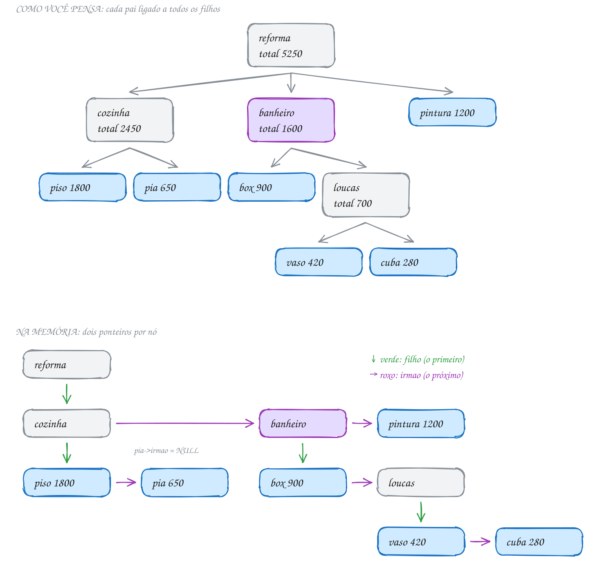</p>

O TAD fica em `arvgen.h` e `arvgen.c`. O nó e as duas funções recursivas que
interessam aqui:

```c
typedef struct NoG {
    char nome[20];
    int valor;          // o valor do próprio nó (um grupo pode ter 0)
    struct NoG *filho;  // o primeiro filho
    struct NoG *irmao;  // o próximo irmão (mesmo pai)
} NoG;

int ag_total(const NoG *r) {
    int soma = r->valor;
    for (const NoG *p = r->filho; p != NULL; p = p->irmao) {
        soma += ag_total(p); // cada filho traz o total da sua subárvore
    }
    return soma;
}

static void mostra(const NoG *r, int nivel) {
    printf("%*s%s: %d\n", 2 * nivel, "", r->nome, ag_total(r));
    for (const NoG *p = r->filho; p != NULL; p = p->irmao) {
        mostra(p, nivel + 1);
    }
}
```

O cliente monta o orçamento com `ag_adiciona(pai, nome, valor)`, que pendura o
filho novo no fim da fila de irmãos e devolve o ponteiro dele:

```c
#include <stdio.h>
#include "arvgen.h"

int main(void) {
    NoG *reforma = ag_cria("reforma", 0);
    NoG *cozinha = ag_adiciona(reforma, "cozinha", 0);
    ag_adiciona(cozinha, "piso", 1800);
    ag_adiciona(cozinha, "pia", 650);
    NoG *banheiro = ag_adiciona(reforma, "banheiro", 0);
    ag_adiciona(banheiro, "box", 900);
    NoG *loucas = ag_adiciona(banheiro, "loucas", 0);
    ag_adiciona(loucas, "vaso", 420);
    ag_adiciona(loucas, "cuba", 280);
    ag_adiciona(reforma, "pintura", 1200);

    ag_mostra(reforma);
    printf("Itens: %d | altura: %d | grau da raiz: %d\n",
           ag_conta(reforma), ag_altura(reforma), ag_grau(reforma));

    ag_libera(reforma);
    return 0;
}
// Saída:
// reforma: 5250
//   cozinha: 2450
//     piso: 1800
//     pia: 650
//   banheiro: 1600
//     box: 900
//     loucas: 700
//       vaso: 420
//       cuba: 280
//   pintura: 1200
// Itens: 10 | altura: 3 | grau da raiz: 3
```

Repara no fluxograma: é o `ag_total` chamado no banheiro. A soma começa no
valor próprio (0), o laço visita o box (900) e as louças (que devolvem 700 depois
de somar vaso e cuba) e para quando `p` chega em `NULL`, no fim da fila de
irmãos. O banheiro devolve 1600:

<p align="center">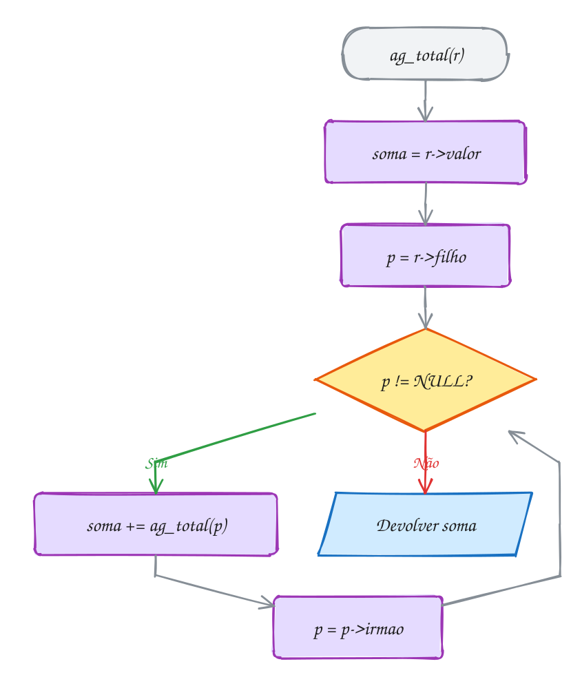</p>

> [!WARNING]
> O irmão está no **mesmo nível**, não embaixo. Quem escreve a altura no
> estilo da árvore binária, `1 + maior(altura(r->filho), altura(r->irmao))`,
> conta cada irmão como mais um andar. No orçamento, o caminho reforma,
> cozinha, banheiro, box, louças, vaso, cuba vira uma escada de 6 degraus, e a
> resposta sai 6 em vez de 3. Na árvore geral, só o `filho` desce um nível; o
> `irmao` anda para o lado. O mesmo
> cuidado vale para o total: `total(p->filho) + total(p->irmao)` soma também os
> irmãos de `p`, que não são da subárvore dele.

> [!TIP]
> **Por dentro do C:** o `NoG` tem 40 bytes: 20 do nome, 4 do `int` e dois
> ponteiros de 8 bytes (os 20 + 4 = 24 já caem num múltiplo de 8, então não
> sobra enchimento). A reforma inteira cabe em 400 bytes, e uma pasta com 50
> filhos usaria os mesmos 40. Com um vetor fixo de 10 filhos, cada nó teria 104
> bytes e travaria no 11º filho. O preço dos dois ponteiros é o acesso: achar o
> k-ésimo filho custa k passos pela lista de irmãos, e `ag_adiciona` anda até o
> último irmão antes de pendurar o novo (inserir no começo seria O(1), mas
> inverteria a ordem dos filhos).

> [!NOTE]
> **Pergunta para você:** se o empreiteiro acrescentar `ag_adiciona(loucas,
> "torneira", 150)`, quais linhas da saída mudam? E se a torneira for
> pendurada na `pintura`? Pense na altura e no grau da raiz nos dois casos.

### Hora de praticar

Os arquivos ficam em [`0144-arvores-gerais/`](0144-arvores-gerais/). Os comandos funcionam de qualquer pasta do terminal. Nos exemplos, rode, mude, quebre e rode de novo. Nos exercícios, a resposta vai dentro do próprio arquivo. ★☆☆ é aquecimento, ★★☆ pede raciocínio e ★★★ é desafio.

**Exemplo A287 · O sumário numerado da apostila**

```c
#include <stdio.h>
#include "arvgen.h"

// numera como num sumário: o número de um nó é o do pai + a posição dele
// entre os irmãos (1, 2, 3...). O prefixo vai crescendo na descida.
void sumario(const NoG *r, const char *prefixo) {
    int pos = 1;
    for (const NoG *p = r->filho; p != NULL; p = p->irmao, pos++) {
        char numero[32];
        if (prefixo[0] == '\0') {
            snprintf(numero, sizeof numero, "%d", pos);
        } else {
            snprintf(numero, sizeof numero, "%s.%d", prefixo, pos);
        }
        if (p->filho == NULL) {
            printf("%-6s %-14s %3d pág.\n", numero, p->nome, p->valor);
        } else {
            printf("%-6s %-14s %3d pág. no total\n", numero, p->nome, ag_total(p));
        }
        sumario(p, numero); // os filhos de p herdam o número dele
    }
}

int main(void) {
    NoG *apostila = ag_cria("apostila", 0);
    NoG *c1 = ag_adiciona(apostila, "Fundamentos", 0);
    ag_adiciona(c1, "Algoritmos", 6);
    ag_adiciona(c1, "Tipos", 9);
    NoG *c2 = ag_adiciona(apostila, "Condicionais", 0);
    ag_adiciona(c2, "if e else", 8);
    NoG *sw = ag_adiciona(c2, "switch", 0);
    ag_adiciona(sw, "case", 4);
    ag_adiciona(sw, "break", 3);
    ag_adiciona(apostila, "Projetos", 15); // capítulo sem seções: é folha

    sumario(apostila, "");
    printf("Total: %d páginas em %d capítulos\n", ag_total(apostila), ag_grau(apostila));

    ag_libera(apostila);
    return 0;
}
// Saída:
// 1      Fundamentos     15 pág. no total
// 1.1    Algoritmos       6 pág.
// 1.2    Tipos            9 pág.
// 2      Condicionais    15 pág. no total
// 2.1    if e else        8 pág.
// 2.2    switch           7 pág. no total
// 2.2.1  case             4 pág.
// 2.2.2  break            3 pág.
// 3      Projetos        15 pág.
// Total: 45 páginas em 3 capítulos
```

```bash
~/LPEDC/rodar 22-arvores-avancadas/0144-arvores-gerais/A287.c
```

**Exemplo A288 · A família vista como árvore binária**

```c
#include <stdio.h>
#include "arvgen.h"

// Lendo filho como "esquerdo" e irmão como "direito", o NoG vira um nó de
// árvore binária. As funções abaixo percorrem as DUAS leituras.

void pre_geral(const NoG *r) { // o nó, depois cada filho
    printf(" %s", r->nome);
    for (const NoG *p = r->filho; p != NULL; p = p->irmao) {
        pre_geral(p);
    }
}

void pos_geral(const NoG *r) { // cada filho, depois o nó
    for (const NoG *p = r->filho; p != NULL; p = p->irmao) {
        pos_geral(p);
    }
    printf(" %s", r->nome);
}

void pre_binaria(const NoG *r) { // raiz, esquerda (filho), direita (irmão)
    if (r != NULL) {
        printf(" %s", r->nome);
        pre_binaria(r->filho);
        pre_binaria(r->irmao);
    }
}

void em_ordem_binaria(const NoG *r) { // esquerda, raiz, direita
    if (r != NULL) {
        em_ordem_binaria(r->filho);
        printf(" %s", r->nome);
        em_ordem_binaria(r->irmao);
    }
}

int altura_binaria(const NoG *r) { // irmão conta como mais um nível aqui
    if (r == NULL) {
        return -1;
    }
    int he = altura_binaria(r->filho);
    int hd = altura_binaria(r->irmao);
    return 1 + (he > hd ? he : hd);
}

int main(void) {
    NoG *lucia = ag_cria("Lucia", 0);
    NoG *ana = ag_adiciona(lucia, "Ana", 0);
    ag_adiciona(ana, "Bia", 0);
    ag_adiciona(ana, "Caio", 0);
    ag_adiciona(lucia, "Davi", 0);
    NoG *eva = ag_adiciona(lucia, "Eva", 0);
    ag_adiciona(eva, "Fabio", 0);

    printf("Pré-ordem da geral:    ");
    pre_geral(lucia);
    printf("\nPré-ordem da binária:  ");
    pre_binaria(lucia);
    printf("\nPós-ordem da geral:    ");
    pos_geral(lucia);
    printf("\nEm ordem da binária:   ");
    em_ordem_binaria(lucia);
    printf("\nAltura da geral: %d | altura da binária: %d\n",
           ag_altura(lucia), altura_binaria(lucia));

    ag_libera(lucia);
    return 0;
}
// Saída:
// Pré-ordem da geral:     Lucia Ana Bia Caio Davi Eva Fabio
// Pré-ordem da binária:   Lucia Ana Bia Caio Davi Eva Fabio
// Pós-ordem da geral:     Bia Caio Ana Davi Fabio Eva Lucia
// Em ordem da binária:    Bia Caio Ana Davi Fabio Eva Lucia
// Altura da geral: 2 | altura da binária: 4
```

```bash
~/LPEDC/rodar 22-arvores-avancadas/0144-arvores-gerais/A288.c
```

#### Exercícios

**Exercício E859** · ★☆☆

A lista de compras do churrasco está numa árvore geral (arvgen.h). Complete
folhas(r), que conta os nós sem filhos (os itens que vão para o carrinho),
e grupos(r), que conta os nós com pelo menos um filho (a raiz entra).


```text
Saída esperada:
Itens (folhas): 6
Grupos (nós com filhos): 3
Total: R$ 297
```

**Dicas:**

1. Um nó é folha quando r->filho == NULL. Não olhe para r->irmao: o irmão
   não diz nada sobre r ter ou não filhos.
2. Siga o molde de ag_conta no arvgen.c: some a resposta de cada filho com
   o laço for (p = r->filho; p != NULL; p = p->irmao).
3. Resposta esperada: a saída acima (picanha, linguica, frango, refri,
   cerveja e carvao são as folhas; churrasco, carnes e bebidas, os grupos).

```bash
~/LPEDC/rodar 22-arvores-avancadas/0144-arvores-gerais/E859.c
```

**Exercício E860** · ★☆☆

A lista de material escolar está numa árvore geral (arvgen.h). Escreva
mais_caro(r): devolve um ponteiro para a FOLHA de maior valor da subárvore
de r. Depois use a mesma função em duas subárvores, achadas com ag_busca.


```text
Saída esperada:
Mais caro da lista: mochila (R$ 120)
Mais caro em livros: gramatica (R$ 89)
Mais caro em papelaria: estojo (R$ 25)
```

**Dicas:**

1. Se r não tem filho, a resposta é o próprio r.
2. Senão, comece com melhor = NULL e, para cada filho p, pegue
   c = mais_caro(p); se melhor for NULL ou c->valor > melhor->valor, troque.
3. Resposta esperada: a saída acima.

```bash
~/LPEDC/rodar 22-arvores-avancadas/0144-arvores-gerais/E860.c
```

**Exercício E861** · ★★☆

No orçamento da reforma (a árvore do texto), escreva caminho(r, nome): ela
mostra a trilha da raiz até o item, separada por " > ", e a profundidade
do item. Se o item não existir, avisa.


```text
Saída esperada:
vaso: reforma > banheiro > loucas > vaso (profundidade 3)
pia: reforma > cozinha > pia (profundidade 2)
reforma: reforma (profundidade 0)
janela: não encontrado
```

**Dicas:**

1. Use um vetor de ponteiros como pilha: const NoG *trilha[32]. Uma função
   recursiva acha(r, nome, trilha, nivel) põe r em trilha[nivel]; se r é o
   item, devolve nivel; senão tenta cada filho com nivel + 1.
2. Se nenhum filho achou, devolva -1. O que ficou em trilha[0..nivel] na
   volta é exatamente o caminho (as posições de quem falhou são
   sobrescritas pelos próximos irmãos).
3. Resposta esperada: a saída acima.

```bash
~/LPEDC/rodar 22-arvores-avancadas/0144-arvores-gerais/E861.c
```

**Exercício E862** · ★★☆

A árvore genealógica de seu Joaquim está numa árvore geral (arvgen.h). Para
a foto da festa, os netos querem a família arrumada por geração. Escreva:
- conta_nivel(r, alvo): quantas pessoas estão na profundidade alvo;
- mostra_nivel(r, alvo): imprime os nomes dessa profundidade, da esquerda
 para a direita.
No main, use ag_altura para saber quantas gerações existem.


```text
Saída esperada:
Geração 0 (1): Joaquim
Geração 1 (3): Rosa Jorge Vera
Geração 2 (5): Paulo Rita Nina Otto Pedro
Geração 3 (1): Leo
```

**Dicas:**

1. Desça subtraindo: se alvo == 0, r é da geração procurada. Senão, peça
   a cada filho a geração alvo - 1.
2. As gerações vão de 0 até ag_altura(r).
3. Resposta esperada: a saída acima.

```bash
~/LPEDC/rodar 22-arvores-avancadas/0144-arvores-gerais/E862.c
```

**Exercício E863** · ★★★

Ache o bug. A lanchonete tira itens do cardápio com remove_filho(pai,
nome): a função acha o filho na fila de irmãos, solta esse filho da fila
e libera a subárvore dele inteira. Este código tem UM erro: rode e veja o
AddressSanitizer acusar heap-use-after-free. Conserte a função e rode de
novo até sair limpo.


```text
Saída esperada:
cardapio: 76
  lanches: 54
    xburguer: 22
    xsalada: 20
    misto: 12
  bebidas: 14
    suco: 9
    cafe: 5
  sobremesas: 8
    pudim: 8
Tirou bebidas: sim
Tirou misto: não (não é filho direto do cardapio)
Tirou misto de lanches: sim
cardapio: 50
  lanches: 42
    xburguer: 22
    xsalada: 20
  sobremesas: 8
    pudim: 8
```

**Dicas:**

1. Leia o relatório do sanitizer: ele mostra a linha do acesso proibido e
   a linha do free que devolveu aquela memória.
2. Depois de ag_libera(p), o nó p não existe mais. Quais campos de p o
   código ainda lê depois disso?
3. Resposta esperada: o religamento (pai->filho = p->irmao ou
   ant->irmao = p->irmao) tem que vir ANTES de ag_libera(p). Com a ordem
   trocada, a saída é a de cima.

```bash
~/LPEDC/rodar 22-arvores-avancadas/0144-arvores-gerais/E863.c
```

**Exercício E864** · ★★★

Monte a árvore pela entrada. Cada linha tem "pai nome valor"; na primeira,
o pai é "-" e o nome é a raiz. Um filho novo entra no fim da fila de
irmãos do pai. Se o pai não existir, avise e ignore a linha. No fim,
mostre a árvore (ag_mostra), o número de nós, a altura e qual filho da raiz
tem o maior total. Sem nenhuma linha, mostre "Árvore vazia".

Teste com:

```text
printf -- '- casamento 0\ncasamento buffet 0\nbuffet salgados 1800\nbuffet bolo 950\ncasamento decoracao 0\ndecoracao flores 1200\nigreja padre 300\ndecoracao luzes 400\ncasamento musica 2500\nbuffet doces 700\n' | ~/LPEDC/rodar 22-arvores-avancadas/0144-arvores-gerais/E864.c
```


```text
Saída esperada:
pai igreja não existe: linha ignorada
casamento: 7550
  buffet: 3450
    salgados: 1800
    bolo: 950
    doces: 700
  decoracao: 1600
    flores: 1200
    luzes: 400
  musica: 2500
Itens: 9 | altura: 2
Maior gasto: buffet (R$ 3450)
```

**Dicas:**

1. Leia cada linha com fgets e separe com sscanf(linha, "%19s %19s %d",
   pai, nome, &valor) == 3. Linha que não casa, ignore.
2. A primeira linha válida cria a raiz com ag_cria. Nas outras, ag_busca
   acha o pai e ag_adiciona pendura o filho.
3. Para o maior gasto, ande pelos filhos da raiz comparando ag_total.
   Resposta esperada: a saída acima. Não esqueça do ag_libera no fim.

```bash
~/LPEDC/rodar 22-arvores-avancadas/0144-arvores-gerais/E864.c
```

---

## 0145 · Rubro-negra esquerdista (LLRB): inserção

A cancela do condomínio abre pela tag do carro. O síndico cadastra tags novas a
qualquer hora (morador novo, carro trocado, visita frequente), e a consulta tem
que ser instantânea quando o carro encosta. Uma BST comum degenera se as tags
chegarem em ordem. A AVL resolve, mas guarda a altura em cada nó e tem quatro
casos de rotação para lembrar. Existe uma árvore equilibrada mais enxuta: a
**rubro-negra**, a que mais aparece em sistemas reais (o escalonador de
processos do Linux usa uma).

A ideia por trás dela é outra árvore, a **árvore 2-3**. Nela, um nó guarda **uma
chave** (e tem 2 filhos) ou **duas chaves** (e tem 3 filhos). Toda chave nova
entra numa folha; se a folha ficar com três chaves, ela estoura: a do meio sobe
para o pai e as outras duas viram nós separados. Como a árvore só cresce quando
a raiz estoura, **todas as folhas ficam sempre no mesmo nível**. Equilíbrio
perfeito, mas nós de dois tamanhos são chatos de programar.

A **rubro-negra esquerdista** (em inglês, *left-leaning red-black*, LLRB) guarda
a árvore 2-3 em nós binários comuns. Um nó de duas chaves `[a b]` vira o `b`
com o `a` pendurado à esquerda por um **link vermelho**. Os outros links são
**pretos**. Cada nó guarda a cor do link que chega nele: um `bool vermelho`, um
bit de informação.

As regras da LLRB são a árvore 2-3 escrita em cores:

1. link vermelho **só à esquerda**;
2. nunca **dois vermelhos seguidos** (um nó de três chaves não existe na 2-3);
3. todo caminho da raiz até um `NULL` passa pelo **mesmo número de nós pretos**
   (a **altura preta**), porque na 2-3 todas as folhas estão no mesmo nível.

A raiz é sempre preta. Com essas regras, o caminho mais longo é no máximo o
dobro do mais curto (preto, vermelho, preto, vermelho...), e a altura fica
abaixo de 2 · log₂(n + 1).

A inserção começa como na BST e pendura um nó **vermelho** (a chave nova se
cola num nó 2-3 que já existe). Isso pode quebrar uma regra. Na volta da
recursão, cada ancestral aplica três consertos, **nesta ordem**:

| Situação em `h` | Conserto | Na árvore 2-3 |
| --- | --- | --- |
| filho direito vermelho, esquerdo preto | rotação à esquerda | deita o nó de 2 chaves para a esquerda |
| filho esquerdo e neto esquerdo vermelhos | rotação à direita | arruma um nó de 3 chaves temporário |
| os dois filhos vermelhos | inverte as cores | o nó de 3 chaves estoura e a do meio sobe |

A **inversão de cores** pinta os dois filhos de preto e `h` de vermelho: o
vermelho que sobe é a chave do meio indo para o pai. Lá em cima, ele pode
disparar os consertos de novo, como a divisão que sobe na 2-3.

Vamos ver na prática. O síndico cadastra as tags 30, 10 e 20. A 20 entra à
direita do 10 e forma um zigue-zague: os três consertos acontecem um atrás do
outro. Depois, com as tags 50 e 40, a árvore fica com o 20 vermelho colado no
40, que é exatamente o nó 2-3 `[20 40]`:

<p align="center">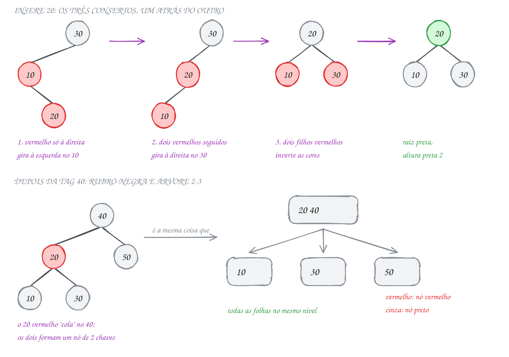</p>

A inserção do `rubronegra.c`. A rotação é a mesma da AVL, com uma novidade: a
cor do link vai junto com quem sobe:

```c
static NoRN *gira_esquerda(NoRN *h) {
    NoRN *x = h->dir;
    h->dir = x->esq;
    x->esq = h;
    x->vermelho = h->vermelho; // x herda a cor do link que chegava em h
    h->vermelho = true;
    rotacoes++;
    return x;
}

static NoRN *insere(NoRN *h, int chave) {
    if (h == NULL) {
        return novo_no(chave); // todo nó novo chega vermelho
    }
    if (chave < h->chave) {
        h->esq = insere(h->esq, chave);
    } else if (chave > h->chave) {
        h->dir = insere(h->dir, chave);
    }
    // na volta, os três consertos, nesta ordem
    if (eh_vermelho(h->dir) && !eh_vermelho(h->esq)) {
        h = gira_esquerda(h);      // 1. vermelho à direita
    }
    if (eh_vermelho(h->esq) && eh_vermelho(h->esq->esq)) {
        h = gira_direita(h);       // 2. dois vermelhos seguidos
    }
    if (eh_vermelho(h->esq) && eh_vermelho(h->dir)) {
        inverte_cores(h);          // 3. dois filhos vermelhos
    }
    return h;
}

NoRN *rn_insere(NoRN *raiz, int chave) {
    raiz = insere(raiz, chave);
    raiz->vermelho = false; // a raiz é sempre preta
    return raiz;
}
```

`eh_vermelho(NULL)` devolve `false`: o `NULL` conta como preto. O cliente
cadastra as tags e mostra a árvore em pré-ordem, com `*` nos nós vermelhos:

```c
#include <stdio.h>
#include "rubronegra.h"

int main(void) {
    int tags[] = {30, 10, 20, 50, 40};
    NoRN *raiz = NULL;

    for (int i = 0; i < 5; i++) {
        raiz = rn_insere(raiz, tags[i]);
        printf("Insere %d: pré", tags[i]);
        rn_pre_ordem(raiz);
        printf(" | rotações %d | inversões %d\n", rn_rotacoes(), rn_inversoes());
    }
    printf("Altura %d, altura preta %d\n", rn_altura(raiz), rn_altura_preta(raiz));

    raiz = rn_libera(raiz);
    return 0;
}
// Saída:
// Insere 30: pré 30 | rotações 0 | inversões 0
// Insere 10: pré 30 10* | rotações 0 | inversões 0
// Insere 20: pré 20 10 30 | rotações 2 | inversões 1
// Insere 50: pré 20 10 50 30* | rotações 3 | inversões 1
// Insere 40: pré 40 20* 10 30 50 | rotações 6 | inversões 2
// Altura 2, altura preta 2
```

Repara no fluxograma: são os três `if` da volta, em sequência, e não um
`else if`. O caminho verde é o do nó 30 quando a tag 20 chega: o primeiro
conserto já foi feito lá embaixo, no 10; no 30 entram o segundo e o terceiro:

<p align="center">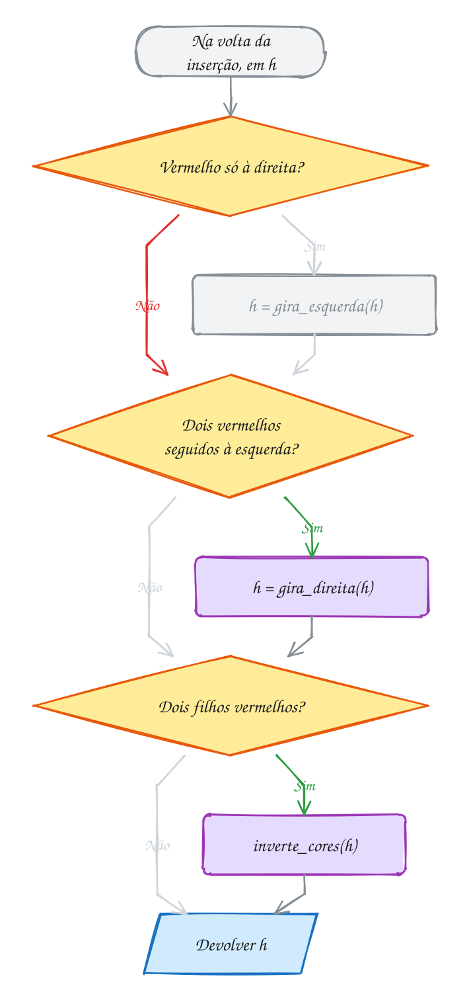</p>

### Passo a passo

A tag 40 mostra o vermelho subindo. Ela desce 20, 50, 30 e vira filha direita
(vermelha) do 30, que também é vermelho:

| Nó na volta | O que encontra | Conserto | Como fica a subárvore |
| --- | --- | --- | --- |
| 30 | filho direito 40 vermelho | rotação à esquerda | 40* com 30* à esquerda |
| 50 | 40* e 30* seguidos à esquerda | rotação à direita | 40 com 30* e 50* |
| 40 | dois filhos vermelhos | inverte as cores | 40* com 30 e 50 pretos |
| 20 | filho direito 40 vermelho | rotação à esquerda | 40 com 20* (10, 30) e 50 |

Três rotações e uma inversão para uma inserção: é o pior caso deste exemplo. Na
média, a LLRB faz bem menos trabalho, e a árvore 2-3 por trás dela continua com
todas as folhas no mesmo nível.

> [!WARNING]
> A cor é do **link**, não do nó em si. Na rotação, quem sobe ocupa o lugar de
> quem desce e tem que herdar a cor dele (`x->vermelho = h->vermelho`). Sem
> essa linha, um nó vermelho vira raiz de subárvore no lugar de um preto, a
> altura preta se desencontra e a árvore volta a crescer torta (é o bug do
> E869). O outro esquecimento clássico é a raiz: depois de uma inversão de
> cores no topo, ela fica vermelha. Por isso `rn_insere` pinta a raiz de preto
> no fim de **toda** inserção.

> [!TIP]
> **Por dentro do C:** um `bool` ocupa 1 byte, mas o `NoRN` tem 24 bytes, os
> mesmos da AVL: 4 da chave, 1 da cor, 3 de enchimento e dois ponteiros de 8.
> A cor só precisa de 1 bit, e o kernel do Linux aproveita isso: como todo nó
> começa num endereço múltiplo de 4, os dois bits mais baixos de um ponteiro
> para nó são sempre 0, e ele guarda a cor no bit mais baixo do ponteiro para o
> pai. Em C dá para fazer isso convertendo o ponteiro para `uintptr_t`, mas é
> um truque de sistema operacional, não de curso. A grande vantagem prática é
> outra: a inserção faz no máximo um punhado de trocas de ponteiros por nível
> e não recalcula alturas.

> [!NOTE]
> **Pergunta para você:** se o síndico cadastrar as tags 10, 20, 30, 40, 50, 60
> e 70, nesta ordem, qual tag fica na raiz e quantos nós vermelhos sobram no
> fim? Desenhe a árvore 2-3 de cada passo e confira com o `rn_pre_ordem`.

### Hora de praticar

Os arquivos ficam em [`0145-rubro-negra/`](0145-rubro-negra/). Os comandos funcionam de qualquer pasta do terminal. Nos exemplos, rode, mude, quebre e rode de novo. Nos exercícios, a resposta vai dentro do próprio arquivo. ★☆☆ é aquecimento, ★★☆ pede raciocínio e ★★★ é desafio.

**Exemplo A289 · Mil chaves em ordem, mil ao contrário**

```c
#include <math.h>
#include <stdio.h>
#include "rubronegra.h"

void relata(const char *nome, const NoRN *r, int rot, int inv) {
    printf("%-12s altura %2d | altura preta %2d | rotações %4d | inversões %4d\n",
           nome, rn_altura(r), rn_altura_preta(r), rot, inv);
}

int main(void) {
    int n = 1000;
    NoRN *cresce = NULL;
    for (int i = 1; i <= n; i++) {
        cresce = rn_insere(cresce, i);
    }
    int rot1 = rn_rotacoes(), inv1 = rn_inversoes();
    relata("crescente:", cresce, rot1, inv1);

    NoRN *desce = NULL; // os contadores são acumulados: desconte os de antes
    for (int i = n; i >= 1; i--) {
        desce = rn_insere(desce, i);
    }
    relata("decrescente:", desce, rn_rotacoes() - rot1, rn_inversoes() - inv1);

    NoRN *mistura = NULL; // 1000 chaves embaralhadas: i * 7919 % 1000
    int rot2 = rn_rotacoes(), inv2 = rn_inversoes();
    for (int i = 0; i < n; i++) {
        mistura = rn_insere(mistura, i * 7919 % n);
    }
    relata("embaralhada:", mistura, rn_rotacoes() - rot2, rn_inversoes() - inv2);

    printf("Limite teórico: altura <= 2 log2(n + 1) = %.1f\n", 2 * log2(n + 1.0));
    printf("Busca 777 na crescente: %s\n", rn_busca(cresce, 777) ? "achou" : "não achou");

    cresce = rn_libera(cresce);
    desce = rn_libera(desce);
    mistura = rn_libera(mistura);
    return 0;
}
// Saída:
// crescente:   altura  9 | altura preta  9 | rotações  991 | inversões  985
// decrescente: altura 14 | altura preta  9 | rotações  985 | inversões  985
// embaralhada: altura 11 | altura preta  8 | rotações  546 | inversões  658
// Limite teórico: altura <= 2 log2(n + 1) = 19.9
// Busca 777 na crescente: achou
```

```bash
~/LPEDC/rodar 22-arvores-avancadas/0145-rubro-negra/A289.c
```

**Exemplo A290 · A árvore 2-3 escondida na rubro-negra**

```c
#include <stdio.h>
#include "rubronegra.h"

// Cole cada nó vermelho no pai: os dois viram um nó de 2 chaves (um "3-nó",
// com 3 filhos). O resultado é uma árvore 2-3, com todas as folhas no mesmo
// nível. Esta função mostra os nós 2-3 que estão no nível alvo.
void nivel_23(const NoRN *h, int alvo) {
    if (h == NULL) {
        return;
    }
    const NoRN *e = h->esq;
    bool tres = e != NULL && e->vermelho; // h + filho vermelho = 3-nó
    if (alvo == 0) {
        if (tres) {
            printf(" [%d %d]", e->chave, h->chave);
        } else {
            printf(" [%d]", h->chave);
        }
        return;
    }
    if (tres) { // os 3 filhos do 3-nó
        nivel_23(e->esq, alvo - 1);
        nivel_23(e->dir, alvo - 1);
    } else {
        nivel_23(h->esq, alvo - 1);
    }
    nivel_23(h->dir, alvo - 1);
}

int main(void) {
    int chaves[] = {50, 20, 80, 10, 30, 60, 90, 40, 70, 25};
    NoRN *raiz = NULL;
    for (int i = 0; i < 10; i++) {
        raiz = rn_insere(raiz, chaves[i]);
    }

    printf("Rubro-negra (pré, * = vermelho):");
    rn_pre_ordem(raiz);
    printf("\nAltura: %d | altura preta: %d\n", rn_altura(raiz), rn_altura_preta(raiz));

    printf("Vista como árvore 2-3:\n");
    for (int d = 0; d < rn_altura_preta(raiz); d++) {
        printf("  nível %d:", d);
        nivel_23(raiz, d);
        printf("\n");
    }

    raiz = rn_libera(raiz);
    return 0;
}
// Saída:
// Rubro-negra (pré, * = vermelho): 50 30 20* 10 25 40 80 70 60* 90
// Altura: 3 | altura preta: 3
// Vista como árvore 2-3:
//   nível 0: [50]
//   nível 1: [20 30] [80]
//   nível 2: [10] [25] [40] [60 70] [90]
```

```bash
~/LPEDC/rodar 22-arvores-avancadas/0145-rubro-negra/A290.c
```

#### Exercícios

**Exercício E865** · ★☆☆

Insira os códigos de 1 a 10, em ordem, numa rubro-negra (rubronegra.h) e
escreva conta_vermelhos(r), que devolve quantos nós vermelhos a árvore
tem. Mostre também quantos são pretos (use o total de nós, que você conta
com outra função curta, conta_nos).


```text
Saída esperada:
pré: 4 2 1 3 8 6* 5 7 10 9*
nós: 10 | vermelhos: 2 | pretos: 8
```

**Dicas:**

1. conta_vermelhos: vazia dá 0; senão, (r->vermelho ? 1 : 0) mais a
   contagem das duas subárvores.
2. Cada vermelho é a "segunda chave" de um nó 2-3. Com 10 chaves e 8 nós
   pretos, a árvore 2-3 equivalente tem 8 nós.
3. Resposta esperada: a saída acima.

```bash
~/LPEDC/rodar 22-arvores-avancadas/0145-rubro-negra/E865.c
```

**Exercício E866** · ★☆☆

O estoque guarda os códigos de produto de 1 a 100 numa rubro-negra
(rubronegra.h), inseridos em ordem crescente. Escreva passos(r, chave):
quantos nós a busca visita até achar a chave ou cair num NULL. Teste com
1, 50, 64, 100 e 101 e, no fim, descubra o pior caso entre os 100 códigos.


```text
Saída esperada:
busca   1: achou (passos: 7)
busca  50: achou (passos: 6)
busca  64: achou (passos: 1)
busca 100: achou (passos: 6)
busca 101: não achou (passos: 6)
pior caso entre as 100: 7 passos (altura 6)
```

**Dicas:**

1. É a busca da BST com um contador: a cor não muda nada na busca.
2. Some 1 a cada nó visitado; pare quando achar ou quando r ficar NULL.
3. Resposta esperada: a saída acima. O 64 é a raiz: inserindo em ordem
   crescente, a raiz cai numa potência de 2 (teste com 10 e com 1000).

```bash
~/LPEDC/rodar 22-arvores-avancadas/0145-rubro-negra/E866.c
```

**Exercício E867** · ★★☆

Escreva confere(r), o fiscal da rubro-negra esquerdista. Ela devolve a
altura preta (quantos nós pretos há da raiz até um NULL) se as três regras
valerem, ou um código negativo dizendo a primeira regra quebrada que achar:

```text
-1: um link vermelho à direita;
-2: dois vermelhos seguidos (um vermelho com filho esquerdo vermelho);
-3: dois caminhos com quantidades diferentes de nós pretos.
```

O main já monta quatro árvores: uma pelo TAD e três à mão, com no().


```text
Saída esperada:
TAD (1 a 20): ok, altura preta 4
Árvore A: quebra a regra 1
Árvore B: quebra a regra 2
Árvore C: quebra a regra 3
```

**Dicas:**

1. NULL devolve 0 (é preto, mas não conta). Se r->dir é vermelho, -1. Se
   r e r->esq são vermelhos, -2.
2. Peça confere das duas subárvores; se alguma for negativa, repasse. Se
   forem diferentes, -3. Senão, devolva o valor + (r é preto ? 1 : 0).
3. Resposta esperada: a saída acima. Cada nó é visitado uma vez só: O(n).

```bash
~/LPEDC/rodar 22-arvores-avancadas/0145-rubro-negra/E867.c
```

**Exercício E868** · ★★☆

Estenda o programa. A eleição do síndico usa uma rubro-negra para guardar
os números votados, mas a inserção abaixo IGNORA número repetido, e a
apuração precisa contar. Faça três mudanças:
1. em insere, quando o número já existir, some 1 em qtd;
2. escreva apura(r): mostra cada número votado, em ordem crescente, com a
 quantidade de votos ("voto" no singular quando for 1);
3. escreva vencedor(r): devolve o nó com mais votos.


```text
Saída esperada:
12: 3 votos
13: 2 votos
30: 2 votos
45: 4 votos
99: 1 voto
Vencedor: 45 com 4 de 12 votos
```

**Dicas:**

1. A contagem cabe no else que hoje não faz nada (chave igual). Repare
   que novo() já começa qtd em 1.
2. apura é um percurso em ordem. vencedor compara o nó com o melhor de
   cada lado (cuidado com os NULL).
3. Resposta esperada: a saída acima. A árvore guarda 5 nós, não 12: o
   tamanho dela depende dos números diferentes, não do total de votos.

```bash
~/LPEDC/rodar 22-arvores-avancadas/0145-rubro-negra/E868.c
```

**Exercício E869** · ★★★

Ache o bug. O cartório guarda as senhas do dia numa rubro-negra escrita à
mão, sem o TAD. Ela tem UM erro numa das rotações. O programa insere as
senhas 101 a 112, em ordem, e chama um fiscal que confere as regras. Rode,
veja o fiscal reclamar e a árvore crescer demais, conserte e rode de novo.


```text
Saída esperada:
pré: 108 104* 102 101 103 106 105 107 110 109 112 111*
altura 3, altura preta 3
fiscal: regras ok
```

**Dicas:**

1. Desenhe a árvore depois de inserir 101, 102, 103 e 104 com o código como
   está, e depois com o que a rotação deveria fazer.
2. Na rotação, o nó que sobe passa a receber o link que chegava no nó que
   desce. Esse link pode ser preto ou vermelho: a cor tem que ir junto.
3. Resposta esperada: falta "x->vermelho = h->vermelho;" em vira_esq
   (compare com vira_dir). Sem ela, o nó que sobe continua vermelho
   mesmo quando ocupa o lugar de um nó preto, e o vermelho fica à direita.
   Com a linha de volta, a saída é a de cima.

```bash
~/LPEDC/rodar 22-arvores-avancadas/0145-rubro-negra/E869.c
```

**Exercício E870** · ★★★

Escreva do zero (sem o rubronegra.h, que guarda int) uma rubro-negra
esquerdista de NOMES para a lista de convidados de uma festa. Compare com
strcmp; nome repetido é ignorado. Insira, nesta ordem:


```text
Marcos Ana Teresa Bruno Lia Zeca Carla Otavio Duda Ana
```


Mostre a lista em ordem, a pré-ordem com * nos vermelhos, a altura, a
altura preta e o resultado de duas buscas.


```text
Saída esperada:
Em ordem: Ana Bruno Carla Duda Lia Marcos Otavio Teresa Zeca
Pré-ordem: Marcos Duda Bruno* Ana Carla Lia Teresa Otavio Zeca
Altura 3, altura preta 3
Lia: na lista | Rafa: fora
```

**Dicas:**

1. Struct com char nome[20], bool vermelho, esq e dir. As rotações e a
   inversão de cores não olham a chave: copie a lógica do texto.
2. Na inserção, guarde int cmp = strcmp(nome, h->nome) e decida pelo sinal.
   Para copiar o nome para o nó, use snprintf(n->nome, sizeof n->nome,
   "%s", nome).
3. Resposta esperada: a saída acima. Não esqueça de pintar a raiz de preto
   depois de cada inserção e de liberar tudo no fim.

```bash
~/LPEDC/rodar 22-arvores-avancadas/0145-rubro-negra/E870.c
```

---

## 0146 · Árvore B: busca, divisão e inserção

A biblioteca municipal pôs o acervo inteiro no computador: milhões de fichas,
guardadas no disco, porque não cabem na memória. Ler do disco é lento: um HD
leva uns 10 milissegundos para buscar um bloco, tempo em que o processador faz
milhões de comparações. Numa AVL com 2 milhões de livros, a busca desce uns 21
nós, e se cada nó estiver num bloco diferente são 21 idas ao disco. Para o
disco, o que importa não é comparar pouco: é **ler poucos nós**.

A **árvore B** resolve isso com nós gordos. Cada nó guarda **várias chaves em
ordem** e tem um filho a mais do que chaves: com as chaves `[40 70]`, o filho
0 tem as menores que 40, o filho 1 as que ficam entre 40 e 70, e o filho 2 as
maiores que 70. É uma BST em que cada nó decide entre muitos caminhos de uma
vez. Num banco de dados, um nó ocupa um bloco do disco e guarda centenas de
chaves; a árvore fica com altura 3 ou 4 mesmo com bilhões de registros.

O tamanho do nó é dado pelo **grau mínimo** `t`:

- todo nó, menos a raiz, tem de `t - 1` a `2t - 1` chaves (a raiz pode ter 1);
- um nó com `k` chaves que não é folha tem `k + 1` filhos;
- **todas as folhas ficam no mesmo nível**.

O TAD do curso usa `t = 2`: de 1 a 3 chaves por nó, de 2 a 4 filhos (é a
chamada árvore 2-3-4). Na vida real, `t` passa de 100.

A **busca** é a da BST com um laço dentro do nó: ande pelas chaves até achar
uma maior ou igual. Se for igual, achou; senão, desça pelo filho daquela
posição. Lê um nó por nível: altura + 1 nós no total.

A **inserção** sempre põe a chave numa folha. O problema é a folha cheia. A
solução é a **divisão**: um nó com `2t - 1` chaves se parte em dois nós de
`t - 1` chaves, e a **chave do meio sobe** para o pai. Para o pai nunca estar
cheio nessa hora, o TAD divide **na descida**: todo nó cheio que aparece no
caminho é dividido antes de a chave descer por ele. Quando a raiz está cheia,
ela se divide e a chave do meio vira uma raiz nova. A árvore B cresce por
cima, nunca por baixo: é por isso que as folhas continuam todas no mesmo nível.

Vamos ver na prática. O bibliotecário cadastra 11 livros, nesta ordem: 40, 10,
70, 20, 50, 80, 30, 60, 90, 25 e 85. Quando o 25 chega, a raiz é `[40 70]` e a
folha do caminho, `[10 20 30]`, está cheia: ela se divide, o 20 sobe e o 25
entra na metade da direita. Quando o 85 chega, a raiz `[20 40 70]` é que está
cheia: ela se divide, o 40 vira raiz nova e a árvore ganha um nível. No fim, a
busca pelo 60 lê três nós:

<p align="center">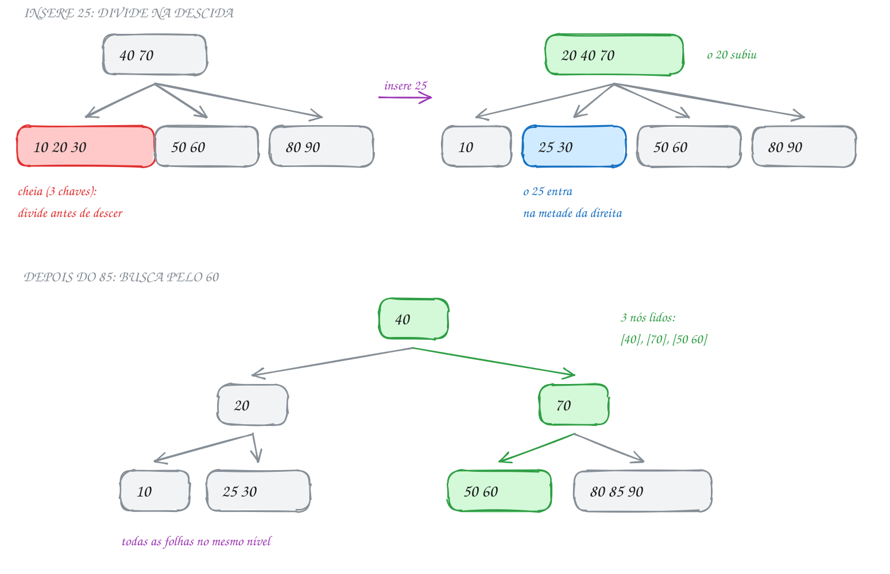</p>

A divisão e a inserção na raiz, no `arvoreb.c` (`AB_T` é o `t`, e `AB_MAX`,
`2t - 1`):

```c
static void divide(NoB *pai, int i) {
    NoB *y = pai->filho[i];         // o filho cheio
    NoB *z = novo_no(y->folha);     // a metade da direita
    z->n = AB_T - 1;
    for (int j = 0; j < AB_T - 1; j++) {
        z->chave[j] = y->chave[j + AB_T]; // as chaves depois do meio
    }
    if (!y->folha) {
        for (int j = 0; j < AB_T; j++) {
            z->filho[j] = y->filho[j + AB_T]; // e os filhos delas
        }
    }
    y->n = AB_T - 1; // y fica com as chaves antes do meio

    for (int j = pai->n; j > i; j--) { // abre espaço no pai
        pai->filho[j + 1] = pai->filho[j];
    }
    pai->filho[i + 1] = z;
    for (int j = pai->n - 1; j >= i; j--) {
        pai->chave[j + 1] = pai->chave[j];
    }
    pai->chave[i] = y->chave[AB_T - 1]; // a chave do meio sobe
    pai->n++;
}

NoB *ab_insere(NoB *raiz, int chave) {
    if (ab_busca(raiz, chave, NULL)) {
        return raiz; // repetida
    }
    if (raiz == NULL) {
        raiz = novo_no(true);
    }
    if (raiz->n == AB_MAX) { // raiz cheia: a árvore cresce por cima
        NoB *s = novo_no(false);
        s->filho[0] = raiz;
        divide(s, 0);
        raiz = s;
    }
    insere_nao_cheio(raiz, chave);
    return raiz;
}
```

Repare que `divide` não apaga nada de `y`: só diminui `y->n`. As chaves do fim
continuam no vetor, mas ficam fora da parte em uso. O cliente:

```c
#include <stdio.h>
#include "arvoreb.h"

int main(void) {
    int livros[] = {40, 10, 70, 20, 50, 80, 30, 60, 90, 25, 85};
    NoB *acervo = NULL;
    for (int i = 0; i < 11; i++) {
        acervo = ab_insere(acervo, livros[i]);
    }

    printf("Árvore B com 11 livros (altura %d, %d divisões):\n",
           ab_altura(acervo), ab_divisoes());
    ab_mostra(acervo);

    int procura[] = {60, 65};
    for (int i = 0; i < 2; i++) {
        int lidos;
        bool achou = ab_busca(acervo, procura[i], &lidos);
        printf("Livro %d: %s, %d nós lidos\n", procura[i],
               achou ? "achou" : "não tem", lidos);
    }

    acervo = ab_libera(acervo);
    return 0;
}
// Saída:
// Árvore B com 11 livros (altura 2, 4 divisões):
//   nível 0: [40]
//   nível 1: [20] [70]
//   nível 2: [10] [25 30] [50 60] [80 85 90]
// Livro 60: achou, 3 nós lidos
// Livro 65: não tem, 3 nós lidos
```

Repara no fluxograma: é o `insere_nao_cheio` chamado na raiz `[40 70]` quando
o 25 chega. A raiz não é folha; o 25 desce pelo filho 0, que está cheio; o
filho se divide e o 20 sobe. Como 25 é maior que o 20, o `i++` manda a chave
para a metade nova, e a chamada recursiva a põe na folha `[30]`:

<p align="center">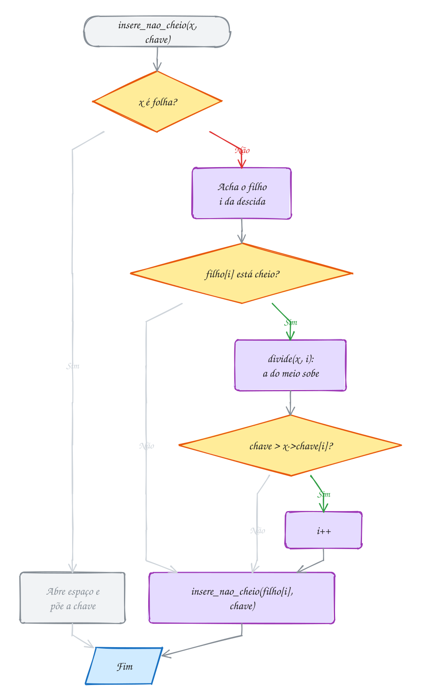</p>

> [!WARNING]
> Depois de `divide(x, i)`, o nó por onde a chave ia descer virou **dois**, e
> a chave que subiu está em `x->chave[i]`. Se a chave nova for maior que ela,
> o caminho certo é o filho `i + 1`, a metade nova. Esquecer o
> `if (chave > x->chave[i]) i++;` põe chaves grandes na metade da esquerda: a
> árvore perde a ordem e a busca deixa de achar chaves que estão lá dentro (é o
> bug do E875). Outra confusão comum é de vocabulário: "árvore B de ordem m"
> costuma querer dizer **m filhos no máximo**, e não o grau mínimo `t`. Confira
> qual dos dois o material usa.

> [!TIP]
> **Por dentro do C:** o `NoB` do TAD tem 56 bytes: 4 do `n`, 12 das três
> chaves, 32 dos quatro ponteiros, 1 do `bool` e 7 de enchimento. Num banco de
> dados, o nó é dimensionado para caber num bloco do disco, por exemplo 4096
> bytes. Com chaves `int` e ponteiros de 8 bytes, `24t` bytes ficam por volta de
> 4096, o que dá `t = 170`: até 339 chaves por nó, e um bilhão de chaves em
> altura 3 (4 blocos lidos por busca). Dentro do nó, as chaves estão num vetor
> ordenado e contíguo: dá para usar até busca binária ali, e a leitura
> sequencial aproveita bem o cache do processador.

> [!NOTE]
> **Pergunta para você:** na árvore final, insira o 87. Qual nó se divide,
> qual chave sobe e como fica o nível 1? Depois insira o 95 e veja se a raiz
> muda. Confira acrescentando as duas chaves no vetor do exemplo.

### Hora de praticar

Os arquivos ficam em [`0146-arvore-b/`](0146-arvore-b/). Os comandos funcionam de qualquer pasta do terminal. Nos exemplos, rode, mude, quebre e rode de novo. Nos exercícios, a resposta vai dentro do próprio arquivo. ★☆☆ é aquecimento, ★★☆ pede raciocínio e ★★★ é desafio.

**Exemplo A291 · Quantas idas ao disco**

```c
#include <math.h>
#include <stdio.h>
#include "arvoreb.h"

// Num banco de dados, cada nó da árvore B é um bloco do disco, e ler um bloco
// custa muito mais que comparar chaves na memória. O que importa é a altura.

int main(void) {
    // 1. na prática, com o TAD (T = 2, até 3 chaves por nó)
    NoB *r = NULL;
    int n = 100000;
    for (int i = 1; i <= n; i++) {
        r = ab_insere(r, i);
    }
    int lidos;
    ab_busca(r, 77777, &lidos);
    printf("TAD com T = 2 e %d chaves: altura %d, busca do 77777 leu %d nós\n",
           n, ab_altura(r), lidos);
    printf("Uma árvore binária perfeita com %d chaves teria altura %d\n",
           n, (int)floor(log2(n)));
    r = ab_libera(r);

    // 2. na teoria: altura máxima de uma árvore B, h <= log_t((n + 1) / 2)
    int ts[] = {2, 50, 500};
    double ns[] = {1e6, 1e9};
    printf("\nAltura máxima (nós lidos = altura + 1):\n");
    printf("%14s %8s %8s %8s\n", "chaves", "T=2", "T=50", "T=500");
    for (int j = 0; j < 2; j++) {
        printf("%14.0f", ns[j]);
        for (int i = 0; i < 3; i++) {
            double h = log((ns[j] + 1) / 2) / log(ts[i]); // log na base t
            printf(" %8d", (int)floor(h));
        }
        printf("\n");
    }
    return 0;
}
// Saída:
// TAD com T = 2 e 100000 chaves: altura 15, busca do 77777 leu 16 nós
// Uma árvore binária perfeita com 100000 chaves teria altura 16
//
// Altura máxima (nós lidos = altura + 1):
//         chaves      T=2     T=50    T=500
//        1000000       18        3        2
//     1000000000       28        5        3
```

```bash
~/LPEDC/rodar 22-arvores-avancadas/0146-arvore-b/A291.c
```

**Exemplo A292 · As notas fiscais em ordem**

```c
#include <stdio.h>
#include "arvoreb.h"

// Em ordem num nó de várias chaves: filho 0, chave 0, filho 1, chave 1, ...,
// chave n-1, filho n. Cada chave fica entre as subárvores das menores e das
// maiores que ela, como na BST.
void em_ordem(const NoB *r) {
    for (int i = 0; i < r->n; i++) {
        if (!r->folha) {
            em_ordem(r->filho[i]);
        }
        printf(" %d", r->chave[i]);
    }
    if (!r->folha) {
        em_ordem(r->filho[r->n]); // o último filho, depois da última chave
    }
}

// quantas chaves há em cada nível (nivel conta a partir da raiz)
void conta_por_nivel(const NoB *r, int nivel, int qtd[]) {
    qtd[nivel] += r->n;
    if (!r->folha) {
        for (int i = 0; i <= r->n; i++) {
            conta_por_nivel(r->filho[i], nivel + 1, qtd);
        }
    }
}

int main(void) {
    int notas[] = {512, 87, 340, 905, 23, 678, 150, 401, 799, 266, 33, 960, 610, 445, 118};
    NoB *r = NULL;
    for (int i = 0; i < 15; i++) {
        r = ab_insere(r, notas[i]);
    }

    printf("Por nível:\n");
    ab_mostra(r);
    printf("Em ordem:");
    em_ordem(r);
    printf("\n");

    int qtd[10] = {0};
    conta_por_nivel(r, 0, qtd);
    for (int d = 0; d <= ab_altura(r); d++) {
        printf("chaves no nível %d: %d\n", d, qtd[d]);
    }

    r = ab_libera(r);
    return 0;
}
// Saída:
// Por nível:
//   nível 0: [340]
//   nível 1: [87] [512 678]
//   nível 2: [23 33] [118 150 266] [401 445] [610] [799 905 960]
// Em ordem: 23 33 87 118 150 266 340 401 445 512 610 678 799 905 960
// chaves no nível 0: 1
// chaves no nível 1: 3
// chaves no nível 2: 11
```

```bash
~/LPEDC/rodar 22-arvores-avancadas/0146-arvore-b/A292.c
```

#### Exercícios

**Exercício E871** · ★☆☆

Insira os códigos de 1 a 20, em ordem, numa árvore B (arvoreb.h, T = 2) e
escreva duas funções recursivas: conta_chaves(r), o total de chaves, e
conta_nos(r), o total de nós. Mostre a árvore com ab_mostra e a média de
chaves por nó.


```text
Saída esperada:
  nível 0: [8]
  nível 1: [4] [12]
  nível 2: [2] [6] [10] [14 16 18]
  nível 3: [1] [3] [5] [7] [9] [11] [13] [15] [17] [19 20]
chaves: 20 | nós: 17 | média: 1.18 chaves por nó
```

**Dicas:**

1. Um nó com n chaves tem n + 1 filhos, de filho[0] a filho[n]. Folha não
   tem filho nenhum: confira r->folha antes de descer.
2. conta_chaves começa com r->n; conta_nos começa com 1.
3. Resposta esperada: a saída acima. Repare como a inserção em ordem deixa
   quase todo nó com uma chave só, de três possíveis.

```bash
~/LPEDC/rodar 22-arvores-avancadas/0146-arvore-b/E871.c
```

**Exercício E872** · ★☆☆

A estação meteorológica guardou as máximas de 15 dias numa árvore B
(arvoreb.h). Escreva minimo(r, &lidos) e maximo(r, &lidos): elas devolvem
a menor e a maior chave e contam, em lidos, quantos nós foram visitados.
Não percorra a árvore inteira: cada uma desce um caminho só.


```text
Saída esperada:
  nível 0: [27]
  nível 1: [19 22] [31]
  nível 2: [17 18] [21] [24 25 26] [29 30] [33 35 36]
mínima: 17 graus (3 nós lidos)
máxima: 36 graus (3 nós lidos)
```

**Dicas:**

1. A menor chave está na folha mais à esquerda: desça por filho[0] até
   r->folha ser verdadeiro e devolva chave[0].
2. A maior está na folha mais à direita: desça por filho[r->n] e devolva
   chave[r->n - 1].
3. Resposta esperada: a saída acima. Como todas as folhas estão no mesmo
   nível, os dois caminhos leem altura + 1 nós.

```bash
~/LPEDC/rodar 22-arvores-avancadas/0146-arvore-b/E872.c
```

**Exercício E873** · ★★☆

No disco, cada nó da árvore B ocupa um bloco inteiro, cheio ou não. A
ocupação é a fração das vagas de chave que estão em uso:
chaves / (nós · AB_MAX). Monte duas árvores com as chaves de 1 a 200: uma
inserindo em ordem crescente e outra na ordem embaralhada i * 37 % 200 + 1
(i de 0 a 199, que passa por todos os números de 1 a 200 uma vez só).
Escreva mede(r, &chaves, &nos), que soma as chaves e os nós de uma árvore,
e mostre nós, altura e ocupação de cada uma.


```text
Saída esperada:
crescente:   nós 195 | altura 6 | ocupação 34.2%
embaralhada: nós 127 | altura 5 | ocupação 52.5%
```

**Dicas:**

1. mede é um percurso: some r->n em *chaves, 1 em *nos e desça pelos
   filhos de 0 a r->n se não for folha.
2. Faça a conta em double: 100.0 * chaves / (nos * AB_MAX). Para imprimir
   o símbolo de porcentagem no printf, escreva %%.
3. Resposta esperada: a saída acima. Na ordem crescente, todo nó que se
   divide deixa a metade esquerda com 1 chave para sempre: ninguém mais
   insere ali.

```bash
~/LPEDC/rodar 22-arvores-avancadas/0146-arvore-b/E873.c
```

**Exercício E874** · ★★☆

A contabilidade quer as notas fiscais de uma faixa de números. Escreva
intervalo(r, a, b, &visitados): mostra, em ordem crescente, as chaves de
a até b e conta quantos nós foram lidos. Não leia subárvores que não podem
ter chave na faixa. A árvore é a mesma do exemplo A292 (9 nós).


```text
Saída esperada:
notas de 300 a 700: 340 401 445 512 610 678 (7 nós lidos de 9)
notas de 100 a 160: 118 150 (3 nós lidos de 9)
notas de 970 a 999: (3 nós lidos de 9)
```

**Dicas:**

1. Comece pelo em_ordem do A292: filho 0, chave 0, filho 1, chave 1, ...,
   filho n.
2. Duas podas: só desça em filho[i] se a < chave[i] (lá só há chaves
   menores que chave[i]); e, se chave[i] > b, pare o laço e não desça mais
   nada à direita (com return).
3. Resposta esperada: a saída acima. Some 1 em *visitados logo na entrada
   da função.

```bash
~/LPEDC/rodar 22-arvores-avancadas/0146-arvore-b/E874.c
```

**Exercício E875** · ★★★

Ache o bug. Esta árvore B escrita à mão (páginas de até 3 chaves, como no
TAD) recebe os protocolos de 10 a 120, de 10 em 10. Ela tem UM erro na
descida da inserção. Rode: o percurso em ordem sai fora de ordem e a busca
por chaves que foram inseridas falha. Conserte e rode de novo.


```text
Saída esperada:
em ordem: 10 20 30 40 50 60 70 80 90 100 110 120
em ordem? sim
achou 10, 60 e 120? sim sim sim
```

**Dicas:**

1. Desenhe a árvore com 10, 20 e 30 e insira o 40: a raiz cheia se divide
   e o 20 sobe. Por qual filho do 20 o 40 deveria descer?
2. Depois de dividir o filho i, a chave que subiu fica em p->chave[i], e
   o filho i + 1 é a metade nova, com as chaves maiores que ela.
3. Resposta esperada: em poe_em_nao_cheia, logo depois de
   "parte(p, i);" falta "if (chave > p->chave[i]) { i++; }". Sem ele, a
   chave sempre desce pela metade da esquerda, mesmo sendo maior que a que
   subiu. Com a linha, a saída é a de cima.

```bash
~/LPEDC/rodar 22-arvores-avancadas/0146-arvore-b/E875.c
```

**Exercício E876** · ★★★

Escreva do zero uma árvore B de grau mínimo T = 3: cada nó guarda de 2 a 5
chaves (a raiz pode ter 1) e tem até 6 filhos. Use a inserção com divisão
na descida, como no texto, mas com T e MAX definidos no seu arquivo (o TAD
arvoreb.h tem T = 2 fixo). Insira i * 7 % 31 para i de 1 a 30 (são os
números de 1 a 30, embaralhados: 7, 14, 21, 28, 4, 11...). Mostre a árvore
por nível e o resultado de duas buscas, contando os blocos lidos.


```text
Saída esperada:
nível 0: [14]
nível 1: [4 7 11] [18 21 26]
nível 2: [1 2 3] [5 6] [8 9 10] [12 13] [15 16 17] [19 20] [22 23 24 25] [27 28 29 30]
busca 23: achou, 3 blocos lidos
busca 31: não achou, 3 blocos lidos
```

**Dicas:**

1. Struct com int n, int chave[MAX], ponteiros filho[MAX + 1] e bool
   folha, com #define T 3 e #define MAX (2 * T - 1). Nenhuma linha da
   divisão depende de T valer 2: escreva tudo com T e MAX.
2. Na divisão, a chave do meio é a de índice T - 1; o nó novo recebe as
   T - 1 chaves dos índices T a MAX - 1 e, se não for folha, os T filhos
   dos índices T a MAX.
3. Resposta esperada: a saída acima. Com 3 chaves por nó (T = 2), as
   mesmas 30 chaves precisariam de mais um nível.

```bash
~/LPEDC/rodar 22-arvores-avancadas/0146-arvore-b/E876.c
```

---

## 0147 · Trie: árvore de prefixos e autocompletar

Você digita `bol` no celular e o teclado já oferece "bola", "boleto", "bolo" e
"bolsa". Ele não compara o que você digitou com cada palavra do dicionário,
uma por uma: são dezenas de milhares de palavras, e a sugestão aparece a cada
letra. O truque é guardar as palavras de um jeito em que **o prefixo é o
endereço**.

Esse jeito é a **trie** (do inglês *retrieval*; também chamada de **árvore de
prefixos** ou árvore digital). Cada nó tem um filho para cada letra possível, e
cada aresta **é** uma letra. O caminho da raiz até um nó soletra um prefixo:
raiz, `b`, `o`, `l` é o nó do prefixo "bol". Todas as palavras que começam com
"bol" moram embaixo dele.

Um prefixo não é necessariamente uma palavra: "bol" tem nó, mas não está no
dicionário. Por isso cada nó guarda um `bool fim`, que diz se alguma palavra
**termina** ali. "bolo" termina no `o` depois do `l`; "bom", no `m` depois do
`o`.

Com letras minúsculas sem acento, o nó é um vetor de 26 ponteiros. O filho da
letra `c` fica em `filho[c - 'a']`: a letra vira o índice, sem busca nenhuma.

- **inserir**: para cada letra, desça pelo filho dela; se ele não existir,
  crie. No fim, `fim = true`;
- **buscar**: desça letra por letra. Faltou um filho, a palavra não existe.
  Chegou ao fim do texto, a resposta é o `fim` daquele nó;
- **autocompletar**: desça até o nó do prefixo e percorra a subárvore dele,
  imprimindo cada caminho que termina num `fim`.

O custo de inserir e de buscar é **O(L)**, em que L é o tamanho da palavra, e
**não depende de quantas palavras existem**. Com 10 ou com 100 mil palavras,
buscar "bolsa" desce 5 nós. Numa BST de 100 mil palavras seriam umas 17
comparações de strings inteiras.

Vamos ver na prática. O teclado guarda oito palavras: bolo, bola, bolsa,
boleto, bom, bombom, pão e pastel (sem acento: `pao`). No desenho, o ramo do
`b`: o caminho verde é o prefixo "bol", que tem nó mas não é palavra; os nós
verdes são onde alguma palavra termina:

<p align="center">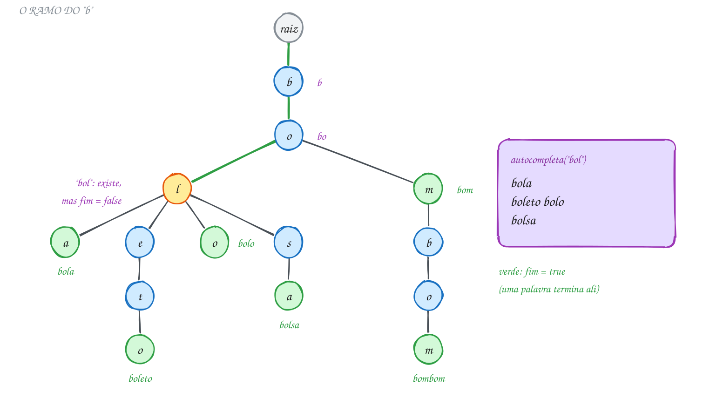</p>

O nó e a inserção, no `trie.c`. O `calloc` zera o nó inteiro: os 26 ponteiros
começam `NULL` e o `fim`, `false`:

```c
typedef struct NoTrie {
    struct NoTrie *filho[TRIE_LETRAS]; // filho['c' - 'a'] segue a letra c
    bool fim;                          // uma palavra termina aqui?
} NoTrie;

bool trie_insere(NoTrie *r, const char *palavra) {
    for (const char *p = palavra; *p != '\0'; p++) { // confere antes de mexer
        if (*p < 'a' || *p > 'z') {
            return false;
        }
    }
    for (; *palavra != '\0'; palavra++) {
        int i = *palavra - 'a';
        if (r->filho[i] == NULL) {
            r->filho[i] = trie_cria(); // o caminho ainda não existe: cria
        }
        r = r->filho[i];
    }
    r->fim = true; // marca o fim da palavra
    return true;
}
```

O cliente monta o dicionário e testa três textos digitados:

```c
#include <stdio.h>
#include "trie.h"

int main(void) {
    const char *dicionario[] = {"bolo", "bola", "bolsa", "boleto", "bom", "bombom", "pao", "pastel"};
    NoTrie *teclado = trie_cria();
    for (int i = 0; i < 8; i++) {
        trie_insere(teclado, dicionario[i]);
    }

    const char *testes[] = {"bol", "bom", "pa"};
    for (int i = 0; i < 3; i++) {
        printf("\"%s\": palavra? %s | sugestões:", testes[i],
               trie_busca(teclado, testes[i]) ? "sim" : "não");
        trie_autocompleta(teclado, testes[i], 4);
        printf("\n");
    }
    printf("Nós: %d (%zu bytes cada)\n", trie_nos(teclado), sizeof(NoTrie));

    trie_libera(teclado);
    return 0;
}
// Saída:
// "bol": palavra? não | sugestões: bola boleto bolo bolsa
// "bom": palavra? sim | sugestões: bom bombom
// "pa": palavra? não | sugestões: pao pastel
// Nós: 22 (216 bytes cada)
```

As sugestões saem em ordem alfabética sem ordenar nada: a função que percorre
a subárvore visita os filhos de `a` a `z`, então "bola" (`a`) vem antes de
"boleto" (`e`), que vem antes de "bolo" (`o`).

Repara no fluxograma: é a inserção de "bom", que chega depois das quatro
palavras com "bol". O `b` e o `o` já existem (o caminho segue pelo "Não" duas
vezes); o `m` é novo e ganha um nó. Acabaram as letras, e o `m` recebe
`fim = true`:

<p align="center">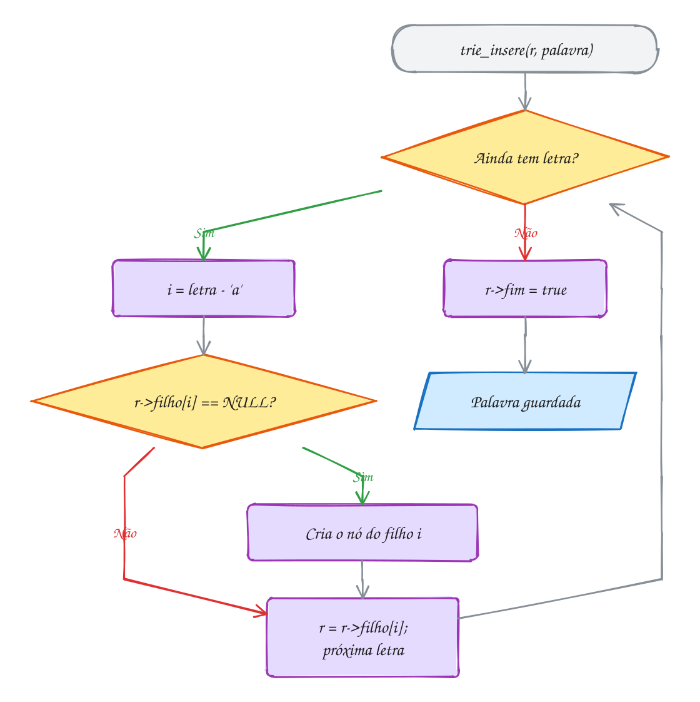</p>

> [!WARNING]
> Achar o nó não quer dizer achar a palavra. `trie_prefixo(t, "bol")` devolve
> um nó válido, mas "bol" não foi inserida: a busca tem que olhar o `fim`
> (`return n != NULL && n->fim;`). O erro oposto também acontece: inserir só
> criando os nós e esquecer o `r->fim = true` do final. Aí a palavra fica
> "meio dentro": as mais compridas que passam por ela aparecem, ela não. E
> cuidado com o índice: `'B' - 'a'` dá -31 e `'ã'` nem é um `char` só em UTF-8.
> Por isso `trie_insere` recusa tudo o que não for de `'a'` a `'z'` antes de
> mexer na árvore.

> [!TIP]
> **Por dentro do C:** cada `NoTrie` tem 216 bytes: 26 ponteiros de 8 bytes
> (208), 1 do `bool` e 7 de enchimento. As 8 palavras do exemplo somam 37 letras
> e cabem em 45 bytes como strings, mas a trie usa 22 nós, 4752 bytes, cem vezes
> mais. Quase todos os ponteiros estão em `NULL` (o A293 mede: mais de 95%). É
> o preço da velocidade: o filho certo está a um índice de distância, sem
> laço. Quando a memória aperta, as alternativas guardam só os filhos que
> existem: uma lista encadeada de filhos (a ideia do primeiro filho/próximo
> irmão do assunto 0144) ou uma pequena BST por nó (a árvore ternária de busca).

> [!NOTE]
> **Pergunta para você:** se você inserir "bolota" no teclado, quantos nós novos
> aparecem? E se inserir "bo"? Em cada caso, o que muda na lista de sugestões
> para "bo"? Responda antes de acrescentar as palavras no vetor do exemplo.

### Hora de praticar

Os arquivos ficam em [`0147-trie/`](0147-trie/). Os comandos funcionam de qualquer pasta do terminal. Nos exemplos, rode, mude, quebre e rode de novo. Nos exercícios, a resposta vai dentro do próprio arquivo. ★☆☆ é aquecimento, ★★☆ pede raciocínio e ★★★ é desafio.

**Exemplo A293 · Quanto custa uma trie**

```c
#include <stdio.h>
#include <string.h>
#include "trie.h"

// conta os ponteiros de filho que estão em NULL (vagas sem uso)
int nulos(const NoTrie *r) {
    int total = 0;
    for (int i = 0; i < TRIE_LETRAS; i++) {
        if (r->filho[i] == NULL) {
            total++;
        } else {
            total += nulos(r->filho[i]);
        }
    }
    return total;
}

int main(void) {
    const char *feira[] = {"alface", "alho", "abacate", "abacaxi", "banana", "batata",
                           "beterraba", "cebola", "cenoura", "chuchu", "couve", "laranja",
                           "limao", "mamao", "manga", "maracuja", "melancia", "milho",
                           "tomate", "uva", "Pera", "caqui!"};
    int n = sizeof feira / sizeof feira[0];
    NoTrie *t = trie_cria();
    int aceitas = 0;
    size_t letras = 0;
    for (int i = 0; i < n; i++) {
        if (trie_insere(t, feira[i])) {
            aceitas++;
            letras += strlen(feira[i]);
        } else {
            printf("recusada: %s (só a-z)\n", feira[i]);
        }
    }

    int nos = trie_nos(t);
    printf("%d palavras, %zu letras no total\n", aceitas, letras);
    printf("trie: %d nós x %zu bytes = %zu bytes\n", nos, sizeof(NoTrie), nos * sizeof(NoTrie));
    printf("as mesmas palavras em strings: %zu bytes (letras + um '\\0' cada)\n",
           letras + aceitas);
    printf("ponteiros em NULL: %d de %d (%.1f%%)\n", nulos(t), nos * TRIE_LETRAS,
           100.0 * nulos(t) / (nos * TRIE_LETRAS));

    trie_libera(t);
    return 0;
}
// Saída:
// recusada: Pera (só a-z)
// recusada: caqui! (só a-z)
// 20 palavras, 121 letras no total
// trie: 100 nós x 216 bytes = 21600 bytes
// as mesmas palavras em strings: 141 bytes (letras + um '\0' cada)
// ponteiros em NULL: 2501 de 2600 (96.2%)
```

```bash
~/LPEDC/rodar 22-arvores-avancadas/0147-trie/A293.c
```

**Exemplo A294 · A trie ordena e acha o prefixo comum**

```c
#include <stdio.h>
#include "trie.h"

// quantos filhos o nó tem e, em *unico, o índice do último achado
int filhos(const NoTrie *n, int *unico) {
    int qtd = 0;
    for (int i = 0; i < TRIE_LETRAS; i++) {
        if (n->filho[i] != NULL) {
            qtd++;
            *unico = i;
        }
    }
    return qtd;
}

// maior prefixo comum a TODAS as palavras: desce enquanto o caminho não se
// divide (um filho só) e nenhuma palavra termina no meio do caminho
void prefixo_comum(const NoTrie *r, char saida[]) {
    int k = 0, i = 0;
    while (!r->fim && filhos(r, &i) == 1 && k < TRIE_MAX - 1) {
        saida[k++] = (char)('a' + i);
        r = r->filho[i];
    }
    saida[k] = '\0';
}

int main(void) {
    const char *obra[] = {"pedreiro", "pedra", "pedregulho", "pedrada", "pedrisco"};
    NoTrie *t = trie_cria();
    for (int i = 0; i < 5; i++) {
        trie_insere(t, obra[i]);
    }

    printf("Em ordem alfabética:");
    trie_autocompleta(t, "", 100); // prefixo vazio: a trie inteira
    char pc[TRIE_MAX];
    prefixo_comum(t, pc);
    printf("\nPrefixo comum: \"%s\"\n", pc);

    trie_insere(t, "pe"); // uma palavra curta corta o prefixo comum
    prefixo_comum(t, pc);
    printf("Com \"pe\" no dicionário: \"%s\"\n", pc);

    trie_insere(t, "areia"); // outra letra inicial: não sobra prefixo
    prefixo_comum(t, pc);
    printf("Com \"areia\" também: \"%s\"\n", pc);

    trie_libera(t);
    return 0;
}
// Saída:
// Em ordem alfabética: pedra pedrada pedregulho pedreiro pedrisco
// Prefixo comum: "pedr"
// Com "pe" no dicionário: "pe"
// Com "areia" também: ""
```

```bash
~/LPEDC/rodar 22-arvores-avancadas/0147-trie/A294.c
```

#### Exercícios

**Exercício E877** · ★☆☆

O cartório quer saber quantos nomes da lista de registros começam com um
prefixo. Escreva conta_com_prefixo(r, prefixo) usando a trie do TAD
(trie.h): ache o nó do prefixo com trie_prefixo e conte quantas palavras
terminam nele ou abaixo dele.


```text
Saída esperada:
começam com "an": 5
começam com "ana": 3
começam com "br": 2
começam com "c": 0
começam com "": 8
```

**Dicas:**

1. Escreva antes conta_palavras(n): NULL dá 0; senão, (n->fim ? 1 : 0)
   mais a contagem de cada um dos 26 filhos.
2. trie_prefixo devolve NULL quando nenhum nome começa com o prefixo, e
   a raiz quando o prefixo é "".
3. Resposta esperada: a saída acima.

```bash
~/LPEDC/rodar 22-arvores-avancadas/0147-trie/E877.c
```

**Exercício E878** · ★☆☆

O terminal completa comandos com a tecla Tab. Com os comandos guardados
numa trie (trie.h), escreva classifica(r, texto), que devolve uma de três
mensagens: "comando" (o texto é um comando inteiro), "só começo de comando"
(algum comando começa assim, mas o texto não é um) ou "não está".


```text
Saída esperada:
cat     comando
ch      só começo de comando
le      só começo de comando
less    comando
rm      não está
c       só começo de comando
mkdirs  não está
```

**Dicas:**

1. Use trie_prefixo: NULL quer dizer que nenhum comando começa assim.
2. Achou o nó? O campo fim decide entre as outras duas mensagens.
3. Resposta esperada: a saída acima. Imprima com printf("%-7s %s\n", ...).

```bash
~/LPEDC/rodar 22-arvores-avancadas/0147-trie/E878.c
```

**Exercício E879** · ★★☆

Conte quantas vezes cada palavra aparece num texto usando uma trie em que
o nó guarda um contador (int qtd) no lugar do bool fim. O struct e o main
já estão prontos; escreva:
- conta(r, p, tam): soma 1 na palavra de tam letras que começa em p
 (o texto não tem '\0' depois de cada palavra, por isso o tam);
- lista(n, buf, nivel, &distintas): mostra as palavras em ordem alfabética
 com a contagem e conta quantas palavras diferentes existem;
- libera(n).


```text
Saída esperada:
a      1
da     1
de     1
do     1
o      2
rato   1
rei    2
riu    1
roeu   1
roma   1
roupa  2
14 palavras, 11 diferentes
```

**Dicas:**

1. conta é a trie_insere do TAD com duas mudanças: o laço vai de 0 a
   tam - 1 e, no fim, r->qtd++ em vez de r->fim = true.
2. lista é a coleta do trie.c: se n->qtd > 0, termine buf com '\0' na
   posição nivel e imprima com printf("%-6s %d\n", buf, n->qtd).
3. Resposta esperada: a saída acima. Repare que a ordem alfabética sai de
   graça: os filhos são visitados de 'a' a 'z'.

```bash
~/LPEDC/rodar 22-arvores-avancadas/0147-trie/E879.c
```

**Exercício E880** · ★★☆

Os bichos do zoológico estão numa trie (trie.h). Escreva duas funções que
percorrem a trie montando a palavra num buffer, como a coleta do trie.c:
- maior_palavra(n, buf, nivel, maior): copia para maior a palavra mais
 comprida (no empate, a primeira em ordem alfabética);
- por_tamanho(n, buf, nivel, alvo): mostra as palavras com exatamente alvo
 letras, sem descer além do nível alvo.


```text
Saída esperada:
maior: ornitorrinco (12 letras)
com 4 letras: gato onca tatu
com 6 letras: girafa jacare
com 11 letras: orangotango rinoceronte
```

**Dicas:**

1. Em cada nó, nivel é quantas letras já estão em buf. Quando n->fim é
   verdadeiro, buf[nivel] = '\0' fecha a palavra.
2. Em maior_palavra, troque só quando nivel > strlen(maior): com >=, o
   empate ficaria com a última em ordem alfabética.
3. Resposta esperada: a saída acima. Em por_tamanho, quando nivel == alvo,
   confira o fim e volte (return) sem olhar os filhos.

```bash
~/LPEDC/rodar 22-arvores-avancadas/0147-trie/E880.c
```

**Exercício E881** · ★★★

Ache o bug. O teclado do celular sugere palavras com a função sugere(),
escrita à mão sobre o struct do trie.h. Para o prefixo "bol", ela deveria
mostrar bola, boleto, bolo e bolsa, mas mostra palavras que nem existem:


```text
Saída que aparece:
bol: bola boleto boloto bolsao
bo: bola boleto boloto bolsao bomsao bombom
```


```text
Saída esperada:
bol: bola boleto bolo bolsa
bo: bola boleto bolo bolsa bom bombom
```


Não há erro de memória: o programa roda limpo e mesmo assim erra. Ache a
linha que falta, conserte e rode de novo.

**Dicas:**

1. Acompanhe o conteúdo de buf: depois de imprimir "boleto", a recursão
   volta para o nível 3 e escreve 'o' em buf[3]. O que ainda está em
   buf[4] e buf[5]?
2. O buffer começou zerado, por isso "bola" e "boleto" saíram certas: o
   '\0' que as termina estava lá por acaso.
3. Resposta esperada: falta "buf[nivel] = '\0';" logo antes do printf, em
   sugere. Cada palavra precisa ser fechada no comprimento dela, e não
   no da maior palavra que passou antes pelo buffer.

```bash
~/LPEDC/rodar 22-arvores-avancadas/0147-trie/E881.c
```

**Exercício E882** · ★★★

O TAD não sabe tirar palavras. Escreva remove_palavra(n, p, &tirou) com
poda: desmarque o fim da palavra e libere os nós que ficarem inúteis (sem
fim e sem filhos), de baixo para cima. Os nós que outra palavra ainda usa
ficam. O main tira palavras uma a uma e mostra o tamanho da trie.


```text
Saída esperada:
início | nós: 14 | palavras: sal sol sola solado solteiro
tira solado: tirou | nós: 12 | sobram: sal sol sola solteiro
tira so: não estava | nós: 12 | sobram: sal sol sola solteiro
tira sol: tirou | nós: 12 | sobram: sal sola solteiro
tira solteiro: tirou | nós: 7 | sobram: sal sola
tira sal: tirou | nós: 5 | sobram: sola
tira sola: tirou | nós: 1 | sobram:
```

**Dicas:**

1. Recursão pela palavra. Se *p == '\0', você chegou ao nó dela: guarde
   n->fim em *tirou e ponha false. Senão, desça pelo filho da letra *p
   (se ele não existir, a palavra não está: *tirou = false, devolva false).
2. Na volta, se a chamada do filho devolveu true, faça free no filho e ponha
   NULL no ponteiro. No fim, devolva !n->fim && (n não tem filho nenhum).
3. Resposta esperada: a saída acima. Tirar "sol" não libera nada (o nó do
   l continua no caminho de sola e solteiro); tirar "solteiro" libera 5.

```bash
~/LPEDC/rodar 22-arvores-avancadas/0147-trie/E882.c
```

---

## 0148 · Union-find: conjuntos disjuntos

A turma do cursinho vai fazer amigo secreto, mas por panelinha: quem se conhece
fica no mesmo sorteio, e "amigo de amigo" também conta. As amizades chegam aos
poucos no grupo de mensagens: Ana conhece Beto, Caio conhece Duda, Beto conhece
Duda... A cada nova amizade, dois grupos podem virar um só. E a qualquer
momento alguém pergunta: "Ana e Duda caem no mesmo sorteio?".

O problema tem nome: **conjuntos disjuntos**. Os elementos estão divididos em
grupos que não se misturam, e só existem duas operações:

- **acha(x)**: devolve o **representante** do grupo de x, um elemento que
  responde pelo grupo inteiro. Dois elementos estão juntos se têm o mesmo
  representante;
- **une(a, b)**: junta o grupo de a com o grupo de b.

A estrutura que faz isso é o **union-find**. Cada grupo é uma árvore, e a
floresta inteira cabe num vetor: `pai[x]` é o pai de x, e a raiz é quem aponta
para si mesmo (`pai[x] == x`). A raiz é o representante. `acha` sobe pelos
pais até a raiz; `une` acha as duas raízes e pendura uma na outra. Repare que
aqui as setas vão do filho para o pai: ninguém precisa descer na árvore.

Do jeito ingênuo, a árvore pode virar uma fila indiana, e `acha` passa a custar
O(n). Dois truques resolvem:

1. **união por tamanho**: guarde o tamanho de cada grupo (`tam[raiz]`) e
   pendure sempre a raiz do grupo **menor** na do maior. Um elemento só desce um
   nível quando o grupo dele se junta a outro pelo menos do mesmo tamanho, ou
   seja, quando o grupo pelo menos **dobra**. Isso só acontece log₂ n vezes:
   a altura nunca passa de log₂ n;
2. **compressão de caminho**: depois de achar a raiz, `acha` faz todo mundo do
   caminho apontar **direto** para ela. A próxima busca por qualquer um deles
   sobe um passo só.

Com os dois juntos, uma sequência de m operações custa O(m · α(n)), em que α é
uma função que cresce tão devagar que não passa de 4 para nenhum n que caiba
num computador. Na prática, cada operação é O(1) amortizado (a ideia de custo
amortizado é do assunto 0116).

Vamos ver na prática. Oito colegas, de 0 (Ana) a 7 (Hugo), e sete amizades. No
fim sobram dois grupos: {Ana, Beto, Caio, Duda} e {Edu, Fia, Gui, Hugo}. Duda e
Hugo estão a dois passos da raiz; as perguntas sobre eles comprimem o caminho e
os deixam pendurados direto no representante:

<p align="center">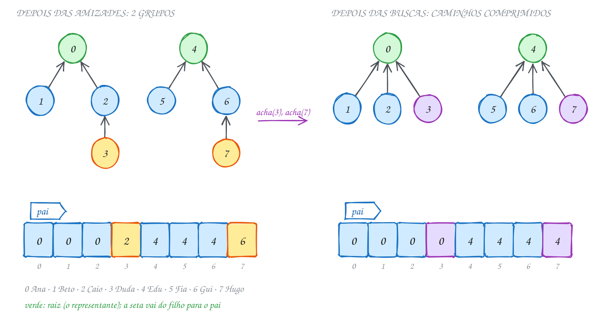</p>

O `acha` e o `une` do `uniao.c`:

```c
int uf_acha(UF *u, int x) {
    int raiz = x;
    while (u->pai[raiz] != raiz) { // sobe até a raiz
        raiz = u->pai[raiz];
    }
    while (u->pai[x] != raiz) {    // compressão: todo mundo do caminho
        int prox = u->pai[x];      // passa a apontar direto para a raiz
        u->pai[x] = raiz;
        x = prox;
    }
    return raiz;
}

bool uf_une(UF *u, int a, int b) {
    int ra = uf_acha(u, a);
    int rb = uf_acha(u, b);
    if (ra == rb) {
        return false; // já estavam juntos
    }
    if (u->tam[ra] < u->tam[rb]) { // ra fica sendo a raiz do grupo maior
        int t = ra;
        ra = rb;
        rb = t;
    }
    u->pai[rb] = ra; // a raiz do menor vira filha da raiz do maior
    u->tam[ra] += u->tam[rb];
    u->grupos--;
    return true;
}
```

O cliente registra as amizades e mostra o vetor `pai` depois de cada uma:

```c
#include <stdio.h>
#include "uniao.h"

int main(void) {
    const char *nome[] = {"Ana", "Beto", "Caio", "Duda", "Edu", "Fia", "Gui", "Hugo"};
    int amizades[][2] = {{0, 1}, {2, 3}, {4, 5}, {1, 3}, {6, 7}, {5, 7}, {0, 2}};
    UF *turma = uf_cria(8);

    for (int i = 0; i < 7; i++) {
        int a = amizades[i][0], b = amizades[i][1];
        bool novo = uf_une(turma, a, b);
        printf("%s e %s: %s | grupos: %d | ", nome[a], nome[b],
               novo ? "juntou" : "já estavam", uf_grupos(turma));
        uf_mostra(turma);
    }
    printf("Ana e Duda se conhecem? %s\n", uf_juntos(turma, 0, 3) ? "sim" : "não");
    printf("Caio e Hugo se conhecem? %s\n", uf_juntos(turma, 2, 7) ? "sim" : "não");
    printf("Grupo do Edu: %d pessoas\n", uf_tamanho(turma, 4));
    printf("Depois das buscas, ");
    uf_mostra(turma);

    uf_libera(turma);
    return 0;
}
// Saída:
// Ana e Beto: juntou | grupos: 7 | pai: 0 0 2 3 4 5 6 7
// Caio e Duda: juntou | grupos: 6 | pai: 0 0 2 2 4 5 6 7
// Edu e Fia: juntou | grupos: 5 | pai: 0 0 2 2 4 4 6 7
// Beto e Duda: juntou | grupos: 4 | pai: 0 0 0 2 4 4 6 7
// Gui e Hugo: juntou | grupos: 3 | pai: 0 0 0 2 4 4 6 6
// Fia e Hugo: juntou | grupos: 2 | pai: 0 0 0 2 4 4 4 6
// Ana e Caio: já estavam | grupos: 2 | pai: 0 0 0 2 4 4 4 6
// Ana e Duda se conhecem? sim
// Caio e Hugo se conhecem? não
// Grupo do Edu: 4 pessoas
// Depois das buscas, pai: 0 0 0 0 4 4 4 4
```

Em "Beto e Duda", as raízes são 0 (Ana, grupo de 2) e 2 (Caio, grupo de 2).
Empate: a raiz de a continua raiz, e o Caio vai para baixo da Ana, levando a
Duda junto. A Duda fica a dois passos da raiz até a pergunta "Ana e Duda?"
subir por ela e comprimir o caminho.

Repara no fluxograma: é o `uf_une` de "Fia e Hugo". As raízes são 4 (Edu) e 6
(Gui), diferentes; os dois grupos têm tamanho 2, então não há troca, e o Gui
(com o Hugo embaixo) vira filho do Edu:

<p align="center">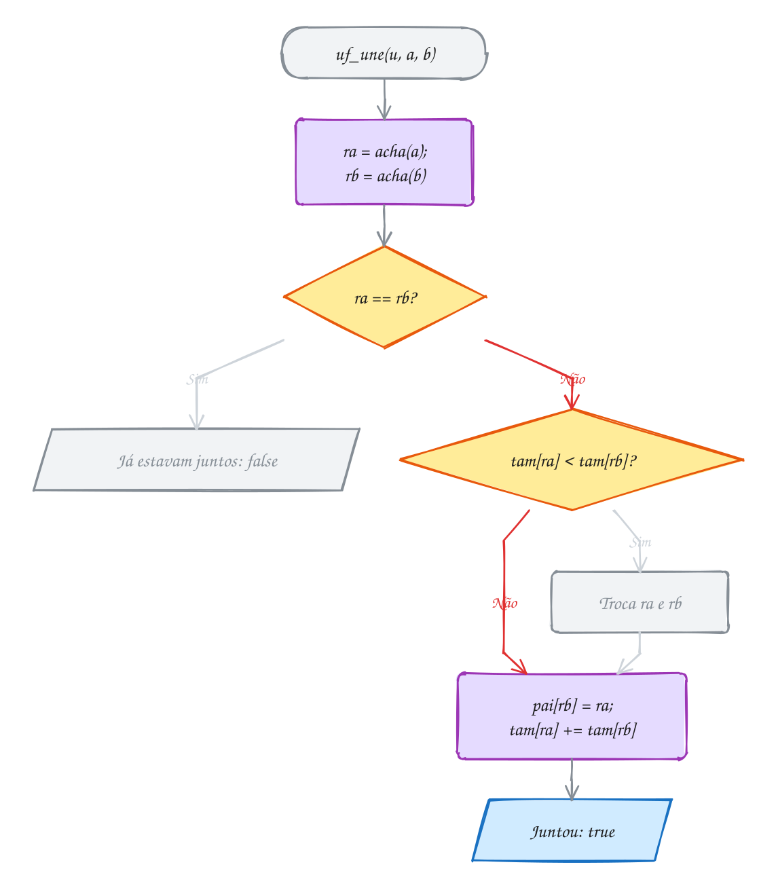</p>

> [!WARNING]
> O representante é a **raiz**, não o elemento. Três erros vêm daí. Unir com
> `pai[a] = b` arranca o `a` do grupo dele e leva só os descendentes de `a`
> junto (é o bug do E887); o certo é `pai[acha(a)] = acha(b)`. Testar `a == b`
> ou `pai[a] == pai[b]` para saber se estão juntos falha assim que as árvores
> têm mais de um nível; o teste é `acha(a) == acha(b)`. E `tam[x]` só vale na
> raiz: num elemento que já foi raiz, ele guarda o tamanho antigo do grupo.

> [!TIP]
> **Por dentro do C:** a floresta inteira são dois vetores de `int`, sem um
> ponteiro sequer: 8 bytes por elemento, 8 MB para um milhão de pessoas, tudo
> contíguo na memória (o cache do processador agradece). Repare na assinatura
> `int uf_acha(UF *u, int x)`: sem `const`, porque **consultar modifica** a
> estrutura (a compressão reescreve `pai`). Até `uf_juntos`, que parece só uma
> pergunta, mexe no vetor. O A295 mede o efeito dos truques: com 10 mil
> elementos, a versão ingênua sobe 50 milhões de vezes pelos pais; com união por
> tamanho, nenhuma vez durante as uniões.

> [!NOTE]
> **Pergunta para você:** depois de tudo, Ana e Hugo ficam amigos:
> `uf_une(turma, 0, 7)`. Os dois grupos têm 4 pessoas. Quem vira a raiz do
> grupo único e como fica o vetor `pai`? Acrescente a linha no exemplo e
> confira.

### Hora de praticar

Os arquivos ficam em [`0148-union-find/`](0148-union-find/). Os comandos funcionam de qualquer pasta do terminal. Nos exemplos, rode, mude, quebre e rode de novo. Nos exercícios, a resposta vai dentro do próprio arquivo. ★☆☆ é aquecimento, ★★☆ pede raciocínio e ★★★ é desafio.

**Exemplo A295 · Sem os dois truques, a árvore vira lista**

```c
#include <stdbool.h>
#include <stdio.h>
#include <stdlib.h>

#define N 10000

int pai[N], tam[N];
long passos; // quantas vezes alguém subiu de um nó para o pai

void inicia(void) {
    for (int i = 0; i < N; i++) {
        pai[i] = i;
        tam[i] = 1;
    }
    passos = 0;
}

int acha(int x, bool comprime) {
    int raiz = x;
    while (pai[raiz] != raiz) {
        raiz = pai[raiz];
        passos++;
    }
    while (comprime && pai[x] != raiz) {
        int prox = pai[x];
        pai[x] = raiz;
        x = prox;
    }
    return raiz;
}

void une(int a, int b, bool por_tamanho, bool comprime) {
    int ra = acha(a, comprime), rb = acha(b, comprime);
    if (ra == rb) {
        return;
    }
    if (por_tamanho && tam[ra] < tam[rb]) {
        int t = ra;
        ra = rb;
        rb = t;
    }
    if (por_tamanho) {
        pai[rb] = ra; // o menor vai para baixo do maior
        tam[ra] += tam[rb];
    } else {
        pai[ra] = rb; // ingênuo: o grupo de a vai sempre para baixo do de b
    }
}

int profundidade_maxima(void) {
    int maior = 0;
    for (int i = 0; i < N; i++) {
        int d = 0;
        for (int x = i; pai[x] != x; x = pai[x]) {
            d++;
        }
        if (d > maior) {
            maior = d;
        }
    }
    return maior;
}

void testa(const char *nome, bool por_tamanho, bool comprime) {
    inicia();
    for (int i = 1; i < N; i++) {
        une(0, i, por_tamanho, comprime); // o 0 chama todo mundo para o grupo dele
    }
    long nas_unioes = passos;
    int prof = profundidade_maxima();
    passos = 0;
    for (int i = 0; i < N; i++) {
        acha(i, comprime); // depois, cada um pergunta quem é o representante
    }
    printf("%s passos nas uniões: %9ld | profundidade: %4d | passos nas buscas: %8ld\n",
           nome, nas_unioes, prof, passos);
}

int main(void) {
    testa("ingênuo:             ", false, false);
    testa("só por tamanho:      ", true, false);
    testa("ingênuo + compressão:", false, true);
    return 0;
}
// Saída:
// ingênuo:              passos nas uniões:  49985001 | profundidade: 9999 | passos nas buscas: 49995000
// só por tamanho:       passos nas uniões:         0 | profundidade:    1 | passos nas buscas:     9999
// ingênuo + compressão: passos nas uniões:     19995 | profundidade: 9998 | passos nas buscas:    19997
```

```bash
~/LPEDC/rodar 22-arvores-avancadas/0148-union-find/A295.c
```

**Exemplo A296 · As ilhas do mapa**

```c
#include <stdio.h>
#include "uniao.h"

#define LIN 5
#define COL 8

// cada célula (i, j) vira o elemento i * COL + j do union-find
int main(void) {
    const char *mapa[LIN] = {
        "##..#...",
        "#...##..",
        "..#..#.#",
        ".###...#",
        "....##.#",
    };
    UF *u = uf_cria(LIN * COL);
    int terra = 0;
    for (int i = 0; i < LIN; i++) {
        for (int j = 0; j < COL; j++) {
            if (mapa[i][j] != '#') {
                continue;
            }
            terra++;
            // basta olhar para a direita e para baixo: as outras duas
            // direções já foram vistas pelas células anteriores
            if (j + 1 < COL && mapa[i][j + 1] == '#') {
                uf_une(u, i * COL + j, i * COL + j + 1);
            }
            if (i + 1 < LIN && mapa[i + 1][j] == '#') {
                uf_une(u, i * COL + j, (i + 1) * COL + j);
            }
        }
    }
    // os grupos do union-find contam também as células de água (sozinhas)
    int agua = LIN * COL - terra;
    printf("Ilhas: %d\n", uf_grupos(u) - agua);

    int maior = 0, onde = 0;
    for (int c = 0; c < LIN * COL; c++) {
        if (mapa[c / COL][c % COL] == '#' && uf_tamanho(u, c) > maior) {
            maior = uf_tamanho(u, c);
            onde = c;
        }
    }
    printf("Maior ilha: %d células, uma delas na linha %d, coluna %d\n",
           maior, onde / COL, onde % COL);
    printf("(0, 4) e (2, 5) na mesma ilha? %s\n",
           uf_juntos(u, 0 * COL + 4, 2 * COL + 5) ? "sim" : "não");
    printf("(2, 2) e (4, 4) na mesma ilha? %s\n",
           uf_juntos(u, 2 * COL + 2, 4 * COL + 4) ? "sim" : "não");

    uf_libera(u);
    return 0;
}
// Saída:
// Ilhas: 5
// Maior ilha: 4 células, uma delas na linha 0, coluna 4
// (0, 4) e (2, 5) na mesma ilha? sim
// (2, 2) e (4, 4) na mesma ilha? não
```

```bash
~/LPEDC/rodar 22-arvores-avancadas/0148-union-find/A296.c
```

#### Exercícios

**Exercício E883** · ★☆☆

Depois da enchente, só algumas estradas entre sete cidades continuam
abertas. Use o TAD (uniao.h): una as cidades de cada estrada aberta, mostre
quantos grupos de cidades ligadas existem e mostre, para cada pergunta,
se dá para ir de uma cidade à outra (passando por outras, se preciso).


```text
Saída esperada:
Grupos de cidades ligadas: 3
Araras -> Dourado: dá para ir
Bauru -> Garça: dá para ir
Dourado -> Franca: não dá para ir
Embu -> Embu: dá para ir
```

**Dicas:**

1. uf_cria(7), um uf_une por estrada e uf_grupos no fim.
2. Para cada pergunta, uf_juntos(u, a, b). A pergunta não é se existe uma
   estrada DIRETA: Araras e Dourado também se ligam pela Catanduva.
3. Resposta esperada: a saída acima. Os grupos são {Araras, Catanduva,
   Dourado}, {Bauru, Franca, Garça} e {Embu}.

```bash
~/LPEDC/rodar 22-arvores-avancadas/0148-union-find/E883.c
```

**Exercício E884** · ★☆☆

O condomínio tem 12 apartamentos (0 a 11) e um aplicativo de mensagens em
que cada morador entra por convite de outro. Depois dos convites, escreva
duas funções que leem os campos do UF (uniao.h):
- maior_grupo(u): quantos apartamentos tem o maior grupo;
- sozinhos(u): quantos apartamentos não estão com ninguém.


```text
Saída esperada:
grupos: 5 | maior: 5 apartamentos | sozinhos: 2
```

**Dicas:**

1. Só a raiz de cada grupo (pai[x] == x) guarda o tamanho certo em tam[x].
   Nos outros elementos, tam é um valor antigo, de quando eram raiz.
2. Percorra x de 0 a u->n - 1 olhando só as raízes. Nenhuma das duas
   funções precisa chamar uf_acha.
3. Resposta esperada: a saída acima. Os grupos são {0, 3, 7, 9, 11},
   {1, 2, 6}, {4, 5}, {8} e {10}.

```bash
~/LPEDC/rodar 22-arvores-avancadas/0148-union-find/E884.c
```

**Exercício E885** · ★★☆

O técnico ligou os 7 computadores do escritório (0 a 6) com 9 cabos, na
ordem do vetor. Um cabo é redundante quando liga dois computadores que JÁ
conversavam por outros cabos (ele fecha um ciclo). Com o TAD (uniao.h),
mostre cada cabo redundante, quantos cabos bastariam e se a rede ficou toda
ligada.


```text
Saída esperada:
cabo 4 (2-0) é redundante
cabo 8 (6-3) é redundante
cabo 9 (2-5) é redundante
3 cabos redundantes; 6 cabos bastam; rede toda ligada
```

**Dicas:**

1. uf_une devolve false quando os dois já estavam no mesmo grupo. É
   exatamente o teste do cabo redundante.
2. Os cabos são numerados a partir de 1 na saída (i + 1).
3. Resposta esperada: a saída acima. Com 7 computadores, 6 cabos sem ciclo
   ligam tudo: é uma árvore. A mesma ideia vai aparecer no algoritmo de
   Kruskal, no módulo 23.

```bash
~/LPEDC/rodar 22-arvores-avancadas/0148-union-find/E885.c
```

**Exercício E886** · ★★☆

Na pelada de quinta, quem já jogou junto fica no mesmo time, e "jogou com
quem jogou com" também conta. Com o TAD (uniao.h), una as duplas e liste
cada time com seus jogadores. Os times saem na ordem do seu primeiro
jogador (o de menor número), e os jogadores de cada time, em ordem de
número. Mostre também o tamanho de cada time.


```text
Saída esperada:
Time 1 (3): Alex Eli Ivo
Time 2 (2): Bia Fabi
Time 3 (3): Cadu Davi Hana
Time 4 (1): Gabo
```

**Dicas:**

1. Percorra x de 0 a n - 1. x abre um time novo quando nenhum y < x tem o
   mesmo representante (uf_acha) que ele.
2. Para listar o time de x, percorra y de x até n - 1 e mostre quem tem o
   mesmo representante. O tamanho vem de uf_tamanho.
3. Resposta esperada: a saída acima. O representante do time 3 é o Cadu?
   Não importa: a ordem de saída é pelos números, não pelas raízes.

```bash
~/LPEDC/rodar 22-arvores-avancadas/0148-union-find/E886.c
```

**Exercício E887** · ★★★

Ache o bug. A escola forma grupos de estudo: quem estuda com quem fica no
mesmo grupo. O programa abaixo tem um union-find escrito à mão, sem o TAD,
com UM erro na união. Rode e compare: o contador diz 1 grupo, mas a
conferência final (que conta as raízes de verdade) acha 2, e a Lia aparece
fora do grupo da Ana, com quem ela estudou primeiro.


```text
Saída esperada:
grupos (contador): 1
grupos (raízes):   1
Ana e Lia juntas? sim
Ana e Rui juntos? sim
```


Conserte a função une e rode de novo.

**Dicas:**

1. Desenhe as árvores (cada elemento com uma seta para o pai) depois de
   cada união. Na última, a Lia já tem pai (a Ana): o que acontece com o
   grupo antigo dela quando pai[a] é sobrescrito?
2. Quem representa o grupo é a raiz. Unir dois grupos é pendurar uma RAIZ
   na outra, e não um elemento qualquer.
3. Resposta esperada: troque "pai[a] = b;" por "pai[acha(a)] = acha(b);"
   (ou guarde as duas raízes em variáveis antes). Ligando o próprio a, ele
   abandona o grupo em que estava e leva só os seus descendentes.

```bash
~/LPEDC/rodar 22-arvores-avancadas/0148-union-find/E887.c
```

**Exercício E888** · ★★★

Teste de infiltração. Uma placa de 5x5 quadradinhos começa toda tapada, e
o técnico fura um quadradinho por vez, na ordem c = (i * 9 + 7) % 25 para
i = 0, 1, 2... (c = linha * 5 + coluna). A água jogada em cima passa para
baixo quando existe um caminho de quadradinhos furados, vizinhos em cima,
embaixo ou dos lados, da linha 0 até a linha 4. Descubra em qual furo a água
passa e mostre a placa nesse momento (# furado, . tapado).


```text
Saída esperada:
A água passou no passo 13 (13 de 25 abertas)
#.#.#
.##.#
.#.#.
##.#.
#.#..
```

**Dicas:**

1. Use o TAD (uniao.h) com 25 + 2 elementos: além dos quadradinhos, um
   TOPO virtual (25), unido a todo furo da linha 0, e um FUNDO virtual
   (26), unido a todo furo da linha 4. A água passou quando
   uf_juntos(u, TOPO, FUNDO).
2. A cada furo, una o quadradinho com cada vizinho que já esteja furado
   (guarde isso num bool aberta[25]). Cuidado com as bordas.
3. Resposta esperada: a saída acima. O caminho da água é (0,2), (1,2),
   (1,1), (2,1), (3,1), (3,0), (4,0). Sem o TOPO e o FUNDO, você teria que
   testar os 25 pares de quadradinhos de cima e de baixo a cada furo.

```bash
~/LPEDC/rodar 22-arvores-avancadas/0148-union-find/E888.c
```

---

## 0149 · Juntando tudo: corretor ortográfico

A associação do bairro manda um aviso por semana no grupo de mensagens, e quem
digita é sempre com pressa: "o onibus pasou", "a fiera da rua". O secretário
quer um programa que leia o aviso, aponte as palavras que não existem e
sugira a correção, como o sublinhado vermelho do editor de texto.

Um corretor faz duas perguntas ao dicionário, milhares de vezes por texto. A
primeira é **"esta palavra existe?"**, uma busca exata. A segunda é **"quais
palavras de verdade estão perto desta?"**, e "perto" quer dizer a poucas
**edições** de distância, a ideia da distância de edição do assunto 0142. Uma
edição é tirar uma letra, pôr uma letra, trocar uma letra por outra ou trocar
duas letras vizinhas de lugar (o erro de digitação mais comum de todos).

O jeito simples de sugerir é **gerar os candidatos**: aplicar à palavra errada
todas as edições possíveis e perguntar ao dicionário quais deles existem. Para
"fiera", com 5 letras, são 5 jeitos de tirar, 4 de trocar vizinhas, 5 · 25 de
trocar uma letra e 6 · 26 de pôr uma letra: 290 candidatos. Quase todos são
lixo ("iera", "fxera"); só "feira" está no dicionário. O corretor faz 290
buscas exatas para cada palavra errada, e a estrutura do dicionário decide
quanto isso custa.

O dicionário fica numa **trie** (assunto 0147). Cada busca custa O(L), o tamanho
da palavra, não importa se o dicionário tem 80 ou 300 mil palavras, e um
candidato que nem começa como palavra nenhuma ("fx...") morre no segundo nó.
Uma tabela hash também responderia a busca exata em O(1) na média, e uma BST
em O(log n) comparações de strings. A comparação completa está no fim do
assunto.

O TAD fica em `corretor.h` e `corretor.c`: `cor_carrega_basico` monta um
dicionário com 84 palavras comuns, `cor_proxima` separa o texto em palavras,
`cor_contem` faz a busca exata e `cor_sugere` gera e filtra os candidatos.

Vamos ver na prática. O aviso desta semana tem 18 palavras e cinco problemas:
três erros de digitação com uma sugestão só, um "caa" que pode ser três
palavras e um "esquina" que está certo, mas não está no dicionário:

<p align="center">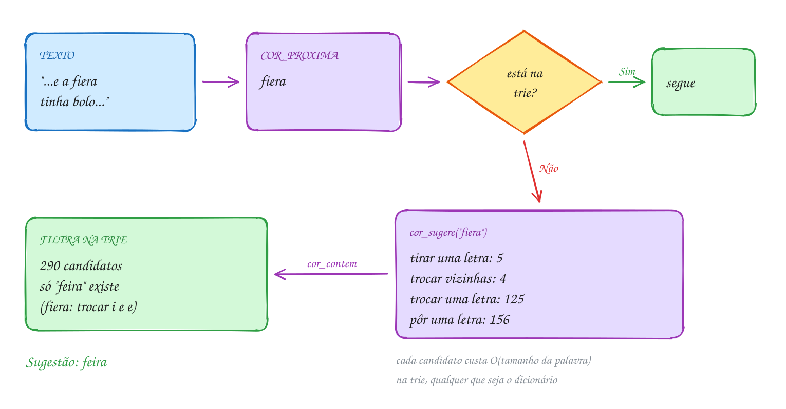</p>

O coração do `cor_sugere`. Cada candidato vai para `anota`, que confere na
trie, descarta repetidos e mantém a lista em ordem alfabética:

```c
int cor_sugere(const NoC *d, const char *palavra, char sug[][COR_MAX], int max) {
    int n = (int)strlen(palavra);
    int qtd = 0;
    char c[COR_MAX + 1];
    if (n >= COR_MAX - 1) {
        return 0;
    }
    for (int i = 0; i < n; i++) { // 1. tirar a letra i
        memcpy(c, palavra, i);
        strcpy(c + i, palavra + i + 1);
        anota(d, c, sug, &qtd, max);
    }
    for (int i = 0; i + 1 < n; i++) { // 2. trocar as letras i e i + 1 de lugar
        strcpy(c, palavra);
        char t = c[i];
        c[i] = c[i + 1];
        c[i + 1] = t;
        anota(d, c, sug, &qtd, max);
    }
    for (int i = 0; i < n; i++) { // 3. trocar a letra i por outra
        strcpy(c, palavra);
        for (char l = 'a'; l <= 'z'; l++) {
            if (l != palavra[i]) {
                c[i] = l;
                anota(d, c, sug, &qtd, max);
            }
        }
    }
    for (int i = 0; i <= n; i++) { // 4. pôr uma letra na posição i
        for (char l = 'a'; l <= 'z'; l++) {
            memcpy(c, palavra, i);
            c[i] = l;
            strcpy(c + i + 1, palavra + i);
            anota(d, c, sug, &qtd, max);
        }
    }
    return qtd;
}
```

O programa do secretário:

```c
#include <stdio.h>
#include "corretor.h"

int main(void) {
    NoC *dic = cor_cria();
    int n = cor_carrega_basico(dic);
    printf("Dicionário: %d palavras em %d nós\n", n, cor_nos(dic));

    const char *texto = "hoje o onibus pasou no ponto, e a fiera tinha bolo e cafe baratoo na caa da esquina.";
    char palavra[COR_MAX], sug[5][COR_MAX];
    int total = 0, erros = 0;
    while (cor_proxima(&texto, palavra)) {
        total++;
        if (cor_contem(dic, palavra)) {
            continue;
        }
        erros++;
        int k = cor_sugere(dic, palavra, sug, 5);
        printf("\"%s\"? Sugestões:", palavra);
        for (int i = 0; i < k; i++) {
            printf(" %s", sug[i]);
        }
        printf(k == 0 ? " nenhuma\n" : "\n");
    }
    printf("%d palavras, %d para revisar\n", total, erros);

    cor_libera(dic);
    return 0;
}
// Saída:
// Dicionário: 84 palavras em 239 nós
// "pasou"? Sugestões: passou
// "fiera"? Sugestões: feira
// "baratoo"? Sugestões: barato
// "caa"? Sugestões: cama cara casa
// "esquina"? Sugestões: nenhuma
// 18 palavras, 5 para revisar
```

Repara no fluxograma: o programa é um laço sobre as palavras. A maioria passa
direto pela pergunta "está no dicionário?"; só as desconhecidas pagam o preço
dos candidatos. O caminho verde é o de uma palavra como "fiera", seguido do
fim do texto:

<p align="center">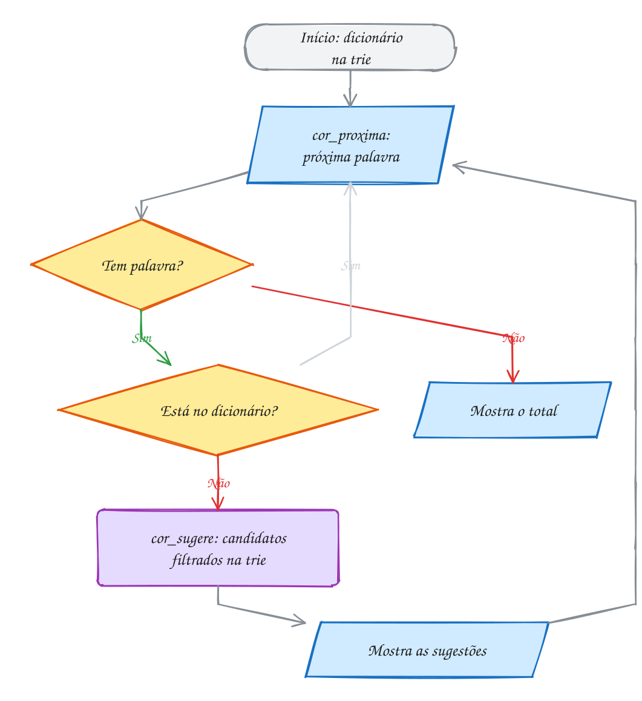</p>

### Trie, hash ou BST?

O exemplo A297 monta as três estruturas com o mesmo dicionário de 2500
palavras de duas sílabas e faz 5000 buscas (metade acha, metade não):

| | BST | Tabela hash | Trie |
| --- | --- | --- | --- |
| custo da busca exata | 17,2 comparações de string | 1,3 comparação de string | 4 nós (o tamanho da palavra) |
| memória | 60 KB | 60 KB | 661 KB |
| palavras com um prefixo | dá, com um percurso por intervalo | não dá | desce até o prefixo e lista |
| ordem alfabética | percurso em ordem | não dá | percurso por letra |
| depende de n? | sim, log n | não (com fator de carga bom) | não |

A hash ganha na busca exata e a trie perde feio na memória. A trie ganha em
tudo que envolve **prefixo**: autocompletar, "maior prefixo em comum", cortar
candidatos que já nascem errados. Um corretor de verdade combina as duas
coisas, e muitas vezes troca o nó de 26 ponteiros por um nó mais enxuto.

> [!WARNING]
> `cor_proxima` só reconhece letras de `'a'` a `'z'`. Maiúscula e acento viram
> separadores: "Hoje" sai como "oje", e "pão" sai como "p" e "o". Antes de
> conferir um texto de verdade, normalize as maiúsculas (exercício E890) e
> decida o que fazer com os acentos: em UTF-8, `'ã'` ocupa 2 bytes e não cabe
> num índice de 0 a 25. A outra pegadinha é de tamanho: `cor_sugere` monta os
> candidatos num vetor de `COR_MAX + 1` posições, porque pôr uma letra deixa a
> palavra uma letra maior que a original.

> [!TIP]
> **Por dentro do C:** a trie de 84 palavras tem 239 nós de 216 bytes, cerca de
> 51 KB, para guardar 351 letras. Cada busca de candidato custa no máximo
> L acessos a nós, mas cada nó fica num lugar diferente do heap (um `calloc` por
> nó), e cada acesso pode ser uma falta de cache. A tabela hash calcula o
> hash, vai a um balde e compara uma string: poucos acessos, quase sempre
> vizinhos. Por isso, em medição de tempo, a hash costuma vencer a trie na busca
> exata mesmo com o mesmo O(L).

> [!NOTE]
> **Pergunta para você:** se o aviso tivesse "onibu", quais sugestões
> apareceriam? E "aa"? Pense em quais palavras do dicionário estão a uma edição
> de cada uma e confira trocando o texto do exemplo.

### Hora de praticar

Os arquivos ficam em [`0149-juntando-tudo/`](0149-juntando-tudo/). Os comandos funcionam de qualquer pasta do terminal. Nos exemplos, rode, mude, quebre e rode de novo. Nos exercícios, a resposta vai dentro do próprio arquivo. ★☆☆ é aquecimento, ★★☆ pede raciocínio e ★★★ é desafio.

**Exemplo A297 · Trie, hash e BST no mesmo dicionário**

```c
#include <stdio.h>
#include <stdlib.h>
#include <string.h>
#include "corretor.h"

// dicionário sintético: as 2500 palavras de duas sílabas (ba, be, ..., zu)
#define N 2500
#define BALDES 2503 // primo, perto de N

long passos; // comparações de string (BST e hash) ou nós visitados (trie)

// ---- BST de strings ----
typedef struct NoS {
    char p[8];
    struct NoS *esq, *dir;
} NoS;

NoS *bst_poe(NoS *r, const char *p) {
    if (r == NULL) {
        NoS *n = malloc(sizeof(NoS));
        if (n == NULL) {
            exit(1);
        }
        strcpy(n->p, p);
        n->esq = n->dir = NULL;
        return n;
    }
    int c = strcmp(p, r->p);
    if (c < 0) {
        r->esq = bst_poe(r->esq, p);
    } else if (c > 0) {
        r->dir = bst_poe(r->dir, p);
    }
    return r;
}

int bst_tem(const NoS *r, const char *p) {
    while (r != NULL) {
        passos++;
        int c = strcmp(p, r->p);
        if (c == 0) {
            return 1;
        }
        r = c < 0 ? r->esq : r->dir;
    }
    return 0;
}

int bst_altura(const NoS *r) {
    if (r == NULL) {
        return -1;
    }
    int e = bst_altura(r->esq), d = bst_altura(r->dir);
    return 1 + (e > d ? e : d);
}

void bst_solta(NoS *r) {
    if (r != NULL) {
        bst_solta(r->esq);
        bst_solta(r->dir);
        free(r);
    }
}

// ---- tabela hash com encadeamento ----
typedef struct NoH {
    char p[8];
    struct NoH *prox;
} NoH;

unsigned espalha(const char *p) { // djb2
    unsigned h = 5381;
    for (; *p != '\0'; p++) {
        h = h * 33 + (unsigned char)*p;
    }
    return h % BALDES;
}

void hash_poe(NoH *t[], const char *p) {
    NoH *n = malloc(sizeof(NoH));
    if (n == NULL) {
        exit(1);
    }
    strcpy(n->p, p);
    unsigned b = espalha(p);
    n->prox = t[b];
    t[b] = n;
}

int hash_tem(NoH *t[], const char *p) {
    for (const NoH *n = t[espalha(p)]; n != NULL; n = n->prox) {
        passos++;
        if (strcmp(n->p, p) == 0) {
            return 1;
        }
    }
    return 0;
}

// ---- trie (do TAD): conta os nós visitados ----
int trie_tem(const NoC *d, const char *p) {
    for (; *p != '\0' && d != NULL; p++) {
        passos++;
        d = d->filho[*p - 'a'];
    }
    return d != NULL && d->fim;
}

int main(void) {
    const char *cons = "bcdfglmprz", *vog = "aeiou";
    static char pal[N][8];
    for (int i = 0; i < N; i++) { // sílaba 1 = i / 50, sílaba 2 = i % 50
        int s1 = i / 50, s2 = i % 50;
        snprintf(pal[i], 8, "%c%c%c%c", cons[s1 / 5], vog[s1 % 5], cons[s2 / 5], vog[s2 % 5]);
    }

    // embaralha a ordem de inserção (Fisher-Yates com um gerador fixo), senão
    // a BST receberia as palavras em ordem alfabética e viraria uma lista
    static int ordem[N];
    unsigned x = 2024;
    for (int i = 0; i < N; i++) {
        ordem[i] = i;
    }
    for (int i = N - 1; i > 0; i--) {
        x = x * 1103515245u + 12345u;
        int j = (int)((x >> 8) % (unsigned)(i + 1));
        int t = ordem[i];
        ordem[i] = ordem[j];
        ordem[j] = t;
    }

    NoS *bst = NULL;
    static NoH *tabela[BALDES];
    NoC *trie = cor_cria();
    for (int i = 0; i < N; i++) {
        const char *p = pal[ordem[i]];
        bst = bst_poe(bst, p);
        hash_poe(tabela, p);
        cor_insere(trie, p);
    }

    // 2500 buscas que acham e 2500 que não acham (troca a última vogal por 'x')
    long pb = 0, ph = 0, pt = 0;
    for (int i = 0; i < N; i++) {
        char falsa[8];
        strcpy(falsa, pal[i]);
        falsa[3] = 'x';
        passos = 0; bst_tem(bst, pal[i]); bst_tem(bst, falsa); pb += passos;
        passos = 0; hash_tem(tabela, pal[i]); hash_tem(tabela, falsa); ph += passos;
        passos = 0; trie_tem(trie, pal[i]); trie_tem(trie, falsa); pt += passos;
    }
    int maior_balde = 0;
    for (int b = 0; b < BALDES; b++) {
        int k = 0;
        for (const NoH *n = tabela[b]; n != NULL; n = n->prox) {
            k++;
        }
        maior_balde = k > maior_balde ? k : maior_balde;
    }

    printf("%d palavras, %d buscas\n", N, 2 * N);
    printf("BST:  %4.1f comparações de string por busca | altura %d | %zu bytes\n",
           (double)pb / (2 * N), bst_altura(bst), N * sizeof(NoS));
    printf("hash: %4.1f comparações de string por busca | maior balde %d | %zu bytes\n",
           (double)ph / (2 * N), maior_balde, N * sizeof(NoH) + BALDES * sizeof(NoH *));
    printf("trie: %4.1f nós visitados por busca         | %d nós | %zu bytes\n",
           (double)pt / (2 * N), cor_nos(trie), cor_nos(trie) * sizeof(NoC));

    bst_solta(bst);
    for (int b = 0; b < BALDES; b++) {
        while (tabela[b] != NULL) {
            NoH *prox = tabela[b]->prox;
            free(tabela[b]);
            tabela[b] = prox;
        }
    }
    cor_libera(trie);
    return 0;
}
// Saída:
// 2500 palavras, 5000 buscas
// BST:  17.2 comparações de string por busca | altura 29 | 60000 bytes
// hash:  1.3 comparações de string por busca | maior balde 5 | 60024 bytes
// trie:  4.0 nós visitados por busca         | 3061 nós | 661176 bytes
```

```bash
~/LPEDC/rodar 22-arvores-avancadas/0149-juntando-tudo/A297.c
```

**Exemplo A298 · O corretor que aprende palavras novas**

```c
#include <stdio.h>
#include "corretor.h"

// Lê o texto linha por linha. Uma linha que começa com '+' ensina palavras
// novas ao dicionário; as outras são conferidas.
//
//   printf 'hoje tem fieira na rua\n+ pastel esquina\na fiera da esquina tem pastel\n' | ~/LPEDC/rodar 22-arvores-avancadas/0149-juntando-tudo/A298.c

int main(void) {
    NoC *dic = cor_cria();
    cor_carrega_basico(dic);
    int nos_antes = cor_nos(dic);

    char linha[256], palavra[COR_MAX], sug[3][COR_MAX];
    int num = 0, aprendidas = 0;
    while (fgets(linha, sizeof linha, stdin) != NULL) {
        num++;
        const char *p = linha;
        if (linha[0] == '+') {
            int antes = aprendidas;
            while (cor_proxima(&p, palavra)) {
                if (!cor_contem(dic, palavra) && cor_insere(dic, palavra)) {
                    aprendidas++;
                }
            }
            printf("linha %d: aprendi %d palavra(s)\n", num, aprendidas - antes);
            continue;
        }
        int erros = 0;
        while (cor_proxima(&p, palavra)) {
            if (cor_contem(dic, palavra)) {
                continue;
            }
            erros++;
            int k = cor_sugere(dic, palavra, sug, 3);
            printf("linha %d: \"%s\"?", num, palavra);
            for (int i = 0; i < k; i++) {
                printf(" %s", sug[i]);
            }
            printf("\n");
        }
        if (erros == 0) {
            printf("linha %d: tudo certo\n", num);
        }
    }
    printf("Palavras aprendidas: %d (a trie foi de %d para %d nós)\n",
           aprendidas, nos_antes, cor_nos(dic));

    cor_libera(dic);
    return 0;
}
// Saída:
// linha 1: "fieira"? feira
// linha 2: aprendi 2 palavra(s)
// linha 3: "fiera"? feira
// Palavras aprendidas: 2 (a trie foi de 239 para 247 nós)
```

```bash
~/LPEDC/rodar 22-arvores-avancadas/0149-juntando-tudo/A298.c
```

#### Exercícios

**Exercício E889** · ★☆☆

Use o TAD do corretor (corretor.h) para conferir o recado da escola:
separe o texto em palavras com cor_proxima, mostre as que não estão no
dicionário básico e conte quantas são, de quantas no total.


```text
Saída esperada:
desconhecidas: muitos alunos
2 de 13 palavras fora do dicionário
```

**Dicas:**

1. Carregue o dicionário com cor_cria e cor_carrega_basico.
2. O laço é while (cor_proxima(&texto, palavra)) { ... }: a função avança
   o ponteiro texto a cada chamada (por isso o &) e devolve false no fim.
3. Resposta esperada: a saída acima. O dicionário tem "muito" e "aluno",
   mas não os plurais: um corretor de verdade trata as flexões à parte.

```bash
~/LPEDC/rodar 22-arvores-avancadas/0149-juntando-tudo/E889.c
```

**Exercício E890** · ★☆☆

O cor_proxima só entende letras de 'a' a 'z': maiúscula vira separador, e
"Hoje" sai como "oje". Escreva normaliza(s), que troca as maiúsculas por
minúsculas no próprio vetor. O main confere o recado antes e depois.


```text
Saída esperada:
palavras: oje a da ua tem ao e afe
  8 palavras, 4 fora do dicionário
palavras: hoje a feira da rua tem pao e cafe
  9 palavras, 0 fora do dicionário
```

**Dicas:**

1. Use tolower, de <ctype.h>, em cada caractere até o '\0'. Converta para
   unsigned char antes: tolower((unsigned char)s[i]).
2. O recado é um vetor (char recado[]), e não um ponteiro para literal:
   por isso dá para alterá-lo. A pontuação não precisa sair: cor_proxima já
   pula o que não é letra.
3. Resposta esperada: a saída acima. "FEIRA" inteira some na primeira
   conferência: nenhuma letra dela está entre 'a' e 'z'.

```bash
~/LPEDC/rodar 22-arvores-avancadas/0149-juntando-tudo/E890.c
```

**Exercício E891** · ★★☆

Quando uma palavra está longe demais de tudo, as sugestões a uma edição
de distância não acham nada. Outra pista é o começo da palavra. Escreva
pelo_prefixo(d, palavra, max): desça na trie do dicionário enquanto as
letras da palavra existirem, mostre o maior prefixo em comum e sugira até
max palavras do dicionário que começam com ele, em ordem alfabética.


```text
Saída esperada:
esquina: prefixo "es" | escola
cafezinho: prefixo "cafe" | cafe
mercadinho: prefixo "mercad" | mercado
portaria: prefixo "porta" | porta portao
xis: prefixo "" | nenhuma
```

**Dicas:**

1. A descida para quando acaba a palavra ou quando d->filho[letra - 'a'] é
   NULL. Vá copiando as letras para um buffer: ele é o prefixo.
2. Para listar, escreva uma função recursiva como a coleta do trie.c
   (0147), começando no nó onde a descida parou, com nivel = tamanho do
   prefixo. Use um contador para parar em max.
3. Resposta esperada: a saída acima. Se a descida não andou nenhuma letra,
   não sugira nada: o prefixo vazio casaria com o dicionário inteiro.

```bash
~/LPEDC/rodar 22-arvores-avancadas/0149-juntando-tudo/E891.c
```

**Exercício E892** · ★★☆

O revisor quer um relatório: cada palavra fora do dicionário, em ordem
alfabética, com quantas vezes ela apareceu no texto. Guarde as palavras
desconhecidas numa BST de strings (assunto 0099) com um contador no nó:
palavra repetida soma 1 em vezes. No fim, um percurso em ordem imprime o
relatório e conta as palavras diferentes e as ocorrências.


```text
Saída esperada:
cedo: 1
fiera: 2
mas: 1
pasou: 1
4 palavras diferentes, 5 ocorrências
```

**Dicas:**

1. O nó: char palavra[COR_MAX], int vezes, esq e dir. Na inserção, compare
   com strcmp; se der 0, é repetida: vezes++.
2. O dicionário é o do TAD (cor_carrega_basico) e as palavras saem do
   texto com cor_proxima. Só vão para a BST as que cor_contem rejeita.
3. Resposta esperada: a saída acima. Libere a BST e o dicionário no fim.

```bash
~/LPEDC/rodar 22-arvores-avancadas/0149-juntando-tudo/E892.c
```

**Exercício E893** · ★★★

Ache o bug. Esta versão enxuta do sugeridor testa só duas edições: tirar
uma letra e pôr uma letra. Ela acerta "pasou" e "baratoo", mas não sugere
nada para "barat" e "cas", que estão a uma letra de distância de palavras do
dicionário:


```text
Saída que aparece:
pasou: passou
baratoo: barato
barat: nenhuma
cas: nenhuma
```


```text
Saída esperada:
pasou: passou
baratoo: barato
barat: barato
cas: casa caso
```


Ache a linha errada, conserte e rode de novo.

**Dicas:**

1. "barat" vira "barato" pondo uma letra em qual posição? Quais posições o
   laço da inserção experimenta numa palavra de 5 letras?
2. Numa palavra de n letras existem n + 1 lugares para pôr uma letra nova:
   antes da primeira, entre cada par e DEPOIS da última.
3. Resposta esperada: no laço "pôr uma letra", a condição é i <= n, e não
   i < n. Com i < n, a posição depois da última letra nunca é testada.

```bash
~/LPEDC/rodar 22-arvores-avancadas/0149-juntando-tudo/E893.c
```

**Exercício E894** · ★★★

Sugestões a até DUAS edições, com a distância de Levenshtein do assunto
0142, sem calcular a distância contra cada palavra do dicionário. A ideia:
desça na trie com DFS levando a última linha da tabela da distância. Cada
nó acrescenta uma linha (a letra dele contra a palavra procurada), e todas
as palavras que passam por aquele prefixo aproveitam as linhas de cima. Se
o menor valor da linha nova já passar de 2, nada embaixo daquele nó chega a
2: pode cortar o ramo inteiro. Escreva parecidas(d, alvo), que mostra, em
ordem alfabética, as palavras do dicionário básico a distância 2 ou menos,
com a distância entre parênteses.


```text
Saída esperada:
carrro: bairro(2) caro(2) carro(1)
jnaela: janela(2)
bolsa: boa(2) bola(1) bolo(2)
mercadorias: nenhuma
```

**Dicas:**

1. A linha da raiz (prefixo vazio) é 0, 1, 2, ..., m (m = strlen(alvo)).
   Para o filho com a letra c, a linha nova é lin[0] = ant[0] + 1 e, para
   j de 1 a m, lin[j] = o menor entre ant[j - 1] + (alvo[j - 1] != c),
   ant[j] + 1 e lin[j - 1] + 1.
2. Na função recursiva, receba a linha do pai (const int ant[]), monte a
   sua num vetor local e passe para os filhos. Se o nó tem fim e lin[m] <= 2,
   mostre a palavra do buffer. Se o menor valor de lin passar de 2, volte.
3. Resposta esperada: a saída acima. Repare em "jnaela": trocar duas letras
   vizinhas de lugar custa 2 na distância de Levenshtein, mas é UMA edição no
   cor_sugere (que testa a troca de vizinhas à parte).

```bash
~/LPEDC/rodar 22-arvores-avancadas/0149-juntando-tudo/E894.c
```

---

## Desafios do módulo

Problemas para resolver no papel e, quando fizer sentido, num arquivo `.c` seu
usando os TADs do módulo. Eles misturam os assuntos.

**1. A geral e a binária.** A árvore geral A tem os filhos B, C e D, nesta
ordem; B tem os filhos E e F; D tem o filho G. Dê a pré-ordem e a pós-ordem da
árvore geral. Depois desenhe a versão primeiro filho / próximo irmão como árvore
binária (filho à esquerda, irmão à direita) e dê a em ordem e a altura dela.

<details><summary>Resposta</summary>

Pré-ordem: **A B E F C D G**. Pós-ordem: **E F B C G D A**. Na binária, A tem B
à esquerda; B tem E à esquerda e C à direita; E tem F à direita; C tem D à
direita; D tem G à esquerda. A em ordem da binária é **E F B C G D A**, igual à
pós-ordem da geral (o A288 mostra isso no código). A altura da geral é **2**; a
da binária é **4** (A, B, C, D, G), porque cada irmão vira um degrau.

</details>

**2. Rubro-negra ao contrário.** Insira 7, 6, 5, 4, 3, 2 e 1, nesta ordem, numa
LLRB vazia. Qual é a pré-ordem final? Quantos nós vermelhos sobram, quantas
rotações e quantas inversões de cor aconteceram?

<details><summary>Resposta</summary>

Pré-ordem **4 2 1 3 6 5 7**, todos pretos: a árvore 2-3 equivalente é perfeita,
com sete nós de uma chave. Foram **4 rotações** (todas à direita: dois vermelhos
seguidos à esquerda) e **4 inversões**. Altura 2, altura preta 3. Confira com
`rn_pre_ordem`, `rn_rotacoes` e `rn_inversoes`.

</details>

**3. Quantos nós cabem na altura preta?** Uma LLRB tem altura preta 3 (três nós
pretos da raiz até qualquer `NULL`). Qual é o menor e o maior número de nós que
ela pode ter?

<details><summary>Resposta</summary>

Pense na árvore 2-3 equivalente, com 3 níveis. No mínimo, todo nó tem uma
chave: 1 + 2 + 4 = **7** nós, todos pretos. No máximo, todo nó tem duas chaves e
três filhos: 1 + 3 + 9 = 13 nós 2-3, com 26 chaves. Na LLRB, são **26** nós: 13
pretos, cada um com um vermelho colado à esquerda. Em geral, com altura preta b,
a LLRB tem de 2^b - 1 a 3^b - 1 nós.

</details>

**4. Escrevendo a 2-3 em cores.** A árvore 2-3 tem a raiz `[20 40]` e os filhos
`[10]`, `[30]` e `[50 60]`. Escreva a LLRB equivalente em pré-ordem, com `*` nos
vermelhos. Que ordem de inserção produz exatamente essa árvore?

<details><summary>Resposta</summary>

Pré-ordem **40 20\* 10 30 60 50\***: cada nó de duas chaves vira a chave maior
preta com a menor vermelha à esquerda. A ordem 20, 40, 10, 30, 50, 60 produz essa
árvore (confira com o TAD). Repare que a LLRB nunca tem o vermelho à direita: o
`[50 60]` vira 60 com 50 pendurado à esquerda, e não 50 com 60 à direita.

</details>

**5. Limites da árvore B.** Numa árvore B com grau mínimo t = 3 (de 2 a 5 chaves
por nó, a raiz pode ter 1), qual é o maior e o menor número de chaves que cabe em
altura 2?

<details><summary>Resposta</summary>

Maior: todos os nós com 5 chaves e 6 filhos: 5 + 6 · 5 + 36 · 5 = **215**, ou
6³ - 1. Menor: a raiz com 1 chave e 2 filhos, e cada nó abaixo com 2 chaves e 3
filhos: 1 + 2 · 2 + 6 · 2 = **17**, ou 2 · t² - 1. Para buscar em qualquer
árvore B de altura 2, três nós são lidos, tenha ela 17 ou 215 chaves.

</details>

**6. A trie das palavras parecidas.** Quantos nós (contando a raiz) tem a trie com
"casa", "casaco", "caso", "cama" e "camelo"? Quantas palavras começam com
"cam", e qual é o maior prefixo comum a todas as cinco?

<details><summary>Resposta</summary>

**13 nós**: raiz, c, a; s, a (casa), c, o (casaco), o (caso); m, a (cama), e, l, o
(camelo). Com "cam" começam **2** (cama e camelo). O maior prefixo comum é
**"ca"**: no nó do `a`, o caminho se divide em `s` e `m`. Confira com `trie_nos`
e com o `prefixo_comum` do A294.

</details>

**7. O vetor pai no fim.** Num union-find de 10 elementos (TAD do 0148, união por
tamanho e compressão), faça, nesta ordem: une(0,1), une(2,3), une(4,5), une(6,7),
une(0,2), une(4,6), une(0,4), une(8,9), une(9,7). Qual é o vetor `pai` no fim?

<details><summary>Resposta</summary>

**pai = 0 0 0 2 0 4 0 0 0 8**. Até une(0,4), as raízes vão se pendurando (nos
empates, a raiz de a fica). Em une(9,7), `acha(7)` sobe 7, 6, 4, 0 e comprime: o
7 e o 6 passam a apontar direto para o 0. Depois, o grupo do 8 (tamanho 2) vai
para baixo do 0 (tamanho 8). O 3, o 5 e o 9 continuam a dois passos da raiz até
alguém perguntar por eles.

</details>

**8. Igualdades impossíveis.** Um sistema recebe restrições sobre variáveis:
x1 = x2, x3 = x4, x5 = x1, x2 = x3 e x4 ≠ x5. Dá para atender todas? Como um
union-find responde isso para mil restrições?

<details><summary>Resposta</summary>

**Não dá.** As quatro igualdades juntam x1, x2, x3, x4 e x5 num grupo só, e aí
x4 ≠ x5 é uma contradição. O método: primeiro faça une(a, b) para cada igualdade;
depois, para cada diferença, confira `uf_juntos(a, b)`: se der verdadeiro, é
impossível. Custo quase linear no número de restrições. A ordem importa: as
diferenças só podem ser conferidas depois de todas as igualdades.

</details>

**9. Qual estrutura?** Escolha entre trie, tabela hash, rubro-negra, árvore B e
union-find: (a) o campo de busca que completa nomes de cidade a cada letra; (b)
contar visitantes únicos do site pelo CPF; (c) o índice de uma tabela de 500
milhões de registros num banco de dados; (d) uma agenda em memória que recebe
compromissos o tempo todo e lista os próximos em ordem de horário; (e) saber se
duas pessoas estão ligadas por uma corrente de amizades que cresce a cada
minuto.

<details><summary>Resposta</summary>

(a) **trie**: o prefixo leva direto às cidades; (b) **hash**: só busca exata, a
mais rápida; (c) **árvore B**: poucos blocos lidos do disco por busca; (d)
**rubro-negra**: inserção em O(log n) no pior caso e percurso em ordem; (e)
**union-find**: cada amizade é um une, cada pergunta é um acha. Repare que
nenhuma delas ganha em tudo.

</details>

**10. A conta da memória.** Um dicionário de 100 mil palavras vira uma trie de
26 ponteiros com 250 mil nós. Quanta memória a trie ocupa? E as mesmas palavras
como strings, com média de 9 letras?

<details><summary>Resposta</summary>

Cada nó tem 216 bytes: 250 000 · 216 = 54 000 000 bytes, cerca de **54 MB**. As
strings ocupam 100 000 · (9 + 1) = 1 000 000 bytes, cerca de **1 MB**. A trie
gasta mais de 50 vezes mais, quase tudo em ponteiros `NULL`. É por isso que
tries de verdade usam nós menores: lista de filhos (a ideia do 0144), vetor só
das letras que existem ou árvore ternária de busca.

</details>

**11. A divisão em cascata.** Na árvore B do texto do 0146 (raiz `[40]`, nível
1 `[20] [70]`, folhas `[10] [25 30] [50 60] [80 85 90]`), insira 87, 95, 97 e
99, nesta ordem. Quantas divisões acontecem e como fica a árvore?

<details><summary>Resposta</summary>

O 87 divide a folha `[80 85 90]` (o 85 sobe para `[70 85]`) e entra em
`[87 90]`. O 95 vai para `[87 90 95]`. O 97 encontra essa folha cheia, que se
divide (o 90 sobe: `[70 85 90]`), e entra em `[95 97]`. O 99 encontra o nó
`[70 85 90]` cheio no caminho: ele se divide antes de descer (o 85 sobe para a
raiz, `[40 85]`), e o 99 termina em `[95 97 99]`. São **3 divisões**. Por nível:
`[40 85]`; `[20] [70] [90]`; `[10] [25 30] [50 60] [80] [87] [95 97 99]`. A
altura continua 2. Confira com `ab_insere` e `ab_mostra`.

</details>

## Para ler mais

- CORMEN, T. H. et al. *Algoritmos: teoria e prática*. 3. ed. Rio de Janeiro: Elsevier, 2012. Caps. 10 (representação de árvores enraizadas), 13 (árvores vermelho-preto), 18 (árvores B) e 21 (estruturas de dados para conjuntos disjuntos).
- SZWARCFITER, J. L.; MARKENZON, L. *Estruturas de dados e seus algoritmos*. 3. ed. Rio de Janeiro: LTC, 2010. Árvores gerais, árvores rubro-negras, árvores B, árvores digitais e o problema da união de conjuntos.
- SEDGEWICK, R.; WAYNE, K. *Algorithms*. 4. ed. Boston: Addison-Wesley, 2011. Seções 1.5 (union-find), 3.3 (árvores balanceadas: 2-3 e rubro-negras) e 5.2 (tries). Disponível em: <https://algs4.cs.princeton.edu/home/>.
- SEDGEWICK, R. *Left-leaning red-black trees*. Princeton: Princeton University, 2008. Disponível em: <https://sedgewick.io/wp-content/themes/sedgewick/papers/2008LLRB.pdf>.
- TENENBAUM, A. M.; LANGSAM, Y.; AUGENSTEIN, M. J. *Estruturas de dados usando C*. São Paulo: Makron Books, 1995. Cap. 5 (árvores gerais como árvores binárias) e cap. 7 (árvores B e tries).
- CELES, W.; RANGEL, J. L. *Apostila de estruturas de dados*. Rio de Janeiro: PUC-Rio, 2002. Capítulo sobre árvores genéricas (primeiro filho, próximo irmão).
- CORTÉS, M. I. *Estrutura de dados*. 3. ed. Fortaleza: EdUECE, 2015. Capítulo de busca avançada: árvore digital (trie).
- LINTZMAYER, C. N.; MOTA, G. O. *Análise de algoritmos e de estruturas de dados*. Santo André: UFABC, 2023. Notas de aula. Capítulo sobre union-find.
- BAYER, R.; McCREIGHT, E. Organization and maintenance of large ordered indexes. *Acta Informatica*, v. 1, n. 3, p. 173-189, 1972.
- TARJAN, R. E. Efficiency of a good but not linear set union algorithm. *Journal of the ACM*, v. 22, n. 2, p. 215-225, 1975.
- FREDKIN, E. Trie memory. *Communications of the ACM*, v. 3, n. 9, p. 490-499, 1960.
- KERNIGHAN, B. W.; RITCHIE, D. M. *C: a linguagem de programação padrão ANSI*. Rio de Janeiro: Campus, 1989. Seção 6.5: estruturas autorreferenciadas.
- CPPREFERENCE. *tolower*. Disponível em: <https://en.cppreference.com/w/c/string/byte/tolower>.
