<!-- Gerado por _gerador. Para mudar este arquivo, edite _gerador/modulos/23-grafos-avancados/ e rode: cd _gerador && npm run gerar -->

# Módulo 23 · Grafos: estrutura e caminhos

> [!IMPORTANT]
> **Mundo 7 · Grafos · Rota do jogo: etapa 22 de 29**
>
> **Missão:** ordenar topologicamente, achar árvore geradora mínima e caminhos mínimos.
>
> **Vem de:** [Módulo 16 · Grafos](16-grafos.md). **Segue para:** [Módulo 29 · Grafos: ciclos e cortes; problemas difíceis](29-grafos-e-np.md).
>
> **Checkpoints desta fase:**
> - [ ] Ler os assuntos 0150 a 0156 e refazer os exemplos
> - [ ] Resolver os 4 exercícios de cada assunto, escrevendo o código sozinho
> - [ ] Fechar a lista prática (P2301 a P2330)
> - [ ] Enfrentar os desafios do módulo
> - [ ] Chefão: resolver as questões de prova do módulo sem consultar

Depois de BFS, DFS e Dijkstra (módulo 16), o que o grafo esconde: componentes,
ciclos, ordem das tarefas, árvore geradora mínima, pesos negativos e caminhos
entre todos os pares. Depende também de fila, heap, union-find (0148) e PD
(módulo 21).

## O que você vai aprender

- **componentes conexos** e **ciclos**, com a DFS de três cores nos grafos
  dirigidos
- **ordenação topológica**: **Kahn** (fila) e pós-ordem invertida da DFS
- **árvore geradora mínima**: **Kruskal** (ordenação + union-find) e **Prim**
  (heap), e a diferença entre Prim e Dijkstra, que mora numa linha
- **pesos negativos** e **ciclo negativo** com **Bellman-Ford**
- **todos os pares** com **Floyd-Warshall** e a reconstrução das rotas
- escolher o algoritmo pela pergunta, num programa que planeja semestres e
  rotas

## Antes de começar

Revise o módulo 16 (matriz de adjacência, BFS 0110, DFS 0111 e Dijkstra 0112),
fila (0085), heap (0102), `qsort` (0096), union-find (0148), recursão (0032),
permutações (0126) e PD (módulo 21). Grau, circuitos, eulerianos,
hamiltonianos, pontes e articulações estão nos assuntos 0182 a 0184.

Cada assunto traz o algoritmo inteiro num arquivo, sem TAD. Nos desenhos, a
origem é roxa e as arestas verdes são as escolhidas; na DFS de três cores,
amarelo é o cinza (na pilha) e verde é o preto (terminado).

Três convenções valem para o módulo:

- vértices são números de 0 a V-1, com os nomes num vetor de strings à parte,
  e os vizinhos são examinados em **ordem crescente de índice**; isso decide
  os empates, e mudar a numeração pode mudar a saída sem errar;
- na matriz de pesos, **0 quer dizer "sem aresta"**, salvo aviso (o A311
  mostra o problema disso);
- ao somar distâncias, o INFINITO é `1000000000`, que somado a outro INFINITO
  ainda cabe num `int`; quando o código usa `INT_MAX`, testa antes de somar.

| # | Assunto |
| --- | --- |
| [0150](#0150--componentes-e-ciclos) | Componentes e ciclos |
| [0151](#0151--ordenação-topológica) | Ordenação topológica |
| [0152](#0152--kruskal-árvore-geradora-mínima) | Kruskal: árvore geradora mínima |
| [0153](#0153--prim-a-árvore-que-cresce) | Prim: a árvore que cresce |
| [0154](#0154--bellman-ford-pesos-negativos) | Bellman-Ford: pesos negativos |
| [0155](#0155--floyd-warshall-todos-os-pares) | Floyd-Warshall: todos os pares |
| [0156](#0156--juntando-tudo-o-assistente-do-calouro) | Juntando tudo: o assistente do calouro |

---

> [!NOTE]
> Cada assunto é um capítulo: **Conceito** (a explicação), **Exemplos de uso** (programas que compilam sozinhos: rode com o comando abaixo de cada um e compare com a saída no fim do código) e **Exercícios** (cada um é um arquivo em `material/` com o esqueleto, as dicas e o espaço para a resposta; resoluções em `_respostas/23-grafos-avancados/`).

## 0150 · Componentes e ciclos

### Conceito

- **Componente conexo**: grupo em que todo vértice se liga a todo outro por
  algum caminho, sem olhar a direção das setas (ZIVIANI, 2010, cap. 7).
- **Contar componentes**: um **laço externo** começa uma DFS (assunto 0111), com
  número de grupo novo, em cada vértice ainda sem grupo. Custa O(V + E) com
  lista de adjacência (CORMEN et al., 2024, cap. 20).
- **Ciclo** num grafo dirigido: caminho que volta ao vértice de partida seguindo
  as setas.
- **Três cores**: **branco** (nunca visto), **cinza** (na pilha da recursão) e
  **preto** (terminado). Seta para cinza é ciclo; seta para preto leva a algo já
  resolvido. O `pai[]` reconstrói o ciclo (CORMEN et al., 2024, cap. 20).
- **Aresta de retorno** (*back edge*): a seta para um cinza. Um grafo dirigido é
  acíclico se e só se a DFS não acha nenhuma (CORMEN et al., 2024, cap. 20).
- **Fortemente conexo**: cada vértice alcança cada outro **seguindo** as setas.
  Sai com duas DFS, a segunda no grafo invertido, em O(V + E). Ignorar a direção
  é ser só **fracamente conexo** (SEDGEWICK; WAYNE, 2011). Pontes e articulação:
  assunto 0184.

> [!WARNING]
> Só com `visitado[]`, o ciclo dá **alarme falso**: dois caminhos que se
> encontram não são ciclo. Pergunte "ainda está na pilha?", não "já vi?". No
> grafo **não dirigido**, o pai sempre parece ciclo: ignore-o.

### Exemplos de uso

Uma planilha de reforma vira grafo: a seta `a -> b` diz "a fórmula de `a` usa
`b`". Os números dão a ordem de descoberta; a obra fica preta (verde), o
financiamento cinza (amarelo), e a seta de Parcela para Juros aponta para um
cinza:

<p align="center">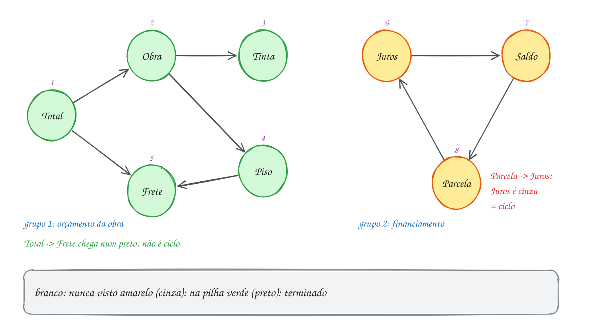</p>

Os grupos ignoram a direção; o ciclo a respeita e usa as cores:

```c
#include <stdbool.h>
#include <stdio.h>

#define V 8
enum { BRANCO, CINZA, PRETO }; // nunca visto, na pilha, terminado

const char *nomes[V] = {"Total", "Obra", "Tinta", "Piso", "Frete", "Juros", "Parcela", "Saldo"};
int usa[V][V]; // usa[a][b] = 1: a fórmula de a usa o valor de b
int grupo[V];  // número do componente de cada célula (0 = sem grupo ainda)
int cor[V], pai[V];

// componentes: a direção não importa, só se as células estão ligadas
void marca_grupo(int u, int g) {
    grupo[u] = g;
    for (int v = 0; v < V; v++)
        if ((usa[u][v] || usa[v][u]) && grupo[v] == 0) marca_grupo(v, g);
}

// ciclo: DFS com três cores; devolve true se achar uma aresta para um CINZA
bool acha_ciclo(int u) {
    cor[u] = CINZA;
    for (int v = 0; v < V; v++) {
        if (!usa[u][v]) continue;
        if (cor[v] == CINZA) { // v ainda está na pilha: voltamos a ele
            int volta[V], n = 0; // sobe pelos pais de u até v
            for (int w = u; w != v; w = pai[w]) volta[n++] = w;
            printf("Referência circular: %s", nomes[v]);
            for (int i = n - 1; i >= 0; i--) printf(" -> %s", nomes[volta[i]]);
            printf(" -> %s\n", nomes[v]);
            return true;
        }
        if (cor[v] == BRANCO) {
            pai[v] = u;
            if (acha_ciclo(v)) return true;
        }
    }
    cor[u] = PRETO; // tudo abaixo de u já foi explorado
    return false;
}

int main(void) {
    int formulas[][2] = {{0, 1}, {0, 4}, {1, 2}, {1, 3}, {3, 4},  // orçamento da obra
                         {5, 7}, {7, 6}, {6, 5}};                 // financiamento
    for (int k = 0; k < 8; k++) usa[formulas[k][0]][formulas[k][1]] = 1;

    int grupos = 0;
    for (int u = 0; u < V; u++)
        if (grupo[u] == 0) marca_grupo(u, ++grupos); // cada recomeço é um grupo novo
    printf("Grupos independentes: %d\n", grupos);
    for (int g = 1; g <= grupos; g++) {
        printf("  grupo %d:", g);
        for (int v = 0; v < V; v++)
            if (grupo[v] == g) printf(" %s", nomes[v]);
        printf("\n");
    }

    bool ciclo = false;
    for (int u = 0; u < V && !ciclo; u++) {
        pai[u] = -1;
        if (cor[u] == BRANCO) ciclo = acha_ciclo(u);
    }
    if (!ciclo) printf("Nenhuma referência circular\n");
    return 0;
}
// Saída:
// Grupos independentes: 2
//   grupo 1: Total Obra Tinta Piso Frete
//   grupo 2: Juros Parcela Saldo
// Referência circular: Juros -> Saldo -> Parcela -> Juros
```

No fluxograma, cada vizinho de `u` é cinza (ciclo), branco (desce) ou preto
(ignorado). Sem vizinhos novos, `u` fica preto:

<p align="center">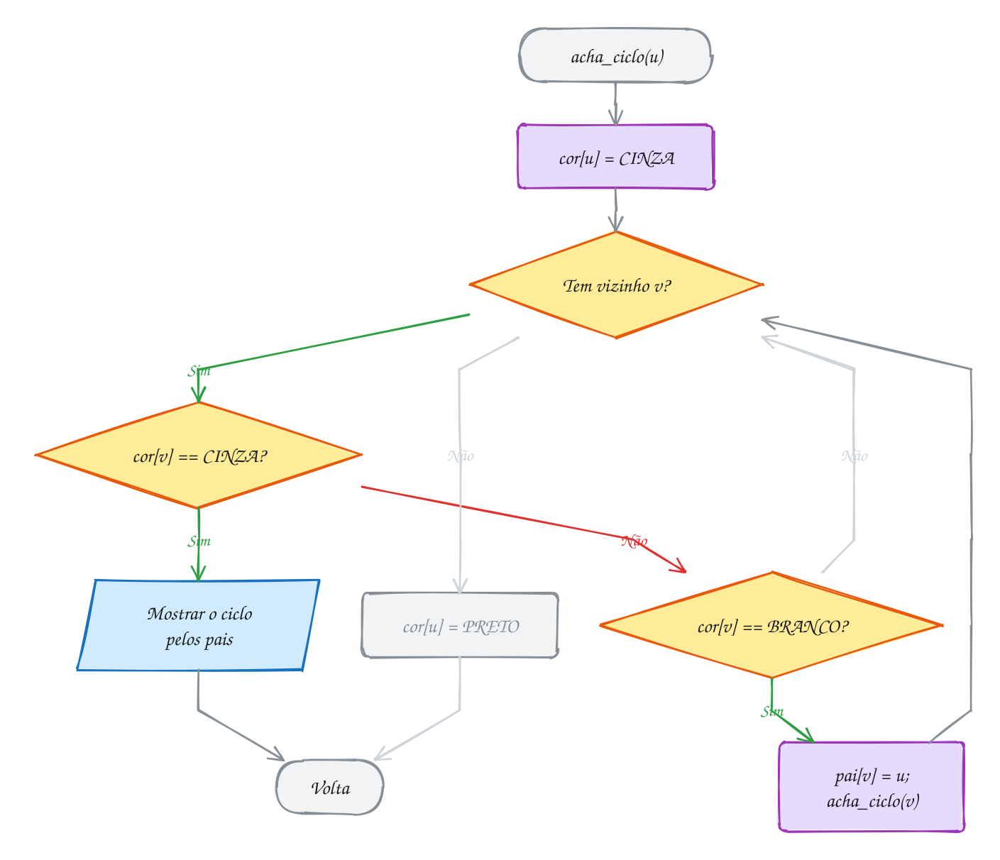</p>

#### Passo a passo

O Frete visto de Total já está preto: sem alarme.

| Evento | Cinza (na pilha) | Preto |
| --- | --- | --- |
| entra em Total, Obra, Tinta | Total, Obra, Tinta | |
| Tinta não usa ninguém | Total, Obra | Tinta |
| entra em Piso, Frete | Total, Obra, Piso, Frete | Tinta |
| Frete, Piso e Obra terminam | Total | Tinta, Frete, Piso, Obra |
| Total olha Frete: **preto**, segue | Total | (igual) |
| Total termina | | os 5 da obra |
| entra em Juros, Saldo, Parcela | Juros, Saldo, Parcela | os 5 da obra |
| Parcela olha Juros: **cinza**, ciclo | | |

O A299 faz o mesmo num grafo não dirigido; o A300 conta grupos com o
union-find (0148).

**Exemplo A299 · O laço de cabos na rede do escritório**

```c
#include <stdbool.h>
#include <stdio.h>

#define V 7

// grafo NÃO dirigido: cabo de rede entre os switches de cada sala
const char *salas[V] = {"TI", "Recepcao", "RH", "Financeiro", "Diretoria", "Deposito", "Copa"};
int cabo[V][V];
bool visitado[V];
int pai[V];       // de onde a DFS chegou em cada sala
bool laco = false;

void explora(int u) {
    visitado[u] = true;
    for (int v = 0; v < V; v++) {
        if (!cabo[u][v] || v == pai[u]) continue; // o cabo por onde cheguei não conta
        if (!visitado[v]) {
            pai[v] = u;
            explora(v);
        } else if (!laco) { // vizinho já visto que não é o pai: fecha um laço
            laco = true;
            printf("Laço de cabos: %s", salas[v]);
            for (int w = u; w != v; w = pai[w]) printf(" - %s", salas[w]);
            printf(" - %s\n", salas[v]);
        }
    }
}

int main(void) {
    int cabos[][2] = {{0, 1}, {0, 2}, {2, 3}, {3, 4}, {4, 2}, {5, 6}};
    for (int k = 0; k < 6; k++) {
        cabo[cabos[k][0]][cabos[k][1]] = 1;
        cabo[cabos[k][1]][cabos[k][0]] = 1; // mão dupla
    }

    int redes = 0;
    for (int u = 0; u < V; u++) {
        if (visitado[u]) continue;
        redes++; // cada recomeço é uma rede separada
        pai[u] = -1;
        explora(u);
    }
    printf("Redes separadas: %d\n", redes);
    printf("%s\n", laco ? "Desligue um cabo do laço" : "Rede sem laços");
    return 0;
}
// Saída:
// Laço de cabos: RH - Diretoria - Financeiro - RH
// Redes separadas: 2
// Desligue um cabo do laço
//
// Um laço de cabos entre switches faz os pacotes de broadcast girarem sem
// parar e derruba a rede. Por isso o teste ignora só o PAI: num grafo não
// dirigido, o cabo de volta para quem chamou sempre aparece.
```

```bash
gcc ~/LPEDC/material/A299.c -o ~/LPEDC/material/A299 && ~/LPEDC/material/A299
```

**Exemplo A300 · Grupos de corrida que se juntam**

```c
#include <stdio.h>

#define N 8

const char *nomes[N] = {"Ana", "Beto", "Caio", "Dani", "Eli", "Fabi", "Gil", "Hugo"};
int pai[N], tamanho[N];

// union-find (assunto 0148): cada grupo é uma árvore; a raiz é o representante
int acha(int x) {
    if (pai[x] != x) pai[x] = acha(pai[x]); // compressão de caminho
    return pai[x];
}

int main(void) {
    for (int i = 0; i < N; i++) {
        pai[i] = i;
        tamanho[i] = 1;
    }
    int grupos = N;

    // as amizades chegam pelo aplicativo, uma de cada vez
    int amizades[][2] = {{0, 1}, {2, 3}, {1, 3}, {4, 5}, {0, 2}, {6, 7}, {5, 7}, {3, 6}};
    for (int k = 0; k < 8; k++) {
        int a = amizades[k][0], b = amizades[k][1];
        int ra = acha(a), rb = acha(b);
        printf("%-4s + %-4s: ", nomes[a], nomes[b]);
        if (ra == rb) {
            printf("já estavam no mesmo grupo (fecha um ciclo)\n");
            continue;
        }
        if (tamanho[ra] < tamanho[rb]) { // o menor grupo pendura no maior
            int t = ra;
            ra = rb;
            rb = t;
        }
        pai[rb] = ra;
        tamanho[ra] += tamanho[rb];
        grupos--;
        printf("%d grupo%s (o de %s tem %d)\n", grupos, grupos == 1 ? "" : "s", nomes[ra], tamanho[ra]);
    }
    return 0;
}
// Saída:
// Ana  + Beto: 7 grupos (o de Ana tem 2)
// Caio + Dani: 6 grupos (o de Caio tem 2)
// Beto + Dani: 5 grupos (o de Ana tem 4)
// Eli  + Fabi: 4 grupos (o de Eli tem 2)
// Ana  + Caio: já estavam no mesmo grupo (fecha um ciclo)
// Gil  + Hugo: 3 grupos (o de Gil tem 2)
// Fabi + Hugo: 2 grupos (o de Eli tem 4)
// Dani + Gil : 1 grupo (o de Ana tem 8)
//
// A DFS conta os componentes de um grafo pronto. Quando as arestas chegam
// aos poucos, refazer a DFS a cada amizade custaria O(V + E) cada vez; o
// union-find responde em tempo quase constante.
```

```bash
gcc ~/LPEDC/material/A300.c -o ~/LPEDC/material/A300 && ~/LPEDC/material/A300
```

### Exercícios

**Exercício E895** · ★☆☆

Um arquipélago tem sete ilhas: Norte, Sul, Leste, Oeste, Coral, Farol e
Gaivota (índices 0 a 6). As pontes, todas de mão dupla, são:

```text
Norte-Farol, Farol-Coral, Sul-Leste, Oeste-Sul
```

Escreva o programa do zero: monte a matriz de adjacência, descubra os
grupos de ilhas ligadas por ponte (os componentes) com uma DFS e um laço
externo, mostre cada grupo e quantas pontes novas, no mínimo, ligariam o
arquipélago inteiro.

```text
Saída esperada:
Grupos de ilhas: 3
  grupo 1: Norte Coral Farol
  grupo 2: Sul Leste Oeste
  grupo 3: Gaivota
Pontes novas para ligar tudo: 2
```

**Exercício E897** · ★★☆

A prefeitura mapeou as ciclovias entre nove bairros (índices 0 a 8):
Centro, Prainha, Jardim, Lagoa, Industrial, Vila Nova, Alto, Porto e
Mangue. As ciclovias, de mão dupla, são:

```text
Centro-Prainha, Prainha-Jardim, Jardim-Centro, Lagoa-Alto,
Centro-Porto, Alto-Vila Nova
```

Escreva o programa do zero. Ele mostra o maior grupo de bairros ligados
por ciclovia (quantos e quais), os bairros sem nenhuma ciclovia e quantas
ciclovias novas, no mínimo, ligariam a cidade toda.

```text
Saída esperada:
Maior grupo: 4 bairros (Centro, Prainha, Jardim, Porto)
Sem ciclovia: Industrial Mangue
Ciclovias novas para ligar tudo: 3
```

**Exercício E898** · ★★☆

Um parque nacional tem três parques menores, e o mapa de trilhas (mão dupla)
liga 11 pontos, numerados de 0 a 10: Portaria, Mirante, Cachoeira, Lago,
Bosque, Pico, Gruta, Rio, Ponte, Ninho e Toca. As trilhas são:

```text
0-1 1-2 2-0 | 3-4 4-5 4-6 | 7-8 8-9 9-7 7-10
```

Escreva o programa do zero: separe os pontos em grupos (os parques) com uma
DFS e mostre, para cada parque, seus pontos em ordem de índice, quantos
pontos e quantas trilhas ele tem e se existe um circuito (dá para sair de um
ponto e voltar a ele sem repetir trilha), sem escrever outra DFS.

```text
Saída esperada:
Parque 1: Portaria Mirante Cachoeira | 3 pontos, 3 trilhas, tem circuito
Parque 2: Lago Bosque Pico Gruta | 4 pontos, 3 trilhas, sem circuito
Parque 3: Rio Ponte Ninho Toca | 4 pontos, 4 trilhas, tem circuito
```

**Exercício E900** · ★★★

O restaurante tem dois turnos, A e B, e oito funcionários: Ana, Bia, Caio,
Duda, Enzo, Flor, Gui e Hana (índices 0 a 7). Alguns pares não podem
trabalhar juntos (conflito, de mão dupla): 0-1, 1-2, 2-3, 3-0, 4-5, 6-7 e
5-6.

Escreva divide(): ela põe cada pessoa num turno, com todo par em conflito
em turnos diferentes, e mostra os dois turnos; se for impossível, mostra o
primeiro par que cairia junto. Use uma DFS que pinta: quem começa uma DFS
nova vai para o turno A e cada vizinho recebe o turno oposto (vizinhos em
ordem de índice). Chame divide() e de novo após acrescentar Ana-Caio.

```text
Saída esperada:
Turno A: Ana Caio Enzo Gui
Turno B: Bia Duda Flor Hana
Impossível: Caio e Ana cairiam no mesmo turno
```

---

## 0151 · Ordenação topológica

### Conceito

- **Ordenação topológica**: ordem dos vértices em que toda seta `a -> b` aponta
  para a frente. Só existe se o grafo não tem ciclo (CORMEN et al., 2024, cap. 20).
- **DAG** (*directed acyclic graph*): grafo dirigido sem ciclos.
- **Grau de entrada**: quantas setas chegam ao vértice, ou quantos serviços ele
  espera.
- **Algoritmo de Kahn**: ponha numa fila (0085) todos com grau 0; tire um,
  escreva na lista e faça `grau[v]--` em quem esperava por ele; quem chegar a 0
  entra na fila. Repita até esvaziar (KAHN, 1962).
- **Detecta ciclo**: se a lista terminar com menos de V vértices, sobraram os
  que estão num ciclo ou depois dele. Custo O(V + E) com lista, O(V²) com
  matriz (SZWARCFITER; MARKENZON, 2010).
- **Não é única**: vértices livres ao mesmo tempo saem na ordem da fila.
- **Pela DFS**: empilhe `u` quando `dfs(u)` termina; a pós-ordem de trás para a
  frente é uma ordenação topológica (tempo de término decrescente, no Cormen;
  A301) (CORMEN et al., 2024, cap. 20).

> [!WARNING]
> O grau que importa é o de **entrada**: `grau[b] += antes[a][b]`, somando pela
> coluna. Pela linha dá o de saída e acusa ciclo que não existe. Sem
> `feitas < V`, um ciclo gera uma lista incompleta que parece certa.

### Exemplos de uso

Oito serviços de uma obra: não dá para levantar parede sem fundação nem pintar
com o reboco molhado. O número em cada serviço é a posição dele na lista:

<p align="center">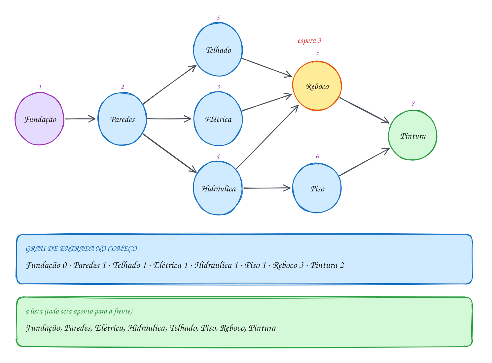</p>

A fila é um vetor: cada vértice entra uma vez, então V posições bastam.

```c
#include <stdio.h>

#define V 8

int main(void) {
    const char *tarefas[V] = {"Elétrica", "Fundação", "Hidráulica", "Paredes",
                              "Piso", "Pintura", "Reboco", "Telhado"};
    int antes[V][V] = {0}; // antes[a][b] = 1: a precisa terminar antes de b
    int regras[][2] = {{1, 3}, {3, 7}, {3, 0}, {3, 2}, {7, 6},
                       {0, 6}, {2, 6}, {2, 4}, {6, 5}, {4, 5}};
    for (int k = 0; k < 10; k++) antes[regras[k][0]][regras[k][1]] = 1;

    int grau[V] = {0}; // quantas tarefas cada uma ainda espera
    for (int a = 0; a < V; a++)
        for (int b = 0; b < V; b++) grau[b] += antes[a][b];

    int fila[V], inicio = 0, fim = 0;
    for (int v = 0; v < V; v++)
        if (grau[v] == 0) fila[fim++] = v; // quem não espera ninguém começa

    int feitas = 0;
    while (inicio < fim) {
        int u = fila[inicio++];
        printf("%d. %s\n", ++feitas, tarefas[u]);
        for (int v = 0; v < V; v++) {
            if (!antes[u][v]) continue;
            grau[v]--;                          // u terminou: v espera uma a menos
            if (grau[v] == 0) fila[fim++] = v;  // v ficou livre
        }
    }
    if (feitas < V) printf("Ciclo: %d tarefas nunca ficaram livres\n", V - feitas);
    return 0;
}
// Saída:
// 1. Fundação
// 2. Paredes
// 3. Elétrica
// 4. Hidráulica
// 5. Telhado
// 6. Piso
// 7. Reboco
// 8. Pintura
```

O laço do fluxograma só pergunta "a fila tem alguém?". O ciclo vem no fim:
quantos saíram, comparado com V.

<p align="center">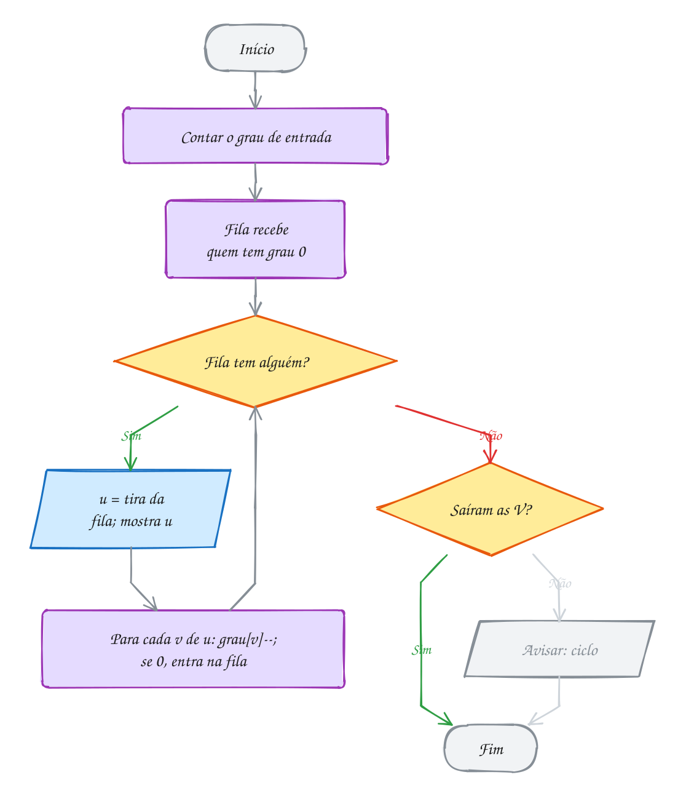</p>

#### Passo a passo

| Sai | Graus que caem | Entram na fila | Fila depois |
| --- | --- | --- | --- |
| (início) | | Fundação | Fundação |
| Fundação | Paredes 1 → 0 | Paredes | Paredes |
| Paredes | Elétrica, Hidráulica e Telhado 1 → 0 | os três | Elétrica, Hidráulica, Telhado |
| Elétrica | Reboco 3 → 2 | | Hidráulica, Telhado |
| Hidráulica | Piso 1 → 0, Reboco 2 → 1 | Piso | Telhado, Piso |
| Telhado | Reboco 1 → 0 | Reboco | Piso, Reboco |
| Piso | Pintura 2 → 1 | | Reboco |
| Reboco | Pintura 1 → 0 | Pintura | Pintura |
| Pintura | | | (vazia) |

O A302 usa o Kahn para contar o mínimo de semestres de um curso.

**Exemplo A301 · Ordem de compilação pela DFS**

```c
#include <stdbool.h>
#include <stdio.h>

#define V 7
enum { BRANCO, CINZA, PRETO };

const char *modulos[V] = {"main", "menu", "estoque", "banco", "relatorio", "util", "log"};
int usa[V][V]; // usa[a][b] = 1: a.c faz #include "b.h" (b precisa estar pronto antes)
int cor[V];
int pos_ordem[V], n_pos; // a ordem em que as chamadas da DFS terminam

bool dfs(int u) {
    cor[u] = CINZA;
    for (int v = 0; v < V; v++) {
        if (!usa[u][v]) continue;
        if (cor[v] == CINZA) {
            printf("Include circular: %s -> %s\n", modulos[u], modulos[v]);
            return false;
        }
        if (cor[v] == BRANCO && !dfs(v)) return false;
    }
    cor[u] = PRETO;
    pos_ordem[n_pos++] = u; // u termina depois de tudo de que ele depende
    return true;
}

void ordem_de_compilacao(void) {
    for (int v = 0; v < V; v++) cor[v] = BRANCO;
    n_pos = 0;
    for (int u = 0; u < V; u++)
        if (cor[u] == BRANCO && !dfs(u)) return;
    printf("Compilar:");
    for (int i = 0; i < n_pos; i++) printf(" %s", modulos[pos_ordem[i]]);
    printf("\n");
}

int main(void) {
    int includes[][2] = {{0, 1}, {0, 4}, {1, 2}, {2, 3}, {4, 2},
                         {4, 5}, {3, 6}, {5, 6}, {2, 5}};
    for (int k = 0; k < 9; k++) usa[includes[k][0]][includes[k][1]] = 1;
    ordem_de_compilacao();

    usa[6][1] = 1; // alguém fez o log incluir o menu
    ordem_de_compilacao();
    return 0;
}
// Saída:
// Compilar: log banco util estoque menu relatorio main
// Include circular: log -> menu
//
// Aqui as setas apontam para quem precisa vir ANTES (a usa b). Por isso a
// própria pós-ordem já é a resposta. Com setas no sentido "a antes de b",
// como na obra do texto, a resposta é a pós-ordem lida de trás para frente.
```

```bash
gcc ~/LPEDC/material/A301.c -o ~/LPEDC/material/A301 && ~/LPEDC/material/A301
```

**Exemplo A302 · Quantos semestres até o TCC**

```c
#include <stdio.h>

#define V 10

int main(void) {
    const char *disc[V] = {"Algoritmos", "Cálculo I", "Cálculo II", "Estruturas", "Banco de Dados",
                           "Redes", "Sist. Operacionais", "Compiladores", "TCC", "Inglês"};
    int pre[V][V] = {0}; // pre[a][b] = 1: a é pré-requisito de b
    int regras[][2] = {{0, 3}, {0, 4}, {1, 2}, {3, 6}, {3, 7},
                       {2, 7}, {6, 5}, {4, 8}, {7, 8}, {5, 8}};
    for (int k = 0; k < 10; k++) pre[regras[k][0]][regras[k][1]] = 1;

    int grau[V] = {0};
    for (int a = 0; a < V; a++)
        for (int b = 0; b < V; b++) grau[b] += pre[a][b];

    // Kahn por rodadas: cada rodada pega TODO mundo que já está liberado
    int atual[V], n_atual = 0;
    for (int v = 0; v < V; v++)
        if (grau[v] == 0) atual[n_atual++] = v;

    int semestre = 0, cursadas = 0;
    while (n_atual > 0) {
        printf("Semestre %d:", ++semestre);
        int prox[V], n_prox = 0;
        for (int i = 0; i < n_atual; i++) {
            int u = atual[i];
            printf("%s %s", i > 0 ? "," : "", disc[u]);
            cursadas++;
            for (int v = 0; v < V; v++)
                if (pre[u][v] && --grau[v] == 0) prox[n_prox++] = v; // libera para a próxima rodada
        }
        printf("\n");
        for (int i = 0; i < n_prox; i++) atual[i] = prox[i];
        n_atual = n_prox;
    }
    if (cursadas < V) printf("Grade com pré-requisito circular!\n");
    else printf("Mínimo: %d semestres\n", semestre);
    return 0;
}
// Saída:
// Semestre 1: Algoritmos, Cálculo I, Inglês
// Semestre 2: Estruturas, Banco de Dados, Cálculo II
// Semestre 3: Sist. Operacionais, Compiladores
// Semestre 4: Redes
// Semestre 5: TCC
// Mínimo: 5 semestres
//
// O número de rodadas é o tamanho do caminho mais longo do DAG, contado em
// vértices: Algoritmos -> Estruturas -> Sist. Operacionais -> Redes -> TCC.
// Nenhuma grade, por mais matérias que você pegue, termina antes disso.
```

```bash
gcc ~/LPEDC/material/A302.c -o ~/LPEDC/material/A302 && ~/LPEDC/material/A302
```

### Exercícios

**Exercício E901** · ★☆☆

A receita de bolo tem oito passos (índices 0 a 7): bater os ovos,
desenformar, despejar na forma, misturar os secos, juntar tudo,
preaquecer o forno, untar a forma e assar. As regras "a antes de b" são:

```text
bater os ovos -> juntar tudo       misturar os secos -> juntar tudo
juntar tudo -> despejar na forma   untar a forma -> despejar na forma
despejar na forma -> assar         preaquecer o forno -> assar
assar -> desenformar
```

Escreva do zero o algoritmo de Kahn (matriz, grau de entrada, fila) e
mostre os passos numerados. Examine os vizinhos em ordem de índice.

```text
Saída esperada:
1. bater os ovos
2. misturar os secos
3. preaquecer o forno
4. untar a forma
5. juntar tudo
6. despejar na forma
7. assar
8. desenformar
```

**Exercício E903** · ★★☆

A equipe de suporte tem sete chamados, #101 a #107 (índices 0 a 6), e alguns
só podem ser resolvidos depois de outros:

```text
#105 -> #101   #105 -> #102   #106 -> #102   #102 -> #103
#107 -> #104   #101 -> #104
```

O Kahn com fila atende na ordem em que os chamados ficam livres. A chefe quer
outra regra: entre os livres, sempre o de MENOR número. Escreva kahn_fila()
(o Kahn com fila) e kahn_menor() (a cada passo, procura o menor índice ainda
não feito com grau de entrada 0). Mostre as duas ordens.

```text
Saída esperada:
Fila:   #105 #106 #107 #101 #102 #104 #103
Menor:  #105 #101 #106 #102 #103 #107 #104
```

**Exercício E904** · ★★☆

Uma obra tem oito serviços (índices 0 a 7, com a duração em dias): Elétrica
5, Fundação 10, Hidráulica 6, Paredes 15, Piso 4, Pintura 6, Reboco 8 e
Telhado 7. As regras "a antes de b" são:

```text
Fundação -> Paredes    Paredes -> Telhado     Paredes -> Elétrica
Paredes -> Hidráulica  Telhado -> Reboco      Elétrica -> Reboco
Hidráulica -> Reboco   Hidráulica -> Piso     Reboco -> Pintura
Piso -> Pintura
```

Com equipes em paralelo, um serviço começa no dia em que o ÚLTIMO dos que ele
espera termina. Escreva o Kahn com fila (vizinhos em ordem de índice) e
mostre, na ordem em que os serviços saem da fila, o dia de início e o de fim
de cada um, o prazo total e o caminho crítico (a corrente de serviços que, se
atrasar um dia, atrasa a obra).

```text
Saída esperada:
Fundação: dia 0 ao 10
Paredes: dia 10 ao 25
Elétrica: dia 25 ao 30
Hidráulica: dia 25 ao 31
Telhado: dia 25 ao 32
Piso: dia 31 ao 35
Reboco: dia 32 ao 40
Pintura: dia 40 ao 46
Obra pronta em 46 dias
Caminho crítico: Fundação -> Paredes -> Telhado -> Reboco -> Pintura
```

**Exercício E906** · ★★★

Quantas ordens diferentes existem para a rotina da manhã? As tarefas são
café, banho, vestir, escovar e sair (índices 0 a 4), com as regras:

```text
banho -> vestir   café -> escovar   vestir -> sair   escovar -> sair
```

Escreva conta(): ela gera TODAS as ordenações topológicas com backtracking
(assunto 0127), mostra cada uma quando mostrar é true e devolve quantas são.
Depois acrescente uma sexta tarefa, ler as mensagens (antes de sair), e peça
só o total.

```text
Saída esperada:
café, banho, vestir, escovar, sair
café, banho, escovar, vestir, sair
café, escovar, banho, vestir, sair
banho, café, vestir, escovar, sair
banho, café, escovar, vestir, sair
banho, vestir, café, escovar, sair
Total com 5 tarefas: 6
Total com 6 tarefas: 30
```

---

## 0152 · Kruskal: árvore geradora mínima

### Conceito

- **Árvore**: grafo conexo e sem ciclo; com V vértices tem **V - 1 arestas**.
- **Árvore geradora mínima** (MST, *minimum spanning tree*): árvore que toca
  todos os vértices de um grafo **não dirigido** ponderado com a menor soma de
  pesos (CORMEN et al., 2024, cap. 21). Não é o caminho mais curto entre dois.
- **Kruskal**: ordene as arestas da mais barata para a mais cara, aceite cada
  uma que **não feche ciclo** e pare com V - 1. É guloso (assunto 0133)
  (KRUSKAL, 1956).
- **Teste do ciclo**: o **union-find** (0148). Se `acha(a)` e `acha(b)` dão o
  mesmo representante, a aresta fecha ciclo; senão, `une` junta os grupos
  (SEDGEWICK; WAYNE, 2011).
- **Custo**: a ordenação domina, O(E log E) = O(E log V); o union-find é quase
  O(1) por operação (CORMEN et al., 2024, cap. 21).
- **Propriedade do corte**: a aresta mais barata que cruza de um grupo ao outro
  (**leve**) é **segura**: entra sem estragar a MST (CORMEN et al., 2024, cap. 21).
- **Empates**: a MST pode não ser única; o custo mínimo é.

> [!WARNING]
> Testar `pai[a] != pai[b]` no lugar de `acha(a) != acha(b)` é o erro clássico:
> `pai` não é o representante. E no `qsort`, `x->custo - y->custo` estoura perto
> de `INT_MAX`; use `(x->custo > y->custo) - (x->custo < y->custo)`.

### Exemplos de uso

A prefeitura quer asfaltar estradas entre seis vilas com o menor custo, a partir
de nove trechos orçados. Verde entrou, vermelho fecharia ciclo e cinza nem foi
olhado, porque as 5 arestas já tinham saído:

<p align="center">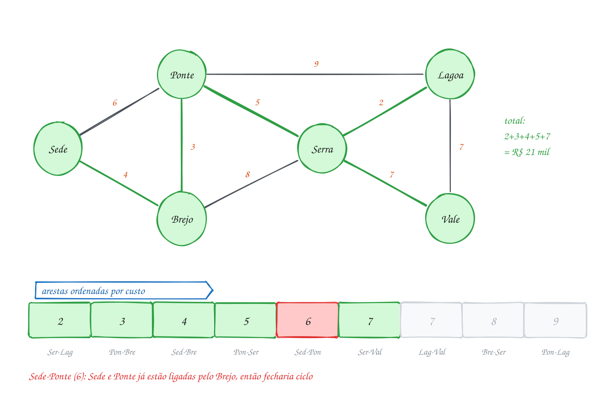</p>

A lista de arestas é ordenada com o `qsort` (assunto 0096); o union-find usa
compressão de caminho e união por tamanho:

```c
#include <stdio.h>
#include <stdlib.h>

#define V 6
#define E 9

typedef struct {
    int a, b, custo; // estrada entre a e b, em R$ mil
} Aresta;

const char *vilas[V] = {"Sede", "Ponte", "Brejo", "Serra", "Lagoa", "Vale"};
int pai[V], tamanho[V];

int acha(int x) { // representante do grupo de x, com compressão de caminho
    if (pai[x] != x) pai[x] = acha(pai[x]);
    return pai[x];
}

void une(int ra, int rb) { // junta dois grupos: o menor pendura no maior
    if (tamanho[ra] < tamanho[rb]) {
        int t = ra;
        ra = rb;
        rb = t;
    }
    pai[rb] = ra;
    tamanho[ra] += tamanho[rb];
}

int compara(const void *p, const void *q) {
    const Aresta *x = p, *y = q;
    if (x->custo != y->custo) return x->custo - y->custo;
    return x->a - y->a; // empate: decide pelo primeiro vértice
}

int main(void) {
    Aresta estradas[E] = {{0, 2, 4}, {1, 2, 3}, {0, 1, 6}, {2, 3, 8}, {1, 3, 5},
                          {1, 4, 9}, {3, 4, 2}, {3, 5, 7}, {4, 5, 7}};
    qsort(estradas, E, sizeof(Aresta), compara); // 1) da mais barata à mais cara

    for (int v = 0; v < V; v++) { // 2) cada vila começa sozinha
        pai[v] = v;
        tamanho[v] = 1;
    }

    int total = 0, aceitas = 0;
    for (int k = 0; k < E && aceitas < V - 1; k++) { // 3) uma árvore tem V - 1 arestas
        Aresta e = estradas[k];
        int ra = acha(e.a), rb = acha(e.b);
        printf("%s-%s (%d): ", vilas[e.a], vilas[e.b], e.custo);
        if (ra == rb) {
            printf("fecha ciclo\n"); // as duas pontas já estão ligadas
            continue;
        }
        une(ra, rb);
        total += e.custo;
        aceitas++;
        printf("aceita\n");
    }
    printf("Total: R$ %d mil em %d estradas\n", total, aceitas);
    return 0;
}
// Saída:
// Serra-Lagoa (2): aceita
// Ponte-Brejo (3): aceita
// Sede-Brejo (4): aceita
// Ponte-Serra (5): aceita
// Sede-Ponte (6): fecha ciclo
// Serra-Vale (7): aceita
// Total: R$ 21 mil em 5 estradas
```

O laço do fluxograma sai ao acabar a lista ou ao completar V - 1 arestas; o
union-find decide cada aresta:

<p align="center">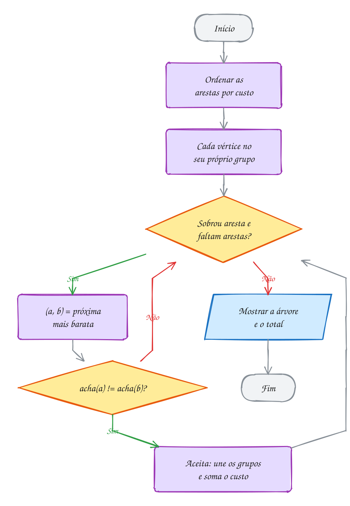</p>

#### Passo a passo

A Sede-Ponte chega quando as duas já estão no mesmo grupo, ligadas pelo
Brejo:

| Aresta | `acha` das pontas | Decisão | Grupos depois |
| --- | --- | --- | --- |
| (início) | | | {Sede} {Ponte} {Brejo} {Serra} {Lagoa} {Vale} |
| Serra-Lagoa 2 | diferentes | aceita | {Serra, Lagoa}, os outros sozinhos |
| Ponte-Brejo 3 | diferentes | aceita | {Ponte, Brejo} {Serra, Lagoa} {Sede} {Vale} |
| Sede-Brejo 4 | diferentes | aceita | {Sede, Ponte, Brejo} {Serra, Lagoa} {Vale} |
| Ponte-Serra 5 | diferentes | aceita | {Sede, Ponte, Brejo, Serra, Lagoa} {Vale} |
| Sede-Ponte 6 | **iguais** | ciclo | (igual) |
| Serra-Vale 7 | diferentes | aceita | todas juntas: 5 arestas, para |

Lagoa-Vale também custa 7: se viesse antes, entraria no lugar de Serra-Vale,
com o **mesmo total**.

**Exemplo A303 · Kruskal parado no meio: três regiões de entrega**

```c
#include <stdio.h>
#include <stdlib.h>

#define N 8
#define K 3 // quantas regiões a transportadora quer

typedef struct {
    int a, b, dist;
} Aresta;

const char *clientes[N] = {"Ana", "Bruno", "Carla", "Davi", "Edu", "Fê", "Gabi", "Hélio"};
int x[N] = {1, 2, 3, 10, 11, 12, 5, 6}; // posição no mapa, em quadras
int y[N] = {1, 3, 1, 2, 4, 1, 10, 12};
int pai[N];

int acha(int v) {
    if (pai[v] != v) pai[v] = acha(pai[v]);
    return pai[v];
}

int compara(const void *p, const void *q) {
    const Aresta *e = p, *f = q;
    return e->dist - f->dist;
}

int main(void) {
    Aresta pares[N * (N - 1) / 2]; // grafo completo: todo par de clientes
    int m = 0;
    for (int i = 0; i < N; i++)
        for (int j = i + 1; j < N; j++)
            pares[m++] = (Aresta){i, j, abs(x[i] - x[j]) + abs(y[i] - y[j])}; // quadras andando
    qsort(pares, m, sizeof(Aresta), compara);

    for (int v = 0; v < N; v++) pai[v] = v;
    int grupos = N, k = 0;
    while (grupos > K) { // Kruskal normal, mas para com K grupos em vez de 1
        int ra = acha(pares[k].a), rb = acha(pares[k].b);
        if (ra != rb) {
            pai[rb] = ra;
            grupos--;
        }
        k++;
    }
    while (acha(pares[k].a) == acha(pares[k].b)) k++; // a próxima que juntaria duas regiões

    int regiao = 0;
    for (int v = 0; v < N; v++) {
        if (acha(v) != v) continue; // só os representantes abrem uma região
        printf("Região %d:", ++regiao);
        for (int w = 0; w < N; w++)
            if (acha(w) == v) printf(" %s", clientes[w]);
        printf("\n");
    }
    printf("Distância mínima entre regiões: %d quadras (%s e %s)\n", pares[k].dist,
           clientes[pares[k].a], clientes[pares[k].b]);
    return 0;
}
// Saída:
// Região 1: Ana Bruno Carla
// Região 2: Davi Edu Fê
// Região 3: Gabi Hélio
// Distância mínima entre regiões: 8 quadras (Carla e Davi)
//
// Parar o Kruskal com K grupos dá o agrupamento em que as regiões ficam o
// mais afastadas possível umas das outras: as arestas que faltam são
// justamente as mais longas.
```

```bash
gcc ~/LPEDC/material/A303.c -o ~/LPEDC/material/A303 && ~/LPEDC/material/A303
```

**Exemplo A304 · A árvore de MAIOR soma: o melhor sinal do Wi-Fi mesh**

```c
#include <stdio.h>
#include <stdlib.h>

#define V 6
#define E 10

typedef struct {
    int a, b, sinal; // qualidade do sinal entre dois roteadores, de 0 a 100
} Link;

const char *pontos[V] = {"Sala", "Cozinha", "Quarto", "Escritório", "Varanda", "Garagem"};
int pai[V];

int acha(int v) {
    if (pai[v] != v) pai[v] = acha(pai[v]);
    return pai[v];
}

int do_maior(const void *p, const void *q) { // ordem DECRESCENTE
    const Link *x = p, *y = q;
    return y->sinal - x->sinal;
}

int main(void) {
    Link links[E] = {{0, 1, 92}, {0, 2, 70}, {0, 3, 85}, {1, 2, 40}, {1, 4, 66},
                     {2, 3, 88}, {3, 4, 35}, {4, 5, 58}, {1, 5, 61}, {2, 5, 20}};
    qsort(links, E, sizeof(Link), do_maior);

    for (int v = 0; v < V; v++) pai[v] = v;
    int soma = 0, pior = 100, usados = 0;
    for (int k = 0; k < E && usados < V - 1; k++) {
        int ra = acha(links[k].a), rb = acha(links[k].b);
        if (ra == rb) continue; // já tem caminho melhor entre os dois
        pai[rb] = ra;
        usados++;
        soma += links[k].sinal;
        if (links[k].sinal < pior) pior = links[k].sinal;
        printf("%s - %s: %d\n", pontos[links[k].a], pontos[links[k].b], links[k].sinal);
    }
    printf("Soma dos sinais: %d; elo mais fraco: %d\n", soma, pior);
    return 0;
}
// Saída:
// Sala - Cozinha: 92
// Quarto - Escritório: 88
// Sala - Escritório: 85
// Cozinha - Varanda: 66
// Cozinha - Garagem: 61
// Soma dos sinais: 392; elo mais fraco: 61
//
// Basta inverter a ordem do qsort. Bônus: o elo mais fraco desta árvore é o
// maior possível. Nenhuma outra árvore que liga a casa toda tem todos os
// links com sinal acima de 61.
```

```bash
gcc ~/LPEDC/material/A304.c -o ~/LPEDC/material/A304 && ~/LPEDC/material/A304
```

### Exercícios

**Exercício E907** · ★☆☆

A horta comunitária vai levar água a cinco canteiros com mangueira. Os
trechos possíveis já vêm em ordem crescente de metros:

```text
Alface-Couve 2, Tomate-Ervas 3, Alface-Tomate 4, Couve-Tomate 5,
Cenoura-Ervas 6, Couve-Cenoura 8, Alface-Ervas 9
```

Escreva o Kruskal do zero, sem union-find: guarde em grupo[v] o número
do grupo de cada canteiro (começa com grupo[v] = v). Uma aresta entre
grupos iguais fecharia ciclo; entre grupos diferentes, aceite e passe
todo o grupo de b para o grupo de a.

```text
Saída esperada:
Alface-Couve (2 m)
Tomate-Ervas (3 m)
Alface-Tomate (4 m)
Cenoura-Ervas (6 m)
Mangueira total: 15 m
```

**Exercício E909** · ★★☆

Seis vilas (Sede, Ponte, Brejo, Serra, Lagoa e Vale, índices 0 a 5) podem ser
ligadas por estas estradas, com o custo em R$ mil:

```text
Sede-Brejo 4   Ponte-Brejo 3   Sede-Ponte 6   Brejo-Serra 8
Ponte-Serra 5  Ponte-Lagoa 9   Serra-Lagoa 2  Serra-Vale 7
Lagoa-Vale 7
```

O prefeito prometeu asfaltar a estrada Sede-Ponte, que o Kruskal descartaria.
Escreva o Kruskal que monte a árvore mais barata que CONTENHA essa estrada
(no empate de custo, vale a ordem da lista) e mostre quanto a promessa custou
a mais que a árvore mínima sem a exigência.

```text
Saída esperada:
Sede-Ponte (6) obrigatória
Serra-Lagoa (2)
Ponte-Brejo (3)
Ponte-Serra (5)
Serra-Vale (7)
Total: R$ 23 mil
Custo extra da exigência: R$ 2 mil
```

**Exercício E910** · ★★☆

Oito sítios (índices 0 a 7: Ipê, Buriti, Jatobá, Pequi, Aroeira, Babaçu,
Cedro e Juçara) querem dividir o custo de puxar cabo de energia. Os trechos
possíveis, em km, são:

```text
Ipê-Jatobá 3   Jatobá-Aroeira 4  Ipê-Aroeira 6    Aroeira-Cedro 2
Jatobá-Cedro 5 Buriti-Pequi 7    Pequi-Babaçu 1   Babaçu-Juçara 3
Buriti-Juçara 4  Pequi-Juçara 2
```

Um rio sem ponte separa os dois grupos de quatro sítios, então não existe
árvore que ligue todos: o resultado é uma FLORESTA, uma árvore mínima por
margem. Escreva o Kruskal que funciona nesse caso e mostre cada rede (os
sítios em ordem de índice e o total de km dela), listando as redes pela ordem
do primeiro sítio de cada uma.

```text
Saída esperada:
Rede 1 (Ipê Jatobá Aroeira Cedro): 9 km
Rede 2 (Buriti Pequi Babaçu Juçara): 7 km
Sem travessia: 2 redes separadas, 6 cabos, 16 km
```

**Exercício E911** · ★★★

O parque de diversões vai ligar seis atrações com os trilhos de um trenzinho,
gastando o mínimo. As atrações (índices 0 a 5) são Entrada, Carrossel, Roda,
Lago, Castelo e Montanha. Os trilhos possíveis, com o custo em R$ mil, na
ordem em que foram levantados:

```text
Entrada-Carrossel 4  Roda-Lago 5        Carrossel-Lago 6
Entrada-Roda 7       Lago-Castelo 8     Castelo-Montanha 9
Roda-Montanha 10     Carrossel-Castelo 11  Entrada-Montanha 12
```

Escreva o Kruskal: ordene as arestas por custo com qsort, use union-find
(vetor pai[] e função acha com compressão de caminho) e ligue as RAÍZES dos
dois grupos a cada aresta aceita. Pare quando houver V - 1 trilhos e mostre
cada um, na ordem em que entra, e o total.

```text
Saída esperada:
Entrada-Carrossel (4)
Roda-Lago (5)
Carrossel-Lago (6)
Lago-Castelo (8)
Castelo-Montanha (9)
Total: R$ 32 mil
```

---

## 0153 · Prim: a árvore que cresce

### Conceito

- **Prim**: sai de um vértice e, a cada passo, escolhe a aresta mais leve entre
  um vértice da árvore e um de fora. Mantém **uma árvore só**, que cresce da
  origem; o Kruskal junta florestas (PRIM, 1957).
- **Por que acerta**: é guloso e vale a propriedade do corte (0152)
  (CORMEN et al., 2024, cap. 21).
- **Heap de mínimo** (0102): cada item diz "dá para ligar `v` com `chave` a
  partir de `de`". Quando um vértice entra, as arestas que saem dele entram no
  heap.
- **Versão preguiçosa**: item cujo vértice já está na árvore é **descartado**;
  nada se atualiza dentro do heap (SEDGEWICK; WAYNE, 2011).
- **Versão do Cormen** (`MST-PRIM`): todos os vértices no heap com chave
  infinita, e `DECREASE-KEY` baixa a chave no lugar. Com heap binário, as duas
  custam O(E log V) (CORMEN et al., 2024, cap. 21).
- **Prim e Dijkstra** (0112): mesmo código, muda a chave de quem entra no heap.

| | chave de `w` ao sair de `v` | o que a árvore minimiza |
| --- | --- | --- |
| Prim | `cano[v][w]` | a soma de **todos** os canos |
| Dijkstra | `dist[v] + cano[v][w]` | a distância de **cada** casa até o Poço |

> [!WARNING]
> Sem `if (na_rede[it.v]) continue;`, o total soma cano que ninguém instala
> (aqui, 49 m). Sem `!na_rede[w]`, o heap enche de itens inúteis e `CAP` pode
> estourar. Prim e Kruskal só valem para grafo **não dirigido**.

### Exemplos de uso

Cinco chácaras vão dividir a água de um poço com o mínimo de cano. Os números
são a ordem de entrada na rede, as arestas verdes são os canos escolhidos, e à
direita está o heap logo depois que a Ana entra:

<p align="center">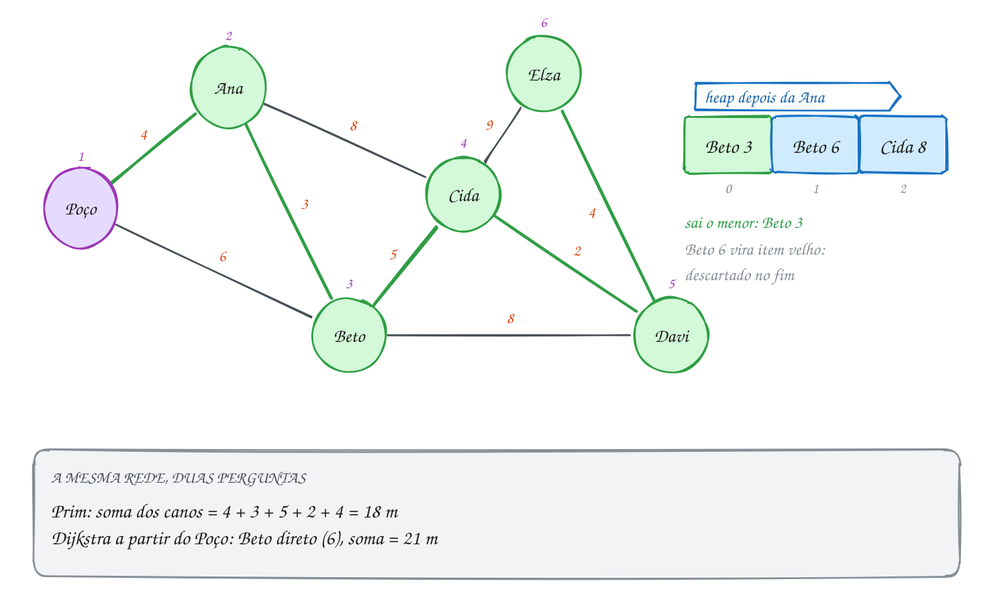</p>

O heap guarda structs e compara pela `chave`, com `sobe` e `desce` do
assunto 0102 em sinais trocados:

```c
#include <stdbool.h>
#include <stdio.h>

#define V 6
#define CAP 32 // cada aresta entra no heap no máximo duas vezes

typedef struct {
    int chave, v, de; // "dá para ligar v à rede com chave metros, a partir de de"
} Item;

Item heap[CAP];
int n = 0;

void troca(int i, int j) {
    Item t = heap[i];
    heap[i] = heap[j];
    heap[j] = t;
}

void insere(Item x) { // heap de MÍNIMO: sobe enquanto for menor que o pai
    int i = n++;
    heap[i] = x;
    while (i > 0 && heap[(i - 1) / 2].chave > heap[i].chave) {
        troca(i, (i - 1) / 2);
        i = (i - 1) / 2;
    }
}

Item tira(void) { // tira o menor e desce o último pelo menor filho
    Item menor = heap[0];
    heap[0] = heap[--n];
    int i = 0;
    while (2 * i + 1 < n) {
        int f = 2 * i + 1;
        if (f + 1 < n && heap[f + 1].chave < heap[f].chave) f++;
        if (heap[i].chave <= heap[f].chave) break;
        troca(i, f);
        i = f;
    }
    return menor;
}

int main(void) {
    const char *nomes[V] = {"Poço", "Ana", "Beto", "Cida", "Davi", "Elza"};
    int cano[V][V] = {0}; // metros; 0 = sem caminho para cano
    int trechos[][3] = {{0, 1, 4}, {0, 2, 6}, {1, 2, 3}, {1, 3, 8}, {2, 3, 5},
                        {2, 4, 8}, {3, 4, 2}, {3, 5, 9}, {4, 5, 4}};
    for (int k = 0; k < 9; k++) {
        cano[trechos[k][0]][trechos[k][1]] = trechos[k][2];
        cano[trechos[k][1]][trechos[k][0]] = trechos[k][2];
    }

    bool na_rede[V] = {false};
    int total = 0;
    insere((Item){0, 0, -1}); // começa pelo Poço, de graça
    while (n > 0) {
        Item it = tira();
        if (na_rede[it.v]) { // já entrou por um cano mais curto
            printf("  descarta %s (%d)\n", nomes[it.v], it.chave);
            continue;
        }
        na_rede[it.v] = true;
        total += it.chave;
        if (it.de >= 0) printf("%s <- %s (%d m)\n", nomes[it.v], nomes[it.de], it.chave);
        for (int w = 0; w < V; w++) // candidatos novos: canos que saem de v
            if (cano[it.v][w] && !na_rede[w]) insere((Item){cano[it.v][w], w, it.v});
    }
    printf("Total: %d m de cano\n", total);
    return 0;
}
// Saída:
// Ana <- Poço (4 m)
// Beto <- Ana (3 m)
// Cida <- Beto (5 m)
// Davi <- Cida (2 m)
// Elza <- Davi (4 m)
//   descarta Beto (6)
//   descarta Cida (8)
//   descarta Davi (8)
//   descarta Elza (9)
// Total: 18 m de cano
```

O fluxograma é o laço do Dijkstra com heap. "Já está na rede?" descarta os
itens velhos:

<p align="center">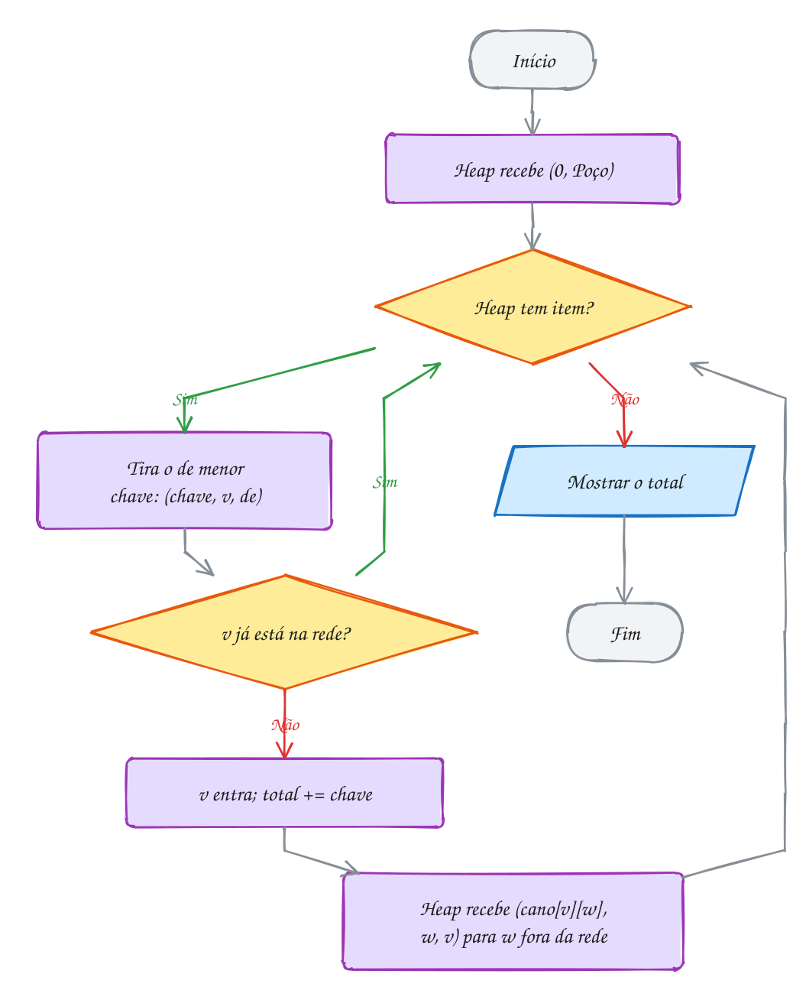</p>

#### Passo a passo

| Entra | Itens que entram no heap | Heap depois (do menor) |
| --- | --- | --- |
| Poço (0) | Ana 4, Beto 6 | Ana 4, Beto 6 |
| Ana (4) | Beto 3, Cida 8 | Beto 3, Beto 6, Cida 8 |
| Beto (3) | Cida 5, Davi 8 | Cida 5, Beto 6, Cida 8, Davi 8 |
| Cida (5) | Davi 2, Elza 9 | Davi 2, Beto 6, Cida 8, Davi 8, Elza 9 |
| Davi (2) | Elza 4 | Elza 4, Beto 6, Cida 8, Davi 8, Elza 9 |
| Elza (4) | | sobram 4 itens velhos, todos descartados |

O Dijkstra a partir do Poço ligaria o Beto direto ao Poço (6 m, contra 7 pela
Ana) e gastaria **21 m**; o Prim gasta **18 m**. Outra pergunta, outra árvore.

**Exemplo A305 · Prim sem heap: fiação dos postes de um loteamento**

```c
#include <math.h>
#include <stdbool.h>
#include <stdio.h>

#define N 7

int main(void) {
    // posição de cada poste, em metros; qualquer poste pode ligar em qualquer outro
    double x[N] = {0, 30, 62, 10, 45, 82, 25};
    double y[N] = {0, 10, 0, 40, 35, 28, 70};

    double chave[N]; // o fio mais curto conhecido que liga o poste à rede
    int pai[N];
    bool na_rede[N] = {false};
    for (int v = 0; v < N; v++) {
        chave[v] = INFINITY; // da math.h: maior que qualquer double
        pai[v] = -1;
    }
    chave[0] = 0; // o transformador fica no poste 0

    double total = 0;
    for (int passo = 0; passo < N; passo++) {
        int u = -1;
        for (int v = 0; v < N; v++) // O(V): procura a menor chave num vetor
            if (!na_rede[v] && (u == -1 || chave[v] < chave[u])) u = v;
        na_rede[u] = true;
        total += chave[u];
        if (pai[u] != -1) printf("poste %d - poste %d: %.1f m\n", pai[u], u, chave[u]);
        for (int v = 0; v < N; v++) {
            if (na_rede[v]) continue;
            double d = hypot(x[u] - x[v], y[u] - y[v]); // distância em linha reta
            if (d < chave[v]) {
                chave[v] = d; // Prim: só o fio, sem somar o caminho até o transformador
                pai[v] = u;
            }
        }
    }
    printf("Fio total: %.1f m\n", total);
    return 0;
}
// Saída:
// poste 0 - poste 1: 31.6 m
// poste 1 - poste 4: 29.2 m
// poste 1 - poste 2: 33.5 m
// poste 2 - poste 5: 34.4 m
// poste 4 - poste 3: 35.4 m
// poste 3 - poste 6: 33.5 m
// Fio total: 197.6 m
//
// Num grafo completo, E é quase V²/2. O heap custaria O(E log V); o vetor,
// O(V²). Aqui o Prim sem heap é o mais rápido, e nem precisa guardar as
// arestas: a distância é calculada na hora.
```

```bash
gcc ~/LPEDC/material/A305.c -o ~/LPEDC/material/A305 -lm && ~/LPEDC/material/A305
```

**Exemplo A306 · Prim e Dijkstra: a mesma função, uma linha diferente**

```c
#include <limits.h>
#include <stdbool.h>
#include <stdio.h>

#define V 5
#define INFINITO INT_MAX

const char *salas[V] = {"Servidor", "Recepção", "Vendas", "Estoque", "Diretoria"};
int cabo[V][V]; // metros de cabo entre duas salas; 0 = sem passagem

// dijkstra = false: Prim (árvore de menor soma de cabo)
// dijkstra = true:  Dijkstra (cada sala o mais perto possível do servidor)
void arvore(bool dijkstra) {
    int chave[V], pai[V];
    bool pronto[V] = {false};
    for (int v = 0; v < V; v++) {
        chave[v] = INFINITO;
        pai[v] = -1;
    }
    chave[0] = 0;
    for (int passo = 0; passo < V; passo++) {
        int u = -1;
        for (int v = 0; v < V; v++)
            if (!pronto[v] && chave[v] != INFINITO && (u == -1 || chave[v] < chave[u])) u = v;
        if (u == -1) break;
        pronto[u] = true;
        for (int v = 0; v < V; v++) {
            if (!cabo[u][v] || pronto[v]) continue;
            int nova = dijkstra ? chave[u] + cabo[u][v] : cabo[u][v]; // A linha que muda
            if (nova < chave[v]) {
                chave[v] = nova;
                pai[v] = u;
            }
        }
    }
    int soma = 0;
    printf("%s:", dijkstra ? "Dijkstra" : "Prim");
    for (int v = 1; v < V; v++) {
        printf(" %s-%s", salas[pai[v]], salas[v]);
        soma += cabo[pai[v]][v];
    }
    printf("\n  cabo instalado: %d m\n", soma);
    printf("  distância de cada sala ao servidor pela árvore:");
    for (int v = 1; v < V; v++) {
        int d = 0;
        for (int w = v; pai[w] != -1; w = pai[w]) d += cabo[pai[w]][w];
        printf(" %d", d);
    }
    printf("\n");
}

int main(void) {
    int trechos[][3] = {{0, 1, 10}, {0, 2, 14}, {0, 3, 20}, {1, 2, 5},
                        {2, 3, 7}, {3, 4, 6}, {1, 4, 25}, {0, 4, 24}};
    for (int k = 0; k < 8; k++) {
        cabo[trechos[k][0]][trechos[k][1]] = trechos[k][2];
        cabo[trechos[k][1]][trechos[k][0]] = trechos[k][2];
    }
    arvore(false);
    arvore(true);
    return 0;
}
// Saída:
// Prim: Servidor-Recepção Recepção-Vendas Vendas-Estoque Estoque-Diretoria
//   cabo instalado: 28 m
//   distância de cada sala ao servidor pela árvore: 10 15 22 28
// Dijkstra: Servidor-Recepção Servidor-Vendas Servidor-Estoque Servidor-Diretoria
//   cabo instalado: 68 m
//   distância de cada sala ao servidor pela árvore: 10 14 20 24
//
// O Prim gasta 40 m a menos de cabo; o Dijkstra deixa cada sala com o
// caminho mais curto até o servidor (a Diretoria fica a 24 m, contra 28).
// Qual é "melhor" depende da pergunta: custo da obra ou atraso do sinal.
```

```bash
gcc ~/LPEDC/material/A306.c -o ~/LPEDC/material/A306 && ~/LPEDC/material/A306
```

### Exercícios

**Exercício E913** · ★☆☆

Na orla, um gerador vai alimentar quatro quiosques: Coco, Pastel, Açaí e
Milho. A matriz tem os metros de cabo de cada trecho possível (0 quer dizer
"não dá para passar cabo"):

```text
            Gerador  Coco  Pastel  Açaí  Milho
Gerador        0      12     20     25     0
Coco          12       0      9      0    30
Pastel        20       9      0      6    15
Açaí          25       0      6      0    11
Milho          0      30     15     11     0
```

Escreva o Prim sem heap, em O(V²), a partir do Gerador: vetores chave[],
pai[] e na_rede[]; a cada passo, entra o vértice fora da rede com a menor
chave. Mostre cada cabo na ordem em que entra e o total.

```text
Saída esperada:
Gerador - Coco: 12 m
Coco - Pastel: 9 m
Pastel - Açaí: 6 m
Açaí - Milho: 11 m
Total: 38 m
```

**Exercício E915** · ★★☆

Seis estações de bicicleta (índices 0 a 5: Rodoviária, Praça, Museu, Orla,
Feira e Estádio) podem ser ligadas por ciclovias de mão dupla, com a
distância em km:

```text
Rodoviária-Praça 5   Rodoviária-Feira 3   Praça-Museu 4   Praça-Feira 6
Museu-Orla 2         Feira-Orla 7         Orla-Estádio 8  Museu-Estádio 9
Feira-Estádio 10
```

Começar o Prim por outra estação muda alguma coisa? Escreva prim(origem), na
versão sem heap (O(V²)), que mostra a origem, a ordem em que as estações
entram na rede e o total, e chame-a para cada uma das seis origens.

```text
Saída esperada:
Rodoviária: Rodoviária Feira Praça Museu Orla Estádio | 22
Praça: Praça Museu Orla Rodoviária Feira Estádio | 22
Museu: Museu Orla Praça Rodoviária Feira Estádio | 22
Orla: Orla Museu Praça Rodoviária Feira Estádio | 22
Feira: Feira Rodoviária Praça Museu Orla Estádio | 22
Estádio: Estádio Orla Museu Praça Rodoviária Feira | 22
```

**Exercício E916** · ★★☆

A operadora de internet vai levar fibra da Central a sete pontos do bairro.
Os pontos (índices 0 a 7) são Central, Padaria, Escola, Igreja, Farmácia,
Praça, Posto e Clínica. Os trechos possíveis, em km:

```text
Central-Padaria 2   Central-Escola 4   Padaria-Escola 3   Padaria-Igreja 5
Escola-Farmácia 2   Igreja-Praça 1     Farmácia-Praça 6   Escola-Posto 7
Farmácia-Clínica 3  Posto-Clínica 2    Central-Posto 9
```

Escreva o Prim a partir da Central, guardando o pai de cada ponto em pai[].
Depois escreva a função recursiva mostra(v, nivel), que imprime a árvore como
um organograma: cada ponto com 2 espaços de recuo por nível e, entre
parênteses, os km da fibra que o liga ao pai. Os filhos de um ponto aparecem
em ordem de índice, logo abaixo dele. Termine com o total.

```text
Saída esperada:
Central
  Padaria (2)
    Escola (3)
      Farmácia (2)
        Clínica (3)
          Posto (2)
    Igreja (5)
      Praça (1)
Total: 18 km
```

**Exercício E917** · ★★★

Quatro casas de um sítio precisam de água. Cada casa pode cavar o próprio
poço (Ana R$ 8 mil, Beto 5, Cida 9, Davi 7) ou receber cano de uma casa
vizinha que já tem água. Os canos possíveis (R$ mil):

```text
Ana-Beto 2, Beto-Cida 3, Cida-Davi 9, Ana-Davi 10, Ana-Cida 10
```

Qual a solução mais barata? Crie um vértice imaginário, a "Água" (índice 0),
ligado a cada casa por uma aresta com o custo do poço dela: cavar um poço
vira "ligar a casa na Água", e o problema vira uma árvore geradora mínima
comum. Escreva o programa com Prim a partir da Água e mostre a decisão de
cada casa, na ordem em que entram.

```text
Saída esperada:
Beto: cava poço (R$ 5 mil)
Ana: cano de Beto (R$ 2 mil)
Cida: cano de Beto (R$ 3 mil)
Davi: cava poço (R$ 7 mil)
Total: R$ 17 mil (2 poços)
```

---

## 0154 · Bellman-Ford: pesos negativos

### Conceito

- **Peso negativo**: o Dijkstra (0112) quebra, porque fixa um vértice cedo
  supondo que somar pesos só aumenta (CORMEN et al., 2024, cap. 22).
- **Relaxar** a aresta `u -> v` de custo `c`: se `dist[u] + c < dist[v]`,
  atualize `dist[v]` e `anterior[v]` (no Cormen, `RELAX`, com `v.d` e `v.π`)
  (CORMEN et al., 2024, cap. 22).
- **Bellman-Ford**: `dist[origem] = 0`, INFINITO no resto, e **V - 1 rodadas**
  relaxando **todas** as arestas, sem escolher o menor (BELLMAN, 1958).
- **Por que V - 1**: um caminho mínimo não repete vértice, tem até V - 1
  arestas, e a rodada `i` acerta a `i`-ésima. Rodada sem mudança permite parar.
- **Ciclo negativo**: circuito de soma menor que zero; acaba com o caminho
  mínimo. Uma **rodada extra** que ainda melhora alguma aresta o detecta
  (CORMEN et al., 2024, cap. 22).
- **Custo**: O(V · E), contra O((V + E) log V) do Dijkstra com heap. Num DAG,
  relaxar cada aresta uma vez na ordem topológica (0151) dá O(V + E), mesmo com
  negativos (CORMEN et al., 2024, cap. 22).

> [!WARNING]
> O teste `dist[u] != INFINITO` é obrigatório: `INT_MAX + (-4)` **não** estoura,
> e um vértice inalcançável "melhora" outro com distância falsa. Em grafo **não
> dirigido**, uma aresta negativa já é um ciclo negativo (ir e voltar).

### Exemplos de uso

Um motoboy vai da Base para Casa, e alguns trechos pagam mais que a gasolina:
do Shopping ao Centro o **custo líquido** é R$ -4. O Dijkstra diria R$ 12 até
Casa; o certo é R$ 10. As setas mostram o custo, cada lugar a `dist` final, e
embaixo o vetor `dist` a cada rodada:

<p align="center">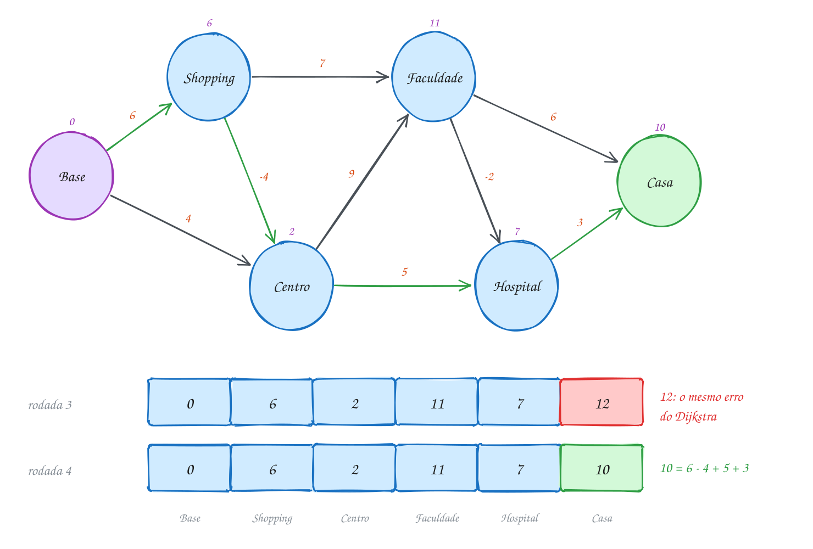</p>

A lista de arestas começa de propósito pelas que chegam em Casa, para as
rodadas aparecerem.

```c
#include <stdbool.h>
#include <stdio.h>

#define V 6
#define E 9
#define INFINITO 1000000000 // folgado: INFINITO + peso ainda cabe num int

typedef struct {
    int de, para, custo; // custo líquido em R$: gasolina menos o que a corrida paga
} Trecho;

const char *lugares[V] = {"Base", "Shopping", "Centro", "Faculdade", "Hospital", "Casa"};

int main(void) {
    Trecho t[E] = {{4, 5, 3}, {3, 5, 6}, {3, 4, -2}, {2, 3, 9}, {2, 4, 5},
                   {1, 3, 7}, {1, 2, -4}, {0, 2, 4}, {0, 1, 6}};
    int dist[V], anterior[V];
    for (int v = 0; v < V; v++) {
        dist[v] = INFINITO;
        anterior[v] = -1;
    }
    dist[0] = 0;

    for (int rodada = 1; rodada <= V - 1; rodada++) { // no máximo V - 1 rodadas
        bool mudou = false;
        for (int k = 0; k < E; k++) { // relaxa TODAS as arestas, em qualquer ordem
            int u = t[k].de, v = t[k].para;
            if (dist[u] != INFINITO && dist[u] + t[k].custo < dist[v]) {
                dist[v] = dist[u] + t[k].custo;
                anterior[v] = u;
                mudou = true;
            }
        }
        printf("rodada %d:", rodada);
        for (int v = 0; v < V; v++) {
            if (dist[v] == INFINITO) printf(" ∞");
            else printf(" %d", dist[v]);
        }
        printf("\n");
        if (!mudou) break; // nada mudou: as próximas rodadas também não mudariam
    }

    for (int k = 0; k < E; k++) // rodada extra: se ainda melhora, há ciclo negativo
        if (dist[t[k].de] != INFINITO && dist[t[k].de] + t[k].custo < dist[t[k].para]) {
            printf("Ciclo negativo: dá para lucrar sem fim\n");
            return 0;
        }

    int rota[V], n = 0;
    for (int v = 5; v != -1; v = anterior[v]) rota[n++] = v;
    printf("Até Casa (R$ %d):", dist[5]);
    for (int i = n - 1; i >= 0; i--) printf(" %s%s", lugares[rota[i]], i > 0 ? " ->" : "");
    printf("\n");
    return 0;
}
// Saída:
// rodada 1: 0 6 4 ∞ ∞ ∞
// rodada 2: 0 6 2 13 9 ∞
// rodada 3: 0 6 2 11 7 12
// rodada 4: 0 6 2 11 7 10
// rodada 5: 0 6 2 11 7 10
// Até Casa (R$ 10): Base -> Shopping -> Centro -> Hospital -> Casa
```

O fluxograma não escolhe o menor: rodadas por fora, arestas por dentro, com
saída sem mudança ou após V - 1 rodadas. Depois vem a rodada extra:

<p align="center">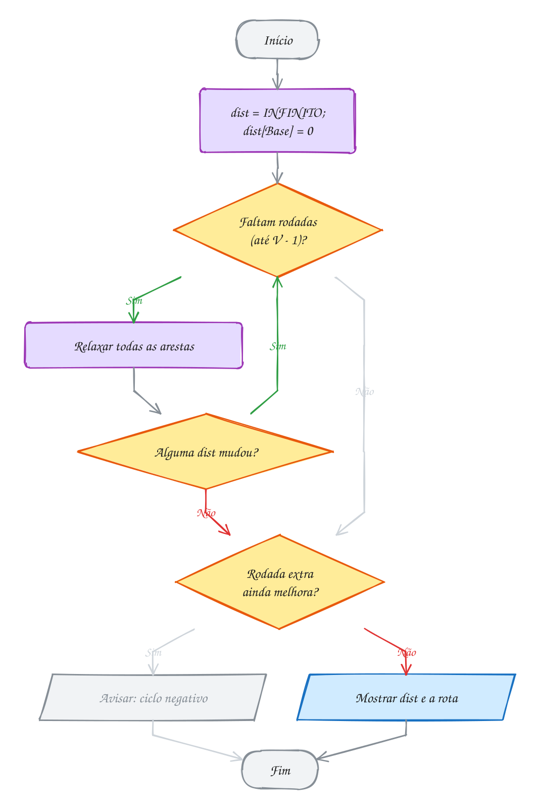</p>

#### Passo a passo

A Casa aparece com 12 na rodada 3 (o valor errado do Dijkstra) e cai para 10
na rodada 4, quando a melhora do Centro chega até ela:

| Rodada | O que muda | Base | Shopping | Centro | Faculdade | Hospital | Casa |
| --- | --- | --- | --- | --- | --- | --- | --- |
| início | | 0 | ∞ | ∞ | ∞ | ∞ | ∞ |
| 1 | só as arestas que saem da Base | 0 | 6 | 4 | ∞ | ∞ | ∞ |
| 2 | Centro cai para 6 - 4 = 2 | 0 | 6 | 2 | 13 | 9 | ∞ |
| 3 | o 2 do Centro chega em Faculdade e Hospital | 0 | 6 | 2 | 11 | 7 | 12 |
| 4 | Casa via Hospital: 7 + 3 | 0 | 6 | 2 | 11 | 7 | 10 |
| 5 | nada muda: para | 0 | 6 | 2 | 11 | 7 | 10 |

Com as arestas da Base primeiro na lista, uma rodada já bastaria (A308).

**Exemplo A307 · Ciclo negativo no câmbio: dinheiro que se multiplica**

```c
#include <math.h>
#include <stdio.h>

#define V 4
#define E 10

typedef struct {
    int de, para;
    double taxa; // 1 unidade de "de" vira taxa unidades de "para"
} Troca;

const char *moedas[V] = {"Real", "Dólar", "Euro", "Peso"};

int main(void) {
    Troca t[E] = {{0, 1, 0.20}, {1, 0, 4.95}, {1, 2, 0.92}, {2, 1, 1.07}, {2, 0, 5.45},
                  {0, 2, 0.18}, {0, 3, 180}, {3, 0, 0.0054}, {1, 3, 880}, {3, 1, 0.0011}};

    // multiplicar taxas vira somar logaritmos; "ganhar" (produto > 1) vira soma < 0
    double dist[V];
    int anterior[V];
    for (int v = 0; v < V; v++) {
        dist[v] = INFINITY;
        anterior[v] = -1;
    }
    dist[0] = 0;
    for (int rodada = 1; rodada <= V - 1; rodada++)
        for (int k = 0; k < E; k++) {
            double peso = -log(t[k].taxa);
            if (dist[t[k].de] + peso < dist[t[k].para]) {
                dist[t[k].para] = dist[t[k].de] + peso;
                anterior[t[k].para] = t[k].de;
            }
        }

    int x = -1; // rodada extra: alguém ainda melhora?
    for (int k = 0; k < E && x == -1; k++)
        if (dist[t[k].de] - log(t[k].taxa) < dist[t[k].para] - 1e-12) x = t[k].para;
    if (x == -1) {
        printf("Sem arbitragem: nenhuma volta dá lucro\n");
        return 0;
    }
    for (int i = 0; i < V; i++) x = anterior[x]; // V passos para trás: com certeza dentro do ciclo

    int ciclo[V + 1], n = 0, v = x;
    do { // anda pelos anteriores até voltar a x
        ciclo[n++] = v;
        v = anterior[v];
    } while (v != x);

    double produto = 1;
    printf("Ciclo: %s", moedas[x]);
    for (int i = n - 1; i >= 0; i--) { // os anteriores vêm de trás para frente
        int de = ciclo[(i + 1) % n], para = ciclo[i];
        for (int k = 0; k < E; k++)
            if (t[k].de == de && t[k].para == para) produto *= t[k].taxa;
        printf(" -> %s", moedas[para]);
    }
    printf("\nR$ 1000.00 viram R$ %.2f numa volta\n", 1000 * produto);
    return 0;
}
// Saída:
// Ciclo: Real -> Dólar -> Euro -> Real
// R$ 1000.00 viram R$ 1002.80 numa volta
//
// Um ciclo negativo, aqui, é dinheiro infinito: cada volta multiplica o
// valor por 1,0028. Na vida real, a cotação se ajusta em segundos, e as
// taxas de cada troca comem o lucro.
```

```bash
gcc ~/LPEDC/material/A307.c -o ~/LPEDC/material/A307 -lm && ~/LPEDC/material/A307
```

**Exemplo A308 · A ordem da lista muda o número de rodadas**

```c
#include <stdbool.h>
#include <stdio.h>

#define V 6
#define E 7
#define INFINITO 1000000000

typedef struct {
    int de, para, custo;
} Aresta;

// roda o Bellman-Ford e conta rodadas e relaxamentos (vezes que uma dist caiu)
void bellman_ford(const Aresta a[], const char *nome) {
    int dist[V];
    for (int v = 0; v < V; v++) dist[v] = INFINITO;
    dist[0] = 0;
    int rodadas = 0, relaxou = 0;
    bool mudou = true;
    while (mudou && rodadas < V - 1) {
        mudou = false;
        rodadas++;
        for (int k = 0; k < E; k++)
            if (dist[a[k].de] != INFINITO && dist[a[k].de] + a[k].custo < dist[a[k].para]) {
                dist[a[k].para] = dist[a[k].de] + a[k].custo;
                relaxou++;
                mudou = true;
            }
    }
    printf("%s: %d rodadas, %d relaxamentos, dist final:", nome, rodadas, relaxou);
    for (int v = 0; v < V; v++) printf(" %d", dist[v]);
    printf("\n");
}

int main(void) {
    // paradas 0 a 5 de uma linha de ônibus; o -2 é o desconto da integração
    Aresta na_ordem[E] = {{0, 1, 4}, {0, 2, 9}, {1, 2, 3}, {2, 3, -2},
                          {3, 4, 5}, {1, 4, 12}, {4, 5, 1}};
    Aresta invertida[E];
    for (int k = 0; k < E; k++) invertida[k] = na_ordem[E - 1 - k];

    bellman_ford(na_ordem, "na ordem do caminho");
    bellman_ford(invertida, "ordem invertida    ");
    return 0;
}
// Saída:
// na ordem do caminho: 2 rodadas, 6 relaxamentos, dist final: 0 4 7 5 10 11
// ordem invertida    : 5 rodadas, 11 relaxamentos, dist final: 0 4 7 5 10 11
//
// A resposta é a mesma; o trabalho, não. Na ordem do caminho, cada aresta
// já encontra a dist de origem pronta, e a 2ª rodada só confirma. Invertida,
// cada rodada avança uma aresta do caminho, e a parada 5 só fica certa na
// 5ª rodada, a última permitida. O limite de V - 1 rodadas é o pior caso, e
// ele acontece.
```

```bash
gcc ~/LPEDC/material/A308.c -o ~/LPEDC/material/A308 && ~/LPEDC/material/A308
```

### Exercícios

**Exercício E919** · ★☆☆

Viagem de carro da Garagem até o Sítio. Cada trecho tem um custo em R$
(gasolina e pedágio), mas o aplicativo do Posto A dá cashback para quem
abastece lá e segue para o Posto B: esse trecho custa R$ -10. Os trechos são
de mão única (lugares de 0 a 4: Garagem, Posto A, Posto B, Pedágio, Sítio):

```text
Garagem -> Posto A 30    Garagem -> Posto B 45    Posto A -> Posto B -10
Posto A -> Pedágio 25    Posto B -> Pedágio 12    Pedágio -> Sítio 8
Posto B -> Sítio 40
```

Escreva o Bellman-Ford do zero, com os trechos numa lista de arestas, e
mostre o menor custo da Garagem até cada lugar.

```text
Saída esperada:
Garagem: R$ 0
Posto A: R$ 30
Posto B: R$ 20
Pedágio: R$ 32
Sítio: R$ 40
```

**Exercício E921** · ★★☆

Um drone de entregas sai da Base. Cada voo gasta uma porcentagem da bateria;
o voo da Torre até a Praia é uma descida planando com o painel solar ligado e
RECARREGA 5% (gasto -5). Os pontos (índices 0 a 6) são Base, Ponte, Torre,
Praia, Farol, Ilha e Mata. Os voos, de mão única, são:

```text
Base -> Ponte 10   Base -> Torre 25   Ponte -> Torre 8   Torre -> Praia -5
Ponte -> Praia 20  Praia -> Farol 7   Farol -> Ilha 12   Torre -> Ilha 30
Mata -> Farol 3    Ilha -> Praia 4
```

Escreva o Bellman-Ford com o vetor anterior[] e mostre, para cada ponto, o
gasto mínimo e a rota completa, ou "inalcançável" se nenhum voo chega lá (é o
caso da Mata, que só tem voo de saída).

```text
Saída esperada:
Ponte (10%): Base -> Ponte
Torre (18%): Base -> Ponte -> Torre
Praia (13%): Base -> Ponte -> Torre -> Praia
Farol (20%): Base -> Ponte -> Torre -> Praia -> Farol
Ilha (32%): Base -> Ponte -> Torre -> Praia -> Farol -> Ilha
Mata: inalcançável
```

**Exercício E922** · ★★☆

Num jogo, passar por um portal custa créditos, mas o portal da Caverna para a
Floresta DEVOLVE 4 créditos (custo -4). As salas (índices 0 a 4) são Início,
Floresta, Caverna, Castelo e Saída, e os portais, de mão única:

```text
Início -> Floresta 2   Início -> Caverna 5   Caverna -> Floresta -4
Floresta -> Castelo 6  Castelo -> Saída 1    Caverna -> Castelo 9
```

Guarde os custos numa matriz custo[][] (0 = sem portal) e escreva dijkstra (o
do assunto 0112, O(V²), que nunca reabre um vértice já fixo) e bellman_ford,
ambos a partir do Início. Compare as duas respostas para cada sala e marque
as que o Dijkstra erra.

```text
Saída esperada:
Floresta: Dijkstra 2, Bellman-Ford 1 (Dijkstra errou)
Caverna: Dijkstra 5, Bellman-Ford 5
Castelo: Dijkstra 8, Bellman-Ford 7 (Dijkstra errou)
Saída: Dijkstra 9, Bellman-Ford 8 (Dijkstra errou)
```

**Exercício E924** · ★★★

Você quer voar de Recife a Curitiba, mas odeia conexões. As cidades (índices
0 a 4) são Recife, Salvador, Brasília, São Paulo e Curitiba. Os voos (mão
única, preço em R$):

```text
Recife -> Curitiba 900      Recife -> Salvador 200
Salvador -> Brasília 250    Brasília -> Curitiba 300
Recife -> Brasília 500      Salvador -> São Paulo 350
São Paulo -> Curitiba 150   Brasília -> São Paulo 120
```

Escreva mais_barato(origem, destino, k): o menor preço usando NO MÁXIMO k
voos. Use o Bellman-Ford com k rodadas, mas em cada rodada relaxe lendo uma
CÓPIA da dist da rodada anterior: assim a rodada r acrescenta no máximo um
voo a cada caminho. Mostre o resultado para k de 1 a 3.

```text
Saída esperada:
Até 1 trecho: R$ 900
Até 2 trechos: R$ 800
Até 3 trechos: R$ 700
```

---

## 0155 · Floyd-Warshall: todos os pares

### Conceito

- **Todos os pares**: a menor distância de cada vértice a cada outro, numa
  matriz `d` (CORMEN et al., 2024, cap. 23).
- **Floyd-Warshall**: programação dinâmica (módulo 21) sobre os vértices que um
  caminho pode usar **como passagem**. Começa com `d[i][j]` = peso da aresta
  direta, INFINITO se não há, 0 na diagonal (FLOYD, 1962).
- **Rodada `k`**: depois dela, `d[i][j]` é o melhor de `i` a `j` usando como
  passagem só os vértices de 0 a `k`. Por isso o `k` é o laço **de fora**.
- **Custo**: **O(V³)** de tempo e O(V²) de memória: 125 passos para 5 vértices,
  64 milhões para 400. Para grafos grandes e esparsos, Dijkstra com heap
  (CORMEN et al., 2024, cap. 23).
- **Pesos negativos**: aceita, sem ciclo negativo; com ciclo, aparece
  `d[i][i] < 0` no fim.
- **Fecho transitivo**: trocar `+` e `min` por `&&` e `||` responde "existe
  caminho?" (algoritmo de Warshall) (TENENBAUM; LANGSAM; AUGENSTEIN, 1995, cap. 8).

```text
para cada k:            (o bairro que passa a valer como passagem)
    para cada i, j:
        d[i][j] = mínimo(d[i][j], d[i][k] + d[k][j])
```

> [!WARNING]
> Pôr o `k` no laço de **dentro** compila, roda e erra sem aviso: `d[i][k]` e
> `d[k][j]` ainda não estão prontos. E `d[i][k] + d[k][j]` precisa do teste de
> INFINITO: com `INT_MAX`, estoura.

### Exemplos de uso

Um aplicativo de corrida quer o tempo de cada bairro a cada outro, com ruas de
**mão única**. As setas são as ruas em minutos, e o melhor caminho de Centro
até Alto, em verde, passa por três bairros. Embaixo, a tabela final:

<p align="center">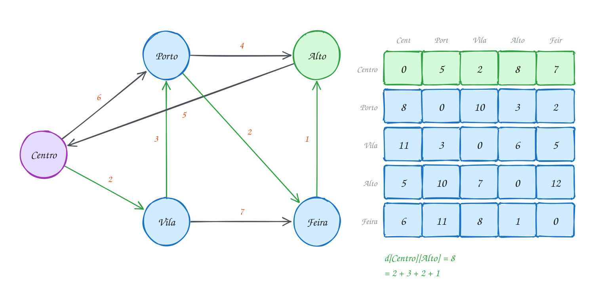</p>

```c
#include <stdio.h>

#define V 5
#define INFINITO 1000000000

int main(void) {
    const char *bairros[V] = {"Centro", "Porto", "Vila", "Alto", "Feira"};
    int d[V][V];
    for (int i = 0; i < V; i++)
        for (int j = 0; j < V; j++) d[i][j] = (i == j) ? 0 : INFINITO; // sem rua: infinito

    int ruas[][3] = {{0, 2, 2}, {2, 1, 3}, {0, 1, 6}, {1, 3, 4},
                     {3, 0, 5}, {2, 4, 7}, {4, 3, 1}, {1, 4, 2}};
    for (int r = 0; r < 8; r++) d[ruas[r][0]][ruas[r][1]] = ruas[r][2]; // mão única

    for (int k = 0; k < V; k++)         // k: o bairro que pode servir de passagem
        for (int i = 0; i < V; i++)     // de i
            for (int j = 0; j < V; j++) // para j
                if (d[i][k] != INFINITO && d[k][j] != INFINITO && d[i][k] + d[k][j] < d[i][j])
                    d[i][j] = d[i][k] + d[k][j]; // passar por k é mais rápido

    printf("%-8s", "de\\para");
    for (int j = 0; j < V; j++) printf("%7s", bairros[j]);
    printf("\n");
    for (int i = 0; i < V; i++) {
        printf("%-8s", bairros[i]);
        for (int j = 0; j < V; j++) printf("%7d", d[i][j]);
        printf("\n");
    }
    return 0;
}
// Saída:
// de\para  Centro  Porto   Vila   Alto  Feira
// Centro        0      5      2      8      7
// Porto         8      0     10      3      2
// Vila         11      3      0      6      5
// Alto          5     10      7      0     12
// Feira         6     11      8      1      0
```

O fluxograma tem três contadores e uma comparação no miolo, repetida V³
vezes:

<p align="center">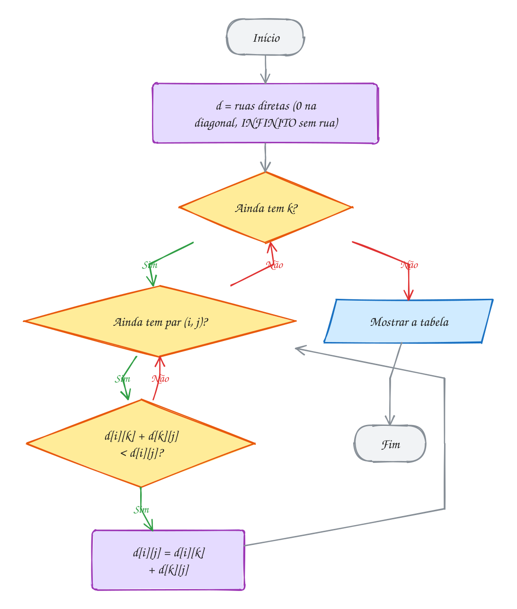</p>

#### Passo a passo

A casa `d[Centro][Alto]`, rodada a rodada:

| Rodada (passagem liberada) | `d[Centro][Alto]` | Caminho por trás do número |
| --- | --- | --- |
| início | ∞ | (nenhuma rua direta) |
| k = Centro | ∞ | ninguém chega ao Alto pelo Centro ainda |
| k = Porto | 10 | Centro → Porto → Alto: 6 + 4 |
| k = Vila | 9 | Centro → Vila → Porto → Alto: 2 + 3 + 4 |
| k = Alto | 9 | passar pelo próprio destino não ajuda |
| k = Feira | 8 | Centro → Vila → Porto → Feira → Alto: 2 + 3 + 2 + 1 |

Cada rodada aproveita as anteriores: na da Vila, `d[Vila][Alto]` já vale 7,
calculado na rodada do Porto.

**Exemplo A309 · Floyd-Warshall com rota: o mapa do metrô**

```c
#include <stdio.h>

#define V 6
#define INFINITO 1000000000

const char *estacoes[V] = {"Sé", "Luz", "Brás", "Paraíso", "Consolação", "Pinheiros"};
int d[V][V];    // minutos
int prox[V][V]; // prox[i][j]: a primeira estação depois de i no melhor caminho até j

void rota(int i, int j) {
    printf("%s", estacoes[i]);
    while (i != j) {
        i = prox[i][j]; // anda um passo
        printf(" -> %s", estacoes[i]);
    }
}

int main(void) {
    for (int i = 0; i < V; i++)
        for (int j = 0; j < V; j++) {
            d[i][j] = (i == j) ? 0 : INFINITO;
            prox[i][j] = (i == j) ? i : -1;
        }
    int trilhos[][3] = {{0, 1, 3}, {0, 2, 4}, {0, 3, 5}, {3, 4, 4}, {4, 5, 6}, {1, 4, 9}, {3, 5, 12}};
    for (int t = 0; t < 7; t++) {
        int a = trilhos[t][0], b = trilhos[t][1];
        d[a][b] = d[b][a] = trilhos[t][2]; // o metrô anda nos dois sentidos
        prox[a][b] = b;
        prox[b][a] = a;
    }

    for (int k = 0; k < V; k++)
        for (int i = 0; i < V; i++)
            for (int j = 0; j < V; j++)
                if (d[i][k] != INFINITO && d[k][j] != INFINITO && d[i][k] + d[k][j] < d[i][j]) {
                    d[i][j] = d[i][k] + d[k][j];
                    prox[i][j] = prox[i][k]; // para ir a j por k, o primeiro passo é o de ir a k
                }

    int pedidos[][2] = {{2, 5}, {1, 5}, {5, 1}};
    for (int p = 0; p < 3; p++) {
        int i = pedidos[p][0], j = pedidos[p][1];
        printf("%d min: ", d[i][j]);
        rota(i, j);
        printf("\n");
    }
    return 0;
}
// Saída:
// 19 min: Brás -> Sé -> Paraíso -> Consolação -> Pinheiros
// 15 min: Luz -> Consolação -> Pinheiros
// 15 min: Pinheiros -> Consolação -> Luz
//
// Uma matriz de V × V próximos passos guarda TODAS as rotas: em vez de
// guardar V² caminhos inteiros, cada casa guarda só um número.
```

```bash
gcc ~/LPEDC/material/A309.c -o ~/LPEDC/material/A309 && ~/LPEDC/material/A309
```

**Exemplo A310 · Fecho transitivo: de qual terminal dá para chegar em qual**

```c
#include <stdbool.h>
#include <stdio.h>

#define V 5

int main(void) {
    const char *terminais[V] = {"Norte", "Sul", "Leste", "Oeste", "Centro"};
    bool chega[V][V] = {{false}}; // linhas de ônibus de mão única
    int linhas[][2] = {{0, 4}, {4, 1}, {1, 4}, {2, 0}, {3, 3}};
    for (int k = 0; k < 5; k++) chega[linhas[k][0]][linhas[k][1]] = true;

    // Warshall: o Floyd-Warshall com || no lugar de min e && no lugar de +
    for (int k = 0; k < V; k++)
        for (int i = 0; i < V; i++)
            for (int j = 0; j < V; j++)
                chega[i][j] = chega[i][j] || (chega[i][k] && chega[k][j]);

    printf("%-8s", "de\\para");
    for (int j = 0; j < V; j++) printf(j < V - 1 ? "%-7s" : "%s\n", terminais[j]);
    for (int i = 0; i < V; i++) {
        int quantos = 0;
        printf("%-8s", terminais[i]);
        for (int j = 0; j < V; j++) {
            printf("%-7s", chega[i][j] ? "sim" : ".");
            quantos += chega[i][j] && i != j;
        }
        printf("(%d)\n", quantos);
    }
    return 0;
}
// Saída:
// de\para Norte  Sul    Leste  Oeste  Centro
// Norte   .      sim    .      .      sim    (2)
// Sul     .      sim    .      .      sim    (1)
// Leste   sim    sim    .      .      sim    (3)
// Oeste   .      .      .      sim    .      (0)
// Centro  .      sim    .      .      sim    (1)
//
// Repare na diagonal: Sul chega no próprio Sul (vai ao Centro e volta),
// Oeste tem uma linha circular que volta para ele, e Leste não volta nunca.
// O número entre parênteses conta os OUTROS terminais alcançáveis.
```

```bash
gcc ~/LPEDC/material/A310.c -o ~/LPEDC/material/A310 && ~/LPEDC/material/A310
```

### Exercícios

**Exercício E925** · ★☆☆

Uma cooperativa tem quatro galpões: Milho, Leite, Frutas e Mel (índices
0 a 3). As estradas internas são de mão única, em km:

```text
Milho -> Leite 8     Leite -> Frutas 3    Frutas -> Milho 4
Milho -> Mel 15      Frutas -> Mel 5      Mel -> Leite 2
```

Escreva o Floyd-Warshall do zero e mostre a tabela de distâncias, uma
linha por galpão de origem (nome com %-7s e cada número com %4d).

```text
Saída esperada:
Milho     0   8  11  15
Leite     7   0   3   8
Frutas    4   7   0   5
Mel       9   2   5   0
```

**Exercício E927** · ★★☆

A prefeitura vai construir um posto de saúde num dos seis bairros (índices 0
a 5: Vila Rica, Jardim, Centro, Lagoa, Bosque e Porto). O morador que fica
mais longe do posto deve ficar o mais perto possível. As ruas são de mão
dupla (km):

```text
Vila Rica-Jardim 4, Jardim-Centro 3, Centro-Lagoa 5, Lagoa-Bosque 2,
Centro-Bosque 6, Bosque-Porto 7, Jardim-Lagoa 9, Vila Rica-Porto 20
```

Rode o Floyd-Warshall e, para cada bairro, mostre qual bairro fica mais longe
dele e a que distância (o primeiro com a maior, em ordem de índice). No fim,
mostre o bairro em que essa pior distância é a menor.

```text
Saída esperada:
Vila Rica: o mais longe é Porto, a 20 km
Jardim: o mais longe é Porto, a 16 km
Centro: o mais longe é Porto, a 13 km
Lagoa: o mais longe é Vila Rica, a 12 km
Bosque: o mais longe é Vila Rica, a 13 km
Porto: o mais longe é Vila Rica, a 20 km
Melhor bairro para o posto: Lagoa (ninguém fica a mais de 12 km)
```

**Exercício E928** · ★★☆

Uma casa de câmbio cobra uma taxa fixa (em centavos) por conversão entre
Real, Dólar, Euro e Cripto (índices 0 a 3). As conversões de uma semana, de
mão única, são:

```text
Real -> Dólar 30     Dólar -> Euro 20      Euro -> Real 25
Real -> Cripto 50    Cripto -> Dólar -10   Dólar -> Real 35
Euro -> Cripto 15
```

Na semana 2 de promoção, Cripto -> Dólar dá um bônus maior (-40 em vez de
-10). Escreva analisa(semana, ...), que roda o Floyd-Warshall e, olhando a
diagonal, diz se existe um ciclo negativo (trocar em roda e sair ganhando) e
por quais moedas ele passa. Analise as duas semanas.

```text
Saída esperada:
Semana 1: sem ciclo negativo
Semana 2: ciclo negativo passando por Dólar Euro Cripto
```

**Exercício E930** · ★★★

Cinco bairros (índices 0 a 4: Centro, Porto, Vila, Alto e Feira) têm estas
ruas de mão única, em minutos:

```text
Centro -> Vila 2   Vila -> Porto 3   Centro -> Porto 6   Porto -> Alto 4
Alto -> Centro 5   Vila -> Feira 7   Feira -> Alto 1     Porto -> Feira 2
```

Calcule a tabela com o Floyd-Warshall. Depois a prefeitura abre a rua Feira
-> Vila, de 1 minuto. Refazer o Floyd custa O(V³): escreva nova_rua(d, a, b,
w), que atualiza a tabela em O(V²). Qualquer caminho que melhora com a rua
nova passa por ela uma vez só: "de i até a", mais w, mais "de b até j".
Confira o resultado contra um Floyd completo refeito do zero, mostrando a
tabela (nome com %-7s e cada número com %4d).

```text
Saída esperada:
Centro    0   5   2   8   7
Porto     8   0   3   3   2
Vila     11   3   0   6   5
Alto      5  10   7   0  12
Feira     6   4   1   1   0
Confere com o Floyd completo: sim
```

---

## 0156 · Juntando tudo: o assistente do calouro

### Conceito

- **Cada pergunta, um algoritmo**: o tipo do grafo (dirigido ou não, com peso ou
  sem) e a pergunta escolhem a técnica (ZIVIANI, 2010, cap. 7).
- **Grade de disciplinas**: um **DAG** de setas "antes de", sem peso. "Quantos
  semestres" é o Kahn por rodadas (A302), que também acusa pré-requisito
  circular (CORMEN et al., 2024, cap. 20).
- **Campus**: grafo **não dirigido** e ponderado. Com muitas consultas, compensa
  calcular a tabela uma vez com o **Floyd-Warshall** e guardar o **próximo
  passo** de cada rota (A309) (CORMEN et al., 2024, cap. 23).
- **Um tipo `Grafo`** serve aos dois: número de vértices, nomes e matriz de
  pesos. As funções recebem `const Grafo *` para não copiar a struct, que passa
  de 300 bytes.

| Pergunta | Algoritmo | Custo |
| --- | --- | --- |
| Quais pedaços são independentes? | componentes (DFS + laço externo) | O(V + E) |
| Tem ciclo num grafo dirigido? | DFS com três cores | O(V + E) |
| Em que ordem fazer, respeitando as setas? | ordenação topológica (Kahn ou DFS) | O(V + E) |
| Ligar todos pelo menor custo total | Kruskal ou Prim (árvore geradora mínima) | O(E log E) ou O(E log V) |
| Menor caminho de uma origem, pesos >= 0 | Dijkstra (assunto 0112) | O((V + E) log V) |
| Menor caminho de uma origem, com pesos negativos | Bellman-Ford | O(V · E) |
| Menor caminho entre todos os pares | Floyd-Warshall | O(V³) |

> [!WARNING]
> Na matriz com "0 = sem aresta", uma aresta de peso **zero** some. Não misture
> as perguntas: Floyd-Warshall com 100 mil vértices é inviável (10¹⁵ passos), e
> a árvore mínima não dá caminho mínimo (21 m contra 18 m no 0153).

### Exemplos de uso

O calouro quer saber em quantos semestres se forma e qual o caminho mais rápido
entre os prédios do campus. O desenho mostra a grade, com o semestre de cada
disciplina, e o campus, com as duas rotas em verde:

<p align="center">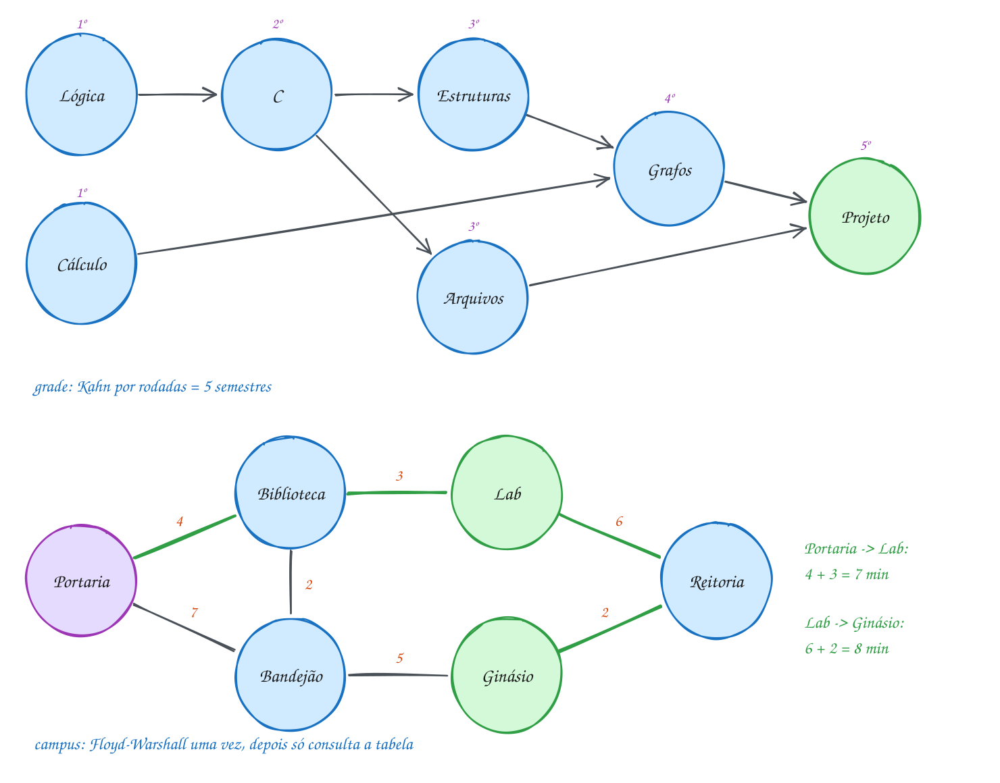</p>

```c
#include <stdio.h>

#define MAX 8
#define INFINITO 1000000000

typedef struct {
    int n;
    const char *nomes[MAX];
    int peso[MAX][MAX]; // 0 = sem aresta
} Grafo;

void liga(Grafo *g, int a, int b, int peso, int mao_dupla) {
    g->peso[a][b] = peso;
    if (mao_dupla) g->peso[b][a] = peso;
}

// pré-requisitos: Kahn por rodadas; devolve quantos semestres (ou -1 se houver ciclo)
int semestres(const Grafo *g) {
    int grau[MAX] = {0}, atual[MAX], n_atual = 0, feitas = 0, s = 0;
    for (int a = 0; a < g->n; a++)
        for (int b = 0; b < g->n; b++) grau[b] += g->peso[a][b] != 0;
    for (int v = 0; v < g->n; v++)
        if (grau[v] == 0) atual[n_atual++] = v;
    while (n_atual > 0) {
        int prox[MAX], n_prox = 0;
        printf("  %dº semestre:", ++s);
        for (int i = 0; i < n_atual; i++) {
            int u = atual[i];
            printf(" %s", g->nomes[u]);
            feitas++;
            for (int v = 0; v < g->n; v++)
                if (g->peso[u][v] && --grau[v] == 0) prox[n_prox++] = v;
        }
        printf("\n");
        for (int i = 0; i < n_prox; i++) atual[i] = prox[i];
        n_atual = n_prox;
    }
    return feitas == g->n ? s : -1;
}

// rotas: Floyd-Warshall com a matriz de próximo passo
void todas_as_rotas(const Grafo *g, int d[][MAX], int prox[][MAX]) {
    for (int i = 0; i < g->n; i++)
        for (int j = 0; j < g->n; j++) {
            d[i][j] = (i == j) ? 0 : (g->peso[i][j] ? g->peso[i][j] : INFINITO);
            prox[i][j] = (i == j || g->peso[i][j]) ? j : -1;
        }
    for (int k = 0; k < g->n; k++)
        for (int i = 0; i < g->n; i++)
            for (int j = 0; j < g->n; j++)
                if (d[i][k] + d[k][j] < d[i][j]) {
                    d[i][j] = d[i][k] + d[k][j];
                    prox[i][j] = prox[i][k];
                }
}

void mostra_rota(const Grafo *g, int d[][MAX], int prox[][MAX], int a, int b) {
    printf("  %d min: %s", d[a][b], g->nomes[a]);
    for (int v = a; v != b;) {
        v = prox[v][b]; // um passo rumo a b
        printf(" -> %s", g->nomes[v]);
    }
    printf("\n");
}

int main(void) {
    Grafo grade = {.n = 7, .nomes = {"Lógica", "Cálculo", "C", "Estruturas", "Arquivos", "Grafos", "Projeto"}};
    liga(&grade, 0, 2, 1, 0); // Lógica antes de C (dirigido; o peso só marca a seta)
    liga(&grade, 2, 3, 1, 0);
    liga(&grade, 2, 4, 1, 0);
    liga(&grade, 1, 5, 1, 0);
    liga(&grade, 3, 5, 1, 0);
    liga(&grade, 4, 6, 1, 0);
    liga(&grade, 5, 6, 1, 0);
    printf("Grade:\n");
    int s = semestres(&grade);
    if (s < 0) printf("  pré-requisito circular!\n");
    else printf("  formatura em %d semestres\n", s);

    Grafo campus = {.n = 6, .nomes = {"Portaria", "Biblioteca", "Lab", "Bandejão", "Ginásio", "Reitoria"}};
    liga(&campus, 0, 1, 4, 1); // minutos a pé, mão dupla
    liga(&campus, 0, 3, 7, 1);
    liga(&campus, 1, 2, 3, 1);
    liga(&campus, 1, 3, 2, 1);
    liga(&campus, 3, 4, 5, 1);
    liga(&campus, 2, 5, 6, 1);
    liga(&campus, 4, 5, 2, 1);
    int d[MAX][MAX], prox[MAX][MAX];
    todas_as_rotas(&campus, d, prox);
    printf("Campus:\n");
    mostra_rota(&campus, d, prox, 0, 2); // da Portaria até o Lab
    mostra_rota(&campus, d, prox, 2, 4); // do Lab até o Ginásio
    return 0;
}
// Saída:
// Grade:
//   1º semestre: Lógica Cálculo
//   2º semestre: C
//   3º semestre: Estruturas Arquivos
//   4º semestre: Grafos
//   5º semestre: Projeto
//   formatura em 5 semestres
// Campus:
//   7 min: Portaria -> Biblioteca -> Lab
//   8 min: Lab -> Reitoria -> Ginásio
```

O fluxograma é o `main`: a grade passa pelo Kahn, e o campus passa uma vez
pelo Floyd-Warshall e depois só consulta a tabela:

<p align="center">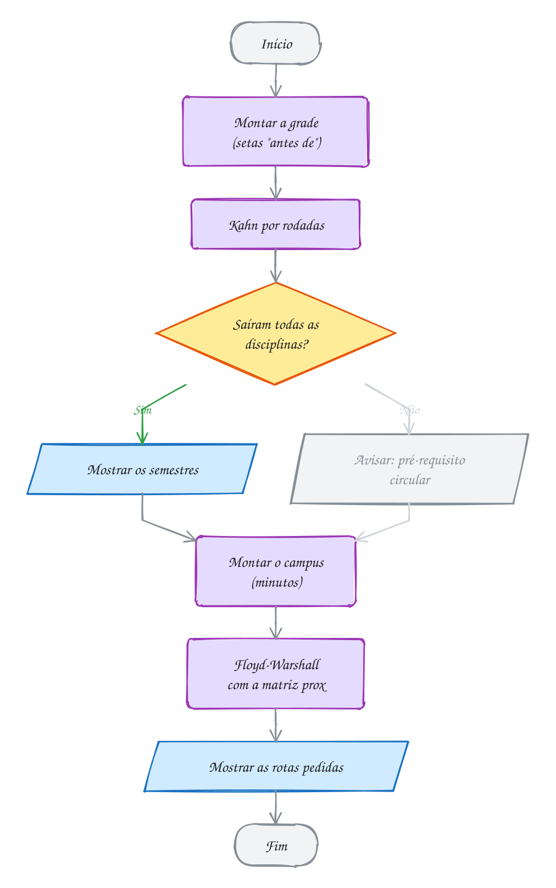</p>

**Exemplo A311 · O planejador escolhe: Dijkstra ou Bellman-Ford**

```c
#include <stdbool.h>
#include <stdio.h>

#define MAX 6
#define INFINITO 1000000000

typedef struct {
    int n;
    const char *nomes[MAX];
    int custo[MAX][MAX];
    bool tem[MAX][MAX]; // existe o trecho? (aqui custo 0 é um custo de verdade)
} Mapa;

bool tem_negativo(const Mapa *m) {
    for (int i = 0; i < m->n; i++)
        for (int j = 0; j < m->n; j++)
            if (m->tem[i][j] && m->custo[i][j] < 0) return true;
    return false;
}

void dijkstra(const Mapa *m, int dist[]) {
    bool fixo[MAX] = {false};
    for (int v = 0; v < m->n; v++) dist[v] = INFINITO;
    dist[0] = 0;
    for (int passo = 0; passo < m->n; passo++) {
        int u = -1;
        for (int v = 0; v < m->n; v++)
            if (!fixo[v] && dist[v] != INFINITO && (u == -1 || dist[v] < dist[u])) u = v;
        if (u == -1) break;
        fixo[u] = true;
        for (int v = 0; v < m->n; v++)
            if (m->tem[u][v] && dist[u] + m->custo[u][v] < dist[v]) dist[v] = dist[u] + m->custo[u][v];
    }
}

bool bellman_ford(const Mapa *m, int dist[]) { // false: ciclo negativo
    for (int v = 0; v < m->n; v++) dist[v] = INFINITO;
    dist[0] = 0;
    for (int r = 0; r <= m->n - 1; r++) { // a última volta (r == n - 1) é a extra
        bool mudou = false;
        for (int u = 0; u < m->n; u++)
            for (int v = 0; v < m->n; v++)
                if (m->tem[u][v] && dist[u] != INFINITO && dist[u] + m->custo[u][v] < dist[v]) {
                    dist[v] = dist[u] + m->custo[u][v];
                    mudou = true;
                }
        if (!mudou) return true;
        if (r == m->n - 1) return false; // mudou até na rodada extra
    }
    return true;
}

void planeja(const Mapa *m, const char *titulo) {
    int dist[MAX];
    printf("%s: ", titulo);
    if (tem_negativo(m)) {
        printf("tem trecho negativo, uso Bellman-Ford\n");
        if (!bellman_ford(m, dist)) {
            printf("  ciclo negativo: não existe rota mais barata\n");
            return;
        }
    } else {
        printf("tudo >= 0, uso Dijkstra\n");
        dijkstra(m, dist);
    }
    for (int v = 1; v < m->n; v++) printf("  %s: R$ %d\n", m->nomes[v], dist[v]);
}

void trecho(Mapa *m, int a, int b, int c) {
    m->tem[a][b] = true;
    m->custo[a][b] = c;
}

int main(void) {
    Mapa dia = {.n = 4, .nomes = {"Loja", "Bairro A", "Bairro B", "Bairro C"}};
    trecho(&dia, 0, 1, 8);
    trecho(&dia, 0, 2, 3);
    trecho(&dia, 2, 1, 4);
    trecho(&dia, 1, 3, 2);
    planeja(&dia, "Entrega de dia");

    Mapa noite = dia;         // copia a struct inteira
    trecho(&noite, 2, 1, -2); // à noite, levar o reciclável do B ao A paga R$ 2
    planeja(&noite, "Coleta de noite");

    Mapa feriado = noite;
    trecho(&feriado, 1, 2, 0); // no feriado, voltar do A ao B não custa nada
    planeja(&feriado, "Coleta no feriado");
    return 0;
}
// Saída:
// Entrega de dia: tudo >= 0, uso Dijkstra
//   Bairro A: R$ 7
//   Bairro B: R$ 3
//   Bairro C: R$ 9
// Coleta de noite: tem trecho negativo, uso Bellman-Ford
//   Bairro A: R$ 1
//   Bairro B: R$ 3
//   Bairro C: R$ 3
// Coleta no feriado: tem trecho negativo, uso Bellman-Ford
//   ciclo negativo: não existe rota mais barata
//
// No feriado, A -> B -> A custa 0 - 2 = -2: cada volta "paga" R$ 2. O vetor
// tem[][] separado do custo deixa o 0 ser um custo de verdade (o trecho
// A -> B grátis), coisa que a matriz com "0 = sem aresta" não permitiria.
```

```bash
gcc ~/LPEDC/material/A311.c -o ~/LPEDC/material/A311 && ~/LPEDC/material/A311
```

**Exemplo A312 · Instalar só o necessário, na ordem certa**

```c
#include <stdbool.h>
#include <stdio.h>

#define V 8
enum { BRANCO, CINZA, PRETO };

const char *pacotes[V] = {"editor", "jogo", "interface", "som", "imagem", "fontes", "zlib", "libc"};
int precisa[V][V]; // precisa[a][b] = 1: a só funciona com b instalado
bool instalado[V];
int cor[V];

// DFS a partir do pedido: instala as dependências antes (pós-ordem)
bool instala(int u) {
    if (instalado[u]) return true; // já está no sistema: nada a fazer
    cor[u] = CINZA;
    for (int v = 0; v < V; v++) {
        if (!precisa[u][v]) continue;
        if (cor[v] == CINZA) {
            printf("  erro: %s e %s dependem um do outro\n", pacotes[u], pacotes[v]);
            return false;
        }
        if (!instala(v)) return false;
    }
    cor[u] = PRETO;
    instalado[u] = true;
    printf("  instalando %s\n", pacotes[u]);
    return true;
}

void pede(int p) {
    printf("> instalar %s\n", pacotes[p]);
    for (int v = 0; v < V; v++)
        if (!instalado[v]) cor[v] = BRANCO;
    if (instalado[p]) printf("  %s já está instalado\n", pacotes[p]);
    else instala(p);
}

int main(void) {
    int deps[][2] = {{0, 2}, {0, 5}, {1, 2}, {1, 3}, {1, 4}, {2, 5}, {2, 7},
                     {3, 7}, {4, 6}, {5, 6}, {6, 7}};
    for (int k = 0; k < 11; k++) precisa[deps[k][0]][deps[k][1]] = 1;

    pede(0); // editor
    pede(1); // jogo: boa parte já veio com o editor
    pede(5); // fontes
    return 0;
}
// Saída:
// > instalar editor
//   instalando libc
//   instalando zlib
//   instalando fontes
//   instalando interface
//   instalando editor
// > instalar jogo
//   instalando som
//   instalando imagem
//   instalando jogo
// > instalar fontes
//   fontes já está instalado
//
// A DFS só visita o que o pedido alcança: o jogo não instala nada do editor,
// e o editor não puxa som nem imagem. É uma ordenação topológica do pedaço
// do grafo que interessa, não do grafo inteiro.
```

```bash
gcc ~/LPEDC/material/A312.c -o ~/LPEDC/material/A312 && ~/LPEDC/material/A312
```

### Exercícios

**Exercício E931** · ★☆☆

O campus tem seis prédios (índices 0 a 5: Portaria, Biblioteca, Lab,
Bandejão, Ginásio e Reitoria), ligados por caminhos de mão dupla, em minutos:

```text
Portaria-Biblioteca 4  Portaria-Bandejão 7   Biblioteca-Lab 3
Biblioteca-Bandejão 2  Bandejão-Ginásio 5    Lab-Reitoria 6
Ginásio-Reitoria 2
```

Escreva o programa: guarde o grafo numa matriz, rode o Floyd-Warshall e
mostre a tabela (uma linha por prédio, com o índice e cada número em %3d) e o
par de prédios mais distante um do outro, o "diâmetro" do campus (o primeiro
par com a maior distância, percorrendo a tabela linha por linha).

```text
Saída esperada:
0:  0  4  7  6 11 13
1:  4  0  3  2  7  9
2:  7  3  0  5  8  6
3:  6  2  5  0  5  7
4: 11  7  8  5  0  2
5: 13  9  6  7  2  0
Mais longe: Portaria e Reitoria, 13 min
```

**Exercício E933** · ★★☆

O governo do estado vai asfaltar o mínimo de estradas que ligue as cinco
regiões (árvore geradora mínima). Um deputado reclama: "da Capital até a
Serra, a viagem vai ficar bem mais longa". As regiões (índices 0 a 4) são
Capital, Agreste, Sertão, Litoral e Serra. As estradas possíveis (km, mão
dupla), na ordem da lista:

```text
Capital-Litoral 3, Capital-Agreste 7, Litoral-Agreste 5,
Agreste-Sertão 6, Litoral-Serra 9, Serra-Sertão 4, Capital-Serra 10
```

Escreva o programa: monte a árvore mínima com Kruskal (mostre as estradas na
ordem em que entram e o total), guarde as estradas da árvore numa segunda
matriz e rode o Floyd-Warshall nas duas matrizes para comparar a viagem
Capital -> Serra.

```text
Saída esperada:
Rede mínima: Capital-Litoral, Serra-Sertão, Litoral-Agreste, Agreste-Sertão (18 km)
Capital -> Serra pela rede mínima: 18 km
Capital -> Serra pelo melhor caminho: 10 km
```

**Exercício E934** · ★★☆

A faculdade tem oito disciplinas (índices 0 a 7: Algoritmos, Cálculo I,
Inglês, Física, Cálculo II, Estruturas, Redes e TCC), com estes
pré-requisitos:

```text
Algoritmos -> Estruturas   Cálculo I -> Cálculo II   Cálculo I -> Física
Estruturas -> Redes        Cálculo II -> TCC         Redes -> TCC
```

Só dá para cursar DUAS por semestre. Escreva planeja(limite, mostrar): a cada
semestre, escolhe até "limite" disciplinas liberadas (grau de entrada 0 e
ainda não feitas), as de menor índice primeiro, e só depois do semestre
desconta os graus das que dependem delas. Devolve o número de semestres (ou
-1 se travar) e mostra os semestres quando mostrar for true. Compare sem
limite e com limite 2.

```text
Saída esperada:
Sem limite: 4 semestres
Com no máximo 2 por semestre:
  1º: Algoritmos Cálculo I
  2º: Inglês Física
  3º: Cálculo II Estruturas
  4º: Redes
  5º: TCC
  total: 5 semestres
```

**Exercício E936** · ★★★

O entregador sai da Loja, visita os três clientes do dia (Ana, Bruno e Carla)
em alguma ordem e volta para a Loja. Os pontos (índices 0 a 5) são Loja, Ana,
Bruno, Carla, Praça e Ponte; Praça e Ponte servem só de passagem. As ruas, de
mão dupla, em minutos:

```text
Loja-Praça 4, Loja-Ponte 6, Praça-Ana 3, Praça-Bruno 5, Ponte-Carla 2,
Ana-Bruno 4, Bruno-Carla 3, Ana-Ponte 7, Loja-Carla 12
```

Rode o Floyd-Warshall para ter o tempo entre quaisquer dois pontos e depois
teste TODAS as ordens de visita (as permutações por troca do assunto 0126),
mostrando cada roteiro com o tempo total e, no fim, o melhor (o primeiro de
menor tempo).

```text
Saída esperada:
Loja -> Ana -> Bruno -> Carla -> Loja: 22 min
Loja -> Ana -> Carla -> Bruno -> Loja: 26 min
Loja -> Bruno -> Ana -> Carla -> Loja: 28 min
Loja -> Bruno -> Carla -> Ana -> Loja: 26 min
Loja -> Carla -> Bruno -> Ana -> Loja: 22 min
Loja -> Carla -> Ana -> Bruno -> Loja: 28 min
Melhor roteiro (22 min): Loja -> Ana -> Bruno -> Carla -> Loja
```

---

## Lista do módulo

30 exercícios que misturam os assuntos do módulo, no ritmo da prova. Arquivos P2301.c a P2330.c, em `material/`; resoluções em `_respostas/23-grafos-avancados/lista/`.

### ★☆☆ Aquecimento

**Exercício P2301** · ★☆☆ · Grupos do condomínio

No condomínio, nove moradores (índices 0 a 8) estão em grupos de conversa:
Ana, Bia, Caio, Duda, Edu, Fabi, Gil, Hugo e Iara. As amizades, de mão
dupla, são:

```text
Ana-Caio, Caio-Gil, Bia-Duda, Duda-Hugo, Edu-Fabi
```

Escreva o programa do zero. Uma DFS dá a cada morador o número do seu
componente (grupo[u], começando em 1, na ordem do primeiro morador de
cada grupo). Mostre os grupos e depois responda, em O(1) cada, se estes
pares estão no mesmo grupo: Ana e Gil, Bia e Edu, Hugo e Bia, Iara e Ana.

```text
Saída esperada:
Grupo 1: Ana Caio Gil
Grupo 2: Bia Duda Hugo
Grupo 3: Edu Fabi
Grupo 4: Iara
Ana e Gil: mesmo grupo
Bia e Edu: grupos diferentes
Hugo e Bia: mesmo grupo
Iara e Ana: grupos diferentes
```

**Resposta esperada:** 4 grupos (Iara fica sozinha); a consulta é só grupo[a] == grupo[b].

---

**Exercício P2302** · ★☆☆ · O cano que fecha o circuito

Na vila, os canos de água (mão dupla) ligam o Poço e cinco casas
(índices 0 a 5: Poço, Ana, Beto, Cida, Davi, Elza):

```text
Poço-Ana, Ana-Beto, Beto-Cida, Cida-Davi, Ana-Davi, Davi-Elza
```

Num grafo NÃO dirigido não precisa de três cores: basta lembrar o pai de
cada vértice na DFS. Um vizinho já visitado que não é o pai fecha um
circuito. Escreva o programa do zero: mostre o cano que fecha o circuito
e o circuito inteiro, subindo de pai em pai. Depois a vila tira o cano
Ana-Davi; analise de novo. Examine os vizinhos em ordem de índice.

```text
Saída esperada:
Rede atual: o cano Davi-Ana fecha o circuito Ana - Beto - Cida - Davi - Ana
Rede nova: sem circuito
```

**Resposta esperada:** o cano Davi-Ana fecha Ana - Beto - Cida - Davi - Ana; sem o cano Ana-Davi, a rede vira árvore e não tem circuito.

---

**Exercício P2303** · ★☆☆ · Referência circular na planilha

Na planilha do orçamento, a fórmula de uma célula usa o valor de outras
(seta a -> b: a fórmula de a usa b). Na planilha de maio:

```text
A1 -> B1, B1 -> C1, C1 -> B2, B2 -> D1, D1 -> B1, A2 -> C2
```

O programa abaixo já tem a DFS de três cores pela metade. Complete a
função visita(u): além de achar a seta que chega num CINZA, ela guarda
em pai[] quem descobriu cada célula e, ao achar o ciclo, guarda ini (a
célula cinza) e fim (quem apontou para ela). A função confere já usa
ini, fim e pai[] para mostrar o ciclo.

```text
Saída esperada:
Planilha de maio: referência circular B1 -> C1 -> B2 -> D1 -> B1
Planilha de junho: sem referência circular
```

**Resposta esperada:** B1 -> C1 -> B2 -> D1 -> B1 em maio; em junho, sem a seta D1 -> B1, nenhum ciclo.

---

**Exercício P2304** · ★☆☆ · O manual do guarda-roupa

Montar o guarda-roupa tem sete passos (índices 0 a 6): separar, base,
laterais, prateleiras, portas, puxadores e fixar. As regras "a antes de
b" do manual são:

```text
separar -> base, base -> laterais, laterais -> prateleiras,
laterais -> portas, portas -> puxadores, prateleiras -> fixar,
portas -> fixar
```

Escreva kahn(rotulo) do zero: o Kahn com fila mostra a ordem de montagem.
Quando a fila esvazia antes de sair todo mundo, o manual tem ciclo: mostre
também os passos que ficaram travados (grau de entrada ainda maior que 0).
Chame para o manual certo e para a reimpressão com erro, que acrescentou a
regra puxadores -> laterais.

```text
Saída esperada:
Manual certo: separar base laterais prateleiras portas puxadores fixar
Manual com erro: separar base
  travados: laterais prateleiras portas puxadores fixar
```

**Resposta esperada:** com o erro só saem separar e base; os outros cinco ficam travados (laterais, portas e puxadores formam o ciclo, e prateleiras e fixar esperam por eles).

---

**Exercício P2305** · ★☆☆ · Os relógios da DFS

O programa abaixo monta, com a DFS, a ordem das etapas de publicar um
sistema (seta a -> b: a etapa a vem antes de b):

```text
lint -> testes, testes -> build, build -> deploy, banco -> deploy,
deploy -> aviso
```

Hoje ele não mostra nada. Instrumente-o como no Cormen: um relógio global
que avança 1 quando a DFS DESCOBRE um vértice (guarde em d[u]) e 1 quando
ela TERMINA o vértice (guarde em f[u]). Mostre d e f de cada etapa e a
ordem, com o f de cada uma entre parênteses: ela sai em ordem decrescente
de término.

```text
Saída esperada:
lint      d =  1  f = 10
testes    d =  2  f =  9
build     d =  3  f =  8
banco     d = 11  f = 12
deploy    d =  4  f =  7
aviso     d =  5  f =  6
Ordem: banco(12) lint(10) testes(9) build(8) deploy(7) aviso(6)
```

**Resposta esperada:** lint vai de 1 a 10; banco, que ninguém alcança, só é descoberto no 11 e termina no 12, por isso abre a ordem.

---

**Exercício P2306** · ★☆☆ · Fibra nas escolas rurais

A secretaria de educação vai ligar seis escolas rurais com fibra óptica:
Sede, Vila Amazônia, Caburi, Mocambo, Tracajá e Zé Açu (índices 0 a 5).
Os trechos possíveis (mão dupla, em km):

```text
Sede-Vila Amazônia 7, Sede-Caburi 12, Vila Amazônia-Caburi 2,
Vila Amazônia-Mocambo 9, Caburi-Mocambo 6, Caburi-Tracajá 10,
Mocambo-Tracajá 3, Mocambo-Zé Açu 4, Tracajá-Zé Açu 5, Sede-Zé Açu 15
```

Escreva o Kruskal do zero: um vetor de struct {a, b, km}, qsort do mais
curto para o mais longo e union-find com pai[] (sem compressão mesmo).
Mostre cada trecho aceito e cada trecho recusado, na ordem em que o
algoritmo os examina, e pare quando tiver V - 1 trechos.

```text
Saída esperada:
aceita Vila Amazônia-Caburi (2 km)
aceita Mocambo-Tracajá (3 km)
aceita Mocambo-Zé Açu (4 km)
recusa Tracajá-Zé Açu (5 km): fecharia ciclo
aceita Caburi-Mocambo (6 km)
aceita Sede-Vila Amazônia (7 km)
Total: 22 km
```

**Resposta esperada:** só Tracajá-Zé Açu é recusado; total 22 km.

---

**Exercício P2307** · ★☆☆ · As chaves do Prim

Uma usina vai levar energia a quatro comunidades ribeirinhas. O Prim
abaixo, em O(V²), já monta a rede a partir da Usina e mostra cada linha
que entra. Instrumente-o: depois de cada vértice entrar e atualizar os
vizinhos, mostre o vetor chave[] inteiro, com "-" para infinito e um "*"
colado em quem já está na rede. Use "%3d" para cada número, com um
espaço antes, e "   -" para infinito.

```text
Saída esperada:
entra Usina
  chave:   0*   6    3    -    9
entra Bom Jesus: Usina - Bom Jesus, 3 km
  chave:   0*   4    3*   7    8
entra Boa Vista: Bom Jesus - Boa Vista, 4 km
  chave:   0*   4*   3*   2    8
entra Santa Luzia: Boa Vista - Santa Luzia, 2 km
  chave:   0*   4*   3*   2*   5
entra São José: Santa Luzia - São José, 5 km
  chave:   0*   4*   3*   2*   5*
Total: 14 km
```

**Resposta esperada:** total de 14 km; a última linha de chaves é 0* 4* 3* 2* 5*.

---

**Exercício P2308** · ★☆☆ · Bellman-Ford rodada a rodada

O app de corrida dá um cupom no trecho Terminal -> Shopping (custo
R$ -2). Os trechos, de mão única, estão na lista do main numa ordem ruim
de propósito para o algoritmo: os trechos que saem da Casa vêm por último.

```text
Casa -> Shopping 8, Casa -> Terminal 5, Terminal -> Shopping -2,
Shopping -> Faculdade 4, Terminal -> Faculdade 9,
Faculdade -> Estágio 3, Shopping -> Estágio 10
```

Complete o laço das rodadas: em cada uma, relaxe os trechos na ordem da
lista; se nada mudou, mostre que parou e saia; se mudou, mostre o vetor
dist com a função mostra (já pronta). Faça no máximo V - 1 rodadas.

```text
Saída esperada:
rodada 0:   0   -   -   -   -
rodada 1:   0   8   5   -   -
rodada 2:   0   3   5  12  18
rodada 3:   0   3   5   7  13
rodada 4:   0   3   5   7  10
```

**Resposta esperada:** no fim, Shopping R$ 3, Terminal 5, Faculdade 7 e Estágio 10; o Estágio só chega no valor certo na rodada 4.

---

**Exercício P2309** · ★☆☆ · Floyd-Warshall quadro a quadro

Os tempos de ônibus (minutos, mão única) entre quatro bairros:

```text
Centro -> Adrianópolis 10, Adrianópolis -> Ponta Negra 25,
Centro -> Ponta Negra 40, Ponta Negra -> Cidade Nova 15,
Cidade Nova -> Centro 20, Adrianópolis -> Cidade Nova 30
```

Complete floyd(d): o Floyd-Warshall com o k no laço de fora e, depois de
cada k, a linha "Depois de k = SIGLA:" e a matriz (a função mostra está
pronta). É assim que a prova cobra: a matriz D(k) de cada rodada.

```text
Saída esperada:
Início:
       CEN  ADR  PNE  CNO
CEN      0   10   40    -
ADR      -    0   25   30
PNE      -    -    0   15
CNO     20    -    -    0
Depois de k = CEN:
       CEN  ADR  PNE  CNO
CEN      0   10   40    -
ADR      -    0   25   30
PNE      -    -    0   15
CNO     20   30   60    0
Depois de k = ADR:
       CEN  ADR  PNE  CNO
CEN      0   10   35   40
ADR      -    0   25   30
PNE      -    -    0   15
CNO     20   30   55    0
Depois de k = PNE:
       CEN  ADR  PNE  CNO
CEN      0   10   35   40
ADR      -    0   25   30
PNE      -    -    0   15
CNO     20   30   55    0
Depois de k = CNO:
       CEN  ADR  PNE  CNO
CEN      0   10   35   40
ADR     50    0   25   30
PNE     35   45    0   15
CNO     20   30   55    0
```

**Resposta esperada:** k = PNE não muda nada; na rodada CNO, Ponta Negra chega no Centro em 35 (15 + 20).

---

**Exercício P2310** · ★☆☆ · Quem recebe o recado

Na família, cada um repassa o recado só para algumas pessoas (mão
única): Ana -> Bia, Bia -> Caio, Caio -> Ana, Caio -> Davi, Edu -> Davi.
Escreva do zero o fecho transitivo pelo algoritmo de Warshall: o Floyd-
Warshall com 0 e 1 no lugar de números, em que alcanca[i][j] vira 1
quando alcanca[i][k] e alcanca[k][j] são 1. Mostre a matriz e, para cada
pessoa, quantas OUTRAS pessoas recebem o recado dela.

```text
Saída esperada:
      Ana Bia Caio Davi Edu
Ana     1   1    1    1   0   chega em 3
Bia     1   1    1    1   0   chega em 3
Caio    1   1    1    1   0   chega em 3
Davi    0   0    0    0   0   chega em 0
Edu     0   0    0    1   0   chega em 1
```

**Resposta esperada:** Ana, Bia e Caio chegam em 3 pessoas cada; Davi em nenhuma; Edu só em Davi.

### ★★☆ Para pensar

**Exercício P2311** · ★★☆ · Kosaraju nas rotas de barco

Oito portos do Amazonas têm barcos de mão única entre eles (seta a -> b:
tem barco de a para b). Um grupo de portos é FORTEMENTE CONEXO quando
dá para ir de qualquer um deles a qualquer outro, e voltar, só de barco.
O algoritmo de Kosaraju acha esses grupos com duas DFS:

```text
1. uma DFS no grafo original anota a ordem de TÉRMINO dos vértices;
2. uma DFS no grafo com as setas INVERTIDAS, começando pelos vértices
   do último a terminar para o primeiro: cada DFS nova pinta um grupo.
```

O programa já faz o passo 1 e monta a matriz inversa. Complete o passo
2: escreva dfs2(u, g) e o laço que a chama, e mostre os grupos (os
portos de cada um em ordem de índice).

```text
Saída esperada:
Término da 1ª DFS: Autazes Silves Itacoatiara Careiro Novo Airão Manacapuru Iranduba Manaus
Grupo 1: Manaus Iranduba Manacapuru
Grupo 2: Novo Airão Careiro
Grupo 3: Autazes Itacoatiara Silves
```

**Resposta esperada:** 3 grupos: Manaus, Iranduba e Manacapuru; Novo Airão e Careiro; Autazes, Itacoatiara e Silves.

---

**Exercício P2312** · ★★☆ · O alfabeto do idioma inventado

Num jogo, os elfos escrevem com as letras de sempre, mas a ordem do
alfabeto deles é outra. Você recebe listas de palavras JÁ em ordem
alfabética élfica. Comparando duas palavras vizinhas, a primeira letra
diferente diz quem vem antes ("cab" < "cad": b antes de d). Se uma é
prefixo da outra, não há informação.

```text
Lista 1: cab, cad, ae, aed, eb, bd
Lista 2: ba, bc, ca, ab
```

Escreva descobre(rotulo, palavras, n) do zero: mostre cada regra que a
lista dá e, com o Kahn sobre as 26 letras (só as que aparecem nas
palavras), o alfabeto élfico. Se o Kahn não consegue tirar todas as
letras, a lista é inconsistente. Escolha da fila: letras livres entram
em ordem de 'a' a 'z'.

```text
Saída esperada:
Lista 1
  cab < cad: b antes de d
  cad < ae: c antes de a
  aed < eb: a antes de e
  eb < bd: e antes de b
  alfabeto: caebd
Lista 2
  ba < bc: a antes de c
  bc < ca: b antes de c
  ca < ab: c antes de a
  lista inconsistente: as regras formam um ciclo
```

**Resposta esperada:** Lista 1 dá o alfabeto caebd; a Lista 2 tem o ciclo a antes de c e c antes de a.

---

**Exercício P2313** · ★★☆ · A trilha que vale mais pontos

No jogo de plataforma, você sai do Início e chega ao Chefão passando por
fases; cada passagem (só para a frente) dá pontos:

```text
Início -> Floresta 5, Início -> Caverna 3, Floresta -> Rio 6,
Caverna -> Rio 9, Floresta -> Castelo 2, Rio -> Castelo 4,
Rio -> Chefão 7, Castelo -> Chefão 8
```

Num grafo qualquer, o caminho MAIS LONGO é um problema difícil. Num DAG
ele é fácil: a mesma ideia do caminho mínimo em DAG, relaxando na ordem
topológica, mas guardando o MAIOR total. Escreva o programa do zero:
ordem topológica pelo Kahn, o maior total até cada fase e a trilha
campeã (refeita por pai[]).

```text
Saída esperada:
Ordem: Início Floresta Caverna Rio Castelo Chefão
Início: 0 pontos
Floresta: 5 pontos
Caverna: 3 pontos
Rio: 12 pontos
Castelo: 16 pontos
Chefão: 24 pontos
Melhor trilha: Início -> Caverna -> Rio -> Castelo -> Chefão
```

**Resposta esperada:** 24 pontos, pela Caverna (3 + 9 + 4 + 8), contra 23 pela Floresta.

---

**Exercício P2314** · ★★☆ · A descida do rio

Descendo o rio de caiaque, cada trecho gasta energia, mas as corredeiras
a favor EMPURRAM o caiaque e devolvem energia (custo negativo). Como o
rio só desce, o grafo é um DAG. O programa já calcula o gasto mínimo
com Bellman-Ford e conta quantas relaxações ele tenta.

Estenda: escreva dag(dist), que faz a ordem topológica (Kahn) e relaxa
as arestas que saem de cada vértice uma vez só, na ordem topológica,
contando as tentativas. Mostre as duas respostas lado a lado e as duas
contagens.

```text
Saída esperada:
Ponto        BF  DAG
Cabeceira     0    0
Pedral        4    4
Remanso       1    1
Cachoeira    -1   -1
Praia         0    0
Foz          -4   -4
Relaxações tentadas: Bellman-Ford 45, DAG 9
```

**Resposta esperada:** as duas colunas iguais (a Foz fica em -4) e 9 tentativas contra 45 do Bellman-Ford.

---

**Exercício P2315** · ★★☆ · O union-find que solta galhos

Ache o bug. O parque estadual vai ligar seis pontos com passarelas
(custo em R$ mil, mão dupla), gastando o mínimo. O Kruskal abaixo
compila e roda, mas a saída tem um ciclo (Portão-Lago, Portão-Mirante e
Lago-Mirante) e o Camping ficou de fora:

```text
Saída que aparece:
Portão-Lago (1)
Portão-Mirante (2)
Lago-Mirante (3)
Mirante-Gruta (4)
Gruta-Cachoeira (5)
Total: R$ 15 mil
```

O erro está numa linha só, na hora de juntar dois grupos. Conserte.

```text
Saída esperada:
Portão-Lago (1)
Portão-Mirante (2)
Mirante-Gruta (4)
Gruta-Cachoeira (5)
Cachoeira-Camping (6)
Total: R$ 18 mil
```

**Resposta esperada:** troque a linha por pai[ra] = rb; total R$ 18 mil, com Lago-Mirante recusada e Cachoeira-Camping aceita.

---

**Exercício P2316** · ★★☆ · O Prim preguiçoso e as sobras do heap

A prefeitura vai ligar cinco praças com cabo de Wi-Fi público (metros,
mão dupla). O heap de mínimo já está pronto: poe(item) e tira(). Escreva
o laço do Prim preguiçoso a partir da Matriz: o heap guarda arestas
(peso, de, para); ao tirar uma, se o "para" já está na rede, ela é uma
SOBRA (o vértice entrou por um caminho mais barato depois que ela foi
posta) e é descartada. Mostre cada item tirado e pare quando os cinco
estiverem na rede.

```text
Saída esperada:
tira Matriz-Porto (1): entra Porto
tira Porto-Feira (2): entra Feira
tira Matriz-Feira (4): descartada, Feira já está na rede
tira Feira-Escola (5): entra Escola
tira Escola-Ginásio (3): entra Ginásio
Total: 11 metros; sobraram 2 itens no heap
```

**Resposta esperada:** só Matriz-Feira (4) é descartada; total 11 metros e 2 itens ainda no heap no fim (Porto-Escola e Porto-Ginásio).

---

**Exercício P2317** · ★★☆ · A rota do BRT

O BRT liga cinco estações (minutos, mão dupla). O programa já calcula a
tabela de distâncias com Floyd-Warshall, mas o passageiro quer saber POR
ONDE ir. Estenda: acrescente a matriz prox[i][j], a primeira estação
depois de i no melhor caminho até j, atualize-a dentro do Floyd e
escreva rota(a, b), que mostra o tempo e o caminho. Mostre as rotas
Terminal -> Aeroporto, Universidade -> Rodoviária, Aeroporto -> Terminal
e Rodoviária -> Universidade.

```text
Saída esperada:
Terminal -> Aeroporto (17 min): Terminal -> Centro -> Rodoviária -> Aeroporto
Universidade -> Rodoviária (9 min): Universidade -> Aeroporto -> Rodoviária
Aeroporto -> Terminal (17 min): Aeroporto -> Rodoviária -> Centro -> Terminal
Rodoviária -> Universidade (9 min): Rodoviária -> Aeroporto -> Universidade
```

**Resposta esperada:** Terminal -> Aeroporto em 17 min pelo Centro e pela Rodoviária; a linha direta Terminal-Universidade (20) nunca é usada.

---

**Exercício P2318** · ★★☆ · Dijkstra e Bellman-Ford na mesma balança

Seis cidades do Pará (siglas BEL, CAS, BRA, CAP, SAL, ABA) estão ligadas
por estradas de mão única, todas com km positivos. O programa tem o
Dijkstra em O(V²) e conta quantas arestas ele olha. Estenda: escreva
bellman_ford(origem, dist), que varre a matriz inteira em cada rodada
(u de 0 a V - 1, v de 0 a V - 1), para cedo quando nada muda e soma em
olhadas_bf cada aresta que olha. Rode os dois a partir de CADA cidade,
mostre a tabela do Dijkstra, confira se as duas tabelas são iguais e
mostre as contagens.

```text
Saída esperada:
     BEL  CAS  BRA  CAP  SAL  ABA
BEL    0   70  190  160  220   60
CAS  370    0  120   90  150  430
BRA  270  340    0  430   50  330
CAP  280  350   30    0   60  340
SAL  220  290  410  380    0  280
ABA  420   50  170  140  200    0
As duas tabelas conferem
Arestas olhadas: Dijkstra 60, Bellman-Ford 170
```

**Resposta esperada:** as tabelas conferem; Dijkstra 60 arestas olhadas (6 origens × 10), Bellman-Ford 170.

---

**Exercício P2319** · ★★☆ · A cerca que fecha o curral

O vaqueiro estica arame entre sete mourões (M0 a M6), uma cerca por vez,
nesta ordem:

```text
M0-M1, M1-M2, M3-M4, M2-M3, M4-M0, M5-M6, M2-M5, M6-M1, M3-M0
```

Cada cerca que liga dois mourões JÁ ligados por arame fecha um curral
(um ciclo). Escreva do zero, com union-find (acha com compressão de
caminho), um programa que diz, a cada cerca, se ela fecha um curral ou
só estende o arame, e o total de currais. Sem DFS: o grafo cresce aresta
por aresta e o union-find responde cada uma em tempo quase constante.

```text
Saída esperada:
cerca 1 (M0-M1): só estende o arame
cerca 2 (M1-M2): só estende o arame
cerca 3 (M3-M4): só estende o arame
cerca 4 (M2-M3): só estende o arame
cerca 5 (M4-M0): fecha o curral 1
cerca 6 (M5-M6): só estende o arame
cerca 7 (M2-M5): só estende o arame
cerca 8 (M6-M1): fecha o curral 2
cerca 9 (M3-M0): fecha o curral 3
Currais fechados: 3
```

**Resposta esperada:** as cercas 5, 8 e 9 fecham currais; 3 no total (9 cercas - 6 que bastam para ligar 7 mourões).

---

**Exercício P2320** · ★★☆ · Quantos jeitos de descer a ladeira

Em Olinda, um bloco de carnaval quer descer do Alto da Sé até a Praia
sem subir nunca. As ladeiras (só de descida) ligam:

```text
Alto da Sé -> Amparo, Alto da Sé -> Misericórdia, Amparo -> Bonsucesso,
Misericórdia -> Bonsucesso, Misericórdia -> Carmo, Bonsucesso -> Varadouro,
Carmo -> Varadouro, Bonsucesso -> Praia, Varadouro -> Praia,
Carmo -> Praia, Amparo -> Carmo
```

Quantos trajetos diferentes chegam em cada ponto? Escreva do zero: ordem
topológica pelo Kahn e, nessa ordem, jeitos[v] += jeitos[u] para cada
ladeira u -> v, com jeitos[Alto da Sé] = 1. Mostre cada ponto na ordem
topológica com a sua contagem.

```text
Saída esperada:
Alto da Sé: 1
Amparo: 1
Misericórdia: 1
Bonsucesso: 2
Carmo: 2
Varadouro: 4
Praia: 8
```

**Resposta esperada:** 8 trajetos chegam à Praia.

### ★★★ Desafio

**Exercício P2321** · ★★★ · A segunda melhor rede

Cinco aldeias vão ser ligadas por rádio-internet (custo em R$ mil, mão
dupla). A árvore mínima é a primeira escolha, mas o órgão de controle
exige um plano B: a SEGUNDA MELHOR árvore geradora, a mais barata que
seja diferente da mínima. As ligações possíveis:

```text
Aldeia Nova-Boa Esperança 4, Aldeia Nova-Cajual 6,
Boa Esperança-Cajual 5, Boa Esperança-Daracuí 3, Cajual-Daracuí 7,
Cajual-Extrema 8, Daracuí-Extrema 9
```

Para grafo pequeno há um jeito direto: a segunda melhor árvore difere
da mínima em UMA aresta. Então, para cada aresta da árvore mínima, rode
o Kruskal de novo proibindo só ela e fique com o menor total. Escreva o
programa do zero: mostre a árvore mínima, o total de cada tentativa e a
troca que dá a segunda melhor (a primeira tentativa com o menor total).

```text
Saída esperada:
Árvore mínima: 20
  Boa Esperança-Daracuí (3)
  Aldeia Nova-Boa Esperança (4)
  Boa Esperança-Cajual (5)
  Cajual-Extrema (8)
sem Boa Esperança-Daracuí (3): 24
sem Aldeia Nova-Boa Esperança (4): 22
sem Boa Esperança-Cajual (5): 21
sem Cajual-Extrema (8): 21
Segunda melhor: 21, trocando Boa Esperança-Cajual (5) por Aldeia Nova-Cajual (6)
```

**Resposta esperada:** mínima 20; segunda melhor 21, trocando Boa Esperança-Cajual (5) por Aldeia Nova-Cajual (6). Tirar Cajual-Extrema também dá 21: o plano B nem sempre é único.

---

**Exercício P2322** · ★★★ · Arbitragem na casa de câmbio

A casa de câmbio publica quanto se recebe de cada moeda por 1 unidade de
outra (Real, Dólar, Euro, Libra, Peso). ARBITRAGEM é uma volta de trocas
que termina com mais dinheiro do que começou: o produto das taxas da
volta passa de 1. O truque do Cormen: com peso -log(taxa), produto maior
que 1 vira soma negativa, e arbitragem vira CICLO NEGATIVO.

O main já tem as 20 taxas. Escreva analisa(rotulo, t, n) do zero:
- Bellman-Ford com todas as distâncias começando em 0 (é como ter uma
origem imaginária ligada a todas as moedas) e um vetor ant[];
- se a M-ésima rodada (a extra) ainda melhora alguém, guarde essa moeda
x, ande M passos por ant[] (assim você cai dentro do ciclo) e recolha
o ciclo seguindo ant[] até voltar em x;
- mostre o ciclo na ordem das trocas e o fator (produto das taxas).
Na terça a casa corrigiu Euro -> Real de 5.50 para 5.40.

```text
Saída esperada:
Segunda-feira: arbitragem Dólar -> Euro -> Real -> Dólar
  fator do ciclo: 1.0120 (lucro de 1.20%)
Terça-feira: sem arbitragem
```

**Resposta esperada:** na segunda, Dólar -> Euro -> Real -> Dólar com fator 1.0120 (0,92 × 5,50 × 0,20); na terça, sem arbitragem.

```bash
gcc ~/LPEDC/material/P2322.c -o ~/LPEDC/material/P2322 -lm && ~/LPEDC/material/P2322
```

---

**Exercício P2323** · ★★★ · Kosaraju de mão trocada

Ache o bug. Uma rede social quer achar as "bolhas": grupos em que todo
mundo alcança todo mundo seguindo a relação "segue". Este Kosaraju
compila e roda, mas junta a rede inteira numa bolha só, e @dani nem
chega de volta em @ana:

```text
Saída que aparece:
Bolha 1: @ana @beto @caio @dani @enzo @fe @gabi
```

O erro está numa linha só. Conserte.

```text
Saída esperada:
Bolha 1: @ana @beto @caio
Bolha 2: @dani @enzo
Bolha 3: @fe @gabi
```

**Resposta esperada:** em dfs2, troque segue[u][v] por inversa[u][v]; saem 3 bolhas: @ana @beto @caio, @dani @enzo e @fe @gabi.

---

**Exercício P2324** · ★★★ · A carreta mais pesada

Cada estrada entre seis cidades tem um limite de peso (toneladas, mão
dupla). Uma carreta passa por um caminho se aguentar o trecho MAIS
FRACO dele. Para cada par de cidades, qual a carreta mais pesada que
consegue ir de uma à outra? As estradas:

```text
Manaus-Itacoatiara 40, Manaus-Humaitá 18, Itacoatiara-Humaitá 25,
Humaitá-Porto Velho 30, Itacoatiara-Porto Velho 12, Humaitá-Lábrea 22,
Porto Velho-Lábrea 35, Manaus-Tefé 15, Tefé-Lábrea 28
```

Escreva do zero uma variação do Floyd-Warshall (o caminho de GARGALO
máximo): passar por k vale min(cap[i][k], cap[k][j]), e fica o maior.
Use 0 para "sem estrada" e ignore a diagonal. Mostre a tabela com as
siglas MAO ITA HUM PVH LAB TEF e as duas perguntas do fim.

```text
Saída esperada:
     MAO ITA HUM PVH LAB TEF
MAO    -  40  25  25  25  25
ITA   40   -  25  25  25  25
HUM   25  25   -  30  30  28
PVH   25  25  30   -  35  28
LAB   25  25  30  35   -  28
TEF   25  25  28  28  28   -
Manaus -> Porto Velho: até 25 t
Tefé -> Lábrea: até 28 t
```

**Resposta esperada:** Manaus -> Porto Velho até 25 t (por Itacoatiara e Humaitá; a estrada Manaus-Humaitá aguenta só 18) e Tefé -> Lábrea até 28 t, a estrada direta.

---

**Exercício P2325** · ★★★ · Quantas ordens tem a reforma

Contar as ordenações topológicas com backtracking (assunto 0127) gasta
um passo por ORDEM: sem regra nenhuma, 12 tarefas teriam 12! = 479
milhões de ordens. A programação dinâmica conta sem listar: jeitos[S] é
quantas ordens existem para fazer PRIMEIRO exatamente o conjunto S de
tarefas (S guardado como bits de um int). Começa com jeitos[0] = 1 e,
para cada S e cada tarefa v fora de S cujos pré-requisitos estão todos
em S, soma jeitos[S] em jeitos[S | 1 << v].

Escreva do zero enumera(feitas) (o backtracking) e conta_pd(), com
pred[v] = bits dos pré-requisitos de v. Teste os três casos:

```text
Banheiro, 6 tarefas: 0->1, 0->2, 1->3, 3->4, 2->4, 4->5
Casa, 12 tarefas: 0->1, 0->2, 0->3, 1->4, 2->4, 3->5, 4->6, 5->6,
                  6->7, 6->8, 7->9, 8->10, 9->11, 10->11
Sem regras, 12 tarefas: só a PD (o backtracking demoraria demais)
```

```text
Saída esperada:
Banheiro (6 tarefas): backtracking 3, PD 3
Casa (12 tarefas): backtracking 120, PD 120
Sem regras (12 tarefas): PD 479001600
```

**Resposta esperada:** 3 ordens no banheiro, 120 na casa e 479001600 sem regras.

---

**Exercício P2326** · ★★★ · Onde o ciclo negativo contamina

Num jogo, atravessar portais (mão única) custa energia; alguns devolvem
energia (custo negativo). A volta Ponte -> Torre -> Mina -> Ponte custa
3 - 4 - 1 = -2: quem entra nela fica girando e a energia "mínima" de
tudo o que vem depois é -infinito. O programa abaixo já faz as V - 1
rodadas do Bellman-Ford e só mostra números. Estenda-o:
- na rodada extra, cada aresta que ainda melhora marca o destino;
- a partir de cada marcado, uma DFS espalha a marca por tudo o que ele
alcança (essas salas ficam em -infinito);
- mostre "-infinito", "inalcançável" ou o número de cada sala.

```text
Saída esperada:
Base   0
Ponte  -infinito
Torre  -infinito
Mina   -infinito
Vale   -infinito
Lago   6
Bosque 7
Ilha   inalcançável
```

**Resposta esperada:** Ponte, Torre, Mina e Vale em -infinito; Lago 6, Bosque 7, Ilha inalcançável.

---

**Exercício P2327** · ★★★ · O Prim que virou Dijkstra

Ache o bug. A operadora vai ligar cinco torres com o mínimo de cabo
(km, mão dupla). O código abaixo parece um Prim, mas a rede sai cara e
toda pendurada na Central:

```text
Saída que aparece:
Central - Morro: 5 km
Central - Vila: 6 km
Vila - Usina: 3 km
Central - Sítio: 9 km
Total: 23 km
```

Isso é a árvore de caminhos mínimos do Dijkstra, não a árvore geradora
mínima. O erro está no bloco que atualiza a chave dos vizinhos (duas
linhas). Conserte.

```text
Saída esperada:
Central - Morro: 5 km
Morro - Vila: 2 km
Vila - Usina: 3 km
Usina - Sítio: 1 km
Total: 11 km
```

**Resposta esperada:** compare e guarde só km[u][v]; total 11 km.

---

**Exercício P2328** · ★★★ · Três zonas de entrega

Uma rede de farmácias vai dividir nove bairros em 3 zonas de entrega,
com bairros parecidos juntos e zonas o mais separadas possível. As
coordenadas (km) estão no main; a distância é a de quarteirão,
|x1 - x2| + |y1 - y2|.

O Kruskal resolve: ordene todos os pares pela distância e vá juntando
grupos, mas PARE quando sobrarem 3. A próxima aresta que ligaria dois
grupos diferentes é o ESPAÇAMENTO, a menor distância entre zonas, e
esse corte é o que deixa o espaçamento máximo. Escreva do zero: monte as
36 arestas, ordene (empate: menor a, depois menor b), mostre as zonas
(na ordem do primeiro bairro de cada uma) e o espaçamento.

```text
Saída esperada:
Zona 1: Aleixo Flores Parque 10
Zona 2: Compensa Glória Santo Antônio
Zona 3: Japiim Coroado Distrito
Espaçamento: 4 km (Aleixo-Japiim)
```

**Resposta esperada:** Aleixo, Flores e Parque 10; Compensa, Glória e Santo Antônio; Japiim, Coroado e Distrito; espaçamento 4 km (Aleixo-Japiim).

---

**Exercício P2329** · ★★★ · Johnson em miniatura

O Dijkstra não aceita peso negativo, e rodar Bellman-Ford de cada origem
custa O(V² E). O algoritmo de Johnson faz um Bellman-Ford só e depois
V Dijkstras:

```text
1. calcule h[v], a menor distância de uma origem imaginária q (ligada
   a todos com peso 0) até v: é o Bellman-Ford com h[] começando em 0;
2. troque cada peso por w'(u, v) = w(u, v) + h[u] - h[v], que nunca é
   negativo;
3. rode o Dijkstra com w' de cada origem e desfaça a troca:
   d(u, v) = d'(u, v) - h[u] + h[v].
```

O programa já tem dijkstra(o, peso, dist) e floyd(d) para conferir.
Complete o main com os três passos: mostre h, os pesos novos (na ordem
u, v de 0 a 4), a tabela final e se ela bate com a do Floyd-Warshall.

```text
Saída esperada:
h: A=0 B=0 C=-2 D=0 E=-1
Pesos novos: AB=3 AC=6 AE=6 BC=0 CD=0 DB=1 DE=0 EC=4
      A   B   C   D   E
A     0   3   1   3   2
B     -   0  -2   0  -1
C     -   3   0   2   1
D     -   1  -1   0  -1
E     -   6   3   5   0
Floyd-Warshall confere
```

**Resposta esperada:** h = 0, 0, -2, 0, -1; a linha de A fica 0 3 1 3 2 e o Floyd-Warshall confere.

---

**Exercício P2330** · ★★★ · Quantas ruas novas no centro histórico

No centro histórico, todas as ruas são de mão única. Hoje não dá para
ir de qualquer largo a qualquer outro. A prefeitura quer abrir o MÍNIMO
de ruas novas (também de mão única) para que dê. As ruas:

```text
Sé -> Carmo, Carmo -> Rosário, Rosário -> Sé, Rosário -> Mercado,
Mercado -> Teatro, Teatro -> Mercado, Carmo -> Matriz,
Cais -> Matriz, Estação -> Feira, Feira -> Estação, Estação -> Sé
```

O resultado clássico: encolha cada componente fortemente conexo num
ponto só (o grafo vira um DAG). Conte as FONTES (grupos onde nenhuma
rua chega de fora) e os SUMIDOUROS (de onde nenhuma rua sai para
fora). Se houver mais de um grupo, a resposta é max(fontes,
sumidouros); com um grupo só, 0. Escreva do zero: Kosaraju, a marcação
de quem entra e quem sai de cada grupo, e a resposta.

```text
Saída esperada:
Grupo 1: Estação Feira (ninguém chega)
Grupo 2: Cais (ninguém chega)
Grupo 3: Sé Carmo Rosário
Grupo 4: Matriz (não sai)
Grupo 5: Mercado Teatro (não sai)
Fontes: 2, sumidouros: 2
Ruas novas, no mínimo: 2
```

**Resposta esperada:** 5 grupos, 2 fontes ({Estação, Feira} e {Cais}), 2 sumidouros ({Matriz} e {Mercado, Teatro}): 2 ruas novas.

---

## Desafios do módulo

Problemas para resolver no papel e, quando fizer sentido, num arquivo `.c`
seu. Eles misturam os assuntos do módulo.

**1. Três cores à mão.** Grafo dirigido: A → B, A → C, B → C, C → D, D → B.
Rode a DFS de três cores a partir de A, examinando os vizinhos em ordem
alfabética. Existe ciclo? Qual é a seta que o denuncia, e quem está cinza
nesse momento?

<details><summary>Resposta</summary>

Existe. A DFS entra em A, B, C e D, todos cinza. D olha B, que está
**cinza**: a seta **D → B** fecha o ciclo **B → C → D → B**. A seta A → C, que
seria examinada depois, nem chega a ser vista. Com um `visitado[]` simples o
ciclo também seria achado aqui, mas por sorte: troque D → B por A → D e o
`visitado[]` gritaria "ciclo" sem haver nenhum.

</details>

**2. Quantas ordens?** DAG: 0 → 2, 1 → 2, 2 → 3, 2 → 4. Quantas ordenações
topológicas existem? Qual o Kahn com fila mostra?

<details><summary>Resposta</summary>

**4**: 0 e 1 vêm antes de 2 em qualquer ordem (2 jeitos), e 3 e 4 vêm depois,
em qualquer ordem (2 jeitos): 2 × 2. O Kahn mostra **0 1 2 3 4**. O vértice 2
é um "gargalo": todo mundo antes dele, todo mundo depois.

</details>

**3. Kruskal na rede do poço.** Refaça a rede de canos do assunto 0153 com
Kruskal. Em que ordem os canos entram? O total muda?

<details><summary>Resposta</summary>

Ordem: Cida-Davi 2, Ana-Beto 3, Poço-Ana 4, Davi-Elza 4, Beto-Cida 5. Depois
disso já são 5 canos. Total **18 m**, o mesmo do Prim, com os mesmos canos.
Só a ordem muda: o Kruskal começa pelo cano mais curto do mapa inteiro, longe
do Poço; o Prim cresce a partir do Poço.

</details>

**4. Quantas árvores mínimas?** Triângulo A-B (1), B-C (2), A-C (2), mais
C-D (3). Quantas árvores geradoras mínimas existem e qual o custo?

<details><summary>Resposta</summary>

**Duas**, ambas com custo **6**: {A-B, B-C, C-D} e {A-B, A-C, C-D}. O empate
entre B-C e A-C permite qualquer um dos dois. Com todos os pesos diferentes,
a árvore mínima seria única.

</details>

**5. Somar uma constante resolve?** Alguém propõe: "para usar Dijkstra com
pesos negativos, some 10 em todos os pesos". Teste no grafo S → A (-2),
A → T (3), S → T (2).

<details><summary>Resposta</summary>

**Não resolve.** O certo é S → A → T, custo **1**. Somando 10: S → A vira 8 e
A → T vira 13, total 21; S → T vira 12, e o Dijkstra escolhe S → T. Somar uma
constante castiga mais os caminhos com mais arestas, e a ordem entre eles
muda. Para isso existe o Bellman-Ford (e, para todos os pares, o algoritmo
de Johnson, que repondera os pesos com uma rodada de Bellman-Ford).

</details>

**6. Rodadas no pior caso.** Um caminho 0 → 1 → 2 → 3 → 4 → 5, todas as
arestas com peso 1. Quantas rodadas o Bellman-Ford com parada antecipada faz
com a lista na ordem do caminho? E com a lista invertida?

<details><summary>Resposta</summary>

Na ordem: **2** (a primeira já acerta tudo, a segunda confirma que nada mudou).
Invertida: **5**, uma aresta do caminho por rodada, e a quinta já é a última
permitida (V - 1). É o que o A308 mede.

</details>

**7. Floyd-Warshall à mão.** Grafo dirigido: A → B 5, B → C 2, A → C 9, C → A 3.
Dê a matriz depois de cada rodada (k = A, B, C).

<details><summary>Resposta</summary>

k = A: C → B passa a valer 3 + 5 = **8**. k = B: A → C cai de 9 para 5 + 2 =
**7**. k = C: B → A passa a valer 2 + 3 = **5**. Matriz final, linhas A, B, C:
**(0, 5, 7)**, **(5, 0, 2)**, **(3, 8, 0)**.

</details>

**8. Qual algoritmo?** Para cada pergunta, diga o algoritmo: (a) ligar 500
casas com o mínimo de cabo; (b) a ordem de compilar os módulos de um
projeto; (c) achar uma sequência de trocas de moeda que dá lucro; (d) a
tabela de distâncias entre 50 cidades; (e) quantos grupos de amigos existem,
com amizades chegando a toda hora; (f) o GPS de uma cidade, sem pesos
negativos.

<details><summary>Resposta</summary>

(a) **Kruskal ou Prim**; (b) **ordenação topológica** (Kahn ou DFS); (c)
**Bellman-Ford** com pesos -log(taxa), procurando ciclo negativo (A307); (d)
**Floyd-Warshall** (50³ = 125 mil passos); (e) **union-find** (A300); (f)
**Dijkstra** com heap.

</details>

**9. Caminho crítico.** Tarefas com duração em dias: A (3); B (2), depois de A;
C (4), depois de A; D (1), depois de B e de C. Qual o prazo mínimo com
equipes em paralelo? Qual o caminho crítico? Quantos dias a tarefa B pode
atrasar sem atrasar a obra?

<details><summary>Resposta</summary>

Prazo **8 dias**: A termina no dia 3, C no dia 7, D começa no 7 e termina no 8.
Caminho crítico: **A → C → D**. B pode começar no dia 3 e precisa terminar até
o dia 7 (quando D começa): tem **2 dias de folga**. É o E904 com uma conta a
mais, a do "mais tarde possível", feita de trás para frente.

</details>

**10. Semestres com prioridade.** No E934, escolher as disciplinas pelo índice
deu 5 semestres. Calcule, para cada disciplina, a "altura": o tamanho da
maior corrente de pré-requisitos que ainda vem depois dela. Escolhendo
sempre as de maior altura, quantos semestres são necessários?

<details><summary>Resposta</summary>

Alturas: Algoritmos 3 (Estruturas, Redes, TCC), Cálculo I 2, Estruturas 2,
Cálculo II 1, Redes 1, Física 0, Inglês 0, TCC 0. Semestres (empate decidido
pelo índice): {Algoritmos, Cálculo I}, {Estruturas, Cálculo II}, {Redes,
Inglês}, {TCC, Física}: **4**. A
altura sai de uma DFS com memória: altura(u) = 1 + maior altura dos
sucessores (0 se não tem nenhum).

</details>

**11. Floresta pelo Kruskal.** Você roda o Kruskal até o fim da lista num grafo
com 10 vértices e ele aceita 7 arestas. Quantos componentes o grafo tem? E
se o grafo tivesse 15 arestas no total, quantas formariam ciclo?

<details><summary>Resposta</summary>

Cada aresta aceita junta dois grupos: 10 - 7 = **3 componentes**. Das 15
arestas, 7 entraram e **8** foram recusadas por fechar ciclo. Rodado até o
fim, o Kruskal também conta componentes, como o union-find do A300.

</details>

## Questões do POSCOMP

Questões reais do POSCOMP (SBC) sobre este módulo. O enunciado está no caderno oficial: abra o link, resolva e confira o gabarito.

| Ano | Questão | Assunto | Gabarito | Prova |
| --- | --- | --- | --- | --- |
| 2019 | 36 | Modelagem de mapa rodoviário, caminho mínimo | C | [caderno](https://www.sbc.org.br/wp-content/uploads/2025/02/0518.002_Exame_POSCOMP_2019.pdf) |
| 2025 | 49 | Ordenação topológica de grafo acíclico dirigido | a conferir no gabarito oficial | [caderno](https://www2.uesb.br/curso/cienciadacomputacao/wp-content/uploads/2026/05/caderno_2025.pdf) |

O gabarito oficial de 2025 não estava disponível quando este material foi montado.

## Questões no estilo da prova

Questões objetivas no formato da Prova de Conhecimentos do PPGI: uma
alternativa certa. As questões 1 e 2 usam o mesmo grafo **não dirigido**,
com as arestas (peso):

```text
A-B 4   A-C 1   B-C 2   B-D 5   C-D 8
C-E 10  D-E 2   D-F 6   E-F 3
```

**1.** Rodando o Kruskal nesse grafo, qual é a **primeira** aresta
rejeitada e qual o peso total da árvore geradora mínima?

- (A) C-D, total 13
- (B) A-B, total 12
- (C) D-F, total 14
- (D) A-B, total 13
- (E) B-D, total 13

<details><summary>Gabarito</summary>

**(D).** Em ordem: A-C 1, B-C 2, D-E 2 e E-F 3 entram; A-B 4 fecharia o
ciclo A-C-B (A e B já estão no mesmo conjunto) e é a primeira rejeitada;
B-D 5 entra e completa as V − 1 = 5 arestas. Total 1 + 2 + 2 + 3 + 5 = 13.
B-D não pode ser rejeitada: é a única ligação barata entre {A, B, C} e
{D, E, F}. Veja 0152.

</details>

**2.** No mesmo grafo, o Prim a partir de A acrescenta as arestas em que
ordem?

- (A) A-C, C-B, B-D, D-E, E-F
- (B) A-C, B-C, D-E, E-F, B-D
- (C) A-C, C-B, A-B, B-D, D-E
- (D) A-B, B-C, B-D, D-E, E-F
- (E) A-C, C-B, C-D, D-E, E-F

<details><summary>Gabarito</summary>

**(A).** O Prim mantém uma árvore só e sempre pega a aresta mais leve que
sai dela: de {A}, A-C 1; de {A, C}, C-B 2; de {A, B, C}, a mais leve para
fora é B-D 5 (C-D custa 8, C-E 10); depois D-E 2 e E-F 3. Mesmo total do
Kruskal (13), outra ordem. A alternativa B é a ordem do **Kruskal**. Veja
0153.

</details>

**3.** No grafo dirigido com as arestas A→B, A→C, B→D, C→D, D→E, C→F e
F→E, qual sequência **não** é uma ordenação topológica?

- (A) A, B, C, D, F, E
- (B) A, C, F, B, D, E
- (C) A, C, B, F, D, E
- (D) A, C, B, D, F, E
- (E) A, B, C, F, E, D

<details><summary>Gabarito</summary>

**(E).** A aresta D→E exige D antes de E, e em (E) o E vem antes do D. As
outras respeitam todas as setas: a ordenação topológica raramente é única.
No Cormen, ela sai da DFS em ordem decrescente do tempo de término; o Kahn
dá outra ordem válida. Veja 0151.

</details>

**4.** O Bellman-Ford roda a partir de `s` no grafo dirigido com as arestas
s→a (2), a→b (3), c→d (−3) e d→c (1). O que ele devolve?

- (A) FALSO, porque há um ciclo de peso negativo (c, d, c).
- (B) VERDADEIRO, com `a.d = 2`, `b.d = 5` e `c.d = d.d = ∞`.
- (C) VERDADEIRO, com `c.d = −∞` e `d.d = −∞`.
- (D) Ele não termina, porque as distâncias de c e d caem sem parar.
- (E) FALSO, porque há uma aresta de peso negativo.

<details><summary>Gabarito</summary>

**(B).** O ciclo c→d→c pesa −2, mas não é **alcançável** a partir de `s`:
`c.d` e `d.d` continuam ∞, nenhuma aresta melhora na rodada extra, e o
algoritmo devolve VERDADEIRO. Ele termina sempre (são V − 1 rodadas fixas)
e aceita pesos negativos; só devolve FALSO com ciclo negativo alcançável.
Acrescente b→c (1) e a resposta vira FALSO. Veja 0154.

</details>

**5.** Sobre caminhos mínimos, analise as afirmações.

- I. O Dijkstra funciona com pesos negativos, desde que não haja ciclo
  negativo.
- II. O Floyd-Warshall custa Θ(V³) de tempo e Θ(V²) de memória.
- III. Num DAG com pesos negativos, relaxar as arestas na ordem topológica dá
  os caminhos mínimos em O(V + E).

Marque a alternativa **CORRETA**.

- (A) I, apenas.
- (B) I e II, apenas.
- (C) II e III, apenas.
- (D) I e III, apenas.
- (E) I, II e III.

<details><summary>Gabarito</summary>

**(C).** I é falsa: o Dijkstra pode errar com qualquer peso negativo, mesmo
sem ciclo negativo (o exemplo do motoboy no 0154); quem aceita pesos
negativos sem ciclo negativo é o Bellman-Ford, em O(V · E). II: três laços de
V voltas e uma matriz V × V. III: no DAG não há ciclo, e cada vértice é
relaxado depois de todos os seus antecessores. Veja 0151, 0154 e 0155.

</details>

**6.** O Floyd-Warshall roda no grafo dirigido com os vértices 1 a 4 e as
arestas 1→2 (3), 1→3 (8), 2→3 (2), 2→4 (7), 3→4 (1) e 4→1 (2). Seja
`d14^(k)` a distância de 1 a 4 usando como passagem só os vértices 1..k.
Quanto valem `d14^(2)` e `d14^(4)`?

- (A) ∞ e 6
- (B) 10 e 10
- (C) 7 e 6
- (D) 9 e 6
- (E) 10 e 6

<details><summary>Gabarito</summary>

**(E).** Não há aresta 1→4, então `d14^(0) = d14^(1) = ∞`. Com o 2 liberado,
1→2→4 = 3 + 7 = 10. Com o 3, 1→2→3→4 = 3 + 2 + 1 = 6, e liberar o 4 não
melhora. Veja 0155.

</details>

**7.** O programa roda uma DFS com cores (0 branco, 1 cinza, 2 preto) no
grafo dirigido com as arestas 0→1, 1→2, 2→0, 0→3, 3→4, 4→3 e 2→4, e conta as
arestas que chegam a um vértice **cinza**. O que ele mostra?

```c
#include <stdio.h>

int g[5][5], cor[5], voltas = 0;

void dfs(int u) {
    cor[u] = 1;
    for (int v = 0; v < 5; v++) {
        if (!g[u][v]) continue;
        if (cor[v] == 1) voltas++;
        else if (cor[v] == 0) dfs(v);
    }
    cor[u] = 2;
}

int main(void) {
    int e[][2] = {{0, 1}, {1, 2}, {2, 0}, {0, 3}, {3, 4}, {4, 3}, {2, 4}};
    for (int k = 0; k < 7; k++) g[e[k][0]][e[k][1]] = 1;
    for (int u = 0; u < 5; u++)
        if (cor[u] == 0) dfs(u);
    printf("%d\n", voltas);
    return 0;
}
```

- (A) 0
- (B) 1
- (C) 2
- (D) 3
- (E) 4

<details><summary>Gabarito</summary>

**(C).** A DFS desce 0, 1, 2; de 2, a aresta 2→0 chega a um vértice cinza (uma
aresta de retorno, e o ciclo 0, 1, 2). A aresta 2→4 é de árvore: o 4 ainda é
branco e a DFS desce por ele. De 4, vai para 3 (branco); do 3, a aresta 3→4
chega ao 4, que está cinza: segunda aresta de retorno, o ciclo 3, 4. A aresta
4→3 já foi tratada como aresta da árvore, e 0→3 chega depois ao 3, já preto.
Cinza na pilha significa ciclo. Veja 0150.

</details>

**8.** Quantos componentes **fortemente conexos** tem o grafo dirigido com
os vértices 1 a 8 e as arestas 1→2, 2→3, 3→1, 3→4, 4→5, 5→4, 5→6, 6→7,
7→8 e 8→6?

- (A) 1
- (B) 2
- (C) 4
- (D) 3
- (E) 8

<details><summary>Gabarito</summary>

**(D).** {1, 2, 3}, {4, 5} e {6, 7, 8}: dentro de cada grupo, todo mundo
alcança todo mundo seguindo as setas. As setas 3→4 e 5→6 só vão para a
frente, então os grupos não se fundem. Ignorando a direção, o grafo é um
componente só (A), que é a conectividade **fraca**. Veja 0150.

</details>

**9.** Sobre árvores geradoras mínimas (MST) de um grafo conexo e não
dirigido, analise as afirmações.

- I. Se todos os pesos forem distintos, a MST é única.
- II. Com pesos repetidos, o Kruskal e o Prim podem devolver árvores
  diferentes, mas sempre com o mesmo peso total.
- III. A MST sempre dá o caminho mínimo entre quaisquer dois vértices.
- IV. A MST sempre contém a aresta de maior peso do grafo.

Marque a alternativa **CORRETA**.

- (A) I e II, apenas.
- (B) II e III, apenas.
- (C) III e IV, apenas.
- (D) I, II e IV, apenas.
- (E) I, II, III e IV.

<details><summary>Gabarito</summary>

**(A).** I e II decorrem da propriedade do corte: a aresta leve que cruza um
corte é segura, e com empates há mais de uma MST de mesmo total. III é falsa:
no 0153, a árvore do Dijkstra gasta 21 m e a do Prim, 18 m. IV é falsa: a
aresta mais pesada de um ciclo, se for a única com aquele peso, não entra em
MST nenhuma. Veja 0152 e 0153.

</details>

**10.** Qual a complexidade do Kruskal (com union-find por posto e
compressão de caminho) e do Prim com heap binário, num grafo com `V`
vértices e `E` arestas?

- (A) O(V²) e O(E²)
- (B) O(E log V) e O(E log V)
- (C) O(V · E) e O(V³)
- (D) O(E) e O(V)
- (E) O(E log E) e O(V²) obrigatoriamente

<details><summary>Gabarito</summary>

**(B).** O Kruskal é dominado pela ordenação, O(E log E) = O(E log V)
porque E < V². O Prim faz até E operações no heap, cada uma O(log V). O
Prim com vetor em vez de heap é que custa O(V²), bom para grafo denso (o
A305); com um heap de Fibonacci, o Prim chega a O(E + V log V). Veja 0152 e
0153.

</details>

## Para ler mais

- CORMEN, T. H.; LEISERSON, C. E.; RIVEST, R. L.; STEIN, C. *Algoritmos: teoria e prática*. 4. ed. Rio de Janeiro: GEN LTC, 2024. Cap. 20 (busca em profundidade, ordenação topológica e componentes fortemente conexos), cap. 21 (árvores geradoras mínimas: Kruskal e Prim), cap. 22 (caminhos mínimos de fonte única: Bellman-Ford, DAG e Dijkstra) e cap. 23 (caminhos mínimos entre todos os pares: Floyd-Warshall).
- ZIVIANI, N. *Projeto de algoritmos: com implementações em Pascal e C*. 3. ed. rev. e ampl. São Paulo: Cengage Learning, 2010. Cap. 7 (algoritmos em grafos: busca em profundidade e em largura, ordenação topológica, componentes fortemente conectados, árvore geradora mínima e caminhos mais curtos).
- LINTZMAYER, C. N.; MOTA, G. O. *Análise de algoritmos e de estruturas de dados*. Santo André: UFABC; São Paulo: IME-USP, 2023. Rascunho. Capítulos sobre grafos, árvores geradoras mínimas e caminhos mínimos.
- SZWARCFITER, J. L.; MARKENZON, L. *Estruturas de dados e seus algoritmos*. 3. ed. Rio de Janeiro: LTC, 2010. Seção sobre ordenação topológica.
- TENENBAUM, A. M.; LANGSAM, Y.; AUGENSTEIN, M. J. *Estruturas de dados usando C*. São Paulo: Makron Books, 1995. Cap. 8: grafos e suas aplicações (fecho transitivo, Warshall, árvore geradora mínima, escalonamento por contagem).
- FEOFILOFF, P. *Algoritmos para grafos*. São Paulo: IME-USP. Disponível em: <https://www.ime.usp.br/~pf/algoritmos_para_grafos/>.
- FEOFILOFF, P. *Algoritmos em linguagem C*. Rio de Janeiro: Elsevier, 2009.
- SEDGEWICK, R.; WAYNE, K. *Algorithms*. 4. ed. Boston: Addison-Wesley, 2011. Seções 4.2 (grafos dirigidos), 4.3 (árvores geradoras mínimas) e 4.4 (caminhos mínimos). Disponível em: <https://algs4.cs.princeton.edu/>.
- KRUSKAL, J. B. On the shortest spanning subtree of a graph and the traveling salesman problem. *Proceedings of the American Mathematical Society*, v. 7, n. 1, p. 48-50, 1956.
- PRIM, R. C. Shortest connection networks and some generalizations. *Bell System Technical Journal*, v. 36, n. 6, p. 1389-1401, 1957.
- BELLMAN, R. On a routing problem. *Quarterly of Applied Mathematics*, v. 16, n. 1, p. 87-90, 1958.
- FLOYD, R. W. Algorithm 97: shortest path. *Communications of the ACM*, v. 5, n. 6, p. 345, 1962.
- KAHN, A. B. Topological sorting of large networks. *Communications of the ACM*, v. 5, n. 11, p. 558-562, 1962.
- CPPREFERENCE. *qsort, qsort_s* e *INFINITY*. Disponível em: <https://en.cppreference.com/w/c/algorithm/qsort>.
