<!-- Gerado por _gerador. Para mudar este arquivo, edite _gerador/modulos/23-grafos-avancados/ e rode: cd _gerador && npm run gerar -->

# Módulo 23 · Grafos: estrutura e caminhos

O módulo 16 apresentou os grafos e as três buscas que mais aparecem: BFS,
DFS e Dijkstra. Este módulo volta aos grafos com outra pergunta na cabeça:
não "como eu ando por ele?", mas "**o que esse grafo esconde?**". Ele tem
pedaços soltos? Tem um ciclo que trava tudo? Em que ordem as tarefas cabem?
Qual o jeito mais barato de ligar todo mundo? E quando o peso é negativo, ou
quando a pergunta é "de todos para todos"?

Cada assunto responde uma dessas perguntas com um algoritmo clássico, e
quase todos reaproveitam peças que você já tem. A DFS vira detector de
ciclos e ordenação topológica. A fila vira o algoritmo de Kahn. O `qsort` e
o union-find viram o Kruskal. O heap vira o Prim. A tabela da programação
dinâmica vira o Floyd-Warshall. Pouca coisa é nova; o novo é enxergar qual
peça encaixa em qual pergunta.

A mudança na cabeça é parar de ver o grafo como um mapa e começar a ver
como um **modelo**. Uma planilha com fórmulas, uma grade de disciplinas, a
fiação de um loteamento, uma tabela de câmbio: tudo isso é grafo, e a
pergunta que você faz decide o algoritmo.

## O que você vai aprender

- contar os **componentes conexos** e achar **ciclos**, com a DFS de três cores nos grafos dirigidos
- a **ordenação topológica**: o algoritmo de **Kahn** (com fila) e a versão pela DFS (pós-ordem invertida)
- a **árvore geradora mínima** com **Kruskal** (ordenação + union-find) e com **Prim** (heap)
- a diferença entre Prim e Dijkstra, que mora numa linha de código
- caminho mínimo com **pesos negativos** e detecção de **ciclo negativo** com **Bellman-Ford**
- a tabela de distâncias entre **todos os pares** com **Floyd-Warshall**, e como reconstruir as rotas
- escolher o algoritmo pela pergunta, num programa que planeja semestres e rotas

## Como estudar cada assunto

1. Leia o texto e olhe o **diagrama da ideia**: é o exemplo desenhado, com os
   mesmos vértices, pesos e resultados do código.
2. Leia o código. Cada arquivo traz o algoritmo inteiro, sem TAD escondendo
   nada: em grafos, ver o laço completo é metade do aprendizado.
3. Siga o **fluxograma** com o dedo e refaça o **passo a passo** no papel: a
   fila do Kahn, os grupos do union-find, o heap do Prim, as rodadas do
   Bellman-Ford, a casa da matriz no Floyd-Warshall.
4. Rode os exemplos. Mude um peso, inverta uma seta, crie um ciclo, e veja o
   resultado mudar.
5. Faça os exercícios. ★☆☆ é aquecimento, ★★☆ pede raciocínio, ★★★ é desafio.
   As dicas vêm logo abaixo do enunciado: tente antes de ler.

No meio de cada assunto tem uma **Pergunta para você**. Responda antes de rodar.

## As cores e as formas

Caixa azul é dado entrando ou saindo, roxa é o programa fazendo alguma coisa,
amarela é pergunta. Verde é o caminho que o exemplo segue; cinza, o que ele não
usa. Nos grafos, a origem fica roxa e as arestas verdes são as escolhidas (a
árvore mínima ou a rota). Na DFS de três cores, o amarelo faz o papel do
cinza (na pilha) e o verde, do preto (terminado).

<p align="center"></p>

## Antes de começar

Este módulo usa sem cerimônia o módulo 16 inteiro: matriz de adjacência, BFS
(0110), DFS (0111) e Dijkstra (0112). Também aparecem a fila (0085), o heap
(0102), o `qsort` (0096), o union-find (0148), a recursão (0032), as
permutações (0126) e a ideia de programação dinâmica (módulo 21). Se o
Dijkstra estiver enferrujado, releia o 0112 antes do 0153.

Três convenções valem para o módulo todo:

- os vértices são números de 0 a V-1, com os nomes num vetor de strings à
  parte, e os vizinhos são examinados em **ordem crescente de índice**. Isso
  decide os empates: mude a numeração e a saída pode mudar, sem estar errada;
- na matriz de pesos, **0 quer dizer "sem aresta"**, exceto quando o texto
  avisa o contrário (o A311 mostra por que isso pode ser um problema);
- quando o algoritmo soma distâncias, o INFINITO é `1000000000` (um bilhão),
  que somado com outro INFINITO ainda cabe num `int`. Onde aparece `INT_MAX`,
  o código testa antes de somar.

| # | Assunto | Pasta |
| --- | --- | --- |
| [0150](#0150--componentes-e-ciclos) | Componentes e ciclos | [`0150-componentes-e-ciclos/`](0150-componentes-e-ciclos/) |
| [0151](#0151--ordenação-topológica) | Ordenação topológica | [`0151-ordenacao-topologica/`](0151-ordenacao-topologica/) |
| [0152](#0152--kruskal-árvore-geradora-mínima) | Kruskal: árvore geradora mínima | [`0152-kruskal/`](0152-kruskal/) |
| [0153](#0153--prim-a-árvore-que-cresce) | Prim: a árvore que cresce | [`0153-prim/`](0153-prim/) |
| [0154](#0154--bellman-ford-pesos-negativos) | Bellman-Ford: pesos negativos | [`0154-bellman-ford/`](0154-bellman-ford/) |
| [0155](#0155--floyd-warshall-todos-os-pares) | Floyd-Warshall: todos os pares | [`0155-floyd-warshall/`](0155-floyd-warshall/) |
| [0156](#0156--juntando-tudo-o-assistente-do-calouro) | Juntando tudo: o assistente do calouro | [`0156-juntando-tudo/`](0156-juntando-tudo/) |

---

## 0150 · Componentes e ciclos

Você monta a planilha da reforma do apartamento. A célula Total soma Obra e
Frete; Obra soma Tinta e Piso; Piso inclui o Frete. Numa outra aba, o
financiamento: Juros usa o Saldo, Saldo usa a Parcela, e alguém fez a Parcela
usar os Juros. Ao apertar Enter, a planilha reclama: **referência circular**.
Ela não tem como calcular um valor que depende dele mesmo.

A planilha é um **grafo dirigido**: cada célula é um vértice, e a seta
`a -> b` diz "a fórmula de `a` usa `b`". Ela faz duas perguntas sobre esse
grafo, e as duas se respondem com a DFS do assunto 0111:

- **quais pedaços são independentes?** São os **componentes conexos**: grupos
  em que todo mundo está ligado a todo mundo por algum caminho, sem olhar a
  direção das setas. Mudar o Frete nunca mexe nos Juros.
- **existe um ciclo?** Um caminho que sai de uma célula e volta para ela,
  seguindo as setas.

**Componentes.** Uma DFS a partir de um vértice marca tudo que ele alcança.
Num grafo não dirigido, isso é exatamente o componente dele. Para achar todos,
um **laço externo** passa por cada vértice e, se ele ainda não tem grupo,
começa uma DFS nova com um número de grupo novo. Cada recomeço é um
componente. Custa O(V + E) com lista de adjacência: cada vértice é marcado uma
vez só.

**Ciclo num grafo dirigido.** Aqui o `visitado[]` simples engana. Repare no
Frete: Total chega nele direto e também por Obra, Piso. Quando a DFS volta a
Total e olha o Frete, ele já foi visitado, mas isso não é ciclo: são dois
caminhos que se encontram. Ciclo é voltar a um vértice que **ainda está na
pilha** da recursão, um ancestral de quem está sendo explorado.

Por isso a DFS usa **três cores**:

- **branco**: nunca visto;
- **cinza**: a chamada dele começou e não terminou (está na pilha);
- **preto**: terminado, tudo abaixo dele já foi explorado.

Achar uma seta para um vértice **cinza** é achar um ciclo. Seta para preto é
só um atalho para algo já resolvido. E o vetor `pai[]` reconstrói o ciclo:
basta subir de pai em pai até o vértice cinza.

Vamos ver na prática. Os números mostram a ordem em que a DFS descobre cada
célula. No momento do desenho, o grupo da obra já está todo preto (verde) e a
DFS do financiamento está no fundo da pilha, com os três em cinza (amarelo).
A seta de Parcela para Juros aponta para um cinza:

<p align="center">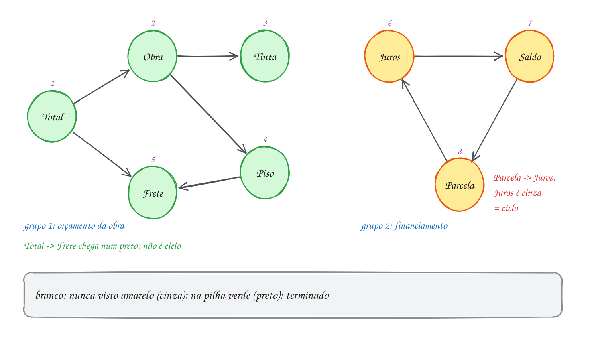</p>

O código usa uma DFS para cada pergunta. Os grupos ignoram a direção
(`usa[u][v] || usa[v][u]`); o ciclo respeita a direção e usa as cores:

```c
#include <stdbool.h>
#include <stdio.h>

#define V 8
enum { BRANCO, CINZA, PRETO }; // nunca visto, na pilha, terminado

const char *nomes[V] = {"Total", "Obra", "Tinta", "Piso", "Frete", "Juros", "Parcela", "Saldo"};
int usa[V][V]; // usa[a][b] = 1: a fórmula de a usa o valor de b
int grupo[V];  // número do componente de cada célula (0 = sem grupo ainda)
int cor[V], pai[V];

// componentes: a direção não importa, só se as células estão ligadas
void marca_grupo(int u, int g) {
    grupo[u] = g;
    for (int v = 0; v < V; v++)
        if ((usa[u][v] || usa[v][u]) && grupo[v] == 0) marca_grupo(v, g);
}

// ciclo: DFS com três cores; devolve true se achar uma aresta para um CINZA
bool acha_ciclo(int u) {
    cor[u] = CINZA;
    for (int v = 0; v < V; v++) {
        if (!usa[u][v]) continue;
        if (cor[v] == CINZA) { // v ainda está na pilha: voltamos a ele
            int volta[V], n = 0; // sobe pelos pais de u até v
            for (int w = u; w != v; w = pai[w]) volta[n++] = w;
            printf("Referência circular: %s", nomes[v]);
            for (int i = n - 1; i >= 0; i--) printf(" -> %s", nomes[volta[i]]);
            printf(" -> %s\n", nomes[v]);
            return true;
        }
        if (cor[v] == BRANCO) {
            pai[v] = u;
            if (acha_ciclo(v)) return true;
        }
    }
    cor[u] = PRETO; // tudo abaixo de u já foi explorado
    return false;
}

int main(void) {
    int formulas[][2] = {{0, 1}, {0, 4}, {1, 2}, {1, 3}, {3, 4},  // orçamento da obra
                         {5, 7}, {7, 6}, {6, 5}};                 // financiamento
    for (int k = 0; k < 8; k++) usa[formulas[k][0]][formulas[k][1]] = 1;

    int grupos = 0;
    for (int u = 0; u < V; u++)
        if (grupo[u] == 0) marca_grupo(u, ++grupos); // cada recomeço é um grupo novo
    printf("Grupos independentes: %d\n", grupos);
    for (int g = 1; g <= grupos; g++) {
        printf("  grupo %d:", g);
        for (int v = 0; v < V; v++)
            if (grupo[v] == g) printf(" %s", nomes[v]);
        printf("\n");
    }

    bool ciclo = false;
    for (int u = 0; u < V && !ciclo; u++) {
        pai[u] = -1;
        if (cor[u] == BRANCO) ciclo = acha_ciclo(u);
    }
    if (!ciclo) printf("Nenhuma referência circular\n");
    return 0;
}
// Saída:
// Grupos independentes: 2
//   grupo 1: Total Obra Tinta Piso Frete
//   grupo 2: Juros Parcela Saldo
// Referência circular: Juros -> Saldo -> Parcela -> Juros
```

Repara no fluxograma: é a chamada `acha_ciclo(u)`. Cada vizinho cai numa de
três situações. Cinza encerra tudo com o ciclo; branco desce na recursão;
preto é ignorado. Quando os vizinhos acabam, `u` fica preto e a chamada
volta para quem a chamou:

<p align="center">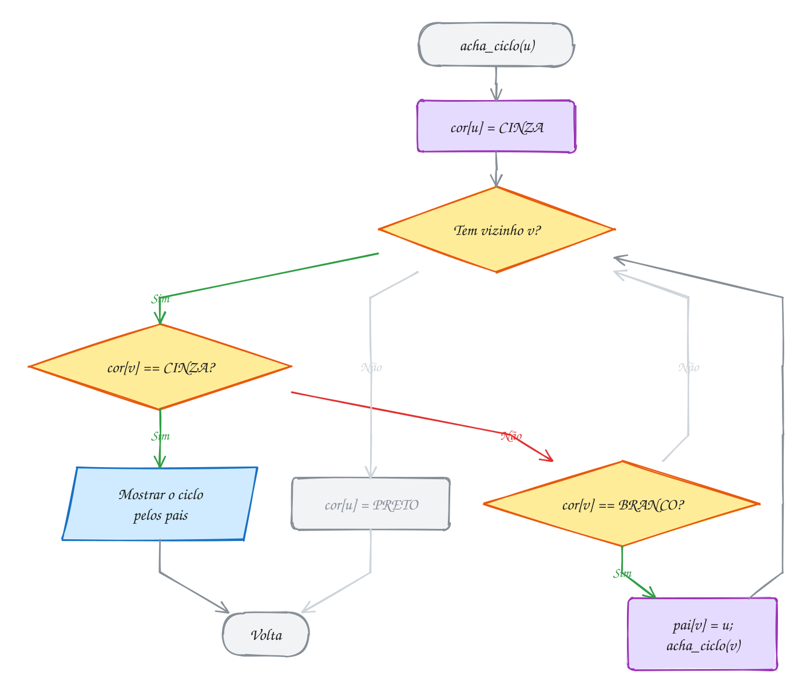</p>

### Passo a passo

As cores no fim de cada chamada ou descoberta. Repare na linha do Frete visto
de Total: ele já está preto, e a DFS segue em frente sem alarme:

| Evento | Cinza (na pilha) | Preto |
| --- | --- | --- |
| entra em Total, Obra, Tinta | Total, Obra, Tinta | |
| Tinta não usa ninguém | Total, Obra | Tinta |
| entra em Piso, Frete | Total, Obra, Piso, Frete | Tinta |
| Frete, Piso e Obra terminam | Total | Tinta, Frete, Piso, Obra |
| Total olha Frete: **preto**, segue | Total | (igual) |
| Total termina | | os 5 da obra |
| entra em Juros, Saldo, Parcela | Juros, Saldo, Parcela | os 5 da obra |
| Parcela olha Juros: **cinza**, ciclo | | |

O exemplo A299 faz o mesmo num grafo **não dirigido** (a rede de cabos de um
escritório), onde não há cores: basta ignorar o pai. O A300 conta os grupos
de amigos à medida que as amizades chegam, com o union-find do assunto 0148.

> [!WARNING]
> Usar só `visitado[]` para achar ciclo num grafo dirigido dá **alarme
> falso**. No exemplo, Total encontraria o Frete já visitado e gritaria
> "ciclo!" sem existir ciclo nenhum. A pergunta certa não é "já vi?", é "ele
> ainda está na pilha?". No grafo **não dirigido** o erro é o oposto: toda
> aresta aparece nos dois sentidos, e o vizinho que é o pai sempre parece um
> ciclo. Lá, ignore o pai.

> [!TIP]
> **Por dentro do C:** a cor cinza é a pilha de chamadas escrita num vetor.
> Os vértices cinza são exatamente os que têm um frame de `acha_ciclo` vivo
> na pilha do programa, e o `enum` deixa isso legível: `BRANCO`, `CINZA` e
> `PRETO` são só as constantes inteiras 0, 1 e 2. Como os vetores são
> globais, começam zerados, ou seja, todo mundo nasce `BRANCO` e com
> `grupo` 0 sem precisar de laço de inicialização. O vetor `volta[V]` é
> local: só existe durante a chamada que achou o ciclo.

> [!NOTE]
> **Pergunta para você:** se a fórmula da Parcela deixar de usar os Juros e
> passar a usar o Frete (troque `{6, 5}` por `{6, 4}`), quantos grupos
> independentes sobram e ainda existe referência circular? Responda antes de
> rodar.

### Hora de praticar

Os arquivos ficam em [`0150-componentes-e-ciclos/`](0150-componentes-e-ciclos/). Os comandos funcionam de qualquer pasta do terminal. Nos exemplos, rode, mude, quebre e rode de novo. Nos exercícios, a resposta vai dentro do próprio arquivo. ★☆☆ é aquecimento, ★★☆ pede raciocínio e ★★★ é desafio.

**Exemplo A299 · O laço de cabos na rede do escritório**

```c
#include <stdbool.h>
#include <stdio.h>

#define V 7

// grafo NÃO dirigido: cabo de rede entre os switches de cada sala
const char *salas[V] = {"TI", "Recepcao", "RH", "Financeiro", "Diretoria", "Deposito", "Copa"};
int cabo[V][V];
bool visitado[V];
int pai[V];       // de onde a DFS chegou em cada sala
bool laco = false;

void explora(int u) {
    visitado[u] = true;
    for (int v = 0; v < V; v++) {
        if (!cabo[u][v] || v == pai[u]) continue; // o cabo por onde cheguei não conta
        if (!visitado[v]) {
            pai[v] = u;
            explora(v);
        } else if (!laco) { // vizinho já visto que não é o pai: fecha um laço
            laco = true;
            printf("Laço de cabos: %s", salas[v]);
            for (int w = u; w != v; w = pai[w]) printf(" - %s", salas[w]);
            printf(" - %s\n", salas[v]);
        }
    }
}

int main(void) {
    int cabos[][2] = {{0, 1}, {0, 2}, {2, 3}, {3, 4}, {4, 2}, {5, 6}};
    for (int k = 0; k < 6; k++) {
        cabo[cabos[k][0]][cabos[k][1]] = 1;
        cabo[cabos[k][1]][cabos[k][0]] = 1; // mão dupla
    }

    int redes = 0;
    for (int u = 0; u < V; u++) {
        if (visitado[u]) continue;
        redes++; // cada recomeço é uma rede separada
        pai[u] = -1;
        explora(u);
    }
    printf("Redes separadas: %d\n", redes);
    printf("%s\n", laco ? "Desligue um cabo do laço" : "Rede sem laços");
    return 0;
}
// Saída:
// Laço de cabos: RH - Diretoria - Financeiro - RH
// Redes separadas: 2
// Desligue um cabo do laço
//
// Um laço de cabos entre switches faz os pacotes de broadcast girarem sem
// parar e derruba a rede. Por isso o teste ignora só o PAI: num grafo não
// dirigido, o cabo de volta para quem chamou sempre aparece.
```

```bash
~/LPEDC/rodar 23-grafos-avancados/0150-componentes-e-ciclos/A299.c
```

**Exemplo A300 · Grupos de corrida que se juntam**

```c
#include <stdio.h>

#define N 8

const char *nomes[N] = {"Ana", "Beto", "Caio", "Dani", "Eli", "Fabi", "Gil", "Hugo"};
int pai[N], tamanho[N];

// union-find (assunto 0148): cada grupo é uma árvore; a raiz é o representante
int acha(int x) {
    if (pai[x] != x) pai[x] = acha(pai[x]); // compressão de caminho
    return pai[x];
}

int main(void) {
    for (int i = 0; i < N; i++) {
        pai[i] = i;
        tamanho[i] = 1;
    }
    int grupos = N;

    // as amizades chegam pelo aplicativo, uma de cada vez
    int amizades[][2] = {{0, 1}, {2, 3}, {1, 3}, {4, 5}, {0, 2}, {6, 7}, {5, 7}, {3, 6}};
    for (int k = 0; k < 8; k++) {
        int a = amizades[k][0], b = amizades[k][1];
        int ra = acha(a), rb = acha(b);
        printf("%-4s + %-4s: ", nomes[a], nomes[b]);
        if (ra == rb) {
            printf("já estavam no mesmo grupo (fecha um ciclo)\n");
            continue;
        }
        if (tamanho[ra] < tamanho[rb]) { // o menor grupo pendura no maior
            int t = ra;
            ra = rb;
            rb = t;
        }
        pai[rb] = ra;
        tamanho[ra] += tamanho[rb];
        grupos--;
        printf("%d grupo%s (o de %s tem %d)\n", grupos, grupos == 1 ? "" : "s", nomes[ra], tamanho[ra]);
    }
    return 0;
}
// Saída:
// Ana  + Beto: 7 grupos (o de Ana tem 2)
// Caio + Dani: 6 grupos (o de Caio tem 2)
// Beto + Dani: 5 grupos (o de Ana tem 4)
// Eli  + Fabi: 4 grupos (o de Eli tem 2)
// Ana  + Caio: já estavam no mesmo grupo (fecha um ciclo)
// Gil  + Hugo: 3 grupos (o de Gil tem 2)
// Fabi + Hugo: 2 grupos (o de Eli tem 4)
// Dani + Gil : 1 grupo (o de Ana tem 8)
//
// A DFS conta os componentes de um grafo pronto. Quando as arestas chegam
// aos poucos, refazer a DFS a cada amizade custaria O(V + E) cada vez; o
// union-find responde em tempo quase constante.
```

```bash
~/LPEDC/rodar 23-grafos-avancados/0150-componentes-e-ciclos/A300.c
```

#### Exercícios

**Exercício E895** · ★☆☆

Um arquipélago tem sete ilhas: Norte, Sul, Leste, Oeste, Coral, Farol e
Gaivota (índices 0 a 6). As pontes, todas de mão dupla, são:


```text
Norte-Farol, Farol-Coral, Sul-Leste, Oeste-Sul
```


Escreva o programa do zero: monte a matriz de adjacência, descubra os
grupos de ilhas ligadas por ponte (os componentes) com uma DFS e um laço
externo, mostre cada grupo e quantas pontes novas, no mínimo, ligariam o
arquipélago inteiro.


```text
Saída esperada:
Grupos de ilhas: 3
  grupo 1: Norte Coral Farol
  grupo 2: Sul Leste Oeste
  grupo 3: Gaivota
Pontes novas para ligar tudo: 2
```

**Dicas:**

1. Use um vetor grupo[V] zerado: 0 quer dizer "sem grupo ainda". A DFS
   marca(u, g) põe g em u e chama a si mesma nos vizinhos com grupo 0.
2. O laço externo chama marca(u, ++grupos) para cada ilha ainda sem
   grupo. Para listar o grupo g, percorra as ilhas em ordem de índice.
3. Resposta esperada: a saída acima. Com g grupos, g - 1 pontes bastam:
   cada ponte nova entre grupos diferentes junta dois deles.

```bash
~/LPEDC/rodar 23-grafos-avancados/0150-componentes-e-ciclos/E895.c
```

**Exercício E896** · ★☆☆

Um gerenciador de pacotes só instala um programa se não houver dependência
circular. Complete a função visita(u), a DFS com três cores: ela devolve
true se, a partir de u, achar uma seta que chega num vértice CINZA. A
função tem_ciclo já pinta todo mundo de BRANCO e chama visita para cada
vértice ainda branco. Repare que na versão 1 o pacote util é alcançado por
três caminhos diferentes, e isso NÃO é ciclo.


```text
Saída esperada:
Versão 1: pode instalar
Versão 2: dependência circular
```

**Dicas:**

1. Primeira linha: cor[u] = CINZA. Última, antes de devolver false:
   cor[u] = PRETO.
2. Para cada v com depende[u][v]: se cor[v] é CINZA, achou; se é BRANCO,
   chame visita(v) e, se ela devolver true, devolva true também. Se é
   PRETO, ignore.
3. Resposta esperada: a saída acima. Na versão 2, a DFS acha o ciclo
   rede -> log -> util -> rede.

```bash
~/LPEDC/rodar 23-grafos-avancados/0150-componentes-e-ciclos/E896.c
```

**Exercício E897** · ★★☆

A prefeitura mapeou as ciclovias entre nove bairros (índices 0 a 8):
Centro, Prainha, Jardim, Lagoa, Industrial, Vila Nova, Alto, Porto e
Mangue. As ciclovias, de mão dupla, são:


```text
Centro-Prainha, Prainha-Jardim, Jardim-Centro, Lagoa-Alto,
Centro-Porto, Alto-Vila Nova
```


Escreva o programa do zero. Ele mostra o maior grupo de bairros ligados
por ciclovia (quantos e quais), os bairros sem nenhuma ciclovia e quantas
ciclovias novas, no mínimo, ligariam a cidade toda.


```text
Saída esperada:
Maior grupo: 4 bairros (Centro, Prainha, Jardim, Porto)
Sem ciclovia: Industrial Mangue
Ciclovias novas para ligar tudo: 3
```

**Dicas:**

1. Faça a DFS devolver um int: quantos bairros ela marcou (1 pelo próprio
   u, mais o que cada chamada recursiva devolver).
2. Guarde o número do maior grupo enquanto o laço externo roda. "Sem
   ciclovia" é grau zero: a linha do bairro na matriz só tem zeros.
3. Resposta esperada: a saída acima. São 4 grupos ({Centro, Prainha,
   Jardim, Porto}, {Lagoa, Vila Nova, Alto}, {Industrial}, {Mangue}),
   então faltam 4 - 1 = 3 ciclovias.

```bash
~/LPEDC/rodar 23-grafos-avancados/0150-componentes-e-ciclos/E897.c
```

**Exercício E898** · ★★☆

O programa abaixo já separa os pontos de três parques (cada parque é um
componente do grafo de trilhas) e lista os pontos de cada um. Estenda o
programa: para cada parque, mostre quantos pontos e quantas trilhas ele
tem e se existe um circuito (dá para sair de um ponto e voltar a ele sem
repetir trilha), sem escrever outra DFS.


```text
Saída esperada:
Parque 1: Portaria Mirante Cachoeira | 3 pontos, 3 trilhas, tem circuito
Parque 2: Lago Bosque Pico Gruta | 4 pontos, 3 trilhas, sem circuito
Parque 3: Rio Ponte Ninho Toca | 4 pontos, 4 trilhas, tem circuito
```

**Dicas:**

1. Um grafo conexo com k vértices e sem ciclo é uma árvore e tem
   exatamente k - 1 arestas. Com mais arestas que isso, tem ciclo.
2. Para contar as trilhas de um parque, some os graus dos pontos dele
   (a linha de cada um na matriz) e divida por 2: cada trilha aparece
   nas duas pontas.
3. Resposta esperada: a saída acima. O parque 2 tem 4 pontos e 3
   trilhas (4 - 1): é uma árvore, sem circuito.

```bash
~/LPEDC/rodar 23-grafos-avancados/0150-componentes-e-ciclos/E898.c
```

**Exercício E899** · ★★★

Ache o bug. Este programa confere se a grade de um curso tem pré-requisito
circular (seta a -> b: a disciplina a vem antes de b). A grade 2024 não
tem ciclo nenhum; a grade 2025 ganhou uma seta Grafos -> Cálculo e passou
a ter. Mas o programa acusa ciclo nas duas:


```text
Saída que aparece:
Grade 2024: pré-requisito circular
Grade 2025: pré-requisito circular
```


```text
Saída esperada:
Grade 2024: sem ciclo
Grade 2025: pré-requisito circular
```


O programa compila e roda sem erro; o problema é de lógica. Conserte a
DFS para que ela dê a saída esperada.

**Dicas:**

1. Na grade 2024, siga a DFS a partir de Lógica: ela desce por C,
   Estruturas, Grafos e Arquivos. Depois Lógica olha Estruturas, que já
   foi visitada. Isso é ciclo?
2. "Já visitado" não quer dizer "está na pilha". Troque o bool por três
   estados: branco (nunca visto), cinza (na pilha) e preto (terminado).
3. Resposta esperada: a saída esperada acima. Só é ciclo a seta para um
   vértice cinza; ao terminar o laço dos vizinhos, pinte u de preto.

```bash
~/LPEDC/rodar 23-grafos-avancados/0150-componentes-e-ciclos/E899.c
```

**Exercício E900** · ★★★

O restaurante tem dois turnos, A e B, e oito funcionários. Alguns pares
não podem trabalhar juntos (conflito, de mão dupla). Escreva a função
divide(): ela põe cada pessoa num turno de modo que todo par em conflito
fique em turnos diferentes, e mostra os dois turnos; se for impossível,
mostra o primeiro par que cairia junto.

Use uma DFS que pinta: quem começa uma DFS nova vai para o turno A, e
cada vizinho recebe o turno oposto ao de quem o descobriu. Examine os
vizinhos em ordem de índice.


```text
Saída esperada:
Turno A: Ana Caio Enzo Gui
Turno B: Bia Duda Flor Hana
Impossível: Caio e Ana cairiam no mesmo turno
```

**Dicas:**

1. Vetor turno[V] com -1 (sem turno), 0 (A) ou 1 (B). A DFS pinta(u, t)
   põe t em u e chama pinta(v, 1 - t) nos vizinhos sem turno.
2. Se um vizinho já tem o MESMO turno de u, é conflito: mostre "u e v"
   e devolva false até o topo. O laço externo cobre os componentes que
   a primeira DFS não alcança (Enzo, Flor, Gui, Hana).
3. Resposta esperada: a saída acima. Na segunda chamada, Ana, Bia e Caio
   formam um triângulo: Ana vai para o A, Bia para o B, Caio para o A, e
   Caio e Ana ficam juntos. Um ciclo de tamanho ímpar nunca pode ser
   dividido em dois turnos.

```bash
~/LPEDC/rodar 23-grafos-avancados/0150-componentes-e-ciclos/E900.c
```

---

## 0151 · Ordenação topológica

O mestre de obras tem oito serviços para encaixar no cronograma da casa. Não
dá para levantar parede sem fundação, nem rebocar antes de passar os canos e
os fios, nem pintar com o reboco molhado. Ele precisa de uma lista, em fila
indiana, em que **todo serviço apareça depois dos que ele espera**.

Cada regra "a antes de b" é uma seta `a -> b`, e o conjunto vira um grafo
dirigido. A lista pedida é a **ordenação topológica**: uma ordem dos
vértices em que toda seta aponta para a frente. Ela só existe se o grafo não
tem ciclo. Se a pintura espera o reboco e o reboco espera a pintura, ninguém
começa. Um grafo dirigido sem ciclos tem até sigla: **DAG** (*directed
acyclic graph*).

O jeito mais natural é o **algoritmo de Kahn**, que faz o que o mestre de
obras faria:

1. conte, para cada serviço, quantos ele espera: o **grau de entrada**;
2. ponha numa fila (assunto 0085) todos com grau 0, os que já podem começar;
3. tire um da fila e escreva na lista. Ele terminou, então cada serviço que
   esperava por ele espera **um a menos**: `grau[v]--`. Quem chegar a 0 entra
   na fila;
4. repita até a fila esvaziar.

Se a lista terminar com menos de V serviços, sobrou gente esperando para
sempre: os que estão num ciclo, ou depois de um. Kahn já detecta o ciclo de
graça. Cada vértice entra e sai da fila uma vez e cada seta é descontada uma
vez: O(V + E) com lista de adjacência, O(V²) com matriz.

A resposta **não é única**. Elétrica, Hidráulica e Telhado ficam livres ao
mesmo tempo, e qualquer ordem entre eles serve. A fila e a ordem de índice
dos vizinhos decidem o empate; mude a numeração e a lista muda, sem estar
errada.

Existe um segundo caminho, pela DFS do assunto 0111. Quando a chamada
`dfs(u)` termina, tudo o que depende de `u` já terminou antes. Então a ordem
em que as chamadas **terminam** (a **pós-ordem**), lida de trás para a
frente, é uma ordenação topológica. Na prática: empilhe `u` no fim de
`dfs(u)` e, no final, desempilhe tudo. O exemplo A301 faz assim.

Vamos ver na prática. O número em cima de cada serviço é a posição dele na
lista. Repare no Reboco, que espera três serviços e só entra em sétimo:

<p align="center">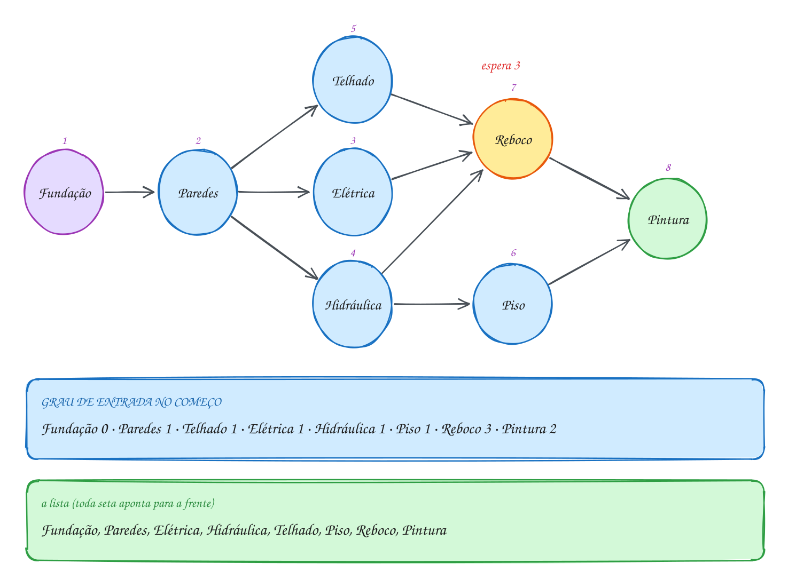</p>

O código guarda as regras numa matriz, conta os graus e roda Kahn com uma
fila num vetor (cada vértice entra uma vez, então V posições bastam):

```c
#include <stdio.h>

#define V 8

int main(void) {
    const char *tarefas[V] = {"Elétrica", "Fundação", "Hidráulica", "Paredes",
                              "Piso", "Pintura", "Reboco", "Telhado"};
    int antes[V][V] = {0}; // antes[a][b] = 1: a precisa terminar antes de b
    int regras[][2] = {{1, 3}, {3, 7}, {3, 0}, {3, 2}, {7, 6},
                       {0, 6}, {2, 6}, {2, 4}, {6, 5}, {4, 5}};
    for (int k = 0; k < 10; k++) antes[regras[k][0]][regras[k][1]] = 1;

    int grau[V] = {0}; // quantas tarefas cada uma ainda espera
    for (int a = 0; a < V; a++)
        for (int b = 0; b < V; b++) grau[b] += antes[a][b];

    int fila[V], inicio = 0, fim = 0;
    for (int v = 0; v < V; v++)
        if (grau[v] == 0) fila[fim++] = v; // quem não espera ninguém começa

    int feitas = 0;
    while (inicio < fim) {
        int u = fila[inicio++];
        printf("%d. %s\n", ++feitas, tarefas[u]);
        for (int v = 0; v < V; v++) {
            if (!antes[u][v]) continue;
            grau[v]--;                          // u terminou: v espera uma a menos
            if (grau[v] == 0) fila[fim++] = v;  // v ficou livre
        }
    }
    if (feitas < V) printf("Ciclo: %d tarefas nunca ficaram livres\n", V - feitas);
    return 0;
}
// Saída:
// 1. Fundação
// 2. Paredes
// 3. Elétrica
// 4. Hidráulica
// 5. Telhado
// 6. Piso
// 7. Reboco
// 8. Pintura
```

Repara no fluxograma: o laço só pergunta "a fila tem alguém?". A pergunta
sobre o ciclo fica para o fim, quando se compara quantos saíram com V:

<p align="center">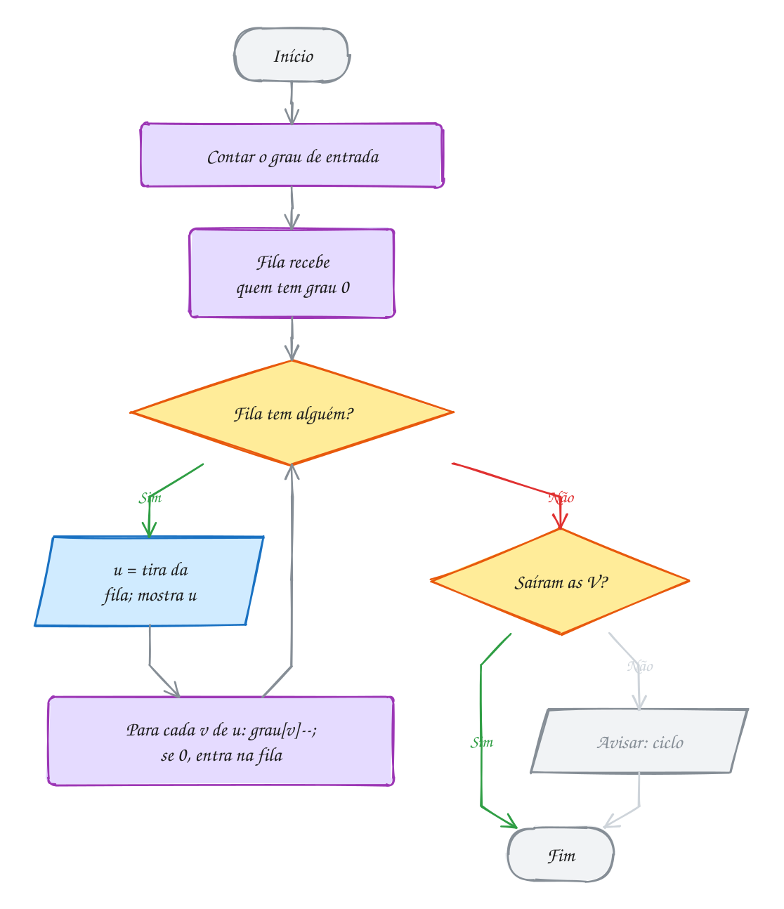</p>

### Passo a passo

Cada linha tira um serviço da fila e desconta os que esperavam por ele:

| Sai | Graus que caem | Entram na fila | Fila depois |
| --- | --- | --- | --- |
| (início) | | Fundação | Fundação |
| Fundação | Paredes 1 → 0 | Paredes | Paredes |
| Paredes | Elétrica, Hidráulica e Telhado 1 → 0 | os três | Elétrica, Hidráulica, Telhado |
| Elétrica | Reboco 3 → 2 | | Hidráulica, Telhado |
| Hidráulica | Piso 1 → 0, Reboco 2 → 1 | Piso | Telhado, Piso |
| Telhado | Reboco 1 → 0 | Reboco | Piso, Reboco |
| Piso | Pintura 2 → 1 | | Reboco |
| Reboco | Pintura 1 → 0 | Pintura | Pintura |
| Pintura | | | (vazia) |

O A302 aproveita o mesmo Kahn para outra pergunta: em vez de uma fila
indiana, quantos semestres no mínimo um curso precisa, cursando em paralelo
tudo que já está liberado.

> [!WARNING]
> O grau que importa é o de **entrada** (quantas setas **chegam**), e a conta
> é `grau[b] += antes[a][b]`, somando pela coluna. Somar pela linha dá o grau
> de saída, e aí "grau 0" passa a querer dizer "ninguém depende de mim": só
> a Pintura começa na fila, ela sai, não libera ninguém, e o programa acusa
> um ciclo que não existe. E não esqueça o teste `feitas < V` no fim: sem
> ele, um ciclo de verdade produz uma lista incompleta que parece certa.

> [!TIP]
> **Por dentro do C:** a fila daqui nunca dá a volta, por isso não precisa ser
> circular como a do assunto 0085: cada vértice entra exatamente uma vez,
> então `fim` nunca passa de V. No fim do laço, `fila[0..fim-1]` é a própria
> ordenação, guardada em ordem. O vetor `grau[]` é a única coisa que o
> algoritmo destrói: depois de rodar, ele está todo zerado (ou com sobras nos
> vértices do ciclo). Se precisar dos graus de novo, conte outra vez ou
> trabalhe numa cópia.

> [!NOTE]
> **Pergunta para você:** se o Piso também passar a esperar o Telhado
> (acrescente `{7, 4}` nas regras e troque o 10 por 11), em que posição o
> Piso sai? E se a Fundação passar a esperar a Pintura (`{5, 1}`), o que o
> programa mostra?

### Hora de praticar

Os arquivos ficam em [`0151-ordenacao-topologica/`](0151-ordenacao-topologica/). Os comandos funcionam de qualquer pasta do terminal. Nos exemplos, rode, mude, quebre e rode de novo. Nos exercícios, a resposta vai dentro do próprio arquivo. ★☆☆ é aquecimento, ★★☆ pede raciocínio e ★★★ é desafio.

**Exemplo A301 · Ordem de compilação pela DFS**

```c
#include <stdbool.h>
#include <stdio.h>

#define V 7
enum { BRANCO, CINZA, PRETO };

const char *modulos[V] = {"main", "menu", "estoque", "banco", "relatorio", "util", "log"};
int usa[V][V]; // usa[a][b] = 1: a.c faz #include "b.h" (b precisa estar pronto antes)
int cor[V];
int pos_ordem[V], n_pos; // a ordem em que as chamadas da DFS terminam

bool dfs(int u) {
    cor[u] = CINZA;
    for (int v = 0; v < V; v++) {
        if (!usa[u][v]) continue;
        if (cor[v] == CINZA) {
            printf("Include circular: %s -> %s\n", modulos[u], modulos[v]);
            return false;
        }
        if (cor[v] == BRANCO && !dfs(v)) return false;
    }
    cor[u] = PRETO;
    pos_ordem[n_pos++] = u; // u termina depois de tudo de que ele depende
    return true;
}

void ordem_de_compilacao(void) {
    for (int v = 0; v < V; v++) cor[v] = BRANCO;
    n_pos = 0;
    for (int u = 0; u < V; u++)
        if (cor[u] == BRANCO && !dfs(u)) return;
    printf("Compilar:");
    for (int i = 0; i < n_pos; i++) printf(" %s", modulos[pos_ordem[i]]);
    printf("\n");
}

int main(void) {
    int includes[][2] = {{0, 1}, {0, 4}, {1, 2}, {2, 3}, {4, 2},
                         {4, 5}, {3, 6}, {5, 6}, {2, 5}};
    for (int k = 0; k < 9; k++) usa[includes[k][0]][includes[k][1]] = 1;
    ordem_de_compilacao();

    usa[6][1] = 1; // alguém fez o log incluir o menu
    ordem_de_compilacao();
    return 0;
}
// Saída:
// Compilar: log banco util estoque menu relatorio main
// Include circular: log -> menu
//
// Aqui as setas apontam para quem precisa vir ANTES (a usa b). Por isso a
// própria pós-ordem já é a resposta. Com setas no sentido "a antes de b",
// como na obra do texto, a resposta é a pós-ordem lida de trás para frente.
```

```bash
~/LPEDC/rodar 23-grafos-avancados/0151-ordenacao-topologica/A301.c
```

**Exemplo A302 · Quantos semestres até o TCC**

```c
#include <stdio.h>

#define V 10

int main(void) {
    const char *disc[V] = {"Algoritmos", "Cálculo I", "Cálculo II", "Estruturas", "Banco de Dados",
                           "Redes", "Sist. Operacionais", "Compiladores", "TCC", "Inglês"};
    int pre[V][V] = {0}; // pre[a][b] = 1: a é pré-requisito de b
    int regras[][2] = {{0, 3}, {0, 4}, {1, 2}, {3, 6}, {3, 7},
                       {2, 7}, {6, 5}, {4, 8}, {7, 8}, {5, 8}};
    for (int k = 0; k < 10; k++) pre[regras[k][0]][regras[k][1]] = 1;

    int grau[V] = {0};
    for (int a = 0; a < V; a++)
        for (int b = 0; b < V; b++) grau[b] += pre[a][b];

    // Kahn por rodadas: cada rodada pega TODO mundo que já está liberado
    int atual[V], n_atual = 0;
    for (int v = 0; v < V; v++)
        if (grau[v] == 0) atual[n_atual++] = v;

    int semestre = 0, cursadas = 0;
    while (n_atual > 0) {
        printf("Semestre %d:", ++semestre);
        int prox[V], n_prox = 0;
        for (int i = 0; i < n_atual; i++) {
            int u = atual[i];
            printf("%s %s", i > 0 ? "," : "", disc[u]);
            cursadas++;
            for (int v = 0; v < V; v++)
                if (pre[u][v] && --grau[v] == 0) prox[n_prox++] = v; // libera para a próxima rodada
        }
        printf("\n");
        for (int i = 0; i < n_prox; i++) atual[i] = prox[i];
        n_atual = n_prox;
    }
    if (cursadas < V) printf("Grade com pré-requisito circular!\n");
    else printf("Mínimo: %d semestres\n", semestre);
    return 0;
}
// Saída:
// Semestre 1: Algoritmos, Cálculo I, Inglês
// Semestre 2: Estruturas, Banco de Dados, Cálculo II
// Semestre 3: Sist. Operacionais, Compiladores
// Semestre 4: Redes
// Semestre 5: TCC
// Mínimo: 5 semestres
//
// O número de rodadas é o tamanho do caminho mais longo do DAG, contado em
// vértices: Algoritmos -> Estruturas -> Sist. Operacionais -> Redes -> TCC.
// Nenhuma grade, por mais matérias que você pegue, termina antes disso.
```

```bash
~/LPEDC/rodar 23-grafos-avancados/0151-ordenacao-topologica/A302.c
```

#### Exercícios

**Exercício E901** · ★☆☆

A receita de bolo tem oito passos (índices 0 a 7): bater os ovos,
desenformar, despejar na forma, misturar os secos, juntar tudo,
preaquecer o forno, untar a forma e assar. As regras "a antes de b" são:


```text
bater os ovos -> juntar tudo       misturar os secos -> juntar tudo
juntar tudo -> despejar na forma   untar a forma -> despejar na forma
despejar na forma -> assar         preaquecer o forno -> assar
assar -> desenformar
```


Escreva do zero o algoritmo de Kahn (matriz, grau de entrada, fila) e
mostre os passos numerados. Examine os vizinhos em ordem de índice.


```text
Saída esperada:
1. bater os ovos
2. misturar os secos
3. preaquecer o forno
4. untar a forma
5. juntar tudo
6. despejar na forma
7. assar
8. desenformar
```

**Dicas:**

1. O grau de entrada de b soma a coluna b da matriz: grau[b] += antes[a][b].
2. Comece a fila com todos de grau 0, em ordem de índice: bater os ovos,
   misturar os secos, preaquecer o forno e untar a forma.
3. Resposta esperada: a saída acima. "Juntar tudo" só fica livre depois
   dos ovos e dos secos, e entra na fila atrás dos quatro primeiros.

```bash
~/LPEDC/rodar 23-grafos-avancados/0151-ordenacao-topologica/E901.c
```

**Exercício E902** · ★☆☆

Três técnicos mandaram a ordem em que montariam um computador. Complete a
função valida(ordem): ela confere se toda regra "a antes de b" é
respeitada. Se for, mostra "válida"; se não, mostra a primeira regra
quebrada (procurando a de 0 a 7 e b de 0 a 7, nessa ordem) e devolve false.
As regras, já montadas no main, são:


```text
processador -> cooler          processador -> placa no gabinete
cooler -> placa no gabinete    memória -> placa no gabinete
placa no gabinete -> cabos     placa no gabinete -> placa de vídeo
fonte -> cabos                 placa de vídeo -> cabos
cabos -> ligar
```


```text
Saída esperada:
João: válida
Lia: válida
Rui: inválida (placa no gabinete veio antes de cooler)
```

**Dicas:**

1. Monte um vetor pos[V] com a posição de cada etapa na ordem:
   pos[ordem[i]] = i.
2. A regra a -> b está quebrada quando antes[a][b] e pos[a] > pos[b].
   Aí b apareceu antes de a.
3. Resposta esperada: a saída acima. João e Lia mandaram ordens
   diferentes, e as duas valem: a ordenação topológica não é única.

```bash
~/LPEDC/rodar 23-grafos-avancados/0151-ordenacao-topologica/E902.c
```

**Exercício E903** · ★★☆

A equipe de suporte tem sete chamados, #101 a #107 (índices 0 a 6), e
alguns só podem ser resolvidos depois de outros:


```text
#105 -> #101   #105 -> #102   #106 -> #102   #102 -> #103
#107 -> #104   #101 -> #104
```


O Kahn com fila atende na ordem em que os chamados ficam livres. A chefe
quer outra regra: entre os livres, sempre o de MENOR número. Escreva as
duas funções: kahn_fila (o Kahn do texto) e kahn_menor (a cada passo,
procura o menor índice ainda não feito com grau 0).


```text
Saída esperada:
Fila:   #105 #106 #107 #101 #102 #104 #103
Menor:  #105 #101 #106 #102 #103 #107 #104
```

**Dicas:**

1. kahn_menor não precisa de fila: um vetor feito[] e, a cada um dos V
   passos, um laço que pega o primeiro v com !feito[v] e grau[v] == 0.
2. Feito o u, desconte grau[v] de todo v com antes[u][v]. Se num passo
   nenhum vértice estiver livre, há ciclo.
3. Resposta esperada: a saída acima. As duas são ordenações válidas. A
   "menor" custa O(V²) com essa busca; com um heap de mínimo (assunto
   0102) no lugar da fila, cairia para O((V + E) log V).

```bash
~/LPEDC/rodar 23-grafos-avancados/0151-ordenacao-topologica/E903.c
```

**Exercício E904** · ★★☆

Este é o Kahn da obra do texto, agora com a duração de cada serviço em
dias. Com equipes trabalhando em paralelo, um serviço começa no dia em
que o ÚLTIMO dos que ele espera termina. Estenda o programa: mostre o
dia de início e de fim de cada serviço, o prazo total e o caminho
crítico (a corrente de serviços que, se atrasar um dia, atrasa a obra).


```text
Saída esperada:
Fundação: dia 0 ao 10
Paredes: dia 10 ao 25
Elétrica: dia 25 ao 30
Hidráulica: dia 25 ao 31
Telhado: dia 25 ao 32
Piso: dia 31 ao 35
Reboco: dia 32 ao 40
Pintura: dia 40 ao 46
Obra pronta em 46 dias
Caminho crítico: Fundação -> Paredes -> Telhado -> Reboco -> Pintura
```

**Dicas:**

1. Crie comeca[V] (zerado) e quem[V] (com -1). Ao tirar u da fila,
   termina = comeca[u] + dias[u]. Para cada v com antes[u][v], se
   termina > comeca[v], então comeca[v] = termina e quem[v] = u.
2. A ordem topológica garante que, quando v sai da fila, todos os que
   ele espera já passaram: comeca[v] está pronto. O serviço que termina
   por último dá o prazo; siga quem[] de trás para frente a partir dele.
3. Resposta esperada: a saída acima. O Reboco espera Telhado (32),
   Elétrica (30) e Hidráulica (31): quem segura é o Telhado.

```bash
~/LPEDC/rodar 23-grafos-avancados/0151-ordenacao-topologica/E904.c
```

**Exercício E905** · ★★★

Ache o bug. Este programa monta, com a DFS, a ordem para configurar um
servidor novo (seta a -> b: a etapa a vem antes de b). Rode e confira a
saída contra as regras: a aplicação aparece logo depois do sistema, antes
do banco, do usuário do banco e do certificado, que ela espera.


```text
Saída que aparece:
sistema aplicação banco usuário firewall certificado
```


```text
Saída esperada:
sistema firewall certificado banco usuário aplicação
```


O programa compila e roda sem erro. Conserte a lógica (bastam duas
mudanças pequenas) para que ele mostre a saída esperada.

**Dicas:**

1. Em que momento cada etapa entra no vetor ordem[]: quando a chamada
   dfs(u) começa ou quando ela termina? Qual das duas garante que tudo o
   que vem depois de u já foi tratado?
2. A ordem em que as chamadas TERMINAM é a pós-ordem. Com setas "a antes
   de b", a resposta é a pós-ordem lida de trás para frente.
3. Resposta esperada: mova "ordem[n++] = u;" para o fim de dfs (depois do
   laço) e imprima o vetor de n - 1 até 0. A pós-ordem é aplicação,
   usuário, banco, certificado, firewall, sistema.

```bash
~/LPEDC/rodar 23-grafos-avancados/0151-ordenacao-topologica/E905.c
```

**Exercício E906** · ★★★

Quantas ordens diferentes existem para a rotina da manhã? As tarefas são
café, banho, vestir, escovar e sair (índices 0 a 4), com as regras:


```text
banho -> vestir   café -> escovar   vestir -> sair   escovar -> sair
```


Escreva conta(): ela gera TODAS as ordenações topológicas com
backtracking (assunto 0127), mostra cada uma quando mostrar é true e
devolve quantas são. Depois o main acrescenta uma sexta tarefa, ler as
mensagens (antes de sair), e pede só o total.


```text
Saída esperada:
café, banho, vestir, escovar, sair
café, banho, escovar, vestir, sair
café, escovar, banho, vestir, sair
banho, café, vestir, escovar, sair
banho, café, escovar, vestir, sair
banho, vestir, café, escovar, sair
Total com 5 tarefas: 6
Total com 6 tarefas: 30
```

**Dicas:**

1. É o Kahn com escolha: em cada posição pos, tente, em ordem de índice,
   cada tarefa u ainda não usada com grau[u] == 0. Escolher u é marcar
   usada[u], pôr em ordem[pos] e descontar grau[v] dos sucessores.
2. Depois da chamada recursiva para pos + 1, DESFAÇA: devolva os graus e
   desmarque u. Quando pos == n, achou uma ordem completa: conte 1.
3. Resposta esperada: a saída acima. As ordens aparecem antes da linha
   do total porque o printf só escreve depois que conta() termina. Com 6
   tarefas são 30: em cada uma das 6 ordens, as mensagens cabem em 5
   lugares antes do "sair".

```bash
~/LPEDC/rodar 23-grafos-avancados/0151-ordenacao-topologica/E906.c
```

---

## 0152 · Kruskal: árvore geradora mínima

A prefeitura tem verba para asfaltar estradas de terra entre seis vilas:
Sede, Ponte, Brejo, Serra, Lagoa e Vale. A engenharia orçou nove trechos
possíveis, de R$ 2 mil a R$ 9 mil. A exigência é uma só: depois da obra, dá
para ir de qualquer vila a qualquer outra pelo asfalto. E o prefeito quer
gastar o mínimo.

Repare que ninguém pediu o caminho mais curto entre duas vilas. Pediu um
conjunto de estradas que **ligue todo mundo** com a **menor soma**. Esse
conjunto nunca tem ciclo: num ciclo, dá para tirar a estrada mais cara e
todo mundo continua ligado, mais barato. Um grafo conexo e sem ciclo é uma
**árvore**, e uma árvore com V vértices tem exatamente **V - 1 arestas**.

O que se procura, então, é a **árvore geradora mínima** (MST, de *minimum
spanning tree*): uma árvore que "gera", ou seja, toca todos os vértices, com
a menor soma de pesos possível. O grafo é **não dirigido** e ponderado.

O algoritmo de **Kruskal** é guloso (assunto 0133) e quase óbvio:

1. ordene as arestas da mais barata para a mais cara;
2. percorra a lista e **aceite** cada aresta que **não feche ciclo** com as
   já aceitas;
3. pare quando tiver V - 1 arestas.

A única parte difícil é o passo 2: como saber, rápido, se `a` e `b` já estão
ligados pelas arestas aceitas? É a pergunta que o **union-find** do assunto
0148 responde. Cada grupo de vilas já ligadas é um conjunto. Se `acha(a)` e
`acha(b)` devolvem o mesmo representante, a aresta fecharia um ciclo. Se
não, ela junta dois grupos: `une`.

Por que o guloso acerta aqui? Pegue a aresta mais barata entre dois grupos
quaisquer. Toda árvore que liga tudo precisa atravessar de um grupo para o
outro em algum ponto, e atravessar pela mais barata nunca é pior. Esse
argumento tem nome nos livros: **propriedade do corte**.

Vamos ver na prática. As arestas verdes são as aceitas. Embaixo, a lista
ordenada: verde entrou, vermelho fecharia ciclo, cinza nem foi olhado porque
as 5 arestas já tinham saído:

<p align="center">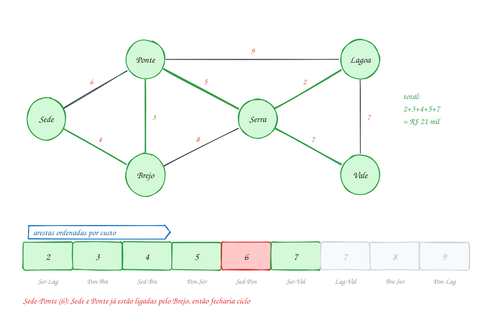</p>

O código guarda as estradas numa lista de arestas (Kruskal não precisa de
matriz), ordena com o `qsort` do assunto 0096 e usa o union-find com
compressão de caminho e união por tamanho:

```c
#include <stdio.h>
#include <stdlib.h>

#define V 6
#define E 9

typedef struct {
    int a, b, custo; // estrada entre a e b, em R$ mil
} Aresta;

const char *vilas[V] = {"Sede", "Ponte", "Brejo", "Serra", "Lagoa", "Vale"};
int pai[V], tamanho[V];

int acha(int x) { // representante do grupo de x, com compressão de caminho
    if (pai[x] != x) pai[x] = acha(pai[x]);
    return pai[x];
}

void une(int ra, int rb) { // junta dois grupos: o menor pendura no maior
    if (tamanho[ra] < tamanho[rb]) {
        int t = ra;
        ra = rb;
        rb = t;
    }
    pai[rb] = ra;
    tamanho[ra] += tamanho[rb];
}

int compara(const void *p, const void *q) {
    const Aresta *x = p, *y = q;
    if (x->custo != y->custo) return x->custo - y->custo;
    return x->a - y->a; // empate: decide pelo primeiro vértice
}

int main(void) {
    Aresta estradas[E] = {{0, 2, 4}, {1, 2, 3}, {0, 1, 6}, {2, 3, 8}, {1, 3, 5},
                          {1, 4, 9}, {3, 4, 2}, {3, 5, 7}, {4, 5, 7}};
    qsort(estradas, E, sizeof(Aresta), compara); // 1) da mais barata à mais cara

    for (int v = 0; v < V; v++) { // 2) cada vila começa sozinha
        pai[v] = v;
        tamanho[v] = 1;
    }

    int total = 0, aceitas = 0;
    for (int k = 0; k < E && aceitas < V - 1; k++) { // 3) uma árvore tem V - 1 arestas
        Aresta e = estradas[k];
        int ra = acha(e.a), rb = acha(e.b);
        printf("%s-%s (%d): ", vilas[e.a], vilas[e.b], e.custo);
        if (ra == rb) {
            printf("fecha ciclo\n"); // as duas pontas já estão ligadas
            continue;
        }
        une(ra, rb);
        total += e.custo;
        aceitas++;
        printf("aceita\n");
    }
    printf("Total: R$ %d mil em %d estradas\n", total, aceitas);
    return 0;
}
// Saída:
// Serra-Lagoa (2): aceita
// Ponte-Brejo (3): aceita
// Sede-Brejo (4): aceita
// Ponte-Serra (5): aceita
// Sede-Ponte (6): fecha ciclo
// Serra-Vale (7): aceita
// Total: R$ 21 mil em 5 estradas
```

Repara no fluxograma: o laço tem duas saídas, acabar a lista ou completar
V - 1 arestas. A pergunta do meio é a do union-find, e ela decide tudo:

<p align="center">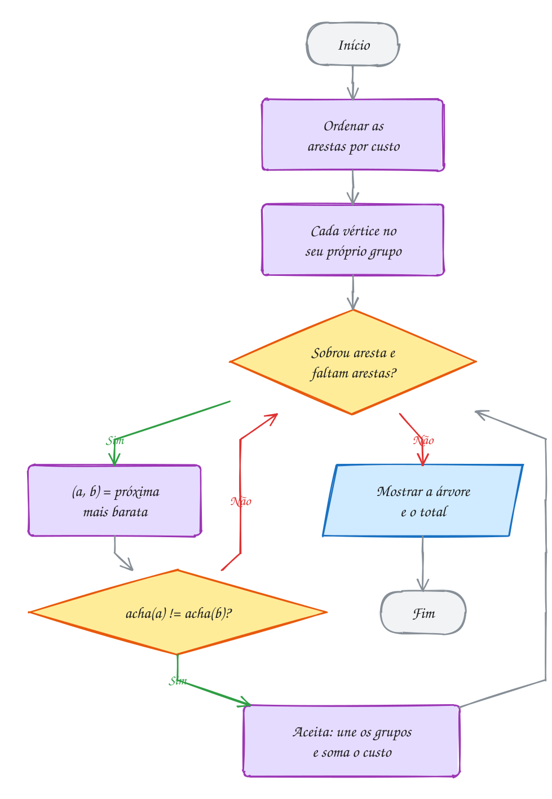</p>

### Passo a passo

Os grupos depois de cada aresta. A Sede-Ponte chega quando Sede e Ponte já
estão no mesmo grupo, ligadas pelo Brejo:

| Aresta | `acha` das pontas | Decisão | Grupos depois |
| --- | --- | --- | --- |
| (início) | | | {Sede} {Ponte} {Brejo} {Serra} {Lagoa} {Vale} |
| Serra-Lagoa 2 | diferentes | aceita | {Serra, Lagoa}, os outros sozinhos |
| Ponte-Brejo 3 | diferentes | aceita | {Ponte, Brejo} {Serra, Lagoa} {Sede} {Vale} |
| Sede-Brejo 4 | diferentes | aceita | {Sede, Ponte, Brejo} {Serra, Lagoa} {Vale} |
| Ponte-Serra 5 | diferentes | aceita | {Sede, Ponte, Brejo, Serra, Lagoa} {Vale} |
| Sede-Ponte 6 | **iguais** | ciclo | (igual) |
| Serra-Vale 7 | diferentes | aceita | todas juntas: 5 arestas, para |

Lagoa-Vale também custa 7. Se ela viesse antes na lista, entraria no lugar
de Serra-Vale: outra árvore, **mesmo total**. Com empates, a MST pode não ser
única; o custo mínimo é.

O A303 usa o Kruskal parado antes do fim para separar clientes em regiões
de entrega. O A304 inverte a ordenação e acha a árvore de **maior** soma, a
das melhores conexões de uma rede Wi-Fi.

> [!WARNING]
> Testar `pai[a] != pai[b]` no lugar de `acha(a) != acha(b)` é o erro clássico.
> O `pai` de um vértice é só o próximo passo rumo ao representante, não o
> representante. Dois vértices do mesmo grupo podem ter pais diferentes, e
> aí a aresta entre eles é aceita, fechando um ciclo e estragando o total. E
> o comparador do `qsort` com `x->custo - y->custo` só é seguro porque os
> custos são pequenos; com valores perto de `INT_MAX`, a subtração estoura.
> Nesse caso, devolva `(x->custo > y->custo) - (x->custo < y->custo)`.

> [!TIP]
> **Por dentro do C:** o `qsort` não conhece `Aresta`. Ele recebe o vetor como
> bytes (`void *`), o tamanho de cada elemento (`sizeof(Aresta)`, 12 bytes) e
> troca blocos de 12 bytes de lugar, chamando `compara` com ponteiros para
> dois blocos. Dentro de `compara`, a conversão de `const void *` para
> `const Aresta *` devolve o tipo. O custo do Kruskal é dominado pela
> ordenação, O(E log E); o union-find, com os dois truques, custa quase O(1)
> por operação. Para mil vilas e 100 mil trechos, uns 1,7 milhão de
> comparações.

> [!NOTE]
> **Pergunta para você:** se o trecho Ponte-Serra subir de 5 para 10 mil, qual
> estrada entra no lugar dele e qual passa a ser o total? Refaça a tabela
> antes de mudar o `{1, 3, 5}`.

### Hora de praticar

Os arquivos ficam em [`0152-kruskal/`](0152-kruskal/). Os comandos funcionam de qualquer pasta do terminal. Nos exemplos, rode, mude, quebre e rode de novo. Nos exercícios, a resposta vai dentro do próprio arquivo. ★☆☆ é aquecimento, ★★☆ pede raciocínio e ★★★ é desafio.

**Exemplo A303 · Kruskal parado no meio: três regiões de entrega**

```c
#include <stdio.h>
#include <stdlib.h>

#define N 8
#define K 3 // quantas regiões a transportadora quer

typedef struct {
    int a, b, dist;
} Aresta;

const char *clientes[N] = {"Ana", "Bruno", "Carla", "Davi", "Edu", "Fê", "Gabi", "Hélio"};
int x[N] = {1, 2, 3, 10, 11, 12, 5, 6}; // posição no mapa, em quadras
int y[N] = {1, 3, 1, 2, 4, 1, 10, 12};
int pai[N];

int acha(int v) {
    if (pai[v] != v) pai[v] = acha(pai[v]);
    return pai[v];
}

int compara(const void *p, const void *q) {
    const Aresta *e = p, *f = q;
    return e->dist - f->dist;
}

int main(void) {
    Aresta pares[N * (N - 1) / 2]; // grafo completo: todo par de clientes
    int m = 0;
    for (int i = 0; i < N; i++)
        for (int j = i + 1; j < N; j++)
            pares[m++] = (Aresta){i, j, abs(x[i] - x[j]) + abs(y[i] - y[j])}; // quadras andando
    qsort(pares, m, sizeof(Aresta), compara);

    for (int v = 0; v < N; v++) pai[v] = v;
    int grupos = N, k = 0;
    while (grupos > K) { // Kruskal normal, mas para com K grupos em vez de 1
        int ra = acha(pares[k].a), rb = acha(pares[k].b);
        if (ra != rb) {
            pai[rb] = ra;
            grupos--;
        }
        k++;
    }
    while (acha(pares[k].a) == acha(pares[k].b)) k++; // a próxima que juntaria duas regiões

    int regiao = 0;
    for (int v = 0; v < N; v++) {
        if (acha(v) != v) continue; // só os representantes abrem uma região
        printf("Região %d:", ++regiao);
        for (int w = 0; w < N; w++)
            if (acha(w) == v) printf(" %s", clientes[w]);
        printf("\n");
    }
    printf("Distância mínima entre regiões: %d quadras (%s e %s)\n", pares[k].dist,
           clientes[pares[k].a], clientes[pares[k].b]);
    return 0;
}
// Saída:
// Região 1: Ana Bruno Carla
// Região 2: Davi Edu Fê
// Região 3: Gabi Hélio
// Distância mínima entre regiões: 8 quadras (Carla e Davi)
//
// Parar o Kruskal com K grupos dá o agrupamento em que as regiões ficam o
// mais afastadas possível umas das outras: as arestas que faltam são
// justamente as mais longas.
```

```bash
~/LPEDC/rodar 23-grafos-avancados/0152-kruskal/A303.c
```

**Exemplo A304 · A árvore de MAIOR soma: o melhor sinal do Wi-Fi mesh**

```c
#include <stdio.h>
#include <stdlib.h>

#define V 6
#define E 10

typedef struct {
    int a, b, sinal; // qualidade do sinal entre dois roteadores, de 0 a 100
} Link;

const char *pontos[V] = {"Sala", "Cozinha", "Quarto", "Escritório", "Varanda", "Garagem"};
int pai[V];

int acha(int v) {
    if (pai[v] != v) pai[v] = acha(pai[v]);
    return pai[v];
}

int do_maior(const void *p, const void *q) { // ordem DECRESCENTE
    const Link *x = p, *y = q;
    return y->sinal - x->sinal;
}

int main(void) {
    Link links[E] = {{0, 1, 92}, {0, 2, 70}, {0, 3, 85}, {1, 2, 40}, {1, 4, 66},
                     {2, 3, 88}, {3, 4, 35}, {4, 5, 58}, {1, 5, 61}, {2, 5, 20}};
    qsort(links, E, sizeof(Link), do_maior);

    for (int v = 0; v < V; v++) pai[v] = v;
    int soma = 0, pior = 100, usados = 0;
    for (int k = 0; k < E && usados < V - 1; k++) {
        int ra = acha(links[k].a), rb = acha(links[k].b);
        if (ra == rb) continue; // já tem caminho melhor entre os dois
        pai[rb] = ra;
        usados++;
        soma += links[k].sinal;
        if (links[k].sinal < pior) pior = links[k].sinal;
        printf("%s - %s: %d\n", pontos[links[k].a], pontos[links[k].b], links[k].sinal);
    }
    printf("Soma dos sinais: %d; elo mais fraco: %d\n", soma, pior);
    return 0;
}
// Saída:
// Sala - Cozinha: 92
// Quarto - Escritório: 88
// Sala - Escritório: 85
// Cozinha - Varanda: 66
// Cozinha - Garagem: 61
// Soma dos sinais: 392; elo mais fraco: 61
//
// Basta inverter a ordem do qsort. Bônus: o elo mais fraco desta árvore é o
// maior possível. Nenhuma outra árvore que liga a casa toda tem todos os
// links com sinal acima de 61.
```

```bash
~/LPEDC/rodar 23-grafos-avancados/0152-kruskal/A304.c
```

#### Exercícios

**Exercício E907** · ★☆☆

A horta comunitária vai levar água a cinco canteiros com mangueira. Os
trechos possíveis já vêm em ordem crescente de metros:


```text
Alface-Couve 2, Tomate-Ervas 3, Alface-Tomate 4, Couve-Tomate 5,
Cenoura-Ervas 6, Couve-Cenoura 8, Alface-Ervas 9
```


Escreva o Kruskal do zero, sem union-find: guarde em grupo[v] o número
do grupo de cada canteiro (começa com grupo[v] = v). Uma aresta entre
grupos iguais fecharia ciclo; entre grupos diferentes, aceite e passe
todo o grupo de b para o grupo de a.


```text
Saída esperada:
Alface-Couve (2 m)
Tomate-Ervas (3 m)
Alface-Tomate (4 m)
Cenoura-Ervas (6 m)
Mangueira total: 15 m
```

**Dicas:**

1. Guarde o grupo velho de b numa variável ANTES do laço que troca:
   int velho = grupo[b]. Se usar grupo[b] dentro do laço, ele muda no
   meio do caminho.
2. Pare quando tiver V - 1 = 4 trechos aceitos.
3. Resposta esperada: a saída acima. Couve-Tomate (5) é descartado:
   Couve e Tomate já estão ligados por Alface. Juntar grupos assim custa
   O(V) por aresta, o que o union-find do assunto 0148 resolve.

```bash
~/LPEDC/rodar 23-grafos-avancados/0152-kruskal/E907.c
```

**Exercício E908** · ★☆☆

O campus vai ligar sete prédios com fibra óptica. O Kruskal abaixo está
pronto, menos duas funções. Complete:

- compara: o comparador do qsort, do trecho mais barato para o mais caro;
- acha: o representante do grupo de x, com compressão de caminho.


```text
Saída esperada:
Reitoria-Cantina: R$ 4 mil
Reitoria-Portaria: R$ 5 mil
Biblioteca-Cantina: R$ 6 mil
Biblioteca-Lab: R$ 7 mil
Auditório-Ginásio: R$ 8 mil
Cantina-Auditório: R$ 9 mil
Total: R$ 39 mil
```

**Dicas:**

1. compara recebe dois const void *. Converta para const Aresta * e
   devolva negativo, zero ou positivo: x->custo - y->custo.
2. acha: se pai[x] == x, x é a raiz. Senão, pai[x] = acha(pai[x]) e
   devolva pai[x]. A atribuição é a compressão: x passa a apontar direto
   para a raiz.
3. Resposta esperada: a saída acima. Os trechos de 10, 11 e 12 mil são
   descartados (fechariam ciclo), e o laço para nas 6 fibras.

```bash
~/LPEDC/rodar 23-grafos-avancados/0152-kruskal/E908.c
```

**Exercício E909** · ★★☆

Voltando às seis vilas do texto: o prefeito prometeu na campanha
asfaltar a estrada Sede-Ponte (R$ 6 mil), que o Kruskal descartou. Ela
vai entrar de qualquer jeito. Escreva o programa (pode partir do código
do texto) que monte a árvore mais barata que CONTENHA essa estrada e
mostre quanto a promessa custou a mais.


```text
Saída esperada:
Sede-Ponte (6) obrigatória
Serra-Lagoa (2)
Ponte-Brejo (3)
Ponte-Serra (5)
Serra-Vale (7)
Total: R$ 23 mil
Custo extra da exigência: R$ 2 mil
```

**Dicas:**

1. Antes do laço do Kruskal, já una Sede e Ponte e some os 6 mil. O
   resto do algoritmo não muda: ele só vai descartar o que fecha ciclo
   com as arestas aceitas, incluindo a obrigatória.
2. Para saber o custo extra, rode também o Kruskal sem exigência (dá 21)
   e subtraia. Uma função kruskal(estradas, obrigatoria) que devolve o
   total ajuda; lembre de reiniciar pai[] e tamanho[] a cada chamada.
3. Resposta esperada: a saída acima. Agora quem fecha ciclo é Sede-Brejo
   (4): Sede e Brejo já estão ligados pela Ponte.

```bash
~/LPEDC/rodar 23-grafos-avancados/0152-kruskal/E909.c
```

**Exercício E910** · ★★☆

Oito sítios querem dividir o custo de puxar cabo de energia, mas um rio
sem ponte separa quatro de um lado (Ipê, Jatobá, Aroeira, Cedro) e
quatro do outro (Buriti, Pequi, Babaçu, Juçara). Sem travessia, não
existe árvore que ligue todos: o resultado é uma FLORESTA, uma árvore
mínima por margem. Escreva o Kruskal que funciona nesse caso e mostre
cada rede (os sítios em ordem de índice e o total de km dela), listando
as redes pela ordem do primeiro sítio de cada uma.


```text
Saída esperada:
Rede 1 (Ipê Jatobá Aroeira Cedro): 9 km
Rede 2 (Buriti Pequi Babaçu Juçara): 7 km
Sem travessia: 2 redes separadas, 6 cabos, 16 km
```

**Dicas:**

1. O "pare com V - 1 arestas" nunca acontece num grafo desconexo: deixe
   o laço ir até o fim da lista. Com c componentes, a floresta tem V - c
   arestas.
2. Marque num vetor aceito[k] quais arestas entraram. No fim, a rede de
   uma aresta aceita é acha(a). Um sítio u abre uma rede nova se nenhum
   sítio antes dele tem o mesmo acha.
3. Resposta esperada: a saída acima. Margem norte: Aroeira-Cedro 2,
   Ipê-Jatobá 3, Jatobá-Aroeira 4. Margem sul: Pequi-Babaçu 1,
   Pequi-Juçara 2, Buriti-Juçara 4.

```bash
~/LPEDC/rodar 23-grafos-avancados/0152-kruskal/E910.c
```

**Exercício E911** · ★★★

Ache o bug. O parque de diversões vai ligar seis atrações com os trilhos
de um trenzinho, gastando o mínimo (custos em R$ mil). O programa abaixo
tem um erro de lógica numa linha só. Rode e repare: Entrada-Roda (7)
entra, mas Entrada, Carrossel, Lago e Roda já estavam ligados, ou seja,
fechou um ciclo. E a Montanha ficou sem trilho nenhum.


```text
Saída que aparece:
Entrada-Carrossel (4)
Roda-Lago (5)
Carrossel-Lago (6)
Entrada-Roda (7)
Lago-Castelo (8)
Total: R$ 30 mil
```


```text
Saída esperada:
Entrada-Carrossel (4)
Roda-Lago (5)
Carrossel-Lago (6)
Lago-Castelo (8)
Castelo-Montanha (9)
Total: R$ 32 mil
```


Ache a linha, conserte e confira a saída.

**Dicas:**

1. Desenhe o vetor pai[] depois de cada aresta aceita. Depois de
   Roda-Lago, quem é o pai do Lago? E depois de Carrossel-Lago?
2. Quando o Lago troca de pai, a Roda, que estava pendurada nele pelo
   caminho, perde a ligação com o grupo. A união tem que ligar as RAÍZES
   dos dois grupos, não os vértices da aresta.
3. Resposta esperada: troque "pai[t[k].b] = t[k].a;" por
   "pai[rb] = ra;". Consertado, mostra a saída esperada.

```bash
~/LPEDC/rodar 23-grafos-avancados/0152-kruskal/E911.c
```

**Exercício E912** · ★★★

Uma ciclista quer ir de Casa até a Escola. Ela não se importa com a
distância: quer a rota cuja PIOR subida seja a menor possível. O
desnível de cada rua (mão dupla), em metros:


```text
Casa-Morro 30, Morro-Escola 25, Casa-Praça 8, Praça-Feira 12,
Praça-Igreja 15, Igreja-Escola 18, Feira-Parque 10, Parque-Escola 14,
Feira-Igreja 9, Casa-Igreja 20
```


Existe um fato bonito: na árvore geradora mínima, o caminho entre dois
vértices é justamente o que minimiza a maior aresta. Escreva o programa:
monte a MST com Kruskal, guarde as arestas dela numa matriz, ache o
caminho de Casa até a Escola na árvore com uma DFS (com anterior[]) e
mostre a rota e a maior subida dela.


```text
Saída esperada:
Rota: Casa -> Praça -> Feira -> Parque -> Escola
Maior subida: 14 m
```

**Dicas:**

1. Ao aceitar uma aresta no Kruskal, grave
   arvore[a][b] = arvore[b][a] = subida. Depois, a DFS só anda por
   arvore[u][v] != 0.
2. Numa árvore só existe um caminho entre dois vértices: a DFS a partir
   de Casa preenche anterior[], e a rota sai seguindo anterior[] a partir
   da Escola. Pegue o máximo das arestas no caminho.
3. Resposta esperada: a saída acima. Pela Igreja direto, a pior subida
   seria 20; por Praça, Igreja, Escola, 18. Pelo Morro, 30.

```bash
~/LPEDC/rodar 23-grafos-avancados/0152-kruskal/E912.c
```

---

## 0153 · Prim: a árvore que cresce

Cinco chácaras de um condomínio vão dividir a água de um poço artesiano. O
encanador mediu os trechos onde dá para passar cano: do Poço até a casa da
Ana são 4 m, da Ana até o Beto 3 m, e assim por diante. A água pode passar
de uma casa para outra, então não precisa de um cano do Poço até cada casa.
O objetivo é o mesmo do Kruskal: ligar todo mundo com o **mínimo de cano**.

O Kruskal resolveria, olhando a lista de trechos inteira. Só que o
encanador pensa diferente: ele sai do Poço e vai **esticando a rede**. A
cada passo, entre todos os canos que ligam uma casa já atendida a uma casa
ainda sem água, ele escolhe o **mais curto**. Esse é o algoritmo de
**Prim**.

Prim é guloso e acerta pelo mesmo motivo do Kruskal: as casas atendidas e
as não atendidas formam dois grupos, e o cano mais curto entre os dois
grupos sempre pode fazer parte de uma árvore mínima (a propriedade do
corte). A diferença é só a ordem: Kruskal junta florestas espalhadas; Prim
mantém **uma árvore só**, que cresce a partir da origem.

Para achar rápido "o cano mais curto que sai da rede", Prim usa a fila de
prioridade do assunto 0102, um **heap de mínimo**. Cada item diz "dá para
ligar `v` com `chave` metros a partir de `de`". Quando uma casa entra na
rede, os canos que saem dela entram no heap. Ao tirar um item cuja casa já
está na rede, é só **descartar**: ela já entrou por um cano melhor. Essa
versão, que não atualiza itens dentro do heap, se chama **preguiçosa**.

Se isso lembrou o Dijkstra (assunto 0112), não é coincidência. O código é
quase o mesmo. A diferença está numa linha só, a chave de quem entra no
heap:

| | chave de `w` ao sair de `v` | o que a árvore minimiza |
| --- | --- | --- |
| Prim | `cano[v][w]` | a soma de **todos** os canos |
| Dijkstra | `dist[v] + cano[v][w]` | a distância de **cada** casa até o Poço |

Vamos ver na prática. Os números em cima são a ordem de entrada na rede, as
arestas verdes são os canos escolhidos, e à direita está o heap logo depois
que a Ana entra:

<p align="center">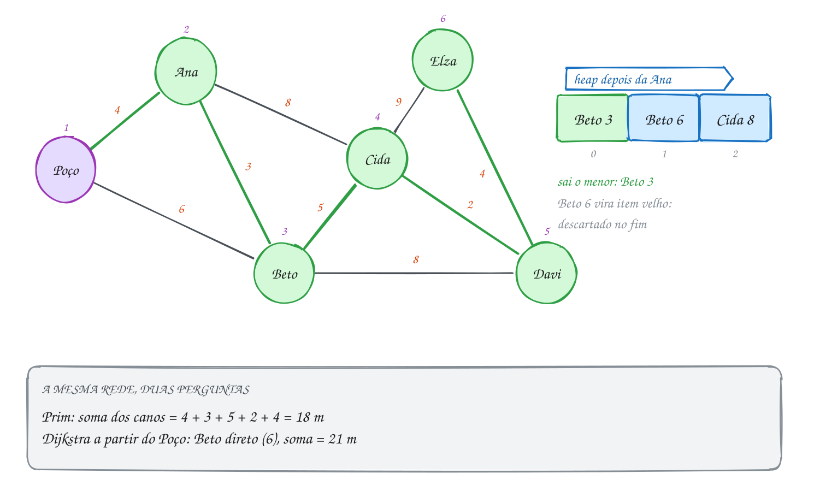</p>

O heap guarda structs e compara pela `chave`; `sobe` e `desce` são as do
assunto 0102, com os sinais trocados para virar heap de mínimo:

```c
#include <stdbool.h>
#include <stdio.h>

#define V 6
#define CAP 32 // cada aresta entra no heap no máximo duas vezes

typedef struct {
    int chave, v, de; // "dá para ligar v à rede com chave metros, a partir de de"
} Item;

Item heap[CAP];
int n = 0;

void troca(int i, int j) {
    Item t = heap[i];
    heap[i] = heap[j];
    heap[j] = t;
}

void insere(Item x) { // heap de MÍNIMO: sobe enquanto for menor que o pai
    int i = n++;
    heap[i] = x;
    while (i > 0 && heap[(i - 1) / 2].chave > heap[i].chave) {
        troca(i, (i - 1) / 2);
        i = (i - 1) / 2;
    }
}

Item tira(void) { // tira o menor e desce o último pelo menor filho
    Item menor = heap[0];
    heap[0] = heap[--n];
    int i = 0;
    while (2 * i + 1 < n) {
        int f = 2 * i + 1;
        if (f + 1 < n && heap[f + 1].chave < heap[f].chave) f++;
        if (heap[i].chave <= heap[f].chave) break;
        troca(i, f);
        i = f;
    }
    return menor;
}

int main(void) {
    const char *nomes[V] = {"Poço", "Ana", "Beto", "Cida", "Davi", "Elza"};
    int cano[V][V] = {0}; // metros; 0 = sem caminho para cano
    int trechos[][3] = {{0, 1, 4}, {0, 2, 6}, {1, 2, 3}, {1, 3, 8}, {2, 3, 5},
                        {2, 4, 8}, {3, 4, 2}, {3, 5, 9}, {4, 5, 4}};
    for (int k = 0; k < 9; k++) {
        cano[trechos[k][0]][trechos[k][1]] = trechos[k][2];
        cano[trechos[k][1]][trechos[k][0]] = trechos[k][2];
    }

    bool na_rede[V] = {false};
    int total = 0;
    insere((Item){0, 0, -1}); // começa pelo Poço, de graça
    while (n > 0) {
        Item it = tira();
        if (na_rede[it.v]) { // já entrou por um cano mais curto
            printf("  descarta %s (%d)\n", nomes[it.v], it.chave);
            continue;
        }
        na_rede[it.v] = true;
        total += it.chave;
        if (it.de >= 0) printf("%s <- %s (%d m)\n", nomes[it.v], nomes[it.de], it.chave);
        for (int w = 0; w < V; w++) // candidatos novos: canos que saem de v
            if (cano[it.v][w] && !na_rede[w]) insere((Item){cano[it.v][w], w, it.v});
    }
    printf("Total: %d m de cano\n", total);
    return 0;
}
// Saída:
// Ana <- Poço (4 m)
// Beto <- Ana (3 m)
// Cida <- Beto (5 m)
// Davi <- Cida (2 m)
// Elza <- Davi (4 m)
//   descarta Beto (6)
//   descarta Cida (8)
//   descarta Davi (8)
//   descarta Elza (9)
// Total: 18 m de cano
```

Repara no fluxograma: é o laço do Dijkstra com heap. A pergunta "já está na
rede?" é o que torna a versão preguiçosa correta: o heap pode ter itens
velhos, e eles são jogados fora na saída:

<p align="center">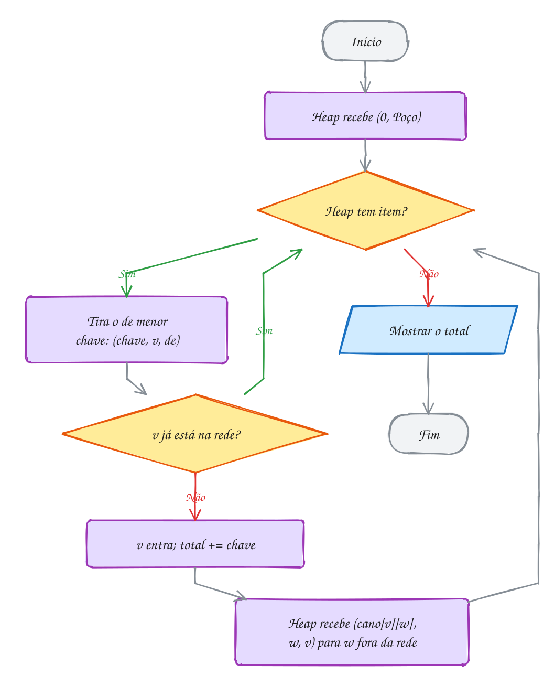</p>

### Passo a passo

O heap depois de cada casa que entra (só as chaves e as casas):

| Entra | Itens que entram no heap | Heap depois (do menor) |
| --- | --- | --- |
| Poço (0) | Ana 4, Beto 6 | Ana 4, Beto 6 |
| Ana (4) | Beto 3, Cida 8 | Beto 3, Beto 6, Cida 8 |
| Beto (3) | Cida 5, Davi 8 | Cida 5, Beto 6, Cida 8, Davi 8 |
| Cida (5) | Davi 2, Elza 9 | Davi 2, Beto 6, Cida 8, Davi 8, Elza 9 |
| Davi (2) | Elza 4 | Elza 4, Beto 6, Cida 8, Davi 8, Elza 9 |
| Elza (4) | | sobram 4 itens velhos, todos descartados |

E se fosse o Dijkstra a partir do Poço? Beto ficaria pendurado no Poço (6 m
direto, contra 4 + 3 = 7 passando pela Ana), e o resto seguiria Beto, Cida,
Davi, Elza. Cada casa estaria o mais perto possível do Poço, mas a rede
gastaria 4 + 6 + 5 + 2 + 4 = **21 m**. O Prim gasta **18 m**. Perguntas
diferentes, árvores diferentes.

O A305 faz o Prim sem heap, em O(V²), para um grafo completo de postes de
luz, em que a versão com vetor ganha. O A306 roda Prim e Dijkstra lado a lado
no mesmo mapa e mostra as duas árvores.

> [!WARNING]
> Sem o teste `if (na_rede[it.v]) continue;`, cada item velho que sai do heap
> "entra" de novo na rede: o total soma cano que ninguém vai instalar (aqui
> daria 18 + 6 + 8 + 8 + 9 = 49 m). O mesmo vale para o laço dos vizinhos: sem
> `!na_rede[w]`, o heap enche de itens inúteis, e a capacidade `CAP` pode
> estourar. Prim, como Kruskal, só faz sentido em grafo **não dirigido**: num
> dirigido, "ligar todo mundo pelo mínimo" é outro problema, bem mais difícil.

> [!TIP]
> **Por dentro do C:** `(Item){cano[it.v][w], w, it.v}` é um **literal
> composto** (C99): cria uma struct temporária sem nome, que `insere` recebe
> por valor, copiando os 12 bytes. O heap inteiro é um vetor de `Item`
> contíguo: `heap[i].chave` fica 12 bytes depois de `heap[i - 1].chave`, e o
> pai de `i` está em `(i - 1) / 2`, como no assunto 0102. Com lista de
> adjacência, o Prim preguiçoso custa O(E log E), e como E < V², isso é
> O(E log V). Com matriz, como aqui, varrer os vizinhos já custa O(V²).

> [!NOTE]
> **Pergunta para você:** se o cano Ana-Beto custar 7 m em vez de 3, quem
> pendura o Beto na rede, e qual o novo total? Monte a tabela do heap antes de
> trocar o `{1, 2, 3}`.

### Hora de praticar

Os arquivos ficam em [`0153-prim/`](0153-prim/). Os comandos funcionam de qualquer pasta do terminal. Nos exemplos, rode, mude, quebre e rode de novo. Nos exercícios, a resposta vai dentro do próprio arquivo. ★☆☆ é aquecimento, ★★☆ pede raciocínio e ★★★ é desafio.

**Exemplo A305 · Prim sem heap: fiação dos postes de um loteamento**

```c
#include <math.h>
#include <stdbool.h>
#include <stdio.h>

#define N 7

int main(void) {
    // posição de cada poste, em metros; qualquer poste pode ligar em qualquer outro
    double x[N] = {0, 30, 62, 10, 45, 82, 25};
    double y[N] = {0, 10, 0, 40, 35, 28, 70};

    double chave[N]; // o fio mais curto conhecido que liga o poste à rede
    int pai[N];
    bool na_rede[N] = {false};
    for (int v = 0; v < N; v++) {
        chave[v] = INFINITY; // da math.h: maior que qualquer double
        pai[v] = -1;
    }
    chave[0] = 0; // o transformador fica no poste 0

    double total = 0;
    for (int passo = 0; passo < N; passo++) {
        int u = -1;
        for (int v = 0; v < N; v++) // O(V): procura a menor chave num vetor
            if (!na_rede[v] && (u == -1 || chave[v] < chave[u])) u = v;
        na_rede[u] = true;
        total += chave[u];
        if (pai[u] != -1) printf("poste %d - poste %d: %.1f m\n", pai[u], u, chave[u]);
        for (int v = 0; v < N; v++) {
            if (na_rede[v]) continue;
            double d = hypot(x[u] - x[v], y[u] - y[v]); // distância em linha reta
            if (d < chave[v]) {
                chave[v] = d; // Prim: só o fio, sem somar o caminho até o transformador
                pai[v] = u;
            }
        }
    }
    printf("Fio total: %.1f m\n", total);
    return 0;
}
// Saída:
// poste 0 - poste 1: 31.6 m
// poste 1 - poste 4: 29.2 m
// poste 1 - poste 2: 33.5 m
// poste 2 - poste 5: 34.4 m
// poste 4 - poste 3: 35.4 m
// poste 3 - poste 6: 33.5 m
// Fio total: 197.6 m
//
// Num grafo completo, E é quase V²/2. O heap custaria O(E log V); o vetor,
// O(V²). Aqui o Prim sem heap é o mais rápido, e nem precisa guardar as
// arestas: a distância é calculada na hora.
```

```bash
~/LPEDC/rodar 23-grafos-avancados/0153-prim/A305.c
```

**Exemplo A306 · Prim e Dijkstra: a mesma função, uma linha diferente**

```c
#include <limits.h>
#include <stdbool.h>
#include <stdio.h>

#define V 5
#define INFINITO INT_MAX

const char *salas[V] = {"Servidor", "Recepção", "Vendas", "Estoque", "Diretoria"};
int cabo[V][V]; // metros de cabo entre duas salas; 0 = sem passagem

// dijkstra = false: Prim (árvore de menor soma de cabo)
// dijkstra = true:  Dijkstra (cada sala o mais perto possível do servidor)
void arvore(bool dijkstra) {
    int chave[V], pai[V];
    bool pronto[V] = {false};
    for (int v = 0; v < V; v++) {
        chave[v] = INFINITO;
        pai[v] = -1;
    }
    chave[0] = 0;
    for (int passo = 0; passo < V; passo++) {
        int u = -1;
        for (int v = 0; v < V; v++)
            if (!pronto[v] && chave[v] != INFINITO && (u == -1 || chave[v] < chave[u])) u = v;
        if (u == -1) break;
        pronto[u] = true;
        for (int v = 0; v < V; v++) {
            if (!cabo[u][v] || pronto[v]) continue;
            int nova = dijkstra ? chave[u] + cabo[u][v] : cabo[u][v]; // A linha que muda
            if (nova < chave[v]) {
                chave[v] = nova;
                pai[v] = u;
            }
        }
    }
    int soma = 0;
    printf("%s:", dijkstra ? "Dijkstra" : "Prim");
    for (int v = 1; v < V; v++) {
        printf(" %s-%s", salas[pai[v]], salas[v]);
        soma += cabo[pai[v]][v];
    }
    printf("\n  cabo instalado: %d m\n", soma);
    printf("  distância de cada sala ao servidor pela árvore:");
    for (int v = 1; v < V; v++) {
        int d = 0;
        for (int w = v; pai[w] != -1; w = pai[w]) d += cabo[pai[w]][w];
        printf(" %d", d);
    }
    printf("\n");
}

int main(void) {
    int trechos[][3] = {{0, 1, 10}, {0, 2, 14}, {0, 3, 20}, {1, 2, 5},
                        {2, 3, 7}, {3, 4, 6}, {1, 4, 25}, {0, 4, 24}};
    for (int k = 0; k < 8; k++) {
        cabo[trechos[k][0]][trechos[k][1]] = trechos[k][2];
        cabo[trechos[k][1]][trechos[k][0]] = trechos[k][2];
    }
    arvore(false);
    arvore(true);
    return 0;
}
// Saída:
// Prim: Servidor-Recepção Recepção-Vendas Vendas-Estoque Estoque-Diretoria
//   cabo instalado: 28 m
//   distância de cada sala ao servidor pela árvore: 10 15 22 28
// Dijkstra: Servidor-Recepção Servidor-Vendas Servidor-Estoque Servidor-Diretoria
//   cabo instalado: 68 m
//   distância de cada sala ao servidor pela árvore: 10 14 20 24
//
// O Prim gasta 40 m a menos de cabo; o Dijkstra deixa cada sala com o
// caminho mais curto até o servidor (a Diretoria fica a 24 m, contra 28).
// Qual é "melhor" depende da pergunta: custo da obra ou atraso do sinal.
```

```bash
~/LPEDC/rodar 23-grafos-avancados/0153-prim/A306.c
```

#### Exercícios

**Exercício E913** · ★☆☆

Na orla, um gerador vai alimentar quatro quiosques: Coco, Pastel, Açaí e
Milho. A matriz (já no main) tem os metros de cabo de cada trecho
possível; 0 quer dizer "não dá para passar cabo". Escreva o Prim sem
heap, em O(V²), a partir do Gerador: vetores chave[], pai[] e
na_rede[]; a cada passo, entra o vértice fora da rede com a menor chave.
Mostre cada cabo na ordem em que entra e o total.


```text
Saída esperada:
Gerador - Coco: 12 m
Coco - Pastel: 9 m
Pastel - Açaí: 6 m
Açaí - Milho: 11 m
Total: 38 m
```

**Dicas:**

1. Comece com chave = INFINITO em todos, chave[0] = 0 e pai = -1. É o
   Dijkstra do assunto 0112, com outra regra de atualização.
2. Quando u entra, para cada v fora da rede com cabo[u][v] != 0: se
   cabo[u][v] < chave[v], então chave[v] = cabo[u][v] e pai[v] = u.
   Não some chave[u]: no Prim, a chave é só o cabo.
3. Resposta esperada: a saída acima. O Milho começa com 30 (pelo Coco),
   cai para 15 (pelo Pastel) e termina em 11 (pelo Açaí).

```bash
~/LPEDC/rodar 23-grafos-avancados/0153-prim/E913.c
```

**Exercício E914** · ★☆☆

A prefeitura vai ligar seis estações de bicicleta compartilhada com
ciclofaixa (distâncias em quarteirões). O heap de mínimo já está pronto.
Complete o laço do Prim preguiçoso no main, nos três pontos marcados.


```text
Saída esperada:
Rodoviária - Feira: 3
Rodoviária - Praça: 5
Praça - Museu: 4
Museu - Orla: 2
Orla - Estádio: 8
Ciclofaixa total: 22 quarteirões
```

**Dicas:**

1. O item tirado do heap pode ser velho: se na_rede[it.v] já é true,
   continue sem fazer nada.
2. Senão: na_rede[it.v] = true, total += it.chave e, se it.de >= 0,
   mostre "de - v: chave". Depois, para cada w fora da rede com
   dist[it.v][w] != 0, insere((Item){dist[it.v][w], w, it.v}).
3. Resposta esperada: a saída acima. A Praça entra pela Rodoviária (5), e
   não pela Feira (6).

```bash
~/LPEDC/rodar 23-grafos-avancados/0153-prim/E914.c
```

**Exercício E915** · ★★☆

Mesmas seis estações de bicicleta do E914. A pergunta agora é: começar o
Prim por outra estação muda alguma coisa? Escreva a função
prim(origem), na versão sem heap (O(V²)), que mostra a origem, a ordem
em que as estações entram na rede e o total, e chame-a para cada uma das
seis origens.


```text
Saída esperada:
Rodoviária: Rodoviária Feira Praça Museu Orla Estádio | 22
Praça: Praça Museu Orla Rodoviária Feira Estádio | 22
Museu: Museu Orla Praça Rodoviária Feira Estádio | 22
Orla: Orla Museu Praça Rodoviária Feira Estádio | 22
Feira: Feira Rodoviária Praça Museu Orla Estádio | 22
Estádio: Estádio Orla Museu Praça Rodoviária Feira | 22
```

**Dicas:**

1. Os vetores chave[] e na_rede[] são locais da função: cada chamada
   começa do zero, com chave[origem] = 0.
2. Mostre cada estação no momento em que ela entra (quando é escolhida
   como u), não quando a chave dela cai.
3. Resposta esperada: a saída acima. A ordem muda, o total não: como os
   pesos são todos diferentes, a árvore mínima é uma só, e as seis
   execuções escolhem as mesmas cinco ciclofaixas.

```bash
~/LPEDC/rodar 23-grafos-avancados/0153-prim/E915.c
```

**Exercício E916** · ★★☆

A operadora de internet vai levar fibra da Central a sete pontos do
bairro. O programa abaixo já roda o Prim e preenche pai[]. Estenda-o:
escreva a função recursiva mostra(v, nivel), que imprime a árvore como
um organograma: cada ponto com 2 espaços de recuo por nível e, entre
parênteses, os km da fibra que o liga ao pai. Os filhos de um ponto
aparecem em ordem de índice, logo abaixo dele.


```text
Saída esperada:
Central
  Padaria (2)
    Escola (3)
      Farmácia (2)
        Clínica (3)
          Posto (2)
    Igreja (5)
      Praça (1)
Total: 18 km
```

**Dicas:**

1. Os filhos de v são os w com pai[w] == v. mostra(v, nivel) imprime v
   e chama mostra(w, nivel + 1) para cada filho: é a pré-ordem do
   assunto 0098, numa árvore com qualquer número de filhos.
2. printf("%*s", 2 * nivel, "") imprime 2 * nivel espaços. Os km do pai
   até v estão em fibra[pai[v]][v].
3. Resposta esperada: a saída acima. O Posto entra pela Clínica (2 km),
   não pela Escola (7) nem pela Central (9).

```bash
~/LPEDC/rodar 23-grafos-avancados/0153-prim/E916.c
```

**Exercício E917** · ★★★

Quatro casas de um sítio precisam de água. Cada casa pode cavar o
próprio poço (Ana R$ 8 mil, Beto 5, Cida 9, Davi 7) ou receber cano de
uma casa vizinha que já tem água. Os canos possíveis (R$ mil):


```text
Ana-Beto 2, Beto-Cida 3, Cida-Davi 9, Ana-Davi 10, Ana-Cida 10
```


Qual a solução mais barata? O truque: crie um vértice imaginário, a
"Água" (índice 0), ligado a cada casa por uma aresta com o custo do poço
dela. Cavar um poço vira "ligar a casa na Água", e o problema vira uma
árvore geradora mínima comum. Escreva o programa com Prim a partir da
Água e mostre a decisão de cada casa, na ordem em que entram.


```text
Saída esperada:
Beto: cava poço (R$ 5 mil)
Ana: cano de Beto (R$ 2 mil)
Cida: cano de Beto (R$ 3 mil)
Davi: cava poço (R$ 7 mil)
Total: R$ 17 mil (2 poços)
```

**Dicas:**

1. Monte uma matriz custo[V][V] com V = 5: os canos entre as casas
   (índices 1 a 4) e custo[0][c] = custo[c][0] = poço da casa c.
2. No fim, quem tem pai[c] == 0 cavou poço; os outros receberam cano de
   pai[c].
3. Resposta esperada: a saída acima. O Davi fica com o próprio poço
   (7), mais barato que qualquer cano até ele (9 ou 10).

```bash
~/LPEDC/rodar 23-grafos-avancados/0153-prim/E917.c
```

**Exercício E918** · ★★★

Ache o bug. Uma rádio comunitária vai ligar a Torre a cinco pontos com
cabo, gastando o mínimo de km. O Prim com heap abaixo tem um erro de
lógica: ele marca o vértice como "na rede" no momento em que o coloca no
heap, e não quando o tira. O total sai quase o dobro do mínimo:


```text
Saída que aparece:
Torre - Escola: 3 km
Torre - Igreja: 7 km
Igreja - Mercado: 4 km
Mercado - Clube: 6 km
Torre - Posto: 9 km
Total: 29 km
```


```text
Saída esperada:
Torre - Escola: 3 km
Escola - Igreja: 2 km
Igreja - Mercado: 4 km
Mercado - Posto: 1 km
Posto - Clube: 5 km
Total: 15 km
```


Conserte o programa e confira a saída.

**Dicas:**

1. Quando a Torre entra, Igreja (7), Escola (3) e Posto (9) vão para o
   heap e já ficam marcadas. Depois a Escola descobre um cano de 2 km até
   a Igreja, mas a Igreja "já está na rede" e o cano melhor é ignorado.
2. Estar no heap é só ter um candidato. Marque na_rede[it.v] quando o
   item SAI do heap e, nessa hora, descarte o item se o vértice já
   estiver marcado (item velho).
3. Resposta esperada: tire as duas marcações (a da Torre antes do laço e
   a do laço dos vizinhos); depois de "Item it = tira();", ponha
   "if (na_rede[it.v]) continue; na_rede[it.v] = true;". Consertado,
   mostra a saída esperada.

```bash
~/LPEDC/rodar 23-grafos-avancados/0153-prim/E918.c
```

---

## 0154 · Bellman-Ford: pesos negativos

Fim de turno. O motoboy de aplicativo está na Base e quer chegar em Casa
gastando o mínimo. Cada trecho custa gasolina, mas alguns trechos coincidem
com uma corrida aceita no caminho, e a corrida paga mais do que a gasolina.
Do Shopping até o Centro, por exemplo, ele gasta R$ 2 e recebe R$ 6: o
**custo líquido** do trecho é **R$ -4**.

O grafo é dirigido (a corrida só paga num sentido) e tem **pesos
negativos**. É aqui que o Dijkstra do assunto 0112 quebra. Ele fixa o Centro
com R$ 4 (indo direto da Base) antes de olhar o Shopping, e nunca mais volta
atrás. Mas Base, Shopping, Centro custa 6 - 4 = **R$ 2**. A promessa do
Dijkstra ("somar pesos só aumenta") deixou de valer, e ele termina dizendo
que Casa custa R$ 12, quando custa R$ 10.

O algoritmo de **Bellman-Ford** não confia em ninguém. Ele **relaxa todas
as arestas**, uma rodada inteira de cada vez, sem escolher o menor:

- `dist[origem] = 0` e INFINITO no resto;
- repita V - 1 vezes: para cada aresta `u -> v` com custo `c`, se
  `dist[u] + c < dist[v]`, atualize `dist[v]` e `anterior[v]`.

Por que V - 1 rodadas bastam? Um caminho mínimo não repete vértice, então
tem no máximo V - 1 arestas. A rodada 1 garante a primeira aresta do caminho
certa; a rodada 2, a segunda; e assim por diante. Se uma rodada inteira
passa sem mudar nada, as próximas também não mudariam, e dá para parar
antes.

E se existir um **ciclo negativo**, um circuito cuja soma é menor que zero?
Aí não existe caminho mínimo: dar mais uma volta sempre diminui o custo, e a
`dist` cairia para sempre. Bellman-Ford **detecta** isso com uma rodada
extra: se depois das V - 1 rodadas alguma aresta ainda melhora, há ciclo
negativo alcançável.

O preço da desconfiança é o tempo: V - 1 rodadas de E arestas, **O(V · E)**,
contra O((V + E) log V) do Dijkstra com heap. Use Bellman-Ford quando houver
peso negativo; sem eles, Dijkstra.

Vamos ver na prática. Os números nas setas são o custo líquido; em cima de
cada lugar, a `dist` final; verde, a rota até Casa. Embaixo, o vetor `dist`
rodada a rodada:

<p align="center">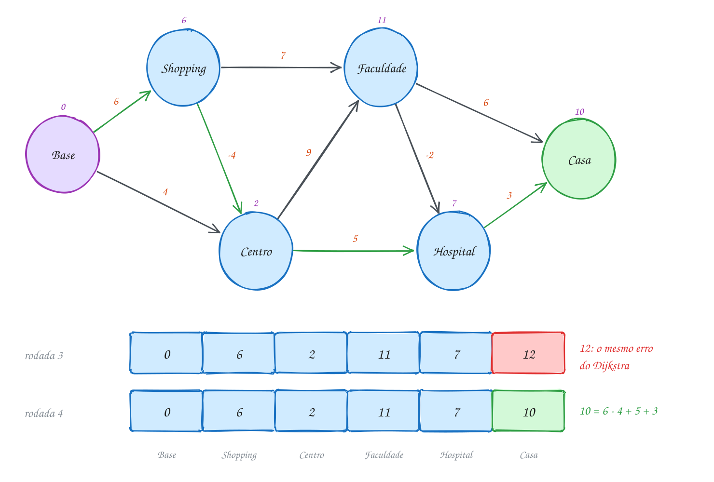</p>

O código guarda as arestas numa lista (é só percorrer todas, então não
precisa de matriz). A ordem da lista foi escolhida de propósito para mostrar
as rodadas: começa pelas arestas que chegam em Casa.

```c
#include <stdbool.h>
#include <stdio.h>

#define V 6
#define E 9
#define INFINITO 1000000000 // folgado: INFINITO + peso ainda cabe num int

typedef struct {
    int de, para, custo; // custo líquido em R$: gasolina menos o que a corrida paga
} Trecho;

const char *lugares[V] = {"Base", "Shopping", "Centro", "Faculdade", "Hospital", "Casa"};

int main(void) {
    Trecho t[E] = {{4, 5, 3}, {3, 5, 6}, {3, 4, -2}, {2, 3, 9}, {2, 4, 5},
                   {1, 3, 7}, {1, 2, -4}, {0, 2, 4}, {0, 1, 6}};
    int dist[V], anterior[V];
    for (int v = 0; v < V; v++) {
        dist[v] = INFINITO;
        anterior[v] = -1;
    }
    dist[0] = 0;

    for (int rodada = 1; rodada <= V - 1; rodada++) { // no máximo V - 1 rodadas
        bool mudou = false;
        for (int k = 0; k < E; k++) { // relaxa TODAS as arestas, em qualquer ordem
            int u = t[k].de, v = t[k].para;
            if (dist[u] != INFINITO && dist[u] + t[k].custo < dist[v]) {
                dist[v] = dist[u] + t[k].custo;
                anterior[v] = u;
                mudou = true;
            }
        }
        printf("rodada %d:", rodada);
        for (int v = 0; v < V; v++) {
            if (dist[v] == INFINITO) printf(" ∞");
            else printf(" %d", dist[v]);
        }
        printf("\n");
        if (!mudou) break; // nada mudou: as próximas rodadas também não mudariam
    }

    for (int k = 0; k < E; k++) // rodada extra: se ainda melhora, há ciclo negativo
        if (dist[t[k].de] != INFINITO && dist[t[k].de] + t[k].custo < dist[t[k].para]) {
            printf("Ciclo negativo: dá para lucrar sem fim\n");
            return 0;
        }

    int rota[V], n = 0;
    for (int v = 5; v != -1; v = anterior[v]) rota[n++] = v;
    printf("Até Casa (R$ %d):", dist[5]);
    for (int i = n - 1; i >= 0; i--) printf(" %s%s", lugares[rota[i]], i > 0 ? " ->" : "");
    printf("\n");
    return 0;
}
// Saída:
// rodada 1: 0 6 4 ∞ ∞ ∞
// rodada 2: 0 6 2 13 9 ∞
// rodada 3: 0 6 2 11 7 12
// rodada 4: 0 6 2 11 7 10
// rodada 5: 0 6 2 11 7 10
// Até Casa (R$ 10): Base -> Shopping -> Centro -> Hospital -> Casa
```

Repara no fluxograma: não existe "escolher o menor". São dois laços
cegos, rodadas por fora e arestas por dentro, e duas saídas: uma rodada sem
mudança ou as V - 1 rodadas completas. Depois vem a rodada extra, só para
perguntar:

<p align="center">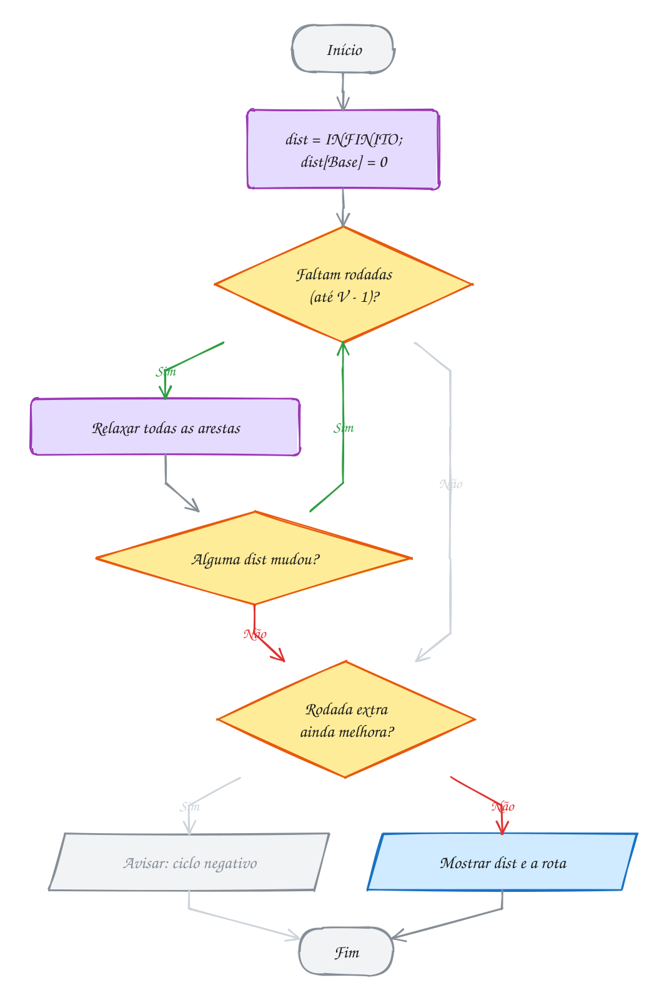</p>

### Passo a passo

Cada rodada passa pela lista inteira, na ordem dela. Repare na Casa, que
aparece com 12 na rodada 3 (o mesmo valor errado do Dijkstra) e cai para 10
na rodada 4, quando a melhora do Centro chega até ela:

| Rodada | O que muda | Base | Shopping | Centro | Faculdade | Hospital | Casa |
| --- | --- | --- | --- | --- | --- | --- | --- |
| início | | 0 | ∞ | ∞ | ∞ | ∞ | ∞ |
| 1 | só as arestas que saem da Base | 0 | 6 | 4 | ∞ | ∞ | ∞ |
| 2 | Centro cai para 6 - 4 = 2 | 0 | 6 | 2 | 13 | 9 | ∞ |
| 3 | o 2 do Centro chega em Faculdade e Hospital | 0 | 6 | 2 | 11 | 7 | 12 |
| 4 | Casa via Hospital: 7 + 3 | 0 | 6 | 2 | 11 | 7 | 10 |
| 5 | nada muda: para | 0 | 6 | 2 | 11 | 7 | 10 |

Com a lista na ordem "natural" (as arestas da Base primeiro), uma rodada só
já chegaria ao resultado. O A308 mede isso. O A307 caça um ciclo negativo de
verdade, numa tabela de câmbio entre moedas, e mostra o ciclo.

> [!WARNING]
> Com `INT_MAX` como INFINITO e peso negativo, o teste `dist[u] != INFINITO`
> é obrigatório por outro motivo além do estouro: `INT_MAX + (-4)` **não**
> estoura, dá `INT_MAX - 4`, que é menor que `INT_MAX`. Sem o teste, um
> vértice inalcançável "melhora" outro vértice inalcançável, e o programa
> mostra uma distância gigante e falsa no lugar de "sem caminho". E cuidado:
> em grafo **não dirigido**, uma aresta negativa já é um ciclo negativo (ir e
> voltar por ela).

> [!TIP]
> **Por dentro do C:** a lista de arestas é um vetor de `Trecho` contíguo, 12
> bytes por aresta, e cada rodada o percorre em sequência, do primeiro ao
> último byte. Isso é o melhor caso para o cache do processador, e é um dos
> motivos de o Bellman-Ford ser usado de verdade em roteadores (o protocolo
> RIP espalha distâncias assim, vizinho a vizinho). O `INFINITO` de um bilhão
> deixa folga: `1000000000 + 1000000000` ainda cabe num `int` de 32 bits
> (até 2147483647), então nem a soma de dois "infinitos" estoura.

> [!NOTE]
> **Pergunta para você:** se a corrida da Faculdade para o Hospital passar a
> pagar mais (custo -6 em vez de -2), qual a nova rota até Casa e quanto ela
> custa? E se, além disso, existir um trecho Hospital -> Faculdade de custo
> 3, o que o programa mostra?

### Hora de praticar

Os arquivos ficam em [`0154-bellman-ford/`](0154-bellman-ford/). Os comandos funcionam de qualquer pasta do terminal. Nos exemplos, rode, mude, quebre e rode de novo. Nos exercícios, a resposta vai dentro do próprio arquivo. ★☆☆ é aquecimento, ★★☆ pede raciocínio e ★★★ é desafio.

**Exemplo A307 · Ciclo negativo no câmbio: dinheiro que se multiplica**

```c
#include <math.h>
#include <stdio.h>

#define V 4
#define E 10

typedef struct {
    int de, para;
    double taxa; // 1 unidade de "de" vira taxa unidades de "para"
} Troca;

const char *moedas[V] = {"Real", "Dólar", "Euro", "Peso"};

int main(void) {
    Troca t[E] = {{0, 1, 0.20}, {1, 0, 4.95}, {1, 2, 0.92}, {2, 1, 1.07}, {2, 0, 5.45},
                  {0, 2, 0.18}, {0, 3, 180}, {3, 0, 0.0054}, {1, 3, 880}, {3, 1, 0.0011}};

    // multiplicar taxas vira somar logaritmos; "ganhar" (produto > 1) vira soma < 0
    double dist[V];
    int anterior[V];
    for (int v = 0; v < V; v++) {
        dist[v] = INFINITY;
        anterior[v] = -1;
    }
    dist[0] = 0;
    for (int rodada = 1; rodada <= V - 1; rodada++)
        for (int k = 0; k < E; k++) {
            double peso = -log(t[k].taxa);
            if (dist[t[k].de] + peso < dist[t[k].para]) {
                dist[t[k].para] = dist[t[k].de] + peso;
                anterior[t[k].para] = t[k].de;
            }
        }

    int x = -1; // rodada extra: alguém ainda melhora?
    for (int k = 0; k < E && x == -1; k++)
        if (dist[t[k].de] - log(t[k].taxa) < dist[t[k].para] - 1e-12) x = t[k].para;
    if (x == -1) {
        printf("Sem arbitragem: nenhuma volta dá lucro\n");
        return 0;
    }
    for (int i = 0; i < V; i++) x = anterior[x]; // V passos para trás: com certeza dentro do ciclo

    int ciclo[V + 1], n = 0, v = x;
    do { // anda pelos anteriores até voltar a x
        ciclo[n++] = v;
        v = anterior[v];
    } while (v != x);

    double produto = 1;
    printf("Ciclo: %s", moedas[x]);
    for (int i = n - 1; i >= 0; i--) { // os anteriores vêm de trás para frente
        int de = ciclo[(i + 1) % n], para = ciclo[i];
        for (int k = 0; k < E; k++)
            if (t[k].de == de && t[k].para == para) produto *= t[k].taxa;
        printf(" -> %s", moedas[para]);
    }
    printf("\nR$ 1000.00 viram R$ %.2f numa volta\n", 1000 * produto);
    return 0;
}
// Saída:
// Ciclo: Real -> Dólar -> Euro -> Real
// R$ 1000.00 viram R$ 1002.80 numa volta
//
// Um ciclo negativo, aqui, é dinheiro infinito: cada volta multiplica o
// valor por 1,0028. Na vida real, a cotação se ajusta em segundos, e as
// taxas de cada troca comem o lucro.
```

```bash
~/LPEDC/rodar 23-grafos-avancados/0154-bellman-ford/A307.c
```

**Exemplo A308 · A ordem da lista muda o número de rodadas**

```c
#include <stdbool.h>
#include <stdio.h>

#define V 6
#define E 7
#define INFINITO 1000000000

typedef struct {
    int de, para, custo;
} Aresta;

// roda o Bellman-Ford e conta rodadas e relaxamentos (vezes que uma dist caiu)
void bellman_ford(const Aresta a[], const char *nome) {
    int dist[V];
    for (int v = 0; v < V; v++) dist[v] = INFINITO;
    dist[0] = 0;
    int rodadas = 0, relaxou = 0;
    bool mudou = true;
    while (mudou && rodadas < V - 1) {
        mudou = false;
        rodadas++;
        for (int k = 0; k < E; k++)
            if (dist[a[k].de] != INFINITO && dist[a[k].de] + a[k].custo < dist[a[k].para]) {
                dist[a[k].para] = dist[a[k].de] + a[k].custo;
                relaxou++;
                mudou = true;
            }
    }
    printf("%s: %d rodadas, %d relaxamentos, dist final:", nome, rodadas, relaxou);
    for (int v = 0; v < V; v++) printf(" %d", dist[v]);
    printf("\n");
}

int main(void) {
    // paradas 0 a 5 de uma linha de ônibus; o -2 é o desconto da integração
    Aresta na_ordem[E] = {{0, 1, 4}, {0, 2, 9}, {1, 2, 3}, {2, 3, -2},
                          {3, 4, 5}, {1, 4, 12}, {4, 5, 1}};
    Aresta invertida[E];
    for (int k = 0; k < E; k++) invertida[k] = na_ordem[E - 1 - k];

    bellman_ford(na_ordem, "na ordem do caminho");
    bellman_ford(invertida, "ordem invertida    ");
    return 0;
}
// Saída:
// na ordem do caminho: 2 rodadas, 6 relaxamentos, dist final: 0 4 7 5 10 11
// ordem invertida    : 5 rodadas, 11 relaxamentos, dist final: 0 4 7 5 10 11
//
// A resposta é a mesma; o trabalho, não. Na ordem do caminho, cada aresta
// já encontra a dist de origem pronta, e a 2ª rodada só confirma. Invertida,
// cada rodada avança uma aresta do caminho, e a parada 5 só fica certa na
// 5ª rodada, a última permitida. O limite de V - 1 rodadas é o pior caso, e
// ele acontece.
```

```bash
~/LPEDC/rodar 23-grafos-avancados/0154-bellman-ford/A308.c
```

#### Exercícios

**Exercício E919** · ★☆☆

Viagem de carro da Garagem até o Sítio. Cada trecho tem um custo em R$
(gasolina e pedágio), mas o aplicativo do Posto A dá cashback para quem
abastece lá e segue para o Posto B: esse trecho custa R$ -10. Os trechos
são de mão única:


```text
Garagem -> Posto A 30    Garagem -> Posto B 45    Posto A -> Posto B -10
Posto A -> Pedágio 25    Posto B -> Pedágio 12    Pedágio -> Sítio 8
Posto B -> Sítio 40
```


Escreva o Bellman-Ford do zero, com a lista de arestas já declarada, e
mostre o menor custo da Garagem até cada lugar.


```text
Saída esperada:
Garagem: R$ 0
Posto A: R$ 30
Posto B: R$ 20
Pedágio: R$ 32
Sítio: R$ 40
```

**Dicas:**

1. dist[] com INFINITO (o 1000000000 já definido) e dist[0] = 0. Faça
   V - 1 rodadas; em cada uma, passe por todas as E arestas.
2. Só relaxe a partir de quem já tem distância: dist[de] != INFINITO.
3. Resposta esperada: a saída acima. O Posto B sai mais barato passando
   pelo Posto A (30 - 10 = 20) do que direto (45).

```bash
~/LPEDC/rodar 23-grafos-avancados/0154-bellman-ford/E919.c
```

**Exercício E920** · ★☆☆

Num jogo de tabuleiro, andar entre casas custa moedas, e algumas casas
dão bônus (custo negativo). Se existir uma volta que dá lucro, o jogador
fica rodando nela para sempre e o jogo quebra. A função bellman_ford já
faz as V - 1 rodadas. Complete-a: acrescente a rodada extra, que devolve
false se alguma aresta ainda melhorar uma distância.


```text
Saída esperada:
Tabuleiro 1: 0 5 2 6
Tabuleiro 2: ciclo negativo
```

**Dicas:**

1. A rodada extra é o mesmo laço sobre as arestas, mas sem atualizar
   nada: se dist[de] != INFINITO e dist[de] + custo < dist[para], há
   ciclo negativo.
2. No tabuleiro 1, a volta 1 -> 2 -> 3 -> 1 soma -3 + 4 + 1 = 2. No 2,
   soma -3 + 4 - 2 = -1.
3. Resposta esperada: a saída acima. Uma volta com soma negativa não
   tem fundo: cada passagem por ela baixa a distância de novo.

```bash
~/LPEDC/rodar 23-grafos-avancados/0154-bellman-ford/E920.c
```

**Exercício E921** · ★★☆

Um drone de entregas sai da Base. Cada voo gasta uma porcentagem da
bateria; o voo da Torre até a Praia é uma descida planando com o painel
solar ligado, e RECARREGA 5% (gasto -5). Os voos são de mão única e já
estão na lista. Escreva o Bellman-Ford com o vetor anterior[] e mostre,
para cada ponto, o gasto mínimo e a rota completa, ou "inalcançável" se
nenhum voo chega lá (é o caso da Mata: ela só tem voo de saída).


```text
Saída esperada:
Ponte (10%): Base -> Ponte
Torre (18%): Base -> Ponte -> Torre
Praia (13%): Base -> Ponte -> Torre -> Praia
Farol (20%): Base -> Ponte -> Torre -> Praia -> Farol
Ilha (32%): Base -> Ponte -> Torre -> Praia -> Farol -> Ilha
Mata: inalcançável
```

**Dicas:**

1. Ao relaxar a aresta u -> v, grave anterior[v] = u. A rota de v é a
   rota até anterior[v] seguida de v: uma função recursiva rota(v)
   imprime na ordem certa sem precisar de vetor auxiliar.
2. Para mostrar o símbolo de porcentagem no printf, use "%%".
3. Resposta esperada: a saída acima. A Praia (13%) gasta menos que a
   Torre (18%), mesmo vindo depois dela: é o efeito da aresta negativa.

```bash
~/LPEDC/rodar 23-grafos-avancados/0154-bellman-ford/E921.c
```

**Exercício E922** · ★★☆

Num jogo, passar por um portal custa créditos, mas o portal da Caverna
para a Floresta DEVOLVE 4 créditos (custo -4). O programa já tem o
Dijkstra do assunto 0112 pronto. Escreva a função bellman_ford, usando a
mesma matriz custo[][] (as arestas são as casas com custo diferente de 0),
e compare as duas respostas.


```text
Saída esperada:
Floresta: Dijkstra 2, Bellman-Ford 1 (Dijkstra errou)
Caverna: Dijkstra 5, Bellman-Ford 5
Castelo: Dijkstra 8, Bellman-Ford 7 (Dijkstra errou)
Saída: Dijkstra 9, Bellman-Ford 8 (Dijkstra errou)
```

**Dicas:**

1. Com matriz, "passar por todas as arestas" vira dois laços (u e v) e
   o teste custo[u][v] != 0. Uma rodada custa O(V²); o total, O(V³).
2. O Dijkstra fixa a Floresta com 2 antes de examinar a Caverna (5). Ele
   nunca descobre que Início -> Caverna -> Floresta custa 5 - 4 = 1, e o
   erro se espalha para Castelo e Saída.
3. Resposta esperada: a saída acima.

```bash
~/LPEDC/rodar 23-grafos-avancados/0154-bellman-ford/E922.c
```

**Exercício E923** · ★★★

Ache o bug. O cartão de transporte da cidade dá R$ 1 de volta na
integração Lapa -> Barra (custo -1). Não existe nenhuma volta que dê
lucro, mas o programa acusa ciclo negativo:


```text
Saída que aparece:
Ciclo negativo!
```


```text
Saída esperada:
Centro: R$ 0
Lapa: R$ 4
Barra: R$ 3
Pituba: R$ 6
Itapuã: R$ 8
```


O erro é de uma linha. Ache, conserte e confira a saída.

**Dicas:**

1. Acrescente um printf dentro do laço das rodadas mostrando o número da
   rodada e a dist do Itapuã. Quantas rodadas acontecem? Quantas deveriam
   acontecer com V = 5?
2. A lista está na pior ordem possível: cada rodada só avança uma
   aresta do caminho Centro -> Lapa -> Barra -> Pituba -> Itapuã, que tem
   4 arestas. Com uma rodada a menos, o Itapuã fica com 10, e a "rodada
   extra" ainda consegue melhorar: alarme falso.
3. Resposta esperada: o laço faz V - 2 rodadas. Troque
   "rodada < V - 1" por "rodada <= V - 1". Consertado, mostra a saída
   esperada.

```bash
~/LPEDC/rodar 23-grafos-avancados/0154-bellman-ford/E923.c
```

**Exercício E924** · ★★★

Você quer voar de Recife (0) a Curitiba (4), mas odeia conexões. Os voos
(mão única, preço em R$):


```text
Recife -> Curitiba 900     Recife -> Salvador 200    Salvador -> Brasília 250
Brasília -> Curitiba 300   Recife -> Brasília 500    Salvador -> São Paulo 350
São Paulo -> Curitiba 150  Brasília -> São Paulo 120
```


Escreva mais_barato(origem, destino, k): o menor preço usando NO MÁXIMO
k voos. Use o Bellman-Ford com k rodadas, mas com um cuidado: em cada
rodada, relaxe lendo uma CÓPIA da dist da rodada anterior. Assim, a
rodada r acrescenta no máximo um voo a cada caminho.


```text
Saída esperada:
Até 1 trecho: R$ 900
Até 2 trechos: R$ 800
Até 3 trechos: R$ 700
```

**Dicas:**

1. No começo de cada rodada: antes[v] = dist[v] para todo v. No laço das
   arestas, teste e some com antes[u], mas compare e grave em dist[v].
2. Sem a cópia, uma rodada pode encadear vários voos (se a lista estiver
   na ordem do caminho), e a resposta de k = 1 já sairia 700.
3. Resposta esperada: a saída acima. Com 2 voos: Recife, Brasília,
   Curitiba. Com 3: Recife, Salvador, São Paulo, Curitiba.

```bash
~/LPEDC/rodar 23-grafos-avancados/0154-bellman-ford/E924.c
```

---

## 0155 · Floyd-Warshall: todos os pares

Todo guia rodoviário antigo tinha, na última página, uma tabela triangular:
a distância de cada cidade para cada outra. Um aplicativo de corrida
precisa da mesma tabela, em minutos, para estimar o preço antes de chamar o
motorista. São cinco bairros com ruas de **mão única**: Centro, Porto, Vila,
Alto e Feira. A pergunta deixou de ser "de A até os outros" e passou a ser
"**de todo mundo para todo mundo**".

Dá para rodar o Dijkstra uma vez a partir de cada bairro. O
**Floyd-Warshall** faz a tabela inteira de outro jeito, com uma matriz e
três laços aninhados. A ideia é de programação dinâmica (módulo 21): em vez
de pensar em caminhos inteiros, pense nos bairros que um caminho pode usar
**como passagem**.

Comece com `d[i][j]` = tempo da rua direta de `i` para `j` (INFINITO se não
existe, 0 na diagonal). Agora libere o Centro como passagem: para cada par
`i`, `j`, vale a pena ir de `i` ao Centro e do Centro a `j`? Depois libere
também o Porto, depois a Vila, e assim por diante:

```text
para cada k:            (o bairro que passa a valer como passagem)
    para cada i, j:
        d[i][j] = mínimo(d[i][j], d[i][k] + d[k][j])
```

Depois da rodada `k`, `d[i][j]` é o melhor tempo de `i` a `j` usando como
passagem só os bairros de 0 a `k`. Depois da última, todos valem, e a tabela
está pronta. O `k` **tem** que ser o laço de fora: ele é a "rodada"; `i` e
`j` só percorrem a matriz.

São V³ passos: **O(V³)**, com memória O(V²). Para 5 bairros, 125 passos.
Para 400, 64 milhões, coisa de décimos de segundo. Para 100 mil esquinas,
esqueça: aí é Dijkstra com heap, de cada origem que interessar. E o
Floyd-Warshall aceita pesos negativos (sem ciclo negativo); se houver um,
ele aparece como `d[i][i] < 0` no fim.

Vamos ver na prática. As setas são as ruas com os minutos; em verde, o
melhor caminho de Centro até Alto, que passa por três bairros. Embaixo, a
tabela final, com a mesma linha do Centro destacada:

<p align="center">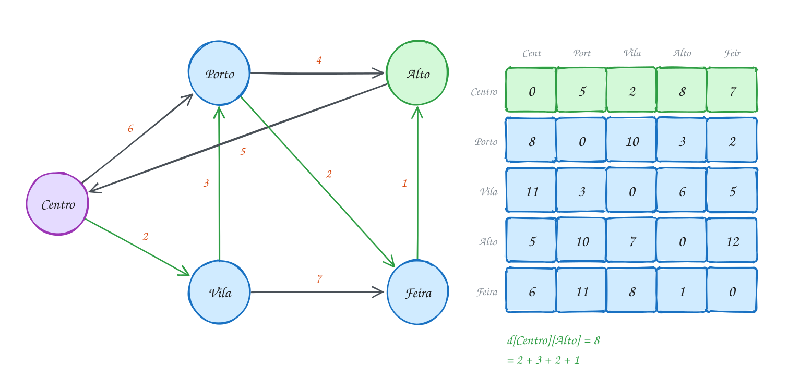</p>

O código monta a matriz, roda os três laços e imprime a tabela:

```c
#include <stdio.h>

#define V 5
#define INFINITO 1000000000

int main(void) {
    const char *bairros[V] = {"Centro", "Porto", "Vila", "Alto", "Feira"};
    int d[V][V];
    for (int i = 0; i < V; i++)
        for (int j = 0; j < V; j++) d[i][j] = (i == j) ? 0 : INFINITO; // sem rua: infinito

    int ruas[][3] = {{0, 2, 2}, {2, 1, 3}, {0, 1, 6}, {1, 3, 4},
                     {3, 0, 5}, {2, 4, 7}, {4, 3, 1}, {1, 4, 2}};
    for (int r = 0; r < 8; r++) d[ruas[r][0]][ruas[r][1]] = ruas[r][2]; // mão única

    for (int k = 0; k < V; k++)         // k: o bairro que pode servir de passagem
        for (int i = 0; i < V; i++)     // de i
            for (int j = 0; j < V; j++) // para j
                if (d[i][k] != INFINITO && d[k][j] != INFINITO && d[i][k] + d[k][j] < d[i][j])
                    d[i][j] = d[i][k] + d[k][j]; // passar por k é mais rápido

    printf("%-8s", "de\\para");
    for (int j = 0; j < V; j++) printf("%7s", bairros[j]);
    printf("\n");
    for (int i = 0; i < V; i++) {
        printf("%-8s", bairros[i]);
        for (int j = 0; j < V; j++) printf("%7d", d[i][j]);
        printf("\n");
    }
    return 0;
}
// Saída:
// de\para  Centro  Porto   Vila   Alto  Feira
// Centro        0      5      2      8      7
// Porto         8      0     10      3      2
// Vila         11      3      0      6      5
// Alto          5     10      7      0     12
// Feira         6     11      8      1      0
```

Repara no fluxograma: não há fila, heap nem "escolher o menor". São três
contadores e uma comparação no miolo, repetida V³ vezes:

<p align="center">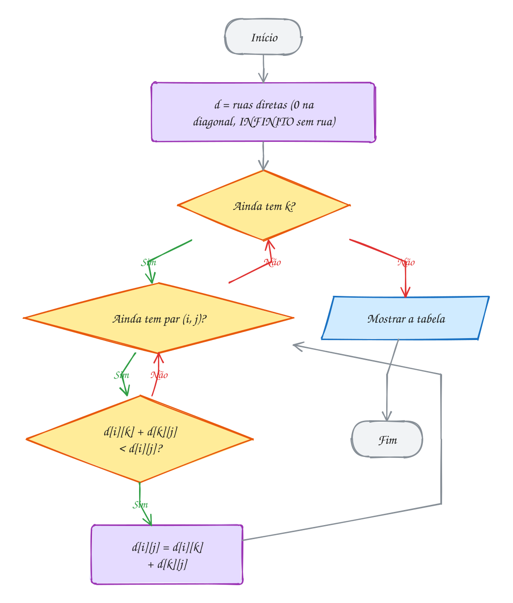</p>

### Passo a passo

Siga uma casa só, `d[Centro][Alto]`, rodada a rodada. Não existe rua direta,
então ela começa em ∞:

| Rodada (passagem liberada) | `d[Centro][Alto]` | Caminho por trás do número |
| --- | --- | --- |
| início | ∞ | (nenhuma rua direta) |
| k = Centro | ∞ | ninguém chega ao Alto pelo Centro ainda |
| k = Porto | 10 | Centro → Porto → Alto: 6 + 4 |
| k = Vila | 9 | Centro → Vila → Porto → Alto: 2 + 3 + 4 |
| k = Alto | 9 | passar pelo próprio destino não ajuda |
| k = Feira | 8 | Centro → Vila → Porto → Feira → Alto: 2 + 3 + 2 + 1 |

Na rodada da Vila, o programa não "sabe" o caminho inteiro: ele só soma
`d[Centro][Vila]` (2) com `d[Vila][Alto]` (7, que a rodada do Porto já tinha
calculado). Cada rodada aproveita o trabalho das anteriores. É a tabela da
programação dinâmica, preenchida no lugar.

O A309 guarda, junto com a distância, o próximo passo de cada rota, e
imprime o caminho entre quaisquer dois bairros. O A310 troca `+` e `min` por
`&&` e `||` e responde só "existe caminho?", o **fecho transitivo**.

> [!WARNING]
> Pôr o `k` no laço de **dentro** (`for i, for j, for k`) compila, roda e dá
> resposta errada sem aviso: quando o par `i`, `j` é calculado, os pedaços
> `d[i][k]` e `d[k][j]` ainda não estão prontos. E a soma
> `d[i][k] + d[k][j]` precisa do teste de INFINITO (ou de um INFINITO
> folgado como o daqui): com `INT_MAX`, ela estoura.

> [!TIP]
> **Por dentro do C:** `int d[5][5]` são 25 `int` seguidos na memória, linha
> por linha: `d[i][j]` mora em `d + (i * 5 + j)`. No miolo, `j` é o laço
> mais rápido, então `d[i][j]` e `d[k][j]` andam de 4 em 4 bytes, em
> sequência, e o cache aproveita cada linha que busca. Trocar a ordem para
> `j` por fora e `i` por dentro daria o mesmo resultado (a rodada continua
> sendo o `k`), só que pulando 20 bytes a cada passo. Numa matriz de 2000 ×
> 2000, essa diferença vale um programa várias vezes mais lento.

> [!NOTE]
> **Pergunta para você:** se a prefeitura abrir uma rua Alto → Porto de 2
> minutos, que casas da tabela mudam? Calcule a nova linha do Alto e a nova
> coluna do Porto antes de acrescentar `{3, 1, 2}` (e trocar o 8 por 9).

### Hora de praticar

Os arquivos ficam em [`0155-floyd-warshall/`](0155-floyd-warshall/). Os comandos funcionam de qualquer pasta do terminal. Nos exemplos, rode, mude, quebre e rode de novo. Nos exercícios, a resposta vai dentro do próprio arquivo. ★☆☆ é aquecimento, ★★☆ pede raciocínio e ★★★ é desafio.

**Exemplo A309 · Floyd-Warshall com rota: o mapa do metrô**

```c
#include <stdio.h>

#define V 6
#define INFINITO 1000000000

const char *estacoes[V] = {"Sé", "Luz", "Brás", "Paraíso", "Consolação", "Pinheiros"};
int d[V][V];    // minutos
int prox[V][V]; // prox[i][j]: a primeira estação depois de i no melhor caminho até j

void rota(int i, int j) {
    printf("%s", estacoes[i]);
    while (i != j) {
        i = prox[i][j]; // anda um passo
        printf(" -> %s", estacoes[i]);
    }
}

int main(void) {
    for (int i = 0; i < V; i++)
        for (int j = 0; j < V; j++) {
            d[i][j] = (i == j) ? 0 : INFINITO;
            prox[i][j] = (i == j) ? i : -1;
        }
    int trilhos[][3] = {{0, 1, 3}, {0, 2, 4}, {0, 3, 5}, {3, 4, 4}, {4, 5, 6}, {1, 4, 9}, {3, 5, 12}};
    for (int t = 0; t < 7; t++) {
        int a = trilhos[t][0], b = trilhos[t][1];
        d[a][b] = d[b][a] = trilhos[t][2]; // o metrô anda nos dois sentidos
        prox[a][b] = b;
        prox[b][a] = a;
    }

    for (int k = 0; k < V; k++)
        for (int i = 0; i < V; i++)
            for (int j = 0; j < V; j++)
                if (d[i][k] != INFINITO && d[k][j] != INFINITO && d[i][k] + d[k][j] < d[i][j]) {
                    d[i][j] = d[i][k] + d[k][j];
                    prox[i][j] = prox[i][k]; // para ir a j por k, o primeiro passo é o de ir a k
                }

    int pedidos[][2] = {{2, 5}, {1, 5}, {5, 1}};
    for (int p = 0; p < 3; p++) {
        int i = pedidos[p][0], j = pedidos[p][1];
        printf("%d min: ", d[i][j]);
        rota(i, j);
        printf("\n");
    }
    return 0;
}
// Saída:
// 19 min: Brás -> Sé -> Paraíso -> Consolação -> Pinheiros
// 15 min: Luz -> Consolação -> Pinheiros
// 15 min: Pinheiros -> Consolação -> Luz
//
// Uma matriz de V × V próximos passos guarda TODAS as rotas: em vez de
// guardar V² caminhos inteiros, cada casa guarda só um número.
```

```bash
~/LPEDC/rodar 23-grafos-avancados/0155-floyd-warshall/A309.c
```

**Exemplo A310 · Fecho transitivo: de qual terminal dá para chegar em qual**

```c
#include <stdbool.h>
#include <stdio.h>

#define V 5

int main(void) {
    const char *terminais[V] = {"Norte", "Sul", "Leste", "Oeste", "Centro"};
    bool chega[V][V] = {{false}}; // linhas de ônibus de mão única
    int linhas[][2] = {{0, 4}, {4, 1}, {1, 4}, {2, 0}, {3, 3}};
    for (int k = 0; k < 5; k++) chega[linhas[k][0]][linhas[k][1]] = true;

    // Warshall: o Floyd-Warshall com || no lugar de min e && no lugar de +
    for (int k = 0; k < V; k++)
        for (int i = 0; i < V; i++)
            for (int j = 0; j < V; j++)
                chega[i][j] = chega[i][j] || (chega[i][k] && chega[k][j]);

    printf("%-8s", "de\\para");
    for (int j = 0; j < V; j++) printf(j < V - 1 ? "%-7s" : "%s\n", terminais[j]);
    for (int i = 0; i < V; i++) {
        int quantos = 0;
        printf("%-8s", terminais[i]);
        for (int j = 0; j < V; j++) {
            printf("%-7s", chega[i][j] ? "sim" : ".");
            quantos += chega[i][j] && i != j;
        }
        printf("(%d)\n", quantos);
    }
    return 0;
}
// Saída:
// de\para Norte  Sul    Leste  Oeste  Centro
// Norte   .      sim    .      .      sim    (2)
// Sul     .      sim    .      .      sim    (1)
// Leste   sim    sim    .      .      sim    (3)
// Oeste   .      .      .      sim    .      (0)
// Centro  .      sim    .      .      sim    (1)
//
// Repare na diagonal: Sul chega no próprio Sul (vai ao Centro e volta),
// Oeste tem uma linha circular que volta para ele, e Leste não volta nunca.
// O número entre parênteses conta os OUTROS terminais alcançáveis.
```

```bash
~/LPEDC/rodar 23-grafos-avancados/0155-floyd-warshall/A310.c
```

#### Exercícios

**Exercício E925** · ★☆☆

Uma cooperativa tem quatro galpões: Milho, Leite, Frutas e Mel (índices
0 a 3). As estradas internas são de mão única, em km:


```text
Milho -> Leite 8     Leite -> Frutas 3    Frutas -> Milho 4
Milho -> Mel 15      Frutas -> Mel 5      Mel -> Leite 2
```


Escreva o Floyd-Warshall do zero e mostre a tabela de distâncias, uma
linha por galpão de origem (nome com %-7s e cada número com %4d).


```text
Saída esperada:
Milho     0   8  11  15
Leite     7   0   3   8
Frutas    4   7   0   5
Mel       9   2   5   0
```

**Dicas:**

1. Comece com 0 na diagonal e INFINITO (1000000000) onde não há estrada.
   Com esse INFINITO folgado, d[i][k] + d[k][j] cabe num int mesmo
   quando os dois são infinitos.
2. Três laços: k por fora, depois i, depois j. No miolo,
   d[i][j] = mínimo(d[i][j], d[i][k] + d[k][j]).
3. Resposta esperada: a saída acima. Milho -> Mel continua 15: passar por
   Leite e Frutas daria 8 + 3 + 5 = 16.

```bash
~/LPEDC/rodar 23-grafos-avancados/0155-floyd-warshall/E925.c
```

**Exercício E926** · ★☆☆

O malote interno de uma empresa leva dias entre as filiais (mão única).
A filial de Recife ainda não entrou na rota de malotes. Complete a função
floyd(d). Aqui o INFINITO é INT_MAX, então a soma d[i][k] + d[k][j] só
pode ser feita depois de conferir que nenhum dos dois é INFINITO. O main
já imprime "-" onde não há caminho.


```text
Saída esperada:
       SP  RJ  BH POA REC
SP      0   1   3   3   -
RJ      4   0   2   6   -
BH      2   3   0   4   -
POA     4   5   7   0   -
REC     -   -   -   -   0
```

**Dicas:**

1. A condição completa do miolo é: d[i][k] != INFINITO e
   d[k][j] != INFINITO e d[i][k] + d[k][j] < d[i][j].
2. Por causa do curto-circuito do && (assunto 0013), a soma nem chega a
   ser calculada quando um dos lados é INFINITO.
3. Resposta esperada: a saída acima. Sem os testes, INT_MAX + 1 estoura
   e o sanitizer acusa "signed integer overflow".

```bash
~/LPEDC/rodar 23-grafos-avancados/0155-floyd-warshall/E926.c
```

**Exercício E927** · ★★☆

A prefeitura vai construir um posto de saúde num dos seis bairros. O
critério: o morador que fica mais longe do posto deve ficar o mais perto
possível. As ruas são de mão dupla (km):


```text
Vila Rica-Jardim 4, Jardim-Centro 3, Centro-Lagoa 5, Lagoa-Bosque 2,
Centro-Bosque 6, Bosque-Porto 7, Jardim-Lagoa 9, Vila Rica-Porto 20
```


Escreva o programa: rode o Floyd-Warshall e, para cada bairro, mostre
qual bairro fica mais longe dele e a que distância (a primeira maior, em
ordem de índice). No fim, mostre o bairro em que essa pior distância é a
menor.


```text
Saída esperada:
Vila Rica: o mais longe é Porto, a 20 km
Jardim: o mais longe é Porto, a 16 km
Centro: o mais longe é Porto, a 13 km
Lagoa: o mais longe é Vila Rica, a 12 km
Bosque: o mais longe é Vila Rica, a 13 km
Porto: o mais longe é Vila Rica, a 20 km
Melhor bairro para o posto: Lagoa (ninguém fica a mais de 12 km)
```

**Dicas:**

1. Mão dupla: grave d[a][b] e d[b][a]. Depois do Floyd-Warshall, a linha
   i da matriz tem a distância de i a todos.
2. O máximo da linha i é a "excentricidade" de i. O bairro com a menor
   excentricidade é o CENTRO do grafo (que aqui nem é o bairro Centro).
3. Resposta esperada: a saída acima. De Lagoa: Vila Rica a 12 (Lagoa,
   Centro, Jardim, Vila Rica) e Porto a 9 (Lagoa, Bosque, Porto).

```bash
~/LPEDC/rodar 23-grafos-avancados/0155-floyd-warshall/E927.c
```

**Exercício E928** · ★★☆

Uma casa de câmbio cobra uma taxa fixa (em centavos) por conversão entre
Real, Dólar, Euro e Cripto. Numa semana de promoção, a conversão Cripto ->
Dólar dá um bônus maior (taxa -40 em vez de -10). A função analisa já
monta a matriz de uma semana. Complete-a: rode o Floyd-Warshall e,
olhando a diagonal, diga se existe um ciclo negativo (trocar em roda e
sair ganhando) e por quais moedas ele passa.


```text
Saída esperada:
Semana 1: sem ciclo negativo
Semana 2: ciclo negativo passando por Dólar Euro Cripto
```

**Dicas:**

1. Sem ciclo negativo, a diagonal termina toda em 0. Se d[i][i] < 0 no
   fim, existe um caminho que sai de i e volta a i com soma negativa.
2. Na semana 2, Euro -> Cripto -> Dólar -> Euro soma 15 - 40 + 20 = -5.
   O Real não entra: sair do Real e voltar a ele custa sempre mais do que
   a volta negativa devolve.
3. Resposta esperada: a saída acima. Com ciclo negativo, os outros
   números da matriz deixam de ter sentido (ficam "mais negativos" a
   cada volta), por isso o programa só mostra as moedas do ciclo.

```bash
~/LPEDC/rodar 23-grafos-avancados/0155-floyd-warshall/E928.c
```

**Exercício E929** · ★★★

Ache o bug. Este programa monta a tabela de tempos (minutos) entre cinco
pontos ligados por ciclovias de mão única. Ele compila, roda, não dá erro
nenhum, e a tabela está errada: diz que do Parque não se chega na Escola,
mas Parque -> Estação -> Museu -> Escola existe (2 + 1 + 4 = 7).


```text
Saída que aparece:
0.    0   5  15   2   7   (Escola)
1.    -   0   3   -   2   (Parque)
2.    4   9   0   6  11   (Museu)
3.    -   3   6   0   5   (Praça)
4.    5  10   1   7   0   (Estação)
```


```text
Saída esperada:
0.    0   5   8   2   7   (Escola)
1.    7   0   3   9   2   (Parque)
2.    4   9   0   6  11   (Museu)
3.   10   3   6   0   5   (Praça)
4.    5  10   1   7   0   (Estação)
```


Ache o erro, conserte e confira.

**Dicas:**

1. Quando o programa calcula d[1][0] (Parque -> Escola), quais casas ele
   usa? d[1][4] + d[4][0] (Estação -> Escola) já está pronta nessa hora?
2. Cada par (i, j) só é examinado uma vez, numa passada pelos k. Se o
   pedaço d[k][j] ainda vai melhorar depois, o par (i, j) não fica
   sabendo. A ordem dos laços é a ideia do algoritmo, não um detalhe.
3. Resposta esperada: o k precisa ser o laço de FORA (for k, for i, for
   j). Consertado, mostra a saída esperada.

```bash
~/LPEDC/rodar 23-grafos-avancados/0155-floyd-warshall/E929.c
```

**Exercício E930** · ★★★

De volta aos cinco bairros do texto. A tabela já foi calculada quando a
prefeitura abre uma rua nova, Feira -> Vila, de 1 minuto. Rodar o
Floyd-Warshall de novo custa O(V³). Escreva nova_rua(d, a, b, w), que
atualiza a tabela em O(V²): qualquer caminho que melhora com a rua nova
passa por ela uma vez só, então é "de i até a", mais w, mais "de b até j".
O main confere o resultado contra um Floyd completo feito do zero.


```text
Saída esperada:
Centro    0   5   2   8   7
Porto     8   0   3   3   2
Vila     11   3   0   6   5
Alto      5  10   7   0  12
Feira     6   4   1   1   0
Confere com o Floyd completo: sim
```

**Dicas:**

1. Para cada par (i, j): se d[i][a] + w + d[b][j] < d[i][j], troque.
2. Dá para atualizar no lugar: com pesos não negativos, a rua nova não
   encurta nenhum caminho que termina em a nem nenhum que começa em b, e
   por isso d[i][a] e d[b][j] não mudam no meio. Na dúvida, copie antes
   a coluna a e a linha b em dois vetores e use as cópias.
3. Resposta esperada: a saída acima. Mudam três casas: Porto -> Vila
   (10 vira 3), Feira -> Porto (11 vira 4) e Feira -> Vila (8 vira 1).

```bash
~/LPEDC/rodar 23-grafos-avancados/0155-floyd-warshall/E930.c
```

---

## 0156 · Juntando tudo: o assistente do calouro

Primeira semana na faculdade. O calouro tem duas dúvidas que não saem da
cabeça. A primeira é de calendário: com esses pré-requisitos, em quantos
semestres dá para se formar, e o que cursar em cada um? A segunda é de
geografia: o campus é enorme, e a aula de Laboratório começa cinco minutos
depois do almoço no Bandejão. Qual o caminho mais rápido entre os prédios?

São dois grafos diferentes, e cada pergunta tem o seu algoritmo. O módulo
inteiro serve para você bater o olho na pergunta e saber qual usar:

| Pergunta | Algoritmo | Custo |
| --- | --- | --- |
| Quais pedaços são independentes? | componentes (DFS + laço externo) | O(V + E) |
| Tem ciclo num grafo dirigido? | DFS com três cores | O(V + E) |
| Em que ordem fazer, respeitando as setas? | ordenação topológica (Kahn ou DFS) | O(V + E) |
| Ligar todos pelo menor custo total | Kruskal ou Prim (árvore geradora mínima) | O(E log E) ou O(E log V) |
| Menor caminho de uma origem, pesos >= 0 | Dijkstra (assunto 0112) | O((V + E) log V) |
| Menor caminho de uma origem, com pesos negativos | Bellman-Ford | O(V · E) |
| Menor caminho entre todos os pares | Floyd-Warshall | O(V³) |

A grade de disciplinas é um **DAG**: setas "antes de", sem peso. A pergunta
"quantos semestres" é o Kahn por rodadas do exemplo A302: cada rodada pega
tudo que já está liberado. E de quebra ele avisa se a coordenação criou um
pré-requisito circular.

O mapa do campus é um grafo **não dirigido** e ponderado, com seis prédios.
O calouro vai perguntar rotas entre pares variados ao longo do semestre, então
vale calcular a tabela inteira uma vez com o **Floyd-Warshall**, guardando o
próximo passo de cada rota (como no A309), e depois responder qualquer
pergunta só consultando a matriz.

O programa usa um único tipo `Grafo` para os dois mapas: o número de
vértices, os nomes e uma matriz de pesos. A função `liga` recebe se a aresta
é de mão dupla. Na grade, o peso só marca a seta (vale 1); no campus, são os
minutos de caminhada. As funções recebem `const Grafo *` para não copiar a
struct, que passa de 300 bytes.

Vamos ver na prática. Em cima, a grade com o semestre de cada disciplina;
embaixo, o campus com as duas rotas que o programa calcula, em verde:

<p align="center">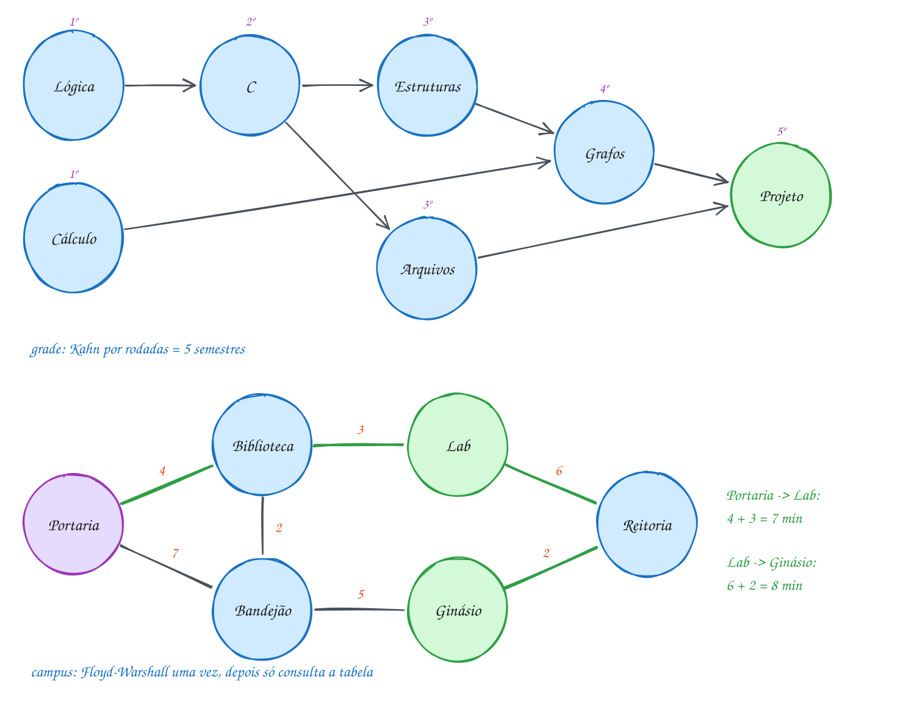</p>

O código completo. Cada algoritmo mora numa função, e o `main` só monta os
dois grafos e faz as perguntas:

```c
#include <stdio.h>

#define MAX 8
#define INFINITO 1000000000

typedef struct {
    int n;
    const char *nomes[MAX];
    int peso[MAX][MAX]; // 0 = sem aresta
} Grafo;

void liga(Grafo *g, int a, int b, int peso, int mao_dupla) {
    g->peso[a][b] = peso;
    if (mao_dupla) g->peso[b][a] = peso;
}

// pré-requisitos: Kahn por rodadas; devolve quantos semestres (ou -1 se houver ciclo)
int semestres(const Grafo *g) {
    int grau[MAX] = {0}, atual[MAX], n_atual = 0, feitas = 0, s = 0;
    for (int a = 0; a < g->n; a++)
        for (int b = 0; b < g->n; b++) grau[b] += g->peso[a][b] != 0;
    for (int v = 0; v < g->n; v++)
        if (grau[v] == 0) atual[n_atual++] = v;
    while (n_atual > 0) {
        int prox[MAX], n_prox = 0;
        printf("  %dº semestre:", ++s);
        for (int i = 0; i < n_atual; i++) {
            int u = atual[i];
            printf(" %s", g->nomes[u]);
            feitas++;
            for (int v = 0; v < g->n; v++)
                if (g->peso[u][v] && --grau[v] == 0) prox[n_prox++] = v;
        }
        printf("\n");
        for (int i = 0; i < n_prox; i++) atual[i] = prox[i];
        n_atual = n_prox;
    }
    return feitas == g->n ? s : -1;
}

// rotas: Floyd-Warshall com a matriz de próximo passo
void todas_as_rotas(const Grafo *g, int d[][MAX], int prox[][MAX]) {
    for (int i = 0; i < g->n; i++)
        for (int j = 0; j < g->n; j++) {
            d[i][j] = (i == j) ? 0 : (g->peso[i][j] ? g->peso[i][j] : INFINITO);
            prox[i][j] = (i == j || g->peso[i][j]) ? j : -1;
        }
    for (int k = 0; k < g->n; k++)
        for (int i = 0; i < g->n; i++)
            for (int j = 0; j < g->n; j++)
                if (d[i][k] + d[k][j] < d[i][j]) {
                    d[i][j] = d[i][k] + d[k][j];
                    prox[i][j] = prox[i][k];
                }
}

void mostra_rota(const Grafo *g, int d[][MAX], int prox[][MAX], int a, int b) {
    printf("  %d min: %s", d[a][b], g->nomes[a]);
    for (int v = a; v != b;) {
        v = prox[v][b]; // um passo rumo a b
        printf(" -> %s", g->nomes[v]);
    }
    printf("\n");
}

int main(void) {
    Grafo grade = {.n = 7, .nomes = {"Lógica", "Cálculo", "C", "Estruturas", "Arquivos", "Grafos", "Projeto"}};
    liga(&grade, 0, 2, 1, 0); // Lógica antes de C (dirigido; o peso só marca a seta)
    liga(&grade, 2, 3, 1, 0);
    liga(&grade, 2, 4, 1, 0);
    liga(&grade, 1, 5, 1, 0);
    liga(&grade, 3, 5, 1, 0);
    liga(&grade, 4, 6, 1, 0);
    liga(&grade, 5, 6, 1, 0);
    printf("Grade:\n");
    int s = semestres(&grade);
    if (s < 0) printf("  pré-requisito circular!\n");
    else printf("  formatura em %d semestres\n", s);

    Grafo campus = {.n = 6, .nomes = {"Portaria", "Biblioteca", "Lab", "Bandejão", "Ginásio", "Reitoria"}};
    liga(&campus, 0, 1, 4, 1); // minutos a pé, mão dupla
    liga(&campus, 0, 3, 7, 1);
    liga(&campus, 1, 2, 3, 1);
    liga(&campus, 1, 3, 2, 1);
    liga(&campus, 3, 4, 5, 1);
    liga(&campus, 2, 5, 6, 1);
    liga(&campus, 4, 5, 2, 1);
    int d[MAX][MAX], prox[MAX][MAX];
    todas_as_rotas(&campus, d, prox);
    printf("Campus:\n");
    mostra_rota(&campus, d, prox, 0, 2); // da Portaria até o Lab
    mostra_rota(&campus, d, prox, 2, 4); // do Lab até o Ginásio
    return 0;
}
// Saída:
// Grade:
//   1º semestre: Lógica Cálculo
//   2º semestre: C
//   3º semestre: Estruturas Arquivos
//   4º semestre: Grafos
//   5º semestre: Projeto
//   formatura em 5 semestres
// Campus:
//   7 min: Portaria -> Biblioteca -> Lab
//   8 min: Lab -> Reitoria -> Ginásio
```

Repara no fluxograma: é o `main`, e as duas perguntas são independentes. A
grade passa pelo Kahn e por um teste de ciclo; o campus passa pelo
Floyd-Warshall uma vez e depois só consulta a tabela:

<p align="center">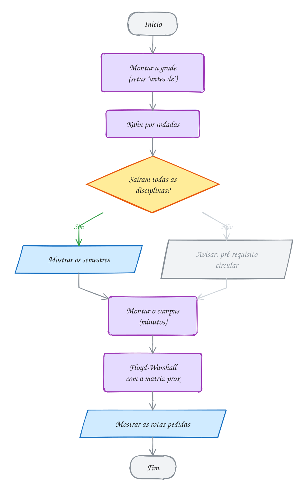</p>

O exemplo A311 é um planejador de entregas que escolhe sozinho entre
Dijkstra e Bellman-Ford, olhando se existe peso negativo. O A312 é um mini
gerenciador de pacotes: instala só as dependências do pacote pedido, na
ordem certa, com a DFS em pós-ordem.

> [!WARNING]
> Usar a matriz de pesos com "0 = sem aresta" tem um preço: uma aresta de peso
> **zero** de verdade some. Na grade isso não importa (o peso é sempre 1), mas
> um mapa com uma passarela "de graça" entre dois prédios precisaria de outra
> marca para "sem aresta", como o próprio INFINITO. E não misture as
> perguntas: Floyd-Warshall num grafo de 100 mil vértices é inviável (10¹⁵
> passos), e Kruskal não responde caminho mínimo. A árvore mínima liga
> todos barato, mas a rota entre dois pontos dentro dela pode ser bem pior
> que a ótima.

> [!TIP]
> **Por dentro do C:** cada `Grafo` tem o `n` (4 bytes), 4 bytes de
> alinhamento para o vetor de ponteiros começar num múltiplo de 8, os 8
> ponteiros para os nomes (64 bytes numa máquina de 64 bits) e `int
> peso[8][8]` (256 bytes): `sizeof(Grafo)` dá 328, no frame de `main`. Os
> nomes em si são literais de string, que moram numa área só de leitura do
> programa; a struct guarda só os endereços. Passar `&campus` copia 8 bytes;
> passar `campus` por valor copiaria os 328 a cada chamada. Já `int d[][MAX]` como parâmetro é, na
> verdade, um ponteiro para linhas de `MAX` inteiros: o compilador precisa
> saber o `MAX` para calcular onde fica `d[i][j]`.

> [!NOTE]
> **Pergunta para você:** se a coordenação colocar Projeto como pré-requisito
> de Cálculo (`liga(&grade, 6, 1, 1, 0)`), o que o programa mostra? E se a
> trilha Lab–Reitoria fechar para obra, qual passa a ser a rota do Lab ao
> Ginásio, e quantos minutos leva?

### Hora de praticar

Os arquivos ficam em [`0156-juntando-tudo/`](0156-juntando-tudo/). Os comandos funcionam de qualquer pasta do terminal. Nos exemplos, rode, mude, quebre e rode de novo. Nos exercícios, a resposta vai dentro do próprio arquivo. ★☆☆ é aquecimento, ★★☆ pede raciocínio e ★★★ é desafio.

**Exemplo A311 · O planejador escolhe: Dijkstra ou Bellman-Ford**

```c
#include <stdbool.h>
#include <stdio.h>

#define MAX 6
#define INFINITO 1000000000

typedef struct {
    int n;
    const char *nomes[MAX];
    int custo[MAX][MAX];
    bool tem[MAX][MAX]; // existe o trecho? (aqui custo 0 é um custo de verdade)
} Mapa;

bool tem_negativo(const Mapa *m) {
    for (int i = 0; i < m->n; i++)
        for (int j = 0; j < m->n; j++)
            if (m->tem[i][j] && m->custo[i][j] < 0) return true;
    return false;
}

void dijkstra(const Mapa *m, int dist[]) {
    bool fixo[MAX] = {false};
    for (int v = 0; v < m->n; v++) dist[v] = INFINITO;
    dist[0] = 0;
    for (int passo = 0; passo < m->n; passo++) {
        int u = -1;
        for (int v = 0; v < m->n; v++)
            if (!fixo[v] && dist[v] != INFINITO && (u == -1 || dist[v] < dist[u])) u = v;
        if (u == -1) break;
        fixo[u] = true;
        for (int v = 0; v < m->n; v++)
            if (m->tem[u][v] && dist[u] + m->custo[u][v] < dist[v]) dist[v] = dist[u] + m->custo[u][v];
    }
}

bool bellman_ford(const Mapa *m, int dist[]) { // false: ciclo negativo
    for (int v = 0; v < m->n; v++) dist[v] = INFINITO;
    dist[0] = 0;
    for (int r = 0; r <= m->n - 1; r++) { // a última volta (r == n - 1) é a extra
        bool mudou = false;
        for (int u = 0; u < m->n; u++)
            for (int v = 0; v < m->n; v++)
                if (m->tem[u][v] && dist[u] != INFINITO && dist[u] + m->custo[u][v] < dist[v]) {
                    dist[v] = dist[u] + m->custo[u][v];
                    mudou = true;
                }
        if (!mudou) return true;
        if (r == m->n - 1) return false; // mudou até na rodada extra
    }
    return true;
}

void planeja(const Mapa *m, const char *titulo) {
    int dist[MAX];
    printf("%s: ", titulo);
    if (tem_negativo(m)) {
        printf("tem trecho negativo, uso Bellman-Ford\n");
        if (!bellman_ford(m, dist)) {
            printf("  ciclo negativo: não existe rota mais barata\n");
            return;
        }
    } else {
        printf("tudo >= 0, uso Dijkstra\n");
        dijkstra(m, dist);
    }
    for (int v = 1; v < m->n; v++) printf("  %s: R$ %d\n", m->nomes[v], dist[v]);
}

void trecho(Mapa *m, int a, int b, int c) {
    m->tem[a][b] = true;
    m->custo[a][b] = c;
}

int main(void) {
    Mapa dia = {.n = 4, .nomes = {"Loja", "Bairro A", "Bairro B", "Bairro C"}};
    trecho(&dia, 0, 1, 8);
    trecho(&dia, 0, 2, 3);
    trecho(&dia, 2, 1, 4);
    trecho(&dia, 1, 3, 2);
    planeja(&dia, "Entrega de dia");

    Mapa noite = dia;         // copia a struct inteira
    trecho(&noite, 2, 1, -2); // à noite, levar o reciclável do B ao A paga R$ 2
    planeja(&noite, "Coleta de noite");

    Mapa feriado = noite;
    trecho(&feriado, 1, 2, 0); // no feriado, voltar do A ao B não custa nada
    planeja(&feriado, "Coleta no feriado");
    return 0;
}
// Saída:
// Entrega de dia: tudo >= 0, uso Dijkstra
//   Bairro A: R$ 7
//   Bairro B: R$ 3
//   Bairro C: R$ 9
// Coleta de noite: tem trecho negativo, uso Bellman-Ford
//   Bairro A: R$ 1
//   Bairro B: R$ 3
//   Bairro C: R$ 3
// Coleta no feriado: tem trecho negativo, uso Bellman-Ford
//   ciclo negativo: não existe rota mais barata
//
// No feriado, A -> B -> A custa 0 - 2 = -2: cada volta "paga" R$ 2. O vetor
// tem[][] separado do custo deixa o 0 ser um custo de verdade (o trecho
// A -> B grátis), coisa que a matriz com "0 = sem aresta" não permitiria.
```

```bash
~/LPEDC/rodar 23-grafos-avancados/0156-juntando-tudo/A311.c
```

**Exemplo A312 · Instalar só o necessário, na ordem certa**

```c
#include <stdbool.h>
#include <stdio.h>

#define V 8
enum { BRANCO, CINZA, PRETO };

const char *pacotes[V] = {"editor", "jogo", "interface", "som", "imagem", "fontes", "zlib", "libc"};
int precisa[V][V]; // precisa[a][b] = 1: a só funciona com b instalado
bool instalado[V];
int cor[V];

// DFS a partir do pedido: instala as dependências antes (pós-ordem)
bool instala(int u) {
    if (instalado[u]) return true; // já está no sistema: nada a fazer
    cor[u] = CINZA;
    for (int v = 0; v < V; v++) {
        if (!precisa[u][v]) continue;
        if (cor[v] == CINZA) {
            printf("  erro: %s e %s dependem um do outro\n", pacotes[u], pacotes[v]);
            return false;
        }
        if (!instala(v)) return false;
    }
    cor[u] = PRETO;
    instalado[u] = true;
    printf("  instalando %s\n", pacotes[u]);
    return true;
}

void pede(int p) {
    printf("> instalar %s\n", pacotes[p]);
    for (int v = 0; v < V; v++)
        if (!instalado[v]) cor[v] = BRANCO;
    if (instalado[p]) printf("  %s já está instalado\n", pacotes[p]);
    else instala(p);
}

int main(void) {
    int deps[][2] = {{0, 2}, {0, 5}, {1, 2}, {1, 3}, {1, 4}, {2, 5}, {2, 7},
                     {3, 7}, {4, 6}, {5, 6}, {6, 7}};
    for (int k = 0; k < 11; k++) precisa[deps[k][0]][deps[k][1]] = 1;

    pede(0); // editor
    pede(1); // jogo: boa parte já veio com o editor
    pede(5); // fontes
    return 0;
}
// Saída:
// > instalar editor
//   instalando libc
//   instalando zlib
//   instalando fontes
//   instalando interface
//   instalando editor
// > instalar jogo
//   instalando som
//   instalando imagem
//   instalando jogo
// > instalar fontes
//   fontes já está instalado
//
// A DFS só visita o que o pedido alcança: o jogo não instala nada do editor,
// e o editor não puxa som nem imagem. É uma ordenação topológica do pedaço
// do grafo que interessa, não do grafo inteiro.
```

```bash
~/LPEDC/rodar 23-grafos-avancados/0156-juntando-tudo/A312.c
```

#### Exercícios

**Exercício E931** · ★☆☆

O mapa do campus do texto, com uma função que já preenche a tabela de
distâncias pelo Floyd-Warshall. Estenda o main: mostre a tabela (uma
linha por prédio, com o índice e cada número em %3d) e o par de prédios
mais distante um do outro, o "diâmetro" do campus (o primeiro par com a
maior distância, percorrendo a tabela linha por linha).


```text
Saída esperada:
0:  0  4  7  6 11 13
1:  4  0  3  2  7  9
2:  7  3  0  5  8  6
3:  6  2  5  0  5  7
4: 11  7  8  5  0  2
5: 13  9  6  7  2  0
Mais longe: Portaria e Reitoria, 13 min
```

**Dicas:**

1. Dois laços sobre d[i][j]: imprima e, no mesmo passo, guarde o par
   (a, b) com o maior valor visto até agora (troque só se for MAIOR,
   para ficar com o primeiro).
2. A tabela é simétrica porque o campus é de mão dupla: d[i][j] ==
   d[j][i]. Por isso o par (Reitoria, Portaria) também tem 13, mas vem
   depois.
3. Resposta esperada: a saída acima. Portaria -> Reitoria: Portaria,
   Biblioteca, Lab, Reitoria (4 + 3 + 6 = 13).

```bash
~/LPEDC/rodar 23-grafos-avancados/0156-juntando-tudo/E931.c
```

**Exercício E932** · ★☆☆

A grade do texto: reprovar numa disciplina atrasa todas as que dependem
dela, direta ou indiretamente. Complete a função alcance(u, visto): uma
DFS que devolve quantas disciplinas ela alcança a partir de u (sem contar
o próprio u), marcando em visto[] para não contar ninguém duas vezes. O
main já mostra quantas cada uma "trava" e a mais perigosa.


```text
Saída esperada:
Lógica trava 5
Cálculo trava 2
C trava 4
Estruturas trava 2
Arquivos trava 1
Grafos trava 1
Projeto trava 0
Não reprove em Lógica
```

**Dicas:**

1. Para cada v com antes[u][v] e ainda não visto: marque visto[v] e some
   1 (o próprio v) mais o que alcance(v, visto) devolver.
2. Sem o visto[], o Projeto seria contado duas vezes a partir de C (por
   Arquivos e por Estruturas, Grafos).
3. Resposta esperada: a saída acima. Lógica trava C, Estruturas,
   Arquivos, Grafos e Projeto.

```bash
~/LPEDC/rodar 23-grafos-avancados/0156-juntando-tudo/E932.c
```

**Exercício E933** · ★★☆

O governo do estado vai asfaltar o mínimo de estradas que ligue as cinco
regiões (árvore geradora mínima). Um deputado reclama: "da Capital até a
Serra, a viagem vai ficar bem mais longa". As estradas possíveis (km,
mão dupla):


```text
Capital-Litoral 3, Capital-Agreste 7, Litoral-Agreste 5,
Agreste-Sertão 6, Litoral-Serra 9, Serra-Sertão 4, Capital-Serra 10
```


Escreva o programa: monte a árvore mínima com Kruskal (mostre as
estradas na ordem em que entram e o total), guarde as estradas da árvore
numa segunda matriz e rode o Floyd-Warshall nas duas matrizes para
comparar a viagem Capital -> Serra.


```text
Saída esperada:
Rede mínima: Capital-Litoral, Serra-Sertão, Litoral-Agreste, Agreste-Sertão (18 km)
Capital -> Serra pela rede mínima: 18 km
Capital -> Serra pelo melhor caminho: 10 km
```

**Dicas:**

1. Comece as duas matrizes (todas e arvore) com 0 na diagonal e
   INFINITO no resto. Grave todas as estradas em "todas" antes de
   ordenar; em "arvore", só as que o Kruskal aceitar.
2. Uma função floyd(d) serve para as duas matrizes. Escreva cada estrada
   aceita como "nomes[a]-nomes[b]", na ordem do vetor.
3. Resposta esperada: a saída acima. A árvore mínima não guarda caminhos
   curtos: na rede mínima a Capital só chega à Serra dando a volta
   Capital, Litoral, Agreste, Sertão, Serra (3 + 5 + 6 + 4).

```bash
~/LPEDC/rodar 23-grafos-avancados/0156-juntando-tudo/E933.c
```

**Exercício E934** · ★★☆

A faculdade só deixa cursar DUAS disciplinas por semestre. Escreva
planeja(limite, mostrar): a cada semestre, escolhe até "limite"
disciplinas liberadas (grau de entrada 0 e ainda não feitas), as de menor
índice primeiro, e só depois do semestre desconta os graus das que
dependem delas. Devolve o número de semestres (ou -1 se travar). As
regras de pré-requisito:


```text
Algoritmos -> Estruturas   Cálculo I -> Cálculo II   Cálculo I -> Física
Estruturas -> Redes        Cálculo II -> TCC         Redes -> TCC
```


```text
Saída esperada:
Sem limite: 4 semestres
Com no máximo 2 por semestre:
  1º: Algoritmos Cálculo I
  2º: Inglês Física
  3º: Cálculo II Estruturas
  4º: Redes
  5º: TCC
  total: 5 semestres
```

**Dicas:**

1. Guarde as escolhidas do semestre num vetor e só desconte os graus
   depois de escolher todas. Se descontar na hora, uma disciplina e o
   pré-requisito dela podem cair no mesmo semestre.
2. "Sem limite" é a mesma função com limite = V.
3. Resposta esperada: a saída acima. Repare que escolher pelo índice não
   é o melhor: com Cálculo II e Estruturas no 2º semestre, daria para
   terminar em 4. Priorizar quem tem a corrente mais longa pela frente é a
   regra usada na prática (e um bom desafio para depois).

```bash
~/LPEDC/rodar 23-grafos-avancados/0156-juntando-tudo/E934.c
```

**Exercício E935** · ★★★

Ache o bug. Este planejador deveria dividir a grade do texto em
semestres, cursando em cada um tudo o que já está liberado. Mas ele põe
a grade inteira no 1º semestre, inclusive C junto com Lógica, que é
pré-requisito dela:


```text
Saída que aparece:
1º semestre (2 na fila): Lógica Cálculo C Estruturas Arquivos Grafos Projeto
```


```text
Saída esperada:
1º semestre (2 na fila): Lógica Cálculo
2º semestre (1 na fila): C
3º semestre (2 na fila): Estruturas Arquivos
4º semestre (1 na fila): Grafos
5º semestre (1 na fila): Projeto
```


O programa compila e roda sem erro. O problema é de lógica, numa linha.
Ache, conserte e confira.

**Dicas:**

1. Quando Lógica sai da fila, C fica liberada e entra no fim da fila. O
   laço de dentro continua enquanto inicio < fim. O fim acabou de crescer:
   o que acontece com C?
2. A variável fim_semestre guarda onde a fila terminava quando o semestre
   começou. Quem entrou depois dessa posição foi liberado DURANTE o
   semestre e só pode ser cursado no próximo.
3. Resposta esperada: o laço de dentro deve ser
   "while (inicio < fim_semestre)". Consertado, mostra a saída esperada.

```bash
~/LPEDC/rodar 23-grafos-avancados/0156-juntando-tudo/E935.c
```

**Exercício E936** · ★★★

O entregador sai da Loja, visita os três clientes do dia (Ana, Bruno e
Carla) em alguma ordem e volta para a Loja. Os outros pontos do mapa
(Praça e Ponte) servem só de passagem. As ruas, de mão dupla, em minutos:


```text
Loja-Praça 4, Loja-Ponte 6, Praça-Ana 3, Praça-Bruno 5, Ponte-Carla 2,
Ana-Bruno 4, Bruno-Carla 3, Ana-Ponte 7, Loja-Carla 12
```


Escreva o programa: rode o Floyd-Warshall para ter o tempo entre
quaisquer dois pontos e depois teste TODAS as ordens de visita (as
permutações por troca do assunto 0126), mostrando cada roteiro com o
tempo total e, no fim, o melhor (o primeiro de menor tempo).


```text
Saída esperada:
Loja -> Ana -> Bruno -> Carla -> Loja: 22 min
Loja -> Ana -> Carla -> Bruno -> Loja: 26 min
Loja -> Bruno -> Ana -> Carla -> Loja: 28 min
Loja -> Bruno -> Carla -> Ana -> Loja: 26 min
Loja -> Carla -> Bruno -> Ana -> Loja: 22 min
Loja -> Carla -> Ana -> Bruno -> Loja: 28 min
Melhor roteiro (22 min): Loja -> Ana -> Bruno -> Carla -> Loja
```

**Dicas:**

1. Guarde os clientes num vetor {1, 2, 3}. A recursão tenta(pos) troca
   clientes[pos] com cada clientes[i] (i de pos em diante), chama
   tenta(pos + 1) e desfaz a troca. Com pos == 3, a ordem está completa.
2. O tempo do roteiro é d[Loja][1º] + d[1º][2º] + d[2º][3º] + d[3º][Loja],
   com d já calculada pelo Floyd-Warshall (ela embute as passagens por
   Praça e Ponte).
3. Resposta esperada: a saída acima. Com k clientes são k! roteiros: com
   3, seis; com 12, quase meio bilhão. É o problema do caixeiro-viajante,
   e para ele ninguém conhece algoritmo rápido.

```bash
~/LPEDC/rodar 23-grafos-avancados/0156-juntando-tudo/E936.c
```

---

## Desafios do módulo

Problemas para resolver no papel e, quando fizer sentido, num arquivo `.c`
seu. Eles misturam os assuntos do módulo.

**1. Três cores à mão.** Grafo dirigido: A → B, A → C, B → C, C → D, D → B.
Rode a DFS de três cores a partir de A, examinando os vizinhos em ordem
alfabética. Existe ciclo? Qual é a seta que o denuncia, e quem está cinza
nesse momento?

<details><summary>Resposta</summary>

Existe. A DFS entra em A, B, C e D, todos cinza. D olha B, que está
**cinza**: a seta **D → B** fecha o ciclo **B → C → D → B**. A seta A → C, que
seria examinada depois, nem chega a ser vista. Com um `visitado[]` simples o
ciclo também seria achado aqui, mas por sorte: troque D → B por A → D e o
`visitado[]` gritaria "ciclo" sem haver nenhum.

</details>

**2. Quantas ordens?** DAG: 0 → 2, 1 → 2, 2 → 3, 2 → 4. Quantas ordenações
topológicas existem? Qual o Kahn com fila mostra?

<details><summary>Resposta</summary>

**4**: 0 e 1 vêm antes de 2 em qualquer ordem (2 jeitos), e 3 e 4 vêm depois,
em qualquer ordem (2 jeitos): 2 × 2. O Kahn mostra **0 1 2 3 4**. O vértice 2
é um "gargalo": todo mundo antes dele, todo mundo depois.

</details>

**3. Kruskal na rede do poço.** Refaça a rede de canos do assunto 0153 com
Kruskal. Em que ordem os canos entram? O total muda?

<details><summary>Resposta</summary>

Ordem: Cida-Davi 2, Ana-Beto 3, Poço-Ana 4, Davi-Elza 4, Beto-Cida 5. Depois
disso já são 5 canos. Total **18 m**, o mesmo do Prim, com os mesmos canos.
Só a ordem muda: o Kruskal começa pelo cano mais curto do mapa inteiro, longe
do Poço; o Prim cresce a partir do Poço.

</details>

**4. Quantas árvores mínimas?** Triângulo A-B (1), B-C (2), A-C (2), mais
C-D (3). Quantas árvores geradoras mínimas existem e qual o custo?

<details><summary>Resposta</summary>

**Duas**, ambas com custo **6**: {A-B, B-C, C-D} e {A-B, A-C, C-D}. O empate
entre B-C e A-C permite qualquer um dos dois. Com todos os pesos diferentes,
a árvore mínima seria única.

</details>

**5. Somar uma constante resolve?** Alguém propõe: "para usar Dijkstra com
pesos negativos, some 10 em todos os pesos". Teste no grafo S → A (-2),
A → T (3), S → T (2).

<details><summary>Resposta</summary>

**Não resolve.** O certo é S → A → T, custo **1**. Somando 10: S → A vira 8 e
A → T vira 13, total 21; S → T vira 12, e o Dijkstra escolhe S → T. Somar uma
constante castiga mais os caminhos com mais arestas, e a ordem entre eles
muda. Para isso existe o Bellman-Ford (e, para todos os pares, o algoritmo
de Johnson, que repondera os pesos com uma rodada de Bellman-Ford).

</details>

**6. Rodadas no pior caso.** Um caminho 0 → 1 → 2 → 3 → 4 → 5, todas as
arestas com peso 1. Quantas rodadas o Bellman-Ford com parada antecipada faz
com a lista na ordem do caminho? E com a lista invertida?

<details><summary>Resposta</summary>

Na ordem: **2** (a primeira já acerta tudo, a segunda confirma que nada mudou).
Invertida: **5**, uma aresta do caminho por rodada, e a quinta já é a última
permitida (V - 1). É o que o A308 mede.

</details>

**7. Floyd-Warshall à mão.** Grafo dirigido: A → B 5, B → C 2, A → C 9, C → A 3.
Dê a matriz depois de cada rodada (k = A, B, C).

<details><summary>Resposta</summary>

k = A: C → B passa a valer 3 + 5 = **8**. k = B: A → C cai de 9 para 5 + 2 =
**7**. k = C: B → A passa a valer 2 + 3 = **5**. Matriz final, linhas A, B, C:
**(0, 5, 7)**, **(5, 0, 2)**, **(3, 8, 0)**.

</details>

**8. Qual algoritmo?** Para cada pergunta, diga o algoritmo: (a) ligar 500
casas com o mínimo de cabo; (b) a ordem de compilar os módulos de um
projeto; (c) achar uma sequência de trocas de moeda que dá lucro; (d) a
tabela de distâncias entre 50 cidades; (e) quantos grupos de amigos existem,
com amizades chegando a toda hora; (f) o GPS de uma cidade, sem pesos
negativos.

<details><summary>Resposta</summary>

(a) **Kruskal ou Prim**; (b) **ordenação topológica** (Kahn ou DFS); (c)
**Bellman-Ford** com pesos -log(taxa), procurando ciclo negativo (A307); (d)
**Floyd-Warshall** (50³ = 125 mil passos); (e) **union-find** (A300); (f)
**Dijkstra** com heap.

</details>

**9. Caminho crítico.** Tarefas com duração em dias: A (3); B (2), depois de A;
C (4), depois de A; D (1), depois de B e de C. Qual o prazo mínimo com
equipes em paralelo? Qual o caminho crítico? Quantos dias a tarefa B pode
atrasar sem atrasar a obra?

<details><summary>Resposta</summary>

Prazo **8 dias**: A termina no dia 3, C no dia 7, D começa no 7 e termina no 8.
Caminho crítico: **A → C → D**. B pode começar no dia 3 e precisa terminar até
o dia 7 (quando D começa): tem **2 dias de folga**. É o E904 com uma conta a
mais, a do "mais tarde possível", feita de trás para frente.

</details>

**10. Semestres com prioridade.** No E934, escolher as disciplinas pelo índice
deu 5 semestres. Calcule, para cada disciplina, a "altura": o tamanho da
maior corrente de pré-requisitos que ainda vem depois dela. Escolhendo
sempre as de maior altura, quantos semestres são necessários?

<details><summary>Resposta</summary>

Alturas: Algoritmos 3 (Estruturas, Redes, TCC), Cálculo I 2, Estruturas 2,
Cálculo II 1, Redes 1, Física 0, Inglês 0, TCC 0. Semestres (empate decidido
pelo índice): {Algoritmos, Cálculo I}, {Estruturas, Cálculo II}, {Redes,
Inglês}, {TCC, Física}: **4**. A
altura sai de uma DFS com memória: altura(u) = 1 + maior altura dos
sucessores (0 se não tem nenhum).

</details>

**11. Floresta pelo Kruskal.** Você roda o Kruskal até o fim da lista num grafo
com 10 vértices e ele aceita 7 arestas. Quantos componentes o grafo tem? E
se o grafo tivesse 15 arestas no total, quantas formariam ciclo?

<details><summary>Resposta</summary>

Cada aresta aceita junta dois grupos: 10 - 7 = **3 componentes**. Das 15
arestas, 7 entraram e **8** foram recusadas por fechar ciclo. Kruskal até o
fim é um contador de componentes de brinde, igual ao union-find do A300.

</details>

## Para ler mais

- CORMEN, T. H. et al. *Algoritmos: teoria e prática*. 3. ed. Rio de Janeiro: Elsevier, 2012. Cap. 22 (busca em profundidade e ordenação topológica), cap. 23 (árvores geradoras mínimas), cap. 24 (caminhos mínimos de fonte única, Bellman-Ford) e cap. 25 (caminhos mínimos entre todos os pares, Floyd-Warshall).
- LINTZMAYER, C. N.; MOTA, G. O. *Análise de algoritmos e de estruturas de dados*. Santo André: UFABC; São Paulo: IME-USP, 2023. Rascunho. Capítulos sobre grafos, árvores geradoras mínimas e caminhos mínimos.
- SZWARCFITER, J. L.; MARKENZON, L. *Estruturas de dados e seus algoritmos*. 3. ed. Rio de Janeiro: LTC, 2010. Seção sobre ordenação topológica.
- TENENBAUM, A. M.; LANGSAM, Y.; AUGENSTEIN, M. J. *Estruturas de dados usando C*. São Paulo: Makron Books, 1995. Cap. 8: grafos e suas aplicações (fecho transitivo, Warshall, árvore geradora mínima, escalonamento por contagem).
- FEOFILOFF, P. *Algoritmos para grafos*. São Paulo: IME-USP. Disponível em: <https://www.ime.usp.br/~pf/algoritmos_para_grafos/>.
- FEOFILOFF, P. *Algoritmos em linguagem C*. Rio de Janeiro: Elsevier, 2009.
- SEDGEWICK, R.; WAYNE, K. *Algorithms*. 4. ed. Boston: Addison-Wesley, 2011. Seções 4.2 (grafos dirigidos), 4.3 (árvores geradoras mínimas) e 4.4 (caminhos mínimos). Disponível em: <https://algs4.cs.princeton.edu/>.
- KRUSKAL, J. B. On the shortest spanning subtree of a graph and the traveling salesman problem. *Proceedings of the American Mathematical Society*, v. 7, n. 1, p. 48-50, 1956.
- PRIM, R. C. Shortest connection networks and some generalizations. *Bell System Technical Journal*, v. 36, n. 6, p. 1389-1401, 1957.
- BELLMAN, R. On a routing problem. *Quarterly of Applied Mathematics*, v. 16, n. 1, p. 87-90, 1958.
- FLOYD, R. W. Algorithm 97: shortest path. *Communications of the ACM*, v. 5, n. 6, p. 345, 1962.
- KAHN, A. B. Topological sorting of large networks. *Communications of the ACM*, v. 5, n. 11, p. 558-562, 1962.
- CPPREFERENCE. *qsort, qsort_s* e *INFINITY*. Disponível em: <https://en.cppreference.com/w/c/algorithm/qsort>.
