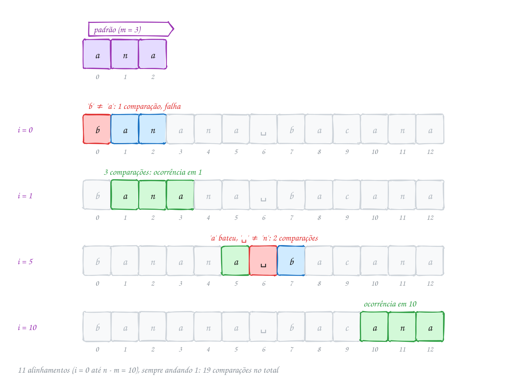
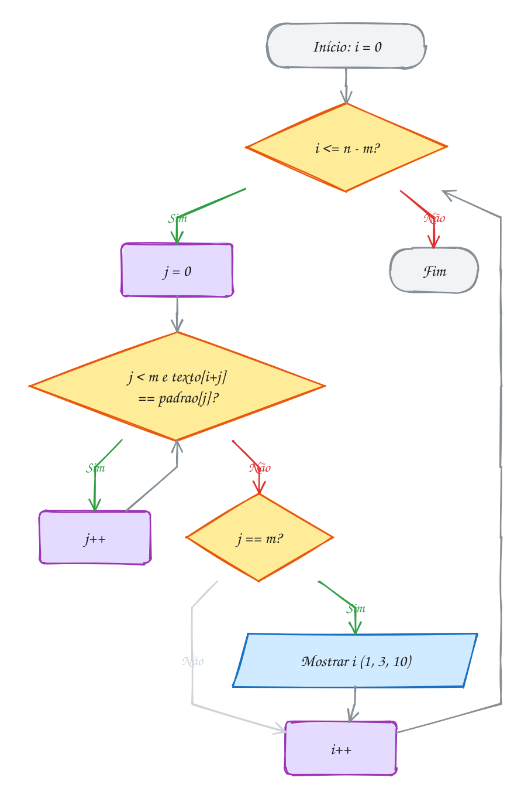
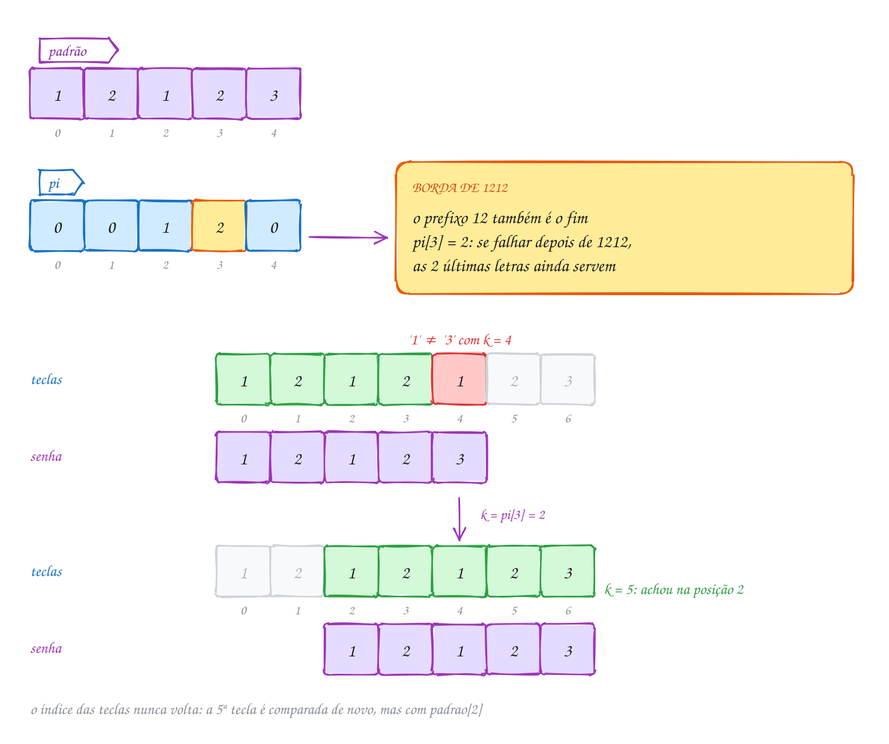
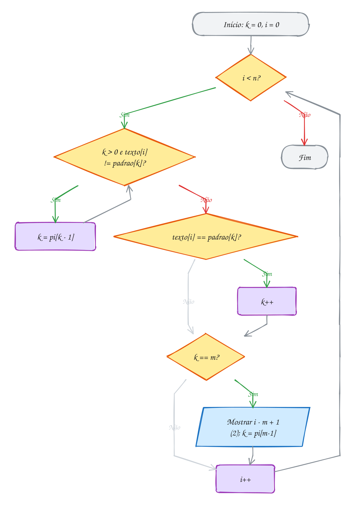
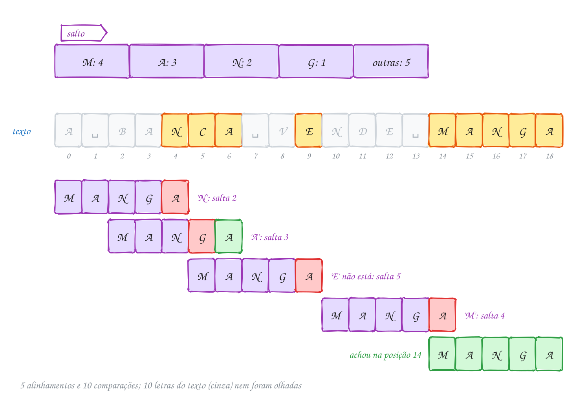
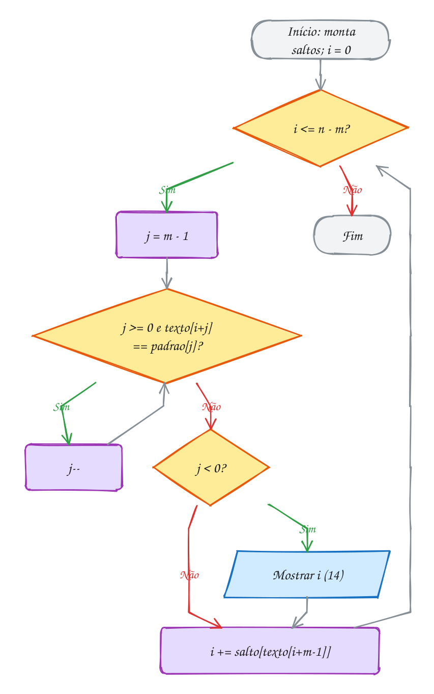
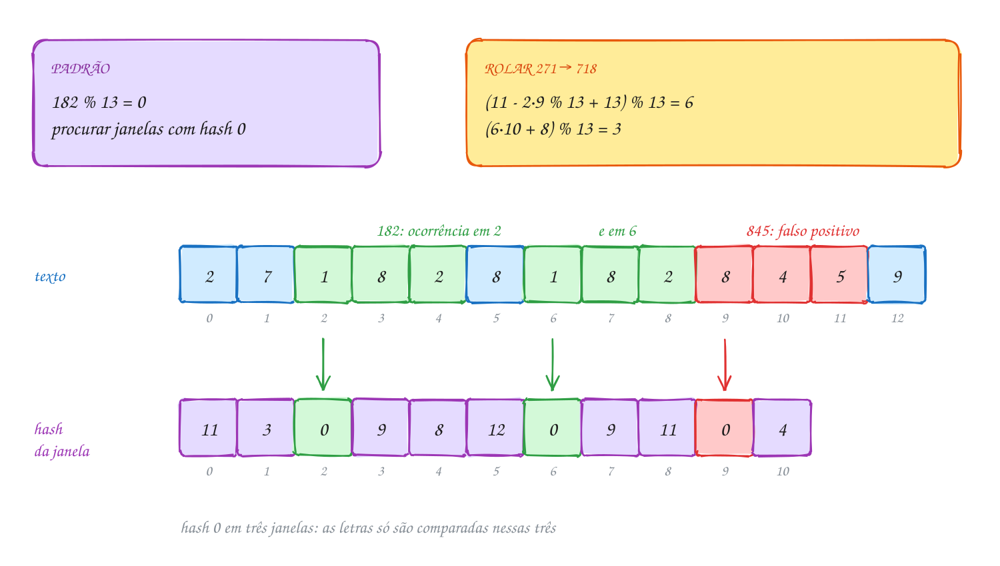
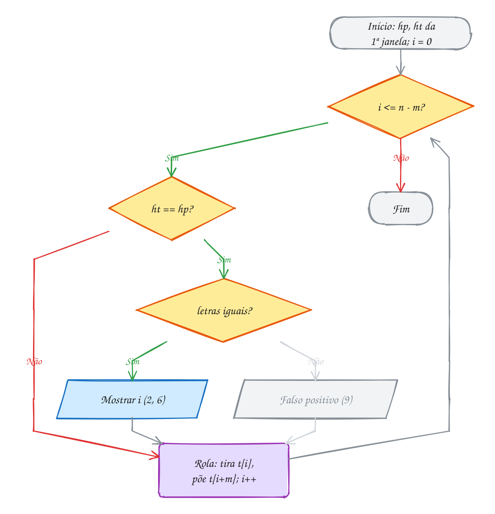
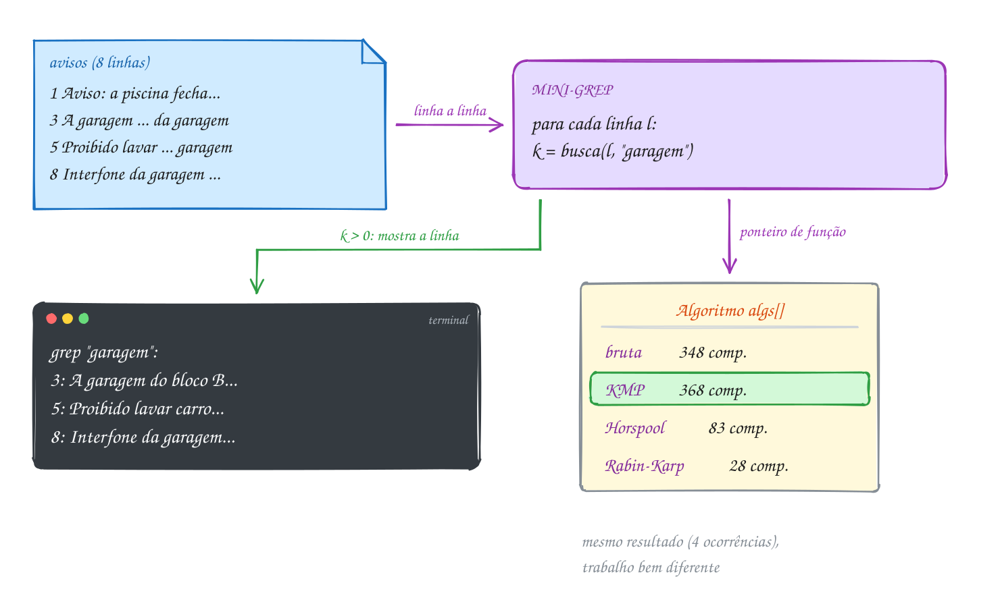
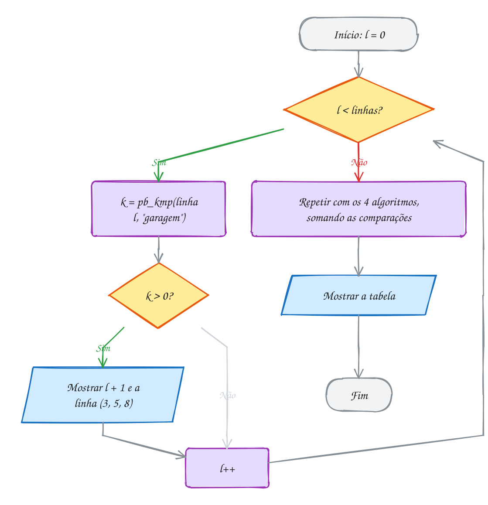

<!-- Gerado por _gerador. Para mudar este arquivo, edite _gerador/modulos/24-busca-de-padroes/ e rode: cd _gerador && npm run gerar -->

# Módulo 24 · Busca de padrões em texto

Ctrl+F no navegador, `grep` no terminal, o antivírus procurando a assinatura de
um vírus, o filtro que esconde palavrões no chat, o laboratório procurando um
trecho de DNA num genoma de 3 bilhões de letras. Tudo isso é o mesmo problema:
achar um **padrão** de `m` letras dentro de um **texto** de `n` letras.

A solução óbvia, testar cada posição, funciona e é o que você escreveria sem
pensar. Mas ela tem um pior caso de O(n·m), e em textos grandes isso pesa. Este
módulo mostra três ideias diferentes para fazer melhor, cada uma com um truque
que vale para muito além de strings: **não reler** o que já foi visto (KMP),
**pular** o que não pode dar certo (Horspool) e **comparar números** em vez de
letras (Rabin-Karp).

O módulo junta várias peças anteriores: strings e `string.h` (0041), ponteiros
e aritmética de endereços (0047), o `size_t` e seus perigos (0003), a análise de
custo (0072), invariantes (0073), hashing (0105) e ponteiros para função (0050).
No fim, os quatro algoritmos viram um TAD e você monta um **mini-grep** que
mede qual trabalha menos.

## O que você vai aprender

- a **força bruta** e o `strstr`: ocorrências sobrepostas, o laço até `n - m` e
  a armadilha do `size_t`
- o **KMP**: bordas, a tabela π e uma busca O(n + m) que nunca volta no texto
- o **Horspool**: comparar da direita para a esquerda e saltar com uma tabela
  de 256 posições, com o cuidado do `unsigned char`
- o **Rabin-Karp**: hash rolante, aritmética modular em C e falsos positivos
- a comparar algoritmos por **comparações de letra** e por tempo com `clock()`,
  e a escolher o certo para cada texto

## Como estudar cada assunto

1. Leia o texto e olhe o **diagrama da ideia**: o texto aparece como uma fileira
   de gavetas, uma letra em cada, e o padrão aparece embaixo, encostado em cada
   alinhamento.
2. Leia o código. É o mesmo exemplo, com os mesmos valores.
3. Faça o **Passo a passo** com papel e lápis antes de conferir a tabela.
4. Siga o **fluxograma** com o dedo.
5. Rode os exemplos. Mude o texto e o padrão, compare as contagens.
6. Faça os exercícios. ★☆☆ é aquecimento, ★★☆ pede raciocínio, ★★★ é desafio.
   As dicas vêm logo abaixo do enunciado: tente antes de ler.

No meio de cada assunto tem uma **Pergunta para você**. Responda antes de rodar.

## As cores e as formas

Nos fluxogramas, caixa azul é dado entrando ou saindo, roxa é o programa
fazendo alguma coisa, amarela é pergunta. Verde é o caminho que o exemplo
segue; cinza, o que ele não usa.

Nas fileiras de letras dos diagramas da ideia, **verde** é letra que bateu (ou
ocorrência achada), **vermelha** é a letra que falhou (ou o falso positivo),
**amarela** é a letra que decide o próximo passo, **roxa** é o padrão, **azul**
é texto ainda não comparado e **cinza** é o que o algoritmo não precisou olhar.

<p align="center"></p>

## Antes de começar

Os exemplos dos quatro primeiros assuntos cabem cada um num arquivo só: os
algoritmos são funções curtas, e ver a função inteira junto do `main` ajuda
mais do que separar em `.h` e `.c`. No assunto 0161 eles viram o TAD
`padroes.h`, que o `rodar` compila junto com os exemplos e exercícios da pasta.

Vários exemplos contam **comparações de letra**. Isso não faz parte do
algoritmo: é o "cronômetro" que mostra o custo e que dá o mesmo número em
qualquer máquina. Tempo de relógio só aparece no A321.

Os algoritmos trabalham com **bytes**. Em UTF-8, uma letra acentuada ocupa dois
bytes acima de 127, e num `char` com sinal eles viram números negativos. Isso
não atrapalha comparar, mas atrapalha usar a letra como índice de tabela: o
assunto 0159 mostra o problema e o conserto.

Alguns exercícios de "ache o erro" trazem o bug de propósito, e o
AddressSanitizer (ou o UBSan) do `rodar` vai parar o programa. É esperado: o
enunciado avisa.

| # | Assunto | Pasta |
| --- | --- | --- |
| [0157](#0157--força-bruta) | Força bruta | [`0157-forca-bruta/`](0157-forca-bruta/) |
| [0158](#0158--kmp) | KMP | [`0158-kmp/`](0158-kmp/) |
| [0159](#0159--horspool) | Horspool | [`0159-horspool/`](0159-horspool/) |
| [0160](#0160--rabin-karp) | Rabin-Karp | [`0160-rabin-karp/`](0160-rabin-karp/) |
| [0161](#0161--juntando-tudo) | Juntando tudo | [`0161-juntando-tudo/`](0161-juntando-tudo/) |

---

## 0157 · Força bruta

Você aperta Ctrl+F no PDF do contrato de aluguel e digita "multa". Em menos de
um segundo, o leitor pinta todas as ocorrências. Por trás disso há um problema
clássico: achar um **padrão** (a palavra procurada) dentro de um **texto**. Ele
aparece no editor, no `grep`, no antivírus, na análise de DNA e no filtro de
spam.

Os nomes de sempre: o texto tem `n` letras e o padrão tem `m`, com `m <= n`. Um
**alinhamento** é encostar o padrão no texto a partir de uma posição `i`. Se as
`m` letras batem com `texto[i..i+m-1]`, há uma **ocorrência** em `i`.

A **força bruta** (ou busca ingênua) testa todos os alinhamentos, um por um:
`i = 0, 1, 2, ..., n - m`. Em cada um, compara letra a letra da esquerda para a
direita e desiste na primeira diferença. São `n - m + 1` alinhamentos: o último
começa em `n - m`, porque depois dele o padrão não cabe mais.

Ocorrências podem se **sobrepor**: em "banana", o "ana" aparece em 1 e em 3,
dividindo o "a" do meio. A força bruta acha as duas porque avança o alinhamento
de 1 em 1, aconteça o que acontecer.

Quanto custa? Num texto comum, quase todo alinhamento falha na primeira ou na
segunda letra, e o total fica perto de `n` comparações. No **pior caso**, cada
alinhamento compara quase o padrão inteiro antes de falhar: até
`(n - m + 1) · m` comparações, que é **O(n·m)**. Procurar `"00001"` num código
de vinte zeros faz isso (veja o A314). Os próximos três assuntos são três jeitos
de trabalhar menos que isso.

Vamos ver na prática. A placa da feira diz "banana bacana" e você procura "ana".
São 11 alinhamentos. No 0, o "b" já não bate. No 1, as três letras batem:
ocorrência. No 5, o "a" bate e o espaço não. No 10, ocorrência de novo:

<p align="center"></p>

O mesmo exemplo em C, contando as comparações de letra:

```c
#include <stdio.h>
#include <string.h>

// mostra cada posição onde o padrão aparece; devolve quantas vezes apareceu
int forca_bruta(const char *texto, const char *padrao, int *comparacoes) {
    int n = (int) strlen(texto);
    int m = (int) strlen(padrao);
    int achados = 0;
    *comparacoes = 0;
    for (int i = 0; i <= n - m; i++) {    // cada alinhamento possível
        int j = 0;
        while (j < m) {
            (*comparacoes)++;
            if (texto[i + j] != padrao[j]) {
                break;                    // errou uma letra: desiste daqui
            }
            j++;
        }
        if (j == m) {                     // as m letras bateram
            printf("  achou na posição %d\n", i);
            achados++;
        }
    }
    return achados;
}

int main(void) {
    const char *placa = "banana bacana";
    int comparacoes;

    printf("Procurando \"ana\" em \"%s\":\n", placa);
    int total = forca_bruta(placa, "ana", &comparacoes);
    printf("%d ocorrências, %d comparações\n", total, comparacoes);
    return 0;
}
// Saída:
// Procurando "ana" em "banana bacana":
//   achou na posição 1
//   achou na posição 3
//   achou na posição 10
// 3 ocorrências, 19 comparações
```

### Passo a passo

As 19 comparações, alinhamento por alinhamento (o texto tem `n = 13` letras, o
padrão `m = 3`):

| i | trecho do texto | comparações | resultado |
| --- | --- | --- | --- |
| 0 | `ban` | 1 (`b` ≠ `a`) | falha |
| 1 | `ana` | 3 | **ocorrência** |
| 2 | `nan` | 1 | falha |
| 3 | `ana` | 3 | **ocorrência** |
| 4 | `na␣` | 1 | falha |
| 5 | `a␣b` | 2 (o espaço ≠ `n`) | falha |
| 6, 7 | `␣ba`, `bac` | 1 cada | falha |
| 8 | `aca` | 2 (`c` ≠ `n`) | falha |
| 9 | `can` | 1 | falha |
| 10 | `ana` | 3 | **ocorrência** |

O teto seria `11 · 3 = 33`. Deu 19 porque a maioria dos alinhamentos falha cedo.

Repara no fluxograma: dois laços, um dentro do outro. O de fora anda o
alinhamento `i`; o de dentro anda a letra `j`. O `i` sempre avança 1, tenha
achado ou não:

<p align="center"></p>

A biblioteca já tem essa busca pronta: `strstr(texto, padrao)`, de `string.h`,
devolve um ponteiro para a primeira ocorrência, ou `NULL` se não houver. A
posição é a diferença de endereços, `p - texto`. Para achar a próxima, chame de
novo a partir de `p + 1` (o exemplo A313 mostra a diferença entre recomeçar em
`p + 1` e em `p + m`).

> [!WARNING]
> O laço vai até `i <= n - m`, **inclusive**. Com `i < n - m`, a ocorrência que
> encosta no fim do texto (o "ana" da posição 10) some. E guarde `n` e `m` em
> `int`: o `strlen` devolve `size_t`, que não tem sinal. Se o padrão for maior
> que o texto, `n - m` em `size_t` não fica negativo, **dá a volta** e vira um
> número enorme. O laço sai lendo memória além do `'\0'` (o exercício E941 cai
> nessa).

> [!TIP]
> **Por dentro do C:** o texto é um vetor de `char` contíguo, então o laço de
> dentro lê bytes vizinhos, e o cache do processador adora isso. A força bruta
> não gasta memória extra nenhuma: O(1). O `strstr` da glibc não é a força bruta
> deste assunto: para padrões maiores ele usa o algoritmo **Two-Way**, que é
> linear no pior caso, e instruções que comparam vários bytes de uma vez. Repara
> também que `strstr` recebe `const char *` e devolve `char *` sem `const`: se
> o texto era um literal, escrever pelo ponteiro devolvido é comportamento
> indefinido (assunto 0048).

> [!NOTE]
> **Pergunta para você:** quantas comparações a força bruta faz para procurar
> "aaab" em "aaaaaaaaab" (nove "a" e um "b")? E para procurar "baaa" no mesmo
> texto? Conte no papel e depois troque os valores no código para conferir.

### Hora de praticar

Os arquivos ficam em [`0157-forca-bruta/`](0157-forca-bruta/). Os comandos funcionam de qualquer pasta do terminal. Nos exemplos, rode, mude, quebre e rode de novo. Nos exercícios, a resposta vai dentro do próprio arquivo. ★☆☆ é aquecimento, ★★☆ pede raciocínio e ★★★ é desafio.

**Exemplo A313 · O strstr e as risadas do grupo**

```c
#include <stdio.h>
#include <string.h>

// conta as ocorrências de padrao com strstr; depois de achar, recomeça
// 'pulo' letras à frente: 1 conta as sobrepostas, strlen(padrao) não conta
int conta(const char *texto, const char *padrao, size_t pulo) {
    int total = 0;
    const char *p = strstr(texto, padrao);
    while (p != NULL) {
        printf(" %td", p - texto); // posição = endereço achado - início
        total++;
        p = strstr(p + pulo, padrao);
    }
    return total;
}

int main(void) {
    const char *msg = "kkkkkk boa";

    printf("\"kk\" com pulo 1, posições:");
    int a = conta(msg, "kk", 1);
    printf(" -> %d vezes\n", a);

    printf("\"kk\" com pulo 2, posições:");
    int b = conta(msg, "kk", strlen("kk"));
    printf(" -> %d vezes\n", b);

    // strstr devolve NULL quando não acha e o próprio texto para padrão vazio
    printf("\"haha\": %s\n", strstr(msg, "haha") == NULL ? "NULL" : "achou");
    printf("\"\": aponta para a posição %td\n", strstr(msg, "") - msg);
    return 0;
}
// Saída:
// "kk" com pulo 1, posições: 0 1 2 3 4 -> 5 vezes
// "kk" com pulo 2, posições: 0 2 4 -> 3 vezes
// "haha": NULL
// "": aponta para a posição 0
```

```bash
~/LPEDC/rodar 24-busca-de-padroes/0157-forca-bruta/A313.c
```

**Exemplo A314 · O pior caso: um código cheio de zeros**

```c
#include <stdio.h>
#include <string.h>

// força bruta que só conta: devolve as comparações de letra feitas
long comparacoes(const char *texto, const char *padrao, int *achados) {
    int n = (int) strlen(texto);
    int m = (int) strlen(padrao);
    long comp = 0;
    *achados = 0;
    for (int i = 0; i <= n - m; i++) {
        int j = 0;
        while (j < m) {
            comp++;
            if (texto[i + j] != padrao[j]) {
                break;
            }
            j++;
        }
        if (j == m) {
            (*achados)++;
        }
    }
    return comp;
}

int main(void) {
    // 20 dígitos: dezenove zeros e um 1 no fim (n = 20)
    const char *codigo = "00000000000000000001";
    const char *padroes[] = {"10000", "00001", "00000"};
    int achados;

    for (int k = 0; k < 3; k++) {
        long c = comparacoes(codigo, padroes[k], &achados);
        printf("%s: %d ocorrência(s), %3ld comparações\n", padroes[k], achados, c);
    }
    printf("teto (n - m + 1) * m = %d\n", (20 - 5 + 1) * 5);
    return 0;
}
// Saída:
// 10000: 0 ocorrência(s),  16 comparações
// 00001: 1 ocorrência(s),  80 comparações
// 00000: 15 ocorrência(s),  80 comparações
// teto (n - m + 1) * m = 80
```

```bash
~/LPEDC/rodar 24-busca-de-padroes/0157-forca-bruta/A314.c
```

#### Exercícios

**Exercício E937** · ★☆☆

O narrador gritou tanto que a transcrição ficou "gol gol golaco do gol".
Escreva int conta_ocorrencias(const char *texto, const char *padrao), que
faz a busca por força bruta, mostra cada posição onde o padrão começa e
devolve quantas vezes ele aparece (ocorrências sobrepostas também contam).
No main, procure "gol" e "o" na transcrição:


```text
Saída esperada:
gol: 0 4 8 18 (4 vezes)
o: 1 5 9 13 16 19 (6 vezes)
```

**Dicas:**

1. n = strlen(texto), m = strlen(padrao); guarde os dois em int.
2. Os alinhamentos vão de i = 0 até i = n - m, inclusive.
3. Para cada i, avance j enquanto j < m e texto[i + j] == padrao[j]. Se j
   chegou a m, achou em i.
4. Resposta esperada: a saída acima. O "gol" de "golaco" conta.

```bash
~/LPEDC/rodar 24-busca-de-padroes/0157-forca-bruta/E937.c
```

**Exercício E938** · ★☆☆

O extrato do mês veio numa linha só. Complete o laço para mostrar a posição
de cada "R$" e o valor que vem depois dele (as letras a partir de 3 casas
depois do "R$", até o ';' ou o fim do texto). Use strstr.


```text
Saída esperada:
posição 4: 50,00
posição 19: 23,90
posição 37: 187,45
3 valores
```

**Dicas:**

1. A posição é a diferença de endereços p - extrato; mostre com %td.
2. Para o valor, um ponteiro c começa em p + 3 e anda até achar ';' ou '\0',
   mostrando cada letra com putchar.
3. A próxima busca começa depois do "R$" atual: strstr(p + 2, "R$").
4. Resposta esperada: a saída acima.

```bash
~/LPEDC/rodar 24-busca-de-padroes/0157-forca-bruta/E938.c
```

**Exercício E939** · ★★☆

O cliente escreve "pix" de todo jeito. Escreva a função
int busca_sem_caixa(const char *texto, const char *padrao), uma força bruta
que ignora a diferença entre maiúsculas e minúsculas, mostra a posição e o
trecho achado (do jeito que está no texto) e devolve o total. Teste com a
mensagem abaixo e o padrão "pix":


```text
"Recebi um PIX, mandei outro Pix e tem um pix agendado"
```


```text
Saída esperada:
posição 10: PIX
posição 28: Pix
posição 41: pix
3 ocorrências
```

**Dicas:**

1. Compare tolower(texto[i + j]) com tolower(padrao[j]) (ctype.h, 0040).
2. Passe o char convertido para unsigned char antes do tolower: char
   negativo (letra acentuada) é comportamento indefinido nas funções de
   ctype.h.
3. printf("%.*s", m, texto + i) mostra só as m letras a partir de i.
4. Resposta esperada: a saída acima.

```bash
~/LPEDC/rodar 24-busca-de-padroes/0157-forca-bruta/E939.c
```

**Exercício E940** · ★★☆

A tia quer as abreviações do grupo por extenso. Escreva a função


```text
int substitui(const char *texto, const char *velho, const char *novo,
              char saida[], int cap)
```


que copia texto para saida trocando cada ocorrência de velho por novo e
devolve quantas trocas fez. Nunca escreva mais que cap posições em saida
(contando o '\0'). Use a força bruta para saber se velho começa em cada
posição i. Teste:


```text
texto: "vc vem? se vc não vier, vc avisa"   velho: "vc"   novo: "você"
```


```text
Saída esperada:
você vem? se você não vier, você avisa
3 trocas
```

**Dicas:**

1. Uma função auxiliar casa_em(texto, i, velho, m) responde se as m letras
   de velho estão em texto a partir de i (é o miolo da força bruta).
2. Ande com dois índices: i no texto e k na saída. Se casou, copie novo
   letra a letra e faça i += m (não conta sobreposição: o pedaço sumiu).
   Senão, copie uma letra só.
3. Só teste casa_em quando i <= n - m. E termine saida com '\0'.
4. "você" tem 5 bytes em UTF-8 (o 'ê' ocupa 2), e tudo bem: o código só
   copia bytes. Resposta esperada: a saída acima.

```bash
~/LPEDC/rodar 24-busca-de-padroes/0157-forca-bruta/E940.c
```

**Exercício E941** · ★★★

Ache o bug. Esta força bruta usa size_t, o tipo que o strlen devolve. Os
dois primeiros testes dão certo, mas no terceiro o AddressSanitizer do
rodar para o programa com "global-buffer-overflow" (é de propósito). Rode,
leia o erro, conserte e rode de novo.


```text
Saída esperada (depois de consertar):
2
2
0
```

**Dicas:**

1. No terceiro teste, n = 3 e m = 9. Quanto vale n - m em size_t?
2. size_t não tem sinal: 3 - 9 dá a volta e vira um número enorme
   (18446744073709551610 em 64 bits). O laço segue lendo além do '\0'.
3. Dois consertos possíveis: sair cedo com "if (m > n) return 0;" antes
   do laço, ou escrever a condição como i + m <= n, que nunca dá a volta.
4. Resposta esperada: 2, 2 e 0, sem erro do sanitizer.

```bash
~/LPEDC/rodar 24-busca-de-padroes/0157-forca-bruta/E941.c
```

**Exercício E942** · ★★★

Caça-palavras da revistinha. A grade tem 5 linhas e 8 colunas, guardada
numa matriz de char (cada linha é uma string). Procure as palavras "SOL",
"MAR", "LUA", "CEU" e "RIO" na horizontal (da esquerda para a direita) e
na vertical (de cima para baixo), por força bruta: teste cada casa como
começo e cada direção.


```text
S O L X M A R Z
A Q L U A P E O
B M U S O L X R
R A A I B Z X A
A R R C E U P S
```


```text
Saída esperada:
SOL: linha 0, coluna 0, horizontal
SOL: linha 2, coluna 3, horizontal
MAR: linha 0, coluna 4, horizontal
MAR: linha 2, coluna 1, vertical
LUA: linha 1, coluna 2, horizontal
LUA: linha 1, coluna 2, vertical
CEU: linha 4, coluna 3, horizontal
RIO: não está na grade
```

**Dicas:**

1. Declare const char grade[5][9] = {"SOLXMARZ", ...}: 8 letras + '\0'.
2. Uma função casa(grade, l, c, dl, dc, palavra) testa a palavra a partir
   de (l, c) andando dl linhas e dc colunas por letra: (0, 1) é horizontal,
   (1, 0) é vertical.
3. Antes de comparar, veja se a última letra cabe na grade:
   l + dl * (m - 1) < 5 e c + dc * (m - 1) < 8. Sem isso, você lê fora da
   matriz.
4. Percorra as casas linha por linha e, em cada casa, teste horizontal e
   depois vertical. Resposta esperada: a saída acima.

```bash
~/LPEDC/rodar 24-busca-de-padroes/0157-forca-bruta/E942.c
```

---

## 0158 · KMP

A central do alarme de casa desarma quando a senha `12123` aparece no teclado.
Ninguém aperta "Enter": a central olha as teclas uma a uma, conforme chegam, e
não guarda o histórico. Você digita `1 2 1 2`, erra e aperta `1`. A central
precisa recomeçar do zero?

Não precisa. As últimas teclas foram `1 2 1`, e `1 2 1` é o começo da senha.
A força bruta jogaria isso fora: voltaria ao alinhamento seguinte e compararia
de novo letras que já tinha visto. O **KMP** (Knuth, Morris e Pratt, 1977)
nunca volta no texto. Cada letra do texto é lida uma vez, e a busca custa
**O(n + m)**, sempre.

O truque é olhar só para o padrão. Se `k` letras do padrão já casaram e a
próxima falhou, o que o texto tem no fim é exatamente `padrao[0..k-1]`. A
pergunta "quanto disso ainda serve como começo do padrão?" depende **só do
padrão**, então dá para responder antes de ler o texto.

A resposta é a **borda**: o maior prefixo próprio de uma string que também é
sufixo dela. Em `1212`, o prefixo `12` também é o fim: a borda tem 2 letras. Em
`121` a borda é `1`. Em `1213`, não há borda. A **tabela π** (pi) guarda isso
para cada pedaço do padrão: `pi[j]` é o tamanho da borda de `padrao[0..j]`.
Para `12123`, `pi = [0, 0, 1, 2, 0]`.

A busca guarda um número só, `k`, quantas letras já casaram. Para cada letra do
texto:

- se ela é `padrao[k]`, o casamento cresce: `k++`;
- se não é e `k > 0`, recua para a borda, `k = pi[k - 1]`, e tenta de novo com
  a **mesma** letra (pode recuar várias vezes);
- se `k` chega a `m`, achou; recua para `pi[m - 1]` e segue, para pegar
  ocorrências sobrepostas.

A própria tabela π sai do mesmo jeito: é o padrão sendo procurado dentro dele
mesmo. Por isso as duas funções do código se parecem tanto.

Vamos ver na prática. As teclas são `1 2 1 2 1 2 3`. As quatro primeiras casam
(`k = 4`). A quinta, `1`, não é o `3` esperado. Em vez de recomeçar, a central
olha `pi[3] = 2`: o `1 2` do fim continua valendo, e o padrão "escorrega" duas
casas para a frente sem reler nada. A mesma tecla `1` agora casa com
`padrao[2]`, e a senha se completa na sétima tecla:

<p align="center"></p>

O mesmo exemplo em C. O `printf` dentro do laço mostra o `k` depois de cada
tecla:

```c
#include <stdio.h>
#include <string.h>

#define MAX_PADRAO 32

// pi[j] = tamanho da maior borda de p[0..j] (prefixo próprio que também é sufixo)
void calcula_pi(const char *p, int m, int pi[]) {
    int k = 0;                            // tamanho da borda atual
    pi[0] = 0;
    for (int j = 1; j < m; j++) {
        while (k > 0 && p[j] != p[k]) {
            k = pi[k - 1];                // tenta a borda menor
        }
        if (p[j] == p[k]) {
            k++;
        }
        pi[j] = k;
    }
}

// lê o texto uma vez só, da esquerda para a direita; k = letras já casadas
int kmp(const char *texto, const char *padrao) {
    int n = (int) strlen(texto);
    int m = (int) strlen(padrao);
    int pi[MAX_PADRAO];
    int k = 0, achados = 0;
    calcula_pi(padrao, m, pi);
    for (int i = 0; i < n; i++) {
        while (k > 0 && texto[i] != padrao[k]) {
            printf("  '%c' não continua os %d casados: k = pi[%d] = %d\n",
                   texto[i], k, k - 1, pi[k - 1]);
            k = pi[k - 1];
        }
        if (texto[i] == padrao[k]) {
            k++;
        }
        printf("tecla %c: k = %d\n", texto[i], k);
        if (k == m) {
            printf("  senha completa! começou na posição %d\n", i - m + 1);
            achados++;
            k = pi[k - 1];                // continua valendo para a próxima
        }
    }
    return achados;
}

int main(void) {
    const char *senha = "12123";
    const char *teclas = "1212123";
    int pi[MAX_PADRAO];
    int m = (int) strlen(senha);

    calcula_pi(senha, m, pi);
    printf("pi de %s:", senha);
    for (int j = 0; j < m; j++) {
        printf(" %d", pi[j]);
    }
    printf("\n");
    kmp(teclas, senha);
    return 0;
}
// Saída:
// pi de 12123: 0 0 1 2 0
// tecla 1: k = 1
// tecla 2: k = 2
// tecla 1: k = 3
// tecla 2: k = 4
//   '1' não continua os 4 casados: k = pi[3] = 2
// tecla 1: k = 3
// tecla 2: k = 4
// tecla 3: k = 5
//   senha completa! começou na posição 2
```

### Passo a passo

A tabela π de `12123`, letra por letra. O `k` é a borda do pedaço anterior:

| j | pedaço `p[0..j]` | `p[j]` vs `p[k]` | k depois | `pi[j]` | borda |
| --- | --- | --- | --- | --- | --- |
| 0 | `1` | (sempre 0) | 0 | 0 | nenhuma |
| 1 | `12` | `2` vs `1`: não | 0 | 0 | nenhuma |
| 2 | `121` | `1` vs `1`: sim | 1 | 1 | `1` |
| 3 | `1212` | `2` vs `2`: sim | 2 | 2 | `12` |
| 4 | `12123` | `3` vs `1`: não, recua para `pi[1] = 0`; `3` vs `1`: não | 0 | 0 | nenhuma |

Na busca, foram 8 comparações para 7 teclas: uma a mais por causa do recuo na
quinta. A força bruta faria 11 (5 no alinhamento 0, 1 no alinhamento 1, 5 no
alinhamento 2).

Repara no fluxograma: o texto avança num laço só, e o recuo é um laço **dentro**
dele que mexe apenas em `k`. O índice `i` do texto nunca anda para trás:

<p align="center"></p>

Por que é O(n)? O `k` sobe no máximo 1 por letra do texto, então sobe no máximo
`n` vezes no total. Cada recuo diminui o `k`, e ele nunca fica negativo: não dá
para descer mais do que subiu. Somando avanços e recuos, a busca faz no máximo
`2n` comparações, por pior que seja o texto. A tabela custa O(m) pelo mesmo
argumento.

> [!WARNING]
> O recuo é um `while`, não um `if`. Depois de `k = pi[k - 1]`, a letra do
> texto pode continuar não servindo, e aí é preciso recuar de novo, até ela
> casar ou `k` chegar a 0. Com `if`, o `k` fica maior do que deveria, e a
> busca "acha" ocorrências que não existem (o E947 mostra um alarme desarmando
> sem a senha). Outro tropeço comum: a tabela tem várias convenções nos livros
> (começando em 1, deslocada, com -1 na primeira casa). Misturar a tabela de um
> livro com a busca de outro dá erro de um.

> [!TIP]
> **Por dentro do C:** a tabela π é um vetor de `m` inteiros: para um padrão de
> 32 letras são 128 bytes na pilha, e ela não depende do tamanho do texto. O
> texto, por sua vez, é lido **uma vez, em ordem, sem voltar**. Isso deixa o KMP
> trabalhar sobre um fluxo de `getchar()` ou de `fgetc()` sem guardar o texto
> em lugar nenhum: um arquivo de 10 GB passa por ele com a memória da tabela e
> de um `int`. A força bruta não consegue isso, porque volta `j - 1` letras a
> cada falha.

> [!NOTE]
> **Pergunta para você:** qual é a tabela π de `aabaaab`? E quantas vezes o
> `k` recua quando o texto é `aabaaaab`? Calcule no papel, depois troque a senha
> e as teclas no código e confira.

### Hora de praticar

Os arquivos ficam em [`0158-kmp/`](0158-kmp/). Os comandos funcionam de qualquer pasta do terminal. Nos exemplos, rode, mude, quebre e rode de novo. Nos exercícios, a resposta vai dentro do próprio arquivo. ★☆☆ é aquecimento, ★★☆ pede raciocínio e ★★★ é desafio.

**Exemplo A315 · Todas as bordas de uma palavra**

```c
#include <stdio.h>
#include <string.h>

#define MAX 32

void calcula_pi(const char *p, int m, int pi[]) {
    int k = 0;
    pi[0] = 0;
    for (int j = 1; j < m; j++) {
        while (k > 0 && p[j] != p[k]) {
            k = pi[k - 1];
        }
        if (p[j] == p[k]) {
            k++;
        }
        pi[j] = k;
    }
}

// a maior borda de p tem pi[m-1] letras; a borda da borda tem pi[b-1], e assim
// por diante: seguir a corrente de pi dá TODAS as bordas, da maior à menor
void mostra_bordas(const char *p) {
    int m = (int) strlen(p);
    int pi[MAX];
    calcula_pi(p, m, pi);

    printf("%-9s pi =", p);
    for (int j = 0; j < m; j++) {
        printf(" %d", pi[j]);
    }
    printf("   bordas:");
    int b = pi[m - 1];
    if (b == 0) {
        printf(" nenhuma");
    }
    while (b > 0) {
        printf(" \"%.*s\"", b, p);   // as b primeiras letras
        b = pi[b - 1];
    }
    printf("\n");
}

int main(void) {
    mostra_bordas("arara");
    mostra_bordas("ananas");
    mostra_bordas("aaaa");
    mostra_bordas("cacaraca");
    mostra_bordas("brasil");
    return 0;
}
// Saída:
// arara     pi = 0 0 1 2 3   bordas: "ara" "a"
// ananas    pi = 0 0 1 2 3 0   bordas: nenhuma
// aaaa      pi = 0 1 2 3   bordas: "aaa" "aa" "a"
// cacaraca  pi = 0 0 1 2 0 0 1 2   bordas: "ca"
// brasil    pi = 0 0 0 0 0 0   bordas: nenhuma
```

```bash
~/LPEDC/rodar 24-busca-de-padroes/0158-kmp/A315.c
```

**Exemplo A316 · O refrão que se repete**

```c
#include <stdio.h>
#include <string.h>

#define MAX 32

void calcula_pi(const char *p, int m, int pi[]) {
    int k = 0;
    pi[0] = 0;
    for (int j = 1; j < m; j++) {
        while (k > 0 && p[j] != p[k]) {
            k = pi[k - 1];
        }
        if (p[j] == p[k]) {
            k++;
        }
        pi[j] = k;
    }
}

// a string é um pedaço repetido? Se a maior borda tem b letras, a string
// "anda" de m - b em m - b: esse é o menor período. Se ele divide m, a
// string inteira é o pedaço do começo repetido m / período vezes.
void analisa(const char *s) {
    int m = (int) strlen(s);
    int pi[MAX];
    calcula_pi(s, m, pi);
    int periodo = m - pi[m - 1];

    if (periodo < m && m % periodo == 0) {
        printf("%-12s = \"%.*s\" x %d\n", s, periodo, s, m / periodo);
    } else {
        printf("%-12s não é repetição (período %d)\n", s, periodo);
    }
}

int main(void) {
    analisa("chachacha");
    analisa("bombom");
    analisa("lelele");
    analisa("tictac");
    analisa("arara");      // "ar" de novo e de novo, mas sobra um "a"
    analisa("xxxxxxxx");
    return 0;
}
// Saída:
// chachacha    = "cha" x 3
// bombom       = "bom" x 2
// lelele       = "le" x 3
// tictac       não é repetição (período 6)
// arara        não é repetição (período 2)
// xxxxxxxx     = "x" x 8
```

```bash
~/LPEDC/rodar 24-busca-de-padroes/0158-kmp/A316.c
```

#### Exercícios

**Exercício E943** · ★☆☆

Complete calcula_pi(p, m, pi): pi[j] é o tamanho da maior borda de
p[0..j], isto é, do maior prefixo próprio de p[0..j] que também é sufixo
dele. O main já mostra a tabela de cinco palavras:


```text
Saída esperada:
papapa: 0 0 1 2 3 4
cacau: 0 0 1 2 0
ovo: 0 0 1
pix: 0 0 0
tatuta: 0 0 1 0 1 2
```

**Dicas:**

1. pi[0] é sempre 0: um prefixo PRÓPRIO de uma letra só é vazio.
2. Guarde em k o tamanho da borda de p[0..j-1]. Se p[j] == p[k], a borda
   cresce: k++. Se não, tente a borda menor, k = pi[k - 1], enquanto k > 0.
3. Confira "tatuta" no papel: em j = 3 ('u') o k cai de 1 para 0; em
   j = 4 ('t') volta a 1.
4. Resposta esperada: a saída acima.

```bash
~/LPEDC/rodar 24-busca-de-padroes/0158-kmp/E943.c
```

**Exercício E944** · ★☆☆

A lista de compras virou "ananas, banana e mais banana". Escreva
int kmp(const char *texto, const char *padrao), que mostra as posições de
todas as ocorrências (inclusive as sobrepostas) e devolve o total. Use a
calcula_pi pronta e procure "ana":


```text
Saída esperada:
posições: 0 2 9 11 23 25
total: 6
```

**Dicas:**

1. k guarda quantas letras do padrão já casaram. Para cada texto[i]:
   enquanto k > 0 e texto[i] != padrao[k], faça k = pi[k - 1]; depois, se
   texto[i] == padrao[k], k++.
2. Quando k chega a m, a ocorrência começou em i - m + 1.
3. Depois de achar, NÃO zere o k: faça k = pi[m - 1]. É isso que encontra
   o "ana" da posição 2, que divide o 'a' com o da posição 0.
4. Resposta esperada: a saída acima.

```bash
~/LPEDC/rodar 24-busca-de-padroes/0158-kmp/E944.c
```

**Exercício E945** · ★★☆

O log do servidor chega pelo teclado (ou por um cano), letra por letra, e
pode ser enorme: não dá para guardar tudo num vetor. Escreva um programa
que lê com getchar até o EOF e, usando KMP, mostra a linha e a coluna
(contando de 1) de cada "erro". Ele não guarda o texto: só o k, a linha e a
coluna. Teste assim:


```text
printf 'ok\nerro 42\nok\nterror no erro\n' | ~/LPEDC/rodar E945.c
```


```text
Saída esperada:
linha 2, coluna 1
linha 4, coluna 2
linha 4, coluna 11
3 ocorrências
```

**Dicas:**

1. Guarde o getchar num int, não num char: o EOF não cabe num char.
2. Em cada '\n': linha++, coluna = 0 e k = 0 (a palavra não atravessa a
   quebra). Nas outras letras: coluna++ e o passo do KMP.
3. Quando k == m, a palavra começou na coluna coluna - m + 1.
4. O "erro" dentro de "terror" conta. Resposta esperada: a saída acima.

```bash
~/LPEDC/rodar 24-busca-de-padroes/0158-kmp/E945.c
```

**Exercício E946** · ★★☆

O programa abaixo conta as comparações de letra da força bruta num texto
de 29 'a' seguidos de um 'b'. Estenda: escreva
long kmp(const char *t, const char *p, int *achados), que conta cada
comparação t[i] com p[k] (as do recuo também) e as ocorrências, e mostre os
dois lado a lado no main:


```text
Saída esperada:
aaaab: força bruta 130, KMP 55 (achou 1 e 1)
baaaa: força bruta  26, KMP 30 (achou 0 e 0)
aaaaa: força bruta 130, KMP 34 (achou 25 e 25)
```

**Dicas:**

1. Um jeito limpo de contar: para cada i, um laço while (1) que compara
   (comp++) t[i] com p[k]; se bateu, k++ e sai; se k == 0, sai; senão,
   k = pi[k - 1] e compara de novo.
2. Repare que o KMP nunca passa de 2n = 60 comparações: cada recuo gasta
   um k que algum avanço criou antes.
3. Em "baaaa" o KMP faz MAIS comparações que a força bruta: em texto sem
   repetição, a força bruta já falha na primeira letra. O ganho do KMP é
   a garantia no pior caso.
4. Resposta esperada: a saída acima.

```bash
~/LPEDC/rodar 24-busca-de-padroes/0158-kmp/E946.c
```

**Exercício E947** · ★★★

Ache o bug. A central do alarme usa KMP para desarmar quando a senha 1112
aparece nas teclas. O cliente digitou 1, 1, 2, 1, 1, 2, 1, 1, 1 e o alarme
DESARMOU, mas a senha nunca foi digitada. O programa não quebra: o erro é
de lógica, numa linha só da função central. Conserte e rode.


```text
Saída que aparece:
1121112: desarmou na tecla 7 (a senha começou na posição 3)
112112111: desarmou na tecla 6 (a senha começou na posição 2)
```


```text
Saída esperada:
1121112: desarmou na tecla 7 (a senha começou na posição 3)
112112111: continua armado
```

**Dicas:**

1. pi de "1112" é 0 1 2 0. Siga a central com 112112111 e anote o k depois
   de cada tecla.
2. Na 3ª tecla (2), k vale 2 e não serve. O código recua para pi[1] = 1,
   mas o 2 também não continua "1". O que deveria acontecer em seguida?
3. Na calcula_pi o recuo está certo. Compare as duas.
4. Resposta esperada: o recuo da central precisa ser um while, não um if.
   Com o if, o k fica em 1 depois do 2, a central "acha" que um 1 já foi
   digitado e aceita 2112 como se fosse 1112.

```bash
~/LPEDC/rodar 24-busca-de-padroes/0158-kmp/E947.c
```

**Exercício E948** · ★★★

Uma brincadeira de palavras: acrescentar o MÍNIMO de letras no começo de
uma palavra para ela virar palíndromo. "ovos" vira "sovos"; "arara" já é.
O segredo é achar o maior prefixo da palavra que é palíndromo: o resto vai,
ao contrário, para a frente. E a tabela pi acha esse prefixo em O(m).
Escreva void completa(const char *s, char saida[]) e teste com "ovos",
"arara", "abacaxi" e "assar":


```text
Saída esperada:
ovos     -> sovos        (prefixo palíndromo: 3 letras, +1)
arara    -> arara        (prefixo palíndromo: 5 letras, +0)
abacaxi  -> ixacabacaxi  (prefixo palíndromo: 3 letras, +4)
assar    -> rassar       (prefixo palíndromo: 4 letras, +1)
```

**Dicas:**

1. Monte aux = s + "#" + (s ao contrário). Para "ovos": "ovos#sovo".
2. Uma borda de aux é um prefixo de s que, lido ao contrário, é o fim do
   reverso, ou seja, é igual a ele mesmo invertido: um palíndromo. O '#'
   impede a borda de passar do meio. Logo, pi[último] de aux é o tamanho do
   maior prefixo palíndromo (3 para "ovos": "ovo").
3. A saída é s[pal..m-1] ao contrário, seguida de s inteira.
4. printf("%-8s -> %-12s ...") alinha as colunas. Resposta esperada: a
   saída acima.

```bash
~/LPEDC/rodar 24-busca-de-padroes/0158-kmp/E948.c
```

---

## 0159 · Horspool

Na feira, você passa os olhos pelas placas procurando "MANGA". Ninguém lê letra
por letra: você bate o olho numa placa, vê que ela termina com uma letra que
nem existe em "MANGA" e já pula para a próxima. A força bruta e o KMP leem
todas as letras do texto. Dá para ler **menos**?

Dá, e o truque é comparar o padrão **da direita para a esquerda**. Encoste o
padrão no texto e olhe primeiro a letra que está sob a **última** casa dele. Se
essa letra nem aparece no padrão, nenhum alinhamento que a cubra pode dar
certo, e o padrão inteiro pula para depois dela: `m` casas de uma vez.

Se a letra aparece no padrão, o salto é menor: o suficiente para levar a
ocorrência **mais à direita** dela no padrão até ficar embaixo dessa mesma
letra do texto. Esse é o algoritmo de **Horspool** (1980), a versão simplificada
do **Boyer-Moore** (1977) usada em editores e no `grep`.

Os saltos dependem só do padrão, então vão para uma **tabela de saltos** feita
antes da busca, com uma casa para cada valor de byte (256):

- toda letra começa com `salto = m`;
- para cada `j` de 0 até `m - 2`, `salto[padrao[j]] = m - 1 - j`, a distância
  de `j` até a última casa. Como `j` cresce, uma letra repetida fica com a
  ocorrência mais à direita.

A última letra do padrão fica de fora de propósito: se entrasse, o salto dela
seria 0, e a busca ficaria parada no mesmo lugar para sempre.

Na busca, cada alinhamento `i` compara de `j = m - 1` para trás. Achando ou
não, o próximo alinhamento é `i + salto[texto[i + m - 1]]`: a letra que
decide é sempre a que está sob a última casa da janela.

Vamos ver na prática. A placa é "A BANCA VENDE MANGA" (19 letras) e o padrão é
"MANGA" (`m = 5`). Os saltos são M = 4, A = 3, N = 2, G = 1 e 5 para as outras.
No alinhamento 0, sob a última casa está o `N`: salta 2. No 2, o `A` bate, o `C`
não, e o `A` manda saltar 3. No 5, o `E` não está em "MANGA": salta 5. No 10,
o `M` manda saltar 4. No 14, as cinco letras batem:

<p align="center"></p>

O mesmo exemplo em C:

```c
#include <stdio.h>
#include <string.h>

#define ALFABETO 256

// salto[c]: quanto andar quando a letra c está sob a última casa do padrão
void monta_saltos(const char *p, int m, int salto[]) {
    for (int c = 0; c < ALFABETO; c++) {
        salto[c] = m;                     // letra fora do padrão: pula tudo
    }
    for (int j = 0; j < m - 1; j++) {     // a última letra fica de fora
        salto[(unsigned char) p[j]] = m - 1 - j;
    }
}

int horspool(const char *texto, const char *padrao) {
    int n = (int) strlen(texto);
    int m = (int) strlen(padrao);
    int salto[ALFABETO];
    int achados = 0, alinhamentos = 0;
    monta_saltos(padrao, m, salto);

    int i = 0;
    while (i <= n - m) {
        alinhamentos++;
        int j = m - 1;                    // compara da direita para a esquerda
        while (j >= 0 && texto[i + j] == padrao[j]) {
            j--;
        }
        unsigned char ultima = (unsigned char) texto[i + m - 1];
        if (j < 0) {
            printf("i = %2d: achou!\n", i);
            achados++;
        } else {
            printf("i = %2d: falhou; sob a última casa está '%c', salta %d\n",
                   i, ultima, salto[ultima]);
        }
        i += salto[ultima];
    }
    printf("%d alinhamentos (a força bruta faria %d)\n", alinhamentos, n - m + 1);
    return achados;
}

int main(void) {
    const char *placa = "A BANCA VENDE MANGA";
    int salto[ALFABETO];
    monta_saltos("MANGA", 5, salto);
    printf("saltos: M=%d A=%d N=%d G=%d outras=%d\n",
           salto['M'], salto['A'], salto['N'], salto['G'], salto['Z']);
    horspool(placa, "MANGA");
    return 0;
}
// Saída:
// saltos: M=4 A=3 N=2 G=1 outras=5
// i =  0: falhou; sob a última casa está 'N', salta 2
// i =  2: falhou; sob a última casa está 'A', salta 3
// i =  5: falhou; sob a última casa está 'E', salta 5
// i = 10: falhou; sob a última casa está 'M', salta 4
// i = 14: achou!
// 5 alinhamentos (a força bruta faria 15)
```

### Passo a passo

Os cinco alinhamentos. A janela é `texto[i..i+4]` e a letra que decide o salto
é a última dela:

| i | janela | comparações (da direita) | última letra | salto |
| --- | --- | --- | --- | --- |
| 0 | `A BAN` | 1 (`N` ≠ `A`) | `N` | 2 |
| 2 | `BANCA` | 2 (`A` = `A`, `C` ≠ `G`) | `A` | 3 |
| 5 | `CA VE` | 1 | `E` | 5 |
| 10 | `NDE M` | 1 | `M` | 4 |
| 14 | `MANGA` | 5: **achou** | `A` | 3 (passa do fim) |

Foram 10 comparações de letra. A força bruta faz 19 no mesmo texto e passa por
todas as letras; aqui, 10 das 19 letras da placa nunca foram olhadas.

Repara no fluxograma: diferente da força bruta, o `i` não anda de 1 em 1. O
quanto ele anda vem da tabela, e quem decide é a última letra da janela, tenha
o alinhamento dado certo ou não:

<p align="center"></p>

O custo depende do texto. No caso comum, com alfabeto grande e padrão
comprido, muitas letras não aparecem no padrão e o salto fica perto de `m`:
a busca olha umas `n / m` letras, menos que o tamanho do texto. Quanto **maior**
o padrão, **mais rápida** a busca (o exemplo A317 mede isso). O pior caso
continua O(n·m): procurar "baaa" num texto só de `a` compara 4 letras e salta 1
em cada alinhamento (é o exercício E952).

> [!WARNING]
> O índice da tabela tem que ser `unsigned char`. Em UTF-8, letras acentuadas
> viram dois bytes acima de 127, e no gcc para x86 o `char` tem sinal: o `ã`
> começa com o byte 0xC3, que num `char` vale **-61**. `salto[-61]` escreve
> fora do vetor, em memória de outra variável, sem erro de compilação nenhum
> (o E953 mostra o estrago). Converta sempre: `salto[(unsigned char) c]`. E não
> ponha a última letra do padrão na tabela, ou o salto dela vira 0.

> [!TIP]
> **Por dentro do C:** a tabela é `int salto[256]`, 1 KB na pilha, não importa o
> tamanho do padrão nem do texto. Montar custa O(256 + m). O Boyer-Moore
> completo acrescenta uma segunda tabela, a do **bom sufixo**, que olha também
> as letras que já bateram e garante busca linear; o Horspool troca essa
> garantia por um código de dez linhas que, em texto comum, é tão rápido quanto.
> Ferramentas como o GNU `grep` usam variações do Boyer-Moore para procurar
> palavras fixas, e por isso ficam mais rápidas com padrões compridos.

> [!NOTE]
> **Pergunta para você:** qual é a tabela de saltos de "BANANA"? E quantos
> alinhamentos o Horspool testa para procurar "BANANA" em "BANDANA BANANA"?
> Faça no papel e depois troque os valores no código para conferir.

### Hora de praticar

Os arquivos ficam em [`0159-horspool/`](0159-horspool/). Os comandos funcionam de qualquer pasta do terminal. Nos exemplos, rode, mude, quebre e rode de novo. Nos exercícios, a resposta vai dentro do próprio arquivo. ★☆☆ é aquecimento, ★★☆ pede raciocínio e ★★★ é desafio.

**Exemplo A317 · Padrão comprido, busca mais rápida**

```c
#include <stdio.h>
#include <string.h>

#define ALFABETO 256
#define TAM 4000

// força bruta: devolve as comparações de letra
long forca_bruta(const char *t, int n, const char *p, int m) {
    long comp = 0;
    for (int i = 0; i <= n - m; i++) {
        int j = 0;
        while (j < m) {
            comp++;
            if (t[i + j] != p[j]) {
                break;
            }
            j++;
        }
    }
    return comp;
}

// Horspool: devolve as comparações de letra
long horspool(const char *t, int n, const char *p, int m) {
    int salto[ALFABETO];
    for (int c = 0; c < ALFABETO; c++) {
        salto[c] = m;
    }
    for (int j = 0; j < m - 1; j++) {
        salto[(unsigned char) p[j]] = m - 1 - j;
    }
    long comp = 0;
    int i = 0;
    while (i <= n - m) {
        int j = m - 1;
        while (j >= 0) {
            comp++;
            if (t[i + j] != p[j]) {
                break;
            }
            j--;
        }
        i += salto[(unsigned char) t[i + m - 1]];
    }
    return comp;
}

int main(void) {
    // um texto de 2800 letras: a mesma frase de 28 letras, 100 vezes
    char texto[TAM] = "";
    for (int r = 0; r < 100; r++) {
        strcat(texto, "o rato roeu a roupa do rei. ");
    }
    int n = (int) strlen(texto);

    // nenhum destes padrões aparece: as duas buscas varrem o texto todo
    const char *padroes[] = {"rua", "rainha", "rei de roma", "a rainha roeu a ropa"};
    printf("n = %d\n", n);
    for (int k = 0; k < 4; k++) {
        int m = (int) strlen(padroes[k]);
        printf("m = %2d: força bruta %5ld, Horspool %5ld\n", m,
               forca_bruta(texto, n, padroes[k], m), horspool(texto, n, padroes[k], m));
    }
    return 0;
}
// Saída:
// n = 2800
// m =  3: força bruta  3198, Horspool  1200
// m =  6: força bruta  3294, Horspool   598
// m = 11: força bruta  3387, Horspool   546
// m = 20: força bruta  3376, Horspool   498
```

```bash
~/LPEDC/rodar 24-busca-de-padroes/0159-horspool/A317.c
```

**Exemplo A318 · Acentos são bytes: por que unsigned char**

```c
#include <stdio.h>
#include <string.h>

#define ALFABETO 256

int main(void) {
    const char *texto = "informação e ação";
    const char *padrao = "ação";
    int n = (int) strlen(texto);
    int m = (int) strlen(padrao);

    // em UTF-8, 'ç' e 'ã' ocupam 2 bytes cada: "ação" tem 4 letras e 6 bytes
    printf("strlen(\"ação\") = %d bytes:", m);
    for (int j = 0; j < m; j++) {
        printf(" %d", padrao[j]);                  // char com sinal: negativo
    }
    printf("\ncomo unsigned char:      ");
    for (int j = 0; j < m; j++) {
        printf(" %d", (unsigned char) padrao[j]);  // de 0 a 255: índice válido
    }
    printf("\n");

    int salto[ALFABETO];
    for (int c = 0; c < ALFABETO; c++) {
        salto[c] = m;
    }
    for (int j = 0; j < m - 1; j++) {
        salto[(unsigned char) padrao[j]] = m - 1 - j;
    }
    printf("saltos: 'a'=%d 0xC3=%d 0xA7=%d 0xA3=%d outras=%d\n",
           salto['a'], salto[0xC3], salto[0xA7], salto[0xA3], salto['z']);

    int i = 0;
    while (i <= n - m) {
        int j = m - 1;
        while (j >= 0 && texto[i + j] == padrao[j]) {
            j--;
        }
        if (j < 0) {
            printf("achou no byte %d\n", i);
        }
        i += salto[(unsigned char) texto[i + m - 1]];
    }
    return 0;
}
// Saída:
// strlen("ação") = 6 bytes: 97 -61 -89 -61 -93 111
// como unsigned char:       97 195 167 195 163 111
// saltos: 'a'=5 0xC3=2 0xA7=3 0xA3=1 outras=6
// achou no byte 6
// achou no byte 15
```

```bash
~/LPEDC/rodar 24-busca-de-padroes/0159-horspool/A318.c
```

#### Exercícios

**Exercício E949** · ★☆☆

Complete monta_saltos(p, m, salto): todas as 256 casas começam com m e,
para cada letra p[j] com j de 0 até m - 2, salto[p[j]] = m - 1 - j. O main
mostra a tabela de "PIPOCA" e de "ARARA":


```text
Saída esperada:
P=3 I=4 O=2 C=1 A=6 outras=6
A=2 R=1 outras=5
```

**Dicas:**

1. O índice da tabela é a letra convertida: salto[(unsigned char) p[j]].
2. Como j cresce, uma letra repetida fica com o valor da ocorrência mais à
   direita: o 'P' de PIPOCA aparece em 0 e em 2, e vale 6 - 1 - 2 = 3.
3. A última letra não entra no laço (senão o salto dela seria 0). Por isso
   o 'A' de PIPOCA, que só aparece no fim, vale 6. Já o 'A' de ARARA vale 2:
   ele também aparece na posição 2.
4. Resposta esperada: a saída acima.

```bash
~/LPEDC/rodar 24-busca-de-padroes/0159-horspool/E949.c
```

**Exercício E950** · ★☆☆

No cinema, a tela de pedidos mostra "COMPRE PIPOCA DOCE". Escreva
int horspool(const char *texto, const char *padrao), que procura a PRIMEIRA
ocorrência, mostra cada alinhamento (a letra sob a última casa e o salto)
e devolve quantos alinhamentos testou. Procure "PIPOCA":


```text
Saída esperada:
i =  0: 'E' sob a última casa, salta 6
i =  6: 'C' sob a última casa, salta 1
i =  7: achou
3 alinhamentos
```

**Dicas:**

1. Monte a tabela como no texto: tudo m, depois m - 1 - j para j de 0 até
   m - 2.
2. Em cada alinhamento i, compare de j = m - 1 descendo enquanto as letras
   batem. Se j ficou negativo, achou: mostre e devolva.
3. Senão, a letra sob a última casa é texto[i + m - 1], com ou sem acerto
   antes. Some salto[dela] ao i.
4. Resposta esperada: a saída acima. O 'E' de COMPRE não está em PIPOCA:
   o padrão pula inteiro.

```bash
~/LPEDC/rodar 24-busca-de-padroes/0159-horspool/E950.c
```

**Exercício E951** · ★★☆

O cardápio da feira foi digitado com o Caps Lock ligando e desligando.
Escreva int horspool_todas(const char *texto, const char *padrao): um
Horspool que ignora maiúsculas e minúsculas, mostra cada ocorrência (como
está escrita no texto) e devolve o total. Procure "banana" em:


```text
"Banana na BANANEIRA, banana no prato, BANANA no bolo"
```


```text
Saída esperada:
posição  0: Banana
posição 21: banana
posição 38: BANANA
3 ocorrências
```

**Dicas:**

1. Faça uma função baixa(c) que devolve tolower((unsigned char) c).
2. A tabela precisa usar a MESMA conversão nos dois lados: monte-a com
   baixa(padrao[j]) e consulte com baixa(texto[i + m - 1]). Montar com as
   letras originais e consultar convertida faz o salto errar.
3. Depois de achar, não pare: salte como num alinhamento qualquer.
4. Resposta esperada: a saída acima. O "BANANE" de BANANEIRA não conta.

```bash
~/LPEDC/rodar 24-busca-de-padroes/0159-horspool/E951.c
```

**Exercício E952** · ★★☆

O Horspool também tem pior caso. O programa abaixo conta as comparações da
força bruta num texto de trinta 'a'. Estenda: escreva
long horspool(const char *t, const char *p, int *alinhamentos), que conta
as comparações de letra e os alinhamentos, e mostre tudo no main:


```text
Saída esperada:
baaa: força bruta  27, Horspool 108 (27 alinhamentos)
aaab: força bruta 108, Horspool  27 (27 alinhamentos)
abbb: força bruta  54, Horspool   9 (9 alinhamentos)
```

**Dicas:**

1. Conte uma comparação a cada t[i + j] comparado com p[j], inclusive a que
   falha.
2. Em "baaa", o Horspool compara da direita: casa três 'a' e só falha no
   'b'. E como a letra sob a última casa é 'a', que aparece no fim do
   padrão, o salto é 1. É o pior caso dele: m comparações e salto 1.
3. Em "abbb", o 'a' do texto só aparece no começo do padrão: salto 3.
4. Resposta esperada: a saída acima. Cada algoritmo tem o seu pior caso.

```bash
~/LPEDC/rodar 24-busca-de-padroes/0159-horspool/E952.c
```

**Exercício E953** · ★★★

Ache o bug. Este Horspool funciona para "pao", mas quando o padrão tem
acento o sanitizer reclama de "index -61 out of bounds for type
'int [256]'" e depois o AddressSanitizer para o programa (é de propósito).
Rode, leia a mensagem, conserte as DUAS linhas com o mesmo problema e rode
de novo.


```text
Saída esperada (depois de consertar):
pao: 2
feijão: 2
açaí: 2
```

**Dicas:**

1. Em UTF-8, o 'ã' são dois bytes, 0xC3 e 0xA3. Num char com sinal (o
   padrão no gcc para x86), 0xC3 vale -61.
2. "int c = padrao[j];" copia o -61 para o int. salto[-61] escreve antes
   do começo do vetor, em memória de outra variável.
3. Converta para unsigned char antes de virar índice. O mesmo vale para
   a letra do texto usada no salto. (Se você escrever salto[padrao[j]]
   direto, o gcc avisa: "array subscript has type 'char'".)
4. Resposta esperada: a saída acima, sem erro do sanitizer.

```bash
~/LPEDC/rodar 24-busca-de-padroes/0159-horspool/E953.c
```

**Exercício E954** · ★★★

Uma variação esperta: o algoritmo de Sunday (1990). Em vez da letra sob a
ÚLTIMA casa da janela, ele olha a letra logo DEPOIS da janela, t[i + m],
que vai entrar de qualquer jeito no próximo alinhamento. A tabela muda:
tudo começa com m + 1 e, para j de 0 até m - 1 (agora a última entra),
salto[p[j]] = m - j. A comparação pode ser em qualquer ordem; use da
esquerda para a direita. Escreva int sunday(t, p, &achados), que devolve
os alinhamentos, e compare com a horspool pronta no cardápio abaixo:


```text
"PASTEL DE CARNE, PASTEL DE PIZZA E PASTEL DE QUEIJO"
```


```text
Saída esperada:
QUEIJO: Horspool  9 alinhamentos, Sunday  8 (achou 1 e 1)
PASTEL: Horspool  9 alinhamentos, Sunday  8 (achou 3 e 3)
FRANGO: Horspool  9 alinhamentos, Sunday  8 (achou 0 e 0)
```

**Dicas:**

1. Uma letra fora do padrão deixa pular m + 1: o padrão passa inteiro por
   cima dela.
2. E quando i = n - m? Então t[i + m] é o '\0' do fim da string, que existe
   e pode ser lido: ele não está no padrão, o salto é m + 1 e o laço acaba.
   Sem esse '\0' (um texto lido para um vetor sem terminador), seria
   leitura fora do vetor.
3. Use printf("%-6s: ...") para alinhar os nomes.
4. Resposta esperada: a saída acima.

```bash
~/LPEDC/rodar 24-busca-de-padroes/0159-horspool/E954.c
```

---

## 0160 · Rabin-Karp

Para saber se dois arquivos de 1 GB são iguais, você não compara byte a byte
toda vez: calcula uma **impressão digital** de cada um (um hash) e compara dois
números. Se os números diferem, os arquivos com certeza diferem. Se batem,
muito provavelmente são iguais, e só aí vale conferir de verdade.

O **Rabin-Karp** (1987) usa essa ideia na busca de padrões. Calcula o hash do
padrão uma vez. Depois calcula o hash de cada **janela** de `m` letras do texto
e só compara letra a letra quando os hashes batem. É o assunto 0105 (hashing)
aplicado a pedaços de texto.

Mas calcular o hash de cada janela do zero custa `m` passos, e aí não se ganha
nada da força bruta. O pulo do gato é o **hash rolante**: a janela seguinte
perde uma letra na esquerda e ganha uma na direita, e o hash novo sai do antigo
em O(1).

Pense em dígitos. A janela `271` é o número 271. A próxima, `718`, é
`(271 - 2·100)·10 + 8`: tira o dígito que sai (pesando 10^(m-1)), desloca uma
casa e soma o que entra. Com letras é igual, só que na base 256, uma "casa" por
byte. Como esses números ficam enormes, tudo é feito **módulo um primo `q`**:
o hash é o resto, e a regra continua valendo com `% q` a cada passo.

O preço do resto é a **colisão**: duas janelas diferentes podem ter o mesmo
resto. Isso é um **falso positivo**, e é por isso que a conferência letra a
letra nunca pode ser pulada. Com `q` grande, colisões ficam raras, e a busca
custa O(n + m) na média. No pior caso (tudo colidindo), volta a O(n·m).

Vamos ver na prática. Você procura `182` na sequência `2718281828459`, com
`q = 13` (pequeno de propósito, para aparecer colisão). O hash do padrão é
`182 % 13 = 0`. Rolando a janela pelas 11 posições, o hash 0 aparece três
vezes: duas são o `182` de verdade, e uma é o `845`, que também deixa resto 0:

<p align="center"></p>

O mesmo exemplo em C:

```c
#include <stdio.h>
#include <string.h>

#define BASE 10   // dígitos: cada janela é um número na base 10
#define Q 13      // o módulo (de propósito pequeno, para aparecer colisão)

// as m letras de t e de p são iguais? (a conferência de verdade)
int iguais(const char *t, const char *p, int m) {
    for (int j = 0; j < m; j++) {
        if (t[j] != p[j]) {
            return 0;
        }
    }
    return 1;
}

int rabin_karp(const char *t, const char *p) {
    int n = (int) strlen(t);
    int m = (int) strlen(p);
    int pot = 1;                              // BASE^(m-1) % Q
    for (int j = 0; j < m - 1; j++) {
        pot = pot * BASE % Q;
    }
    int hp = 0, ht = 0;                       // hash do padrão e da 1ª janela
    for (int j = 0; j < m; j++) {
        hp = (hp * BASE + (p[j] - '0')) % Q;
        ht = (ht * BASE + (t[j] - '0')) % Q;
    }

    int achados = 0;
    for (int i = 0; i <= n - m; i++) {
        printf("janela %.*s: hash %2d", m, t + i, ht);
        if (ht == hp) {                       // hash igual: só agora compara
            if (iguais(t + i, p, m)) {
                printf("  confere: ocorrência em %d", i);
                achados++;
            } else {
                printf("  confere: falso positivo");
            }
        }
        printf("\n");
        if (i < n - m) {                      // rola: tira t[i], põe t[i+m]
            ht = (ht - (t[i] - '0') * pot % Q + Q) % Q;
            ht = (ht * BASE + (t[i + m] - '0')) % Q;
        }
    }
    return achados;
}

int main(void) {
    const char *codigo = "2718281828459";
    printf("hash de 182: %d\n", 182 % Q);
    int total = rabin_karp(codigo, "182");
    printf("%d ocorrências\n", total);
    return 0;
}
// Saída:
// hash de 182: 0
// janela 271: hash 11
// janela 718: hash  3
// janela 182: hash  0  confere: ocorrência em 2
// janela 828: hash  9
// janela 281: hash  8
// janela 818: hash 12
// janela 182: hash  0  confere: ocorrência em 6
// janela 828: hash  9
// janela 284: hash 11
// janela 845: hash  0  confere: falso positivo
// janela 459: hash  4
// 2 ocorrências
```

### Passo a passo

A primeira rolada, de `271` (hash 11) para `718`. O `pot` é `10² % 13 = 9`:

| Passo | Conta | Resultado |
| --- | --- | --- |
| tira o 2 | `2 · 9 % 13 = 5`; `(11 - 5 + 13) % 13` | 6 |
| desloca e põe o 8 | `(6 · 10 + 8) % 13 = 68 % 13` | **3** |
| confere do zero | `718 % 13 = 718 - 715` | 3 |

Duas operações por janela, não importa o tamanho do padrão. Com `m = 1000`, a
força bruta pode gastar até mil comparações por janela; o hash rolante continua
gastando duas contas.

Repara no fluxograma: o caminho comum é só calcular, comparar dois números e
rolar. A comparação letra a letra fica num desvio que quase nunca é tomado
quando `q` é grande:

<p align="center"></p>

> [!WARNING]
> Em C, o resto de número negativo é negativo: `-7 % 13` vale `-7`, não `6`.
> Na rolagem, `ht - t[i] * pot` fica negativo com frequência, e um hash
> negativo nunca bate com o do padrão: a busca **perde ocorrências** sem dar
> erro nenhum (o E959 cai nisso). Por isso a linha é
> `(ht - t[i] * pot % Q + Q) % Q`: reduz o produto, soma `Q` e só então tira o
> resto. E nunca pule a conferência letra a letra: sem ela, o `845` acima
> seria contado como ocorrência.

> [!TIP]
> **Por dentro do C:** com letras, a base é 256 e o módulo deve ser um primo
> grande, como 1.000.003. O maior valor intermediário é `ht * 256`, perto de
> 2,6·10⁸: cabe num `int` de 32 bits, mas com folga pequena. Use `long long`
> (assunto 0003) e você pode subir o `q` sem medo de overflow, que em `int`
> com sinal é comportamento indefinido. Escolher o `q` primo e distante de
> potências de 2 espalha melhor os restos. O exemplo A319 mostra os falsos
> positivos caindo de 48 para 0 conforme o `q` cresce.

> [!NOTE]
> **Pergunta para você:** com `q = 13`, procurando `828` na mesma sequência,
> quantos falsos positivos aparecem? Use os hashes da saída acima para
> responder sem rodar, e depois troque o padrão no código para conferir.

### Hora de praticar

Os arquivos ficam em [`0160-rabin-karp/`](0160-rabin-karp/). Os comandos funcionam de qualquer pasta do terminal. Nos exemplos, rode, mude, quebre e rode de novo. Nos exercícios, a resposta vai dentro do próprio arquivo. ★☆☆ é aquecimento, ★★☆ pede raciocínio e ★★★ é desafio.

**Exemplo A319 · O tamanho do primo e os alarmes falsos**

```c
#include <stdio.h>
#include <string.h>

#define BASE 256  // cada byte é um "dígito" na base 256

int iguais(const char *t, const char *p, int m) {
    for (int j = 0; j < m; j++) {
        if (t[j] != p[j]) {
            return 0;
        }
    }
    return 1;
}

// Rabin-Karp com módulo q; conta ocorrências e falsos positivos
void rabin_karp(const char *t, const char *p, long long q) {
    int n = (int) strlen(t);
    int m = (int) strlen(p);
    long long pot = 1, hp = 0, ht = 0;
    for (int j = 0; j < m - 1; j++) {
        pot = pot * BASE % q;
    }
    for (int j = 0; j < m; j++) {
        hp = (hp * BASE + (unsigned char) p[j]) % q;
        ht = (ht * BASE + (unsigned char) t[j]) % q;
    }
    int achados = 0, falsos = 0;
    for (int i = 0; i <= n - m; i++) {
        if (ht == hp) {
            if (iguais(t + i, p, m)) {
                achados++;
            } else {
                falsos++;            // hash igual, letras diferentes
            }
        }
        if (i < n - m) {
            ht = (ht - (unsigned char) t[i] * pot % q + q) % q;
            ht = (ht * BASE + (unsigned char) t[i + m]) % q;
        }
    }
    printf("q = %7lld: %d ocorrências, %2d falsos positivos\n", q, achados, falsos);
}

int main(void) {
    const char *cronica =
        "na feira de domingo a barraca do seu jorge vende pastel de queijo e caldo de cana, "
        "a dona rita grita o preco da banana e do abacaxi, o menino do pastel corre com a bandeja, "
        "o fiscal confere a balanca, a fila do caldo de cana dobra a esquina e o sol de meio dia "
        "derrete o gelo do isopor enquanto o radio toca um samba antigo perto da banca de peixe";

    printf("%zu letras\n", strlen(cronica));
    long long primos[] = {7, 11, 101, 1009, 1000003};
    for (int k = 0; k < 5; k++) {
        rabin_karp(cronica, "caldo de cana", primos[k]);
    }
    return 0;
}
// Saída:
// 347 letras
// q =       7: 2 ocorrências, 48 falsos positivos
// q =      11: 2 ocorrências, 28 falsos positivos
// q =     101: 2 ocorrências,  4 falsos positivos
// q =    1009: 2 ocorrências,  0 falsos positivos
// q = 1000003: 2 ocorrências,  0 falsos positivos
```

```bash
~/LPEDC/rodar 24-busca-de-padroes/0160-rabin-karp/A319.c
```

**Exemplo A320 · Vários padrões numa passada só: o filtro de spoiler**

```c
#include <stdio.h>
#include <string.h>

#define BASE 256
#define Q 1000003LL
#define NPAD 3

long long hash(const char *s, int m) {
    long long h = 0;
    for (int j = 0; j < m; j++) {
        h = (h * BASE + (unsigned char) s[j]) % Q;
    }
    return h;
}

int iguais(const char *t, const char *p, int m) {
    for (int j = 0; j < m; j++) {
        if (t[j] != p[j]) {
            return 0;
        }
    }
    return 1;
}

int main(void) {
    // todos os padrões têm o MESMO tamanho: a janela rolante é uma só
    const char *proibidas[NPAD] = {"final", "morre", "vilao"};
    char msg[] = "sem spoiler: no final o vilao morre? nao conto, mas o final e bom";
    int n = (int) strlen(msg);
    int m = 5;

    long long hp[NPAD];
    for (int k = 0; k < NPAD; k++) {
        hp[k] = hash(proibidas[k], m);   // um hash por padrão, antes da busca
    }
    long long pot = 1;
    for (int j = 0; j < m - 1; j++) {
        pot = pot * BASE % Q;
    }

    long long ht = hash(msg, m);
    int marcar[sizeof msg] = {0};        // onde começa cada palavra proibida
    for (int i = 0; i <= n - m; i++) {
        for (int k = 0; k < NPAD; k++) {
            if (ht == hp[k] && iguais(msg + i, proibidas[k], m)) {
                printf("\"%s\" na posição %d\n", proibidas[k], i);
                marcar[i] = 1;
            }
        }
        if (i < n - m) {
            ht = (ht - (unsigned char) msg[i] * pot % Q + Q) % Q;
            ht = (ht * BASE + (unsigned char) msg[i + m]) % Q;
        }
    }
    // só depois da busca troca as letras: trocar antes mudaria as janelas
    for (int i = 0; i < n; i++) {
        if (marcar[i]) {
            for (int j = 0; j < m; j++) {
                msg[i + j] = '*';
            }
        }
    }
    printf("%s\n", msg);
    return 0;
}
// Saída:
// "final" na posição 16
// "vilao" na posição 24
// "morre" na posição 30
// "final" na posição 54
// sem spoiler: no ***** o ***** *****? nao conto, mas o ***** e bom
```

```bash
~/LPEDC/rodar 24-busca-de-padroes/0160-rabin-karp/A320.c
```

#### Exercícios

**Exercício E955** · ★☆☆

A data de hoje sem as barras é "18102026". Escreva
int hash_digitos(const char *s, int m, int q), que devolve o número formado
pelos m primeiros dígitos de s, mod q, sem nunca montar o número inteiro
(regra de Horner, tirando o resto a cada passo). Mostre o hash, com q = 97,
de cada janela de 4 dígitos, calculando cada uma do zero:


```text
Saída esperada:
1810 -> 64
8102 -> 51
1020 -> 50
0202 ->  8
2026 -> 86
```

**Dicas:**

1. Horner: h = (h * 10 + dígito) % q, para cada dígito, da esquerda para a
   direita. O dígito é s[j] - '0'.
2. Tirar o resto a cada passo dá o mesmo que tirar só no fim, e o h nunca
   passa de 10 * q. É o que deixa usar janelas enormes sem estourar o int.
3. Passe data + i para a função: o ponteiro já começa na janela.
4. Resposta esperada: a saída acima (1810 = 18 * 97 + 64).

```bash
~/LPEDC/rodar 24-busca-de-padroes/0160-rabin-karp/E955.c
```

**Exercício E956** · ★☆☆

Este Rabin-Karp com letras (base 256, Q = 101) está quase pronto, mas o
hash da janela nunca muda: falta rolar. Complete as duas linhas que tiram
a letra t[i] e põem a letra t[i + m] no hash ht. Procure "rato":


```text
Saída esperada:
achou na posição 2
achou na posição 23
3 verificações letra a letra
```

**Dicas:**

1. Tirar: ht - t[i] * pot, onde pot = BASE^(m-1) % Q já está calculado.
   Para não ficar negativo, faça (ht - t[i] * pot % Q + Q) % Q.
2. Pôr: (ht * BASE + t[i + m]) % Q.
3. Converta as letras com (unsigned char), como no resto do código.
4. Resposta esperada: a saída acima. Uma das 3 verificações é um falso
   positivo: hash igual ao de "rato", letras diferentes.

```bash
~/LPEDC/rodar 24-busca-de-padroes/0160-rabin-karp/E956.c
```

**Exercício E957** · ★★☆

Quanto o tamanho do módulo pesa? O programa abaixo procura "2026" numa
série de 48 dígitos com Q fixo em 13 e só conta as ocorrências. Estenda:
troque o Q fixo por um parâmetro int q, conte também os falsos positivos e
rode para q = 7, 13, 101 e 10007:


```text
Saída esperada:
q =     7: 5 ocorrências,  4 falsos positivos
q =    13: 5 ocorrências,  3 falsos positivos
q =   101: 5 ocorrências,  0 falsos positivos
q = 10007: 5 ocorrências,  0 falsos positivos
```

**Dicas:**

1. Toda conta com Q passa a usar q, inclusive o pot.
2. Falso positivo: ht == hp, mas iguais() devolve 0.
3. As ocorrências não mudam com q: o que muda é o trabalho jogado fora com
   conferências inúteis. Com q pequeno, uma janela qualquer tem chance de
   1 em q de colidir.
4. Resposta esperada: a saída acima.

```bash
~/LPEDC/rodar 24-busca-de-padroes/0160-rabin-karp/E957.c
```

**Exercício E958** · ★★☆

O professor desconfia de cópia. Escreva um detector simples: calcule o hash
de todas as janelas de 8 letras do texto original e guarde num vetor; depois
role uma janela de 8 pelo texto suspeito e, quando o hash dela estiver no
vetor (e as letras conferirem), marque as 8 letras como copiadas. No fim,
mostre o suspeito com as letras copiadas em MAIÚSCULAS e a porcentagem:


```text
original: "o projeto mede a agua da chuva com sensores baratos"
suspeito: "nosso trabalho mede a agua da chuva com um balde"
```


```text
Saída esperada:
nosso trabalhO MEDE A AGUA DA CHUVA COM um balde
27 de 48 letras em trechos copiados (56%)
```

**Dicas:**

1. Uma função int hashes(const char *s, long long h[]) que enche h com o
   hash rolante de cada janela e devolve quantas são (n - 8 + 1). Use
   BASE 256 e Q 1000003, em long long.
2. Para cada janela i do suspeito, procure o hash dela no vetor do
   original (um laço simples basta aqui) e confira as letras antes de
   marcar.
3. Guarde as marcas num vetor int copiada[] e só converta para maiúscula
   no fim, com toupper((unsigned char) c).
4. Resposta esperada: a saída acima. O 'o' de "trabalho" também é marcado:
   a janela "o mede a" existe no original ("projeto mede a").

```bash
~/LPEDC/rodar 24-busca-de-padroes/0160-rabin-karp/E958.c
```

**Exercício E959** · ★★★

Ache o bug. A função conta as ocorrências de um número de telefone dentro
de uma sequência de dígitos. Nos dois testes o padrão aparece DUAS vezes,
mas a função acha 0 no primeiro e 1 no segundo. O programa não quebra: o
erro está nas contas do hash rolante. Conserte e rode.


```text
Saída que aparece:
8922: 0
800: 1
```


```text
Saída esperada:
8922: 2
800: 2
```

**Dicas:**

1. Acrescente um printf("%d ", ht) em cada volta e compare com o hp.
2. Em C, o resto de um número negativo é negativo: -7 % 101 vale -7, e
   não 94. Um hash negativo nunca vai ser igual ao hp, que é positivo.
3. ht - dígito * pot fica negativo sempre que o dígito que sai pesa mais
   que o hash atual. Some Q antes de tirar o resto (e reduza o produto
   com % Q, para a soma com Q bastar).
4. Resposta esperada: ht = (ht - (t[i] - '0') * pot % Q + Q) % Q; e a
   saída acima.

```bash
~/LPEDC/rodar 24-busca-de-padroes/0160-rabin-karp/E959.c
```

**Exercício E960** · ★★★

Por que o hash do Rabin-Karp é um polinômio, e não a simples soma dos
bytes? A soma também rola fácil (tira um byte, soma outro), mas ignora a
ORDEM das letras. Escreva duas buscas que contam as verificações letra a
letra (hash igual) e as ocorrências: busca_soma, com o hash soma, e
busca_polinomial, com base 256 e Q = 1000003. Procure "amor" em
"roma, amor, mora, ramo, omar e amora":


```text
Saída esperada:
soma:       7 verificações, 2 ocorrências
polinomial: 2 verificações, 2 ocorrências
```

**Dicas:**

1. Soma: hp e ht começam com a soma dos m primeiros bytes; para rolar,
   ht += t[i + m] - t[i] (converta para unsigned char).
2. Com a soma, todo anagrama de "amor" tem o mesmo hash: roma, mora, ramo,
   omar e até o "mora" de "amora". Cada um vira uma conferência inútil.
3. No polinômio, cada letra é multiplicada por uma potência diferente da
   base: trocar duas letras de lugar muda o valor.
4. Resposta esperada: a saída acima.

```bash
~/LPEDC/rodar 24-busca-de-padroes/0160-rabin-karp/E960.c
```

---

## 0161 · Juntando tudo

O síndico digitou os avisos do condomínio num arquivo, uma linha por aviso, e
quer saber quais falam da garagem. No terminal, isso é `grep garagem
avisos.txt`: o programa lê o arquivo linha por linha e mostra as que têm o
padrão. Neste assunto você monta o seu **mini-grep** com os quatro algoritmos
do módulo e mede qual trabalha menos.

O primeiro passo é dar aos quatro a **mesma cara**. Eles ficam num TAD,
`padroes.h` e `padroes.c`, todos com a mesma assinatura:

```c
typedef int (*Busca)(const char *texto, int n, const char *padrao, int m,
                     int pos[], int max, long *comparacoes);

int pb_forca_bruta(...);   // os quatro com os mesmos parâmetros
int pb_kmp(...);
int pb_horspool(...);
int pb_rabin_karp(...);
```

Cada função devolve quantas ocorrências achou, guarda as posições das
primeiras `max` em `pos` (ou nada, se `pos` for `NULL`) e **soma** em
`*comparacoes` as comparações de letra que fez. Somar, e não zerar, deixa
acumular o custo de um arquivo inteiro, linha após linha.

Com a mesma assinatura, o algoritmo vira um **dado**. `Busca` é um tipo
ponteiro para função (assunto 0050), e um vetor de structs `{nome, busca}`
guarda os quatro. O grep chama `algs[a].busca(...)` sem saber qual está do outro
lado: trocar de algoritmo é trocar um índice, não reescrever o laço.

E qual escolher? Cada um vence numa situação:

| | preparo | memória extra | pior caso | caso comum | ponto forte |
| --- | --- | --- | --- | --- | --- |
| força bruta | nenhum | nenhuma | O(n·m) | perto de `n` | simples; ótima para padrão curto |
| KMP | tabela π, O(m) | `m` inteiros | O(n + m) | entre `n` e `2n` | garantia; lê o texto uma vez, sem voltar |
| Horspool | saltos, O(256 + m) | 256 inteiros | O(n·m) | perto de `n / m` | pula letras; melhora com padrão longo |
| Rabin-Karp | hash do padrão, O(m) | nenhuma | O(n·m) | O(n + m) | vários padrões de uma vez; texto como números |

Vamos ver na prática. São 8 avisos e o padrão é "garagem". O grep mostra as
linhas 3, 5 e 8 (a 3 tem duas ocorrências). Depois, as mesmas linhas passam pelos
quatro algoritmos: o resultado é igual, o trabalho não:

<p align="center"></p>

O programa, usando o TAD:

```c
#include <stdio.h>
#include <string.h>
#include "padroes.h"

typedef struct {
    const char *nome;
    Busca busca;          // ponteiro para a função (assunto 0050)
} Algoritmo;

int main(void) {
    const char *avisos[] = {
        "Aviso: a piscina fecha na segunda para limpeza",
        "Reunião de condomínio sexta às 19h no salão",
        "A garagem do bloco B será pintada; tire o carro da garagem até quinta",
        "Achados e perdidos: uma chave de carro na portaria",
        "Proibido lavar carro na garagem",
        "Mudanças só de segunda a sábado, das 8h às 18h",
        "Festa junina no salão: traga um prato",
        "Interfone da garagem com defeito",
    };
    int linhas = sizeof avisos / sizeof avisos[0];
    Algoritmo algs[] = {
        {"força bruta", pb_forca_bruta},
        {"KMP", pb_kmp},
        {"Horspool", pb_horspool},
        {"Rabin-Karp", pb_rabin_karp},
    };
    const char *padrao = "garagem";
    int m = (int) strlen(padrao);

    // 1. o grep: as linhas que têm o padrão (aqui, pelo KMP)
    printf("grep \"%s\":\n", padrao);
    for (int l = 0; l < linhas; l++) {
        long comp = 0;
        int k = pb_kmp(avisos[l], (int) strlen(avisos[l]), padrao, m, NULL, 0, &comp);
        if (k > 0) {
            printf("%d: %s\n", l + 1, avisos[l]);
        }
    }

    // 2. o cronômetro que não depende da máquina: comparações de letra
    printf("\nas mesmas 8 linhas com cada algoritmo:\n");
    for (int a = 0; a < 4; a++) {
        long comp = 0;
        int total = 0;
        for (int l = 0; l < linhas; l++) {
            total += algs[a].busca(avisos[l], (int) strlen(avisos[l]), padrao, m,
                                   NULL, 0, &comp);
        }
        printf("  %d ocorrências, %3ld comparações: %s\n", total, comp, algs[a].nome);
    }
    return 0;
}
// Saída:
// grep "garagem":
// 3: A garagem do bloco B será pintada; tire o carro da garagem até quinta
// 5: Proibido lavar carro na garagem
// 8: Interfone da garagem com defeito
//
// as mesmas 8 linhas com cada algoritmo:
//   4 ocorrências, 348 comparações: força bruta
//   4 ocorrências, 368 comparações: KMP
//   4 ocorrências,  83 comparações: Horspool
//   4 ocorrências,  28 comparações: Rabin-Karp
```

Repara no fluxograma: o grep é um laço sobre as linhas com uma chamada de
busca no meio. Toda a esperteza do módulo está escondida atrás dessa chamada:

<p align="center"></p>

Leia os números com cuidado. O KMP fez **mais** comparações que a força bruta:
em texto comum, a força bruta já falha na primeira letra, e o KMP só ganha
quando há muita repetição parcial (o pior caso da força bruta). O Horspool
pulou letras: com 7 letras no padrão, ele olhou menos de um quarto do que a
força bruta olhou. E o Rabin-Karp parece imbatível, mas o número dele só conta
as letras da conferência: as duas contas de hash em cada uma das 317 janelas
não entram. O exemplo A321 liga o **cronômetro** de verdade, com `clock()`,
em textos de 2 milhões de letras.

> [!WARNING]
> Comparação de letra é um bom modelo, mas não é o tempo. O Rabin-Karp troca
> comparações por multiplicações e restos, que custam mais caro; o Horspool lê
> a tabela de saltos a cada alinhamento. E os algoritmos trabalham com
> **bytes**, não com letras: em UTF-8, "Reunião" tem 8 bytes, as posições
> devolvidas são posições de byte, e "garagem" não acha "GARAGEM" (o E963 e o
> E951 mostram os cuidados). O `grep` de verdade ainda trata acentos,
> maiúsculas e expressões regulares; o seu trata padrões fixos.

> [!TIP]
> **Por dentro do C:** `clock()`, de `<time.h>`, devolve o tempo de processador
> gasto pelo programa, em "tiques"; dividindo a diferença por `CLOCKS_PER_SEC`,
> você tem segundos. Ele mede o seu programa, não o relógio da parede. Três
> cuidados: meça trechos grandes (abaixo de alguns milissegundos é ruído); o
> `rodar` compila com AddressSanitizer, que confere cada acesso à memória e
> deixa o programa umas duas vezes mais lento; e com `-O2` o `gcc` pode apagar uma busca cujo
> resultado ninguém usa. Por isso o A321 imprime o total achado junto com o
> tempo.

> [!NOTE]
> **Pergunta para você:** se o padrão fosse "a", com uma letra só, qual dos
> quatro faria menos comparações nos 8 avisos? E com "de"? Pense antes, depois
> troque o padrão no código e confira.

### Hora de praticar

Os arquivos ficam em [`0161-juntando-tudo/`](0161-juntando-tudo/). Os comandos funcionam de qualquer pasta do terminal. Nos exemplos, rode, mude, quebre e rode de novo. Nos exercícios, a resposta vai dentro do próprio arquivo. ★☆☆ é aquecimento, ★★☆ pede raciocínio e ★★★ é desafio.

**Exemplo A321 · O cronômetro: 2 milhões de letras, quatro algoritmos**

```c
#include <stdio.h>
#include <stdlib.h>
#include <string.h>
#include <time.h>
#include "padroes.h"

#define N 2000000

typedef struct {
    const char *nome;
    Busca busca;
} Algoritmo;

static const Algoritmo algs[] = {
    {"força bruta", pb_forca_bruta},
    {"KMP", pb_kmp},
    {"Horspool", pb_horspool},
    {"Rabin-Karp", pb_rabin_karp},
};

// gerador próprio (sempre a mesma sequência, em qualquer máquina)
static unsigned long semente = 2026;
static int sorteia(int limite) {
    semente = (semente * 1103515245UL + 12345UL) % 2147483648UL;
    return (int) (semente / 65536 % (unsigned long) limite);
}

void mede(const char *titulo, const char *texto, const char *padrao) {
    int n = (int) strlen(texto);
    int m = (int) strlen(padrao);
    printf("%s, m = %d:\n", titulo, m);
    for (int a = 0; a < 4; a++) {
        long comp = 0;
        clock_t ini = clock();
        int achou = algs[a].busca(texto, n, padrao, m, NULL, 0, &comp);
        double ms = 1000.0 * (double) (clock() - ini) / CLOCKS_PER_SEC;
        printf("  %5d ocorrências %8ld comparações %6.1f ms  %s\n",
               achou, comp, ms, algs[a].nome);
    }
}

int main(void) {
    char *dna = malloc(N + 1);
    char *prosa = malloc(N + 1);
    if (dna == NULL || prosa == NULL) {
        free(dna);
        free(prosa);
        return 1;
    }
    const char *bases = "ACGT";
    for (int i = 0; i < N; i++) {
        dna[i] = bases[sorteia(4)];         // alfabeto de 4 letras
    }
    dna[N] = '\0';

    const char *frase = "o menino do pastel corre com a bandeja enquanto a fila "
                        "do caldo de cana dobra a esquina; ";
    int tf = (int) strlen(frase);
    for (int i = 0; i < N; i++) {
        prosa[i] = frase[i % tf];           // texto comum, alfabeto maior
    }
    prosa[N] = '\0';

    mede("DNA", dna, "GATTACA");
    mede("DNA", dna, "ACGTACGTTGCATGCAACGTACGTTGCATGCA");
    mede("prosa", prosa, "caldo de cana");
    mede("prosa", prosa, "a fila do caldo de cana dobra a esquina");

    free(dna);
    free(prosa);
    return 0;
}
// Saída (as comparações são sempre estas; os milissegundos variam de máquina
// para máquina e de uma execução para outra):
// DNA, m = 7:
//      89 ocorrências  2666712 comparações   22.6 ms  força bruta
//      89 ocorrências  2499967 comparações   21.3 ms  KMP
//      89 ocorrências   938338 comparações   12.5 ms  Horspool
//      89 ocorrências      623 comparações   16.0 ms  Rabin-Karp
// DNA, m = 32:
//       0 ocorrências  2666474 comparações   22.8 ms  força bruta
//       0 ocorrências  2500062 comparações   22.7 ms  KMP
//       0 ocorrências  1124384 comparações   15.0 ms  Horspool
//       0 ocorrências        0 comparações   18.2 ms  Rabin-Karp
// prosa, m = 13:
//   22472 ocorrências  2359540 comparações   14.9 ms  força bruta
//   22472 ocorrências  2044944 comparações   11.8 ms  KMP
//   22472 ocorrências   808985 comparações    7.8 ms  Horspool
//   22472 ocorrências   292136 comparações   19.3 ms  Rabin-Karp
// prosa, m = 39:
//   22471 ocorrências  3258344 comparações   19.9 ms  força bruta
//   22471 ocorrências  2134831 comparações   13.1 ms  KMP
//   22471 ocorrências  1190966 comparações    8.2 ms  Horspool
//   22471 ocorrências   876369 comparações   22.3 ms  Rabin-Karp
```

```bash
~/LPEDC/rodar 24-busca-de-padroes/0161-juntando-tudo/A321.c
```

**Exemplo A322 · O mini-grep de verdade: arquivo, argumentos e algoritmo**

```c
#include <stdio.h>
#include <string.h>
#include "padroes.h"

#define LINHA 512

typedef struct {
    const char *nome;
    Busca busca;
} Algoritmo;

static const Algoritmo algs[] = {
    {"bruta", pb_forca_bruta},
    {"kmp", pb_kmp},
    {"horspool", pb_horspool},
    {"rk", pb_rabin_karp},
};

// sem arquivo na linha de comando, cria um de exemplo em /tmp
static const char *arquivo_exemplo(void) {
    const char *caminho = "/tmp/lpedc-pedidos.txt";
    FILE *f = fopen(caminho, "w");
    if (f == NULL) {
        return NULL;
    }
    fputs("pedido 101: pastel de queijo, caldo de cana\n", f);
    fputs("pedido 102: pastel de carne\n", f);
    fputs("pedido 103: caldo de cana grande, caldo de cana pequeno\n", f);
    fputs("pedido 104: tapioca de coco\n", f);
    fclose(f);
    return caminho;
}

// uso: A322 padrão [arquivo] [bruta|kmp|horspool|rk]
int main(int argc, char *argv[]) {
    const char *padrao = argc > 1 ? argv[1] : "caldo de cana";
    const char *caminho = argc > 2 ? argv[2] : arquivo_exemplo();
    const char *escolha = argc > 3 ? argv[3] : "horspool";

    const Algoritmo *alg = NULL;
    for (int a = 0; a < 4; a++) {
        if (strcmp(escolha, algs[a].nome) == 0) {
            alg = &algs[a];
        }
    }
    if (alg == NULL || caminho == NULL) {
        fprintf(stderr, "uso: %s padrão [arquivo] [bruta|kmp|horspool|rk]\n", argv[0]);
        return 1;
    }
    FILE *f = fopen(caminho, "r");
    if (f == NULL) {
        perror(caminho);
        return 1;
    }

    char linha[LINHA];
    int m = (int) strlen(padrao), num = 0, linhas_com = 0, total = 0;
    long comp = 0;
    while (fgets(linha, sizeof linha, f) != NULL) {
        num++;
        int n = (int) strlen(linha);
        if (n > 0 && linha[n - 1] == '\n') {
            linha[--n] = '\0';
        }
        int pos[16];
        int k = alg->busca(linha, n, padrao, m, pos, 16, &comp);
        if (k > 0) {
            printf("%d:%s  (coluna", num, linha);
            for (int i = 0; i < k && i < 16; i++) {
                printf(" %d", pos[i] + 1);
            }
            printf(")\n");
            linhas_com++;
            total += k;
        }
    }
    fclose(f);
    printf("%s: %d ocorrência(s) em %d linha(s), %ld comparações\n",
            alg->nome, total, linhas_com, comp);
    return linhas_com > 0 ? 0 : 1;   // como o grep: 0 se achou, 1 se não
}
// Saída (sem argumentos):
// 1:pedido 101: pastel de queijo, caldo de cana  (coluna 31)
// 3:pedido 103: caldo de cana grande, caldo de cana pequeno  (coluna 13 35)
// horspool: 3 ocorrência(s) em 2 linha(s), 54 comparações
//
// Outros jeitos de rodar:
//   ~/LPEDC/rodar A322.c pastel /tmp/lpedc-pedidos.txt kmp
//   ~/LPEDC/rodar A322.c include ~/LPEDC/24-busca-de-padroes/0161-juntando-tudo/A322.c bruta
```

```bash
~/LPEDC/rodar 24-busca-de-padroes/0161-juntando-tudo/A322.c
```

#### Exercícios

**Exercício E961** · ★☆☆

Use o TAD padroes.h (ele já está na pasta e o rodar compila junto). Conte
quantas vezes "pix" aparece no extrato abaixo com os QUATRO algoritmos,
mostre as comparações de cada um e confira se todos acharam o mesmo total:


```text
"pix recebido; pix enviado; boleto pago; pix agendado; tarifa pix"
```


```text
Saída esperada:
4 ocorrências,  71 comparações: força bruta
4 ocorrências,  65 comparações: KMP
4 ocorrências,  31 comparações: Horspool
4 ocorrências,  12 comparações: Rabin-Karp
os quatro concordam
```

**Dicas:**

1. As quatro funções têm a mesma assinatura (o tipo Busca de padroes.h).
   Guarde-as num vetor: Busca buscas[] = {pb_forca_bruta, pb_kmp, ...}.
2. As funções SOMAM em *comparacoes: zere o contador antes de cada uma.
   Se só quer contar, passe NULL e 0 no lugar de pos e max.
3. O Rabin-Karp parece imbatível, mas só conta as comparações de letra da
   conferência: as duas contas do hash por janela não entram no número.
4. Resposta esperada: a saída acima.

```bash
~/LPEDC/rodar 24-busca-de-padroes/0161-juntando-tudo/E961.c
```

**Exercício E962** · ★☆☆

O caderno de receitas virou um vetor de linhas. Complete o laço para fazer
um "grep -n" com o pb_horspool: mostre o número (contando de 1) e o texto de
cada linha que tem "ovo" e, no fim, quantas linhas e quantas ocorrências:


```text
Saída esperada:
1: bolo de cenoura: 3 ovos, 2 xícaras de farinha
2: pão de queijo: polvilho, queijo, ovo e leite
4: omelete: 2 ovos e queijo
5: pudim: leite, ovos e açúcar; ovo extra se quiser
6: farofa: farinha, manteiga e ovo cozido
5 linhas, 6 ocorrências
```

**Dicas:**

1. O n de cada linha é (int) strlen(receitas[l]).
2. A função devolve quantas vezes o padrão aparece na linha: maior que 0
   quer dizer que a linha entra.
3. Linhas e ocorrências são contadores diferentes: a linha 5 tem duas.
4. Resposta esperada: a saída acima. "ovos" contém "ovo" e conta.

```bash
~/LPEDC/rodar 24-busca-de-padroes/0161-juntando-tudo/E962.c
```

**Exercício E963** · ★★☆

O grep tem a opção -w: só vale a ocorrência que é uma palavra INTEIRA.
Procurando "sal", "salada" e "salsicha" não contam. Escreva
int conta_palavra(const char *linha, const char *padrao), que usa o pb_kmp
para pegar as posições e conta só as ocorrências sem letra, dígito ou '_'
colados antes ou depois. Mostre as linhas que têm "sal" como palavra:


```text
"churrasco: sal grosso na picanha"
"salada de alface e tomate"
"pouco sal, por favor"
"cachorro-quente com salsicha"
"faltou sal!"
"o sal_marinho acabou"
```


```text
Saída esperada:
1: churrasco: sal grosso na picanha
3: pouco sal, por favor
5: faltou sal!
```

**Dicas:**

1. Peça as posições: int pos[16]; pb_kmp(linha, n, padrao, m, pos, 16, &comp).
2. Para a ocorrência em ini, o lado esquerdo está livre se ini == 0 ou se
   linha[ini - 1] não é de palavra. O direito, se ini + m == n ou se
   linha[ini + m] não é de palavra. Confira os limites ANTES de ler.
3. "De palavra": isalnum((unsigned char) c) || c == '_'. Por isso
   "sal_marinho" não conta.
4. Resposta esperada: a saída acima. (Com acentos isso complica: o 'ã' em
   UTF-8 são dois bytes que o isalnum não reconhece como letra. Esta lista
   foi escolhida sem esse problema.)

```bash
~/LPEDC/rodar 24-busca-de-padroes/0161-juntando-tudo/E963.c
```

**Exercício E964** · ★★☆

O grep colorido pinta o que achou. Sem cores, use colchetes: escreva
void destaca(const char *linha, const char *padrao), que usa as posições do
pb_horspool para mostrar a linha com cada ocorrência entre [ e ], seguida
do total entre parênteses. Linhas sem o padrão não aparecem. Procure
"chuva" na previsão do tempo:


```text
"segunda: sol, sem chuva"
"terça: chuva forte à tarde; depois da chuva, frio"
"quarta: nublado"
"quinta: chuvarada de manhã"
```


```text
Saída esperada:
segunda: sol, sem [chuva]   (1)
terça: [chuva] forte à tarde; depois da [chuva], frio   (2)
quinta: [chuva]rada de manhã   (1)
```

**Dicas:**

1. Percorra a linha letra a letra com um índice prox para a próxima
   ocorrência: quando i == pos[prox], escreva '[' antes da letra.
2. Guarde onde fechar (i + m) e escreva ']' quando chegar lá, inclusive no
   fim da linha (por isso o laço vai até i <= n).
3. As letras acentuadas passam intactas: você só copia bytes com putchar.
4. Resposta esperada: a saída acima.

```bash
~/LPEDC/rodar 24-busca-de-padroes/0161-juntando-tudo/E964.c
```

**Exercício E965** · ★★★

Com alfabeto pequeno, quem ganha? Gere um "DNA" de 100.000 letras A, C, G e
T com o gerador abaixo (sempre a mesma sequência, em qualquer máquina) e,
para m = 4, 8, 16 e 32, use como padrão as m letras a partir da posição
50.000 do próprio texto. Mostre as comparações dos quatro algoritmos numa
tabela:


```text
Saída esperada:
  m    bruta      KMP  Horspool  Rabin-Karp  ocorrências
  4   132695   124685     46636        1464          366
  8   133189   125048     43417          24            3
 16   133190   125049     29489          16            1
 32   133184   125044     47243          32            1
```

**Dicas:**

1. Aloque o texto com malloc(N + 1), preencha com bases[sorteia(4)], ponha
   o '\0' e não esqueça o free.
2. Use um vetor Busca buscas[4] e um vetor long comp[4], zerado antes de
   cada busca.
3. Repare no Horspool: com só 4 letras, todas aparecem perto do fim do
   padrão, e os saltos ficam curtos. Padrão maior não garante ganho aqui,
   ao contrário da prosa do A321. E a força bruta fica perto de 1,33 n:
   a chance de a 1ª letra bater é 1/4.
4. Resposta esperada: a tabela acima (o Rabin-Karp quase só confere as
   ocorrências de verdade).

```bash
~/LPEDC/rodar 24-busca-de-padroes/0161-juntando-tudo/E965.c
```

**Exercício E966** · ★★★

O narrador falou o jogo inteiro. Conte quantas vezes cada palavra da lista
{"gol", "bola", "juiz", "falta", "trave"} aparece na narração com o
pb_horspool, guarde num vetor de struct {palavra, vezes} e ordene com qsort:
mais vezes primeiro; empate em ordem alfabética. Mostre o ranking e o total
de comparações de letra das cinco buscas:


```text
"gol! a bola bateu na trave, o juiz deu falta, a bola voltou e foi gol
 de novo; falta na entrada da area, bola na trave e gol"
```


```text
Saída esperada:
1º bola  3
2º gol   3
3º falta 2
4º trave 2
5º juiz  1
(218 comparações de letra no total)
```

**Dicas:**

1. typedef struct { const char *palavra; int vezes; } Contagem;
2. A compara recebe const void * (assunto 0050). Para "mais vezes
   primeiro" sem o risco de overflow do b - a, use
   (y->vezes > x->vezes) - (y->vezes < x->vezes); no empate, strcmp.
3. O mesmo long comp pode acumular as cinco buscas: as funções somam.
4. Resposta esperada: a saída acima.

```bash
~/LPEDC/rodar 24-busca-de-padroes/0161-juntando-tudo/E966.c
```

---

## Desafios do módulo

Problemas para fechar o módulo, misturando os assuntos. Escreva em C e rode
com o `rodar`.

**1. O curinga.** Adapte a força bruta para aceitar `?` no padrão, valendo
qualquer letra. Procure `c?sa` em `"casa cosa cesta case"`.

<details><summary>Resposta</summary>

A única mudança é a comparação do laço de dentro: a letra casa se
`padrao[j] == '?' || padrao[j] == texto[i + j]`. As ocorrências ficam em **0**
("casa") e **5** ("cosa"); "cesta" falha no `t` e "case" no `e`. Repare que o
KMP e o Horspool não se adaptam tão fácil: a tabela π e a de saltos supõem que
cada letra do padrão é uma letra só.

</details>

**2. Quantas, afinal?** Num texto com mil letras `a`, quantas ocorrências de
`aa` existem contando as sobrepostas? E sem contar? Quantas comparações a força
bruta faz?

<details><summary>Resposta</summary>

Sobrepostas: **999** (uma para cada `i` de 0 a 998). Sem sobreposição
(recomeçando em `i + m` depois de achar): **500**. A força bruta testa os 999
alinhamentos e compara as 2 letras em todos: **1998** comparações. Aqui ela
faz o máximo possível, porque todo alinhamento é uma ocorrência.

</details>

**3. A tabela π de um nome.** Calcule a tabela π de `paraparapa` e diga qual é
a maior borda da palavra inteira.

<details><summary>Resposta</summary>

`pi = 0 0 0 0 1 2 3 4 5 6`. A maior borda tem **6** letras: `parapa`, que é o
começo e também o fim de `paraparapa`. Seguindo a corrente, `pi[5] = 2` dá a
borda seguinte, `pa`. O menor período é `10 - 6 = 4` ("para"), mas 4 não divide
10: a palavra não é uma repetição exata (sobra um "pa").

</details>

**4. O salto perfeito.** Um texto de 3000 letras não tem nenhum `x`, `y` ou `z`.
Quantos alinhamentos e quantas comparações o Horspool faz para procurar `xyz`?
E a força bruta?

<details><summary>Resposta</summary>

Toda letra sob a última casa está fora do padrão, então todo salto é 3: os
alinhamentos são `i = 0, 3, ..., 2997`, ou seja, **1000**, com 1 comparação
cada: **1000** comparações. A força bruta testa os 2998 alinhamentos, com uma
comparação cada (o `x` nunca bate): **2998**. É o melhor caso do Horspool,
`n / m`.

</details>

**5. Rotação.** Escreva `bool eh_rotacao(const char *a, const char *b)`, que diz
se `b` é `a` "girada" (como `drape` é `pedra` girada). Use uma busca de padrão,
em O(n).

<details><summary>Resposta</summary>

Se os tamanhos diferem, não é. Senão, monte `a + a` (por exemplo,
`pedrapedra`) e procure `b` nela com o KMP: toda rotação de `a` aparece dentro
de `a + a`. `drape` aparece na posição 2, então **é** rotação; `perda` não
aparece, então **não é**. Custo O(n) com o KMP; a força bruta aqui pode chegar
a O(n²).

</details>

**6. Quase igual.** Procure `casa` em `"a cosa e a caza na casa"` aceitando
**até uma letra diferente** (o mesmo tamanho, sem inserir nem apagar).

<details><summary>Resposta</summary>

Força bruta que conta as diferenças de cada alinhamento e desiste quando passa
de 1. Aparecem `cosa` na posição **2**, `caza` na **11** e `casa` (exata) na
**19**. Os algoritmos espertos do módulo supõem casamento exato; busca
aproximada é outra família (a distância de edição, do assunto 0142, é o
começo dela).

</details>

**7. Vários tamanhos.** O filtro de spoiler do A320 só funciona com palavras do
mesmo tamanho. Como estender o Rabin-Karp para `{"final", "morre", "vilao",
"mata", "beijo"}`?

<details><summary>Resposta</summary>

Agrupe os padrões por tamanho: aqui, 5 letras (`final`, `morre`, `vilao`,
`beijo`) e 4 (`mata`). Faça uma passada com janela rolante de 5 e outra de 4
(ou as duas no mesmo laço, com dois hashes rolando juntos). Com `k` tamanhos
diferentes, o custo é O(k·n) mais as conferências. Para dezenas de tamanhos,
a estrutura certa é uma trie com ligações de falha (o algoritmo de
Aho-Corasick, um "KMP para vários padrões").

</details>

**8. O pior caso do Rabin-Karp.** Mostre um texto e um padrão em que o
Rabin-Karp faz `(n - m + 1) · m` comparações de letra, por maior que seja o
`q`.

<details><summary>Resposta</summary>

Texto `aaaa...a` e padrão `aaa`. Todas as janelas são iguais ao padrão, então
todos os hashes batem, e **não são** falsos positivos: cada conferência é
necessária e compara `m` letras. Nenhuma escolha de `q` evita isso. O mesmo
texto deixa a força bruta e o Horspool no máximo também; só o KMP fica em O(n),
porque depois de achar ele reaproveita a borda.

</details>

**9. A palavra inteira, com `strstr`.** Conte quantas vezes a palavra `de`
aparece **sozinha** em `"desde cedo, de dia e de noite, ele decide"`, usando
`strstr` e `isalpha`.

<details><summary>Resposta</summary>

Chame `strstr` a partir de `p + 1` depois de cada achado e, para cada `p`,
confira se a letra antes (se existir) e a letra em `p + 2` não são letras. Os
`de` de "desde" (dois) e de "decide" (dois, no começo e no fim) ficam de fora; sobram **2**: "de dia" e
"de noite". O cuidado é não ler `p[-1]` quando `p` é o começo do texto.

</details>

**10. O grep com contexto.** Estenda o A322 com a opção `-C 1`: além da linha
que tem o padrão, mostre a anterior e a seguinte, sem repetir linhas quando
duas ocorrências estão perto.

<details><summary>Resposta</summary>

Guarde a linha anterior num segundo buffer (copiando com `strcpy` antes de
ler a próxima) e um contador "faltam mostrar depois". Ao achar, mostre a
anterior se ela ainda não saiu, mostre a atual e ponha o contador em 1. Numa
linha sem o padrão, se o contador é positivo, mostre e decremente. Uma variável
com o número da última linha impressa evita repetição. É um exercício de
máquina de estados com `fgets`, e a busca continua sendo uma chamada só.

</details>

## Para ler mais

- FEOFILOFF, P. *Algoritmos em linguagem C*. Rio de Janeiro: Elsevier, 2009. Cap. 13 (busca de palavras em um texto: algoritmo trivial e Boyer-Moore).
- FEOFILOFF, P. *Algoritmo de Knuth-Morris-Pratt*. São Paulo: IME-USP. Disponível em: <https://www.ime.usp.br/~pf/estruturas-de-dados/aulas/kmp.html>.
- SZWARCFITER, J. L.; MARKENZON, L. *Estruturas de dados e seus algoritmos*. 3. ed. Rio de Janeiro: LTC, 2010. Cap. de casamento de cadeias (força bruta e KMP).
- CORMEN, T. H. et al. *Algoritmos: teoria e prática*. 3. ed. Rio de Janeiro: Elsevier, 2012. Cap. 32 (correspondência de cadeias: ingênuo, Rabin-Karp, autômatos e KMP).
- SEDGEWICK, R.; WAYNE, K. *Algorithms*. 4. ed. Boston: Addison-Wesley, 2011. Seção 5.3 (substring search).
- KNUTH, D. E.; MORRIS, J. H.; PRATT, V. R. Fast pattern matching in strings. *SIAM Journal on Computing*, v. 6, n. 2, p. 323-350, 1977.
- HORSPOOL, R. N. Practical fast searching in strings. *Software: Practice and Experience*, v. 10, n. 6, p. 501-506, 1980.
- KARP, R. M.; RABIN, M. O. Efficient randomized pattern-matching algorithms. *IBM Journal of Research and Development*, v. 31, n. 2, p. 249-260, 1987.
- CELES, W.; RANGEL, J. L. *Apostila de estruturas de dados*. Rio de Janeiro: PUC-Rio, 2002. Cap. de arquivos (um "grep" simplificado com `fgets` e `strstr`).
- DEITEL, P.; DEITEL, H. *C: como programar*. 6. ed. São Paulo: Pearson Prentice Hall, 2011. Cap. 8 (funções de busca de `string.h`).
- KERNIGHAN, B. W.; RITCHIE, D. M. *C: a linguagem de programação padrão ANSI*. Rio de Janeiro: Campus, 1989. Seções 4.1 (um programa que mostra as linhas com um padrão) e 5.10 (o mesmo programa com as opções `-x` e `-n`).
- CPPREFERENCE. *strstr* e *clock*. Disponível em: <https://en.cppreference.com/w/c/string/byte/strstr> e <https://en.cppreference.com/w/c/chrono/clock>.
- LINUX MAN-PAGES. *strstr(3)*, *clock(3)* e *grep(1)*. Disponível em: <https://man7.org/linux/man-pages/>.
