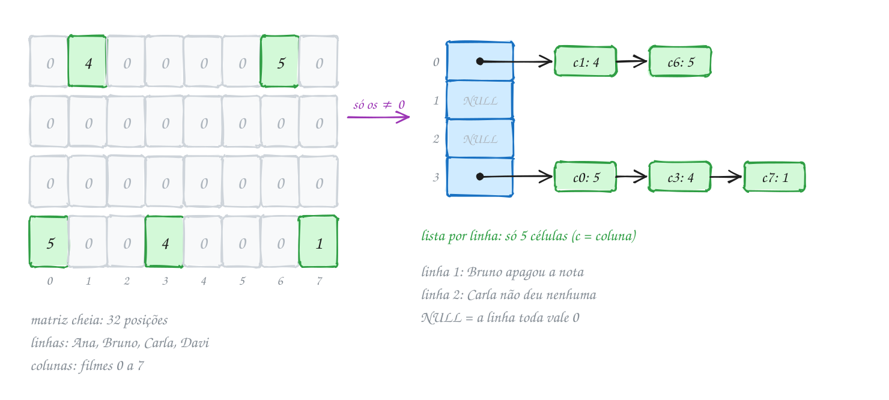
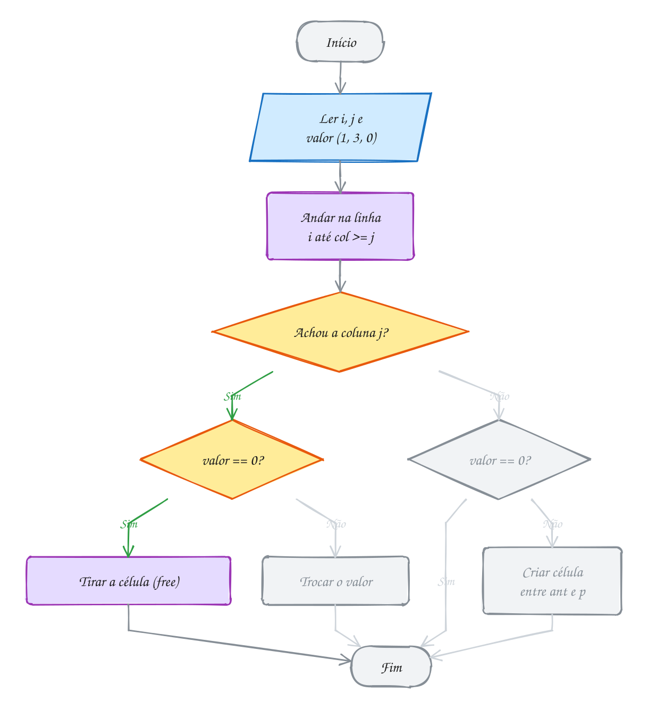
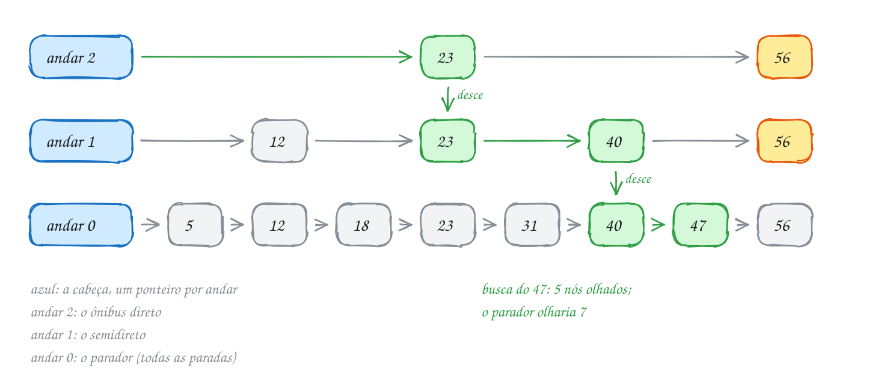
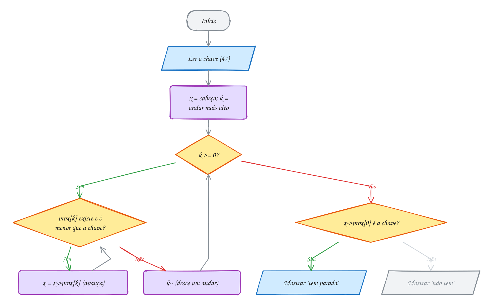
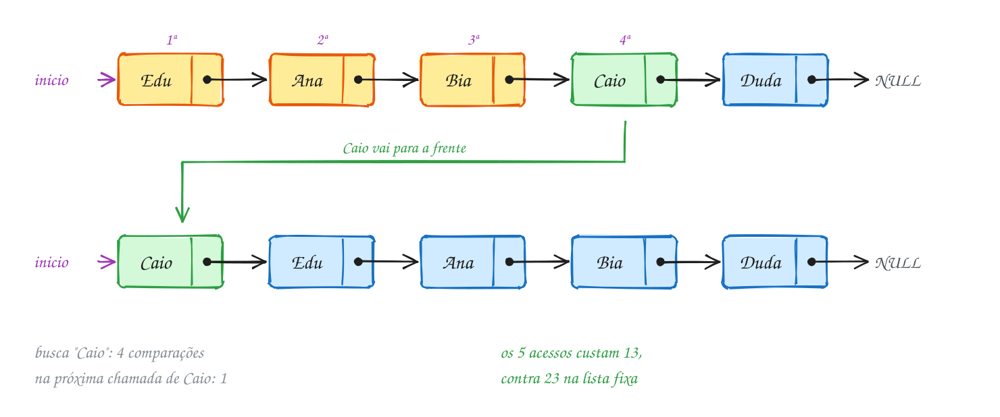
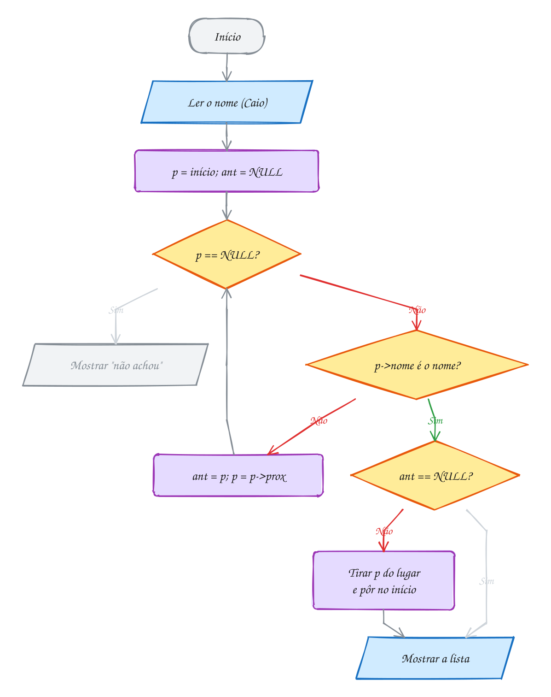
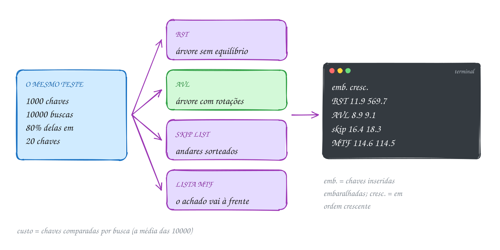
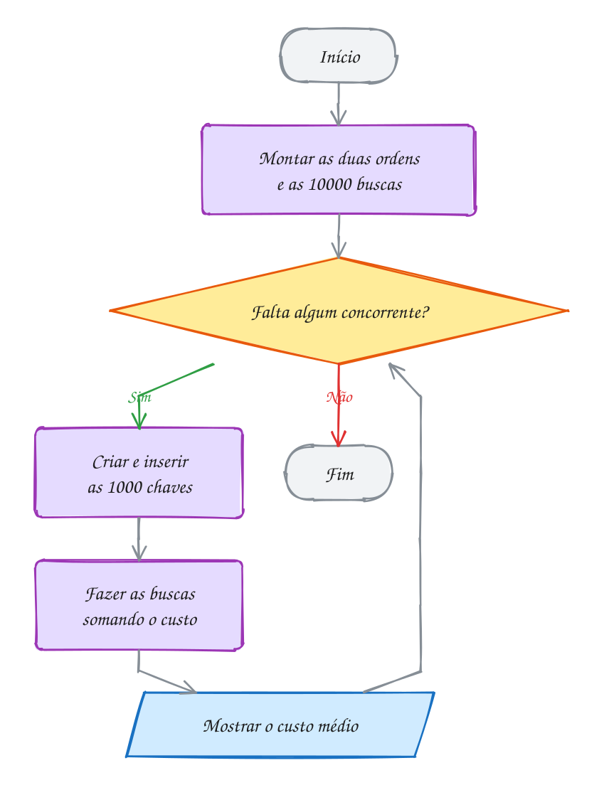

<!-- Gerado por _gerador. Para mudar este arquivo, edite _gerador/modulos/25-estruturas-extras/ e rode: cd _gerador && npm run gerar -->

# Módulo 25 · Estruturas especiais

Os módulos anteriores montaram a caixa de ferramentas clássica: listas,
pilhas, filas, árvores, tabelas hash e grafos. Este traz três estruturas que
nascem de um problema específico, quase sempre uma lista encadeada com um
truque a mais.

A **matriz esparsa** guarda só o que não é zero. A **skip list** é uma lista
ordenada com linhas expressas sorteadas por uma moeda: busca O(log n) na
média, sem rotação. As **listas autoajustáveis** aproveitam que poucos itens
recebem quase todas as buscas. No fim, BST, AVL, skip list e lista com mover
para a frente respondem ao mesmo teste: a melhor estrutura depende do uso, e
o jeito honesto de descobrir é medir.

## O que você vai aprender

- guardar uma **matriz esparsa** em **triplas** e em **listas por linha**
- somar, transpor e multiplicar matrizes esparsas visitando só o que existe
- a **skip list**: andares, moeda e busca que desce como um elevador
- inserir e remover numa skip list em todos os andares do nó
- as políticas **mover para a frente**, **transposição** e **contagem**
- quando cada política ganha e quando perde (o cache **LRU** é uma delas)
- comparar estruturas com justiça: mesmas chaves, mesmas buscas, mesma medida

## Antes de começar

Este módulo é complemento: não cai direto na prova do PPGI (o que mais cai
está em `PPGI.md`, na raiz do curso).

Usa **lista encadeada** com o par `ant` e `p` (0076 a 0078), `malloc` e `free`
(0054), **ponteiro para ponteiro** (0049), **TAD** (0074), busca sequencial
(0089), BST (0099), AVL (0101), ponteiros para função (0050) e `void *` (0051).

Cada assunto tem um TAD na pasta (`esparsa.h`, `skip.h`, `autolista.h`,
`bancada.h`). Desenhe antes e depois de cada operação. Nos desenhos de lista,
o nó verde é o achado, os amarelos são os comparados e os cinza, os que a
busca nem tocou. Os exemplos compilam junto os `.c` de apoio da pasta:

```bash
gcc ~/LPEDC/material/A325.c ~/LPEDC/material/0163-skip.c -o ~/LPEDC/material/A325 && ~/LPEDC/material/A325
```

O **custo** de uma busca é quantas chaves ela comparou: o mesmo número em
qualquer computador. Os sorteios usam um gerador próprio de uma linha, para a
mesma semente dar a mesma saída em qualquer máquina.

| # | Assunto |
| --- | --- |
| [0162](#0162--matriz-esparsa) | Matriz esparsa |
| [0163](#0163--skip-list) | Skip list |
| [0164](#0164--listas-autoajustáveis) | Listas autoajustáveis |
| [0165](#0165--juntando-tudo) | Juntando tudo |

---

## 0162 · Matriz esparsa

Um streaming guarda a nota (1 a 5) de cada cliente para cada filme: 1 milhão
de clientes, 50 mil filmes. A matriz `int` cheia ocupa 5 × 10¹⁰ posições de 4
bytes: **200 GB**. Cada cliente avalia uns 20 filmes, então mais de 99,9% é
zero.

Uma matriz quase toda de zeros é uma **matriz esparsa** (a rede social, o grafo
grande). A regra: **zero não se guarda**. Só os valores diferentes de zero
ocupam memória; o resto vale 0.

O jeito mais simples é um vetor de **triplas** `(linha, coluna, valor)` em
ordem: serve para gravar em arquivo ou matriz que não muda, pois inserir no
meio empurra todo mundo.

Quando a matriz muda, use a **lista por linha**: um vetor de ponteiros, um por
linha, e em cada uma uma lista encadeada (módulo 11) com as células em ordem
de coluna:

```c
typedef struct Celula {
    int col;
    int valor;           // nunca é 0
    struct Celula *prox; // próxima célula da mesma linha
} Celula;

typedef struct {
    int linhas, colunas, nao_zeros;
    Celula **linha; // linha[i]: a lista da linha i
} Esparsa;
```

Ler `m[i][j]` é percorrer a lista da linha `i` até passar da coluna `j`; se
a célula não aparece, vale 0. Gravar é uma **inserção ordenada** (assunto
0078) com uma regra a mais: gravar 0 numa célula existente a **remove**.

Uma locadora tem 4 clientes (Ana, Bruno, Carla e Davi, linhas 0 a 3) e 8
filmes (colunas 0 a 7). Chegam seis notas e Bruno apaga a dele: das 32
posições, sobram 5 células. A linha de Carla é `NULL`:

<p align="center"></p>

No TAD (`esparsa.h`, `esparsa.c`), `esp_define` anda na linha com dois
ponteiros, `ant` e `p`, como na lista ordenada:

```c
void esp_define(Esparsa *m, int i, int j, int valor) {
    Celula *ant = NULL;
    Celula *p = m->linha[i];
    while (p != NULL && p->col < j) { // a linha está em ordem de coluna
        ant = p;
        p = p->prox;
    }
    if (p != NULL && p->col == j) { // a célula já existe
        if (valor != 0) {
            p->valor = valor;
            return;
        }
        if (ant == NULL) { // virou zero: sai da lista
            m->linha[i] = p->prox;
        } else {
            ant->prox = p->prox;
        }
        free(p);
        m->nao_zeros--;
        return;
    }
    if (valor == 0) {
        return; // já era zero: nada a guardar
    }
    Celula *nova = aloca(sizeof(Celula)); // entra entre ant e p
    nova->col = j;
    nova->valor = valor;
    nova->prox = p;
    if (ant == NULL) {
        m->linha[i] = nova;
    } else {
        ant->prox = nova;
    }
    m->nao_zeros++;
}
```

(O `esparsa.c` também confere `i` e `j`.) O programa da locadora:

```c
#include <stdio.h>
#include "esparsa.h"

int main(void) {
    Esparsa *notas = esp_cria(4, 8); // 4 clientes x 8 filmes, tudo zero

    esp_define(notas, 0, 6, 5); // Ana deu 5 ao filme 6
    esp_define(notas, 0, 1, 4); // entra antes do 6: a linha fica em ordem
    esp_define(notas, 1, 3, 2);
    esp_define(notas, 3, 7, 1);
    esp_define(notas, 3, 0, 5);
    esp_define(notas, 3, 3, 4);

    printf("Davi deu %d ao filme 3\n", esp_valor(notas, 3, 3));
    printf("Carla deu %d ao filme 5\n", esp_valor(notas, 2, 5));

    esp_define(notas, 1, 3, 0); // Bruno apagou a nota: a célula sai
    printf("Notas guardadas: %d de %d\n", notas->nao_zeros, 4 * 8);
    esp_mostra(notas);

    esp_libera(notas);
    return 0;
}
// Saída:
// Davi deu 4 ao filme 3
// Carla deu 0 ao filme 5
// Notas guardadas: 5 de 32
//   0  4  0  0  0  0  5  0
//   0  0  0  0  0  0  0  0
//   0  0  0  0  0  0  0  0
//   5  0  0  4  0  0  0  1
```

`esp_define` cai em um de quatro casos (trocar, remover, ignorar ou criar). O
verde é Bruno apagando a nota: a coluna 3 existe e o valor novo é 0:

<p align="center"></p>

> [!WARNING]
> Se `esp_define(m, 1, 3, 0)` trocasse o valor, a célula guardaria um 0 e
> `nao_zeros` mentiria. Toda operação que pode gerar zero (gravar, somar,
> subtrair) precisa remover a célula.

> [!TIP]
> Cada `Celula` ocupa 16 bytes em 64 bits, contra 4 do `int` da matriz cheia.
> A conta só compensa quando menos de 1/4 das posições tem valor: no
> streaming, 2 × 10⁷ células dão 320 MB, contra 200 GB.

> [!NOTE]
> **Pergunta para você:** quantas células são visitadas por
> `esp_valor(notas, 3, 5)`? E por `esp_valor(notas, 2, 5)`? O custo depende
> do tamanho da matriz ou das células da linha?

### Hora de praticar

**Exemplo A323 · As entregas em triplas**

```c
#include <stdio.h>
#include <stdlib.h>

#define LIN 5 // entregadores
#define COL 6 // bairros

typedef struct {
    int lin, col, valor;
} Tripla;

// ordem de leitura: por linha e, dentro da linha, por coluna
int compara(const void *a, const void *b) {
    const Tripla *x = a;
    const Tripla *y = b;
    if (x->lin != y->lin) {
        return x->lin - y->lin;
    }
    return x->col - y->col;
}

int main(void) {
    int entregas[LIN][COL] = {
        {0, 0, 7, 0, 0, 0},
        {3, 0, 0, 0, 0, 2},
        {0, 0, 0, 0, 0, 0},
        {0, 4, 1, 0, 0, 0},
        {0, 0, 5, 0, 6, 0},
    };

    // compactar: uma tripla para cada valor diferente de zero
    Tripla t[LIN * COL];
    int n = 0;
    for (int i = 0; i < LIN; i++) {
        for (int j = 0; j < COL; j++) {
            if (entregas[i][j] != 0) {
                t[n++] = (Tripla){i, j, entregas[i][j]};
            }
        }
    }
    printf("%d triplas:", n);
    for (int k = 0; k < n; k++) {
        printf(" (%d,%d,%d)", t[k].lin, t[k].col, t[k].valor);
    }
    printf("\nCheia: %zu bytes; triplas: %zu bytes\n", sizeof entregas, n * sizeof(Tripla));

    // transpor: troca linha com coluna e reordena (agora bairro x entregador)
    for (int k = 0; k < n; k++) {
        int aux = t[k].lin;
        t[k].lin = t[k].col;
        t[k].col = aux;
    }
    qsort(t, n, sizeof(Tripla), compara);

    // as triplas de um mesmo bairro ficaram juntas: uma passada soma cada um
    printf("Entregas por bairro:\n"); // bairro sem tripla não aparece
    for (int k = 0; k < n;) {
        int bairro = t[k].lin, soma = 0;
        printf("  bairro %d:", bairro);
        while (k < n && t[k].lin == bairro) {
            printf(" e%d=%d", t[k].col, t[k].valor);
            soma += t[k].valor;
            k++;
        }
        printf(" -> %d\n", soma);
    }
    return 0;
}
// Saída:
// 7 triplas: (0,2,7) (1,0,3) (1,5,2) (3,1,4) (3,2,1) (4,2,5) (4,4,6)
// Cheia: 120 bytes; triplas: 84 bytes
// Entregas por bairro:
//   bairro 0: e1=3 -> 3
//   bairro 1: e3=4 -> 4
//   bairro 2: e0=7 e3=1 e4=5 -> 13
//   bairro 4: e4=6 -> 6
//   bairro 5: e1=2 -> 2
```

```bash
gcc ~/LPEDC/material/A323.c ~/LPEDC/material/0162-esparsa.c -o ~/LPEDC/material/A323 && ~/LPEDC/material/A323
```

**Exemplo A324 · O total de cada pedido**

```c
#include <stdio.h>
#include "0162-esparsa.h"

#define PRODUTOS 1000 // o catálogo inteiro

int main(void) {
    // preço de cada produto do catálogo, em centavos (vetor cheio)
    int preco[PRODUTOS];
    for (int j = 0; j < PRODUTOS; j++) {
        preco[j] = 250 + (j % 40) * 50;
    }

    // 4 pedidos x 1000 produtos; cada pedido leva poucos itens
    Esparsa *pedidos = esp_cria(4, PRODUTOS);
    esp_define(pedidos, 0, 12, 2);  // pedido 0: 2 unidades do produto 12
    esp_define(pedidos, 0, 731, 1);
    esp_define(pedidos, 1, 40, 6);
    esp_define(pedidos, 2, 5, 1);
    esp_define(pedidos, 2, 999, 3);
    esp_define(pedidos, 2, 500, 2);
    esp_define(pedidos, 3, 12, 1);

    // total[i] = soma de quantidade x preço, só nas células da linha i
    int contas = 0;
    for (int i = 0; i < pedidos->linhas; i++) {
        int total = 0;
        for (const Celula *c = pedidos->linha[i]; c != NULL; c = c->prox) {
            total += c->valor * preco[c->col];
            contas++;
        }
        printf("Pedido %d: R$ %d,%02d\n", i, total / 100, total % 100);
    }
    printf("Multiplicações: %d (a matriz cheia faria %d)\n", contas, 4 * PRODUTOS);

    esp_libera(pedidos);
    return 0;
}
// Saída:
// Pedido 0: R$ 25,00
// Pedido 1: R$ 15,00
// Pedido 2: R$ 96,00
// Pedido 3: R$ 8,50
// Multiplicações: 7 (a matriz cheia faria 4000)
```

```bash
gcc ~/LPEDC/material/A324.c ~/LPEDC/material/0162-esparsa.c -o ~/LPEDC/material/A324 && ~/LPEDC/material/A324
```

#### Exercícios

**Exercício E967** · ★☆☆

Um app de delivery guarda as notas (1 a 5) que 4 clientes deram a 10
restaurantes numa matriz esparsa (esparsa.h). Escreva
int resumo_linha(const Esparsa *m, int i, int *qtd): percorre só as células
da linha i, devolve a soma das notas e guarda em *qtd quantas notas a linha
tem. No main (a matriz já está montada), mostre a média de cada cliente:


```text
Saída esperada:
Cliente 0: 3 notas, média 4.00
Cliente 1: 1 nota, média 2.00
Cliente 2: 0 notas
Cliente 3: 4 notas, média 3.50
```

```bash
gcc ~/LPEDC/material/E967.c ~/LPEDC/material/0162-esparsa.c -o ~/LPEDC/material/E967 && ~/LPEDC/material/E967
```

**Exercício E969** · ★★☆

A matriz notas tem os clientes nas linhas e os filmes nas colunas. A
locadora agora quer o contrário: a média de cada FILME. Andar por coluna
numa lista por linha é ruim (teria que visitar todas as linhas). Então:
1. escreva transposta(m), que devolve uma nova Esparsa com linhas e

```text
 colunas trocadas (m->colunas x m->linhas), percorrendo as células de m;
```

2. no main, use a transposta para mostrar, para cada filme com nota,

```text
 quantas notas ele tem e a média; libere as duas matrizes.
```


```text
Saída esperada:
Filme 0: 2 notas, média 4.50
Filme 2: 3 notas, média 2.67
Filme 5: 1 nota, média 1.00
Células: 6 e 6
```

```bash
gcc ~/LPEDC/material/E969.c ~/LPEDC/material/0162-esparsa.c -o ~/LPEDC/material/E969 && ~/LPEDC/material/E969
```

**Exercício E970** · ★★☆

Escreva do zero uma matriz esparsa de vendas, sem usar o esparsa.h: uma
lista encadeada por linha, células ordenadas por coluna, com os campos
col, valor e prox, e a struct Esparsa (linhas, colunas, nao_zeros e o
vetor de listas). Faça cria, define (insere no lugar certo ou troca o
valor), mostra_linha (cada valor com %3d, zeros inclusos) e libera.
Grave, nesta ordem, as vendas (vendedor, dia, valor) de 2 vendedores em 7
dias: (0,5,30) (1,4,40) (0,2,20) (1,1,12) (0,0,15). Compile com
-fsanitize=address: não pode haver vazamento nem acesso inválido.


```text
Saída esperada:
Vendedor 0: 15  0 20  0  0 30  0
Vendedor 1:  0 12  0  0 40  0  0
Células: 5
```

```bash
gcc ~/LPEDC/material/E970.c ~/LPEDC/material/0162-esparsa.c -o ~/LPEDC/material/E970 && ~/LPEDC/material/E970
```

**Exercício E971** · ★★★

Uma rede de farmácias guarda o estoque numa matriz esparsa filial x
produto (esparsa.h). No fim do dia chega a matriz de movimento: entrada é
positiva, venda é negativa. Escreva Esparsa *soma(const Esparsa *a, const
Esparsa *b), que devolve uma NOVA Esparsa com a + b, sem usar esp_valor e
sem esp_define: monte cada linha do resultado intercalando as duas listas,
como no merge do merge sort. Quando a soma der 0, a célula não entra. No
main (as duas matrizes já estão montadas), mostre o estoque novo:


```text
Saída esperada:
Estoque novo:
  4  0  0  0  9  0
  0  0  0  3  0  0
  0  2  0  0  0  0
Células: 4
```

```bash
gcc ~/LPEDC/material/E971.c ~/LPEDC/material/0162-esparsa.c -o ~/LPEDC/material/E971 && ~/LPEDC/material/E971
```

---

## 0163 · Skip list

A rodovia tem paradas nos km 5, 12, 18, 23, 31, 40, 47 e 56. O **parador**
para em todas, o **semidireto** em algumas, o **direto** só nas principais.
Para o km 47, você vai de direto até onde der, troca para o semidireto e só
no fim pega o parador.

Uma lista ordenada (assunto 0078) é o ônibus parador: achar uma chave custa
O(n), e a busca binária não serve, pois lista não tem índice. A BST e a AVL
(módulo 14) resolvem com rotações.

A **skip list** fica com a lista e acrescenta as linhas expressas, os
**andares**. O andar 0 é a lista completa; o andar 1 tem parte dos nós, o 2
menos ainda. Cada nó tem um vetor `prox`: `prox[k]` é o próximo no andar `k`.
Uma **cabeça** sem chave está em todos os andares e começa toda busca.

**Buscar** é a viagem de ônibus. Comece no andar mais alto da cabeça. Se o
próximo nó do andar é menor que a chave, avance; se já passou (ou não existe),
desça. No andar 0, o próximo nó é a chave ou ela não existe.

Os andares de cada nó saem de uma **moeda**: todo nó novo entra no andar 0 e,
enquanto der cara, sobe mais um. Em média, metade chega ao andar 1, um quarto
ao 2, um oitavo ao 3, sem nunca arrumar nada.

**Inserir** é buscar guardando, em cada andar, o último nó visitado antes de
descer (o vetor `antes`). Sorteie os andares do nó novo e ligue-o depois de
`antes[k]` em cada andar `k`. A remoção usa o mesmo vetor para desligar o nó.

O custo é **O(log n) esperado**: com 1 milhão de chaves, uns 40 nós olhados
por busca, contra meio milhão na lista simples. "Esperado" é na média dos
sorteios, sem garantia.

As paradas entram com os andares sorteados: o 23 e o 56 em 3 andares, o 12 e
o 40 em 2, os outros só no 0. A busca pelo 47 anda no andar 2 até o 23 (o 56
já passou), desce, anda até o 40, desce, e o próximo no andar 0 é o 47:

<p align="center"></p>

O TAD fica em `skip.h` e `skip.c`. O nó e a busca:

```c
#define SKIP_MAX 12 // andares no máximo: dá para uns 4 mil nós (2 elevado a 12)

typedef struct NoSkip {
    int chave;
    int andares;                   // em quantos andares o nó aparece
    struct NoSkip *prox[SKIP_MAX]; // prox[k]: o próximo no andar k
} NoSkip;

bool skip_busca(const Skip *s, int chave, int *passos) {
    int olhados = 0;
    const NoSkip *x = &s->cabeca;
    for (int k = s->andares - 1; k >= 0; k--) { // do andar mais alto ao 0
        while (x->prox[k] != NULL) {
            olhados++;
            if (x->prox[k]->chave >= chave) {
                break; // o próximo já passou (ou é a chave): desce
            }
            x = x->prox[k]; // o próximo ainda é menor: avança
        }
    }
    if (passos != NULL) {
        *passos = olhados;
    }
    x = x->prox[0]; // no andar 0, o próximo é a chave ou ela não existe
    return x != NULL && x->chave == chave;
}
```

Para o desenho sair igual em toda execução, o exemplo usa
`skip_insere_andares`, com andares prontos; no uso normal, `skip_insere` joga
a moeda. O `skip_mostra` imprime cada chave sempre na mesma coluna:

```c
#include <stdio.h>
#include "skip.h"

void procura(const Skip *s, int km) {
    int passos;
    bool achou = skip_busca(s, km, &passos);
    printf("km %d: %s, %d nós olhados\n", km, achou ? "tem parada" : "não tem parada", passos);
}

int main(void) {
    int km[] = {5, 12, 18, 23, 31, 40, 47, 56};
    int andares[] = {1, 2, 1, 3, 1, 2, 1, 3}; // o que a moeda "deu"
    Skip *linha = skip_cria(0);
    for (int i = 0; i < 8; i++) {
        skip_insere_andares(linha, km[i], andares[i]);
    }

    skip_mostra(linha);
    procura(linha, 47);
    procura(linha, 20);

    skip_libera(linha);
    return 0;
}
// Saída:
// andar 2:              23              56
// andar 1:      12      23      40      56
// andar 0:   5  12  18  23  31  40  47  56
// km 47: tem parada, 5 nós olhados
// km 20: não tem parada, 5 nós olhados
```

O laço de dentro avança no andar, o de fora desce. O caminho verde é a busca
do 47: uma vez no andar 2, uma no andar 1, nenhuma no andar 0:

<p align="center"></p>

> [!WARNING]
> Na remoção, o nó sai de **todos** os andares em que aparece. Se o 23 sair só
> do andar 0 e for liberado, a cabeça continua apontando para ele no andar 2:
> ponteiro solto (assunto 0057). O E976 pede essa remoção.

> [!TIP]
> Com `prox[SKIP_MAX]`, todo nó ocupa 104 bytes mesmo usando em média 2
> ponteiros. Um **membro vetor flexível**, `struct NoSkip *prox[];`, com
> `malloc(sizeof(NoSkip) + andares * sizeof(NoSkip *))`, aloca só o
> necessário.

> [!NOTE]
> **Pergunta para você:** se o km 35 entrar com 2 andares, quais ponteiros
> mudam? Quem fica em `antes[0]` e em `antes[1]`? Desenhe antes de conferir com
> `skip_insere_andares` e `skip_mostra`.

### Hora de praticar

**Exemplo A325 · A moeda decide os andares**

```c
#include <stdio.h>
#include "0163-skip.h"

#define N 1000

int main(void) {
    Skip *s = skip_cria(2024); // a mesma semente dá sempre a mesma skip list
    for (int i = 1; i <= N; i++) {
        skip_insere(s, i * 10); // códigos de produto: 10, 20, ..., 10000
    }

    // quantos nós em cada andar: anda pela lista daquele andar
    int ponteiros = 0;
    for (int k = 0; k < s->andares; k++) {
        int qtd = 0;
        for (const NoSkip *x = s->cabeca.prox[k]; x != NULL; x = x->prox[k]) {
            qtd++;
        }
        ponteiros += qtd;
        printf("andar %2d: %4d nós (esperado ~%d)\n", k, qtd, N >> k);
    }
    printf("Ponteiros em uso: %d, média de %.2f por nó\n", ponteiros, (double)ponteiros / N);

    // a média de nós olhados, buscando cada uma das 1000 chaves
    long total = 0;
    int pior = 0;
    for (int i = 1; i <= N; i++) {
        int passos;
        skip_busca(s, i * 10, &passos);
        total += passos;
        if (passos > pior) {
            pior = passos;
        }
    }
    printf("Busca: média de %.1f nós olhados, pior %d\n", (double)total / N, pior);
    printf("Lista simples: média de %.1f, pior %d\n", (N + 1) / 2.0, N);

    skip_libera(s);
    return 0;
}
// Saída:
// andar  0: 1000 nós (esperado ~1000)
// andar  1:  503 nós (esperado ~500)
// andar  2:  251 nós (esperado ~250)
// andar  3:  129 nós (esperado ~125)
// andar  4:   62 nós (esperado ~62)
// andar  5:   27 nós (esperado ~31)
// andar  6:   13 nós (esperado ~15)
// andar  7:    6 nós (esperado ~7)
// andar  8:    4 nós (esperado ~3)
// andar  9:    2 nós (esperado ~1)
// Ponteiros em uso: 1997, média de 2.00 por nó
// Busca: média de 18.2 nós olhados, pior 31
// Lista simples: média de 500.5, pior 1000
```

```bash
gcc ~/LPEDC/material/A325.c ~/LPEDC/material/0163-skip.c -o ~/LPEDC/material/A325 && ~/LPEDC/material/A325
```

**Exemplo A326 · A agenda do barbeiro**

```c
#include <stdio.h>
#include "0163-skip.h"

// horário em minutos desde a meia-noite: 570 é 9h30
void mostra_hora(int min) {
    printf("%02dh%02d", min / 60, min % 60);
}

int main(void) {
    // os clientes marcam fora de ordem; a skip list mantém tudo em ordem
    int hora[] = {570, 540, 660, 600, 630, 720};
    int andares[] = {1, 2, 1, 3, 2, 1};
    Skip *agenda = skip_cria(0);
    for (int i = 0; i < 6; i++) {
        skip_insere_andares(agenda, hora[i], andares[i]);
    }
    printf("Agenda (%d andares):\n", agenda->andares);
    skip_mostra(agenda);

    // o cliente das 10h cancela: o 600 sai dos 3 andares dele, e o andar 2,
    // que só tinha ele, fica vazio
    skip_remove(agenda, 600);
    printf("Sem o das 10h00 (%d andares):\n", agenda->andares);
    skip_mostra(agenda);

    // atender em ordem: o primeiro do andar 0 é sempre o próximo horário
    printf("Atendimentos:");
    while (agenda->cabeca.prox[0] != NULL) {
        int proximo = agenda->cabeca.prox[0]->chave;
        printf(" ");
        mostra_hora(proximo);
        skip_remove(agenda, proximo); // tirar o primeiro: nada para procurar
    }
    printf("\nNa agenda: %d\n", agenda->n);

    skip_libera(agenda);
    return 0;
}
// Saída:
// Agenda (3 andares):
// andar 2:         600
// andar 1: 540     600 630
// andar 0: 540 570 600 630 660 720
// Sem o das 10h00 (2 andares):
// andar 1: 540     630
// andar 0: 540 570 630 660 720
// Atendimentos: 09h00 09h30 10h30 11h00 12h00
// Na agenda: 0
```

```bash
gcc ~/LPEDC/material/A326.c ~/LPEDC/material/0163-skip.c -o ~/LPEDC/material/A326 && ~/LPEDC/material/A326
```

#### Exercícios

**Exercício E973** · ★☆☆

Escreva int maior(const Skip *s, int *avancos), que devolve a maior chave
da skip list (que não pode estar vazia) e guarda em *avancos quantas vezes
o ponteiro avançou. Não ande só pelo andar 0: use os andares de cima, como
o ônibus direto. No main (as duas listas já estão montadas), teste com as
paradas do texto e com 1000 códigos sorteados:


```text
Saída esperada:
Paradas: maior 56, 2 avanços (pelo andar 0 seriam 8)
Códigos: maior 10000, 13 avanços (pelo andar 0 seriam 1000)
```

```bash
gcc ~/LPEDC/material/E973.c ~/LPEDC/material/0163-skip.c -o ~/LPEDC/material/E973 && ~/LPEDC/material/E973
```

**Exercício E975** · ★★☆

A moeda da skip list não precisa ser honesta. Com probabilidade 1/4 de
subir, os nós ficam mais baixos: menos ponteiros. Será que a busca fica
muito mais lenta? Faça o experimento com 4000 chaves (1 a 4000):
- escreva int sorteia(unsigned *estado, int lados): começa com 1 andar e

```text
sobe mais um enquanto (proximo(estado) >> 16) % lados == 0, sem passar
de SKIP_MAX;
```

- escreva void experimento(int lados): monta a skip list com

```text
skip_insere_andares e os andares sorteados (estado começa em 7), busca
cada chave somando os nós olhados e mostra uma linha como abaixo.
```


```text
Saída esperada:
1/2: 7997 ponteiros, 21.9 nós olhados por busca
1/4: 5410 ponteiros, 21.6 nós olhados por busca
```

```bash
gcc ~/LPEDC/material/E975.c ~/LPEDC/material/0163-skip.c -o ~/LPEDC/material/E975 && ~/LPEDC/material/E975
```

**Exercício E976** · ★★☆

A concessionária desativou a parada do km 23. Escreva, sem usar
skip_remove, void remove_parada(Skip *s, int chave): guarda o nó anterior
de cada andar, tira o nó de TODOS os andares em que ele aparece e só então
libera a memória. Escreva também void procura(const Skip *s, int km), que
mostra se há parada. No main (a linha já está montada), remova o km 23,
procure os km 47 e 23 e mostre a skip list com skip_mostra. Compile com
-fsanitize=address: não pode haver acesso a memória liberada.


```text
Saída esperada:
km 47: tem parada
km 23: não tem parada
andar 2:                          56
andar 1:      12          40      56
andar 0:   5  12  18  31  40  47  56
```

```bash
gcc ~/LPEDC/material/E976.c ~/LPEDC/material/0163-skip.c -o ~/LPEDC/material/E976 && ~/LPEDC/material/E976
```

**Exercício E977** · ★★★

Contador de palavras com skip list. Escreva do zero (sem o skip.h, que só
guarda int) uma skip list de palavras: cada nó tem a palavra (até 23
letras), quantas vezes ela apareceu, os andares e o vetor prox. Leia as
palavras da entrada até o fim; palavra nova entra no lugar certo (ordem
do strcmp) com andares sorteados por moeda(); palavra repetida só soma 1.
No fim, mostre as palavras em ordem e libere tudo.


```text
Entrada:
o rato roeu a roupa do rei de roma e o rei riu
```


```text
Saída esperada:
a 1
de 1
do 1
e 1
o 2
rato 1
rei 2
riu 1
roeu 1
roma 1
roupa 1
11 palavras diferentes, 13 no total
```

```bash
gcc ~/LPEDC/material/E977.c ~/LPEDC/material/0163-skip.c -o ~/LPEDC/material/E977 && ~/LPEDC/material/E977
```

---

## 0164 · Listas autoajustáveis

Na cozinha, o sal fica na frente do armário e o cravo, no fundo: cada pote
usado volta para a frente.

A busca sequencial (assunto 0089) custa a **posição** do item. Se todos fossem
procurados na mesma frequência, a ordem não importaria; na agenda do celular,
meia dúzia de contatos recebe quase todas as ligações.

A **lista autoajustável** descobre sozinha quem são: a cada busca
bem-sucedida, aproxima o item achado do começo, então a busca também escreve
na lista. Há três políticas clássicas:

- **mover para a frente** (*move-to-front*): o item achado vira o primeiro.
  Reage rápido, mas um item procurado uma vez também vai para a frente;
- **transposição**: o item achado troca de lugar com o anterior. Um acesso
  isolado quase não bagunça, mas um item popular demora a chegar à frente;
- **contagem**: cada nó guarda quantas vezes foi achado, e a lista fica em
  ordem decrescente. Converge para a melhor ordem fixa, com um campo a mais.

Mover para a frente combina com **lista encadeada**: tirar o nó e pendurá-lo
no início são três atribuições de ponteiro; num vetor, empurraria todos os
anteriores. A transposição é a troca de dois vizinhos e serve aos dois.

A agenda tem Ana, Bia, Caio, Duda e Edu. As ligações são para Edu, Edu, Caio,
Edu e Edu. Na terceira, Caio é achado na quarta comparação e vai para a
frente; Edu desce para o segundo lugar:

<p align="center"></p>

O TAD (`autolista.h`, `autolista.c`) tem as três políticas e uma busca que não
mexe em nada (`al_busca`), para comparar. Mover para a frente é a busca com
`ant` e `p` (assunto 0077) e três linhas no fim:

```c
bool al_busca_mtf(AutoLista *l, const char *nome, int *custo) {
    int c = 0;
    NoAuto *ant = NULL;
    NoAuto *p = l->inicio;
    while (p != NULL) {
        c++;
        if (strcmp(p->nome, nome) == 0) {
            break;
        }
        ant = p;
        p = p->prox;
    }
    if (custo != NULL) {
        *custo = c;
    }
    if (p == NULL) {
        return false;
    }
    if (ant != NULL) {       // se p já é o primeiro, nada a fazer
        ant->prox = p->prox; // tira p do lugar...
        p->prox = l->inicio; // ...e põe na frente
        l->inicio = p;
    }
    return true;
}
```

O programa faz as cinco ligações numa agenda que se ajusta e numa fixa, e soma
as comparações:

```c
#include <stdio.h>
#include "autolista.h"

int main(void) {
    const char *contatos[] = {"Ana", "Bia", "Caio", "Duda", "Edu"};
    const char *chamadas[] = {"Edu", "Edu", "Caio", "Edu", "Edu"};
    AutoLista *agenda = al_cria(); // a que se ajusta
    AutoLista *fixa = al_cria();   // a de sempre, para comparar
    for (int i = 0; i < 5; i++) {
        al_insere_fim(agenda, contatos[i]);
        al_insere_fim(fixa, contatos[i]);
    }

    int total = 0, total_fixa = 0;
    for (int i = 0; i < 5; i++) {
        int custo, custo_fixa;
        al_busca_mtf(agenda, chamadas[i], &custo);
        al_busca(fixa, chamadas[i], &custo_fixa);
        total += custo;
        total_fixa += custo_fixa;
        printf("%-4s custo %d -> ", chamadas[i], custo);
        al_mostra(agenda);
        printf("\n");
    }
    printf("Total: %d comparações (sem ajuste: %d)\n", total, total_fixa);

    al_libera(agenda);
    al_libera(fixa);
    return 0;
}
// Saída:
// Edu  custo 5 -> Edu Ana Bia Caio Duda
// Edu  custo 1 -> Edu Ana Bia Caio Duda
// Caio custo 4 -> Caio Edu Ana Bia Duda
// Edu  custo 2 -> Edu Caio Ana Bia Duda
// Edu  custo 1 -> Edu Caio Ana Bia Duda
// Total: 13 comparações (sem ajuste: 23)
```

Até achar, é a busca de sempre. Depois do "Sim", o nó que não é o primeiro é
religado no início. O verde é Caio, achado na quarta volta:

<p align="center"></p>

> [!WARNING]
> Se o nó achado já é o primeiro, `ant` é `NULL` e `ant->prox = p->prox`
> derruba o programa (o E982 cobre esse caso). Sem `l->inicio = p`, o nó some
> da lista e vaza memória.

> [!TIP]
> No vetor, levar o décimo item para a frente copia os nove anteriores (o
> A327 conta isso). Sleator e Tarjan (1985) provaram que mover para a frente
> nunca gasta mais que o dobro da melhor ordem fixa, escolhida por quem conhece
> todas as buscas de antemão.

> [!NOTE]
> **Pergunta para você:** com as mesmas cinco ligações, quanto custaria a
> **transposição**? E se as ligações fossem Ana, Bia, Caio, Duda, Edu, Ana, Bia,
> Caio, Duda, Edu, qual política sairia pior? Confira com `al_busca_transpoe`.

### Hora de praticar

**Exemplo A327 · A gaveta de temperos num vetor**

```c
#include <stdio.h>
#include <string.h>

#define N 8

typedef struct {
    char nome[16];
} Pote;

// busca sequencial; devolve a posição (ou -1) e soma as comparações
int procura(const Pote v[], int n, const char *nome, int *comparacoes) {
    for (int i = 0; i < n; i++) {
        (*comparacoes)++;
        if (strcmp(v[i].nome, nome) == 0) {
            return i;
        }
    }
    return -1;
}

// mover para a frente no vetor: os i anteriores andam uma casa para trás
void usa_mtf(Pote v[], int n, const char *nome, int *comparacoes, int *movidos) {
    int i = procura(v, n, nome, comparacoes);
    if (i > 0) {
        Pote achado = v[i];
        for (int j = i; j > 0; j--) {
            v[j] = v[j - 1];
        }
        v[0] = achado;
        *movidos += i + 1; // todas as posições de 0 a i mudaram
    }
}

// transposição no vetor: uma troca com o vizinho da esquerda
void usa_transpoe(Pote v[], int n, const char *nome, int *comparacoes, int *movidos) {
    int i = procura(v, n, nome, comparacoes);
    if (i > 0) {
        Pote aux = v[i];
        v[i] = v[i - 1];
        v[i - 1] = aux;
        *movidos += 2;
    }
}

void mostra(const char *titulo, const Pote v[], int comparacoes, int movidos) {
    printf("%s:", titulo);
    for (int i = 0; i < N; i++) {
        printf(" %s", v[i].nome);
    }
    printf("\n  comparações: %d, potes movidos: %d\n", comparacoes, movidos);
}

int main(void) {
    const Pote inicial[N] = {{"sal"}, {"oleo"}, {"alho"}, {"cravo"},
                             {"cominho"}, {"louro"}, {"pimenta"}, {"oregano"}};
    const char *receitas[] = {"pimenta", "louro", "pimenta", "alho", "pimenta",
                              "louro", "pimenta", "sal", "pimenta", "louro"};
    Pote a[N], b[N];
    memcpy(a, inicial, sizeof inicial); // vetor não se copia com =: memcpy copia os bytes
    memcpy(b, inicial, sizeof inicial);

    int ca = 0, ma = 0, cb = 0, mb = 0;
    for (int k = 0; k < 10; k++) {
        usa_mtf(a, N, receitas[k], &ca, &ma);
        usa_transpoe(b, N, receitas[k], &cb, &mb);
    }
    mostra("Para a frente", a, ca, ma);
    mostra("Transposição", b, cb, mb);
    return 0;
}
// Saída:
// Para a frente: louro pimenta sal alho oleo cravo cominho oregano
//   comparações: 37, potes movidos: 37
// Transposição: sal alho pimenta oleo louro cravo cominho oregano
//   comparações: 53, potes movidos: 18
```

```bash
gcc ~/LPEDC/material/A327.c ~/LPEDC/material/0164-autolista.c -o ~/LPEDC/material/A327 && ~/LPEDC/material/A327
```

**Exemplo A328 · Quando mover para a frente atrapalha**

```c
#include <stdio.h>
#include "0164-autolista.h"

#define APPS 6

typedef bool (*Busca)(AutoLista *, const char *, int *);

// a busca sem ajuste tem outro tipo (recebe const): um embrulho resolve
bool fixa(AutoLista *l, const char *nome, int *custo) {
    return al_busca(l, nome, custo);
}

// monta a lista inicial, faz as buscas com a política e devolve o custo total
int roda(Busca busca, const char *seq[], int n) {
    const char *apps[APPS] = {"Banco", "Mapa", "Musica", "Fotos", "Email", "Agenda"};
    AutoLista *l = al_cria();
    for (int i = 0; i < APPS; i++) {
        al_insere_fim(l, apps[i]);
    }
    int total = 0;
    for (int i = 0; i < n; i++) {
        int custo;
        busca(l, seq[i], &custo);
        total += custo;
    }
    al_libera(l);
    return total;
}

int main(void) {
    // costume: quase sempre a Agenda e o Email, com uma Fotos perdida no meio
    const char *costume[] = {"Agenda", "Email", "Agenda", "Agenda", "Email", "Fotos",
                            "Agenda", "Email", "Agenda", "Email", "Agenda", "Agenda"};
    // revezando: cada app uma vez, na ordem da lista, três vezes seguidas
    const char *revezando[] = {"Banco", "Mapa", "Musica", "Fotos", "Email", "Agenda",
                             "Banco", "Mapa", "Musica", "Fotos", "Email", "Agenda",
                             "Banco", "Mapa", "Musica", "Fotos", "Email", "Agenda"};
    Busca politicas[] = {fixa, al_busca_mtf, al_busca_transpoe, al_busca_conta};

    printf("%-10s %6s %7s %7s %9s\n", "", "fixa", "frente", "transp", "contagem");
    printf("%-10s", "costume");
    for (int p = 0; p < 4; p++) {
        printf(" %*d", p == 0 ? 6 : p == 3 ? 9 : 7, roda(politicas[p], costume, 12));
    }
    printf("\n%-10s", "revezando");
    for (int p = 0; p < 4; p++) {
        printf(" %*d", p == 0 ? 6 : p == 3 ? 9 : 7, roda(politicas[p], revezando, 18));
    }
    printf("\n");
    return 0;
}
// Saída:
//              fixa  frente  transp  contagem
// costume        66      36      56        30
// revezando      63      93      66        63
```

```bash
gcc ~/LPEDC/material/A328.c ~/LPEDC/material/0164-autolista.c -o ~/LPEDC/material/A328 && ~/LPEDC/material/A328
```

#### Exercícios

**Exercício E979** · ★☆☆

A playlist do carro tem 6 músicas e a busca é sequencial. Faça as 10
buscas desta sequência nas duas listas (já montadas no main): a fixa com
al_busca e a outra com al_busca_transpoe. Some o custo de cada uma e mostre
os dois totais e a ordem final da lista que se ajusta.


```text
sequência: Luar Asa Luar Luar Trem Luar Asa Luar Asa Luar
```


```text
Saída esperada:
Fixa: 54 comparações
Transposição: 46 comparações
Ordem final: Luar Aquarela Trem Asa Garota Ciranda
```

```bash
gcc ~/LPEDC/material/E979.c ~/LPEDC/material/0164-autolista.c -o ~/LPEDC/material/E979 && ~/LPEDC/material/E979
```

**Exercício E981** · ★★☆

Uma política intermediária entre mover para a frente e transposição: o
item achado sobe DUAS casas (ou vai para o início, se estava na posição 1
ou 2, contando do 0). Usando o autolista.h, escreva
bool busca_sobe2(AutoLista *l, const char *nome, int *custo), que aplica
essa política, devolve se achou e guarda em *custo quantos nós comparou.
A agenda começa com Ana Bia Caio Duda Edu; as chamadas são Edu, Edu, Duda,
Edu e Duda. Mostre cada chamada com o custo e a agenda depois dela, e o
total:


```text
Saída esperada:
Edu  custo 5 -> Ana Bia Edu Caio Duda
Edu  custo 3 -> Edu Ana Bia Caio Duda
Duda custo 5 -> Edu Ana Duda Bia Caio
Edu  custo 1 -> Edu Ana Duda Bia Caio
Duda custo 3 -> Duda Edu Ana Bia Caio
Total: 17
```

```bash
gcc ~/LPEDC/material/E981.c ~/LPEDC/material/0164-autolista.c -o ~/LPEDC/material/E981 && ~/LPEDC/material/E981
```

**Exercício E982** · ★★☆

Escreva void liga(AutoLista *l, const char *nome), o mover para a frente
de uma agenda, andando pelos nós do autolista.h (sem usar al_busca_mtf).
Cuide do contato que já é o primeiro e do que não está na agenda. No
main, monte a agenda Ana Bia Caio Duda e ligue para Bia, Bia, Duda, Ana e
Ana, mostrando a agenda depois de cada ligação. Compile com
-fsanitize=address: não pode haver acesso inválido.


```text
Saída esperada:
Bia: Bia Ana Caio Duda
Bia: Bia Ana Caio Duda
Duda: Duda Bia Ana Caio
Ana: Ana Duda Bia Caio
Ana: Ana Duda Bia Caio
```

```bash
gcc ~/LPEDC/material/E982.c ~/LPEDC/material/0164-autolista.c -o ~/LPEDC/material/E982 && ~/LPEDC/material/E982
```

**Exercício E984** · ★★★

Mover para a frente também é um truque de compressão (o bzip2 usa). Comece
com o alfabeto em ordem, "abcdefghijklmnopqrstuvwxyz". Para cada letra do
texto, escreva a POSIÇÃO atual dela nesse vetor (contando do 0) e leve a
letra para a frente. Letras repetidas de perto viram números pequenos,
principalmente zeros, que um compressor guarda em poucos bits.

Escreva codifica(texto, codigos) e decodifica(codigos, n, saida). A
decodificação começa do mesmo alfabeto: o número diz a posição; a letra
que está lá é a próxima do texto, e ela também vai para a frente. Teste
com "banana" e "aaabbbaaa":


```text
Saída esperada:
banana: 1 1 13 1 1 1 -> banana
aaabbbaaa: 0 0 0 1 0 0 1 0 0 -> aaabbbaaa
```

```bash
gcc ~/LPEDC/material/E984.c ~/LPEDC/material/0164-autolista.c -o ~/LPEDC/material/E984 && ~/LPEDC/material/E984
```

---

## 0165 · Juntando tudo

A loja tem 1000 produtos e 10 mil consultas por dia; os 20 da promoção levam
80% delas. Qual estrutura guarda o catálogo?

A **BST** (assunto 0099) tem altura que depende da ordem de chegada. A
**AVL** (0101) garante altura perto de log₂ n com rotações. A **skip list**
(0163) promete O(log n) esperado, sem rotação. A **lista com mover para a
frente** (0164) é O(n), mas aposta que os mais procurados ficam na frente. A
resposta sai de medir.

Três regras para medir com justiça: **as mesmas chaves, na mesma ordem**;
**as mesmas buscas**, sorteadas uma vez e guardadas num vetor; e o mesmo
**custo**, as chaves que a busca comparou.

As estruturas ficam atrás de uma **interface comum**: uma struct com
ponteiros para função (assunto 0050) e a estrutura de dados como `void *`
(0051). Quem mede chama `e->busca(d, chave, &custo)` sem saber o que há do
outro lado:

```c
typedef struct {
    const char *nome;
    void *(*cria)(void);
    void (*insere)(void *e, int chave);            // repetida é ignorada
    bool (*busca)(void *e, int chave, int *custo); // custo: chaves comparadas
    void (*libera)(void *e);
} Estrutura;

extern const Estrutura CONCORRENTES[NUM_CONCORRENTES];
```

O `bancada.c` traz os quatro concorrentes (a skip list é a do `skip.h`) e um
sorteio repetível, `bc_sorteio`, com o gerador de uma linha do `skip.c`.

Cada concorrente recebe as 1000 chaves duas vezes: embaralhadas e em ordem
crescente (o catálogo exportado de uma planilha ordenada). Depois responde às
mesmas 10 mil consultas:

<p align="center"></p>

O programa monta as duas ordens e as buscas, e a função `mede` faz o resto:

```c
#include <stdio.h>
#include "bancada.h"

#define N 1000       // produtos no catálogo
#define BUSCAS 10000 // consultas do dia
#define QUENTES 20   // os produtos da promoção

// insere as N chaves na ordem dada, faz as buscas e devolve o custo médio
double mede(const Estrutura *e, const int ordem[], const int buscas[]) {
    void *d = e->cria();
    for (int i = 0; i < N; i++) {
        e->insere(d, ordem[i]);
    }
    long total = 0;
    for (int i = 0; i < BUSCAS; i++) {
        int custo;
        e->busca(d, buscas[i], &custo);
        total += custo;
    }
    e->libera(d);
    return (double)total / BUSCAS;
}

int main(void) {
    unsigned estado = 7;
    int crescente[N], embaralhada[N], sorteio[N];
    for (int i = 0; i < N; i++) {
        crescente[i] = embaralhada[i] = sorteio[i] = i + 1;
    }
    bc_embaralha(embaralhada, N, &estado);
    bc_embaralha(sorteio, N, &estado); // os QUENTES primeiros são a promoção

    // 80% das consultas vão para os 20 produtos da promoção
    static int buscas[BUSCAS];
    for (int i = 0; i < BUSCAS; i++) {
        if (bc_sorteio(&estado) % 100 < 80) {
            buscas[i] = sorteio[bc_sorteio(&estado) % QUENTES];
        } else {
            buscas[i] = bc_sorteio(&estado) % N + 1;
        }
    }

    printf("%-10s %12s %10s\n", "", "embaralhada", "crescente");
    for (int k = 0; k < NUM_CONCORRENTES; k++) {
        const Estrutura *e = &CONCORRENTES[k];
        printf("%-10s %12.1f %10.1f\n", e->nome, mede(e, embaralhada, buscas),
               mede(e, crescente, buscas));
    }
    return 0;
}
// Saída:
//             embaralhada  crescente
// BST               11.9      569.7
// AVL                8.9        9.1
// skip list         16.4       18.3
// lista MTF        114.6      114.5
```

O laço não sabe quem está medindo. Para acrescentar um concorrente, mexa no
vetor `CONCORRENTES`, nunca no teste:

<p align="center"></p>

A **BST** vai bem com chaves embaralhadas e desaba com a planilha ordenada:
vira lista, com mais de 500 comparações por busca. A **AVL** não percebe a
diferença; a **skip list** também não, porque a moeda decide a forma: olha
uns 18 nós contra uns 9 da AVL, sem rotação. A **lista MTF** perde feio: os
20% de consultas espalhadas custam umas 500 comparações. O A329 mostra quando
o jogo vira.

> [!WARNING]
> Gerar as buscas **dentro** de `mede` estraga a comparação: o sorteio continua
> de onde parou, e cada concorrente recebe consultas diferentes. Sorteie uma
> vez, antes, e guarde num vetor.

> [!TIP]
> `e->busca(d, ...)` é uma chamada **indireta**: o compilador em geral não a
> expande no lugar, e cada busca paga um salto a mais, visível só no
> cronômetro.

> [!NOTE]
> **Pergunta para você:** a coluna da lista MTF quase não muda entre as duas
> ordens. Por quê? Se a promoção tivesse 5 produtos e 99% das consultas, quem
> ganharia? Confira no A329.

### Hora de praticar

**Exemplo A329 · Quando a lista MTF ganha**

```c
#include <stdio.h>
#include "0165-bancada.h"

#define N 1000
#define BUSCAS 10000

// custo médio de um concorrente: chaves embaralhadas, as buscas dadas
double mede(const Estrutura *e, const int ordem[], const int buscas[]) {
    void *d = e->cria();
    for (int i = 0; i < N; i++) {
        e->insere(d, ordem[i]);
    }
    long total = 0;
    for (int i = 0; i < BUSCAS; i++) {
        int custo;
        e->busca(d, buscas[i], &custo);
        total += custo;
    }
    e->libera(d);
    return (double)total / BUSCAS;
}

int main(void) {
    // quatro cenários de concentração: quantas chaves são "quentes" e qual a
    // porcentagem das buscas que vai para elas
    int quentes[] = {20, 10, 5, 2};
    int porcento[] = {80, 95, 99, 100};

    unsigned estado = 11;
    int ordem[N], sorteio[N];
    for (int i = 0; i < N; i++) {
        ordem[i] = sorteio[i] = i + 1;
    }
    bc_embaralha(ordem, N, &estado);
    bc_embaralha(sorteio, N, &estado);

    printf("%-14s", "cenário");
    for (int k = 0; k < NUM_CONCORRENTES; k++) {
        printf("%11s", CONCORRENTES[k].nome);
    }
    printf("\n");

    static int buscas[BUSCAS];
    for (int c = 0; c < 4; c++) {
        for (int i = 0; i < BUSCAS; i++) { // as mesmas buscas para os quatro
            if (bc_sorteio(&estado) % 100 < porcento[c]) {
                buscas[i] = sorteio[bc_sorteio(&estado) % quentes[c]];
            } else {
                buscas[i] = bc_sorteio(&estado) % N + 1;
            }
        }
        printf("%3d%% em %2d   ", porcento[c], quentes[c]);
        for (int k = 0; k < NUM_CONCORRENTES; k++) {
            printf("%11.1f", mede(&CONCORRENTES[k], ordem, buscas));
        }
        printf("\n");
    }
    return 0;
}
// Saída:
// cenário              BST        AVL  skip list  lista MTF
//  80% em 20          10.5        8.6       19.2      112.1
//  95% em 10          10.6        7.8       19.1       31.2
//  99% em  5          10.0        6.8       18.6        8.8
// 100% em  2          11.5        8.5       18.5        1.6
```

```bash
gcc ~/LPEDC/material/A329.c ~/LPEDC/material/0165-bancada.c ~/LPEDC/material/0165-skip.c -o ~/LPEDC/material/A329 && ~/LPEDC/material/A329
```

**Exemplo A330 · Um concorrente novo na bancada**

```c
#include <stdio.h>
#include <stdlib.h>
#include "0165-bancada.h"

#define N 1000
#define BUSCAS 10000

// ---- o concorrente novo: lista com contagem (assunto 0164), com int ----
typedef struct NoC {
    int chave, acessos;
    struct NoC *prox;
} NoC;

void *cont_cria(void) {
    NoC **inicio = malloc(sizeof(NoC *)); // a "estrutura" é só o ponteiro inicial
    if (inicio == NULL) {
        exit(1);
    }
    *inicio = NULL;
    return inicio;
}

void cont_insere(void *e, int chave) {
    NoC **p = e;
    while (*p != NULL) { // vai até o fim (repetida é ignorada)
        if ((*p)->chave == chave) {
            return;
        }
        p = &(*p)->prox;
    }
    *p = malloc(sizeof(NoC));
    if (*p == NULL) {
        exit(1);
    }
    (*p)->chave = chave;
    (*p)->acessos = 0;
    (*p)->prox = NULL;
}

bool cont_busca(void *e, int chave, int *custo) {
    NoC **p = e;
    int c = 0;
    while (*p != NULL) {
        c++;
        if ((*p)->chave == chave) {
            break;
        }
        p = &(*p)->prox;
    }
    *custo = c;
    if (*p == NULL) {
        return false;
    }
    NoC *achado = *p;
    achado->acessos++;
    *p = achado->prox; // tira da lista e reinsere antes do primeiro com menos acessos
    NoC **q = e;
    while (*q != NULL && (*q)->acessos >= achado->acessos) {
        q = &(*q)->prox;
    }
    achado->prox = *q;
    *q = achado;
    return true;
}

void cont_libera(void *e) {
    NoC *p = *(NoC **)e;
    while (p != NULL) {
        NoC *prox = p->prox;
        free(p);
        p = prox;
    }
    free(e);
}

// ---- o teste: a promoção muda no meio do dia ----
void mede(const Estrutura *e, const int ordem[], const int buscas[]) {
    void *d = e->cria();
    for (int i = 0; i < N; i++) {
        e->insere(d, ordem[i]);
    }
    long metade[2] = {0, 0};
    for (int i = 0; i < BUSCAS; i++) {
        int custo;
        e->busca(d, buscas[i], &custo);
        metade[i >= BUSCAS / 2] += custo;
    }
    e->libera(d);
    printf("%-10s %8.1f %8.1f\n", e->nome, metade[0] / (BUSCAS / 2.0), metade[1] / (BUSCAS / 2.0));
}

int main(void) {
    const Estrutura contagem = {"contagem", cont_cria, cont_insere, cont_busca, cont_libera};

    unsigned estado = 5;
    int ordem[N], sorteio[N];
    for (int i = 0; i < N; i++) {
        ordem[i] = sorteio[i] = i + 1;
    }
    bc_embaralha(ordem, N, &estado);
    bc_embaralha(sorteio, N, &estado);

    // manhã: 95% em sorteio[0..9]; tarde: 95% em sorteio[10..19]
    static int buscas[BUSCAS];
    for (int i = 0; i < BUSCAS; i++) {
        int base = i < BUSCAS / 2 ? 0 : 10;
        if (bc_sorteio(&estado) % 100 < 95) {
            buscas[i] = sorteio[base + bc_sorteio(&estado) % 10];
        } else {
            buscas[i] = bc_sorteio(&estado) % N + 1;
        }
    }

    printf("%-10s %9s %8s\n", "", "manhã", "tarde"); // %9s: o "ã" ocupa 2 bytes
    mede(&CONCORRENTES[1], ordem, buscas); // AVL
    mede(&CONCORRENTES[3], ordem, buscas); // lista MTF
    mede(&contagem, ordem, buscas);
    return 0;
}
// Saída:
//               manhã    tarde
// AVL             8.8      9.5
// lista MTF      29.2     35.7
// contagem       28.7     45.1
```

```bash
gcc ~/LPEDC/material/A330.c ~/LPEDC/material/0165-bancada.c ~/LPEDC/material/0165-skip.c -o ~/LPEDC/material/A330 && ~/LPEDC/material/A330
```

#### Exercícios

**Exercício E985** · ★☆☆

A média esconde quem espera mais. Escreva
void mede(const Estrutura *e, const int ordem[], const int buscas[],
double *media, int *pior): insere as chaves de ordem na estrutura, faz as
buscas e guarda em *media o custo médio e em *pior o maior custo de uma
busca só. O main já gera os dados (chaves embaralhadas); acrescente a
ele o laço que mostra as duas medidas de cada concorrente.


```text
Saída esperada:
BST        média   11.9   pior   21
AVL        média    8.9   pior   12
skip list  média   16.4   pior   29
lista MTF  média  114.6   pior 1000
```

```bash
gcc ~/LPEDC/material/E985.c ~/LPEDC/material/0165-bancada.c ~/LPEDC/material/0165-skip.c -o ~/LPEDC/material/E985 && ~/LPEDC/material/E985
```

**Exercício E987** · ★★☆

Um quinto concorrente: a tabela hash com encadeamento (assunto 0106).
Escreva do zero as quatro funções do hash (hash_cria, hash_insere,
hash_busca e hash_libera) com 101 baldes, h(chave) = chave % 101, e a chave
nova entrando no INÍCIO da lista do balde. O custo de uma busca é quantos
nós da lista do balde ela comparou (balde vazio custa 0). O esqueleto já
traz o teste (mede e main), com o hash no fim da tabela de concorrentes.


```text
Saída esperada:
            embaralhada  crescente
BST                11.9      569.7
AVL                 8.9        9.1
skip list          16.4       18.3
lista MTF         114.6      114.5
hash                6.4        4.7
```

```bash
gcc ~/LPEDC/material/E987.c ~/LPEDC/material/0165-bancada.c ~/LPEDC/material/0165-skip.c -o ~/LPEDC/material/E987 && ~/LPEDC/material/E987
```

**Exercício E988** · ★★☆

Um quinto concorrente: o vetor ordenado com busca binária (assuntos 0075
e 0090). Escreva do zero as quatro funções (vet_cria, vet_insere, vet_busca
e vet_libera): o vetor cresce com realloc (começa com 16 posições e dobra
quando enche), insere mantém a ordem empurrando os maiores uma casa para a
direita, e o custo de uma busca é quantas vezes a busca binária comparou a
chave com v[meio]. O esqueleto já traz o teste (mede e main).


```text
Saída esperada:
            embaralhada  crescente
BST                11.9      569.7
AVL                 8.9        9.1
skip list          16.4       18.3
lista MTF         114.6      114.5
vetor               8.7        8.7
```

```bash
gcc ~/LPEDC/material/E988.c ~/LPEDC/material/0165-bancada.c ~/LPEDC/material/0165-skip.c -o ~/LPEDC/material/E988 && ~/LPEDC/material/E988
```

**Exercício E990** · ★★★

A lista MTF leva o achado para a frente. Dá para fazer o mesmo numa BST:
depois de achar a chave, suba o nó até a RAIZ com rotações (as do assunto
0101), uma por nível. Escreva do zero esse concorrente, "para raiz"
(raiz_cria, raiz_insere, raiz_busca e raiz_libera):
- insere: a inserção comum da BST, com laço (sem rotação);
- busca: desce contando os nós comparados e, se achar, sobe o nó até a

```text
raiz; se não achar, a árvore fica como está;
```

- libera: solta todos os nós e a struct.
O esqueleto já traz o teste (mede e main).


```text
Saída esperada:
            embaralhada  crescente
BST                11.9      569.7
AVL                 8.9        9.1
skip list          16.4       18.3
lista MTF         114.6      114.5
para raiz           6.6        7.0
```

```bash
gcc ~/LPEDC/material/E990.c ~/LPEDC/material/0165-bancada.c ~/LPEDC/material/0165-skip.c -o ~/LPEDC/material/E990 && ~/LPEDC/material/E990
```

---

## Desafios do módulo

Problemas para resolver no papel e, quando fizer sentido, num arquivo `.c` seu.
Eles misturam os assuntos do módulo.

**1. Quanto cabe?** Uma matriz de `int` com 20 000 linhas, 20 000 colunas e
60 000 valores diferentes de zero. Quanto ocupa cheia? E com lista por linha
(16 bytes por célula e 8 por ponteiro de linha)? A partir de quantos não-zeros a
lista por linha passa a gastar mais que a matriz cheia?

<details><summary>Resposta</summary>

Cheia: 4 × 10⁸ posições × 4 bytes = **1,6 GB**. Lista por linha: 60 000 × 16 +
20 000 × 8 = 960 000 + 160 000 bytes, cerca de **1,1 MB**. Empata quando
16k + 160 000 = 1,6 × 10⁹, isto é, k perto de **100 milhões** de células: um
quarto das posições. Caminho: cada célula custa 4 `int`s, então a esparsa só
compensa abaixo de 25% de ocupação (na prática, bem abaixo, porque ler uma
posição custa andar na lista).

</details>

**2. Transponha as triplas.** Uma matriz 3 × 4 tem as triplas (0,1,5), (0,3,2),
(1,0,7), (2,1,4) e (2,2,9). Dê as triplas da transposta, em ordem de linha e
coluna. Quantas triplas cada linha da transposta tem?

<details><summary>Resposta</summary>

Trocando linha e coluna e reordenando: **(0,1,7) (1,0,5) (1,2,4) (2,2,9) (3,0,2)**.
A transposta tem 4 linhas, com 1, 2, 1 e 1 triplas: é a contagem das colunas da
original. Com essa contagem dá para transpor sem ordenar: as somas acumuladas
(0, 1, 3, 4) dizem em que posição começa cada linha nova, como no counting sort.

</details>

**3. A soma que some.** A linha 2 de A tem as células (col 1: 4), (col 3: -2) e
(col 6: 5). A linha 2 de B tem (col 0: 1), (col 3: 2) e (col 6: 1). Quais células
estão na linha 2 de A + B, e quantas comparações de coluna a intercalação faz?

<details><summary>Resposta</summary>

**(col 0: 1) (col 1: 4) (col 6: 6)**: a coluna 3 deu 0 e não entra. A intercalação
compara 1 com 0 (sai o 0 de B), 1 com 3 (sai o 1 de A), 3 com 3 (soma, zera), 6
com 6 (soma): **4 comparações**, e nenhuma lista sobra. O custo é proporcional às
células das duas linhas, não ao número de colunas.

</details>

**4. A moeda em números.** Uma skip list tem 1024 nós e a moeda sobe com
probabilidade 1/2. Quantos nós chegam ao andar 3 (o quarto, contando do 0), em
média? Quantos ponteiros a lista usa ao todo? E com probabilidade 1/4?

<details><summary>Resposta</summary>

Com 1/2: 1024 / 2³ = **128** nós no andar 3, e cerca de 1024 × 2 = **2048**
ponteiros (a média de andares por nó é 1 + 1/2 + 1/4 + ... = 2). Com 1/4: 1024 /
4³ = **16** nós no andar 3 e cerca de 1024 × 4/3 ≈ **1365** ponteiros. O exercício
E975 mostra que a busca custa quase o mesmo nos dois casos.

</details>

**5. Duas buscas na rodovia.** Na skip list do texto (andar 2: 23 56; andar 1: 12
23 40 56; andar 0: 5 12 18 23 31 40 47 56), quantos nós `skip_busca` olha para
achar o 31? E para procurar o 60?

<details><summary>Resposta</summary>

31: olha o 23 (avança) e o 56 no andar 2, o 40 no andar 1 e o 31 no andar 0:
**4 nós**. 60: olha o 23 e o 56 no andar 2 (avança nos dois) e, a partir do 56,
não há mais ninguém em nenhum andar: **2 nós**, e não acha. A chave maior que todas
é a busca mais barata: o direto leva até o fim da linha.

</details>

**6. A torre nova.** Na mesma skip list, o km 35 entra com 3 andares. Quem fica
em `antes[0]`, `antes[1]` e `antes[2]`? Como ficam os três andares?

<details><summary>Resposta</summary>

`antes[2]` = 23, `antes[1]` = 23 e `antes[0]` = 31. Andar 2: **23 35 56**;
andar 1: **12 23 35 40 56**; andar 0: **5 12 18 23 31 35 40 47 56**. Mudam três
ponteiros antigos (o `prox[2]` e o `prox[1]` do 23 e o `prox[0]` do 31) e o nó
novo recebe três.

</details>

**7. Três políticas, uma sequência.** A lista começa como [A, B, C, D] e recebe os
acessos D, D, C, D, A. Calcule o custo total e a lista final com mover para a
frente, com transposição e com contagem.

<details><summary>Resposta</summary>

Mover para a frente: 4 + 1 + 4 + 2 + 3 = **14**, final [A, D, C, B].
Transposição: 4 + 3 + 4 + 2 + 2 = **15**, final [A, D, C, B]. Contagem: 4 + 1 + 4 +
1 + 3 = **13**, final [D, C, A, B] (o D, com 3 acessos, nunca sai da frente).
Confira com o TAD `autolista.h`.

</details>

**8. O pior dia do mover para a frente.** A lista tem n itens. Que sequência de
acessos faz cada busca com mover para a frente custar n? Quanto a lista fixa
gastaria em média, com a mesma sequência?

<details><summary>Resposta</summary>

Acessar sempre o **último** da lista: com [A, B, C, D], a sequência D, C, B, A,
D, C, B, A... (depois de cada acesso, o próximo da sequência é o que ficou no
fim). Cada busca custa **n**. A lista fixa [A, B, C, D] gasta 4 + 3 + 2 + 1 a cada
quatro acessos: **(n + 1)/2** em média. A razão fica abaixo de 2, como garante o
resultado de Sleator e Tarjan.

</details>

**9. O cache de duas fotos.** Um cache LRU com capacidade 2 recebe os pedidos 1,
2, 1, 3, 2, 1. Quantos acertos e quantas faltas? E com capacidade 3?

<details><summary>Resposta</summary>

Capacidade 2: falta [1], falta [2 1], acerto [1 2], falta [3 1] (sai o 2), falta
[2 3] (sai o 1), falta [1 2]: **1 acerto e 5 faltas**. Capacidade 3: falta, falta,
acerto, falta [3 1 2], acerto [2 3 1], acerto [1 2 3]: **3 acertos e 3 faltas**.
Um lugar a mais no cache triplicou os acertos.

</details>

**10. Somar uma coluna.** Uma matriz esparsa 1000 × 1000 tem 5000 não-zeros,
5 por linha, espalhados. Quantas células você visita, no máximo, para somar a
coluna 999 com listas por linha? E se cada célula também estivesse numa lista
por coluna (as **listas cruzadas**)?

<details><summary>Resposta</summary>

Com listas por linha, você percorre a linha inteira de cada uma das 1000 linhas
para saber se a coluna 999 está lá: até **5000 células** (com a coluna 999, que é
a última, nenhuma linha termina cedo). Com listas cruzadas, você anda só na lista
da coluna 999: uns **5 nós**. O preço é um segundo ponteiro (e o índice da
linha) em cada célula, e inserir ou remover passa a mexer em duas listas.

</details>

**11. Qual estrutura?** Para cada caso, escolha entre AVL, skip list, lista com
mover para a frente e tabela hash: (a) um corretor que consulta sempre as mesmas
50 palavras de uma lista de 200; (b) listar todos os produtos entre R$ 20 e R$ 50
num catálogo que muda o dia todo; (c) saber se um CPF já votou, entre 10 milhões;
(d) as últimas telas abertas num aplicativo.

<details><summary>Resposta</summary>

(a) **lista MTF**: poucos itens, acessos muito concentrados (ou hash, se a lista
crescer); (b) **AVL ou skip list**: as duas mantêm a ordem e fazem a busca por
faixa; a skip list com um código mais simples; (c) **hash**: só pergunta
"está ou não está", sem ordem; (d) **lista MTF com corte**, o LRU.

</details>

## Questões do POSCOMP

Questões reais do POSCOMP (SBC) sobre este módulo. O enunciado está no caderno oficial: abra o link, resolva e confira o gabarito.

| Ano | Questão | Assunto | Gabarito | Prova |
| --- | --- | --- | --- | --- |
| 2019 | 35 | Tabela de símbolos na compressão LZW | D | [caderno](https://www.sbc.org.br/wp-content/uploads/2025/02/0518.002_Exame_POSCOMP_2019.pdf) |


## Lista de exercícios práticos

30 exercícios que misturam os assuntos do módulo, no ritmo da prova do PPGI. Arquivos P2501.c a P2530.c, em `material/`; resoluções em `_respostas/25-estruturas-extras/lista/`.

### ★☆☆ Aquecimento

**Exercício P2501** · ★☆☆ · As poltronas ocupadas do cinema

A sessão das 14h tem 6 fileiras de 10 poltronas. A matriz sala guarda a
idade de quem comprou cada poltrona (0 = vazia), e quase tudo é zero.
Escreva o programa: percorra a matriz e monte o vetor de triplas
(linha, coluna, valor), em ordem, só com as poltronas ocupadas. Mostre
as triplas, quantas estão ocupadas, quantos números cada formato guarda
e até quantas ocupadas as triplas compensam.


```text
Saída esperada:
(1, 2, 34)
(1, 3, 31)
(3, 4, 12)
(3, 5, 40)
(3, 6, 41)
(5, 0, 70)
(5, 9, 68)
Ocupadas: 7 de 60
Números guardados: matriz 60, triplas 21
As triplas compensam enquanto houver menos de 20 ocupadas
```

**Dicas:**

1. typedef struct { int lin, col, valor; } Tripla; e um vetor de L * C
   triplas (o pior caso).
2. A matriz guarda L × C números; as triplas, 3 por ocupada. Compensa
   enquanto 3n < L × C.
3. Resposta esperada: 7 ocupadas, 21 números contra 60; compensa com
   menos de 20 ocupadas.

```bash
gcc ~/LPEDC/material/P2501.c -o ~/LPEDC/material/P2501 && ~/LPEDC/material/P2501
```

---

**Exercício P2502** · ★☆☆ · O mapa do estacionamento

O sistema do estacionamento guarda só as triplas (andar, vaga, horas
parado), em ordem de andar e de vaga:


```text
(0, 2, 3) (0, 7, 1) (1, 0, 5) (1, 1, 2) (2, 5, 8) (3, 3, 4) (3, 4, 1)
```


São 4 andares de 8 vagas. Escreva do zero o mapa para o painel da
entrada: uma linha por andar, com as horas de cada vaga ocupada e um
ponto nas livres, numa passada só pelas triplas (sem montar a matriz
cheia). No fim, os carros e as horas somadas.


```text
Saída esperada:
andar 0: . . 3 . . . . 1
andar 1: 5 2 . . . . . .
andar 2: . . . . . 8 . .
andar 3: . . . 4 1 . . .
Carros: 7, horas somadas: 24
```

**Dicas:**

1. Use um índice k na tripla da vez. Ao visitar (i, j), se t[k] é
   exatamente (i, j), mostre o valor e avance k; senão, mostre '.'.
2. Isso só funciona porque as triplas estão em ordem: é um "merge" entre
   a varredura da matriz e a lista.
3. Resposta esperada: 7 carros, 24 horas; o andar 2 só tem a vaga 5.

```bash
gcc ~/LPEDC/material/P2502.c -o ~/LPEDC/material/P2502 && ~/LPEDC/material/P2502
```

---

**Exercício P2503** · ★☆☆ · Busca binária nas triplas

O condomínio guarda o consumo de luz (kWh) só dos apartamentos que
tiveram leitura, como triplas (andar, número, kWh) em ordem. Como estão
em ordem de (lin, col), dá para procurar com busca binária em vez de
varrer tudo. Complete valor(t, n, i, j, &comparacoes): devolve o kWh do
apartamento (i, j), ou 0 se não houver leitura, e conta as triplas
examinadas.


```text
Saída esperada:
(2, 3): 150 kWh, 1 comparação(ões)
(0, 1): 120 kWh, 3 comparação(ões)
(7, 3): 105 kWh, 4 comparação(ões)
(4, 2):   0 kWh, 4 comparação(ões)
(5, 2): 190 kWh, 2 comparação(ões)
```

**Dicas:**

1. A tripla do meio vem "antes" de (i, j) quando lin < i, ou lin == i e
   col < j: aí ini = meio + 1.
2. Com 10 triplas, a busca binária examina no máximo 4.
3. Resposta esperada: (4, 2) não tem leitura (0 kWh, 4 comparações);
   (2, 3) é achado logo na primeira.

```bash
gcc ~/LPEDC/material/P2503.c -o ~/LPEDC/material/P2503 && ~/LPEDC/material/P2503
```

---

**Exercício P2504** · ★☆☆ · As horas extras do mês

A empresa registra as horas extras de 5 funcionários nos 30 dias do mês,
mas quase ninguém faz hora extra. Escreva do zero uma matriz esparsa com
uma lista encadeada por funcionário (em ordem de dia):
- define(f, dia, horas): se a célula do dia já existe, troca as horas;
senão, cria a célula no lugar certo da lista;
- o main faz os lançamentos abaixo, mostra cada funcionário com os dias
e o total, conta as células e libera tudo.


```text
Lançamentos (funcionário, dia, horas):
(0, 12, 2) (3, 5, 1) (0, 3, 3) (2, 28, 4) (0, 20, 1) (3, 5, 2)
(4, 9, 2) (4, 1, 1) (0, 12, 3)
```


```text
Saída esperada:
Ana    dia 3: 3h; dia 12: 3h; dia 20: 1h; total 7h
Bruno  total 0h
Carla  dia 28: 4h; total 4h
Diego  dia 5: 2h; total 2h
Elisa  dia 1: 1h; dia 9: 2h; total 3h
Células: 7 de 150
```

**Dicas:**

1. Com um ponteiro para ponteiro (Celula **p = &linha[f]) você anda até
   o lugar e insere sem tratar o começo da lista à parte.
2. Os lançamentos (0, 12) e (3, 5) aparecem duas vezes: vale o último,
   e a célula não é duplicada.
3. Resposta esperada: Ana com 7h, Bruno sem nada; 7 células de 150.

```bash
gcc ~/LPEDC/material/P2504.c -o ~/LPEDC/material/P2504 && ~/LPEDC/material/P2504
```

---

**Exercício P2505** · ★☆☆ · O caminho da busca na skip list

A skip list das paradas da rodovia (km) já está montada com andares
escolhidos à mão (sem sorteio). Complete busca(chave): ela desce do
andar mais alto ao 0 e, a cada vez que o ponteiro AVANÇA, mostra
[aK]chave, com K o andar em que avançou. No fim, diz se achou.


```text
Saída esperada:
busca 47: [a2]23 [a1]40 -> achou
busca 18: [a1]12 -> achou
busca 60: [a3]56 -> achou
busca 35: [a2]23 [a0]31 -> não tem
```

**Dicas:**

1. Em cada andar k (de MAX - 1 até 0): enquanto x->prox[k] existe e tem
   chave menor, avance. Depois do andar 0, o candidato é x->prox[0].
2. As paradas e os andares: 5(1) 12(2) 18(1) 23(3) 31(1) 40(2) 47(1)
   56(4) 60(1). Na busca do 60, um avanço só, no andar 3, até o 56.
3. Resposta esperada: o 47 é achado com 2 avanços (23 no andar 2, 40 no
   andar 1); o 35 não existe.

```bash
gcc ~/LPEDC/material/P2505.c -o ~/LPEDC/material/P2505 && ~/LPEDC/material/P2505
```

---

**Exercício P2506** · ★☆☆ · Quantos nós em cada andar

Na skip list, cada nó novo começa com 1 andar e sobe mais um enquanto a
moeda der cara. Sem montar a lista, simule o sorteio de 1000 nós com a
moeda do esqueleto (semente fixa 2026, até 16 andares) e mostre, para
cada andar, quantos nós chegam até ele, ao lado do esperado N / 2^a.
Mostre também o total de ponteiros (cada nó tem um por andar) e a média
por nó.


```text
Saída esperada:
andar  0: 1000 nós (esperado 1000.0)
andar  1:  517 nós (esperado  500.0)
andar  2:  255 nós (esperado  250.0)
andar  3:  120 nós (esperado  125.0)
andar  4:   67 nós (esperado   62.5)
andar  5:   36 nós (esperado   31.2)
andar  6:   17 nós (esperado   15.6)
andar  7:   11 nós (esperado    7.8)
andar  8:    2 nós (esperado    3.9)
andar  9:    2 nós (esperado    2.0)
andar 10:    2 nós (esperado    1.0)
Ponteiros: 2029 (2.03 por nó)
```

**Dicas:**

1. Guarde por_andar[a] = quantos nós têm exatamente a andares. Os que
   chegam ao andar a - 1 são N menos os que têm menos de a andares.
2. A média de ponteiros por nó tende a 2 (1 + 1/2 + 1/4 + ...): a skip
   list gasta, em média, só o dobro dos ponteiros de uma lista simples.
3. Resposta esperada: 517 nós no andar 1, 2029 ponteiros (2.03 por nó).

```bash
gcc ~/LPEDC/material/P2506.c -o ~/LPEDC/material/P2506 && ~/LPEDC/material/P2506
```

---

**Exercício P2507** · ★☆☆ · Os emojis usados por último

O teclado do celular mostra os emojis numa fileira de 6 e procura da
esquerda para a direita. Depois de cada uso, o emoji vai para a frente
(mover para a frente) e os que estavam antes dele andam uma casa. Escreva
do zero usa(v, emoji), que faz isso num vetor de strings e devolve o
custo (quantos foram comparados). Faça a sequência do dia e mostre o
custo e a fileira depois de cada uso, e o custo total.


```text
Fileira inicial: risada coracao joinha palmas fogo choro
Usos: fogo fogo joinha fogo choro joinha fogo
```


```text
Saída esperada:
fogo    custo 5: fogo risada coracao joinha palmas choro
fogo    custo 1: fogo risada coracao joinha palmas choro
joinha  custo 4: joinha fogo risada coracao palmas choro
fogo    custo 2: fogo joinha risada coracao palmas choro
choro   custo 6: choro fogo joinha risada coracao palmas
joinha  custo 3: joinha choro fogo risada coracao palmas
fogo    custo 3: fogo joinha choro risada coracao palmas
Custo total: 24
```

**Dicas:**

1. O vetor é de ponteiros (const char *v[]): mover é trocar ponteiros,
   nenhuma letra é copiada.
2. Para abrir espaço na frente, ande de i até 1: v[k] = v[k - 1].
3. Resposta esperada: custo total 24; o segundo "fogo" custa 1.

```bash
gcc ~/LPEDC/material/P2507.c -o ~/LPEDC/material/P2507 && ~/LPEDC/material/P2507
```

---

**Exercício P2508** · ★☆☆ · Os mais pedidos da lanchonete

O cardápio digital da lanchonete se reorganiza pela CONTAGEM: cada item
guarda quantas vezes foi pedido e o vetor fica em ordem decrescente de
pedidos. Escreva do zero pede(v, nome): acha o item, soma 1 e o faz
subir, trocando com o da frente, enquanto tiver MAIS pedidos que ele (no
empate, quem já estava na frente fica). Mostre o cardápio depois de cada
pedido.


```text
Cardápio inicial: misto coxinha pastel tapioca suco (todos com 0)
Pedidos: suco pastel suco coxinha pastel suco tapioca pastel pastel
```


```text
Saída esperada:
suco     -> suco(1) misto(0) coxinha(0) pastel(0) tapioca(0)
pastel   -> suco(1) pastel(1) misto(0) coxinha(0) tapioca(0)
suco     -> suco(2) pastel(1) misto(0) coxinha(0) tapioca(0)
coxinha  -> suco(2) pastel(1) coxinha(1) misto(0) tapioca(0)
pastel   -> suco(2) pastel(2) coxinha(1) misto(0) tapioca(0)
suco     -> suco(3) pastel(2) coxinha(1) misto(0) tapioca(0)
tapioca  -> suco(3) pastel(2) coxinha(1) tapioca(1) misto(0)
pastel   -> suco(3) pastel(3) coxinha(1) tapioca(1) misto(0)
pastel   -> pastel(4) suco(3) coxinha(1) tapioca(1) misto(0)
```

**Dicas:**

1. typedef struct { const char *nome; int pedidos; } Item;
2. A subida é um passo do insertion sort: troque v[i] com v[i - 1] e
   faça i-- enquanto i > 0 e v[i].pedidos > v[i - 1].pedidos.
3. Resposta esperada: o pastel só passa o suco no último pedido (4 a 3).

```bash
gcc ~/LPEDC/material/P2508.c -o ~/LPEDC/material/P2508 && ~/LPEDC/material/P2508
```

---

**Exercício P2509** · ★☆☆ · A agenda que sobe um degrau

A agenda do telefone fixo é uma lista encadeada simples e usa a
TRANSPOSIÇÃO: o contato achado troca de lugar com o que estava logo
antes dele. Escreva do zero:
- poe_no_fim(nome), para montar a agenda inicial;
- liga(nome), que procura do começo, troca o achado com o anterior
(pode trocar só os nomes, sem mexer nos ponteiros) e devolve o custo;
- mostra(), e no fim libere todos os nós.


```text
Agenda inicial: Mãe Chefe Pizzaria Dentista Vizinho
Ligações: Vizinho Vizinho Pizzaria Vizinho Vizinho
```


```text
Saída esperada:
Vizinho   custo 5: Mãe Chefe Pizzaria Vizinho Dentista
Vizinho   custo 4: Mãe Chefe Vizinho Pizzaria Dentista
Pizzaria  custo 4: Mãe Chefe Pizzaria Vizinho Dentista
Vizinho   custo 4: Mãe Chefe Vizinho Pizzaria Dentista
Vizinho   custo 3: Mãe Vizinho Chefe Pizzaria Dentista
Custo total: 20
```

**Dicas:**

1. Guarde o nó anterior enquanto anda. Se o achado é o primeiro, não há
   troca.
2. Repare na Pizzaria: uma ligação para ela desfez o degrau que o
   Vizinho tinha subido. A transposição anda devagar e "briga" assim.
3. Resposta esperada: custo total 20; no fim, Mãe Vizinho Chefe
   Pizzaria Dentista.

```bash
gcc ~/LPEDC/material/P2509.c -o ~/LPEDC/material/P2509 && ~/LPEDC/material/P2509
```

---

**Exercício P2510** · ★☆☆ · A conta da feira em formato esparso

A matriz compras[cliente][produto] (4 clientes, 10 produtos) guarda
quantas unidades cada cliente levou e está em triplas, só com o que não
é zero. O vetor preco[] tem o preço de cada produto em R$. A conta de
cada cliente é a multiplicação matriz × vetor: conta = compras × preco.
Escreva do zero, fazendo UMA multiplicação por tripla (os zeros não
custam nada), e mostre quantas multiplicações a matriz cheia faria.


```text
Triplas (cliente, produto, unidades):
(0, 1, 2) (0, 6, 1) (1, 0, 3) (1, 4, 2) (1, 8, 5) (2, 3, 1) (3, 1, 4) (3, 9, 2)
Preços: 5 8 12 3 7 10 4 6 2 9
```


```text
Saída esperada:
cliente 0: R$ 20
cliente 1: R$ 39
cliente 2: R$ 3
cliente 3: R$ 50
Multiplicações: 8 (a matriz cheia faria 40)
```

**Dicas:**

1. conta[t.lin] += t.valor * preco[t.col], para cada tripla t.
2. A ordem das triplas nem importa aqui: cada uma soma no seu cliente.
3. Resposta esperada: R$ 20, 39, 3 e 50; 8 multiplicações contra 40.

```bash
gcc ~/LPEDC/material/P2510.c -o ~/LPEDC/material/P2510 && ~/LPEDC/material/P2510
```

### ★★☆ Para pensar

**Exercício P2511** · ★★☆ · O estoque que não esquece o zero

Ache o bug. A rede de farmácias guarda o estoque numa matriz esparsa
filial × produto, uma lista por filial. Regra da matriz esparsa: zero
NÃO se guarda. Mas quando um produto zera, a célula continua lá com 0, e
zerar um produto que nem existia CRIA uma célula:


```text
Saída que aparece:
filial 0: p4=10 p7=0
filial 1: p2=8 p5=0
filial 2: p4=0 p9=6
Células: 6
```


Conserte a função define: com qtd 0, a célula que existe sai da lista (e
é liberada) e a que não existe não é criada. O contador de células tem
que acompanhar.


```text
Saída esperada:
filial 0: p4=10
filial 1: p2=8
filial 2: p9=6
Células: 3
```

**Dicas:**

1. Com Celula **p apontando para o ponteiro que leva à célula, tirar é
   *p = velha->prox e depois free(velha).
2. São dois casos novos: "achou e qtd é 0" (remove) e "não achou e qtd é
   0" (não faz nada).
3. Resposta esperada: 3 células: p4=10, p2=8 e p9=6.

```bash
gcc ~/LPEDC/material/P2511.c -o ~/LPEDC/material/P2511 && ~/LPEDC/material/P2511
```

---

**Exercício P2512** · ★★☆ · Amigos em comum

A rede de amizades de oito pessoas é uma matriz de adjacência quase
toda de zeros, guardada como matriz esparsa: linha[i] é a lista dos
amigos de i, em ordem de índice. O programa já monta as listas.
Estenda-o:
- grau(i): quantos amigos i tem;
- mostre cada pessoa com o grau e os amigos, e o total de células;
- em_comum(a, b): os amigos em comum de a e b, andando nas duas listas
ao mesmo tempo, como no merge (sem matriz e sem laço dentro de laço).
Pergunte por Ana e Beto, Caio e Hugo, Duda e Gabi.


```text
Saída esperada:
Ana (3): Beto Caio Edu
Beto (4): Ana Caio Duda Edu
Caio (4): Ana Beto Edu Fábio
Duda (2): Beto Edu
Edu (5): Ana Beto Caio Duda Hugo
Fábio (2): Caio Hugo
Gabi (0):
Hugo (2): Edu Fábio
Células: 22 de 64
Ana e Beto: Caio Edu (2 em comum)
Caio e Hugo: Edu Fábio (2 em comum)
Duda e Gabi: (0 em comum)
```

**Dicas:**

1. No merge: se x->col < y->col, avance x; se maior, avance y; se igual,
   é amigo em comum e os dois avançam.
2. A matriz cheia teria 64 casas; as listas guardam só 22 células (cada
   amizade aparece nas duas listas).
3. Resposta esperada: Ana e Beto têm Caio e Edu em comum; Gabi não tem
   amigo nenhum.

```bash
gcc ~/LPEDC/material/P2512.c -o ~/LPEDC/material/P2512 && ~/LPEDC/material/P2512
```

---

**Exercício P2513** · ★★☆ · A parada desativada

As paradas da rodovia estão numa skip list com andares escolhidos à mão.
A concessionária desativou algumas. Complete remove_chave(chave): desça
como na busca guardando em antes[k] o último nó antes da chave em cada
andar; se a chave existe, desligue o nó de TODOS os andares dele e
libere. Remova 23, 56, 35 (não existe) e 5, e mostre os andares.


```text
Saída esperada:
remove 23: removida
remove 56: removida
remove 35: não existe
remove 5: removida
  andar 3:
  andar 2:
  andar 1: 12 40
  andar 0: 12 18 31 40 47 60
```

**Dicas:**

1. O alvo é antes[0]->prox[0]. Para k de 0 até alvo->andares - 1:
   antes[k]->prox[k] = alvo->prox[k].
2. Desligar só o andar 0 deixaria ponteiros dos andares de cima para um
   nó já liberado (use-after-free na próxima busca).
3. Resposta esperada: sem o 56 e o 23, os andares 3 e 2 ficam vazios; o
   andar 0 fica 12 18 31 40 47 60.

```bash
gcc ~/LPEDC/material/P2513.c -o ~/LPEDC/material/P2513 && ~/LPEDC/material/P2513
```

---

**Exercício P2514** · ★★☆ · Skip list contra lista simples

O catálogo tem 2000 códigos (3, 6, 9, ..., 6000) numa skip list com
moeda de semente fixa. O programa já insere tudo e tem busca(chave),
que devolve quantas chaves ela comparou. Estenda o main: busque todos os
2000 códigos, some as comparações e guarde a pior; ao lado, mostre o que
uma lista simples ordenada gastaria (a chave da posição c custa c
comparações), sem montar a lista: use a fórmula da soma 1 + 2 + ... + N.


```text
Saída esperada:
Skip list: 40255 comparações, média 20.1, pior 35
Lista simples: 2001000 comparações, média 1000.5, pior 2000
```

**Dicas:**

1. A soma de 1 a N é N(N + 1)/2. Guarde em long.
2. A média da skip list fica perto de 2 log2(N): para N = 2000, uns 22.
3. Resposta esperada: média 20.1 e pior 35 na skip list, contra média
   1000.5 e pior 2000 na lista simples.

```bash
gcc ~/LPEDC/material/P2514.c -o ~/LPEDC/material/P2514 && ~/LPEDC/material/P2514
```

---

**Exercício P2515** · ★★☆ · A busca que sobe a escada

Ache o bug. Esta skip list acha todas as paradas certas, mas a busca
anda demais: para o km 60, que está logo depois do 56 (o único nó do
andar 3), ela faz 8 avanços:


```text
Saída que aparece:
km 60: achou, 8 avanço(s)
km 47: achou, 6 avanço(s)
km 31: achou, 4 avanço(s)
km 35: não tem, 5 avanço(s)
```


A resposta sai certa porque, no andar 0, ela vira uma lista simples. O
erro está numa linha só da busca. Conserte.


```text
Saída esperada:
km 60: achou, 1 avanço(s)
km 47: achou, 2 avanço(s)
km 31: achou, 1 avanço(s)
km 35: não tem, 2 avanço(s)
```

**Dicas:**

1. Em que ordem a busca visita os andares? O ônibus expresso serve para
   o começo da viagem ou para o fim?
2. A skip list ganha porque os andares altos pulam MUITO no começo e o
   andar 0 só acerta os detalhes no fim.
3. Resposta esperada: o laço dos andares vai de MAX - 1 até 0; o km 60
   sai com 1 avanço.

```bash
gcc ~/LPEDC/material/P2515.c -o ~/LPEDC/material/P2515 && ~/LPEDC/material/P2515
```

---

**Exercício P2516** · ★★☆ · Mover para a frente contra a melhor ordem fixa

O app do mercadinho mostra cinco produtos numa lista e procura do
começo. Os 14 pedidos do dia estão no esqueleto. Compare três jeitos:
- a ordem do cadastro, fixa: arroz feijao cafe leite pao;
- a MELHOR ordem fixa, que só dá para montar sabendo o futuro: os mais
pedidos na frente (empate: a ordem do cadastro);
- mover para a frente, que não sabe nada do futuro.
Escreva do zero: mostre as frequências, a ordem ótima e o custo total
(comparações) de cada jeito.


```text
Saída esperada:
Frequências: arroz=3 feijao=3 cafe=1 leite=2 pao=5
Ordem ótima fixa: pao arroz feijao leite cafe
Ordem do cadastro: 45
Ordem ótima fixa: 33
Mover para a frente: 39
```

**Dicas:**

1. Custo de achar x numa ordem = posição de x + 1. Some para os 14.
2. Para a ordem ótima, escolha 5 vezes o de maior frequência ainda não
   usado (o primeiro, no empate).
3. Resposta esperada: cadastro 45, ótima 33, mover para a frente 39. O
   MTF não ganha da ótima, mas se aproxima dela sem saber o futuro (o
   Sleator e o Tarjan provaram: nunca passa do dobro).

```bash
gcc ~/LPEDC/material/P2516.c -o ~/LPEDC/material/P2516 && ~/LPEDC/material/P2516
```

---

**Exercício P2517** · ★★☆ · Cache LRU contra cache FIFO

O app de mapas guarda na memória os pedaços do mapa usados há pouco. Os
pedidos de pedaços do dia são:


```text
1 2 3 1 4 1 2 5 1 2 3 4 1 5 2 1
```


Quando o cache está cheio e chega um pedaço novo, alguém sai. No FIFO
sai o que ENTROU há mais tempo; no LRU sai o que foi USADO há mais tempo
(acertar um pedaço o renova). Escreva simula(cap, lru), que devolve os
acertos, e mostre a tabela para capacidades de 1 a 5.


```text
Saída esperada:
capacidade  LRU  FIFO
         1    0     0
         2    1     1
         3    5     4
         4    7     5
         5   11    11
```

**Dicas:**

1. Use um vetor em que a posição 0 é sempre a próxima a sair. Falta com
   o cache cheio: tire a posição 0 e ponha o novo no fim.
2. A única diferença: no LRU, um acerto leva o pedaço para o fim do
   vetor; no FIFO, o acerto não muda nada.
3. Resposta esperada: com capacidade 4, LRU 7 acertos e FIFO 5; com 5
   todos cabem e os dois dão 11 (16 pedidos - 5 primeiras entradas).

```bash
gcc ~/LPEDC/material/P2517.c -o ~/LPEDC/material/P2517 && ~/LPEDC/material/P2517
```

---

**Exercício P2518** · ★★☆ · A transposição que perde o contato

Ache o bug. Esta agenda faz transposição religando os ponteiros:
aa -> a -> x vira aa -> x -> a. Na segunda ligação para a Clínica ela
some da lista, e o AddressSanitizer acusa vazamento de memória (memory
leak) no fim, porque ninguém mais aponta para o nó dela:


```text
Saída que aparece:
início: Avó Banco Clínica Dona Rosa
Clínica: Avó Clínica Banco Dona Rosa
Clínica: Avó Banco Dona Rosa
Dona Rosa: Avó Dona Rosa Banco
```


Falta tratar um caso numa linha só. Conserte.


```text
Saída esperada:
início: Avó Banco Clínica Dona Rosa
Clínica: Avó Clínica Banco Dona Rosa
Clínica: Clínica Avó Banco Dona Rosa
Dona Rosa: Clínica Avó Dona Rosa Banco
```

**Dicas:**

1. Na segunda ligação, a Clínica é o segundo nó: a é a Avó e aa é NULL.
   Quem deveria passar a apontar para a Clínica?
2. Quando o anterior do achado é o primeiro, o achado vira o primeiro:
   é o ponteiro inicio que muda.
3. Resposta esperada: acrescente else inicio = x; a Clínica chega à
   frente e a última linha fica Clínica Avó Dona Rosa Banco.

```bash
gcc ~/LPEDC/material/P2518.c -o ~/LPEDC/material/P2518 && ~/LPEDC/material/P2518
```

---

**Exercício P2519** · ★★☆ · Transpor as triplas sem ordenar

As notas da turma (4 alunos × 5 disciplinas) estão em triplas
(aluno, disciplina, nota) em ordem de aluno. A coordenação quer por
disciplina. Trocar lin com col e ordenar custaria O(n log n). A
TRANSPOSIÇÃO RÁPIDA faz em O(n + colunas):

```text
1. conte quantas triplas cada coluna tem;
2. calcule onde a primeira tripla de cada coluna vai cair no resultado
   (a soma das contagens das colunas anteriores);
3. numa passada só, mande cada tripla para inicio[col]++, já trocada.
```

Escreva transpoe(a, n, colunas, b) do zero, mostrando a contagem e o
início de cada coluna.


```text
Saída esperada:
por aluno: (0,1,7) (0,3,9) (1,0,6) (1,3,8) (1,4,5) (2,1,10) (3,0,4) (3,2,8) (3,4,9)
coluna 0: 2 tripla(s), começa em 0
coluna 1: 2 tripla(s), começa em 2
coluna 2: 1 tripla(s), começa em 4
coluna 3: 2 tripla(s), começa em 5
coluna 4: 2 tripla(s), começa em 7
por disciplina: (0,1,6) (0,3,4) (1,0,7) (1,2,10) (2,3,8) (3,0,9) (3,1,8) (4,1,5) (4,3,9)
```

**Dicas:**

1. inicio[0] = 0 e inicio[c] = inicio[c - 1] + conta[c - 1].
2. Como a entrada está em ordem de aluno, dentro de cada disciplina os
   alunos já saem em ordem: o resultado fica ordenado sem sort.
3. Resposta esperada: a disciplina 2 só tem uma nota e começa na posição
   4; o resultado começa com (0,1,6) (0,3,4).

```bash
gcc ~/LPEDC/material/P2519.c -o ~/LPEDC/material/P2519 && ~/LPEDC/material/P2519
```

---

**Exercício P2520** · ★★☆ · A playlist que aprende o gosto

A playlist é uma lista encadeada que se reorganiza pela CONTAGEM: cada
nó guarda quantas vezes a música tocou, e a lista fica em ordem
decrescente de toques. Escreva do zero toca(m): procura do começo
(custo = posição, contando de 1), soma 1 nos toques e reinsere o nó
depois de TODOS os que têm toques maior ou igual (no empate, quem já
estava na frente fica). Religue ponteiros: não troque conteúdo.


```text
Lista inicial: Asa Branca, Garota de Ipanema, Evidências, Aquarela,
               Tempo Perdido (todas com 0)
Toques: Aquarela, Evidências, Aquarela, Tempo Perdido, Evidências,
        Evidências, Asa Branca, Aquarela
```


```text
Saída esperada:
custo 4: Aquarela(1) Asa Branca(0) Garota de Ipanema(0) Evidências(0) Tempo Perdido(0)
custo 4: Aquarela(1) Evidências(1) Asa Branca(0) Garota de Ipanema(0) Tempo Perdido(0)
custo 1: Aquarela(2) Evidências(1) Asa Branca(0) Garota de Ipanema(0) Tempo Perdido(0)
custo 5: Aquarela(2) Evidências(1) Tempo Perdido(1) Asa Branca(0) Garota de Ipanema(0)
custo 2: Aquarela(2) Evidências(2) Tempo Perdido(1) Asa Branca(0) Garota de Ipanema(0)
custo 2: Evidências(3) Aquarela(2) Tempo Perdido(1) Asa Branca(0) Garota de Ipanema(0)
custo 4: Evidências(3) Aquarela(2) Tempo Perdido(1) Asa Branca(1) Garota de Ipanema(0)
custo 2: Evidências(3) Aquarela(3) Tempo Perdido(1) Asa Branca(1) Garota de Ipanema(0)
Custo total: 24
```

**Dicas:**

1. Com No **p você acha o nó e o tira (*p = x->prox) sem casos à parte.
2. Para reinserir, ande com outro No **q do começo enquanto
   (*q)->toques >= x->toques; depois x->prox = *q e *q = x.
3. Resposta esperada: custo total 24; no fim, Evidências(3) Aquarela(3)
   na frente.

```bash
gcc ~/LPEDC/material/P2520.c -o ~/LPEDC/material/P2520 && ~/LPEDC/material/P2520
```

### ★★★ Desafio

**Exercício P2521** · ★★★ · O cache de CEPs em O(1)

O LRU com vetor gasta O(capacidade) por consulta: procurar e empurrar.
O jeito profissional faz tudo em O(1) com DUAS estruturas juntas:
- uma lista DUPLAMENTE encadeada, da frente (usado agora) para o fundo
(usado há mais tempo): tirar um nó do meio e pôr na frente é O(1);
- uma tabela hash (13 baldes, cep % 13, encadeamento pelo campo irmao)
que leva do CEP direto ao nó da lista.
Escreva do zero, com capacidade 3, consulta(cep), que devolve 1 no
acerto. Mostre os 10 pedidos com o cache depois de cada um. Depois
confira contra uma versão simples com vetor em 5000 consultas sorteadas
(o gerador do esqueleto), com CEPs múltiplos de 13 para cair todos no
mesmo balde.


```text
Pedidos: 69050 69060 69050 69077 69083 69060 69050 69083 69091 69077
```


```text
Saída esperada:
69050 falta  cache: 69050
69060 falta  cache: 69060 69050
69050 acerto cache: 69050 69060
69077 falta  cache: 69077 69050 69060
69083 falta  cache: 69083 69077 69050
69060 falta  cache: 69060 69083 69077
69050 falta  cache: 69050 69060 69083
69083 acerto cache: 69083 69050 69060
69091 falta  cache: 69091 69083 69050
69077 falta  cache: 69077 69091 69083
Acertos: 2 de 10
5000 consultas: 1885 acertos, igual a versão simples
```

**Dicas:**

1. struct No { int cep; struct No *ant, *prox; struct No *irmao; }.
   Escreva desliga(x), na_frente(x) e tira_do_balde(x).
2. Na falta com o cache cheio, o que sai é o do FUNDO: desligue, tire do
   balde, free. Só então crie o novo.
3. Resposta esperada: 2 acertos nos 10 pedidos; 1885 nas 5000 consultas,
   iguais aos da versão simples.

```bash
gcc ~/LPEDC/material/P2521.c -o ~/LPEDC/material/P2521 && ~/LPEDC/material/P2521
```

---

**Exercício P2522** · ★★★ · A skip list perfeita

A skip list sorteia andares para, NA MÉDIA, ficar parecida com uma
estrutura perfeita: metade dos nós com 2 andares ou mais, um quarto com
3 ou mais... Quando as chaves já chegam em ordem, dá para montar a
versão perfeita sem moeda: o nó da posição i (contando de 1) tem
1 + (quantos zeros há no fim de i em binário) andares. Escreva do zero,
com as chaves 10, 20, ..., 150 e no máximo 5 andares:
- monte a lista numa passada, ligando cada nó no fim de cada andar dele
(guarde o último nó de cada andar);
- mostre os andares;
- busque cada chave contando as comparações (cada olhada em x->prox[k])
e mostre a média e o pior caso.


```text
Saída esperada:
andar 4:
andar 3: 80
andar 2: 40 80 120
andar 1: 20 40 60 80 100 120 140
andar 0: 10 20 30 40 50 60 70 80 90 100 110 120 130 140 150
comparações: 4 5 5 6 5 6 6 7 4 5 5 6 4 5 4
média 5.13, pior 7
```

**Dicas:**

1. Os andares saem assim: andares = 1; para t = i, enquanto t é par,
   andares++ e t /= 2.
2. É uma busca binária disfarçada: o nó 80 está no meio, 40 e 120 nos
   quartos, e assim por diante.
3. Resposta esperada: o andar 3 só tem o 80; média 5.13, pior 7.

```bash
gcc ~/LPEDC/material/P2522.c -o ~/LPEDC/material/P2522 && ~/LPEDC/material/P2522
```

---

**Exercício P2523** · ★★★ · O jogo da vida esparso

No jogo da vida de Conway, numa grade infinita, cada célula viva com 2 ou
3 vizinhas vivas (das 8 em volta) sobrevive, e cada célula morta com
exatamente 3 vizinhas vivas nasce. Grade infinita não cabe em matriz:
guarde só as VIVAS, num vetor de (lin, col) em ordem. Para a próxima
geração:

```text
1. para cada viva, ponha num vetor de candidatos as 8 vizinhas dela;
2. ordene os candidatos (qsort); uma célula aparece ali uma vez para
   cada vizinha viva, então o tamanho de cada grupo de iguais é a
   contagem de vizinhas;
3. ela fica viva com contagem 3, ou 2 se já era viva (bsearch).
```

Escreva do zero e rode o planador abaixo por 4 gerações, mostrando as
vivas de cada uma, e depois até a geração 400.


```text
Planador: (0,1) (1,2) (2,0) (2,1) (2,2)
```


```text
Saída esperada:
geração 0 (5 vivas): (0,1) (1,2) (2,0) (2,1) (2,2)
geração 1 (5 vivas): (1,0) (1,2) (2,1) (2,2) (3,1)
geração 2 (5 vivas): (1,2) (2,0) (2,2) (3,1) (3,2)
geração 3 (5 vivas): (1,1) (2,2) (2,3) (3,1) (3,2)
geração 4 (5 vivas): (1,2) (2,3) (3,1) (3,2) (3,3)
geração 400 (5 vivas): (100,101) (101,102) (102,100) (102,101) (102,102)
```

**Dicas:**

1. Use o mesmo comparador (lin, depois col) no qsort e no bsearch. Os
   candidatos já ordenados geram a nova geração em ordem.
2. Célula viva sem vizinha nenhuma nem aparece nos candidatos: morre
   sozinha, como deve.
3. Resposta esperada: na geração 4 o planador é o da geração 0 andado
   uma casa na diagonal; na 400, ele está 100 casas longe, ainda com 5
   células.

```bash
gcc ~/LPEDC/material/P2523.c -o ~/LPEDC/material/P2523 && ~/LPEDC/material/P2523
```

---

**Exercício P2524** · ★★★ · Desfazer o mover para a frente

O codificador "mover para a frente" troca cada letra pela posição dela
num alfabeto que se reorganiza (a letra usada vai para a frente). Quem
recebe os números consegue voltar ao texto? Sim: começa com o MESMO
alfabeto e repete o MESMO movimento. Escreva do zero:
- decodifica(cod, n, saida): para cada número p, a letra é alf[p], e ela
vai para a frente;
- codifica(texto, saida), para conferir a ida.
Decodifique a mensagem recebida, codifique o resultado e confira se dá
os mesmos números. Por fim, codifique "aaaabbbbaaaabbbb".


```text
Recebido: 1 1 13 1 1 1 2 1 2 1 1 1
```


```text
Saída esperada:
Mensagem: bananabanana
Codificando de novo: mesmos números
Números menores que 3: 11 de 12
aaaabbbbaaaabbbb -> 0 0 0 0 1 0 0 0 1 0 0 0 1 0 0 0
```

**Dicas:**

1. Comece com char alf[27] = "abcdefghijklmnopqrstuvwxyz" nas duas
   funções. Levar para a frente: desloque alf[0..p-1] uma casa e
   ponha a letra em alf[0].
2. Os dois lados ficam com o alfabeto igual depois de cada letra: por
   isso a volta funciona sem mandar o alfabeto junto.
3. Resposta esperada: a mensagem é bananabanana; o último texto vira
   quase só zeros, com um 1 em cada troca de letra.

```bash
gcc ~/LPEDC/material/P2524.c -o ~/LPEDC/material/P2524 && ~/LPEDC/material/P2524
```

---

**Exercício P2525** · ★★★ · O relógio da segunda chance

O sistema operacional não consegue mover páginas numa lista a cada
acesso, como o LRU pede. Ele usa o RELÓGIO (segunda chance): os quadros
ficam numa roda, cada um com um bit de uso. Acesso a página que está lá
liga o bit. Na falta com a roda cheia, o ponteiro anda: quem tem bit 1
perde a chance (bit vira 0) e é pulado; o primeiro com bit 0 sai, a
página nova entra ali com bit 1 e o ponteiro avança uma casa. Escreva
do zero relogio(cap, mostrar) e lru(cap), que devolvem os acertos.
Mostre o passo a passo do relógio com 3 quadros (o ponteiro marcado com
'>' e cada quadro como página:bit) e a tabela para 2, 3 e 4 quadros.


```text
Pedidos: 1 2 3 4 1 2 5 1 2 3 4 5
```


```text
Saída esperada:
1 falta  >1:1
2 falta  >1:1  2:1
3 falta  >1:1  2:1  3:1
4 falta   4:1 >2:0  3:0
1 falta   4:1  1:1 >3:0
2 falta  >4:1  1:1  2:1
5 falta   5:1 >1:0  2:0
1 acerto  5:1 >1:1  2:0
2 acerto  5:1 >1:1  2:1
3 falta   5:0  3:1 >2:0
4 falta  >5:0  3:1  4:1
5 acerto >5:1  3:1  4:1
Relógio, 3 quadros: 3 acertos
quadros  LRU  relógio
       2    0        0
       3    2        3
       4    4        2
```

**Dicas:**

1. Enquanto a roda não está cheia, a página entra no próximo quadro
   livre e o ponteiro fica em 0.
2. O relógio é uma aproximação do LRU com UM bit por página. Às vezes
   acerta mais, às vezes menos: com 4 quadros, esta sequência engana o
   relógio.
3. Resposta esperada: com 3 quadros, relógio 3 e LRU 2; com 4, relógio
   2 e LRU 4.

```bash
gcc ~/LPEDC/material/P2525.c -o ~/LPEDC/material/P2525 && ~/LPEDC/material/P2525
```

---

**Exercício P2526** · ★★★ · A skip list que não sabe se desmontar

Ache o bug. Nesta skip list, cada nó tem um vetor prox alocado à parte,
com o tamanho exato dos andares dele (economiza memória). Ela monta e
mostra os andares certinho, mas na hora de desmontar o AddressSanitizer
para o programa com heap-use-after-free dentro de destroi (é de
propósito). E, mesmo que não parasse, a memória dos vetores prox
vazaria. Conserte destroi (faltam duas linhas e uma precisa mudar).


```text
Saída esperada:
andar 5: 640
andar 4: 310 640
andar 3: 310 640
andar 2: 125 310 640 870
andar 1: 7 125 310 640 870
andar 0: 7 42 125 310 555 640 870 999
memória devolvida
```

**Dicas:**

1. Depois de free(x), ler x->prox[0] é ler memória devolvida. Guarde o
   próximo ANTES de liberar.
2. Cada nó fez dois malloc (o nó e o vetor prox): precisa de dois free,
   e o do vetor vem antes do do nó.
3. Resposta esperada: No *seguinte = x->prox[0]; free(x->prox);
   free(x); x = seguinte; e o programa termina com "memória devolvida".

```bash
gcc ~/LPEDC/material/P2526.c -o ~/LPEDC/material/P2526 && ~/LPEDC/material/P2526
```

---

**Exercício P2527** · ★★★ · A tabela de símbolos que aprende

O compilador guarda os nomes das variáveis numa tabela hash com
encadeamento (5 baldes; h = soma dos bytes do nome % 5). Cada nome novo
entra no FIM da lista do seu balde. Dentro de um laço, "i" e "j" são
procurados o tempo todo, mas ficaram no fundo dos baldes. A ideia:
cada balde vira uma lista com MOVER PARA A FRENTE. Escreva do zero
monta, procura(balde, nome, mtf) (devolve as comparações) e libera.
Rode os 20 usos com a lista fixa e com mover para a frente, mostrando
os baldes no começo e no fim.


```text
Nomes, na ordem: total soma media n vetor aux maior menor k x i j
Usos: i j i soma i j i j k i j i soma i j i total i j i
```


```text
Saída esperada:
Baldes no começo:
  balde 0: n vetor menor x i
  balde 1: maior j
  balde 2: soma media k
  balde 3: total
  balde 4: aux
Lista fixa: 68 comparações em 20 buscas
Com mover para a frente: 28 comparações em 20 buscas
Baldes no fim:
  balde 0: i n vetor menor x
  balde 1: j maior
  balde 2: soma k media
  balde 3: total
  balde 4: aux
```

**Dicas:**

1. Com No **p andando pelo balde, mover o achado para a frente é
   *p = x->prox; x->prox = balde[b]; balde[b] = x.
2. O custo de uma busca é o número de nomes comparados no balde (o hash
   já levou ao balde certo).
3. Resposta esperada: 68 comparações com a lista fixa e 28 com mover
   para a frente; no fim, i e j abrem os seus baldes.

```bash
gcc ~/LPEDC/material/P2527.c -o ~/LPEDC/material/P2527 && ~/LPEDC/material/P2527
```

---

**Exercício P2528** · ★★★ · As vendas lançadas fora de ordem

O caixa das três lojas lançou as vendas do mês como triplas (loja, dia,
valor em R$) na ordem em que foram chegando, com repetições (duas vendas
no mesmo dia) e estornos (valor negativo). Para virar uma matriz esparsa
de verdade, as triplas precisam estar em ordem, sem repetidas e sem
zero. Escreva normaliza(t, n), que ordena com qsort por (loja, dia),
junta as repetidas somando os valores e descarta as que somaram zero, no
próprio vetor, e devolve quantas sobraram.


```text
Lançamentos:
(2,14,300) (0,3,120) (1,7,80) (0,3,45) (2,1,60) (1,7,-80)
(0,20,210) (2,14,150) (1,2,95) (0,3,-30) (2,1,-60) (1,30,40)
```


```text
Saída esperada:
Lançamentos: 12
loja 0, dia  3: R$ 135
loja 0, dia 20: R$ 210
loja 1, dia  2: R$ 95
loja 1, dia 30: R$ 40
loja 2, dia 14: R$ 450
Triplas que ficaram: 5
```

**Dicas:**

1. Depois do qsort, as repetidas ficam vizinhas: some um grupo inteiro
   de (loja, dia) iguais antes de decidir se ele fica.
2. Escreva por cima do próprio vetor com um índice m que anda mais
   devagar que o de leitura.
3. Resposta esperada: 5 triplas; loja 0, dia 3 fica com R$ 135 e a
   loja 1 perde o dia 7 (80 - 80 = 0).

```bash
gcc ~/LPEDC/material/P2528.c -o ~/LPEDC/material/P2528 && ~/LPEDC/material/P2528
```

---

**Exercício P2529** · ★★★ · A agenda do consultório

Os horários marcados do consultório (em minutos desde 0h) ficam numa
skip list. A recepção precisa de quatro operações, todas em O(log n)
esperado. O programa já tem desce(h, antes), que desce os andares
parando no último nó com chave < h (e guarda esse nó de cada andar em
antes[], se antes não for NULL), e marca(h). Escreva:
- desmarca(h): remove o horário, se existir, de todos os andares;
- proximo(h): o menor horário >= h, ou -1;
- anterior(h): o maior horário < h, ou -1.


```text
Saída esperada:
marca 10:15 de novo: já ocupado
desmarca 11:00: ok
desmarca 12:00: não havia
07:00 -> anterior nenhum, próximo 08:00
10:15 -> anterior 09:00, próximo 10:15
10:16 -> anterior 10:15, próximo 13:00
12:00 -> anterior 10:15, próximo 13:00
17:00 -> anterior 16:00, próximo nenhum
Agenda: 08:00 09:00 10:15 13:00 14:30 16:00
```

**Dicas:**

1. Depois de desce(h, ...), o nó devolvido é o maior com chave < h: é a
   resposta de anterior (se for a cabeça, não há). O seguinte dele no
   andar 0 é a resposta de proximo.
2. Em desmarca, o alvo é desce(h, antes)->prox[0]; desligue-o de
   antes[k] para k menor que os andares dele e só então libere.
3. Resposta esperada: 10:16 tem anterior 10:15 e próximo 13:00 (o 11:00
   foi desmarcado); a agenda final é 08:00 09:00 10:15 13:00 14:30 16:00.

```bash
gcc ~/LPEDC/material/P2529.c -o ~/LPEDC/material/P2529 && ~/LPEDC/material/P2529
```

---

**Exercício P2530** · ★★★ · Três políticas no mesmo balcão

No balcão da farmácia, 10 remédios (0 a 9) são pedidos com frequências
muito desiguais: o remédio i sai com peso 2520 / (i + 1). A lista começa
AO CONTRÁRIO (9, 8, ..., 0), o pior caso. Sorteie 5000 pedidos com o
gerador fixo (s = s * 1103515245u + 12345u, começando em 2026, e o
sorteio (s >> 16) % soma_dos_pesos) e compare o custo total e médio de:
lista fixa, mover para a frente, transposição, contagem e a ótima fixa
(em ordem de frequência, que só dá para montar sabendo o futuro).
Escreva tudo do zero com vetores.


```text
Saída esperada:
Frequências: 1755 894 585 441 320 251 237 192 159 166
Ordem ótima: 0 1 2 3 4 5 6 7 9 8
 custo  média  política
 38546   7.71  fixa (ao contrário)
 20786   4.16  mover para a frente
 18027   3.61  transposição
 16521   3.30  contagem
 16447   3.29  ótima fixa
```

**Dicas:**

1. Para sortear com pesos: tire o sorteio de cada peso, em ordem, até
   ele ficar menor que o peso da vez; esse é o remédio.
2. Na contagem, guarde c[i] junto com a posição: ao trocar dois itens,
   troque as contagens também.
3. Resposta esperada: fixa 38546, MTF 20786, transposição 18027,
   contagem 16521 e ótima 16447. Começando no pior caso, o MTF corrige a
   lista na hora, mas paga por jogar na frente até remédio raro.

```bash
gcc ~/LPEDC/material/P2530.c -o ~/LPEDC/material/P2530 && ~/LPEDC/material/P2530
```

## Questões no estilo da prova

Estas estruturas não caem direto na prova do PPGI, mas questões no
mesmo formato treinam o que cai: contar memória, contar comparações e
separar custo esperado de pior caso. Uma alternativa certa em cada.

**1.** Uma matriz 1000 × 1000 de `int` tem 2000 valores diferentes de zero.
Ela é guardada como lista por linha: um vetor de 1000 ponteiros (8 bytes
cada) e uma célula `struct { int coluna; int valor; struct Cel *prox; }`
(16 bytes) por valor. Quanto ocupa, perto de, a versão esparsa, e quanto a
matriz cheia?

- (A) 24 KB e 4 MB
- (B) 40 KB e 4 MB
- (C) 40 KB e 1 MB
- (D) 4 MB e 4 MB
- (E) 32 KB e 8 MB

<details><summary>Gabarito</summary>

**(B).** 2000 × 16 + 1000 × 8 = 40.000 bytes, contra 1000 × 1000 × 4 =
4.000.000 bytes da matriz cheia: 100 vezes menos. O ponteiro `prox` e o
enchimento entram na conta; esquecer o vetor de linhas dá os 32 KB de (E).
Veja 0162.

</details>

**2.** Na matriz esparsa por listas, o que deve acontecer quando o programa
grava 0 numa célula que já existe na lista?

- (A) A célula fica com valor 0, para manter a posição.
- (B) A linha inteira é apagada.
- (C) A célula é removida da lista, porque zero não se guarda.
- (D) Nada: gravar 0 é proibido.
- (E) A matriz é convertida para a forma cheia.

<details><summary>Gabarito</summary>

**(C).** Quem não está na lista vale 0. Se o zero ficasse guardado, a
estrutura engordaria com células inúteis e cada leitura da linha andaria
mais. Veja 0162.

</details>

**3.** Numa skip list em que cada nó sobe mais um andar com probabilidade
1/2, quantos nós, em média, aparecem no andar 3 ou acima, com `n = 1024`
chaves?

- (A) 128
- (B) 256
- (C) 512
- (D) 10
- (E) 341

<details><summary>Gabarito</summary>

**(A).** Um nó chega ao andar `k` com probabilidade (1/2)^k: 1024 / 8 = 128.
Somando todos os andares, o número esperado de ponteiros é 2n, e a altura
esperada fica perto de log₂ n = 10. Veja 0163.

</details>

**4.** Sobre a busca numa skip list com `n` chaves, analise as afirmações.

- I. O tempo esperado da busca é O(log n), na média dos sorteios.
- II. No pior caso (azar total nos sorteios, com todos os nós no andar 0), a
  busca é O(n).
- III. A skip list garante O(log n) no pior caso, como a AVL.

Marque a alternativa **CORRETA**.

- (A) I e II, apenas.
- (B) I e III, apenas.
- (C) II e III, apenas.
- (D) I, apenas.
- (E) I, II e III.

<details><summary>Gabarito</summary>

**(A).** A garantia da skip list é probabilística: um azar transforma a
estrutura numa lista comum, e a busca passa a O(n). A AVL é que garante
O(log n) no pior caso, o que derruba a III. Veja 0163 e 0165.

</details>

**5.** A lista `A B C D` usa **mover para a frente**. Ela recebe as buscas
D, C, D, A, nessa ordem, e cada busca custa a posição do item. Qual o custo
total e a ordem final?

- (A) 10, `D C A B`
- (B) 13, `A B D C`
- (C) 11, `A D C B`
- (D) 16, `A B C D`
- (E) 13, `A D C B`

<details><summary>Gabarito</summary>

**(E).** D custa 4 (fica `D A B C`), C custa 4 (`C D A B`), D custa 2
(`D C A B`), A custa 3 (`A D C B`): 4 + 4 + 2 + 3 = 13. Com
**transposição**, o total também dá 13, mas a ordem final é `A B D C`
(alternativa B). Sem ajuste nenhum, seriam 4 + 3 + 4 + 1 = 12. Veja 0164.

</details>

**6.** Três contatos são procurados com probabilidades 0,5, 0,3 e 0,2 numa
busca sequencial. Qual o número **esperado** de comparações com a melhor
ordem fixa?

- (A) 2,3
- (B) 2,0
- (C) 1,0
- (D) 1,5
- (E) 1,7

<details><summary>Gabarito</summary>

**(E).** A melhor ordem fixa é a de probabilidade decrescente: 1 × 0,5 +
2 × 0,3 + 3 × 0,2 = 1,7. Na ordem inversa, 2,3 (A). A política de
**contagem** converge para essa ordem; mover para a frente chega perto sem
conhecer as probabilidades. Veja 0164.

</details>

**7.** Mil chaves entram, em ordem crescente, numa BST sem balanceamento.
Quantas comparações a busca pela maior chave faz, e quantas faria uma AVL
com as mesmas chaves, no máximo, aproximadamente?

- (A) 10 e 10
- (B) 500 e 10
- (C) 1000 e cerca de 14
- (D) 1000 e 1000
- (E) 1 e 10

<details><summary>Gabarito</summary>

**(C).** Em ordem crescente, cada chave vira filha direita da anterior, e a
BST é uma lista de altura 999: a maior está a 1000 comparações. A altura da
AVL é no máximo cerca de 1,44 log₂ n, uns 14 níveis para 1000 chaves (na
prática, perto de 10). Veja 0165, 0099 e 0101.

</details>

**8.** Sobre a política **mover para a frente** em busca sequencial, analise
as afirmações.

- I. Na lista encadeada, achado o nó (com o anterior guardado), movê-lo para o
  início custa O(1): são três atribuições de ponteiro.
- II. No vetor, mover para a frente exige empurrar todos os elementos
  anteriores, O(posição).
- III. A lista encadeada gasta menos memória que o vetor, e por isso combina
  melhor com a política.
- IV. A política de contagem faz a lista tender à ordem decrescente de
  frequência de busca.

Marque a alternativa **CORRETA**.

- (A) I e III, apenas.
- (B) II e III, apenas.
- (C) I, II, III e IV.
- (D) I, II e IV, apenas.
- (E) III, apenas.

<details><summary>Gabarito</summary>

**(D).** A busca custa o mesmo nos dois, O(posição); a diferença está na
mudança de lugar (I e II). III é falsa: a lista gasta **mais** memória, por
causa dos ponteiros. IV é verdadeira: é a ideia da contagem. A
**transposição** troca só dois vizinhos e funciona bem nas duas
representações. Veja 0164.

</details>

**9.** A função abaixo deveria mover para a frente o nó com a chave `k`. O
que o programa mostra?

```c
#include <stdio.h>
#include <stdlib.h>

struct No {
    int chave;
    struct No *prox;
};

void mover_para_frente(struct No *prim, int k) {
    struct No *ant = NULL, *p = prim;
    while (p != NULL && p->chave != k) {
        ant = p;
        p = p->prox;
    }
    if (p == NULL || ant == NULL) return;
    ant->prox = p->prox;
    p->prox = prim;
    prim = p;
}

int main(void) {
    struct No *prim = NULL;
    for (int k = 3; k >= 1; k--) {
        struct No *n = malloc(sizeof *n);
        n->chave = k;
        n->prox = prim;
        prim = n;
    }
    mover_para_frente(prim, 3);
    for (struct No *p = prim; p != NULL; p = p->prox) printf("%d ", p->chave);
    printf("\n");
    return 0;
}
```

- (A) 3 1 2
- (B) 1 2
- (C) 1 2 3
- (D) 3 1 2 3
- (E) o programa não compila

<details><summary>Gabarito</summary>

**(B).** A lista é 1, 2, 3. `prim` chega à função **por valor**: a atribuição
`prim = p` muda só a cópia local, e o `prim` do `main` continua apontando para
o 1. Já `ant->prox = p->prox` mexeu na lista de verdade: o 2 passou a apontar
para `NULL`, e o 3 ficou fora dela (e vazado). Para o `prim` do chamador mudar
é preciso receber `struct No **prim`, chamar com `&prim` e escrever `*prim =
p`. Veja 0164, 0046 e 0049.

</details>

## Para ler mais

- SZWARCFITER, J. L.; MARKENZON, L. *Estruturas de dados e seus algoritmos*. 3. ed. Rio de Janeiro: LTC, 2010. Capítulos sobre listas (exercícios de matriz esparsa) e listas autoajustáveis.
- CORTÉS, M. I. *Estrutura de dados*. 3. ed. Fortaleza: EdUECE, 2015. Capítulo de busca avançada: estruturas autoajustáveis.
- TENENBAUM, A. M.; LANGSAM, Y.; AUGENSTEIN, M. J. *Estruturas de dados usando C*. São Paulo: Makron Books, 1995. Cap. 7 (busca: reordenação da lista, mover para a frente e transposição).
- FEOFILOFF, P. *Algoritmos em linguagem C*. Rio de Janeiro: Elsevier, 2009. Capítulos sobre listas encadeadas e busca.
- CELES, W.; CERQUEIRA, R.; RANGEL, J. L. *Introdução a estruturas de dados: com técnicas de programação em C*. Rio de Janeiro: Elsevier, 2004.
- PUGH, W. Skip lists: a probabilistic alternative to balanced trees. *Communications of the ACM*, v. 33, n. 6, p. 668-676, 1990.
- SLEATOR, D. D.; TARJAN, R. E. Amortized efficiency of list update and paging rules. *Communications of the ACM*, v. 28, n. 2, p. 202-208, 1985.
- MORIN, P. *Open data structures*. Edmonton: AU Press, 2013. Cap. 4: skiplists. Disponível em: <https://opendatastructures.org/>.
- SEDGEWICK, R. *Algorithms in C*: parts 1-4. 3. ed. Reading: Addison-Wesley, 1998. Cap. 13 (skip lists) e busca sequencial auto-organizável.
- CORMEN, T. H.; LEISERSON, C. E.; RIVEST, R. L.; STEIN, C. *Algoritmos: teoria e prática*. 4. ed. Rio de Janeiro: GEN LTC, 2024. Cap. 27 (algoritmos on-line: manter uma lista de busca com mover para a frente e análise competitiva).
- KERNIGHAN, B. W.; RITCHIE, D. M. *C: a linguagem de programação padrão ANSI*. Rio de Janeiro: Campus, 1989. Seção 5.11: ponteiros para funções.
- CPPREFERENCE. *Struct declaration: flexible array member*. Disponível em: <https://en.cppreference.com/w/c/language/struct>.
