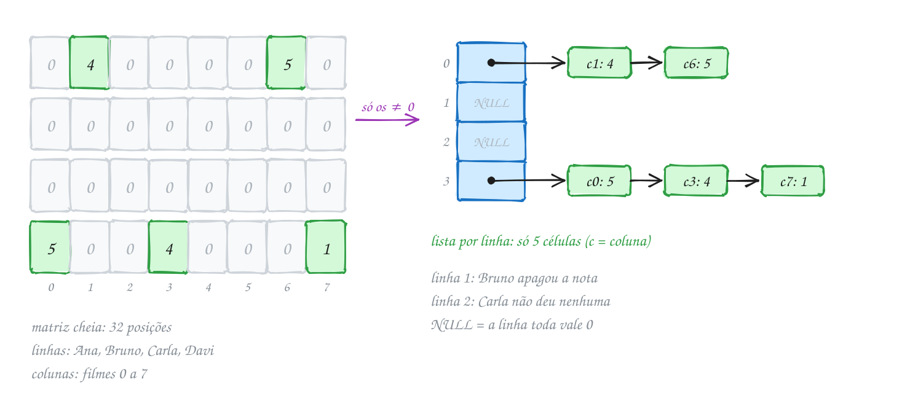
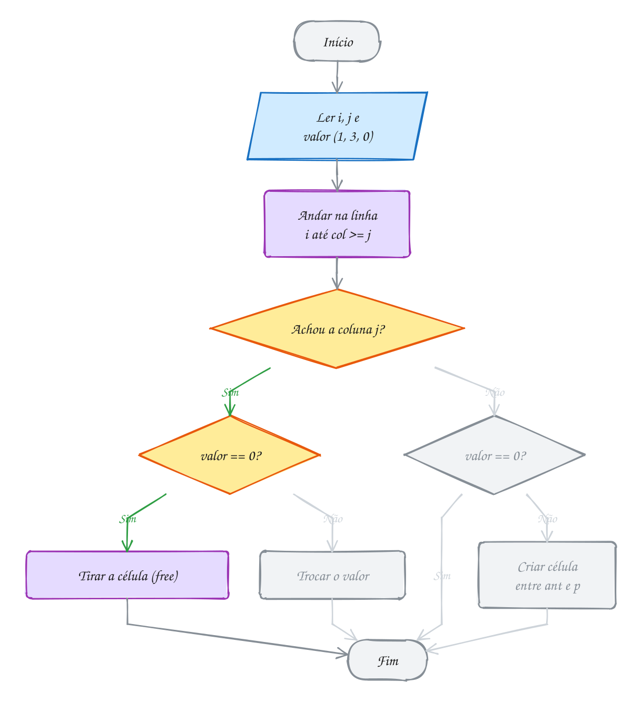
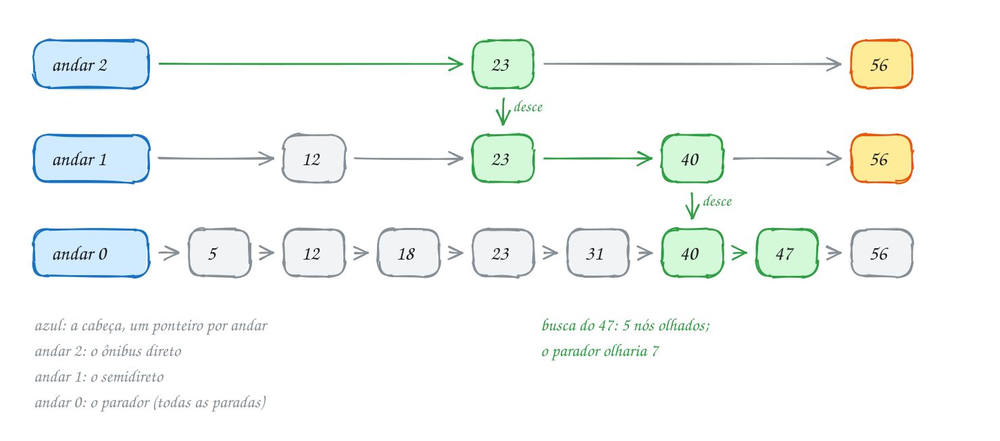
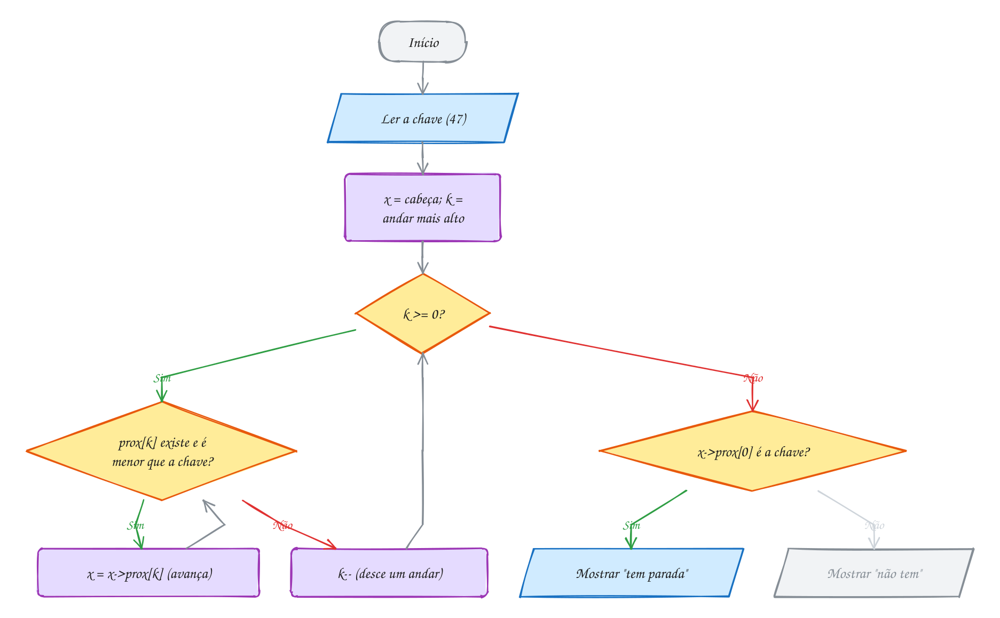
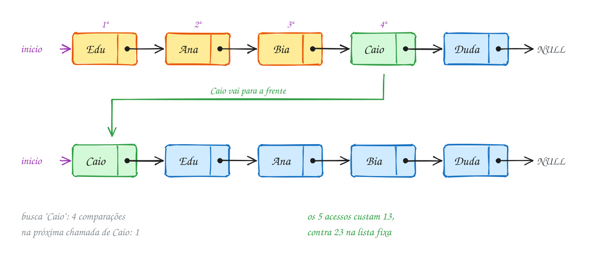
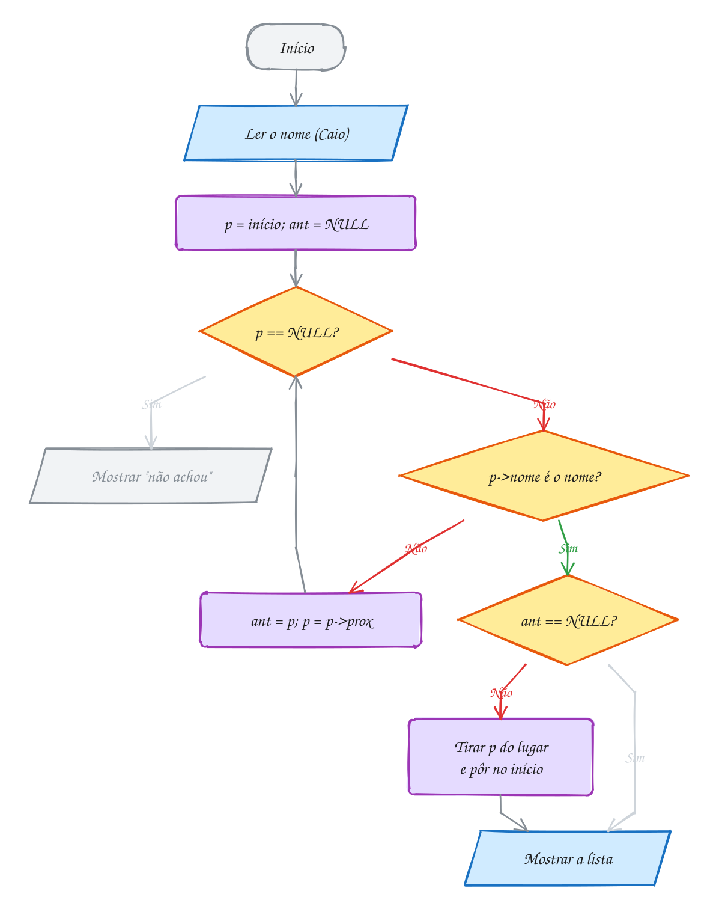
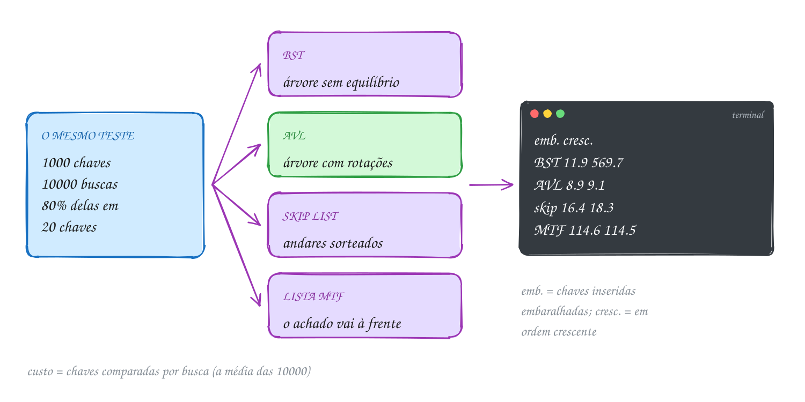
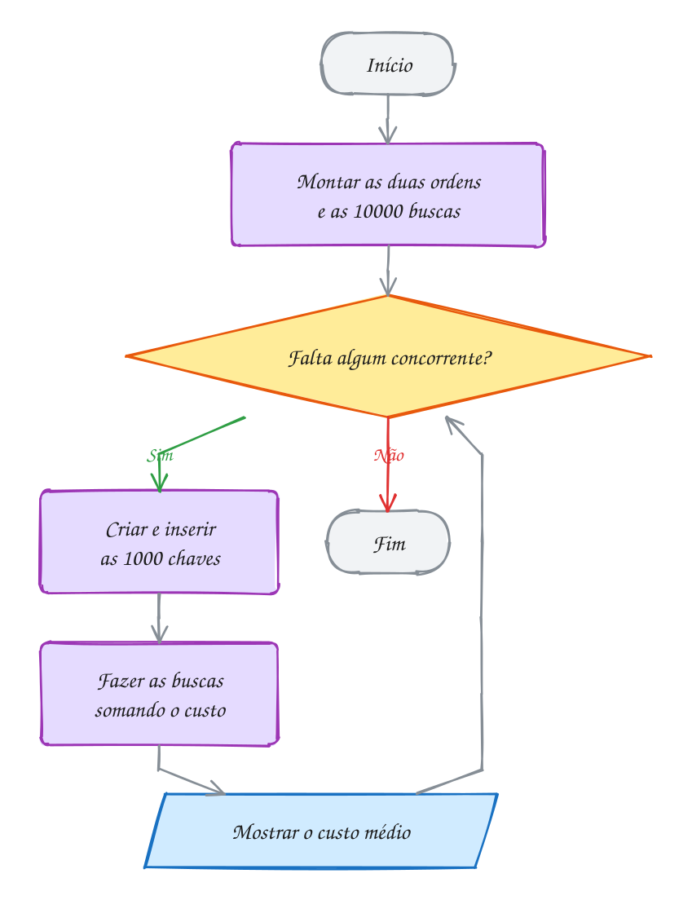

<!-- Gerado por _gerador. Para mudar este arquivo, edite _gerador/modulos/25-estruturas-extras/ e rode: cd _gerador && npm run gerar -->

# Módulo 25 · Estruturas especiais

Os módulos anteriores montaram a caixa de ferramentas clássica: listas, pilhas,
filas, árvores, heaps, tabelas hash e grafos. Este módulo mostra três estruturas
que nascem de um problema bem específico e resolvem esse problema com uma ideia
simples, quase sempre uma lista encadeada com um truque a mais.

A **matriz esparsa** aparece quando quase tudo é zero: notas de clientes para
filmes, voos entre aeroportos, produtos por pedido. Guardar os zeros desperdiça
gigabytes; guardar só o que existe cabe em megabytes. A **skip list** é uma lista
ordenada com linhas expressas sorteadas por uma moeda: busca em O(log n) na
média, sem nenhuma rotação. E as **listas autoajustáveis** aproveitam o fato de
que, na vida real, poucos itens recebem quase todas as buscas: cada busca arruma
a lista um pouco para a próxima.

O assunto final coloca tudo na mesma bancada: BST, AVL, skip list e lista com
mover para a frente respondem ao mesmo teste, atrás da mesma interface de
ponteiros para função. A lição muda a cabeça: não existe estrutura melhor em
abstrato. Existe a melhor **para aquele padrão de uso**, e a forma honesta de
descobrir é medir.

## O que você vai aprender

- guardar uma **matriz esparsa** em **triplas** e em **listas por linha**, sem nunca guardar zero
- somar, transpor e multiplicar matrizes esparsas visitando só o que existe
- a **skip list**: andares, a moeda que sorteia a altura e a busca que desce como um elevador
- inserir e remover numa skip list ligando e desligando o nó em todos os andares
- as três políticas autoajustáveis: **mover para a frente**, **transposição** e **contagem**
- quando cada política ganha e quando perde (o cache **LRU** é uma delas)
- comparar estruturas com justiça: mesmas chaves, mesmas buscas, mesma medida

## Como estudar cada assunto

1. Leia o texto e olhe o **diagrama da ideia**: é o exemplo desenhado, com os
   mesmos valores do código.
2. Leia o código. Cada assunto tem um **TAD** na pasta (`esparsa.h`, `skip.h`,
   `autolista.h`, `bancada.h`) e o exemplo usa a interface. Abra o `.c` do TAD:
   é lá que moram os ponteiros.
3. Siga o **fluxograma** com o dedo: é o caminho que o exemplo faz.
4. Rode os exemplos. Mude a semente do sorteio, troque a ordem dos acessos, rode
   de novo e veja o que muda.
5. Faça os exercícios. ★☆☆ é aquecimento, ★★☆ pede raciocínio, ★★★ é desafio.
   As dicas vêm logo abaixo do enunciado: tente antes de ler.

Aqui, mais do que nunca, desenhe. Uma linha da matriz é uma lista; um nó da skip
list é uma torre de ponteiros; uma busca autoajustável muda a lista. Faça o
desenho antes e depois de cada operação.

## As cores e as formas

Caixa azul é dado entrando ou saindo, roxa é o programa fazendo alguma coisa,
amarela é pergunta. Verde é o caminho que o exemplo segue; cinza, o que ele não
usa. Nos desenhos de lista, o nó verde é o achado, os amarelos são os comparados
pelo caminho e os cinza são os que a busca nem tocou.

<p align="center"></p>

## Antes de começar

Este módulo é uma síntese. Você vai usar o tempo todo a **lista encadeada** com o
par `ant` e `p` (assuntos 0076 a 0078), `malloc` e `free` (0054), **ponteiro para
ponteiro** (0049) e a ideia de **TAD** (0074). O 0164 conversa com a busca
sequencial (0089), e o 0165 usa a BST (0099), a AVL (0101), ponteiros para função
(0050) e `void *` (0051).

O `rodar` compila junto os `.c` de apoio da pasta (como `skip.c`). Por isso os
comandos são os de sempre:

```bash
~/LPEDC/rodar 25-estruturas-extras/0163-skip-list/A325.c
```

Uma convenção vale para o módulo todo: o **custo** de uma busca é quantas chaves
ela comparou. Contar comparações dá o mesmo número em qualquer computador, ao
contrário do cronômetro. E os sorteios usam um gerador próprio de uma linha, em
vez de `rand`, para a mesma semente dar a mesma saída em qualquer máquina.

| # | Assunto | Pasta |
| --- | --- | --- |
| [0162](#0162--matriz-esparsa) | Matriz esparsa | [`0162-matriz-esparsa/`](0162-matriz-esparsa/) |
| [0163](#0163--skip-list) | Skip list | [`0163-skip-list/`](0163-skip-list/) |
| [0164](#0164--listas-autoajustáveis) | Listas autoajustáveis | [`0164-listas-autoajustaveis/`](0164-listas-autoajustaveis/) |
| [0165](#0165--juntando-tudo) | Juntando tudo | [`0165-juntando-tudo/`](0165-juntando-tudo/) |

---

## 0162 · Matriz esparsa

Um serviço de streaming quer guardar a nota (de 1 a 5) que cada cliente deu a
cada filme. São 1 milhão de clientes e 50 mil filmes. Uma matriz `int` cheia,
com uma linha por cliente e uma coluna por filme, ocupa 5 × 10¹⁰ posições de 4
bytes: **200 GB**. Só que cada cliente avalia, em média, uns 20 filmes. Mais de
99,9% dessa matriz é zero.

Uma matriz assim, quase toda de zeros, é uma **matriz esparsa**. Ela aparece em
todo lugar: quem segue quem numa rede social, voos diretos entre aeroportos,
produtos comprados por cliente, as ligações de um grafo grande. A ideia para
guardá-la é simples: **zero não se guarda**. Só os valores diferentes de zero
ocupam memória, e quem não está guardado vale 0.

O jeito mais simples é uma lista de **triplas** `(linha, coluna, valor)`, num
vetor de structs em ordem de linha e coluna. Serve bem para gravar em arquivo ou
para uma matriz que não muda. Mas inserir no meio do vetor obriga a empurrar
todo mundo, como em qualquer vetor ordenado.

Quando a matriz muda o tempo todo, a escolha é a **lista por linha**: um vetor
de ponteiros, um por linha, e em cada linha uma lista encadeada (módulo 11) com
as células daquela linha, em ordem de coluna. Cada célula guarda a coluna, o
valor e o ponteiro para a próxima:

```c
typedef struct Celula {
    int col;
    int valor;           // nunca é 0
    struct Celula *prox; // próxima célula da mesma linha
} Celula;

typedef struct {
    int linhas, colunas, nao_zeros;
    Celula **linha; // linha[i]: a lista da linha i
} Esparsa;
```

Ler `m[i][j]` é percorrer a lista da linha `i` até passar da coluna `j`. Se a
célula não aparecer, a resposta é 0. Gravar é uma **inserção ordenada** (assunto
0078) com uma regra a mais: gravar 0 numa célula que existe **remove** a célula.
Se o zero ficasse guardado, a matriz ia engordando com nada dentro.

Vamos ver na prática. Uma locadora pequena tem 4 clientes (Ana, Bruno, Carla e
Davi, linhas 0 a 3) e 8 filmes (colunas 0 a 7). Chegam seis notas; depois Bruno
apaga a dele. Das 32 posições, sobram 5 células. A linha de Carla nem tem lista:
o ponteiro dela é `NULL`, e a linha inteira vale zero:

<p align="center"></p>

O TAD fica em `esparsa.h` e `esparsa.c`. O coração dele é `esp_define`, que
anda na linha com dois ponteiros, `ant` e `p`, como na lista ordenada:

```c
void esp_define(Esparsa *m, int i, int j, int valor) {
    Celula *ant = NULL;
    Celula *p = m->linha[i];
    while (p != NULL && p->col < j) { // a linha está em ordem de coluna
        ant = p;
        p = p->prox;
    }
    if (p != NULL && p->col == j) { // a célula já existe
        if (valor != 0) {
            p->valor = valor;
            return;
        }
        if (ant == NULL) { // virou zero: sai da lista
            m->linha[i] = p->prox;
        } else {
            ant->prox = p->prox;
        }
        free(p);
        m->nao_zeros--;
        return;
    }
    if (valor == 0) {
        return; // já era zero: nada a guardar
    }
    Celula *nova = aloca(sizeof(Celula)); // entra entre ant e p
    nova->col = j;
    nova->valor = valor;
    nova->prox = p;
    if (ant == NULL) {
        m->linha[i] = nova;
    } else {
        ant->prox = nova;
    }
    m->nao_zeros++;
}
```

(A versão do `esparsa.c` também confere se `i` e `j` estão dentro da matriz.)
O programa da locadora só usa a interface:

```c
#include <stdio.h>
#include "esparsa.h"

int main(void) {
    Esparsa *notas = esp_cria(4, 8); // 4 clientes x 8 filmes, tudo zero

    esp_define(notas, 0, 6, 5); // Ana deu 5 ao filme 6
    esp_define(notas, 0, 1, 4); // entra antes do 6: a linha fica em ordem
    esp_define(notas, 1, 3, 2);
    esp_define(notas, 3, 7, 1);
    esp_define(notas, 3, 0, 5);
    esp_define(notas, 3, 3, 4);

    printf("Davi deu %d ao filme 3\n", esp_valor(notas, 3, 3));
    printf("Carla deu %d ao filme 5\n", esp_valor(notas, 2, 5));

    esp_define(notas, 1, 3, 0); // Bruno apagou a nota: a célula sai
    printf("Notas guardadas: %d de %d\n", notas->nao_zeros, 4 * 8);
    esp_mostra(notas);

    esp_libera(notas);
    return 0;
}
// Saída:
// Davi deu 4 ao filme 3
// Carla deu 0 ao filme 5
// Notas guardadas: 5 de 32
//   0  4  0  0  0  0  5  0
//   0  0  0  0  0  0  0  0
//   0  0  0  0  0  0  0  0
//   5  0  0  4  0  0  0  1
```

Repara no fluxograma: depois de andar pela linha, `esp_define` cai em um de
quatro casos (trocar, remover, ignorar ou criar). O caminho verde é o de Bruno
apagando a nota: a coluna 3 existe e o valor novo é 0, então a célula sai:

<p align="center"></p>

> [!WARNING]
> Esquecer a regra do zero é o erro clássico. Se `esp_define(m, 1, 3, 0)`
> apenas trocasse o valor, a célula ficaria na lista guardando um 0: `nao_zeros`
> mentiria, e uma matriz que recebe muitas atualizações acabaria cheia de células
> inúteis, gastando mais memória que a matriz cheia. Toda operação que pode gerar
> zero (gravar, somar, subtrair) precisa remover a célula.

> [!TIP]
> **Por dentro do C:** cada `Celula` ocupa 16 bytes numa máquina de 64 bits (4
> da coluna, 4 do valor, 8 do ponteiro), contra 4 bytes de um `int` na matriz
> cheia. Fora isso, o vetor `linha` gasta 8 bytes por linha. A locadora gasta
> 5 × 16 + 4 × 8 = 112 bytes contra 32 × 4 = 128: quase empate, porque a matriz
> é pequena e 16% dela está ocupado. A conta só compensa quando menos de 1/4 das
> posições tem valor. No streaming, 2 × 10⁷ células de 16 bytes dão 320 MB, mais
> 8 MB de ponteiros de linha: de 200 GB para menos de 1 GB.

> [!NOTE]
> **Pergunta para você:** quantas células são visitadas por
> `esp_valor(notas, 3, 5)`? E por `esp_valor(notas, 2, 5)`? O custo de uma
> leitura depende do tamanho da matriz ou de quantas células a linha tem?

### Hora de praticar

Os arquivos ficam em [`0162-matriz-esparsa/`](0162-matriz-esparsa/). Os comandos funcionam de qualquer pasta do terminal. Nos exemplos, rode, mude, quebre e rode de novo. Nos exercícios, a resposta vai dentro do próprio arquivo. ★☆☆ é aquecimento, ★★☆ pede raciocínio e ★★★ é desafio.

**Exemplo A323 · As entregas em triplas**

```c
#include <stdio.h>
#include <stdlib.h>

#define LIN 5 // entregadores
#define COL 6 // bairros

typedef struct {
    int lin, col, valor;
} Tripla;

// ordem de leitura: por linha e, dentro da linha, por coluna
int compara(const void *a, const void *b) {
    const Tripla *x = a;
    const Tripla *y = b;
    if (x->lin != y->lin) {
        return x->lin - y->lin;
    }
    return x->col - y->col;
}

int main(void) {
    int entregas[LIN][COL] = {
        {0, 0, 7, 0, 0, 0},
        {3, 0, 0, 0, 0, 2},
        {0, 0, 0, 0, 0, 0},
        {0, 4, 1, 0, 0, 0},
        {0, 0, 5, 0, 6, 0},
    };

    // compactar: uma tripla para cada valor diferente de zero
    Tripla t[LIN * COL];
    int n = 0;
    for (int i = 0; i < LIN; i++) {
        for (int j = 0; j < COL; j++) {
            if (entregas[i][j] != 0) {
                t[n++] = (Tripla){i, j, entregas[i][j]};
            }
        }
    }
    printf("%d triplas:", n);
    for (int k = 0; k < n; k++) {
        printf(" (%d,%d,%d)", t[k].lin, t[k].col, t[k].valor);
    }
    printf("\nCheia: %zu bytes; triplas: %zu bytes\n", sizeof entregas, n * sizeof(Tripla));

    // transpor: troca linha com coluna e reordena (agora bairro x entregador)
    for (int k = 0; k < n; k++) {
        int aux = t[k].lin;
        t[k].lin = t[k].col;
        t[k].col = aux;
    }
    qsort(t, n, sizeof(Tripla), compara);

    // as triplas de um mesmo bairro ficaram juntas: uma passada soma cada um
    printf("Entregas por bairro:\n"); // bairro sem tripla não aparece
    for (int k = 0; k < n;) {
        int bairro = t[k].lin, soma = 0;
        printf("  bairro %d:", bairro);
        while (k < n && t[k].lin == bairro) {
            printf(" e%d=%d", t[k].col, t[k].valor);
            soma += t[k].valor;
            k++;
        }
        printf(" -> %d\n", soma);
    }
    return 0;
}
// Saída:
// 7 triplas: (0,2,7) (1,0,3) (1,5,2) (3,1,4) (3,2,1) (4,2,5) (4,4,6)
// Cheia: 120 bytes; triplas: 84 bytes
// Entregas por bairro:
//   bairro 0: e1=3 -> 3
//   bairro 1: e3=4 -> 4
//   bairro 2: e0=7 e3=1 e4=5 -> 13
//   bairro 4: e4=6 -> 6
//   bairro 5: e1=2 -> 2
```

```bash
~/LPEDC/rodar 25-estruturas-extras/0162-matriz-esparsa/A323.c
```

**Exemplo A324 · O total de cada pedido**

```c
#include <stdio.h>
#include "esparsa.h"

#define PRODUTOS 1000 // o catálogo inteiro

int main(void) {
    // preço de cada produto do catálogo, em centavos (vetor cheio)
    int preco[PRODUTOS];
    for (int j = 0; j < PRODUTOS; j++) {
        preco[j] = 250 + (j % 40) * 50;
    }

    // 4 pedidos x 1000 produtos; cada pedido leva poucos itens
    Esparsa *pedidos = esp_cria(4, PRODUTOS);
    esp_define(pedidos, 0, 12, 2);  // pedido 0: 2 unidades do produto 12
    esp_define(pedidos, 0, 731, 1);
    esp_define(pedidos, 1, 40, 6);
    esp_define(pedidos, 2, 5, 1);
    esp_define(pedidos, 2, 999, 3);
    esp_define(pedidos, 2, 500, 2);
    esp_define(pedidos, 3, 12, 1);

    // total[i] = soma de quantidade x preço, só nas células da linha i
    int contas = 0;
    for (int i = 0; i < pedidos->linhas; i++) {
        int total = 0;
        for (const Celula *c = pedidos->linha[i]; c != NULL; c = c->prox) {
            total += c->valor * preco[c->col];
            contas++;
        }
        printf("Pedido %d: R$ %d,%02d\n", i, total / 100, total % 100);
    }
    printf("Multiplicações: %d (a matriz cheia faria %d)\n", contas, 4 * PRODUTOS);

    esp_libera(pedidos);
    return 0;
}
// Saída:
// Pedido 0: R$ 25,00
// Pedido 1: R$ 15,00
// Pedido 2: R$ 96,00
// Pedido 3: R$ 8,50
// Multiplicações: 7 (a matriz cheia faria 4000)
```

```bash
~/LPEDC/rodar 25-estruturas-extras/0162-matriz-esparsa/A324.c
```

#### Exercícios

**Exercício E967** · ★☆☆

Um app de delivery guarda as notas (1 a 5) que 4 clientes deram a 10
restaurantes numa matriz esparsa (esparsa.h). Complete resumo_linha, que
percorre só as células da linha i e devolve a soma das notas, guardando em
*qtd quantas notas a linha tem. O main já mostra a média de cada cliente.


```text
Saída esperada:
Cliente 0: 3 notas, média 4.00
Cliente 1: 1 nota, média 2.00
Cliente 2: 0 notas
Cliente 3: 4 notas, média 3.50
```

**Dicas:**

1. Comece com const Celula *c = m->linha[i] e ande com c = c->prox até
   chegar em NULL. Não use esp_valor num laço de 0 a 9: a ideia é não
   visitar os zeros.
2. Zere a soma e o *qtd antes do laço. Linha sem célula devolve 0 e
   deixa *qtd em 0.
3. Resposta esperada: a saída acima (o cliente 3 deu 5, 4, 1 e 4).

```bash
~/LPEDC/rodar 25-estruturas-extras/0162-matriz-esparsa/E967.c
```

**Exercício E968** · ★☆☆

O estacionamento do shopping tem 4 andares com 6 vagas cada. A matriz
andar x vaga guarda há quantas horas cada carro está parado; vaga livre
vale 0. O sistema guarda só as triplas (andar, vaga, horas), em ordem.
Escreva:
- valor(t, n, i, j), que procura a tripla (i, j) e devolve as horas, ou 0

```text
se ela não existir;
```

- o main, que usa valor para imprimir a matriz cheia (cada número com

```text
%3d) e, no fim, o total de horas.
```


```text
Saída esperada:
  0  0  2  0  0  0
  5  0  0  0  1  0
  0  0  0  0  0  0
  0  3  0  0  0  4
Total: 15 horas em 5 vagas ocupadas
```

**Dicas:**

1. valor é uma busca sequencial no vetor de triplas: compare lin e col.
2. O total não precisa da matriz cheia: some t[k].horas direto nas triplas.
3. Resposta esperada: a saída acima.

```bash
~/LPEDC/rodar 25-estruturas-extras/0162-matriz-esparsa/E968.c
```

**Exercício E969** · ★★☆

A matriz notas tem os clientes nas linhas e os filmes nas colunas. A
locadora agora quer o contrário: a média de cada FILME. Andar por coluna
numa lista por linha é ruim (teria que visitar todas as linhas). Então:
1. escreva transposta(m), que devolve uma nova Esparsa com linhas e

```text
 colunas trocadas (m->colunas x m->linhas), percorrendo as células de m;
```

2. no main, use a transposta para mostrar, para cada filme com nota,

```text
 quantas notas ele tem e a média; libere as duas matrizes.
```


```text
Saída esperada:
Filme 0: 2 notas, média 4.50
Filme 2: 3 notas, média 2.67
Filme 5: 1 nota, média 1.00
Células: 6 e 6
```

**Dicas:**

1. Crie t = esp_cria(m->colunas, m->linhas). Para cada linha i de m e cada
   célula c dessa linha, faça esp_define(t, c->col, i, c->valor).
2. Na transposta, a linha f é o filme f: percorra t->linha[f] somando.
   Pule os filmes cuja linha é NULL (e escreva "nota" quando for uma só).
3. Resposta esperada: a saída acima (os dois nao_zeros são iguais).

```bash
~/LPEDC/rodar 25-estruturas-extras/0162-matriz-esparsa/E969.c
```

**Exercício E970** · ★★☆

Ache o bug. Este programa tem a sua própria versão de define (sem usar o
esparsa.h) e grava as vendas de 2 vendedores em 7 dias da semana. A tela
mostra só 2 vendas, o contador diz 5 e o AddressSanitizer acusa vazamento
de memória (memory leak) no fim:


```text
Saída que aparece:
Vendedor 0: 15  0  0  0  0  0  0
Vendedor 1:  0 12  0  0  0  0  0
Células: 5
```


```text
Saída esperada (sem nenhum erro do sanitizer):
Vendedor 0: 15  0 20  0  0 30  0
Vendedor 1:  0 12  0  0 40  0  0
Células: 5
```


Ache a linha errada, conserte e rode de novo.

**Dicas:**

1. Repare quem sumiu: 30, 20 e 40. Os valores 20, 15 e 12 entram ANTES de
   todas as células que já estavam na linha. Siga o caso ant == NULL.
2. Quando a célula nova vira a primeira da linha, para onde aponta
   nova->prox? E o que acontece com as células que já estavam lá?
3. Resposta esperada: no caso ant == NULL falta nova->prox = m->linha[i]
   (ou p) antes de m->linha[i] = nova. Sem isso, a linha antiga se perde.

```bash
~/LPEDC/rodar 25-estruturas-extras/0162-matriz-esparsa/E970.c
```

**Exercício E971** · ★★★

Uma rede de farmácias guarda o estoque numa matriz esparsa filial x
produto (esparsa.h). No fim do dia chega a matriz de movimento: entrada é
positiva, venda é negativa. Escreva soma(a, b), que devolve uma NOVA
Esparsa com a + b, sem usar esp_valor e sem esp_define: monte cada linha
do resultado intercalando as duas listas, como no merge do merge sort.
Quando a soma der 0, a célula não entra.


```text
Saída esperada:
Estoque novo:
  4  0  0  0  9  0
  0  0  0  3  0  0
  0  2  0  0  0  0
Células: 4
```

**Dicas:**

1. Para cada linha i, ande com pa em a->linha[i] e pb em b->linha[i]. Se
   pa->col < pb->col, a célula de a vai sozinha; se for maior, vai a de b;
   se forem iguais, some os dois valores e avance os dois. Quando uma lista
   acabar, copie o resto da outra.
2. As células saem em ordem crescente de coluna, então basta pendurar no
   FIM da linha nova: guarde um ponteiro para o último (ou use um
   Celula **fim que começa em &c->linha[i]). Não esqueça c->nao_zeros.
3. Resposta esperada: a saída acima. O produto 2 da filial 0 (5 - 5) e o
   produto 0 da filial 1 (2 - 2) zeraram e sumiram.

```bash
~/LPEDC/rodar 25-estruturas-extras/0162-matriz-esparsa/E971.c
```

**Exercício E972** · ★★★

A matriz voos (6 x 6) tem 1 em [i][j] quando existe voo direto da cidade i
para a cidade j. Elevar ao quadrado responde outra pergunta: voos²[i][j]
é o número de rotas de i para j com EXATAMENTE uma escala (soma, para cada
cidade k, de voos[i][k] x voos[k][j]). Escreva multiplica(a, b), que
devolve a × b como uma nova Esparsa, visitando só as células que existem.
Depois mostre a matriz e, para cada cidade, quantas rotas com uma escala
saem dela.


```text
Saída esperada:
  0  0  2  1  1  0
  0  0  1  0  2  0
  0  0  0  1  0  1
  0  0  0  1  1  1
  0  0  1  0  2  0
  0  0  0  1  0  1
Manaus: 4 rotas com uma escala
Belém: 3 rotas com uma escala
Recife: 2 rotas com uma escala
Brasília: 3 rotas com uma escala
São Paulo: 3 rotas com uma escala
Porto Alegre: 2 rotas com uma escala
```

**Dicas:**

1. Para a linha i do resultado: para cada célula (k, x) da linha i de a,
   percorra a linha k de b; cada célula (j, y) soma x * y em acum[j], um
   vetor de inteiros (com b->colunas posições) zerado a cada linha i.
2. Depois de processar a linha i, grave em c as posições de acum que não
   são zero, com esp_define(c, i, j, acum[j]) em ordem de j (cada célula
   entra no fim da linha). O total de rotas de i é a soma de acum.
3. Resposta esperada: a saída acima. Em Manaus, as 2 rotas para Recife
   são Manaus-Belém-Recife e Manaus-Brasília-Recife. Ida e volta também
   conta: o 2 na diagonal de São Paulo vem de São Paulo-Brasília-São
   Paulo e São Paulo-Porto Alegre-São Paulo.

```bash
~/LPEDC/rodar 25-estruturas-extras/0162-matriz-esparsa/E972.c
```

---

## 0163 · Skip list

A linha de ônibus da rodovia tem paradas nos km 5, 12, 18, 23, 31, 40, 47 e 56.
O ônibus **parador** para em todas. O **semidireto** só em algumas, e o
**direto** só nas principais. Quem vai para o km 47 não pega o parador desde o
começo: vai de direto até onde der sem passar do destino, troca para o
semidireto, e só no fim pega o parador.

Uma lista encadeada ordenada (assunto 0078) é o ônibus parador. Para achar uma
chave, você passa por todas as anteriores: O(n). A busca binária não serve,
porque lista não tem índice: não dá para pular para o meio. A BST e a AVL
(módulo 14) resolvem isso, mas trocam a lista por uma árvore com rotações.

A **skip list** fica com a lista e acrescenta as linhas expressas. Ela tem vários
**andares**. O andar 0 é a lista completa, em ordem. O andar 1 é uma lista com
só parte dos nós, o andar 2 com menos ainda, e assim por diante. Cada nó tem um
vetor de ponteiros `prox`: `prox[0]` é o próximo no andar 0, `prox[1]` o próximo
no andar 1, `prox[k]` o próximo no andar `k`. Uma **cabeça** sem chave está em todos os andares
e é por onde toda busca começa.

**Buscar** é a viagem de ônibus. Comece no andar mais alto da cabeça. Se o
próximo nó do andar ainda é menor que a chave, avance. Se ele já passou da chave
(ou não existe), desça um andar. No andar 0, o próximo nó é a chave ou ela não
existe.

E quem decide em quais andares cada nó aparece? Se fosse "um nó sim, um não"
em cada andar, a busca seria uma busca binária, mas qualquer inserção quebraria o
padrão e obrigaria a refazer tudo. A skip list usa uma **moeda**: todo nó novo
entra no andar 0; enquanto a moeda der cara, ele sobe mais um andar. Em média,
metade dos nós chega ao andar 1, um quarto ao andar 2, um oitavo ao andar 3. É o
padrão "um sim, um não" sem nunca precisar arrumar nada.

**Inserir** é buscar guardando, em cada andar, o último nó visitado antes de
descer (o vetor `antes`). Depois sorteie os andares do nó novo e ligue-o depois
de `antes[k]` em cada andar `k` dele. A remoção usa o mesmo vetor para desligar
o nó em todos os andares.

O custo é **O(log n) esperado**: com 1 milhão de chaves, cerca de 20 andares e uns
40 nós olhados por busca, contra meio milhão em média na lista simples. "Esperado"
quer dizer na média dos sorteios, não garantido: uma sequência de azar absurda
poderia deixar todos os nós no andar 0. Na prática, isso não acontece.

Vamos ver na prática. As oito paradas entram com os andares que a moeda "deu":
o 23 e o 56 em 3 andares, o 12 e o 40 em 2, os outros só no andar 0. A busca
pelo 47 anda no andar 2 até o 23 (o próximo, 56, já passou), desce, anda até o
40, desce, e o próximo no andar 0 é o 47:

<p align="center"></p>

O TAD fica em `skip.h` e `skip.c`. O nó e a busca:

```c
#define SKIP_MAX 12 // andares no máximo: dá para uns 4 mil nós (2 elevado a 12)

typedef struct NoSkip {
    int chave;
    int andares;                   // em quantos andares o nó aparece
    struct NoSkip *prox[SKIP_MAX]; // prox[k]: o próximo no andar k
} NoSkip;

bool skip_busca(const Skip *s, int chave, int *passos) {
    int olhados = 0;
    const NoSkip *x = &s->cabeca;
    for (int k = s->andares - 1; k >= 0; k--) { // do andar mais alto ao 0
        while (x->prox[k] != NULL) {
            olhados++;
            if (x->prox[k]->chave >= chave) {
                break; // o próximo já passou (ou é a chave): desce
            }
            x = x->prox[k]; // o próximo ainda é menor: avança
        }
    }
    if (passos != NULL) {
        *passos = olhados;
    }
    x = x->prox[0]; // no andar 0, o próximo é a chave ou ela não existe
    return x != NULL && x->chave == chave;
}
```

Para o desenho ficar igual em toda execução, o exemplo usa
`skip_insere_andares`, que recebe os andares prontos. No uso normal, `skip_insere`
joga a moeda sozinha. O `skip_mostra` imprime cada chave sempre na mesma coluna:

```c
#include <stdio.h>
#include "skip.h"

void procura(const Skip *s, int km) {
    int passos;
    bool achou = skip_busca(s, km, &passos);
    printf("km %d: %s, %d nós olhados\n", km, achou ? "tem parada" : "não tem parada", passos);
}

int main(void) {
    int km[] = {5, 12, 18, 23, 31, 40, 47, 56};
    int andares[] = {1, 2, 1, 3, 1, 2, 1, 3}; // o que a moeda "deu"
    Skip *linha = skip_cria(0);
    for (int i = 0; i < 8; i++) {
        skip_insere_andares(linha, km[i], andares[i]);
    }

    skip_mostra(linha);
    procura(linha, 47);
    procura(linha, 20);

    skip_libera(linha);
    return 0;
}
// Saída:
// andar 2:              23              56
// andar 1:      12      23      40      56
// andar 0:   5  12  18  23  31  40  47  56
// km 47: tem parada, 5 nós olhados
// km 20: não tem parada, 5 nós olhados
```

Repara no fluxograma: são dois laços, um dentro do outro. O de dentro avança no
andar; o de fora desce. O caminho verde é a busca do 47: avança uma vez no andar
2, uma no andar 1, nenhuma no andar 0, e o próximo é o 47:

<p align="center"></p>

> [!WARNING]
> Na remoção, o nó tem que sair de **todos** os andares em que aparece, não só do
> andar 0. Se o 23 for removido só do andar 0 e liberado com `free`, a cabeça
> continua apontando para ele no andar 2, e o 12 no andar 1. A próxima busca entra
> num nó que não existe mais: é um ponteiro solto (assunto 0057), e o
> AddressSanitizer acusa *heap-use-after-free*. O exercício E976 traz esse bug.

> [!TIP]
> **Por dentro do C:** com `prox[SKIP_MAX]`, todo nó ocupa 4 + 4 + 12 × 8 = 104
> bytes, mesmo que use só 1 ou 2 ponteiros (a média é 2). Dá para alocar só o
> necessário com um **membro vetor flexível**, `struct NoSkip *prox[];` no fim da
> struct, e `malloc(sizeof(NoSkip) + andares * sizeof(NoSkip *))`: o exercício
> E978 faz essa troca. E a moeda? `skip.c` não usa `rand`: tem um gerador próprio
> de uma linha (`semente = semente * 1103515245u + 12345u`). Cada biblioteca C
> implementa `rand` de um jeito, e com o gerador próprio a mesma semente monta a
> mesma skip list em qualquer máquina, o que deixa os testes repetíveis.

> [!NOTE]
> **Pergunta para você:** se o km 35 entrar com 2 andares, quais ponteiros mudam?
> Quem fica em `antes[0]` e em `antes[1]`? Desenhe antes de conferir com
> `skip_insere_andares` e `skip_mostra`.

### Hora de praticar

Os arquivos ficam em [`0163-skip-list/`](0163-skip-list/). Os comandos funcionam de qualquer pasta do terminal. Nos exemplos, rode, mude, quebre e rode de novo. Nos exercícios, a resposta vai dentro do próprio arquivo. ★☆☆ é aquecimento, ★★☆ pede raciocínio e ★★★ é desafio.

**Exemplo A325 · A moeda decide os andares**

```c
#include <stdio.h>
#include "skip.h"

#define N 1000

int main(void) {
    Skip *s = skip_cria(2024); // a mesma semente dá sempre a mesma skip list
    for (int i = 1; i <= N; i++) {
        skip_insere(s, i * 10); // códigos de produto: 10, 20, ..., 10000
    }

    // quantos nós em cada andar: anda pela lista daquele andar
    int ponteiros = 0;
    for (int k = 0; k < s->andares; k++) {
        int qtd = 0;
        for (const NoSkip *x = s->cabeca.prox[k]; x != NULL; x = x->prox[k]) {
            qtd++;
        }
        ponteiros += qtd;
        printf("andar %2d: %4d nós (esperado ~%d)\n", k, qtd, N >> k);
    }
    printf("Ponteiros em uso: %d, média de %.2f por nó\n", ponteiros, (double)ponteiros / N);

    // a média de nós olhados, buscando cada uma das 1000 chaves
    long total = 0;
    int pior = 0;
    for (int i = 1; i <= N; i++) {
        int passos;
        skip_busca(s, i * 10, &passos);
        total += passos;
        if (passos > pior) {
            pior = passos;
        }
    }
    printf("Busca: média de %.1f nós olhados, pior %d\n", (double)total / N, pior);
    printf("Lista simples: média de %.1f, pior %d\n", (N + 1) / 2.0, N);

    skip_libera(s);
    return 0;
}
// Saída:
// andar  0: 1000 nós (esperado ~1000)
// andar  1:  503 nós (esperado ~500)
// andar  2:  251 nós (esperado ~250)
// andar  3:  129 nós (esperado ~125)
// andar  4:   62 nós (esperado ~62)
// andar  5:   27 nós (esperado ~31)
// andar  6:   13 nós (esperado ~15)
// andar  7:    6 nós (esperado ~7)
// andar  8:    4 nós (esperado ~3)
// andar  9:    2 nós (esperado ~1)
// Ponteiros em uso: 1997, média de 2.00 por nó
// Busca: média de 18.2 nós olhados, pior 31
// Lista simples: média de 500.5, pior 1000
```

```bash
~/LPEDC/rodar 25-estruturas-extras/0163-skip-list/A325.c
```

**Exemplo A326 · A agenda do barbeiro**

```c
#include <stdio.h>
#include "skip.h"

// horário em minutos desde a meia-noite: 570 é 9h30
void mostra_hora(int min) {
    printf("%02dh%02d", min / 60, min % 60);
}

int main(void) {
    // os clientes marcam fora de ordem; a skip list mantém tudo em ordem
    int hora[] = {570, 540, 660, 600, 630, 720};
    int andares[] = {1, 2, 1, 3, 2, 1};
    Skip *agenda = skip_cria(0);
    for (int i = 0; i < 6; i++) {
        skip_insere_andares(agenda, hora[i], andares[i]);
    }
    printf("Agenda (%d andares):\n", agenda->andares);
    skip_mostra(agenda);

    // o cliente das 10h cancela: o 600 sai dos 3 andares dele, e o andar 2,
    // que só tinha ele, fica vazio
    skip_remove(agenda, 600);
    printf("Sem o das 10h00 (%d andares):\n", agenda->andares);
    skip_mostra(agenda);

    // atender em ordem: o primeiro do andar 0 é sempre o próximo horário
    printf("Atendimentos:");
    while (agenda->cabeca.prox[0] != NULL) {
        int proximo = agenda->cabeca.prox[0]->chave;
        printf(" ");
        mostra_hora(proximo);
        skip_remove(agenda, proximo); // tirar o primeiro: nada para procurar
    }
    printf("\nNa agenda: %d\n", agenda->n);

    skip_libera(agenda);
    return 0;
}
// Saída:
// Agenda (3 andares):
// andar 2:         600
// andar 1: 540     600 630
// andar 0: 540 570 600 630 660 720
// Sem o das 10h00 (2 andares):
// andar 1: 540     630
// andar 0: 540 570 630 660 720
// Atendimentos: 09h00 09h30 10h30 11h00 12h00
// Na agenda: 0
```

```bash
~/LPEDC/rodar 25-estruturas-extras/0163-skip-list/A326.c
```

#### Exercícios

**Exercício E973** · ★☆☆

Complete maior(s, &avancos), que devolve a maior chave da skip list
(que não pode estar vazia) e conta quantas vezes o ponteiro avançou. Não
ande só pelo andar 0: use os andares de cima, como o ônibus direto.
O main testa com as paradas do texto e com 1000 códigos sorteados.


```text
Saída esperada:
Paradas: maior 56, 2 avanços (pelo andar 0 seriam 8)
Códigos: maior 10000, 13 avanços (pelo andar 0 seriam 1000)
```

**Dicas:**

1. É a busca sem a comparação: comece em x = &s->cabeca, no andar
   s->andares - 1. Em cada andar, avance enquanto x->prox[k] != NULL.
   Depois desça.
2. Some 1 em *avancos a cada x = x->prox[k]. No fim, x é o último nó.
3. Resposta esperada: a saída acima.

```bash
~/LPEDC/rodar 25-estruturas-extras/0163-skip-list/E973.c
```

**Exercício E974** · ★☆☆

Escreva faixa(s, a, b), que mostra todas as chaves entre a e b (incluindo
os dois), em ordem. Use os andares para chegar perto de a sem passar por
todo mundo; depois ande pelo andar 0 até passar de b. Se não houver
nenhuma, mostre " nenhuma".


```text
Saída esperada:
Paradas entre km 15 e km 45: 18 23 31 40
Paradas entre km 41 e km 46: nenhuma
Paradas entre km 50 e km 99: 56
```

**Dicas:**

1. A primeira parte é a busca de a: em cada andar, avance enquanto
   x->prox[k] != NULL e x->prox[k]->chave < a; depois desça.
2. No fim da descida, x->prox[0] é a primeira chave >= a. Ande com
   p = x->prox[0] enquanto p != NULL e p->chave <= b.
3. Resposta esperada: a saída acima.

```bash
~/LPEDC/rodar 25-estruturas-extras/0163-skip-list/E974.c
```

**Exercício E975** · ★★☆

A moeda da skip list não precisa ser honesta. Com probabilidade 1/4 de
subir, os nós ficam mais baixos: menos ponteiros. Será que a busca fica
muito mais lenta? Faça o experimento com 4000 chaves (1 a 4000):
- complete sorteia(&estado, lados): começa com 1 andar e sobe mais um

```text
enquanto (proximo(&estado) >> 16) % lados == 0, sem passar de SKIP_MAX;
```

- complete experimento(lados): monta a skip list com

```text
skip_insere_andares e os andares sorteados (estado começa em 7), busca
cada chave somando os nós olhados e mostra uma linha como abaixo.
```


```text
Saída esperada:
1/2: 7997 ponteiros, 21.9 nós olhados por busca
1/4: 5410 ponteiros, 21.6 nós olhados por busca
```

**Dicas:**

1. lados = 2 é a moeda de sempre (1/2); lados = 4 sobe com 1/4. Use o
   proximo() pronto: os bits de baixo desse tipo de gerador são ruins,
   por isso o >> 16.
2. Ponteiros em uso = soma dos andares de todos os nós. A média é o total
   de passos (de skip_busca) dividido por 4000.0.
3. Resposta esperada: a saída acima. Com 1/4, a skip list usa um terço a
   menos de ponteiros e a busca custa praticamente o mesmo: há menos
   andares, mas anda-se mais em cada um.

```bash
~/LPEDC/rodar 25-estruturas-extras/0163-skip-list/E975.c
```

**Exercício E976** · ★★☆

Ache o bug. A concessionária desativou a parada do km 23. A função
remove_parada abaixo tira o nó da lista e libera a memória, mas a busca
seguinte quebra: o AddressSanitizer acusa heap-use-after-free dentro de
skip_busca. Conserte remove_parada (sem usar skip_remove) e rode de novo.


```text
Saída esperada (sem nenhum erro do sanitizer):
km 47: tem parada
km 23: não tem parada
andar 2:                          56
andar 1:      12          40      56
andar 0:   5  12  18  31  40  47  56
```

**Dicas:**

1. O 23 aparece em 3 andares. Depois do free, quem ainda aponta para ele?
   Olhe a cabeça no andar 2 e o 12 no andar 1.
2. antes[k] já guarda o nó anterior em cada andar. Falta desligar o nó em
   todos os andares dele: k de 0 até x->andares - 1.
3. Resposta esperada: troque a linha antes[0]->prox[0] = x->prox[0] por um
   laço que faz antes[k]->prox[k] = x->prox[k] para cada andar do nó.

```bash
~/LPEDC/rodar 25-estruturas-extras/0163-skip-list/E976.c
```

**Exercício E977** · ★★★

Contador de palavras com skip list. Escreva do zero (sem o skip.h, que só
guarda int) uma skip list de palavras: cada nó tem a palavra (até 23
letras), quantas vezes ela apareceu, os andares e o vetor prox. Leia as
palavras da entrada até o fim; palavra nova entra no lugar certo (ordem
do strcmp) com andares sorteados por moeda(); palavra repetida só soma 1.
No fim, mostre as palavras em ordem e libere tudo.

Teste com:

```text
printf 'o rato roeu a roupa do rei de roma e o rei riu\n' | ~/LPEDC/rodar 25-estruturas-extras/0163-skip-list/E977.c
```


```text
Saída esperada:
a 1
de 1
do 1
e 1
o 2
rato 1
rei 2
riu 1
roeu 1
roma 1
roupa 1
11 palavras diferentes, 13 no total
```

**Dicas:**

1. Leia com while (scanf("%23s", palavra) == 1). O nó guarda uma CÓPIA
   (char palavra[24] e strcpy). A cabeça pode ser um nó comum, com
   andares = MAX e todos os prox em NULL.
2. A inserção é a do skip.c com strcmp no lugar do <: desça guardando
   antes[k]; se antes[0]->prox[0] tem a palavra, some 1 e pronto; senão
   sorteie os andares (comece em 1 e suba enquanto moeda() == 1, até MAX)
   e ligue o nó em cada andar.
3. Resposta esperada: a saída acima (a ordem é a do strcmp; a forma dos
   andares não muda a saída).

```bash
~/LPEDC/rodar 25-estruturas-extras/0163-skip-list/E977.c
```

**Exercício E978** · ★★★

Refatore. Este programa tem a própria skip list, com o vetor fixo
prox[MAX] em todo nó, e conta os bytes pedidos ao malloc para os nós. Hoje
ele mostra:


```text
andar 2: 23 56
andar 1: 12 23 40 56
andar 0: 5 12 18 23 31 40 47 56
Memória dos nós: 832 bytes
```


Troque o vetor fixo por um membro vetor flexível (C99): a última linha
da struct vira struct No *prox[]; e cada nó pede ao malloc só os andares
que tem. Os andares devem sair iguais; a última linha deve virar:


```text
Memória dos nós: 176 bytes
```

**Dicas:**

1. Com prox[] no fim, sizeof(No) não conta o vetor (aqui, 8 bytes). O
   malloc fica malloc(sizeof(No) + andares * sizeof(No *)), e é esse
   valor que vai para bytes.
2. Uma struct com membro flexível não pode ser campo de outra struct. A
   cabeça vira um ponteiro (No *cabeca), alocado com MAX andares e todos
   os prox em NULL. Ela não entra na conta de bytes. Libere a cabeça no
   fim também.
3. Cuidado com o laço que liga o nó novo: com o vetor flexível, só
   existem prox[0] a prox[andares - 1]; escrever em prox[andares] é estouro
   (o AddressSanitizer acusa). Resposta esperada: 176 = 8 nós x 8 bytes +
   14 ponteiros x 8 bytes (os andares somam 14).

```bash
~/LPEDC/rodar 25-estruturas-extras/0163-skip-list/E978.c
```

---

## 0164 · Listas autoajustáveis

Na cozinha, o sal e o óleo ficam na frente do armário, e o cravo que você usa uma
vez por ano fica lá no fundo. Ninguém planejou isso: cada vez que você usa um
pote, ele volta para a frente. Com o tempo, o armário se arruma sozinho pelo uso.

A busca sequencial (assunto 0089) custa a **posição** do item: o primeiro sai com
1 comparação, o décimo com 10. Se todo item fosse procurado com a mesma
frequência, a ordem não faria diferença. Mas quase nunca é assim: na agenda do
celular, meia dúzia de contatos recebe quase todas as ligações. Se eles
estivessem na frente, a busca média cairia muito.

O problema é que você não sabe de antemão quem são os mais procurados, e isso
muda com o tempo. A **lista autoajustável** descobre sozinha: a cada busca
bem-sucedida, ela muda a ordem para aproximar o item achado do começo. A busca
deixa de ser só leitura; ela também arruma. Há três políticas clássicas:

- **mover para a frente** (*move-to-front*): o item achado vira o primeiro.
  Reage rápido, mas um item procurado uma única vez também vai parar na frente;
- **transposição**: o item achado troca de lugar com o anterior, subindo uma
  casa por acesso. É conservadora: um acesso isolado quase não bagunça a lista,
  mas um item popular demora para chegar à frente;
- **contagem**: cada nó guarda quantas vezes foi achado, e a lista fica em ordem
  decrescente de acessos. Converge para a melhor ordem fixa, mas gasta um campo
  a mais e se apega ao passado: um item que foi popular demora a descer.

Mover para a frente combina com **lista encadeada**: achado o nó, tirá-lo do lugar
e pendurá-lo no início são três atribuições de ponteiro. Num vetor, seria
preciso empurrar todos os anteriores uma casa para trás. Já a transposição é uma
troca de dois vizinhos e funciona bem nos dois.

Vamos ver na prática. A agenda tem Ana, Bia, Caio, Duda e Edu, nessa ordem. As
ligações do dia são para Edu, Edu, Caio, Edu e Edu. Na terceira, Caio é achado na
quarta comparação e passa para a frente; Edu, que estava em primeiro, desce para
o segundo lugar:

<p align="center"></p>

O TAD fica em `autolista.h` e `autolista.c`, com as três políticas e uma busca
que não mexe em nada (`al_busca`), para comparar. Mover para a frente é a busca da
lista com o par `ant` e `p` (assunto 0077) e três linhas no fim:

```c
bool al_busca_mtf(AutoLista *l, const char *nome, int *custo) {
    int c = 0;
    NoAuto *ant = NULL;
    NoAuto *p = l->inicio;
    while (p != NULL) {
        c++;
        if (strcmp(p->nome, nome) == 0) {
            break;
        }
        ant = p;
        p = p->prox;
    }
    if (custo != NULL) {
        *custo = c;
    }
    if (p == NULL) {
        return false;
    }
    if (ant != NULL) {       // se p já é o primeiro, nada a fazer
        ant->prox = p->prox; // tira p do lugar...
        p->prox = l->inicio; // ...e põe na frente
        l->inicio = p;
    }
    return true;
}
```

O programa faz as cinco ligações em duas agendas iguais, uma que se ajusta e uma
fixa, e soma as comparações:

```c
#include <stdio.h>
#include "autolista.h"

int main(void) {
    const char *contatos[] = {"Ana", "Bia", "Caio", "Duda", "Edu"};
    const char *chamadas[] = {"Edu", "Edu", "Caio", "Edu", "Edu"};
    AutoLista *agenda = al_cria(); // a que se ajusta
    AutoLista *fixa = al_cria();   // a de sempre, para comparar
    for (int i = 0; i < 5; i++) {
        al_insere_fim(agenda, contatos[i]);
        al_insere_fim(fixa, contatos[i]);
    }

    int total = 0, total_fixa = 0;
    for (int i = 0; i < 5; i++) {
        int custo, custo_fixa;
        al_busca_mtf(agenda, chamadas[i], &custo);
        al_busca(fixa, chamadas[i], &custo_fixa);
        total += custo;
        total_fixa += custo_fixa;
        printf("%-4s custo %d -> ", chamadas[i], custo);
        al_mostra(agenda);
        printf("\n");
    }
    printf("Total: %d comparações (sem ajuste: %d)\n", total, total_fixa);

    al_libera(agenda);
    al_libera(fixa);
    return 0;
}
// Saída:
// Edu  custo 5 -> Edu Ana Bia Caio Duda
// Edu  custo 1 -> Edu Ana Bia Caio Duda
// Caio custo 4 -> Caio Edu Ana Bia Duda
// Edu  custo 2 -> Edu Caio Ana Bia Duda
// Edu  custo 1 -> Edu Caio Ana Bia Duda
// Total: 13 comparações (sem ajuste: 23)
```

Repara no fluxograma: até achar, é a busca sequencial de sempre. A diferença está
depois do "Sim": se o nó não é o primeiro, ele é desligado e religado no início.
O caminho verde é a chamada para Caio, achado na quarta volta:

<p align="center"></p>

> [!WARNING]
> O caso do **primeiro nó** pega todo mundo. Se o nó achado já é o primeiro,
> `ant` é `NULL`, e `ant->prox = p->prox` derruba o programa (o exercício E982
> traz esse bug). E se você esquecer `l->inicio = p`, o nó achado sai do lugar
> mas ninguém aponta para ele: ele some da lista e vaza memória. Por isso a
> função recebe `AutoLista *` e não `const`: a busca muda o começo da lista.

> [!TIP]
> **Por dentro do C:** mover para a frente custa três atribuições de ponteiro,
> 8 bytes cada, não importa onde o nó estava; os nomes (20 bytes cada) nunca
> saem do lugar na memória. No vetor, levar o décimo item para a frente obriga a
> copiar os nove anteriores, e cada cópia move a struct inteira (o exemplo A327
> conta isso). A contagem custa um `int` a mais por nó e, a cada acesso, uma
> caminhada extra para reinserir o nó no lugar certo. E existe um resultado
> famoso (Sleator e Tarjan, 1985): mover para a frente nunca gasta mais que o
> dobro da melhor ordem fixa, aquela escolhida por quem já conhece todas as
> buscas de antemão.

> [!NOTE]
> **Pergunta para você:** com as mesmas cinco ligações, quanto custaria a
> **transposição**? E se as ligações fossem Ana, Bia, Caio, Duda, Edu, Ana, Bia,
> Caio, Duda, Edu, qual política sairia pior? Confira com `al_busca_transpoe`.

### Hora de praticar

Os arquivos ficam em [`0164-listas-autoajustaveis/`](0164-listas-autoajustaveis/). Os comandos funcionam de qualquer pasta do terminal. Nos exemplos, rode, mude, quebre e rode de novo. Nos exercícios, a resposta vai dentro do próprio arquivo. ★☆☆ é aquecimento, ★★☆ pede raciocínio e ★★★ é desafio.

**Exemplo A327 · A gaveta de temperos num vetor**

```c
#include <stdio.h>
#include <string.h>

#define N 8

typedef struct {
    char nome[16];
} Pote;

// busca sequencial; devolve a posição (ou -1) e soma as comparações
int procura(const Pote v[], int n, const char *nome, int *comparacoes) {
    for (int i = 0; i < n; i++) {
        (*comparacoes)++;
        if (strcmp(v[i].nome, nome) == 0) {
            return i;
        }
    }
    return -1;
}

// mover para a frente no vetor: os i anteriores andam uma casa para trás
void usa_mtf(Pote v[], int n, const char *nome, int *comparacoes, int *movidos) {
    int i = procura(v, n, nome, comparacoes);
    if (i > 0) {
        Pote achado = v[i];
        for (int j = i; j > 0; j--) {
            v[j] = v[j - 1];
        }
        v[0] = achado;
        *movidos += i + 1; // todas as posições de 0 a i mudaram
    }
}

// transposição no vetor: uma troca com o vizinho da esquerda
void usa_transpoe(Pote v[], int n, const char *nome, int *comparacoes, int *movidos) {
    int i = procura(v, n, nome, comparacoes);
    if (i > 0) {
        Pote aux = v[i];
        v[i] = v[i - 1];
        v[i - 1] = aux;
        *movidos += 2;
    }
}

void mostra(const char *titulo, const Pote v[], int comparacoes, int movidos) {
    printf("%s:", titulo);
    for (int i = 0; i < N; i++) {
        printf(" %s", v[i].nome);
    }
    printf("\n  comparações: %d, potes movidos: %d\n", comparacoes, movidos);
}

int main(void) {
    const Pote inicial[N] = {{"sal"}, {"oleo"}, {"alho"}, {"cravo"},
                             {"cominho"}, {"louro"}, {"pimenta"}, {"oregano"}};
    const char *receitas[] = {"pimenta", "louro", "pimenta", "alho", "pimenta",
                              "louro", "pimenta", "sal", "pimenta", "louro"};
    Pote a[N], b[N];
    memcpy(a, inicial, sizeof inicial); // vetor não se copia com =: memcpy copia os bytes
    memcpy(b, inicial, sizeof inicial);

    int ca = 0, ma = 0, cb = 0, mb = 0;
    for (int k = 0; k < 10; k++) {
        usa_mtf(a, N, receitas[k], &ca, &ma);
        usa_transpoe(b, N, receitas[k], &cb, &mb);
    }
    mostra("Para a frente", a, ca, ma);
    mostra("Transposição", b, cb, mb);
    return 0;
}
// Saída:
// Para a frente: louro pimenta sal alho oleo cravo cominho oregano
//   comparações: 37, potes movidos: 37
// Transposição: sal alho pimenta oleo louro cravo cominho oregano
//   comparações: 53, potes movidos: 18
```

```bash
~/LPEDC/rodar 25-estruturas-extras/0164-listas-autoajustaveis/A327.c
```

**Exemplo A328 · Quando mover para a frente atrapalha**

```c
#include <stdio.h>
#include "autolista.h"

#define APPS 6

typedef bool (*Busca)(AutoLista *, const char *, int *);

// a busca sem ajuste tem outro tipo (recebe const): um embrulho resolve
bool fixa(AutoLista *l, const char *nome, int *custo) {
    return al_busca(l, nome, custo);
}

// monta a lista inicial, faz as buscas com a política e devolve o custo total
int roda(Busca busca, const char *seq[], int n) {
    const char *apps[APPS] = {"Banco", "Mapa", "Musica", "Fotos", "Email", "Agenda"};
    AutoLista *l = al_cria();
    for (int i = 0; i < APPS; i++) {
        al_insere_fim(l, apps[i]);
    }
    int total = 0;
    for (int i = 0; i < n; i++) {
        int custo;
        busca(l, seq[i], &custo);
        total += custo;
    }
    al_libera(l);
    return total;
}

int main(void) {
    // costume: quase sempre a Agenda e o Email, com uma Fotos perdida no meio
    const char *costume[] = {"Agenda", "Email", "Agenda", "Agenda", "Email", "Fotos",
                            "Agenda", "Email", "Agenda", "Email", "Agenda", "Agenda"};
    // revezando: cada app uma vez, na ordem da lista, três vezes seguidas
    const char *revezando[] = {"Banco", "Mapa", "Musica", "Fotos", "Email", "Agenda",
                             "Banco", "Mapa", "Musica", "Fotos", "Email", "Agenda",
                             "Banco", "Mapa", "Musica", "Fotos", "Email", "Agenda"};
    Busca politicas[] = {fixa, al_busca_mtf, al_busca_transpoe, al_busca_conta};

    printf("%-10s %6s %7s %7s %9s\n", "", "fixa", "frente", "transp", "contagem");
    printf("%-10s", "costume");
    for (int p = 0; p < 4; p++) {
        printf(" %*d", p == 0 ? 6 : p == 3 ? 9 : 7, roda(politicas[p], costume, 12));
    }
    printf("\n%-10s", "revezando");
    for (int p = 0; p < 4; p++) {
        printf(" %*d", p == 0 ? 6 : p == 3 ? 9 : 7, roda(politicas[p], revezando, 18));
    }
    printf("\n");
    return 0;
}
// Saída:
//              fixa  frente  transp  contagem
// costume        66      36      56        30
// revezando      63      93      66        63
```

```bash
~/LPEDC/rodar 25-estruturas-extras/0164-listas-autoajustaveis/A328.c
```

#### Exercícios

**Exercício E979** · ★☆☆

A playlist do carro tem 6 músicas e a busca é sequencial. Complete o main:
faça as 10 buscas da sequência nas duas listas, a fixa com al_busca e a
outra com al_busca_transpoe, some os custos de cada uma e mostre os dois
totais e a ordem final da lista que se ajusta.


```text
Saída esperada:
Fixa: 54 comparações
Transposição: 46 comparações
Ordem final: Luar Aquarela Trem Asa Garota Ciranda
```

**Dicas:**

1. Um laço de 0 a 9; em cada volta, chame as duas buscas com &custo e
   acumule em duas variáveis.
2. Para a ordem final, use al_mostra(ajusta) e depois um printf("\n").
3. Resposta esperada: a saída acima. O Luar, a mais tocada, começou em
   último e só chegou à frente no décimo acesso: a transposição aprende
   devagar (com mover para a frente, bastaria o primeiro).

```bash
~/LPEDC/rodar 25-estruturas-extras/0164-listas-autoajustaveis/E979.c
```

**Exercício E980** · ★☆☆

O controle remoto guarda os canais num vetor e procura do começo para o
fim. Escreva acessa(v, n, canal), que procura o canal, leva ele para a
posição 0 (os que estavam antes andam uma casa para trás) e devolve
quantas comparações fez. No main, acesse os canais 9, 4, 9, 13 e 9 e
mostre o vetor depois de cada acesso.


```text
Saída esperada:
canal  9 (custo 5): 9 2 4 5 7 11 13
canal  4 (custo 3): 4 9 2 5 7 11 13
canal  9 (custo 2): 9 4 2 5 7 11 13
canal 13 (custo 7): 13 9 4 2 5 7 11
canal  9 (custo 2): 9 13 4 2 5 7 11
```

**Dicas:**

1. Ache a posição i do canal. Guarde v[i] numa variável, faça
   v[j] = v[j - 1] com j de i até 1 e coloque o guardado em v[0].
2. O custo é i + 1. Pode supor que o canal existe.
3. Resposta esperada: a saída acima (use %2d para o número do canal).

```bash
~/LPEDC/rodar 25-estruturas-extras/0164-listas-autoajustaveis/E980.c
```

**Exercício E981** · ★★☆

Uma política intermediária entre mover para a frente e transposição: o
item achado sobe DUAS casas (ou vai para o início, se estava na posição
1 ou 2, contando do 0). Complete busca_sobe2, que faz isso numa
AutoLista, devolve se achou e guarda o custo em *custo.


```text
Saída esperada:
Edu  custo 5 -> Ana Bia Edu Caio Duda
Edu  custo 3 -> Edu Ana Bia Caio Duda
Duda custo 5 -> Edu Ana Duda Bia Caio
Edu  custo 1 -> Edu Ana Duda Bia Caio
Duda custo 3 -> Duda Edu Ana Bia Caio
Total: 17
```

**Dicas:**

1. Ande com ant e p contando a posição i do nó achado (a do primeiro é 0).
   Se i == 0, não há o que mudar.
2. Tire p da lista (ant->prox = p->prox). Depois volte ao começo e ache o
   lugar novo, a posição i - 2 (ou 0, se i for 1): use
   NoAuto **q = &l->inicio e avance até lá com q = &(*q)->prox. Aí faça
   p->prox = *q e *q = p.
3. Resposta esperada: a saída acima.

```bash
~/LPEDC/rodar 25-estruturas-extras/0164-listas-autoajustaveis/E981.c
```

**Exercício E982** · ★★☆

Ache o bug. A função liga faz mover para a frente na agenda, mas o
programa quebra na segunda ligação: o sanitizer acusa "member access
within null pointer" e SEGV (acesso a um endereço inválido) dentro de
liga. Conserte a função e rode de novo.


```text
Saída esperada (sem nenhum erro do sanitizer):
Bia: Bia Ana Caio Duda
Bia: Bia Ana Caio Duda
Duda: Duda Bia Ana Caio
Ana: Ana Duda Bia Caio
Ana: Ana Duda Bia Caio
```

**Dicas:**

1. Na segunda ligação, a Bia já é a primeira da lista. Quanto vale ant
   quando o laço para no primeiro nó?
2. Se o nó achado já é o primeiro, não há nada para mover.
3. Resposta esperada: envolva as três atribuições do fim num
   if (ant != NULL) { ... }.

```bash
~/LPEDC/rodar 25-estruturas-extras/0164-listas-autoajustaveis/E982.c
```

**Exercício E983** · ★★★

O aplicativo de fotos guarda na memória só as 3 últimas fotos abertas
(um cache). Foto pedida que está no cache é um ACERTO: ela vai para a
frente. Foto que não está é uma FALTA: ela é carregada e entra na frente;
se o cache passar de 3, sai a do fim, a usada há mais tempo. Essa política
se chama LRU (least recently used) e é mover para a frente com um corte.

Escreva do zero, com uma lista encadeada de int: leia os números das
fotos até o fim da entrada, mostre o que aconteceu em cada pedido e, no
fim, o total de acertos e faltas. Libere a lista.

Teste com:

```text
printf '7 3 7 5 9 3 7 9 9 1\n' | ~/LPEDC/rodar 25-estruturas-extras/0164-listas-autoajustaveis/E983.c
```


```text
Saída esperada:
foto 7: falta  -> 7
foto 3: falta  -> 3 7
foto 7: acerto -> 7 3
foto 5: falta  -> 5 7 3
foto 9: falta  -> 9 5 7
foto 3: falta  -> 3 9 5
foto 7: falta  -> 7 3 9
foto 9: acerto -> 9 7 3
foto 9: acerto -> 9 7 3
foto 1: falta  -> 1 9 7
Acertos: 3, faltas: 7
```

**Dicas:**

1. A busca com mover para a frente é a do texto, com int no lugar do
   nome. Se achou, é acerto.
2. Na falta, crie o nó no início e some 1 no tamanho. Se o tamanho passar
   de 3, ande até o penúltimo nó, libere o último e ponha NULL no prox do
   penúltimo.
3. Resposta esperada: a saída acima. Repare na foto 3 do sexto pedido:
   ela já tinha estado no cache, mas saiu antes de ser pedida de novo.

```bash
~/LPEDC/rodar 25-estruturas-extras/0164-listas-autoajustaveis/E983.c
```

**Exercício E984** · ★★★

Mover para a frente também é um truque de compressão (o bzip2 usa). Comece
com o alfabeto em ordem, "abcdefghijklmnopqrstuvwxyz". Para cada letra do
texto, escreva a POSIÇÃO atual dela nesse vetor (contando do 0) e leve a
letra para a frente. Letras repetidas de perto viram números pequenos,
principalmente zeros, que um compressor guarda em poucos bits.

Escreva codifica(texto, codigos) e decodifica(codigos, n, saida). A
decodificação começa do mesmo alfabeto: o número diz a posição; a letra
que está lá é a próxima do texto, e ela também vai para a frente. Teste
com "banana" e "aaabbbaaa":


```text
Saída esperada:
banana: 1 1 13 1 1 1 -> banana
aaabbbaaa: 0 0 0 1 0 0 1 0 0 -> aaabbbaaa
```

**Dicas:**

1. Guarde o alfabeto num char lista[27] (copiado de uma string com strcpy)
   e escreva uma função frente(lista, i) que leva lista[i] para a posição
   0 empurrando os anteriores, como no vetor do A327.
2. Na codificação, ache a posição i da letra (strchr(lista, c) - lista, ou
   um laço). Na decodificação, a letra é lista[codigo]. Nos dois, chame
   frente(lista, i) logo depois.
3. Resposta esperada: a saída acima. No "banana", o primeiro "a" sai como 1
   porque o "b" acabou de ir para a frente; o "n" (posição 13) só custa caro
   na primeira vez.

```bash
~/LPEDC/rodar 25-estruturas-extras/0164-listas-autoajustaveis/E984.c
```

---

## 0165 · Juntando tudo

A loja virtual tem 1000 produtos e recebe 10 mil consultas por dia. Só que a
procura não é igual: os 20 produtos da promoção da semana levam 80% das
consultas. Em qual estrutura guardar o catálogo? Uma BST, uma AVL, uma skip list ou
uma lista que move o achado para a frente?

Cada uma tem a sua promessa. A **BST** (assunto 0099) desce um caminho só, mas a
altura depende da ordem de chegada. A **AVL** (0101) garante altura perto de
log₂ n com rotações. A **skip list** (0163) promete O(log n) na média dos
sorteios, sem rotação nenhuma. A **lista com mover para a frente** (0164) é O(n),
mas aposta que os mais procurados vão ficar na frente. No papel, todas parecem
boas. A pergunta só se responde **medindo**.

Medir com justiça tem três regras. Todo mundo recebe **as mesmas chaves, na mesma
ordem**. Todo mundo responde **as mesmas buscas**, sorteadas uma vez só e
guardadas num vetor. E a medida é a mesma para todos: o **custo** de uma busca é
quantas chaves ela comparou. Contar comparações, em vez de cronometrar, dá o
mesmo número em qualquer computador.

Para o teste não precisar de quatro versões, as estruturas ficam atrás de uma
**interface comum**: uma struct com ponteiros para função (assunto 0050), em que
a estrutura de dados em si viaja como `void *` (0051). É o TAD (0074) levado um
passo adiante: quem mede chama `e->busca(d, chave, &custo)` sem saber se, do
outro lado, há uma árvore ou uma lista:

```c
typedef struct {
    const char *nome;
    void *(*cria)(void);
    void (*insere)(void *e, int chave);            // repetida é ignorada
    bool (*busca)(void *e, int chave, int *custo); // custo: chaves comparadas
    void (*libera)(void *e);
} Estrutura;

extern const Estrutura CONCORRENTES[NUM_CONCORRENTES];
```

O `bancada.c` traz os quatro concorrentes (a skip list é a do `skip.h`, as outras
três vêm dentro dele) e um sorteio repetível, `bc_sorteio`, com o mesmo gerador
de uma linha do `skip.c`.

Vamos ver na prática. Cada concorrente recebe as 1000 chaves duas vezes: uma em
ordem embaralhada, outra em ordem crescente (o catálogo exportado de uma planilha
já ordenada). Depois responde às mesmas 10 mil consultas:

<p align="center"></p>

O programa monta as duas ordens e as buscas, e a função `mede` faz o resto:

```c
#include <stdio.h>
#include "bancada.h"

#define N 1000       // produtos no catálogo
#define BUSCAS 10000 // consultas do dia
#define QUENTES 20   // os produtos da promoção

// insere as N chaves na ordem dada, faz as buscas e devolve o custo médio
double mede(const Estrutura *e, const int ordem[], const int buscas[]) {
    void *d = e->cria();
    for (int i = 0; i < N; i++) {
        e->insere(d, ordem[i]);
    }
    long total = 0;
    for (int i = 0; i < BUSCAS; i++) {
        int custo;
        e->busca(d, buscas[i], &custo);
        total += custo;
    }
    e->libera(d);
    return (double)total / BUSCAS;
}

int main(void) {
    unsigned estado = 7;
    int crescente[N], embaralhada[N], sorteio[N];
    for (int i = 0; i < N; i++) {
        crescente[i] = embaralhada[i] = sorteio[i] = i + 1;
    }
    bc_embaralha(embaralhada, N, &estado);
    bc_embaralha(sorteio, N, &estado); // os QUENTES primeiros são a promoção

    // 80% das consultas vão para os 20 produtos da promoção
    static int buscas[BUSCAS];
    for (int i = 0; i < BUSCAS; i++) {
        if (bc_sorteio(&estado) % 100 < 80) {
            buscas[i] = sorteio[bc_sorteio(&estado) % QUENTES];
        } else {
            buscas[i] = bc_sorteio(&estado) % N + 1;
        }
    }

    printf("%-10s %12s %10s\n", "", "embaralhada", "crescente");
    for (int k = 0; k < NUM_CONCORRENTES; k++) {
        const Estrutura *e = &CONCORRENTES[k];
        printf("%-10s %12.1f %10.1f\n", e->nome, mede(e, embaralhada, buscas),
               mede(e, crescente, buscas));
    }
    return 0;
}
// Saída:
//             embaralhada  crescente
// BST               11.9      569.7
// AVL                8.9        9.1
// skip list         16.4       18.3
// lista MTF        114.6      114.5
```

Repara no fluxograma: o laço não sabe quem está medindo. Trocar ou acrescentar
um concorrente é mexer no vetor `CONCORRENTES`, nunca no teste:

<p align="center"></p>

Como ler a tabela. A **BST** vai bem com chaves embaralhadas e desaba com a
planilha ordenada: virou uma lista, e a busca média passa de 500 comparações. A
**AVL** nem percebe a diferença: as rotações seguram a altura perto de
log₂ 1000. A **skip list** fica perto dela, também sem ligar para a ordem,
porque quem decide a forma é a moeda, não a chegada. Ela olha uns 18 nós, contra
uns 9 da AVL, mas não tem rotação nenhuma no código. E a **lista MTF** perde feio:
os 20% de consultas espalhadas custam umas 500 comparações cada e ainda empurram
os produtos da promoção para trás. O exemplo A329 mostra quando o jogo vira.

> [!WARNING]
> Gerar as buscas **dentro** de `mede` estraga a comparação. Como o sorteio
> continua de onde parou, cada concorrente receberia uma sequência diferente de
> consultas, e a tabela compararia testes diferentes. Por isso as buscas são
> sorteadas uma vez, antes, e guardadas num vetor. O exercício E989 traz esse
> erro para você caçar.

> [!TIP]
> **Por dentro do C:** `e->busca(d, ...)` é uma chamada **indireta**: o programa
> lê o endereço da função na struct e salta para ele. Por isso, em geral, o
> compilador não consegue copiar o corpo da função no lugar da chamada, como faz
> com funções pequenas chamadas direto, e cada busca paga um salto a mais. Num
> teste que conta comparações isso não aparece, mas num cronômetro aparece.
> Repare também no `static int buscas[BUSCAS]`: com `static`, os 40 KB do vetor
> ficam na área de dados (assunto 0053), e não na pilha do `main`.

> [!NOTE]
> **Pergunta para você:** a coluna da lista MTF quase não muda entre as duas
> ordens. Por quê? E se a promoção tivesse só 5 produtos e 99% das consultas,
> quem você acha que ganharia? Rode o A329 para conferir.

### Hora de praticar

Os arquivos ficam em [`0165-juntando-tudo/`](0165-juntando-tudo/). Os comandos funcionam de qualquer pasta do terminal. Nos exemplos, rode, mude, quebre e rode de novo. Nos exercícios, a resposta vai dentro do próprio arquivo. ★☆☆ é aquecimento, ★★☆ pede raciocínio e ★★★ é desafio.

**Exemplo A329 · Quando a lista MTF ganha**

```c
#include <stdio.h>
#include "bancada.h"

#define N 1000
#define BUSCAS 10000

// custo médio de um concorrente: chaves embaralhadas, as buscas dadas
double mede(const Estrutura *e, const int ordem[], const int buscas[]) {
    void *d = e->cria();
    for (int i = 0; i < N; i++) {
        e->insere(d, ordem[i]);
    }
    long total = 0;
    for (int i = 0; i < BUSCAS; i++) {
        int custo;
        e->busca(d, buscas[i], &custo);
        total += custo;
    }
    e->libera(d);
    return (double)total / BUSCAS;
}

int main(void) {
    // quatro cenários de concentração: quantas chaves são "quentes" e qual a
    // porcentagem das buscas que vai para elas
    int quentes[] = {20, 10, 5, 2};
    int porcento[] = {80, 95, 99, 100};

    unsigned estado = 11;
    int ordem[N], sorteio[N];
    for (int i = 0; i < N; i++) {
        ordem[i] = sorteio[i] = i + 1;
    }
    bc_embaralha(ordem, N, &estado);
    bc_embaralha(sorteio, N, &estado);

    printf("%-14s", "cenário");
    for (int k = 0; k < NUM_CONCORRENTES; k++) {
        printf("%11s", CONCORRENTES[k].nome);
    }
    printf("\n");

    static int buscas[BUSCAS];
    for (int c = 0; c < 4; c++) {
        for (int i = 0; i < BUSCAS; i++) { // as mesmas buscas para os quatro
            if (bc_sorteio(&estado) % 100 < porcento[c]) {
                buscas[i] = sorteio[bc_sorteio(&estado) % quentes[c]];
            } else {
                buscas[i] = bc_sorteio(&estado) % N + 1;
            }
        }
        printf("%3d%% em %2d   ", porcento[c], quentes[c]);
        for (int k = 0; k < NUM_CONCORRENTES; k++) {
            printf("%11.1f", mede(&CONCORRENTES[k], ordem, buscas));
        }
        printf("\n");
    }
    return 0;
}
// Saída:
// cenário              BST        AVL  skip list  lista MTF
//  80% em 20          10.5        8.6       19.2      112.1
//  95% em 10          10.6        7.8       19.1       31.2
//  99% em  5          10.0        6.8       18.6        8.8
// 100% em  2          11.5        8.5       18.5        1.6
```

```bash
~/LPEDC/rodar 25-estruturas-extras/0165-juntando-tudo/A329.c
```

**Exemplo A330 · Um concorrente novo na bancada**

```c
#include <stdio.h>
#include <stdlib.h>
#include "bancada.h"

#define N 1000
#define BUSCAS 10000

// ---- o concorrente novo: lista com contagem (assunto 0164), com int ----
typedef struct NoC {
    int chave, acessos;
    struct NoC *prox;
} NoC;

void *cont_cria(void) {
    NoC **inicio = malloc(sizeof(NoC *)); // a "estrutura" é só o ponteiro inicial
    if (inicio == NULL) {
        exit(1);
    }
    *inicio = NULL;
    return inicio;
}

void cont_insere(void *e, int chave) {
    NoC **p = e;
    while (*p != NULL) { // vai até o fim (repetida é ignorada)
        if ((*p)->chave == chave) {
            return;
        }
        p = &(*p)->prox;
    }
    *p = malloc(sizeof(NoC));
    if (*p == NULL) {
        exit(1);
    }
    (*p)->chave = chave;
    (*p)->acessos = 0;
    (*p)->prox = NULL;
}

bool cont_busca(void *e, int chave, int *custo) {
    NoC **p = e;
    int c = 0;
    while (*p != NULL) {
        c++;
        if ((*p)->chave == chave) {
            break;
        }
        p = &(*p)->prox;
    }
    *custo = c;
    if (*p == NULL) {
        return false;
    }
    NoC *achado = *p;
    achado->acessos++;
    *p = achado->prox; // tira da lista e reinsere antes do primeiro com menos acessos
    NoC **q = e;
    while (*q != NULL && (*q)->acessos >= achado->acessos) {
        q = &(*q)->prox;
    }
    achado->prox = *q;
    *q = achado;
    return true;
}

void cont_libera(void *e) {
    NoC *p = *(NoC **)e;
    while (p != NULL) {
        NoC *prox = p->prox;
        free(p);
        p = prox;
    }
    free(e);
}

// ---- o teste: a promoção muda no meio do dia ----
void mede(const Estrutura *e, const int ordem[], const int buscas[]) {
    void *d = e->cria();
    for (int i = 0; i < N; i++) {
        e->insere(d, ordem[i]);
    }
    long metade[2] = {0, 0};
    for (int i = 0; i < BUSCAS; i++) {
        int custo;
        e->busca(d, buscas[i], &custo);
        metade[i >= BUSCAS / 2] += custo;
    }
    e->libera(d);
    printf("%-10s %8.1f %8.1f\n", e->nome, metade[0] / (BUSCAS / 2.0), metade[1] / (BUSCAS / 2.0));
}

int main(void) {
    const Estrutura contagem = {"contagem", cont_cria, cont_insere, cont_busca, cont_libera};

    unsigned estado = 5;
    int ordem[N], sorteio[N];
    for (int i = 0; i < N; i++) {
        ordem[i] = sorteio[i] = i + 1;
    }
    bc_embaralha(ordem, N, &estado);
    bc_embaralha(sorteio, N, &estado);

    // manhã: 95% em sorteio[0..9]; tarde: 95% em sorteio[10..19]
    static int buscas[BUSCAS];
    for (int i = 0; i < BUSCAS; i++) {
        int base = i < BUSCAS / 2 ? 0 : 10;
        if (bc_sorteio(&estado) % 100 < 95) {
            buscas[i] = sorteio[base + bc_sorteio(&estado) % 10];
        } else {
            buscas[i] = bc_sorteio(&estado) % N + 1;
        }
    }

    printf("%-10s %9s %8s\n", "", "manhã", "tarde"); // %9s: o "ã" ocupa 2 bytes
    mede(&CONCORRENTES[1], ordem, buscas); // AVL
    mede(&CONCORRENTES[3], ordem, buscas); // lista MTF
    mede(&contagem, ordem, buscas);
    return 0;
}
// Saída:
//               manhã    tarde
// AVL             8.8      9.5
// lista MTF      29.2     35.7
// contagem       28.7     45.1
```

```bash
~/LPEDC/rodar 25-estruturas-extras/0165-juntando-tudo/A330.c
```

#### Exercícios

**Exercício E985** · ★☆☆

A média esconde quem espera mais. Complete mede para guardar em *media o
custo médio das buscas e em *pior o maior custo de uma busca só. O main
já monta o teste do texto (chaves embaralhadas) e mostra as duas medidas.


```text
Saída esperada:
BST        média   11.9   pior   21
AVL        média    8.9   pior   12
skip list  média   16.4   pior   29
lista MTF  média  114.6   pior 1000
```

**Dicas:**

1. É a função mede do texto com uma variável a mais: zere *pior antes do
   laço e troque quando aparecer um custo maior.
2. Não esqueça do e->libera(d) no fim.
3. Resposta esperada: a saída acima. Na lista MTF, alguma busca percorreu
   os 1000 nós; na AVL, nenhuma passou de 12.

```bash
~/LPEDC/rodar 25-estruturas-extras/0165-juntando-tudo/E985.c
```

**Exercício E986** · ★☆☆

No balcão, metade dos códigos digitados não existe: o catálogo vai de 1 a
1000, mas as 10000 buscas sorteiam de 1 a 2000. Busca que falha também
custa. Escreva o laço do main: para cada concorrente, crie, insira as
chaves de ordem, faça as buscas separando as que acharam das que falharam
e mostre quantas acharam e o custo médio de cada grupo. Libere no fim.


```text
Saída esperada:
BST        achou 5173; custo médio: 12.9 quando acha, 14.0 quando falha
AVL        achou 5173; custo médio: 9.1 quando acha, 11.0 quando falha
skip list  achou 5173; custo médio: 18.2 quando acha, 15.0 quando falha
lista MTF  achou 5173; custo médio: 492.5 quando acha, 1000.0 quando falha
```

**Dicas:**

1. O valor devolvido por e->busca diz se achou. Use dois acumuladores de
   custo (long) e um contador de achadas.
2. A média de quem falhou divide pelo número de falhas, BUSCAS - achou.
3. Resposta esperada: a saída acima. Na lista, falhar custa sempre 1000.
   Na skip list, falhar sai mais barato que achar: os códigos acima de
   1000 passam do último nó andando quase só pelos andares de cima.

```bash
~/LPEDC/rodar 25-estruturas-extras/0165-juntando-tudo/E986.c
```

**Exercício E987** · ★★☆

Um quinto concorrente: a tabela hash com encadeamento (assunto 0106).
Complete as quatro funções do hash com 101 baldes, h(chave) = chave % 101,
e a chave nova entrando no INÍCIO da lista do balde. O custo de uma busca
é quantos nós da lista do balde ela comparou (balde vazio custa 0). O
main já põe o hash no fim da tabela de concorrentes.


```text
Saída esperada:
            embaralhada  crescente
BST                11.9      569.7
AVL                 8.9        9.1
skip list          16.4       18.3
lista MTF         114.6      114.5
hash                6.4        4.7
```

**Dicas:**

1. A estrutura pode ser typedef struct { NoH *balde[BALDES]; } Hash; com
   NoH { int chave; struct NoH *prox; }. cria faz o malloc e põe NULL em
   todos os baldes.
2. insere confere se a chave já está no balde antes de criar o nó. libera
   solta as listas de todos os baldes e depois a struct.
3. Resposta esperada: a saída acima. Com 1000 chaves em 101 baldes, cada
   lista tem umas 10; o hash ganha de todos, mas não guarda a ordem: não
   serve para "liste do código 200 ao 300".

```bash
~/LPEDC/rodar 25-estruturas-extras/0165-juntando-tudo/E987.c
```

**Exercício E988** · ★★☆

Um quinto concorrente: o vetor ordenado com busca binária (assuntos 0075
e 0090). Complete as quatro funções: o vetor cresce com realloc (começa
com 16 posições e dobra quando enche), insere mantém a ordem empurrando
os maiores uma casa para a direita, e o custo de uma busca é quantas
vezes a busca binária comparou a chave com v[meio].


```text
Saída esperada:
            embaralhada  crescente
BST                11.9      569.7
AVL                 8.9        9.1
skip list          16.4       18.3
lista MTF         114.6      114.5
vetor               8.7        8.7
```

**Dicas:**

1. A estrutura: typedef struct { int *v; int n, cap; } Vetor;. Escreva
   uma função auxiliar que faz a busca binária e devolve a posição da
   chave ou, se ela não existir, a posição onde ela entraria (o ini do fim
   do laço). insere e busca usam a mesma auxiliar.
2. Na binária, use meio = ini + (fim - ini) / 2 e conte 1 a cada volta.
3. Resposta esperada: a saída acima. O vetor empata com a AVL na busca,
   mas a conta esconde o preço da inserção: cada chave nova empurra, em
   média, metade do vetor.

```bash
~/LPEDC/rodar 25-estruturas-extras/0165-juntando-tudo/E988.c
```

**Exercício E989** · ★★★

Ache o bug. Este programa compara os quatro concorrentes com 10000
buscas de códigos de 1 a 1500 (o catálogo só tem de 1 a 1000, então uma
parte falha). Como as buscas são as mesmas para todos, a coluna "acharam"
TEM que dar o mesmo número nas quatro linhas. Mas sai assim:


```text
Saída que aparece:
BST        acharam 6750, custo médio 9.3
AVL        acharam 6782, custo médio 9.8
skip list  acharam 6631, custo médio 14.3
lista MTF  acharam 6803, custo médio 660.5
```


Conserte o programa para que todos respondam às MESMAS buscas: sorteie a
sequência uma vez só, antes de medir, num vetor que mede recebe.


```text
Saída esperada:
BST        acharam 6750, custo médio 9.3
AVL        acharam 6750, custo médio 9.8
skip list  acharam 6750, custo médio 14.3
lista MTF  acharam 6750, custo médio 664.2
```

**Dicas:**

1. O estado do sorteio é uma variável global. Quando mede termina de
   sortear as 10000 buscas do BST, de onde o sorteio continua para a AVL?
2. Crie static int buscas[BUSCAS] no main, preencha uma vez com o mesmo
   sorteio (bc_sorteio(&estado) % 1500 + 1) e passe o vetor para mede.
3. Resposta esperada: a saída acima. A primeira linha não muda, porque o
   BST já recebia a primeira sequência sorteada.

```bash
~/LPEDC/rodar 25-estruturas-extras/0165-juntando-tudo/E989.c
```

**Exercício E990** · ★★★

A lista MTF leva o achado para a frente. Dá para fazer o mesmo numa BST:
depois de achar a chave, suba o nó até a RAIZ com rotações (as do assunto
0101), uma por nível. As chaves procuradas há pouco ficam perto do topo.
Escreva esse concorrente, "para raiz":
- insere: a inserção comum da BST, com laço (sem rotação);
- busca: desce contando os nós comparados e, se achar, sobe o nó até a

```text
raiz; se não achar, a árvore fica como está;
```

- libera: solta todos os nós e a struct.


```text
Saída esperada:
            embaralhada  crescente
BST                11.9      569.7
AVL                 8.9        9.1
skip list          16.4       18.3
lista MTF         114.6      114.5
para raiz           6.6        7.0
```

**Dicas:**

1. Guarde a raiz numa struct (typedef struct { NoR *raiz; } Raiz;) para
   a busca poder trocá-la. A busca recursiva devolve a nova raiz da
   subárvore: r->esq = sobe(r->esq, ...); se o achado está agora em
   r->esq, rotacione r à direita (e à esquerda no lado direito).
2. Use um bool *achou para a volta da recursão saber se deve rotacionar.
   Nas rotações, não há altura para atualizar.
3. Resposta esperada: a saída acima. Mesmo com as chaves em ordem
   crescente, que fazem a BST virar uma lista, as buscas repetidas puxam
   os produtos da promoção para perto da raiz.

```bash
~/LPEDC/rodar 25-estruturas-extras/0165-juntando-tudo/E990.c
```

---

## Desafios do módulo

Problemas para resolver no papel e, quando fizer sentido, num arquivo `.c` seu.
Eles misturam os assuntos do módulo.

**1. Quanto cabe?** Uma matriz de `int` com 20 000 linhas, 20 000 colunas e
60 000 valores diferentes de zero. Quanto ocupa cheia? E com lista por linha
(16 bytes por célula e 8 por ponteiro de linha)? A partir de quantos não-zeros a
lista por linha passa a gastar mais que a matriz cheia?

<details><summary>Resposta</summary>

Cheia: 4 × 10⁸ posições × 4 bytes = **1,6 GB**. Lista por linha: 60 000 × 16 +
20 000 × 8 = 960 000 + 160 000 bytes, cerca de **1,1 MB**. Empata quando
16k + 160 000 = 1,6 × 10⁹, ou seja, k perto de **100 milhões** de células: um
quarto das posições. Caminho: cada célula custa 4 `int`s, então a esparsa só
compensa abaixo de 25% de ocupação (na prática, bem abaixo, porque ler uma
posição custa andar na lista).

</details>

**2. Transponha as triplas.** Uma matriz 3 × 4 tem as triplas (0,1,5), (0,3,2),
(1,0,7), (2,1,4) e (2,2,9). Dê as triplas da transposta, em ordem de linha e
coluna. Quantas triplas cada linha da transposta tem?

<details><summary>Resposta</summary>

Trocando linha e coluna e reordenando: **(0,1,7) (1,0,5) (1,2,4) (2,2,9) (3,0,2)**.
A transposta tem 4 linhas, com 1, 2, 1 e 1 triplas: é a contagem das colunas da
original. Com essa contagem dá para transpor sem ordenar: as somas acumuladas
(0, 1, 3, 4) dizem onde começa cada linha nova, como no counting sort.

</details>

**3. A soma que some.** A linha 2 de A tem as células (col 1: 4), (col 3: -2) e
(col 6: 5). A linha 2 de B tem (col 0: 1), (col 3: 2) e (col 6: 1). Quais células
tem a linha 2 de A + B, e quantas comparações de coluna a intercalação faz?

<details><summary>Resposta</summary>

**(col 0: 1) (col 1: 4) (col 6: 6)**: a coluna 3 deu 0 e não entra. A intercalação
compara 1 com 0 (sai o 0 de B), 1 com 3 (sai o 1 de A), 3 com 3 (soma, zera), 6
com 6 (soma): **4 comparações**, e nenhuma lista sobra. O custo é proporcional às
células das duas linhas, não ao número de colunas.

</details>

**4. A moeda em números.** Uma skip list tem 1024 nós e a moeda sobe com
probabilidade 1/2. Quantos nós chegam ao andar 3 (o quarto, contando do 0), em
média? Quantos ponteiros a lista usa ao todo? E com probabilidade 1/4?

<details><summary>Resposta</summary>

Com 1/2: 1024 / 2³ = **128** nós no andar 3, e cerca de 1024 × 2 = **2048**
ponteiros (a média de andares por nó é 1 + 1/2 + 1/4 + ... = 2). Com 1/4: 1024 /
4³ = **16** nós no andar 3 e cerca de 1024 × 4/3 ≈ **1365** ponteiros. O exercício
E975 mostra que a busca custa quase o mesmo nos dois casos.

</details>

**5. Duas buscas na rodovia.** Na skip list do texto (andar 2: 23 56; andar 1: 12
23 40 56; andar 0: 5 12 18 23 31 40 47 56), quantos nós `skip_busca` olha para
achar o 31? E para procurar o 60?

<details><summary>Resposta</summary>

31: olha o 23 (avança) e o 56 no andar 2, o 40 no andar 1 e o 31 no andar 0:
**4 nós**. 60: olha o 23 e o 56 no andar 2 (avança nos dois) e, a partir do 56,
não há mais ninguém em nenhum andar: **2 nós**, e não acha. A chave maior que todas
é a busca mais barata: o direto leva até o fim da linha.

</details>

**6. A torre nova.** Na mesma skip list, o km 35 entra com 3 andares. Quem fica
em `antes[0]`, `antes[1]` e `antes[2]`? Como ficam os três andares?

<details><summary>Resposta</summary>

`antes[2]` = 23, `antes[1]` = 23 e `antes[0]` = 31. Andar 2: **23 35 56**;
andar 1: **12 23 35 40 56**; andar 0: **5 12 18 23 31 35 40 47 56**. Mudam três
ponteiros antigos (o `prox[2]` e o `prox[1]` do 23 e o `prox[0]` do 31) e o nó
novo recebe três.

</details>

**7. Três políticas, uma sequência.** A lista começa como [A, B, C, D] e recebe os
acessos D, D, C, D, A. Calcule o custo total e a lista final com mover para a
frente, com transposição e com contagem.

<details><summary>Resposta</summary>

Mover para a frente: 4 + 1 + 4 + 2 + 3 = **14**, final [A, D, C, B].
Transposição: 4 + 3 + 4 + 2 + 2 = **15**, final [A, D, C, B]. Contagem: 4 + 1 + 4 +
1 + 3 = **13**, final [D, C, A, B] (o D, com 3 acessos, nunca sai da frente).
Confira com o TAD `autolista.h`.

</details>

**8. O pior dia do mover para a frente.** A lista tem n itens. Que sequência de
acessos faz cada busca com mover para a frente custar n? Quanto a lista fixa
gastaria em média, com a mesma sequência?

<details><summary>Resposta</summary>

Acessar sempre o **último** da lista: com [A, B, C, D], a sequência D, C, B, A,
D, C, B, A... (depois de cada acesso, o próximo da sequência é o que ficou no
fim). Cada busca custa **n**. A lista fixa [A, B, C, D] gasta 4 + 3 + 2 + 1 a cada
quatro acessos: **(n + 1)/2** em média. A razão fica abaixo de 2, como garante o
resultado de Sleator e Tarjan.

</details>

**9. O cache de duas fotos.** Um cache LRU com capacidade 2 recebe os pedidos 1,
2, 1, 3, 2, 1. Quantos acertos e quantas faltas? E com capacidade 3?

<details><summary>Resposta</summary>

Capacidade 2: falta [1], falta [2 1], acerto [1 2], falta [3 1] (sai o 2), falta
[2 3] (sai o 1), falta [1 2]: **1 acerto e 5 faltas**. Capacidade 3: falta, falta,
acerto, falta [3 1 2], acerto [2 3 1], acerto [1 2 3]: **3 acertos e 3 faltas**.
Um lugar a mais no cache triplicou os acertos.

</details>

**10. Somar uma coluna.** Uma matriz esparsa 1000 × 1000 tem 5000 não-zeros,
5 por linha, espalhados. Quantas células você visita, no máximo, para somar a
coluna 999 com listas por linha? E se cada célula também estivesse numa lista
por coluna (as **listas cruzadas**)?

<details><summary>Resposta</summary>

Com listas por linha, você percorre a linha inteira de cada uma das 1000 linhas
para saber se a coluna 999 está lá: até **5000 células** (com a coluna 999, que é
a última, nenhuma linha termina cedo). Com listas cruzadas, você anda só na lista
da coluna 999: uns **5 nós**. O preço é um segundo ponteiro (e o índice da
linha) em cada célula, e inserir ou remover passa a mexer em duas listas.

</details>

**11. Qual estrutura?** Para cada caso, escolha entre AVL, skip list, lista com
mover para a frente e tabela hash: (a) um corretor que consulta sempre as mesmas
50 palavras de uma lista de 200; (b) listar todos os produtos entre R$ 20 e R$ 50
num catálogo que muda o dia todo; (c) saber se um CPF já votou, entre 10 milhões;
(d) as últimas telas abertas num aplicativo.

<details><summary>Resposta</summary>

(a) **lista MTF**: poucos itens, acessos muito concentrados (ou hash, se a lista
crescer); (b) **AVL ou skip list**: as duas mantêm a ordem e fazem a busca por
faixa (E974); a skip list com um código mais simples; (c) **hash**: só pergunta
"está ou não está", sem ordem; (d) **lista MTF com corte**, o LRU do E983.

</details>

## Para ler mais

- SZWARCFITER, J. L.; MARKENZON, L. *Estruturas de dados e seus algoritmos*. 3. ed. Rio de Janeiro: LTC, 2010. Capítulos sobre listas (exercícios de matriz esparsa) e listas autoajustáveis.
- CORTÉS, M. I. *Estrutura de dados*. 3. ed. Fortaleza: EdUECE, 2015. Capítulo de busca avançada: estruturas autoajustáveis.
- TENENBAUM, A. M.; LANGSAM, Y.; AUGENSTEIN, M. J. *Estruturas de dados usando C*. São Paulo: Makron Books, 1995. Cap. 7 (busca: reordenação da lista, mover para a frente e transposição).
- FEOFILOFF, P. *Algoritmos em linguagem C*. Rio de Janeiro: Elsevier, 2009. Capítulos sobre listas encadeadas e busca.
- CELES, W.; CERQUEIRA, R.; RANGEL, J. L. *Introdução a estruturas de dados: com técnicas de programação em C*. Rio de Janeiro: Elsevier, 2004.
- PUGH, W. Skip lists: a probabilistic alternative to balanced trees. *Communications of the ACM*, v. 33, n. 6, p. 668-676, 1990.
- SLEATOR, D. D.; TARJAN, R. E. Amortized efficiency of list update and paging rules. *Communications of the ACM*, v. 28, n. 2, p. 202-208, 1985.
- MORIN, P. *Open data structures*. Edmonton: AU Press, 2013. Cap. 4: skiplists. Disponível em: <https://opendatastructures.org/>.
- SEDGEWICK, R. *Algorithms in C*: parts 1-4. 3. ed. Reading: Addison-Wesley, 1998. Cap. 13 (skip lists) e busca sequencial auto-organizável.
- CORMEN, T. H. et al. *Algoritmos: teoria e prática*. 3. ed. Rio de Janeiro: Elsevier, 2012. Problema 17-5 (mover para a frente e competitividade).
- KERNIGHAN, B. W.; RITCHIE, D. M. *C: a linguagem de programação padrão ANSI*. Rio de Janeiro: Campus, 1989. Seção 5.11: ponteiros para funções.
- CPPREFERENCE. *Struct declaration: flexible array member*. Disponível em: <https://en.cppreference.com/w/c/language/struct>.
